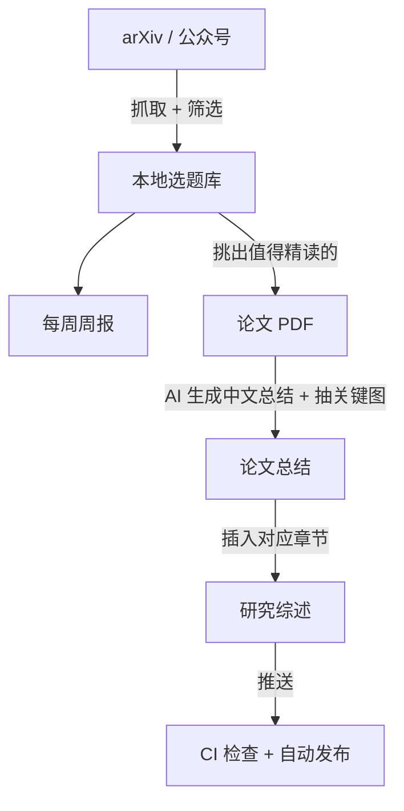

这个博客从 2026 年 1 月开始维护，现在有 18 篇研究综述、60 多篇 VLN 论文精读和每周一期的具身导航周报。内容基本都是我和 AI 编码助手（Claude Code、Codex）一起完成的。

分工很简单：**读什么、怎么判断，我来定；抓取、整理、排版、校验，交给 AI。** 下面讲这套流程怎么搭起来，想做类似研究笔记的读者可以直接照着来。

<!-- more -->

# 1. 整体流程

每个箭头都是一件重复做了上百次的事。我把这些事分别写成了 AI 可以直接调用的“技能”（Claude Code 里叫 Skill）：一份说明文档写清楚步骤，再配几个脚本处理确定性的操作。之后只要说一句“生成本周周报”或“总结这篇论文”，AI 就按固定流程执行。

# 2. 四个步骤

**第一步：抓资料。** [vln-feed](https://github.com/TingdeLiu/Tyndall-Skills/tree/main/vln-feed) 每周从 arXiv 和微信公众号拉取具身导航相关的新工作，按关键词过滤、去重，存进本地选题库，再生成一份周报：要点、3–5 篇精读、其余工作的索引。我只需要看周报，决定哪几篇值得细读。

**第二步：读论文。** 把 PDF 交给 [paper-summary](https://github.com/TingdeLiu/Tyndall-Skills/tree/main/paper-summary)，它会先判断哪几页有关键图，用 [pdf-figure-extractor](https://github.com/TingdeLiu/Tyndall-Skills/tree/main/pdf-figure-extractor) 抽图，再写一份结构统一的中文总结。每份总结开头有一节“精华”，最多 5 句话，只写可以迁移到别的工作里的思路。总结出来后，我会对着原文核对关键数字和结论。

**第三步：放进综述。** 总结要插到对应综述的正确位置，同时补齐目录锚点、参考文献、排行榜等好几处。这一步由 [paper-insert](https://github.com/TingdeLiu/Tyndall-Skills/tree/main/paper-insert)（VLA、VLM、世界模型、空间智能综述）和 [vln-paper-insert](https://github.com/TingdeLiu/Tyndall-Skills/tree/main/vln-paper-insert)（VLN 论文列表）完成，它们按本站文章的结构编写，用在别的博客上需要改一下章节标题，放哪一篇、要不要替换旧论文，都会先停下来问我。

**第四步：发布。** 站点用 Jekyll 搭在 GitHub Pages 上，文章就是 Markdown 文件，AI 读写没有障碍，也不需要任何后端。推送之后 GitHub Actions 先跑格式检查，再构建发布，任何一步失败都不会上线。

# 3. 想自己做一个，从哪开始

1. **先搭一个最简单的静态博客。** Jekyll 或 Hugo + GitHub Pages 就够了，关键是内容全是纯文本文件。
2. **在仓库根目录写一份 `AGENTS.md`（或 `CLAUDE.md`）。** 写清楚目录结构、文章格式、图片和公式的写法。AI 每次进项目都会先读它。
3. **把规则变成检查脚本，放进 CI。** 只写在文档里的规则，AI 迟早会违反。比如图片标签里不能用中文弯引号，我就写了一个脚本在构建前检查，不通过就不发布。
4. **同一件事做到第三次，就把它写成技能。** 写清步骤，能用脚本做的（计数、重命名、移动文件）别让 AI 凭感觉做；踩过的坑连同原因一起写进去，下次就不会再犯。
5. **研究判断留给自己。** 读哪篇、怎么分类、结论对不对，这些不要交给 AI。

上面链接的工具都在 **[TingdeLiu/Tyndall-Skills](https://github.com/TingdeLiu/Tyndall-Skills)**，可以直接装进 Claude Code 使用，也可以当作写自己工具的参考。有问题欢迎在下面留言。
