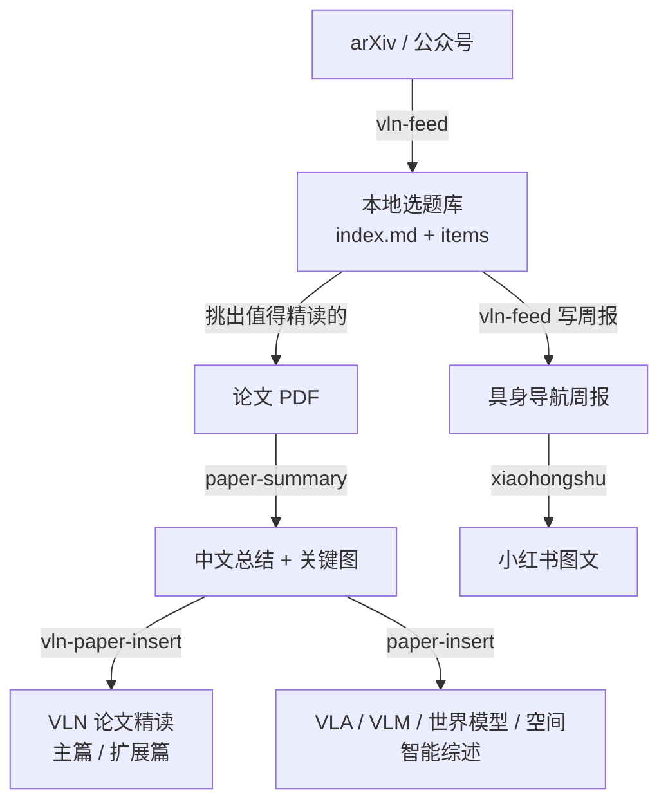

# 1. 写在前面

这个博客从 2026 年 1 月 4 日建仓到现在，十个月里积累了 950 多次提交、18 篇研究综述与论文精读、12 期具身导航周报，其中 VLN 论文精读主篇收满了 60 篇，另有一篇不设上限的扩展篇；英文版也覆盖了全部综述和周报。

这些内容不是我一个字一个字敲出来的。绝大多数时间里，我和 Claude Code、Codex 这类 AI 编码助手一起工作：我决定读什么、怎么判断，它们负责抓取、整理、排版、校验和那些重复了一百遍的机械操作。真正让这种协作稳定下来的，不是某一段写得特别好的 prompt，而是一组被我反复打磨的 **Skill**。

这篇文章想讲清楚三件事：

1. 为什么要做这样一个站；
2. 站点本身是怎么搭、怎么维护的；
3. 最重要的——我如何把“抓资料 → 读论文 → 写总结 → 插进综述”这条流水线拆成一组 Skill，以及在打磨它们时踩过的坑。

我用到的 skill 基本都放在这个仓库里，欢迎直接拿去用或改：**[TingdeLiu/Tyndall-Skills](https://github.com/TingdeLiu/Tyndall-Skills)**。

<!-- more -->

# 2. 为什么要做这个博客

## 2.1 读过的论文需要一个“落点”

我的研究方向是具身导航（VLN、ObjectNav）和相关的 VLA、世界模型、空间智能。这个领域论文更新极快：arXiv 上和导航相关的新工作，一周就能有上百篇。早期我的笔记散落在 PDF 批注、Obsidian 和聊天记录里，过两个月再想找“那篇在 R2R-CE 上 SR 做到 60 多的方法叫什么”，基本找不回来。

我需要一个地方，让每一篇读过的论文都有固定的落点：有统一的结构、可以被检索、能和同类工作放在一起比较。博客天然满足这一点——一篇综述就是一张持续生长的知识地图。

## 2.2 公开写作倒逼理解

只在自己脑子里“读懂了”和能写成一段别人看得懂的话，是两回事。写综述时，我必须回答：这篇方法和上一篇到底差在哪？它的数字能不能和别人的放在同一张表里比？这类问题逼着我回到原文核对细节，而不是停留在摘要层面。

## 2.3 让领域进展可以被追踪

论文精读解决的是“深”，但还缺“新”。所以我又做了每周一期的具身导航周报：把一周内的新工作拉下来、分池、挑出值得精读的几篇，再把其余工作压成一份索引。周报和综述互相喂养——周报里被挑出来精读的论文，之后会走 paper-summary 进入综述。

# 3. 站点骨架：尽量简单，把复杂度留给内容

## 3.1 技术选型

站点用的是 Jekyll 4.3，主题基于 jekyll-now 深度改造，托管在 GitHub Pages。选它的理由很朴素：

- **内容就是 Markdown 文件**，AI 助手读写起来毫无障碍，diff 也一目了然；
- **没有数据库和后端**，不需要运维；
- **推送即部署**，GitHub Actions 负责构建和发布。

目录约定也尽量直白：研究综述放 `_posts/research/`，周报放 `_posts/weekly-reports/`，技术随笔（比如这篇）放 `_posts/blog/`；论文图片按主题放在 `images/vln/`、`images/vla/`、`images/wm/` 等子目录；论文总结的中间产物放 `paper_summary/`，不直接渲染成文章。

## 3.2 把 CI 当作构建机

一个有点反直觉的事实：我维护博客的这台电脑**根本没装 Ruby**，本地跑不了 `jekyll build`。所有构建都交给 CI，推送之后用 `gh run watch` 看结果。

这反而逼出了一条比较完整的流水线。每次推送，Actions 会依次执行：

1. `lint_posts.py`：检查文章格式规则（后面会讲为什么这一步最重要）；
2. `check_translations.py`：比对中英文版本的同步状态；
3. 翻译追踪的单元测试；
4. Jekyll 构建；
5. `check_site_styles.py` 与 `check_english_site.py`：检查编译后的样式、英文页面和语言切换链接。

任何一步失败都不会发布。对一个主要由 AI 协作产出内容的站来说，这道闸门比什么都重要。

## 3.3 中英双语

英文版不是另建一套文章，而是放在 `_translations/en/` 这个独立 collection 里，每篇译文通过 `translation_id` 与中文原文配对。`check_translations.py` 会对中文原文按章节计算哈希，记录到 `docs/translations/*.en.json`；原文某一节改了而译文没跟上，构建时就会报出“过期”的章节。这让“中文先行、英文随后补”成为一种可追踪的状态，而不是一笔糊涂账。

# 4. 先把规则写给 AI，再让机器替你守住

## 4.1 AGENTS.md：项目的“入职手册”

仓库根目录有一份 `AGENTS.md`（Claude Code 读同名的 `CLAUDE.md`）。它是 AI 助手每次进入项目时首先读到的东西，写着站点结构、文章 front matter 格式、图片和公式的写法。

其中最有价值的，是几条带着“血泪”的**硬性规则**：

- **编辑任何已有文章，都要把 `date:` 改成当天**。文章列表因此始终按“最近更新”排序，读者一眼能看出哪篇最近被维护过。
- **图片的 `
` 块内不能有空行**。kramdown 遇到块内空行会切回 Markdown 模式，`` 会被当成纯文本输出。
- **HTML 属性必须用 ASCII 直引号**。编辑工具有时会把 `"` 自动换成中文弯引号，图片就整张消失。
- **行内公式里出现 `}_` 时必须用双美元符号**。kramdown 会把 `}_` 里的下划线当成斜体开头，把公式拆碎。

每一条背后都对应着一次“上线之后图挂了 / 公式碎了”的事故。

## 4.2 只写在文档里的规则，迟早会被违反

我很快发现：规则写进 `AGENTS.md` 只是第一步。模型大部分时候会遵守，但在长对话、批量编辑或者上下文被压缩之后，总有漏网的时候。

所以每条硬性规则都有一个**机器可检查的版本**，写进 `scripts/lint_posts.py`，放在 CI 的第一步。弯引号、`
` 内空行、`}_` 公式，任何一项不通过，构建直接失败。

这是我在整个项目里最想推荐的一条经验：**写给 AI 的每条规则，都应该同时有一个能在 CI 里跑的检查。** 文档负责“让它知道”，脚本负责“让它做不错”。

## 4.3 记忆：把“这次学到的”留到下一次

除了仓库里的规则，Claude Code 还有一套跨会话的记忆文件，用来记录那些不适合写进仓库、但下次一定会再遇到的事情。比如：

- Jekyll 会把 Mermaid 图里的双大括号当作 Liquid 模板吃掉，本地解析通过不代表线上不报错；
- Bash heredoc 写超过约 10KB 的长脚本会被静默截断；
- 批量核对 arXiv 引用要走 export API，一次可以查 60 多条，而不是逐条手查；
- 两期 `published: false` 的周报是有意为之，不是缺陷，别再提。

这些记忆每一条都很小，但它们让我不必在每个新会话里重新解释一遍同样的坑。

# 5. Skill：把一次性的 prompt 变成可复用的工具

## 5.1 Skill 是什么

在 Claude Code 里，一个 Skill 就是一个目录，核心是一份 `SKILL.md`：

- 开头的 front matter 里有 `name` 和 `description`，模型根据 description 判断什么时候该调用它；
- 正文写清楚工作流程、命令模板、注意事项；
- 旁边可以放 `scripts/`（确定性的脚本）和 `references/`（按需读取的参考资料）。

和“每次都在对话里重新描述一遍需求”相比，Skill 有三个好处：

1. **只在需要时加载**。平时模型只看到一行 description，真正触发时才读完整的流程，不浪费上下文。
2. **脚本做确定性的事，模型做判断**。抽图、重命名、计数、插入锚点这类事交给 Python，不靠模型“目测”；读懂论文、挑选精读、判断归类这类事才交给模型。
3. **经验可以沉淀**。每次踩坑之后，我会把原因和修正写回 `SKILL.md`，下一次就不会再犯。

## 5.2 整条流水线

博客的内容生产大致是下面这样一条链路：

下面按顺序讲几个最核心的 skill。

## 5.3 vln-feed：每周的资料入口

`vln-feed` 负责把具身导航领域的新资料收进一个本地选题库，再写成周报。它的骨架是一条很经典的管线：

> **RSS 源 → 关键词过滤 → 去重 → 每条一份 Markdown + 总索引**

具体来说：

- **资料源**在 `feeds.yaml` 里配置：两路 arXiv 检索（具身导航、具身 Agent / AgentOS），外加微信公众号；
- 每条资料存成 `items/*.md`，汇总到 `index.md`，`seen.json` 负责去重，所以重复跑只会补新条目；
- 每条会被自动打上 **「领域」** 和 **「基准」** 两个字段，周报筛选直接查字段，不用对全文写正则；
- 周报按读者时间分三层：数字栏和本期要点、3–5 张精读卡、折叠起来的全部工作索引；发布前用 `validate_report.py` 检查结构、篇幅预算、配图和链接。

听起来不复杂，但它是我改动最多的一个 skill。几个印象最深的坑：

**分池的由来。** 有一次我发现资料库里几乎全是 VLA 操作类论文，真正想看的具身 Agent 方向却抓不到。一核查，某期 70 条里有 52 条（74%）通篇不提导航，全是从一个没加约束的 `vision-language-action` 检索分支涌进来的。我没有选择直接砍掉，而是**分池**：导航和具身 Agent 是主池，深度分析只针对主池；VLA 操作、自动驾驶等进次池，压成速览。

**“navigation” 这个词太常见了。** 知识图谱里有 “Graph Navigation”，软件工程里有 “Navigating architecture”，GUI 有 “GUI Navigation”。我曾试过“摘要里出现 navigation 就算导航”，结果一堆临床 Agent、SWE-Agent 挤进主池。最后的规则是：标题优先于摘要、agent 类词必须过“具身语境”闸门、`waypoint` 必须和 robot / navigation 等词近距离同现。这些规则都附带了“为什么不能删”的注释，防止以后改回去。

**arXiv 开始返回 406。** 2026 年 9 月中旬起，arXiv API 负载高时只放行命中缓存的检索，而我的检索式是定制的长串，永远不会被别人缓存，于是被持续拒绝。换 UA、换 header、改 POST 都没用。最后的方案是**自动降级**：API 失败时改走 OAI-PMH，按日期拉取 cs 和 eess 的全量元数据，在本地用原样的检索式匹配。对照验证下来召回率约 98%。

**公众号这条路几经周折。** 最早用的 wewe-rss 依赖作者部署在 Deno Deploy Classic 上的中转服务，平台下线后彻底失效；迁移到自建的 we-mp-rss 后，又碰上微信公众平台的账号级频控。现在 skill 里的第一步是一个 5 秒的探针脚本，按返回码分支：频控时就走“手动喂文章链接”，没链接可喂就本期只用 arXiv——**不要为一个不稳定的源卡住整条流程**。

这些经历都原样写在 `SKILL.md` 里，带着日期和原因。下一次哪怕是另一个模型来跑，也知道哪些路已经走过、不用再试。

## 5.4 paper-summary：一篇论文变成一份结构化总结

选好要精读的论文后，把 PDF 交给 `paper-summary`。它的工作流是：

1. **先读 PDF，判断哪几页有关键图**，而不是把所有页都扫一遍；
2. 只对这些页调用 TF-ID（基于 Florence-2 的图表检测模型）**抽图**；
3. 生成中文总结，在方法、实验等位置插入图片占位，并用 `RENAME` 注释标明每张图要改成什么名字；
4. 用 `process_images.py` 一次性完成：重命名 → 移到 `images/<主题>/` → 转成无损 WebP → 删掉没用到的图 → 更新 Markdown 里的路径。

每份总结开头都有一节 **「精华」**：最多 5 句话，只写可以迁移到别的工作里的思路。这是我最常回看的部分。

这个 skill 也很能体现“脚本做确定性的事”的原则。Windows 上 conda 的 Unicode 问题、poppler 不在 PATH、`.bat` 会切换工作目录导致相对路径落错位置……这些坑全部固化成了一份**唯一的命令模板**，模型只需照抄，不需要每次重新摸索。

## 5.5 vln-paper-insert 与 paper-insert：把总结插进综述

总结写好之后，还要插进对应的文章。这一步看似简单，其实要改的地方很多。以 VLN 论文精读为例，`vln-paper-insert` 一次要处理最多五个插入点：

1. 正文里新增一节，带上固定的锚点；
2. 页面筛选器的 `TAG_MAP` 条目；
3. 参考文献列表里的编号条目；
4. 已发表论文的会议 / 期刊对照表（预印本跳过）；
5. 可选的排行榜行：按 SR 排到正确位置，并按规则重新加粗。

VLN 论文分成两篇：**主篇上限 60 篇**，收已发表或进入指令跟随排行榜的工作；**扩展篇不设上限**，放预印本和扩展增补。所以 skill 的第一步永远是**先问我放哪一篇**；如果主篇已满，必须先把一篇旧论文调到扩展篇——调哪一篇由我决定，skill 不会自作主张。两篇的筛选器会互相展示对方的命中项，所以每次增删后都要跑一遍 `sync_remote.py` 同步。

`paper-insert` 则负责另外四篇综述：VLA、VLM、世界模型和空间智能。它最有意思的部分是一份**归类决策树**——现代 VLM 正在空间化，空间智能又在大模型化，两者经常交叉。决策树按“输入输出是强 3D 几何，还是通用 2D 图文”来判断归属，减少了很多“这篇到底该放哪”的来回。

## 5.6 外围的几个 skill

- **xiaohongshu**：把周报或文章改写成小红书文案并生成 1080×1440 的配图。它坚持一条原则：标题 20 字、正文 1000 字的限制**必须用脚本计数**，绝不目测——小红书按 UTF-16 计数，emoji 算 2，目测常常低估 25% 以上。
- **video-subtitle-extractor / video-localize**：抽取 B 站、YouTube 视频字幕，或者做成双语字幕和中文配音，用来整理讲座内容。
- **skill-creator**：用来写和评测新的 skill，本身也是一个 skill。

# 6. Skill 仓库是怎么管理的

## 6.1 一个仓库，多台电脑

所有 skill 都放在一个 Git 仓库里：**[TingdeLiu/Tyndall-Skills](https://github.com/TingdeLiu/Tyndall-Skills)**。本机的 `~/.claude/skills` 是指向这个仓库的符号链接，所以在 Claude Code 里改 skill，就是在改仓库里的文件，改完直接提交。

我在两台电脑上工作，博客仓库在两台机器上的路径不同。所以 skill 里凡是涉及博客路径的地方，都会**把两台机器的路径都列出来**，按顺序取本机存在的那个，两处都没有时先问我，而不是瞎猜。

## 6.2 自己写的和别人写的

仓库里的 skill 有两类来源：

- **自己写的**：vln-feed、paper-summary、vln-paper-insert、paper-insert、xiaohongshu 等，和这个博客的流程深度绑定；
- **拿别人的**：Anthropic 官方的 pdf、docx、pptx、skill-creator，Matt Pocock 的 grilling、diagnosing-bugs，以及其他社区作者的若干 skill。

拿来的 skill 我常常会顺手改几处，这就带来一个问题：上游更新了怎么办？直接覆盖会丢掉我的修改，不更新又会落后。为此我写了一个 `sync-upstream-skills`：`upstream.json` 登记每个外来 skill 的上游仓库、路径和对应的上游 commit，`sync-upstream.py` 靠这个基准做三方比较——上游改了本地没改就直接覆盖，两边都改了就用 `git merge-file` 合并，本地新增的文件保留。

# 7. 几条经验

回头看这十个月，下面几条是我觉得最值得分享的：

**1. 踩过的坑写进 skill，并且写清楚“为什么”。** 只写“不要这样做”是不够的，下一次模型（或者我自己）会觉得这条规则多余而删掉。写上日期、现象和原因，它才能真正留下来。

**2. 能交给脚本的，就不要交给模型。** 计数、重命名、插入锚点、格式检查——这些事脚本做一次就对，模型做一百次总会错一次。模型的价值在于判断，而不是机械操作。

**3. 校验器比生成器更重要。** `lint_posts.py`、`validate_report.py`、`check_translations.py`、小红书的字数脚本，每一个都比它所检查的那个生成步骤更能保证质量。

**4. 关键判断留给人。** 精读哪几篇、主篇满了调走哪一篇、一篇论文归到哪个综述，这些 skill 都会停下来问我。自动化的目标是省掉机械劳动，不是替我做研究判断。

**5. AI 写出来的东西不等于事实。** 论文的数字、引用的链接，都需要回到原文核对。我会定期用 arXiv export API 批量核对综述里的引用，一次查几十条。

**6. 允许流程降级。** 资料源会挂，接口会变，平台会下线。一条好的流水线应该在某个环节失败时继续往下走，而不是整个卡死。

# 8. 结语

这个博客本身就是一个实验：一个人，在 AI 助手的协作下，能不能长期维护一个有一定深度和规模的研究站点？十个月下来，我的答案是可以——前提是你愿意花时间把流程拆清楚、把规则写下来、把经验沉淀进 skill，并且在 CI 里给自己设好闸门。

如果你也在做类似的事情，欢迎直接去仓库里翻这些 skill：**[TingdeLiu/Tyndall-Skills](https://github.com/TingdeLiu/Tyndall-Skills)**。它们是围绕我的工作流写的，不一定能直接套用，但其中踩坑的记录和“为什么这样设计”的说明，也许能帮你少走一些弯路。有问题也欢迎在下面留言或者开 Issue 交流。
