> 本篇是 [VLN 综述](/VLN-Survey/)的配套户外导航阅读，关注机器人如何结合地图、语言与视觉，在城市街道、人行道和野外步道上完成长距离任务。当前收录 8 篇精读：WayTrace、CausalNav、DA-Nav、CityWalker、UrbanNav、MOSU2、LM-Nav 与 Compass 1。内容从地图指引与语义检索，延伸到网络视频学习、语言地标落地、偏航恢复、交通交互和长历史回溯；MOSU 作为 MOSU2 的前置方法介绍，不重复计篇。Compass 1 是覆盖室内外的通用导航方法，本篇重点关注其户外部署与持久记忆机制，不将其汇总成绩视为纯户外指标。
>
> 相关方向见[指令跟随篇](/VLN-Papers/)、[目标导航篇](/VLN-Papers-Extended/)与 [Agentic 导航篇](/Agentic-Navigation-Papers/)。户外评测单独记录路线、定位误差和人工干预条件。

# 户外导航评测记录
{: id="outdoor-navigation-benchmarks"}

下表记录本篇论文报告的完整系统结果；自建基准保留原始名称与评测条件，SR 不与室内 VLN 或其他户外基准直接混比，未报告的指标记为“–”。

| 模型 | 年份 | 基准 | 范式 | 评测条件 | SR ↑ | SPL ↑ |
|:---|:---:|:---|:---:|:---|:---:|:---:|
| [WayTrace](#waytrace) | 2026 | 苏黎世老城长程导航（自建） | 训练 | 完美 GNSS | 83.3 | – |
| [WayTrace](#waytrace) | 2026 | 苏黎世老城长程导航（自建） | 训练 | GNSS 漂移 7 m RMS | 63.3 | – |

**评测口径：** 10 条路线，每条运行三个种子，每个条件共 30 次；成功要求在目的地 5 m 内停车，且每次过街至少一半的道路内路径位于斑马线上。最长 1.37 km 的真实机器人任务属于另行展示的实机演示，含两次人工语言指令替换，不计入上表的仿真 SR。

**DA-Nav 独立评测记录。** 下列三种口径分开记录，不与 WayTrace 的苏黎世老城基准排名。范式均为**训练**：Qwen2.5-VL-7B-Instruct 在 ReDA 上进行 LoRA 微调；仿真到实机的零样本迁移不等于免训练。

| 模型 | 基准 / 划分 | 评测条件 | SR（%）↑ | SPL ↑ |
|:---|:---|:---|---:|---:|
| [DA-Nav](#da-nav) | CARLA 0.9.15，已见 + 未见城镇 | 239 条闭环轨迹；Table II | 59.00 | 58.66 |
| [DA-Nav](#da-nav) | CARLA，未见城镇 | Town 06 / 07 / 15；摘要报告的未见环境成绩 | 56.16 | – |
| [DA-Nav](#da-nav) | 实机城市街道 + 公园 | 各 5 条超过 100 m 的路线，每条重复 3 次，共 30 次；Table V | 46.7 | – |

SPL 沿用原表尺度。混合城镇评测的 CSR 98.15% 是**偏航事件的纠正成功率**，不是任务 SR；实机单动作成功率 83.3% 与超过 1.2 km 的人形机器人展示也不混入上表。各基线使用公开预训练权重与适配后的接口，而 DA-Nav 使用 ReDA 训练，详细比较条件见[精读结果](#da-nav-results)。

**新增工作的独立协议记录（不是跨论文排名）。**

| 工作 | 范式 | 原文评测与指标 | 结果 | 比较边界 |
|---|---|---|---|---|
| [CityWalker](#citywalker-results) | 训练：网络视频预训练 + 实机微调 | 原文 Table 2，实机任务 SR | 77.3% | 人工接管计失败；位置目标接口，不是语言任务 |
| [UrbanNav](#urbannav-results) | 训练：网络视频预训练 + 实机微调 | 原文 Table 2，语言地标实机 SR | 83.3% | 不同基线经过接口适配；试验规模与路线明细不足，不与 DA-Nav 比排名 |
| [MOSU2](#mosu2-results) | 预训练模块组合；新增推理流程无联合微调 | 五类交互场景组 SR 的非加权平均 | 94.2% | 非全部试验合并 SR；平均决策延迟 3.83 s；含云端调用 |
| [LM-Nav](#lm-nav-results) | 免额外微调：冻结 GPT-3、CLIP、ViNG | 原文 Table 1，两组各 10 条查询的 Net Success | 两组均 80% | 目标环境先人工遍历建图；正文 85% 与表格口径存在差异 |
| [Compass 1](#compass-1-results) | 训练：真实视频 + 网络视频联合训练 | 原文 Figure 7，四场景 × 八任务 × 十次，共 320 次实机测试 | 总 SR 79.4%；户外 Complex / Terrace / Street 分别约 79% / 81% / 74% | 总 SR 含室内办公室；分场景值沿用图中取整，各 80 次；依赖里程计与远端 GPU，不与其他自建基准排名 |

MOSU 的 GND 可通行比例、CityWalker/UrbanNav 的离线轨迹误差和 LM-Nav 的规划成功率不混入任务 SR；具体分项、传感器依赖和证据限制见各篇结果段。

# 户外导航论文精读
{: id="outdoor-navigation-readings"}

## 1. WayTrace (2026)
{: id="waytrace"}
———用语言衔接网页地图与视觉路径，让城市导航不再追着带误差的坐标走

📄 **Paper**: [arXiv:2611.05129](https://arxiv.org/abs/2611.05129) · [Project Page](https://way-trace.github.io)

### 精华

1. 长程导航可以拆成两个问题：高层判断现在该执行哪条局部指令，低层把指令落实为当前画面里的路径，两者通过语言衔接。
2. GNSS 只提供路线进度与大致距离，路径位置由相机决定，因此定位漂移主要影响动作切换时机，而不会直接把路径平移到马路或河岸外。
3. 路径预测先确定终点所处的分支，再生成通向该终点的轨迹；部署时保留终点的语言解码，用小型回归头一次输出路径点。
4. 规模化训练的关键是让同一场景对应多种指令及路径，覆盖行人实际没有走过的分支，减少模型忽略语言、只猜最常见行走路线的机会。
5. 慢速语义规划与快速避障控制异步运行，使约 3 秒的上层响应延迟仍能支撑连续行走，但其长程可靠性最终受指令切换错误和交通反应能力限制。

---

### 1. 研究背景/问题

网页地图已经能给出大多数城市的步行路线，但直接追踪 GNSS 航点会把数米定位误差转成错误运动目标，且坐标本身不表达“沿人行道走、从斑马线过街”等要求。现有 VLN 模型在户外连一条局部指令都可能执行不稳，串联成数百米至公里级路线后，错误更容易累积。WayTrace 因此将“选择当前指令”与“执行当前指令”分开，让地图提供全局路线，视觉负责局部落地。

---

### 2. 主要方法/创新点

  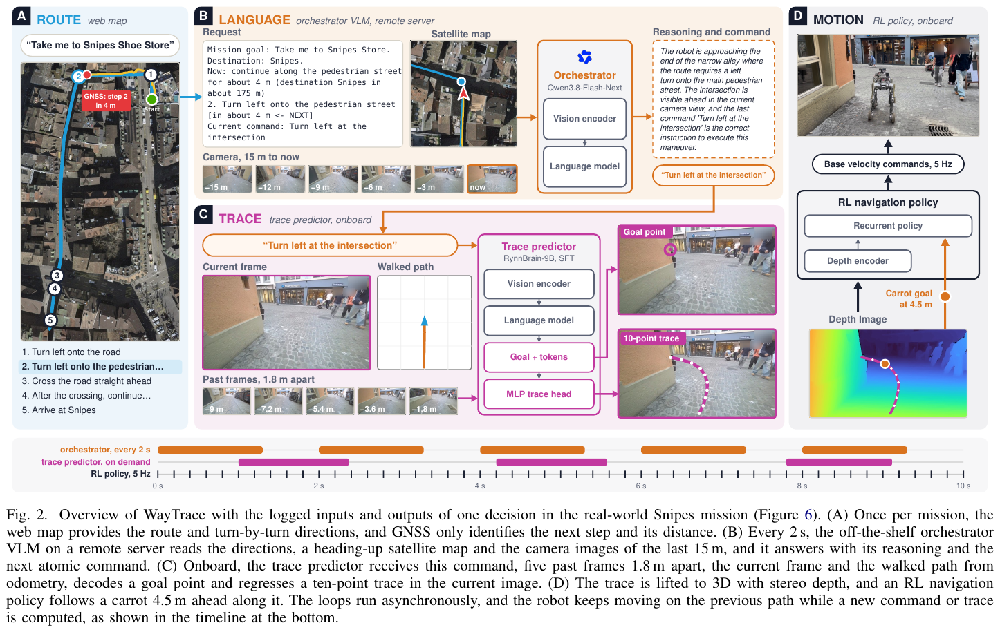
<figcaption>图 2：地图提供路线，远程 orchestrator 选择原子语言指令，机载 trace predictor 输出图像路径，RL 策略沿深度提升后的三维路径行走；三个循环异步运行。</figcaption>

**整体框架。** 系统由路线与指令编排、语言条件路径预测、RL 运动执行三个核心环节构成：orchestrator 判断下一步该做什么以及何时切换，trace predictor 画出这条指令在当前图像中的路径，RL 策略根据最新深度图跟踪路径并避障。语言是高低层之间的接口，图像中的二维路径则连接视觉理解与具身控制。

**① 路线与 orchestrator：地图决定下一步动作，相机判断执行时机。** 输入是目标地点、附近路线指示及距离、以机器人朝向为上方的约 50 m 宽卫星图、当前与过去 15 m 的相机观测，以及当前指令。真实部署先用 Google Places API 解析目的地，再用 Google Routes API 获取步行路线，并在 OpenStreetMap 的步行网络上重新规划，以覆盖人行道和已标注的过街位置；仿真则使用预先构建、与网页地图风格一致的路线指示。

未经微调的 Qwen3.8-Flash-Next 每 2 秒接收一次请求，输出一句理由和一条“在路口左转”“过马路”等原子指令；这里的原子指令描述当前视野内可落地的一次局部动作，不要求机器人执行精确米数。GNSS 投影到路线后，只用于识别当前路线步骤和估计距离，局部路径并不追踪这个坐标；机器人端另有提前过街拒绝、到达指令检查、指令过期等规则。过街还按“转入斑马线 → 过街 → 离开斑马线并进入下一路段”的顺序切换，避免一直保留带方向的转弯指令。

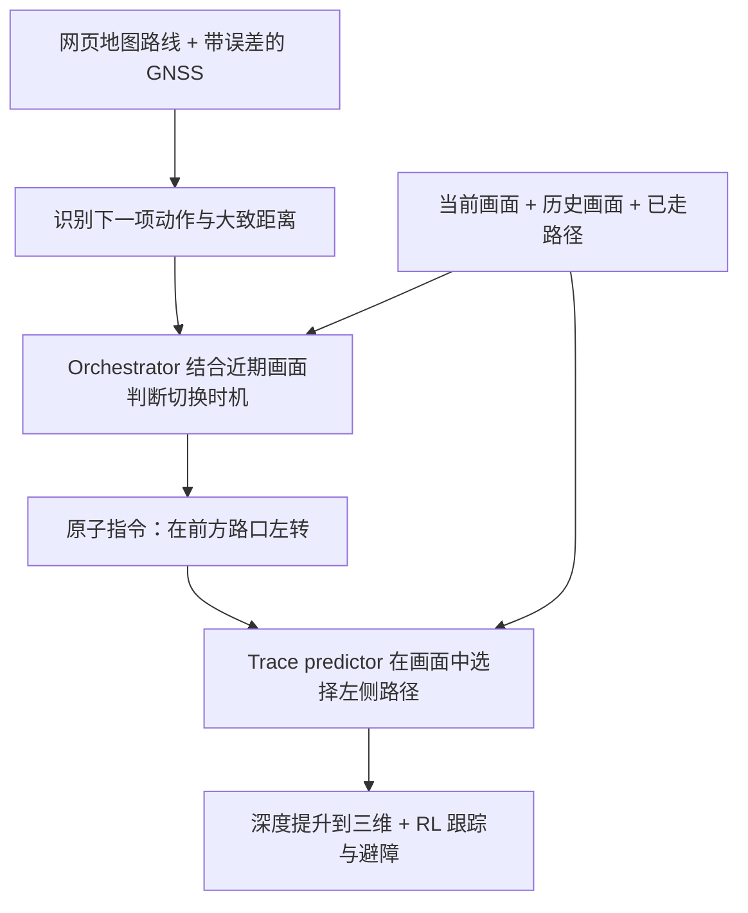

这张读者版图强调分工：即使 GNSS 把机器人估计到人行道旁边的道路上，只要路线步骤仍判断正确，低层仍会根据画面中的人行道画路径；若误差导致高层过早发出转弯命令，系统依然可能走错路口，因此它降低了对定位精度的依赖，并没有消除这种依赖。

**② Trace predictor：先选定要去的分支，再补出路径。** 输入包括当前 RGB 图像、按行走距离间隔 1.8 m 采样的五张历史图像、里程计生成的已走路径俯视图，以及当前语言指令。历史图像覆盖约 9 m 行程，帮助模型判断转弯已经执行到哪一步，避免每次看到“左转”都重新左转。

模型以 RynnBrain-9B 初始化，将图像和指令送入视觉编码器与语言模型，先输出归一化图像坐标中的终点，再预测以该终点结束的 10 个二维路径点。这里的终点是指令路径离开视野或被完全遮挡的位置，不一定是整条任务路线的最终目的地；作者将预测流程写为：

$$
p_\theta(\tau\mid x,c)=p_\theta(g\mid x,c)\,p_\theta(\tau\mid g,x,c).
$$

其中，$x$ 为视觉与行走历史，$c$ 为指令，$g$ 为终点，$\tau$ 为路径。先定终点可以约束分支选择，减少直接预测路径时在岔路之间折中的现象。

> **举个例子（仅为机制示意）**：假设画面里左右两条支路的终点分别是 $(0.2,0.2)$ 和 $(0.8,0.2)$，两支路之间有隔离区域；若模型在两条路线间折中，可能画向中间的 $(0.5,0.2)$。先根据“走左边岔路”选定左侧终点，再补出路径，就把问题从“同时猜走哪条路、怎么走”拆成“先选分支，再连接路径”。

**③ 从两阶段训练到单次调用部署。** 两阶段版本在约 119 万样本上进行一轮 LoRA 监督微调，分别用自回归交叉熵训练终点和路径，路径阶段训练时给定参考终点。为减少机载推理延迟，部署版本只自回归生成约 15 个终点 token，再读取终点结束处的隐藏状态，用 LayerNorm、两层线性映射与 GELU 构成的 MLP 直接回归 20 个数，即 10 个二维点，最后用 sigmoid 约束到归一化坐标范围；这样省去约 140 个路径 token 的逐个解码。

该单次调用模型的训练目标为：

$$
\mathcal L=\frac{1}{N}\sum_{i=1}^{N}\lVert\hat u_i-u_i\rVert_1
+2\lVert\hat u_N-g\rVert_1
+0.5\mathcal L_{\mathrm{CE}},\qquad N=10.
$$

第一项监督所有路径点，第二项加强路径末端与目标点的一致性，第三项监督终点 token。附录说明，该版本从完整数据中按来源比例抽取 25 万个样本训练，30% 的样本使用模型自己预测的终点来训练回归头，并屏蔽这些样本的终点交叉熵，让路径头适应略有偏差的终点；最终时序路径模型使用监督微调，单图教师则使用监督微调和 GRPO，二者训练方式不能混为一谈。

**④ 自动标注：既学习实际走过的路，也学习同一画面的其他可选路线。**

  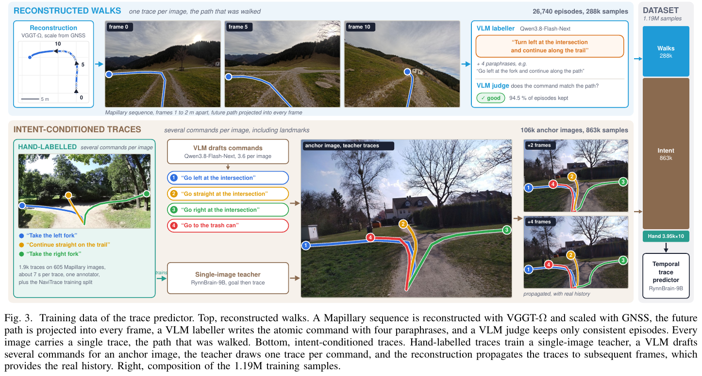
<figcaption>图 3：上支路从真实行走序列恢复路径并标注指令；下支路用少量人工标签训练教师，为同一画面的多个指令生成不同路径，再传播到后续帧以配上真实历史。</figcaption>

这里的意图条件路径（intent-conditioned traces），就是让“同一幅图、不同命令”得到不同路径。只将视频中的未来行走轨迹投影回当前帧，每幅画面通常只有一条实际走过的路径，模型可能只根据场景猜路线而忽略指令。

| 维度 | 仅使用重建行走数据 | 加入意图条件路径 |
|---|---|---|
| 单幅画面的监督 | 只有行人实际走过的路径 | 每条可见支路及部分地标可对应不同指令与路径 |
| 学习信号 | 场景外观与实际路径绑定 | 同一场景内也必须依据指令区分路径 |

**实际行走支路。** 原始数据池包含 182 个城市与地区的 51,907 段 Mapillary 序列。VGGT-Ω 从短序列恢复相机姿态和几何，再用 GNSS 轨迹长度确定尺度，将未来相机下方的地面位置投影到当前帧，得到图像路径；VLM 随后生成描述该路径的指令及四种改写，另一次 VLM 判断仅保留指令与路径一致的片段，最终得到 26,740 个片段、约 28.8 万个样本。

**意图条件支路。** 先用 NaviTrace 训练划分，以及在 605 张 Mapillary 图像上人工绘制的约 1,900 条路径训练单图教师。再从路口、过街点和步道采样锚点图像，让 VLM 为可见分支及可唯一识别的地标生成多条指令，教师逐条画出路径；三维重建把这些路径传播到序列后续帧，从而为单图教师产生的标签补上真实历史，得到约 10.6 万张锚点图像上的 86.3 万个样本。

两条支路加上人工与 NaviTrace 基础样本后，最终训练集为 **1,190,594 个样本**，其中 3,950 份基础样本重复十次参与训练；测试序列从各训练来源中排除。这里的尺度来自可解释的重建、教师标注和传播流程，不要求采集同等规模的机器人示范。

**⑤ 三维提升与 RL 执行：路径提供方向，最新深度处理身体与障碍。** 输入是二维路径、深度图、里程计与机器人速度；先把路径点提升到三维并固定在里程计坐标系，保留落在已观测可通行地面上的路径前缀，再把沿路径前方 4.5 m 的跟踪目标交给 RL 导航策略。该策略在仿真中学习根据深度图到达局部点目标并避障，部署时以 5 Hz 更新速度指令，实机使用重新训练的版本。

Orchestrator 单次约耗时 1.3 秒，机载路径预测约 1.5 秒，控制器在等待期间继续跟踪上一条路径。收到新指令、前进 3 m、执行完当前路径的 40%，或距离上次请求超过 5 秒时，会请求新路径；最终到达指令生效后，距路径目标 1.5 m 内停止。整条链路因而是“地图与历史选择指令 → 当前视觉生成路径 → 深度和里程计更新局部目标 → RL 连续执行”，而非每次等完整大模型推理结束再移动。

---

### 3. 核心结果/发现

**长程闭环。** 作者在 Isaac Sim 5.0 中构建约 0.91 km² 的苏黎世老城，设置 10 条长 152–864 m 的路线，每个条件运行三次种子，共 30 次。成功既要求在目的地 5 m 内停车，也要求沿途每次过街至少一半的道路内路径位于斑马线上，因此成功率包含过街合规条件。

| 方法 | 完美 GNSS 的成功率 | 7 m RMS 漂移的成功率 |
|---|---:|---:|
| CityWalker + 本文 RL 控制器 | 36.7% | 23.3% |
| VAMOS + 本文 RL 控制器 | 63.3% | 10.0% |
| WayTrace | **83.3%** | **63.3%** |

使用原发布控制器时，CityWalker、VAMOS、OmniVLA 的成功率分别为 20.0%、13.3%、0%；即便用按模型单独调优的 oracle 提供指令，TIC-VLA、Foresight、VENTURA 也仅为 6.7%、3.3%、6.7%。将 WayTrace 的高层替换为 oracle、保持路径预测与 RL 不变后，成功率升至 90.0%，说明剩余瓶颈包括高层决策，也包括局部执行。

  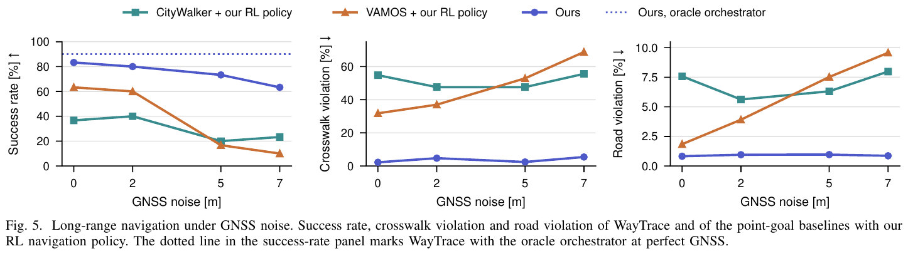
<figcaption>图 5：在使用相同 RL 控制器的比较中，WayTrace 对 GNSS 漂移的退化较缓；其各噪声条件下斑马线违规率低于 6%、驶入道路的路径占比低于 1%，但成功率仍会受动作切换错误影响。</figcaption>

**局部路径与消融。** 在人工标注的 Human-Test（332 张图、953 条路径）上，WayTrace 的 NaviTrace 分数为 83.2，对比方法最高为 57.0，转向侧别准确率为 97.9%；NaviTrace 分数综合路径匹配、终点误差与语义地面惩罚，不能当成任务成功率。加入历史后，50 个单指令片段、每个三次种子的闭环成功率由 74.7% 升至 94.7%，完成转弯后继续重复转弯的比例由 56.0% 降至 9.3%；加入 86.3 万意图条件样本后，数据消融中的 NaviTrace 分数从 79.33 升至 83.32。开放环表格主要报告两阶段模型，闭环则使用单次调用模型；后者在 Human-Test 上同样达到约 83.2。

**真实机器人。** Unitree B2W 使用 ZED X 深度相机、激光惯性里程计与 GNSS 融合定位，路径预测在 Jetson AGX Thor 上运行，RL 控制器在 Jetson AGX Orin 上运行，高层模型部署在远程四张 H100 上。

| 实机任务 | 规划路线长度 | 平均速度 | 作者统计的人工指令干预 |
|---|---:|---:|---:|
| Starbucks | 426 m | 1.12 m/s | 0 次 |
| Snipes | 248 m | 1.01 m/s | 0 次 |
| Dieci | 312 m | 1.11 m/s | 0 次 |
| Mendokoro | 1,368 m | 1.19 m/s | 2 次 |

最长任务的两次干预都是人工将持续转弯的指令替换为沿路直行，没有遥操作机器人，作者报告其无干预行驶距离占比为 97.2%。Starbucks 任务还曾由操作员短暂停车以检查接近的电车，作者因没有修改指令或路径而未将其计入干预；该任务另出现过提前进入道路、随后才并入斑马线的情况，因此表中“0 次”不能理解为无需交通监督或全程严格合规。

  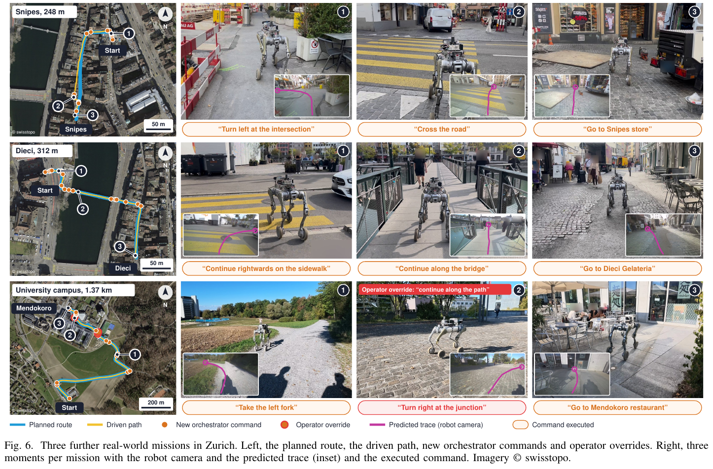
<figcaption>图 6：Snipes、Dieci 与 1.37 km 的 Mendokoro 实机任务，包含拥挤街道、桥梁及校园路线；最长任务中标出了两次人工语言指令替换。</figcaption>

**语言接口的扩展。** 仿真中展示了封路或错过转弯后请求新路线，以及仅凭人类提供的六条地标指示完成 127 m 导航；后一个演示不用地图或 GNSS，但采用额外里程计规则并限速至 0.6 m/s，不能据此推断整套长程系统已不需要 GNSS。对 957 次日志决策的回放评估中，默认高层模型的关键错误率为 5.1%，更强模型可降至 3.2%，但调用延迟约为其三至五倍；这是决策回放结果，尚非更强模型的完整闭环任务成功率。

---

### 4. 局限性

高层仍依赖远程网络、GNSS 路线进度和启发式规则，可能提前、延后或重复发出动作；约 3 秒的串行语义响应延迟、有限前向视野与短期历史，会影响窄路口和长动作的可靠性，目前也无法处理红灯停车或接近电车等交通反应。评估仅覆盖一处静态仿真城市和四条无对比基线的实机演示，仿真没有交通与行人，成功判据还允许单次过街最多约一半道路内路径不在斑马线上，因此这些结果尚不足以证明普遍城市交通安全或无人监督的公里级部署能力。

---

## 2. CausalNav (2026)
{: id="causalnav"}
———First Scene Graph-based Semantic Navigation for Dynamic Outdoor Environments

📄 **Paper**: [arXiv:2601.01872](https://arxiv.org/abs/2601.01872) · 🏛️ **IEEE RA-L**

### 精华
{: id="causalnav-精华-12"}

CausalNav 的核心亮点在于将多层级场景图（Embodied Graph）与 RAG 机制深度结合，实现了支持开放词汇查询的长程语义导航——"图即知识库"的设计范式值得借鉴。其次，层次化 Embodied Graph 构建策略（从细粒度对象节点到粗粒度建筑物与聚类节点）展示了如何在多空间尺度上统一语义表示与检索。第三，基于时空走廊（Spatial-Temporal Corridor）的动态对象过滤机制，无需额外标注即可区分静态、准静态与动态障碍物，是处理室外动态场景的实用方案。第四，使用本地开源 LLM 替代商业 API 完成层次语义检索，证明了在自主平台上脱离云端仍可实现高质量语义推理。

---

### 1. 研究背景/问题
{: id="1-研究背景问题-11"}

室外大规模动态环境中的自主语义导航面临三大挑战：开放词汇的语义理解、动态环境适应（行人、车辆等移动障碍物）以及长期稳定性。现有 VLN 研究主要聚焦于静态室内场景，依赖高精度地图或大规模训练数据，在真实室外动态场景中的长程导航鲁棒性未得到充分验证。

---

### 2. 主要方法/创新点
{: id="2-主要方法创新点-9"}

  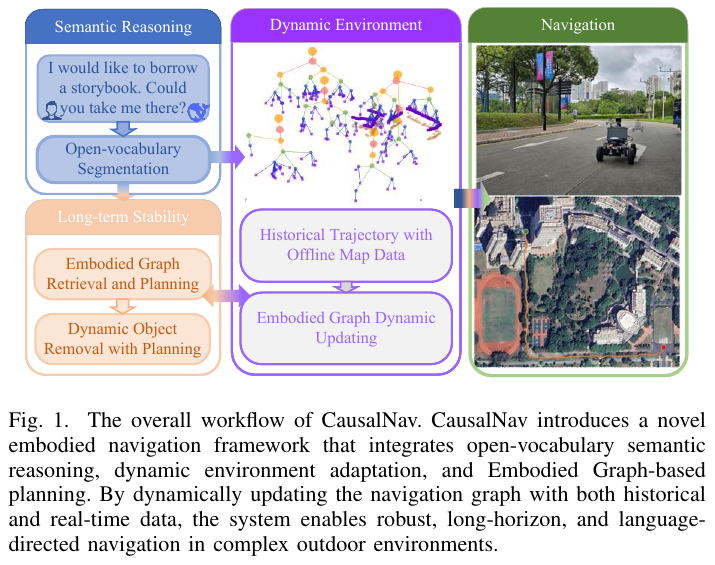
<figcaption>
CausalNav 整体工作流：集成语义推理、动态环境适应和 Embodied Graph 规划三大模块
</figcaption>

CausalNav 提出了一个由三个核心模块构成的语义导航框架：

**模块一：开放词汇目标跟踪与自我运动估计**

使用 YOLO-World 从 RGB 图像中提取开放词汇的 2D 检测框和分割掩码，通过 ByteTrack 进行多目标跟踪。结合 LiDAR 点云将 2D 检测投影至 3D 空间，获得目标的 3D 姿态 $$^w\mathbf{T}_{obj}$$。自车运动通过 LiDAR-IMU 里程计（FAST-LIO2）估计，提供精确的定位与坐标变换基础。

**模块二：动态对象过滤与 Embodied Graph 构建**

  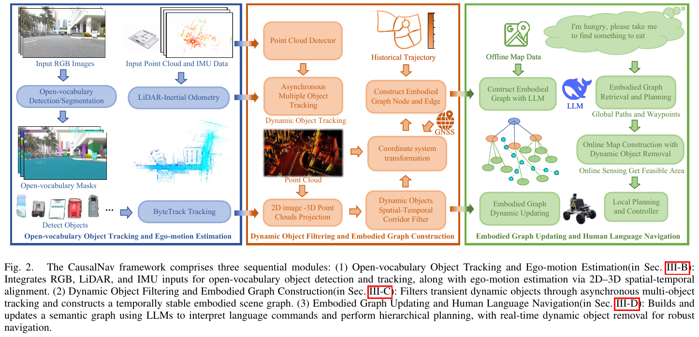
<figcaption>
CausalNav 三模块流水线架构：目标跟踪与自我运动估计 → 动态过滤与图构建 → 图更新与自然语言导航
</figcaption>

- **时空走廊过滤**：将每个目标的历史轨迹编码为时空走廊 $$\mathcal{T} = \{^w\mathbf{T}^n_{obj}, \text{3DBBox}_i, t_i\}_{i=1}^n$$。若目标在 $k$ 步内位移超过阈值，则认定为动态目标并从图中移除，有效消除运动引起的虚假节点。

- **Embodied Graph 层次构建**：静态环境由两类节点组成——建筑物节点 $\nu_i^{build}$ 来自离线地图，对象节点 $\nu_i^{obj}$ 来自实时感知。使用 LLM 对节点进行层次聚类（spatial-semantic similarity），形成多级抽象：对象层（Level $L-1$）→ 建筑物/Place 层（Level $L$）→ 聚类节点（Clustering Node）。每次自车移动超过距离阈值 $d$，新增自车节点 $\nu_i^l$ 记录历史轨迹。

- **RAG 语义检索**：基于 LLM 打分的层次化检索，结合空间相似性 $\kappa^{spatial}$ 和语义相似性 $\kappa^{semantic}$，在图中逐层选择最匹配查询的节点路径，支持开放词汇目标定位。

**模块三：Embodied Graph 动态更新与自然语言导航**

  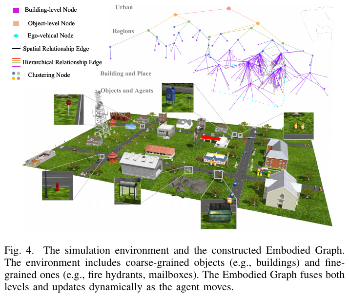
<figcaption>
仿真环境中构建的 Embodied Graph：粗粒度建筑物节点与细粒度对象节点（消火栓、邮箱等）的多层次融合
</figcaption>

- **全局规划**：解析自然语言指令，通过 RAG 检索 Embodied Graph 推断目标位置，优先使用历史轨迹中的 Dijkstra 最短路径；若目标不可达，则调用离线地图或 Google Maps 生成粗粒度路线，结果表示为路点序列 $\mathcal{W} = \{w_1, w_2, \ldots, w_n\}$。

- **局部规划**：采用 RH-Map 进行实时动态局部地图构建，通过 Informed-RRT* 生成初始轨迹，再使用 NMPC-CBF（Nonlinear Model Predictive Control with Control Barrier Function）进行轨迹跟踪与动态避障，保证对移动行人/车辆的安全性。

---

### 3. 核心结果/发现
{: id="3-核心结果发现-10"}

  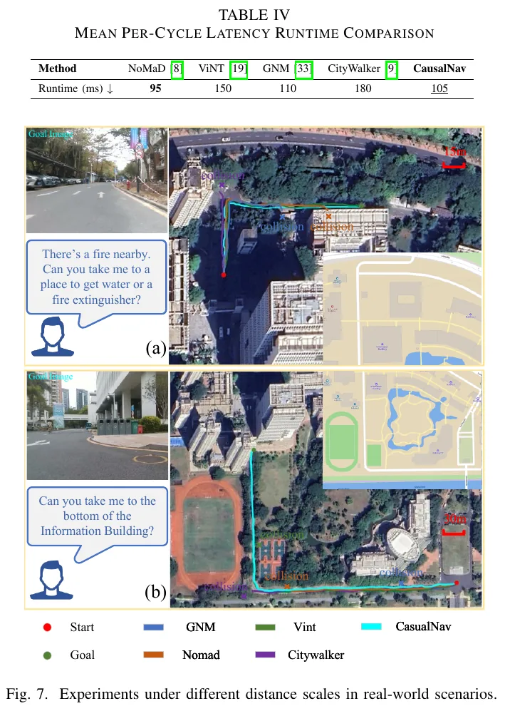
<figcaption>
真实环境中不同距离尺度的导航实验：短程（130m 对象级指令）与长程（512m 建筑级指令）
</figcaption>

**仿真实验**（对比 ViNT、NoMaD、GNM、CityWalker）：
- Small 任务：SR 100%，SPL 88.9%，CC 0.2（所有方法中最优）
- Medium 任务：SR 92%，SPL 82.2%
- Large 任务：SR 80%，SPL 66.0%，CC 1.2，TL 141.82m

**真实世界实验**：
- 短程（130m）：ViNT 和 CausalNav 均成功，其他方法失败
- 长程（512m）：仅 CausalNav 成功完成任务，其他方法因碰撞失败
- CityWalker 在真实世界表现显著差于仿真，对光照变化和动态障碍物敏感

**消融实验**：
- 启用 Embodied Graph 动态更新：SR 从 78% 提升至 90%，SPL 从 54.7% 提升至 80.1%
- 最优超参数：$\alpha=\beta=0.5$，$\gamma=1.5$（空间-语义平衡点）
- 运行时延：105ms/cycle（10Hz），比 NoMaD 仅多 11% 开销

---

### 4. 局限性
{: id="4-局限性-10"}

CausalNav 在极端光照/天气条件下的鲁棒性有待提升，且长程图记忆的压缩与遗忘机制尚未完善，可能在超长时间运行后出现图膨胀和检索精度下降问题。

## 3. DA-Nav (2026)
{: id="da-nav"}
———把地图方向落到图像网格，用偏航恢复数据训练城市导航的纠错能力

📄 **Paper**: [arXiv:2607.11638v2](https://arxiv.org/abs/2607.11638v2)

### 精华
{: id="da-nav-takeaways"}

1. 城市导航不一定要让大模型直接回归三维坐标：先在当前画面中选择可行走的网格，再由几何接口和控制器执行，可以把视觉判断与物理运动分开。
2. 只学正确示范不等于会纠错，ReDA 主动制造偏航、保留恢复过程，让策略见过“已经走歪之后该怎么办”。
3. 把输出约束为“是否偏航 → 正常或纠正动作 → 六个网格点”，提供的是有标签监督的决策分解，而不是额外调用一个通用模型自由推理。
4. 偏航频率与纠偏成功率必须分开看：很少偏航但偏一次就失败的策略，未必比经常能够自主恢复的策略更可靠。
5. 论文证明了仿真训练策略迁移到四足与人形平台的可行性，但实机闭环成功率为 46.7%，公里级展示不能替代多路线成功率或无人监督安全性证据。

---

### 1. 研究背景/问题
{: id="da-nav-background"}

商业地图可以规划城市路线，却通常只提供“前方左转”等面向人的稀疏指示，不能直接变成机器人的局部轨迹；让视觉语言模型直接回归连续三维航点又容易出现空间判断与动作表示不匹配的问题。长程执行中，小误差会把机器人带出训练示范覆盖的状态，单靠完美专家轨迹训练的策略往往不知道如何恢复。DA-Nav 因此同时改造动作表示和训练数据：用离散图像网格表达路径，用偏航恢复样本训练闭环纠错。

---

### 2. 主要方法/创新点
{: id="da-nav-method"}

  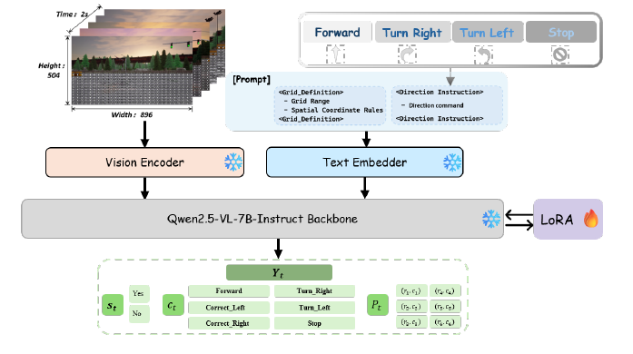
<figcaption>原文 Figure 2：历史视觉观测与方向指令进入 Qwen2.5-VL-7B，模型按顺序输出偏航判断、动作和图像网格轨迹；视觉编码器与基础模型权重冻结，通过 LoRA 适配导航任务。</figcaption>

**整体框架。** DA-Nav 由方向指令接口、结构化 VLM 策略、图像到机体坐标的几何投影，以及最远点跟踪控制器组成；ReDA 则为策略提供正常导航和偏航恢复两类监督。商业地图负责全局引导，模型判断当前画面里该走向哪里，几何模块把图像目标变成局部物理目标，控制器输出线速度和角速度。

**① 输入接口：消费离散方向，而不是直接理解整份地图。** 每步输入为当前帧及此前四帧组成的五帧第一视角 RGB 历史，以及 `FORWARD / TURN LEFT / TURN RIGHT / STOP` 四选一指令。真实部署中，手机连接商业导航工具，异步解析“30 米后左转”等导航信息并转成该离散指令；论文没有给出从距离提示切换到当前指令的完整阈值规则，不能把它解读为模型直接读取地图、GNSS 坐标或原始长路线文本。

**② 图像网格：先在画面上选位置，再交给几何模块落地。** 有效网格的行号为 13–23、列号为 0–28，排除天空与远处背景，保留机器人前方区域；共有 $11\times29=319$ 个候选单元。未来轨迹由六个网格位置组成，以 2 Hz 采样，覆盖未来 3 秒；它是图像平面上的离散位置序列，不是六条“前进/转弯”动作命令。

  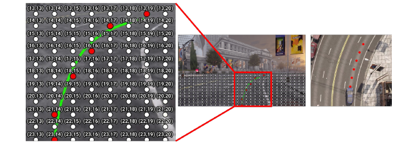
<figcaption>原文 Figure 3：在第一视角 RGB 图像上预测离散网格点，再通过几何投影得到机器人局部机体坐标系中的连续目标。</figcaption>

> **举个例子（仅示意接口，不代表论文中的实际预测）**：模型输出 `(22,14) → (20,14) → (18,15) → …`，含义是依次选择画面中的几个位置，不是让机器人前进 22 米、横移 14 米。近处和远处的同样一格，在地面上对应的距离不同；必须经过相机标定与深度或地面假设，才能得到米制航点。

这里的“有效网格”只是限制输出位置的范围，并不意味着其中每一格都已通过障碍物检测，被证明可以安全通行。

**③ ReDA：人为制造偏航，保留正确恢复过程。** 数据来自 CARLA 中 126 个场景、2,102 条轨迹，约含 **28.6 万个时序样本**，其中 15.8 万为专家导航帧、12.8 万为恢复帧。自动采集使用三个状态：

| 状态 | 采集过程 | 是否用于训练 |
|---|---|---|
| Stable | 跟踪专家路线 | 保留正常导航示范 |
| Drifting | 注入转向扰动，让机器人偏离路线 | 丢弃，避免学习扰动造成的不稳定运动 |
| Recovering | 横向误差达到 0.35 m 阈值后，启用恢复跟踪；前视距离随横向误差调整 | 保留纠偏示范 |

保留帧的方向指令根据转弯状态和运动状态合成；偏航标签来自采集状态机，纠正动作由横向偏差方向决定。未来专家三维航点经三次样条平滑、相机投影和网格离散化，形成轨迹监督，因此这不是没有标签的自发试错，也不是在线 DAgger：纠错样本在仿真采集阶段生成。

**④ 结构化 CoT：先判断偏航，再选动作，最后给出轨迹。** 模型采用 Qwen2.5-VL-7B-Instruct；视觉编码器提取历史观测，经轻量适配器映射到语言嵌入空间，再与方向指令一起输入。提示词规定网格范围和输出次序：

- **状态**：`Yes / No`，判断是否偏离参考路径。
- **动作**：`FORWARD / TURN LEFT / TURN RIGHT / CORRECT LEFT / CORRECT RIGHT / STOP`。
- **轨迹**：六个图像网格点。

其中纠正动作与路线转弯是不同的概念：地图仍要求直行时，机器人也可能需要先向左纠偏。训练时状态由采集系统提供标签，部署时则从视觉历史和指令预测，并非把真值横向误差送入策略。

> **举个例子**：当前地图指令是直行，但机器人已经偏到道路右侧。期望的输出可以是“偏航：Yes；动作：CORRECT LEFT；轨迹：逐步回到前方通道”。若只有“直行”动作标签而没有恢复数据，模型可能继续沿当前错误姿态前进；若只有轨迹而没有中间状态约束，模型也可能缺少稳定区分“转弯”和“纠偏”的监督。

**训练目标。** 将偏航状态、动作和网格点序列一起记为 $Y_t$，视觉历史与指令记为 $C_t$，采用自回归分解：

$$
\pi_\theta(Y_t\mid C_t)=\prod_{j=1}^{\lvert Y_t\rvert}p_\theta(y_t^{(j)}\mid y_t^{(<j)},C_t).
$$

对应的标准下一 token 交叉熵可写为：

$$
\mathcal L_{\mathrm{NTP}}=-\sum_t\sum_{j=1}^{\lvert Y_t\rvert}\log p_\theta(y_t^{(j)}\mid y_t^{(<j)},C_t).
$$

后一式是对原文“标准下一 token 预测目标”的展开，不是额外设计的损失。注意力模块使用 LoRA，视觉编码器和基础 LLM 权重冻结；论文未提供独立的碰撞损失、强化学习优化或各输出段的单独权重，也未详列学习率、LoRA 秩及训练轮数。

**⑤ 几何投影：RGB 策略不等于整个系统永远不需要深度。** 当深度可靠时，根据相机内参和局部深度统计，将图像目标投影到机体坐标系；深度不可靠时，退回平地假设下的逆透视映射（IPM）。因此可以说策略使用 RGB 输入，但不能把整个执行链路表述成无深度、无几何假设；坡面、起伏地形等场景下的 IPM 适用性也需要另行验证。

**⑥ 最远点控制：不逐个追踪六个点，而是朝最远预测目标走。** 为减轻自回归推理延迟和预测抖动，控制器选择预测序列最后一个航点作为当前追踪目标，依据目标方位计算受限角速度：

$$
\omega_z=\operatorname{clip}\!\left(k_{\mathrm{steer}}\operatorname{atan2}(y_{\mathrm{target}},x_{\mathrm{target}}),-\omega_{\max},\omega_{\max}\right).
$$

其中 clip 表示将角速度限制在给定上下界，与原文的饱和算子等价。角速度较小时使用正常线速度，超过阈值时降低线速度；即“转得越急，走得越慢”。这减少了稠密点跟踪的短时波动，但不是对完整预测路径逐段执行的碰撞保证。

端到端执行顺序为：**手机方向指令 + 五帧 RGB → 偏航判断与动作 → 六个图像网格点 → 深度/IPM 投影 → 最远点追踪 → 线速度与角速度**。实机推理运行在远程 RTX 4090，而非机器人完全板载执行；论文没有给出明确的端到端延迟与闭环频率数值。

---

### 3. 核心结果/发现
{: id="da-nav-results"}

**① 仿真全量评测：59.00% 是混合城镇结果，56.16% 才是摘要中的未见城镇结果。** CARLA 0.9.15 中，Town 01–05、10HD 用于训练和域内评测，Town 06、07、15 留作零样本泛化；采集与评测引入动态车辆、行人、随机天气和光照。Table II 在已见与未见城镇混合的 **239 条闭环轨迹**上比较：

| 方法 | SR（%）↑ | RC（%）↑ | SPL ↑ | DF ↓ | CSR（%）↑ |
|---|---:|---:|---:|---:|---:|
| CityWalker | 38.08 | 70.79 | 37.48 | 2.96 | 30.73 |
| ViNT | 51.88 | 74.44 | 51.33 | 1.25 | 23.54 |
| NaVid | 20.50 | 66.33 | 20.50 | 0.61 | 4.89 |
| NaVILA | 22.59 | 79.49 | 22.59 | 0.39 | 4.90 |
| 零样本 Qwen2.5-VL | 11.30 | 43.21 | 11.30 | 3.42 | 42.76 |
| **DA-Nav** | **59.00** | **77.82** | **58.66** | **1.85** | **98.15** |

SPL 沿用原表数值尺度。DA-Nav 相比 ViNT 的 SR 提升 **7.12 个百分点**，但 RC 不是最高，DF 也不是最低；不能将“整体优势”写成所有指标第一。

**比较条件。** DA-Nav 在 CARLA 的 ReDA 上训练，而基线采用各自公开预训练权重、未针对该环境微调；ViNT 接收前方 5 m 的局部目标图像，CityWalker 接收稀疏航点，NaVid 与 NaVILA 使用统一视觉历史及低层比例控制，并依赖视觉识别语义终点停车。零样本 Qwen2.5-VL 则在相同框架中替换策略；这些是经过接口适配的系统级比较，不是同训练数据、同路线先验的纯骨干模型对照。

  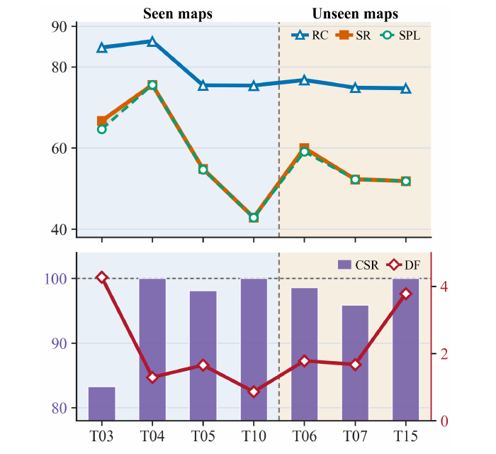
<figcaption>原文 Figure 5：分城镇报告导航指标和偏航恢复表现；应区分已见与未见环境，不将混合 239 条轨迹的结果当作纯未见场景成绩。</figcaption>

**② 读懂恢复指标：CSR 不是任务成功率。** DF 统计每行驶 100 m 出现多少次新偏航事件；从正常状态首次超过安全横向误差阈值，才计一次事件，而不是连续偏航的每一帧都计数。CSR 是这些事件中无碰撞回到阈值内的比例，分母是偏航事件数，不是任务数。

> **举个例子（指标示意）**：机器人累计行驶 1,000 m，发生 20 次偏航，18 次无碰撞恢复，则 DF 为 2 次/100 m，CSR 为 90%。但它仍可能转错路口或没有正确停车，因此不能由 CSR 推出整条路线的成功率。

**③ 消融说明恢复数据与结构化推理分别有贡献。** 同样在 239 条轨迹上：

| 变体 | SR（%）↑ | RC（%）↑ | SPL ↑ | DF ↓ | CSR（%）↑ |
|---|---:|---:|---:|---:|---:|
| 去掉恢复数据 | 29.71 | 62.01 | 29.68 | 1.31 | 15.46 |
| 去掉 CoT 推理提示 | 38.91 | 68.37 | 38.91 | 4.30 | 50.11 |
| 完整 DA-Nav | 59.00 | 77.82 | 58.66 | 1.85 | 98.15 |

去掉恢复数据后，DF 反而更低，但 CSR 从 98.15% 降至 15.46%，说明“偏得少”不代表“偏了能回来”。去掉 CoT 后直接预测空间目标，SR 下降 20.09 个百分点；不过移除恢复样本同时减少了训练数据量，论文没有报告等规模替代数据消融，不能把全部差异都归结为数据语义而排除数量因素。

**④ 实机：单动作、长程闭环和公里级展示是三组证据。** 系统使用前向 RealSense D455、手机商业导航和远程 RTX 4090 推理，未经真实世界微调部署到 Unitree Go2 与 Leju Kuavo-V。

- **单动作评测（原文称 open-loop）**：36 个路口，直行、左转、右转各 12 次，每例只运行一次；DA-Nav 三项 SR 为 100%、75%、75%，平均 **83.3%**，CityWalker 为 75%，ViNT 为 58.3%。这不是长程任务成功率。
- **完整闭环评测**：城市街道、公园各选五条超过 100 m、至少含一次转弯的路线，每条重复三次，共 30 次试验/方法。下表沿用 Table V：

| 方法 | 城市 SR（15 次） | 公园 SR（15 次） | 总体 SR（30 次） | 总体 RC |
|---|---:|---:|---:|---:|
| CityWalker | 20.0% | 26.7% | 23.3% | 53.3% |
| ViNT | 13.3% | 20.0% | 16.7% | 49.0% |
| DA-Nav | **40.0%** | **53.3%** | **46.7%** | **76.3%** |

  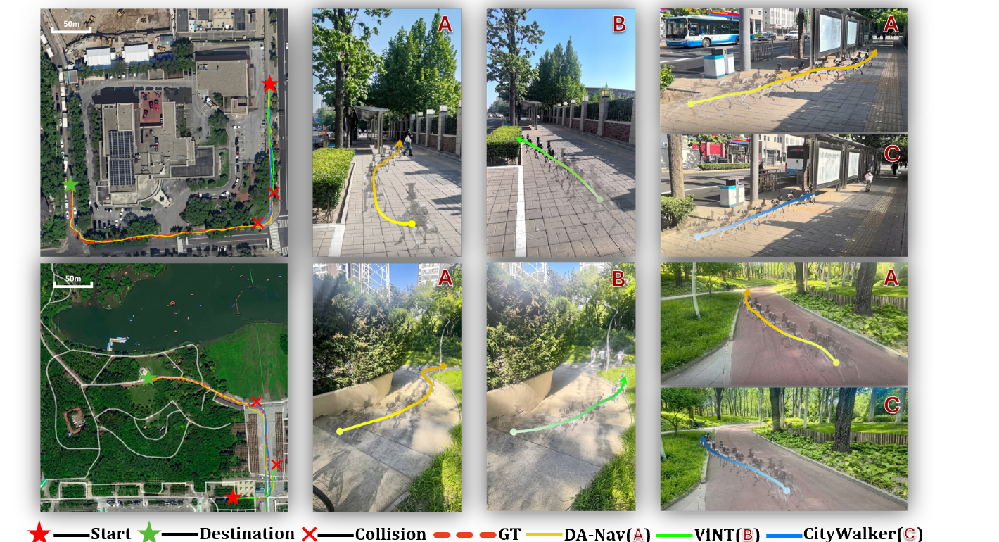
<figcaption>原文 Figure 4：城市街道与公园中的闭环路线对比，展示 DA-Nav、ViNT 与 CityWalker 的执行轨迹；红叉标出碰撞，定量成功率以 Table V 的 30 次试验为准。</figcaption>

- **跨平台长程展示**：作者报告相同预训练策略无具身专项微调迁移到 Leju Kuavo-V，完成超过 **1.2 km** 的室外目标导航。原文没有给出这一公里级展示的独立重复试验统计或完整人工干预记录，不能据此声称所有公里级路线都能无人监督成功。

  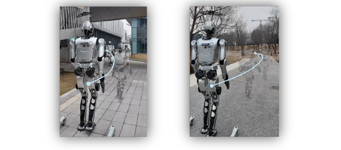
<figcaption>原文 Figure 8：Leju Kuavo-V 人形机器人在城市与公园的零样本部署，作者报告超过 1.2 km 的长程导航；该展示与 30 次闭环评测的统计口径不同。</figcaption>

---

### 4. 局限性
{: id="da-nav-limitations"}

系统仍依赖商业地图、手机定位与方向更新、远程推理，以及可靠深度或平地投影假设，原文没有充分量化网络延迟、GNSS 误差与起伏地形对闭环执行的影响。实机统计只有 30 次长程试验、总体 SR 为 46.7%，且未充分交代成功判定细节和公里级展示的人工介入情况，因此现有结果支持方向落地与纠偏机制的有效性，尚不足以证明普遍城市交通安全或无人监督的公里级可靠部署。

## 4. CityWalker (2025)
{: id="citywalker"}
———用网络步行视频学习城市局部导航，而不是让大模型直接开机器人

📄 **Paper**: [arXiv:2411.17820v3](https://arxiv.org/abs/2411.17820v3) · [项目主页](https://ai4ce.github.io/CityWalker/)

### 精华
{: id="citywalker-takeaways"}

1. 网络视频没有机器人动作标签，但短窗口视觉里程计可提供局部运动伪标签；全局轨迹有漂移不代表所有短程监督都不可用。
2. 把步长归一化后，人走路、车辆行驶和机器人的运动能共享部分方向模式，但部署时仍需恢复目标机器人的尺度。
3. CityWalker 是位置目标条件策略，不是原生语言指令跟随模型；研究重点是两个地图航点之间的城市执行。
4. 离线轨迹误差、到达分类准确率和真实导航成功率必须分开，不能从其中一项推出另外两项。

---

### 1. 研究背景/问题
{: id="citywalker-background"}

地图能提供下一段应该到达的位置，却不能替机器人处理行人、路口和绕行。真实城市遥操作数据昂贵，仿真也难完整覆盖交通与社会规则，论文因此从大规模网络步行视频中学习局部导航，再用少量机器人数据适配。

---

### 2. 主要方法/创新点
{: id="citywalker-method"}

  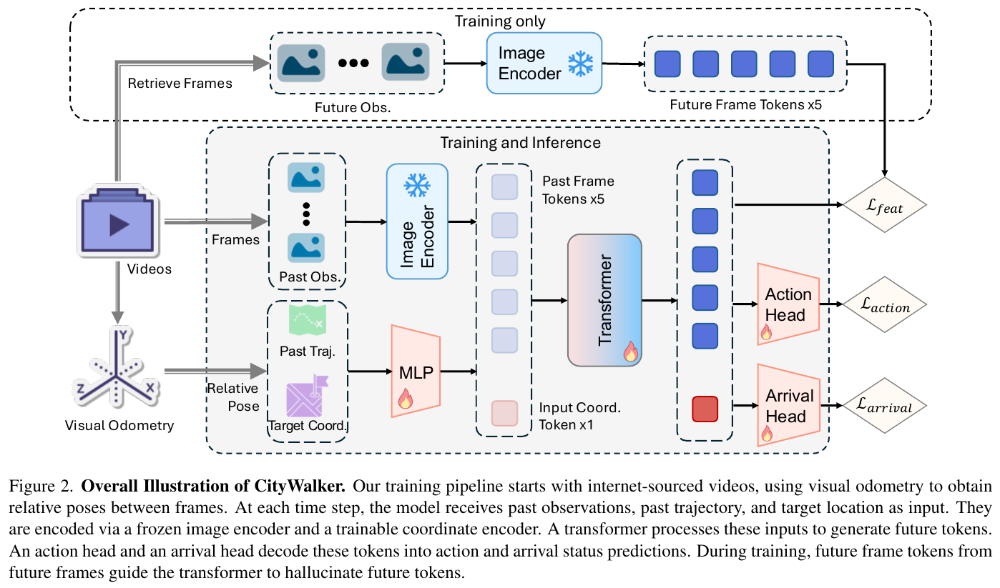
<figcaption>原文 Figure 2：视觉里程计产生运动监督；历史图像与位置目标进入 Transformer，动作头与到达头输出局部决策，未来图像特征仅在训练时提供辅助监督。</figcaption>

**整体框架。** 数据端由视频、视觉里程计和步长归一化组成；策略端由冻结的 DINOv2、坐标编码器、Transformer、动作头和到达头组成。部署时外部导航工具提供航点，模型预测局部运动，PD 控制器转换成速度命令。

**① 从视频取得可用的局部监督。** DPVO 估计相机位姿；策略使用短窗口相对运动而不是跨整个视频的绝对位置，以降低累计漂移影响。原文以五步历史和五步未来为典型设置，网络步行视频超过 2,000 小时，并研究驾驶视频与步行视频混合训练。

**② 解决尺度与构型差异。** 单目里程计存在尺度歧义，因此用轨迹平均步长归一化动作；部署时根据机器人步长反归一化。这是动作尺度接口，不是证明所有机器人都可直接执行同一物理轨迹。

> **例子（仅解释归一化）**：人的一步为 0.6 m、机器人的一步为 0.3 m，两者沿前方走一步都可以编码为一个归一化单位。模型学习方向与相对行进模式，真正执行多远仍由机器人尺度决定。

**③ 策略输入与输出。** 历史 RGB 经冻结 DINOv2 得到视觉 token；历史位置与当前目标位置拼接后经 MLP 编成坐标 token。Transformer 融合两类信息，动作头输出未来局部航点，到达头判断当前子目标是否完成。它不直接读取自然语言，也不能自行替代全局路由。

**④ 训练时预测未来特征。** 用真实未来帧的视觉特征监督 Transformer 输出，鼓励内部表示包含即将出现的场景信息；推理不输入未来帧。总目标可按原文四项简写为：

$$
L=w_1 L_{\mathrm{pos}}+w_2 L_{\mathrm{ori}}+w_3 L_{\mathrm{arr}}+w_4 L_{\mathrm{feat}}.
$$

四项分别为航点 L1、负余弦方向损失、到达二分类交叉熵、未来特征 MSE；权重用于让量级接近。这是模仿学习加辅助监督，不是在线 RL，也不是生成视频后搜索行动。

**⑤ 实机适配。** 使用 Unitree Go1、RGB 摄像头与手机定位；采集阶段通过 LiDAR-SLAM 获得机器人轨迹监督。15 小时遥操作数据分成 6 小时微调和 9 小时离线测试。传感器用于标签采集、定位还是策略输入必须分别说明，不能统称“纯视觉无定位”。

---

### 3. 核心结果/发现
{: id="citywalker-results"}

**实机结果（原文 Table 2，%）。** 在未见城市环境测试，目标通常距起点 50–100 m，直行、左转、右转各类进行 8–14 次试验；模型在目标 5 m 内预测到达才计成功，潜在碰撞或超时引起的人工接管计为失败。

| 方法 | 总体 SR | 直行 | 左转 | 右转 |
|---|---:|---:|---:|---:|
| ViNT 零样本 | 37.7 | 62.5 | 0.0 | 50.0 |
| ViNT 微调 | 57.1 | 100.0 | 25.0 | 25.0 |
| NoMaD 零样本 | 42.9 | 75.0 | 16.7 | 28.6 |
| CityWalker 微调 | 77.3 | 100.0 | 62.5 | 66.7 |

这里的 77.3% 属于原文实机协议，不能与 DA-Nav 或 WayTrace 对 CityWalker 的重新适配测试直接合并。本文基线的目标接口、训练数据与微调状态也不完全一致。

**离线结果不能当作任务 SR。** Table 1 中微调 CityWalker 的场景平均 MAOE 为 15.2°、到达分类准确率为 81.8%；按全部样本平均则分别为 11.5°、87.8%。MAOE 对每个样本取未来步中最大的方向误差，再跨样本平均；场景平均则防止大量简单直行样本掩盖困难路口。其全样本 L2 为 1.07 m，并非优于所有基线，不能复述成每项指标都第一。

  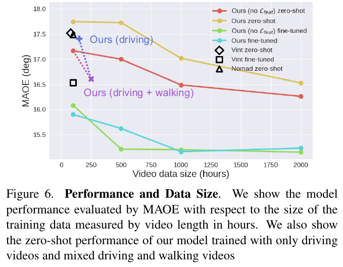
<figcaption>原文 Figure 6：增加网络视频数据总体降低方向误差，并比较步行、驾驶数据与微调设置；纵轴是离线 MAOE，不是闭环成功率。</figcaption>

数据规模实验支持扩大训练覆盖。Table 3 中方向损失和未来特征监督的增益很小，作者明确指出处于有限测试数据的误差范围内；未来特征监督在零样本迁移中甚至可能有负作用，而微调收益更明显，不能把辅助监督写成已确证的大幅独立增益。

---

### 4. 局限性
{: id="citywalker-limitations"}

系统依赖外部位置目标、定位和尺度适配，训练视频中的人类行为也不自动符合机器人的通行约束。真实实验覆盖与基线条件有限，离线角度优势不足以证明长期交通安全；本地 PDF 未明确标注会议录用信息，因此此处只按论文版本引用。

## 5. UrbanNav (2026)
{: id="urbannav"}
———先筛掉机器人无法模仿的人类视频，再让地标语言监督局部轨迹

📄 **Paper**: [arXiv:2512.09607v2](https://arxiv.org/abs/2512.09607v2) · [Code](https://github.com/CASIA-IVA-Lab/UrbanNav)

### 精华
{: id="urbannav-takeaways"}

1. 人类步行视频不天然适合机器人：转头、俯仰和密集穿行会把相机朝向与可执行运动混在一起，数据筛选本身是关键设计。
2. VLM 主要用于离线地标标注与指令生成；在线策略是 CLIP、DINOv2 与 Transformer，不应写成大模型每步自由推理。
3. 地标条件局部导航与长距离未知目标搜索不同，目标被遮挡或不在初始视野时，性能明显下降。
4. 网络视频预训练后仍使用少量真实数据微调，不能将结果归为完全零样本部署。

---

### 1. 研究背景/问题
{: id="urbannav-background"}

真实城市用户更常说“去右侧玻璃建筑前”，而不是提供精确坐标或目标图片。UrbanNav 从网络步行视频建立语言、地标与运动轨迹对应关系，并过滤不适合前向固定相机机器人的片段，以降低数据采集成本。

---

### 2. 主要方法/创新点
{: id="urbannav-method"}

  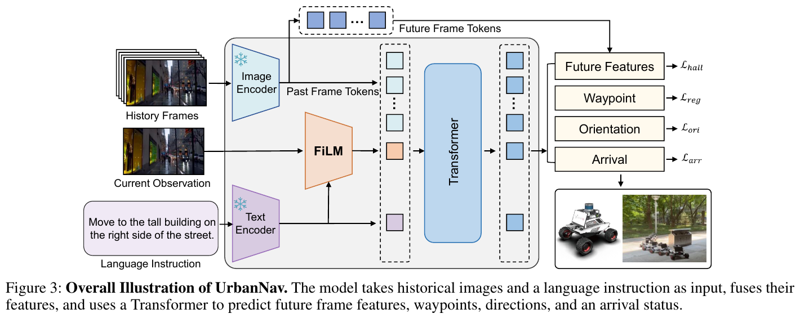
<figcaption>原文 Figure 3：语言调制当前视觉特征，历史视觉与指令进入 Transformer，再预测未来航点、方向、到达状态及辅助未来特征。</figcaption>

**整体框架。** 离线数据流水线负责轨迹估计、机器人兼容性筛选与地标语言标注；在线策略负责把指令和视觉历史变成未来八步局部航点，并预测是否到达目标。

**① 轨迹估计与筛选。** 视频划分为两分钟片段，用 DPVO 获得相对位姿。原文报告有位姿轨迹 106,603 条、3,553 小时；经过筛选保留 47,008 条、1,566 小时，不能把原始与最终规模混为同一个数字。

筛选包括俯仰变化超过 15°、运动与观察方向偏差超过 60°，以及同帧超过五人且在多于三帧持续出现的拥挤情况。后者是作者采用的机器人兼容性启发式，不代表所有密集行人环境都不可通行，也会缩小训练覆盖。

  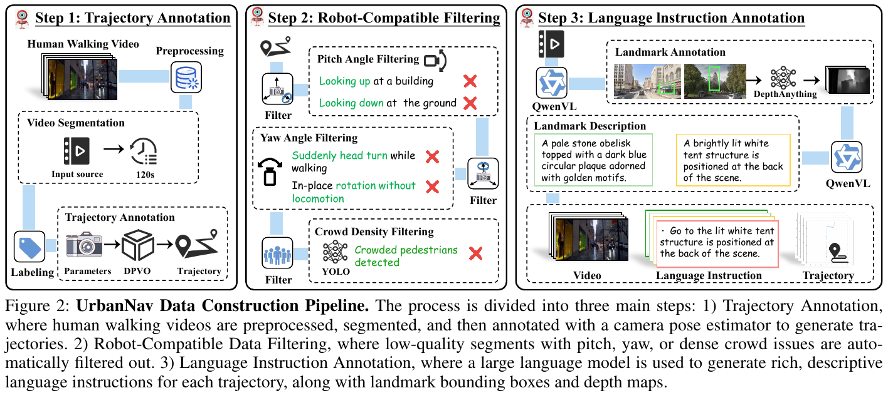
<figcaption>原文 Figure 2：位姿估计、相机朝向与人群过滤、地标及语言标注组成数据流水线。标注生成模型与部署策略不是同一个模型。</figcaption>

**② 生成可落地的地标指令。** Qwen2.5-VL-72B 找出轨迹附近、可辨认且稳定的地标，输出框与名称，再生成描述性导航语言；行人和车辆等动态实体不作为稳定目标。原文明确有人工复核低置信度和歧义标注，因此不能称为全程零人工。最终约 300 万条地标标注，每条轨迹平均 65 个地标，描述平均 17 词。

**③ 语言如何影响视觉。** 冻结的 CLIP 编码指令，冻结的 DINOv2 编码当前和历史帧；FiLM 用语言特征调制当前视觉特征，再把它们与历史视觉、语言 token 一起交给 Transformer。

> **例子（机制示意）**：同一画面里有塔和亭子。“去白塔前”与“去亭子下”的区别，不是替换地图坐标，而是语言条件改变当前图像特征的权重，再影响预测轨迹。FiLM 是特征调制，不是显式生成可解释的目标检测框。

**④ 监督与目标采样。** 每个样本选择轨迹中的一个地标，在目标时刻前 10–60 帧采样起点，并加入接近目标时刻的到达样本。策略历史上下文参数为八步，预测未来八步；原文索引记法与“历史加当前帧”容易混淆，不将其扩写成未核实的固定输入总帧数。

训练目标按原文简写：

$$
L=\lambda_1 L_{\mathrm{reg}}+\lambda_2 L_{\mathrm{ori}}+\lambda_3 L_{\mathrm{arr}}+\lambda_4 L_{\mathrm{hall}}.
$$

分别监督航点 L2 误差、负余弦方向误差、到达二分类交叉熵和未来特征 L1 误差。未来真实观测仅提供训练标签，不是部署时可访问的输入。Figure 1 说明使用约两小时真实专家数据微调，因此不是纯网络视频零样本实机策略。

---

### 3. 核心结果/发现
{: id="urbannav-results"}

**未见场景离线评测（Table 1）。** UrbanNav 的 AOE 9.22°、MAOE 14.99°、ADE 0.88 m、MADE 1.67 m；对应 LeLaN 为 10.36°、16.49°、0.98 m、1.84 m。原文将 MADE 描述为离散 Fréchet 距离，不能仅根据缩写将其改写成普通最大逐点欧氏误差。

**实机评测（Table 2，%）。** 成功指无碰撞到达指定地标，以下数字不与其他论文的不同路线合榜。

| 方法 | 总体 SR | 白天 | 夜间 |
|---|---:|---:|---:|
| UrbanNav，仅真实数据 | 33.4 | 41.7 | 25.0 |
| NoMaD + CLIP | 29.2 | 33.4 | 25.0 |
| ViNT + CLIP | 45.8 | 50.0 | 41.7 |
| LeLaN | 62.5 | 75.0 | 58.3 |
| UrbanNav，网络预训练 + 微调 | 83.3 | 91.7 | 75.0 |

**比较条件。** NoMaD、ViNT 新增 CLIP 语言输入与融合层，LeLaN 的速度输出头改为航点回归；这些是适配后的基线，不是原发布模型原封不动部署。表内 LeLaN 分项与总体数字也不宜在未知样本权重下自行重算，保留原文并注明未报告充分试验明细。

  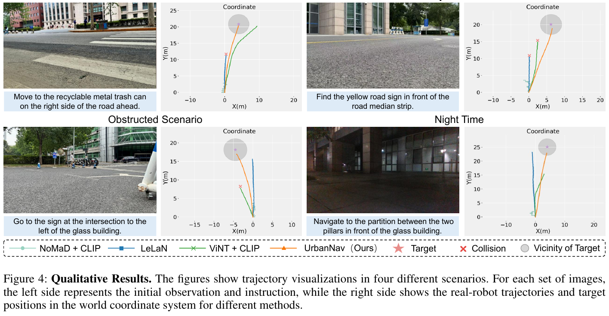
<figcaption>原文 Figure 4：正常、含噪语言、遮挡与夜间场景的轨迹比较；图示与定量表应分别阅读，不从少量成功轨迹推断普遍可靠性。</figcaption>

Table 3 中正常、含噪语言、遮挡目标 SR 分别为 100%、87.5%、62.5%。作者将该策略定位为局部导航而非长期探索，这比简单说“支持任意城市语言任务”更准确。Table 4 的未见环境消融与数据扩展实验支持 FiLM、未来特征监督及网络预训练的贡献，但不是统一训练预算下所有设计的完全因果隔离。

---

### 4. 局限性
{: id="urbannav-limitations"}

局部语言目标策略仍难处理初始不可见目标的长期搜索；筛掉拥挤和视角异常片段也可能留下部署盲区。PDF 对实机试验总数、路线长度、控制频率及人工干预细则交代不足，不能据成功率反推试验数；论文版本未在 PDF 中明确标注录用处，此处不添加会议标签。

## 6. MOSU2 (2026)
{: id="mosu2"}
———先筛出物理上能走的轨迹，再按需查证交通与社会情境

📄 **Paper**: [arXiv:2611.11148v1](https://arxiv.org/abs/2611.11148v1) · [前置 MOSU](https://arxiv.org/abs/2507.04686v1) · [项目主页](https://jinggm.github.io/mosu2/)

### 精华
{: id="mosu2-takeaways"}

1. “可通行”与“此刻应该通行”是两层判断：平整路面可能正在亮红灯，避开行人也不等于理解停车手势。
2. 给 VLM 查询真实几何与运动的接口，比要求它从一张图猜距离、速度更容易核查。
3. 按需深推理仍有代价，第二阶段减少了错误行动，却使平均决策时延约增至前代的 2.2 倍。
4. 识别出施工区不等于知道从哪边走；场景识别准确率和任务成功率必须独立报告。

---

### 1. 研究背景/问题
{: id="mosu2-background"}

户外机器人既要沿公共地图走向远处目标，又要判断车辆是否让行、手势是否要求停车、施工区域是否限制通行。前代 MOSU 用单张 RGB 图像评估轨迹，缺少可靠运动证据；MOSU2 增加可查询局部地图与条件触发的第二阶段推理。

---

### 2. 主要方法/创新点
{: id="mosu2-method"}

  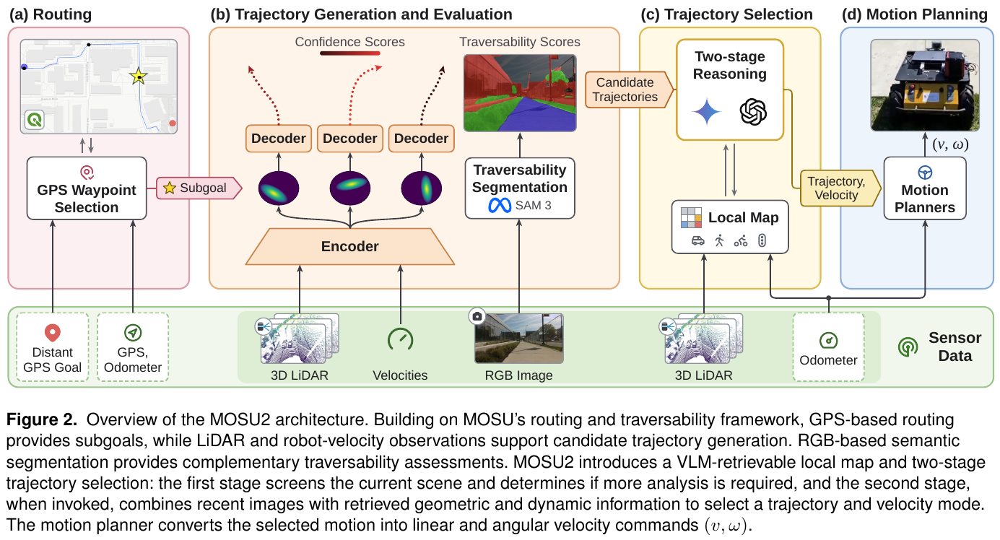
<figcaption>原文 Figure 2：公共地图路由、几何与语义候选轨迹筛选、两阶段情境推理、运动控制相互分工；新引入的局部地图为推理提供实测位置与运动信息。</figcaption>

**整体框架与前代边界。** MOSU 将地图路由、LiDAR 条件轨迹生成、语义通行判断和单次 VLM 评分结合；MOSU2 保留路由与候选轨迹能力，改为先过滤不可通行候选，再按需检索动态证据决定轨迹和速度模式。它不是端到端语言到关节动作模型，也不以自由路线语言为唯一任务输入。

| 环节 | MOSU | MOSU2 |
|---|---|---|
| 物理约束 | 几何、语义、VLM 排序与目标进度加权 | 几何与语义先过滤候选 |
| 情境判断 | 单张图像、一次 VLM 查询 | 首阶段筛查，必要时再用连续图像与地图证据 |
| 动态信息 | 单帧难以可靠判断速度 | 查询局部地图中的对象位置和运动估计 |

**① 地图只给粗方向。** OpenRouteService 等服务提供 GPS 路由，子目标约间隔 35 m，经 UTM 与 GPS—里程计对齐转换到局部坐标；距离小于 15 m 时推进到下一子目标。因为 GPS 有米级误差，子目标是前进方向参考，不是必须精确踩到的地面坐标。

**② 先产生并筛选轨迹。** 继承的 MTG/CVAE 接收 LiDAR 序列与历史速度，从潜变量分布采样生成多个候选，并提供几何置信度。SAM3 语义分割补充道路、人行道、植被、建筑和台阶等类别，根据机器人能力设置可行区域。沿轨迹投影像素统计语义可通行比例，与几何置信度组合：

$$
k_i=\beta_1 c_i+\beta_2 s_i,\qquad \text{保留条件： }k_i>k_{\min}.
$$

这是原文候选过滤式的简写，不是导航成功概率，也不是形式化碰撞安全证明。

**③ 地图提供哪些可查询证据。** RGB 开放词汇分割得到对象掩码；标定后的 LiDAR 投影关联到掩码，再变换到共同里程计坐标，避免把机器人自身运动当成物体运动。系统保存半径 20 m、分辨率 0.2 m 的局部地图，实验更新频率 2 Hz；按同类别近邻关联相邻时刻区域，用位置变化除以时间间隔估计速度。没有有效点云支持时不给米制位置，没有可靠对应时把速度标为未知，而不是默认物体静止。

  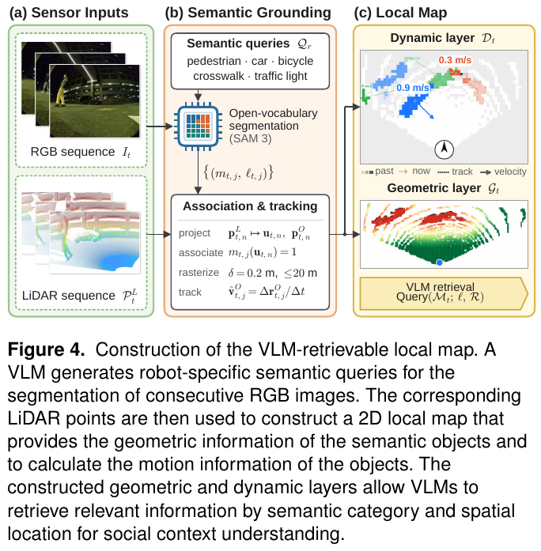
<figcaption>原文 Figure 4：分割、点云关联与跨帧跟踪生成几何层和动态层，VLM 可按语义类别与空间区域请求证据。</figcaption>

**④ 两阶段决策。** 首阶段根据当前图像、目标方向和候选轨迹筛查情境；若无需补证据，直接选择轨迹与正常、慢速或停止模式。若存在未解决问题，则输出需要调查的对象和信息；第二阶段读取最近五帧 RGB（0.2 s 采样间隔）及地图查询结果，再决定最终运动。原文称覆盖 1 s；严格按五个采样时刻算首尾跨度为 0.8 s，这里不混用采样窗口与首尾时差。

> **例子（流程示意）**：左边一辆车靠近路口，单帧只能看到“有车”。首阶段请求车的位置与运动，第二阶段把测量到的减速趋势、车道关系和灯号一起考虑，再决定等待还是通过。减速本身不证明驾驶员一定让行，因此仍不能用一个速度值替代情境判断。

**⑤ 学习与执行职责。** 本文新增贡献是推理与信息获取架构，不报告新端到端联合训练损失；CVAE 轨迹生成器等继承已有学习模块，不能称整个系统完全无训练。轨迹生成和运动规划分别运行于 20 Hz、50 Hz，VLM 使用云端 API，其秒级决策延迟不能与低层控制频率混为一谈。

---

### 3. 核心结果/发现
{: id="mosu2-results"}

**MOSU2 新实验（Table 2）。** 使用 Husky、Go2、Diablo 三类平台，具备 RGB、3D LiDAR、GPS；下面是五类场景的结果，不是统一长距离路线榜单。

| 场景 | MOSU SR（%） | MOSU2 SR（%） | MOSU 延迟（s） | MOSU2 延迟（s） |
|---|---:|---:|---:|---:|
| 停车手势 | 61 | 71 | 1.51 | 2.52 |
| 施工区域 | 50 | 100 | 1.68 | 5.16 |
| 信号灯路口 | 42 | 100 | 1.90 | 4.72 |
| 与车辆/自行车/行人共享道路 | 56 | 100 | 1.79 | 4.95 |
| 普通人行道 | 100 | 100 | 1.74 | 1.80 |
| 五组非加权平均 | 61.8 | 94.2 | 1.72 | 3.83 |

成功要求无碰撞、无人工介入且符合场景行为约束；该通行却一直停止同样算失败。94.2% 是**五个场景组的非加权平均**，不是所有试验合并后的成功率；组内样本有限，作者也未将差异表述为统计显著结论。

  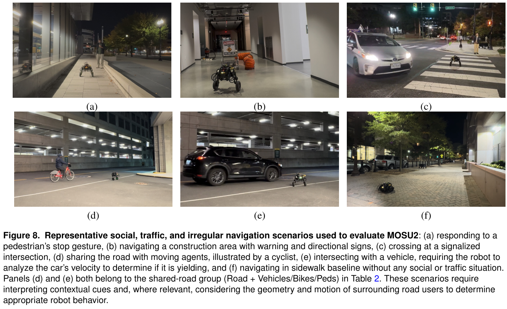
<figcaption>原文 Figure 8：手势、施工、信号灯与道路交互等场景；其中车辆与自行车示例属于同一个共享道路组，不能按六个子图误算六类试验。</figcaption>

条件识别准确率按**决策步**统计，平均从 72.2% 到 91.4%；施工组两者都为 100% 识别，但 SR 从 50% 到 100%，说明认出场景不代表作出正确动作。普通人行道识别准确率反而从 100% 降到 86%，不能声称所有识别项都提高。

**继承的 MOSU 结果单列。** GND 数据上的可通行性为 77%，相对 PIVOT 70% 提高 7 个百分点（相对 10%），这是轨迹航点可通行比例，不是任务 SR，也不是 MOSU2 新增模块的消融收益。MOSU2 未充分分离时序图像、地图检索、提示词与额外计算各自的独立贡献。

---

### 4. 局限性
{: id="mosu2-limitations"}

系统依赖传感器标定、GPS、语义分割、简单跨帧关联及云端网络，复杂交互决策可耗时约五秒；动态测量不等于可靠意图识别。小规模场景组实验和前代系统比较不能证明一般交通安全，PDF 的期刊模板占位页眉也不能作为已发表期刊的证据。

## 7. LM-Nav (2022)
{: id="lm-nav"}
———语言提地标，视觉找节点，图搜索决定路线，导航策略负责执行

📄 **Paper**: [arXiv:2207.04429v2](https://arxiv.org/abs/2207.04429v2) · [项目主页](https://sites.google.com/view/lmnav)

### 精华
{: id="lm-nav-takeaways"}

1. 大语言模型不必直接输出控制动作：把语言、图像和运动分别交给擅长的预训练模块，接口设计本身就能构成导航系统。
2. 地标不能逐个独立检索，必须结合访问顺序与连通代价，否则最像“停车牌”的图像可能属于错误路线。
3. 无额外微调不等于无环境准备；LM-Nav 先在目标环境采集图像与 GPS，构造拓扑图，再执行指令。
4. 规划成功与完整执行成功不是同一指标，原文表格和叙述存在数字差异时应保留并注明，而不是选更好看的数值。

---

### 1. 研究背景/问题
{: id="lm-nav-background"}

图像目标导航策略可以从无语言轨迹学习，但让用户提供目标图像很不自然。LM-Nav 不重新收集语言标注机器人数据，而是把 GPT-3、CLIP 与 ViNG 连接起来，让用户以自然语言指定经过哪些地标。

---

### 2. 主要方法/创新点
{: id="lm-nav-method"}

  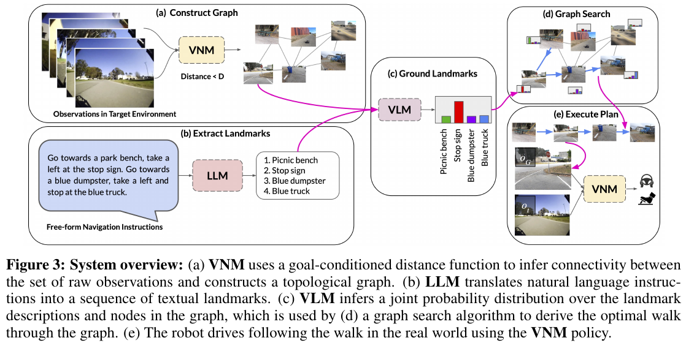
<figcaption>原文 Figure 3：先由环境图像建立拓扑图，再提取语言地标、进行视觉匹配与图搜索，最后用视觉导航模型执行节点序列。</figcaption>

**整体框架。** GPT-3 将路线语言转为有序地标；CLIP 给出地标与图像节点的匹配分数；ViNG 提供节点间时间距离和图像目标条件动作；图搜索联合决定地标落在哪些节点及怎样连接。模块权重在实验中冻结，没有新增端到端训练损失。

**① 先有环境图，再执行指令。** 人工驾驶机器人采集图像和 GPS。每个图节点保存观测，边结合 ViNG 学习距离、采集时间邻近性与 GPS 空间邻近性建立，边权反映预计通行步数。它不是部署后从完全未知环境凭语言自行探索。

**② GPT-3 提取有序地标。** 提示中提供三个地标提取示例，得到“白色建筑 → 白色卡车 → 停车牌”等列表。复杂语言仍依赖提示设计；抽取顺序不等于保留了原指令的一切方向、安全与关系约束。

**③ CLIP 输出候选而非直接选终点。** 图像与地标文本嵌入的相似度，经归一化形成节点匹配分布。检索对象是图中的历史观测，不是实时物体检测框；软匹配保留多个可能地标，以供路径推理消歧。

**④ 图搜索联合考虑语义和路程。** 原文将整条路径的可通行折扣与有序地标匹配结合，取对数后可写成：

$$
R=\sum_{i=1}^{n}S(v_{t_i},\ell_i)-\alpha\sum_{j=1}^{k-1}D(v_j,v_{j+1}),\qquad t_1\leq\cdots\leq t_n.
$$

这里用 $S$ 简记 CLIP 分数，$D$ 是 ViNG 预测的时间距离，$\alpha$ 控制路程代价。动态规划状态记录“已经匹配前几个地标、当前到哪个节点”，并通过类似 Dijkstra 的传播找到最优节点序列；不是每个地标各自取最高 CLIP 分数后随意连线。

> **例子（仅说明联合选择）**：路线旁的停车牌匹配分数为 0.8，另一条远路上的牌为 0.9。独立检索会选后者；联合搜索还考虑从上一地标走过去的代价和之后的连通关系，因此可能选 0.8 的近处牌。这些示意分数不是论文实际概率或实验数值。

**⑤ 规划后由 ViNG 执行。** Clearpath Jackal 依次追踪图像子目标；LLM/VLM 查询在远端工作站预计算，路径无线下发，视觉导航模型在机器人端运行。系统配备前后 RGB、GPS、IMU 与轮编码器，执行策略使用前向 RGB 和未经滤波的 GPS。不能将其描述为每帧在线调用 GPT-3 的交互式 Agent。

---

### 3. 核心结果/发现
{: id="lm-nav-results"}

20 条自然语言查询覆盖两个环境，总路程超过 6 km，目标最远约 800 m。原文 Table 1 将规划成功率、执行效率、人工接管与净成功率分开报告：

| 配置 | 环境 | Net Success | 执行效率 | 平均接管次数 | Planning |
|---|---|---:|---:|---:|---:|
| GPS-Nav，无 ViNG 执行 | EnvSmall-10 | 0.23 | 0.93 | 0.75 | 0.90 |
| LM-Nav | EnvSmall-10 | 0.80 | 0.96 | 0.10 | 0.90 |
| LM-Nav | EnvLarge-10 | 0.80 | 0.89 | 0.00 | 0.80 |

**版本内数字差异。** v2 正文叙述称 85% 实验可成功跟随指令，但 Table 1 两组 Net Success 均为 0.80；两组 Planning 为 0.90 和 0.80，其均值为 0.85。这里只指出表格与文字口径不一致，不擅自认定作者混用了指标；引用完整执行结果时优先保留表格的分项，而不是用 85% 作为无争议总 SR。

执行效率是所述路线长度除以实际路线长度、截断到不超过 1，并仅在成功实验上平均；因此高效率不代表所有任务都完成。导航模型被移除后，GPS-Nav 容易因障碍与危险动作触发接管，体现语义规划不能替代局部执行能力。

  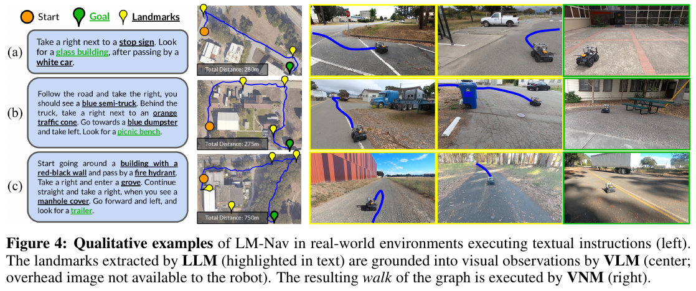
<figcaption>原文 Figure 4：语言地标、图像匹配与实机路径。俯视图用于展示，不是机器人可用的输入；地标漏检可能使路线跳过指定位置。</figcaption>

模块实验中，GPT-3 对 20 条提示的地标抽取成功率为 1.0；CLIP 在 100 张图像、30 类地标的测试中检测率为 0.87，但其判断允许前三个预测之一与图像相符，不能当作一般开放世界目标识别准确率。小型地标及低照度场景仍会导致匹配失败。

---

### 4. 局限性
{: id="lm-nav-limitations"}

需要目标环境的预先遍历与图构建，并假设语言地标存在且可被视觉模型识别；它不解决完全未知空间的在线搜索与所有关系指令理解。实验规模有限、远端规划与板载执行分工固定，不能将模块冻结解释成无地图、无先验或普遍无人干预导航。

## 8. Compass 1 (2026)
{: id="compass-1"}
———把历史画成地图，再用结构化问答教会导航模型真正使用记忆

📄 **Paper**: [arXiv:2611.12087](https://arxiv.org/abs/2611.12087) · [Project Page](https://www.archon.tech/research/compass1)

### 精华
{: id="compass-1-takeaways"}

Compass 1 的核心不是把更多历史帧塞进上下文，而是把“看见过什么”保存在稀疏关键帧里，把“在哪里看见、沿什么路线走过来”画成历史轨迹地图，让视觉与空间记忆互相补足。
但给模型一张地图并不代表它会使用地图，因此论文用任务阶段、探索方向和历史目标检索三类 VQA 监督，把记忆使用变成必须学会的训练任务。
统一的理解与生成骨干同时学习语言推理、未来视频和连续动作，部署时则让动作先执行、语言推理异步完成，避免每次移动都等待完整文本推理。
数据侧先从单目视频恢复运动轨迹，再用运动约束语言标注，将人工检查集中到轨迹异常和阶段边界，而不是逐帧标注整个视频。
最值得迁移的设计原则是：**记忆表示、记忆使用监督和闭环执行必须一起设计，不能指望扩大上下文自动带来长程导航能力。**

---

### 1. 研究背景/问题
{: id="compass-1-background"}

真实导航不只是朝当前视野中的物体移动，还包括持续执行多阶段指令、在目标不可见时探索，以及返回很久以前见过的位置；现有策略容易提前停止、转向不完整、左右反复摇摆，甚至输入了历史也无法回溯。
Compass 1 将这些问题归纳为指令跟随导航（IFN）、视野外导航（BVN）和历史回溯导航（HBN），希望在不改造预训练骨干架构的前提下，利用单目 RGB 视频学习可跨场景、跨机器人部署的长程策略。

---

### 2. 主要方法/创新点
{: id="compass-1-method"}

  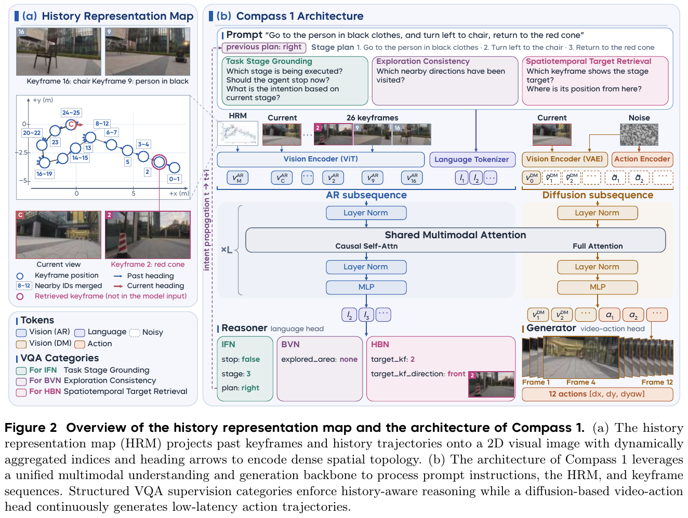
<figcaption>图 2：Compass 1 的历史表示与整体架构。左侧将关键帧位置、编号和朝向画成 HRM；右侧用统一骨干处理图像、指令与历史，自回归语言头负责结构化问答，扩散视频—动作头预测未来观测和连续动作。</figcaption>

**① 整体框架：历史表示 → 历史使用 → 视频与动作生成。** 系统以 Cosmos3-Edge-4B 为基础，接收当前观测、稀疏历史关键帧、历史表示地图（History Representation Map，HRM）、任务指令及上一轮意图；共享多模态骨干把这些信息交给语言推理头和视频—动作生成头，分别输出任务状态与未来运动。
这里的“不改架构”是指利用既有统一理解—生成骨干，把历史地图作为普通图像输入，并非模型不训练，也不是整个系统不需要轨迹信息。

**② 历史表示：关键帧负责视觉细节，HRM 负责走过的空间关系。**

- **关键帧选择的输入**是视频及对应运动轨迹；处理时用单步偏航变化和五帧累计偏航检测转弯区间，并保留转弯前后的过渡段。直行区域每 3 秒稀疏采样，转弯及过渡区域在累计转角超过 30° 时更密集采样，初始帧始终保留；输出是精简的视觉序列，论文将一分钟、4 FPS 的 240 帧压缩为平均约 40 个关键帧。
- **HRM 的输入**是历史轨迹、关键帧位置及朝向；处理时把它们绘制到二维画布上，用编号对应视觉关键帧，用箭头表示历史朝向，并将当前位姿标为红色 C。空间相近的编号合并显示为区间，例如“8–12”，避免反复走过的区域挤满标签；输出是一张可以直接送入视觉编码器的图像，而不是新增一套地图网络。
- **推理时的关键帧触发**采用固定距离和角度阈值，而不是机械地按时间追加图像。这有助于适应不同机器人的执行差异：例如人形机器人收到微小动作后未必真的移动，若仍按固定视频频率采样，会产生与训练时不同的重复观测分布。

> **举个例子（示意，不是实验数据）**：历史第 2 帧在位置 (0, 0) 看到了红锥桶，现在机器人位于 (0, 4)，朝向正北。
> 关键帧告诉模型“红锥桶确实见过”，HRM 则提供“第 2 帧的位置在当前位置南侧”，两者结合才能回答“应该往身后回去”。
> 只有照片，很难知道如何返回；只有轨迹编号，也不知道哪个位置对应红锥桶。
> 这里检索的是**看见目标时的相机关键帧位置**，并不等于直接恢复了目标的精确三维坐标，也不自动给出绕障路径。

**③ 历史使用：让模型回答必须依赖记忆的问题。**

论文观察到，仅把 HRM 塞进输入，模型仍可能忽略它。因此，结构化视觉问答（VQA）不是额外写一段泛泛的思维链，而是针对闭环失败设置可监督的具体问题：

| 能力 | 缺少针对性约束时的问题 | Compass 1 的监督与机制 |
|---|---|---|
| Task-Stage Grounding：任务阶段定位 | 不清楚当前子任务，提前停止或转错方向 | 预测当前阶段、下一步高层意图和是否停止 |
| Exploration Consistency：探索一致性 | 每一步独立选方向，容易左右来回转 | 判断左右哪些区域已经访问，并把上一轮意图传入下一轮提示 |
| Spatiotemporal Target Retrieval：时空目标检索 | 记得目标出现过，却无法指导返回 | 联合预测目标对应的历史关键帧编号，以及从当前位置到该关键帧的相对方向 |

任务阶段由 Qwen-3.8-27B 将原始指令拆解后提供监督；停止标签提前实际停止点 4 步构造，为推理延迟和执行留出余量。
探索一致性既包含问答监督，也包含跨推理步的意图传递，避免在“左、右都可能找到目标”时不断改变主意。
历史检索则把语义目标与地图上的位置编号关联起来，不仅支持专门的回溯任务，也能在普通多阶段执行中帮助找回不小心走过头的目标。

  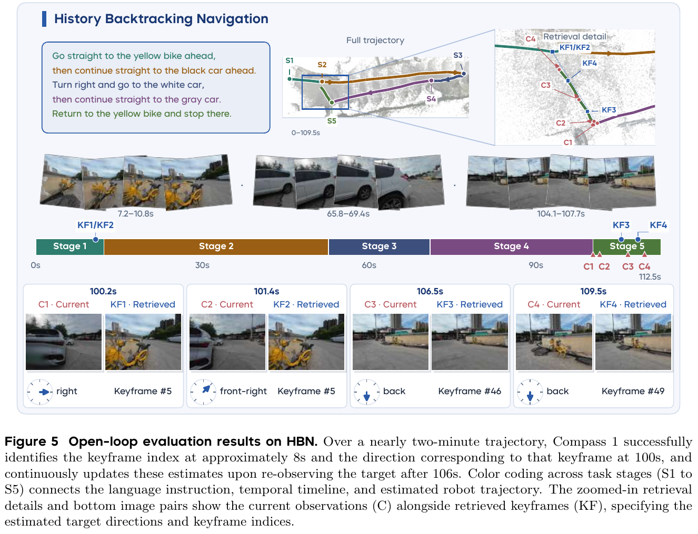
<figcaption>图 5：近两分钟轨迹上的开环历史检索案例。约 100 秒时，模型找出约 8 秒时见过目标的关键帧；目标重新出现后，又更新检索帧和相对方向。这展示的是历史检索过程，不应直接当作近两分钟闭环任务的总体成功率。</figcaption>

**④ 统一骨干：语言理解与视频—动作预测共同训练。**

理解分支将 HRM、当前图像和历史关键帧送入 ViT，与指令及问答文本的 token 一起形成自回归序列；生成分支通过 VAE 编码当前视觉观测，并处理视频与动作的扩散序列。
二者通过共享多模态注意力交换信息：语言侧使用因果注意力，扩散侧使用全注意力；最后语言头输出阶段、意图、停止信号和检索答案，视频—动作头联合预测未来视觉变化及一组 12 个连续动作，每个动作用 $[\Delta x,\Delta y,\Delta\mathrm{yaw}]$ 表示。
联合预测未来视频的目的，是让动作学习同时受到未来场景变化的约束，而非只从语言特征直接回归动作；它不等同于显式采样多条候选路线后搜索最优路线。

论文给出的总训练目标可按其权重写为：

$$
\mathcal L = 3\mathcal L_{\mathrm{VQA}} + \mathcal L_{\mathrm{video}} + \mathcal L_{\mathrm{action}}.
$$

VQA 项训练结构化记忆推理，视频项训练未来视觉预测，动作项训练连续轨迹预测；论文明确给出 **3∶1∶1** 的比例，但没有在正文中展开每项的具体公式，因而这里不额外补写未披露的损失形式。
训练时始终查询停止问题，其他问题各以 50% 概率采样，以免过拟合固定问答组合；使用 32 张 H200、全局批大小 256，端到端训练 60,000 步。

**⑤ 异步推理：动作不必等这一轮语言答案全部生成完。**

联合训练后，动作生成可以不依赖同一轮语言头的完整输出。系统在单 GPU 上先生成动作并立刻下发，让机器人执行，同时异步完成语言推理；停止信号到达时向控制器发中断，意图则供后续推理使用。
关键帧序列的 KV-cache 和扩散去噪的 CUDA Graph 进一步减少计算开销；这里的异步主要是**物理执行与语言推理重叠**，不宜理解为两个独立大模型在两张 GPU 上同时运行。

> **用一个简化时序理解（数字仅作示意）**：假设动作计算需要 0.4 秒，随后语言推理需要 0.3 秒。
> 同步方案要等到 0.7 秒才开始移动；异步方案在 0.4 秒拿到动作就开始走，剩余 0.3 秒用于完成推理，若之后收到停止信号再中断执行。
> 它减少的是动作开始前的等待，不是把推理计算本身凭空消掉；论文实际延迟见结果部分。

**⑥ 数据流水线：先确定怎么动，再描述看到了什么。**

  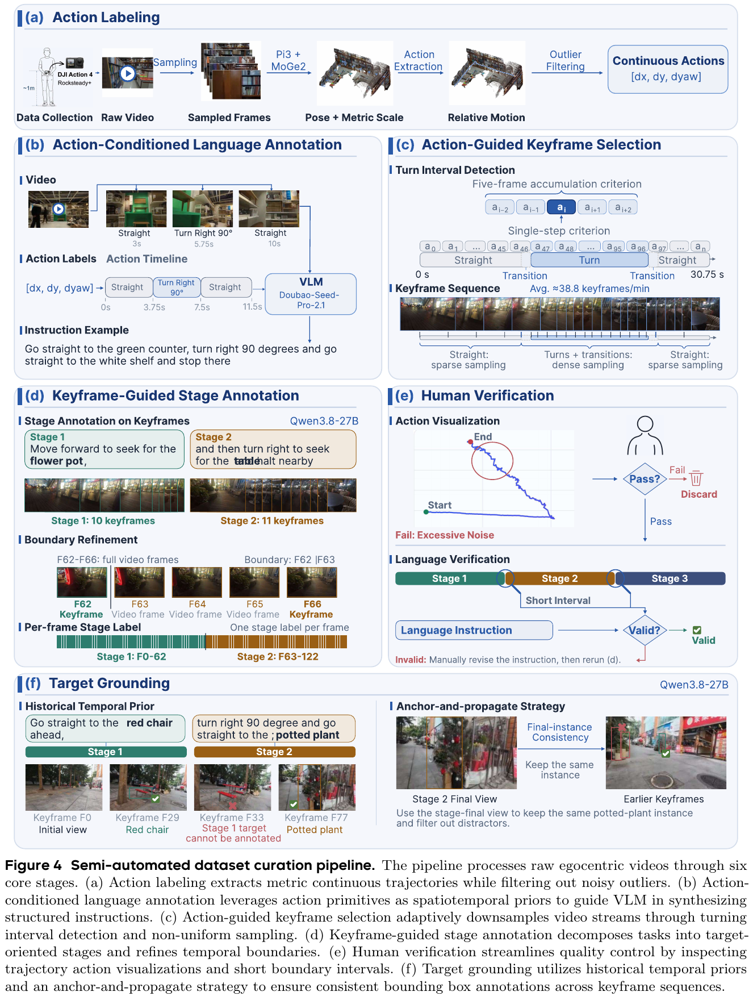
<figcaption>图 4：从单目视频到导航监督的半自动流程。依次恢复运动、用动作约束语言标注、选择关键帧、细化阶段边界、人工检查，再通过目标实例锚定生成一致的目标框。</figcaption>

1. **恢复动作**：将 RGB 视频交给 π3 与 MoGe-2，组合位姿和度量尺度，提取相对运动标签；剔除动作尺度异常、俯仰/横滚异常以及转弯时多轴突变严重的轨迹，降低单目伪标签噪声。
2. **生成指令**：把连续动作整理为直行、左转、右转、搜索等时间片段，与视频一同输入 Doubao-Seed-Pro-2.1。VLM 负责把地标对应到动作片段，而不是仅凭画面猜测转向与阶段边界；需求驱动任务再把目标名称改写为用户需求，回溯任务则改写最后一阶段。
3. **细化阶段**：Qwen-3.8-27B 先在稀疏关键帧上划分子任务，再检查边界关键帧之间的原始视频，定位子目标完成的准确帧，并传播逐帧阶段标签。
4. **人工质检**：人只检查轨迹可视化和阶段边界附近的短视频；轨迹严重异常就删除，语言不一致则修正指令并重新标注阶段。**人工检查仅用于自采数据，不覆盖全部 YouTube 数据。**
5. **统一目标实例**：在每个阶段结束帧锚定目标实例，再向更早关键帧传播目标框，避免把多个同类物体混在一起；阶段目标的标注限定在该阶段及更早阶段，避免后续再次见到它时造成阶段语义混淆。

语料包含 **500 多小时自采真实视频和 2,000 多小时 YouTube 视频**，但训练采样比例是 **自采 85%、YouTube 15%**，不能把视频时长占比误当作训练占比。主要采集相机高度约为 1.0 米，后续检验向不同相机高度和机器人运动方式的迁移。

---

### 3. 核心结果/发现
{: id="compass-1-results"}

**真实世界评测：总体成功率 79.4%，最强单个基线为 17.8%。** 测试包括办公室、户外综合区域、露台和街道四类场景，8 种任务，每种任务在每个场景重复 10 次，即每个方法共 320 次测试；主测试平台为相机高度约 0.5 米的 Unitree Go2。
基线均在本文数据上微调，作者报告原始权重与微调版本中更高的成功率，而非只拿原始仿真权重比较；不过附录说明，AwareVLN 的真实数据微调只监督动作、不额外监督推理，其他方法也有动作离散化或目标点近似等适配，故结果应理解为该论文协议下的对比。

**户外分项口径。** 图 7 给出的 Complex、Terrace、Street 场景 SR 分别约为 **79%、81%、74%**，每个场景各有 80 次测试，数值沿用图中取整显示；办公室约为 84%。总 SR 79.4% 混合了室内与户外结果，不能称作“户外成功率 79.4%”，街道动态扰动下的表现也不等于已验证城市级交通安全或无人干预的公里级导航。

  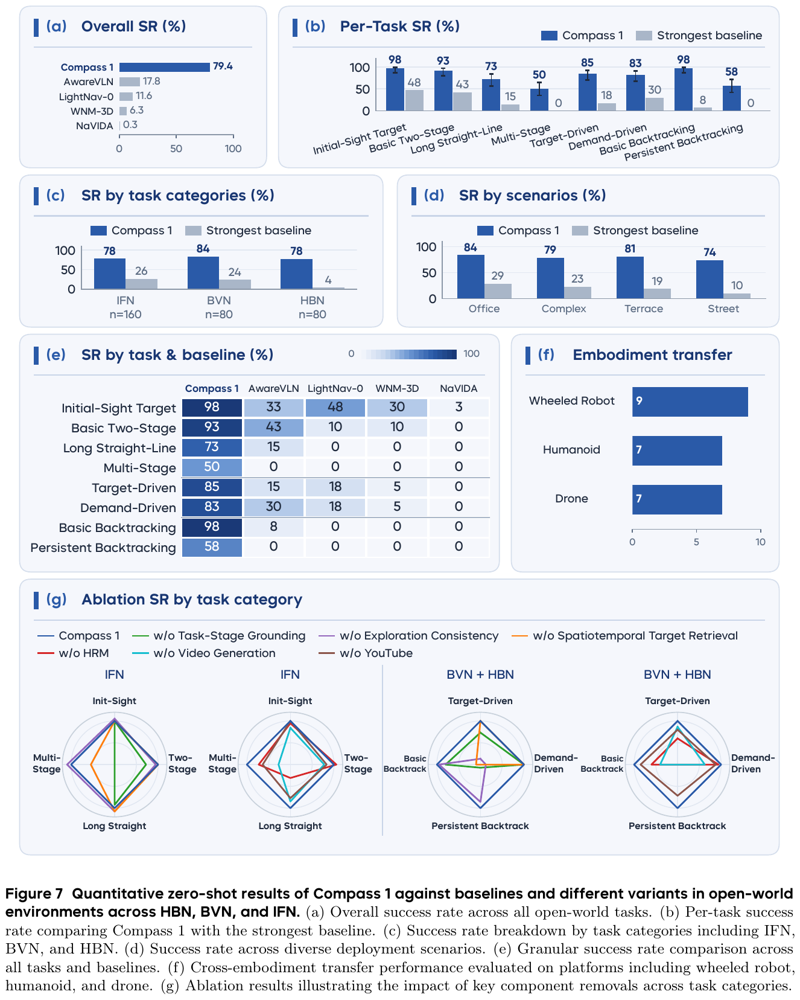
<figcaption>图 7：真实世界任务、场景、跨机器人与消融结果。总体结果对比各个基线，分任务的“最强基线”则可来自不同方法；主要差距集中在多阶段执行与长历史回溯。</figcaption>

| 真实世界任务 | Compass 1 SR | 该任务最强基线 SR |
|---|---:|---:|
| 初始可见目标导航 | 98% | 48% |
| 基础两阶段导航 | 93% | 43% |
| 长距离直行 | 73% | 15% |
| 多阶段导航 | 50% | 0% |
| 目标驱动探索 | 85% | 18% |
| 需求驱动探索 | 83% | 30% |
| 基础历史回溯 | 98% | 8% |
| 持续历史回溯 | 58% | 0% |

以上分任务数字沿用图 7 的整数显示；总成功率的 **79.4% 对 17.8% 是相差 61.6 个百分点**。BVN 的 84% 对 24% 对应相对提升 250%，不是提升 250 个百分点；持续回溯的 58% 也说明这项能力尚未解决。
跨机器人实验进一步覆盖 0.35 米相机高度的轮式机器人、0.85 米的人形机器人和 1.5 米的无人机，但该部分主要评估 HBN，不能视为在所有机器人上都重复了完整 320 次任务矩阵。

**消融：关键不是“有地图”，而是“会用地图”。**

- 去掉任务阶段 VQA，多阶段任务成功率降为 0，说明停止与子任务定位不是可有可无的文本输出。
- 去掉探索一致性，主要影响目标驱动与需求驱动探索；去掉时空检索监督，则严重削弱历史推理，即使保留 HRM 也难以有效回溯。
- 只去掉 HRM、保留 VQA，模型仍有部分短程推理能力，但长直行与持续回溯明显受损，表明问答监督和空间表示互补。
- 去掉视频生成或 YouTube 数据都会损害表现；前者对探索、多阶段与回溯尤其重要，后者带来较普遍但受网络数据质量限制的增益。

**仿真结果：单目设置较强，但不是把真实世界模型直接零样本拿来测试。**

| 评测设置 | Compass 1 | 对比及训练口径 |
|---|---|---|
| R2R-CE Val-Unseen | SR 70.1，SPL 63.2 | LightNav-0 为 68.5 / 62.8；使用 R2R 数据及 DAgger 单独训练 |
| HM3D-OVON 未见类别 | SR 52.2，SPL 26.9 | LightNav-0 为 47.0 / 24.2；使用 HM3D-OVON 及 DAgger 单独训练 |
| IntentionNav | SR 42.5，SPL 42.1 | 500 条轨迹中取 300 条微调、200 条测试，各场景均有训练和测试任务 |
| IndoorUAV-VLN Test-Unseen | SR 18.09，nDTW 12.14 | 各方法均微调，训练和评测都删除含上升/下降动作的轨迹 |

R2R-CE 的领先结论限定于论文比较的**单目方法**，不是超越表中所有多视角方法；IntentionNav 的划分也不能当作未见场景泛化，无人机结果则不证明完整三维升降控制能力。

**效率：动作分块的有效吞吐，不等于模型每秒重新规划 28 次。** 在 RTX PRO 6000 上，开始时计算 12 个动作耗时 0.43 秒，63 个关键帧时耗时 0.71 秒；论文据此给出约 28 Hz 和 17 Hz 的有效动作生成速率，但对应的动作块计算频率实际上约为 2.3 Hz 和 1.4 Hz，不能混同于逐动作闭环重规划频率。
KV-cache 与 CUDA Graph 在 63 帧时将延迟降低 80.4%，异步执行进一步相对同步方案减少约 46.4% 的等待；这些优化的参照设置不同，不应直接相加。

---

### 4. 局限性
{: id="compass-1-limitations"}

持续回溯和多阶段任务仍分别只有 58% 与 50% 的成功率，动态遮挡、转弯误差、玻璃反射及返回路上的障碍仍会导致丢失目标或碰撞，近两分钟案例也不足以证明无限期持久记忆。
此外，真实部署依赖里程计闭环控制和远端高性能 GPU，单目 RGB 的输入口径不能被扩大解释为整机不需要位姿支持；四场景、自定义任务及受限的跨机器人测试，也仍不足以证明任意开放环境或完整三维飞行的泛化能力。

# 相关工作与跨篇阅读
{: id="outdoor-related-readings"}

以下工作包含户外评测或提供通用导航策略，但核心研究问题不限于户外导航，精读保留在原篇。本节不将不同基准的成功率混排。

- **[ABot-N1](/VLN-Papers/#abot-n1)**：包含城市级 ABotN-PointBench 户外点目标评测及社交合规分析。户外 Split 使用三次碰撞内成功率（SR<3col），不能与室内的零碰撞成功率（SR<1col）直接比较；精读仍在指令跟随篇。
- **[CanonNav](/VLN-Papers-Extended/#canonnav)**：覆盖 CitySim 室外园区、AWS Hospital 室内环境与户外实机部署，作为跨场景视觉导航策略阅读。
- **[NoMaD](/VLN-Papers-Extended/#nomad)**：统一探索与图像目标导航，在室内外环境验证；作为户外导航可借鉴的基础扩散策略，而非户外专用方法。
- **[SparseVideoNav](/VLN-Papers-Extended/#sparsevideonav)**：实机评测覆盖庭院、公园、夜间广场与山地，适合关注复杂光照和跨环境泛化的读者。
- **[VL-Nav](/VLN-Papers-Extended/#vl-nav)**：包含 Outdoor 开放区域评测，主要定位仍是目标导航。

本篇目前聚焦地面机器人户外导航。航空导航与自动驾驶属于相关但不同的任务范围，暂不迁入 WorldVLN 与 Qwen-Drive；仅有户外演示的通用指令跟随方法也不据此迁移。

# 参考资料

## 论文引用

1. **WayTrace** (2026). Manthan Patel, Jonas Frey, Pascal Roth, Marco Hutter, Cesar Cadena. *WayTrace: A Map-to-Language-to-Trace Hierarchy for Embodied Urban Navigation*. arXiv: [2611.05129](https://arxiv.org/abs/2611.05129).
2. **CausalNav** (2026). First Scene Graph-based Semantic Navigation for Dynamic Outdoor Environments. arXiv: [2601.01872](https://arxiv.org/abs/2601.01872) · IEEE RA-L
3. **DA-Nav** (2026). Ye Yuan et al. *DA-Nav: Direction-Aware City-Scale Vision-Language Navigation*. arXiv: [2607.11638v2](https://arxiv.org/abs/2607.11638v2).
4. **CityWalker** (2025, v3). *CityWalker: Learning Embodied Urban Navigation from Web-Scale Videos*. arXiv: [2411.17820v3](https://arxiv.org/abs/2411.17820v3).
5. **UrbanNav** (2026, v2). *UrbanNav: Learning Language-Guided Urban Navigation from Web-Scale Human Trajectories*. arXiv: [2512.09607v2](https://arxiv.org/abs/2512.09607v2).
6. **MOSU2** (2026). *MOSU2: Long-range Navigation System with Multi-modal Scene Understanding*. arXiv: [2611.11148v1](https://arxiv.org/abs/2611.11148v1). 前置方法 **MOSU** (2025): [2507.04686v1](https://arxiv.org/abs/2507.04686v1).
7. **LM-Nav** (2022). *LM-Nav: Robotic Navigation with Large Pre-Trained Models of Language, Vision, and Action*. arXiv: [2207.04429v2](https://arxiv.org/abs/2207.04429v2).
8. **Compass 1** (2026). Hai Zhang, Siqi Liang et al. *Compass 1: Towards Open-World and Persistent Embodied Navigation from Monocular RGB Videos*. arXiv: [2611.12087v1](https://arxiv.org/abs/2611.12087v1).
