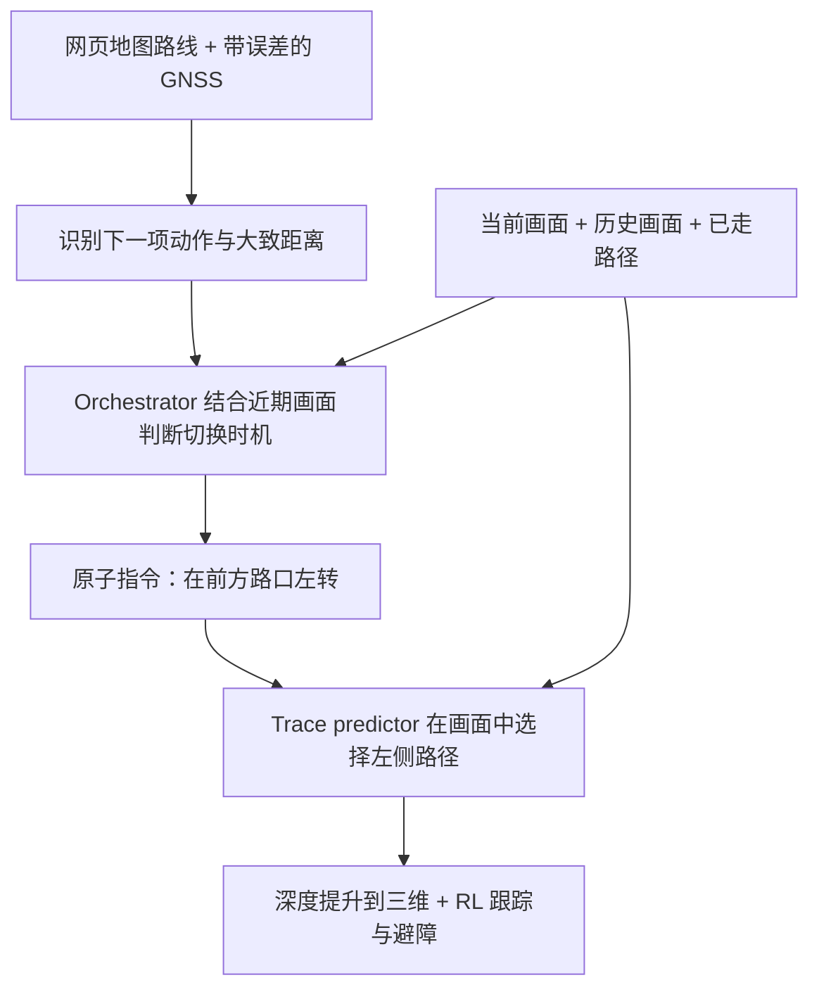

> 本篇是 [VLN 综述](/VLN-Survey/)的配套户外导航阅读，关注机器人如何结合地图、语言与视觉，在城市街道、人行道和野外步道上完成长距离任务。当前收录 3 篇精读：[WayTrace](#waytrace) 关注地图指引、路线执行与 GNSS 漂移，[CausalNav](#causalnav) 关注语义地图、目标检索与动态环境导航，[DA-Nav](#da-nav) 关注方向指令的图像网格落地与偏航恢复。
>
> 相关方向见[指令跟随篇](/VLN-Papers/)、[目标导航篇](/VLN-Papers-Extended/)与 [Agentic 导航篇](/Agentic-Navigation-Papers/)。户外评测单独记录路线、定位误差和人工干预条件。

# 户外导航评测记录
{: id="outdoor-navigation-benchmarks"}

下表记录本篇论文报告的完整系统结果；自建基准保留原始名称与评测条件，SR 不与室内 VLN 或其他户外基准直接混比，未报告的指标记为“–”。

| 模型 | 年份 | 基准 | 范式 | 评测条件 | SR ↑ | SPL ↑ |
|:---|:---:|:---|:---:|:---|:---:|:---:|
| [WayTrace](#waytrace) | 2026 | 苏黎世老城长程导航（自建） | 训练 | 完美 GNSS | 83.3 | – |
| [WayTrace](#waytrace) | 2026 | 苏黎世老城长程导航（自建） | 训练 | GNSS 漂移 7 m RMS | 63.3 | – |

**评测口径：** 10 条路线，每条运行三个种子，每个条件共 30 次；成功要求在目的地 5 m 内停车，且每次过街至少一半的道路内路径位于斑马线上。最长 1.37 km 的真实机器人任务属于另行展示的实机演示，含两次人工语言指令替换，不计入上表的仿真 SR。

**DA-Nav 独立评测记录。** 下列三种口径分开记录，不与 WayTrace 的苏黎世老城基准排名。范式均为**训练**：Qwen2.5-VL-7B-Instruct 在 ReDA 上进行 LoRA 微调；仿真到实机的零样本迁移不等于免训练。

| 模型 | 基准 / 划分 | 评测条件 | SR（%）↑ | SPL ↑ |
|:---|:---|:---|---:|---:|
| [DA-Nav](#da-nav) | CARLA 0.9.15，已见 + 未见城镇 | 239 条闭环轨迹；Table II | 59.00 | 58.66 |
| [DA-Nav](#da-nav) | CARLA，未见城镇 | Town 06 / 07 / 15；摘要报告的未见环境成绩 | 56.16 | – |
| [DA-Nav](#da-nav) | 实机城市街道 + 公园 | 各 5 条超过 100 m 的路线，每条重复 3 次，共 30 次；Table V | 46.7 | – |

SPL 沿用原表尺度。混合城镇评测的 CSR 98.15% 是**偏航事件的纠正成功率**，不是任务 SR；实机单动作成功率 83.3% 与超过 1.2 km 的人形机器人展示也不混入上表。各基线使用公开预训练权重与适配后的接口，而 DA-Nav 使用 ReDA 训练，详细比较条件见[精读结果](#da-nav-results)。

# 户外导航论文精读
{: id="outdoor-navigation-readings"}

## 1. WayTrace (2026)
{: id="waytrace"}
———用语言衔接网页地图与视觉路径，让城市导航不再追着带误差的坐标走

📄 **Paper**: [arXiv:2611.05129](https://arxiv.org/abs/2611.05129) · [Project Page](https://way-trace.github.io)

### 精华

1. 长程导航可以拆成两个问题：高层判断现在该执行哪条局部指令，低层把指令落实为当前画面里的路径，两者通过语言衔接。
2. GNSS 只提供路线进度与大致距离，路径位置由相机决定，因此定位漂移主要影响动作切换时机，而不会直接把路径平移到马路或河岸外。
3. 路径预测先确定终点所处的分支，再生成通向该终点的轨迹；部署时保留终点的语言解码，用小型回归头一次输出路径点。
4. 规模化训练的关键是让同一场景对应多种指令及路径，覆盖行人实际没有走过的分支，减少模型忽略语言、只猜最常见行走路线的机会。
5. 慢速语义规划与快速避障控制异步运行，使约 3 秒的上层响应延迟仍能支撑连续行走，但其长程可靠性最终受指令切换错误和交通反应能力限制。

---

### 1. 研究背景/问题

网页地图已经能给出大多数城市的步行路线，但直接追踪 GNSS 航点会把数米定位误差转成错误运动目标，且坐标本身不表达“沿人行道走、从斑马线过街”等要求。现有 VLN 模型在户外连一条局部指令都可能执行不稳，串联成数百米至公里级路线后，错误更容易累积。WayTrace 因此将“选择当前指令”与“执行当前指令”分开，让地图提供全局路线，视觉负责局部落地。

---

### 2. 主要方法/创新点

  
<figcaption>图 2：地图提供路线，远程 orchestrator 选择原子语言指令，机载 trace predictor 输出图像路径，RL 策略沿深度提升后的三维路径行走；三个循环异步运行。</figcaption>

**整体框架。** 系统由路线与指令编排、语言条件路径预测、RL 运动执行三个核心环节构成：orchestrator 判断下一步该做什么以及何时切换，trace predictor 画出这条指令在当前图像中的路径，RL 策略根据最新深度图跟踪路径并避障。语言是高低层之间的接口，图像中的二维路径则连接视觉理解与具身控制。

**① 路线与 orchestrator：地图决定下一步动作，相机判断执行时机。** 输入是目标地点、附近路线指示及距离、以机器人朝向为上方的约 50 m 宽卫星图、当前与过去 15 m 的相机观测，以及当前指令。真实部署先用 Google Places API 解析目的地，再用 Google Routes API 获取步行路线，并在 OpenStreetMap 的步行网络上重新规划，以覆盖人行道和已标注的过街位置；仿真则使用预先构建、与网页地图风格一致的路线指示。

未经微调的 Qwen3.8-Flash-Next 每 2 秒接收一次请求，输出一句理由和一条“在路口左转”“过马路”等原子指令；这里的原子指令描述当前视野内可落地的一次局部动作，不要求机器人执行精确米数。GNSS 投影到路线后，只用于识别当前路线步骤和估计距离，局部路径并不追踪这个坐标；机器人端另有提前过街拒绝、到达指令检查、指令过期等规则。过街还按“转入斑马线 → 过街 → 离开斑马线并进入下一路段”的顺序切换，避免一直保留带方向的转弯指令。

这张读者版图强调分工：即使 GNSS 把机器人估计到人行道旁边的道路上，只要路线步骤仍判断正确，低层仍会根据画面中的人行道画路径；若误差导致高层过早发出转弯命令，系统依然可能走错路口，因此它降低了对定位精度的依赖，并没有消除这种依赖。

**② Trace predictor：先选定要去的分支，再补出路径。** 输入包括当前 RGB 图像、按行走距离间隔 1.8 m 采样的五张历史图像、里程计生成的已走路径俯视图，以及当前语言指令。历史图像覆盖约 9 m 行程，帮助模型判断转弯已经执行到哪一步，避免每次看到“左转”都重新左转。

模型以 RynnBrain-9B 初始化，将图像和指令送入视觉编码器与语言模型，先输出归一化图像坐标中的终点，再预测以该终点结束的 10 个二维路径点。这里的终点是指令路径离开视野或被完全遮挡的位置，不一定是整条任务路线的最终目的地；作者将预测流程写为：

$$
p_\theta(\tau\mid x,c)=p_\theta(g\mid x,c)\,p_\theta(\tau\mid g,x,c).
$$

其中，$x$ 为视觉与行走历史，$c$ 为指令，$g$ 为终点，$\tau$ 为路径。先定终点可以约束分支选择，减少直接预测路径时在岔路之间折中的现象。

> **举个例子（仅为机制示意）**：假设画面里左右两条支路的终点分别是 $(0.2,0.2)$ 和 $(0.8,0.2)$，两支路之间有隔离区域；若模型在两条路线间折中，可能画向中间的 $(0.5,0.2)$。先根据“走左边岔路”选定左侧终点，再补出路径，就把问题从“同时猜走哪条路、怎么走”拆成“先选分支，再连接路径”。

**③ 从两阶段训练到单次调用部署。** 两阶段版本在约 119 万样本上进行一轮 LoRA 监督微调，分别用自回归交叉熵训练终点和路径，路径阶段训练时给定参考终点。为减少机载推理延迟，部署版本只自回归生成约 15 个终点 token，再读取终点结束处的隐藏状态，用 LayerNorm、两层线性映射与 GELU 构成的 MLP 直接回归 20 个数，即 10 个二维点，最后用 sigmoid 约束到归一化坐标范围；这样省去约 140 个路径 token 的逐个解码。

该单次调用模型的训练目标为：

$$
\mathcal L=\frac{1}{N}\sum_{i=1}^{N}\lVert\hat u_i-u_i\rVert_1
+2\lVert\hat u_N-g\rVert_1
+0.5\mathcal L_{\mathrm{CE}},\qquad N=10.
$$

第一项监督所有路径点，第二项加强路径末端与目标点的一致性，第三项监督终点 token。附录说明，该版本从完整数据中按来源比例抽取 25 万个样本训练，30% 的样本使用模型自己预测的终点来训练回归头，并屏蔽这些样本的终点交叉熵，让路径头适应略有偏差的终点；最终时序路径模型使用监督微调，单图教师则使用监督微调和 GRPO，二者训练方式不能混为一谈。

**④ 自动标注：既学习实际走过的路，也学习同一画面的其他可选路线。**

  
<figcaption>图 3：上支路从真实行走序列恢复路径并标注指令；下支路用少量人工标签训练教师，为同一画面的多个指令生成不同路径，再传播到后续帧以配上真实历史。</figcaption>

这里的意图条件路径（intent-conditioned traces），就是让“同一幅图、不同命令”得到不同路径。只将视频中的未来行走轨迹投影回当前帧，每幅画面通常只有一条实际走过的路径，模型可能只根据场景猜路线而忽略指令。

| 维度 | 仅使用重建行走数据 | 加入意图条件路径 |
|---|---|---|
| 单幅画面的监督 | 只有行人实际走过的路径 | 每条可见支路及部分地标可对应不同指令与路径 |
| 学习信号 | 场景外观与实际路径绑定 | 同一场景内也必须依据指令区分路径 |

**实际行走支路。** 原始数据池包含 182 个城市与地区的 51,907 段 Mapillary 序列。VGGT-Ω 从短序列恢复相机姿态和几何，再用 GNSS 轨迹长度确定尺度，将未来相机下方的地面位置投影到当前帧，得到图像路径；VLM 随后生成描述该路径的指令及四种改写，另一次 VLM 判断仅保留指令与路径一致的片段，最终得到 26,740 个片段、约 28.8 万个样本。

**意图条件支路。** 先用 NaviTrace 训练划分，以及在 605 张 Mapillary 图像上人工绘制的约 1,900 条路径训练单图教师。再从路口、过街点和步道采样锚点图像，让 VLM 为可见分支及可唯一识别的地标生成多条指令，教师逐条画出路径；三维重建把这些路径传播到序列后续帧，从而为单图教师产生的标签补上真实历史，得到约 10.6 万张锚点图像上的 86.3 万个样本。

两条支路加上人工与 NaviTrace 基础样本后，最终训练集为 **1,190,594 个样本**，其中 3,950 份基础样本重复十次参与训练；测试序列从各训练来源中排除。这里的尺度来自可解释的重建、教师标注和传播流程，不要求采集同等规模的机器人示范。

**⑤ 三维提升与 RL 执行：路径提供方向，最新深度处理身体与障碍。** 输入是二维路径、深度图、里程计与机器人速度；先把路径点提升到三维并固定在里程计坐标系，保留落在已观测可通行地面上的路径前缀，再把沿路径前方 4.5 m 的跟踪目标交给 RL 导航策略。该策略在仿真中学习根据深度图到达局部点目标并避障，部署时以 5 Hz 更新速度指令，实机使用重新训练的版本。

Orchestrator 单次约耗时 1.3 秒，机载路径预测约 1.5 秒，控制器在等待期间继续跟踪上一条路径。收到新指令、前进 3 m、执行完当前路径的 40%，或距离上次请求超过 5 秒时，会请求新路径；最终到达指令生效后，距路径目标 1.5 m 内停止。整条链路因而是“地图与历史选择指令 → 当前视觉生成路径 → 深度和里程计更新局部目标 → RL 连续执行”，而非每次等完整大模型推理结束再移动。

---

### 3. 核心结果/发现

**长程闭环。** 作者在 Isaac Sim 5.0 中构建约 0.91 km² 的苏黎世老城，设置 10 条长 152–864 m 的路线，每个条件运行三次种子，共 30 次。成功既要求在目的地 5 m 内停车，也要求沿途每次过街至少一半的道路内路径位于斑马线上，因此成功率包含过街合规条件。

| 方法 | 完美 GNSS 的成功率 | 7 m RMS 漂移的成功率 |
|---|---:|---:|
| CityWalker + 本文 RL 控制器 | 36.7% | 23.3% |
| VAMOS + 本文 RL 控制器 | 63.3% | 10.0% |
| WayTrace | **83.3%** | **63.3%** |

使用原发布控制器时，CityWalker、VAMOS、OmniVLA 的成功率分别为 20.0%、13.3%、0%；即便用按模型单独调优的 oracle 提供指令，TIC-VLA、Foresight、VENTURA 也仅为 6.7%、3.3%、6.7%。将 WayTrace 的高层替换为 oracle、保持路径预测与 RL 不变后，成功率升至 90.0%，说明剩余瓶颈包括高层决策，也包括局部执行。

  
<figcaption>图 5：在使用相同 RL 控制器的比较中，WayTrace 对 GNSS 漂移的退化较缓；其各噪声条件下斑马线违规率低于 6%、驶入道路的路径占比低于 1%，但成功率仍会受动作切换错误影响。</figcaption>

**局部路径与消融。** 在人工标注的 Human-Test（332 张图、953 条路径）上，WayTrace 的 NaviTrace 分数为 83.2，对比方法最高为 57.0，转向侧别准确率为 97.9%；NaviTrace 分数综合路径匹配、终点误差与语义地面惩罚，不能当成任务成功率。加入历史后，50 个单指令片段、每个三次种子的闭环成功率由 74.7% 升至 94.7%，完成转弯后继续重复转弯的比例由 56.0% 降至 9.3%；加入 86.3 万意图条件样本后，数据消融中的 NaviTrace 分数从 79.33 升至 83.32。开放环表格主要报告两阶段模型，闭环则使用单次调用模型；后者在 Human-Test 上同样达到约 83.2。

**真实机器人。** Unitree B2W 使用 ZED X 深度相机、激光惯性里程计与 GNSS 融合定位，路径预测在 Jetson AGX Thor 上运行，RL 控制器在 Jetson AGX Orin 上运行，高层模型部署在远程四张 H100 上。

| 实机任务 | 规划路线长度 | 平均速度 | 作者统计的人工指令干预 |
|---|---:|---:|---:|
| Starbucks | 426 m | 1.12 m/s | 0 次 |
| Snipes | 248 m | 1.01 m/s | 0 次 |
| Dieci | 312 m | 1.11 m/s | 0 次 |
| Mendokoro | 1,368 m | 1.19 m/s | 2 次 |

最长任务的两次干预都是人工将持续转弯的指令替换为沿路直行，没有遥操作机器人，作者报告其无干预行驶距离占比为 97.2%。Starbucks 任务还曾由操作员短暂停车以检查接近的电车，作者因没有修改指令或路径而未将其计入干预；该任务另出现过提前进入道路、随后才并入斑马线的情况，因此表中“0 次”不能理解为无需交通监督或全程严格合规。

  
<figcaption>图 6：Snipes、Dieci 与 1.37 km 的 Mendokoro 实机任务，包含拥挤街道、桥梁及校园路线；最长任务中标出了两次人工语言指令替换。</figcaption>

**语言接口的扩展。** 仿真中展示了封路或错过转弯后请求新路线，以及仅凭人类提供的六条地标指示完成 127 m 导航；后一个演示不用地图或 GNSS，但采用额外里程计规则并限速至 0.6 m/s，不能据此推断整套长程系统已不需要 GNSS。对 957 次日志决策的回放评估中，默认高层模型的关键错误率为 5.1%，更强模型可降至 3.2%，但调用延迟约为其三至五倍；这是决策回放结果，尚非更强模型的完整闭环任务成功率。

---

### 4. 局限性

高层仍依赖远程网络、GNSS 路线进度和启发式规则，可能提前、延后或重复发出动作；约 3 秒的串行语义响应延迟、有限前向视野与短期历史，会影响窄路口和长动作的可靠性，目前也无法处理红灯停车或接近电车等交通反应。评估仅覆盖一处静态仿真城市和四条无对比基线的实机演示，仿真没有交通与行人，成功判据还允许单次过街最多约一半道路内路径不在斑马线上，因此这些结果尚不足以证明普遍城市交通安全或无人监督的公里级部署能力。

---

## 2. CausalNav (2026)
{: id="causalnav"}
———First Scene Graph-based Semantic Navigation for Dynamic Outdoor Environments

📄 **Paper**: [arXiv:2601.01872](https://arxiv.org/abs/2601.01872) · 🏛️ **IEEE RA-L**

### 精华
{: id="causalnav-精华-12"}

CausalNav 的核心亮点在于将多层级场景图（Embodied Graph）与 RAG 机制深度结合，实现了支持开放词汇查询的长程语义导航——"图即知识库"的设计范式值得借鉴。其次，层次化 Embodied Graph 构建策略（从细粒度对象节点到粗粒度建筑物与聚类节点）展示了如何在多空间尺度上统一语义表示与检索。第三，基于时空走廊（Spatial-Temporal Corridor）的动态对象过滤机制，无需额外标注即可区分静态、准静态与动态障碍物，是处理室外动态场景的实用方案。第四，使用本地开源 LLM 替代商业 API 完成层次语义检索，证明了在自主平台上脱离云端仍可实现高质量语义推理。

---

### 1. 研究背景/问题
{: id="1-研究背景问题-11"}

室外大规模动态环境中的自主语义导航面临三大挑战：开放词汇的语义理解、动态环境适应（行人、车辆等移动障碍物）以及长期稳定性。现有 VLN 研究主要聚焦于静态室内场景，依赖高精度地图或大规模训练数据，在真实室外动态场景中的长程导航鲁棒性未得到充分验证。

---

### 2. 主要方法/创新点
{: id="2-主要方法创新点-9"}

  
<figcaption>
CausalNav 整体工作流：集成语义推理、动态环境适应和 Embodied Graph 规划三大模块
</figcaption>

CausalNav 提出了一个由三个核心模块构成的语义导航框架：

**模块一：开放词汇目标跟踪与自我运动估计**

使用 YOLO-World 从 RGB 图像中提取开放词汇的 2D 检测框和分割掩码，通过 ByteTrack 进行多目标跟踪。结合 LiDAR 点云将 2D 检测投影至 3D 空间，获得目标的 3D 姿态 $$^w\mathbf{T}_{obj}$$。自车运动通过 LiDAR-IMU 里程计（FAST-LIO2）估计，提供精确的定位与坐标变换基础。

**模块二：动态对象过滤与 Embodied Graph 构建**

  
<figcaption>
CausalNav 三模块流水线架构：目标跟踪与自我运动估计 → 动态过滤与图构建 → 图更新与自然语言导航
</figcaption>

- **时空走廊过滤**：将每个目标的历史轨迹编码为时空走廊 $$\mathcal{T} = \{^w\mathbf{T}^n_{obj}, \text{3DBBox}_i, t_i\}_{i=1}^n$$。若目标在 $k$ 步内位移超过阈值，则认定为动态目标并从图中移除，有效消除运动引起的虚假节点。

- **Embodied Graph 层次构建**：静态环境由两类节点组成——建筑物节点 $\nu_i^{build}$ 来自离线地图，对象节点 $\nu_i^{obj}$ 来自实时感知。使用 LLM 对节点进行层次聚类（spatial-semantic similarity），形成多级抽象：对象层（Level $L-1$）→ 建筑物/Place 层（Level $L$）→ 聚类节点（Clustering Node）。每次自车移动超过距离阈值 $d$，新增自车节点 $\nu_i^l$ 记录历史轨迹。

- **RAG 语义检索**：基于 LLM 打分的层次化检索，结合空间相似性 $\kappa^{spatial}$ 和语义相似性 $\kappa^{semantic}$，在图中逐层选择最匹配查询的节点路径，支持开放词汇目标定位。

**模块三：Embodied Graph 动态更新与自然语言导航**

  
<figcaption>
仿真环境中构建的 Embodied Graph：粗粒度建筑物节点与细粒度对象节点（消火栓、邮箱等）的多层次融合
</figcaption>

- **全局规划**：解析自然语言指令，通过 RAG 检索 Embodied Graph 推断目标位置，优先使用历史轨迹中的 Dijkstra 最短路径；若目标不可达，则调用离线地图或 Google Maps 生成粗粒度路线，结果表示为路点序列 $\mathcal{W} = \{w_1, w_2, \ldots, w_n\}$。

- **局部规划**：采用 RH-Map 进行实时动态局部地图构建，通过 Informed-RRT* 生成初始轨迹，再使用 NMPC-CBF（Nonlinear Model Predictive Control with Control Barrier Function）进行轨迹跟踪与动态避障，保证对移动行人/车辆的安全性。

---

### 3. 核心结果/发现
{: id="3-核心结果发现-10"}

  
<figcaption>
真实环境中不同距离尺度的导航实验：短程（130m 对象级指令）与长程（512m 建筑级指令）
</figcaption>

**仿真实验**（对比 ViNT、NoMaD、GNM、CityWalker）：
- Small 任务：SR 100%，SPL 88.9%，CC 0.2（所有方法中最优）
- Medium 任务：SR 92%，SPL 82.2%
- Large 任务：SR 80%，SPL 66.0%，CC 1.2，TL 141.82m

**真实世界实验**：
- 短程（130m）：ViNT 和 CausalNav 均成功，其他方法失败
- 长程（512m）：仅 CausalNav 成功完成任务，其他方法因碰撞失败
- CityWalker 在真实世界表现显著差于仿真，对光照变化和动态障碍物敏感

**消融实验**：
- 启用 Embodied Graph 动态更新：SR 从 78% 提升至 90%，SPL 从 54.7% 提升至 80.1%
- 最优超参数：$\alpha=\beta=0.5$，$\gamma=1.5$（空间-语义平衡点）
- 运行时延：105ms/cycle（10Hz），比 NoMaD 仅多 11% 开销

---

### 4. 局限性
{: id="4-局限性-10"}

CausalNav 在极端光照/天气条件下的鲁棒性有待提升，且长程图记忆的压缩与遗忘机制尚未完善，可能在超长时间运行后出现图膨胀和检索精度下降问题。

## 3. DA-Nav (2026)
{: id="da-nav"}
———把地图方向落到图像网格，用偏航恢复数据训练城市导航的纠错能力

📄 **Paper**: [arXiv:2607.11638v2](https://arxiv.org/abs/2607.11638v2)

### 精华
{: id="da-nav-takeaways"}

1. 城市导航不一定要让大模型直接回归三维坐标：先在当前画面中选择可行走的网格，再由几何接口和控制器执行，可以把视觉判断与物理运动分开。
2. 只学正确示范不等于会纠错，ReDA 主动制造偏航、保留恢复过程，让策略见过“已经走歪之后该怎么办”。
3. 把输出约束为“是否偏航 → 正常或纠正动作 → 六个网格点”，提供的是有标签监督的决策分解，而不是额外调用一个通用模型自由推理。
4. 偏航频率与纠偏成功率必须分开看：很少偏航但偏一次就失败的策略，未必比经常能够自主恢复的策略更可靠。
5. 论文证明了仿真训练策略迁移到四足与人形平台的可行性，但实机闭环成功率为 46.7%，公里级展示不能替代多路线成功率或无人监督安全性证据。

---

### 1. 研究背景/问题
{: id="da-nav-background"}

商业地图可以规划城市路线，却通常只提供“前方左转”等面向人的稀疏指示，不能直接变成机器人的局部轨迹；让视觉语言模型直接回归连续三维航点又容易出现空间判断与动作表示不匹配的问题。长程执行中，小误差会把机器人带出训练示范覆盖的状态，单靠完美专家轨迹训练的策略往往不知道如何恢复。DA-Nav 因此同时改造动作表示和训练数据：用离散图像网格表达路径，用偏航恢复样本训练闭环纠错。

---

### 2. 主要方法/创新点
{: id="da-nav-method"}

  
<figcaption>原文 Figure 2：历史视觉观测与方向指令进入 Qwen2.5-VL-7B，模型按顺序输出偏航判断、动作和图像网格轨迹；视觉编码器与基础模型权重冻结，通过 LoRA 适配导航任务。</figcaption>

**整体框架。** DA-Nav 由方向指令接口、结构化 VLM 策略、图像到机体坐标的几何投影，以及最远点跟踪控制器组成；ReDA 则为策略提供正常导航和偏航恢复两类监督。商业地图负责全局引导，模型判断当前画面里该走向哪里，几何模块把图像目标变成局部物理目标，控制器输出线速度和角速度。

**① 输入接口：消费离散方向，而不是直接理解整份地图。** 每步输入为当前帧及此前四帧组成的五帧第一视角 RGB 历史，以及 `FORWARD / TURN LEFT / TURN RIGHT / STOP` 四选一指令。真实部署中，手机连接商业导航工具，异步解析“30 米后左转”等导航信息并转成该离散指令；论文没有给出从距离提示切换到当前指令的完整阈值规则，不能把它解读为模型直接读取地图、GNSS 坐标或原始长路线文本。

**② 图像网格：先在画面上选位置，再交给几何模块落地。** 有效网格的行号为 13–23、列号为 0–28，排除天空与远处背景，保留机器人前方区域；共有 $11\times29=319$ 个候选单元。未来轨迹由六个网格位置组成，以 2 Hz 采样，覆盖未来 3 秒；它是图像平面上的离散位置序列，不是六条“前进/转弯”动作命令。

  
<figcaption>原文 Figure 3：在第一视角 RGB 图像上预测离散网格点，再通过几何投影得到机器人局部机体坐标系中的连续目标。</figcaption>

> **举个例子（仅示意接口，不代表论文中的实际预测）**：模型输出 `(22,14) → (20,14) → (18,15) → …`，含义是依次选择画面中的几个位置，不是让机器人前进 22 米、横移 14 米。近处和远处的同样一格，在地面上对应的距离不同；必须经过相机标定与深度或地面假设，才能得到米制航点。

这里的“有效网格”只是限制输出位置的范围，并不意味着其中每一格都已通过障碍物检测，被证明可以安全通行。

**③ ReDA：人为制造偏航，保留正确恢复过程。** 数据来自 CARLA 中 126 个场景、2,102 条轨迹，约含 **28.6 万个时序样本**，其中 15.8 万为专家导航帧、12.8 万为恢复帧。自动采集使用三个状态：

| 状态 | 采集过程 | 是否用于训练 |
|---|---|---|
| Stable | 跟踪专家路线 | 保留正常导航示范 |
| Drifting | 注入转向扰动，让机器人偏离路线 | 丢弃，避免学习扰动造成的不稳定运动 |
| Recovering | 横向误差达到 0.35 m 阈值后，启用恢复跟踪；前视距离随横向误差调整 | 保留纠偏示范 |

保留帧的方向指令根据转弯状态和运动状态合成；偏航标签来自采集状态机，纠正动作由横向偏差方向决定。未来专家三维航点经三次样条平滑、相机投影和网格离散化，形成轨迹监督，因此这不是没有标签的自发试错，也不是在线 DAgger：纠错样本在仿真采集阶段生成。

**④ 结构化 CoT：先判断偏航，再选动作，最后给出轨迹。** 模型采用 Qwen2.5-VL-7B-Instruct；视觉编码器提取历史观测，经轻量适配器映射到语言嵌入空间，再与方向指令一起输入。提示词规定网格范围和输出次序：

- **状态**：`Yes / No`，判断是否偏离参考路径。
- **动作**：`FORWARD / TURN LEFT / TURN RIGHT / CORRECT LEFT / CORRECT RIGHT / STOP`。
- **轨迹**：六个图像网格点。

其中纠正动作与路线转弯是不同的概念：地图仍要求直行时，机器人也可能需要先向左纠偏。训练时状态由采集系统提供标签，部署时则从视觉历史和指令预测，并非把真值横向误差送入策略。

> **举个例子**：当前地图指令是直行，但机器人已经偏到道路右侧。期望的输出可以是“偏航：Yes；动作：CORRECT LEFT；轨迹：逐步回到前方通道”。若只有“直行”动作标签而没有恢复数据，模型可能继续沿当前错误姿态前进；若只有轨迹而没有中间状态约束，模型也可能缺少稳定区分“转弯”和“纠偏”的监督。

**训练目标。** 将偏航状态、动作和网格点序列一起记为 $Y_t$，视觉历史与指令记为 $C_t$，采用自回归分解：

$$
\pi_\theta(Y_t\mid C_t)=\prod_{j=1}^{\lvert Y_t\rvert}p_\theta(y_t^{(j)}\mid y_t^{(<j)},C_t).
$$

对应的标准下一 token 交叉熵可写为：

$$
\mathcal L_{\mathrm{NTP}}=-\sum_t\sum_{j=1}^{\lvert Y_t\rvert}\log p_\theta(y_t^{(j)}\mid y_t^{(<j)},C_t).
$$

后一式是对原文“标准下一 token 预测目标”的展开，不是额外设计的损失。注意力模块使用 LoRA，视觉编码器和基础 LLM 权重冻结；论文未提供独立的碰撞损失、强化学习优化或各输出段的单独权重，也未详列学习率、LoRA 秩及训练轮数。

**⑤ 几何投影：RGB 策略不等于整个系统永远不需要深度。** 当深度可靠时，根据相机内参和局部深度统计，将图像目标投影到机体坐标系；深度不可靠时，退回平地假设下的逆透视映射（IPM）。因此可以说策略使用 RGB 输入，但不能把整个执行链路表述成无深度、无几何假设；坡面、起伏地形等场景下的 IPM 适用性也需要另行验证。

**⑥ 最远点控制：不逐个追踪六个点，而是朝最远预测目标走。** 为减轻自回归推理延迟和预测抖动，控制器选择预测序列最后一个航点作为当前追踪目标，依据目标方位计算受限角速度：

$$
\omega_z=\operatorname{clip}\!\left(k_{\mathrm{steer}}\operatorname{atan2}(y_{\mathrm{target}},x_{\mathrm{target}}),-\omega_{\max},\omega_{\max}\right).
$$

其中 clip 表示将角速度限制在给定上下界，与原文的饱和算子等价。角速度较小时使用正常线速度，超过阈值时降低线速度；即“转得越急，走得越慢”。这减少了稠密点跟踪的短时波动，但不是对完整预测路径逐段执行的碰撞保证。

端到端执行顺序为：**手机方向指令 + 五帧 RGB → 偏航判断与动作 → 六个图像网格点 → 深度/IPM 投影 → 最远点追踪 → 线速度与角速度**。实机推理运行在远程 RTX 4090，而非机器人完全板载执行；论文没有给出明确的端到端延迟与闭环频率数值。

---

### 3. 核心结果/发现
{: id="da-nav-results"}

**① 仿真全量评测：59.00% 是混合城镇结果，56.16% 才是摘要中的未见城镇结果。** CARLA 0.9.15 中，Town 01–05、10HD 用于训练和域内评测，Town 06、07、15 留作零样本泛化；采集与评测引入动态车辆、行人、随机天气和光照。Table II 在已见与未见城镇混合的 **239 条闭环轨迹**上比较：

| 方法 | SR（%）↑ | RC（%）↑ | SPL ↑ | DF ↓ | CSR（%）↑ |
|---|---:|---:|---:|---:|---:|
| CityWalker | 38.08 | 70.79 | 37.48 | 2.96 | 30.73 |
| ViNT | 51.88 | 74.44 | 51.33 | 1.25 | 23.54 |
| NaVid | 20.50 | 66.33 | 20.50 | 0.61 | 4.89 |
| NaVILA | 22.59 | 79.49 | 22.59 | 0.39 | 4.90 |
| 零样本 Qwen2.5-VL | 11.30 | 43.21 | 11.30 | 3.42 | 42.76 |
| **DA-Nav** | **59.00** | **77.82** | **58.66** | **1.85** | **98.15** |

SPL 沿用原表数值尺度。DA-Nav 相比 ViNT 的 SR 提升 **7.12 个百分点**，但 RC 不是最高，DF 也不是最低；不能将“整体优势”写成所有指标第一。

**比较条件。** DA-Nav 在 CARLA 的 ReDA 上训练，而基线采用各自公开预训练权重、未针对该环境微调；ViNT 接收前方 5 m 的局部目标图像，CityWalker 接收稀疏航点，NaVid 与 NaVILA 使用统一视觉历史及低层比例控制，并依赖视觉识别语义终点停车。零样本 Qwen2.5-VL 则在相同框架中替换策略；这些是经过接口适配的系统级比较，不是同训练数据、同路线先验的纯骨干模型对照。

  
<figcaption>原文 Figure 5：分城镇报告导航指标和偏航恢复表现；应区分已见与未见环境，不将混合 239 条轨迹的结果当作纯未见场景成绩。</figcaption>

**② 读懂恢复指标：CSR 不是任务成功率。** DF 统计每行驶 100 m 出现多少次新偏航事件；从正常状态首次超过安全横向误差阈值，才计一次事件，而不是连续偏航的每一帧都计数。CSR 是这些事件中无碰撞回到阈值内的比例，分母是偏航事件数，不是任务数。

> **举个例子（指标示意）**：机器人累计行驶 1,000 m，发生 20 次偏航，18 次无碰撞恢复，则 DF 为 2 次/100 m，CSR 为 90%。但它仍可能转错路口或没有正确停车，因此不能由 CSR 推出整条路线的成功率。

**③ 消融说明恢复数据与结构化推理分别有贡献。** 同样在 239 条轨迹上：

| 变体 | SR（%）↑ | RC（%）↑ | SPL ↑ | DF ↓ | CSR（%）↑ |
|---|---:|---:|---:|---:|---:|
| 去掉恢复数据 | 29.71 | 62.01 | 29.68 | 1.31 | 15.46 |
| 去掉 CoT 推理提示 | 38.91 | 68.37 | 38.91 | 4.30 | 50.11 |
| 完整 DA-Nav | 59.00 | 77.82 | 58.66 | 1.85 | 98.15 |

去掉恢复数据后，DF 反而更低，但 CSR 从 98.15% 降至 15.46%，说明“偏得少”不代表“偏了能回来”。去掉 CoT 后直接预测空间目标，SR 下降 20.09 个百分点；不过移除恢复样本同时减少了训练数据量，论文没有报告等规模替代数据消融，不能把全部差异都归结为数据语义而排除数量因素。

**④ 实机：单动作、长程闭环和公里级展示是三组证据。** 系统使用前向 RealSense D455、手机商业导航和远程 RTX 4090 推理，未经真实世界微调部署到 Unitree Go2 与 Leju Kuavo-V。

- **单动作评测（原文称 open-loop）**：36 个路口，直行、左转、右转各 12 次，每例只运行一次；DA-Nav 三项 SR 为 100%、75%、75%，平均 **83.3%**，CityWalker 为 75%，ViNT 为 58.3%。这不是长程任务成功率。
- **完整闭环评测**：城市街道、公园各选五条超过 100 m、至少含一次转弯的路线，每条重复三次，共 30 次试验/方法。下表沿用 Table V：

| 方法 | 城市 SR（15 次） | 公园 SR（15 次） | 总体 SR（30 次） | 总体 RC |
|---|---:|---:|---:|---:|
| CityWalker | 20.0% | 26.7% | 23.3% | 53.3% |
| ViNT | 13.3% | 20.0% | 16.7% | 49.0% |
| DA-Nav | **40.0%** | **53.3%** | **46.7%** | **76.3%** |

  
<figcaption>原文 Figure 4：城市街道与公园中的闭环路线对比，展示 DA-Nav、ViNT 与 CityWalker 的执行轨迹；红叉标出碰撞，定量成功率以 Table V 的 30 次试验为准。</figcaption>

- **跨平台长程展示**：作者报告相同预训练策略无具身专项微调迁移到 Leju Kuavo-V，完成超过 **1.2 km** 的室外目标导航。原文没有给出这一公里级展示的独立重复试验统计或完整人工干预记录，不能据此声称所有公里级路线都能无人监督成功。

  
<figcaption>原文 Figure 8：Leju Kuavo-V 人形机器人在城市与公园的零样本部署，作者报告超过 1.2 km 的长程导航；该展示与 30 次闭环评测的统计口径不同。</figcaption>

---

### 4. 局限性
{: id="da-nav-limitations"}

系统仍依赖商业地图、手机定位与方向更新、远程推理，以及可靠深度或平地投影假设，原文没有充分量化网络延迟、GNSS 误差与起伏地形对闭环执行的影响。实机统计只有 30 次长程试验、总体 SR 为 46.7%，且未充分交代成功判定细节和公里级展示的人工介入情况，因此现有结果支持方向落地与纠偏机制的有效性，尚不足以证明普遍城市交通安全或无人监督的公里级可靠部署。

# 相关工作与跨篇阅读
{: id="outdoor-related-readings"}

以下工作包含户外评测或提供通用导航策略，但核心研究问题不限于户外导航，精读保留在原篇。本节不将不同基准的成功率混排。

- **[ABot-N1](/VLN-Papers/#abot-n1)**：包含城市级 ABotN-PointBench 户外点目标评测及社交合规分析。户外 Split 使用三次碰撞内成功率（SR<3col），不能与室内的零碰撞成功率（SR<1col）直接比较；精读仍在指令跟随篇。
- **[CanonNav](/VLN-Papers-Extended/#canonnav)**：覆盖 CitySim 室外园区、AWS Hospital 室内环境与户外实机部署，作为跨场景视觉导航策略阅读。
- **[NoMaD](/VLN-Papers-Extended/#nomad)**：统一探索与图像目标导航，在室内外环境验证；作为户外导航可借鉴的基础扩散策略，而非户外专用方法。
- **[SparseVideoNav](/VLN-Papers-Extended/#sparsevideonav)**：实机评测覆盖庭院、公园、夜间广场与山地，适合关注复杂光照和跨环境泛化的读者。
- **[VL-Nav](/VLN-Papers-Extended/#vl-nav)**：包含 Outdoor 开放区域评测，主要定位仍是目标导航。

本篇目前聚焦地面机器人户外导航。航空导航与自动驾驶属于相关但不同的任务范围，暂不迁入 WorldVLN 与 Qwen-Drive；仅有户外演示的通用指令跟随方法也不据此迁移。

# 参考资料

## 论文引用

1. **WayTrace** (2026). Manthan Patel, Jonas Frey, Pascal Roth, Marco Hutter, Cesar Cadena. *WayTrace: A Map-to-Language-to-Trace Hierarchy for Embodied Urban Navigation*. arXiv: [2611.05129](https://arxiv.org/abs/2611.05129).
2. **CausalNav** (2026). First Scene Graph-based Semantic Navigation for Dynamic Outdoor Environments. arXiv: [2601.01872](https://arxiv.org/abs/2601.01872) · IEEE RA-L
3. **DA-Nav** (2026). Ye Yuan et al. *DA-Nav: Direction-Aware City-Scale Vision-Language Navigation*. arXiv: [2607.11638v2](https://arxiv.org/abs/2607.11638v2).
