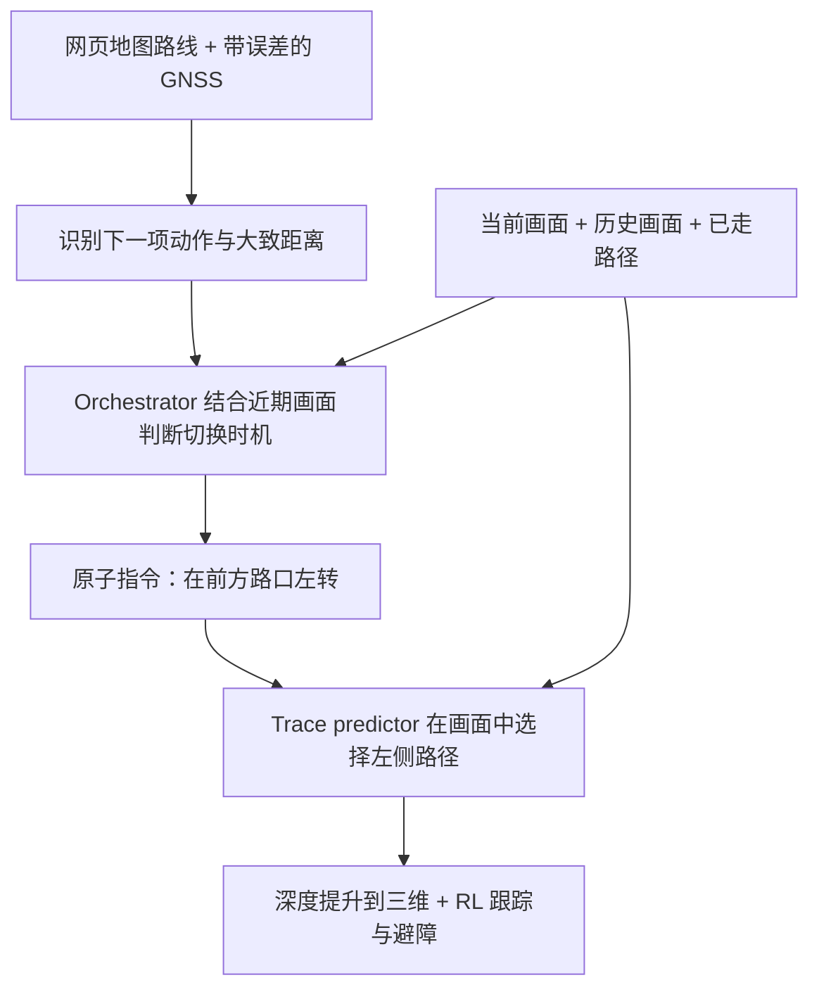

* 目录
{:toc}

> 本篇是 [VLN 综述](/VLN-Survey/)的配套户外导航阅读，关注机器人如何结合地图、语言与视觉，在城市街道、人行道和野外步道上完成长距离任务。当前收录 [WayTrace](#waytrace)，后续按研究脉络补充。
>
> 相关方向见[指令跟随篇](/VLN-Papers/)、[目标导航篇](/VLN-Papers-Extended/)与 [Agentic 导航篇](/Agentic-Navigation-Papers/)。户外评测单独记录路线、定位误差和人工干预条件。

# 户外导航评测记录
{: id="outdoor-navigation-benchmarks"}

下表记录本篇论文报告的完整系统结果；自建基准保留原始名称与评测条件，SR 不与室内 VLN 或其他户外基准直接混比，未报告的指标记为“–”。

| 模型 | 年份 | 基准 | 范式 | 评测条件 | SR ↑ | SPL ↑ |
|:---|:---:|:---|:---:|:---|:---:|:---:|
| [WayTrace](#waytrace) | 2026 | 苏黎世老城长程导航（自建） | 训练 | 完美 GNSS | 83.3 | – |
| [WayTrace](#waytrace) | 2026 | 苏黎世老城长程导航（自建） | 训练 | GNSS 漂移 7 m RMS | 63.3 | – |

**评测口径：** 10 条路线，每条运行三个种子，每个条件共 30 次；成功要求在目的地 5 m 内停车，且每次过街至少一半的道路内路径位于斑马线上。最长 1.37 km 的真实机器人任务属于另行展示的实机演示，含两次人工语言指令替换，不计入上表的仿真 SR。

# 户外导航论文精读
{: id="outdoor-navigation-readings"}

## 1. WayTrace (2026)
{: id="waytrace"}
———用语言衔接网页地图与视觉路径，让城市导航不再追着带误差的坐标走

📄 **Paper**: [arXiv:2611.05129](https://arxiv.org/abs/2611.05129) · [Project Page](https://way-trace.github.io)

### 精华

1. 长程导航可以拆成两个问题：高层判断现在该执行哪条局部指令，低层把指令落实为当前画面里的路径，两者通过语言衔接。
2. GNSS 只提供路线进度与大致距离，路径位置由相机决定，因此定位漂移主要影响动作切换时机，而不会直接把路径平移到马路或河岸外。
3. 路径预测先确定终点所处的分支，再生成通向该终点的轨迹；部署时保留终点的语言解码，用小型回归头一次输出路径点。
4. 规模化训练的关键是让同一场景对应多种指令及路径，覆盖行人实际没有走过的分支，减少模型忽略语言、只猜最常见行走路线的机会。
5. 慢速语义规划与快速避障控制异步运行，使约 3 秒的上层响应延迟仍能支撑连续行走，但其长程可靠性最终受指令切换错误和交通反应能力限制。

---

### 1. 研究背景/问题

网页地图已经能给出大多数城市的步行路线，但直接追踪 GNSS 航点会把数米定位误差转成错误运动目标，且坐标本身不表达“沿人行道走、从斑马线过街”等要求。现有 VLN 模型在户外连一条局部指令都可能执行不稳，串联成数百米至公里级路线后，错误更容易累积。WayTrace 因此将“选择当前指令”与“执行当前指令”分开，让地图提供全局路线，视觉负责局部落地。

---

### 2. 主要方法/创新点

  
<figcaption>图 2：地图提供路线，远程 orchestrator 选择原子语言指令，机载 trace predictor 输出图像路径，RL 策略沿深度提升后的三维路径行走；三个循环异步运行。</figcaption>

**整体框架。** 系统由路线与指令编排、语言条件路径预测、RL 运动执行三个核心环节构成：orchestrator 判断下一步该做什么以及何时切换，trace predictor 画出这条指令在当前图像中的路径，RL 策略根据最新深度图跟踪路径并避障。语言是高低层之间的接口，图像中的二维路径则连接视觉理解与具身控制。

**① 路线与 orchestrator：地图决定下一步动作，相机判断执行时机。** 输入是目标地点、附近路线指示及距离、以机器人朝向为上方的约 50 m 宽卫星图、当前与过去 15 m 的相机观测，以及当前指令。真实部署先用 Google Places API 解析目的地，再用 Google Routes API 获取步行路线，并在 OpenStreetMap 的步行网络上重新规划，以覆盖人行道和已标注的过街位置；仿真则使用预先构建、与网页地图风格一致的路线指示。

未经微调的 Qwen3.8-Flash-Next 每 2 秒接收一次请求，输出一句理由和一条“在路口左转”“过马路”等原子指令；这里的原子指令描述当前视野内可落地的一次局部动作，不要求机器人执行精确米数。GNSS 投影到路线后，只用于识别当前路线步骤和估计距离，局部路径并不追踪这个坐标；机器人端另有提前过街拒绝、到达指令检查、指令过期等规则。过街还按“转入斑马线 → 过街 → 离开斑马线并进入下一路段”的顺序切换，避免一直保留带方向的转弯指令。

这张读者版图强调分工：即使 GNSS 把机器人估计到人行道旁边的道路上，只要路线步骤仍判断正确，低层仍会根据画面中的人行道画路径；若误差导致高层过早发出转弯命令，系统依然可能走错路口，因此它降低了对定位精度的依赖，并没有消除这种依赖。

**② Trace predictor：先选定要去的分支，再补出路径。** 输入包括当前 RGB 图像、按行走距离间隔 1.8 m 采样的五张历史图像、里程计生成的已走路径俯视图，以及当前语言指令。历史图像覆盖约 9 m 行程，帮助模型判断转弯已经执行到哪一步，避免每次看到“左转”都重新左转。

模型以 RynnBrain-9B 初始化，将图像和指令送入视觉编码器与语言模型，先输出归一化图像坐标中的终点，再预测以该终点结束的 10 个二维路径点。这里的终点是指令路径离开视野或被完全遮挡的位置，不一定是整条任务路线的最终目的地；作者将预测流程写为：

$$
p_\theta(\tau\mid x,c)=p_\theta(g\mid x,c)\,p_\theta(\tau\mid g,x,c).
$$

其中，$x$ 为视觉与行走历史，$c$ 为指令，$g$ 为终点，$\tau$ 为路径。先定终点可以约束分支选择，减少直接预测路径时在岔路之间折中的现象。

> **举个例子（仅为机制示意）**：假设画面里左右两条支路的终点分别是 $(0.2,0.2)$ 和 $(0.8,0.2)$，两支路之间有隔离区域；若模型在两条路线间折中，可能画向中间的 $(0.5,0.2)$。先根据“走左边岔路”选定左侧终点，再补出路径，就把问题从“同时猜走哪条路、怎么走”拆成“先选分支，再连接路径”。

**③ 从两阶段训练到单次调用部署。** 两阶段版本在约 119 万样本上进行一轮 LoRA 监督微调，分别用自回归交叉熵训练终点和路径，路径阶段训练时给定参考终点。为减少机载推理延迟，部署版本只自回归生成约 15 个终点 token，再读取终点结束处的隐藏状态，用 LayerNorm、两层线性映射与 GELU 构成的 MLP 直接回归 20 个数，即 10 个二维点，最后用 sigmoid 约束到归一化坐标范围；这样省去约 140 个路径 token 的逐个解码。

该单次调用模型的训练目标为：

$$
\mathcal L=\frac{1}{N}\sum_{i=1}^{N}\lVert\hat u_i-u_i\rVert_1
+2\lVert\hat u_N-g\rVert_1
+0.5\mathcal L_{\mathrm{CE}},\qquad N=10.
$$

第一项监督所有路径点，第二项加强路径末端与目标点的一致性，第三项监督终点 token。附录说明，该版本从完整数据中按来源比例抽取 25 万个样本训练，30% 的样本使用模型自己预测的终点来训练回归头，并屏蔽这些样本的终点交叉熵，让路径头适应略有偏差的终点；最终时序路径模型使用监督微调，单图教师则使用监督微调和 GRPO，二者训练方式不能混为一谈。

**④ 自动标注：既学习实际走过的路，也学习同一画面的其他可选路线。**

  
<figcaption>图 3：上支路从真实行走序列恢复路径并标注指令；下支路用少量人工标签训练教师，为同一画面的多个指令生成不同路径，再传播到后续帧以配上真实历史。</figcaption>

这里的意图条件路径（intent-conditioned traces），就是让“同一幅图、不同命令”得到不同路径。只将视频中的未来行走轨迹投影回当前帧，每幅画面通常只有一条实际走过的路径，模型可能只根据场景猜路线而忽略指令。

| 维度 | 仅使用重建行走数据 | 加入意图条件路径 |
|---|---|---|
| 单幅画面的监督 | 只有行人实际走过的路径 | 每条可见支路及部分地标可对应不同指令与路径 |
| 学习信号 | 场景外观与实际路径绑定 | 同一场景内也必须依据指令区分路径 |

**实际行走支路。** 原始数据池包含 182 个城市与地区的 51,907 段 Mapillary 序列。VGGT-Ω 从短序列恢复相机姿态和几何，再用 GNSS 轨迹长度确定尺度，将未来相机下方的地面位置投影到当前帧，得到图像路径；VLM 随后生成描述该路径的指令及四种改写，另一次 VLM 判断仅保留指令与路径一致的片段，最终得到 26,740 个片段、约 28.8 万个样本。

**意图条件支路。** 先用 NaviTrace 训练划分，以及在 605 张 Mapillary 图像上人工绘制的约 1,900 条路径训练单图教师。再从路口、过街点和步道采样锚点图像，让 VLM 为可见分支及可唯一识别的地标生成多条指令，教师逐条画出路径；三维重建把这些路径传播到序列后续帧，从而为单图教师产生的标签补上真实历史，得到约 10.6 万张锚点图像上的 86.3 万个样本。

两条支路加上人工与 NaviTrace 基础样本后，最终训练集为 **1,190,594 个样本**，其中 3,950 份基础样本重复十次参与训练；测试序列从各训练来源中排除。这里的尺度来自可解释的重建、教师标注和传播流程，不要求采集同等规模的机器人示范。

**⑤ 三维提升与 RL 执行：路径提供方向，最新深度处理身体与障碍。** 输入是二维路径、深度图、里程计与机器人速度；先把路径点提升到三维并固定在里程计坐标系，保留落在已观测可通行地面上的路径前缀，再把沿路径前方 4.5 m 的跟踪目标交给 RL 导航策略。该策略在仿真中学习根据深度图到达局部点目标并避障，部署时以 5 Hz 更新速度指令，实机使用重新训练的版本。

Orchestrator 单次约耗时 1.3 秒，机载路径预测约 1.5 秒，控制器在等待期间继续跟踪上一条路径。收到新指令、前进 3 m、执行完当前路径的 40%，或距离上次请求超过 5 秒时，会请求新路径；最终到达指令生效后，距路径目标 1.5 m 内停止。整条链路因而是“地图与历史选择指令 → 当前视觉生成路径 → 深度和里程计更新局部目标 → RL 连续执行”，而非每次等完整大模型推理结束再移动。

---

### 3. 核心结果/发现

**长程闭环。** 作者在 Isaac Sim 5.0 中构建约 0.91 km² 的苏黎世老城，设置 10 条长 152–864 m 的路线，每个条件运行三次种子，共 30 次。成功既要求在目的地 5 m 内停车，也要求沿途每次过街至少一半的道路内路径位于斑马线上，因此成功率包含过街合规条件。

| 方法 | 完美 GNSS 的成功率 | 7 m RMS 漂移的成功率 |
|---|---:|---:|
| CityWalker + 本文 RL 控制器 | 36.7% | 23.3% |
| VAMOS + 本文 RL 控制器 | 63.3% | 10.0% |
| WayTrace | **83.3%** | **63.3%** |

使用原发布控制器时，CityWalker、VAMOS、OmniVLA 的成功率分别为 20.0%、13.3%、0%；即便用按模型单独调优的 oracle 提供指令，TIC-VLA、Foresight、VENTURA 也仅为 6.7%、3.3%、6.7%。将 WayTrace 的高层替换为 oracle、保持路径预测与 RL 不变后，成功率升至 90.0%，说明剩余瓶颈包括高层决策，也包括局部执行。

  
<figcaption>图 5：在使用相同 RL 控制器的比较中，WayTrace 对 GNSS 漂移的退化较缓；其各噪声条件下斑马线违规率低于 6%、驶入道路的路径占比低于 1%，但成功率仍会受动作切换错误影响。</figcaption>

**局部路径与消融。** 在人工标注的 Human-Test（332 张图、953 条路径）上，WayTrace 的 NaviTrace 分数为 83.2，对比方法最高为 57.0，转向侧别准确率为 97.9%；NaviTrace 分数综合路径匹配、终点误差与语义地面惩罚，不能当成任务成功率。加入历史后，50 个单指令片段、每个三次种子的闭环成功率由 74.7% 升至 94.7%，完成转弯后继续重复转弯的比例由 56.0% 降至 9.3%；加入 86.3 万意图条件样本后，数据消融中的 NaviTrace 分数从 79.33 升至 83.32。开放环表格主要报告两阶段模型，闭环则使用单次调用模型；后者在 Human-Test 上同样达到约 83.2。

**真实机器人。** Unitree B2W 使用 ZED X 深度相机、激光惯性里程计与 GNSS 融合定位，路径预测在 Jetson AGX Thor 上运行，RL 控制器在 Jetson AGX Orin 上运行，高层模型部署在远程四张 H100 上。

| 实机任务 | 规划路线长度 | 平均速度 | 作者统计的人工指令干预 |
|---|---:|---:|---:|
| Starbucks | 426 m | 1.12 m/s | 0 次 |
| Snipes | 248 m | 1.01 m/s | 0 次 |
| Dieci | 312 m | 1.11 m/s | 0 次 |
| Mendokoro | 1,368 m | 1.19 m/s | 2 次 |

最长任务的两次干预都是人工将持续转弯的指令替换为沿路直行，没有遥操作机器人，作者报告其无干预行驶距离占比为 97.2%。Starbucks 任务还曾由操作员短暂停车以检查接近的电车，作者因没有修改指令或路径而未将其计入干预；该任务另出现过提前进入道路、随后才并入斑马线的情况，因此表中“0 次”不能理解为无需交通监督或全程严格合规。

  
<figcaption>图 6：Snipes、Dieci 与 1.37 km 的 Mendokoro 实机任务，包含拥挤街道、桥梁及校园路线；最长任务中标出了两次人工语言指令替换。</figcaption>

**语言接口的扩展。** 仿真中展示了封路或错过转弯后请求新路线，以及仅凭人类提供的六条地标指示完成 127 m 导航；后一个演示不用地图或 GNSS，但采用额外里程计规则并限速至 0.6 m/s，不能据此推断整套长程系统已不需要 GNSS。对 957 次日志决策的回放评估中，默认高层模型的关键错误率为 5.1%，更强模型可降至 3.2%，但调用延迟约为其三至五倍；这是决策回放结果，尚非更强模型的完整闭环任务成功率。

---

### 4. 局限性

高层仍依赖远程网络、GNSS 路线进度和启发式规则，可能提前、延后或重复发出动作；约 3 秒的串行语义响应延迟、有限前向视野与短期历史，会影响窄路口和长动作的可靠性，目前也无法处理红灯停车或接近电车等交通反应。评估仅覆盖一处静态仿真城市和四条无对比基线的实机演示，仿真没有交通与行人，成功判据还允许单次过街最多约一半道路内路径不在斑马线上，因此这些结果尚不足以证明普遍城市交通安全或无人监督的公里级部署能力。

---

# 参考资料

## 论文引用

1. **WayTrace** (2026). Manthan Patel, Jonas Frey, Pascal Roth, Marco Hutter, Cesar Cadena. *WayTrace: A Map-to-Language-to-Trace Hierarchy for Embodied Urban Navigation*. arXiv: [2611.05129](https://arxiv.org/abs/2611.05129).
