# 引言

ROS 2 把感知、规划与控制等功能组织为相互协作的节点，并为通信、调度与系统集成提供基础。理解节点如何交换数据，以及客户端、执行器和中间件各自负责什么，是阅读这篇架构指南的起点。

<figure class="survey-intro-figure">
  
  <figcaption>图：ROS 2 以节点组织机器人软件，用话题、服务与动作建立协作；客户端与执行器、RMW 接口和中间件实现分别承担不同职责。</figcaption>
</figure>

# 一、从 ROS 1 到 ROS 2

## 1.1 为什么要重构

**ROS（Robot Operating System）** 诞生于 2007 年斯坦福大学人工智能实验室（STAIR 项目）与 Willow Garage，其初衷是为学术界提供一个开源的机器人软件快速原型平台。随着机器人技术从实验室走向工业自动化、商用服务、自动驾驶以及人形具身智能，ROS 1 的设计局限性日益凸显：

1. **中心化单点故障（Single Point of Failure）**：ROS 1 强依赖运行在固定 IP/端口的 `roscore`（Master 节点）。若 Master 崩溃或发生网络分区，整个机器人系统的节点发现与通信注册将全面瘫痪。
2. **缺乏确定性与硬/软实时支持**：ROS 1 的底层基于标准 TCP/UDP socket，操作系统调度无优先级控制，无法满足工业控制器与底层电机驱动微秒/毫秒级的确定性实时控制需求。
3. **网络适应性差与无原生加密安全机制**：TCPROS/UDPROS 在无线有损网络（Wi-Fi、4G/5G、跨网段）中丢包率高、重连机制脆弱；通信链路为明文传输，无身份认证与访问控制机制。
4. **多机协同与多机器人集群复杂度高**：ROS 1 多机通信需严格配置 `ROS_MASTER_URI` 与 `ROS_IP`，缺少灵活的域隔离与多机发现治理方案。
5. **嵌入式微控制器隔离**：无法直接运行在计算与内存受限的微控制器（MCU/DSP/RTOS）上，通常只能通过脆弱的串口协议（如 `rosserial`）做低效桥接。

为了解决这些问题，Open Robotics 没有在 ROS 1 上打补丁，而是基于工业标准 **DDS（Data Distribution Service）** 重新设计了 **ROS 2**。

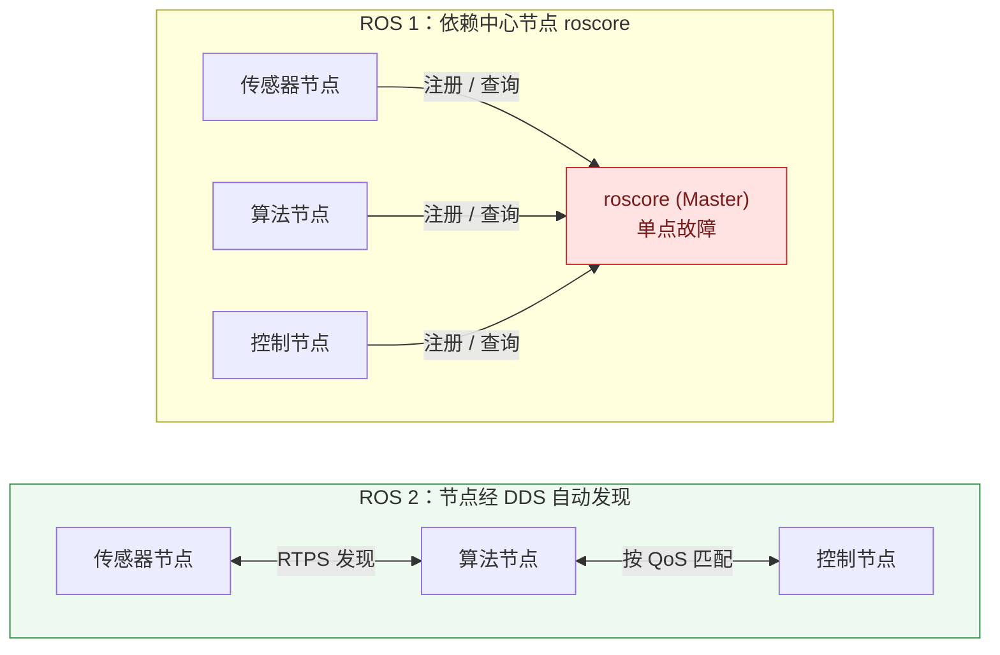

*图：ROS 1 的节点要先向 roscore 注册才能互相找到；ROS 2 的节点通过 DDS/RTPS 直接发现彼此，没有中心节点。*

## 1.2 ROS 1 与 ROS 2 对比

| 维度 | ROS 1 (Noetic / Melodic) | ROS 2 (Humble / Iron / Jazzy) | 核心价值 / 工业影响 |
| :--- | :--- | :--- | :--- |
| **网络拓扑** | 基于 Master (`roscore`) 集中协调 | 基于 DDS RTPS 的完全分布式去中心化 | 杜绝单点失效，支持大规模集群动态组网 |
| **底层通信** | 自定义 TCPROS / UDPROS 协议 | OMG 工业级 DDS 标准（Fast DDS, Cyclone DDS, Connext 等） | 复用军工/航空级成熟数据分发底座 |
| **服务质量 (QoS)** | 仅支持简单 TCP 可靠传输与 UDP 尽力传输 | 完备的 QoS 策略（Reliability, Durability, History, Deadline 等） | 精准适配传感器高频低延时与控制高可靠需求 |
| **跨进程/进程内通信** | Socket 序列化拷贝；Nodelet 进程内共享（API 割裂） | 统一 Component 容器；原生支持借用指针零拷贝（Zero-Copy IPC） | 极大降低百兆高分辨率点云与 4K 图像传输 CPU 占用 |
| **节点生命周期** | 无状态黑盒；节点各自无序初始化 | 原生受管生命周期节点（Lifecycle Managed Nodes） | 保证传感器驱动、算法、执行器的确定性受控启动顺序与故障降级 |
| **实时性支持** | Linux 通用内核；无实时保证 | 支持 Linux PREEMPT_RT、QNX、VxWorks 等硬实时 OS，内存零动态分配 API | 满足微秒级闭环运动控制需求 |
| **嵌入式支持** | 仅通过 `rosserial` 串口转译 | micro-ROS 原生支持 STM32、ESP32、Zephyr、FreeRTOS | MCU 微控制器无缝作为 First-class ROS 2 节点 |
| **安全机制** | 无安全验证，网络裸奔 | SROS2 规范：DDS-Security 身份鉴权、访问控制列表 (ACL)、TLS/AES 加密 | 满足商业机器人安全合规与抗网络攻击标准 |
| **参数系统** | 全局统一的 Parameter Server | 节点私有独立的 Parameter 实例，支持运行时强类型约束与事件监听 | 避免参数命名空间污染，支持动态重配置拦截 |
| **多平台构建** | 强依赖 Ubuntu Linux / CMake (`catkin`) | 原生支持 Linux, Windows, macOS (`colcon` + `ament`) | 降低跨平台工业软件移植门槛 |

## 1.3 发行版与支持周期

ROS 2 每年 5 月发布一个版本，与 Ubuntu 的发布节奏对齐：偶数年发布长期支持版（LTS），支持 5 年；奇数年发布普通版本，支持约一年半。

| 发行版 | 发布 | 目标平台 | 类型 | 支持状态（截至 2026-10） |
| :--- | :--- | :--- | :--- | :--- |
| Foxy Fitzroy | 2020-05 | Ubuntu 20.04 | LTS | 已停止支持 |
| Galactic Geochelone | 2021-05 | Ubuntu 20.04 | 普通 | 已停止支持 |
| Humble Hawksbill | 2022-05 | Ubuntu 22.04 | LTS | 支持至 2027-05，目前部署最广 |
| Iron Irwini | 2023-05 | Ubuntu 22.04 | 普通 | 已停止支持 |
| Jazzy Jalisco | 2024-05 | Ubuntu 24.04 | LTS | 支持至 2029-05 |
| Kilted Kaiju | 2025-05 | Ubuntu 24.04 | 普通 | 即将停止支持 |
| Lyrical Luth | 2026-05 | Ubuntu 26.04 | LTS | 支持至 2031-05，最新 LTS |

> **选型建议**
> - **生产部署**：选 Humble（Ubuntu 22.04）或 Jazzy（Ubuntu 24.04），Nav2、MoveIt 2、ros2_control 等生态包对它们的支持最完善。新项目可以评估 Lyrical，但要先确认依赖的生态包已经发布对应版本。
> - **前沿研发**：用最新 LTS 或 Rolling，可以更早用上执行器性能优化、Type Adaptation 等新特性。

# 二、分层架构与 DDS

## 2.1 软件分层

ROS 2 采用分层设计，上层算法代码与底层传输中间件相互解耦：换一种中间件，不需要改业务代码。

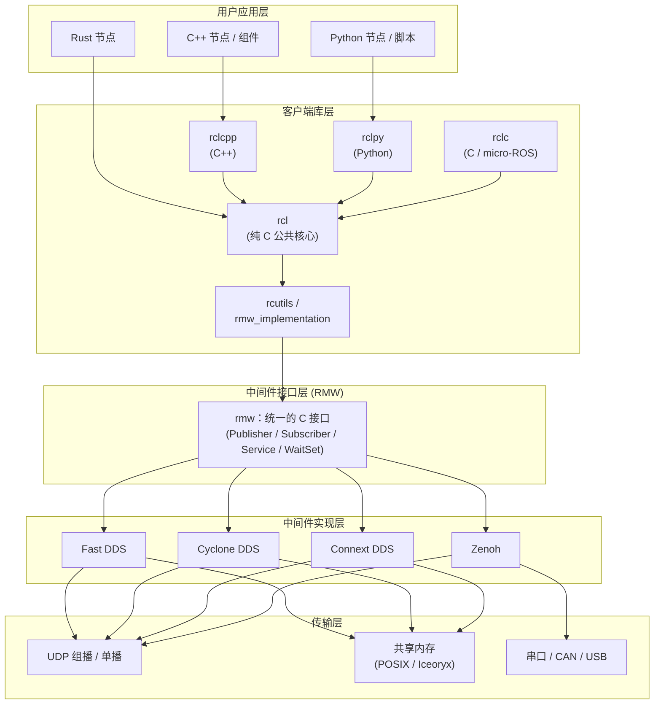

图中的中间件实现层对应 `rmw_fastrtps_cpp`、`rmw_cyclonedds_cpp`、`rmw_connextdds` 与 `rmw_zenoh_cpp` 四个包，2.3 节比较它们的取舍。

### 关键组件职责
- **`rcl` (ROS Client Library)**：纯 C 编写的公共逻辑层，负责参数解析、节点图、日志、时钟等与语言无关的功能，让 C++、Python 等客户端库行为一致。
- **`rmw` (ROS Middleware)**：统一的 C 接口，定义发布、订阅、等待集、QoS 映射等操作，上层代码无需知道底层用的是哪种中间件。
- **`rosidl`**：接口定义语言（IDL）生成器，将 `.msg`、`.srv`、`.action` 自动生成为 C、C++、Python 的原生结构体与序列化/反序列化代码。

## 2.2 DDS 工作机制

DDS 是对象管理组织（**OMG**）制定的开放标准，其核心是 **以数据为中心的发布-订阅模型（DCPS, Data-Centric Publish-Subscribe）**。

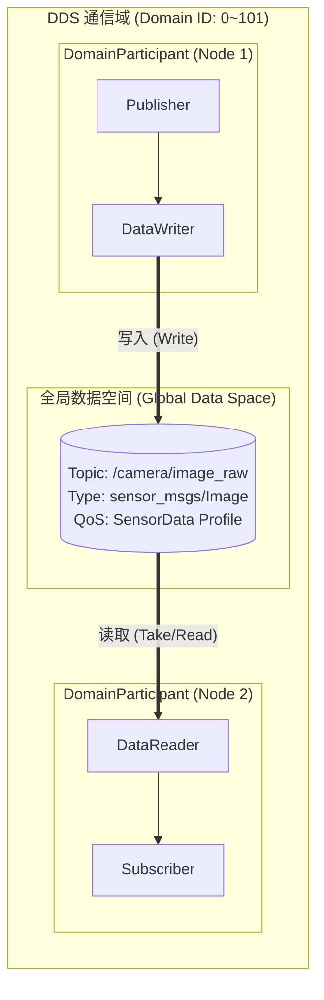

### RTPS 自动发现
DDS 节点在局域网内启动时，无需 Master 协调即可自动发现彼此，其内部包含两个阶段：
1. **SPDP（Simple Participant Discovery Protocol）**：节点启动后，向预定端口（基于 Domain ID 计算的组播地址 `239.255.0.1`）周期性发送组播心跳包，宣告自身的 Participant GUID、IP 地址与传输端口。
2. **SEDP（Simple Endpoint Discovery Protocol）**：当 Participant 发现彼此后，建立可靠单播连接，互相交换各自包含的 DataWriter / DataReader 详细信息（Topic 名称、数据类型、QoS 配置）。若 QoS 匹配成功，即在底层建立点对点数据通道。

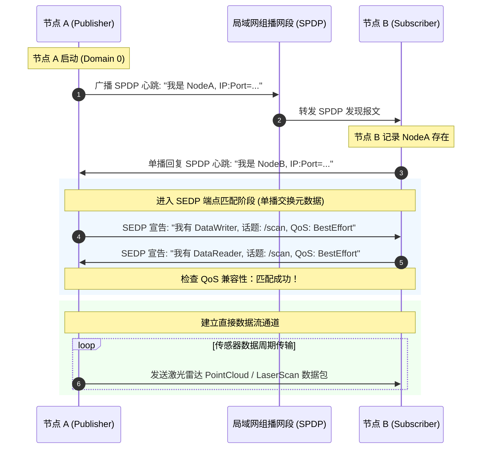

## 2.3 RMW 实现对比与切换

| 中间件 (RMW) | 供应商 / 许可 | 优势与核心特性 | 劣势 / 注意事项 | 推荐应用场景 |
| :--- | :--- | :--- | :--- | :--- |
| **Fast DDS** (`rmw_fastrtps_cpp`) | eProsima (Apache-2.0) | ROS 2 官方默认实现；功能完备，内置高性能共享内存 (SHM) 传输，支持 Discovery Server | Wi-Fi 弱网环境下组播丢包易导致发现变慢 | 默认通用机器人开发、单机仿真、高性能单机部署 |
| **Cyclone DDS** (`rmw_cyclonedds_cpp`) | Eclipse (EPL-2.0) | 架构轻量，代码精炼；对 Wi-Fi 抖动网络鲁棒性极佳，吞吐量高，延迟极低 | 共享内存配置较复杂（需配合 Iceoryx） | 自动驾驶、多机分布式系统、无线移动机器人 |
| **Connext DDS** (`rmw_connextdds`) | RTI (商业许可) | 工业/军工级认证，支持安全关键系统（ISO 26262 ASIL-D, DO-178C），调试工具集完备 | 商业收费闭源 | 航空航天、医疗手术机器人、车规级自动驾驶系统 |
| **Zenoh** (`rmw_zenoh_cpp`) | ZettaScale (Apache-2.0) | 放弃复杂 RTPS，采用极简协议；零组播风暴，天然支持跨公网/4G/5G/云边协同通信 | 仍在快速演进中，生态工具链逐步成熟 | 跨广域网（WAN）车云互联、大规模机器人集群管理 |

```bash
# 环境变量动态切换 RMW（无需重新编译代码）
export RMW_IMPLEMENTATION=rmw_cyclonedds_cpp
ros2 run my_pkg my_node

# 验证当前使用的 RMW 实现
ros2 doctor --report | grep middleware
```

## 2.4 多机通信与 Domain ID

为了在同一局域网内隔离不同机器人或团队的节点，ROS 2 提供了 `ROS_DOMAIN_ID`。合法取值为 0 ~ 232，推荐使用 **0 ~ 101**：这个范围在各平台上都不会与操作系统的临时端口冲突。

```bash
# 在 ~/.bashrc 中为这台机器人设置域 ID
export ROS_DOMAIN_ID=42

# 发现范围（Jazzy 及以后）：SUBNET 允许局域网多机通信，LOCALHOST 仅限本机
export ROS_AUTOMATIC_DISCOVERY_RANGE=SUBNET
# Humble 及更早版本用 ROS_LOCALHOST_ONLY=0/1 实现同样的效果（Jazzy 起已弃用）
```

> **DDS 端口计算公式**
> 每个 Domain ID 占用一段固定的 UDP 端口：
> $$\text{Port} = 7400 + 250 \times \text{DomainID} + \text{Offset}$$
> 同一网段内设置了相同 `ROS_DOMAIN_ID` 的设备，节点会自动互相发现。

# 三、五种通信方式

ROS 2 将所有的软件解耦交互抽象为五种通信原语。选择正确的通信方式是系统架构设计的首要原则。

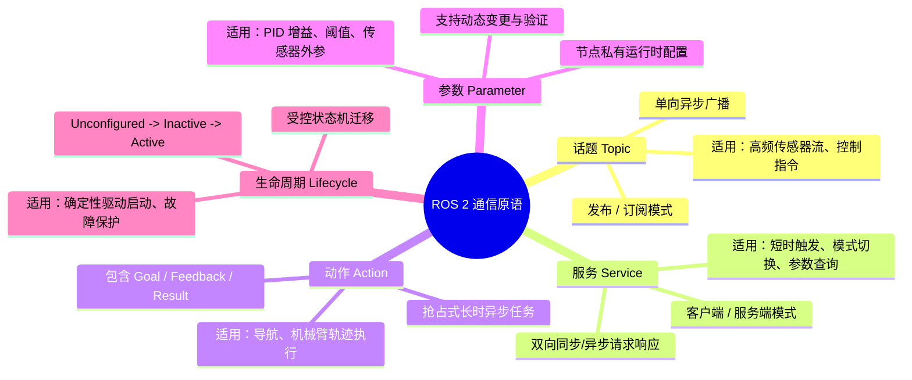

## 3.1 如何选择

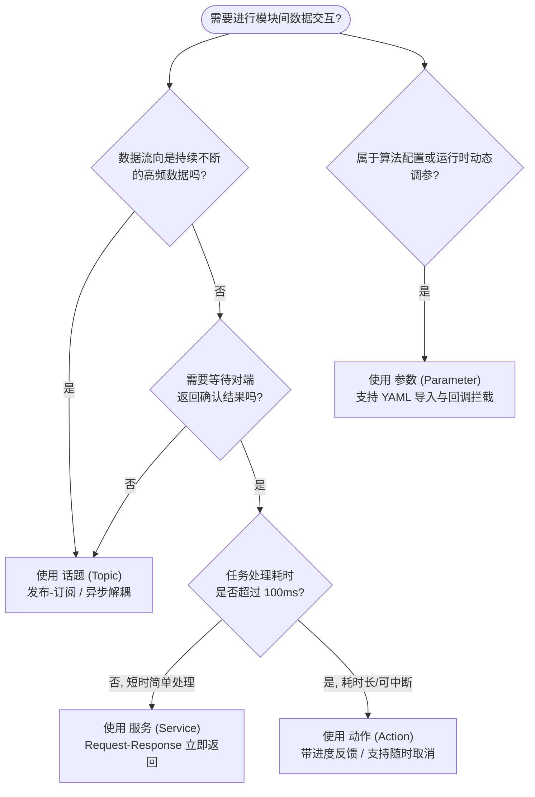

## 3.2 话题 Topic

### 通信原理
话题是多对多的发布-订阅（Pub/Sub）通道。发布者将数据推送到 DDS 域中，订阅者根据 QoS 策略接收数据，双方在生命周期与网络拓扑上完全解耦。

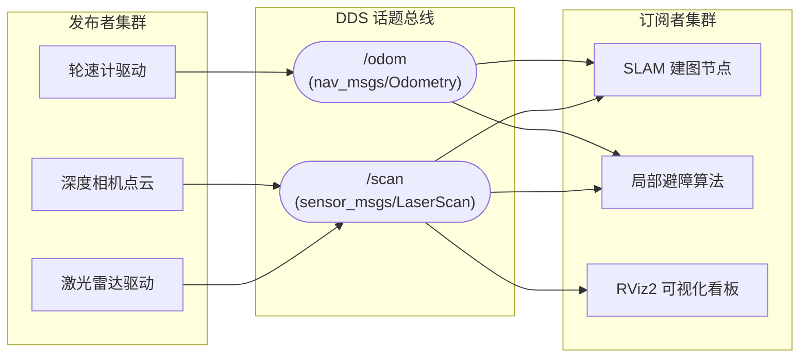

### C++ 实现（`rclcpp`）

```cpp
#include <chrono>
#include <memory>
#include <string>
#include "rclcpp/rclcpp.hpp"
#include "std_msgs/msg/string.hpp"

using namespace std::chrono_literals;

class RobustPublisher : public rclcpp::Node {
public:
    RobustPublisher() : Node("robust_publisher_node"), count_(0) {
        // 创建传感器专用的 BestEffort QoS
        rclcpp::QoS qos_profile(rclcpp::KeepLast(10));
        qos_profile.best_effort();
        qos_profile.durability_volatile();

        publisher_ = this->create_publisher<std_msgs::msg::String>("/telemetry_data", qos_profile);
        timer_ = this->create_wall_timer(100ms, std::bind(&RobustPublisher::timer_callback, this));
        
        RCLCPP_INFO(this->get_logger(), "高频发布节点已启动 (10Hz)...");
    }

private:
    void timer_callback() {
        auto message = std_msgs::msg::String();
        message.data = "Telemetry Frame #" + std::to_string(count_++);
        publisher_->publish(message);
    }

    rclcpp::TimerBase::SharedPtr timer_;
    rclcpp::Publisher<std_msgs::msg::String>::SharedPtr publisher_;
    size_t count_;
};

int main(int argc, char* argv[]) {
    rclcpp::init(argc, argv);
    rclcpp::spin(std::make_shared<RobustPublisher>());
    rclcpp::shutdown();
    return 0;
}
```

### Python 实现（`rclpy`）

```python
#!/usr/bin/env python3
import rclpy
from rclpy.node import Node
from rclpy.qos import QoSProfile, ReliabilityPolicy, HistoryPolicy
from std_msgs.msg import String

class RobustSubscriber(Node):
    def __init__(self):
        super().__init__('robust_subscriber_node')
        
        # 定义匹配发布端的 QoS 配置
        qos = QoSProfile(
            history=HistoryPolicy.KEEP_LAST,
            depth=10,
            reliability=ReliabilityPolicy.BEST_EFFORT
        )
        
        self.subscription = self.create_subscription(
            String,
            '/telemetry_data',
            self.listener_callback,
            qos
        )
        self.get_logger().info('订阅节点已就绪，等待遥测数据...')

    def listener_callback(self, msg: String):
        self.get_logger().info(f'收到遥测帧: "{msg.data}"')

def main(args=None):
    rclpy.init(args=args)
    node = RobustSubscriber()
    try:
        rclpy.spin(node)
    except KeyboardInterrupt:
        pass
    finally:
        node.destroy_node()
        rclpy.shutdown()

if __name__ == '__main__':
    main()
```

## 3.3 服务 Service

### 通信原理
服务是点对点的客户端-服务端（Client/Server）通信模型。客户端发送 `Request`，服务端计算后返回 `Response`。

> **注意**：不要在单线程 Executor 的回调里同步等待服务结果（如对 `async_send_request()` 返回的 future 调用 `get()`、或 Python 中的 `client.call()`）。等待会占住唯一的线程，响应回调永远得不到执行，造成死锁。应使用异步调用，在 future 完成时的回调里处理结果。

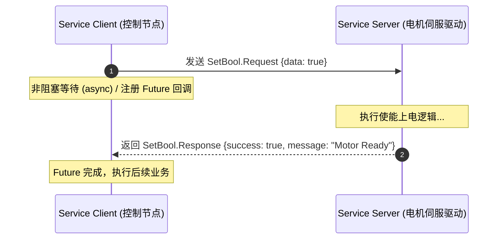

## 3.4 动作 Action

### 通信原理
动作用于耗时较长的异步任务，如底盘从 A 点导航到 B 点、机械臂执行一次抓取。一个 Action 在底层由三个服务和两个话题组成：

1. **Goal（服务）**：客户端发送目标，服务端决定接受或拒绝。
2. **Cancel（服务）**：客户端可随时请求取消，服务端安全中断当前任务。
3. **Result（服务）**：任务结束后返回最终结果（成功、失败或已取消）。
4. **Feedback（话题）**：执行过程中持续推送进度，如当前位姿、剩余距离。
5. **Status（话题）**：广播各个目标的当前状态。

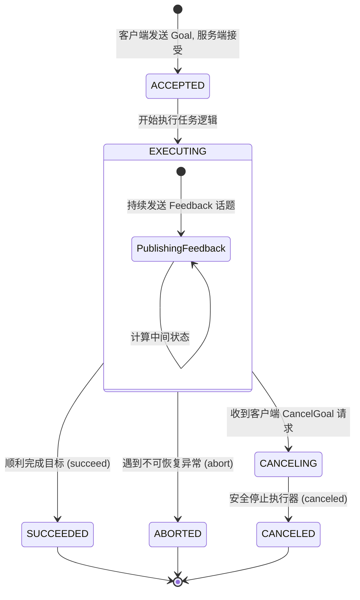

### Action 接口定义
```yaml
# 1. 目标 (Goal)
geometry_msgs/PoseStamped pose
string behavior_tree
---
# 2. 最终结果 (Result)
std_msgs/Empty result
int16 error_code
---
# 3. 实时反馈 (Feedback)
geometry_msgs/PoseStamped current_pose
builtin_interfaces/Duration navigation_time
builtin_interfaces/Duration estimated_time_remaining
int16 number_of_recoveries
float32 distance_remaining
```

## 3.5 参数 Parameter

在 ROS 2 中，参数是**绑定在具体节点实例上**的私有数据项，支持强类型校验、范围约束和动态修改回调拦截。

```cpp
// C++ 声明带描述符与动态校验的参数
rcl_interfaces::msg::ParameterDescriptor desc;
desc.description = "机器人最大线速度限制 (m/s)";
desc.floating_point_range.resize(1);
desc.floating_point_range[0].from_value = 0.0;
desc.floating_point_range[0].to_value = 2.5;
desc.floating_point_range[0].step = 0.05;

this->declare_parameter("max_linear_velocity", 1.0, desc);

// 注册动态参数变更拦截回调 (OnSetParametersCallback)
params_callback_handle_ = this->add_on_set_parameters_callback(
    [this](const std::vector<rclcpp::Parameter> &parameters) {
        rcl_interfaces::msg::SetParametersResult result;
        result.successful = true;
        for (const auto &param : parameters) {
            if (param.get_name() == "max_linear_velocity") {
                if (param.as_double() > 2.0) {
                    result.successful = false;
                    result.reason = "安全保护触发：实车线速度不可超过 2.0 m/s";
                } else {
                    RCLCPP_INFO(this->get_logger(), "速度上限更新为: %.2f", param.as_double());
                }
            }
        }
        return result;
    }
);
```

# 四、QoS 服务质量

QoS（Quality of Service）是 ROS 2 相比 ROS 1 最重要的通信改进：可以按数据流的特点，分别配置底层的传输行为。

## 4.1 核心策略

| 策略 | 可选值 | 含义 |
| :--- | :--- | :--- |
| **Reliability**（可靠性） | `RELIABLE` / `BEST_EFFORT` | 丢包后重传；或尽力发送、允许丢包 |
| **Durability**（持久性） | `VOLATILE` / `TRANSIENT_LOCAL` | 不保留历史；或为后加入的订阅者保留最近 N 条消息 |
| **History & Depth**（历史队列） | `KEEP_LAST(N)` / `KEEP_ALL` | 只保留最近 N 条；或保留全部，直到资源上限 |
| **Liveliness & Lease**（活跃度） | `AUTOMATIC` / `MANUAL_BY_TOPIC` | 由中间件自动上报存活；或由发布者显式声明存活 |
| **Deadline**（截止期） | 时间段 | 规定相邻两条消息的最大间隔，超时触发事件 |
| **Lifespan**（生存期） | 时间段 | 消息超过有效期后不再投递 |

## 4.2 兼容性规则

> **Request vs. Offer 原则**
>
> 发布端提供（Offered）的 QoS 必须**不低于**订阅端请求（Requested）的 QoS，否则两端不会建立连接。程序照常运行，订阅端只是收不到数据，最多在日志里留下一条 QoS 不兼容警告；可以用 `ros2 topic info -v` 对比两端的 QoS 来排查。

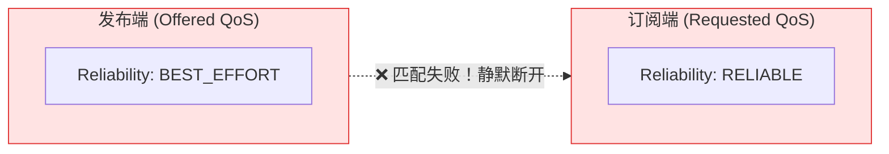

### 兼容矩阵

| 发布者 (Offered) | 订阅者 (Requested) | 匹配结果 | 说明 |
| :--- | :--- | :---: | :--- |
| **RELIABLE** | **RELIABLE** | ✅ **兼容** | 全链路可靠传输（丢包自动重发） |
| **RELIABLE** | **BEST_EFFORT** | ✅ **兼容** | 发布者可提供高保证，订阅者降级接收 |
| **BEST_EFFORT** | **BEST_EFFORT** | ✅ **兼容** | 尽力传输，低延时，允许丢包 |
| **BEST_EFFORT** | **RELIABLE** | ❌ **不兼容** | 订阅者要求可靠，但发布者无法保证，**无法通信** |
| **TRANSIENT_LOCAL** | **VOLATILE** | ✅ **兼容** | 订阅者不需要历史数据，正常接收实时数据 |
| **VOLATILE** | **TRANSIENT_LOCAL** | ❌ **不兼容** | 订阅者需要历史地图，但发布者未缓存，**无法通信** |

## 4.3 常用配置模板

| 场景应用 | Reliability | Durability | History (Depth) | 设计考量 |
| :--- | :--- | :--- | :--- | :--- |
| **高频原始相机图像 / 激光雷达** (`/image_raw`, `/scan`) | `BEST_EFFORT` | `VOLATILE` | `KEEP_LAST (1~5)` | 追求极低延迟，丢掉一帧老旧图像无影响，避免队列积压 |
| **底盘控制指令** (`/cmd_vel`) | `RELIABLE` | `VOLATILE` | `KEEP_LAST (10)` | 控制指令必须准确送达，禁止丢帧造成失控 |
| **静态地图 / 参数事件** (`/map`, `/robot_description`) | `RELIABLE` | `TRANSIENT_LOCAL` | `KEEP_LAST (1)` | 类似 ROS 1 的 Latch 机制，后启动的 SLAM/Nav2 节点一上线即可获得全量地图 |
| **高可靠状态报警** (`/emergency_stop`) | `RELIABLE` | `TRANSIENT_LOCAL` | `KEEP_ALL` | 急停与故障事件绝不允许丢失 |

# 五、执行器与零拷贝

## 5.1 执行器

在 ROS 2 中，回调函数（Timer、Subscription、Service、Action）不会自己在后台线程里运行，而是由 **Executor（执行器）** 从底层 WaitSet 中取出就绪事件，再调度执行。

| 执行器 | 调度方式 | 优点 | 代价与注意事项 |
| :--- | :--- | :--- | :--- |
| `SingleThreadedExecutor` | 一个线程按顺序执行所有就绪回调 | 没有并发竞争，天然线程安全 | 任何一个回调耗时过长，都会拖住后面所有事件 |
| `MultiThreadedExecutor` | 线程池并行执行就绪回调 | 利用多核，提高响应速度和吞吐 | 必须用回调组（见 5.2 节）控制并发，避免数据竞争 |
| `EventsExecutor` | 由中间件事件直接唤醒，不再轮询 WaitSet | CPU 空转开销低，低负载时更省电 | Iron 起以实验特性提供，使用前确认所用版本的支持情况 |

## 5.2 回调组与死锁

为了在 `MultiThreadedExecutor` 中精细控制并发权限，ROS 2 提供了两类回调组：

1. **`MutuallyExclusiveCallbackGroup`（互斥组，默认）**：该组内的所有回调函数在同一时刻只能有一个线程在执行。
2. **`ReentrantCallbackGroup`（可重入组）**：组内的不同回调（甚至同一个回调的多次触发）可以被多个线程并行执行。

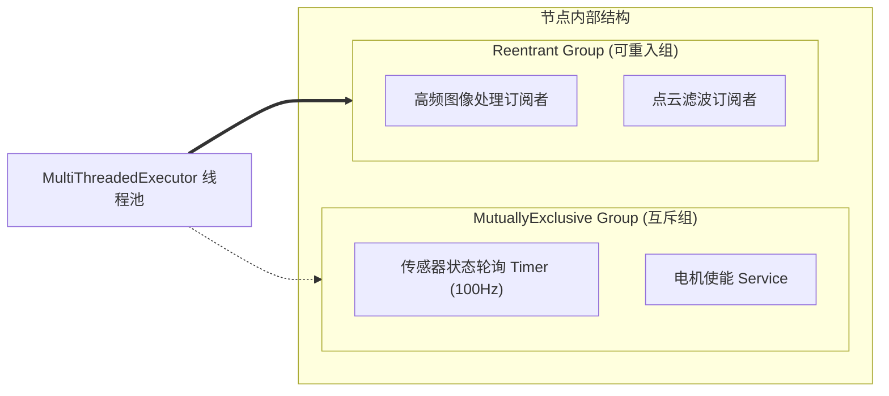

> **经典死锁场景**
>
> 订阅回调里同步等待某个服务的响应，而处理响应的回调与它同属默认的互斥回调组。订阅回调占着执行权等响应，响应回调却永远轮不到执行，节点就此卡死。
>
> 解法（任选其一或组合使用）：
>
> 1. 把等待响应的回调和处理响应的回调放进不同的回调组，并改用 `MultiThreadedExecutor`。
> 2. 不在回调里阻塞等待，改为异步调用，在 future 完成的回调里处理结果。

## 5.3 组件与进程内零拷贝

传统多节点系统采用多进程模型，节点间传一条消息要经过：**用户态内存 → 序列化 → 内核 Socket → 反序列化 → 目标用户态内存**。对 4K 图像或 3D 激光点云这种每秒数百兆字节的数据流，CPU 与内存带宽开销很大。

ROS 2 的 **Component（组件）** 把多个节点编译成动态库（`.so` / `.dll`），在运行时加载进同一个 `ComposableNodeContainer` 进程。开启进程内通信后，用 `std::unique_ptr` 发布消息，就能直接转移指针所有权，不再拷贝数据（零拷贝 IPC）。

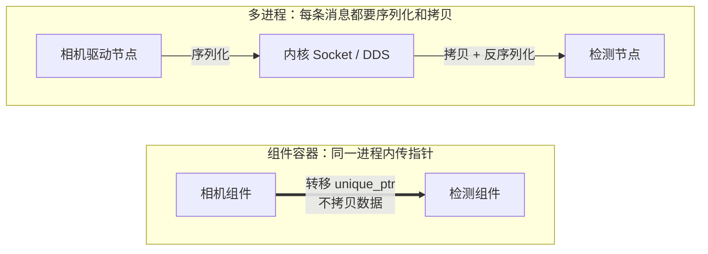

### C++ 零拷贝发布示例

```cpp
#include "rclcpp/rclcpp.hpp"
#include "sensor_msgs/msg/point_cloud2.hpp"

using namespace std::chrono_literals;

class ZeroCopyPointCloudPublisher : public rclcpp::Node {
public:
    // 加载组件时需开启进程内通信：NodeOptions().use_intra_process_comms(true)
    explicit ZeroCopyPointCloudPublisher(const rclcpp::NodeOptions & options)
    : Node("zero_copy_publisher", options) {
        pub_ = this->create_publisher<sensor_msgs::msg::PointCloud2>("/points", 10);
        timer_ = this->create_wall_timer(33ms, std::bind(&ZeroCopyPointCloudPublisher::publish_cloud, this));
    }

private:
    void publish_cloud() {
        // 使用 unique_ptr 构造独占所有权的消息
        auto cloud_msg = std::make_unique<sensor_msgs::msg::PointCloud2>();
        
        // 填充大型点云数据 buffer ...
        cloud_msg->header.stamp = this->now();
        cloud_msg->header.frame_id = "lidar_frame";
        cloud_msg->width = 1920;
        cloud_msg->height = 1080;
        cloud_msg->data.resize(cloud_msg->width * cloud_msg->height * 16);

        // 使用 std::move 转移所有权，触发底层进程内指针直接交换
        pub_->publish(std::move(cloud_msg));
    }

    rclcpp::Publisher<sensor_msgs::msg::PointCloud2>::SharedPtr pub_;
    rclcpp::TimerBase::SharedPtr timer_;
};
```

# 六、生命周期节点

在真实机器人上，节点启动顺序失控可能造成事故，例如激光雷达或底盘驱动还没完成参数校验，导航算法就已经开始发布速度指令。为此，ROS 2 提供了 **Lifecycle Node（受管生命周期节点）**：节点按显式的状态机逐步启动，由外部管理器决定何时激活。

## 6.1 状态机

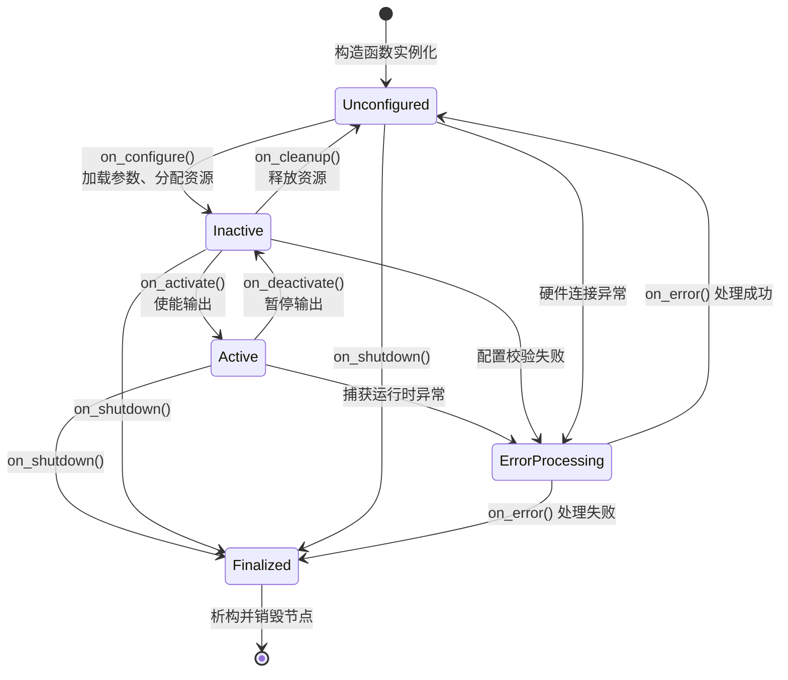

### 状态含义
- **`Unconfigured`（未配置）**：节点已加载，但未读取参数，未连接硬件设备。
- **`Inactive`（非活动）**：配置已加载，Publisher 与 Subscriber 已建立，但 Publisher 处于静默状态（不向 DDS 广播任何消息），执行器被挂起。
- **`Active`（活动状态）**：系统正常运转，所有回调激活，执行主控制循环。
- **`Finalized`（终结状态）**：资源完全释放，准备退出进程。

# 七、TF2 坐标变换

机器人系统中存在大量的几何坐标系（世界系、底盘系、雷达系、机械臂末端系、相机光学系）。**TF2（Transform Library 2）** 负责维护整个机器人全生命周期内的**时空变换树（Transform Tree）**。

## 7.1 标准坐标系

根据 ROS 官方规范 **REP 105**，移动机器人必须严格遵循树状单父级拓扑：

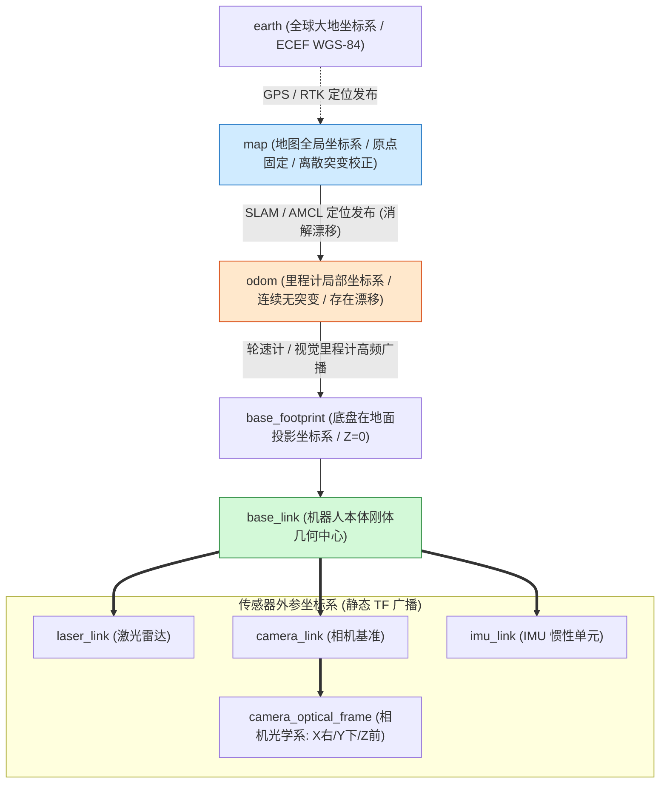

- **REP 103 坐标轴定义约定**：
  - 机器人本体：**FLU（Forward-Left-Up）**：$X$ 轴向前，$Y$ 轴向左，$Z$ 轴向上。
  - 相机光学坐标系：**RDF（Right-Down-Forward）**：$X$ 轴向右，$Y$ 轴向下，$Z$ 轴向前（视线方向）。

## 7.2 动态 TF 与静态 TF

- **`/tf`（动态变换）**：以固定频率（如 50Hz）广播不断变化的相对位姿（如 `odom -> base_link`）。
- **`/tf_static`（静态外参）**：仅在系统启动或传感器外参标定完成时广播一次，底层使用 `TRANSIENT_LOCAL` QoS，后启动的节点也能收到，不必周期性重复广播，节省 CPU 和带宽。

```cpp
// C++ 监听并查询任意两个坐标系在历史某一时刻的变换关系
#include "tf2_ros/buffer.h"
#include "tf2_ros/transform_listener.h"

auto tf_buffer = std::make_unique<tf2_ros::Buffer>(this->get_clock());
auto tf_listener = std::make_shared<tf2_ros::TransformListener>(*tf_buffer);

try {
    // 阻塞最多 100ms 查询 map 到 laser_link 的最新变换
    geometry_msgs::msg::TransformStamped transform = tf_buffer->lookupTransform(
        "map", "laser_link",
        tf2::TimePointZero,
        std::chrono::milliseconds(100)
    );
    RCLCPP_INFO(this->get_logger(), "雷达在地图上的全局坐标: x=%.2f, y=%.2f",
                transform.transform.translation.x, transform.transform.translation.y);
} catch (const tf2::TransformException & ex) {
    RCLCPP_WARN(this->get_logger(), "TF 变换查询失败: %s", ex.what());
}
```

# 八、URDF 与 Xacro

## 8.1 机器人描述体系

- **URDF（Unified Robot Description Format）**：采用 XML 描述机器人的连杆（Link）、关节（Joint）、物理碰撞体与惯性张量。
- **Xacro（XML Macros）**：针对 URDF 不支持变量、宏、包含与数学运算的缺陷演进而来，是现代机器人建模的标准方式。

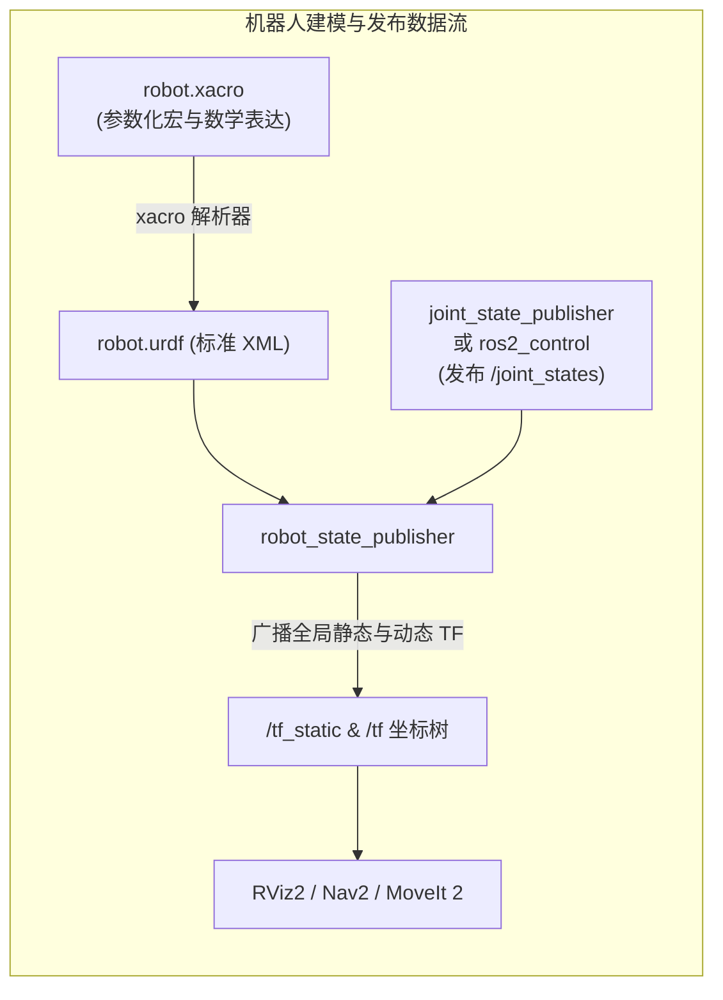

## 8.2 Xacro 宏示例

```xml
<?xml version="1.0"?>
<robot xmlns:xacro="http://www.ros.org/wiki/xacro" name="industrial_diff_bot">

  <!-- 常量定义 -->
  <xacro:property name="wheel_radius" value="0.10" />
  <xacro:property name="wheel_width" value="0.05" />
  <xacro:property name="wheel_mass" value="2.5" />
  <xacro:property name="track_width" value="0.45" />

  <!-- 宏：参数化定义动力驱动轮 -->
  <xacro:macro name="drive_wheel" params="prefix side_sign">
    <link name="${prefix}_wheel_link">
      <visual>
        <origin xyz="0 0 0" rpy="${pi/2} 0 0"/>
        <geometry>
          <cylinder radius="${wheel_radius}" length="${wheel_width}"/>
        </geometry>
        <material name="black"><color rgba="0.1 0.1 0.1 1.0"/></material>
      </visual>
      <collision>
        <origin xyz="0 0 0" rpy="${pi/2} 0 0"/>
        <geometry>
          <cylinder radius="${wheel_radius}" length="${wheel_width}"/>
        </geometry>
      </collision>
      <inertial>
        <mass value="${wheel_mass}"/>
        <inertia ixx="${(wheel_mass/12.0)*(3*wheel_radius*wheel_radius + wheel_width*wheel_width)}" 
                 iyy="${(wheel_mass/12.0)*(3*wheel_radius*wheel_radius + wheel_width*wheel_width)}" 
                 izz="${(wheel_mass/2.0)*(wheel_radius*wheel_radius)}" 
                 ixy="0.0" ixz="0.0" iyz="0.0"/>
      </inertial>
    </link>

    <joint name="${prefix}_wheel_joint" type="continuous">
      <parent link="base_link"/>
      <child link="${prefix}_wheel_link"/>
      <origin xyz="0 ${side_sign * track_width / 2.0} 0" rpy="0 0 0"/>
      <axis xyz="0 1 0"/>
    </joint>
  </xacro:macro>

  <!-- 实例化左右轮 -->
  <xacro:drive_wheel prefix="left" side_sign="1" />
  <xacro:drive_wheel prefix="right" side_sign="-1" />

</robot>
```

# 九、仿真平台

| 平台 | 特点 | 与 ROS 2 的连接方式 |
| :--- | :--- | :--- |
| **Gazebo**（Gazebo Sim，如 Harmonic） | 官方推荐的通用物理仿真器，跨平台 | `ros_gz_bridge` 在 Gazebo 与 ROS 2 话题之间双向桥接 |
| **NVIDIA Isaac Sim / Isaac ROS** | 基于 Omniverse，光线追踪渲染，适合生成合成数据 | Isaac ROS 提供 GPU 加速节点，NITROS 减少 GPU 数据拷贝 |
| **Webots / MuJoCo** | 轻量、物理计算快，常用于强化学习训练 | Webots 有官方 ROS 2 接口；MuJoCo 多通过社区桥接 |

仿真引擎会在 `/clock` 话题上发布虚拟时间，ROS 2 节点设置 `use_sim_time: true` 后就跟随这个时间推进。

> **注意仿真时间**
>
> 在仿真或回放 rosbag 时，所有算法节点都要设置 `use_sim_time: true`。否则节点读取的是宿主机的系统时钟，与数据中的时间戳对不上，TF 查询会报 `ExtrapolationException`。

# 十、核心生态

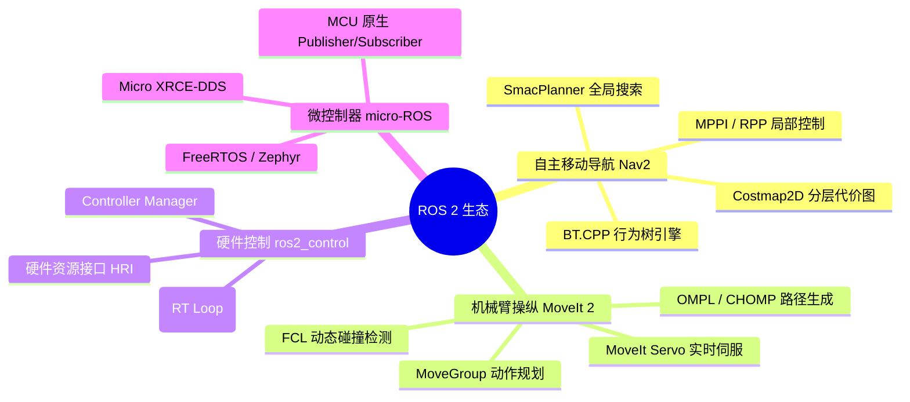

## 10.1 Nav2 导航

Nav2 是 ROS 2 官方打造的第二代自主移动机器人导航系统，重构了 ROS 1 navigation 的整体架构，完全基于**行为树（BehaviorTree.CPP）**与**生命周期管理器（LifecycleManager）**实现。

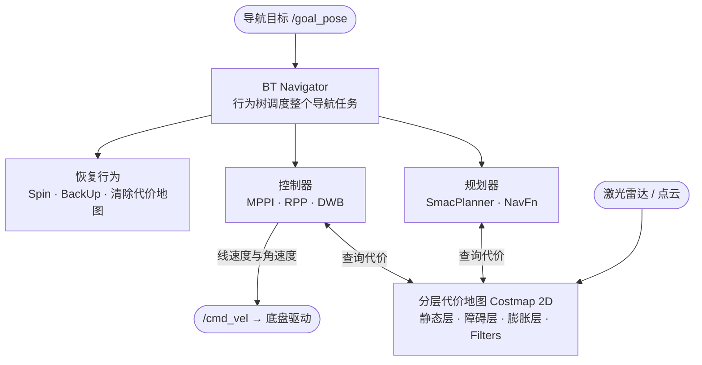

| 模块 | 常用插件 | 作用 |
| :--- | :--- | :--- |
| 规划器 | SmacPlanner（2D / Hybrid-A* / State Lattice）、NavFn（Dijkstra / A*） | 在全局代价地图上生成从当前位置到目标的路径 |
| 控制器 | MPPI、Regulated Pure Pursuit（RPP）、DWB | 跟踪路径，实时输出速度指令 |
| 恢复行为 | Spin、BackUp、ClearEntireCostmap | 机器人被困或规划失败时尝试脱困 |
| 代价地图 | 静态层、障碍 / 体素层、膨胀层、Costmap Filters（禁行区、限速区） | 融合地图与传感器数据，给每个栅格标注通行代价 |

### 控制器对比
1. **MPPI（Model Predictive Path Integral）**：在 CPU 上并行采样大量候选轨迹并按代价函数打分，适用于差速、全向和阿克曼等多种底盘，避障灵活，是目前 Nav2 推荐的通用控制器之一。
2. **Regulated Pure Pursuit (RPP)**：紧贴参考路径行驶，根据路径曲率和与障碍物的距离自动减速，行为稳定、易于调参，常用于仓储 AGV/AMR。

## 10.2 MoveIt 2 运动规划

MoveIt 2 专为多自由度机械臂（6-DOF / 7-DOF 串联臂、双臂机器人、人形机器人上半身）提供运动学求解、轨迹规划与实时碰撞检测。

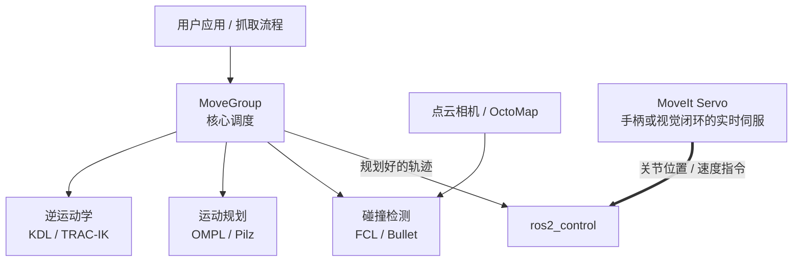

## 10.3 ros2_control 硬件控制

`ros2_control` 为机器人硬件驱动提供了统一的编写规范。它将**实时控制循环（Hard Real-Time Loop，如 1000Hz）** 与 **非实时 ROS 异步通信**完全解耦，避免电机控制因 ROS 消息阻塞而失控。

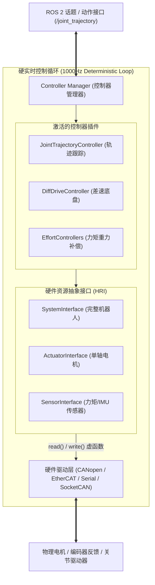

# 十一、构建、启动与录包

## 11.1 colcon 构建

```bash
# 1. 基础完整构建
colcon build --symlink-install

# 2. 日常开发常用参数：
#   --symlink-install   用符号链接安装，改 Python 代码和配置文件后无需重新构建
#   --packages-select   只构建指定的包
#   --cmake-args        传给 CMake，这里开启 Release 优化
#   --parallel-workers  限制同时构建的包数，避免机器满载卡死
colcon build \
  --symlink-install \
  --packages-select my_robot_control \
  --parallel-workers 8 \
  --cmake-args -DCMAKE_BUILD_TYPE=Release

# 3. 编译后必须加载 overlay 环境
source install/setup.bash
```

## 11.2 Launch 编排

ROS 2 的 Launch 文件完全采用 Python 编写，具备强大的条件分支、事件监听与参数透传能力。

```python
import os
from ament_index_python.packages import get_package_share_directory
from launch import LaunchDescription
from launch.actions import DeclareLaunchArgument, IncludeLaunchDescription, GroupAction
from launch.conditions import IfCondition
from launch.substitutions import LaunchConfiguration, PythonExpression
from launch_ros.actions import Node, PushRosNamespace

def generate_launch_description():
    pkg_bringup = get_package_share_directory('my_robot_bringup')
    
    # 声明启动参数
    use_sim_time_arg = DeclareLaunchArgument('use_sim_time', default_value='false', description='Use simulation clock')
    enable_rviz_arg = DeclareLaunchArgument('use_rviz', default_value='true', description='Open RViz2')

    # 包含子 launch 文件
    nav2_launch = IncludeLaunchDescription(
        os.path.join(pkg_bringup, 'launch', 'navigation.launch.py'),
        launch_arguments={'use_sim_time': LaunchConfiguration('use_sim_time')}.items()
    )

    # 声明条件启动节点
    rviz_node = Node(
        package='rviz2',
        executable='rviz2',
        name='rviz2',
        arguments=['-d', os.path.join(pkg_bringup, 'rviz', 'default.rviz')],
        parameters=[{'use_sim_time': LaunchConfiguration('use_sim_time')}],
        condition=IfCondition(LaunchConfiguration('use_rviz'))
    )

    return LaunchDescription([
        use_sim_time_arg,
        enable_rviz_arg,
        nav2_launch,
        rviz_node
    ])
```

## 11.3 rosbag2 录制回放

```bash
# 1. 录制全量话题（排除体积庞大的未压缩原始图像，节约 SSD 带宽）
ros2 bag record -a -x "/camera/(.*)/image_raw" -s mcap -o my_experiment_bag

# 2. 查询录包元信息（帧率、丢包率、时间跨度、消息总数）
ros2 bag info my_experiment_bag.mcap

# 3. 0.5 倍速慢放回放（带仿真时钟发布，方便离线单步调试算法）
ros2 bag play my_experiment_bag.mcap --rate 0.5 --clock 50
```

# 十二、多机部署与安全

## 12.1 弱网与 DDS 调优

在大规模机器人车队（Fleet Management）与多机协同场景中，Wi-Fi 组播容易出现风暴或丢包。推荐以下调优策略：

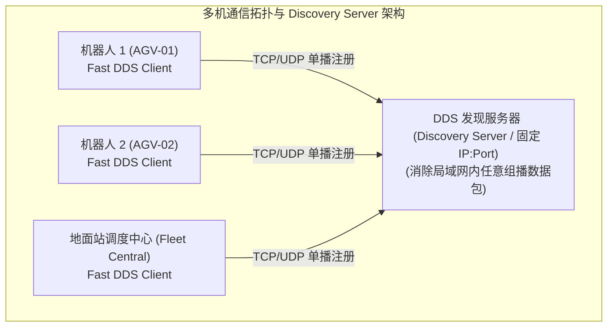

### 1. 扩大内核网络缓冲区
```bash
sudo sysctl -w net.core.rmem_max=2147483647
sudo sysctl -w net.core.wmem_max=2147483647
sudo sysctl -w net.ipv4.ipfrag_time=3
sudo sysctl -w net.ipv4.ipfrag_high_thresh=134217728
```

### 2. Fast DDS 发现服务器
```bash
# 在调度服务器或主机上启动发现服务器 (ID: 0, 端口 11811)
fastdds discovery -i 0 -p 11811

# 在所有机器人终端配置单播发现环境变量（无需任何组播支持！）
export ROS_DISCOVERY_SERVER="192.168.1.100:11811"
```

## 12.2 SROS2 安全

针对网络嗅探、未授权节点接入和伪造控制指令（如伪造 `/cmd_vel`）等威胁，ROS 2 提供了基于 **DDS-Security** 的 **SROS2** 安全工具集，包含三项能力：

| 能力 | 机制 | 防范的问题 |
| :--- | :--- | :--- |
| **身份认证** | 基于 X.509 证书（PKI）验证每个参与者的身份 | 未授权节点接入 |
| **访问控制** | 签名的 XML 权限文件，规定每个节点可以发布、订阅哪些话题 | 越权发布或订阅 |
| **加密** | AES-GCM 加密与消息完整性校验 | 窃听与篡改 |

```bash
# 生成安全根证书密钥库 (Keystore)
ros2 security create_keystore ~/sros2_keystore

# 为特定节点生成独占数字证书与访问策略
ros2 security create_enclave ~/sros2_keystore /my_secure_controller

# 启用安全模式运行节点
export ROS_SECURITY_ENABLE=true
export ROS_SECURITY_STRATEGY=Enforce
export ROS_SECURITY_KEYSTORE=~/sros2_keystore
ros2 run my_robot_pkg controller_node --ros-args --enclave /my_secure_controller
```

## 12.3 systemd 部署与看门狗

将机器人启动栈托管为 Linux 系统守护服务，实现**开机自启、崩溃自动拉起与日志轮转**：

```ini
# /etc/systemd/system/robot_bringup.service
[Unit]
Description=Autonomous Mobile Robot Auto Bringup Service
After=network.target network-online.target systemd-timesyncd.service
Wants=network-online.target

[Service]
Type=simple
User=robot
Group=robot
Environment="ROS_DOMAIN_ID=42"
Environment="RMW_IMPLEMENTATION=rmw_cyclonedds_cpp"
ExecStart=/bin/bash -c "source /opt/ros/humble/setup.bash && source /home/robot/ros2_ws/install/setup.bash && ros2 launch my_robot_bringup full_system.launch.py"
Restart=always
RestartSec=3
KillSignal=SIGINT
TimeoutStopSec=10

[Install]
WantedBy=multi-user.target
```

```bash
# 加载并使能开机自启
sudo systemctl daemon-reload
sudo systemctl enable robot_bringup.service
sudo systemctl start robot_bringup.service
```

# 十三、CLI 速查

```bash
# -------------------------------------------------------------
# 1. 节点排查 (Node)
# -------------------------------------------------------------
ros2 node list                                # 列出当前活跃节点
ros2 node info /my_node                       # 打印节点的完整发布、订阅、服务、Action 接口

# -------------------------------------------------------------
# 2. 话题调试 (Topic)
# -------------------------------------------------------------
ros2 topic list -t                            # 列出话题及对应的消息类型
ros2 topic echo /scan --no-arr                # 打印话题内容（截断大型数组，防止刷屏）
ros2 topic hz /scan                           # 实时测量话题发布频率
ros2 topic bw /camera/image_raw               # 测量话题带宽消耗 (MB/s)
ros2 topic delay /odom                        # 测量消息传输延迟 (需包含 header.stamp)
ros2 topic info -v /cmd_vel                   # 打印话题详细 QoS 策略（排查 QoS 匹配失败）
ros2 topic pub /cmd_vel geometry_msgs/msg/Twist "{linear: {x: 0.2}}" -r 10 # 10Hz 发送测试指令

# -------------------------------------------------------------
# 3. 服务与动作调用 (Service & Action)
# -------------------------------------------------------------
ros2 service list -t                          # 列出服务及类型
ros2 service call /reset_odom std_srvs/srv/Empty {} # 触发服务
ros2 action send_goal /navigate_to_pose nav2_msgs/action/NavigateToPose \
  "{pose: {header: {frame_id: 'map'}, pose: {position: {x: 1.0, y: 2.0}}}}" --feedback

# -------------------------------------------------------------
# 4. 参数热更新 (Parameter)
# -------------------------------------------------------------
ros2 param list /planner_node                 # 查看指定节点的参数
ros2 param get /planner_node max_speed        # 读取参数值
ros2 param set /planner_node max_speed 1.5    # 运行时动态修改参数值
ros2 param dump /planner_node > params.yaml   # 导出节点参数为 YAML 文件

# -------------------------------------------------------------
# 5. TF2 坐标变换诊断 (TF2)
# -------------------------------------------------------------
ros2 run tf2_tools view_frames                # 生成 frames.pdf 坐标系全景拓扑图
ros2 run tf2_ros tf2_echo map base_link       # 实时打印两个坐标系间的相对位姿
ros2 run tf2_ros tf2_monitor                  # 监控所有坐标变换的广播频率与延迟

# -------------------------------------------------------------
# 6. 系统自检与包管理 (System & Pkg)
# -------------------------------------------------------------
ros2 doctor --report                          # 扫描网络配置、DDS 状态并输出体检报告
rosdep install --from-paths src --ignore-src -r -y # 一键自动安装工作空间源码缺失的所有系统依赖
```

# 十四、总结与参考资料

ROS 2 的设计围绕四点展开：以数据为中心、模块化、可靠、可满足实时要求。标准化的 DDS 传输、受管生命周期节点、组件化零拷贝通信，加上 Nav2、MoveIt 2、ros2_control 等生态栈，使它成为当前机器人软件开发的主流基础设施。

```mermaid
flowchart LR
    subgraph Mindset["掌握 ROS 2 核心认知模型"]
        direction TB
        M1["DDS 总线解耦底层传输"]
        M2["QoS 精细化掌控通信可靠性"]
        M3["Component 容器实现高性能零拷贝"]
        M4["Lifecycle 节点确保系统确定性启动"]
        M5["Nav2 / MoveIt2 / ros2_control 赋能上层业务"]
        M1 ==> M2 ==> M3 ==> M4 ==> M5
    end
```

**参考与延伸阅读**

1. ROS 2 设计文档：[ROS 2 Design Documents (design.ros2.org)](https://design.ros2.org/)
2. ROS 2 官方文档：[ROS 2 Documentation (Humble / Jazzy)](https://docs.ros.org/en/humble/)
3. OMG DDS 规范：[Object Management Group - Data Distribution Service v1.4](https://www.omg.org/spec/DDS/)
4. Nav2 文档：[Navigation 2 Architecture & Guides](https://nav2.org/)
5. MoveIt 2 文档：[MoveIt 2 Documentation](https://moveit.picknik.ai/)
6. ros2_control 文档：[ros2_control Framework Documentation](https://control.ros.org/)
7. Fast DDS 手册：[eProsima Fast DDS User Manual](https://fast-dds.docs.eprosima.com/)
8. ROS Enhancement Proposals (REPs)：
   - [REP 103: Standard Units of Measure & Coordinate Conventions](https://www.ros.org/reps/rep-0103.html)
   - [REP 105: Coordinate Frames for Mobile Robots](https://www.ros.org/reps/rep-0105.html)
   - [REP 2000: ROS 2 Releases and Target Platforms](https://www.ros.org/reps/rep-2000.html)
   - [REP 2007: Type Adaptation & Type Masquerading](https://www.ros.org/reps/rep-2007.html)
