> 本文是 [AI Agent 综述](/AI-Agent-Survey/) 与底层系统架构指南 [Embodied Agent 综述](/Embodied-Agent-Harness-Survey/) 的配套具身论文精读，系统收录 Embodied Agent（具身智能体）领域的代表性工作与前沿突破。

# 具身智能体论文精读

本文关注一个共同问题：机器人如何把感知、规划、执行、验证和恢复组织成可持续运行的闭环。十七篇论文分别从运行时、编排器、评估器、演化机制、动作接口、训练目标、通用 AgentOS、巡检系统治理、导航会话交接、导航工具编排、视觉记忆检视、推理预算分配、统一具身推理、统一分类、递归 Harness 优化、具身能力边界评测和权重—Harness 协同进化切入，实验覆盖仿真环境、文本交互环境、交互式视觉游戏、真实机器人和软件专业任务；其中 SuperNav 提供简要导读，完整解析链接到 VLN 扩展篇，Evo² 的直接证据来自编码与记忆任务，本文将其作为可迁移到具身 Harness 演化的机制参考。

| 论文 | 主要切入点 | 代表性验证 |
|---|---|---|
| [HoloAgent-0](#holoagent-0) | AgentOS、类型化技能与分层空间记忆 | HM3D、ScanNet、真实异构机器人 |
| [Pigey](#pigey) | 推理期物理编排、TAMP/VLA 双后端与双重校验 | LIBERO-PRO、DROID 真机 |
| [Thea](#thea) | 场景图上下文与评估器退出码 | L1–L3 长程真机任务、跨本体部署 |
| [Zetta](#zetta) | 高频裁判、恢复动作库与离线自演化 | LIBERO-Pro、并发采样基础设施 |
| [Show-Harness](#show-harness) | 语义动作单元与本体解释器 | Franka、AgileX、仿真与真机泛化 |
| [SPACE](#space) | 技能引导的自适应动作分块与强化学习 | ALFWorld、ScienceWorld |
| [ABot-AgentOS](#abot-agentos) | 双 LLM、Agent Harness 与终身多模态记忆 | EmbodiedWorldBench、记忆基准 |
| [ABot-ER](#abot-er) | 统一具身推理与数据—模型协同演化 | 十二项具身理解与规划基准、真机定性演示 |
| [Harness Robotic OS](#harness-robotic-os) | 巡检运行时、分层记忆与自进化治理 | 真实小区导航与巡检；认知运行时尚待受控验证 |
| [NavHarness](#navharness) | 跨会话搜索交接、记忆处理、恢复与双阶段核验 | GOAT-Bench、IR2R-CE、36 房屋持续部署（仿真） |
| [SuperNav](#supernav) | 可读取导航技能、视觉点选工具与任务上下文管理 | 单 / 多物体与需求驱动导航、HM3D、Unitree Go2 真机 |
| [VISTA](#vista) | 无损视觉记忆、模型自主视觉检视与跨上下文笔记 | ARC-AGI-3、GameWorld、AI GameStore、BabyVision |
| [RACE](#race) | 跨轮推理覆盖、似然代理信号与自适应推理强化学习 | ScienceWorld、WebShop、AppWorld、DeepSearch |
| [Agentic Robots](#agentic-robots) | Model、Data、Environment、Harness 四领域与 17 类功能 | 综述归纳；未提出统一新方法实验 |
| [Harness²](#harness2) | 无标准答案的行为对比、双层递归与改进经验库 | 通用 Agent 方法参考；WorkBuddy-Bench、JobBench、LAB |
| [GPT-6-Astra-JRT](#gpt-6-astra-jrt) | 冻结知识包、交互预算、快慢协作与持续世界评测 | 12 项仿真基准、8 种真机配置、家庭环境原型 |
| [Evo²](#evo2) | 权重—Harness 协同进化、双角色 evolver 与跨分支策略复用 | Polyglot、SWE-bench Verified、LiveCodeBench、LoCoMo；无机器人实验 |

下方筛选栏支持多标签组合；同时选中多个标签时，页面只保留同时满足这些标签的论文。

## 1. HoloAgent-0 (2026) {#holoagent-0}
———统一具身智能体闭环操作系统：解耦异构物理技能，以分层3D多模态空间记忆为物理锚点

📄 **Paper**: [arXiv:2606.23565](https://arxiv.org/abs/2606.23565) · [Code](https://github.com/HorizonRobotics/HoloAgent)

---

### 精华

- **闭环具身运行时架构**：提出面向实体机器人的 Embodied AgentOS 操作系统，将任务规划从单次开环文本生成重构为“观测-检索-行动-监控”的持续闭环，有效填补物理世界的执行不确定性。
- **标准化类型化技能抽象（Typed Skills）**：制定了包含结构化参数、前置条件与运行时心跳状态流的动作规范，将 VLA 抓取、全身运控与主动导航统一封装，屏蔽了异构本体控制器的底层差异。
- **分层多模态场景图（HMSG）**：构建由楼层（Floor）、房间（Room）、视角（View）与物体（Object）组成的四层拓扑结构，巧妙引入“视角层”充当几何坐标与外观推理的桥梁，支撑快慢混合的高效空间检索。
- **开放词表 3D 动态语义建图**：融合多相机神经深度估计与多尺度 SigLIP 特征，结合 3D 实例反投影关联算法，在环境发生物理变动时实现局部的轻量级增量刷新。
- **真机异构全栈部署验证**：在 Unitree G1 人形、R1 人形与双臂移动底盘上完成部署，在 ScanNet 语义建图与 HM3D/真机长程导航基准上全面刷新行业指标。

---

### 1. 研究背景/问题

数字世界中的大语言模型智能体依赖结构化的代码或软件接口，具备确定性输入输出、透明的状态转移和可逆的试错成本；然而在物理世界中，机器人的动作执行是连续、不可逆且高度依赖具体机身构型的。由于感知退化、传感器噪声与动态变化，机器人常因环境记忆过时走错房间，或因控制器反馈不全而导致长程任务中断崩溃，这一系统级障碍被称为“具身鸿沟”（Embodiment Gap）。当前具身智能研究往往将 VLA 操作策略、3D 空间表征、全身运动控制和主动导航割裂为单点算法模块，缺乏一个统一的操作系统运行时来调度异构技能、维护持久 3D 空间底座，并基于实时心跳证据驱动故障恢复。

---

### 2. 主要方法/创新点

#### ① 整体框架概述

HoloAgent-0 将长程具身任务组织为一个自闭环的系统工程，整体架构包含三大核心耦合层与一个监控验证层，并通过 ROS2 话题总线实现强类型通信：
- **Embodied AgentOS 运行时层**：接收人类自然语言意图，结合时空记忆将指令编译为带依赖关系的技能图（Skill Graph），并在执行期负责资源调度、执行状态监视与自主重规划。
- **具身技能层（Embodied Skill Layer）**：将底层异构算法和控制器抽象为带有统一接口的类型化技能（Typed Skills），涵盖语音交互、开放词表感知、自主导航（HoloNavi）、双臂操作（HoloBrain）和全身运动（HoloMotion）。
- **具身记忆层（Embodied Memory Layer）**：维护三维公制几何、拓扑导航关系、开放词表 3D 语义体素图，以及由楼层、房间、视角、物体组成的分层多模态场景图（HMSG），同时记录任务进展的时序轨迹。
- **监控与验证层（Monitoring & Verification Layer）**：实时监测技能执行的心跳、置信度与错误模态，向用户提供多模态交互反馈，并在出现不可恢复故障时唤醒 AgentOS 进行动态重规划。

  
<figcaption>HoloAgent-0 闭环端到端运行时架构概览</figcaption>

#### ② 具身技能层与类型化动作抽象（Typed Skills）

在传统大模型工具调用中，智能体通常将底层工具视为黑盒函数，但这在物理机器人上极易导致死锁。为此，HoloAgent-0 提出了结构化的技能抽象契约：
1. **指令规范（Command Schema）**：每个技能显式声明名称、强类型入参、前置条件（Preconditions）以及预期物理后置状态（Expected Effects）。例如操作技能 `pick(object=mug, support=table)` 声明了对抓握物体和支撑平面的前置几何锚定要求。
2. **运行时状态流（Runtime Status Interface）**：执行端不再仅仅返回一个二值化的完成标识，而是通过 ROS2 状态话题持续广播包含进度比例、成功状态、细粒度失败模态（如物体不可达、抓握滑脱、碰撞风险、位姿奇异）、算法置信度、执行延迟以及故障是否可恢复（Recoverability）的结构化追踪数据。

##### 卡点降维 1：数字软件工具调用 vs. 具身类型化技能（Typed Skills）

| 比较维度 | 传统数字智能体工具调用（Software Tool Calling） | HoloAgent-0 具身类型化技能（Embodied Typed Skill） |
|---|---|---|
| **调用性质** | 同步或短时异步 API，输入输出确定、语义边界明确 | 物理世界连续耗时过程，易受动力学噪声、遮挡与传感器漂移干扰 |
| **反馈粒度** | 仅返回最终执行结果或标准报错码 | 持续发布运行时心跳流（包含进度百分比、局部置信度与碰撞风险） |
| **失败模态** | 错误码单一（如 HTTP 404/500），通常无物理副作用 | 细分可恢复与不可恢复模态（如机械臂关节限位、抓握滑动、目标丢失） |
| **恢复机制** | 简单的固定次数异常重试（Retry）或文本报错回传 | 显式暴露可恢复性，驱动 AgentOS 旋转视角重检、导航微调或重新规划 |

> **具体执行流示例**：
> 机器人接收到“把桌上的黄色毛巾放进洗衣篮”指令。
> 1. AgentOS 通过 ROS2 话题下发指令 `pick(object="yellow towel", support="desk")`；
> 2. HoloBrain 操作后端接管控制，在机械臂移动至预抓取位姿时持续回传状态流 `{progress: 40%, status: "in_progress", confidence: 0.88}`；
> 3. 夹爪闭合时触觉与位姿反馈检测到抓空，状态流立即上报 `{progress: 75%, status: "failed", failure_mode: "grasp_slip", recoverability: "recoverable"}`；
> 4. AgentOS 捕捉到可恢复性为真，并未机械重复盲目抓取，而是自动调度感知后端执行视点微调与掩码重估，更新目标物体 3D 边界框后重新发起抓取闭环。

针对不同机身体态，HoloAgent-0 接入了四大专门后端：
- **HoloNavi 空间导航**：承担大范围环境下的目标搜索与路径巡航；
- **HoloBrain 具身操作**：基于通用 VLA 大模型，生成双臂与末端夹爪的末端姿态轨迹，能够自主完成抓取、放置、倒水、折叠衣物等精巧操作；
- **HoloMotion 全身运动**：支持轨迹跟踪模式（用于挥手、鞠躬、握手、跳舞等人机互动动作）和速度控制模式（用于全向行走、转向、紧急避障与摔倒后恢复）；
- **跨机协同能力（Cross-Embodiment Coordination）**：多台异构机器人通过共享的 3D 空间记忆底座与统一步长状态流进行分工，例如轮式移动底盘先行巡检建图并标记目标位置，人形机器人随后精准执行桌面复杂操作。

  
<figcaption>HoloAgent-0 在多样化机器人平台上的真实闭环执行案例（运控、寻物、多机协同、长程折衣）</figcaption>

#### ③ 空间记忆与开放词表 3D 语义建图

空间记忆为机器人的感知与行动提供了统一的公制三维物理底座：
- **统一几何底座**：解耦传感器硬件构型，既支持激光雷达、IMU 与相机紧耦合的公制建图（如 FAST-LIVO），也支持纯视觉的多相机 GeoFlow-SLAM++ 系统。GeoFlow-SLAM++ 借助 3D 基础模型直接从多视角 RGB 图像中预测稠密深度，并通过多相机两阶段光流匹配、点面几何优化与回环词袋检索，在无硬件深度相机的情况下构建高质量度量地图。
- **开放词表语义投影**：在线建图模块将 2D 基础模型的通用语义无缝提升至 3D 点云与体素网格中。

  
<figcaption>HoloAgent-0 开放词表 3D 语义建图与动态场景自适应框架</figcaption>

##### 卡点降维 2：三尺度 SigLIP 语义特征融合与 3D 实例持续关联

在将 2D 特征提升至 3D 空间时，若仅提取单一裁剪区域特征，极易丢失环境上下文；若提取全图特征，又会稀释微小物体的判别度。HoloAgent-0 为此设计了多尺度特征加权融合公式：

$$d = \sum_{i=0}^2 w_i \odot d_i$$

其中 $d_i \in \mathbb R^d$，$w_i \in \mathbb R^d$ 为特征融合权重，$\odot$ 表示阿达玛逐元素积（Hadamard product）。

> **手算特征融合与投影关联的小例子**：
> 假设特征维度简化为 3 维，当前关键帧中检测到一个水杯：
> 1. 提取三个尺度的 SigLIP 嵌入向量：
>    - 全图上下文特征 $d_0 = [0.2, 0.8, 0.1]$（记录了厨房、工作台等大场景信息）；
>    - SAM2 精确分割掩码特征 $d_1 = [0.9, 0.1, 0.3]$（突出水杯的杯体材质与形态）；
>    - 最小外接矩形框特征 $d_2 = [0.7, 0.4, 0.2]$（补充把手和桌面接触边缘细节）；
> 2. 设对应的特征平衡权重向量为 $w_0 = [0.2, 0.2, 0.2]$、$w_1 = [0.5, 0.5, 0.5]$、$w_2 = [0.3, 0.3, 0.3]$；
> 3. 逐元素融合后的最终物体向量为：  
>    $d = (0.2 \times [0.2, 0.8, 0.1]) + (0.5 \times [0.9, 0.1, 0.3]) + (0.3 \times [0.7, 0.4, 0.2]) = [0.70, 0.33, 0.23]$。该向量兼具宏观场景归属与局部外观细节。
> 4. **跨视角 3D 实例关联**：当机器人位移后采集新帧时，系统将已维护的 3D 实例点云 $V_{t-1}$ 通过外参矩阵反向投影回当前相机平面，获得投影预测掩码 $\tilde m_j$。系统计算 $\tilde m_j$ 与当前新分割掩码 $m_k$ 的交并比 $\operatorname{IoU}(m_k, \tilde m_j)$。若交并比大于 0.5，则认定为同一物体并复用唯一实例 ID；若无重叠，则开辟新的 3D 独立实例。

  
<figcaption>跨时间帧 3D 实例反投影匹配与持续 ID 追踪机制</figcaption>

#### ④ 分层多模态场景图（HMSG）与快慢混合检索机制

为了兼顾空间范围与感知细粒度，HMSG 将环境信息垂直解耦为四层拓扑结构：
1. **楼层层（Floor）**：记录垂直高度范围与楼层整体语义，粗粒度圈定垂直范围；
2. **房间层（Room）**：包含 2D 多边形几何边界、点云以及房间类型 CLIP 向量，界定功能空间；
3. **视角层（View）**：**HMSG 的核心创新层**。记录机器人历史采样处的 6-DoF 刚体位姿、RGB-D 图像帧以及局部全景描述子；
4. **物体层（Object）**：维护 3D 定向包围盒（3D Oriented BBox）、点云簇与融合后的实例 SigLIP 特征。

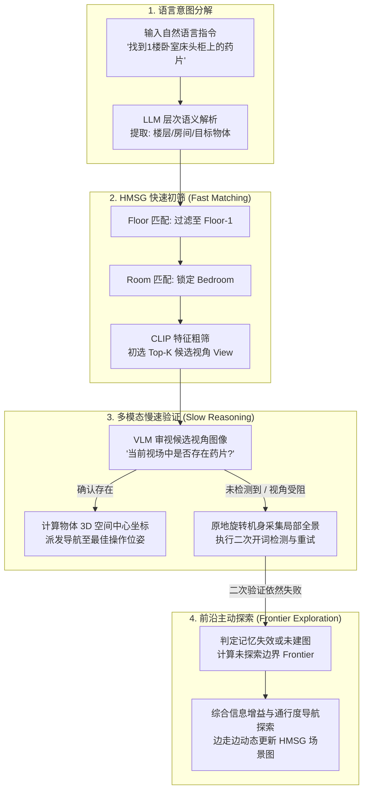

  
<figcaption>分层多模态场景图（HMSG）四层结构（楼层-房间-视角-物体）及层级与拓扑边关联</figcaption>

传统场景图直接跨越房间指向离散物体，导致机器人缺乏对真实观测角度与遮挡情况的感知，面对大空间时盲目调用耗时的多模态模型（VLM）更会引发算力崩溃。HMSG 中的“视角层（View）”天然保留了观察者视角与物体的可视链接（Visibility Links），使得系统可以先在公制几何上快速初筛出极少数相关视角，再针对性调用 VLM 进行高质量视觉鉴别。

#### ⑤ HoloNavi 目标导航流水线

基于 HMSG，HoloNavi 导航系统将任务串联为三个环环相扣的执行回路：
1. **分层物体导航（Hierarchical Object Navigation）**：利用语义解析匹配楼层、房间与物体候选，借助分层 CLIP 相似度快速剪枝无关搜索空间；
2. **在线双重验证环（Online Verification Loop）**：当机器人到达候选视点后，实时摄像头画面交由开词检测器与 VLM 双重核验。若初步判定失败，机器人自动原地多角度旋转采集环视视角进行二次重检，确认目标真实坐标后导航至操作安全距；
3. **前沿主动探索环（Frontier Exploration Loop）**：若 HMSG 初始检索落空或在线验证再次失败，系统立即切换至前沿探索模式。根据候选前沿点的信息增益预期、任务语义相关度、可通行性与动力学约束进行综合打分，引导机器人探索未知区域，并在行进中持续执行增量建图与目标嗅探。

  
<figcaption>HoloNavi 物体目标导航全流程：分层语义匹配、在线多重视角验证与前沿增量探索</figcaption>

#### ⑥ 动态时空记忆自适应增量更新（Dynamic Memory Update）

现实世界时刻处于动态演变中。HoloAgent-0 定义了三类触发记忆刷新的核心事件：
- **感知冲突事件**：新传感器数据与既有地图在空间几何或颜色上发生显著偏移；
- **技能操作结果事件**：机器人执行抓取放置（如拿起水杯）使物体脱离原始支撑面，或导航受阻暴露出新障碍物；
- **人类显式反馈事件**：用户通过语音下发了针对房间命名或物体属性的纠错指令。

在执行更新时，记忆层首先利用当前观测在既有几何地图中进行鲁棒重定位，局部清除产生冲突的过期点云与体素，并将新特征融合入局部几何。语义层更新受影响的 3D 实例边界框，HMSG 则**仅对受影响的局部子图进行原位拓扑更新**（重新计算该物体所属房间和可视视角），无需承担重建整张全局场景图的高额开销。

  
<figcaption>动态环境下的局部场景记忆自适应刷新对比（桌面物体移动后局部地图与场景图子图的原位更新）</figcaption>

---

### 3. 核心结果/发现

- **HM3D-ObjNav 仿真基准导航性能跃升**：在无硬件噪声的标准仿真基准下，搭载 AgentOS 闭环的 HoloAgent-Nav 取得了 **82.6% 成功率（SR）** 与 **42.8% 路径长度加权成功率（SPL）**，全面大幅领先业内现有的代表性导航方案，如 MSGNav（74.1% SR / 33.4% SPL）、WMNav（72.2% SR / 33.3% SPL）以及开环状态下的 FSR-VLN（80.8% SR / 41.0% SPL），证实了闭环监控和重试重规划机制能够在保证路径高效性的同时显著提升复杂任务完备率。
- **真实物理公寓长程导航卓越鲁棒性**：在真实室内公寓的多目标寻找评测中，HoloAgent-Nav 在最严格的 Top-1@1.0m 命中标准下达到 **97.70%** 的真实到点率，Top-5 到点率达到 **98.90%**；作为对比，同场景下的知名基线 OK-Robot 仅有 60.92%，HOV-SG 仅有 51.72%，MobilityVLA 仅为 34.48%。更引人注目的是，HoloAgent-Nav 在 1.0m、2.0m 与 3.0m 的不同判定阈值下得分完全一致，说明成功样本皆精准逼近至 1.0m 内的核心操作区，表现出极其稳健的位姿停靠精度。
- **高质量开放词表 3D 语义建图**：在 ScanNet 数据集上，HoloAgent-Memory 以在线（Online）计算模式斩获 **31.58% mIoU** 和 **61.58% 频率加权准确率（f-Acc）**，性能明显压倒其他在线建图算法（如 Open-Fusion 的 18.02% mIoU、Concept-Graph 的 16.29% mIoU），甚至逼近了离线计算的大模型映射算法，为上层智能体提供了坚实准确的高质量语义索引底座。
- **真机多形态复杂长程复合任务落地**：成功在 Unitree G1/R1 双足人形与双臂移动平台上完成了包括“从卧室寻物”、“多机语音协同伴舞引导”以及极具挑战的“长程移动洗衣折叠”（涵盖从移动底盘自主巡航到目标工位、双臂柔性衣物分拣抓取、台面平铺到精细对折）等多项闭环任务。

---

### 4. 局限性

- 目前机器人具身基础模型仍无法单模型无缝覆盖从大范围空间导航、精细双臂操作到全身力矩级运动控制的完整动作频谱，系统对不同物理构型的跨本体迁移仍依赖工程化控制器桥接与动力学调优。
- 业内尚缺乏涵盖操作、多模态导航与全身动态交互的端到端统一长程真机评测基准，且对于大尺度复杂建筑场景，长时序跨视角特征融合的延迟与细粒度几何重建精度仍有进一步提升空间。

## 2. Pigey (2026) {#pigey}
———Addressing the Orchestration Gap in Generalist Robots via Physical Agency

📄 **Paper**: [arXiv:2607.21725](https://arxiv.org/abs/2607.21725)

---

### 精华

- **揭示具身智能的“编排鸿沟”（Orchestration Gap）**：指出当前通用机器人主要瓶颈并非低层运动控制能力的匮乏，而在于缺乏能够统筹感知、规划、校验与恢复的闭环编排架构；单体端到端模型直接提示时极易过拟合与盲目执行，导致性能大幅受限。
- **纯推理期闭环物理 Agent（无需任何新训练）**：构建由前沿视觉语言模型（Frontier VLM）驱动的闭环编排器 Pigey，将复杂长时程指令分解为短时子目标，仅通过高层感知与工具调用组织底层的冻结运动策略，完全无需重新训练或微调低层权重。
- **几何规划（TAMP）与神经策略（$\pi_{0.5}$）互补双后端**：将确定性任务与运动规划（TiPToP）与端到端视觉运动策略（$\pi_{0.5}$）解耦整合——刚性物体使用带几何确定性的抓放规划，可形变物体、接触密集操作或规划受挫时无缝升级到 VLA。
- **传感器与腕部视觉保守双重校验机制**：拆分开环的“抓-放”原子动作，在抓取后利用夹爪宽度传感器（`is_grasped`）结合腕部相机图像进行严格保守校验；若未稳固抓取则立即原地重试或升降级，从根源上杜绝“空夹爪投递”的复合误差。
- **分布外与真机长时程任务性能飞跃**：在强扰动基准 LIBERO-PRO 上将冻结的 $\pi_{0.5}$-LIBERO 零样本成功率从 12.8% 飙升至 53.3%；在真实 DROID 机械臂 30 项复杂长时程评测中达成 97.3% 的总成功率（基线 $\pi_{0.5}$ 仅 16.7%）。

---

### 1. 研究背景/问题

随着大模型与机器人技术的发展，机器人领域普遍倾向于构建庞大的单体式视觉-语言-动作（VLA）模型，期望通过大规模预训练将高层语义理解、常识推理、空间规划、成功检测、异常恢复与底层毫米级电机控制全部揉进同一个神经网络。然而，这种单体式端到端范式面临着难以克服的现实瓶颈：

1. **指令敏感与语义退化**：在端到端策略中，高层自然语言指令常常退化为微弱的先验条件，模型极易陷入对特定训练轨迹的机械记忆，面对场景扰动（如目标位移、遮挡物、目标已被占用）时完全丧失调整能力；
2. **开环执行与复合误差**：现有的代码生成式规划（Code-as-Policies）或传统任务与运动规划（TAMP）往往依赖一次性离线生成，在执行阶段处于开环盲跑状态；一旦中间发生抓取滑脱或碰撞，系统仍按预定轨迹机械推进，最终彻底失败；
3. **编排能力的缺失**：真正的物理通用性要求系统拥有“物理主体性”（Physical Agency）——不仅知道“该做什么”，更要在执行中时刻观察“做成了没有”，并在未成功时主动重试、绕开障碍或变换手段。

**核心问题**：在完全不重新训练或微调底层运动策略的前提下，能否仅通过推理期的闭环物理编排框架，释放预训练冻结策略的全部潜力，跨越通用机器人的“编排鸿沟”？

---

### 2. 主要方法/创新点

Pigey 的核心思路是**控制与编排解耦**：底层仅保留两个冻结的运动执行器（TAMP 规划器与 $\pi_{0.5}$ VLA），上层由前沿 VLM（如 Claude/GPT 等多模态前沿大模型）构成闭环决策大脑，运行“感知（Perceive）→ 推理（Reason）→ 行动（Act）→ 校验（Verify）”的物理执行循环。

  
<figcaption>Pigey 闭环物理 Agent 系统架构：前沿 VLM 作为编排器统筹感知、推理、执行与双重校验，向下路由至冻结的 TAMP 与 VLA 运动后端</figcaption>

#### ① 整体框架概述

Pigey 作为一个封闭循环的具身智能 Agent，在接收到全局长指令 $I$（例如：“有小孩来访——将玩具放在盘子里，危险物品收进盒子里”）后，维护全局上下文历史 $h$。在每一步交互中，VLM 仅选择并调用一个结构化工具（Tool Call），获取物理世界传感器与相机的真实反馈，并据此更新内部状态，直至所有子目标全部达成并调用 `Done` 终止。

系统将原本由单个大模型独自承担的复杂职责拆分为清晰的模块链：
- **开放词表目标感知与空间锚定**：利用开放词汇检测器锁定场景内物体及其标签，限制高层规划的词表空间；
- **任务级长时程记忆**：维护已完成操作、当前夹爪持有物及桌面剩余物品清单；
- **几何与神经双运动后端**：刚性抓放走可解析验证的 TAMP，不规则/接触密集操作走 VLA；
- **保守双重校验与双向升降级引擎**：传感器信号与视觉判定互为兜底，驱动重试、清障与策略切换。

  
<figcaption>Pigey 在真实机器狗/机械臂场景中展现的物理推理能力：演绎推理、安全常识、障碍排除、长时程场景记忆与空间几何堆叠</figcaption>

#### ② 逐模块讲解

- **感知与目标语义锚定（Perceive & Grounding）**
  - **输入**：多视角相机图像（主视角与腕部视角）以及底层机器人关节状态。
  - **处理**：调用开放词汇检测器生成带有边界框和语义标签的物体候选集。这些检测标签严格构成 Pigey 的“受控词表”（Vocabulary），所有抓取或放置操作的参数必须直接引用检测标签。
  - **输出**：结构化场景感知字典，包含物体标签列表、腕部局部高分辨率图以及当前夹爪状态。
  - **设计动机**：杜绝语言模型在物理交互中凭空臆造未见物体名称，将高层模糊概念（如“危险品”、“素食”、“最小的容器”）直接接地到物理场景中已被定位的具体实体。

- **解耦互补的双运动后端（Frozen Motor Backends）**
  - **TAMP 几何后端（`Pick(ℓ)` / `DropAbove(ℓ)`）**：基于 TiPToP 框架构建，负责空间无碰撞运动规划与六自由度几何抓取位姿生成。Pigey 进行了关键重构——将原本打包成单次开环执行的 Pick-and-Place 强行切断为两个独立的工具调用，在抓取与放置之间插入物理校验。
  - **VLA 神经后端（`VLARollout(s)`）**：封装冻结的预训练 $\pi_{0.5}$ 闭环视动作控制模型，接收简短的纯文字子动作描述 $s$（如 `“grasp the cable”`），直接输出连续的高频末端位移和夹爪开合。
  - **协同机制**：桌面平铺的常规刚性物体优先调用 TAMP，获得极高的轨迹确定性；堆叠物体、易形变物体（如线缆、毛绒玩具）或深层容器内的物体，直接交由具备柔顺控制特性的 VLA 求解。

- **保守双重物理校验（Conservative Dual Verification）**
  - **输入**：夹爪内嵌位移传感器读取的布尔量 `is_grasped`，以及动作执行完毕后的手眼（腕部）相机快照。
  - **处理**：硬件传感器用于确认物理夹持间隙是否处于夹取阈值内；前沿 VLM 同时观察手腕相机，判断视野中目标物体是否已被移离原位并处于夹爪中心。
  - **保守合成规则**：两者采取最悲观策略——即使运动后端报告执行完毕，只要 `is_grasped == False` 或视觉显示目标仍在台面上，步骤即刻判定为失败并撤销后续动作。

#### ③ 卡点降维与决策流图

具身智能领域的读者常常困惑：**为什么单体端到端模型（如 $\pi_0$ / $\pi_{0.5}$）在大规模预训练后，依然无法胜任带有扰动的简单抓放？Pigey 的闭环编排究竟改变了什么？**

我们通过自制 Mermaid 决策流图与对比表拆解其内在机制：

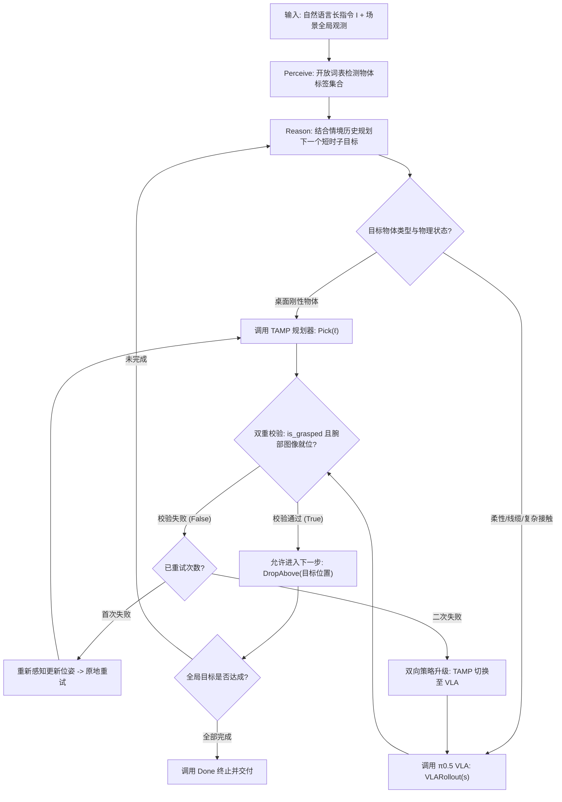

为进一步看清 Pigey 对传统机器人控制范式的颠覆，对比表如下：

| 维度 | 端到端单体 VLA（如 $\pi_{0.5}$ / OpenVLA） | 开环代码规划（Code-as-Policies / TiPToP） | 闭环物理 Agent（Pigey 本文） |
|---|---|---|---|
| **控制分工** | 语言理解、规划、校验与运动控制全部耦合于单一大模型 | LLM 生成完整 Python 代码或动作计划，底层开环跑完 | 前沿 VLM 仅负责闭环编排与校验，动作全委托给冻结策略 |
| **执行模式** | 步进自回归，缺乏宏观任务状态反思 | 一次性规划，执行期对物体滑脱与环境变动“失明” | 每次工具调用后必经传感器与视觉双重校验，动态闭环推进 |
| **异常恢复** | 极差（抓空后继续对空夹爪做后续放置动作） | 无（规划失败或执行中断直接抛出异常死机） | 原生支持障碍物移开、放回重抓、TAMP 与 VLA 双向升降级 |
| **训练成本** | 需要数万小时真机轨迹重新微调/后训练 | 无需训练，但依赖理想化仿真环境 | **零微调**，完全利用现成冻结预训练模型与经典规划器 |

> **举个例子（目标位移与抓空恢复）**：
> 假设任务是“把红色杯子放进托盘”。
> - **单体 VLA / 开环规划**：计算出抓取轨迹并直接连贯执行放置。如果在机械臂下探时杯子被碰歪滑脱，机械臂依然会闭合空夹爪移到托盘上方松开，并自认为“任务完成”，最终彻底失败。
> - **Pigey 闭环处理**：
>   1. 执行 `Pick(red_cup)`；
>   2. 机械臂闭合后，夹爪宽度传感器返回 `is_grasped = False`，腕部图像检测到杯子还在原位；
>   3. Pigey 拦截后续 `DropAbove` 动作，记录抓取失败；
>   4. 触发 `Perceive` 重新检测位移后的杯子精确坐标，更新抓取姿态并二次重试；若二次仍未抓稳，则主动将后端升级为具备柔顺容错的 `VLARollout` 实施触觉抓取，最终确保杯子稳妥入盘。

---

### 3. 核心结果/发现

论文在模拟基准 LIBERO-PRO 以及基于真实 Franka 机械臂的 DROID 工作台上进行了系统对比评测，充分验证了推理期物理编排对模型能力的倍增效应。

#### ① LIBERO-PRO 仿真基准评测

LIBERO-PRO 是业内针对复杂长时程桌面操作的高难度扰动测试基准，引入了物体位置调换（Obj. swap）、目标属性变换（Goal swap）以及空间几何扰动（Spatial swap/task）等 6 种严苛扰动套件。

  
<figcaption>LIBERO-PRO 六大扰动套件下的成功率对比：保持底层冻结权重完全不变，仅改变推理编排机制</figcaption>

- **原版 SOTA VLA 性能严重滑坡**：以开环提示直接运行时，即使是目前最顶尖的 $\pi_{0.5}$-LIBERO，在面对微小空间或目标扰动时平均成功率仅有 **12.8%**，且在多个任务中直接归零，证明端到端策略对训练集轨迹产生了严重的过拟合。
- **Pigey 达成 SOTA 突破**：在完全不使用任务特异性记忆、不微调任何权重的零样本设定下，Pigey 将冻结策略的平均成功率一举提升至 **53.3%**，相比原始策略实现了超 4 倍的性能提升，大幅超越了代码生成基线 CaP-Agent0（18.2%）。

#### ② 真实机械臂（DROID）能力测试

在真机实验中，研究团队设置了 8 大核心能力维度的 30 项严苛长时程任务，包括常识推理、条件逻辑、空间推理、清障安全推理、错误主动恢复及长时程记忆恢复等。

  
<figcaption>真实机械臂 DROID 上的 8 类能力探针成功率（%）：底层均运行相同的 π0.5-DROID 权重</figcaption>

  
<figcaption>真机长时程执行与单帧推理链展示：在素食挑选任务中识别非素食并依次放入碗中</figcaption>

- **综合成功率 97.3% vs 16.7%**：直接提示下的 $\pi_{0.5}$-DROID 在需要常识推理、多步逻辑与空间几何的任务上近乎全军覆没（成功率均为 0%），总成功率仅 16.7%；而 Pigey 借助闭环常识编排与回溯校验，在绝大部分类别上均斩获 100% 的满分，总成功率高达 **97.3%**。
- **真机异常恢复实录**：在放置目标被外物占用（如咖啡杯内已有杂物）时，Pigey 能够自主推理出“先取出杂物、放置在旁边、再放入目标物体”的级联恢复逻辑；在盲盒遮挡目标时，能够推断目标处于盒子下方并主动掀盒取物。

---

### 4. 局限性

1. **依赖前沿大模型的视觉理解与推理时延**：由于在每步关键动作后都需要调用云端或高规格 VLM 进行视觉反思与决策重感知，整体任务执行节奏受限于 API 通信与推理吞吐，交互延迟高于单体端到端模型；
2. **底层动作策略的物理极限不可逾越**：编排器虽然能够极大地修复逻辑与抓取时序错误，但若两个底层运动后端（TAMP 求解器与 $\pi_{0.5}$）均由于奇异点、碰撞死锁或物理形变失真而无法生成有效末端轨迹时，上层 Agent 仍然难以无中生有完成物理接触。

---

## 3. Thea (2026) {#thea}
———Towards the Harness of Embodied Agents

📄 **Paper**: [arXiv:2608.11246](https://arxiv.org/abs/2608.11246) · [Code](https://github.com/EIT-HAI/Thea) · [Project Page](https://eit-hai.github.io/thea)

---

### 精华

- **将“代码 Agent Harness 范式”迁移至具身物理世界**：类比软件工程中 Claude Code、Codex 的成功本质在于测试反馈闭环（Harness）而非单体模型本身，指出具身智能实现复杂长时程任务的关键同样在于构建连通物理现实的闭环 Harness 基础设施。
- **补齐物理世界缺失的两大信号基础设施**：软件世界天然具备“读取世界状态”（文件树/AST）与“判断动作结果”（退出码/报错调用栈），而物理世界两者皆无。Thea 创新性提出 **SceneGraph as Context**（场景图即上下文）与 **Evaluation as Exit Codes**（评估器即退出码）两大基石机制，实现物理闭环。
- **严格可靠性理论确立评估准确率 $\alpha$ 的理论上界**：从数学上证明长时程任务开环成功率随步数 $n$ 呈指数几何衰减（$P_{\text{open}} = \prod p_i \to 0$）；闭环 Harness 的纠错上限严格取决于独立评估器的判定准确率 $\alpha$（“Harness 的上限由其判官决定”）。
- **解耦模型与本体的跨平台可移植性**：定义了标准化具身 Profile 与 Tool 抽象契约，模型（LLM/VLM）与硬件本体（双足人型 Unitree G1、仿生人形 Astribot S1、双臂轮式 AgileX Cobot Magic）双向可插拔更换，单套架构通吃跨本体部署。
- **长时程复合任务性能大幅跃升**：在多阶段复杂任务（L1~L3）真实物理评测中，随着任务复杂度与步数攀升，传统端到端策略（ACT、$\pi_{0.5}$、LingBot-VLA）成功率急剧下跌至 30%~40%，而 Thea 在最高难度 L3 仍保持 **87%** 的超高成功率。

---

### 1. 研究背景/问题

编程智能体（Coding Agents，如 Claude Code、SWE-agent）的爆发彻底改变了软件工程。这类系统的成功并未寄托于“一次性写出完美代码”的超人模型，而是源于由编译器、测试框架与 Git 组成的**测试与重试闭环机制（Harness）**——智能体在编写代码后运行测试、捕获堆栈错误、反思修改并反复迭代，直到测试通过。

当研究人员试图将这一高效的 Harness 范式平移到物理世界时，遭遇了本质性的结构鸿沟。软件世界中耗费数十年积累起来的底座支撑在物理世界中全部缺失：
1. **状态无法原生“读取”**：代码世界拥有清晰的文件系统与类型符号；而物理机器人的传感器只吐出混乱非结构化的高维连续点云与图像像素，大模型无法直接将其作为精确的可推理上下文；
2. **动作无法原生“判定”**：运行程序若出错会立即返回明确的非零退出码（Exit Code）与堆栈跟踪（Stack Trace）；但在现实中，机械臂伸手抓取如果抓空、脱手或发生碰撞，物理世界是一片沉默的，既不会返回状态码，也不会主动通知“动作已结束”，导致开环执行中错误无限累积。

**核心问题**：如何在物理世界中构建一套能够提供“持久可读状态”与“精准退出码判定”的具身 Harness，使高层语言/多模态模型能够可靠编排底层异构运动策略，实现长时程任务的闭环自愈？

---

### 2. 主要方法/创新点

Thea 构建了一个将前沿决策模型（Model）与多样化机器人本体（Body）解耦编排的具身闭环 Harness，通过结构化上下文演进、标准化工具接口与独立后置评估器闭合了具身控制回路。

  
<figcaption>Thea 具身 Harness 系统全景：将模型（Model）与本体（Body）完全解耦，通过可调用的工具（Tool）、场景图上下文（Scene graph）与独立评估器（Evaluator）建立感知-行动-校验闭环，并在三种迥异本体上验证</figcaption>

#### ① 整体框架概述

在 Thea 架构中，具身 Agent 由四大核心组件构成：
1. **模型（Model）**：高层大语言/视觉语言模型，仅负责理解任务、阅读动态上下文，并输出结构化工具调用；
2. **本体与工具层（Body & Tools）**：将底层移动导航、机械臂抓取、技能策略（如 ACT、扩散策略、$\pi_0$）统一封装为具备前置检查（Pre-hook）与后置触发（Post-hook）的标准化 Tool；
3. **场景图上下文（SceneGraph as Context）**：从连续感知流中沉淀持久、符号化、带 3D 边界框与拓扑关系的场景图，类比软件工程中的文件系统；
4. **退出码评估器（Evaluation as Exit Codes）**：在每次动作结束后由系统结构化触发的独立视觉评估器，返回三态执行裁决（Success / Failure / In-progress）及失败归因。

  
<figcaption>SceneGraph as Context：将传感器连续多模态观测与评估器确认的动作结果融合为统一符号场景图，生成精简简报（Brief）按轮次刷新注入上下文，支持按需深度查询</figcaption>

#### ② 逐模块讲解

- **SceneGraph as Context（世界状态的可读化）**
  - **输入**：RGB 图像、深度图、LiDAR 点云，以及底层里程计上报的机器人位姿。
  - **处理**：系统利用感知流水线将连续物理空间离散化为包含物体中心坐标、3D 边界框、可见置信度及空间拓扑关系（如 `on(bowl, table)`、`near(robot, table)`、`holding(gripper, cup)`）的动态图结构；只有经过评估器确认为真实成功（Confirmed）的动作结果，才会写入图的拓扑关系变更中。
  - **输出**：每轮决策前将图提炼为高层结构化简报（Scene graph brief）推入刷新上下文（Refreshed context）；模型亦可通过引用 ID（Ref-keyed queries）按需调用工具查询某特定物体的历史高清快照与详细几何属性。
  - **设计动机**：彻底解决长时程多轮交互中上下文被海量连续视频/图像 token 挤爆的问题，赋予大模型类似“阅读项目代码结构树”般的场景理解能力。

- **Evaluation as Exit Codes（动作结果的裁决化）**
  - **触发机制**：由 Harness 在每次操作执行后通过内置后置钩子（Post-hook）强制结构化触发，剥夺底层执行策略“自评自夸”的裁判权。
  - **处理过程**：评估器仅接收当前时刻的视觉观测和该工具声明的后置断言（Post-condition），完全独立于高层决策模型；输出三态判定——`Success`（成功）、`Failure`（失败并附带详细因果解释，如“因末端偏移未抓稳”、“目标被抽屉挡住”）、`In-progress`（动作仍在长时推进中未超时）。
  - **输出**：将裁决与失败归因打包为退出码响应注入对话历史，供决策模型进行针对性重试或方案切换。

  
<figcaption>Evaluation as Exit Codes 触发时序：模型调用 Tool 执行策略，执行结束后由 Harness 后置钩子主动触发独立 Evaluator，产出带失败原因的三态判决反馈给模型</figcaption>

#### ③ 卡点降维与理论推导

**卡点 1：软件 Harness 与具身物理 Harness 究竟如何对应？**

| 维度 | 软件工程 Agent（如 Claude Code / SWE-agent） | 传统机器人控制（单体 VLA / 示教回放） | 具身物理 Harness（Thea） |
|---|---|---|---|
| **状态载体** | 文件系统目录树、AST、文本代码 | 瞬时单帧/多帧连续相机图像像素 | **SceneGraph as Context**（持久化 3D 拓扑符号场景图） |
| **动作输出** | 终端 Shell 命令、文件编辑 Patch | 连续关节角度/末端 6-DoF 轨迹点 | 封装为标准化前/后置 Hook 的语义 Tool（如 `grasp(ref)`） |
| **执行反馈** | 操作系统返回码（Exit 0 / 1）、Stack Trace | 无任何反馈，动作结束即盲目进行下一步 | **Evaluation as Exit Codes**（三态判决 + 结构化失败诊断原因） |
| **纠错机制** | 阅读错误日志，重写代码重新编译 | 无法纠错，抓空后直接空手跑完后续长序列 | 读入失败归因，微调位姿重试或主动搜寻隐藏目标 |

**卡点 2：为什么说“Harness 的上限由其评估器准确率 $\alpha$ 决定”？**

在长时程多步具身任务中，假设一个任务包含 $n$ 个顺序阶段，单步成功率为 $p_i$。
- 在传统的开环模式下，任务成功要求每一步都必须成功：
  $$ P_{\text{open}} = \prod_{i=1}^n p_i $$
- 当 $n$ 较大时（例如 $n=5$），即使单步成功率高达 $p=0.8$，总成功率也会迅速退化到 $0.8^5 \approx 32.8\%$。

Thea 引入了最大重试次数为 $k$ 的检测-重试回路。评估器以准确率 $\alpha$ 做出正确判定，以 $1-\alpha$ 做出误判。论文严格证明，由于评估器存在**假阴性**（把真正成功误判为失败导致多余重试损坏成果）和**假阳性**（把失败误判为成功导致错误向下渗透），系统每步的净通过可靠度直接被 $\alpha$ 锁死：

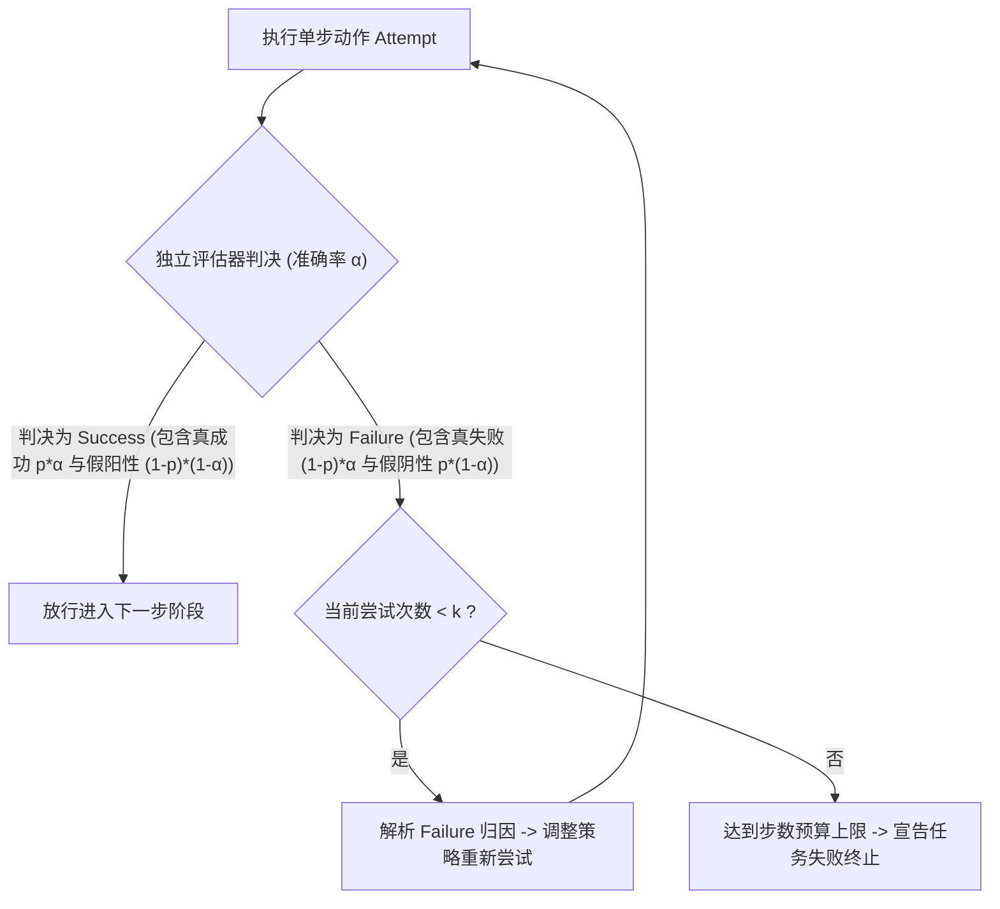

> **举个例子（可靠性倍增的具体数字）**：
> 设 $n=5$ 步的长时程送物任务，各步底层策略成功率 $p=0.8$：
> - **开环运行**：总成功率仅 $0.8^5 = 32.8\%$；
> - **Thea 闭环（评估器精度 $\alpha=0.95$、允许重试 $k=3$ 次）**：单步在重试与精准放行下的有效可靠性跃升至 $97.6\%$，整个 5 步长任务的总成功率达到 $0.976^5 \approx 88.5\%$，实现了近 **3 倍** 的任务级可靠性增益！

---

### 3. 核心结果/发现

Thea 在多样化硬件平台（Unitree G1 人形机器人、Astribot S1 柔性人形机器人、AgileX Cobot Magic 轮式双臂协作机器人）上开展了全面的真实物理实验验证。

  
<figcaption>跨越不同难度等级（L1 基础操作、L2 空间组合、L3 长时程长距离多阶段交互）的任务成功率对比：随着任务步数拉长，基线模型断崖式下跌，而 Thea 保持卓越的鲁棒性</figcaption>

#### ① 随任务复杂度扩展的绝对优势

评测将任务按时程与阶段复杂度划分为 L1、L2、L3 三级，对比了 ACT、$\pi_{0.5}$、LingBot-VLA-V2、CaP-X、SayCan 等主流单体或分层基线：
- **L1 基础层（短时程单步）**：各基线与 Thea 差距不大，成功率均在 80%~95% 之间；
- **L2 进阶层（含空间重排与多步依赖）**：单体策略开始出现轨迹漂移与抓空失序，成功率降至 55%~80%，Thea 达到 **90%**；
- **L3 终极层（跨房间长距离导航 + 抽屉拉开检索 + 目标物体抓取与送递）**：单体模型（如 $\pi_{0.5}$、LingBot）因累积误差暴跌至 **40%**，SayCan 因缺乏细粒度几何与闭环校验仅为 53%，而 Thea 凭借闭环重试与场景图记忆维持了 **87%** 的成功率。

  
<figcaption>Thea 驱动下涌现的多样化物理智能行为：(a) 跨房间自主取电并递送充电宝；(b) 目标未见时主动拉开抽屉分层检索；(c) 根据评估器反馈的失败原因微调位姿二次抓取；(d) 目标饮料缺货时主动发起人机对话协商替代品；(e) 单套 Harness 跨三种完全不同的机器人本体无缝迁移</figcaption>

#### ② 闭环涌现出的高级物理行为

得益于通用 Harness 架构对工具的动态闭环编排，机器人展现出若干过去单体模型无法实现的高阶涌现行为：
- **主动环境探索（Active Perception）**：在场景图中未检索到充电宝时，模型主动规划出“导航至柜台 → 调用拉抽屉工具 → 俯仰手腕相机观察抽屉内层”的探测链路；
- **针对性故障诊断与纠偏（Diagnosed Recovery）**：当抓取易拉罐因距离过远滑脱时，评估器返回 `“Fail: target slipped due to hand clearance offset”`，模型在下一轮主动生成 `reposition(base, delta=[-0.05, 0])` 调整底座微距离后再次成功抓取；
- **人机协同交互（User Clarification）**：用户要求递送特定矿泉水但桌面仅有果汁与茶饮时，Agent 自主挂起物理执行，通过手机端接口向用户提问协商替代品。

---

### 4. 局限性

1. **场景图维护计算开销与延迟瓶颈**：随着室内探索空间不断扩张，3D 实例点云分割与实时拓扑图合并的计算开销显著增加，可能导致轮次决策出现明显卡顿；
2. **三维遮挡与极端形变下的评估器误判风险**：评估器依赖单视角或手眼相机的视觉反馈，在强反光、细小物体遮挡或极端光照条件下仍可能发生误判，而误判一旦发生将直接限制系统的最终可靠性。

---

## 4. Zetta (2026) {#zetta}
———An Efficient Closed-Loop Embodied Harness for Self-Evolving Physical Intelligence

📄 **Paper**: [arXiv:2608.16590](https://arxiv.org/abs/2608.16590) · [Project Page](https://air-embodied-brain.github.io/zetta)

---

### 精华

- **提出面向自演化物理智能的具身闭环 Harness**：针对端到端单体 VLA/WAM 缺乏执行期微观校正、而传统事后反思（Post-hoc Reflection）难以归因高频物理交互的困境，构建集高频在线裁判、就地异常恢复与离线技能蒸馏于一体的自演化系统 Zetta。
- **结构化可演化 Harness 抽象（$H = \{C, R, T\}$）**：将底层运动策略与高层编排指挥官保持冻结，将 Harness 解耦定义为运行时裁判集合 $C$、恢复动作库 $R$ 与异构工具集 $T$。物理试错经验直接蒸馏为参数化代码模块，随交互轮次自主进化。
- **自顶向下最小干预分层因果诊断**：确立“若高层逻辑能解决，绝不改动底层参数”的核心原则，按优先级自顶向下排查（评估 → 裁判 → 状态 → 规划 → 恢复 → 参数），杜绝过拟合单一用例导致的泛化崩塌。
- **发现具身物理智能的“顿悟时刻”（Robotic "Aha Moment"）**：揭示了具身自演化非线性跃迁的客观规律——初期针对表象的修补使性能处于低位平台期，一旦定位根因并进化出关键的“裁判-恢复”闭环机制，任务成功率呈现瞬间垂直拉升（如从 10% 暴涨至 95%）。
- **软硬件解耦的高通量基础设施 Z-Infra**：设计多节点异构并发基础设施，将环境与模型计算池解耦，实现高达 35.1 episodes/min 的有效采样吞吐（提升 20.6 倍），并大幅缩短 91% 的推理延迟，强力支撑大规模闭环自演化。

---

### 1. 研究背景/问题

尽管视觉-语言-动作（VLA）与世界动作模型（WAM）在大规模数据预训练上取得了显著进展，但在物理世界部署时依然高度脆弱。其根源在于：**物理环境是毫秒级高频演化的连续系统**。物体轻微滑脱、桌面反作用力失衡或微小接触扰动，若未在发生瞬间被感知并纠正，便会迅速引发复合误差级联，最终导致全局任务崩溃。

为了克服这一瓶颈，近年来学术界尝试引入多模态 Agent 进行“事后反思”（Post-hoc Reflection）。然而，传统反思机制在具身物理场景中面临着难以逾越的理论与工程障碍：
1. **信用分配困难（Credit Assignment Problem）**：一次长时程操作失败涉及成百上千个连续控制步，事后事无巨细地让大模型反思，模型根本无法准确推断出到底是第几秒手腕的哪一次微小偏角埋下了祸根；
2. **缺乏就地在线验证环境**：事后反思产生的纠偏假说只能等待下一次完整重跑才能检验，效率极度低下且容易误导；
3. **修补引发过拟合（Over-Parameterized Repair）**：以往的人工调优或简单调参往往针对特定失败用例强行修改底层控制参数，不仅破坏了基座 VLA 的全局语义理解与泛化分布，更在未见环境与新随机种子上造成灾难性性能衰退。

**核心问题**：如何构建一个无需修改底层策略参数、能够实现高频微观在线纠偏，并能将失败物理经验自动升华、持续自主演进的具身闭环 Harness？

---

### 2. 主要方法/创新点

Zetta 提出了一个**在线高频治理与离线自主演化**相咬合的双环物理智能系统，配合硬件解耦的高通量并发基建 Z-Infra，实现了物理策略的自我繁衍与鲁棒进化。

  
<figcaption>Zetta 自演化具身 Harness 全景：高频运行时裁判主导在线动作纠错回路，离线演化 Agent 聚类失败轨迹并蒸馏可复用技能，配合解耦基建 Z-Infra 驱动吞吐倍增与“顿悟时刻”</figcaption>

#### ① 整体框架与双环运行机制

Zetta 将系统清晰划分为两大不可变实体与一个核心演化载体：
- **两项不可变实体**：底层动作策略 $\pi$（冻结的 VLA/WAM 参数，$\nabla_\theta = 0$）与高层编排 Agent $A_{orch}$（多模态决策算子，判定逻辑恒定）；
- **核心演化载体 Harness（$H = \{C, R, T\}$）**：
  - **运行时裁判（Runtime Critics, $C$）**：运行频率高于低层动作策略的高频监控函数，持续扫描实时轨迹片段并生成带故障证据与状态建议的提议 $$P_t = \langle e_t, \hat{\sigma}_t \rangle$$；
  - **恢复动作库（Recovery Playbook, $R$）**：针对特定故障因果机制的参数化微动作集合；
  - **异构工具集（Heterogeneous Toolset, $T$）**：运动规划器、6-DoF 抓取生成器（GraspGen）与放置稳定器。

系统的运作分为**在线并行 Rollout** 与**离线 Reflection & Evolve 演化周期**：

  
<figcaption>Zetta 演化框架三阶段流程：在线并发采集成功与失败轨迹，离线通过失效画像聚类（Phase I）、分层因果诊断与修复（Phase II）以及跨任务泛化合并（Phase III）更新 Harness</figcaption>

#### ② 逐模块讲解

- **Phase I: 失效画像聚类（Failure Profiling）**
  - **输入**：多线程并发采集的失败轨迹集合，以及对应的标称成功参考轨迹（Nominal baseline）。
  - **处理**：按任务推进的物理阶段（接触前接近、抓取闭合、空间搬运、放置释放）对失败轨迹进行切片，并以成功轨迹为对照基准，聚类出共性的失稳模式。
  - **输出**：结构化失效画像列表，精确定位多起失败的共同阶段分布。

- **Phase II: 分层因果诊断与最小干预修复（Diagnosis & Repair）**
  - **自顶向下诊断层级**：严格遵循六级优先级排查：
    $$ \text{Evaluation} \to \text{Critic} \to \text{State} \to \text{Planning} \to \text{Recovery} \to \text{Parameter} $$
  - **设计动机**：优先通过在高层添加预对齐 Critic 或调用几何规划工具解决问题；严禁直接下潜篡改底层电机关节刚度或微调低层权重，最大限度保全基座模型的开阔泛化性。
  - **验证守卫**：生成的每个代码级修复补丁必须在导致失败的相同随机种子上就地重测，唯有通过验证（Validate Passed）才允许提交。

- **Phase III: Harness 泛化与合并（Harness Generalization）**
  - **处理**：将验证通过的特定种子补丁提升为带抽象参数的通用裁判与恢复逻辑，进行跨用例无冲突合并，打包生成版本化的 $H_{merged}$ 并热重载至在线环境。

  
<figcaption>单次 Rollout 中的裁判-恢复级联干预实录：在搬运中检测到物体脱落立即触发重新接近，检测到无效姿态调用 GraspGen 生成位姿，终末阶段调用平稳放置恢复</figcaption>

#### ③ 卡点降维与自制架构图

**卡点 1：为什么事后反思解决不了物理交互？Zetta 的微观闭环究竟怎么转？**

我们通过 Mermaid 双环机制图清晰呈现 Zetta 在线毫秒级拦截与离线分钟级自演化的解耦协作：

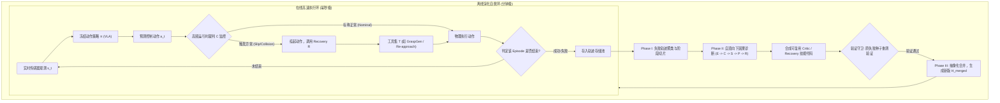

**卡点 2：什么是具身物理智能的“顿悟时刻”（Aha Moment）？**

在具身自演化过程中，很多读者容易误以为策略的成功率会随着交互数据量均匀线性提升。Zetta 揭示了一个极具物理启发的现象：

| 演化阶段 | 修复策略类型 | 典型行为表象 | 成功率表现 | 本质原因 |
|---|---|---|---|---|
| **Round 0 (初始)** | 纯冻结 VLA 开环跑 | 抓空、滑动、末端与桌面硬撞 | 0% ~ 15%（极低） | 缺乏任何物理交互反馈 |
| **Round 1 (初期探索)** | **治标修补**（Symptomatic Fixes） | 放宽时间预算、增大重试次数、调高夹爪闭合阈值 | 5% ~ 15%（**停滞平台期**） | 未触及物理失败根因，错误依然在搬运中爆发 |
| **Round 2 (顿悟时刻)** | **治本修复**（Root-Cause Repair） | 进化出 `Pre-grasp Staging`（前置空间姿态对齐）与 `Grasp Retention Critic`（滑脱高频拦截） | **瞬间飙升至 90% ~ 95%** | 彻底解决了机械臂下探时的视线遮挡与初始法向量错位 |

> **举个例子（红酒瓶放入深盘的顿悟推演）**：
> 任务要求机械臂将直立的红酒瓶平稳放进盘子里。
> - **阶段一（纯 VLA）**：直接向瓶颈扑去，频繁因反光和视角透视偏差撞倒酒瓶，成功率仅 5%；
> - **阶段二（治标尝试）**：演化 Agent 尝试让机械臂在抓取失败后快速退回并调大速度重试，但酒瓶已被撞歪，再次下探必然再次抓偏，成功率始终在 10% 附近徘徊；
> - **阶段三（Aha Moment 顿悟）**：演化 Agent 终于通过因果诊断发现了根本矛盾——“瓶身细长，若不从侧方先建立预对齐姿态，直接俯冲必然触碰瓶口”。于是 Zetta 自动合成了两个协同机制：
>   1. `Pregrasp Staging`：机械臂先在瓶身正前方 5cm 处悬停并展平手腕；
>   2. `Retention Critic`：抬升过程中实时监控末端倾角，一旦滑动立即减速微调。
>   补丁加载后，该任务成功率从 **10% 陡增至 90%**，真正跨越了物理瓶颈！

---

### 3. 核心结果/发现

Zetta 在国际通用具身操作基准 LIBERO-Pro 与 RoboCasa 厨房长时程基准上进行了系统评测，并与最新端到端基线和 Agent 系统展开了全面对比。

  
<figcaption>LIBERO-Pro 上的物理智能“顿悟时刻”（Aha Moment）：初期治标修补使得性能长期处于平缓停滞，一旦定位根因并生成关键裁判-恢复机制，成功率呈台阶式暴增</figcaption>

#### ① 卓越的任务成功率与自演化扩展性

- **LIBERO-Pro 仿真基准**：在最具挑战性的扰动测试中，纯 $\pi_{0.5}$ 策略成功率仅为 34.5%，而 Zetta 经过数轮自主闭环演化，最终将成功率大幅提升至 **90.8%**；
- **RoboCasa 拟真厨房基准**：在复杂的长时程铰链柜门开启、厨电操作与物品规整任务中，基座模型 GR00T 成功率为 73.6%，Zetta 自主演化后达到 **93.6%** 的超高水准；
- **无止境的演化收益**：实验证明随着并发 Rollout 经验池的积累，自演化曲线持续上扬，完全打破了传统固定策略在数据瓶颈下的性能死锁。

  
<figcaption>跨任务零样本技能迁移验证：在源任务（Goal-T8 红酒瓶操作）中沉淀的预抓取、抓取保持与重试技能栈，在未见目标任务（Goal-T2, T6, S3）上实现了免微调即插即用迁移</figcaption>

#### ② 零样本跨任务技能迁移

在单一任务上演化习得的 Critic 与 Recovery 技能并非过拟合孤岛，而是具备强烈的物理通用性：
- 在 RoboCasa 的 `PnP-Stove`（炉灶拾放）上演化出来的对齐接近、掉落重抓及缓冲放置技能栈，零样本迁移至水槽（`PnP-Sink`）任务时，成功率直接由 58% 跃升至 **82%**；迁移至橱柜（`PnP-Cabinet`）时由 62% 提升至 **80%**；迁移至烤面包机（`PnP-Toaster`）时由 72% 提升至 **90%**。

#### ③ Z-Infra 带来的工程效率质变

- **吞吐量提升 20.6 倍**：通过解耦环境仿真节点与模型推理资源池，Z-Infra 在 64 并发下将有效轨迹采样吞吐量从 1.7 episodes/min 飙升至 **35.1 episodes/min**，大幅领先现有基线 7.7~12.8 倍；
- **延迟大幅降低 91%**：端到端决策时延降低 91%（达 11.1 倍加速），从工程底座上彻底破除了大模型 Agent 参与物理实时闭环的时延枷锁。

---

### 4. 局限性

1. **依赖仿真器或数字孪生的可重置性**：离线自主演化需要针对失败随机种子进行多次就地重放与补丁验证，当前在具有可复位特性的仿真与高精度数字孪生环境中表现最为平稳，在完全不可逆损毁的纯现实物理场景下开展自主试错仍具风险；
2. **高频 Critic 代码自动合成的搜索边界**：当面对高度非线性、非刚性的极端复杂流体或布料操作时，自动生成的启发式 Critic 与恢复动作空间难以穷尽所有动力学物理边界。

---

## 5. Show-Harness (2026) {#show-harness}
———Just a VLM Agent Can Play Robots

📄 **Paper**: [arXiv:2609.10522](https://arxiv.org/abs/2609.10522) · [Project Page](https://showlab.github.io/Show-Harness)

---

### 精华

- **提出 Embodied Harness 的"语义动作单元"接口**：把机器人控制改写成一组离散、可解释的语义符号（`MV_FWD` / `ROTATE_CW` / `GRASP` …），VLM 每步只吐一个符号，再由本体专属解释器确定性地落成一小段真实运动——**语义留给模型，度量留给解释器**，两边彻底解耦，模型因此始终对细粒度物理决策负责。
- **同一套接口同时喂饱两端算力**：闭源前沿 VLM 零样本直接开机器人（Cross-Task 89.0%）；2B 开源小模型用 rank-64 LoRA、单卡 H200 两小时以内的微调即可学会同一套动作词表（86.0%）。关键在于语义动作走 VLM 原生词表预测，**不加动作头、不加特殊 token**。
- **"符号 + 增量"带来的免重训适应性**：换精度只改解释器步长（2 cm→1 cm，ZS 60%→80%）、换机器人只换解释器、没见过的 90° 旋转靠重复 6 次 15° 单元组合外推（70% vs $\pi_{0.5}$ 的 20%），全程不动模型参数。
- **揭示接口有效性的真正来源是"明文约定"而非符号名称**：2×2 消融显示任意符号 A–F 配上方向约定仍有 95%，而只给符号不给约定暴跌至 5%；模型自行试探推断出的方向映射仅 23.3% 正确（随机 16.7%），混淆矩阵上左右方向大面积互相镜像。
- **GUMI：把动作词表暴露成网页按键的采数据界面**：人用键盘、computer-use agent 点同一个网页、通用 VLM 直接预测符号，三者共用同一动作空间；无需专用遥操作硬件，一份演示同时可训语义动作策略与连续控制策略，并天然支持跨本体复用与人机混合采集。

---

### 1. 研究背景/问题

基础 VLM 其实已经装下了机器人操作所需的大部分知识（认物体、判空间关系、拆长程目标），但这些知识落不到关节上。现有两条路各有代价：VLA 把 VLM 微调成连续动作回归器，语义被压成一张不可解释的"像素→驱动"映射，换任务、换环境、换本体就得重新采数据；分层/技能库式 agent 则让 VLM 只发子目标或调技能，物理实现交给下游控制器，模型"说了但没看见怎么做"，且每种中间表征都绑着一条精心工程化的 grounding 管线。

作者的判断是：缺的不是模型容量，而是一个**既对 VLM 语义友好、又细到能直接控制物理的动作空间**。

---

### 2. 主要方法/创新点

  
<figcaption>Show-Harness 用一套语义动作接口把前沿 VLM 连到不同机器人本体上：模型只输出 MV_RIGHT 这类符号，动作解释器负责安全边界与步长，再翻译成各自本体的底层指令</figcaption>

#### ① 整体框架概述

Show-Harness 由三块构成：**语义动作接口**（模型面对的动作词表 $$\mathcal A$$）、**本体解释器**（把符号确定性地翻译成机器人运动）、**Embodied Harness 插件循环**（把感知—推理—行动组织成一个可配置的闭环）。此外还配了 **GUMI**——一个把同一套动作词表暴露成网页按键的采数据界面。一句话概括数据流：多视角图像和本体状态先被感知插件整理成上下文，推理插件把任务拆成可视觉验证的子任务并决定这一步用多大步长，VLM 据此吐出**一个**语义动作单元，解释器把它落成一次小位移，执行结果再回流成下一步的观测。

#### ② 语义动作接口：模型只需要认 11 个符号

动作词表 $$\mathcal A$$ 是一组紧凑的语义单元：

- **平移**：`MV_FWD` / `MV_BACK`、`MV_LEFT` / `MV_RIGHT`、`MV_UP` / `MV_DOWN`，方向相对当前选定的参考视角定义；
- **旋转**：`ROTATE_CW` / `ROTATE_CCW`，各自带一个绕转轴（$x$ / $y$ / $z$）；
- **夹爪与终止**：`GRASP`、`RELEASE`、`DONE`。

作者刻意围绕三条性质来设计这个词表：

1. **增量性（incremental）**——每个单元只造成一次小而局部的物理变化。好处是模型始终"站在回路里"：它能从下一帧看到自己刚才那一步的效果，靠连续微调逼近精度，而不是一口气规划一整条轨迹。
2. **可解释且与本体无关**——动作是符号而不是数值目标，本体相关的底层控制被推到下游解释器，模型面对的空间因此在不同机器人之间完全复用。
3. **视觉可锚定**——方向相对可观测视角定义，空间推理能直接映射到动作选择上。

#### ③ 本体解释器：符号如何变成真实位移

每个决策 $$a_t \in \mathcal A$$ 交给本体专属解释器 $$g_E$$，它维护一个 6-DoF 笛卡尔位姿设定点 $$s_t = (\mathbf x_t, Q_t)$$ 并按下式更新：

$$s_{t+1} = \Pi_E\big(\mathbf x_t + \sigma_t R_E d_a,\ \exp(\theta_t [R_E r_a]_\times)\, Q_t\big)$$

其中 $$d_a$$、$$r_a$$ 分别编码平移方向与旋转轴（平移单元 $$r_a = 0$$，旋转单元 $$d_a = 0$$，且 $$r_a \in \{\pm e_x, \pm e_y, \pm e_z\}$$）；$$\sigma_t$$、$$\theta_t$$ 是标定好的平移/旋转增量；$$R_E$$ 把语义方向映射到本体 $E$ 的运动坐标系；$$[\cdot]_\times$$ 是反对称矩阵算子；投影 $$\Pi_E$$ 强制工作空间、桌面高度与单步幅度限制，越界的动作在执行前就被拦掉。夹爪单元跳过位姿更新，直接映射成开合命令。

> **举个例子（一个 MV_RIGHT 的完整落地过程）**：VLM 吐出 `MV_RIGHT`。解释器当前设定点位置是 $$\mathbf x_t = (0.40,\ 0.00,\ 0.25)$$ m。查表得 $$d_a = +e_y$$、$$r_a = 0$$；Franka 的 $$R_E$$ 把"相对参考视角的右"映射成基座系 $$+y$$；目标已进腕部视野，所以用细步长 $$\sigma_t = 0.02$$ m。新位置就是 $$(0.40,\ 0.02,\ 0.25)$$，姿态不动。$$\Pi_E$$ 再核一遍：没出工作空间、没低于桌面 → 放行。落到底层时，Franka 用阻抗控制跟这个笛卡尔设定点，AgileX 走逆运动学 + 关节目标流，仿真器发操作空间指令——同一个 `MV_RIGHT`，在三套系统上都是"向右 2 cm"。换一台新机器人，需要新写的只有这个解释器。

#### ④ 和现有两条路线的差别

这一步是全文的立论所在，用一张表最清楚：

| 维度 | VLA（π0.5 / GR00T） | 分层 / 技能库 agent | Show-Harness |
|---|---|---|---|
| VLM 输出什么 | 连续动作块（回归 / 扩散 / 流匹配） | 子任务描述或技能调用 | 一个语义动作单元 |
| 谁对细粒度物理决策负责 | 模型，但被压成不可解释的感知→驱动映射 | 下游控制器或 VLA，模型看不见过程 | 模型本人，且每步都能看到结果 |
| 换一台机器人要改什么 | 重采数据 + 重新微调 | 重写技能库与 grounding 管线 | 只换一个解释器 |
| 提高精度要求要改什么 | 补一批精细动作数据重训 | 取决于底层控制器能力 | 解释器步长 2 cm 改 1 cm |

#### ⑤ Embodied Harness：九个插件如何串成一步

  
<figcaption>Show-Harness 架构：感知—推理—行动三段可配置插件围绕中央 VLM 组成闭环，粉色为推理流、绿色为动作流，虚线框为按需启用的可选插件</figcaption>

感知与推理插件把原始观测加工成"精炼上下文" $$c_t = \Phi_{\mathcal P}(\ell, o_t, h_t)$$（$\ell$ 是语言指令，$o_t$ 是多视角观测，$h_t$ 是交互历史），VLM 再在这个上下文上选动作 $$a_t = \pi(c_t)$$。九个插件分工如下：

**感知（Perception）**
- **Multi-View Guidance**：告诉 VLM 每路相机该怎么用——全局第一/第三人称视角给场景级语境，腕部视角给近距离对齐的细节证据。
- **Proprioception**：把机器人内部状态翻成简短文字，包括夹爪离桌面高度、单步会走多远、阶段性提示（还太高就先下降）、接触状态与夹爪开合状态。

**推理（Reasoning）**
- **Subtask Planning**：先让 VLM 当 planner 把指令拆成有序子任务，每个子任务带一条**可用图像直接检查**的完成判据；执行时每一步都对照当前图像判断是否达成，没达成就继续做，达成就自行宣布推进。
- **Situated Planning**（默认关闭）：把当下信息不足的分支决策**先挂起**，等相关证据在执行中变得可见再回来解。适合"块藏在三个杯子中的哪一个"这类条件任务，避免一上来就把所有分支都规划死。
- **Action Chunking**：目标还远、不需要细粒度反馈时，允许 VLM 一次吐一小串动作开环执行，降低模型调用频率。
- **Adaptive Step**：目标出现在腕部视野时用 2 cm 细步长，否则用 4 cm 粗步长。
- **Visual Prompt**（默认关闭）：用一次专门的模型调用，把"抓杯子把手"这种语言上难界定的目标转成图像上的视觉标记，后续推理直接锚到这个标记上。

**行动（Action）**
- **Action History**：把最近 5 个动作带进下一步上下文，并附一句"别在相反方向之间来回摆"的使用提示，提供跨步的轻量记忆。
- **Failure Recovery**：自动检测抓空，复位夹爪状态并回滚到对应的抓取子任务重来。

一步交互里这些插件的先后顺序是这样的：

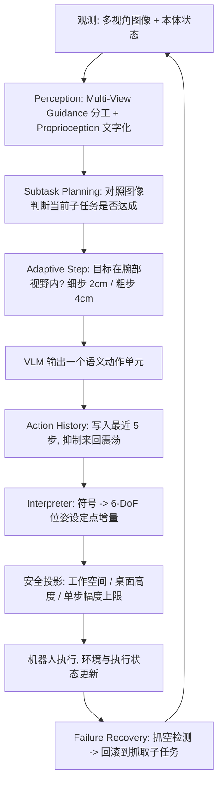

#### ⑥ 同一个接口，两种用法

**ZS 模式（前沿 VLM 零样本当 agent）**：闭源前沿模型不做任何微调，直接通过 harness 控制机器人。好处是后续模型变强，机器人能力自动跟着涨。

**FT 模式（微调开源小模型）**：同一套动作词表也可以拿来训练小模型。给定用同一动作空间采集的演示 $$\mathcal D$$，策略最小化目标单元的 token 级交叉熵：

$$\min_{\theta}\ \mathcal L(\theta) = -\sum_{(\ell, o, h, a) \in \mathcal D} \log \pi_\theta\big(a \mid \Phi_{\mathcal P_{\min}}(\ell, o, h)\big)$$

这里的 $$\mathcal P_{\min}$$ 是刻意削到最薄的上下文（只留指令、多视角观测和一小段动作历史），目的是做受控对比。关键在于：**语义动作是用 VLM 自己的原生词表预测出来的**，没有额外动作头、没有特殊 token，所以一个 rank-64 的 LoRA（冻住视觉编码器和多模态投影层，只更新约 3% 参数）就够，Qwen3.5-2B 在单张 H200 上训不到 2 小时，24GB 级显卡也能跑。

#### ⑦ GUMI：把动作词表变成一个网页

  
<figcaption>GUMI 界面：每个语义动作单元对应一个带键位的按钮，人可以用键盘"玩"机器人，computer-use agent 也可以直接操作同一个网页，双臂各一组按键并支持动作排队与提交</figcaption>

因为动作空间是离散且人也能直接操作的，作者顺手把它做成了一个图形界面 GUMI。每个单元映射到一个带快捷键的按钮：人能用键盘控制，computer-use agent 能点同一个网页，通用 VLM agent 则直接预测符号。每一步 GUMI 记录"执行前观测 + 所选语义动作"这一对 $$(o_t, a_t)$$，天然就是可训练样本；又因为解释器的落地是确定性的，同一次 rollout 还能顺带留下底层指令与轨迹——**一份演示同时能训语义动作策略和连续控制策略**。

相比依赖专用遥操作硬件或仿真专属控制的采集管线，GUMI 不需要任何特殊硬件，支持单步控制、动作排队、单双臂、以及人在 agent rollout 中途介入纠正的混合采集；同一批演示可以在实现了同一套单元的不同本体之间复用，也支持远程采集（人不必和机器人待在一起）。

---

### 3. 核心结果/发现

**实验设置**：两台真机——7-DoF Franka Research 3（一路面向工作台的 RealSense D435 外视角 + 一路腕部 D405）与双臂 AgileX（两条 6-DoF 臂，一路共享自我视角 + 每腕一路，共三路 Orbbec Dabai DC1）。任务是 5 个物体（方块、香蕉、网球、泰迪熊、象棋子）× 2 个容器（盘子、碗）= 10 个抓放任务，每任务 10 次随机摆放试验，单集上限 50 步超时判失败。FT 模式的演示只覆盖方块、香蕉、网球，泰迪熊与象棋子留作 OOD。ZS 默认用 Gemini-3.1 Pro（中等 thinking effort），FT 默认用 Qwen3.5-2B。演示共 164 段真机 episode（7.8K 决策步）+ 230 段仿真 episode（13.5K 步，来自 ManiSkill 与 RoboLab）。

**三个层次的泛化都大幅领先**（成功率，平均值）：

| 泛化层次 | π0.5 | GR00T | Harness-VLA | Goal-VLA | CaP-X | RATS | **ZS** | **FT** |
|---|---|---|---|---|---|---|---|---|
| Cross-Task（10 任务） | 39.0 | 35.0 | 50.0 | 13.0 | 44.0 | 57.0 | **89.0** | **86.0** |
| Cross-Environment | 40.0 | 34.0 | 63.8 | 15.0 | 52.5 | 65.0 | **100.0** | **88.0** |
| Cross-Embodiment | 41.0 | 36.0 | 49.0 | 11.0 | 43.0 | 52.0 | **93.0** | **87.0** |

几个值得单独拎出来的点：优势在**没在微调数据里出现过**的泰迪熊和象棋子上同样成立（ZS 在象棋子任务上 10/10，π0.5 只有 1/10）；**sim-to-real** 一项里，只用仿真演示训练的 FT 拿到 13/20，而同样只喂仿真数据的 π0.5 和 GR00T 是 0/20；**跨本体**时 ZS 只需换一个解释器，FT 则在两臂数据上联合训练后直接各自评测。

  
<figcaption>能力分析：上四格为物理适应性（精细控制、旋转外推、动作组合、工作空间偏移），下三格为多臂协同与语义适应性（推理密集任务、视频 in-context learning）</figcaption>

**物理适应性——改解释器而不是重训模型**

- **精细控制**：块堆叠与插销任务，只把解释器步长从 2 cm 调到 1 cm，不动接口也不重训，ZS 从 60% 升到 80%、FT 从 40% 升到 65%；用同一批演示训的 π0.5 只有 15%，得额外补一批精细动作数据才到 60%。
- **动作组合**：把两个正交平移单元合成一次对角位移，也只是解释器的事——ZS 每集步数 −26%、FT −24%，成功率仅从 94%/84% 微降到 92%/82%。
- **旋转外推**：见下方例子。
- **工作空间偏移**：从核心 25% 区域（S@1）扩到贴近边界的 90%（S@3），ZS 98%→92%、FT 88%→82% 只是轻微下滑，π0.5 则从 48% 崩到 24%。
- **多臂协同**：AgileX 双臂上，"收拾桌子"用联合动作预测拿到 90%（0 次碰撞），两个独立单臂 agent 各管一边只有 70%（1 次碰撞）；需要交接的"递香蕉"差距更大——联合 70%（0 碰撞）对独立 30%（3 碰撞）。

> **举个例子（旋转外推）**：每个 `ROTATE_CW` 只转 15°。训练演示里胡萝卜只摆过 0° 和 45°，测试时摆到没见过的 90°——模型并不需要"见过 90°"，只要连着吐 6 个 `ROTATE_CW` 就到位。FT 在 90° 上拿到 70%，而直接回归连续动作的 π0.5 只有 20%：回归输出的角度被训练分布锁死，而增量单元可以靠重复组合外推。顺带一提，如果把旋转单元从词表里拿掉，45° 和 90° 上的成功率分别掉到 50% 和 10%。

**语义适应性——保住了 VLM 的指令跟随灵活性**

- **推理密集任务**（找出三个倒扣杯子中哪个藏着方块、把散落字母摆成 "SHOW"）：ZS 开 Situated Planning 拿 85%，FT 和 π0.5 单独跑只有 10% 和 0%；把同一份 Gemini 生成的子任务指令喂给它们，FT 升到 70%，π0.5 仍然只有 5%。
- **视频 in-context learning**：要求按演示视频里的顺序收三个物体。没有演示时 ZS 只拿到 20%（顺序本来就没说清），给一段人类或机器人演示视频后两种来源都是 20/20；FT 在同一 planner 提取的任务提纲条件下两种来源均 90%。

  
<figcaption>九个插件的消融（真机 Franka + Gemini-3.1 Pro 零样本）：默认插件走留一法，Visual Prompt 与 Situated Planning 则是在默认配置上叠加并在专门场景上评测，完整配置基线为 96%</figcaption>

**插件消融**（完整配置 96%）：

- **Multi-View Guidance**：只给全局视角掉到 58%——腕部视角对小物体的精细对齐几乎是必需品。
- **Proprioception**：去掉掉到 68%。夹爪高度、接触状态这类紧凑信号，在外观或深度让视觉判断打滑时提供了可靠兜底。
- **Subtask Planning**：去掉掉到 60%，典型失败是**不抬起就把物体往盘子方向拖**——把操作序列拆成局部有效、且可用图像验证的阶段，这个毛病才消失。
- **Action Chunking**：关掉仍是 96% 但要 32 次模型调用；全程强制 chunk 把调用压到 20 次（−38%）却掉到 74%。结论支持**选择性 chunk**：压缩冗余的搬运段，在接触前后保留细粒度反馈。
- **Adaptive Step**：只用细步 82%（38 步，容易超时），只用粗步 70%（22 步，容易过冲），按目标可见性自适应切换 96%（30 步）。
- **Visual Prompt**：常规任务上基本无效（96% vs 94%），支持它默认关闭；但在"抓杯子把手"上从 40% 提到 85%。注意只画标记不做语言对齐反而是 35%——**收益来自把语言指令和被标记的交互点显式对上，而非标记本身**。
- **Situated Planning**：常规任务零影响，隐藏物体搜索从 35% 提到 85%。
- **Action History**：去掉掉到 76%，且步数从 30 涨到 39，失败多为在相反动作之间来回震荡。
- **Failure Recovery**：去掉掉到 72%，主要失败模式是没检测到的空抓，然后拎着空夹爪继续走完剩下的流程。

  
<figcaption>动作空间表征的 2×2 消融：横轴是有无明文约定，纵轴是语义名称还是任意符号；右侧是设定 (D) 下模型自己探出来的方向映射混淆矩阵，左右方向大面积镜像</figcaption>

**最有意思的一组消融——动作符号到底靠什么 grounding**。作者固定其余 harness 不变，只改六个平移单元的表征做 2×2 对比：

| | 有明文约定 | 无明文约定 |
|---|---|---|
| **语义名称**（`MV_LEFT`…） | (A) **100%**，25 步 | (B) 90%，34 步 |
| **任意符号**（A–F） | (C) **95%**，27 步 | (D) **5%**，49 步 |

读法是：**约定提供了绝大部分 grounding，语义名称只是一个有用的先验**。任意符号配上"这个符号会让末端往哪儿动"的明文说明（C）几乎追平默认配置；反过来只给语义名字不给约定（B）虽然还能用，但效率明显下降。而设定 (D) 里模型只能自己试探——吐一个未知符号、比较前后观测、猜它的效果——20 集里只成功 1 集，推断出的映射只有 23.3% 正确（随机是 16.7%），混淆矩阵上左右方向大面积互相镜像。**光靠视觉变化去反推动作语义是不靠谱的，把约定写进 prompt 才是关键。**

  
<figcaption>左：不同前沿 VLM 与 thinking effort 在成功率—步数平面上的分布；右：象棋炮摆放任务上把能力拆成规划与细粒度对齐两段，瓶颈明显在后者</figcaption>

**骨干模型与思考预算**：零样本性能大体跟着底层模型能力走（Gemini-3.1 Pro > GPT-5.6-sol > Opus 5 > GPT-5.6-luna > Gemini-3.6 Flash）。提高 thinking effort 主要是**减少冗余交互步数**，成功率提升有限，墙钟时间反而明显上涨（GPT-5.6-sol 达 3.4×）。所有模型的指令跟随都很稳，超过 98% 的响应能产出合法动作单元。把象棋炮摆放任务拆开看，**规划不是瓶颈**（三个模型的 plan correct 都在 80–95%），错误集中在精细抓取与摆放（place correct 只有 70/30/15）；额外给出目标边界框还能再提一截，说明显式视觉 grounding 线索价值很大。

**微调骨干规模**：2B 就已经很强，更大的骨干主要在堆叠和插销这类精细任务上有增益；1B 级模型在目标附近会做过多局部微调，导致集长明显变长；但小模型在网球这种需要及时纠正移动物体的任务上反而能赢过大模型。总体 2B 是精度与响应速度之间的平衡点。

  
<figcaption>真机定性结果：新物体、背景变化、光照变化、杂乱场景、空间推理（摆字母拼 "SHOW"）与双臂协同（开抽屉并放入杯子）都由同一套动作接口完成</figcaption>

---

### 4. 局限性

1. **本体覆盖有限**：目前仅在配备平行夹爪的单臂（Franka）与双臂（AgileX）操作上完成验证，推广到灵巧手、人形等更高自由度、接触模式更复杂的本体尚属未知；
2. **感知模态单一**：感知侧只有视觉与本体状态，缺少触觉与力反馈，对接触密集、需要柔顺控制的精细物理交互仍是短板。

---

## 6. SPACE (2026) {#space}
———从程序化技能中学习何时连续行动、何时停下来观察

📄 **Paper**: [arXiv:2609.02042](https://arxiv.org/abs/2609.02042)

---

### 精华

- **动作块的关键是边界**：一次输出多个动作可以减少大模型调用，但策略还需要学会哪些动作能连续执行，以及何时应停下来获取新观测。
- **用技能结构提供监督**：SPACE 从成功轨迹归纳复合技能与子技能，把子技能调用边界转成动作块边界，补充终端奖励难以直接提供的时间结构。
- **训练时有技能，部署时直接行动**：技能调用被展开成普通动作块样本，与策略自主采样的数据共同训练，最终策略无需访问技能库。
- **同时比较整条轨迹与局部状态**：轨迹级优势衡量最终结果，块感知步级优势在相同锚点观测下比较按决策轮次折扣的回报，使学习信号兼顾成功与决策效率。
- **收益有明确实验范围**：在 ALFWorld 与 ScienceWorld 的文本交互设置中，SPACE 相比各设置成功率最高的基线提高 7.0–31.3 个百分点，并减少 LLM 决策轮次。

---

### 1. 研究背景/问题

ReAct 式智能体通常每轮只生成一个原子动作，执行后读取环境反馈，再调用大模型决定下一步；长程任务中的确定性例程因此需要多次模型调用。直接改成一次输出变长动作序列，再用标准强化学习训练，也不一定能学好：论文观察到单动作坍缩、过长动作块导致成功率下降，以及多动作 PPO 训练不稳定等现象。作者将核心困难归结为动作块边界学习——稀疏终端奖励缺少直接标明“这里该暂停并重新观察”的监督。

  
<figcaption>允许输出多个动作并不保证有效分块；不同骨干模型分别表现出单动作坍缩和过度承诺</figcaption>

---

### 2. 主要方法/创新点

  
<figcaption>成功轨迹生成程序化技能，技能调用展开为原始动作块，与直接采样的动作块共同训练；测试时仅保留动作块策略</figcaption>

SPACE（Skill-guided Policy with Adaptive Chunk Execution）由**两层程序化技能、混合轨迹采样与技能展开、块感知策略优化**组成。技能提供可复用的任务分解，展开过程把分解转换成训练样本，联合优化将这种结构吸收到直接输出动作块的策略中。

#### ① 动作块接口：减少决策次数，保留必要的反馈边界

一次先写出若干动作，再由执行器依次执行，这就是动作分块（Action Chunking）。策略根据第 $i$ 轮的交互历史 $h_i$ 生成 $u_i=(a_{i,1},\dots,a_{i,L_i})$，其中 $1\leq L_i\leq K$；执行器在块完成或遇到无效动作时停止执行，再进入下一次 LLM 决策，实验设置 $K=6$。

| 维度 | 单动作策略 | 朴素多动作 RL | SPACE |
|---|---|---|---|
| 每轮输出 | 一个原子动作 | 变长原子动作序列 | 变长原子动作序列 |
| 边界如何确定 | 每个动作后固定切分 | 主要依赖任务奖励学习 | 加入子技能边界形成的示范 |
| 训练数据 | 原子动作轨迹 | 自主生成的动作块轨迹 | 自主动作块与技能展开动作块 |
| 测试接口 | 单动作 | 动作块 | 动作块，无技能调用 |

> **举个例子（机制示意）**：若已知冰箱位置，可以先输出“走到冰箱、打开冰箱”，等反馈确认里面有哪些物体，再决定取哪个物体。把尚未确认存在的物体也提前写进同一块，就可能因缺少中途反馈而失败；边界学习要解决的正是这类取舍。

#### ② 两层程序化技能：把成功经验变成可切分的例程

**输入**是成功交互轨迹。大模型将其分成子任务阶段，生成一个负责调度的复合技能（Composite Skill），以及若干完成局部例程的子技能（Subskill）；每个子技能包含行为描述、参数模式和可执行函数，复合技能还记录有序的子技能调用序列。生成代码通过语法、可编译性与函数签名检查，再按抽象语法树（AST）规范化去重，**输出**到技能库。

两层结构提供了具体的切分依据：复合技能负责“先找物体，再加热，再放置”等顺序，每次子技能调用对应一个动作块，调用之间形成块边界。这些边界是从程序结构取得的训练示范，并不意味着已证明它们是所有状态下的最优边界。

**冷启动与更新**：附录 A.2 明确使用人工整理的初始技能，ALFWorld 为 3 个、ScienceWorld 为 5 个，同时作为后续技能归纳的少样本示例。检索优先匹配任务类别，按成功率与使用次数结合的 UCB 式分数选取前 3 个复合技能；无对应类别时，按描述语义相似度检索 7 个尽量多样的子技能。训练期间定期从新成功轨迹归纳技能，每类复合技能上限为 20，并清理长期成功率为零的条目。

#### ③ 混合采样与技能展开：把代码调用转换为部署接口

训练按**轨迹**混合两种模式。比例 $\rho_{\mathrm{prim}}$ 的轨迹采用原始动作块模式（Primitive-Chunk Mode），策略直接输出动作块，形成同策略数据 $\mathcal D_{\mathrm{on}}$；其余轨迹采用技能增强模式（Skill-Augmented Mode），策略接收检索到的技能，可以输出原始动作块，也可以调用技能。

为了让部署策略只需输出原子动作序列，技能增强轨迹经过技能到动作块展开（Skill-to-Chunk Expansion）：

- 已经是原始动作块的输出，保持原样。
- 调用一个子技能，转换为一组“当前历史、该子技能输出的动作块”。
- 调用一个复合技能，沿其子技能调用顺序展开成多组样本；后一个样本的历史包含前一个动作块执行后的反馈。

> **举个例子（仅演示切分）**：一次复合技能调用依次执行 3 个子技能，它们分别产生 2、3、2 个原子动作。展开后得到长度为 2、3、2 的三个动作块样本，每个样本都配上对应边界处的历史；不会把这 7 个动作一律并成一个块。策略由此同时学习动作内容与块结束的位置。

这些展开样本形成异策略数据 $\mathcal D_{\mathrm{off}}$。这里的“异策略”是指样本经过技能执行与重写，并非部署策略按同一接口直接采出的原始数据；它们是在训练过程中持续生成的，不必来自固定的预先收集数据集。

默认原始动作块采样比例在 ALFWorld 为 0.5，在 ScienceWorld 为 0.75；前者每任务 8 条轨迹可分为 4 条直接采样、4 条技能增强采样，后者为 6 条与 2 条。两路样本最终对齐到相同接口，训练后的策略因而无需检索技能或执行技能函数。

#### ④ 块感知信用分配：整条轨迹与相同状态分别比较

要判断某个动作值得多学还是少学，SPACE 同时看“整条轨迹结果如何”和“在相同观测下，这次后续表现如何”，即块感知双层优势（Chunk-Aware Two-Level Advantages）。令 $M_\tau$ 为统一动作块表示中的决策轮数，$r(\tau)$ 为终端奖励，同一任务与初始条件的采样组记为 $\mathcal G$，轨迹级优势为：

$$
A_{\tau}^{\mathrm{traj}}=\frac{r(\tau)-\mu_{\mathcal G}}{\sigma_{\mathcal G}+\epsilon}.
$$

对第 $i$ 个动作块，先计算按**剩余决策轮次**折扣的回报，再广播给块内各动作：

$$
G_{\tau,i}=\gamma_c^{M_\tau-i}r(\tau).
$$

接着取动作执行前观测的锚点状态键 $z_{\tau,i,j}$，把共享相同锚点的动作出现位置组成集合 $H(z)$，用该集合的回报均值和标准差归一化：

$$
A_{\tau,i,j}^{\mathrm{step}}=
\frac{G_{\tau,i}-\mu_{H(z_{\tau,i,j})}}
{\sigma_{H(z_{\tau,i,j})}+\epsilon},
\qquad
A_{\tau,i,j}=A_{\tau}^{\mathrm{traj}}+\lambda_{\mathrm{step}}A_{\tau,i,j}^{\mathrm{step}}.
$$

> **举个例子（自设数值，忽略稳定项）**：两条成功轨迹在相同锚点出现一次动作，终端奖励均为 1，但之后分别还需 1 轮和 3 轮决策；取 $\gamma_c=0.9$，对应回报为 0.9 和 0.729。若该锚点组只有这两个样本，按总体标准差计算，均值为 0.8145、标准差为 0.0855，步级优势分别为 +1 和 −1。这个局部信号偏向更少后续决策的路径；同一块内各动作的原始回报相同，但锚点比较组不同，最终优势仍可不同。

这是一种基于组内相对回报的信用分配方法，不能据此宣称它能精确识别每个动作的因果贡献。文中问题表述使用成功/失败终端奖励，而 ScienceWorld 的实际训练按附录 A.2 使用缩放后的任务分数，并把负值截到 0，应区分抽象设定与具体实现。

#### ⑤ 联合训练目标与推理流程

原始动作块轨迹采用 PPO 式裁剪目标。令 $p_\theta(a_{\tau,i,j})$ 简记策略在历史 $h_i$ 和块内先前动作条件下生成该动作的概率，$q_{\tau,i,j}=p_\theta(a_{\tau,i,j})/p_{\mathrm{old}}(a_{\tau,i,j})$ 为新旧策略概率比，则：

$$
\mathcal L_{\mathrm{on}}=-\mathbb E_{\tau\sim\mathcal D_{\mathrm{on}}}
\left[\sum_{i=1}^{M_\tau}\sum_{j=1}^{\ell_i}
\min\left(q_{\tau,i,j}A_{\tau,i,j},
\operatorname{clip}(q_{\tau,i,j},1-\varepsilon,1+\varepsilon)A_{\tau,i,j}\right)\right].
$$

该项提高有利动作的概率，同时限制策略更新幅度；与原文展示式一致，此处省略 KL 正则项。技能展开数据采用优势加权自模仿目标：

$$
\mathcal L_{\mathrm{off}}=-\mathbb E_{\tau\sim\mathcal D_{\mathrm{off}}}
\left[\sum_{i=1}^{M_\tau}\sum_{j=1}^{\ell_i}
w(A_{\tau,i,j})\log p_\theta(a_{\tau,i,j})\right],
\qquad w(A)=\operatorname{clip}(A,0,w_{\max}).
$$

该项保留正优势样本的模仿权重，并限制过大权重，把技能展开得到的动作块及其边界蒸馏进策略。总目标为：

$$
\mathcal L(\theta)=\mathcal L_{\mathrm{on}}(\theta)+\lambda_{\mathrm{off}}\mathcal L_{\mathrm{off}}(\theta).
$$

实现时，每个原子动作的优势广播到该动作对应的输出 token。默认每训练步采样 16 个任务，每任务 8 条轨迹，学习率为 $10^{-6}$，历史长度为 5，两个骨干模型均以 no-thinking 模式运行。

端到端流程是：混合采样 → 展开技能轨迹 → 计算两级优势 → 联合更新策略 → 定期从成功轨迹更新技能库。测试时直接以“交互历史 → 变长动作块 → 顺序执行 → 新反馈”的方式循环，块中间不重新调用 LLM；技能库及其检索、执行组件不再参与推理。

---

### 3. 核心结果/发现

**主要结果（表 1、表 2）**：SR 为成功率，轮次为每个 episode 的平均 LLM 决策次数。下表统一选择各设置中**成功率最高的基线**比较，避免把不同基线的成功率与最低轮次拼在一起。

| 环境 / 骨干 / 划分 | 比较基线 | 基线 SR → SPACE SR | 增益（百分点） | 基线轮次 → SPACE 轮次 |
|---|---|---|---|---|
| ALFWorld / Qwen3-4B / Seen | GiGPO（SR 与 Multi-action GRPO 并列） | 85.2% → 99.2% | +14.0 | 15.9 → 3.7 |
| ALFWorld / Qwen3-4B / Unseen | Multi-action GRPO | 81.3% → 96.9% | +15.6 | 20.9 → 4.4 |
| ALFWorld / Llama-3.1-8B-Instruct / Seen | GiGPO | 89.1% → 96.1% | +7.0 | 14.5 → 5.0 |
| ALFWorld / Llama-3.1-8B-Instruct / Unseen | GiGPO | 83.6% → 94.5% | +10.9 | 18.8 → 5.2 |
| ScienceWorld / Llama-3.1-8B-Instruct / Seen | GiGPO | 35.9% → 67.2% | +31.3 | 10.2 → 5.2 |
| ScienceWorld / Llama-3.1-8B-Instruct / Unseen | GiGPO | 34.4% → 61.7% | +27.3 | 10.1 → 5.8 |

例如 Qwen3-4B 的 ALFWorld Unseen 决策轮次减少约 **78.9%**。相比之下，Llama 的 Multi-action GRPO 本身只需 5.4/5.5 轮，SPACE 为 5.0/5.2 轮，主要优势体现为成功率由 71.1%/65.6% 提升到 96.1%/94.5%；不能对所有多动作基线都概括为轮次减少七成。

  
<figcaption>Qwen3-4B 的 ALFWorld Unseen 成功率曲线、两个骨干的每轮动作数，以及策略熵变化；SPACE 后期大致维持每轮 3–4 个动作</figcaption>

**动作块行为**：Qwen3-4B 的 Multi-action GRPO 接近每轮一个动作，Llama-3.1-8B-Instruct 则趋向每轮约 5–6 个动作但成功率较低。SPACE 在这些实验中形成约 3–4 个动作的中间粒度，同时保持更高成功率；该范围是实验观察，不能当成通用最优块长度。

**组件消融（表 3，ALFWorld / Llama-3.1-8B-Instruct）**：

| 训练配置 | Seen SR / 轮次 | Unseen SR / 轮次 |
|---|---|---|
| 完整 SPACE | 96.1% / 5.0 | 94.5% / 5.2 |
| 去除技能 | 86.7% / 5.8 | 88.3% / 5.7 |
| 去除块感知优势 | 90.6% / 5.6 | 89.1% / 7.0 |

去除任一组件都降低成功率并增加决策轮次，支持技能边界监督与块感知优化具有互补作用。

  
<figcaption>左图统计 ALFWorld 的训练采样 LLM 轮次，并非 token 数；右图比较 ScienceWorld 的原始动作块采样比例，0.75 的决策轮次最低，0.875 的成功率更高</figcaption>

**效率指标需要区分口径**：图 3(a) 中 SPACE 在第 40 个训练步达到 Multi-action GRPO 的最终性能，对应论文概述所称约 26.6% 的训练步数；图 4(a) 则统计另一个骨干设置中的**采样 LLM 轮次**，SPACE 达到 GRPO 性能需 43.60K 次，GRPO 全程为 564.54K 次，即约 7.72%（减少 92.28%）。SPACE 全程为 104.46K 次；这些数值不能直接当成总 token、GPU 时间或端到端训练成本。

**采样比例的权衡**：图 4(b) 中 $\rho_{\mathrm{prim}}=0.75$ 对应成功率 64.5%、轮次 5.51；0.875 对应 66.4%、6.84 轮。作者选择 0.75 作为成功率与效率的折中，但正文“成功率也更高”的表述与图中数值不一致，此处按图示数据说明。

**测试时搜索（表 4）**：在 ScienceWorld 的困难验证子集上，Best-of-N 搜索取 $N=8$，GRPO 成功率从 33.3% 增至 37.5%（+4.2 个百分点），SPACE 从 52.1% 增至 60.4%（+8.3 个百分点）；加搜索后平均 LLM 调用分别为 74.9 与 48.3 次。单动作候选用 3 步环境前瞻评分，动作块候选用完整块执行评分，因此这项结果依赖可进行候选环境前瞻的评测条件，也不等同于两者环境模拟成本相同。

---

### 4. 局限性

1. **仅验证于文本交互环境**：实验只覆盖 ALFWorld 与 ScienceWorld 的文本设置，ScienceWorld 还排除了最优解超过 100 个环境步骤的任务，视觉输入、连续控制与真实机器人场景均未验证；
2. **依赖人工冷启动技能与技能归纳流程**：方法需要人工冷启动技能，并在训练中持续归纳与执行技能；论文的主要效率指标是 LLM 决策轮次，不能据此直接推断包含这些额外流程的端到端训练加速。

---

## 7. ABot-AgentOS (2026) {#abot-agentos}
———面向具身智能的通用机器人 Agent 操作系统与终身多模态记忆系统

📄 **Paper**: [arXiv:2607.10350](https://arxiv.org/abs/2607.10350) · [Project Page](https://amap-cvlab.github.io/ABot-AgentOS)

---

### 精华

1. **模块化分层解耦架构**：ABot-AgentOS 部署于底层机器人控制器与高层基础 VLM/VLA 模型之间，将高层语义推理、技能执行、多级验证与记忆检索解耦，解决了传统单一模型控制器缺乏显式终止信号与过程漂移的问题。
2. ** Agent Harness 控制闭环**：提出包含全局 Main LLM 规划、 Skill Runner 上下文隔离局部执行以及 Verifier 运行期/技能期/结束期多阶段验证的“推理-执行-验证”闭环，显著降低长程任务中的虚假完成与盲目停滞。
3. **通用多模态图记忆（Universal Multi-modal Graph Memory）**：将语音、图像观察、空间地点、时间关联与任务轨迹转化为强类型的多模态图节点与边，支持基于证据溯源的检索与局部子图抽取。
4. **故障驱动终身自进化（Failure-Driven Lifelong Self-Evolution）**：构建基于 Trace 诊断的故障转 JSON DSL 资产机制，采用严格的后检查门控（Gating），在跨 Split 部署中实现零 ground-truth 泄露的累积式自我进化。
5. **具身基准测试 EmbodiedWorldBench**：推出首个跨室内外复合场景的可执行评测基准，覆盖 16 个场景、4 个难度等级与 200+ 复合任务；并提供了基于文本沙盒与自进化奖励引擎的端到端学生策略蒸馏训练管线。

---

### 1. 研究背景/问题

具身智能（Embodied AI）正在将人工智能从数字世界推向物理世界。近年来，视觉语言模型（VLM）与视觉语言动作（VLA）模型赋予了机器人出色的自然语言理解、视觉场景感知与动作预测能力。然而，在语义理解与可靠的物理执行之间仍存在关键鸿沟：
1. **语义信念与环境事实脱节**：在复杂长程任务中，现有的端到端控制器或简单的 API 调用缺乏显式的中间状态验证与终止信号。机器人可能执行了导航指令但并未移动，或在局部不断碰撞却在语言层面上认为任务正正常推进。
2. **缺少跨形态通用的 Agent 硬件抽象**：现有系统多与特定机器人形态或控制接口高度绑定，难以无缝扩展到人形机器人、四足狗等多样化硬件。
3. **记忆难以持久与溯源自我改进**：缺少能够跨会话持久存储、源头可追溯且能从历史交互故障中自我改善的通用多模态记忆系统。

为此，论文提出了 **ABot-AgentOS**，一个运行在底层控制器之上、解耦高层认知与物理动作的通用机器人 Agent 操作系统。

---

### 2. 主要方法/创新点

ABot-AgentOS 由**边云协同双 LLM 核心**、**Agent Harness 调度闭环**、**通用多模态图记忆**以及**端到端蒸馏训练管线**四大模块协同构成。

  
<figcaption>ABot-AgentOS 系统整体架构：多源多模态输入通过边云协同双 LLM 核心路由，Agent Harness 闭环调度技能与多级验证，结合通用多模态图记忆与底层控制器</figcaption>

#### ① 整体框架与边云协同双核心

ABot-AgentOS 在架构设计上区分了边缘轻量模型与云端大模型（Dual-LLM Core）：
- **边缘 Tiny LLM**：部署于机器人端侧，优先处理常规会话、简单工具调用与实时控制指令，降低响应延迟。
- **云端 Large LLM**：当任务涉及长程复杂推理、多步规划或高难度图记忆检索时，由 learned routing 策略自动升级提升至云端大模型处理。

#### ② Agent Harness 闭环控制

Agent Harness 改变了传统单模型控制器的设计，将 Agent 调度划分为三个明确解耦的角色：

  
<figcaption>Agent Harness 架构细节：Main LLM 负责全局场景感知规划，Skill Runner 隔离局部执行细节，Verifier 提供多阶段实时与终局验证</figcaption>

1. **Main LLM（语义规划器）**：接收用户指令与记忆上下文，根据当前场景生成可调整的高层计划与显式完成条件。Main LLM 不直接发出每一脚底层的微观动作，而是决定直接调用工具或将子任务委托给 Skill Runner。
2. **Skill Runner（过程执行器）**：作为技能级 Subagent 运行在独立的局部上下文中。它处理局部反复移动、视角微调与碰撞恢复等复杂过程，仅向 Main LLM 返回压缩后的高层执行结果摘要，防止局部细节阻塞 Main LLM 的全局规划。
3. **Verifier（多阶段验证器）**：
   - **运行期验证（Runtime Verification）**：监控轨迹与技能状态，及时识别停滞、局部死循环与频繁碰撞。
   - **技能期验证（Skill Verification）**：核查子任务是否真正达成语义目标，而非仅凭 Tool 返回成功。
   - **结束期验证（Finish Verification）**：在 Main LLM 试图终止任务时，对比初始指令、最终视觉观察与环境事实，防止虚假完成。

#### ③ 通用多模态图记忆与终身自进化

  
<figcaption>通用多模态记忆架构与离线故障驱动自进化循环：在线写入源头可溯的类型图，离线将失败 Trace 编译为可控 JSON DSL 进化资产</figcaption>

1. **多模态记忆图（Memory Graph）**：将在线交互中的实体、事件、地点、视觉帧、时间关联与归因链（Provenance）写入强类型的节点与边，取代原始视频流或纯文本日志的堆叠。
2. **混合图检索器（Hybrid Graph Retriever）**：结合语义嵌入、词法匹配、元数据过滤与图边拓扑展开，抽取高质量局部证据子图。
3. **故障驱动终身自进化（Failure-Driven Lifelong Self-Evolution）**：
   - **Split 隔离协议**：在序列 split 部署中，第 $$t$$ 个 split 仅能使用历史已晋级的进化资产 $$A_{<t}$$。
   - **Trace 诊断与资产编译**：在 split 完成后，系统对失败样本进行 Trace 诊断，生成 JSON DSL 格式的候选进化资产（覆盖记忆写入、证据选择、帧选取、时间归一化等阶段）。
   - **严格门控校验（Gating）**：候选资产必须在目标验证集上提升分数且在回归集上不降低性能：
     $$\text{Accept}(a) = \mathbb{I}[\Delta S_{\text{target}}(a) \ge \tau_{\text{gain}} \land \Delta S_{\text{reg}}(a) \ge -\tau_{\text{reg}}]$$
     检验通过后方可晋级为 $$A_{\le t}$$ 供后续 split 使用，实现无标注泄露的累积增长。
4. **边云协同隐私管理**：边缘保留私有记忆（人脸、个人物品等），仅将公共无敏感信息的环境记忆（路障、道路地标）上云分享，隐私分类准确率达 99% 以上。

#### ④ EmbodiedWorldBench 与策略蒸馏训练管线

  
<figcaption>EmbodiedWorldBench 评测基准概览：涵盖室内外复合场景、NPC 交互与动态事件的 16 个可执行场景与 4 级难度设定</figcaption>

论文推出了 **EmbodiedWorldBench**，涵盖 16 个室内、室外及混合场景，设 4 个难度等级与 200+ 个涉及导航、NPC 交互、物品搜索与动态事件响应的复合任务。

  
<figcaption>学生策略端到端训练管线：通过文本沙盒构建环境、自进化奖励引擎生成偏好数据并使用 DPO/SFT 优化边缘部署模型</figcaption>

为了将云端大模型 Agent Harness 的能力下沉到端侧小模型，论文设计了端到端蒸馏管线：
1. **可控文本沙盒构建**：使用 LLM 自动生成具有可执行状态与复杂逻辑的文本沙盒环境。
2. **自进化奖励引擎**：基于结构化 Trace 生成自动评分与 DPO 偏好对。
3. **SFT + DPO 策略优化**：在沙盒环境中训练部署轻量化 Student Policy。

---

### 3. 核心结果/发现

1. **长程具身执行**：在 EmbodiedWorldBench 初始子集评估中，ABot-AgentOS 相较于单一控制器基线在任务成功率（Success Rate）与目标完成度（Goal Completion）上均取得显著提升，Verifier 机制减少了 35% 以上的早期误终止。
2. **多模态记忆基准全面领先**：
   - **LoCoMo**（长程会话记忆）：Static 版本达到 **87.5**，+Self-evo 提升至 **88.7**（接近人类上限 87.7）。
   - **OpenEQA (EM-EQA)**：8 帧预算下 Static 达到 **59.9**，+Self-evo 提升至 **60.4**（超越 SnapMem 57.2 与 GaussExplorer 57.8）。
   - **Mem-Gallery**：Static 达到 **88.6**，+Self-evo 提升至 **89.0**（在冲突检测 CD 97.5% 与拒绝回答 AR 100% 上表现突出）。
   - **NExT-QA**：Validation Acc@All 达到 **76.5%**（+Self-evo 提升 4.1 点），大幅领先 VideoAgent 等经典视频 Agent。
   - **EgoLifeQA**：单帧检索设置下取得 **66.2%** 平均准确率。
3. **终身自进化的跨任务泛化**：自进化机制在所有 5 个记忆基准上均带来了稳定增量，且性能增益完全来源于对记忆流水线（如时间规范化、关系消歧）的通用改进，而非记忆内容的暴力堆叠。

---

### 4. 局限性

1. **复杂真实物理世界的感知与控制噪声**：目前大规模验证多在可执行仿真或半物理沙盒中进行，面对真实世界的高噪深度感知、抓取失败与网络通信时延仍需更深度的硬件实机调优。
2. **自动化蒸馏依赖文本沙盒**：小模型策略蒸馏目前主要依赖文本状态沙盒环境，未来需要引入多模态视觉观察与更复杂的物理仿真平台（如 Isaac Sim/Habitat）。
3. **记忆自进化需要可信的反馈信号**：离线自进化机制依赖确定性的错误诊断或人类反馈，在开放无监督环境中如何安全界定“回答错误”仍是长远挑战。

---

## 8. ABot-ER (2026) {#abot-er}
———让具身理解、长程规划与交互点定位共享一个模型，用失败诊断驱动训练数据的持续修正

📄 **Paper**: [arXiv:2610.18355v2](https://arxiv.org/abs/2610.18355v2) · [Code](https://github.com/amap-cvlab/ABot-ER)

### 精华 {#abot-er-key-takeaways}

ABot-ER 把机器人在行动前后需要的空间关系、场景状态、事件变化、行动计划与交互位置统一到一个具身推理模型，向 [ABot-AgentOS](#abot-agentos) 等运行时提供判断、计划和图像坐标，物理动作由下游策略完成。
它最值得借鉴的是先辨认训练数据出了什么问题，再协调补充监督、修正输出协议与调整采样比例，而不是把每次低分都归结为数据不够。
模型在共享主干上增加问答与规划两类低秩残差，但主干仍联合训练，且协议修复后的消融没有显示两类任务均分继续受益，结构收益有明确边界。
单次使用收敛后的语料可以用五分之一的累计后训练量获得接近六轮链式训练的十二项均分，说明可复用的资产包含经过审计的数据与评测规则。
阅读时应区分点定位命中率、仿真任务成功率和真机定性演示，也应区分训练中的语料演化与机器人部署后的在线适应。

---

### 1. 研究背景/问题 {#abot-er-background}

机器人把物体移到指定位置，需要同时理解物体与人的相对方位、当前状态、步骤依赖和可交互区域；这些能力分别训练时容易各有所长，联合训练又可能因输出格式和学习进度不同而互相干扰。
论文将两个瓶颈分别称为 **Data-Model Drift**——固定数据比例逐渐跟不上模型当前的短板，以及 **Modality Entanglement**——文字、计划和坐标监督对共享参数提出不同要求。
ABot-ER 的目标是在一个检查点中兼顾五类具身判断，并建立可以诊断、修订和审计的训练流程。

---

### 2. 主要方法/创新点 {#abot-er-method}

  
<figcaption>原文图 2：ABot-ER 位于观测与控制之间，输出语义判断、行动计划和归一化图像坐标；Agent 运行时决定何时查询、验证与重规划，下游策略执行动作。</figcaption>

#### ① 整体框架：统一推理模型、数据修订引擎与训练选择流程 {#abot-er-overview}

**在线模型**接收图像、视频或文字上下文，生成任务要求的回答；**离线数据引擎**读取评测和错误记录，修订下一版训练语料；**两阶段训练与检查点选择**把修订后的数据转化为新模型，并检查原有能力是否明显退化。
这里的“执行”专指识别可交互目标与位置，模型不直接生成底盘速度、关节位置或力矩；部署时，运行时把这些判断交给导航、操作等执行策略。

| 能力维度 | 输入与处理 | 输出示例 |
|---|---|---|
| 空间与关系推理 | 根据图像或多视图判断方向、距离与布局 | 从使用者视角判断哪个物体在左侧 |
| 场景与状态理解 | 识别任务相关物体、属性与当前状态 | 桌上有哪些积木，表达式是否有效 |
| 时间与事件推理 | 从视频或前后观测判断事件顺序、状态变化 | 积木已经放下，还是在搬运中掉落 |
| 长程行动组织 | 结合目标、历史与反馈安排有前置条件的步骤 | 先取物，再移动，最后放到目标区域 |
| 点定位与可供性 | 将指令落到图像中的可操作区域 | 抓取点或可放置区域内的坐标 |

#### ② 共享主干与任务条件低秩残差：共用知识，保留任务适配容量 {#abot-er-task-conditioning}

  
<figcaption>原文图 3：图像编码、语言主干和输出头由任务共享；最后四个全注意力块的 Q/V 投影增加两类任务残差，一条序列确定一条路由，点定位仍走问答分支。</figcaption>

**多模态编码模块**：图像或视频帧经过视觉编码器与投影器形成视觉表示，文字转成嵌入，随后按原有图文顺序送入共享解码器；纯文字任务绕过视觉分支。
9B 实例基于 **Qwen3.5-9B**，有 32 个解码块，每三个 Gated DeltaNet 线性注意力块后接一个全注意力块，各任务共用语言输出头。

**任务路由模块**：数据加载器在首条用户消息内加入任务标记，依据样本所属任务族确定分支，并在整段序列中保持不变。
论文中的 `[EQA]` 覆盖空间、状态、时序问答以及交互坐标，`[TASK_PLAN]` 覆盖行动计划；这是按数据采集的任务族分组，并非按“文字或坐标”分组，也没有为五种能力分别建五个解码器。

**残差适配模块**：在从零编号的第 19、23、27、31 层，即最后四个全注意力块的 `q_proj` 与 `v_proj` 上，各增加两组任务专用低秩参数。
对一个投影，计算可概括为：

$$
\widetilde z_c = Wx + b + \frac{\alpha}{r} B_c A_c x, \qquad r=16,\quad \alpha=16.
$$

前两项是共享变换，最后一项是当前任务族的补偿；共享语言主干和残差共同更新，视觉编码器冻结、投影器可训练，因此不能把它理解为冻结整个基座后只训练 LoRA。

> **举个例子**：面对同一张柠檬图片，“有几个柠檬”和“指出可抓取的中心”都选择问答残差；“把柠檬放进锅，再把锅送进烤箱”选择规划残差。
> 三次调用共享物体与空间知识，但允许计划输出拥有专用的参数修正；路由由调用任务确定，模型不用先生成一段文字猜自己该选哪一支。

#### ③ 数据自演化引擎：从错误证据决定修什么 {#abot-er-data-evolution}

  
<figcaption>原文图 4：每轮先评测诊断，再协调监督内容、输出协议与训练比例三类修订，经过数据审计、训练和能力保持检查后选择新模型；图中三流比例描述特定开发轮次的问答数据配置。</figcaption>

引擎接收能力分数、逐题输出、训练日志与数据来源记录，由一个协调语言模型 Agent 提出根因假设和数据需求，确定性程序检查候选数据是否满足格式、来源、采样上限及轨迹回放要求。
最初几轮由专家校准诊断和验收规则；后续运行受这些规则约束，演化对象是训练语料，模型架构和学习算法不会自行改写。

**能力诊断**先把错误分为格式解析、坐标协议与点位命中、选择题、数值解析、开放问答扣分及计划执行失败等类别，再映射到能力缺口；一个基准掉分不自动等于整类能力不足，需结合其他基准趋势或逐项错误证据。
诊断结果随后进入三种可配合、但不能互相替代的修订：

| 修订机制 | 解决的问题 | 具体处理 |
|---|---|---|
| Content Evolution：监督内容演化 | 缺少正确或完整的学习目标 | 构造满足前置条件、回放后能到终态的计划；保留有证据支持的交互目标 |
| Protocol Evolution：协议演化 | 同一目标被写成不兼容的数值或格式 | 统一坐标数值约定，同时按任务固定点数、包装格式与动作模式 |
| Mixture Evolution：比例演化 | 正确数据的训练曝光不足 | 在来源与重复次数上限内调整采样预算，保留已掌握能力的数据 |

**坐标协议是最直观的例子。** 历史数据混用了 0–1000 坐标、归一化单点和八点 XML；此外，一些标签写的是手臂运动终点，并非题目要求的目标区域。
修订一方面把坐标统一为相对原图的 `[0, 1]` 数值、保留三位小数，另一方面保留不同任务各自要求的输出形式：VABench-P 用八点 XML，Where2Place 用一至三个点的元组列表。

> **举个例子**：同一个位于画面正中央的目标，在旧坐标尺度下可能写作 `(500, 500)`，统一后写作 `(0.500, 0.500)`。
> 但数值统一还不够：如果评测要求八个点，单点列表仍可能无法解析；即使八个点都合法，若落在手臂末端而非目标上，仍然没有学对任务。

**训练预算也要说清统计口径。** 引擎构建数据时使用字符与媒体开销估计的 token proxy，它并非真实 tokenizer 计数；独立样本数、重复展开后的训练记录数和助手输出 token 数回答的是不同问题。
例如最终 Stage B 中规划占 **25.00% 的训练记录**、却占 **63.76% 的助手监督 token**，因为完整计划远长于一个选项答案；由于损失按序列归一化，后一个比例也不能直接等同于损失权重。
图中约 45% 细粒度能力、15% 基准保障、40% 通用基础的三流配比属于 **R6 的问答分区**，规划另行分配，并非最终两阶段训练统一采用的固定比例；配额由人工写入配置，程序负责实现与检查。

**数据治理**贯穿修订过程：检查同图同问的冲突答案、重复媒体、无效引用、来源资格与测试重叠，新增标签须依据图像、环境状态或可信标注。
一个实际教训是 R3 曾出现 EB-ALFRED 的“100 分”：汇总只包含 300 个 episode 中先完成的 12 个，且旧训练池另有正式测试轨迹混入；补全汇总得到的 27 分也因权重受污染而不能采用。
作者随后整体隔离三个来源、涉及 23,565 条候选记录，R3 仅作为诊断历史，不纳入性能结论，正式发布线路从清理后的数据和未承接污染权重的初始化重新训练。

#### ④ 两阶段训练、统一损失与模型选择 {#abot-er-training}

**Stage A：建立跨能力基础。** 从预训练 VLM 出发，在联合语料上做监督训练，使模型覆盖五类能力并掌握统一数值协议。
**Stage B：修补剩余短板。** 从选出的 Stage A 检查点继续做较短的监督微调，降低学习率，增加规划恢复等目标数据，并保留其他能力的数据以抑制遗忘；这一阶段不是强化学习。

所有任务都用同一个自回归交叉熵目标，只监督助手输出，输入、媒体占位和填充不计入损失。
把一条样本的助手输出位置记为集合 $S$，其序列归一化目标可写为：

$$
\mathcal L = -\frac{1}{\lvert S\rvert}\sum_{t\in S}\log p_{\theta}(y_t\mid x,c,y_{<t}).
$$

多轮样本的助手 token 一起归一化，任务间的训练曝光主要由数据构建与采样控制，而非为五类能力各加一个独立损失。
论文 v2 报告 Stage A 为 **462,390 条训练记录、294,762 个独立身份**，Stage B 为 **104,960 条记录、52,480 个独立身份**，后者恰好各重复两次；记录数不能相加当作独立样本量。
两阶段解码器学习率分别为 **4×10⁻⁶、3×10⁻⁷**，阶段切换时重置优化器与调度器；32 张 GPU 完整作业合计约 **826 GPU 小时**，不含数据构造与全套评测。

模型选择先检查其他能力退化、解析可靠性和已检测测试重叠等约束，再比较同一个检查点的领先基准数与目标分数。
开发历史并非六轮连续叠加权重：协议、来源规则等大改动往往从预训练模型重训，正式发布的 Stage A→B 线路也不能与 R6 混为一谈。

#### ⑤ 推理与真机系统如何衔接 {#abot-er-inference}

推理时，调用方确定任务族并激活对应残差，模型通过共享输出头逐 token 生成答案；它不需要另载五套任务模型，但自回归生成仍包含多次解码计算。
在 Galaxea R1 Pro 演示中，ABot-ER 作为 [ABot-AgentOS](#abot-agentos) 的视觉问答组件，部署在外部单张 RTX 5090D 主机；AgentOS 负责交互编排，独立的 **ABot-M** VLA 执行操作。
每个动作步骤前查询场景与交互位置，动作后再次查询结果，运行时依据判断继续或修订剩余计划。

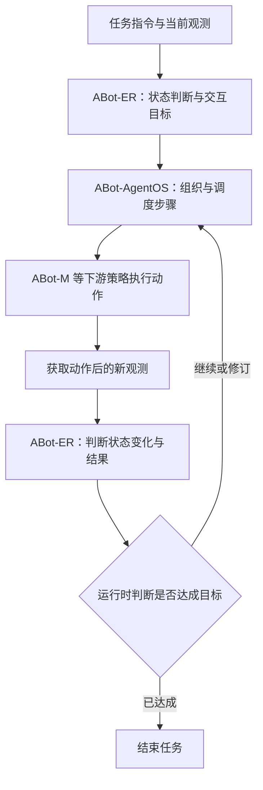

  
<figcaption>原文图 7：积木算术与石头剪刀布定性演示。ABot-ER 读取视觉状态，ABot-AgentOS 决定任务进展，下游 VLA 完成动作；这些案例没有提供额外的真机成功率统计。</figcaption>

---

### 3. 核心结果/发现 {#abot-er-results}

**① 单个检查点兼顾多类能力。** 主表比较 9 个公开基线，9B ABot-ER 在十二项中的六项取得所列最佳结果。
按感知七项、规划三项和点定位两项分别等权汇总，均分为 **63.86、41.61、67.06**，分别比各组最强所列基线高 **3.94、4.20、11.81**；三个参照值来自不同模型。

| 代表性基准 | ABot-ER 9B | 所列最佳基线 | 指标含义 |
|---|---|---|---|
| ERQA | **47.31** | Cosmos3-Nano 46.09 | 具身推理选择题准确率 |
| RoboVQA | **71.79** | MiMo-Embodied 66.09 | 开放式机器人视频问答评分 |
| Cosmos | **68.96** | Cosmos3-Nano 63.18 | 时序与物理事件选择题准确率 |
| EB-ALFRED | **26.67** | MiMo-Embodied 17.33 | 交互任务成功率 |
| EB-Habitat | **37.00** | Cosmos3-Nano 26.67 | 交互任务成功率 |
| VABench-P | **63.33** | Cosmos3-Nano 47.54 | 点落入目标框的命中率 |

这些数值统一展示在 0–100 尺度，但评分含义不同，不能把跨基准均分视为真实机器人的总体成功率。
EQA 九项均分 **64.57** 包含七项感知和两项点定位；十二项均分为 **58.83**，也不等于 EQA 与规划两个均分再各占一半。

**② 定向后训练存在收益和代价。** Stage A 到发布检查点，规划均分 **39.43→41.61**，EB-ALFRED 与 EB-Habitat 分别增加 **3.00、3.33** 点，但 Where2Place **72.90→70.79**，并非所有能力同步提升。

**③ 条件分支的收益依赖数据状态。** 在 **Qwen3.6-35B-A3B** 上的受控成对消融中，未统一协议的数据使条件分支改善 11/12 项、十二项均分增加 **1.36**；协议修复后，各自最佳检查点的 EQA 为 **66.94→66.27**、规划为 **42.87→41.94**，均未改善。
仍然稳定的收益是 ET-Plan-Bench：17 个配对检查点全部更高，平均 **+3.3** 点；此消融同时开关任务标记和残差，没有单独识别二者贡献，也不能直接外推成 9B 的独立结构增益。

**④ 收敛数据可以复用，但训练历史影响能力分布。** 共享起点、最终语料和最终阶段进度的比较中，单次后训练与六轮链式后训练的十二项均分分别为 **60.00、60.09**，前者累计后训练量为五分之一；不过交互规划仍较弱，EB-ALFRED 为 **25.00 对 30.00**，EB-Habitat 为 **48.67 对 51.67**。
同一对两阶段语料还迁移到 2B、4B、27B 和 35B-A3B 等骨干，无需为每种规模重新运行数据修订闭环；其中 27B 的十二项均分为 **62.57**，这是另一组模型规模实验，不能与前述训练历史对照混用。

  
<figcaption>原文图 6a：每次开发版本切换都同时出现增益与退化。各轮预算、初始化和部分历史协议不同，热力图描述开发过程，不能把每列当作只改变数据策略的严格对照实验。</figcaption>

**⑤ 实验口径决定结论边界。** VABench-P 的当前预测归档把同一个位置重复八次，不能解释为八个独立候选点；论文还说明 EB 归档的原始在线调用来源有待核验，不能仅凭成功率归因于模型原生的闭环纠错。
公开基线取自不同时间的榜单快照，原始训练与评测配置未必一致；点定位分数也只验证空间目标命中，不直接衡量控制精度或物理操作成功。

---

### 4. 局限性 {#abot-er-limitations}

开发轮次同时改变训练预算、学习率、数据与部分评测协议，数据配额仍有人为设定，附录审计也保留未覆盖媒体等残余风险，因此不能把跨轮涨分当作自演化机制的独立因果证明。
真机主要是定性案例，缺少大规模成功率与延迟对照，交互规划还有明显失败空间，接入导航或操作项目时仍需独立验证视觉判断、运行时决策与下游控制各环节的贡献。

---

## 9. Harness Robotic OS (2026) {#harness-robotic-os}
———把四足巡检从「导航栈」升级为「具身智能体运行时」

📄 **Paper**: [arXiv:2609.11225](https://arxiv.org/abs/2609.11225)

---

### 精华

这篇的真问题不是「怎么导航得更准」，而是「怎么让一堆现成模块在同一份上下文里协同、留痕、可回滚」——把系统集成本身当成研究对象。最值得借鉴的是它立的那道硬边界：实时控制回路（SLAM / 规划 / 控制）与认知回路（智能体编排 / 记忆 / 反思）分属两层，智能体只能「编排技能」而不能直接下发运动指令，于是推理出错也烧不穿到电机。记忆按「保留期限」而不是按「数据类型」切成 working / episodic / semantic 三层，检索由任务意图、空间位置、场景语义共同条件化，避免把整段运维史塞进每次推理上下文。自进化被刻意做成「离线候选 → 安全门 → 版本灰度 → 可回滚」，而不是在线改模型，这是长期运行的机器人能被审计的前提。但要清醒：认知运行时（语音 / 记忆 / 自进化）在本文只有协议没有数字，真正跑出实测的仍是那套经典导航加 VLM 巡检的流水线。

---

### 1. 研究背景/问题

住宅物业巡检要覆盖道路、消防通道、楼栋出入口、设备房、垃圾房等大范围公共空间，人工巡逻在频次、一致性和可追溯性上都受限于人力与个人经验。四足机器人能爬坡越坎、钻窄道，是合适的载体，但「会走」不等于「能巡检」——还需要持续定位、全局任务规划、反应式避障、场景级隐患理解、人机交互，以及与工单系统的对接。

作者指出当前落地系统的通病是把这些能力做成一堆松耦合模块：传感器驱动、导航算法、视觉语言服务、操作界面、企业应用各自持有状态，靠点对点适配器互通，由此产生三个缺口——**语义任务意图与机器人位姿 / 观测 / 执行状态脱节**、**历史任务经验没有被系统性保留与检索**、**提示词 / 工具策略 / 任务图 / 技能的改动难以评估、溯源与安全回滚**。

---

### 2. 主要方法/创新点

#### 2.1 整体框架：四个平面 + 一条自进化环

HROS 把系统分成四层：**Robot Runtime**（硬件抽象：边缘算力、多模态传感、连接与 I/O、四足执行）、**Embodied Autonomy Skills**（把 SLAM、感知、全局规划、局部运动封装成有状态、可复用的「技能」）、**Cognitive Agent Runtime**（智能体编排、分层记忆、多模态推理、技能与工具调度，以及自进化闭环）、**Interaction and Operations**（语音与多模态 I/O、巡检任务控制台、企业闭环）。四层之间不是调用栈而是绑定关系：每个技能把自己的输入时间戳、执行状态、置信度或失败码、输出引用上报到共享上下文总线，认知层据此监控进度，**但不进入实时控制回路**。

  
<figcaption>HROS 四层架构。深色实线是运行时数据流，双向箭头是智能体与技能的绑定，虚线是自进化通路，绿线是安全门——只有过了安全门的候选版本才能回到技能运行时</figcaption>

**卡点降维｜「具身智能体运行时」到底比普通导航栈多了什么**

| 维度 | 常规四足巡检系统 | HROS |
|---|---|---|
| 状态归属 | 各模块自持状态，靠任务专用适配器点对点互通 | 共享上下文总线，物理状态与智能体推理同源 |
| 历史经验 | 跑完即弃，最多留一份日志 | working / episodic / semantic 三级记忆，按意图加位置条件检索 |
| 变更治理 | 改提示词或技能直接上线，出事靠人肉回滚 | 候选版本走离线回归加安全门加版本灰度，可溯源可回滚 |
| 控制权边界 | 上层可直接下发运动指令 | 智能体只能编排技能，运动指令必须过 robot-runtime 接口 |

#### 2.2 Robot Runtime：Vbot 四足平台

物理层用 Vbot 四足作为传感、算力、通信与移动的载体：双目相机、16 线激光雷达、IMU、GNSS 与 4G/5G，边缘计算机为地平线 RDK S100P（6 核 ARM Cortex-A78AE + 128 TOPS Nash BPU），机上跑感知与智能体服务。机器人控制器通过 HROS 的 robot-runtime 接口暴露运动指令与状态反馈——**这层隔离的设计动机就是防止上层智能体绕过校验直接发底层执行器指令**。

#### 2.3 Embodied Autonomy Skills：四个有状态技能

这一层是全文唯一有实测数字的部分，四个模块全是现成开源件的工程化组合：

- **状态估计 · Fast-LIO2**：输入激光雷达点云与 IMU，紧耦合估计 6-DoF 位姿并增量建图，输出先验点云地图与在线位姿。三种工作模式——建图（现场勘测阶段）、在线定位（日常巡逻，实时扫描配准到先验地图）、重定位（跟踪退化或重启后恢复位姿）。设计动机是一个**共享地图坐标系**：住宅巡逻会在不同光照、不同场景外观下反复重访同一资产，只有把每张图像、每个航点、每次隐患事件、每份报告都绑到这个坐标系，HROS 才能做空间相关的记忆检索与跨任务对比。
- **局部感知 · Hobot-Stereo**：输入同步双目图像，输出稠密近场深度并与激光雷达障碍表示融合。设计动机是激光稀疏采样对近场矮障碍、细结构、遮挡边界表达不足。深度点先变换到地图系，按距离与置信度过滤后插入 EGO-Planner 消费的局部体素表示；**双目是补充而非替代**，不确定观测按保守处理，长时间未被重复观测就从局部地图过期删除。

  
<figcaption>两套互补的环境表示。左：Fast-LIO2 在共享任务坐标系下建出的全局三维点云图，用于重定位与任务规划；右：Hobot-Stereo 的稠密深度（左上）、融合点云（右上）、RGB 输入（左下）、局部鸟瞰几何（右下），补齐激光在近场的缺口</figcaption>

- **任务规划 · PCT-Planner**：物业巡检是**覆盖型任务**而非单次起点到终点的查询，路线必须串起策略定义的视点（消防设施、设备房入口、垃圾收集点）且全程可通行。PCT-Planner 在三维先验点云图上算无碰路段，任务层按巡检策略排序并把结果存成可复用的任务模板。运行时全局路线只是**参考**而非直接运动指令，进度用「当前路段 + 当前航点 + 已完成视点 + 剩余巡检动作」表示——这样编排器可以暂停、恢复、重排非安全关键任务，而完全不碰局部控制器。

  
<figcaption>PCT-Planner 在先验点云图上生成的全局巡检路线，串联 8 个巡检航点，作为任务模板存档复用</figcaption>

- **运动智能 · EGO-Planner**：输入全局参考路线、当前位姿、融合后的障碍表示，输出动力学可行的局部轨迹，再转成受速度、净空、连续性约束的四足控制指令。三种行为——标称跟踪、局部重规划（行人、违停车辆、保洁设备等临时遮挡时生成短绕行）、恢复（无可行局部轨迹时停机并上报**带类型的失败码**，交由任务层决定等待、重试还是呼叫操作员）。

  
<figcaption>EGO-Planner 在遛狗行人前方优化出的局部可通行走廊（蓝色区域），全局路线只给方向，让路的决策由局部规划器完成</figcaption>

#### 2.4 Cognitive Agent Runtime（一）：接地的语音交互

流式 ASR 把语音转成带时间戳的意图假设，**但不直接执行**——要先用当前机器人位姿、活动任务、可见场景、权限策略做接地（grounding），有歧义或涉及安全的指令必须显式确认。TTS 回报任务受理、导航进度、发现的隐患、恢复动作、完成状态。设计动机是让文本、语音、图像、企业消息进同一个多模态任务接口，而不是各自散在独立应用里。

#### 2.5 Cognitive Agent Runtime（二）：分层记忆

记忆按**保留期限**切三层：working 存短程信息（当前任务、近期对话、机器人状态、局部观测、待返回的工具调用）；episodic 存按时间索引的任务片段（轨迹、决策、观测、隐患事件、失败与恢复结果）；semantic 存稳定的场地知识（地图分区、资产标识、巡检规则、历史缺陷、物业处置流程）。检索由任务意图、空间位置、场景语义、执行状态共同条件化。

**卡点降维｜三层各装什么、检索到底怎么发生**

> **举个例子**：机器人第 7 次巡检 3 号楼配电房门口，画面里地上有个纸箱。
>
> - **working memory** 装「此刻」：当前任务 ID、刚才那句「去 3 号楼看看」、当前位姿、最近两帧观测、还没返回的 Qwen3-VL 调用。任务结束即清。
> - **episodic memory** 装「哪一次」：第 3 次巡检在同一位置判过「杂物堆放」，人工复核改判为「临时快递件」；第 5 次因行人挡路触发过一次局部重规划。带时间戳，按次索引。
> - **semantic memory** 装「这地方一贯如此」：配电房属消防重点区域，规则是门前 1 米内不得堆物，历史缺陷记录里它是高频点位。不随单次任务变。
>
> 检索不是把三层全灌进上下文，而是拿「意图=巡检 + 位置=配电房 + 场景语义=地面有箱子」去条件化召回：semantic 给出适用规则，episodic 给出「上次这类箱子被人判成快递件」，working 给出当前画面。于是这次就有机会不再误报——而这正是论文说要用 Recall@5 与任务完成率去量的东西，只是**数字还没给**。

#### 2.6 Cognitive Agent Runtime（三）：安全门把守的自进化

自进化被明确定义为「经验到更新」的**受治理流程**，而不是在线改模型。每次任务结束把执行轨迹与人工反馈写入经验缓冲区；反思与评估阶段做成败打分、失败归因、一致性检查，产出候选更新（记忆条目、提示词、工具选择策略、任务图、可复用技能）；候选版本在离线回归用例与安全规则上评估，带溯源记录，过了安全门才走版本化灰度上线。

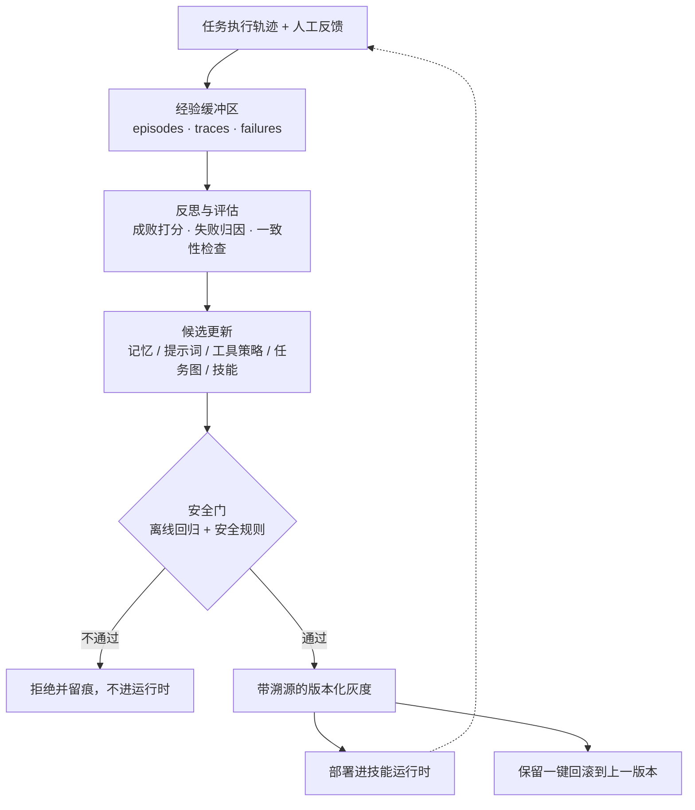

注意这张图里 **F 与 I 两个节点才是真正的设计主张**：任何候选更新都有一条「被拒绝且留痕」的路径，任何已上线版本都有一条「回退」的路径。论文把这条边界称为长期运行机器人保持可复现、可审计所必需的东西。

#### 2.7 端到端：从图像到工单的证据链

巡检推理流水线按「观测 → 解释 → 校验 → 上报 → 复核」组织。OpenClaw 选定与航点关联的图像，绑上位姿、时间戳、航点、任务 ID、适用巡检策略，再调 Qwen3-VL；返回的描述被解析进一个**受约束的事件 schema**（隐患类别、严重度、证据、位置、建议处置动作）。目标类别分两组——安全类（设备房周边堆物、消防通道占用、地面积水、线缆裸露）与环卫类（垃圾桶满溢、地面污渍、散落垃圾落叶、公共区域异常堆积）。

只有 schema 校验通过的事件才进入运营流水线。系统保留原始图像、模型原始响应、解析后字段、投递状态，打上位置与区域标签后生成结构化报告，经钉钉 / 飞书适配器路由给责任人做复核与派单。**人工修正以带标签的反馈形式回写，而不是静默覆盖原结果**——既保证后续评估与记忆更新有料，又保住了可审计、可回放的记录。这个设计同时把多模态推理挡在安全关键的运动回路之外。

#### 2.8 关于「训练目标」

这篇没有训练环节，全系统由现成组件拼装，没有可学习参数也没有损失函数。全文唯一的公式是语音实验的词错率定义：

$$\text{WER} = (S + D + I) / N$$

其中 $S$、$D$、$I$ 分别是替换、删除、插入错误数，$N$ 为参考词总数。

---

### 3. 核心结果/发现

在真实住宅小区部署的系统级测量（Table 1）：

| 分组 | 子系统 | 指标 | 结果 |
|---|---|---|---|
| 导航与运动 | 任务执行 | 航点可达率 | 100% |
| | Fast-LIO2 | 室外定位误差 | < 10 cm |
| | EGO-Planner | 障碍响应时延 | < 200 ms |
| 语义巡检 | Qwen3-VL | 垃圾满溢检出率 | 95% |
| | Qwen3-VL | 消防通道占用检出率 | 95% |
| | Qwen3-VL | 车道占用检出率 | 90% |
| | Qwen3-VL | 地面积水检出率 | 88% |
| | Qwen3-VL | 公共设施损坏检出率 | 85% |
| | 巡检推理 | 隐患误报率 / 漏检率 | 均 < 5% |
| 运营闭环 | 钉钉 / 飞书适配器 | 告警投递成功率 | 99% |
| | HROS 报告 | 结构化报告生成准确率 | 99% |
| 现场运行 | 机器人平台 | 连续续航 | > 3 h |
| | 端到端任务 | 全覆盖单次巡检耗时 | ≤ 60 min |

几点值得注意的：

- **检出率随视觉类别下降得很规律**：垃圾满溢与消防通道占用 95%，公共设施损坏只有 85%。作者归因于设施损坏这一类的视觉形态多样性远大于前两类——这与「隐患由空间与运营上下文定义、而非仅由物体身份定义」的立论是自洽的。
- **续航 3 h 对单次任务 60 min，留出了跑多轮的余量**，这是能排班的前提。
- **最重要的一条反而是没有数字的那部分**：论文 §5.6 为语音交互、分层记忆、安全门自进化写了完整的受控实验协议（WER、接地意图准确率、确认准确率、P95 端到端时延；Recall@5、时空接地准确率、上下文 token 缩减率、陈旧记忆错误率；任务成功率变化、回归率、安全规则违反率、安全门拒绝率、回滚成功率、**要求安全门逃逸率为零**），但 Table 1 里这三块一个数都没有，原文自陈「数值需待相应受控试验完成后才报告」。也就是说，**HROS 的认知运行时目前是一份架构主张与一套评测设计，实证的是它下面那层经典导航加 VLM 巡检的流水线**。

---

### 4. 局限性

作者列了四条：长期地图维护（停车格局、施工、植被、季节变化需要增量建图、变化检测与多会话地图管理）、开放世界隐患识别（更宽的隐患分类体系需要更多样的标注数据、校准置信度与歧义处理）、智能体评测与安全（记忆与自进化机制需要专门基准衡量检索质量、适配收益、回归风险与回滚可靠性，之后才谈得上在生产环境放开自动更新）、人机协作（户外噪声下的 ASR 鲁棒性、安全关键指令的确认设计、操作员负荷、与门禁广播报警数字孪生的集成）。

补一句读这篇时最该带着的判断：它是一篇**系统与架构论文**，导航与感知全部采用现成开源件，真正的新意在于层间边界与治理流程的设计；而这套设计里最有主张的三块（语音接地、分层记忆、安全门自进化）恰恰还停在协议阶段，尚未提供可比较的实验证据。

---

## 10. NavHarness (2026) {#navharness}
———让新的导航会话接过旧的搜索证据，在连续任务中积累并修正经验

📄 **Paper**: [arXiv:2609.34276](https://arxiv.org/abs/2609.34276) · [Code](https://github.com/billzhao1030/NavHarness) · [Project Page](https://billzhao1030.github.io)

**导航分类索引**：[VLN 扩展篇中的 NavHarness 条目](/VLN-Papers-Extended/#navharness)。

---

### 精华

NavHarness 的可迁移思想，是把“地图在哪里、哪些地方查过、哪些判断有证据、接下来还能怎么找”保存在会话之外，让新的推理会话能够继续工作。
恢复时，机器人留在原地、沿用剩余预算，只更换会话并重新审视搜索思路；交接的关键是区分“去过某处”和“已有证据排除某处”。
记忆访问穿插在观察与行动之间，模型可以依据新视角追查旧记录、修正结论，而不是只在开局检索一次。
停止前的独立核验给当前搜索一次纠错机会，停止后的认证则改善下一项任务继承的记录，两者承担不同职责。
持续部署实验进一步表明：保留地图和任务档案之后，把经验整理成带来源的房屋知识仍能带来收益，但错误认证也可能沿记忆链传播。

---

### 1. 研究背景/问题

通用多模态模型已经能借助观察、移动等工具完成单次导航，但家庭机器人需要从上一项任务的终点继续接收新目标，并复用探索过的空间与搜索经验。
单纯延长对话容易留下过时目标与观测；直接开启新对话又会丢失已搜索区域、尚未检查的位置和失败线索，因此需要一种能跨会话保留证据、又允许重新检查旧判断的导航机制。
本文研究免导航专项训练的连续导航系统，目标可以是语言描述、物体类别或图像，重点是经验如何跨任务、跨恢复尝试以及跨运行序列传递。

---

### 2. 主要方法/创新点

  
<figcaption>原论文 Figure 2：外层编排器推进导航会话，处理恢复、停止前核验、停止后认证和记忆保留；一次任务可以包含多个会话，但共享同一份任务预算。</figcaption>

**① 整体框架：推理会话负责搜索，外层编排器负责交接。**

NavHarness 由多轮多模态导航会话、外部空间与任务记忆、管理任务边界的编排器，以及独立的核验和经验整合会话协作完成导航。
导航会话读取目标与记忆、观察环境并调用工具；编排器决定何时继续当前会话、替换会话或结束任务，同时保留物理状态与外部记录。

论文把一次房屋内的任务序列称为 **run**，单个目标称为 **task**，针对同一目标的一次连续搜索称为 **attempt**，每次搜索由一个 **session** 支持；编排器以 **hop** 为单位推进会话，每个 hop 是一段有限长度的模型交互，同一会话可以跨越多个 hop。

**② 记忆分层：换一段对话，不等于忘掉这个家。**

先把记忆理解为三种使用方式：当前会话的“脑中信息”、多个任务共享的“工作档案”，以及后续运行可查的“房屋笔记”。
新任务的输入包含目标和可用文件的引用；导航会话先读取上一任务交接、任务索引和房屋笔记，再按搜索进展打开更细的记录，输出后续观察与行动决策。
这样既能继承经验，也无需把所有历史对话整段塞进新提示词。

| 记忆层 | 保存什么 | 谁更新、何时使用 |
|---|---|---|
| Active context | 当前目标、推理、观测和已读入的信息 | 当前导航会话维护；任务结束或恢复时替换 |
| Working memory | 分楼层占据栅格、命名地点与照片、任务索引、交接和核验记录 | 导航工具与编排器持续记录；跨任务、跨尝试复用 |
| Long-term memory | 房屋索引、概览、房间笔记、导航技能，以及另行保存的地图与地点资料 | 四份文本笔记只由整合会话更新；后续 run 再读取 |

**这三层按用途与生命周期划分，并非三个互斥数据库。** 同一张地图可以在本次 run 中充当工作记忆，保存后又被下一次 run 复用；整合文本笔记并不把地图变成文字，也不修改地图几何。
任务索引 **ledger** 只记录每项已结束任务的目标、状态和地点名，详细交接与判定保存在独立文件中，方便按需追查来源；导航会话可以读旧任务，但不能覆盖旧档案、编排器的判定或房屋笔记。

  
<figcaption>原论文 Figure 1：任务 1 留下的地图、地点与搜索经验，在任务 2 的新会话中被重新读取并用于导航；记忆访问与观察、行动共同构成闭环。</figcaption>

**③ 空间工具与在线搜索：记住去哪里，还要知道怎么走。**

空间模块输入 RGB-D 观测，由 **ORB-SLAM3** 估计位姿，再把深度投影到各楼层的占据栅格，输出已知可通行区、障碍区和未知区。
导航会话通过 `get_map` 查看地图，通过 `mark` 保存命名地点及最多四个方向的照片，通过 `preview_path` 在已知空闲格上运行 A*、查看路线和长度；路线预览不会自动移动机器人，下一步动作仍由会话选择。
跟踪丢失时暂停写地图，避免用不可靠位姿继续污染空间记录；当前位置、标记与路线都使用 SLAM 估计，导航过程不读取仿真器真值位姿。

执行模块接收前进 0.25 m、左转或右转 15° 的动作列表，输出新观测、碰撞和剩余预算；每次 `step` 最多接收 12 个动作。
为给 SLAM 提供足够连续的画面，每个粗动作拆成五次 0.05 m 或 3° 的子运动；这属于共同使用的运动接口，不是额外训练出的低层导航策略。
会话交替调用观察、地图、档案和移动工具，发现房屋笔记与当前视角冲突时，可以查询原始记录并补充修正证据。

**④ 结构化恢复交接：让下一次尝试知道哪些搜索值得继续。**

恢复的直觉是“让一个新会话重新想办法，同时接过上一轮查到的证据”。
会话可以主动请求恢复，或由配置的回合阈值触发检查；编排器根据探索进展、跟踪状态和既往尝试决定是否批准，以及是否需要重新判断位置、路线、楼层或房屋理解。
批准后，旧会话在禁止移动的阶段写 **recovery note**，输入是本次搜索的观测与过程，输出包括已搜索地点、有观测支持的排除项、可靠地标、未尝试选项和不确定性；新会话读取它，再从当前物理位置继续同一目标。

> **最小例子（用于解释机制，并非实验数据）**：要找镜子，旧会话走进浴室，只检查了洗手台墙面，门后还没看。
> “浴室没找到镜子”会让新会话误以为整间浴室都被排除；结构化交接应写成“已检查洗手台墙面，没有目标；门后未检查，可继续搜索”。
> 若任务原本有 500 步、已用 420 步，恢复后仍只剩 80 步；新会话不会拿到新的 500 步，也不会把机器人送回起点。

GOAT-Bench 控制实验实际使用每任务 500 个移动或转向动作、200 个导航模型回合，最多恢复一次，配置的回合阈值为 80；观察和记忆工具不消耗移动步数，恢复共享原任务的两项剩余预算。

需要重新辨认位置时，独立的 **wake-up session** 比较周围视图与保存的地点照片，为新导航会话提供位置说明。
这里要区分“认出熟悉房间”和“恢复地图坐标对齐”：前者提供语义定位线索，后者仍依赖 SLAM；恢复本身不移动机器人，也不清空存储的观测。

**⑤ 双阶段完成检查：纠正当前停止决定，改善后续记忆。**

导航会话结束搜索前写 **task handover**，概述目标、搜索地点、结果证据与未完成搜索，并提出自己的完成判断。
独立 judge 会话的输入是目标、停止位置四视角、采样的早期图像、地图及执行记录，最多使用 12 帧；它不读取导航对话或导航者的自评，也不能调用工具，输出带证据的 `complete`、`incomplete` 或 `unknown`。
默认各角色使用同一种模型，独立的是会话及证据入口，并不保证导航者与 judge 的错误相互独立。

| 环节 | 发生时机 | 对系统的作用 |
|---|---|---|
| Pre-stop verification | 执行 STOP 之前 | 首次检查若得到与导航者判断明确矛盾的结论，将反证交回当前会话，允许继续搜索 |
| Post-stop certification | 任务实际结束之后 | 将最终判定写进档案，供后续任务使用；不改变当前任务得分 |

**每项任务只有一次停止前纠错机会，恢复不会重置它。** `unknown` 不阻止结束，重复的结束请求会被接受；若停止前后动作步数未变，停止后认证复用已有判定。
编排器把“导航者声称完成”和“judge 判断完成”分开保存，并将环境真值仅用于评测，因此不能把 judge 认证当成真值，也不能把认证目标成功扩展为认证交接中的所有空间描述。

**⑥ 跨 run 经验整合：保留详细档案，再建立便于检索的知识入口。**

run 结束后，独立 **consolidation session** 输入任务索引、交接档案和已有房屋笔记，通过文件工具整理路线、失败搜索、修正和待解决问题，输出更新后的索引、房屋概览、房间笔记及导航技能四份文件。
它只可写房屋笔记，没有导航工具，也不能改地图或覆盖原始任务记录；导航技能必须有任务档案支持，记录需保留来源以及“认证结果”和“导航者解释”的区别，不过这些内容约束仍依赖模型遵守指令。
下一次 run 可以先读概览得到搜索方向，必要时再查详细档案，避免摘要遗漏的失败线索永久丢失。

**⑦ 端到端流程与训练目标。**

一次任务按“目标与文件引用 → 读取记忆 → 观察、查询、行动 → 必要时写恢复交接并更换会话 → 提交结束与核验 → STOP 与认证 → 写任务索引、保存空间状态”的顺序执行，整段 run 结束后再做经验整合。
基准评测中，跨任务记忆只在同一个 GOAT-Bench episode 或 IR2R-CE tour 内传递，新 episode 或 tour 从空记忆开始；跨 run 房屋知识复用另由持续部署实验评估。

**本文不更新模型参数，没有新增导航训练损失。** 经验整合更新的是外部笔记，其状态更新可写为原论文式（11）：

$$
D_h^{+}=C_\theta(D_h,L_K).
$$

这里，$D_h$ 是已有房屋笔记，$L_K$ 是本次任务序列的记录，$C_\theta$ 是参数固定的整合模型；它生成新的笔记，供后续推理读取，而非通过梯度把经验写入权重。

---

### 3. 核心结果/发现

**评测口径。** GOAT-Bench Val-Unseen 覆盖 36 个场景、360 个 episode、2,669 项子任务；IR2R-CE 同样使用 Val-Unseen。
**s-SR** 衡量单项任务成功率，**e-SR** 衡量整条序列所有任务都成功的比例，**SPL** 同时考虑成功与路径效率；下表采用论文 Table 1、2 的三随机种子均值，增益均为百分点。

| 数据集与推理模型 | 独立会话 s-SR | NavHarness s-SR | s-SR 增益 | NavHarness SPL | NavHarness e-SR |
|---|---:|---:|---:|---:|---:|
| GOAT-Bench · Qwen3.8-27B | 41.4% | 71.7% | +30.3 | 48.2 | 14.4% |
| GOAT-Bench · GPT-4o | 43.5% | 78.3% | +34.8 | 57.1 | 26.9% |
| GOAT-Bench · Opus 5 | 58.9% | 81.5% | +22.6 | 55.0 | 28.6% |
| GOAT-Bench · GPT-6 Astra | 65.1% | **83.7%** | +18.6 | **62.3** | **36.9%** |
| IR2R-CE · GPT-6 Astra | 68.4% | **85.9%** | +17.5 | **76.1** | **27.8%** |

GPT-6 Astra 在 IR2R-CE 的 t-nDTW 从 56.8 提高到 64.2；论文报告其两项基准成绩均超过表中先前方法。
在与部分既有方法一致的 278 子任务协议下，GPT-4o 版本取得 77.6% s-SR，高于 HIMM 的 72.8% 和 3D-Mem 的 69.1%；完整评测的 78.3% 不应与子集结果混为同一口径。
**相对独立会话的增益包含地图、恢复和完成检查等整套系统，不能全部归因于记忆。** 更能区分机制作用的是保持模型与任务预算一致的控制实验。

**跨任务记忆与恢复的证据（Opus 5，完整基准）。**

| 控制实验 | s-SR | 相对完整 NavHarness 的变化 |
|---|---:|---:|
| 完整 NavHarness | 81.5% | — |
| 所有任务保持同一个长会话 | 54.9% | −26.6 个百分点 |
| 取消跨任务记忆，保留任务内机制 | 66.8% | −14.7 个百分点 |
| 每任务清空地图，保留任务档案 | 68.9% | −12.6 个百分点 |
| 隐藏旧任务档案，保留地图 | 71.8% | −9.7 个百分点 |
| 取消恢复，任务预算不变 | 71.1% | −10.4 个百分点 |
| 恢复时只传长度匹配的普通摘要 | 73.2% | −8.3 个百分点 |
| 取消停止前核验 | 76.1% | −5.4 个百分点 |
| 取消停止后认证 | 79.0% | −2.5 个百分点 |

普通摘要与结构化交接的恢复触发、预算保持一致，8.3 个百分点的差距支持“交接内容如何组织”具有独立价值。
这些实验分别移除不同机制，结果存在交互，不能把下降值相加成总贡献；例如取消全部跨任务记忆的损失小于单独移除地图与档案的损失之和。

**按需查记忆也有独立对照。** 附录 Table 12 保留相同初始记忆、地图、记录写入、恢复和完成检查，只把历史文本访问改为固定时机的 BM25 检索：开局、恢复后和每 10 个导航回合返回最多 5 段、2,000 token 的原始摘录。
允许模型自主决定何时查、查什么并追问后，s-SR 从 74.5% 提高到 81.5%，配对增益为 **+7.0 个百分点，95% CI [+5.9, +8.2]**，SPL 从 49.0 提高到 55.0；该对照同时改变查询时机、选择与后续查询，不能把增益单独解释为某一种检索算法的优势。

**认证改善档案准确率，但并不可靠到可以当真值。** 附录 Table 16 在“导航者声称完成”的样本中，四视角认证与环境真值一致的比例为 90.7%，高于直接接受所有声明的 82.6%；仍有占全部完成声明 5.2% 的错误完成被接受，以及 4.1% 的真实完成被否决。

**持续部署：整合笔记的收益超出地图和档案保留。**

  
<figcaption>原论文 Figure 3：36 个房屋、Opus 5 的持续部署对比，两组均保留地图和任务档案，仅切换 run 结束后的经验整合；曲线展示任务进展中的表现，右侧给出总体指标与配对增益。</figcaption>

作者在每个房屋串联 10 个 GOAT-Bench tour，在 tour 边界按预定起点重新放置机器人，模拟停机后恢复；两组保持地图与任务档案保留、恢复、核验和预算一致，只关闭对照组的经验整合。
启用整合后，总体 s-SR 从 **72.8% 提升至 80.5%**，配对增益 **+7.7 个百分点，95% CI [+6.3, +9.1]**；SPL 从 **36.5 提升至 44.3**，增益 **+7.8，95% CI [+6.5, +9.2]**。
**记忆能够引导主动补证，也可能带偏搜索。** 附录 Case 10 中，房屋笔记保留“两种冰箱描述是否指同一台设备”的未决问题，导航者在完成任务后额外观察两侧视图，把答案写入档案并经过整合留给后续任务，从而识别一张昏暗的目标照片。
Case 14 则展示相反风险：会话先被只记了一面镜子的笔记误导，恢复后才重新查看目标图像，并从失败档案中找回“门后尚未检查”的线索；最终成功，但 SPL 只有 0.08，低于无整合对照的 0.38。
这些个案解释了决策过程，不代表各机制在所有房屋中的发生频率，也不能把两组全部步数差归因于某一条笔记。

---

### 4. 局限性

评测仅覆盖静态扫描场景和有限任务序列，尚未验证真实机器人、物体移动或布局变化下的长期适应；SLAM 漂移、跨 run 坐标失配，以及回环修正未同步到既有占据栅格，都可能影响旧地图复用，连续调用大模型也带来较高延迟。
judge 仍会接受错误完成或否决正确完成，错误记录可能被整合成房屋知识，而且目标认证并不验证全部空间与操作描述；系统还依赖足够强的多轮多模态推理能力，论文测试的 Qwen3.5-4B、9B 难以稳定完成这类导航。

---

## 11. SuperNav (2026) {#supernav}
———以导航技能、视觉点选工具和上下文管理组织通用导航 Agent

📄 **Paper**: [arXiv:2610.12126](https://arxiv.org/abs/2610.12126) · [Project Page](https://zju3dv.github.io/SuperNav/)

SuperNav 是以导航为主要验证场景的具身 Agent Harness。它让通用 MLLM 负责理解请求和选择目的地，通过可读取的 Navigation Skills、视觉点选工具、目标进度记录与上下文管理，把搜索、目标复核和失败恢复组织成持续闭环，再由几何或学习式运动后端执行移动。其可迁移思想是如何用技能、工具和执行反馈支撑持续的物理交互，因此也适合归入具身智能体框架；上层 MLLM 无需导航专用微调，学习式执行器仍用导航轨迹训练。

**完整解析与实验结果**：[SuperNav：方法、评测口径与性能对比（VLN 扩展篇）](/VLN-Papers-Extended/#supernav)。

---

## 12. VISTA (2026) {#vista}
———给多模态模型一副「能回放、能放大」的眼睛：无损视觉记忆 + 模型自主视觉检视

📄 **Paper**: [arXiv:2610.02200](https://arxiv.org/abs/2610.02200) · [Code](https://github.com/joshhhhhan/VISTA)

**收录说明**：VISTA 的实验环境是交互式视觉游戏而非机器人，但它研究的正是本文的共同问题——不改模型、只改 Harness，让通用多模态模型在长程交互中保留并按需回看视觉证据；作者也把具身任务列为下一步方向。

---

### 精华

- **瓶颈往往不在模型能力，而在 harness（外壳）怎么喂信息**：同一个 Claude Opus 5.0，官方最简 harness 在 ARC-AGI-3 上只有 40.68 RHAE，换成 VISTA 直接 100.00，模型零训练。
- **"编码一次就丢原图"是多模态 agent 的隐性天花板**：模型在编码时并不知道之后哪些细节会有用；把每一帧原图无损存档，让模型推理时按需回看，等于给它一个**显式的、可寻址的注意力**。
- **观测用图像而非文本网格**：64×64 网格转文本约 4K token，渲染成 512×512 图只需约 308 token，性能持平甚至更好，每局 token 用量从 71.9M 降到 30.7M。
- **工具设计要"只读免费、动作收费"**：`inspect` / `read_pixels` 不消耗游戏步数，只有 `play` 计步，鼓励模型"先看清再动手"，结果动作数比首次玩的人类少 57.4%。
- **简单即通用**：同一套 harness 和几乎相同的短 prompt，原样迁移到 GameWorld、AI GameStore、BabyVision 三个基准，全部大幅超过同模型的官方基线。

---

### 1. 研究背景/问题

ARC-AGI-3 是一组**不给规则、不给目标**的交互式视觉小游戏，agent 必须靠试探自己摸清"哪个是玩家、点哪里会发生什么、怎样算赢"。现有高分方法大多把画面转成数字网格、再让 LLM 写程序构建可执行的世界模型（program synthesis），画面一复杂就难以扩展；而直接用 VLM 的方案又受困于两点：图像只编码一次、细节可能在压缩中丢失，长程交互中早期观测还会因上下文超限被截断或被文字摘要替代。本文想回答：**不写程序、纯靠视觉 + 自然语言推理，配一个合适的 harness，能否把通用多模态模型推到满分？**

---

### 2. 主要方法/创新点

  
<figcaption>三种 agent 设计对比：(a) 语言 agent 只看文本；(b) 常规多模态 agent 把图像一次性编码后就不再回看；(c) VISTA 在每次行动前可以反复调用视觉工具，取回历史帧、重组自己的视觉输入</figcaption>

**① 整体框架概述**

VISTA 不是一个新模型，而是一个**纯机械、不含任何训练参数的 harness**：它由三个视觉组件——**视觉观测**、**无损视觉记忆**、**视觉检视工具**——加上两份**笔记文件**（`GUIDE.md` / `WORKING.md`）构成。harness 负责执行工具调用并返回图像或像素值；所有"理解、推理、决策"都交给底座多模态模型（Claude Opus 5.0 / GPT-5.6 Sol / GLM-5.3 Flash）在一个多轮对话里完成。

  
<figcaption>VISTA 的核心组件与单回合流程（以 ARC-AGI-3 为例）：(a) 观测从 64×64 数字网格换成渲染图像；(b) 环境返回的每一帧都以原分辨率存档，可按"回合号 + 帧号"寻址；(c) 模型可在空间上放大任意区域、在时间上一次取回多个历史帧；(d) 每回合 观察 → 推理 → 行动，读写笔记与检视记忆均为可选步骤，只有行动消耗步数</figcaption>

**② 逐模块讲解**

**视觉观测（Visual observation）**
- **输入**：环境当前状态。ARC-AGI-3 官方给的是 64×64 的整数网格（每格是颜色编号）。
- **处理**：按 8× 最近邻放大，渲染成 512×512 的 PNG，每个格子变成一块纯色像素。
- **输出**：一张图 + 当前可用动作列表。
- **设计动机**：图像保留了物体的外观和空间关系，模型可以直接调用预训练中学到的视觉先验（"这是墙"、"这两个东西对称"），而不必在 4096 个数字里自己拼出形状；同时 token 成本大幅下降（见下方卡点 ②）。

**无损视觉记忆（Lossless visual memory）**
- **输入**：环境返回的**每一帧**，包括一个动作引发的所有中间动画帧（例如点一下方块，会返回 6 帧动画）。
- **处理**：原样存档，按 `(turn, frame)` 编号索引，与模型上下文里留下了什么完全解耦。
- **输出**：一个可随时寻址的帧仓库（论文示例中一局已存 1,472 帧）。
- **设计动机**：常规做法是"编码一次、上下文满了就截断或摘要"，但模型在编码时无法预知哪个细节以后会关键。把原图留在上下文**之外**，上下文压缩就不再意味着视觉证据丢失。

**视觉检视工具（Visual inspection）**

这是让记忆"活起来"的接口，模型自主决定何时用、看哪里：
- `inspect(question, views)`：**空间上**可裁剪任意帧的任意矩形并放大（论文示例放大约 13× 来分辨小方块的朝向）；**时间上**一次调用可取回多个历史回合的帧做对比，或逐帧回放某个动作的动画过程。
- `read_pixels(question, views)`：把区域切成网格，返回每格的精确 RGB 数值——用于"两个颜色到底一不一样"这类肉眼易错的判断。
- 每次调用都要附一个 `question`，强迫模型说清"这次看是为了确认什么"。
- **关键设计**：检视工具**不消耗游戏动作**，只有 `play` 计步。

  
<figcaption>模型自主使用视觉记忆的两种方式：(a) 跨时空检视——棋盘重置后，模型一次 inspect 调用取回过去 22 回合中的 4 帧，拼出完整地图；(b) 局部细节检视——把三个小方块放大约 13×，看清紫色标记在哪一侧，从而判断每个守卫的朝向</figcaption>

**笔记文件（GUIDE.md / WORKING.md）**
- `GUIDE.md`：跨关卡、跨上下文长期有效的"游戏规则手册"（例如"点击橙色块会把它变成 X 标记，再点 X 会重建方块"）。
- `WORKING.md`：当前关卡的草稿本，关卡推进时清空。
- 上下文接近上限时，agent 先把交接摘要写进 `WORKING.md`，再在全新上下文中恢复；笔记、视觉记忆、动作历史都保留。

**③ 端到端数据流**

一个回合内，模型可以与 harness 多次往返，但只执行一个游戏动作。下图是"读者版"的单回合流程：

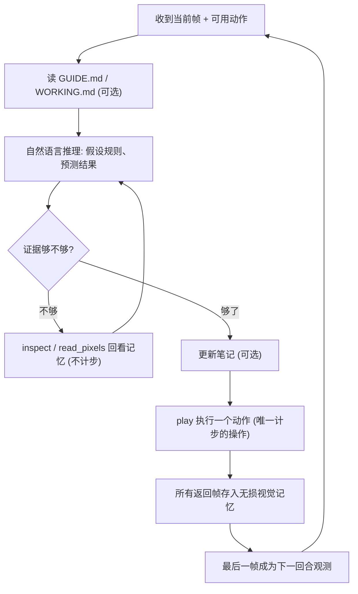

prompt 也极简，核心只有四句：尽量少用动作通关；构建并持续修正一个紧凑的游戏模型；每次 `play` 前说出预期、之后说出所有可见变化；把稳定的认识写进 `GUIDE.md`。这种"先预测、再对照"的写法相当于让模型在线做假设检验。

> **卡点 ① — 为什么不把所有帧都塞进上下文就行了？举个例子**：官方实现每个动作自动塞入最多 7 帧。若用文本网格，每帧约 4K token，一个请求光观测就是约 28K token；即便换成图像（每帧约 308 token，共约 2.2K），玩 300 步也会累积约 65 万 token，迟早超出 200K 上下文被截断。VISTA 反过来：每回合**只自动给最后 1 帧**（约 308 token），其余帧全部留在上下文外的仓库里，需要时才用 `inspect` 精准调回 1–4 帧。上下文里装的是"模型此刻认为相关的"画面，而不是"最近发生的"画面——这就是论文所说的"显式注意力"。

**④ 训练目标 / 损失函数**

无。VISTA 完全免训练，所有提升都来自 harness 设计；底座模型以闭源 CLI（Claude Code / Codex）或开源权重原样调用。

**⑤ 评测指标：RHAE（卡点 ②）**

ARC-AGI-3 用 **Relative Human Action Efficiency（RHAE）** 衡量"和第一次玩的人类相比，你用的步数有多省"。设某关人类基准步数为 $h$（首次通关玩家步数的上中位数）、agent 用了 $a$ 步，单关得分为

$$S_{\ell,g} = \min\left(1.15,\ \left(\frac{h_{\ell,g}}{a_{\ell,g}}\right)^2\right)$$

未通关记 0 分。一局游戏有 $n$ 关，第 $\ell$ 关权重 $w_\ell = \ell$（越靠后越重要）；若只通到第 $k$ 关，整局得分取"加权平均关卡分"与"加权完成比例"两者中的较小值：

$$S_g = \min\left(\frac{\sum_{\ell=1}^{k} w_\ell}{\sum_{\ell=1}^{n} w_\ell},\ \frac{\sum_{\ell=1}^{n} w_\ell S_{\ell,g}}{\sum_{\ell=1}^{n} w_\ell}\right)$$

> **举个例子**：一局 2 关，权重 1、2。人类第 1 关 32 步，agent 16 步 → $(32/16)^2=4$，封顶 1.15；人类第 2 关 40 步，agent 50 步 → $(40/50)^2=0.64$。
> 两关都通：加权平均 $(1.15\times1 + 0.64\times2)/3 = 0.81$，完成比例 $3/3=1$，取小 → **0.81**。
> 只通第 1 关：加权平均 $1.15/3 = 0.38$，完成比例 $1/3=0.33$，取小 → **0.33**。
> 可见：平方项让"多走几步"的惩罚很重；而 100 分意味着**每局都通关、且整体加权效率不低于人类**——省下的步数可以在 1.15 封顶内弥补个别多走的关卡。

**⑥ 与官方基线的差异（卡点 ③）**

| 维度 | 官方最简 harness | VISTA |
|---|---|---|
| 观测形式 | 64×64 文本数字网格 | 512×512 渲染图像 |
| 历史保留 | 175K 滑动窗口，超出就丢最早的回合 | 所有帧无损存档于上下文之外，可按回合/帧号取回 |
| 每步自动输入 | 最多 7 帧中间状态 | 只给最后 1 帧，其余由模型按需检视 |
| 长期知识 | 无 | `GUIDE.md` + `WORKING.md`，跨上下文重启保留 |

---

### 3. 核心结果/发现

**ARC-AGI-3（25 个公开游戏）**：VISTA + Claude Opus 5.0（xhigh）**RHAE 100.00**，共 7,302 步，比首次玩的人类（17,135 步）少 57.4%；VISTA + GPT-5.6 Sol（max）同样 25 局全通，RHAE 99.00（三次运行 99.04 ± 0.17）。同模型在官方实现下分别只有 40.68 和 13.33。据作者所知，这是**首个不依赖程序合成**就达到满分/近满分的系统，与 Tycho（100.00）、Retrodict（99.86）等程序合成方案持平。

  
<figcaption>逐步叠加 harness 组件的消融（GPT-5.6 Sol）：文本网格换图像 13.33→47.32；放宽步数/时间上限 51.66；连续对话 65.82；加入两份笔记 70.05；加入无损记忆与检视 94.10（跃升最大）；再加精确像素读取即完整 VISTA 99.00，且总步数降到 9,126</figcaption>

**组件消融的关键读数**：最大的一跳来自"无损记忆 + 检视"（70.05 → 94.10，+24），同时动作数从 23,702 骤降到 12,261——能回看之后，模型少了大量盲目试错。

  
<figcaption>观测表示对比：同一 harness 下，图像观测（99.00）与文本网格（96.75）性能相当，但动作更少（9,126 vs 10,614），每局 token 用量不到一半（30.7M vs 71.9M）</figcaption>

  
<figcaption>上下文长度与输入分辨率消融：(a) 200K 上下文最佳（99.0），100K 仅降 0.4 但 token 减半，780K 反而更差且 token 翻三倍多；(b) 4× 放大（256 像素，约 77 token/帧）与默认 8× 效果相当，2× 偏糊、16× 浪费上下文导致下降到 88.3</figcaption>

**其他发现**：
- **上下文不是越长越好**：500K / 780K 反而下降到 94.4 / 93.9，说明"按需检视"比"什么都留着"更有效。
- **开源底座**：GLM-5.3 Flash 320B 下，官方实现 1.89 → 去掉检视工具的 VISTA 13.27 → 完整 VISTA **66.93**，视觉工具贡献了绝大部分增益。
- **3D 渲染**：把同样的游戏渲染成等轴 3D 视角，RHAE 仍有 84.12（动作数增至 20,640），远高于官方文本基线。

  
<figcaption>迁移到其他视觉环境（GPT-5.6 Sol）：GameWorld 成功率 63.3% / 进度 79.3%，超过新手人类（55.3% / 64.1%）；AI GameStore 几何均值 140.3，超过人类中位数（100）；静态的 BabyVision 视觉追踪题准确率 41.0% → 63.2%，但仍明显低于人类的 92.3%</figcaption>

**跨基准迁移**：同一 harness 只改了动作接口名（`play` → `act`）和任务描述，就在三个基准上全面超过同模型的官方基线和此前最佳报告结果。BabyVision 没有交互历史，提升纯粹来自"在单张图里放大看、读像素"，说明检视工具本身就有独立价值。

---

### 4. 局限性

成功在很大程度上仰赖底座模型本身的能力，VISTA 只是把它"引出来"；且所用模型发布晚于公开测试集，无法排除这些游戏已出现在训练数据中，需在 ARC-AGI-3 私有集等全新游戏上进一步验证泛化性。

---

## 13. RACE (2026) {#race}
———Agent 什么时候该想？用"动作似然掉了多少"判断旧推理还够不够用

📄 **Paper**: [arXiv:2610.12061](https://arxiv.org/abs/2610.12061) · [Code](https://github.com/HututuAI/RACE)

**收录说明**：RACE 的实验环境是文本与 API 交互任务而非机器人，但它回答的是长程闭环 Agent 的共同成本问题——每一轮都推理代价高昂，旧推理能撑多远、何时才需要重新想；这套「跨轮推理覆盖」的判定与训练方法可直接迁移到具身 Agent 的多轮决策中。

### 精华

- 推理有"保质期"：前面某一轮想好的计划，往往能撑住后面好几轮动作，没必要每轮都重新想；真正的问题不是"这一轮能不能不想"，而是"旧推理还能撑多远"。
- 用便宜的代理信号替代昂贵的验证：不必把每个候选上下文都重新生成一遍动作来检验，只要用 teacher-forcing 算一下参考动作的似然掉了多少，就能近似判断动作还能不能复现。
- 删一步推理要看它对**之后所有动作**的影响，而不仅是当前这一步——这是"跨轮"估计与以往逐轮独立判断的根本区别。
- 同一个标注器（LoGiC）离线给 SFT 造数据、在线给 RL 造信号，一套机制贯通两个训练阶段；RL 里用"掩码 + 主动教模型闭合 `</think>`"两手配合，而不是靠调奖励。

---

### 1. 研究背景/问题

ReAct 式 LLM Agent 默认每一轮动作前都先推理，长轨迹下推理 token 成本线性累积。已有的自适应推理方法要么逐轮独立判断"这一轮要不要想"，忽略了早先推理可以跨多轮持续生效；要么靠"有推理 vs 无推理各生成一次动作再比较"来获得监督信号，轨迹越长、尤其在 on-policy RL 里每个 batch 都要重做，代价难以承受。

---

### 2. 主要方法/创新点

#### 2.1 动机实验：推理会跨轮持续生效，且似然下降能预测这一点

  
<figcaption>跨轮推理支撑分析：(a) 截断第 s 轮之后的所有推理，看后续动作还能否复现，得到推理支撑的"持续跨度" L；(b) 参考动作似然下降 d 与动作复现率高度对应，d ≤ 0.001 时复现率超过 99%</figcaption>

作者用 Qwen3.5-9B 在 ScienceWorld、WebShop 的成功轨迹上做了两个分析：

- **生成式测量（图 a）**：选一个截断点 s，保留第 s 轮及之前的推理，删掉之后所有推理（动作、观测不变），在每个后续轮 j 采样 K=4 次动作，统计能复现参考动作 $a_j^*$ 的比例 $$\mathrm{Rec}_j$$。结果显示：有的推理只能撑一步，有的能连续撑住后面多步（ScienceWorld 上约 11% 的推理能撑满 5 步）——作者称之为**跨轮推理持续性**（cross-turn reasoning persistence）。
- **似然式估计（图 b）**：对参考动作计算平均 token 对数似然 $\ell(a_j^* \mid h)$，比较"完整上下文"与"截断上下文"下的差值

$$d_j = \ell(a_j^* \mid x_j, r_j) - \ell(a_j^* \mid \tilde x_j)$$

$d_j$ 越小，说明删掉推理后模型"照样很笃定地会做这个动作"；实验发现 $d_j$ 与复现率几乎单调对应。这就把"要生成很多次才能验证"换成了"一次 teacher-forced 打分"。

| 维度 | 生成式验证（以往做法） | 似然代理（本文做法） |
|---|---|---|
| 每个候选上下文的成本 | 自回归采样 K 次动作再比对 | 一次批量 teacher-forcing 打分 |
| 能否放进 on-policy RL | 每个 batch 都要重做，开销太大 | 便宜，可每个 rollout batch 都跑 |
| 看到的影响范围 | 通常只看当前一轮 | 当前轮 + 之后所有轮的参考动作 |

#### 2.2 整体框架

  
<figcaption>RACE 训练框架：核心算法 LoGiC 判定每一轮推理"留（THINK）"还是"删（SKIP）"；离线用于构造 SFT 数据，在线用于 RL 中的推理掩码与推理闭合监督</figcaption>

RACE（Reasoning Adaptation through Cross-Turn Estimation）由三部分组成：**LoGiC** 负责给一条轨迹标出哪些推理可删；**SFT 阶段**用 LoGiC 把全推理轨迹压缩成"该想才想"的轨迹做监督；**RL 阶段**在每批成功 rollout 上重跑 LoGiC，用结果屏蔽冗余推理的梯度、并直接教模型在该停的地方立刻闭合推理。

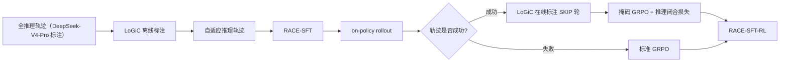

#### 2.3 LoGiC：似然引导的渐进式推理覆盖检测

  
<figcaption>LoGiC 三步流程：(1) 在完整轨迹上初始化各参考动作的似然向量；(2) 从第 2 轮起逐轮尝试删掉当前推理，构造候选轨迹；(3) 若当前及之后所有动作的似然下降都不超过阈值则接受删除，并把删除结果带入后续轮次的判断</figcaption>

"推理覆盖"（reasoning cover）的直觉：留下最少的几段推理，让它们**合起来**仍能撑住整条轨迹的所有动作——就像用最少的路灯照亮整条路。LoGiC 按"输入 → 处理 → 输出"运作：

- **输入**：一条成功轨迹 $$\tau = (q, (r_t, a_t, o_t)_{t=1}^T)$$，把每个 $a_t$ 视为固定的参考动作 $a_t^*$；阈值 $\epsilon = 0.001$。
- **① 初始化**：在完整推理上下文下算出似然向量 $\ell^{(0)} = [\ell(a_1^* \mid x_1, r_1), \dots, \ell(a_T^* \mid x_T, r_T)]$。第 1 轮推理默认保留。
- **② 渐进压缩**：从 t=2 开始，在"已接受的删除都已生效"的当前压缩上下文 $x^{(t)}$ 中，再试着删掉 $r_t$，重新计算第 t 轮及之后所有参考动作的似然 $\tilde\ell_j^{(t)}$（之前轮次不受影响，直接沿用）。
- **③ 似然验证**：计算 $d_j^{(t)} = \ell_j^{(t-1)} - \tilde\ell_j^{(t)}$，只有当 $d_j^{(t)} \le \epsilon$ 对所有 $j \in \{t, \dots, T\}$ 都成立时才接受删除；接受则更新似然向量与上下文，否则保留 $r_t$ 并放入覆盖集合。
- **输出**：压缩轨迹 $\tilde\tau$ 与推理覆盖 C，即每一轮的 THINK / SKIP 标签。
- **设计动机**：一是"渐进"——每次判断都基于已删过的上下文，避免多个"单独看都可删"的推理被同时删掉、合起来却撑不住；二是"看后续"——一段推理可能对当前动作无关紧要，却是后面某一步的唯一依据。

> **举个例子**：一条 4 轮轨迹，阈值 ε = 0.001，初始化似然 $\ell^{(0)}$ = [-0.20, -0.35, -0.10, -0.40]。
> - **t=2，试删 r2**：重算第 2–4 轮得 [-0.3504, -0.1003, -0.4006]，下降量 0.0004 / 0.0003 / 0.0006 全部 ≤ 0.001 → **接受**，r2 标为 SKIP，似然向量更新为 [-0.20, -0.3504, -0.1003, -0.4006]。
> - **t=3，试删 r3**（r2 已删）：第 3 轮动作似然只降 0.0001，单看当前轮完全可删；但第 4 轮从 -0.4006 跌到 -0.52，下降 0.12 → **拒绝**，r3 保留。这正是"逐轮独立判断"会误删的情形。
> - **t=4，试删 r4**：第 4 轮似然跌到 -0.95，下降 0.55 → 拒绝。
>
> 最终推理覆盖为 {r1, r3, r4}，即 THINK / SKIP / THINK / THINK。整个过程只做了 3 次候选轨迹的批量打分；若用生成式验证，每个候选的每个后续轮都要采样 K=4 次动作，共 (3+2+1)×4 = 24 次自回归生成。

阈值取 0.001 有图 1(b) 的支撑：d ≤ 0.001 时 ScienceWorld / WebShop 的动作复现率分别为 99.52% / 99.07%。

#### 2.4 Stage 1：基于 LoGiC 的 SFT 数据合成

用 DeepSeek-V4-Pro 采集成功的全推理轨迹，用 Qwen3.5-9B 跑 LoGiC 得到 $\tilde\tau = \mathrm{LoGiC}(\tau)$——被删除的轮次保留一个空的 `<think></think>`，直接给动作。再对 Qwen3.5-9B 做标准 SFT：

$$\mathcal L_{SFT} = -\mathbb E_{\tilde\tau \sim \mathcal D_{SFT}} \sum_{n=1}^{\lvert \tilde\tau \rvert} \log \pi_\theta(\tilde\tau_n \mid \tilde\tau_{<n})$$

损失只作用于模型生成的推理与动作 token。这一步让模型先学会"什么情况可以直接动手"，作为 RL 的初始化。

#### 2.5 Stage 2：推理覆盖感知的 Agentic RL

离线数据和不断演化的策略会逐渐脱节，因此 RL 中对每个 rollout batch 的**成功轨迹**重新跑 LoGiC，得到各轨迹的 SKIP 轮集合 $S_i$；失败轨迹走标准 GRPO。两个机制配合：

| 机制 | 做什么 | 解决什么问题 |
|---|---|---|
| 推理掩码（Reasoning Masking） | SKIP 轮的**推理 token** 不参与 GRPO 梯度，**动作 token** 照常优化；归一化分母仍按原 token 总数 | 防止成功轨迹的正优势把冗余推理也一起强化 |
| 推理闭合（Reasoning Closure） | 在 SKIP 轮的压缩上下文后，直接最大化生成推理终止符 `</think>` 的概率 | 掩码只是"不奖励"，闭合监督才是"主动教它在这里马上收尾" |

掩码后的 GRPO 损失（$K_i$ 为去掉 SKIP 轮推理 token 后剩下的位置，$P_i$ 为全部策略 token 位置）：

$$\mathcal L_{GRPO} = -\frac{1}{\sum_{i \in B} \lvert P_i \rvert} \sum_{i \in B} \sum_{k \in K_i} \min\left(r_{i,k}(\theta) \hat A_i, \mathrm{clip}(r_{i,k}(\theta), 1-\epsilon_{clip}, 1+\epsilon_{clip}) \hat A_i\right)$$

推理闭合损失（$e$ 为 `</think>`，$I_{succ}$ 为成功轨迹集合，按轨迹总轮数 $T_i$ 归一化，使监督强度与 SKIP 轮的占比成正比）：

$$\mathcal L_{close} = -\frac{1}{\sum_{i \in B} T_i} \sum_{i \in I_{succ}} \sum_{t \in S_i} \log \pi_\theta(e \mid x_i^{(t)})$$

最终 actor 目标为 $\mathcal L_{actor} = \mathcal L_{GRPO} + \lambda \mathcal L_{close}$，λ 在 ScienceWorld / WebShop / AppWorld 取 0.02，DeepSearch 取 0.01。任务奖励负责"做对"，LoGiC 信号负责"少想"，两者分工明确，不需要在奖励里加长度惩罚。

**推理时**无额外步骤：模型在每一轮自行决定写一段推理，还是输出空 `<think></think>` 后直接调用工具。

---

### 3. 核心结果/发现

在 ScienceWorld（科学推理）、WebShop（网购）、AppWorld（应用 API 操作）、DeepSearch（检索问答）四个基准上，以 Qwen3.5-9B 为骨干：

| 方法 | ScienceWorld 成功率 / Tok. | WebShop | AppWorld | DeepSearch |
|---|---|---|---|---|
| Qwen3.5-9B（Base） | 18.52 / 2,210 | 15.60 / 2,713 | 46.15 / 3,134 | 29.25 / 1,281 |
| AdaptThink | 64.49 / 1,252 | 44.60 / 748 | **68.72** / 2,381 | 33.50 / 1,481 |
| SFT+GRPO（无 LoGiC） | 74.55 / 2,073 | 52.00 / 2,702 | 65.30 / 3,545 | 35.75 / 2,163 |
| **RACE-SFT-RL** | 73.28 / 1,403 | **53.40** / **535** | 65.13 / **1,900** | 35.00 / **822** |

- **省 token 而不掉点**：与标准 SFT+GRPO 相比，成功率差距在 1.4 分以内，推理 token 分别减少 **32.3% / 80.2% / 46.4% / 62.0%**。
- **小模型追平大模型**：9B 的 RACE 在 ScienceWorld（73.28）超过 GPT-5.5（69.88），在 WebShop（53.40）与 Claude-Opus-4.6 持平；但 AppWorld 仍明显落后于 GPT-5.5（91.11）和 DeepSeek-V4-Pro（87.69）。
- **RL 阶段贡献最大**：RACE-SFT 相比标准 SFT 只省 4.3%–20.0% token；进入 RL 后，RACE-SFT-RL 相比 RACE-SFT 成功率再涨 2–30 分、token 再降 29%–57%。

  
<figcaption>有无 LoGiC 的对比：上排为成功率，下排为每条轨迹的推理 token 数；SFT 阶段差别不大，RL 阶段 RACE-SFT-RL 在成功率持平的前提下大幅压低推理 token</figcaption>

- **消融**：RL 中去掉 LoGiC 后推理成本暴涨（AppWorld 1,900 → 8,574 token）——说明标准 GRPO 本身会把推理越练越长；只去掉推理掩码，token 有时更少（WebShop 仅 124），但成功率掉到 46.00，说明掩码负责的是"别把推理砍过头"。
- **行为分析**：RL 后跳过推理的轮次比例大幅上升（ScienceWorld 37% → 70%、WebShop 7% → 56%、AppWorld 8% → 52%），但保留下来的推理并非一律变短——ScienceWorld、AppWorld 单次推理反而更长（132 → 273 token），即把思考集中到规划与出错恢复等关键轮次；DeepSearch 跳过率仅 5.77%，几乎每次检索后仍需推理。
- **规模扩展**：在 Qwen3.5-2B / 4B / 9B 上趋势基本一致，AppWorld 因训练数据少（147 个任务），RL 增益在小模型上不稳定。

---

### 4. 局限性

LoGiC 依赖成功轨迹与固定参考动作，RL 中失败轨迹得不到任何推理信号，且阈值 ε 为全局统一值，未按任务难度自适应；在推理密集型的检索问答（DeepSearch）上几乎跳不过推理，在 AppWorld 上与前沿大模型仍有明显差距。（以上为本摘要的观察，论文未单列局限性章节。）

---

## 14. Agentic Robots (2026)
{: id="agentic-robots"}

———从预测动作走向组织执行：用 Model、Data、Environment、Harness 贯通机器人能力的构建与使用

📄 **Paper**: [arXiv:2610.20442](https://arxiv.org/abs/2610.20442) · [Code](https://github.com/chonghanqin/Awesome-Agentic-Robots)

### 精华

机器人的能力取决于推理模型、执行器、观测、接口和反馈能否共同支撑任务，单看动作预测能力不足以解释长程任务成败。
Agentic 的关键是根据目标与实际执行结果，决定下一步做什么、调用谁、何时获取新证据，以及失败后如何改变策略。
本文把这类决策整理为 Model、Data、Environment、Harness 四个领域、17 类可交叉功能，将任务执行与数据、训练、技能和软件的改进放到同一张图中。
Harness 可以把冻结的 VLA、解析控制器和可复用技能组织起来，但收益依赖状态交接、反馈可信度与恢复手段，而不只依赖规划模型大小。
评估时既要固定执行器和交互预算来隔离 Agent 的贡献，也要报告端到端系统的时间、计算、额外观测和人工成本。

---

### 1. 研究背景/问题

VLA 将视觉语言知识连接到机器人动作，World Model / World-Action Model（WAM）进一步引入未来状态或观测预测，但长程任务还要求持续追踪进度、处理环境变化和恢复失败。
相关研究分散在模型训练、数据采集、环境构建与运行软件中，容易把“更强的动作模型”“更好的工具链”和“更有效的 Agent 决策”混为一谈。
这篇综述通过统一定义、功能分类和代表工作比较，回答 Agent 在机器人系统的哪些位置做决策，以及这些决策如何连接当前任务与未来能力提升。

---

### 2. 主要方法/创新点

#### 2.1 整体框架：四个功能领域，连接两种反馈循环

  
<figcaption>原论文 Figure 2：Model、Data、Environment、Harness 通过环境交互、执行反馈、规划调用与经验学习相互连接；它们是功能领域，而非必须依次运行的四个阶段。</figcaption>

本文的主要贡献是**分类框架与系统性分析**。Model 负责模型学习及从观测到决策、控制的转换；Data 负责获取和整理经验；Environment 负责构造可交互世界、任务与测试；Harness 则把模型、工具和技能接入实际执行，并管理上下文、核验与恢复。

作者将 Agentic Robots 定义为：机器人系统中的 Agent 利用环境观测和执行反馈，自主规划、协调任务，并在执行中决定继续、补充信息、修改计划或恢复失败（§3.1）。实现可以集中在一个模型内部，也可以由多个模型、程序和工具组成；判断依据是**任务如何被组织和调整**。

| 比较维度 | 只考察动作策略时 | 本文的 Agentic 系统视角 |
|---|---|---|
| 决策对象 | 给定观测与条件，输出下一段动作 | 同时决定子目标、执行器、工具、观测请求与控制权交接 |
| 反馈用途 | 支撑当前策略的动作调整 | 还可触发重规划、状态核验、执行器切换与失败恢复 |
| 改进对象 | 策略参数及其训练条件 | 扩展到数据、任务、技能库、训练实验和运行软件 |

这不是互斥的技术代际：VLA 本身也可以带记忆、推理或工具使用，传统自主机器人也早已具有规划和监控。本文强调基础模型 Agent 如何参与这些功能；“Agentic”并不自动代表更高自主性。

四个领域的 17 类功能如下（Table 1）。同一工作可以跨类，例如 Harness VLA 同时涉及编排、记忆、监控和恢复，Zero2Skill 同时连接数据采集、整理与策略训练。

| 领域 | 功能类别 | 主要改变什么 |
|---|---|---|
| Model（5 类） | Training、Perception、Planning、Robot Control、Adaptation | 学习过程、任务证据、计划、控制指令，以及经验驱动的适应 |
| Data（3 类） | Collection、Annotation、Refinement | 新经验的获取、结构化监督的补充、已有记录的筛选与修正 |
| Environment（3 类） | Reconstruction、Task Generation、Benchmarking | 可执行场景、练习目标与分布、评价条件和测量程序 |
| Harness（6 类） | Orchestration、Memory、Monitoring and Recovery、Skills、Infrastructure、Layered Systems | 能力调用、信息保留、失败处理、行为复用、服务接口与分层权限 |

其中有两个相连但不同的循环：**任务内循环**根据当前观测和执行结果调整下一步；**跨任务改进循环**把经验转成更好的数据、模型、技能或软件，再用新任务验证改进是否成立。

#### 2.2 Model：从学习过程到机器人动作，区分五种干预位置

  
<figcaption>原论文 Figure 4：同一个“打开抽屉并取物”任务，可以分别从训练、感知、规划、控制和适应五个位置改进；不同失败需要不同干预。</figcaption>

- **Training：修改机器人怎么学。** 输入是任务目标、训练日志、执行视频和评价结果，Agent 生成或修改奖励代码、目标、训练配置、策略程序或实验流程，交给优化器产生新策略，再由真实或仿真执行检验。Eureka 代表奖励代码迭代，ENPIRE 扩展到真实机器人策略与训练代码，HARBOR 强调带类型的产物及阶段检查。这里尤其需要保持测量标准稳定，避免一次修改同时改变方法和裁判。
- **Perception：把观测变成下一步真正可用的证据。** 输入是图像、深度、机器人状态或历史，输出可以是场景关系、几何目标、符号状态，也可以是“再看一眼”的请求。AgenticNav 通过按朝向索引的视图、选择性回忆和几何工具支撑导航；MG-VQA 还能推开或移走物体来暴露遮挡信息。目标身份被记住，不代表其旧位置仍适合直接执行动作。
- **Planning：决定做什么及其依赖顺序。** 输入包括指令、场景表示、历史与可用能力，输出下一项操作、子目标、动作序列或程序。Hi Robot 用高层 VLM 更新短语言子任务，再交给 VLA；SayPlan 在场景图上检查和修正计划。执行前的可行性检查与执行后的反馈更新共同决定计划应走多远：结果越不确定，越需要让新观测参与后续决策。
- **Robot Control：把所选操作翻译为执行层能处理的要求。** 输出可以是语言指令、动作原语、目标位姿、程序，也可以是约束和代价函数。ReKep 将关键点关系写成约束，由求解器反复优化运动；VoxPoser 构建空间价值图，再交给运动规划器。逆运动学、碰撞检测和轨迹跟踪由何种后端完成，会直接影响表面上同一个 Agent 的能力。
- **Adaptation：根据经验改变后续行为。** 输入是失败、纠正、示范或自主交互结果，输出可能是更新后的上下文、规划器配置，也可能是真正更新过的模型参数。TidyBot、DROC 等可通过保留经验改变决策；OLAF、RoboCat 等涉及策略训练。论文要求区分当前任务恢复、上下文适应与重新训练后的长期提升，并检查旧能力是否保留。

#### 2.3 Data：获取经验、补充监督、再修正已有记录

  
<figcaption>原论文 Figure 5：Collection 获得新经验，Annotation 补充任务、阶段和结果信息，Refinement 挑选有用片段并修正监督；失败轨迹也可能包含值得保留的进展和恢复行为。</figcaption>

- **Collection：决定采什么、如何采、何时重置。** 输入是场景、任务覆盖情况和执行弱点，Agent 选择练习任务、调用策略或示教流程，并评估结果来继续、重试或请求协助。论文区分真实物理采集、仿真执行和生成模型合成三条路线：AutoRT、SOAR 组织真实采集，RoboGen 连接任务、场景与仿真轨迹，RoboCurate 等组织生成并检查动作与视觉结果的一致性。
- **Annotation：把视频和状态日志转成监督。** 处理过程包括轨迹分段、语言解释、检测分割、几何查询及结果验证，输出文本、空间、交互或结果标签。NILS 依据物体运动、状态变化和夹爪事件生成阶段指令，ECoT 补充推理轨迹；空间距离、物体位置等答案也可来自几何计算或仿真记录，语义解释与测量证据各负其责。
- **Refinement：重新判断已有数据是否值得学、标签是否正确。** 输入是完整轨迹、局部片段及后续反馈，输出保留的数据与修正后的监督。HELP、ARS 利用进度估计保留失败尝试中的有效部分；Zero2Skill 可以将人类修正的成功标准重新应用到旧示范。筛选单位不必是整条成功或失败轨迹，判定标准本身也需要核验。

#### 2.4 Environment：分别检查世界、目标和裁判

  
<figcaption>原论文 Figure 6：Reconstruction 构造可执行场景，Task Generation 定义目标、约束与成功条件，Benchmarking 固定测试条件、重置流程、指标和评价器。</figcaption>

- **Reconstruction：把观测或要求变成能交互的场景。** 输入可以是图像、视频、示范或布局描述，Agent 生成、组合或修改网格、关节、位姿、物理属性及场景代码，再由编译、几何与仿真检查指导修复。Articulate-Anything 迭代链接和关节代码，SceneSmith 通过结构化场景操作与回滚修改世界。视觉相似、静态稳定、接触行为正确和真实世界有效，是不同层次的验证。
- **Task Generation：定义机器人到底练什么。** 输入是场景、能力范围、历史表现等，输出目标、初始状态、约束、成功条件或课程分布。GenSim、RoboGen 生成可执行任务，CurricuLLM、RATs 根据学习状态调整练习安排。修复不可行任务时还要检查原目标是否被保留；只改变解题计划，也不一定产生了新任务。
- **Benchmarking：明确分数测量哪种能力。** 输入是待评估能力与系统接口，输出任务、扰动、观察权限、重置协议、交互预算和评分规则。开放环技能组合、闭环重规划、主动感知、记忆、安全等测试，测到的能力各不相同。Agent 若还会根据测评结果生成新测试，就必须区分“评价器改好了”和“机器人改好了”。

#### 2.5 Harness：让能力能够被调用、衔接、核验与复用

  
<figcaption>原论文 Figure 7：任务和证据进入决策与分发，随后调用策略、原语、求解器或技能，并接收实际反馈；周围六类 Harness 功能决定这一执行循环是否可靠。</figcaption>

Harness 可以理解为**让模型知道能调用什么、把调用交给机器人，并把真实结果送回下一次决策的软件**（§7）。它管理的不只是函数名，还包括输入输出约定、控制权、状态和可保留的经验。

**① Orchestration：选择执行器，并完成控制权交接。** 输入是任务、当前证据、执行器能力与前次调用结果；处理包括路由、参数绑定、函数协议检查、状态衔接和交接时机判断；输出一次具体分发及后续继续或切换决定。RoboHarness 用运动规划的记忆桥把机器人移到下一个策略要求的起始状态，RoboRouter 则选择适合当前状态的策略；这说明“选对策略”和“让策略接得住”是两件事。

> **举个例子**：假设取物要完成“开抽屉 → 抓物体 → 放到桌上”三步。开抽屉工具返回“已完成”，但夹爪仍握着把手，而抓物策略要求夹爪空闲；直接调用会在交接处失败。Harness 应先核验抽屉状态、释放把手并衔接到合适姿态，再启动抓物策略；若抓物后传感器显示夹爪为空，就应重新观察或恢复，而非把流程直接推进到放置。这是便于理解的示意流程，不是论文新增实验。

**② Memory：保存过去的信息，同时管理它是否仍然有效。** 输入是交互、事件、观测与结果，处理分为写入、更新和检索，输出与下一次决策相关的证据或任务状态。历史全塞进上下文会增加冗余，过度压缩又会丢失关键承诺；场景变化后还需更新或重新核验旧位置。记忆是否跨任务保留，取决于具体系统。

**③ Monitoring and Recovery：把检测到的问题变成可执行的修复。** 执行前检查候选动作与约束，执行中判断进展和是否中断，执行后解释成败；随后选择重试、重新定位、切换执行器、重规划或重置。REFLECT 将失败解释交给纠正规划器，DoReMi 在技能运行时监测约束。恢复还需明确从当前扰动状态继续，还是先恢复已知状态，并设定重试和人工介入边界。

**④ Skills：把经验变成下一次能复用的做法。** 输入是示范、纠正、成功程序或失败记录，处理包括提炼、实现、测试、入库、修订和淘汰，输出可装载的文本规程或可调用行为。Code as Policies 将感知控制 API 组成程序，后续技能库保存其中可迁移的部分。ASPIRE、RATs、RoboRSI 等进一步用执行证据修订技能；关键在于新版本通过验证并保持旧能力，而非仅仅生成更多代码。

| 保留或改进的对象 | 大白话理解 | 典型形式 |
|---|---|---|
| Memory | 记住“刚才发生过什么” | 物体状态、失败记录、历史视图、任务进度 |
| Skills | 保留“下次遇到这种情况怎么做” | 文本规程、函数、程序或可调用行为 |
| 模型参数 | 通过训练改变模型本身的能力 | 更新后的规划模型、动作策略或代码模型权重 |

**⑤ Infrastructure：给工具与策略提供可运行、可检查的接口。** 输入是调用请求与机器人数据，底层服务承担感知、抓取、运动规划和 VLA 推理，接口返回测量、执行记录或明确的失败信息。类型化 API、ROS 2 / MCP 接口、远程策略服务和模型外的运行检查共同决定可用能力；若后端隐藏感知误差或动作延迟，规划器也难以正确恢复。

**⑥ Layered Systems：按反应速度和权限分工。** 作者用 System 2 表示负责目标与子任务的慢速推理或程序层，System 1 表示学习到的视觉运动策略，System 0 表示逆运动学、运动规划、MPC 等解析控制层。各层传递语言、潜在特征、路径或航点，以不同频率更新；例如综述所引 Ground Slow, Move Fast 使用约 2 Hz 规划器与 30 Hz 策略，再由 MPC 跟踪（§7.6）。这是具体配置，不是所有系统统一采用的频率。

下面用读者版数据流说明一次闭环执行；这是对综述机制的归纳，不代表本文提出了这一固定架构。

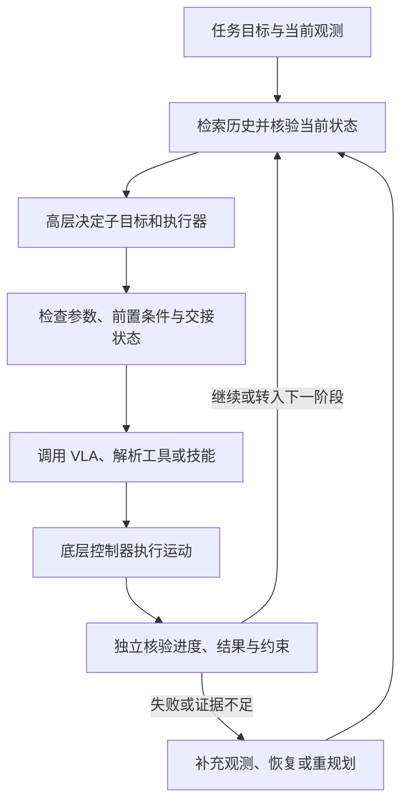

#### 2.6 训练与推理：明确哪些东西发生了变化

本文没有提出统一可训练模型或专属损失函数，不能把 17 类功能拼成一套新的训练目标。被综述系统可以在固定优化器下修改奖励，可以用新标注和纠正数据训练策略，也可以完全冻结模型，只更新上下文、技能代码或调用流程。

推理时，Agent 根据实际观测和执行反馈推进任务，高层调用可以按固定周期、进度事件或预算触发，低层继续承担及时运动控制。跨任务改进则把轨迹、评审、标签、技能修订或实验结果保存下来；是否形成长期能力提升，需要在未参与修改的新任务和条件下再次评价。

---

### 3. 核心结果/发现

**这篇论文的产出是四领域、17 类非互斥功能的分类、跨工作比较和研究议程，没有提出新方法并进行统一排行榜实验。** 以下数字均为综述转述的代表工作结果（§7.5），只用于说明接口和工具链的重要性，不能跨行比较为方法排名。

| 被综述工作 | 比较条件与报告结果 | 支持的观察 |
|---|---|---|
| NavMCP | 完整三通道协议的问答准确率为 74.0%；换成按 episode 组织的接口后为 59.1% | 意图、基于关键帧的行程摘要和持续记忆共同影响结果，不能把差异单独归给记忆模块 |
| Show-Harness | 运动步长减半后，所报告零样本成功率由 60% 提高到 82% | 相同模型也会因动作接口粒度改变而表现不同 |
| ASPIRE | 在所评估 LIBERO-Pro 扰动上，加入执行引擎后宏平均成功率由 14% 提高到 62% | 原语级执行追踪、调试和修复验证是重要系统变量，收益不能全部归给推理模型 |
| Kuroki 与 Tang 的工作 | 完整仿真观测下成功率为 65.0%，仅 RGB 输入时为 22.5% | 特权状态会掩盖感知成本，状态访问条件不同的结果需要分开解读 |

贯穿各领域的发现是：**动作或工具调用格式正确，不等于物理执行成功；保存经验，不等于证据仍有效；接受一次技能更新，也不等于长期能力持续增长。** 综述指出，感知与跟踪误差会在工具链中累积，一些自改进系统的进展并不单调，因此需要实际执行证据、独立测量和新任务验证。

作者提出四个后续方向（§8）：

- **公平评估**：在相同执行器、观测权限和交互预算下比较 Agent 的决策贡献，同时报告完整系统的资源与人工投入。
- **真实机器人部署**：明确技能前置条件、动作是否完成或停止，以及噪声、接触和旧观测失效时的恢复机制。
- **高效使用机器人**：根据任务进展和不确定性触发高层推理，并统计模型等待、网络、工具调用、重试与物理执行的总成本。
- **跨本体泛化**：让 Agent 根据新机器人的传感器、运动范围和技能调整计划，测量额外配置、训练及迁移经验的作用。

---

### 4. 局限性

本文的证据来自不同观测权限、执行器、恢复预算和仿真或实机条件下的已有研究，分类与汇总无法直接证明某种系统组合具有统一的因果收益。
真实接触与感知误差、运行延迟、可靠自改进及陌生机器人上的迁移仍是开放问题，不能由单一任务成功率或仿真成绩替代验证。

---

## 15. Harness² (2026) {#harness2}
———让 Agent 改进当前任务的执行配置，也积累“下次该怎么改”的经验

📄 **Paper**: [arXiv:2610.14224](https://arxiv.org/abs/2610.14224) · [Code](https://github.com/google-research/harness2) · [Project Page](https://harness2.github.io/)

**收录说明**：Harness² 在编程、办公与法律任务上评估通用 Agent 的在线配置改进；本文将其作为具身 Agent 自演化与经验复用的方法参考，其结果尚不构成机器人部署有效性的实验证据。

### 精华
{: id="harness2-takeaways"}

1. Agent 的能力还取决于包围模型的提示词、技能、脚本、工具约束和编排；这些可执行配置可以在模型参数冻结时继续改进。
2. 没有标准答案时，先提出有明确针对性的修改，再在相同任务与配置下重跑，通过轨迹中的行为变化决定保留什么，比直接凭印象重写配置更有依据，但仍不能保证答案正确。
3. 可迁移的资产不仅是最终技能或脚本，还包括“什么情境出现什么问题、哪种修改改变了什么行为”的改进经验。
4. 每个新任务从共同的初始配置出发，再按需借鉴经验库，可以避免把上一任务的专用规则直接叠加到后续任务。
5. 增加推理预算的价值来自候选修改、执行证据和选择性组合；评估时必须把重跑与编辑成本计入，不能只看最终一次执行的步数。

---

### 1. 研究背景/问题
{: id="harness2-background"}

开放世界中的 Agent 会不断接到新任务，设计执行配置时通常无法预见这些需求，在线阶段也没有标准答案或可靠验证器来指导修改。已有方法或针对固定训练集离线优化，或只改进当前任务，难以把“如何发现问题、试验修改、判断取舍”的过程转化为后续任务可用的能力。

本文研究的核心是：在**不更新模型权重、不读取评分反馈、不重放已完成任务**的条件下，如何同时改进当前任务的执行配置，以及指导未来配置改进的经验。

---

### 2. 主要方法/创新点
{: id="harness2-method"}

  
<figcaption>图 3：Harness² 的双层递归。任务内由编辑器提出通用与领域两类候选，实际执行后交给组合器形成配置；任务结束后，反思器把可复用配置和有证据支持的经验存入改进库。</figcaption>

**整体框架。** Harness² 由执行器、配置编辑器、组合器与经验反思器组成：执行器产生任务轨迹和交付物，编辑器提出可运行的配置修改，组合器根据试跑证据取舍，反思器在任务结束后更新经验库。论文把包围冻结模型的整套运行配置称为 **harness**，把优化这些配置的过程称为 **harnessing**。

**① 可编辑对象：八类文件化组件。** 输入是当前任务、冻结模型和初始执行配置，编辑操作作用于文件树，输出是可以挂载到 Agent 运行时的新配置。八个编辑入口为 System prompt、Guardrails、Memory、Tool guidance、Subagents、Skills、Scripts 和 Plugin；它们分别改变常驻上下文、按需加载的流程、确定性能力、独立工作上下文或工具循环中的钩子。

这里不只是改提示词：Scripts 可以直接执行机械性检查，Skills 在匹配任务时才加载，Plugin 则在工具调用或回合边界介入；组件应根据被观察到的问题选择，而非每次全部增加。编辑树还要通过结构验证，例如技能有触发说明、脚本可编译、引用的辅助文件实际存在；这些检查只验证配置有效性，不提供任务正确性标签。

**② 任务内的基本改进单元：Propose–Probe–Compose。** 没有答案时，先观察“修改前后具体做法是否变了”，再判断某条配置是否值得保留；这就是本文的行为对比信号。

- **Propose：从参考执行定位缺陷。** 输入为任务、当前配置、参考执行记录和已有经验。两个编辑方向分别生成完整候选配置：Invariant（INV）针对跨领域的工作方式，如重试、规划、工具使用与交付检查；Domain（DOM）针对当前领域的知识、专业流程、交付结构和约束。
- **Probe：把候选真正跑起来。** 每个候选在相同任务、模型与环境配置下执行，输出轨迹和交付物。与参考执行对照，查看目标缺陷是否缓解、是否没有变化、是否引入退化；这种对照仍会受到采样波动和共享模型偏差影响。
- **Compose：按证据组合修改。** 输入为候选文件差异、参考轨迹、候选轨迹和已有任务内历史。组合器可以合并有支持的修改、改写冲突、采用一个候选，或保留当前配置；随后实际执行组合后的配置，并记录每项决策对应的观察证据。

> **举个例子**：任务要求把排期、人员与预算文件整理成一致的交付物。参考执行漏掉跨文件核对，也没有重新打开输出文件；INV 候选加入输出重开检查脚本，DOM 候选加入排期与预算核对技能。若试跑轨迹显示两类操作确实发生，组合器便有理由保留相关修改；但“检查执行了”仍不等于“所有数字都算对了”。论文图 9 的案例中最终评分从 43.1 升至 77.8，这个分数只用于事后评估，编辑器与组合器看不到。

**③ 扩大任务内搜索：并行探索与顺序修订。** 两种递归都以基本改进单元为基础，但预算的作用不同。

  
<figcaption>图 4：并行递归让多个候选共享同一批参考证据，再进行独立组合；顺序递归把上一轮修订后的配置及累计轨迹传给下一轮。</figcaption>

- **并行递归**：收集 $k$ 次初始配置的参考执行，独立提出并试跑 $k$ 个 INV 候选和 $k$ 个 DOM 候选；随后 $k$ 个组合会话都读取完整候选池，各自生成并执行一个后继配置。本文实现只有一次种群更新，$k$ 控制搜索宽度。
- **顺序递归**：从初始配置开始，串联 $k$ 次改进，每一步读取当前配置及之前累积的轨迹与取舍记录，形成下一配置；后续步骤可以保留、修正或撤销早先修改，$k$ 控制修订深度。

> **预算怎么算**：只看并行方案，取 $k=2$ 时有 2 次参考执行、4 次候选试跑、2 次组合配置执行，共 **8 次完整任务执行**，另外还有编辑、组合和最终选择会话。$k=1$ 也需要 1 次参考、2 次候选试跑和 1 次组合后执行，因此“一步改进”不等于“只多跑一次”；这个计数不含配置验证重试等额外开销。

当 $k>1$ 时，最终选择器依据任务要求与源材料比较匿名交付物，只返回已有结果，不再合成新内容，也看不到结果对应的配置；附录提示明确允许选择初始配置产生的结果。$k=1$ 时不走最终选择，直接返回基本改进单元执行后的结果；被采用只代表本轮选择，不代表已验证最优。

**④ 跨任务的改进：保存“配置＋适用情境＋改进证据”。** 经验反思器接收整个任务的改进记录，包括被拒绝候选，而非只看获选输出；它逐项记录修改、观察到的行为差异与归因可信度，再决定是否提炼可复用经验。若多项修改混在一起、只有一次执行，归因可以标为受混杂影响；没有足够可复用证据时，可以不新增经验条目。

经验库保留获选的可执行配置，并用 `EXPERIENCE.md` 记录适用情境、经验、证据与可信度，通过索引供后续编辑按需读取。两个递归层次的差别在于“当前任务改什么”和“跨任务留下什么”：

| 维度 | 任务级递归 | Harnessing 级递归 |
|---|---|---|
| 更新对象 | 当前任务的执行配置 $H$ | 指导未来编辑的改进配置 $R_t$ 中的经验库 |
| 证据来源 | 当前任务的参考、候选与组合后执行 | 整个改进过程及其取舍记录 |
| 生效时机 | 同一任务内试跑与迭代 | 任务完成后更新，供后续任务读取 |
| 下一任务如何开始 | 不直接继承本任务专用配置 | 从共同初始配置出发，按需复用库中组件和经验 |

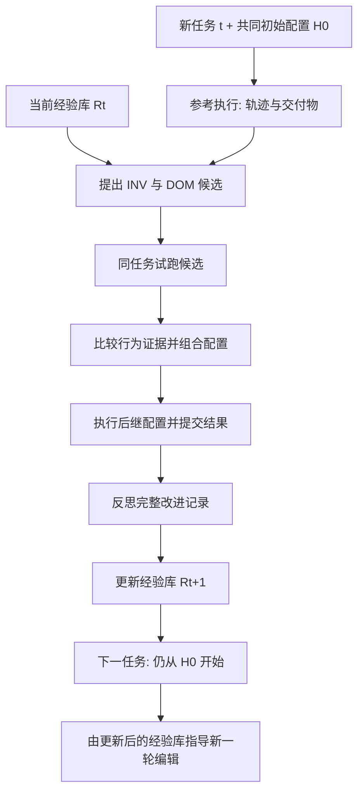

图中省略了 $k>1$ 时的匿名交付物选择；任务内的全部递归期间，$R_t$ 保持固定。下一任务不会直接接手上一任务的配置，过去任务发现的具体事实也需要在新任务中重新核实适用性。

**⑤ 更新规则与训练目标。** 本文没有梯度训练、强化学习奖励或新损失函数，核心是冻结模型下对文件配置与经验库的离散更新。令 $e=(\tau,y)$ 表示轨迹与交付物，基本改进单元可写为：

$$
(H',e',\xi)=\Phi(q_t,H,\mathcal E;R_t).
$$

其中 $\mathcal E$ 为任务内可用历史，$\xi$ 记录候选试跑、组合决策及其证据；先运行修改再保留证据，是这个算子的关键。任务完成后再更新改进库：

$$
R_{t+1}=\operatorname{Update}(R_t,H_t^{\star},\mathcal D_t).
$$

$H_t^{\star}$ 为被采用的配置，$\mathcal D_t$ 为完整改进记录；星号表示采用，不表示正确性或全局最优。模型权重、阶段指令和决策规则保持固定，长期变化发生在库中的组件与经验。

**⑥ 一次完整运行。** 接收任务后，先挂载共同初始配置并取得参考轨迹；编辑器借助当前经验库提出候选，执行器试跑，组合器按行为证据形成后继配置；按预设并行或顺序预算完成探索并交付结果，最后反思改进过程，将有依据的经验供下一个任务使用。整个过程都发生在部署阶段，基准答案、评分量规与评测分数只在外部评估时使用。

---

### 3. 核心结果/发现
{: id="harness2-results"}

**评测设置。** 主实验覆盖 Gemini 3.5 Flash、GLM-5 两个冻结执行模型与 OpenCode、Codex 两种初始配置，共四种组合；默认编辑器与选择器为 Claude Opus 4.8。WorkBuddy-Bench 使用 Code/Web/Office 三域的 40/35/25 个测试任务，JobBench 使用 34 个测试任务，LAB 使用 100 个测试任务；各方法沿任务流运行，主表报告三次打乱顺序运行的均值与标准差，经验库从空开始。

**单步与并行递归均有收益。** 下表整理主表中的代表性结果；$k=5$ 为 $k=1$ 行与后续增量相加，WorkBuddy-Bench 与 JobBench 为分数，LAB Partial 为逐项通过率（%）。

| 基准与执行配置 | 初始配置 | Harness²，$k=1$ | 并行递归，$k=5$ |
|---|---:|---:|---:|
| WorkBuddy-Bench 均分，Gemini 3.5 Flash / OpenCode | 72.4 | 77.5 | 80.8 |
| WorkBuddy-Bench 均分，GLM-5 / OpenCode | 64.2 | 75.7 | 79.6 |
| JobBench，Gemini 3.5 Flash / OpenCode | 31.5 | 36.0 | 39.0 |
| JobBench，GLM-5 / OpenCode | 20.6 | 24.2 | 28.4 |
| LAB Partial，GLM-5 / OpenCode | 59.6 | 71.4 | 78.1 |

单步对初始配置的最大提升分别为 WorkBuddy-Bench **11.5 分**、JobBench **4.5 分**、LAB **11.8 个百分点**；增至 $k=5$ 后，四种组合分别再增加 2.9–3.9 分、3.0–4.2 分、2.6–6.7 个百分点。Harness² 在四种组合的 WorkBuddy-Bench 均分与 JobBench 分数上都超过所比较基线，但 LAB 的 Gemini 3.5 Flash / Codex 组合中，单步结果 75.6 低于 Meta-Harness 的 76.5，不能概括为所有设置均领先。

**组合、分工和经验库都有贡献。** 在 Gemini 3.5 Flash / OpenCode、$k=1$ 下，完整方法的 WorkBuddy-Bench / JobBench 为 77.5 / 36.0；去掉经验库降至 74.4 / 34.2，取消 INV/DOM 分工降至 74.6 / 32.3，去掉组合、只从两个候选中挑选则为 75.9 / 34.1。附录还表明，从已改进配置删除 Skills 后，WorkBuddy-Bench 均分下降 5.3 分，删除 Scripts 下降 3.7 分；收益来自多种组件，不能简单归因于提示词变长。

  
<figcaption>图 7：左侧测试不再新增参考执行或候选试跑、直接借助改进库编辑配置；右侧把 JobBench 经验迁移到 WorkBuddy-Bench。探索更充分的经验库对后续改进更有帮助。</figcaption>

**经验能帮助后续任务，但需要区分实验协议。** 无执行证据、无经验库地直接改配置，Code 从 73.4 降至 63.2，Web 从 69.9 降至 65.0；使用 $k=5$ 累积的库后，即使不再新增试跑，Code/Web/Office 仍分别比初始配置高 0.9/4.4/5.1 分。将 JobBench 经验用于 WorkBuddy-Bench 的单步改进，三域再提升 0.6/0.5/2.9 分；附录的留一重跑还能访问后续任务经验，属于离线复用分析，不能当作在线增益。

  
<figcaption>图 8：在 OpenCode、k=2 下，让同一模型兼任执行器与编辑器，五个受测模型仍在三个基准上获得提升，说明收益不必依赖更强的外部编辑模型。</figcaption>

**同模型也能改进自己，成本则必须完整计算。** 同模型执行与编辑实验中，Claude Opus 5 在 WorkBuddy-Bench、JobBench、LAB 分别提升 3.3、5.5、3.0 分，GLM-5 的 LAB 提升 13.7 个百分点。图 6 在计入执行与改进总 token 成本后，显示 Gemini 3.5 Flash / OpenCode 的 $k=1$、$k=5$ 两个 Harness² 配置位于所比较方法的经验 Pareto 前沿；这只说明该组实验的成本收益取舍，主表中的 `#Steps` 是执行器会话的模型回合数，不能替代总成本。

  
<figcaption>图 9：JobBench 制作统筹任务中，工作流程约束、专业核对技能、验证脚本与工具指引共同修复了跨文件数字不一致及交付缺项，评分从 43.1 提升至 77.8。</figcaption>

---

### 4. 局限性
{: id="harness2-limitations"}

多轮执行与编辑会显著增加推理成本，并行只能在资源允许时缩短等待，论文也未给出通用最优预算或自动停止策略。行为对比与匿名选择仍受共享错误假设、采样和评测波动影响，附录甚至出现候选中有 95 分结果却选中 55 分结果的案例；经验库的长期去重、过时知识修订与检索管理仍待完善。

---

## 16. GPT-6-Astra-JRT (2026) {#gpt-6-astra-jrt}
———从示范与交互预算下的能力上限，到真实部署中的具身智能缺口

📄 **Paper**: [arXiv:2610.22471](https://arxiv.org/abs/2610.22471) · [Project Page](https://sensenova.ai/has-gpt-6-astra-achieved-embodied-intelligence)

### 精华 {#gpt-6-astra-jrt-takeaways}

1. 通用模型的具身能力需要连同它可读取的经验、控制接口和交互预算一起衡量：本报告在冻结 GPT-6-Astra 权重的条件下，让它把训练示范整理成可检索的知识包，再通过观察、行动、检查和修正完成任务。
2. 增加交互步数能够释放失败恢复能力，但收益取决于错误是否仍然可恢复；洒掉的液体、掉到工作空间之外的零件，以及被后续动作破坏的既有进度，都不能靠重复尝试自动解决。
3. 高层推理与低层策略的有效协作，需要审核候选动作、检查真实结果，并选择合适的动作批次长度；单纯让 VLA 执行高层子目标，并未在本文消融中带来更高成功率。
4. 真机中的关键缺口是物理状态验证、精细接触、跨任务经验迁移，以及推理耗时引起的安全和机械代价；看起来完成、模型宣称完成与物理上完成可能是三回事。
5. 下一代评测应同时衡量用户需求的完成程度、机器人引发的持续责任，以及世界不断变化时的及时行动能力，才能区分基准上的高成功率与可部署的具身智能。

---

### 1. 研究背景/问题 {#gpt-6-astra-jrt-background}

联合研究团队（Joint Research Team，JRT）的报告《Has GPT-6-Astra Achieved Embodied Intelligence?》研究通用大模型能否跨越桌面操作、灵巧手、人形机器人和导航等不同具身任务，并进一步追问：已有基准上的成功，究竟有多少来自模型本身，又有多少依赖示范、工具和宽松预算。作者依次开展 12 项仿真基准评测、控制框架消融、8 种真机配置验证，以及一个持续运行的家庭环境原型，试图厘清“具备完成任务的能力”与“能够可靠、高效地部署”之间的距离。

---

### 2. 主要方法/创新点 {#gpt-6-astra-jrt-method}

  
<figcaption>原文图 2：先从训练数据构建并冻结知识包，再将其复制给相互隔离的测试回合；测试中模型权重与知识包均不更新。</figcaption>

**① 整体框架：经验准备、闭环推理与动作执行。** 该报告的基本系统由三个环节组成：知识包保存从训练数据中提取的经验，GPT-6-Astra 根据当前观测与经验选择动作，机器人控制接口负责执行并返回反馈；部分消融再引入 VLA 生成候选动作。这里的贡献是评测协议与控制框架的系统研究，论文没有提出一个经过新损失函数训练的 GPT-6-Astra 模型。

**经验准备模块：把示范变成模型会查、会用的文件。** 输入是各基准允许访问的训练示范，包括图像、动作、机器人状态，部分设置还允许在训练场景探索；模型自行检查这些材料，写出任务笔记、参考数据与可运行代码，输出测试前冻结的知识包 $K$。作者归纳出六类反复出现的内容：任务目标与阶段顺序、运动轨迹与抓取姿态、示范关键帧与接触区域、正逆运动学和检索等程序、完成检查与恢复流程，以及机器人规格和数据来源记录；这六类是观察到的共性，并非预先强制的固定模板。各基准的包也不同，例如 LIBERO 组织可组合的原子技能，SIMPLE 保留数值轨迹，导航任务保留地标、停止条件和恢复经验。

**卡点一：这里的 ICL 不等于微调，也不只是往提示词里塞几张图。** 大白话说，模型先给自己做一本带照片、数值示例和程序的操作手册，测试时查手册并结合当前场景调整动作；参数没有改变。每个测试回合启动新会话，复制相同的只读知识包，只保留本回合的交互历史，测试回合之间不交流经验。

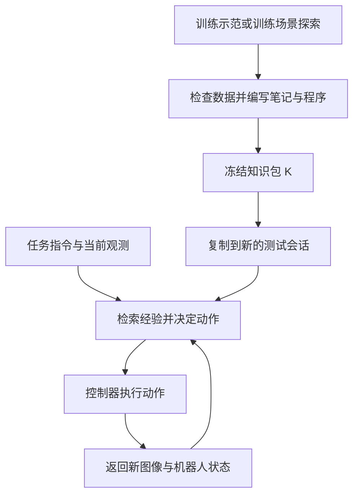

**闭环推理模块：用执行结果修正下一步。** 测试时，模型读取任务指令、知识包、当前图像、允许访问的机器人状态与回合历史，检索参考轨迹或调用辅助程序，输出动作或动作序列；环境执行后返回新观测，模型再判断是否继续、调整、恢复或停止。视觉参考帮助比较当前阶段与示范阶段，数值参考和程序则把经验转为可执行动作；观测形式随基准变化，不能将所有实验都概括为相同的纯 RGB 接口。

**动作执行模块：用机器人原有接口承接高层推理。** 输入可以是末端执行器的位置与姿态、相对方向与距离，也可以是关节目标；逆运动学或现有低层控制器将其转成实际运动。这样可让模型围绕“夹爪移动到哪里”推理，把关节协调交给控制器；人形机器人实验还探索了 GPT-6-Astra 直接向已有运动控制器发出目标的方式，不必始终经过一个任务专门训练的 VLA。

**训练与推理边界。** GPT-6-Astra 在本文实验中始终冻结权重，因此没有新增的模型训练损失；ICL 准备的产物是外部知识包。协作实验中的 System 1 使用在 RoboDojo 上微调的 π0.5，不能把这部分学习与 GPT-6-Astra 的参数更新混为一谈；推理阶段的核心是读取经验、调用工具、执行动作和依据反馈修正。

**② 交互预算：测量模型能否在失败之后继续推进。** 标准预算为各基准规定的控制步数，扩展预算最多允许 10 倍控制步数；主文协议强调在原环境状态和既有历史上继续执行，已造成的环境变化不会消失，成功或终止性失败也可提前结束回合。扩展预算主要给重新抓取、换角度、重新定位和纠偏留出机会，不保证每个回合都执行满 10 倍步数。

> **卡点二，用数字区分控制步数和真实时间**：取 RoboDojo 中一个标准预算为 200 步、控制频率为 25 Hz 的任务，1× 对应最多 8 秒受控运动，10× 对应最多 2,000 步、80 秒受控运动。模型每次观察、思考、调用工具的等待时间并不包含在这 8 秒或 80 秒里；所以仿真中“动作时间很短”的任务，实际运行仍可能耗时数十分钟乃至数小时。10× 也不代表把环境重置后独立尝试十次。

各基准的实现细节仍须分开看：导航附录描述的是保留先前成功、为失败样本增加评测，并保留较优的逐回合指标，不能将其一律理解成严格相同状态下的连续 10 倍步数轨迹。总表还有“单独按 1× 预算执行”和“10× 运行中的 1× 截点”两种列，二者可能不同。

**③ 控制框架消融：谁提出动作，谁审核动作。** 作者把慢速、擅长推理的 GPT-6-Astra 称为 System 2，把 RoboDojo 微调的 π0.5 称为 System 1；两者通过不同协作方式连接。开环方式由 GPT 给出子目标，VLA 直接执行关节动作序列；闭环方式则先将 VLA 候选关节动作通过正运动学转为末端运动，再交给 GPT 结合观测接受、修改或拒绝，最后才执行并获取反馈。

| 卡点三：协作环节 | 开环协作 | 闭环协作 |
|---|---|---|
| GPT 接收和输出什么 | 根据当前任务给出子目标 | 查看候选末端运动，决定接受、修改或拒绝 |
| VLA 输出如何进入机器人 | 候选动作直接执行 | 候选动作先经过 GPT 审核 |
| 核心代价 | 推理调用较少，但缺少动作级监督 | 能纠正候选动作，但频繁审核消耗大量 token |

一次审核多少个动作也很关键：审核长度 $L=1$ 表示每次 GPT 调用审核一个 VLA 候选末端动作，$L=4$ 则一次看四个；这与直接控制实验中的“由 GPT 一次生成几个动作”是不同设置。后者比较单动作、固定四动作，以及 GPT 自选一至四个动作的自适应批次；长批次可减少调用，但也推迟获得反馈，因此需要随任务阶段调整。

  
<figcaption>原文图 7：RoboDojo 上不同协作方式与动作接口的成功率和 token 成本；这里的成功率按五个任务类别等权平均，不能与按全部任务平均的结果直接混用。</figcaption>

附录还对智能体组件做了独立消融：反馈子智能体专门检查执行结果，规划子智能体负责分解任务，执行子智能体生成末端动作；历史压缩则保留最近四轮，并把更早记录压缩成最多 2,000 token 的滚动摘要。这些组件分别增添、单独比较，实验不支持“模块越多越好”的结论。

**④ 真机验证：把示范与免费试错这两个条件拿掉。** 真机实验覆盖单臂、双臂、灵巧手、轮式移动操作与人形机器人共 8 种配置，不提供任务示范或示范提炼的知识包，但仍提供工具说明、关节限制、相机位置、开合手预设等结构化先验，部分平台还提供任务指导或人工抓取脚本。因此，这里的“零样本”指没有示范与任务专门训练，不代表没有人类先验或控制器支持。多数试验按 60 分钟真实时间预算运行，存在平台例外，结果由人依据实际物理状态判定。

其中一个值得迁移的行为是**主动视觉：为了看清接触区域，先移动相机再操作**。单臂夹住花茎时，夹爪旁的相机看不到下方花瓶口；双臂平台中，GPT 主动移动空闲手臂及其腕部相机，让瓶口进入视野，再完成插花，说明观察位置本身可以成为行动决策的一部分。

  
<figcaption>原文图 9：单臂近距离视角受遮挡时插花失败；双臂平台主动移动空闲手臂的相机看清瓶口后成功。该案例说明视角的作用，不构成独立控制相机数量等因素的统计消融。</figcaption>

**⑤ 家庭环境原型：从终点是否达标，扩展到全过程是否真正服务用户。** 作者在 Isaac Sim 中搭建可交互公寓，包含接触、关节机构、液体、布料与烹饪过程；GPT 控制 AgiBot G2，只读取机载相机和本体状态，没有场景示范，并在推理期间继续推进世界时间。评测主张同时考虑用户明确提出的需求（Intent）和机器人必须维持的责任（Duty），如做早餐之外还要及时关冰箱、关水龙头。

| 评测维度 | 常见的静态目标评测 | 本文提出的方向 |
|---|---|---|
| 任务如何描述 | 指定物体需要满足的目标状态 | 表达人的需求，允许不同但有价值的完成方式 |
| 经验从哪里来 | 使用任务训练示范 | 不给域内示范，在部署过程中探索并积累经验 |
| 时间如何计算 | 模型推理时世界暂停，主要按动作步数计费 | 推理、工具调用和通信期间世界继续演化 |
| 如何判定结果 | 某个时刻满足目标即可成功 | 同时评价结果效用、及时性及全过程责任 |

这些是下一代基准的设计原则与概念验证，尚不是一个完成大规模统计评测的新排行榜；文中早餐时限、效用权重等示意常数也不应当作已经验证的统一评分标准。

---

### 3. 核心结果/发现 {#gpt-6-astra-jrt-results}

**仿真：示范与扩展交互可把部分基准推近饱和，但长程任务仍有明显缺口。** 下表优先使用附录对应的配置与覆盖范围，指标为完整任务成功率 SR（%）；RoboLab 无训练集，按无 ICL 的零样本设置报告。

| 基准 | 标准预算 1× | 扩展评测至最多 10× | 结果应如何理解 |
|---|---:|---:|---|
| LIBERO-Long++ | 97.5 | 100.0 | 120 回合，原子技能经验可组合到任务链 |
| LIBERO-PRO | 98.3 | 99.3 | 完整 800 回合，训练探索经验支持扰动适应 |
| LIBERO-Ultra-Long | 82.2 | 98.9 | 90 回合，额外交互显著帮助长链纠偏 |
| RoboDojo，ICL 直接控制 | 27.6 | 81.9 | 210 回合，按全部 42 个任务平均 |
| RoboLab，无 ICL | 57.1 | 69.2 | 不提供训练示范，高分不依赖任务知识包 |
| SIMPLE，ICL | 96.3 | 98.8 | 仅为 Matched-8 的 80 个共同完整样本 |
| DexJoCo | 78.2 | 87.3 | 11 个任务、55 回合 |
| Bench2Dex | 25.6 | 61.5 | 26 个任务、78 回合，精细控制仍较难 |
| BEHAVIOR | 37.0 | 未扩展 | 100 个任务各一次，标准预算已经很长 |
| VLN-CE R2R | 80.0 | 88.0 | 100 个未见场景回合子集 |
| VLN-CE RxR | 82.0 | 90.0 | 选取的 100 个英语导航回合 |
| LHPR-VLN | 21.1 | 28.9 | 人工筛选目标可见的 114 个长程回合 |

**口径说明：** 原文总表 2 给 RoboDojo 列出的单独 1× 成绩是 VLA 辅助的 54.2%，而 10× 列及其 1× 截点对应直接控制的 81.9% 与 27.6%；因此不能把 54.2%→81.9% 当成同配置的预算消融。表 13 和图 7 的消融又按五个类别等权平均，ICL 直接控制为 29.67%，与上表按 42 个任务平均的 27.62% 不冲突；SIMPLE 的 98.8% 也不代表完整六任务集表现，导航扩展评测则有前述保留较优结果的细则。

  
<figcaption>原文图 1：12 项基准的总览。已发表基线使用标准预算，本文的扩展预算列不能解读为相同时间、相同成本或完全相同观测条件下的公平排名。</figcaption>

**ICL 的作用有更直接的配对证据。** 在 SIMPLE 的 Common-4、120 个共同样本上，标准预算成功率从零样本的 70.8% 提升至 ICL 的 90.8%，增加 20.0 个百分点；在两种设置均成功的 81 个回合上，平均动作步数从 376.9 降至 210.4，测试耗时从 47.0 降至 31.4 分钟，但 token 从 264 万增至 640 万，另需每任务一次性的准备成本。这个 120 样本子集不同于上表的 80 样本 Matched-8，不能混用分母。

**框架消融：闭环审核和适应性，比单纯增加执行模块更有效。** 以下均为图 7 的五类别等权平均；token 为每回合百万级输入与输出总量，不等同于价格已对齐的美元成本。

| 配置 | SR（%） | token（百万） |
|---|---:|---:|
| GPT 直接控制基线 | 15.56 | 2.560 |
| 单独 VLA π0.5 | 6.91 | 未报告 GPT token |
| GPT + VLA 开环 | 5.83 | 0.387 |
| GPT + VLA 闭环，逐动作审核 | 23.61 | 7.664 |
| GPT + VLA 闭环，一次审核四动作 | 25.83 | 2.796 |
| GPT + ICL | 29.67 | 9.567 |
| GPT + ICL + VLA 闭环 | 54.17 | 19.335 |
| GPT 自适应生成动作批次 | 20.00 | 1.146 |

一次审核四动作相对逐动作审核，token 减少 63.5%，成功率还提高了 2.22 个百分点；ICL 联合闭环协作获得最高成功率，但 token 约为前者的 6.9 倍。直接控制中，相对方向命令为 18.06%，关节角控制为 9.72%，说明语义推理与底层动作表达之间存在接口差距；固定四动作批次只有 11.39%，也表明批次变长并不自动更好。附录中，独立反馈子智能体将基线 SR 从 15.56% 提高至 24.72%；历史压缩提高至 21.11%，同时将 token 从 256 万降至约 86 万。

**高成功率仍可能非常昂贵。** LIBERO-Long++ 在标准预算下平均每回合耗费约 104 万 token、53.1 分钟；Ultra-Long 约 889 万 token、110.9 分钟。RoboDojo 扩展评测平均约 3,863 万 token、216.6 分钟，且这些测试成本不包含 ICL 准备；原文图 5 同时说明，运行中约 98% 的 token 是缓存输入，因此总 token 数也不能直接按未缓存输入的单价换算费用。各基准对工具与仿真时间的统计口径不同，部分 token 记录也不完整，应理解为原报告口径下的量级，而非严格统一的端到端时延排名。

  
<figcaption>原文图 5：ICL 准备、标准预算运行和额外交互的 token 与时间成本。增加步数带来的成功率收益，需要与计算、等待和准备成本一起评估。</figcaption>

**真机：跨本体可行，精细接触与长程可靠性仍不足。** 刚性物体抓取与放置合计 17/18 成功，但三个平台的插头插入合计 0/11；AgileX Tracer 的导航与搜索为 9/23。Tianji 灵巧手自主编写抓取代码时，玩具抓取为 0/3，加入人工抓取脚本后为 3/3，说明结构化先验对结果影响很大；Unitree G1 操作为 2/3、移动为 3/3，两个成功操作回合分别约 74.5 与 87.8 分钟，API 请求时间约占运行总时长的 89%–92%。这些小样本主要证明可行性，不足以建立稳定可靠性。

**失败模式：能判断下一步，不等于能持续维持正确的物理状态。** 原文案例包括把“杯柄与挂钩在图像中重叠”误当成已挂稳、修正耳机位置反而破坏先前摆放、液体洒出后即使扶正杯子也无法恢复原任务。持续运行的家庭原型进一步暴露了三类问题：只关注手中物体而忽视碰落其他物品或忘关冰箱，不会探索陌生机构及规划全身站位，以及行动依据在推理期间已经过时的图像；这些是定性案例，不是新基准上的统计失败率。

  
<figcaption>原文图 12：家庭原型中的代表性失败，包括整理时误碰物品、冰箱门长时间敞开、身体站位阻碍取物、水槽溢出，以及决策与执行延迟导致鸡蛋烧焦。</figcaption>

---

### 4. 局限性 {#gpt-6-astra-jrt-limitations}

知识包主要依赖任务相关示范，跨任务、跨本体经验迁移尚未系统验证；各基准的观测、接口、样本覆盖、预算延续及成本记录并不完全一致，且未与既有方法匹配推理成本，因此结果更适合刻画能力边界，不能直接等同于统一条件下的系统排名。真机多数任务试验次数有限、部分依赖专家先验且判定标准不一，家庭环境也只有少量定性案例，其物理保真度、效用评分与持续运行协议仍需进一步验证。

---

## 17. Evo² (2026) {#evo2}
———让「改进智能体的人」与智能体 Harness 一起进化

📄 **Paper**: [arXiv:2610.13025](https://arxiv.org/abs/2610.13025)

**收录说明**：Evo² 的直接实验是编码与记忆任务，并非机器人或具身基准；但它研究的权重—Harness 协同进化、执行反馈归因、跨分支策略复用与轨迹恢复，正对应具身 Agent 长期运行中的 Harness 演化问题。本文将其作为机制参考收录，不把编码基准增益外推为机器人性能。

### 精华
{: id="evo2-highlights"}

Evo² 的核心不是单独优化模型权重或 Agent Harness，而是让两者形成闭环：更强的模型提出更好的 Harness 修改，而修改后的执行结果又反过来训练模型。它把同一个策略模型分成 Proposer 与 Reflector 两个角色，一个负责改代码，另一个负责根据执行证据诊断、修订或跨分支复用策略。EvoTIDE 通过编辑提取与前缀续写挽救不完整轨迹，再用 SFT 暖启动和双角色交错 GRPO 把 Harness 搜索经验写回模型参数。实验表明，这种「演化执行程序 + 演化演化者」的组合不仅提高编码任务成绩，还能把得到的 Harness 迁移到新基准和记忆任务。更可迁移的启发是：把外部可执行系统当作参数学习的经验生成器，并用固定评测器把每次结构修改转化为可比较的训练信号。

---

### 1. 研究背景/问题
{: id="evo2-background"}

现有自进化智能体通常走两条彼此分离的路线：要么利用自生成经验更新模型权重，要么改写管理 prompt、工具、上下文与控制流的 Agent Harness。前者学到「如何思考」，后者积累「如何组织执行」，但如果两者各自演化，模型无法系统学习哪些 Harness 修改有效，Harness 搜索也无法受益于不断变强的修改者。Evo² 因此研究一个闭环问题：能否让 Harness 的每次编辑、执行结果与失败诊断都成为训练 evolver 的数据，再由更新后的 evolver 驱动下一轮搜索？

---

### 2. 主要方法/创新点
{: id="evo2-method"}

#### 2.1 权重—Harness 协同进化闭环
{: id="evo2-coevolution-loop"}

  
<figcaption>Evo² 的核心闭环：共享参数的 Proposer–Reflector 改进 Agent Harness，而编辑、轨迹与执行反馈又用于训练更强的 evolver。</figcaption>

Evo² 包含三个彼此咬合的部分：**Harness tree** 保存不同版本及其评测记录，**共享参数的双角色 evolver** 负责提出修改和解释修改效果，**EvoTIDE** 则把搜索轨迹转成权重训练数据。任务执行器在协同进化期间保持固定，因此候选分数的变化可以归因于 Harness 修改，而不是执行模型同时变化。

| 维度 | 分离式自进化 | Evo² 协同进化 |
|---|---|---|
| 经验落点 | 只进入模型权重，或只留在 Harness 代码中 | 同一批执行经验同时改进 Harness 与 evolver |
| 修改者能力 | 每轮由同一个未训练模型继续搜索 | Harness 结果用于训练下一轮修改者 |
| 搜索结构 | 单链或仅保留候选集合 | 树状搜索，并可跨分支迁移有效策略 |
| 反馈用途 | 用来筛选候选 | 同时监督编辑、诊断与是否继续修改 |

#### 2.2 Proposer–Reflector 双角色 Harness 演化
{: id="evo2-dual-role-evolution"}

  
<figcaption>Harness 演化与轨迹收集流程：动态采样父节点，生成并评测修改，再由 Reflector 决定修订、交叉或保留。</figcaption>

**Proposer 的输入—处理—输出。** 在 Type A 模式下，它接收父 Harness、历史评测记录和角色 prompt，自主判断最值得修改的机制，输出一组可执行文件编辑，形成初始候选。在 Type B 模式下，它额外接收 Reflector 给出的明确 edit directive，把诊断意见落实为新的代码修改。前者训练「发现改进方向」，后者训练「把反馈可靠地实现出来」。

**Reflector 的输入—处理—输出。** Reflector 接收父子 Harness、编辑 diff、性能变化以及相关成功与失败轨迹，先判断修改试图实现什么，再在三个动作中选择：`revise` 给出局部修订指令，`crossover` 引入其他分支的策略，`keep` 保留当前候选并停止追加编辑。其输出质量不靠语言风格判断，而由 Proposer 执行指令后产生的 Harness 性能决定。

**Crossover searching。** 系统把已评测 Harness 中的有效机制整理成策略库。当前分支出现某类失败时，Reflector 可以选择另一分支的 donor strategy，并说明如何把它移植到当前 recipient；Proposer 再依据当前源码完成适配。新节点仍挂在 recipient 分支下，同时记录 donor 来源，从而避免「直接拼接两份代码」，只迁移经过执行验证的机制。

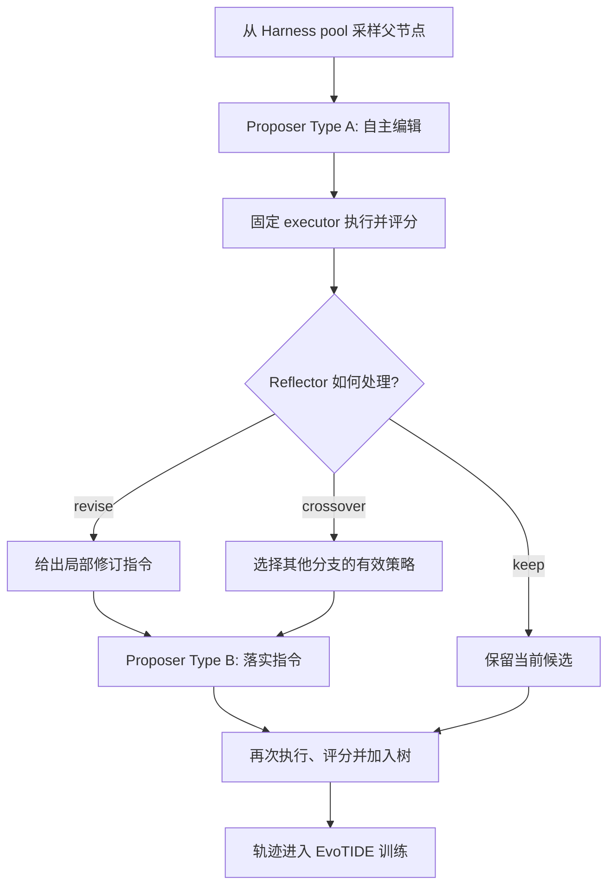

这张读者版流程图刻意只保留一次完整循环：先改、再跑、再反思；只有需要修订或交叉时才触发第二次编辑。这样 `keep` 也成为一种可学习的决策——当继续修改大概率无益时，停止本身可以节省评测预算。

#### 2.3 EvoTIDE：从 Harness 经验训练 evolver
{: id="evo2-evotide"}

每次 `propose → evaluate → reflect → revise` 循环最多产生三类轨迹：自主 Proposer、Reflector，以及按指令修改的 Type B Proposer。EvoTIDE 先从成功轨迹构造混合数据做 SFT 暖启动，再在持续扩展的 Harness tree 上对两种角色交错执行 GRPO，使同一组参数同时学会「提出改动」与「判断改动」。每轮训练冻结一份策略快照来扮演当前训练角色的对手方，轮次结束后再刷新快照，降低双方同时快速变化造成的不稳定。

轨迹恢复解决的是一个很实际的问题：模型可能已经完成若干有效编辑，却在最后一次工具调用中格式出错。**Edit extraction** 会从 reasoning 或 chat 内容中提取可执行修改；**prefix continuation** 则截断到最后一次成功编辑，恢复当时的中间 Harness，并让模型只重新生成失败后缀。

> **举个例子**：一次 rollout 依次产生 3 个编辑，前 2 个已成功应用，第 3 个因为工具格式错误而失败。直接丢弃会让前 2 个有效编辑和对应思路全部浪费；prefix continuation 把 Harness 恢复到「已应用 2 个编辑」的状态，只重写第 3 个编辑。若新后缀通过应用、启动与任务评测检查，这条轨迹就能进入训练集。

#### 2.4 奖励、父节点采样与端到端训练流
{: id="evo2-training-flow"}

两个角色都使用「修改前后任务分数差」作为执行奖励。对 Proposer，从父 Harness $h$ 修改到 $h'$ 的奖励为：

$$
r_P^{\mathrm{exec}} = \hat V(h') - \hat V(h)
$$

对 Reflector，则比较执行其指令前后的候选：

$$
r_R^{\mathrm{exec}} = \hat V(h_1) - \hat V(h_0)
$$

不可应用、无法启动、无实际变化的编辑会收到负奖励；若 Reflector 建议加入某机制，但执行轨迹没有证据表明该机制真正运行，即使分数偶然上涨也不会得到正向归因。父节点池同时保留多个深度的强候选和一部分较弱候选，并让高分与低分节点获得更多采样机会：强节点用于继续突破，弱节点用于学习修复，根节点则始终保留固定采样份额。

端到端看，一轮数据从父 Harness 出发，经 Type A 编辑、固定 executor 评测、Reflector 诊断、可选 Type B 修订，再进入树和策略库；恢复后的有效轨迹先支持 SFT，随后进入按角色分组的 GRPO。训练后的共享策略进入下一轮搜索，于是「更好的 evolver 造出更好的 Harness，更好的 Harness 经验再训练 evolver」的闭环持续推进。

---

### 3. 核心结果/发现
{: id="evo2-results"}

在 Qwen3.8-27B 上，Evo² 在三个编码基准都得到最强的自进化 Harness：Polyglot 达到 **82.1% Pass@1**，显著高于最强基线 GEA 的 62.6%；SWE-bench Verified 达到 **48.3% Resolved**，高于 HGM 的 41.0%；LiveCodeBench 达到 **58.0% Pass@1**，也超过最强基线的 56.0%。跨基准迁移中，Evo² 在 6 个方向里有 5 个排名第一，说明搜索得到的不只是对训练题目的局部补丁。

权重演化本身也有稳定贡献：与未训练 evolver 相比，EvoTIDE 训练后的 evolver 在 Polyglot、SWE-bench Verified、LoCoMo 和 LongMemEval 上分别带来 **+16.3、+5.0、+9.3、+10.6** 个百分点。即使固定专有模型权重、只使用双角色反思与 crossover，GPT-5-mini 在 60 题 SWE-bench Verified 子集上也从最强基线的 24.4% 提升到 **48.3%**，表明 Harness 搜索本身就能产生显著收益。

  
<figcaption>LiveCodeBench 准确率与推理成本：Evo² 在更少 completion token 和更少 LLM 调用下取得最高 Pass@1。</figcaption>

提升并非来自更大的推理预算。Evo² 的 LiveCodeBench champion 每题平均使用约 3.6K completion token 和 10.2 次 LLM 调用；HGM 与 DGM 成绩更低，却需要约 6.6K–6.9K token 和 26–37 次调用。扩展到记忆任务后，Evo² 在 LoCoMo 达到 **60.4 F1**，其 Harness 无需再次演化即可在 LongMemEval-S 达到 **71.5% accuracy**，继续优于所有基线。

---

### 4. 局限性
{: id="evo2-limitations"}

Evo² 仍依赖大量真实任务执行来评估每个 Harness 候选，搜索与训练成本可能随任务复杂度和树规模快速增长；同时，固定 executor 虽有利于归因，却不能完全代表 executor 与 Harness 同时变化的部署环境。论文主要在编码与记忆任务上验证，策略库的跨分支复用能否稳定扩展到高风险、强状态依赖的现实智能体仍需进一步检验。

---

# 参考资料

## 论文引用

1. **HoloAgent-0** (2026). HoloAgent: A Closed-Loop Embodied Agent Operating System with Hierarchical Spatial Memory. arXiv: [2606.23565](https://arxiv.org/abs/2606.23565) · Code: [HorizonRobotics/HoloAgent](https://github.com/HorizonRobotics/HoloAgent)
2. **Pigey** (2026). Addressing the Orchestration Gap in Generalist Robots via Physical Agency. arXiv: [2607.21725](https://arxiv.org/abs/2607.21725)
3. **Thea** (2026). Towards the Harness of Embodied Agents. arXiv: [2608.11246](https://arxiv.org/abs/2608.11246) · Code: [EIT-HAI/Thea](https://github.com/EIT-HAI/Thea) · Project Page: [eit-hai.github.io/thea](https://eit-hai.github.io/thea)
4. **Zetta** (2026). An Efficient Closed-Loop Embodied Harness for Self-Evolving Physical Intelligence. arXiv: [2608.16590](https://arxiv.org/abs/2608.16590) · Project Page: [air-embodied-brain.github.io/zetta](https://air-embodied-brain.github.io/zetta)
5. **Show-Harness** (2026). Show-Harness: Just a VLM Agent Can Play Robots. arXiv: [2609.10522](https://arxiv.org/abs/2609.10522) · Project Page: [showlab.github.io/Show-Harness](https://showlab.github.io/Show-Harness)
6. **SPACE** (2026). Act More, Decide Less: Skill-Guided Adaptive Action Chunking for Long-Horizon LLM Agents. arXiv: [2609.02042](https://arxiv.org/abs/2609.02042)
7. **ABot-AgentOS** (2026). 面向具身智能的通用机器人 Agent 操作系统与终身多模态记忆系统. arXiv: [2607.10350](https://arxiv.org/abs/2607.10350) · Project Page: [ABot-AgentOS](https://amap-cvlab.github.io/ABot-AgentOS)

8. **ABot-ER** (2026). ABot-ER: Unified Embodied Reasoning through Agentic Data–Model Co-Evolution. arXiv: [2610.18355v2](https://arxiv.org/abs/2610.18355v2) · Code: [amap-cvlab/ABot-ER](https://github.com/amap-cvlab/ABot-ER)
9. **Harness Robotic OS** (2026). 把四足巡检从「导航栈」升级为「具身智能体运行时」. arXiv: [2609.11225](https://arxiv.org/abs/2609.11225)
10. **NavHarness** (2026). NavHarness: Towards Lifelong Embodied Navigation. arXiv: [2609.34276](https://arxiv.org/abs/2609.34276) · Code: [billzhao1030/NavHarness](https://github.com/billzhao1030/NavHarness) · Project Page: [billzhao1030.github.io](https://billzhao1030.github.io)
11. **SuperNav** (2026). SuperNav: An Agentic Navigation System for Any Task in Any Scene. arXiv: [2610.12126](https://arxiv.org/abs/2610.12126) · 完整解析：[VLN 扩展篇](/VLN-Papers-Extended/#supernav)
12. **VISTA** (2026). VISTA: A Visual Harness for Reasoning in an Interactive World. arXiv: [2610.02200](https://arxiv.org/abs/2610.02200) · Code: [joshhhhhan/VISTA](https://github.com/joshhhhhan/VISTA)
13. **RACE** (2026). When Should Agents Think? Adaptive Reasoning via Cross-Turn Estimation. arXiv: [2610.12061](https://arxiv.org/abs/2610.12061) · Code: [HututuAI/RACE](https://github.com/HututuAI/RACE)
14. **Agentic Robots** (2026). Towards Agentic Robots: Model, Data, Environment, and Harness. arXiv: [2610.20442](https://arxiv.org/abs/2610.20442) · Code: [chonghanqin/Awesome-Agentic-Robots](https://github.com/chonghanqin/Awesome-Agentic-Robots)
15. **Harness²** (2026). Harness²: Recursive Agent Harnessing for an Open World. arXiv: [2610.14224](https://arxiv.org/abs/2610.14224) · Code: [google-research/harness2](https://github.com/google-research/harness2) · Project Page: [harness2.github.io](https://harness2.github.io/)

16. **GPT-6-Astra-JRT** (2026). Joint Research Team. Has GPT-6-Astra Achieved Embodied Intelligence? arXiv: [2610.22471](https://arxiv.org/abs/2610.22471) · Project Page: [sensenova.ai](https://sensenova.ai/has-gpt-6-astra-achieved-embodied-intelligence)
17. **Evo²** (2026). Evo²: Evolving the Evolver through Weight-Harness Co-Evolution. arXiv: [2610.13025](https://arxiv.org/abs/2610.13025)

