# 1. 引言

<figure class="survey-intro-figure">
  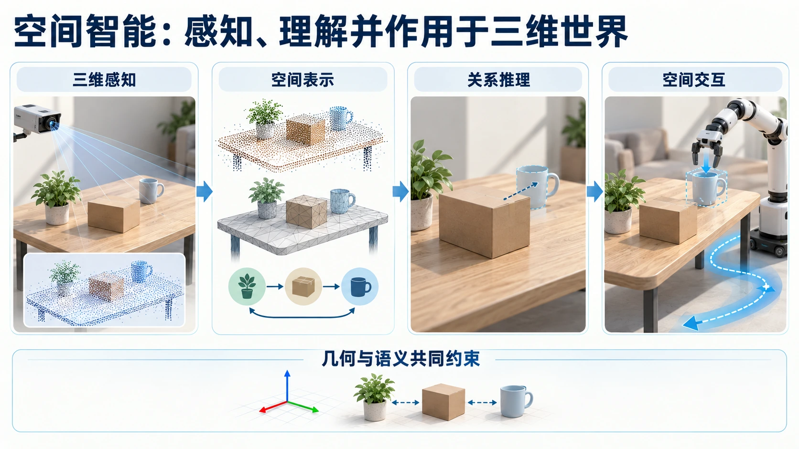
  <figcaption>图：空间智能把三维感知、空间表示、关系推理与行动联系起来。四块是相互关联的能力划分，算法可以组合使用，不表示单一技术演进路线。</figcaption>
</figure>

空间智能（Spatial Intelligence）是指 AI 系统感知、理解、推理和交互三维物理世界的综合能力。与人类从婴幼儿期便开始发展的空间认知类似，空间智能涵盖了对物体形状、场景布局、三维空间关系以及动态变化的全面理解。作为具身智能（Embodied AI）的核心基础，空间智能的研究近年来随着深度学习、神经渲染以及大型多模态模型的飞速发展而进入了全新阶段。

从应用价值来看，空间智能横跨多个高价值领域：在**自动驾驶**中，精确的三维感知与动态目标检测是安全行驶的前提；在**机器人操控**中，六自由度的空间理解决定了机械臂的抓取成功率；在**增强现实与虚拟现实（AR/VR）**中，实时高质量的三维重建与空间锚定是沉浸式体验的关键；在**具身 AI 智能体**中，空间记忆与三维场景图是任务规划与导航的基础。

研究空间智能面临的核心挑战来自三维数据的内在复杂性：三维标注数据的稀缺与昂贵、点云/体素/隐式表达之间的表示多样性、真实世界动态场景的时变性，以及三维几何与语义理解的跨模态融合难题。近年来，从 NeRF 到三维高斯溅射（3D Gaussian Splatting，3DGS），从 PointNet 到 Point Transformer，从单目深度估计到空间推理 VLM，空间智能领域正经历着技术范式的快速迭代。

本文旨在系统梳理空间智能研究进展，为学习和研究空间智能提供参考。

> 💡 **知识体系与关联阅读**：
> 本篇聚焦于**三维几何感知、神经三维重建（NeRF/3DGS）与空间推理（3D-LLM / Spatial VLM / 具身感知）**。
> 若您关注 **通用多模态大模型基座（ViT 编码器演进、跨模态 Projector/Q-Former 对齐、多模态预训练与后训练全流程）**，请阅读基座篇综述：[《VLM综述：多模态融合方法全景》](/VLM-Survey/)。
> 逐篇论文精读见配套页面 [《空间智能论文精读》](/Spatial-Intelligence-Papers/)（26 篇，按五个主题分组）。

# 2. 空间智能基本概述

## 2.1 什么是空间智能？

空间智能是一个多层次的能力体系，从低层几何感知到高层空间推理，可划分为以下四个层次：

1. **空间感知（Spatial Perception）**：获取三维几何信息，包括深度估计、点云获取与处理、三维形状重建。
2. **空间重建（Spatial Reconstruction）**：从多视角图像或传感器数据建立场景的三维模型，包括 SLAM、MVS、NeRF、3DGS 等技术。
3. **空间理解（Spatial Understanding）**：对三维场景进行语义解析，包括三维目标检测、三维实例分割、场景图生成与视觉定位。
4. **空间推理（Spatial Reasoning）**：在三维空间中进行高阶认知，包括空间关系判断（物体 A 是否在 B 的左侧？）、视角变换推理，以及语言引导的三维交互。

这四个层次构成了空间智能的完整能力栈：感知为重建提供原始数据，重建为理解提供几何基础，理解为推理提供语义上下文。

## 2.2 感知硬件基础

空间智能的源头是多样的传感器，硬件特性直接决定了算法的选择与感知上限：

| 传感器类型 | 原理 | 优势 | 局限 | 应用场景 |
|:-----------|:-----|:-----|:-----|:---------|
| **激光雷达 (LiDAR)** | 激光飞行时间 (ToF) | 精度极高、抗光照干扰、直接 3D | 成本高、点云稀疏、无颜色 | 自动驾驶、地形测绘 |
| **RGB-D 相机** | 结构光 / 局域 ToF | 像素级对齐、室内精度高 | 室外易受干扰、量程有限 | 机器人导航、AR/VR |
| **立体视觉 (Stereo)** | 双目视差计算 | 成本低、室内外通用 | 依赖纹理、弱光表现差 | 工业视觉、避障 |
| **单目相机** | 透视投影 | 极其廉价、部署便捷 | 存在尺度歧义、需学习先验 | 消费级电子、广域监控 |
| **事件相机** | 像素级亮度变化 | 极高动态范围、低延迟 | 空间分辨率低、输出异构 | 高速运动捕捉、无人机 |

## 2.3 核心要素与技术体系

空间智能的技术体系围绕**三维表示**展开，主流形式对比如下：

| 表示形式 | 特点 | 硬件适配 | 代表技术 |
|:---------|:-----|:---------|:---------|
| 点云 (Point Cloud) | 稀疏、无序、直接采集 | LiDAR、RGB-D | PointNet, Point Transformer |
| 体素 (Voxel Grid) | 规则、密集、内存开销大 | 全局建模 | VoxNet, OccNet |
| 网格 (Mesh) | 面片表示、适合渲染 | 3D 扫描 | Marching Cubes |
| 隐式场 (Implicit Field) | 连续、可微、内存高效 | 多视角图像 | NeRF, SDF |
| 三维高斯 (3D Gaussian) | 显式、快速渲染、可优化 | 多视角图像 | 3DGS |
| 深度图 (Depth Map) | 像素对齐、计算友好 | 单目/双目 | Monocular Depth Estimation |

## 2.4 评价指标速查表

| 维度 | 指标 | 含义 | 适用任务 |
|:-----|:-----|:-----|:---------|
| **几何精度** | CD (Chamfer Distance) | 点集间的平均欧氏距离 | 点云配准、形状重建 |
| | EMD (Earth Mover's Distance) | 两个分布间的推土机距离 | 形状生成、点云生成 |
| | AbsRel / RMSE | 深度预测的绝对误差与均方根误差 | 深度估计 |
| **理解精度** | mIoU (Mean IoU) | 预测区域与真值区域的交并比均值 | 语义/实例分割、占用预测 |
| | mAP (Mean Average Precision) | 平均精度均值（多阈值下的召回/精确度） | 三维目标检测 |
| **推理/对话** | CIDEr / BLEU-4 | 生成文本与参考答案的共现相似度 | 3D Captioning / 3D VQA |
| | EM (Exact Match) | 答案完全匹配的比例 | 3D 视觉问答 |
| **重建质量** | PSNR / SSIM | 渲染图像的峰值信噪比与结构相似度 | 视角合成 (NeRF/3DGS) |

## 2.5 研究趋势与汇聚路径

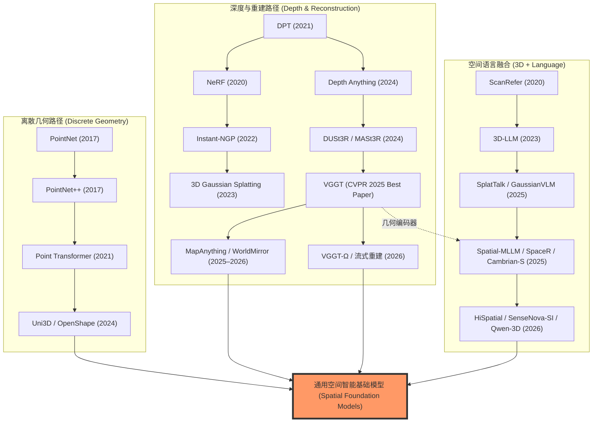

**关键里程碑**：
- **2015–2017**：PointNet 奠定了直接在无序点云上进行深度学习的基础，开启了三维深度学习新纪元。
- **2018–2020**：VoxelNet、SECOND、PointPillars 推动了自动驾驶 LiDAR 感知商业化；NeRF 的提出彻底改变了三维重建技术范式。
- **2021–2022**：Transformer 架构被引入三维感知（Point Transformer、DETR3D、BEVFormer），性能大幅提升；Instant-NGP 将 NeRF 训练时间压缩至秒级。
- **2023**：3D Gaussian Splatting 实现实时高质量渲染；3D-LLM、EmbodiedScan 将语言模型与三维场景理解结合。
- **2024**：Depth Anything、SpatialVLM、DUSt3R、Uni3D 等工作推动空间感知基础模型形成；VSI-Bench 首次系统评测 MLLM 从视频中"记住空间"的能力。
- **2025**：VGGT（CVPR 2025 Best Paper）以单次前馈同时输出相机参数、深度、点图与点轨迹，空间智能进入"前馈三维基础模型"阶段；π³ 去掉固定参考视角，StreamVGGT 把前馈重建改成流式。Spatial-MLLM、VLM-3R 把几何编码器接入 VLM，SpaceR、SpatialLadder 用可验证奖励的强化学习训练空间推理。年末，Cambrian-S 提出"空间超感知"与 VSI-SUPER 基准，SAM 3D 把单图三维重建推向真实场景，World Labs 发布可生成三维世界的 Marble。
- **2026**：前馈重建开始呈现扩展规律。VGGT-Ω（CVPR 2026 Oral）用寄存器注意力把训练显存降到前作约 30%，MapAnything、WorldMirror 接受任意几何先验，LingBot-Map 等流式模型能处理上万帧。空间推理方面，HiSpatial（CVPR 2026）建立分层空间认知，SenseNova-SI 用 800 万条数据把 VSI-Bench 推到 68.8%，VLM³ 证明纯文本 SFT 即可掌握高精度三维几何，Qwen-3D 与 SparseOccVLA 把三维定位和占用预测接入决策。评测上，MMSI-Bench、OVO-S-Bench 等新基准暴露出多视角与流式场景的明显短板。

## 2.6 相机模型与投影几何基础

空间智能的数学基础之一是**针孔相机模型（Pinhole Camera Model）**，它精确描述了三维世界中的点如何透过镜头中心投影到二维图像平面。理解相机投影是理解 SfM、立体视觉、NeRF 位姿输入以及 VGGT 相机参数输出的必要前提。

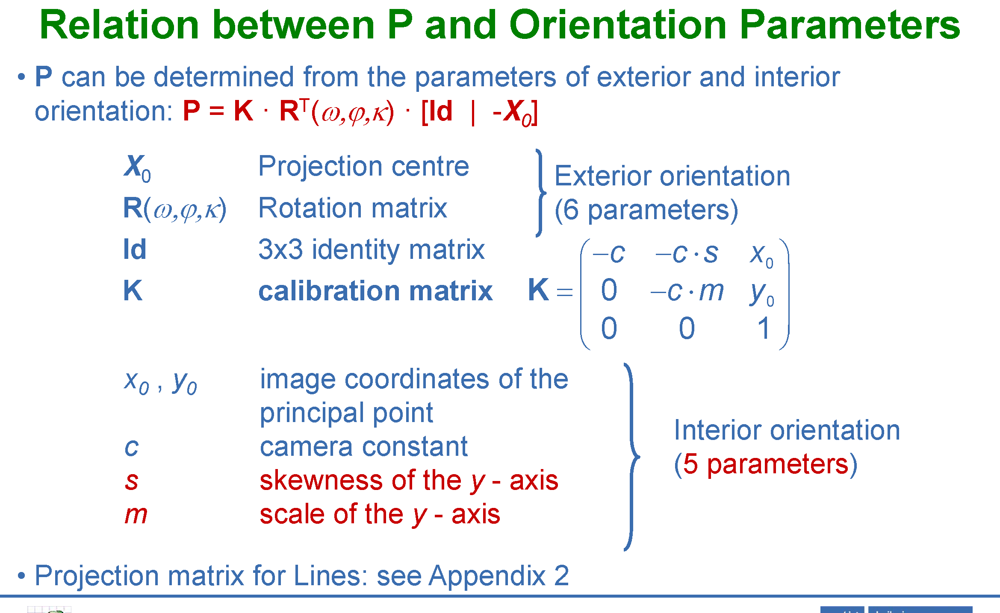<figcaption>图：相机投影矩阵的分解 P = K · RT · [Id | -X₀]，将外参（旋转 R、投影中心 X₀）与内参矩阵 K 显式分离。（图源：作者 LUH Photogrammetric Computer Vision 课程课件）</figcaption>

### 针孔相机投影

给定世界坐标系中的齐次点 $$\widetilde{\mathbf{X}}_w = (X, Y, Z, 1)^T$$，其图像齐次坐标 $\widetilde{\mathbf{x}} = (u, v, 1)^T$ 由完整投影矩阵 $P \in \mathbb{R}^{3\times4}$ 给出：

$$\lambda \begin{pmatrix} u \\ v \\ 1 \end{pmatrix} = P \, \widetilde{\mathbf{X}}_w = K [R \mid \mathbf{t}] \begin{pmatrix} X \\ Y \\ Z \\ 1 \end{pmatrix}$$

其中 $\lambda$ 为尺度因子（深度），$K$ 为内参矩阵，$[R \mid \mathbf{t}]$ 为外参（旋转+平移）。

**内参矩阵（Intrinsic Matrix）** $K$ 描述相机的光学与几何特性：

$$K = \begin{pmatrix} f_x & s & c_x \\ 0 & f_y & c_y \\ 0 & 0 & 1 \end{pmatrix}$$

- $f_x, f_y$：水平/垂直方向焦距（以像素为单位），对于方形像素 $f_x = f_y = f$
- $(c_x, c_y)$：主点（principal point），即光轴与像平面的交点
- $s$：像素倾斜系数（现代相机通常为零）

**外参（Extrinsic Parameters）** $[R \mid \mathbf{t}]$：旋转矩阵 $R \in SO(3)$ 和平移向量 $\mathbf{t} \in \mathbb{R}^3$ 描述相机坐标系相对于世界坐标系的位姿。

### 镜头畸变模型

真实镜头存在非线性畸变，在投影后需校正。最常用的**径向畸变（Radial Distortion）**：

$$\begin{cases} x_d = x(1 + k_1 r^2 + k_2 r^4 + k_3 r^6) \\ y_d = y(1 + k_1 r^2 + k_2 r^4 + k_3 r^6) \end{cases}, \quad r^2 = x^2 + y^2$$

其中 $(x, y)$ 为归一化相机坐标，$k_1, k_2, k_3$ 为径向畸变系数（负值产生桶形畸变，正值产生枕形畸变）。**切向畸变**由镜头安装偏心引起，额外引入参数 $p_1, p_2$。

### 相机标定

**相机标定**的目标是从已知三维—二维对应点中估计 $K$ 和畸变参数。

- **直接线性变换（DLT）**：将 $P\widetilde{\mathbf{X}} = \lambda\widetilde{\mathbf{x}}$ 线性化为 $A\mathbf{p} = 0$，通过 SVD 求解 $P$ 的 11 个自由度，至少需要 6 个点对，是最基础的标定方法。
- **Zhang 标定法**（Zhang, TPAMI 2000）：使用多姿态平面棋盘格，先估计各姿态下的单应矩阵 $H$，再利用多个 $H$ 的约束分解内参 $K$，最后以 Levenberg-Marquardt 非线性优化联合精化内外参与畸变系数。已集成于 OpenCV `calibrateCamera()`，是目前最主流的实用标定方法。

---

## 2.7 旋转表示

三维旋转是空间智能的核心数学工具，从 NeRF/3DGS 的相机位姿到机器人末端执行器的朝向，旋转无处不在。**李群 $SO(3)$**（Special Orthogonal Group）是旋转的代数结构，不同的参数化方式各有权衡：

| 表示 | 参数数 | 自由度 | 优点 | 局限 |
|:-----|:------|:------|:-----|:-----|
| 旋转矩阵 $R \in SO(3)$ | 9 | 3 | 运算直接，组合简单 | 需满足正交约束 $RR^T=I,\det R=1$；冗余 |
| 欧拉角 $(\phi,\theta,\psi)$ | 3 | 3 | 直观，便于人工设定 | **万向节锁（Gimbal Lock）**问题，插值不稳定 |
| 轴角 $(\mathbf{n}, \theta)$ | 4 | 3 | 物理含义清晰（绕轴旋转） | 不适合梯度优化；$\theta$ 接近 0 时奇异 |
| 四元数 $\mathbf{q}=(w,x,y,z)$ | 4 | 3 | 插值平滑（SLERP）、无奇异性、数值稳定 | 存在双覆盖（$\mathbf{q}$ 与 $-\mathbf{q}$ 表示同一旋转） |

**万向节锁**：欧拉角在特定配置（如俯仰角 $\theta=\pm 90°$）下，两个旋转轴重合，导致丢失一个自由度。这是 3D 动画和机器人控制中必须避免使用欧拉角插值的主要原因。

**单位四元数旋转**：$\|\mathbf{q}\|=1$ 的四元数 $\mathbf{q} = w + x\mathbf{i} + y\mathbf{j} + z\mathbf{k}$ 对应唯一旋转，旋转点 $\mathbf{p}$：
$$\mathbf{p}' = \mathbf{q} \otimes \mathbf{p} \otimes \mathbf{q}^{-1}$$

3DGS 中每个高斯椭球的朝向用四元数参数化（确保梯度优化在旋转流形上的连续性），VGGT 输出的相机外参也使用四元数表示。**Rodrigues 公式**提供了旋转矩阵与轴角之间的转换桥梁，是 SfM 和 Bundle Adjustment 中常用的微分工具：
$$R = I + \sin\theta [\mathbf{n}]_\times + (1-\cos\theta) [\mathbf{n}]_\times^2$$

其中 $$[\mathbf{n}]_\times$$ 为旋转轴 $\mathbf{n}$ 的反对称矩阵。

---

# 3. 任务分类体系

**1. 几何感知类**：以获取和处理三维几何信息为核心。典型任务包括单目/双目**深度估计**、**点云配准**（ICP、RANSAC）、**法向量估计**等。

**2. 三维重建类**：从图像序列或传感器数据恢复场景的三维结构。包括 **SfM**、**MVS**、**SLAM**、**神经隐式重建（NeRF、3DGS）**等。

**3. 三维检测与识别类**：在三维空间中定位并分类物体。包括**三维目标检测**、**三维实例/语义分割**、**三维场景图生成**。

**4. 空间理解与推理类**：在三维语义层面建立高层理解。包括**三维视觉定位**、**三维视觉问答**、**空间关系推理**。

**5. 具身空间导航类**：在智能体主动探索的背景下使用空间智能。包括**目标驱动导航**、**三维语义地图构建**、**空间记忆网络**。

---

# 4. 空间智能技术演进范式

## 4.1 离散几何表示与点云处理

### PointNet
**PointNet**（Qi et al., CVPR 2017）是第一个直接在无序三维点云上端到端学习的深度神经网络，彻底改变了三维深度学习的研究范式。其核心设计思想是：对点集的任意排列保持**置换不变性**，并通过 T-Net 学习输入对齐变换，从而提升对刚体变换的鲁棒性。

**核心设计**：
- 对每个点独立应用共享 MLP，将点坐标映射到高维特征空间。
- 使用**对称函数（max pooling）**聚合全局特征，自然解决无序问题。
- T-Net（Transformer Network）学习输入点云的对齐变换（$3\times3$）和特征对齐变换（$64\times64$），提升旋转鲁棒性。

**核心特点**：
- 无需体素化，直接处理原始点云，计算高效。
- 可用于分类、部分分割、语义分割三类任务。
- 奠定了点云深度学习"点独立处理+对称聚合"的基本范式。

  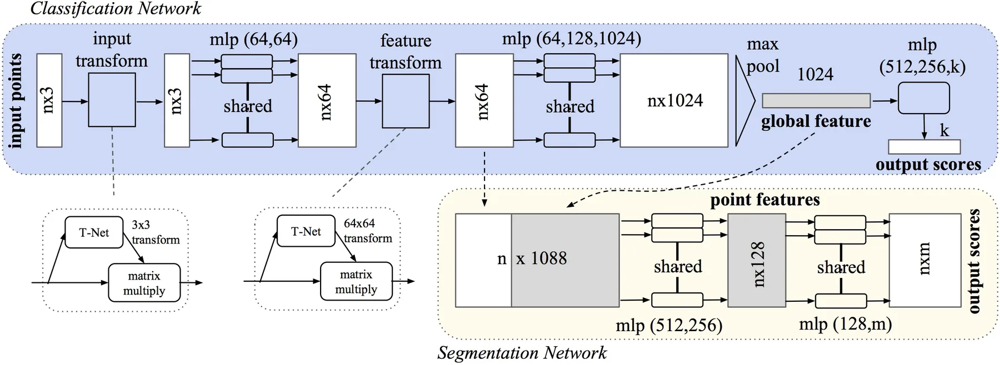
<figcaption>PointNet 网络架构：对每个点独立应用共享 MLP 提取特征，通过 Max Pooling 对称聚合得到全局特征向量，T-Net 分别对输入点坐标（3×3）和特征空间（64×64）学习对齐变换。</figcaption>

---

### PointNet++
**PointNet++**（Qi et al., NeurIPS 2017）针对 PointNet 无法捕捉局部几何结构的缺陷，引入层级化的局部特征学习机制。

**核心设计**：
- **最远点采样（FPS）**：递归选取与已选点集距离最远的点，得到空间均匀分布的采样子集。
- **Ball Query 分组**：以采样点为中心，在球形邻域内收集局部点集。
- **层级化 PointNet**：在局部点集上应用 PointNet 提取局部特征，再在更高层的局部区域上再次聚合，类比 CNN 的感受野逐层扩大。
- **多尺度分组（MSG）**：在不同半径球域内聚合特征，增强对点云密度变化的鲁棒性。

**核心特点**：
- 解决了 PointNet 对局部几何信息感知不足的问题。
- 自适应处理非均匀点云密度。
- 奠定了"采样+分组+聚合"的点云学习标准范式，后续工作（DGCNN、Point Transformer 等）均在此框架下扩展。

  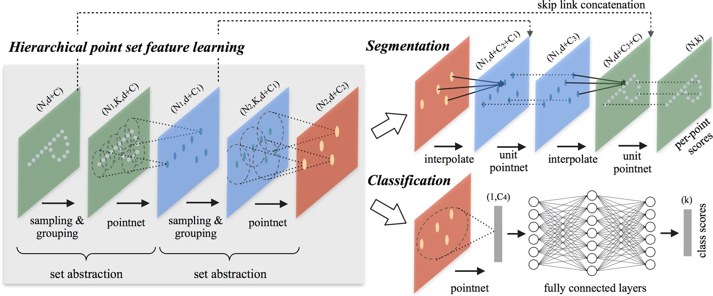
<figcaption>PointNet++ 层级化特征学习：通过 FPS 采样 → Ball Query 分组 → PointNet 局部特征提取的反复堆叠，逐层扩大感受野；分割任务额外使用插值上采样将特征传回原始点集。</figcaption>

---

### DGCNN
**DGCNN**（Dynamic Graph CNN，Wang et al., TOG 2019）将图神经网络（GNN）引入点云处理。不同于在欧氏空间中构建固定 k 近邻图，DGCNN 在**特征空间**中动态更新 k-NN 图，捕捉语义上相近但空间上未必相邻的点对关系。

**EdgeConv** 操作计算每个点与其 k 近邻之间的边特征：
$$e_{ij} = h_\Theta(x_i,\ x_j - x_i)$$
通过聚合边特征获得节点新特征。每层 EdgeConv 后，图结构在特征空间重新计算（动态更新），使网络同时保留局部和非局部几何信息。

**核心特点**：
- 动态图结构能捕捉语义关联，而非仅依赖空间邻近性。
- EdgeConv 操作简洁高效，易于集成至各类点云架构。

  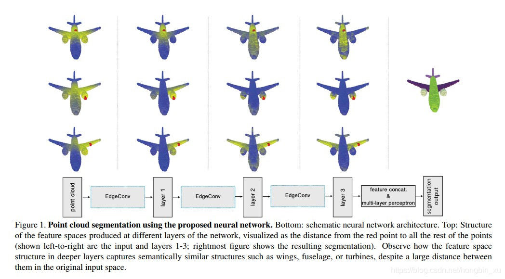
<figcaption>DGCNN 架构与 EdgeConv 操作：在特征空间动态构建 k-NN 图（每层重新计算），计算中心点与邻居的边特征后聚合；多层 EdgeConv 堆叠后接 Max Pooling 得到全局描述符。</figcaption>

---

### Point Transformer
**Point Transformer v1**（Zhao et al., ICCV 2021）将自注意力机制引入点云处理。其**向量自注意力**为每个特征维度分配独立的注意力权重（区别于标量注意力），并引入位置编码捕捉局部几何关系：
$$y_i = \sum_{x_j \in \mathcal{N}(x_i)} \rho\!\left(\gamma\!\left(\phi(x_i) - \psi(x_j) + \delta\right)\right) \odot \left(\alpha(x_j) + \delta\right)$$
其中 $\delta$ 为点位置编码，$\rho$ 为 softmax 归一化，$\gamma$ 为关系网络。**Point Transformer v2**（Wu et al., NeurIPS 2022）引入分组向量注意力与多头机制，在 ScanNet 语义分割等基准上达到当时的最优性能。

**核心特点**：
- 基于 Transformer 的局部自注意力，捕捉细粒度局部几何特征。
- 位置编码设计使网络对点云几何结构具有明确的感知能力。
- 确立了点云 Transformer 的标准架构，后续 Point Transformer v3（2024）进一步在大规模数据上预训练。

  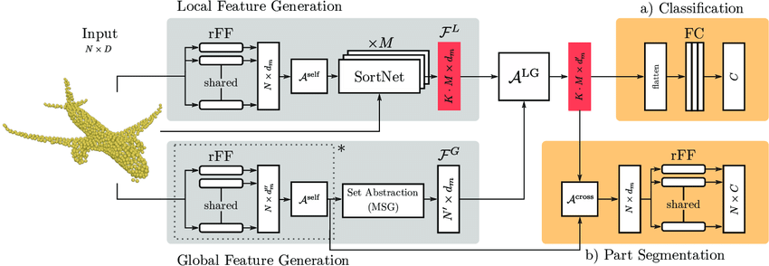
<figcaption>Point Transformer 向量自注意力：为每个特征维度分配独立注意力权重（区别于标量注意力），位置编码 δ 基于近邻点坐标差学习，同时注入注意力权重和值向量，捕捉局部几何关系。</figcaption>

---

### 三维感知基础模型
**Uni3D**（Zhou et al., ICLR 2024）是首个大规模统一三维感知基础模型。通过在 1000 万以上三维对象上进行对比预训练，Uni3D 学习到跨类别、跨数据集的通用三维点云特征，在零样本三维理解和跨模态检索（点云↔图像↔文本）等任务上取得突破性进展。

**OpenShape**（Liu et al., NeurIPS 2023）利用文本-三维形状对进行大规模多模态对比学习，将 CLIP 的开放词汇理解能力迁移至三维领域，支持零样本三维分类（ModelNet40 上约 85% top-1 准确率，无需三维训练数据）。

**Point-BERT**（Yu et al., CVPR 2022）和 **Point-MAE**（Pang et al., ECCV 2022）将 BERT/MAE 自监督预训练引入点云领域，推动三维感知基础模型的形成。

---

## 4.2 密集几何感知与深度估计

### DPT
**DPT**（Dense Prediction Transformer，Ranftl et al., ICCV 2021）将视觉 Transformer（ViT）引入密集预测任务（深度估计与语义分割），将 ViT 各层 patch token 特征图融合进解码器，实现高分辨率密集输出。

DPT 训练采用**尺度不变损失（Scale-Invariant Loss）**：
$$\mathcal{L}_{si} = \frac{1}{n}\sum_i d_i^2 - \frac{\lambda}{n^2}\left(\sum_i d_i\right)^2$$
其中 $$d_i = \log \hat{y}_i - \log y_i$$ 为预测值与真实值对数之差，$\lambda$ 控制全局尺度惩罚项的权重。该损失对绝对尺度不敏感，适用于单目深度估计的固有尺度歧义性。

**核心特点**：
- 首次在深度估计中使用纯 ViT 特征提取，利用大感受野捕捉全局场景结构。
- 多尺度特征融合，从粗到细捕捉不同层次的深度信息。
- 在相对深度零样本迁移中具有很强的跨数据集泛化性。

  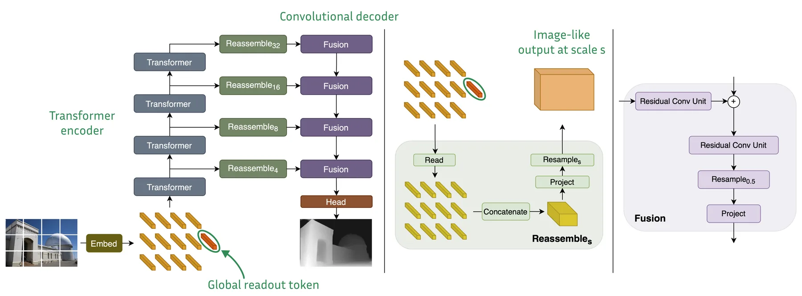
<figcaption>DPT 架构：以 ViT 为骨干提取多层 patch token，通过 Reassemble 操作恢复空间分辨率得到多尺度特征图，再经 Fusion 解码器逐步上采样融合，输出高分辨率密集深度预测。</figcaption>

---

### Depth Anything 系列
**Depth Anything**（Yang et al., CVPR 2024）是迄今最具代表性的单目深度估计基础模型。其核心创新在于大规模**半监督数据引擎**：以 150 万张有标注图像为种子，利用教师模型为 6200 万张无标注图像生成伪标签，再以强数据增强对学生模型进行强制泛化训练，突破了标注数据瓶颈。

**Depth Anything V2**（NeurIPS 2024）进一步引入高质量合成数据（Hypersim、Virtual KITTI）改善细粒度深度预测，并提供绝对尺度（Metric Depth）版本，适用于机器人导航等需要真实深度值的应用场景。

**核心特点**：
- DINOv2 作为骨干网络提供强大的语义先验。
- 零样本泛化能力显著优于前代模型，在未见场景上表现稳定。
- V2 版本的细节质量（边缘清晰度、薄结构）得到显著改善。

  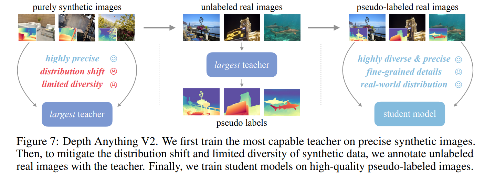
<figcaption>Depth Anything 半监督数据引擎：以 150 万有标注图像训练教师模型，对 6200 万无标注图像生成伪标签，再以强数据增强（色彩畸变、CutMix 等）训练学生模型，强迫其学习更鲁棒的深度先验。</figcaption>

---

### Marigold
**Marigold**（Ke et al., CVPR 2024）将扩散模型（Diffusion Model）引入深度估计，利用 Stable Diffusion 中蕴含的图像先验，通过在少量真实深度数据上微调实现强大的零样本深度估计。其核心洞察是：预训练扩散模型中编码了丰富的场景几何先验，可高效迁移至深度估计任务而无需大规模重新训练。

**核心特点**：
- 基于扩散模型的生成式深度估计框架，通过多步去噪生成深度图。
- 仅需在少量有标注数据上微调即可达到 SOTA 性能。
- 生成的深度图具有丰富的细节和清晰的边界，在弱纹理/重复纹理区域表现尤为突出。

  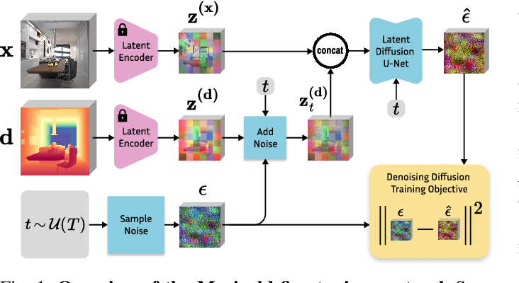
<figcaption>Marigold 推理流程：将 RGB 图像编码至 Stable Diffusion 潜在空间，通过迭代去噪步骤生成深度图潜变量，最后解码为相对深度图。</figcaption>

---

### 经典立体视觉与密集匹配

在深度学习方法出现之前，**立体视觉（Stereo Vision）**是从图像中恢复深度的主流手段。理解其原理有助于把握 Depth Anything、Marigold 等方法究竟解决了哪些经典痛点。

### 对极几何

**对极几何（Epipolar Geometry）**描述同一场景在两张图像中的几何约束关系，是立体匹配的理论基础。给定两幅图像中的对应点 $$\mathbf{x}_1$$ 和 $$\mathbf{x}_2$$（齐次坐标），它们满足：

$$\mathbf{x}_2^T F \mathbf{x}_1 = 0$$

其中 $F \in \mathbb{R}^{3 \times 3}$（秩为 2）为**基础矩阵（Fundamental Matrix）**，包含两相机的相对位姿与内参信息。若已知两相机内参 $K_1, K_2$，则对应的**本质矩阵（Essential Matrix）**：

$$E = K_2^T F K_1 = [\mathbf{t}]_\times R$$

$E$ 仅编码外参旋转 $R$ 和（归一化）平移方向 $\mathbf{t}$，可通过 SVD 分解恢复相对位姿。对极约束将二维搜索空间降至**对极线（Epipolar Line）**上的一维搜索，是所有立体匹配算法的核心加速手段。

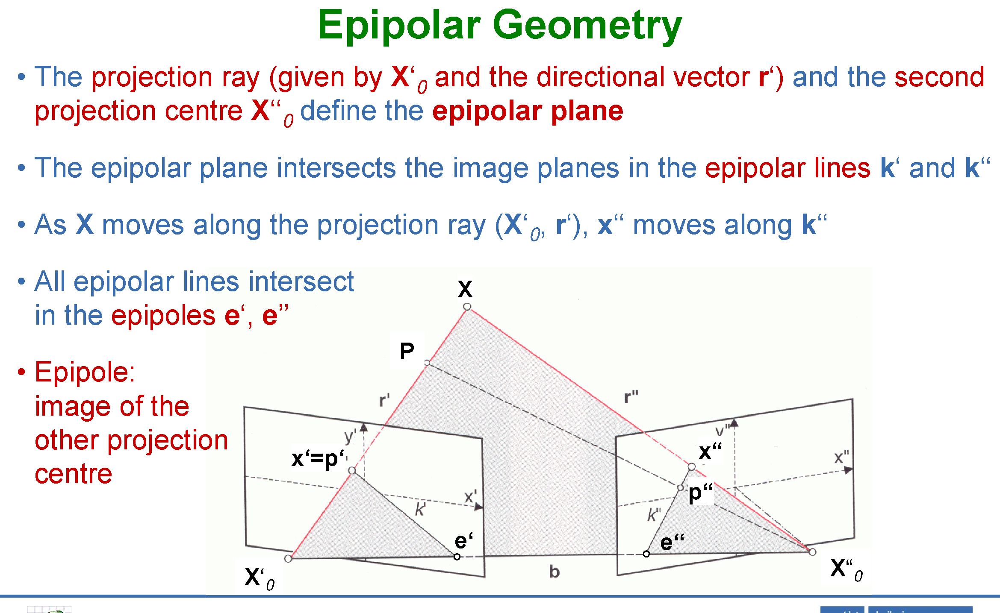<figcaption>图：对极几何。投影中心 X₀′、X₀″ 与物点 X 张成对极平面，与两像平面相交得对极线 k′、k″，所有对极线交于对极点 e′、e″。（图源：作者 LUH Photogrammetric Computer Vision 课程课件）</figcaption>

### 立体纠正与视差深度

对图像对进行**立体纠正（Stereo Rectification）**后，两相机光轴平行，对极线变为水平扫描线，对应点仅在水平方向存在位移——**视差（Disparity）** $d = u_L - u_R$。由相似三角形：

$$Z = \frac{f \cdot B}{d}$$

其中 $f$ 为焦距，$B$ 为**基线（Baseline）**（双目间距），$Z$ 为深度。视差越大，距离越近；视差趋向零，深度趋向无穷——这正是单目深度估计存在**尺度歧义**的几何本质。

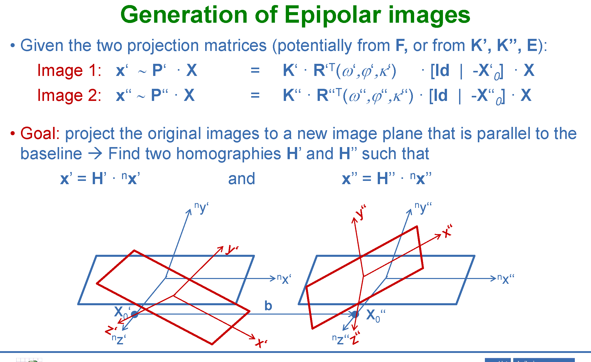<figcaption>图：极线影像生成（立体纠正）。通过两个单应变换 H′、H″ 将原始像平面重投影到与基线平行的公共平面，使对极线对齐为水平扫描线。（图源：作者 LUH Photogrammetric Computer Vision 课程课件）</figcaption>

### 半全局匹配（SGM）

**SGM**（Semi-Global Matching，Hirschmüller, TPAMI 2008）是经典密集视差估计的代表算法，至今仍是自动驾驶和航测领域的工业基线。其核心思路是将逐像素代价最小化问题近似为沿多方向一维路径积分，融合局部匹配代价与全局平滑约束：

$$E(D) = \sum_{\mathbf{p}} \left( C(\mathbf{p}, D_\mathbf{p}) + \sum_{\mathbf{q} \in N_\mathbf{p}} P_1 T[|D_\mathbf{p} - D_\mathbf{q}| = 1] + P_2 T[|D_\mathbf{p} - D_\mathbf{q}| > 1] \right)$$

其中 $C(\mathbf{p}, d)$ 为像素 $\mathbf{p}$ 在视差 $d$ 下的匹配代价，$P_1, P_2$ 分别为小/大视差跳变的惩罚项。SGM 通过 8 个方向的路径累积（Left/Right/Top/Bottom 及对角线），以接近 $O(WH)$ 的线性复杂度逼近全局能量最小化。

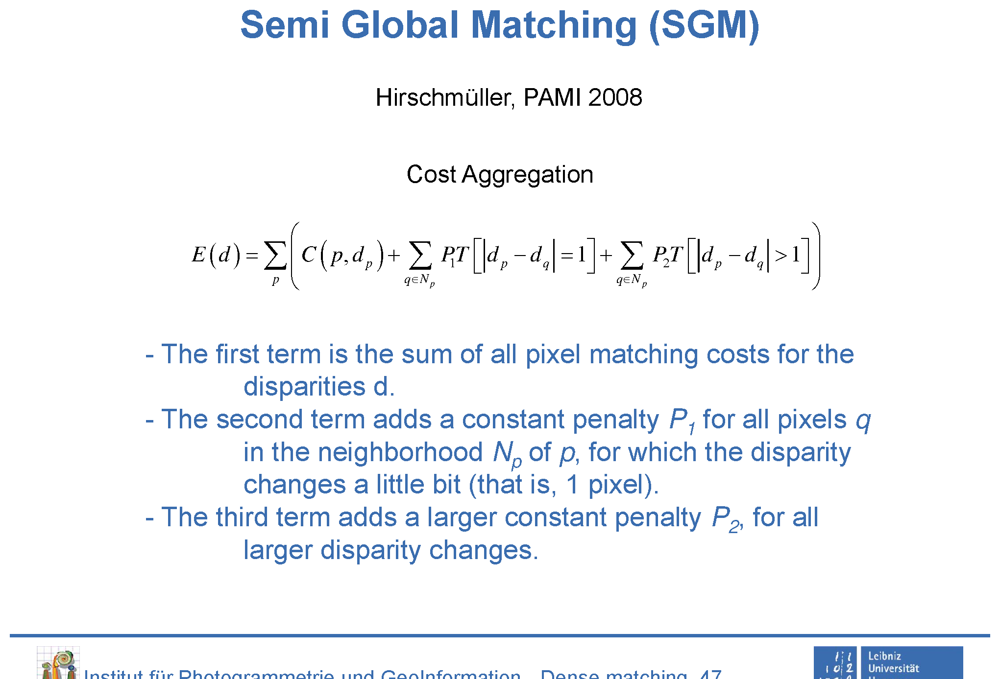<figcaption>图：SGM 代价聚合能量函数（Hirschmüller, PAMI 2008）。第一项为逐像素匹配代价，第二、三项分别对小幅（1 像素）与大幅视差跳变施加惩罚 P₁、P₂，实现局部平滑约束。（图源：作者 LUH Photogrammetric Computer Vision 课程课件）</figcaption>

**Census 变换**是 SGM 常用的匹配代价，将像素邻域中每个位置与中心像素的大小关系编码为二进制串，再以汉明距离度量相似性——对光照变化具有天然的鲁棒性，避免了直接使用像素灰度差（SAD/SSD）时对绝对亮度敏感的缺陷。

**SGM 的局限性**正是推动深度学习方法（如 Depth Anything、Marigold）兴起的原因：
- 无纹理区域（白墙、均匀地面）匹配代价退化，产生大片"空洞"；
- 透明/反射物体违反朗伯体假设，经典代价函数失效；
- 参数（$P_1, P_2$）需针对场景手工调节，泛化性弱；
- 立体方法必须依赖已标定的双目相机，单目场景无法使用。

---

## 4.3 神经三维重建

### 经典 SfM/MVS 管线

在神经渲染出现之前，**运动恢复结构（Structure from Motion, SfM）**是从无约束图像集中重建三维场景的标准框架。理解经典管线是理解 DUSt3R、VGGT 等端到端前馈方法"革命性"的前提。

**经典 SfM 流程**：

1. **特征提取**：**SIFT**（Scale-Invariant Feature Transform，Lowe, IJCV 2004）通过高斯差分（DoG）检测尺度空间极值点，提取 128 维方向梯度直方图（HOG）描述子，实现尺度、旋转与光照不变性，是两十年来最稳健的图像匹配特征。
2. **特征匹配 + RANSAC**：对图像对进行描述子最近邻匹配，使用 **RANSAC（Random Sample Consensus）** 鲁棒估计基础矩阵 $F$，以迭代随机采样的方式自动剔除误匹配（outliers）。
3. **相对位姿估计**：从本质矩阵 $$E = [\mathbf{t}]_\times R$$ 通过 SVD 分解恢复两相机间的旋转 $R$ 和平移方向 $\mathbf{t}$（4个候选解，通过正深度约束确定唯一解）。
4. **三角化（Triangulation）**：已知两相机位姿后，对匹配点对用线性最小二乘（DLT）恢复 3D 点坐标 $\mathbf{X}$，解方程组 $$\mathbf{x}_i \times (P_i \mathbf{X}) = 0$$。
5. **增量式重建**：以最佳匹配图像对为种子，通过 PnP+RANSAC 将新图像注册进已重建的点云，持续扩展稀疏 3D 结构。
6. **光束法平差（Bundle Adjustment, BA）**：联合优化所有相机位姿 $$\{R_i, \mathbf{t}_i\}$$ 与 3D 点坐标 $\{X_j\}$，最小化**重投影误差**：
$$\min_{\{R_i,\mathbf{t}_i\},\{X_j\}} \sum_{i,j} \rho\!\left(\left\|\mathbf{x}_{ij} - \pi(R_i X_j + \mathbf{t}_i)\right\|^2\right)$$
其中 $\pi(\cdot)$ 为透视投影，$\rho(\cdot)$ 为鲁棒核函数（Huber）。BA 是 SfM 精度的核心，通常用 Ceres Solver 实现。
7. **稠密重建（MVS）**：在稀疏 SfM 位姿基础上，通过 **PatchMatch MVS** 等算法逐像素恢复稠密深度图，再融合为稠密点云或体素。

**COLMAP**（Schönberger & Frahm, CVPR 2016）是目前最主流的开源 SfM+MVS 系统，集成了上述全流程，DUSt3R、VGGT 等工作均以 COLMAP 重建结果作为位姿精度评测基准（AUC@5°/10°/20°）。

**经典 SfM 的核心局限**——正是推动神经渲染革命的根本动因：
- **速度极慢**：大场景 BA 耗时数小时乃至数天；
- **稀疏输出**：最终点云稀疏，需再跑 MVS 才能得到稠密结果；
- **弱纹理失败**：SIFT 特征在低纹理区域（白墙、天空）匹配稀疏；
- **无语义**：纯几何管线，无法感知物体类别与语义关系；
- **场景独立**：无法跨场景泛化，每个新场景需重新运行完整管线。

---

### NeRF
**NeRF**（Neural Radiance Fields，Mildenhall et al., ECCV 2020）是近年来三维视觉领域最具影响力的工作之一。NeRF 用一个全连接网络 $F_\Theta: (\mathbf{x}, \mathbf{d}) \to (\mathbf{c}, \sigma)$ 将三维坐标 $\mathbf{x}$ 和视角方向 $\mathbf{d}$ 映射为颜色 $\mathbf{c}$ 和体积密度 $\sigma$，通过可微体积渲染方程合成图像：
$$\hat{C}(\mathbf{r}) = \int_{t_n}^{t_f} T(t)\,\sigma\!\left(\mathbf{r}(t)\right)\mathbf{c}\!\left(\mathbf{r}(t),\mathbf{d}\right)\mathrm{d}t$$
其中 $T(t) = \exp\!\bigl(-\int_{t_n}^{t}\sigma(\mathbf{r}(s))\,\mathrm{d}s\bigr)$ 为沿光线的累积透射率。以重建图像与真实图像的光度损失（MSE/SSIM）监督网络训练。

**核心特点**：
- 全隐式连续表示，内存高效，可渲染任意分辨率。
- 可微渲染支持端到端优化，无需显式三维监督。
- 高质量新视角合成，擅长细节纹理与镜面反射。
- 局限：训练缓慢（数小时/场景）、仅表示静态场景、不同场景间无泛化性。

  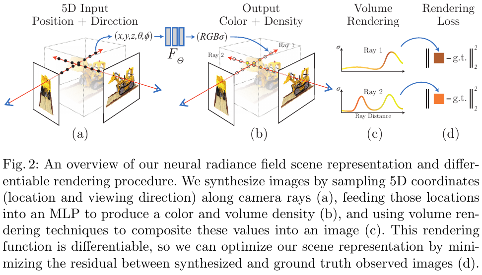
<figcaption>NeRF 渲染原理：沿相机光线均匀采样后用 Coarse MLP 估计密度分布，再对高密度区域重要性采样后送入 Fine MLP，最终通过体积渲染方程积分得到像素颜色，与真实图像的光度损失反向传播优化网络权重。</figcaption>

**重要扩展**：Mip-NeRF（处理混叠）、Mip-NeRF 360（无界场景）、Instant-NGP（哈希编码，加速至秒级）、Block-NeRF（大规模城市场景）。

---

### 3D Gaussian Splatting
**3D Gaussian Splatting**（Kerbl et al., SIGGRAPH 2023）是 2023 年三维重建领域最重要的突破，以**实时高质量**渲染彻底改变了神经渲染领域格局。

3DGS 用一组各向异性三维高斯基元显式表示场景，每个高斯由以下参数描述：
- 位置（均值）$\mu \in \mathbb{R}^3$
- 协方差矩阵，通过旋转矩阵 $R$ 和缩放向量 $s$ 分解：$\Sigma = RSS^TR^T$
- 不透明度 $\alpha$
- 球谐函数（SH）系数，描述视角相关外观

渲染时将三维高斯投影到图像平面（Splatting），按深度排序后进行 $\alpha$-混合，得到最终像素颜色。自适应密度控制机制根据梯度信息自动克隆或删除高斯基元，实现几何细节的自动校准。

**核心特点**：
- 显式表示，避免 NeRF 的体积渲染开销，实现实时渲染（>30 FPS @ 1080p）。
- 可微分，支持端到端梯度优化。
- 训练速度远快于 NeRF（分钟级），且渲染质量更高。
- 局限：高斯基元数量庞大（数百万），存储开销较大；对无纹理平滑区域建模较弱。

  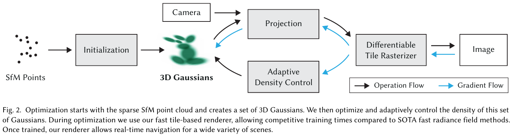
<figcaption>3D Gaussian Splatting 概览：从 SfM 稀疏点云初始化高斯基元，将三维高斯投影至图像平面后按深度排序进行 α-混合渲染，梯度驱动的自适应密度控制（Clone/Split）自动增殖或修剪高斯。</figcaption>

---

### 端到端稠密重建

**DUSt3R**（Wang et al., CVPR 2024）提出端到端稠密三维重建新范式，将传统 SfM 管线（特征匹配→位姿估计→密集重建）统一为单一 Transformer 网络：输入任意图像对（无需已知相机参数），直接预测稠密点图（Pointmap），再通过全局优化融合多图。DUSt3R 突破了传统方法对高重叠度图像对的依赖，在极端视角变换下依然稳健。

**MASt3R**（Leroy et al., 2024）在 DUSt3R 基础上增加局部特征匹配能力，进一步提升多视角三维重建的鲁棒性与精度，同时支持稀疏匹配任务。两者共同代表了三维重建向"前馈基础模型"方向的重要转变。

---

### VGGT 与 MapAnything：统一前馈

**VGGT**（Visual Geometry Grounded Transformer，Wang et al.，**CVPR 2025 Best Paper**，arXiv:2503.11651）是 DUSt3R/MASt3R 路线的集大成者。它用逐帧自注意力与跨帧全局自注意力交替堆叠的单个 Transformer，在一次前馈中同时输出一组图像（单张到数百张）的相机内外参、深度图、点图与点轨迹，不再需要全局对齐或 Bundle Adjustment。三种重建范式的"阶段数"在逐步收敛：

**MapAnything**（Keetha et al.，Meta Reality Labs & CMU，arXiv:2509.13414）补上了 VGGT 的两个缺口：可以选择性地输入内参、位姿、深度等几何先验，并直接输出度量尺度的三维结构。它把每个视角的几何拆成射线方向、深度、位姿和一个全场景尺度因子，这套表示既当输入也当输出，单个模型覆盖无标定 SfM、标定 MVS、深度补全等 12 种以上任务。

两篇的架构、训练目标与完整实验见论文精读：[VGGT](/Spatial-Intelligence-Papers/#vggt)、[MapAnything](/Spatial-Intelligence-Papers/#mapanything)。同组的 [Depth Anything 3](/Spatial-Intelligence-Papers/#depth-anything-3) 用单一 Transformer 与深度—射线表示，从任意数量的视角预测一致的几何。

---

### 前馈重建的 2026 进展

VGGT 之后，前馈重建沿三条线继续推进。

**规模与架构。** **VGGT-Ω**（Wang et al.，CVPR 2026 Oral，arXiv:2605.15195）观察到 VGGT 的全局注意力图高度稀疏，于是用寄存器（register）汇聚场景信息，把部分全局注意力换成只在各帧寄存器之间交互的寄存器注意力，并去掉昂贵的高分辨率卷积层。训练显存降到前作的约 30%，因而能用多 15 倍的有标注数据，再加上大量无标注视频做自监督；Sintel 上的相机估计精度比此前最好结果提升 77%。论文还发现学到的寄存器能提升 VLA 模型、并可与语言对齐，说明重建本身可以作为空间理解的可扩展代理任务。**π³**（Wang et al.，2025，arXiv:2507.13347）则取消了固定参考视角：完全置换等变的架构预测仿射不变的相机位姿和尺度不变的局部点图，对输入顺序天然鲁棒。

**流式与长序列。** 离线批处理不适合机器人和 AR 的在线场景。**StreamVGGT**（arXiv:2507.11539）把 VGGT 改成时间因果注意力，用缓存的历史键值作隐式记忆，并从双向 VGGT 蒸馏知识；**InfiniteVGGT**（arXiv:2601.02281）给 KV 缓存加上有界的滚动裁剪，支持无限长输入，并提出约一万帧的 Long3D 基准；**LingBot-Map**（arXiv:2604.14141）借鉴 SLAM，把锚点上下文、位姿参考窗口和轨迹记忆写进注意力设计，在超过一万帧的序列上以约 20 FPS 稳定运行。下文 4.5 节的 [Stream3D-VLM](/Spatial-Intelligence-Papers/#stream3d-vlm) 正是以 StreamVGGT 作为几何编码器。

**任意先验与多种输出。** **WorldMirror**（腾讯混元，ICML 2026，arXiv:2510.10726）与 MapAnything 思路相近：可选地接收位姿、内参和深度，同时输出稠密点云、多视角深度、相机参数、表面法向和三维高斯。论文报告注入先验对所有任务都有增益，输入的灵活性与多任务预测相互促进。

> **小结**：前馈重建的问题正在从"能否一步得到几何"转向"能否扩展"——更大的模型与数据（VGGT-Ω）、更长的输入（流式方法）、更多种类的输入与输出（MapAnything、WorldMirror）。

---

### 三维生成与单图重建

**Zero-1-to-3**（Liu et al., ICCV 2023）利用扩散模型从单张 RGB 图像生成任意视角下的新视角图像，为单图三维重建提供了新思路。**Zero123++**（Shi et al., 2023）、**One-2-3-45**（Liu et al., 2024）进一步提升了多视角一致性和生成速度。

**LRM**（Large Reconstruction Model，Hong et al., ICLR 2024）基于大型 Transformer 的前馈三维重建模型，从单张图像在数秒内生成三维 NeRF，代表了三维重建从基于优化到**前馈推理**的范式转变。**CAT3D**（Google DeepMind，2024）利用扩散模型从极少量输入图像（1–3 张）生成多视角一致的三维场景，进一步放宽了对输入数量的要求。

**SAM 3D**（Meta，arXiv:2511.16624）把单图三维重建带到遮挡严重、背景杂乱的自然图像：从一张图同时预测物体的几何、纹理以及在场景中的布局。它依靠"人工 + 模型在环"的标注流程获得规模空前的视觉对齐三维数据，再用合成数据预训练加真实数据对齐的多阶段训练；在真实物体与场景的人类偏好测试中，对近期方法的胜率至少为 5:1。

可生成、可探索的三维世界也开始走向产品。World Labs 在 2025 年 10 月发布实时帧生成模型 **RTFM** 的研究预览，以带位姿的帧作为空间记忆；11 月推出商用世界模型 **Marble**，可从文本、图片、全景图或三维模型生成可下载、可编辑的持久三维环境。这类工作与世界模型的关系见 [世界模型综述](/World-Models-Survey/)。

---

### 动态场景建模 (4D)

静态 3DGS 在动态场景建模上存在局限。**Dynamic 3D Gaussians**（Luiten et al., 3DV 2024）为每个高斯引入时间轨迹，追踪多帧场景中粒子的动态运动；**4D Gaussian Splatting**（Wu et al., CVPR 2024）通过时间维度的高斯变形场实现动态场景实时渲染；**Deformable 3D Gaussians**（Yang et al., CVPR 2024）则专注于非刚体形变建模，为机器人交互场景动态建模打开了新方向。

---

## 4.4 三维目标检测与场景理解

### VoxelNet / SECOND / PointPillars
**VoxelNet**（Zhou & Tuzel, CVPR 2018）是第一个端到端直接从激光雷达点云学习三维目标检测的框架。它将点云体素化，在每个非空体素内用 VFE（Voxel Feature Encoding）层提取局部特征，再通过三维卷积骨干网络和 RPN 完成检测，消除了人工特征工程。然而，由于使用常规稠密三维卷积，其计算与显存开销极大，限制了其实时性。

  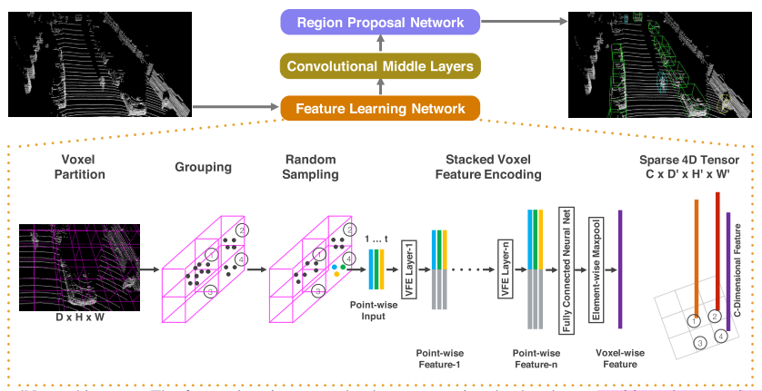
<figcaption>VoxelNet 架构 </figcaption>

**SECOND**（Sparsely Embedded Convolutional Detection，Yan et al., Sensors 2018）针对 VoxelNet 常规三维卷积的高昂开销，引入了**稀疏卷积（Sparse Convolution）**与流形稀疏卷积（Submanifold Sparse Convolution），仅在非空体素上进行卷积计算，大幅提升了训练和推理速度，并改进了角度回归损失函数，使基于体素的方法真正具备了实用价值。

  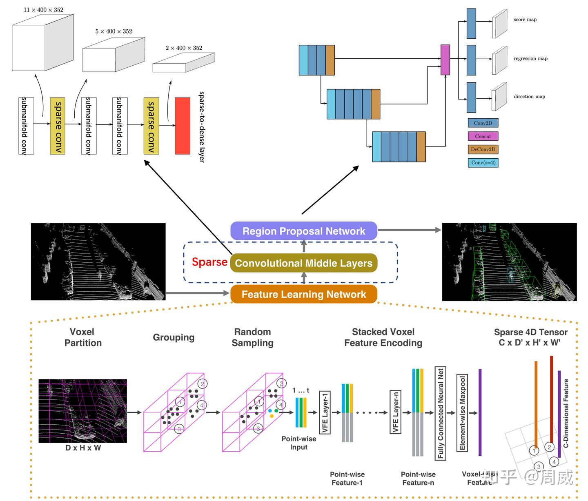
<figcaption>SECOND 架构 </figcaption>

**PointPillars**（Lang et al., CVPR 2019）则更进一步，将体素化简化为"柱状（Pillar）"编码——沿高度方向将点云压缩为二维伪图像，从而用高效的 2D CNN 代替了 3D 卷积（无论是稠密还是稀疏），推理速度提升至 62 FPS（GPU）。PointPillars 在速度与精度之间取得了极佳的工程平衡，成为自动驾驶 LiDAR 感知领域经典的工业界基线。

**核心特点**：
- 体素/柱状编码将无序点云转化为规则特征图，兼容成熟的 2D/3D CNN 框架。
- PointPillars 推动了三维检测系统在嵌入式硬件上的实时部署。

  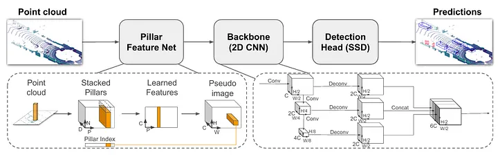
<figcaption>PointPillars 架构：将点云沿高度方向压缩为柱状（Pillar）伪图像，经 PointNet 提取柱特征后散射回 2D BEV 特征图，再通过 2D CNN 骨干网络和 SSD 检测头输出三维边界框。</figcaption>

---

### BEVFormer
**BEVFormer**（Li et al., ECCV 2022）是纯视觉（无 LiDAR）三维感知的里程碑工作。其核心思路是通过**可变形注意力（Deformable Attention）**将多相机图像特征查询到统一的**鸟瞰图（Bird's Eye View, BEV）**空间，并引入**时序 BEV 特征融合**捕捉运动信息。

**核心设计**：
- BEV 平面上预设 Query，通过空间交叉注意力从多视角图像中采样特征（避免稠密特征变换的计算开销）。
- 时间自注意力将历史 BEV 特征与当前帧对齐，隐式编码速度和运动信息。
- 在 nuScenes 数据集上显著超越前代纯视觉方法，触发了"纯视觉自动驾驶感知"研究热潮。

**核心特点**：
- 无需昂贵 LiDAR，仅用摄像头实现接近 LiDAR 水平的 3D 感知。
- BEV 统一表示支持检测、跟踪、地图分割等多任务联合训练。

  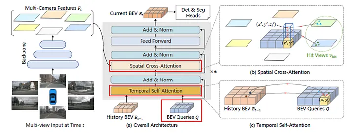
<figcaption>BEVFormer 架构：在 BEV 平面预设网格 Query，通过空间交叉注意力从多相机图像中采样特征投影到 BEV 空间，再以时间自注意力融合历史 BEV 帧隐式编码运动信息，最终送入检测/分割头。</figcaption>

---

### 语义占用预测与表示演进
**语义占用预测（Semantic Occupancy Prediction）**近年在自动驾驶中受到广泛关注。与 3D 目标检测输出有限数量的边界框不同，占用预测为场景中每个区域（体素）分配语义标签，能更自然地处理任意形状的异型障碍物与长尾目标（如倒地的纸箱、施工护栏、悬挂的线缆），因而被视为通往"通用障碍物感知"的关键路径。然而，稠密体素表示天然面临 $O(N^3)$ 的内存与计算爆炸问题，整个领域的技术演进，本质上是一条不断逼近"高分辨率 × 低算力 × 时序一致"三角约束的优化轨迹：

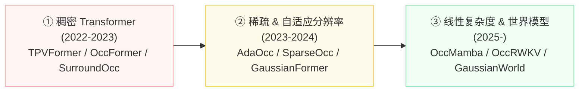

**1）稠密 Transformer 范式（2022–2023）**：**TPVFormer**（Huang et al., CVPR 2023）将 BEV 扩展为三平面（Tri-Perspective View, TPV）表示，用三个正交平面而非完整体素网格近似 3D 空间，在计算效率与感知完整性之间取得平衡；**OccFormer**、**SurroundOcc** 则通过 3D / 双路注意力进一步提升重建质量。这一阶段确立了"环视图像 → 3D 体素语义"的端到端范式，但稠密注意力带来的显存与延迟开销，成为车端实时部署的主要瓶颈。

**2）稀疏与自适应分辨率表示（2023–2024）**：核心思想是"好钢用在刀刃上"，不再对所有体素一视同仁地计算。**AdaOcc**（Adaptive-Resolution Occupancy Prediction）引入自适应分辨率机制——在近处、复杂障碍物等安全关键的兴趣区域（ROI）使用高分辨率，在远处空旷区域使用低分辨率，打破效率与精度的 Trade-off；**SparseOcc / Fully Sparse Occupancy** 将稀疏性推向极致，在整条流水线中仅对非空区域进行计算，大幅压缩延迟；甚至有工作（**Occupancy as Set of Points**）彻底摒弃规则体素网格，改用点集灵活表示占用，对薄结构与边缘有更好的刻画。受 3DGS 启发，**GaussianFormer**（Wang et al., ECCV 2024）/ **GaussianFormer-2**（CVPR 2025）则用一组 3D 高斯体替代稠密体素，以"概率叠加"建模占用，在显著压缩内存的同时保留细粒度几何。

**3）线性复杂度架构与时序世界模型（2025–）**：Transformer 的二次复杂度在高分辨率 3D 空间中成为致命弱点，新一代工作转向线性复杂度骨干。**OccMamba**（CVPR 2025）是首个将状态空间模型（SSM / Mamba）引入占用预测的网络，通过希尔伯特曲线等 3D-to-1D 展开保持空间局部性，配合层次化 Mamba 模块实现 $O(N)$ 复杂度；**OccRWKV** 则借助线性 RNN 架构探索端侧实时部署。与此同时，占用预测正从"单帧感知"迈向"时序世界模型"：**GaussianWorld**（CVPR 2025）在流式输入中不仅预测当前占用状态，更预测未来的 3D 占用演变，强调时序一致性；面向遮挡难题，**Collaborative Semantic Occupancy Prediction** 通过车路 / 车车协同（V2V）融合多视角特征"看透"遮挡，显著提升 IoU。

> **演进脉络小结**：占用预测沿"稠密计算 → 自适应 / 稀疏表示 → 线性复杂度 → 时序世界模型"逐级演进，背后是同一条主线——在有限车端算力下，把感知分辨率、计算效率与时序预测能力推向新的帕累托前沿。

**三维场景图（3D Scene Graph）**则从另一视角组织空间语义：将场景表示为图结构，节点表示物体实例，边表示空间关系（上方 / 下方、左侧 / 右侧、支撑等），支持语言查询与逻辑推理。**3DSSG**（Wald et al., CVPR 2020）是该方向的代表性数据集与基线工作。占用预测提供"稠密几何 + 语义"，场景图提供"稀疏结构 + 关系"，二者在具身导航与任务规划中常互为补充。

---

## 4.5 空间感知语言模型

> 💡 **架构背景提示**：空间感知语言模型（3D MLLM / Spatial VLM）通常基于 2D 通用多模态大模型扩展而来（例如通过引入 3D 几何编码器、点云 Tokenizer 或空间位置 Prompt）。关于通用多模态融合的核心机制（线性投影/交叉注意力/Q-Former）与完整训练调优流水线，请参考前置基座篇：[《VLM综述：4. 实现多模态的核心方法》](/VLM-Survey/#vlm-methods) 与 [《6. VLM训练流程与关键技术》](/VLM-Survey/#vlm-training)。

### ScanRefer & ScanQA
**ScanRefer**（Chen et al., ECCV 2020）提出了**三维视觉定位（3D Visual Grounding）**任务：给定自然语言描述（如"靠近门口的那张棕色椅子"），在三维点云场景中定位目标物体（输出三维边界框）。ScanRefer 数据集包含 51,583 条对 ScanNet 扫描中物体的语言描述，是三维语言定位方向的核心基准。ScanRefer 之后，**Nr3D/Sr3D**（Achlioptas et al., 2020）和 **ScanQA**（Azuma et al., CVPR 2022）进一步扩展了三维语言理解的评测维度。

  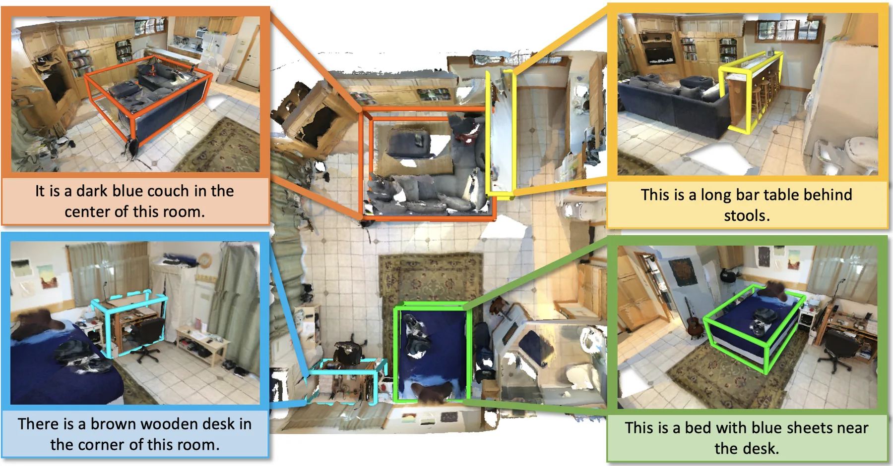
<figcaption>ScanRefer 三维视觉定位示例：给定自然语言描述（如"靠近门口的棕色椅子"），模型在三维点云场景中定位目标并输出三维边界框，需同时理解语言中的空间关系线索并在点云中消解歧义。</figcaption>

---

### 3D-LLM
**3D-LLM**（Hong et al., NeurIPS 2023）首次将大型语言模型（LLM）扩展至三维感知任务。通过将三维点云特征注入 LLM 的上下文（使用基于扩散模型的三维特征提取器，将点云映射为 token 序列），3D-LLM 支持三维场景问答、三维视觉定位、三维对话等多类任务，无需为每个任务设计专用模块。

**核心特点**：
- 将 LLM 的开放式语言理解能力迁移到三维场景感知，赋予模型三维感知能力。
- 支持多样化三维-语言任务，展示了统一框架的可行性。
- 为后续三维多模态大模型（3D MLLM）奠定基础。

  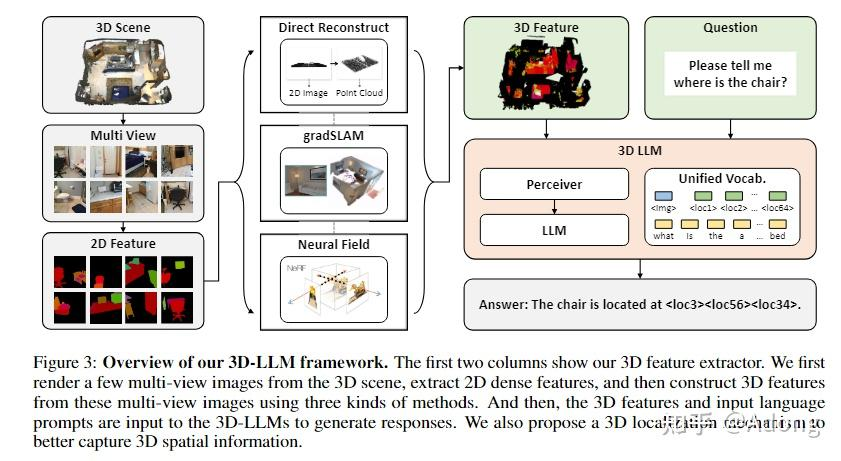
<figcaption>3D-LLM 框架：利用基于扩散模型的三维特征提取器将点云场景映射为 token 序列，注入 LLM 的上下文窗口，支持场景问答、视觉定位与多轮对话等任务。</figcaption>

---

### SpatialVLM
**SpatialVLM**（Chen et al., CVPR 2024）专门针对视觉语言模型（VLM）的空间推理短板而设计。现有 VLM（如 GPT-4V）在"物体 A 距离物体 B 有多远？"此类定量空间推理问题上表现较差。SpatialVLM 通过构建大规模**空间推理问答数据集**——利用三维传感器自动生成涵盖距离估计、方位判断、大小比较等类型的定量标注问答对——对 VLM 进行空间推理专项微调。

**核心特点**：
- 首个系统性提升 VLM 定量空间推理能力的工作。
- 自动化数据生成管线可扩展至大规模，不依赖人工标注。
- 在机器人操控等空间推理密集型下游任务中显著提升性能。

  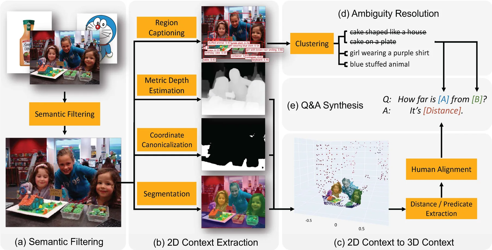
<figcaption>SpatialVLM 数据生成管线：利用三维传感器数据自动生成距离估计、方位判断、大小比较等定量空间推理问答对，对 VLM 进行空间推理专项微调，显著提升模型在定量空间问题上的准确率。</figcaption>

---

### EmbodiedScan
**EmbodiedScan**（Wang et al., CVPR 2024）提出了全面的具身三维场景理解基准，覆盖三维目标检测、三维视觉定位、三维问答等多任务，强调从智能体的**主动探索视角**理解三维场景（第一人称视角的 RGB-D 流输入），而非离线的完整点云扫描。EmbodiedScan 包含 5000+ 场景、146 万+ 实例标注，是当前规模最大的具身三维场景理解数据集之一。

**核心特点**：
- 统一的多任务具身三维理解框架，贴近真实机器人部署的感知模式。
- 强调实时、增量式的三维场景理解，而非离线离线处理完整点云。
- 引入多粒度空间语言对齐，支持细粒度物体级和场景级描述。

  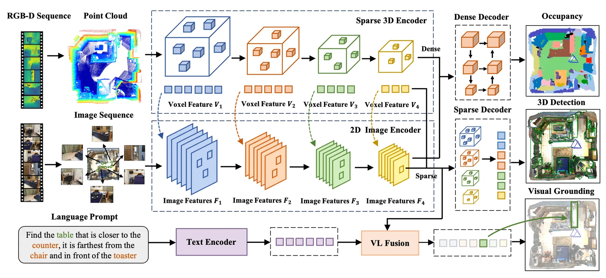
<figcaption>EmbodiedScan 框架概览：以智能体主动探索的第一人称 RGB-D 视角流为输入，统一支持三维目标检测、三维视觉定位和场景问答等多任务评测。</figcaption>

---

### 空间智能大模型进展

2024 年的 **SpatialBot**（Cai et al.，整合深度图与 RGB 增强机器人场景的空间理解）、**RoboSpatial**（面向机器人操作的空间理解数据集与模型）和 **Chat-3D v2**（对象感知的三维特征注入，支持多轮三维对话）共同说明：通用 VLM 在度量距离、方向、体积比较等定量空间推理上存在系统性短板，专项数据能补上一部分。2025–2026 年的工作沿四条主线推进。

**1）在 VLM 中接入几何编码器。** 思路是复用前馈重建模型学到的三维结构先验，而不只用为语义设计的 CLIP 类编码器。**Spatial-MLLM**（arXiv:2505.23747）采用双编码器：二维视觉编码器提取语义，以 VGGT 主干初始化的空间编码器提取结构，推理时再按空间信息量挑选关键帧；**VG-LLM**（arXiv:2505.24625）把几何编码器的特征与视觉 token 融合后送入 MLLM，4B 模型在 VSI-Bench 上超过 Gemini-1.5-Pro；**VLM-3R**（arXiv:2505.20279）从单目视频得到隐式三维 token，并配套 20 万条以上的三维重建式指令数据。**SpatialStack**（CVPR 2026，arXiv:2603.27437）指出这些方法大多只融合最深层特征，改为把几何编码器的多层特征逐层对齐到语言主干，同时保留局部几何精度与全局语义。

**2）规模化空间数据。** **SenseNova-SI**（CVPR 2026，arXiv:2511.13719）按空间能力分类体系整理出 800 万条训练数据（SenseNova-SI-8M），在 Qwen3-VL、InternVL3 等基座上训练，VSI-Bench 达到 68.8%、MindCube 达到 85.7%，通用能力基本不降；论文同时讨论了数据扩展带来的泛化迹象，以及过拟合与语言捷径的风险。[HiSpatial](/Spatial-Intelligence-Papers/#hispatial) 走的也是数据路线，但按"几何 → 物体 → 关系 → 抽象推理"分层构造。

**3）用强化学习训练空间推理。** **SpaceR**（arXiv:2504.01805）在 GRPO 中加入"地图想象"，让模型在思考时先推断空间布局，VSI-Bench 上比 GPT-4o 高 11.6 个百分点；**SpatialLadder**（arXiv:2510.08531）按"物体定位 → 多维空间理解 → 可验证奖励强化学习"三阶段训练 3B 模型；**Spatial-SSRL**（arXiv:2510.27606）不需要任何人工或模型标注，直接从普通 RGB / RGB-D 图像构造打乱拼块排序、区域深度排序、相对三维位置预测等五类可自动验证的任务做强化学习。三者的共同前提是奖励可以自动验证。

**4）流式与长时空间记忆。** **Cambrian-S**（ICLR 2026，arXiv:2511.04670）提出"空间超感知"，把能力分成语义感知、流式事件认知、隐式三维空间认知和预测式世界建模四级。它用 59 万条数据（VSI-590K）训练后，VSI-Bench 提升约 30 个百分点，但在新提出的 VSI-SUPER（长时空间回忆与持续计数）上仍然很弱，说明只扩大数据和上下文不够。作者给出的方向是"预测式感知"：用下一帧隐状态的预测误差（惊讶度）驱动记忆写入和事件分割。

这四条线并不互斥：[G2VLM](/Spatial-Intelligence-Papers/#g2vlm) 让几何专家与语义专家共享自注意力，[VLM³](/Spatial-Intelligence-Papers/#vlm3) 证明只靠纯文本 SFT 也能学到度量几何，[S-Agent](/Spatial-Intelligence-Papers/#s-agent) 则让模型调用空间工具，而不是把几何记在参数里。

---

### 多视角 3D 场景 MLLM

前述 [3D-LLM](/Spatial-Intelligence-Papers/#3d-llm)、[PointLLM-V2](/Spatial-Intelligence-Papers/#pointllm-v2) 以**点云**为输入，[GaussianVLM](/Spatial-Intelligence-Papers/#gaussianvlm)、[SplatTalk](/Spatial-Intelligence-Papers/#splattalk) 以**3DGS**为载体，两类都依赖额外的三维重建或扫描预处理。另一条更贴近实际部署的路线是**直接复用为 2D 内容设计的大型多模态模型（LMM），仅以带位姿的多视角图像／视频帧为输入**，把三维感知作为隐式能力注入，无需显式点云。**LLaVA-3D**（2024）将 2D patch 特征按相机位姿"提升"为 3D patch，**Video-3D LLM**（2025）把视频帧与三维位置编码绑定，二者均验证了"视频帧 + 位姿"即可支撑 ScanQA、SQA3D 等三维问答任务。

**Ross3D**（Reconstructive Visual Instruction Tuning with 3D-Awareness，Wang et al., 2025，arXiv:2504.01901）在这条路线上给出了**自监督视角**。它指出适配 2D LMM 到三维场景的最大障碍是大规模三维视觉-语言数据的稀缺，于是不堆叠三维标注，而是在指令微调中额外引入**两类 3D 感知重建目标**：

- **跨视角重建（Cross-view Reconstruction）**：随机掩码部分视角，强迫模型聚合相互重叠的其他视角信息来恢复被掩码视图，从而学会跨帧几何对应关系；
- **全局视角重建（Global-view Reconstruction）**：聚合全部可用视角，重建出场景的鸟瞰图（BEV），迫使模型形成全局一致的空间布局表征。

这两个重建头与文本监督联合训练，使模型在不改变输入形态（仍是视频帧 + 指令）的前提下获得三维感知能力。Ross3D 在多个三维场景理解基准上取得当时的 SOTA；其**半监督实验**表明，借助大量"纯视觉、无语言标注"的三维数据即可显著提升性能，这为缓解三维视觉-语言数据瓶颈提供了一条可扩展的路径，与 Depth Anything（§4.2）"用海量无标注数据驱动基础模型"的思路一脉相承。

  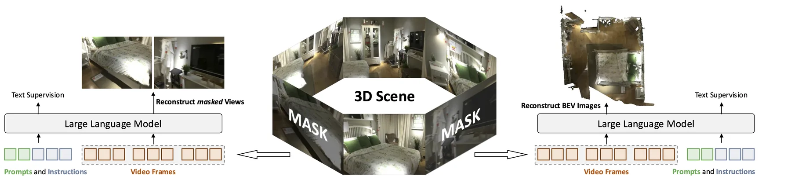
<figcaption>Ross3D 的两类 3D 感知重建目标（图源：Ross3D 官方仓库 Haochen-Wang409/ross3d）。左：跨视角重建——掩码部分视频帧后，由 LLM 聚合重叠视角恢复被掩码视图；右：全局视角重建——聚合全部视角重建场景鸟瞰图（BEV）。两路重建均与文本监督联合训练，将三维感知隐式注入为 2D 内容设计的多模态大模型。</figcaption>

在线场景下，[Stream3D-VLM](/Spatial-Intelligence-Papers/#stream3d-vlm) 用流式几何编码器为每个新到达的帧提供增量几何先验；[Qwen-3D](/Spatial-Intelligence-Papers/#qwen-3d) 则在世界坐标系中做自注意力，统一 2D/3D 空间定位与推理。

---

### HiSpatial (CVPR 2026)

**HiSpatial**（Microsoft，**CVPR 2026**，arXiv:2603.25411）是 VLM 空间推理方向较系统的工作。其核心主张是：三维空间理解应像人类认知发育一样**逐级搭建**，缺乏底层几何与度量基础，高阶抽象推理几乎无法习得。为此它将空间理解显式拆解为 Level 0（基础几何感知）→ Level 1（物体级理解）→ Level 2（物体间关系）→ Level 3（抽象推理）四个层层依赖的层级，配合无人工标注的自动化数据引擎（约 500 万图像 / 20 亿 QA）与注入**度量尺度点图**的 RGB-D VLM，以仅 3B 参数在 SpatialRGPT、QSpatial、RoboSpatial 等多个基准上超越 Gemini-2.5-Pro、GPT-5。**完整解析见 [论文精读](/Spatial-Intelligence-Papers/#hispatial)**。

---

### 语言高斯溅射

语言高斯溅射把语义特征"喷涂"到 3DGS 高斯基元上，再通过多视角渲染蒸馏，使三维场景兼具几何精度与语义可查询性。3DGS 在这里扮演聚合多视角信息的空间记忆，支撑下游语言推理，而不只是用于新视角合成。代表作 [SplatTalk](/Spatial-Intelligence-Papers/#splattalk)、[LangSplatV2](/Spatial-Intelligence-Papers/#langsplatv2)、[4D LangSplat](/Spatial-Intelligence-Papers/#4d-langsplat)、[OpenGaussian](/Spatial-Intelligence-Papers/#opengaussian) 与 [GaussianVLM](/Spatial-Intelligence-Papers/#gaussianvlm) 的精读见论文精读第一组。

---

# 5. 主流数据集与评测基准

本节先按任务整理常用数据集，再单独列出近两年涌现的空间推理评测基准，最后给出评测指标与选型建议。

## 5.1 按任务分类的数据集

| 任务方向 | 代表数据集 | 适用场景与注意事项 |
|:---|:---|:---|
| 形状与合成三维 | ShapeNet、ModelNet10 / ModelNet40 | CAD 模型库（ShapeNet 约 55 类），样本整洁无噪声，常用于形状重建、生成与点云分类基线；与真实感知场景存在域差异 |
| 室内扫描与语义理解 | ScanNet v2、Matterport3D / HM3D、S3DIS | 真实 RGB-D 扫描，提供逐帧 RGB、深度、位姿、点云与语义 / 实例标注；适合语义分割、场景重建，以及 ScanRefer 等语言对齐任务 |
| 深度估计与稠密几何 | NYU Depth V2、KITTI Depth（Eigen split）、DTU、Tanks and Temples、BlendedMVS、Mip-NeRF 360 | 单目 / 双目深度、多视图重建与新视角合成的标准评测集，前两者分别对应室内与驾驶场景 |
| 自动驾驶与户外感知 | KITTI 3D / Odometry、nuScenes、Waymo Open、Argoverse、Lyft Level 5 | 多传感器（LiDAR + 多相机 + 雷达）数据，覆盖检测、跟踪、BEV、占用预测与轨迹预测；Waymo 标签更密、长尾类别更多 |
| 具身仿真与导航 | Gibson、Habitat、Replica、Habitat-Matterport | 与真实场景对齐的三维环境与物理交互接口，用于视觉导航、VLN 与目标驱动探索的训练和评测 |
| 三维视觉语言 | ScanRefer、Nr3D / Sr3D、ScanQA、SQA3D、MSR3D | 三维视觉定位（输出三维边界框）、三维问答与具身场景问答；Nr3D 为自然语言，Sr3D 为模板化语言 |
| 空间推理与具身问答 | SpatialRGPT / QSpatial、RoboSpatial / RoboRefer、EmbodiedScan | 定量空间推理（绝对 / 相对距离、方位、大小）、机器人操作中的空间指代，以及基于第一人称 RGB-D 流的多任务具身理解 |
| 新视角合成 | Synthetic-NeRF（Blender）、Tanks and Temples、DTU | 合成与真实场景的渲染质量评测，报告 PSNR / SSIM / LPIPS |

## 5.2 空间推理评测基准

2024 年底以来，面向 MLLM 的空间推理基准迅速增多，考察对象从单图关系扩展到多视角对应、心理旋转、长时记忆与流式输入。

| 基准 | 输入 | 考察重点 | 规模 |
|:---|:---|:---|:---|
| [VSI-Bench](https://arxiv.org/abs/2412.14171) | 室内视频 | 从视频中记住并回忆空间：计数、距离、尺寸、相对方向、路径规划、出现顺序 | 5,000+ 问答 |
| [VSI-SUPER](https://arxiv.org/abs/2511.04670) | 任意长视频 | 长时空间回忆（VSR）与持续计数（VSC），无法靠扩大上下文解决 | VSR + VSC |
| [MMSI-Bench](https://arxiv.org/abs/2505.23764) | 多张图像 | 多图空间推理；人类 97%，GPT-5 约 40%，最好的开源模型约 30% | 1,000 道选择题 |
| [MindCube](https://arxiv.org/abs/2506.21458) | 少量视角 | 从有限视角构建心理地图：位置、朝向与"移动后会怎样" | 21,154 题 / 3,268 张图 |
| [OmniSpatial](https://arxiv.org/abs/2506.03135) | 图像 | 动态推理、复杂空间逻辑、空间交互、视角转换 4 大类 50 个子类 | 8.4K 问答 |
| [SITE](https://arxiv.org/abs/2505.05456) | 单图 / 多图 / 视频 | 按认知科学分类统一 31 个已有数据集，新增视角转换与动态场景任务 | 多选题 |
| [SpatialScore](https://arxiv.org/abs/2505.17012) | 多种视觉输入 | 30 类任务的综合评测，配套 SpatialCorpus 训练集与工具调用的 SpatialAgent | 约 5K 样本 |
| [Spatial4D-Bench](https://arxiv.org/abs/2601.00092) | 视频 | 4D 时空推理：物体、场景、时空关系、路线规划与物理合理性 | 约 40,000 问答 / 18 类任务 |
| [OVO-S-Bench](https://arxiv.org/abs/2606.03890) | 流式第一人称视频 | 只看查询时刻之前的前缀，按 4 级抽象评测；Gemini-3.1-Pro 59.2，人类 92.2 | 1,680 题 / 348 段视频 |

这些基准反映出几个共同问题：
- **多视角对应与视角转换最弱**。MMSI-Bench、MindCube、OmniSpatial、SITE 都把错误集中在跨图对应、换位思考和心理旋转上；MindCube 的作者发现，先生成认知地图再推理（map-then-reason）比单纯的语言思维链有效得多。
- **长时与流式场景会断崖下跌**。VSI-SUPER 上超过 60 分钟的视频几乎全部失败；OVO-S-Bench 中经过流式或空间微调的模型反而不如各自的基座，且不以观测为依据的思维链会放大空间错误。
- **早期基准接近饱和**。VSI-Bench 已被专项模型推到 60%–70%，SenseNova-SI 也提醒要警惕语言捷径和训练—测试分布重叠。

## 5.3 常用评测指标（按任务）

- 形状重建 / 生成：Chamfer Distance (CD), Earth Mover's Distance (EMD)
- 点云 / 语义分割：mean IoU (mIoU), per-class IoU, mAcc
- 三维目标检测：mAP (IoU thresholds), Average Translation Error, BEV mAP
- 深度估计与重建：AbsRel, RMSE, SILog（尺度不变误差），PSNR/SSIM/LPIPS（视图合成）
- 文本生成与问答：CIDEr, BLEU, ROUGE, Exact Match (EM)
- 空间推理问答：多选题准确率；数值题常用平均相对准确率（MRA）
- 具身导航：Success Rate (SR), Success weighted by Path Length (SPL), Coverage

## 5.4 选型建议与推荐组合

**常见陷阱**：
- 数据域匹配：合成 CAD 数据（ShapeNet / ModelNet）适合算法设计与快速迭代，但与真实传感器噪声和遮挡差距大；研究真实感知能力请优先选择 ScanNet / Matterport3D / HM3D 等真实扫描集。
- 标注一致性：不同数据集对类别定义、坐标系、度量单位可能不同（例如度量深度的尺度），实验前需对坐标变换、分辨率、语义类映射做严格统一。
- 训练/测试泄露：使用大规模预训练（3D/2D）模型时，数据集之间交叉包含的场景/对象可能导致评测偏高，应采用严格的场景级划分（scene-level split）。空间推理基准大多基于 ScanNet、ARKitScenes 等少数场景源构建，与训练数据重叠的风险更高。

**推荐组合**：
- 原型研究（快速验证算法想法）：ModelNet / ShapeNet（小样本、合成、训练快）
- 室内三维感知与语义：ScanNet v2 + S3DIS + ScanRefer（语义 + 定位）
- 新视角合成与神经渲染：DTU + Tanks and Temples + Mip-NeRF 360（涵盖合成与真实场景）
- 自动驾驶：nuScenes + Waymo（多传感器、场景多样、长尾）
- 具身智能与导航：Habitat / Gibson + Matterport3D（更贴近实际部署）
- 空间推理 VLM：VSI-Bench + MMSI-Bench + MindCube 或 OmniSpatial；面向机器人或 AR 的在线场景，再加 VSI-SUPER 或 OVO-S-Bench

## 5.5 数据集发展趋势

三维数据集正从孤立任务基准演化为**多任务、跨模态、具身交互**的综合基准（如 EmbodiedScan、HM3D 扩展集），评测也从离线完整输入转向流式、长时的设定。未来优先方向包括：
- 标注尺度化（更细粒度的物体属性、物理状态与关系标注）；
- 动态场景与时序标注（4D 数据集、动作 / 状态标注）；
- 开放词汇 / 长尾语义覆盖（结合大模型自动标注管线的弱监督数据扩充）；
- 标注互操作性（统一坐标系、语义词表与评测套件），以便可重复、可比较的跨工作评测。

---

# 6. 论文精读

本综述的 26 篇论文精读已移至独立页面 [《空间智能论文精读》](/Spatial-Intelligence-Papers/)，按五个主题分组：

- **神经渲染与语言场**：[NeRF](/Spatial-Intelligence-Papers/#nerf)、[3DGS](/Spatial-Intelligence-Papers/#3dgs)、[SplatTalk](/Spatial-Intelligence-Papers/#splattalk)、[LangSplatV2](/Spatial-Intelligence-Papers/#langsplatv2)、[4D LangSplat](/Spatial-Intelligence-Papers/#4d-langsplat)、[OpenGaussian](/Spatial-Intelligence-Papers/#opengaussian)、[GaussianVLM](/Spatial-Intelligence-Papers/#gaussianvlm)
- **前馈几何与视觉表征基础模型**：[VGGT](/Spatial-Intelligence-Papers/#vggt)、[MapAnything](/Spatial-Intelligence-Papers/#mapanything)、[Depth Anything 3](/Spatial-Intelligence-Papers/#depth-anything-3)、[MuM](/Spatial-Intelligence-Papers/#mum)、[MDM](/Spatial-Intelligence-Papers/#mdm)、[GenCeption](/Spatial-Intelligence-Papers/#genception)
- **三维场景大模型**：[3D-LLM](/Spatial-Intelligence-Papers/#3d-llm)、[PointLLM-V2](/Spatial-Intelligence-Papers/#pointllm-v2)、[LLaVA-3D](/Spatial-Intelligence-Papers/#llava-3d)、[ROSS3D](/Spatial-Intelligence-Papers/#ross3d)、[Stream3D-VLM](/Spatial-Intelligence-Papers/#stream3d-vlm)、[Qwen-3D](/Spatial-Intelligence-Papers/#qwen-3d)
- **空间推理 VLM**：[HiSpatial](/Spatial-Intelligence-Papers/#hispatial)、[VLM³](/Spatial-Intelligence-Papers/#vlm3)、[DepthLM](/Spatial-Intelligence-Papers/#depthlm)、[G2VLM](/Spatial-Intelligence-Papers/#g2vlm)、[S-Agent](/Spatial-Intelligence-Papers/#s-agent)
- **具身操作与自动驾驶**：[RoboRefer](/Spatial-Intelligence-Papers/#roborefer)、[SparseOccVLA](/Spatial-Intelligence-Papers/#sparseoccvla)

LLaVA-Video 属于通用视频理解，已移至 [VLM 综述 §8.14](/VLM-Survey/#814-llava-video2024)。

---

# 7. 总结与展望

空间智能是迈向具身通用人工智能的核心能力之一。本文从离散几何学习一路梳理到大模型驱动的空间推理，2025–2026 年有三点变化最明显：

- **几何感知被"基础模型化"**。VGGT、MapAnything、VGGT-Ω 让相机、深度和点图一次前馈得到，并开始呈现可预测的扩展规律；几何模型的中间表示（寄存器、几何 token）正成为 VLM 与 VLA 的输入。
- **空间推理从"补数据"走向"改训练与架构"**。几何编码器接入、千万级空间数据、可验证奖励的强化学习三条路线同时推进，VSI-Bench 这类早期基准已被推到 60%–70%。
- **评测转向更难的设定**。多图对应、视角转换、长时记忆和流式输入成为新的短板，MMSI-Bench、OVO-S-Bench 上模型与人类仍有 30 个百分点以上的差距。

### 空间智能与世界模型

空间智能正在成为"物理世界模型"的几何骨架。Cambrian-S 把预测式世界建模列为空间超感知的最高一级，SAM 3D 与 Marble 则从生成一侧给出可编辑、可探索的三维世界。真正的难点仍是**物理推理（Physical Reasoning）**：
- **因果关系预测**：理解物体间的物理约束（如：如果撤掉底部的积木，上方的积木会如何塌陷？）。
- **具身常识推理**：在交互过程中理解物体的材质、质量与摩擦力。

### 未来趋势

1. **统一的空间基础模型**：重建、理解与生成共用一套三维表示，几何先验与语言在同一模型中双向流动。
2. **流式与长时空间记忆**：从离线批处理走向在线，在数小时的第一人称输入中维持一致的空间记忆而不漂移。
3. **闭环具身交互**：空间推理直接服务于动作，用任务成功率而不只是问答准确率来检验空间智能。
