* 目录
{:toc}

> 本篇收录 24 篇工作，聚焦 LLM/VLM Agent 如何调用感知与运动工具、按需交互求助、读写空间记忆，并根据执行反馈重规划或恢复任务。包含移动操作、空间建图等支撑方向；这些机制不要求每篇论文全部具备。
>
> 按论文的研究重点归类，目标导航中的 Agent 系统也收录于本篇，例如 SuperNav、NavHarness 与 EvoLife。目标导航方法与性能排行榜见[目标导航篇](/VLN-Papers-Extended/)；指令跟随方法与排行榜见[指令跟随篇](/VLN-Papers/)。

# Agentic 导航论文精读
{: id="agentic-navigation-readings"}

## 1. PanoNav (2025)
{: id="panonav"}
——Mapless Zero-Shot Object Navigation

📄 **Paper**: [arXiv:2511.06840](https://arxiv.org/abs/2511.06840) · 🏛️ **AAAI 2026 (Poster)**

**研究背景/问题**

现有目标导航方法大多依赖深度传感器或预建地图来构建2.5D场景表示，限制了在真实环境中的适用性和泛化能力。零样本目标导航要求机器人识别和导航到超出预定义类别范围的对象，现有方法在开放词汇场景中表现有限。无地图方法通常只基于当前观测进行决策，忽略历史轨迹信息，容易陷入局部死锁。

**主要方法/创新点**

PanoNav是一个无地图、仅使用RGB图像的零样本目标导航框架，包含两个核心模块：

  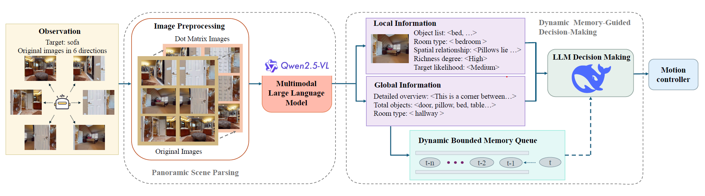
<figcaption>
PanoNav框架整体架构
</figcaption>

**全景场景解析（Panoramic Scene Parsing）：**

*局部方向解析：*
- **点阵图像增强**：将每个RGB图像转换为点阵图像，通过Scaffold方法增强平面位置理解，与RGB图像共同作为MLLM输入
- **空间关系图构建**：MLLM利用几何距离关系和平面位置关系，构建空间关系图，生成每个方向的详细描述（物体存在、空间关系、房间类型等）

  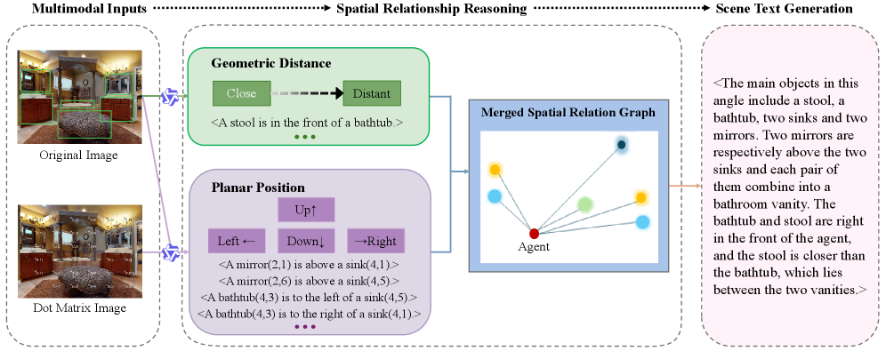
<figcaption>
全景场景解析模块：从RGB输入到局部方向描述
</figcaption>

*全局全景总结：*
- **环境整体感知**：对机器人周围环境进行整体分析，识别环境中存在的物体类型和当前房间类型（如厨房、走廊）
- **隐式自我定位**：通过全局总结提供隐式自我定位信息，帮助机器人理解其在更大环境中的位置

**动态记忆引导决策（Dynamic Memory-guided Decision-Making）：**

- **动态有界记忆队列**：存储最近的全局场景总结，队列长度固定，当队列满时新元素加入会移除最旧元素
- **决策过程**：
  - 记忆队列未满时：决策仅基于当前的局部描述和全局总结
  - 记忆队列满时：决策结合当前信息和历史记忆信息，避免重复探索已访问区域
- **动作选择**：决策结果包括导航方向和是否找到目标的标志，由运动控制器执行相应动作

  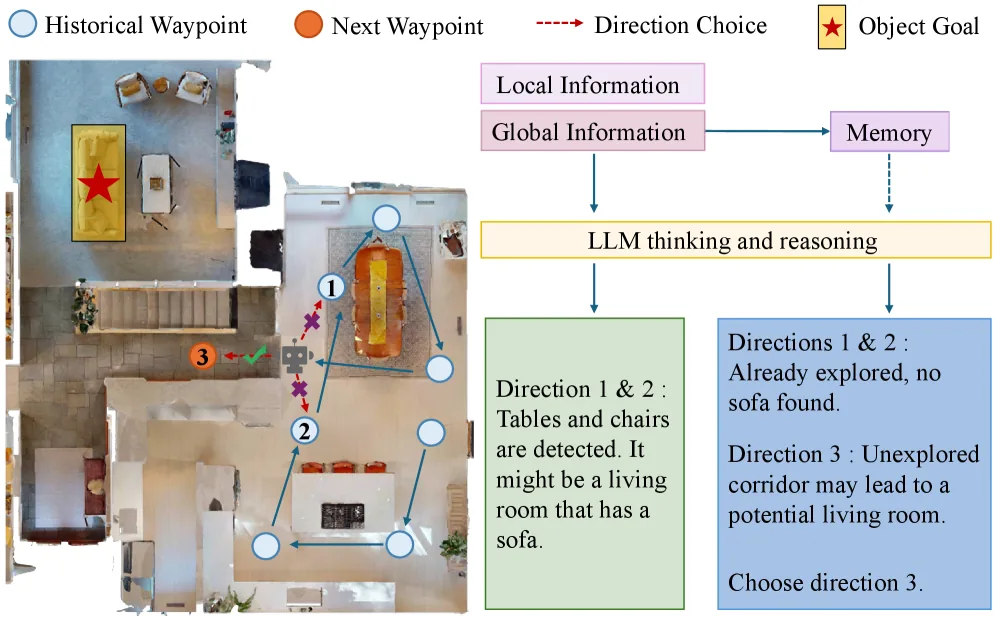
<figcaption>
动态记忆引导决策机制
</figcaption>

**任务设置：**
- **观测数据**：每个时间步获取六个方向的RGB图像（间隔60度），形成全景视图，不依赖深度传感器或GPS
- **动作空间**：停止、前进（0.25米）、左转/右转（30度）、抬头/低头
- **任务目标**：在未见过的环境中根据语言指令找到目标对象，并导航至目标位置

**核心结果/发现**

- **性能优势**：在HM3D数据集上，PanoNav的成功率（SR）达到43.5%，SPL达到23.7%，显著优于PixNav（SR=37.9%，SPL=20.5%）和ZSON（SR=25.5%，SPL=12.6%），甚至超过部分依赖地图和闭词汇表的方法
- **死锁避免**：在高度欺骗性环境中，通过动态记忆机制实现48.0%成功率和19.2% SPL，逃离局部区域的逃逸率达82.0%
- **消融实验验证**：
  - 全景视图的重要性：仅使用三视图时性能显著下降（SR=19.5%，SPL=9.97%）
  - 解耦解析与决策的优势：解耦方法（SR=43.5%，SPL=23.7%）优于直接从MLLM输出决策（SR=38.5%，SPL=22.57%）
  - 动态记忆的关键作用：移除动态记忆后性能大幅下降（SR=38.5%，SPL=22.57%）

**局限性**

虽然PanoNav显著提升了无地图零样本导航性能，但未来仍需探索利用多模态信息（如语音、手势等）构建更强大的记忆队列，以进一步提高无地图目标导航的鲁棒性和泛化能力。

---

## 2. ODYSSEY (2025)
{: id="odyssey"}
——Open-World Quadrupeds Exploration and Manipulation for Long-Horizon Tasks

📄 **Paper**: [arXiv:2508.08240](https://arxiv.org/abs/2508.08240) · 🏛️ **AAAI 2026**

**研究背景/问题**

在动态、非结构化环境中，机器人需要将移动性、操作和实时感知紧密结合才能执行复杂任务。现有研究大多局限于桌面场景，未能解决移动平台特有的感知受限和执行器范围有限的问题，且在开放世界环境中的泛化能力不足。

**主要方法/创新点**

ODYSSEY提出了一个统一的移动操作框架，包含分层规划和全身控制两大核心模块：

  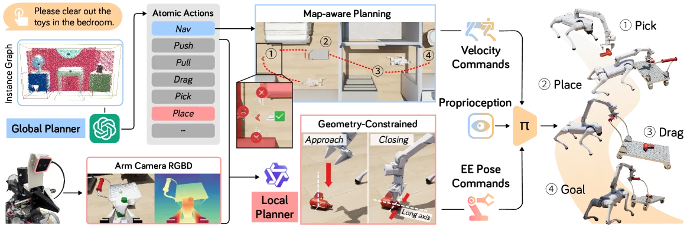
<figcaption>
ODYSSEY框架整体架构
</figcaption>

**长期任务规划器：**
- **全局任务级规划**：融合RGB和LiDAR流构建场景的空-语义表示，利用预训练基础模型将实例图映射到场景中
- 使用GPT-4.1将自然语言指令分解为原子动作序列（导航、抓取、放置等），并输出粗略目标航路点
- 航路点投影到2D占用图，通过局部搜索确定无碰撞目标姿态

**局部操作：**
- 使用腕部安装的深度观测数据指导视觉-语言模型生成精确末端执行器姿态
- Qwen2.5-VL-72B-Instruct模型根据RGB观测和文本描述推断任务相关接触点
- 根据目标物体主轴和表面法线施加几何约束，确定末端执行器朝向

  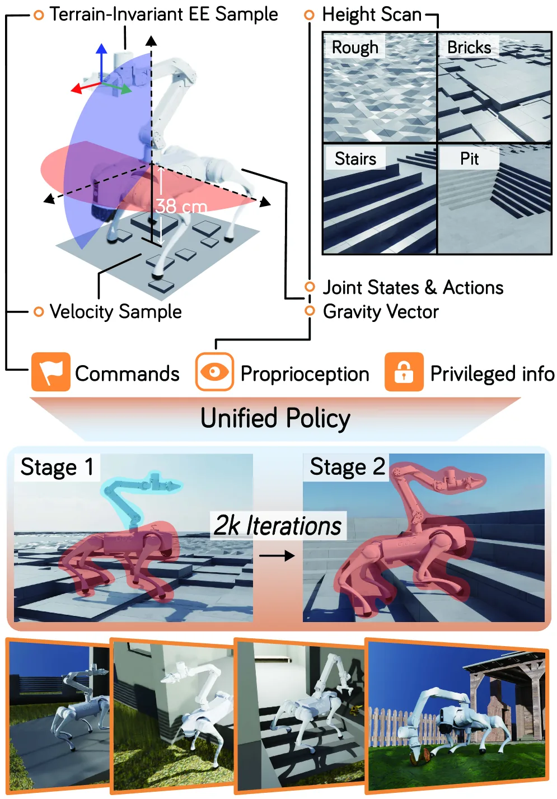
<figcaption>
两阶段全身控制策略训练流程
</figcaption>

**全身控制策略：**
- 单一网络将观测向量（运动指令、末端执行器目标、地面高度图、重力向量、本体感知状态等）映射到目标动作
- **两阶段训练**：第一阶段固定机械臂关节训练运动；第二阶段控制全部18个关节，采用地形不变末端执行器采样策略
- 引入步态奖励、频率奖励和末端执行器跟踪项，运用领域随机化增强适应性

**模拟基准测试：**
- 构建包含50个刚体物体、15个容器、30个关节结构、10个可拖动物体的多样化资产库
- 基准测试包括10个真实场景（室内家居、超市、餐厅、室外庭院等）
- 长期任务包含246个室内和58个室外变化，涉及抓取、重新定向、容器放置、关节操作等多种技能

  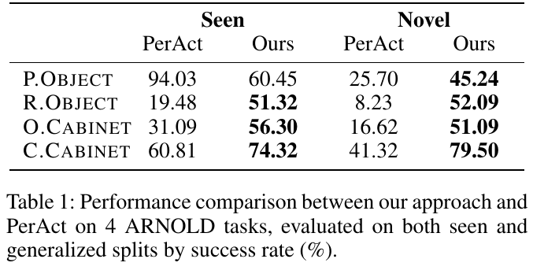
<figcaption>
与基线方法的性能对比
</figcaption>

**核心结果/发现**

- **短期任务**：在ARNOLD基准测试上优于PerAct基线，仅依赖单个自我中心摄像头实现更强的泛化能力，在未见数据集上性能保持稳定
- **长期任务**：在8个长期移动操作任务上实现40%以上整体成功率，每个原子技能类别保持60%以上成功率，展现出可靠的协调能力
- **低层策略**：在基座速度跟踪方面优于RoboDuet基线，末端执行器姿态跟踪性能相当，且在不同地形上具有更强的适应性
- **Sim-to-Real迁移**：成功在Unitree Go2+Arx5平台上实现现实世界部署，在"导航到抓取"和"抓取和放置"任务中验证了框架的实用性

**局限性**

模型在物体几何形状的空间推理方面存在局限，导致夹爪对齐不佳和细长手柄或部分遮挡物品的定位不准确。此外，抓取小物体时偶尔失败，主要由于末端执行器跟踪和视觉感知精度不足。

---

## 3. Agentic Embodied Control (2026)
{: id="agentic-embodied-control"}
———极简接口下的通用智能体直接掌控具身交互循环，零样本性能比肩工业级训练策略

📄 **Paper**: [arXiv:2607.26148](https://arxiv.org/abs/2607.26148)

### 精华
{: id="精华-5"}
1. **控制范式的根本反思**：打破具身导航依赖“专门策略训练”或“人工固定工作流/双脑交接状态机”的固有模式，证明冻结权重的通用大模型仅凭代码智能体框架（Harness）和最极简的感知动作接口，即可完全自主掌控交互循环并在零样本下取得顶尖性能。
2. **极简接口下的强大控制力**：在仅提供 $512 \times 512$ 单目 RGB 图像（无深度、无全景、无建图、无位姿反馈）和 4 个离散动作原语（前进 $0.25\text{ m}$、左转 $15^\circ$、右转 $15^\circ$、停止）的前提下，前沿推理模型（Fable-5 / Opus-5）在 R2R-CE 连续导航基准上达到 $70.7\% \sim 78\%$ 成功率，直接比肩工业级规模训练的导航策略。
3. **能力来源的单轴解耦**：消融实验证实**底层基础模型能力起决定性支配作用**（模型切换导致 SR 跨度高达 $5\% \sim 72\%$），而不同通用 Agent Harness 的差异微乎其微（仅 $1.7\% \sim 7.3\%$）。
4. **混合接口的涌现协同**：强制智能体使用路标预测器（Forced Waypoint）反而限制了强模型的微调对齐；而将路标作为可选工具（Hybrid Interface）开放时，智能体自主涌现出“远距离选路标快速巡航 + 目标近处切原语精细微调”的策略，以 $50\%$ 的步数和不足四分之一的耗时达到 $76.7\%$ 成功率。
5. **无声失效与具身落地鸿沟**：深入审计 30 个失败案例发现智能体存在严重的“有疑无改”现象（思考链已察觉偏航却依然执行错误终止）；实体四足机器狗部署表明“推理能力可迁移，但本体感知不可迁移”，缺乏尺寸意识与持久空间记忆是制约长程自主的核心瓶颈。

---

### 1. 研究背景/问题
{: id="1-研究背景问题-5"}
- **现有具身导航的两大技术路线与控制权外置困境**：
  - **端到端训练策略（Trained Policies）**：如 NaVid、StreamVLN 等，通过海量具身数据训练专用网络，将观测逐帧映射为动作。此类方法对数据分布高度敏感，遇到分布外障碍或未见过的指令时缺乏高层泛化与反思纠错能力。
  - **固定工作流与双脑系统（Fixed Workflows & Dual-Brain）**：如 MapGPT、NavCoT、ABot-N1 等，虽然引入大模型，但将模型严格限制在人类编写的固定流水线中（例如固定先调用深度建图、再调用拓扑规划、再交接给低层控制器）。智能体无法根据当前情境自由决定何时观察、何时多走几步、何时放弃现有假设。
- **核心研究问题**：
  - 能否彻底剔除针对导航任务专门设计的外部脚手架（无外部地图、无深度传感器、无预设启发式搜索、无专用策略网络），**直接将高层交互控制权（Control Authority）完全交由通用推理智能体主导**？
  - 在最极简的单目前视视角与离散动作接口下，通用大模型的具身控制上限究竟有多高？其真正的能力边界与落地卡点何在？

---

### 2. 主要方法/创新点
{: id="2-主要方法创新点-5"}

  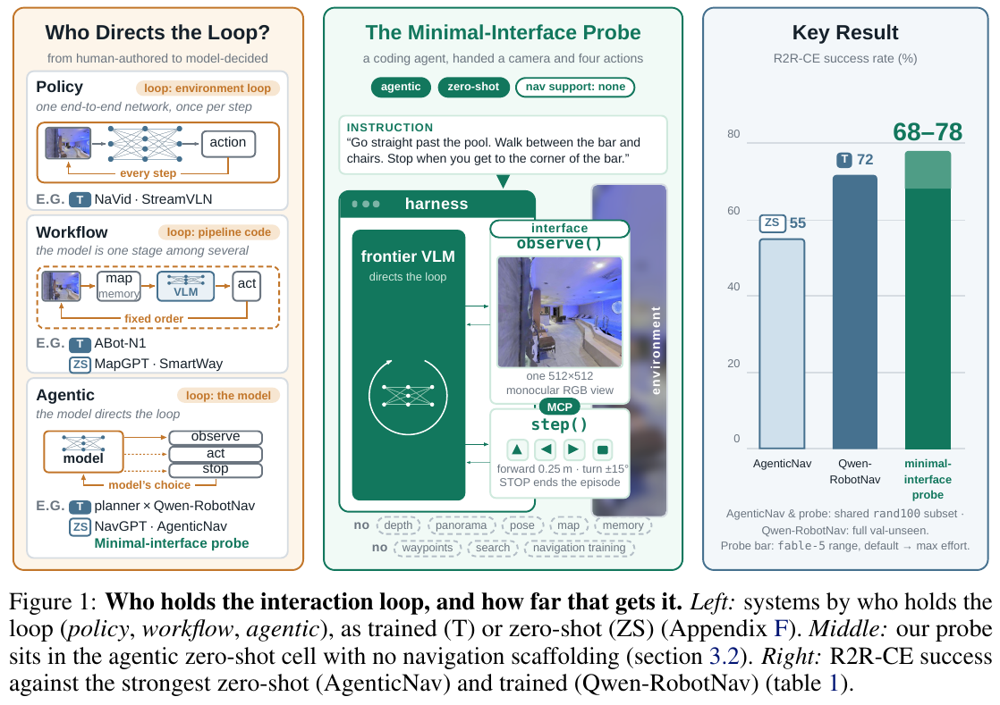
<figcaption>图 1：具身交互循环控制权归属对比（左）、极简接口交互探针架构（中）以及在 R2R-CE 上与强基线的成功率对比（右）</figcaption>

#### ① 整体框架概述：智能体自主具身控制（Agentic Embodied Control）
{: id="-整体框架概述智能体自主具身控制agentic-embodied-control"}
论文提出了一种极简的具身控制探针系统。整个系统由三层完全解耦的组件构成：**通用代码智能体框架（Harness）**、**极简感知动作接口（Interface）** 和 **冻结权重的多模态推理模型（Model）**。智能体在整个交互过程中拥有完全的控制主导权，根据自然语言指令与历史交互记录，自主决定每一轮调用观察工具、步进动作或是终止任务。

#### ② 逐模块深度解析（输入 → 处理 → 输出 → 设计动机）
{: id="-逐模块深度解析输入--处理--输出--设计动机"}

1. **通用智能体框架层（Harness Layer）**
   - **输入**：用户下达的自然语言导航指令与当前会话的历史调用文本/图像上下文。
   - **处理过程**：直接采用为代码工程设计的通用框架（如开源的 `mini-swe-agent`、Anthropic 的 `Claude Agent SDK` 或 OpenAI 的 `Codex CLI`）。框架仅负责提示词拼接、工具分发执行、维持上下文会话，**不包含任何导航专用状态估计、拓扑图构建或回溯策略**。
   - **输出**：格式化的工具调用请求（Tool Calls）及环境返回结果。
   - **设计动机**：剥离所有围绕导航任务手工定制的外围代码逻辑，确保实验纯粹测试底层模型自身的具身推理与自主决策能力。

2. **极简感知工具 `observe()`**
   - **输入**：智能体在需要确认周围环境时发起无参数调用。
   - **处理过程**：环境渲染并返回当前智能体正前方的单张 $512 \times 512$ 分辨率 RGB 图像。**调用该工具不会推进仿真器时间步或消耗步数预算**。
   - **输出**：单张前视 RGB 图像。无全景视角、无深度图、无目标检测框、无语义分割、无激光点云。
   - **设计动机**：强制智能体摆脱对全景图和深度传感器的依赖，考察模型仅凭单目前视图像序列在脑海中维持空间朝向与地标记忆的能力。

3. **极简动作工具 `step(actions)`**
   - **输入**：一个由四个 Habitat 离散动作原语组成的有序序列列表（如 `["LEFT", "LEFT", "FORWARD", "FORWARD", "FORWARD"]`）。四个原语包括：
     - `FORWARD`：向前移动 $0.25\text{ m}$；
     - `LEFT`：原地左转 $15^\circ$；
     - `RIGHT`：原地右转 $15^\circ$；
     - `STOP`：宣告任务完成并主动终止评测。
   - **处理过程**：底层控制器按顺序执行该动作序列，受到单 episode 最大 500 步离散原语总预算的限制。
   - **输出**：仅返回实际执行的原语数量和剩余可用步数。**不返回任何视觉观察、不返回碰撞信号、不返回位姿或坐标漂移数据**。
   - **设计动机**：允许模型根据对环境的把握自主决定动作粒度（可发单个旋转微调，也可发一串组合前进）；隐藏碰撞与位姿信息以迫使模型必须在执行后主动调用 `observe()`，通过对比前后图像的视差变化来内省推断是否发生碰撞或卡阻。

  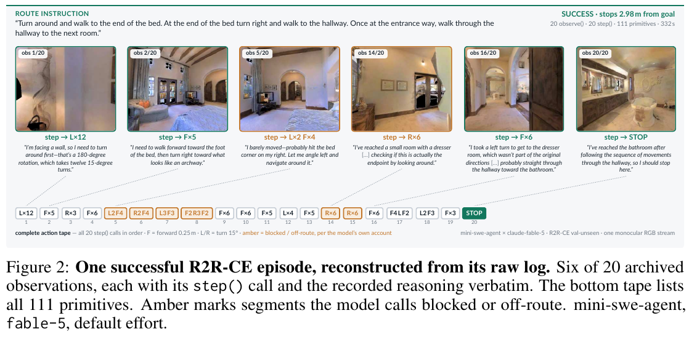
<figcaption>图 2：R2R-CE 连续环境中一个成功导航 episode 的完整执行日志重构，展现了智能体自主纠偏与空间反思过程</figcaption>

#### ③ 端到端交互数据流与自主纠偏机制
{: id="-端到端交互数据流与自主纠偏机制"}
如图 2 所示，在一个完整的导航测试中（如包含 20 次观察、20 次步进、共 111 个离散原语动作），智能体展现了高度自洽的推理与自适应调整循环：
- **视野建立与转向**：初始观察到面对墙壁，模型推理出“需要转 180 度，即连续调用 12 次 15 度的左转”并批量下发 `L×12`。
- **碰撞与偏航感知**：在执行 `F×5` 后调用 `observe()` 发现视野几乎未变，模型在思考链中写道“我几乎没动，可能是右侧撞到了床角；让我向左偏转一点绕开它”，随即自主下发 `L2 F4` 成功脱困。
- **探索与回退**：误入带有梳妆台的小房间后，模型核对指令发现“原指令并未提及此房间，应直接穿过走廊去浴室”，立即掉头重新对准走廊并最终在距离浴室目标 $2.98\text{ m}$ 处自主执行 `STOP`。

---

#### ④ 难点降维 1：具身控制范式的本质跃迁（Control Authority）
{: id="-难点降维-1具身控制范式的本质跃迁control-authority"}

很多读者容易把本工作误解为“又一个用 Prompt 跑 VLN 的零样本方法”。其核心差异在于**控制权归属（Control Authority）与工具调用模式**。

| 控制范式 | 控制权归属 | 核心机制 | 遇到异常/阻碍时的表现 | 代表方法 |
|---|---|---|---|---|
| **端到端策略网络 (Policy)** | 外部环境循环 | 单一神经网络每步输入图像直接映射为动作 | 缺乏高层反思，容易在死胡同里陷入局部震荡 | NaVid, StreamVLN |
| **固定流水线 (Workflow)** | 外部 Python 脚本 | 规则代码硬编码固定流程（建图 → 找路标 → 规划 → 执行） | 流程僵化，无法根据即时困难动态改变观察频率或求助其他工具 | MapGPT, SmartWay |
| **慢快双脑系统 (Dual-Brain)** | 预设交接协议 | 慢速 VLM 规划高层子目标，固定交接给快速动作专家网络 | 交接逻辑与更新频率由人工写死，高层意图常被低层策略失真 | ABot-N1, InternVLA-N1 |
| **智能体自主控制 (Agentic Control)** | **推理模型自身** | 统一由通用大模型自主决定何时感知、走几步、查地图还是选路标 | 模型完全自主掌控重试、绕行、重新定向与提前终止 | **本文方法** |

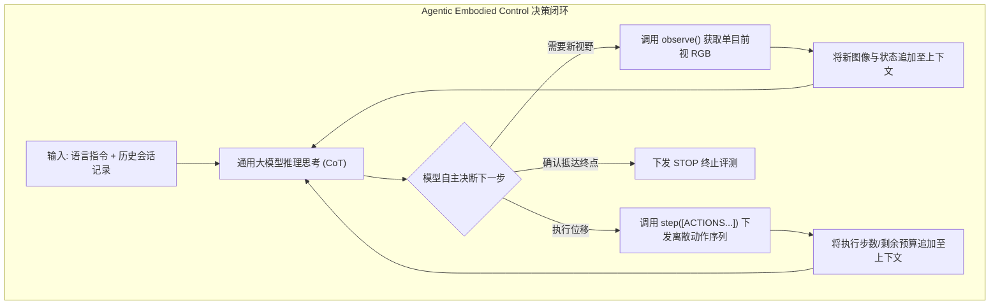

---

#### ⑤ 难点降维 2：混合动作接口（Hybrid Interface）的协同涌现
{: id="-难点降维-2混合动作接口hybrid-interface的协同涌现"}

强制给智能体绑定路标预测器（Forced Waypoint）往往会削弱强模型的表现；但如果将**离散原语**与**训练好的路标预测器**同时开放给智能体作为可选工具（Hybrid Interface），智能体会自主组合出极具启发性的“粗细协同”策略。

> **举个具体例子**：
> 假设任务是从客厅出发，穿过 10 米长的走廊，进入主卧在床头柜旁停下（总距离约 14 米）。
> - **纯原语模式**：由于每次前进仅 $0.25\text{ m}$，走完 10 米走廊需要模型反复发出 $40$ 次前进原语，并频繁调用 `observe()` 检查走廊两侧门洞，容易因微小角度偏航反复微调，总共消耗约 $90$ 个原语步数与近 $40$ 次模型交互调用（耗时约 $210\text{ s}$）。
> - **强制路标模式**：模型只能从预测器给出的最多 5 个路标点中选择。在开阔走廊中只需 2~3 个路标即可快速通过；但在接近床头柜的最后 $1\text{ 米}$ 狭窄区域，预测器给出的候选点往往不够贴合床边甚至紧贴墙面，导致最终停靠偏离目标或碰撞，在复杂转角处极易超调。
> - **混合模式（Hybrid）**：智能体在前 80% 的长走廊路程中自主连续调用 3~4 次**路标导航**快速巡航；一旦视野中检测到床头柜进入近景，模型立即主动切换为**离散原语工具**，以 $0.25\text{ m}$ 和 $15^\circ$ 的微步精细对齐最终停靠点。
> **结果**：步数从 87 步腰斩至 48 步，调用轮数减少一半，交互耗时从 $210\text{ s}$ 锐减至 $112\text{ s}$，成功率反而从纯原语的 $68.3\%$ 提升到 $76.7\%$！

---

#### ⑥ 难点降维 3：具身智能体的“无声失效”与“有疑无改”
{: id="-难点降维-3具身智能体的无声失效与有疑无改"}

对 30 个失败 episode 的细致追踪揭示了当前通用大模型在具身环境下的深层行为缺陷。

| 失败类别 | 占比 (n=30) | 中位数最终距目标距离 | 典型表现与根本原因 |
|---|---|---|---|
| **A. 错误指代 / 错误分支 (Wrong Referent / Branch)** | $40.0\%$ (12例) | $17.3\text{ m}$ | 指令中包含多个歧义门洞或分岔路，模型在第一步就选错通道并一路走向完全无关的房间。 |
| **B. 停止决策失误 (Stop Decision)** | $23.3\%$ (7例) | $4.9\text{ m}$ | 模型视野中看到了指令中提及的目标物体（如沙发），但该物体是沿途参照物而非最终目的地，模型过早终止（Object-anchored overshoot/undershoot）。 |
| **C. 迷失发散搜索 (Runaway Search)** | $26.7\%$ (8例) | $18.6\text{ m}$ | 错过关键拐角后，模型没有选择掉头回溯，而是在未见区域盲目扩大搜索范围，距离目标越来越远。 |
| **D. 几何碰撞陷阱 (Geometry / Trap)** | $10.0\%$ (3例) | $5.5\text{ m}$ | 因缺乏碰撞反馈，模型在桌椅死角反复前进受阻，但无法从纯视觉中分辨是否卡死。 |

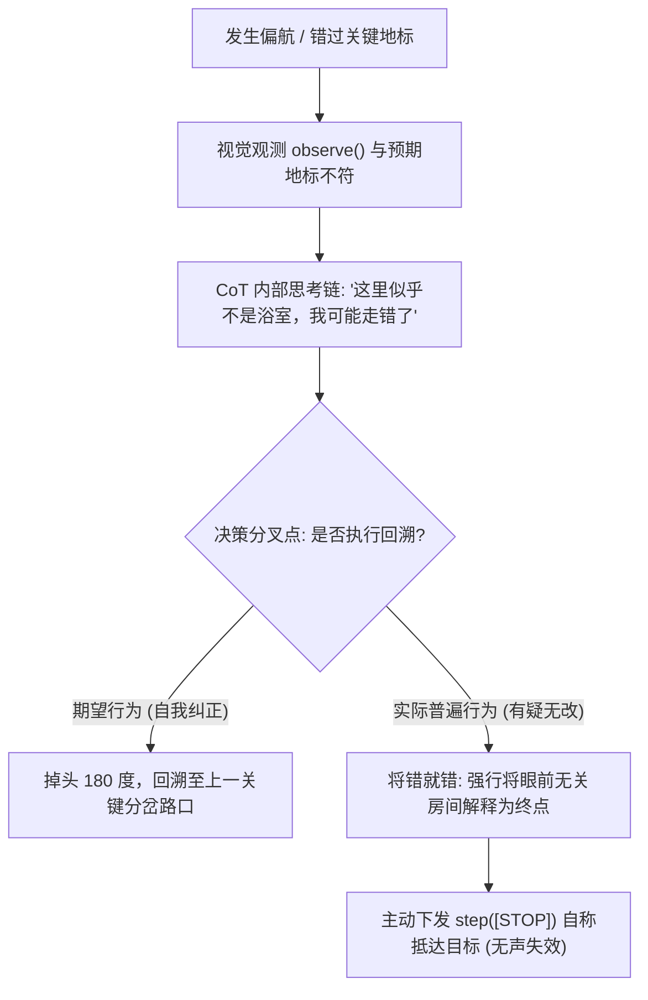

---

### 3. 核心结果/发现
{: id="3-核心结果发现-5"}

  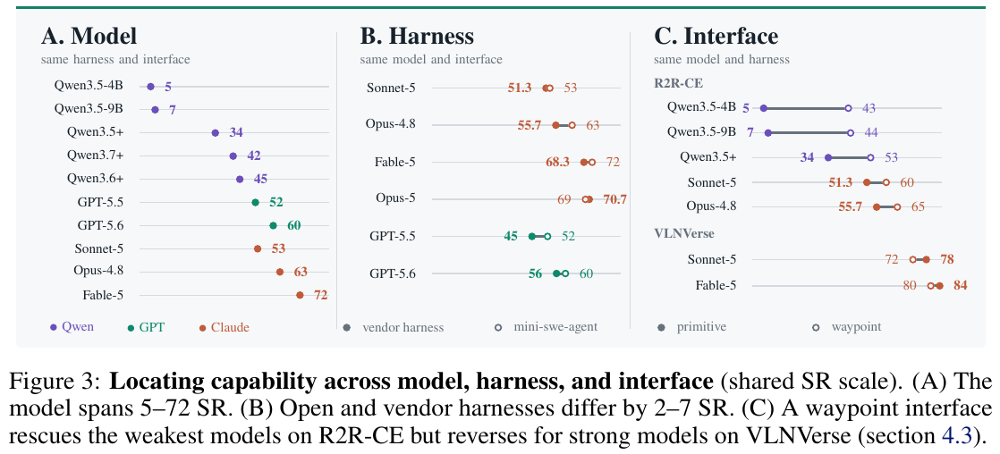
<figcaption>图 3：单轴消融实验结果。(A) 模型能力跨越 5~72 SR；(B) 开源与厂商 Harness 差异仅 2~7 SR；(C) 路标接口对弱模型是救命稻草，但对强模型和密集环境反而带来负面影响</figcaption>

#### ① R2R-CE 主榜成绩对比
{: id="-r2r-ce-主榜成绩对比"}
在标准的 R2R-CE val-unseen（rand100 子集）上，极简接口下的通用智能体展现出惊人的零样本表现：
- **顶级表现**：Fable-5 在 Claude Agent SDK 下（最大思考预算）达到 **$78.0\%$ 成功率（SR）** 和 **$65.27\%$ 路径加权成功率（SPL）**；Opus-5 达到 **$70.7 \pm 3.5\%$ SR**。
- **超越同类零样本系统**：大幅领先同样在零样本设置下使用地图、显式记忆与深度工具的 AgenticNav（$55.0\%$ SR）与 Open-Nav（$50.0\%$ SR）。
- **比肩工业级训练策略**：直接逼近并部分超越了在数万小时具身数据上全量训练的专用策略，如 Qwen-RobotNav（全量验证集 $72.0\%$ SR）、NavFM（$77.2\%$ SR）以及 StreamVLN（$64.9\%$ SR）。

#### ② 模型、Harness 与接口的三维解耦发现
{: id="-模型harness-与接口的三维解耦发现"}
1. **模型轴（Model Dominates）**：在固定 Harness 和接口的情况下，仅更换底层 VLM 即可引起 $5\% \sim 72\%$ 的巨大性能跨度（Qwen3.5-4B 仅 $5\%$，GPT-5.6 达 $60\%$，Fable-5 达 $72\%$）。表明具身导航能力本质上是多模态空间推理与长上下文指令跟踪能力的自然涌现。
2. **Harness 轴（Harness is Modest）**：对比轻量开源的 `mini-swe-agent` 与闭源的 `Claude SDK` / `Codex CLI`，在同一模型下性能差异仅在 $1.7\% \sim 7.3\%$ 之间。
3. **思考预算（Reasoning Effort）**：增加模型的思维链计算量（Reasoning Effort）对部分模型有显著收益（Fable-5 从 default 的 $68.3\%$ 飙升至 max effort 的 $78.0\%$，提升 $+9.7\%$），但对小模型收益并不稳健。
4. **路标工具的双刃剑效应**：
   - 在 R2R-CE 上，对于较弱的模型（如 Qwen3.5-4B/9B），路标预测器将成功率从 $5\%/7\%$ 拯救至 $43\%/44\%$；但对于顶尖模型（Fable-5 / Opus-5），强制使用路标带来的提升仅为 $+0.7\% \sim +1.3\%$。
   - 在障碍更密集、路径更复杂的 **VLNVerse** 基准上，强制路标接口反而导致 Sonnet-5 成功率下降 $6\%$（$78\% \rightarrow 72\%$），Fable-5 下降 $4\%$（$84\% \rightarrow 80\%$），且碰撞率激增 4~6 倍。

#### ③ 真实四足机器狗（Unitree Go2）实体部署
{: id="-真实四足机器狗unitree-go2实体部署"}
在办公楼真实环境中进行的 31 次探索性实验表明：
- **推理能力成功迁移**：智能体能完美理解复杂条件指令（如“如果 $3+4=7$ 则左转，否则右转”）、多阶段“取物并返回”状态追踪，以及通过视觉细微特征（如“走向穿白色鞋子的人”）完成目标锁定。
- **本体感知完全缺失**：由于智能体不知道自身的物理尺寸（长宽与后腿位置），相机刚穿过门框即过早下发左转指令，导致机器狗后躯干直接撞上门框卡死（图 10）；此外，开环步进执行导致偏航角度累计漂移，且跨视角连续过柱子时发生计数混淆（图 11）。

---

### 4. 局限性
{: id="4-局限性-5"}
- **长程任务的上下文与时间开销暴涨**：在长程基准 RxR-CE 上，纯原语成功率从 $70\%$ 暴跌至 $26\%$；单 episode 交互产生的历史 token 达到 $33\text{k} \sim 169\text{k}$，单次决策中位数耗时超 200 秒，极度缺乏紧凑高效的持久空间记忆与状态整合机制。
- **开环控制与内省纠错闭环缺失**：缺乏本体物理感知与碰撞反馈容易在现实物理世界中发生几何卡死；同时模型内部存在严重的“自疑却盲目终止”行为，亟需建立真正的自我验证与主动回溯探索闭环。

---

## 4. ReMEmbR (2024)
{: id="remembr"}
———基于检索增强长程时空记忆的机器人导航问答与物理目标生成

📄 **Paper**: [arXiv:2409.13682](https://arxiv.org/abs/2409.13682) · 🏛️ **ICRA 2025** · [Project Page](https://nvidia-ai-iot.github.io/remembr)

### 精华
{: id="精华-7"}
1. **长程时空记忆解耦**：针对移动机器人在数十分钟至数小时连续作业中面对的庞大历史数据，提出将记忆构建（Memory Building）与查询推理（Querying）阶段解耦，解决传统多模态大模型面对超长上下文时的显存爆炸与计算延迟难题。
2. **多模态时空向量库**：在运行过程中在线调用轻量级视频多模态模型（VILA）对连续视频片段生成底层事件描述字幕，并将文本嵌入、三维度量坐标 $(x, y, z)$ 与时间戳统一存入向量数据库，以紧凑表征记录环境动态。
3. **Agent 迭代多跳检索**：查询阶段引入大语言模型作为决策状态机，根据空间、时间或描述性问题自适应发起多路函数调用（文本/位置/时间检索）进行多步迭代搜寻与剪枝，在最小化推理上下文的同时保证线索完整性。
4. **度量可执行目标生成**：突破传统具身问答仅输出自然语言文本的限制，支持直接输出空间精确三维坐标，与 ROS 2 Nav2 等经典移动底盘导航栈无缝衔接并驱动物理导航。
5. **端到端真机实测闭环**：在搭载 Jetson Orin 的 Nova Carter 机器人上实现端侧轻量 VLM 字幕提取、语音识别与向量检索，在 25 分钟真实办公区巡航后成功执行开放语义问答与导航寻物。

---

### 1. 研究背景/问题
{: id="1-研究背景问题-7"}
- **长程历史表征的扩展性困境**：机器人在长时间巡航中会观察到大量动态事件与非静态物体，现有多模态长上下文模型（如 1M+ 上下文）计算成本随历史增长线性或二次方膨胀，而传统场景图或度量语义地图又难以记录时间维度演化。
- **具身问答缺乏物理可执行性**：现有具身问答基准（如 OpenEQA）多局限于 30 秒至 1-2 分钟的短视频，且输出多为定性文字回答（如“在茶水间桌子上”），机器人无法直接解析为底层导航系统可用的度量坐标目标。

---

### 2. 主要方法/创新点
{: id="2-主要方法创新点-7"}

  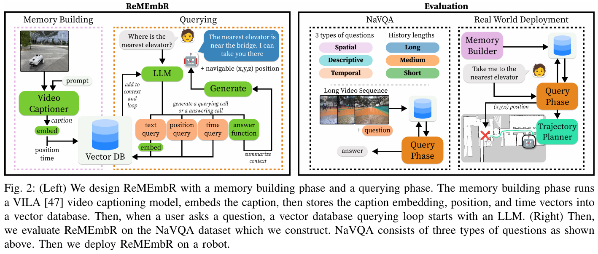
<figcaption>ReMEmbR 系统总体框架：由在线记忆构建（Memory Building）与多跳查询推理（Querying）两阶段解耦构成，右侧为 NaVQA 数据集问答类型与真机部署链路</figcaption>

#### ① 整体框架概述
{: id="-整体框架概述-1"}
ReMEmbR（Retrieval-augmented Memory for Embodied Robots）由**在线记忆构建阶段**与**查询推理阶段**两大核心子系统构成：前者在机器人巡航期间持续将传感器流压缩转化为带时空元数据的多模态向量库；后者在接收到用户自然语言提问时，由 LLM-Agent 驱动多轮时空检索函数，提炼最小必要记忆子集并生成回答或导航目标坐标。

  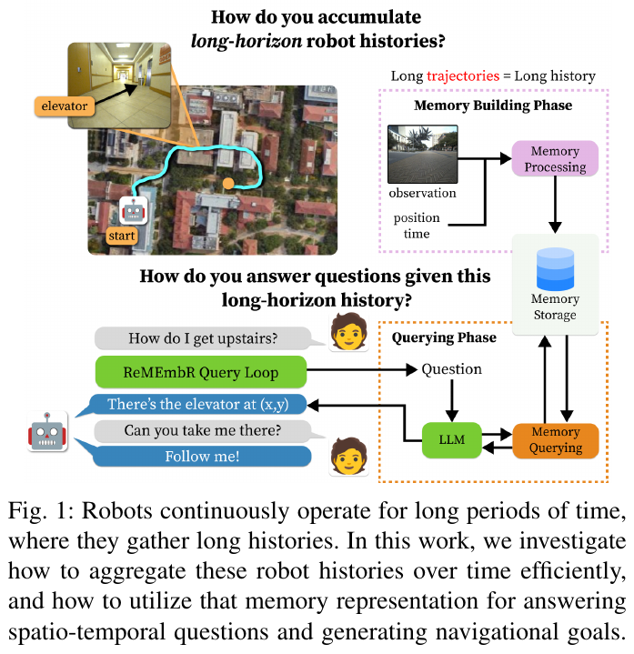
<figcaption>机器人长时间连续运行积累长程历史，ReMEmbR 支持对时空动态信息的高效聚合与物理度量级目标定位</figcaption>

#### ② 逐模块讲解
{: id="-逐模块讲解-1"}

**1. 在线记忆构建模块（Memory Building）**
- **输入**：前视单目相机连续视频帧 $H_I$、机器人局部定位坐标 $H_P = (x, y, z)$（来源于激光雷达里程计、GPS 或 AMCL）、时间戳 $H_T$。
- **处理**：每累计 $t=3$ 秒的连续观测（以 2 FPS 采样 6 帧），调用视频多模态模型 VILA（训练端采用 VILA1.5-13B，端侧部署采用量化版 VILA-3B）生成局部语义事件字幕 $L_{i:i+t}$；随后利用轻量文本编码器 `mxbai-embed-large-v1` 生成句向量 $E(L_{i:i+t})$。
- **输出**：向多模态向量数据库 $V$ 中实时插入一条结构化元组 $$\langle E(L_{i:i+t}), (x,y,z)_{i:i+t}, t_{i:i+t} \rangle$$。
- **设计动机**：问答提问在任务前不可预测，必须在没有先验 Query 的前提下构建通用且信息密集的时空表征；向量数据库支持千万级向量的高效近似最近邻（ANN）检索。

**2. 状态机查询智能体模块（Querying Agent）**
- **输入**：用户提问 $Q$（涵盖空间位置、时间点/时长、环境描述）以及历史累积已检索的上下文 $R_{0:i}$。
- **处理**：LLM-Agent 作为决策状态机，根据当前线索自适应调用以下三类时空检索函数生成检索子集：
  - 文本检索 $f_l(\text{object})$：在向量库中基于余弦相似度匹配语义相关的最相近 $m$ 条片段；
  - 空间位置检索 $f_p((x, y, z))$：根据度量坐标半径检索邻近 $m$ 条历史轨迹片段；
  - 时间范围检索 $f_t(\text{"HH:MM:SS"})$：按时间戳窗口抓取对应时刻前后的 $m$ 条片段。
- **输出**：若当前记忆足以回答提问，输出格式化 JSON 字典（包含文本解析、$(x, y, z)$ 三维坐标、时间戳或持续时间）；若信息不足则携带补充线索进入下一轮迭代检索（最多 3 轮）。

#### ③ 最优历史子集采样形式化
{: id="-最优历史子集采样形式化"}
对于一段长达 $K$ 分钟的完整历史 $H_{1:K}$，直接计算后验概率 $p(A \mid Q, H_{1:K})$ 计算量过大。ReMEmbR 将其形式化为寻找最小充分历史子集 $$R^* \subseteq H_{1:K}$$ 的最优采样问题：

$$p(A \mid H_{1:K}, Q) = p(A \mid R^*, Q) \approx p(A \mid R, Q)$$

$$R^* = \arg\min_R \lvert R \rvert \quad \text{s.t.} \quad \arg\max_A p(A \mid R, Q) = \arg\max_{A'} p(A' \mid H, Q)$$

通过向量库采样策略 $F: V \to R$，LLM-Agent 仅需处理规模极小的子集 $R$，使长程推理在常数级时间内完成。

#### ④ 难点降维：记忆表征范式对比与多步检索
{: id="-难点降维记忆表征范式对比与多步检索"}

| 维度 | 全量长上下文（如 Gemini 1.5M） | 单次向量检索 RAG | ReMEmbR 迭代 Agent |
|---|---|---|---|
| 计算与显存开销 | 随视频时长线性/二次方膨胀，超 10 分钟易 OOM | 固定单次向量检索，开销低 | 3 步以内多路检索，常数级开销（~25s） |
| 时空多跳推理 | 全量信息在上下文内，但注意力易在长序列中迷失 | 仅匹配文本相似度，无法做空间邻近或时间回溯关联 | 状态机自适应组合文本、坐标、时间多路函数逐层收敛 |
| 输出物理可执行性 | 仅输出语言文本，难以准确生成度量坐标 | 通常仅提供文本片段 | 结构化输出 $(x,y,z)$ 坐标，直连 Nav2 导航底盘 |

> **举个例子**：机器人在大楼巡航 20 分钟（产生约 400 个 3 秒视频片段，全量输入需处理数十万 token）。
> 用户提问：“我在 5 分钟前丢的红色工牌在哪？”
> - 朴素单次 RAG 只检索“红色工牌”，若机器人在第 2 分钟和第 15 分钟都在桌边看见过工牌，单次文本检索极易混淆时间线并提取错误坐标；
> - ReMEmbR 的 Agent 第一轮调用 $f_l(\text{"红色工牌"})$ 获取相关候选片段，第二轮依据提问调用 $f_t(\text{"当前时间-5分钟"})$ 缩小时间窗口，两轮仅抓取 6 个关键片段（约 600 token），精准锁定 $(x,y,z)$ 坐标，Token 消耗降低 99% 以上。

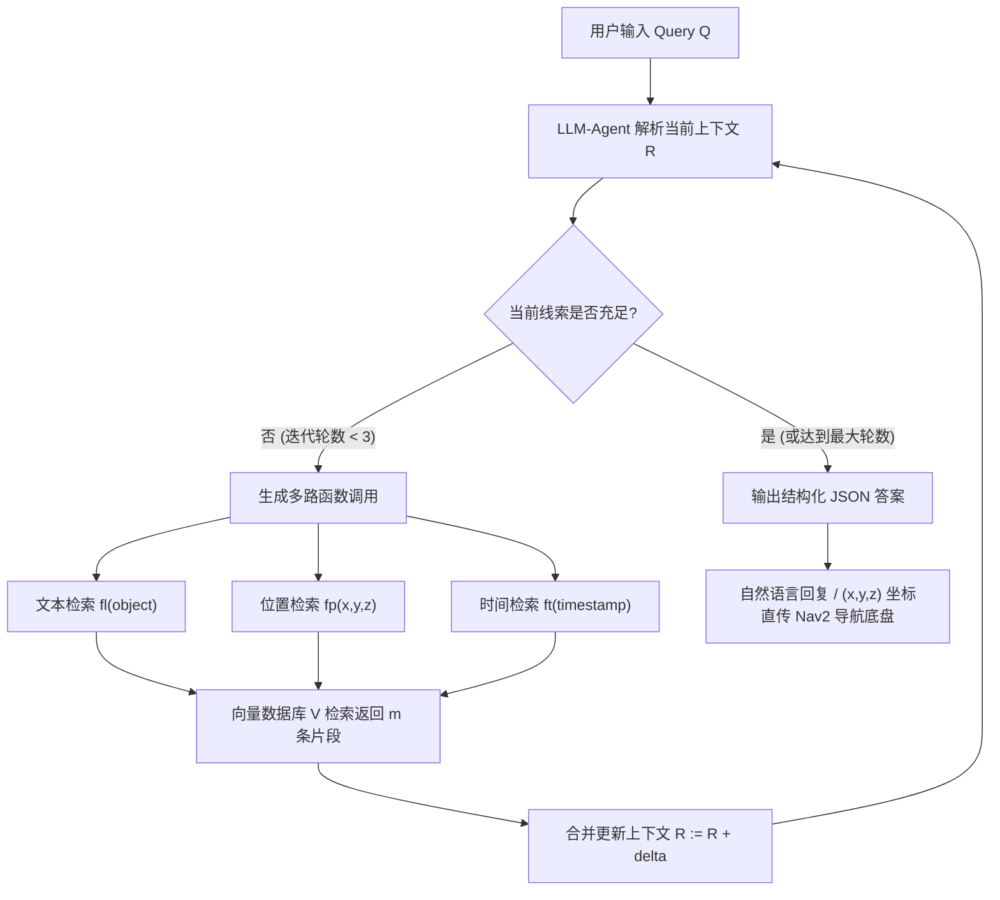

#### ⑤ NaVQA 评测基准构建
{: id="-navqa-评测基准构建"}

  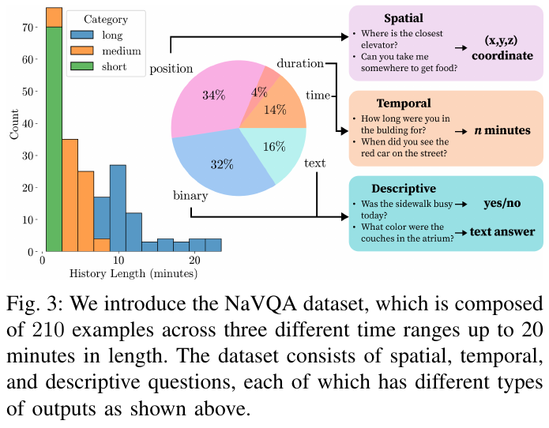
<figcaption>NaVQA 评测数据集：涵盖短（<2min）、中（2-7min）、长（>7min）三种时程分布，覆盖空间坐标、时间点/时长及描述性三大类问答任务</figcaption>

基于真实室外/室内多天气大规模巡航数据集 CODa（Clearpath Husky 机器人采集），构建了包含 210 个专家标注样本的 NaVQA 基准，分为三种时长区间（短 <2min、中 2-7min、长 >7min），涵盖二值判断（32%）、空间坐标定位（34%）、时间点（14%）、时长统计（4%）及开放描述（16%）。

---

### 3. 核心结果/发现
{: id="3-核心结果发现-7"}

  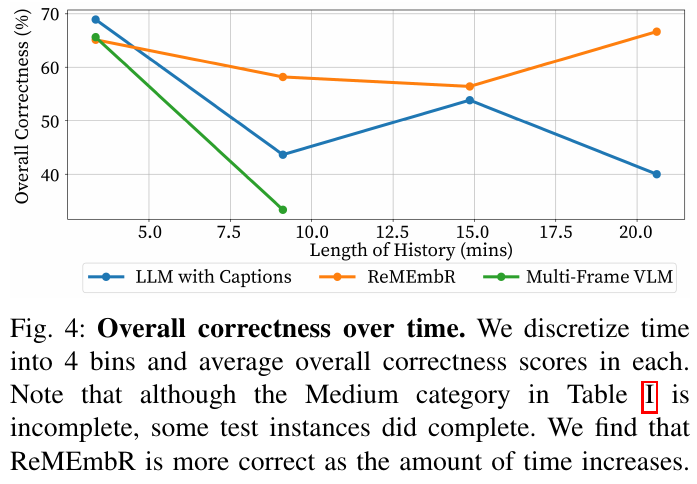
<figcaption>随视频时长增长的总体正确率变化趋势：多帧全量 VLM 在中长视频面临显存爆炸（OOM），而 ReMEmbR 在长视频上保持显著更高的准确率</figcaption>

- **长程视频问答性能全面领先**：在大于 7 分钟的长视频序列上，基于 GPT-4o 的 ReMEmbR 达到 **0.65** 的描述问答准确率、**46.25m** 的空间定位误差与 **3.6s** 的时间误差，显著超越全量字幕输入 Baseline（56.0m 空间误差、8.0s 时间误差），而多帧全量 VLM（Multi-Frame VLM）在中长视频上均因显存溢出（OOM）无法运行。
- **常数级极低查询延迟**：在 21.5 分钟的长视频上，ReMEmbR 单个问题平均响应时间仅约 **25 秒**，且耗时基本不随视频总时长增长；相比之下，多帧 VLM 即使在 5.5 分钟的短视频上也需要高达 90 秒。
- **多步迭代检索是性能关键**：消融实验表明，若退化为单次检索（1-call RAG），整体正确率由 0.61 骤降至 0.50（长视频），证实复杂时空多跳推理对迭代检索闭环的依赖。
- **细粒度时间分段至关重要**：采用 3 秒视频片段字幕（2 FPS）的整体正确率为 0.61，而粗粒度 12 秒片段字幕（0.5 FPS）跌至 0.38，说明时间分辨率下降会严重丢失关键瞬态信息。

  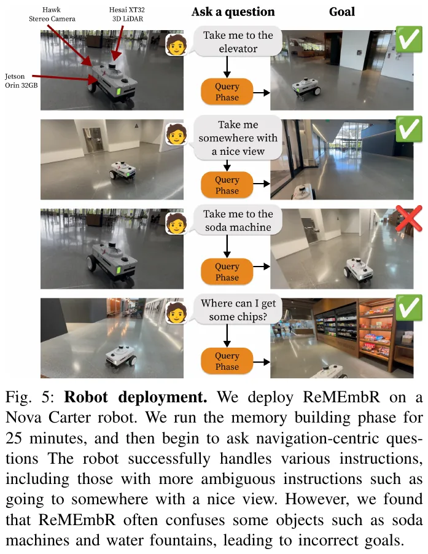
<figcaption>Nova Carter 移动机器人真实办公场景部署：25 分钟巡航记忆构建后，成功响应“带我去视野好的地方”、“去拿薯片”等开放语义导航指令</figcaption>

- **真机端侧闭环验证**：在 Nova Carter 机器人上搭载 Jetson Orin 32GB、3D LiDAR、量化版 VILA-3B 与 Whisper ASR，先执行 25 分钟自主巡航建图构建记忆库，随后测试模糊语义指令。例如面对“带我去风景好的地方”，Agent 自动检索大落地窗、绿植与开阔空间对应的坐标并由 Nav2 导航直达大厅。

---

### 4. 局限性
{: id="4-局限性-7"}
- **重复记忆稀释与冗余膨胀**：机器人静止或重复在同一区域巡航时，向量库会不断写入相似片段，长期运行可能稀释关键有效信息的检索精度。
- **轻量感知模型的细粒度歧义**：受限于边缘端算力，采用 3B 级别量化视觉字幕模型时存在物体混淆现象（如将银色饮水机描述为“银色机器”，导致被误识别为苏打水售卖机）。

---

## 5. SuperMap (2026)
{: id="supermap"}
———面向视觉-语言导航的实时 4D 时空语义 SLAM 与动态场景图系统

📄 **Paper**: [RSS 2026](https://www.roboticsproceedings.org/rss22/p052.pdf) · [Project Page](https://superodometry.com/supermap) · [Code（待发布）](https://github.com/superxslam/SuperMap) · 🏛️ **RSS 2026**

### 精华
{: id="精华-8"}

1. 针对动态环境中开放词表语义建图存在的实例漂移与陈旧语义累积问题，提出了首个面向视觉-语言导航（VLN）的实时、开放词表、实例级 4D 时空语义 SLAM 系统 SuperMap。
2. 架构上融合了高频几何 SLAM（SuperOdometry）与异步 2D 开放词表感知（GroundingDINO + SAM2），通过 3D 到 2D 的运动补偿先验解决了机器人剧烈运动下的跨帧实例关联难题。
3. 提出了基于几何一致性的三态深度残差判别与概率占据更新机制，能够敏锐检测环境变动（如物体新增、搬移与移除），并利用贝叶斯语义融合抑制单帧误检。
4. 构建了包含空间几何拓扑边与时序演化边的 4D 动态场景图，将复杂的 3D 点云与时序视频流抽象为紧凑的符号化结构，为多模态大模型（VLM）提供了原生、高效的查询接口。
5. 全系统在搭载 Intel i9 与 RTX 4090 的移动机器人板载端以 10 Hz 位姿估计、5 Hz 场景图更新的速率全实时运行，在 ScanNet 语义基准及真实场景动态导航中显著超越现有方案。

---

### 1. 研究背景/问题
{: id="1-研究背景问题-8"}

移动机器人在人类真实环境中执行诸如“去白板旁边的显示器”或“回到刚才在植物旁的椅子处”等开放词表导航任务时，面临着剧烈且持续的环境动态变化。现有的语义建图方法大多假设静态环境或依赖离线全场景重构（如 ConceptGraphs、HOV-SG），而传统动态 SLAM 系统多局限于闭集先验或仅关注短期人体移动，无法持续追踪物体在视野外的长期搬移与生灭演化。这导致多模态基础模型（VLM）间歇性、视点敏感的 2D 预测直接投影到 3D 地图时极易发生实例 ID 碎片化与语义陈旧，阻碍了下游语言引导导航的可靠空间推理。

---

### 2. 主要方法/创新点
{: id="2-主要方法创新点-8"}

  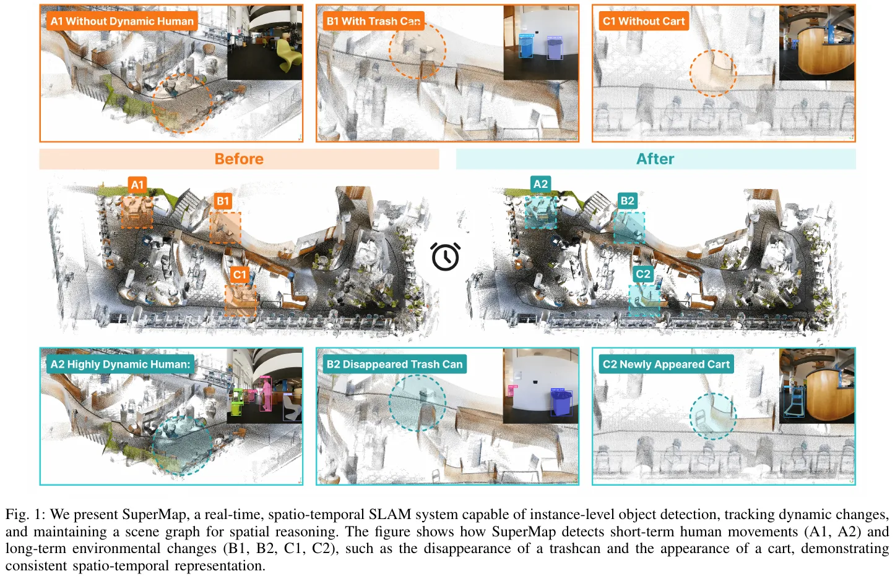
<figcaption>SuperMap 4D 时空 SLAM 概览：能够实时追踪短期人体运动与长期环境变动（如垃圾桶移除、推车进入），并维护一致的 4D 时空场景图</figcaption>

#### ① 整体框架概述
{: id="-整体框架概述-2"}

SuperMap 是一个完全运行在机器人板载计算平台上的 4D 时空 SLAM 系统，整体由**几何层（在线 3D 重建）**、**实例层（时空实例关联与概率更新）**以及**拓扑层（4D 场景图构建与 VLM 交互）**三大核心模块协同构成。几何层提供高频精准的度量位姿与致密几何；实例层利用 3D 先验进行运动补偿跟踪并动态剔除失效物体；拓扑层则将度量地图抽象为携带空间拓扑与生命周期轨迹的 4D 场景图，供大语言/多模态模型高效解析。

  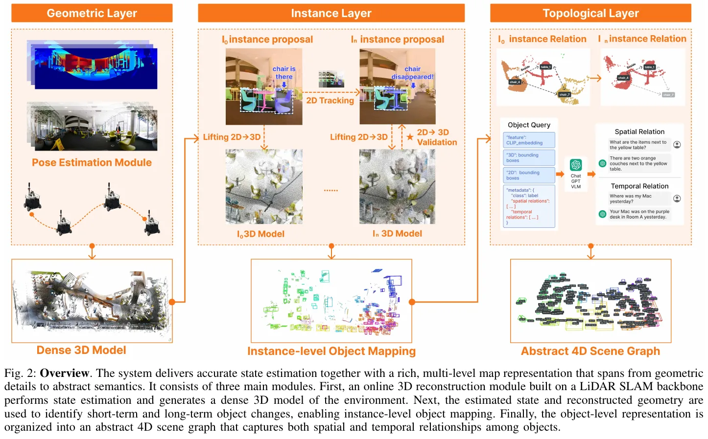
<figcaption>SuperMap 系统架构图：自底向上分为在线 3D 重建几何层、时空对象更新实例层以及面向 VLM 的 4D 场景图拓扑层</figcaption>

#### ② 逐模块讲解
{: id="-逐模块讲解-2"}

- **几何层（在线 3D 稠密重建）**：
  - **输入**：同步的 LiDAR 点云、RGB 图像与高频 IMU 数据流。
  - **处理**：采用 SuperOdometry 作为激光-视觉-惯性（LVI）里程计骨干网络，在世界坐标系 $W$ 下以 10 Hz 实时解算机器人的 6-DoF 位姿 $T_{WB}^{(t)}$ 与相机位姿 $P_t = T_{WC}^{(t)} = T_{WB}^{(t)} \cdot T_{BC}$，并输出着色的致密 3D 几何点云。
  - **输出**：高精度机器人轨迹 $P_{1:T}$ 与致密 3D 观测数据 $Q_t = \{C_t, D_t\}$。
  - **设计动机**：为后续 2D 语义到 3D 空间的物理反投影、时序运动补偿以及全局地图一致性提供物理锚定基础。

- **实例层（时空实例关联与动态一致性维护）**：
  - **输入**：当前帧 RGB 图像 $C_t$、深度观测 $D_t$ 以及历史全局地图 $M_{t-1}$ 中的 3D 物体实例集合。
  - **处理**：
    1. **2D 开放词表检测与分割**：利用 GroundingDINO 进行开词表边界框检测，SAM2 进行实例掩码提取。
    2. **3D 到 2D 运动补偿混合跟踪**：将历史地图中物体实例的 3D 质心 $X_i$ 通过当前相机位姿 $P_t$ 投影到像平面，获得预测像素质心 $\hat c_i(t) = \pi(K \cdot P_t^{-1} \cdot X_i)$，以此作为卡尔曼滤波的状态转移先验，取代传统的线性运动假设。
    3. **几何一致性三态判别与占据更新**：计算地图点 $X_k$ 的投影深度 $d_{proj} = \lVert T_{CW} X_k \rVert_z$ 与当前传感器实测深度 $D(u)$ 的残差 $\Delta d = d_{proj} - D(u)$，严格区分可见（Observable）、被遮挡（Unobservable）与已消失（Disappeared），并对消失点执行对数几率（log-odds）占据惩罚。
    4. **贝叶斯语义融合**：维护物体类别的多项式置信度分布，结合检测器混淆矩阵进行递归更新，自动滤除单帧偶发误分类。
  - **输出**：时空一致的全局 3D 实例级语义地图 $M_t = \{ O_t^j \} _{j=1}^{N_t}$。
  - **设计动机**：解决剧烈视角变化下的实例 ID 漂移，并在长时运行中自主识别并剔除已搬走/消失的物体残影。

- **拓扑层（4D 场景图构建与 VLM 接口）**：
  - **输入**：全局实例集合及其 3D 空间包围盒、质心与时序轨迹。
  - **处理**：构建图结构 $G = (V, E_S, E_T)$。节点 $V$ 代表物体实例；空间边 $E_S$ 根据空间几何谓词（如 $On$、$Beside$、$Under$）自动建立；时序边 $E_T$ 串联同一实例在不同时间步的演化轨迹。
  - **输出**：结构化的 4D 动态场景图，以及经过文本序列化（Serialization）的子图 Prompt。
  - **设计动机**：将海量稠密点云降维为富含语义与空间/时序关系的紧凑拓扑结构，降低多模态大模型的计算开销与幻觉。

#### ③ 端到端数据流
{: id="-端到端数据流"}

一个完整的环境观测帧从传感器输入到最终生成导航动作的流经路径如下：
LiDAR 与相机采集多模态数据 $\to$ 几何层实时解算位姿 $P_t$ 并生成局部点云 $\to$ 异步开放词表模块提取 2D 掩码 $\to$ 结合历史 3D 质心投影进行 3D-2D 跨模态关联，分配/更新唯一实例 ID $\to$ 深度残差几何校验分类点云状态，更新点占据率与语义分布 $\to$ 动态刷新 4D 场景图的空间谓词边与时序边 $\to$ 将相关局部子图序列化为结构化文本注入 VLM $\to$ VLM 解析指令并在 `<answer>` 标签中输出目标实例 ID $\to$ 解析器从场景图中检索对应的 3D 物理质心坐标作为航点（Waypoint），驱动底盘导航控制器。

#### ④ 核心公式与更新机制
{: id="-核心公式与更新机制"}

- **3D 到 2D 投影先验**：
  $$\hat c_i(t) = \pi\left(K \cdot P_t^{-1} \cdot X_i\right)$$
  其中 $X_i$ 为实例在地图中的 3D 质心，$K$ 为相机内参，$\pi(\cdot)$ 为透视投影函数。

- **几何一致性深度残差三态分类**：
  定义投影深度残差 $\Delta d = d_{proj} - D(u)$，其中 $d_{proj} = \lVert T_{CW} X_k \rVert_z$ 为地图点在相机系下的预期深度，$D(u)$ 为对应像素 $u = \pi(X_k)$ 处的传感器实测深度。状态判别准则为：
  $$s_k^{(t)} = \begin{cases} \text{Observable (可见)}, & \text{if } \lvert \Delta d \rvert \le \tau_\epsilon \\ \text{Unobservable (被遮挡/位于表面后方)}, & \text{if } \Delta d > \tau_\epsilon \\ \text{Disappeared (已消失/位于表面前方)}, & \text{if } \Delta d < -\tau_\epsilon \end{cases}$$

- **对数几率占据更新（Log-Odds Update）**：
  $$L(o_k \mid Q_{1:t}) = L(o_k \mid Q_{1:t-1}) + \text{logit}(P(o_k \mid Q_t))$$
  对于判定为 Disappeared 的点，给予负几率惩罚以快速从全局地图中修剪陈旧几何。

- **贝叶斯语义融合更新**：
  $$P(L_j = c \mid z_{1:t}) = \eta \cdot P(z_t \mid L_j = c) \cdot P(L_j = c \mid z_{1:t-1})$$
  其中 $P(z_t \mid L_j = c)$ 为开集检测器的经验混淆矩阵，$\eta$ 为归一化常数。

- **空间拓扑边几何谓词（以 $On$ 关系为例）**：
  $$\text{On}(A, B) \iff \left(z_A^{\min} \approx z_B^{\max}\right) \land \left(\text{IoU} _{xy}(B_A, B_B) > \gamma\right)$$

#### ⑤ 难点降维装置
{: id="-难点降维装置"}

##### 装置 A — 最小具体例子（深度残差判定与运动补偿）
{: id="装置-a--最小具体例子深度残差判定与运动补偿"}

> **举个例子**：假设地图中记录了一个垃圾桶的 3D 质心在世界坐标系下为 $(2.0, 0.0, 0.5)\text{m}$。
> 1. **运动补偿**：当机器人底盘剧烈右转 $30^\circ$ 时，纯 2D 线性卡尔曼滤波预测的像平面位置偏差超过 120 像素导致跟踪丢失；而 SuperMap 利用高频位姿 $P_t$ 直接将 3D 质心投影到当前帧，像素坐标误差瞬间收敛到 3 像素以内，精准锁定关联。
> 2. **深度残差三态判定**：设深度阈值 $\tau_\epsilon = 0.1\text{m}$，该垃圾桶原本预期的投影深度为 $d_{proj} = 2.0\text{m}$。
>    - **场景 1（被遮挡）**：有人走过挡住了垃圾桶，传感器测得前方人体深度 $D(u) = 1.2\text{m}$，残差 $\Delta d = 2.0 - 1.2 = +0.8\text{m} > 0.1\text{m}$，系统判定为 `Unobservable`（被遮挡），保留该垃圾桶记忆且不执行误删。
>    - **场景 2（被搬走）**：保洁人员将垃圾桶移走，传感器直接测得后方墙壁深度 $D(u) = 3.5\text{m}$，残差 $\Delta d = 2.0 - 3.5 = -1.5\text{m} < -0.1\text{m}$，系统判定为 `Disappeared`（已消失），触发 log-odds 负惩罚，几帧内将垃圾桶从当前活跃地图中剔除并记录时序生灭事件。

##### 装置 B — 自制 Mermaid 流程图（4D 动态场景图与 VLM 闭环控制）
{: id="装置-b--自制-mermaid-流程图4d-动态场景图与-vlm-闭环控制"}

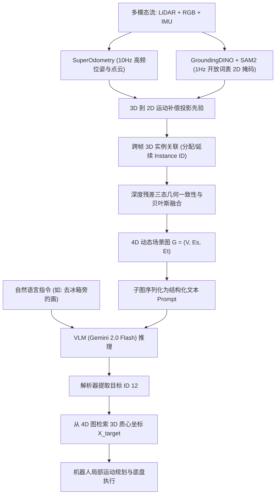

##### 装置 C — Before / After 核心机制对比表
{: id="装置-c--before--after-核心机制对比表"}

| 评估维度 | 传统 3D 场景图（如 ConceptGraphs / HOV-SG） | 传统语义 SLAM（如 Kimera / OVO-SLAM） | 本文方案 SuperMap |
|---|---|---|---|
| **建图模式** | 离线全局扫描后批处理（需数分钟至数小时） | 在线实时运行（10-30 Hz） | **完全板载在线实时运行（10 Hz 位姿 / 5 Hz 场景图）** |
| **词表灵活性** | 开放词表（SAM + CLIP 聚类） | 闭集预定义类别（固定 CNN） | **开放词表（GroundingDINO + SAM2 结合）** |
| **动态环境适配** | 假设静态环境，动态物体导致重影与鬼影 | 仅过滤短期运动人流，忽略长期环境变动 | **统一建模短期移动与长期物体搬移/生灭** |
| **实例维护机制** | 简单的空间重叠启发式，长程易碎片化 | 仅维护局部特征点或几何面元 | **3D 运动补偿 + 深度残差一致性 + 贝叶斯融合** |
| **下游推理接口** | 静态图结构查询，无法感知物体历史轨迹 | 仅提供度量占有栅格或闭集语义网格 | **4D 时空动态图 + VLM 结构化 Prompt 闭环控制** |

---

### 3. 核心结果/发现
{: id="3-核心结果发现-8"}

  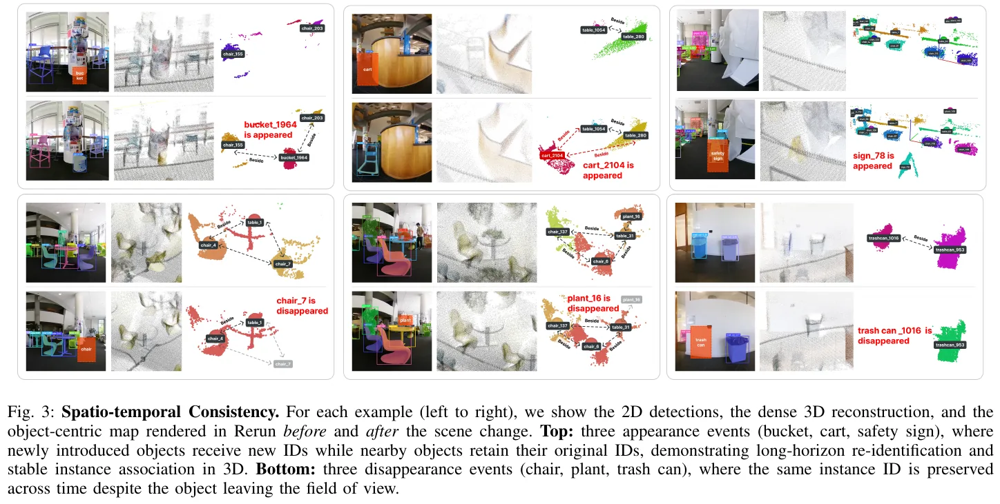
<figcaption>真实动态环境中的时空一致性定性评估：在物体新增（水桶、推车、安全警示牌）与消失（椅子、植物、垃圾桶）事件中，系统均保持了长期稳定的 3D 实例关联与 ID 一致性</figcaption>

1. **ScanNet 基准评测大幅领先**：
   - **类别级语义分割**：SuperMap 取得 **55.48%** 的准确率（Acc），大幅超越对象级基准 ConceptGraphs（31.05%）、ConceptFusion（34.10%）和 HOV-SG（35.17%）。
   - **实例级 3D 分割（mAP）**：在椅子（Chair）、窗户（Window）、冰箱（Refrigerator）和沙发（Sofa）等典型家具类别上，SuperMap 的 $\text{mAP} _{50}$ 分别达到 **63.76%**、**42.20%**、**62.50%** 和 **33.35%**，而依赖全局点云聚类的 HOV-SG 与 ConceptGraphs 得分接近于 0。

2. **长周期真实动态环境时空变化检测**：
   - 在长达 10 分钟、涵盖 $30\text{m} \times 20\text{m}$ 复杂室内场景的真实机器人实验中，SuperMap 在 6 类目标物体的出现与消失测试中均取得了出色的检测召回率与变化召回率（水桶与椅子达到 **1.000** 满分召回）。
   - 对比基线 DualMap 因 2D 分割不稳定导致 3D 边界框频繁被过滤，物体检测召回率接近 0；而 Khronos 则因推理瓶颈出现严重丢帧与语义退化。

  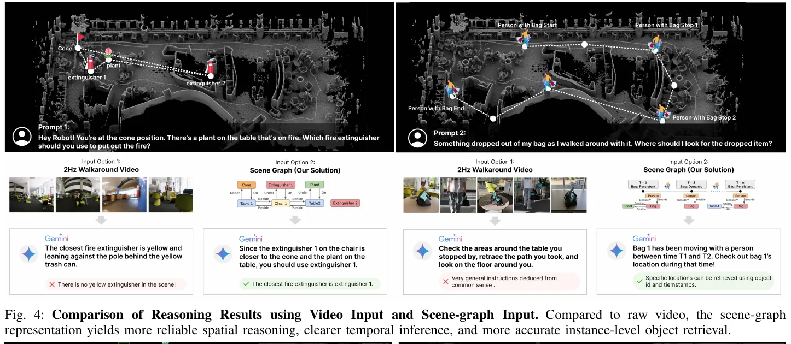
<figcaption>4D 场景图输入与原始视频输入在 VLM 空间/时序推理上的对比：场景图输入在空间拓扑消歧与历史轨迹回溯上均展现出更高的可靠性与抗幻觉能力</figcaption>

3. **VLM 空间逻辑与时序推理优势**：
   - 相比于直接将原始视频帧送入 VLM（Gemini 2.0 Flash），基于 SuperMap 序列化 4D 场景图输入的方案在**空间度量逻辑**（如根据植物与锥桶的相对位置精确定位灭火器）与**时序历史回溯**（沿时序边 $E_T$ 追溯背包移动轨迹并找回遗落物品）任务中显著降低了多模态大模型的空间透视畸变与长时序幻觉。

  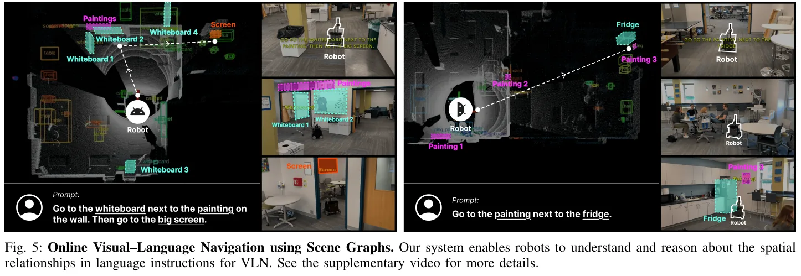
<figcaption>真机端到端在线视觉-语言导航实验：机器人根据场景图中的空间关系精准区分 4 块外观一致的白板，并准确完成多跳空间关系检索导航</figcaption>

4. **消融实验与系统吞吐量**：
   - 消融验证表明，缺少 2D 跟踪器时 $F_1$ 从 0.6308 降至 0.5780；缺少贝叶斯语义融合时 $F_1$ 骤降至 0.5201；缺少几何一致性更新时 $F_1$ 降至 0.5764，证实了三者协同对消除检测噪声的关键作用。
   - 运行速率方面，位姿估计稳定在 **10 Hz**，2D 开放词表感知运行在 **1 Hz**（异步处理），3D 地图更新为 **3 Hz**，4D 场景图维护维持在 **5 Hz**，实现完全板载流畅运行。

---

### 4. 局限性
{: id="4-局限性-8"}

SuperMap 在应对极高速度运动目标（如奔跑的行人或飞速抛掷物体）时的稠密轨迹追踪能力仍然受限；此外，当前的 2D 开放词表检测依然依赖于给定的 prompt 候选词表，未来需进一步集成自动化的开世界物体自主发现机制以实现全无先验部署。

---

## 6. GSMem (2026)
{: id="gsmem"}
———3D Gaussian Splatting 作为具身探索与推理的持久空间记忆

📄 **Paper**: [arXiv:2603.19137](https://arxiv.org/abs/2603.19137)

---

### 精华
{: id="精华-9"}

GSMem 的核心洞察是将 3D Gaussian Splatting（3DGS）作为一种具备"事后重新观察"能力（post-hoc re-observability）的持久空间记忆，使 agent 无需物理回访即可从任意最优视点重新渲染已探索区域，从根本上突破了离散检测失败导致记忆永久缺失的固有瓶颈。双层检索机制（对象级场景图 + 语义级 CLIP 语言场）互为补充：场景图提供结构化定位，语言场在检测缺失时兜底召回，两者共同驱动最优视点渲染为 VLM 提供高保真视觉证据。混合探索策略将 VLM 语义相关性与基于 Fisher 信息矩阵迹近似的 3DGS 几何信息增益动态结合，在任务导向探索与全局覆盖之间自适应切换，兼顾效率与鲁棒性。将连续辐射场引入具身导航记忆是一次重要范式转移，其"写入即可重渲染"的特性对长时导航任务尤为关键。

---

### 1. 研究背景/问题
{: id="1-研究背景问题-9"}

具身导航要求 agent 在未知环境中主动探索并持续积累空间知识。现有方法依赖两类表示：离散的 3D 场景图（如 ConceptGraphs）因依赖检测模块，目标漏检将导致不可恢复的记忆空洞；基于视图快照的方法（如 3D-Mem）则因视角固定、稀疏，无法从最优视角重新观察已探索区域，给 VLM 推理提供的视觉证据质量受限。上述方法均缺乏 post-hoc re-observability：agent 被锁定在初始探索时的固定观测中，无法如人类一样"从新角度回忆"过去场景。

---

### 2. 主要方法/创新点
{: id="2-主要方法创新点-9"}

**整体框架概览**

GSMem 在主动探索过程中实时维护三个并行结构：3DGS 几何与外观地图、每个 Gaussian 附带的 CLIP 语言嵌入场、对象级场景图。查询到来时，多层检索-渲染机制定位相关区域并渲染最优视点图像，VLM 据此推理；当没有 frontier 提供足够语义线索时，切换至基于信息增益的几何探索。

  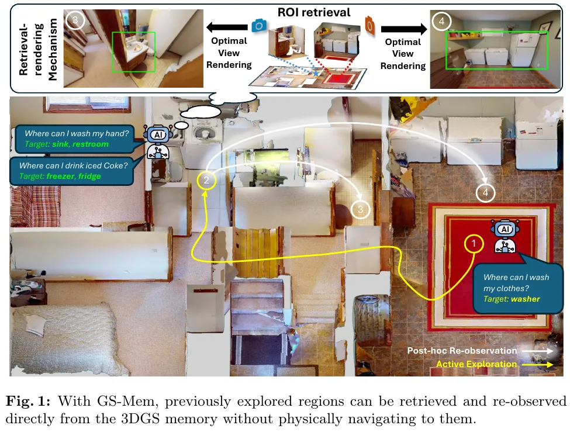
<figcaption>GSMem 系统概览：agent 在真实探索路径（黄线）之外，可通过 3DGS 记忆直接"事后重新观察"任意已探索区域（紫线），无需物理导航回访</figcaption>

**3DGS 建图与在线语言场**

每个 3D Gaussian $$g_i$$ 额外携带 32 维语言嵌入（由 768 维 CLIP 特征经自编码器压缩得到）。为避免高维语言特征的优化开销，提出"权重一致逆聚合"：forward 渲染中 2D 像素特征由 3D Gaussian alpha-blending 生成，逆向时以完全相同的混合权重将 2D CLIP 特征反向分配给各 Gaussian，实现零优化开销的在线语义更新：

$$\mathbf{f}_i^t = \frac{W_i^{t-1}\mathbf{f}_i^{t-1} + \sum_{k \in \mathcal{T}_t} \sum_p w_{i,p,k}^t \mathbf{f}_{p,k}^{2D}}{W_i^t}$$

同时维护对象级场景图（含 3D 位置、语义标签、最高置信度检测视角）、TSDF 地图和 frontier 地图。

**多层检索-渲染机制**

  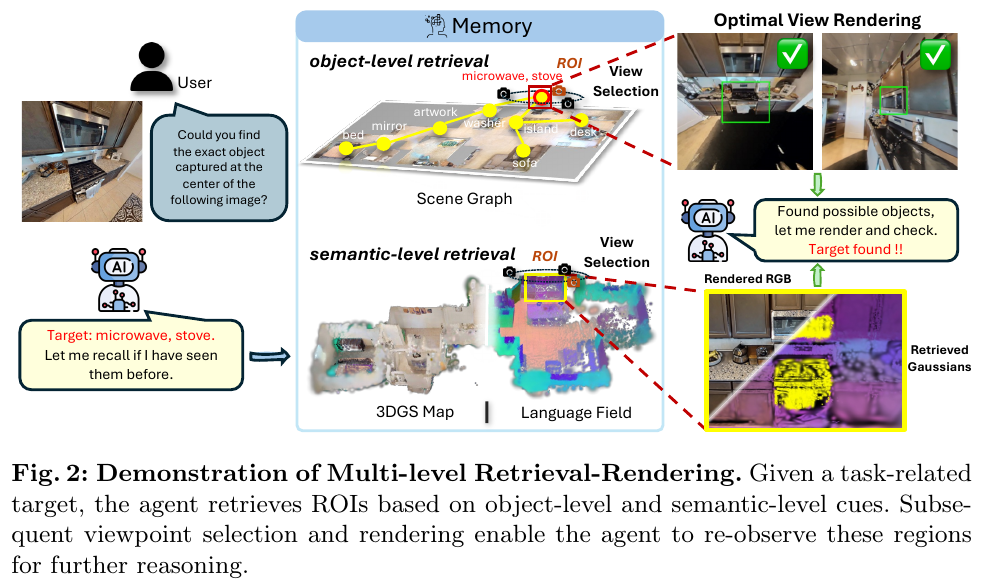
<figcaption>多层检索-渲染机制：对象级检索（场景图）与语义级检索（3DGS 语言场）并行定位 ROI，随后通过最优视点选择与 3DGS 渲染为 VLM 提供高保真视觉证据</figcaption>

给定任务查询，同时触发两条互补检索路径：
- **对象级检索**：VLM 对场景图全部对象按语义相关性排序，选 top-$K_\text{obj}$ 候选作为 ROI
- **语义级检索**：将查询编码为 CLIP 嵌入，在语言场中以余弦相似度 $> \tau_\text{clip}$ 召回相关 Gaussian，经 KD-Tree 聚类后保留 top-$K_\text{cluster}$ 个空间连贯群组作为 ROI

对每个 ROI，在水平圆形轨迹上均匀采样 108 个候选视点（36 方位角 × 3 仰角），经两阶段打分筛选：Phase 1 以能见度分 $S_\text{vis}$（TSDF 光线投射）+ 投影面积分 $S_A$（高斯惩罚鼓励适当观察距离）选出 top-10；Phase 2 进一步以 3DGS 不透明度分 $S_\text{opa}$ 评估实际渲染质量，综合分 $S_\text{final} = S_\text{vis} + S_A + S_\text{opa}$ 选出最优视点。最终通过单步扩散模型提升渲染图像质量后送入 VLM 推理。

**混合探索策略**

  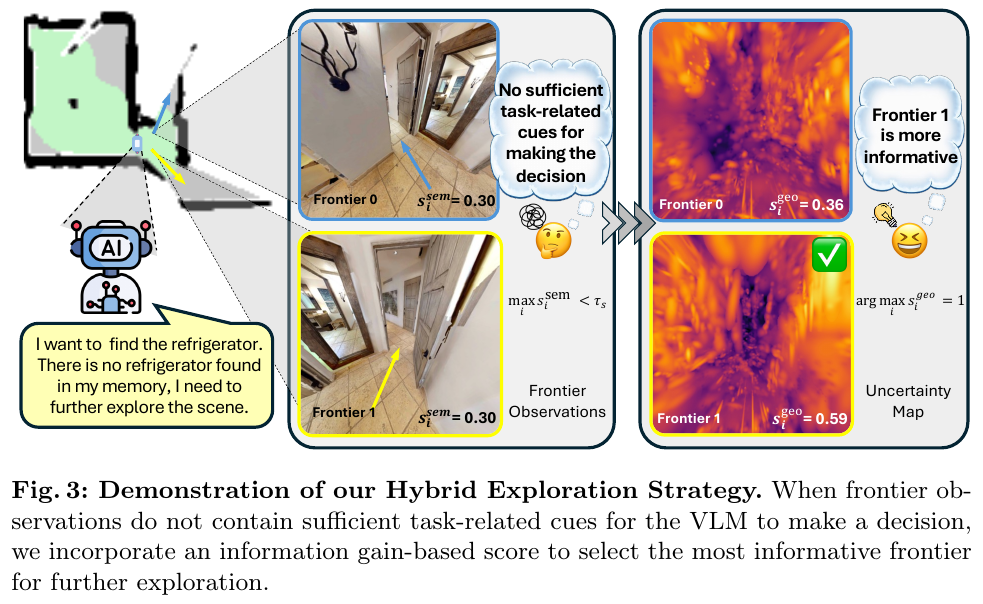
<figcaption>混合探索策略：当任一 frontier 的语义相关性超过阈值时优先导向任务目标；否则切换至基于 3DGS 信息增益（不确定性热力图）的几何覆盖探索</figcaption>

对每个候选 frontier 计算两类分数：
- **语义相关分** $s_i^\text{sem} \in [0,1]$：VLM 评估 frontier 观测图像与任务查询的相关程度
- **几何覆盖分** $s_i^\text{geo}$：基于 Fisher 信息矩阵（FIM）的信息增益，以 T-optimality 代理近似为 FIM 增量的迹 $$s_i^\text{geo} \approx \text{Tr}(\mathbf{I}_i)$$，可直接由渲染 Jacobian 计算，无需真值监督

探索决策规则：

$$i^* = \begin{cases} \arg\max_i \, s_i^\text{sem}, & \text{if } \max_i s_i^\text{sem} > \tau_s \\ \arg\max_i \, s_i^\text{geo}, & \text{otherwise} \end{cases}$$

---

### 3. 核心结果/发现
{: id="3-核心结果发现-9"}

**Active Embodied QA (A-EQA) on OpenEQA**（63 个 HM3D 场景，184 问题，GPT-4o 作为 VLM）：

| 方法 | LLM-Match ↑ | LLM-Match SPL ↑ |
|------|------------|----------------|
| Explore-EQA | 46.9 | 23.4 |
| ConceptGraphs w/ Frontier | 47.2 | 33.3 |
| 3D-Mem | 52.6 | 42.0 |
| **GSMem (Ours)** | **55.4** | **43.8** |

**GOAT-Bench 多模态长时导航**（36 场景 val-unseen，2600+ subtasks）：

| 方法 | SR ↑ | SPL ↑ |
|------|------|-------|
| TANGO | 32.1 | 16.5 |
| MTU3D | 47.2 | 27.7 |
| 3D-Mem | 62.9 | 44.7 |
| **GSMem (Ours)** | **67.2** | **46.9** |

GSMem 在长时导航任务中的优势比 A-EQA 更显著（SR +4.3 vs LLM-Match +2.8），验证了持久记忆对长时累积任务的特殊价值。消融研究显示：去除 CLIP 语言场 −4.5 SR、去除最优视点选择 −2.7 SR、去除混合探索时 SPL 下降 −4.1，表明几何覆盖策略对探索效率贡献显著。

  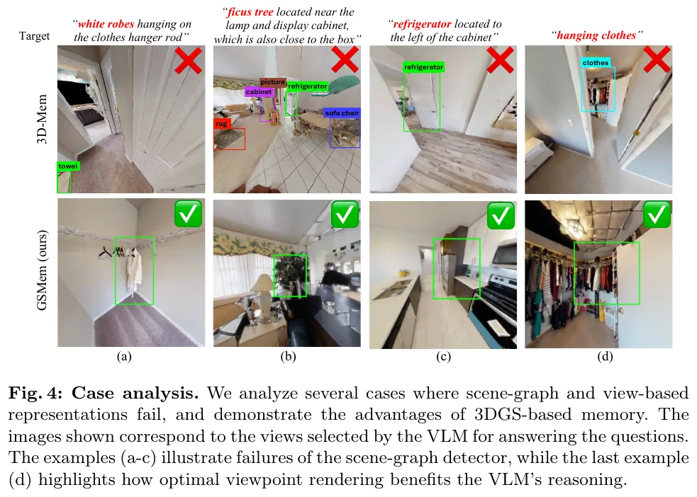
<figcaption>案例对比（3D-Mem vs GSMem）：(a-c) 3D-Mem 因检测漏报（白色长袍、无花果树）或语义误检（白色门被识别为冰箱）导致错误，GSMem 通过语义场检索正确定位；(d) 视角受限时，GSMem 通过最优视点重渲染成功识别悬挂衣物</figcaption>

---

### 4. 局限性
{: id="4-局限性-9"}

当前系统依赖 RGB-D 输入，深度噪声或高遮挡场景将影响 3DGS 建图质量，进而降低检索与渲染精度；单步扩散增强引入额外推理延迟，实时部署（当前约 1.2 s/step）仍有优化空间。

---

## 7. CGFM-Nav (2026)
{: id="cgfm-nav"}
——— 耦合显式关系图记忆与隐式连续语义场的终身多模态具身导航

📄 **Paper**: [arXiv:2608.29114](https://arxiv.org/abs/2608.29114)

### 精华
{: id="精华-11"}
1. **图-场双重认知表征**：提出认知图场记忆（Cognitive Graph-Field Memory, CGFM），将离散的物体语义拓扑图与连续的 2D 语义-边界扩散场在同一体系中耦合，分别对应人类导航中的"精准回溯记忆"与"模糊空间直觉"。
2. **直觉引导的高效探索**：当图中未检索到目标时，无需盲目漫游，而是将图中的语义证据反向投影为空间扩散场，优先引导机器人探索语义相关度最高的未知边界（Frontier），大幅缩减终身导航搜索开销。
3. **闭环抑制与图更新**：通过多视角验证机制（YES / NO-UNCERTAIN / NO-CONFIRMED）动态更新节点状态；被排除的误检候选在当前子任务中物理掩码其语义场贡献，从底层消除了大模型的重复重试与死锁。
4. **轻量开源模型超越云端 GPT-4o**：在 GOAT-Bench 终身多模态导航基准上，采用开源本地可部署的 Qwen3-VL-8B，整体成功率达到 63.0%，超越了搭载云端 GPT-4o 的基线 MSGNav（60.0%），证明结构化图场记忆能有效弥补基础模型的能力差距。

---

### 1. 研究背景/问题
{: id="1-研究背景问题-11"}
在面向家庭与复杂环境的终身开放词表具身导航（Lifelong Open-Vocabulary Embodied Navigation）中，机器人需要在未建模场景中连续执行多个跨模态目标（类别、自然语言描述或参考图像）的导航子任务，并跨子任务保留历史地图记忆。
现有基于大语言模型/多模态大模型（LLM/VLM）的导航方法主要存在两项核心瓶颈：
1. **显式记忆与无目标探索的脱节**：离散物体场景图擅长对已知物体进行精准检索与拓扑回溯，但一旦目标不存在于当前记忆中，智能体便退化为几何前沿点（Frontier）的随机探索，缺乏空间语义直觉引导。
2. **多模态目标下的重试幻觉与上下文开销**：随着时间推移，不断扩大的场景图导致 VLM 上下文窗口严重膨胀；且当目标发生混淆时，缺乏对失败尝试的显式抑制机制，导致智能体反复前往同一错误物体。

---

### 2. 主要方法/创新点
{: id="2-主要方法创新点-11"}

  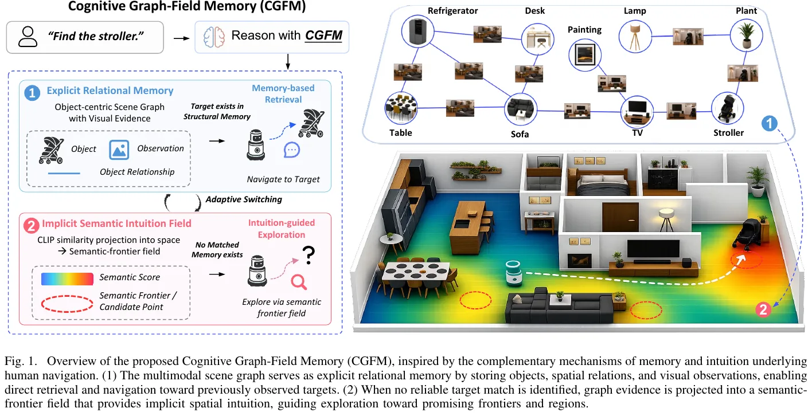
<figcaption>图 1：CGFM 认知图场记忆机制概览。离散物体场景图作为显式关系记忆支持精准召回；连续语义-边界场作为隐式直觉偏置指引高效探索。</figcaption>

#### ① 整体框架概述
{: id="-整体框架概述-3"}
CGFM-Nav 整体采用免微调（Training-Free）架构，主要由**感知与图构建（Perception & Graph）**、**语义-边界场构建（Semantic-Frontier Field）**、**自适应子图筛选（Subgraph Selection）**、**带决策记忆的 VLM 推理（VLM Reasoning）**以及**动作执行与多视角闭环验证（Action & Verification）**五个模块协作构成。系统在已知目标与未知探索之间形成无缝切换与持续更新的闭环。

  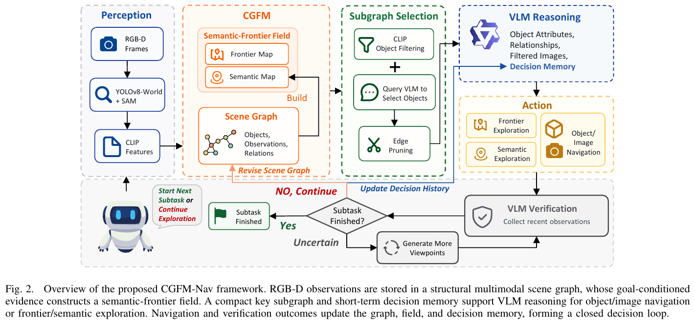
<figcaption>图 2：CGFM-Nav 系统架构图。RGB-D 输入构建多模态场景图并投影生成语义场；VLM 基于筛选子图与决策日志下发动作，验证结果驱动闭环记忆更新。</figcaption>

#### ② 逐模块讲解
{: id="-逐模块讲解-3"}

**1. 感知与多模态场景图构建（Perception & Graph Memory）**
- **输入**：机器人搭载的连续 RGB-D 传感器帧。
- **处理**：利用 YOLOv8-World 和 SAM 进行开放词表目标检测与精确像素分割；使用 CLIP 提取各个目标的外观特征。以增量方式构建持久多模态场景图 $$\mathcal{G}_t = (\mathcal{V}_t, \mathcal{E}_t)$$。
- **输出**：节点 $$v_i = (c_i, p_i, z_i, \mathcal{I}_i)$$，分别存储物体类别 $c_i$、3D 空间坐标 $p_i$、视觉语义特征 $z_i$ 以及历史多视角观测图像集合 $$\mathcal{I}_i$$；边 $$\mathcal{E}_t$$ 记录物体间的空间拓扑与关系。
- **设计动机**：特别对每个节点追加了目标验证统计（验证次数、所属子任务、判别结果与多视角反馈日志）。

**2. 连续语义-边界场构建（Semantic-Frontier Field Construction）**
- **输入**：当前多模态场景图 $$\mathcal{G}_t$$、任务目标描述 $q$ 以及 2D 占用栅格地图。
- **处理**：
  1. 计算图节点与目标 $q$ 的 CLIP 相似度，减去背景基线得到净相关度分数 $s_i(q)$。
  2. 对已被当前子任务确认排除的节点进行验证掩码（置为 0），不向场中扩散能量。
  3. 将各有效物体视为空间点源，其语义影响沿无障碍自由空间的测地线距离（Geodesic Distance）呈指数衰减：$w_i(x) = \exp(-d(x, p_i)/\tau)$。
  4. 对每个栅格单元 $x$，聚合局部贡献最大的 $K_s$ 个物体，生成连续语义场：
     $$S_t(x \mid q) = \sum_{i \in \mathrm{Top}K_s(x)} s_i(q) w_i(x)$$
  5. 提取自由空间与未知区域交界处的几何前沿点集合 $$\mathcal{C}_t = \{f_1, \dots, f_M\}$$，计算每个前沿点的探索得分 $U_t(f \mid q)$：在小邻域内平均语义场强度，并除以机器人到该前沿点的测地导航代价。
- **输出**：赋有语义探索优先级的连续热力图与前沿点评分排序。

> **举个例子（卡点降维装置 A：语义场与前沿点计算）**：
> 假设任务是"找到婴儿车（stroller）"，机器人在客厅构建了包含 3 个物体的场景图：
> - 物体 A（折叠椅）：此前导航过去验证失败，记录为 `NO-CONFIRMED`，验证掩码直接将其净得分置为 $s_A(q) = 0$，不再扩散任何语义能量；
> - 物体 B（餐桌）：与婴儿车相关度低，减去背景基线后 $s_B(q) = 0$；
> - 物体 C（婴儿奶瓶）：与婴儿车语义强关联，计算得 $s_C(q) = 0.8$。
>
> 现在未探索区域有两个前沿候选点：
> - 前沿点 1（靠近物体 C，离物体 1 米，衰减权重 $w=0.7$；离机器人 2 米）：局部语义场为 $0.8 \times 0.7 = 0.56$；结合距离代价后探索得分高达 $0.56 / 2 = 0.28$；
> - 前沿点 2（靠近厨房，离物体 C 远，衰减后 $w \approx 0$；离机器人仅 1 米）：局部语义场为 0，探索得分几乎为 0。
>
> 即使机器人从没见过婴儿车，也能在连续语义场的牵引下，精准偏向物体 C 周围的未知走廊，而非盲目探索厨房。

**3. 语义引导子图筛选（Semantic-Guided Subgraph Selection）**
- **输入**：全量场景图 $$\mathcal{G}_t$$ 与目标 $q$。
- **处理**：直接复用场计算中的 CLIP 相关度，挑选正相关节点及其一阶邻居构成语义种子集 $$\mathcal{V}_{seed}$$；其余节点压缩为残差图 $$\hat{\mathcal{G}}_{res}$$，交由 VLM 进行基于常识的补充挑选。经剪枝后形成紧凑的关键子图 $$\tilde{\mathcal{G}}_t$$。
- **输出**：向大模型输入的轻量化结构化提示信息。

**4. 带决策记忆的 VLM 推理（VLM Reasoning with Decision Memory）**
- **输入**：目标 $q$、关键子图 $$\tilde{\mathcal{G}}_t$$ 以及决策记忆 $$\mathcal{D}_t$$（按时间记录的已尝试候选点、目的地类型与简短推理摘要）。
- **处理**：VLM 做出三类决策之一：选定物体节点 $v_i$、选定历史图像 $I_{i,j}$、或下达探索指令 `EXPLORE`。
- **输出**：离散高层决策指令 $d_t$。

**5. 动作分流与闭环多视角验证（Action & Verification）**
- **输入**：决策指令 $d_t$ 与语义边界场。
- **处理与流向**：
  - 若为已知物体/图像：直接下发坐标，导航到达后调用 VLM 进行多视角观测验证（返回 `YES`、`NO-UNCERTAIN` 或 `NO-CONFIRMED`）；
  - 若为 `EXPLORE`：若存在前沿点则选择得分最高者；若无前沿点但存在未完全探索的语义峰值，则导航至语义地图最高响应中心；若均无则报告失败。
  - 验证成功的物体进入下一子任务；确认失败的物体记录节点掩码并阻断其场扩散；不确定的物体生成额外视角重新辨识。

#### ③ 读者视角：闭环状态与决策流转图（卡点降维装置 B）
{: id="-读者视角闭环状态与决策流转图卡点降维装置-b"}

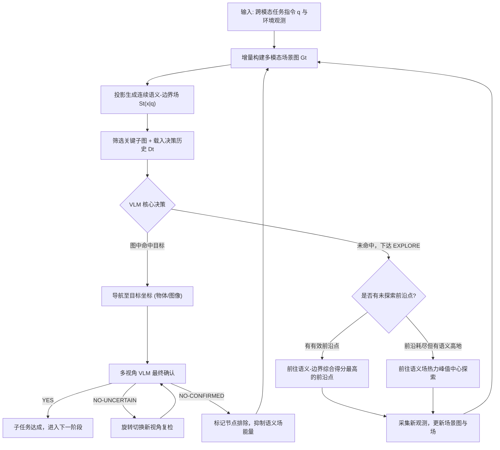

#### ④ 核心差异：与经典基线 MSGNav 的机制对比（卡点降维装置 C）
{: id="-核心差异与经典基线-msgnav-的机制对比卡点降维装置-c"}

| 机制维度 | 经典基线 MSGNav | 本文 CGFM-Nav |
|---|---|---|
| **探索指引方式** | 纯几何边界探索或无向随机漫游 | 场景图证据反向投影为连续语义场，赋能前沿点语义偏置 |
| **子图提示筛选** | 规则全量检索或纯文本 LLM 过滤 | 复用场相关度的语义种子集 + 残差图 VLM 常识补充 |
| **错误重试抑制** | 依赖短期文本上下文中塞入的历史日志 | 节点级物理验证掩码，彻底切断错误物体在场中的引力 |
| **部署模型门槛** | 严重依赖昂贵且高延迟的云端 GPT-4o | 本地开源轻量 Qwen3-VL-8B 即可超越云端大模型性能 |

#### ⑤ 训练与推理设定
{: id="-训练与推理设定"}
- **无需训练（Training-Free）**：全框架为纯零样本推理架构，感知模块采用预训练的 YOLOv8-World + SAM + CLIP，决策推理与多视角验证采用开源轻量级的 Qwen3-VL-8B-Instruct。
- **终身记忆保留**：在同一个场景的多个子任务之间，场景图及其验证掩码完全保留；跨子任务仅重置短期决策日志并按新目标重构语义场。

---

### 3. 核心结果/发现
{: id="3-核心结果发现-11"}
在极具挑战性的终身跨模态导航基准 **GOAT-Bench**（包含 36 个未见场景、278 个多模态子任务，涵盖类别、语言描述及参考图像目标）上的评测结果表明：

1. **同基座显著提升**：在均使用开源 **Qwen3-VL-8B** 的公平对比下，CGFM-Nav 相比 MSGNav：
   - 整体成功率（SR）从 **53.2% 提升至 63.0%**（+9.8%）；
   - 路径长度加权成功率（SPL）从 **30.0% 提升至 39.6%**（+9.6%）；
   - 尤其在类别目标（SR: 63.6% → **72.7%**）和语言目标（SR: 48.4% → **61.5%**）上取得大幅跃升。
2. **轻量端侧逆袭云端旗舰**：搭载本地 8B 参数多模态模型的 CGFM-Nav，在整体 SR（**63.0%** vs 60.0%）、类别 SR（**72.7%** vs 63.6%）以及语言 SR（**61.5%** vs 57.2%）上全面超越了基于云端闭源旗舰 **GPT-4o** 的 MSGNav，验证了优质环境认知表征对大模型底座差距的弥补效应。
3. **图像目标依赖细粒度匹配**：在图像目标子任务中，由于缺少类别层面的泛化常识，更多依赖底层像素特征的点对点匹配，虽然 CGFM-Nav 比同基座基线提升明显（SR: 46.6% → 53.4%），但相比 GPT-4o 仍有微弱差距，表明图像目标对 VLM 自身的细粒度跨视角特征提取能力提出了更高要求。

---

### 4. 局限性
{: id="4-局限性-11"}
1. 当前验证仍局限于 GOAT-Bench 仿真环境，尚未在真实物理轮式机器人上完全验证传感器噪声、动态行人遮挡及里程计漂移等非理想因素下的长期鲁棒性。
2. 图像目标的表征与搜索仍受限于全局 CLIP 特征的粒度，缺少专门面向物体实例外观精细对齐的局部特征检索机制。

---

## 8. NavMCP (2026)
{: id="navmcp"}
———首个将导航基础模型（NFM）脚手架化封装为智能体执行器的长程具身导航框架

📄 **Paper**: [arXiv:2608.30396](https://arxiv.org/abs/2608.30396)

### 精华
{: id="精华-14"}
1. **核心洞察**：长程物理世界交互面临“高层宏观推理”与“底层微观闭环”难以兼备的两难困境，现有视觉语言模型（VLM）长程动作漂移严重，而导航基础模型（NFM）虽具备优秀的局部具身执行能力，却受限于单次回合、缺乏跨轮次持久任务状态。
2. **范式突破**：NavMCP 打破了将导航模型简单视作黑盒单步工具（Episodic Tool Interface）的传统做法，提出首个将 NFM 作为长程具身智能体物理执行层的脚手架（Scaffolding）协议体系，在不微调任何底层模型的前提下实现长程闭环探索。
3. **架构机制**：构建“意图（Intent）- 观测（Observation）- 记忆（Memory）”三通道协议，分别解决指令与意图脱节、沿途关键观测丢失、跨调用记忆断层三大鸿沟，把一次性航点规划转变为可累积、可追溯的具身认知过程。
4. **决策哲学**：引入基于证据链的非对称仲裁机制，不仅记录“看到了什么”，更显式沉淀“排除了哪些区域”的否定证据（Negative Evidence），让智能体具备有目的的非单调假设检验探索能力。
5. **迁移启示**：在三大具身问答基准（HM-EQA、MT-HM3D、EXPRESS-Bench）上全面刷新最强成绩，并在宇树 Unitree Go2 四足机器人上实现超 50 米超长程真实环境探索，证明将领域基础模型与通用大模型分层脚手架化是通向物理智能体的重要路径。

---

### 1. 研究背景/问题
{: id="1-研究背景问题-14"}
具身问答（Embodied Question Answering, EQA）与真实物理环境搜索要求智能体在大型未知场景中长程探索以收集视觉证据。现有方法陷入了两难架构分歧：若让通用大模型（VLM）直接预测底层动作或局部航点，在长时程、大跨度场景中会频繁发生轨迹漂移、死锁与执行脆弱；若引入专用导航基础模型（Navigation Foundation Model, NFM，如 Qwen-RobotNav、Uni-NaVid 等），传统智能体仅将其封装为常规的单次回合工具（Episodic Tool Call）——向导航模型发送单句指令，底层跑完后仅返回终点状态与最终单张视野。

这种传统的单回合接口在长程证据收集场景中存在严重的**回合间隙（Episodic Interface Gap）**：
1. **指令与意图不匹配（Mismatch between instruction and intent）**：高层 VLM 关注“要验证什么信息/找什么线索”，而底层导航模型需要具体的路径指令，单句路线命令无法传达搜索预算与语义边界；
2. **中间观测丢失（Intermediate observation loss）**：目标物体可能在机器人经过走廊或门缝的途中一闪而过，仅返回终止视角会丢弃整条轨迹中的海量高价值感知线索；
3. **缺乏跨调用累积（Lack of cross-call accumulation）**：单次调用结束后底层执行记忆清空，高层若缺乏结构化记忆账本，无法记录“哪些房间已完全排查”，导致重复搜索或盲目兜圈。在 HM-EQA 基准上，退化为传统单回合接口直接带来 14.9% 的剧烈性能断崖。

---

### 2. 主要方法/创新点
{: id="2-主要方法创新点-14"}

  
<figcaption>NavMCP 系统整体架构：高层 VLM 智能体通过意图通道向导航基础模型（NFM）派发子目标，NFM 在非特权自车视角下自主完成闭环运动，沿途轨迹数据经由观测通道转化为带来源引用的旅程证据，并在记忆通道中维护动态更新的 EQA 上下文状态。</figcaption>

#### ① 整体框架概述
{: id="-整体框架概述-6"}
NavMCP（Navigation Model Context Protocol）采用双层分工架构：**高层 VLM 智能体充当“推理大脑”**，负责任务目标分解、证据需求推断、搜索区域规划与何时终止并回答；**底层 NFM（以 Qwen-RobotNav 为代表）充当“物理执行肢体”**，负责在非特权第一人称 RGB 视角与自建局部拓扑图下完成避障与鲁棒的闭环航点跟踪。二者通过解耦且紧密协同的三通道协议门控交互，既拓展了 VLM 的物理动作视野，又拓展了 NFM 的长程推理视野。

#### 难点降维：传统工具调用 vs NavMCP 三通道协议
{: id="难点降维传统工具调用-vs-navmcp-三通道协议"}

| 维度 | 传统工具调用（Episodic Interface） | NavMCP 脚手架协议（本文方案） |
|---|---|---|
| **意图表达 (Intent)** | 单句控制指令（如 "向左转走向主卧"），缺乏预算约束与搜索模式区分 | 结构化语义调用 `(mode, goal, budget, constraints)`，区分物体搜索与指令导航双模式 |
| **观测反馈 (Observation)** | 仅返回最终终点终止状态与末帧图像，沿途关键视觉信息全部丢失 | 沿轨迹等步长采样关键帧序列，由轨迹摘要器生成带关键帧来源引用的旅程简报（Journey Artifact） |
| **跨轮记忆 (Memory)** | 依赖原始交互对话上下文，面对长序列很快超出窗口且极易遗忘否定线索 | 显式维护三元状态 $C_t = (H_t, E_t, U_t)$，结构化沉淀正负证据账本，安全压缩原始工具轨迹 |
| **决策准则 (Arbitration)** | 仅凭单次视线是否看到目标直接草率回答 | 基于 `analyze_status` 的三阶段非对称仲裁：证实需直接图像支持，证伪需区域全覆盖证据 |

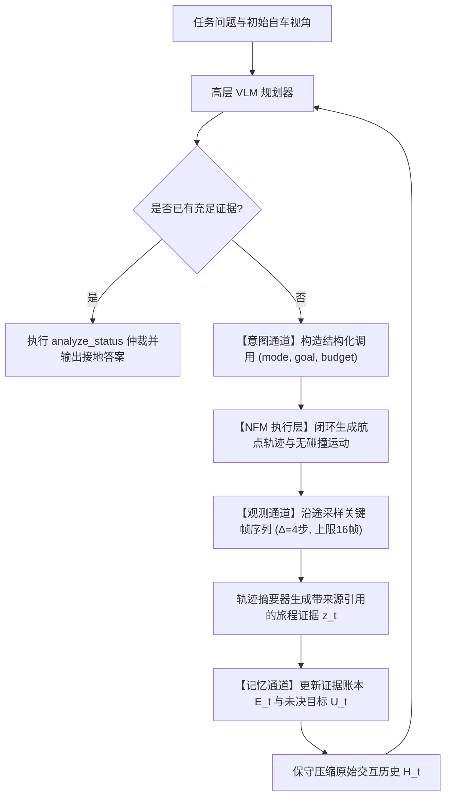

#### ② 逐模块讲解：NavMCP 三通道核心机制
{: id="-逐模块讲解navmcp-三通道核心机制"}

##### 1. 意图通道（Intent Channel）：从证据需求到结构化导航调用
{: id="1-意图通道intent-channel从证据需求到结构化导航调用"}
高层智能体在推断出缺失的信息后，无需编写底层的电机指令或细微航点，而是通过协议门控发出结构化语义导航调用：
$$\text{Call} _t = (\text{mode}, \text{sub\_goal}, \text{budget}, \text{constraints})$$
- **双模式解耦**：
  - `navigate_to_object`（物体目标导航模式）：输入具体的物体类别名称或指代对象，底层 NFM 自主进行语义驱动的局部探索与逼近；
  - `navigate_by_instruction`（视觉语言导航模式）：输入包含区域、路径或拓扑地标的高级自然语言指令（如“穿过走廊进入尽头的卧室”）。
- **预算与边界约束**：通过 `budget` 控制底层最大步数，避免底层模型陷入局部死循环；通过 `constraints` 提供语义避障建议。底层执行器仅依赖本体自车 RGB 观测、位姿估计与探索过程中实时构建的拓扑占据图，无需预知场景真值或特权几何信息。

  
<figcaption>NavMCP 三通道脚手架内部流转逻辑：意图通道负责任务语义对齐，观测通道负责将时空轨迹映射为带置信度与图源标签的结构化感知证据，记忆通道负责支撑跨多轮交互的持久化证据账本更新。</figcaption>

##### 2. 观测通道（Observation Channel）：从动态轨迹到来源锚定证据
{: id="2-观测通道observation-channel从动态轨迹到来源锚定证据"}
底层执行器完成一次单模态导航后，输出原始轨迹记录 $r_t = (s_t, b_t, \ell_t, p_t, K_t)$，其中 $s_t$ 为完成标志，$b_t$ 为停止原因，$\ell_t$ 为行走总路径长度，$p_t$ 为最终位姿，$K_t = \{I_{t,1}, \dots, I_{t,n}\}$ 为沿途关键帧集合。
- **关键帧等距采样**：为兼顾视觉覆盖率与上下文成本，系统每隔 $\Delta = 4$ 步采样一张自车视野帧，单次调用上限截断为 $M = 16$ 帧。
- **VLM 轨迹摘要器（Trajectory Summarizer）**：将这批关键帧输入轻量多模态描述器，提取结构化旅程证据：
  $$z_t = (q_t, R_t, O_t, P_t, D_t)$$
  其中 $q_t$ 记录子目标达成状态；$R_t$ 总结途经房间与区域过渡；$O_t$ 提取显著观测物体；$P_t$ 记录规划拓扑线索（如发现未探索的楼梯口、虚掩的房门）；$D_t$ 记录不确定性与执行异常。
- **来源锚定元组（Source Grounding）**：$O_t$ 与 $R_t$ 中的每一个物体或区域提及，都强制绑定一个五元组标签 $(n, i, v, h, c)$（名称、所属关键帧索引、视角方位、相对空间提示、置信度）。严禁摘要器无依据脑补未观察到的状态。

##### 3. 记忆通道（Memory Channel）：跨调用证据账本与保守上下文压缩
{: id="3-记忆通道memory-channel跨调用证据账本与保守上下文压缩"}
为解决多轮调用引起的上下文爆炸，NavMCP 维持显式三元 EQA 上下文状态：
$$C_t = (H_t, E_t, U_t)$$
- **证据账本 $E_t$**：记录带有来源索引的正面证据（Positive Evidence，如“在主卧床头柜发现点亮的台灯，来源帧 keyframe_3”）、否定证据（Negative Evidence，如“书房全景视野排查完毕，未发现打印机”）。账本由 `write_notebook` 维护，采用 FIFO 队列上限保留 100 条去重记录，在每轮推理时直接注入 Prompt 头部。
- **未决目标池 $U_t$**：维护尚未证实或存在模糊推断的待查目标，指导下一次意图通道的派发。
- **保守上下文压缩策略**：仅当关键感知信息已被提炼外化至 $E_t$ 与 $U_t$ 并打上关键帧引用后，系统才允许将上一轮冗长的原始工具执行日志与中间视觉图替换为极简占位符。这保证了长时程交互中即使发生上下文截断，核心决策链条也完全不受破坏。

#### 难点降维：Journey Analysis 沿途捕获与非对称仲裁具体实例
{: id="难点降维journey-analysis-沿途捕获与非对称仲裁具体实例"}

> **举个具体例子**：
> 机器人在回答“床头柜上的台灯是否开着？”这一问题时，意图通道发出 `navigate_by_instruction("穿过走廊进入主卧")`，底层连续移动了 16 步。
> 1. **传统工具调用**：底层走完停在主卧衣柜前，仅返回最后一帧衣柜图像。智能体完全错过床头柜，判断“未找到台灯”，不得不盲目再次寻找。
> 2. **NavMCP 观测通道**：按 $\Delta=4$ 采样 4 张关键帧。在第 2 张关键帧（机器人正路过主卧半开的房门）中，画面右侧门缝内隐约捕捉到床头柜与灯罩。VLM 轨迹摘要器提炼出证据元组：`("台灯", frame_2, "右侧门缝", "主卧床旁", "uncertain")`，直接写入未决目标 $U_t$。
> 3. **非对称仲裁机制**：下一轮规划器调用 `analyze_status`，激活专门的局部验证。此时系统遵守**非对称证据法则**：
>    - **证实（Positive）**：必须依赖无歧义的高清直接视觉证据（调用 `zoom_in_object` 放大查看该台灯发光状态）；
>    - **证伪（Negative）**：若要得出“房间里没有台灯”的否定结论，必须提供全景 360 度扫描且覆盖该房间所有死角的证据链。严禁将“仅仅没看到”武断视为“物体不存在”。

  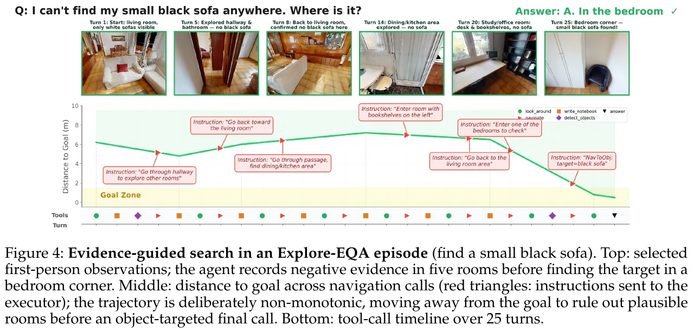
<figcaption>Explore-EQA 任务实录（寻找黑色小沙发）：智能体在长程探索中连续排查 5 个房间并沉淀否定证据，避免走回头路；中间距目标距离曲线呈现出理性的非单调特征（先拉大距离以系统性排除其他区域，随后精准收敛至目标角落）。</figcaption>

#### ③ 辅助感知工具集与验证协议
{: id="-辅助感知工具集与验证协议"}
为在最终决策前消除歧义，NavMCP 向智能体暴露了细粒度视觉感知工具库：
- **阅读型工具（Reader Tools）**：
  - `look_around`：调用全景四方向相机获取 360 度环视感知与场景可行拓扑；
  - `analyze_status`：三阶段证据仲裁器，输入当前全景、历史关键帧与记事本，输出证据充足度与缺失类型；
  - `zoom_in_object`：对候选目标裁剪放大，进行细粒度属性（开关状态、文字、细小部件）精细判别；
  - `review_image`：调取归档的历史关键帧重新审视。
- **探测型工具（Detector Tools）**：
  - `detect_objects_360`、`detect_objects`：基于开放词表检测器与 SAM 进行目标定位与计数；
  - `estimate_depth`：基于 Depth-Anything 进行度量级深度与可接触距离估计。

#### 难点降维：等效探索步数（Equivalent Agent Steps）补偿计算
{: id="难点降维等效探索步数equivalent-agent-steps补偿计算"}

在具身导航评估中，传统 Frontier 探索基线（如 Explore-EQA、FAST-EQA）以瞬移方式移动，其单步决策位移被严格限制在 3 米以内。而 NFM 一次闭环调用可能自主移动十余米。如果直接把 NFM 一次长程调用仅计为 1 步，会对传统基线造成严重的评测不公；但如果把底层物理控制周期全都算作高层步数，又无法体现 NFM 闭环执行对高层大模型调用开销的节省。

为此，论文以 3 米为基础换算单元，设计了**等效智能体步数（Equivalent Agent Steps）**：
$$n_{\text{eq}} = H + \sum_{k=1}^K \max\left(0, \left\lceil \frac{L_k}{3\text{ m}} \right\rceil - 1\right), \quad \hat{n} _{\text{eq}} = \frac{n_{\text{eq}}}{N}$$
其中 $H$ 为高层 VLM 实际调用次数，$K$ 为 NFM 调用总次数，$L_k$ 为第 $k$ 次 NFM 实际运动轨迹的物理弧长，$N = \lfloor \sqrt{A \times 3} \rfloor$ 为基于场景可通行面积 $A$ 的理论总预算步数。

> **手算算例**：
> 设某场景总步数预算 $N = 50$ 步。智能体在高层共调用了 $H = 3$ 次 VLM：
> - 第 1 次调用 NFM 移动了 2.5 米：由于 $L_1 \le 3\text{m}$，$\lceil 2.5/3 \rceil - 1 = 0$，补偿 0 步；
> - 第 2 次调用 NFM 穿过长走廊，移动了 8.2 米：$\lceil 8.2/3 \rceil - 1 = 3 - 1 = 2$ 步补偿；
> - 第 3 次调用 NFM 跨房间搜索，移动了 11.0 米：$\lceil 11.0/3 \rceil - 1 = 4 - 1 = 3$ 步补偿。
>
> 最终等效总步数 $n_{\text{eq}} = 3 + (0 + 2 + 3) = 8$ 步，归一化步数消耗：
> $$\hat{n} _{\text{eq}} = \frac{8}{50} = 0.16$$
> 这种换算既严谨补偿了长程物理位移，又真实体现出 NavMCP 相比传统单步探索将高层大模型交互频次削减了 70% 以上。

---

### 3. 核心结果/发现
{: id="3-核心结果发现-14"}

#### ① 三大 EQA 基准全面超越 SOTA
{: id="-三大-eqa-基准全面超越-sota"}
在三大基准测试中，NavMCP 均取得了显著的突破性领先（采用 Qwen3.6-Plus 智能体与 Qwen-RobotNav-8B 执行器）：
- **HM-EQA（500 道多选问答）**：NavMCP 达到 **76.7%** 准确率，大幅超越此前最强方法 FAST-EQA（69.2%）达 **7.5 个百分点**。同时归一化高层探索步数仅为 **0.15**，较 FAST-EQA 的 0.65 减少了 77% 的高层大模型调用，兼具极高精度与极致能效。
- **MT-HM3D（多目标跨房间复杂问答）**：准确率达到 **54.4%**，领先 FAST-EQA（50.5%）3.9 个百分点。
- **EXPRESS-Bench（2,044 道长程自由形式问答）**：自由形式问答评测中，LLM 打分达到 **79.27**，路径勘探效率加权指标 $E_{\text{path}}$ 达到 **33.96**，大幅领先 Fine-EQA（63.95 / 25.58）与 ToolEQA（65.77 / 25.82）。

#### ② 严格控制变量下的全系统对齐测试（HM-EQA，固定 Qwen3.5-397B-A17B）
{: id="-严格控制变量下的全系统对齐测试hm-eqa固定-qwen35-397b-a17b"}
为消除大模型底座差异带来的影响，论文在统一使用开源 Qwen3.5-397B-A17B 作为决策智能体、统一初始状态、统一预算与感知工具的前提下进行了重测：
- Explore-EQA：57.6%
- ToolEQA：60.8%
- FAST-EQA：63.5%
- **NavMCP + Qwen-RobotNav-8B**：**74.0%**（领先基准 10.5 ～ 16.4 个百分点）。

#### ③ 双层分工互补性消融（Architecture Ablation）
{: id="-双层分工互补性消融architecture-ablation"}
- **固定底层 NFM，变化高层智能体**：
  - 无智能体（仅凭初始视角盲猜）：38.2%
  - 单轮被动 Agent（仅拍摄单次全景）：58.4%
  - 传统反应式 Agent（固定探索循环）：62.0%
  - 完整 NavMCP 脚手架（Qwen3.5）：**74.0%**（Qwen3.6-Plus 进一步达到 76.7%）。
  - *结论*：再强大的底层导航模型，缺乏高层自适应假设检验与记忆沉淀，也无法胜任复杂具身推理。
- **固定高层智能体，变化底层导航执行器**：
  - NavMCP + Random Walk（随机游走）：60.9%
  - NavMCP + Frontier Exploration（传统前沿点探测）：65.3%
  - NavMCP + StreamVLN：69.3%
  - NavMCP + Qwen-RobotNav-4B：73.3%
  - NavMCP + Qwen-RobotNav-8B：**74.0%**
  - *结论*：高层智能体无法弥补底层脆弱的物理执行，更强的语言条件闭环导航器能将高层语义需求转化为更高质量的时空观测。

#### ④ 协议通道消融实验（Protocol Ablation on HM-EQA）
{: id="-协议通道消融实验protocol-ablation-on-hm-eqa"}
- **直接退化为传统单次回合工具接口（Episodic Interface）**：性能暴跌 **14.9 个百分点**（74.0% $\to$ 59.1%），直接证实了回合间隙对长程物理交互的致命性；
- **退化为终点观测返回（Terminal-only Observation）**：性能损失 **5.9 个百分点**（降至 68.1%），证实沿途关键帧与过程观测对证据收集至关重要；
- **移除记忆通道的 EQA 上下文账本**：性能损失 **4.6 个百分点**（降至 69.4%）；
- **移除 VLM 旅程分析（Journey Analysis）**：性能损失 **4.4 个百分点**（降至 69.6%）；
- **稀疏化关键帧采样（从 4 步/16 帧变为 8 步/8 帧）**：性能损失 **2.8 个百分点**（降至 71.2%）。

  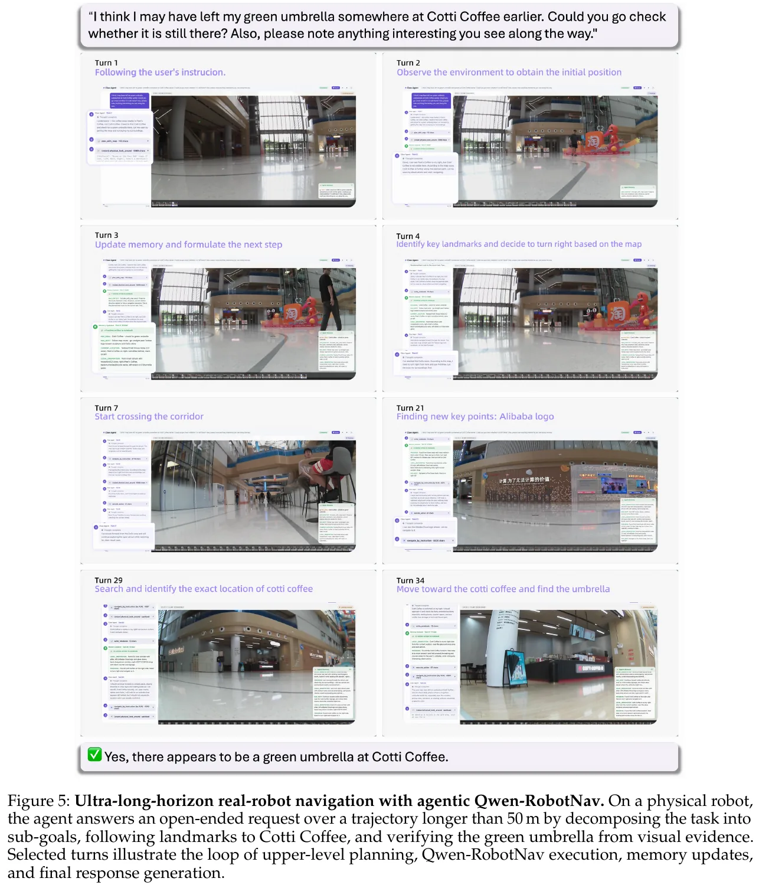
<figcaption>宇树 Unitree Go2 四足机器人真实环境实测：面对长达 50 米以上跨越多个功能区的超长程探索任务，NavMCP 引导机器狗将高层目标分解为以地标为锚点的渐进子目标，成功率达 78.3%，相对反应式基线展现出巨大优势。</figcaption>

#### ⑤ 真实机器人部署：宇树 Unitree Go2 物理验证
{: id="-真实机器人部署宇树-unitree-go2-物理验证"}
在真实办公大楼环境中，面对非结构化障碍、测距漂移与传感噪声，对单房间（Low）、跨房间（Medium）与超 20 米大尺度多区域（High）三级难度进行了实机测试（固定 Qwen3.6-Plus）：
- **单房间级（Low，20 回合）**：Reactive 80%，Frontier 70%，**NavMCP 90%**；
- **跨房间级（Medium，20 回合）**：Reactive 骤降至 35%，Frontier 60%，**NavMCP 保持 85%**；
- **超 20 米大范围探索（High，20 回合）**：Reactive 彻底崩溃为 **0%**，Frontier 仅为 **15%**，而 **NavMCP 依然保持高达 60% 的成功率**！
- **总体真机成功率**：NavMCP 达到 **78.3%**，相比 Frontier（48.3%）和 Reactive（38.3%）呈现压倒性优势，证明任务时程越长、环境越复杂，分层脚手架的优势越明显。

---

### 4. 局限性
{: id="4-局限性-14"}
1. **高层模型计算开销与响应时延**：NavMCP 依赖大参数量 VLM（如 Qwen3.6-Plus 或 397B 级模型）进行每轮多模态旅程分析与证据仲裁，高层大模型的推理延迟较传统轻量启发式算法更高，未来需探索端侧小模型或强化学习蒸馏方案；
2. **多视角采样下的物体重复与计数歧义**：沿途多个关键帧或不同相机视角多次拍到同一物体时，VLM 在密集小物体计数任务中仍偶发重复去重失误（Cross-view duplication error）；
3. **动态环境与非稳态物理干扰**：当前测试主要在相对静态的室内大场景展开，在包含剧烈动态人流穿行或光照突变的极具挑战性现实场景中，底层 NFM 的局部死锁与恢复机制仍有进一步提升空间。

---

## 9. SysNav (2026)
{: id="sysnav"}
———Multi-Level Systematic Cooperation Enables Real-World, Cross-Embodiment Object Navigation

📄 **Paper**: [arXiv:2603.06914](https://arxiv.org/abs/2603.06914) · [Project Page](https://cmu-vln.github.io/) · [Code](https://github.com/zwandering/SysNav)

### 精华
{: id="精华-18"}

SysNav 将 ObjectNav 重新定义为系统级问题，将语义推理、导航规划、运动控制三层彻底解耦，值得借鉴。核心洞见是：VLM 不应被用于细粒度的 frontier 级别决策，而应限制在房间级别的高层规划，从而在推理能力与空间可靠性之间取得最佳平衡。三层场景图（Room→Viewpoint→Object）为 VLM 提供了结构化上下文，是 VLM 高效推理的关键基础设施。Early-stop 和 Room-query 两种 VLM 调用模式按需触发，有效避免了 VLM 的冗余调用。该系统在三种机器人平台上部署，验证了模块化设计对跨平台泛化的价值。

---

### 1. 研究背景/问题
{: id="1-研究背景问题-17"}

Object Navigation（ObjectNav）要求机器人在未知室内环境中自主找到目标物体，需同时处理复杂空间结构、长程规划和语义理解。现有方法将 ObjectNav 作为单一策略学习问题，端到端模型难以兼顾多个子挑战；而过度依赖 VLM 进行 frontier 级别决策会因 VLM 缺乏精确 3D 空间理解而导致频繁回溯和低效行为。

---

### 2. 主要方法/创新点
{: id="2-主要方法创新点-17"}

  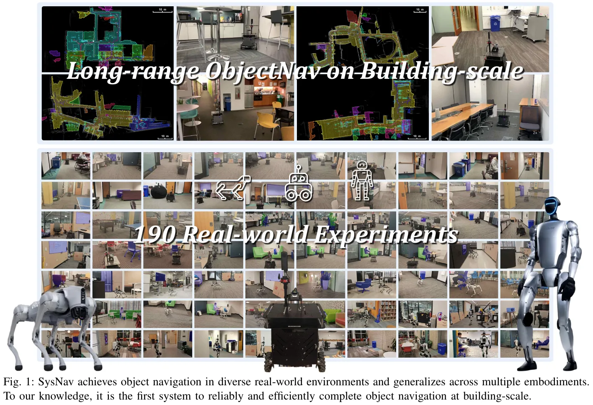
<figcaption>
SysNav 在多种真实环境和跨平台机器人上实现楼宇级别长程 ObjectNav
</figcaption>

SysNav 是一个三层解耦的 ObjectNav 系统，各层专注于不同粒度的子问题：

**高层——语义推理（Semantic Reasoning）**

构建三层场景图表示 $\mathcal{R}$：
- **Room Node** $v^r$：通过点云垂直分布拟合墙面并划分独立房间，每个节点存储房间类别、2D 顶视图和代表性 RGB 图像
- **Viewpoint Node** $v^v$：在覆盖范围发生显著变化时新增，存储位置、覆盖区域和全景图像，实现高效语义存储
- **Object Node** $v^o$：使用开放词汇检测（YOLOv8x + SAM2）实例化，每个节点存储类别、置信度、3D 点云、bounding box 及自属性

边类型包括：Room-Room（门道连通）、Room-Viewpoint（包含关系）、Room-Object（包含关系）、Viewpoint-Object（可见性）、Object-Object（空间约束，按需添加）。

VLM Reasoning 组件（Gemini-2.5-flash）基于上述场景图进行语义推理，提供房间级别导航指导。

**中层——基于房间的导航（Room-based Navigation）**

  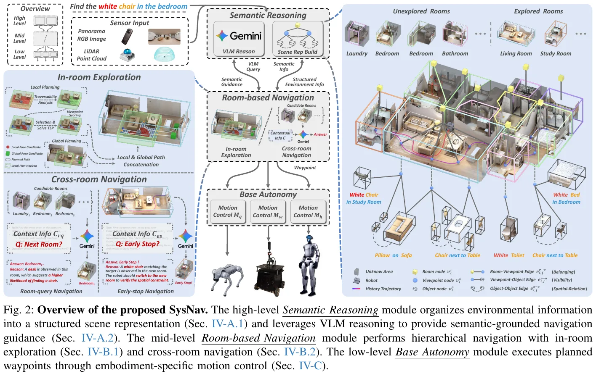
<figcaption>
SysNav 系统架构：高层语义推理、中层房间导航、低层运动控制三层解耦
</figcaption>

将房间作为最小语义规划单元，在房间内使用高效经典探索算法，仅在房间切换时调用 VLM：

- **In-room Exploration**：两级规划（局部 + 全局），以覆盖分数 $w_{cov}(c_i) = \lvert \mathcal S_{cov}(c_i) \cap \hat{\mathcal S} \rvert$ 选取位姿候选，用 TSP 生成探索路径，滚动窗口机制协调局部与全局计划
- **Early-stop 模式**：进入新房间时，VLM 根据上下文信息 $\mathcal C_{es}$（房间属性、已观测物体、任务目标）判断是否提前终止当前房间探索并切换到新房间
- **Room-query 模式**：当前房间探索完毕仍未找到目标时，VLM 基于未探索房间信息 $\mathcal C_{rq}$ 推理最可能包含目标的下一个房间

**低层——基础自主（Base Autonomy）**

设计跨平台基础自主模块，将路径点转换为各平台（轮式机器人、四足 Unitree Go2、人形 Unitree G1）的具体运动控制指令，包含路径点跟随、碰撞回避和地形可通行性分析。

---

### 3. 核心结果/发现
{: id="3-核心结果发现-17"}

  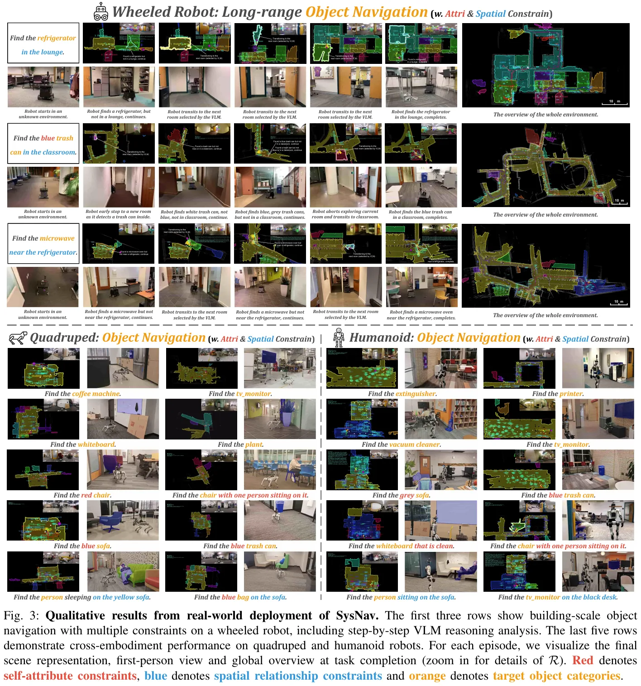
<figcaption>
SysNav 在轮式、四足、人形三种机器人平台上的真实环境定性结果
</figcaption>

**仿真基准**（4个benchmark，与 SOTA 对比）：
- HM3D-v1：SR **63.7%**，SPL **30.5%**（大幅领先次优 ApexNav 的 59.6%/33.0%）
- HM3D-v2：SR **80.8%**，SPL **37.2%**（次优 ApexNav 76.2%/38.0%）
- MP3D：SR **50.7%**，SPL **18.1%**
- HM3D-OVON：SR **54.9%**，SPL **26.1%**（次优 MTU3D 40.8%/12.1%，提升 14.1%/6.5%）

**真实环境**（190 次实验，对比 VLFM 和 InstructNav）：
- Hard 设置（目标在不同房间）：SR **97.5%**，SPT **71.8**，AT **67.6s**（Hard setting SR 较次优提升 61.1%，SPT 提升 51.1%，AT 减少 29.8s）
- 导航效率较现有 ObjectNav 基线提升 **4-5×**

---

### 4. 局限性
{: id="4-局限性-17"}

仿真中 SPL 提升幅度小于 SR，原因是面向真实场景设计的严格覆盖策略在仿真中会造成轻微过度覆盖；此外，多房间布局对系统的额外挑战有限，因为中等难度场景中障碍物更密集反而会降低速度。

---

## 10. EvoMemNav (2026)
{: id="evomemnav"}
——— 零样本具身导航中基于轻量化图先验与多视图反思的高效自进化细粒度拓扑记忆框架

📄 **Paper**: [arXiv:2606.03509](https://arxiv.org/abs/2606.03509v1) · [Code（待发布）](https://github.com/caicaiya123/EvoMemNav)

### 精华
{: id="精华-20"}

1. **纯视觉记忆设计**：提出视觉-语义记忆图（VSMGraph），将原始视觉视图（View）作为一等公民（first-class）存储在图节点中，避免了传统检测中心化场景图的信息压缩与噪声积累，且无需高昂的 3D 重建开销。
2. **预算受限的粗到细决策（Budgeted Coarse-to-Fine）**：将决策分解为粗阶段（Explore，过滤并路由至前沿或锚点）和细阶段（Search+Verify，仅针对短名单进行 VLM 决策和多视图 Stop 验证），在降低 VLM 延迟与 Token 数的同时，解决了同类多实例歧义和过早停止（premature stop）问题。
3. **反思驱动的自进化记忆（RDCMA）**：设计了一种无需训练的在线先验更新机制，在子任务结束后通过评估轨迹事件与停止结果，更新附着于图节点上的轻量级目标条件先验（Episode-STM 和 Scene-LTM），指导后续决策。
4. **开箱即用且高效通用**：在 GOAT-Bench 和 HM3D 上取得显著的 SR/SPL 提升，相比 3D-Mem 表现更佳，同时 VLM 调用次数减少了 41%，总耗时缩短了 39%，且无需任何权重训练或微调。

---

### 1. 研究背景/问题
{: id="1-研究背景问题-19"}

在长程零样本具身导航（Zero-Shot Embodied Navigation）中，建立能够支撑长期规划的记忆系统至关重要。然而，现有的记忆表征方案存在以下局限性：
1. **基于检测器的场景图（Detector-centric Scene Graphs）**：将观测压缩成稀疏的对象节点，会丢弃纹理、空间布局等细粒度视觉线索，且检测器的错误（如类别噪声）会在下游推理中累积，导致决策失误。
2. **基于 3D 重建的记忆方法（3D-reconstruction-based Memory）**：在运行时会产生高昂的计算和存储开销，且与只能直接推理图像的强大 VLM 不兼容。
3. **基于图像的拓扑图缓存（Image-based Topological Graphs）**：缺乏房间、前沿或可达性的结构化组织，容易在同类别物体的多实例场景中混淆，导致在错误的实例前过早停下（Premature Stop），且记忆缺乏演进能力，失败教训无法复用。

---

### 2. 主要方法/创新点
{: id="2-主要方法创新点-19"}

#### 整体框架概述
{: id="整体框架概述"}
EvoMemNav 由三个核心部分构成：构建于 occupancy grid 上的层次化拓扑记忆图（VSMGraph）、双阶段“粗到细”导航控制器（Coarse-to-Fine Policy）以及无训练的反思驱动在线自进化先验模块（RDCMA）。系统在每个时间步接收 posed RGB-D 观测，更新拓扑图；导航决策时，由粗决策进行候选过滤并导航，随后利用 VLM 进行细粒度的精确路由与多视图 Stop 验证；子任务结束时，反思机制将结果写回图中的轻量化统计量（STM/LTM），以指导未来的导航。

  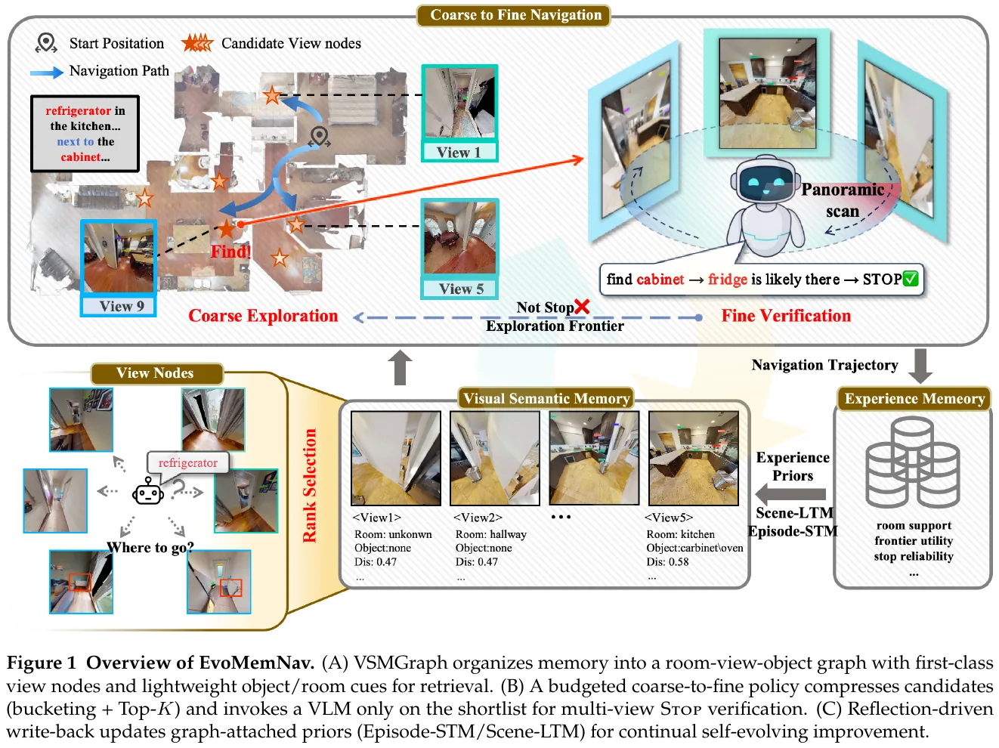
<figcaption>EvoMemNav 核心理念与流程总览（VSMGraph、粗到细导航决策、反思写入）</figcaption>

  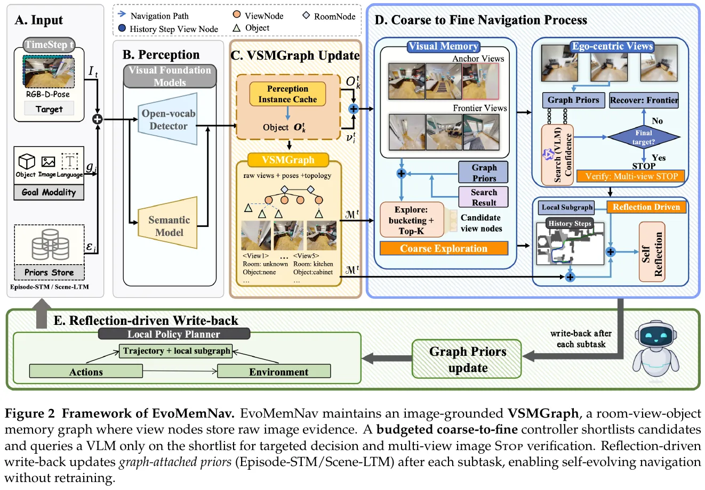
<figcaption>EvoMemNav 详细框架：包含基于图像的 VSMGraph 拓扑记忆图、受预算限制的“粗到细”导航决策系统，以及反思驱动的在线自进化先验写入策略</figcaption>

#### 逐模块讲解
{: id="逐模块讲解"}

**① 视觉-语义记忆图 (VSMGraph) 构建**
- **输入**：posed RGB-D 观测流 $I_t = \langle I_t^{rgb}, I_t^{depth}, p_t \rangle$ 和作为度量支撑的二维占用网格（occupancy grid）$M_t$。
- **处理**：在线在占用网格上添加沿着机器人运动轨迹的视图节点，并根据无碰撞路径建立可达性边（navigability edges）。通过轻量级目标检测模型（YOLOv8-World & SAM）维护一个 3D 目标候选缓存 $O_{map}$，但它仅用于给视图节点添加“目标可见性”的弱标签（visibility edges），并不用于压缩图像信息。视图节点被划分为：
  - **锚点视图 (Anchor Views)** $V_{A,t}$：富含物体观测的已探索区域，存储原始图像、位姿及可见的目标弱标签。
  - **前沿视图 (Frontier Views)** $V_{F,t}$：位于探索边界的未探索区域，连接至最近的已探索视图，代表可探索的前沿方向。
  同时，利用 CLIP 提取房间类别对每个视图进行分类 $\rho_v$，形成“房间-视图-物体”（Room-View-Object）的层次化拓扑图。
- **输出**：图结构 $G_t = (R_t, V_t, O_t, E_t)$。
- **设计动机**：以原始视图作为一等公民记忆，完全保留细粒度细节供 VLM 进行直接的图像级分析验证，避免检测误差引起的硬分类错误；同时，利用拓扑边和房间类别软标签加速检索。

  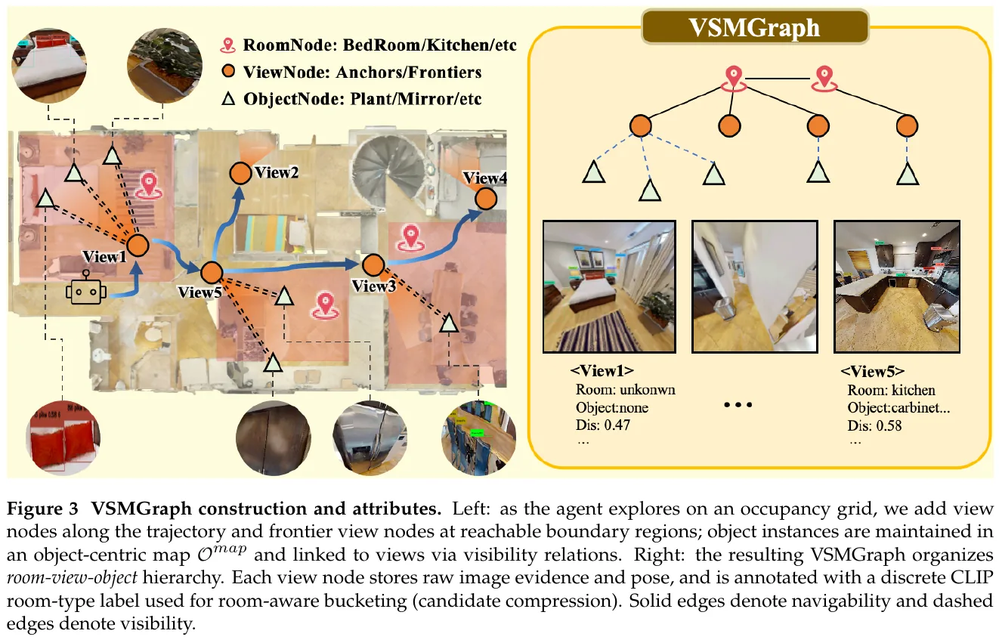
<figcaption>VSMGraph 构建过程：基于拓扑关系和房间-视图-物体层次化结构组织视觉信息</figcaption>

**② 预算受限的粗到细导航决策（Coarse-to-Fine Policy）**
- **输入**：多模态目标 $g$、当前拓扑图 $G_t$。
- **处理**：
  - **粗阶段 (Explore - 候选压缩与路由)**：从大量的锚点和前沿视图中过滤，仅保留最相关的 Top-K 个候选（锚点候选集 $C_t^A$ 预算限制为 $K_A$，前沿候选集 $C_t^F$ 预算限制为 $K_F$）。候选通过房间类别关联和轻量目标命中进行初步筛选。如果锚点集为空，则直接路由至前沿；若不为空，则进入细阶段。
  - **细阶段 (Search+Verify - 局部选择与验证)**：将过滤后的候选池 $C_t = C_t^A \cup C_t^F$ 输入给 VLM（Qwen3-VL-8B），VLM 只需对这个精简的短名单进行单步推理：
    $$a_t, \sigma_t = \text{VLM}(g, C_t)$$
    其中 $a_t$ 是选择的目标点，$\sigma_t \in \{\text{certain}, \text{uncertain}, \text{unknown}\}$ 为置信度。若 VLM 选择锚点视图但置信度不足（`uncertain`/`unknown`），系统会强制降级为前沿探索以避免盲目决策。
  - **验证步骤 (Verify - 多视图停止验证)**：当智能体抵达选择的锚点视图时，不立即停止，而是调用 VLM 结合智能体在当前位置的多角度视图进行最终的多视图 Stop 验证，返回 `STOP` 或 `RESELECT`。如果判定为 `RESELECT`，则将当前锚点拉入冷却队列并重新回到粗阶段，防止由于局部视野限制而产生的过早停止错误。
  - **恢复机制 (Recover)**：如果检测到死锁或多次冷却，会触发 Recover 机制，强制智能体进行一段时间的纯前沿探索。
- **输出**：下一个运动路径终点或 `STOP` 指令。
- **设计动机**：用粗筛选控制 VLM 的计算开销（避免对全图检索的 Token 爆炸），同时在局部进行多视角图像级的细粒度对比，提高多实例判别的准确度。

**③ 反思驱动在线记忆自适应 (RDCMA)**
- **输入**：历史子任务的运动轨迹事件（如常去的房间、探索受阻的前沿、环路检测等）以及多视图验证结果（STOP / RESELECT）。
- **处理**：任务结束时，将结果以目标条件签名 $s_g$（类别或模态）归纳为轻量化统计先验，写回图结构中附着于对应的房间/视图/前沿节点：
  - **短时记忆 (Episode-STM)**：缓存当前 episode 内的避障与路径惩罚信息，避免在一个任务中反复打转，在 episode 结束时重置。
  - **长时记忆 (Scene-LTM)**：记录房间中特定物体的支持概率（例如，厨房更容易有冰箱）和特定锚点的停止可靠度，长效留存，跨子任务复用。
  在 Explore 阶段，这些先验以“加权平局决胜（tie-breakers）”的方式调整过滤后的候选排序，指导探索方向；在 Verify 阶段，作为 hint 输入给 VLM 提示当前区域此前是否曾被成功验证过。
  通过指数衰减（exponential decay）来淘汰陈旧先验，且仅保留 Top-K 项并对冲突先验进行抑制。
- **输出**：图附着的记忆先验。
- **设计动机**：实现非参数化的轻量自适应，使得智能体在未知的终身学习任务中能够随着时间“越走越聪明”，越熟悉当前环境，导航成功率越高。

  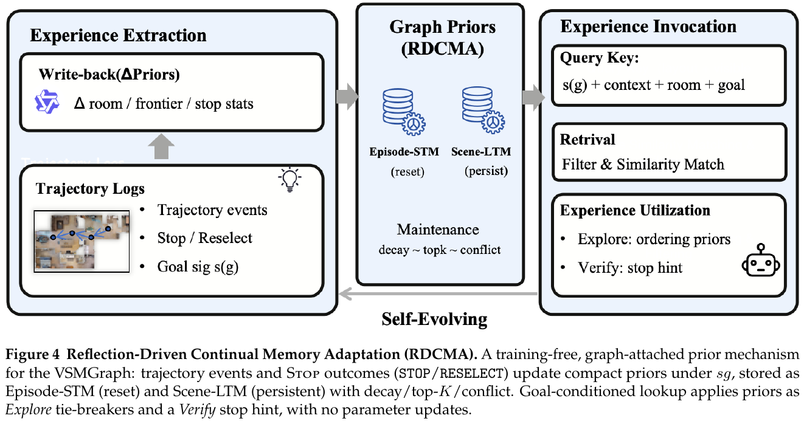
<figcaption>反思驱动在线记忆自适应 (RDCMA) 的运作原理</figcaption>

---

### 3. 核心结果/发现
{: id="3-核心结果发现-19"}

1. **GOAT-Bench 终身多模态导航**：
   在 GOAT-Bench VAL-UNSEEN 验证集上，EvoMemNav 取得了 **59.6% SR** 和 **38.9% SPL** 的最佳结果（见下表），大幅领先于先前的图像级拓扑记忆方法 3D-Mem（42.6% SR / 22.8% SPL）和 MSGNav（52.0% SR / 29.6% SPL）。

| 方法 | 类别 | 是否无需训练 | SR (%) ↑ | SPL (%) ↑ |
|---|---|---|---|---|
| SenseAct-NN Monolithic [20] | 单体学习型 | ❌ | 12.3 | 6.8 |
| CLIP on Wheels [20] | 模块化零样本 | ✓ | 16.1 | 10.4 |
| Modular GOAT [20] | 模块化零样本 | ✓ | 24.9 | 17.2 |
| TANGO [28] | 模块化零样本 | ✓ | 32.1 | 16.5 |
| 3D-Mem [46] | 模块化拓扑 | ✓ | 42.6 | 22.8 |
| MSGNav [17] | 模块化拓扑 | ✓ | 52.0 | 29.6 |
| **EvoMemNav (Ours)** | **模块化拓扑 (自进化)** | **✓** | **59.6** | **38.9** |

2. **HM3D ObjectGoal 导航**：
   在纯目标导航（ObjectGoal）的 HM3D 任务上，EvoMemNav 在 HM3Dv1（59.2% SR / 33.6% SPL）和 HM3Dv2（63.8% SR / 39.4% SPL）上均创下或逼近了免训练方法的最高水准。

3. **消融实验与效率分析**：
   - 相比于完全不带有 coarse 筛选的拓扑 baseline，加入 VSMGraph 使 SR 提升了 7.2%，而粗筛选（Coarse）模块直接带来了 **+11.6%** 的巨大 SR 跃升，是性能提升的主要因素。
   - 反思模块 RDCMA 使整体 SR 进一步提升了 4.0%（从 60.8% 提升至 64.8%），并且这种增益在第 3 至第 5 个子任务（Mid subtasks）中最为明显，说明随着记忆在场景中的不断写入和演进，智能体表现越发稳健。
   - 相比于 3D-Mem，得益于粗阶段的决策短名单机制，VLM 调用次数从 10.7 次降至 6.5 次（减少 39%），单次子任务的耗时从 102.2s 骤降至 58.7s（降低 42.5%），实现了性能与效率的完美兼顾。

---

### 4. 局限性
{: id="4-局限性-19"}

1. **多模态目标识别依然受限于感知模块**：尽管使用 VSMGraph 规避了下游推理对目标检测框的绝对依赖，但粗筛选阶段生成 soft tags 仍需依靠 YOLOv8-World 和 SAM 等 2D 检测器。在极其嘈杂或低光照环境下，若检测标签完全丢失或偏离，可能导致过滤时的 Top-K 列表中漏掉正确的锚点，从而拖累粗筛选的准确性。
2. **反思先验的表达与检索粒度仍可优化**：目前的 RDCMA 先验写入是通过对离散的 CLIP 房间类型和停止事件做简单的支持度与错误率计数来实现的。对于极其复杂、分布非常离散的房间结构或者开箱即用的大规模开放世界，简单的图计数可能会面临记忆冲突问题，未来可考虑融入基于小规模向量嵌入的非参数化情境记忆检索。

---

## 11. Harness Robotic OS (2026)
{: id="harness-robotic-os"}
———把四足巡检从「导航栈」升级为「具身智能体运行时」

📄 **Paper**: [arXiv:2609.11225](https://arxiv.org/abs/2609.11225)

该论文侧重具身智能体运行时、技能编排、分层记忆与自进化治理，完整精读已移至 [Embodied Agent 论文精读：Harness Robotic OS](/Embodied-Agent-Papers/#harness-robotic-os)。

---

## 12. SparseNav (2026)
{: id="sparsenav"}
———少即是多：按指令"按需"感知语义的免训练 VLN

📄 **Paper**: [arXiv:2609.26408](https://arxiv.org/abs/2609.26408)

### 精华
{: id="精华-23"}

- 语义地图不是越全越好：几何要持久保存，语义只在当前指令"点名"时才去感知、落图、记忆。
- 把"要不要调用分割模型"本身变成一个由 VLM 做的决策，感知从"每帧都跑"变成"事件触发"，既省算力又减少地图里的噪声标注。
- 候选点同时包含前沿点（探索未知）和局部左/前/右点（在已知区域里完成"先直走再左转"这类机动），两者缺一不可。
- 给 VLM 看的 BEV 图要以机器人为中心、朝向向上，让图像上的"上/左/右"直接对应语言里的"前/左/右"——这一个表示选择就差出 12.5 个点 SR。
- VLM 只负责"选哪个候选点"，轨迹交给经典 A* 规划器执行，语义决策与度量执行彻底解耦。

---

### 1. 研究背景/问题
{: id="1-研究背景问题-22"}

基于地图的免训练 VLN 通常会把视野里能识别的物体全部标到语义地图上（如 MapNav 的 Annotated Semantic Map）。但对当前这一步决策来说，绝大多数物体与指令无关：它们既浪费分割算力，又会让 VLM 看到的地图变得杂乱、引入误检。作者因此提出问题：**语义覆盖更广，是否一定能提升指令跟随？**

---

### 2. 主要方法/创新点
{: id="2-主要方法创新点-22"}

  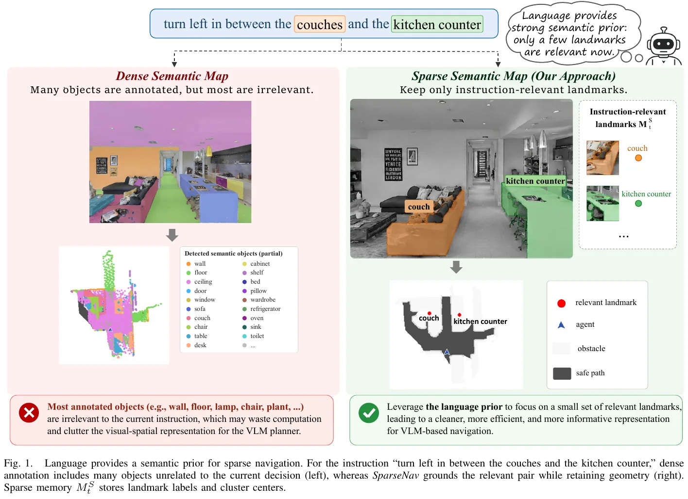
<figcaption>稠密语义地图 vs. 稀疏语义地图：对指令"在沙发和厨房台面之间左转"，稠密做法标注了大量无关物体，SparseNav 只落地沙发和厨房台面两个地标，同时保留完整几何</figcaption>

  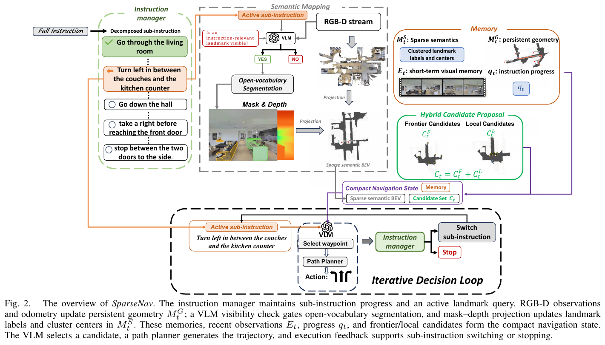
<figcaption>SparseNav 整体框架：指令管理器维护子指令进度与当前地标查询；VLM 可见性判断决定是否调用开放词表分割；掩码+深度投影更新稀疏地标记忆；VLM 在混合候选点中选择航点，由路径规划器执行</figcaption>

**① 整体框架概述**

SparseNav 由四个模块组成：**指令管理器**负责拆解指令、追踪进度并给出"当前该找什么地标"；**几何记忆** $M_t^G$ 持续维护障碍/自由空间 BEV；**稀疏语义感知**只在需要时调用分割、把地标中心写入稀疏记忆 $M_t^S$；**混合候选点 + VLM 决策**在前沿点与局部方向点中选一个航点，交给经典规划器执行。智能体状态写作：

$$\mathcal M_t = (M_t^G, M_t^S, E_t, q_t)$$

其中 $E_t$ 是最近几帧观测，$q_t$ 是指令进度。

**② 逐模块讲解**

**几何记忆（Geometry-Centric Spatial Memory）**
- **输入**：RGB-D（或 LiDAR）点云 + 里程计位姿
- **处理**：取高度在 $z_{min} < z < z_{max}$ 的点，按分辨率 $\rho$ 栅格化成障碍图；用椭圆膨胀把零散的墙面观测连起来，再做形态学闭运算填补小洞；按机器人半径 $r_a = 0.1$ m 膨胀障碍
- **输出**：一张**以机器人为中心、朝向向上**的 BEV 图，坐标变换为 $p^{ego} = R(-\theta_t)(p - p_t)$，并令 $+x$ 前方对应图像上方、$+y$ 左方对应图像左方
- **设计动机**：几何是避障与规划的基础，必须持久、完整；而"朝向向上"让图上的方向与语言里的"前/左/右"天然对齐，VLM 不用再做心理旋转

> **举个例子**：机器人位于世界坐标 $(5, 5)$，朝向正东（$\theta_t = 0°$）；沙发在 $(5, 7)$，即机器人正北方 2 m。
> 在固定朝北的全局图（north-up）里，沙发画在机器人的"上方"，VLM 容易读成"沙发在前面"；
> 换成朝向向上的图后，先平移再旋转 $-\theta_t$，得到 $p^{ego} = (0, 2)$，即 $+y$ 方向 2 m，画在机器人**左侧**——与"沙发在你左边"这句指令直接对上。
> 论文消融中，全局 north-up 只有 30.3% SR，以机器人为中心但不旋转为 36.2%，以机器人为中心且朝向向上为 42.8%。

**混合候选点（Hybrid Waypoint Proposal）**
- **输入**：几何 BEV、机器人位姿
- **处理**：
  - **前沿候选** $\mathcal C_t^F$：与未知区域相邻的可通行格子聚类，剔除小簇，每簇取一个有避障余量的可达点
  - **局部方向候选** $\mathcal C_t^L$：在当前朝向的 $\{-\phi, 0, +\phi\}$ 三个方向、距离 $d_l$ 处各放一个点，落在障碍里或不连通区域的点丢弃或投影回自由空间
- **输出**：候选集 $\mathcal C_t = \mathcal C_t^F \cup \mathcal C_t^L$，每个点带编号渲染在 BEV 上
- **设计动机**：前沿点只能引导"去没看过的地方"，但很多指令动作发生在已知区域（"先直走，到沙发处再左转"），局部左/前/右点正好补上这一空缺

**层次化指令管理（Hierarchical Instruction Management）**
- **输入**：完整指令 $I$
- **处理**：拆成有序子指令 $S = (s_1, \dots, s_K)$，维护进度 $q_t = (i_t, S_t^{done})$；当前子指令完成时记录并推进
- **输出**：已完成 / 当前 / 待完成三段目标，以及当前的**地标查询** $l_i$（可含多个标签，如 {couch, kitchen counter}）
- **设计动机**：避免 VLM 重复执行已完成的动作，同时决定"此刻该感知哪些语义"——这是稀疏感知的源头

**指令条件的稀疏语义感知（核心创新）**

这是论文最关键、也最容易被一句话带过的部分：**语义感知什么时候发生、感知什么，都由当前子指令决定。**

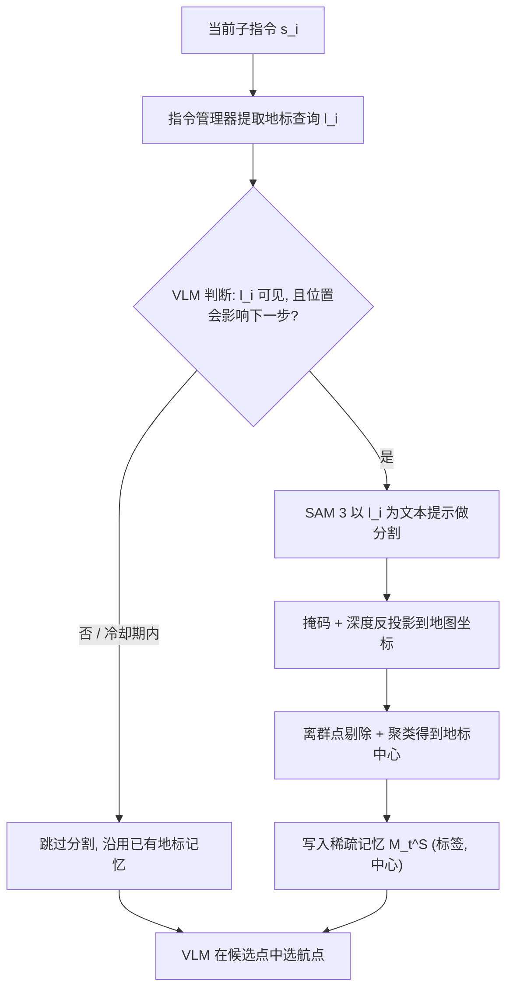

- **语义触发器**：VLM 读取 $(O_t, E_t, s_i, l_i)$，输出可见性分数与是否落地的决策 $z_t \in \{0, 1\}$；只有"地标大概率可见，且其度量位置会影响下一步决策"时才触发，并带有时间冷却以避免重复调用
- **开放词表分割**：用 SAM 3 以地标文本作为提示，得到实例掩码
- **2D→3D 投影**：掩码内有效深度像素用相机内参反投影、变换到地图坐标系，剔除离群点后聚类
- **稀疏记忆**：$M_t^S = \{(\ell_j, \mu_j)\}$，只存标签与聚类中心；同标签的不同实例分开存；新观测更新最近的匹配簇，否则新建；**不再被查询的地标也会保留**，供后续复用

| 维度 | 稠密语义地图（如 MapNav） | SparseNav |
|---|---|---|
| 感知什么 | 视野里所有能识别的物体 | 只感知当前子指令点名的地标 |
| 什么时候感知 | 每一帧持续感知 | VLM 判断可见且有用时才触发 |
| 地图里存什么 | 大量类别色块 | 几何 + 少量地标的标签和中心 |

**③ 端到端数据流**

一次决策：RGB-D 与里程计更新几何 BEV → 指令管理器给出当前子指令与地标查询 → VLM 判断是否触发分割，触发则把地标中心写入稀疏记忆 → 生成前沿 + 局部候选点并编号渲染 → VLM 读取 $X_t = \{M_t^G, M_t^S, E_t, s_i, q_t, \mathcal C_t\}$，输出一个候选编号和简短理由 → A* 在膨胀后的障碍图上规划无碰撞轨迹并执行 → 执行反馈用于判断是否切换子指令或停止。

**④ 训练目标**

无。全流程**免训练**，所有实验（含实机）使用 GPT-5 作为 VLM，SAM 3 作为分割模型。

  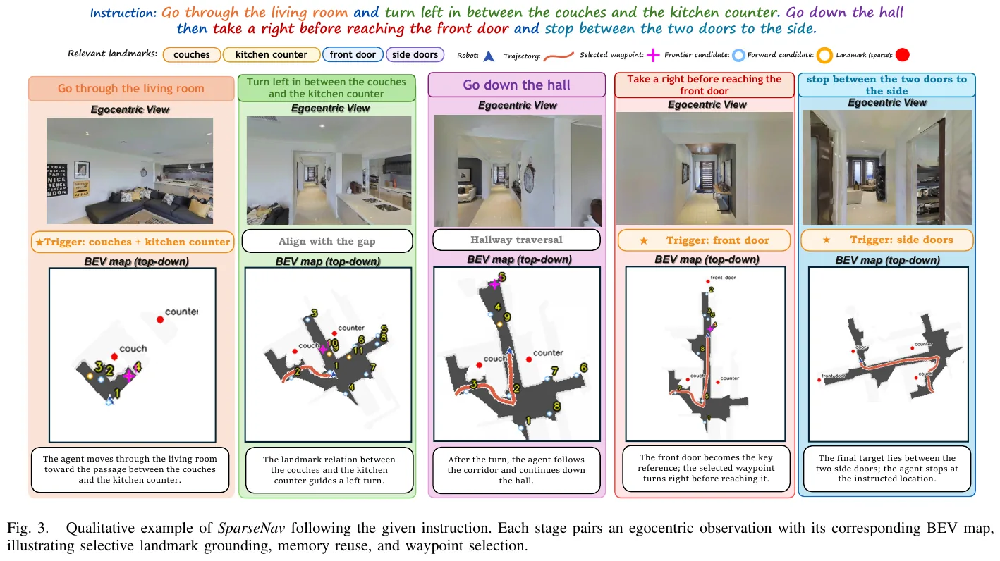
<figcaption>定性示例：五个子指令阶段各配一张第一人称视图与 BEV；星号标出的是真正触发语义落地的时刻（沙发+厨房台面、前门、侧门），其余阶段复用已有地标与几何候选</figcaption>

---

### 3. 核心结果/发现
{: id="3-核心结果发现-22"}

**基准结果（Val-Unseen）**：

| 方法 | 设定 | R2R-CE SR | R2R-CE SPL | RxR-CE SR | RxR-CE nDTW |
|---|---|---|---|---|---|
| InstructNav | 零样本 | 31.0 | 24.0 | – | – |
| CA-Nav | 零样本 | 25.3 | 10.8 | 19.0 | 13.5 |
| DreamNav | 零样本 | 32.8 | 28.9 | – | – |
| MapNav | 监督 | 39.7 | 37.2 | 32.6 | 43.5 |
| ETPNav | 监督 | 57.0 | 49.0 | 54.8 | 61.9 |
| **SparseNav** | 免训练 | **42.8** | 35.2 | **40.7** | 48.6 |

**关键消融**：
- **语义策略**（R2R-CE SR）：无语义 34.6 → 稠密+持续感知 36.7 → 稠密+按需 38.8 → 指令相关+持续 40.2 → **指令相关+按需 42.8**。"感知范围"和"触发时机"两个维度都有贡献
- **候选点**：只有局部点 29.1，只有前沿点 35.2，前沿+前方 37.4，前沿+左/前/右 42.8
- **地标定位**：VLM 直接估位置 34.6（误差 1.56 m，比不定位的 36.5 还差），标注框 40.2（0.51 m），分割 42.8（0.12 m）
- **指令与记忆**（RxR-CE）：完整指令 29.8 → +时序记忆 31.5 → 子指令 33.2 → +进度追踪 35.0 → +持久地标记忆 40.7；持久地标记忆单项贡献最大（+5.7）
- **触发质量**：周期触发精度/召回 41.5/45.6，仅看可见性 72.1/99.8，子指令感知 **90.4/99.8**
- **实机**：Unitree Go2 + RealSense D455（建图与地标落地）+ Livox MID-360（定位），无预建地图，在多个室内场景完成"到四足机器人处左转、经过人形机器人、进入下一个房间并停下"这类地标条件指令

  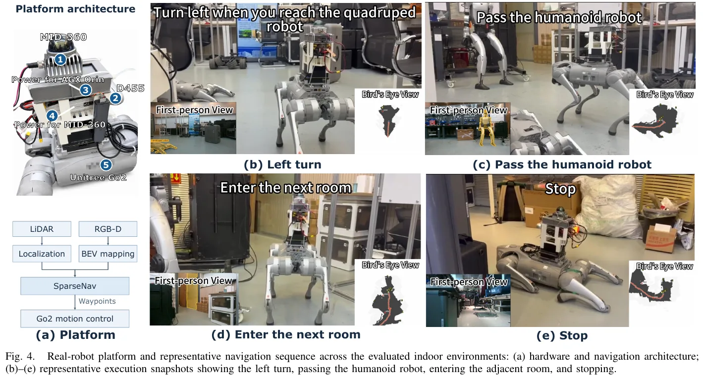
<figcaption>实机部署：(a) Go2 平台与导航架构；(b)–(e) 左转、经过人形机器人、进入相邻房间、停止四个执行片段，右下角为对应 BEV</figcaption>

---

### 4. 局限性
{: id="4-局限性-22"}

候选点由规则生成，VLM 只能在预设的前沿与左/前/右点中选，可能漏掉更贴合指令的航点；按需分割虽省了感知开销，但 VLM 推理仍是主要延迟，串行的"感知→推理→执行"会让机器人停下等决策。此外，与表中其他方法的对比是跨论文数据（episode、骨干模型不同），实机部分也只有定性展示，没有成功率统计。

---

## 13. Talk2Escape (2026)
{: id="talk2escape"}
———迷路了就开口问：把多轮对话变成 VLN 的闭环纠错通道

📄 **Paper**: [arXiv:2609.28296](https://arxiv.org/abs/2609.28296) · [Project Page](https://zeruili22.github.io/talk2escape/)

### 精华
{: id="精华-24"}

- 单轮 VLN 本质是开环：一条指令执行到底，中途没有任何校验与纠错机制，小偏差会一路累积成任务失败。
- 对话的价值不在于"补充初始规划"，而在于充当**运行时的纠错安全网**：只在检测到异常时暂停并求助。
- "什么时候问"比"问什么"更关键：稀疏、有针对性的偏离触发优于高频或定时询问，问太多反而扰乱强智能体的内部推理（干预疲劳）。
- 求助前先把多视角观测"翻译"成一句带地标的简短问题，答方（人或 Oracle）才能可靠作答。
- 模块与基座无关，可直接挂到 NavGPT、MapGPT、GTA 等零样本智能体上；历史越干净、越以动作为中心的基座，越能消化自然语言纠错。

---

### 1. 研究背景/问题
{: id="1-研究背景问题-23"}

主流 VLN 是单轮范式：智能体拿到一条指令后开环执行，没有机制去核对进度、请求澄清或从错误中恢复。在真实机器人上，传感器噪声、里程计漂移和未建图障碍不可避免，一次小的走偏就可能把机器人推入"迷路"状态而无法挽回。已有的对话式 VLN 多把对话当作初始规划的补充信息，且依赖对话数据微调，并假设通信即时、执行无误差。

---

### 2. 主要方法/创新点
{: id="2-主要方法创新点-23"}

  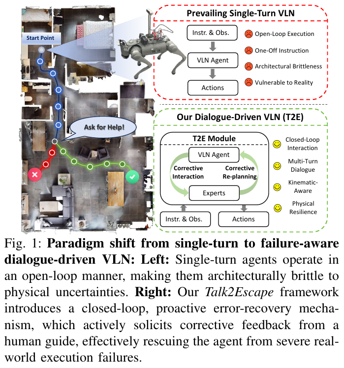
<figcaption>范式对比：左为单轮开环 VLN，一旦走偏无法恢复；右为 Talk2Escape 的闭环对话范式，智能体在出错时主动求助，由专家给出纠正提示后重新规划</figcaption>

  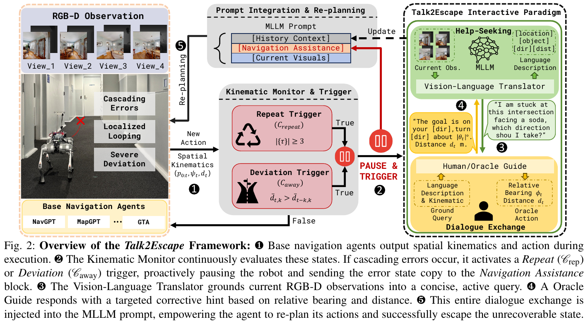
<figcaption>Talk2Escape 框架：① 基座智能体输出运动学状态与动作；② 运动学监视器检测原地打转或偏离，触发暂停；③ 视觉-语言翻译器把当前 RGB-D 观测转成简短求助问题；④ Oracle/人类给出基于相对方位与距离的纠正提示；⑤ 整段对话注入 MLLM 提示词，智能体据此重新规划</figcaption>

**① 整体框架概述**

Talk2Escape 是一个外挂在任意零样本基座智能体上的干预模块，由三部分组成：**运动学监视器**负责判断"是不是出事了"；**视觉-语言翻译器**负责把当前处境说成一句话；**提示生成与注入**负责把纠正信息塞回基座 MLLM 的提示词。形式上，它为智能体在物理动作空间 $\mathcal A^p$ 之外增加了一个通信动作空间 $\mathcal A^c$，策略从 $a_t = \pi(H_t)$ 变为 $a_t = \pi(H_t \cup D_k)$，其中 $D_k = \{(Q_1, F_1), \dots, (Q_k, F_k)\}$ 是到第 $k$ 次交互为止的问答历史。整个过程不做任何微调，核心推理引擎为 Gemini 3.1 Pro。

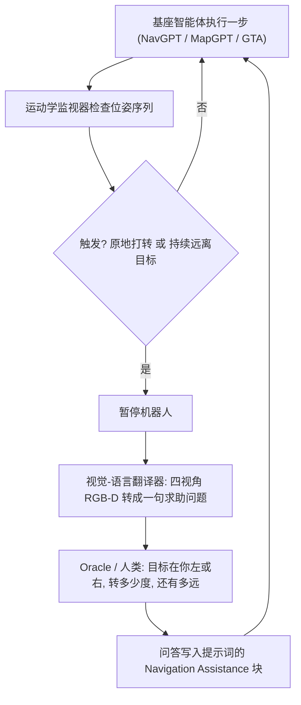

**② 逐模块讲解**

**基座智能体（Base Navigation Agent）**
- **输入**：每步四个正交方向（0°/90°/180°/270°）的 RGB-D 视图 $O_t$、位姿 $p_t$、历史 $H_t$
- **处理**：MLLM 以归一化像素坐标 $(u, v)$ 指定导航目标；较强的基座（如 GTA）还维护 TSDF 俯视图与拓扑图
- **输出**：物理动作（离散动作、相对航点或像素坐标），交给底层控制器执行
- **设计动机**：Talk2Escape 不改基座，只在外层加闭环，因此可验证"与基座无关"

**运动学监视器与触发条件（核心卡点）**

论文对比了六种干预策略：None（不干预）、Repeat、Deviation、Hybrid（二者取或）、Periodic（每 $k_{per} = 5$ 步给一次提示）、Human-in-the-Loop。两个自动触发条件是：

- **Repeat 触发（原地打转）**：当前位置半径 $r = 0.5$ m 内，历史上已经到访至少 $n = 3$ 次：

$$\mathcal C_{rep}(t) = \mathbb 1\left[ \left\lvert \{ \tau \in [0, t] : \lVert p_\tau - p_t \rVert_{xz} < r \} \right\rvert \ge n \right]$$

- **Deviation 触发（持续远离目标）**：设 $d_t = \lVert p_t - p_g \rVert_{xz}$ 为到目标的水平距离，用窗口 $k = 2$ 的滑动平均比较"最近两步"与"再往前两步"：

$$\mathcal C_{away}(t) = \mathbb 1\left[ \bar d_{t,k} > \bar d_{t-k,k} \right], \quad \bar d_{t,k} = \frac{1}{k} \sum_{i=0}^{k-1} d_{t-i}$$

> **举个例子**（Deviation 触发，$k = 2$）：连续四步到目标的距离依次为 8.0、7.0、7.2、7.6 m。
> 如果只看单步，第三步从 7.0 涨到 7.2 就会误触发——这只是一次小的运动抖动。
> 用滑动平均：最近两步均值 $(7.6 + 7.2)/2 = 7.4$，前两步均值 $(7.0 + 8.0)/2 = 7.5$，$7.4 < 7.5$，**不触发**。
> 下一步距离变为 8.0：最近两步均值 $(8.0 + 7.6)/2 = 7.8$，前两步均值 $(7.2 + 7.0)/2 = 7.1$，$7.8 > 7.1$，**触发**——此时才是真的在持续远离目标。

注意：Deviation 触发需要知道目标位置 $p_g$，在仿真中这是真值信息；实机上改由人类监督员按同样的判据决定是否介入。

**视觉-语言翻译器（Help-Seeking）**
- **输入**：触发时的四视角 RGB-D 观测 + 触发类型
- **处理**：MLLM 依次完成三件事：总结局部场景；根据触发条件判断最可能的失败模式（走廊里打转、面对死胡同、卡在路口）；生成一句简短的求助问题
- **输出**：例如"我卡在这个路口，面前是一张沙发，该往哪走？"
- **设计动机**：原始多视角图像信息量大、答方难以快速理解；翻译器被约束为只提可观测的地标与相对方向，不臆测没见过的区域

**Oracle 提示生成与注入**
- **输入**：智能体朝向 $\psi_t$，目标方位角 $\phi_t = \mathrm{atan2}(p_g^z - p_t^z,\ p_g^x - p_t^x)$
- **处理**：计算相对转角 $\theta_t = \phi_t - \psi_t \in (-180°, 180°]$；若 $d_t < d_{th}$ 回答"你离目标很近了"，否则回答"目标在你的[左/右]，向[左/右]转约 $\lvert \theta_t \rvert$ 度，距离 $d_t$ 米"
- **输出**：问答对写入 MLLM 提示词中专门的 **Navigation Assistance** 块，位置在历史上下文与当前视觉输入之间
- **设计动机**：给出明确、以自我为中心的纠正指令，让智能体跳出当前失败状态

**③ 训练目标**

无。整个框架基于冻结的 MLLM 零样本运行，不依赖任何对话数据微调。

---

### 3. 核心结果/发现
{: id="3-核心结果发现-23"}

**R2R-CE / RxR-CE（Val-Unseen 采样子集：R2R-CE 100 条、RxR-CE 260 条）**：

| 方法 | R2R-CE SR | R2R-CE SPL | RxR-CE SR | RxR-CE SPL | RxR-CE nDTW |
|---|---|---|---|---|---|
| Efficient-VLN（监督最佳） | 64.2 | 55.9 | 67.0 | 54.3 | 68.4 |
| GTA（零样本） | 48.8 | 41.8 | 46.2 | 39.3 | 57.4 |
| T2E + NavGPT | 64.0 | 46.4 | 50.4 | 27.2 | 45.7 |
| **T2E + GTA** | **72.0** | 49.4 | **62.9** | 34.2 | 49.9 |

- SR 大幅提升，但 RxR-CE 上 SPL 与 nDTW 下降：纠错需要回头与绕路，路径变长，这是"用路径效率换成功率"的取舍
- **数值不一致**：摘要写 R2R-CE SR 为 66.0%，而表 I 与正文给出的 T2E + GTA 为 72.0%；表 IV 中 Deviation 触发在同一 100 条 episode 上 SPL 同为 49.4，SR 却是 66.0%。论文没有解释两者的差异，引用时需注意
- **VLNVerse（与基座无关）**：NavGPT 19.3 → +CoT 28.7 → **+T2E 84.6**；MapGPT 25.5 → +CoT 42.2 → +T2E 67.0。被动的思维链远不如主动对话
- **反直觉发现**：MapGPT 单独用时优于 NavGPT，挂上 T2E 后反而更差。作者归因于模态不匹配——MapGPT 提示里大量绝对 3D 坐标，与 Oracle 给出的相对、自我中心提示相冲突

**触发策略消融（R2R-CE，同一 100 条 episode，基座为 GTA）**：

| 策略 | SR | SPL | 触发率 |
|---|---|---|---|
| None | 48.8 | 41.8 | 0% |
| Repeat | 57.0 | 45.1 | 4.74% |
| **Deviation** | **66.0** | **49.4** | 15.0% |
| Hybrid | 54.0 | 44.5 | 23.1% |
| Periodic (k=5) | 63.0 | 46.5 | 10.2% |
| Human-in-the-Loop | 74.5 | 61.2 | 9.8% |

Hybrid 触发太频繁，反而掉到 54.0%，说明问得越多不一定越好。

  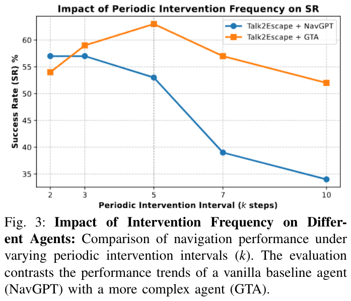
<figcaption>定时干预间隔 k 对不同基座的影响：弱基座 NavGPT 随间隔变大近似线性下降（依赖持续外部指导）；强基座 GTA 呈倒 U 形，k=5 最佳，问得太勤会打断其内部推理</figcaption>

**实机（Unitree Go2，云台深度相机扫出正交视图，MLLM 异步输出航点）**：SR 从 GTA 的 40.0% 提升到 62.0%，NE 从 3.66 m 降到 3.31 m；监督方法 VLN-BERT 16.0%、RDP 20.0%。实机采用人类监督员按 Deviation 判据介入。

  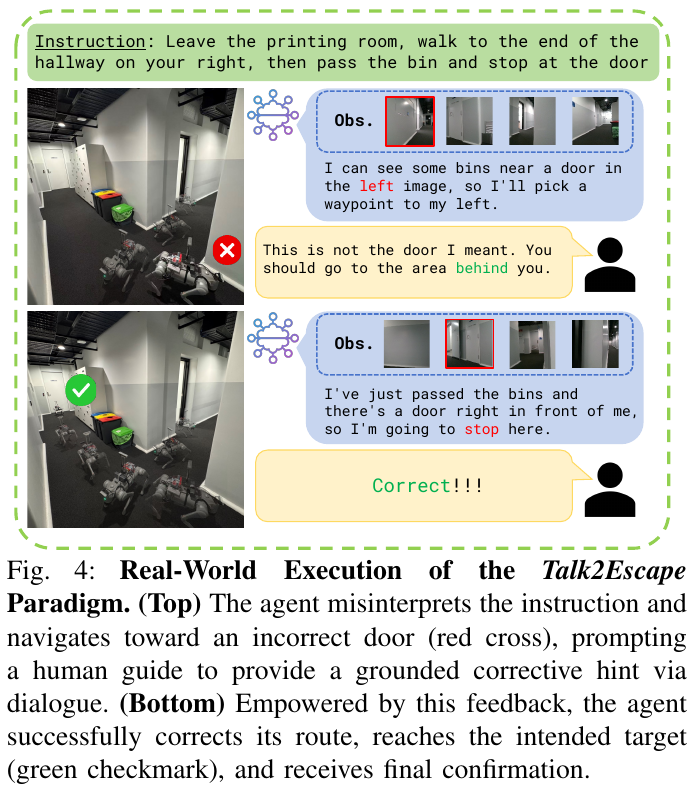
<figcaption>实机示例：上方智能体误解指令走向了错误的门，人类给出"不是这扇门，去你身后的区域"的纠正；下方智能体据此改道，到达正确目标并获确认</figcaption>

---

### 4. 局限性
{: id="4-局限性-23"}

仿真中的 Oracle 提示与 Deviation 触发都直接使用目标真值位置（方位与距离），这相当于特权信息，与只靠单轮指令的方法并不在同一条件下比较；实机则依赖人类监督员。作者还指出"非对称上下文"瓶颈：人类只看到离散的静态画面，难以还原机器人的全局朝向与局部障碍，给出的提示可能含糊。此外，R2R-CE 仅在 100 条采样 episode 上评测，统计波动较大。

---

## 14. SuperNav (2026)
{: id="supernav"}
———用导航技能、视觉点选工具与上下文管理，把通用多模态模型组织成持续行动的导航 Agent

📄 **Paper**: [arXiv:2610.12126](https://arxiv.org/abs/2610.12126) · [Project Page](https://zju3dv.github.io/SuperNav/)

### 精华
{: id="精华-26"}

让通用多模态模型负责理解请求、判断场景和选择目的地，把路径规划与运动控制交给工具，是 SuperNav 支持不同导航任务的核心分工。
导航能力还取决于模型周围的执行框架：可按需读取的技能、方便点选目的地的工具、任务进度记录和上下文管理，共同支撑搜索、复核与失败恢复。
统一的图像点坐标接口，使同一套高层决策流程可以连接几何规划器或学习式运动策略，但两者的传感与几何资源不同，成功率接近也不意味着路径效率相同。
“无需导航专用微调”指上层 MLLM；学习式执行器仍用模拟器专家轨迹训练，实验中的几何执行器则使用深度与可导航几何。

---

### 1. 研究背景/问题
{: id="1-研究背景问题-25"}

服务机器人既要理解“找到指定沙发”“依次访问多个物体”，也要把“找个可以休息的地方”转成合适的目标，并在陌生场景中持续探索和验证。
固定模块化流程通常预先规定模型何时参与、何时复核和停止，换任务时需要改流程；直接微调 VLM 预测导航动作，则受训练任务与场景覆盖范围限制。
SuperNav 因此保留预训练 MLLM 的通用能力，用一个导航执行框架（agent harness）组织工具调用、技能读取和历史管理，让模型根据反馈选择下一步。

---

### 2. 主要方法/创新点
{: id="2-主要方法创新点-25"}

  
<figcaption>图 2：SuperNav 的整体框架。Agent 循环维护上下文；Navigation Skills 提供搜索、复核、恢复和完成指导；工具执行观测与移动，并通过统一图像点接口连接两种运动后端。</figcaption>

**整体框架。** SuperNav 由 Agent 循环、Navigation Skills 和面向 Agent 的导航工具三部分组成：循环把请求、历史和反馈交给 MLLM；技能提供可读取的操作经验；工具把模型选出的目的地转成真实移动，并返回新的观测。

**① Agent 循环：让每次行动接上前面的证据。** 输入是任务指令、当前图像、文本交互历史和待完成目标记录；MLLM 据此选择观察、移动、读取技能、更新目标状态或结束会话；工具结果进入下一轮上下文。
例如，靠近疑似沙发后发现它是床，模型应根据新图像继续搜索，而不是沿用先前猜测。
实现采用 Codex CLI 运行循环，通过 MCP 暴露环境工具；高层模型接收 RGB 与执行反馈，不直接接收绝对位姿、地图或评测器目标信息。

长任务的上下文管理采用**仅裁掉旧图像载荷的剪枝（media-only pruning）**：旧观测被新观测替代后，不再反复传输其图像内容，但保留文本历史、任务状态和图片路径，需要时可以重新读取旧图。
这既降低重复图像输入，也保留已检查区域、失败尝试和未完成目标的线索；返回旧区域依靠视觉识别与记录，不依赖存储一条可直接执行的返程路径。

**② Navigation Skills：把经验写成模型可以查阅的操作说明。** 每项技能是 Markdown 包，描述适用情况、需要检查的证据、建议步骤与参考文件；模型先看到名称和简介，再按需读取正文。
搜索指导要求记录已检查区域、可见入口和待探索分支；恢复指导建议换点、换路、后退或绕到入口；完成指导要求复核目标外观、指定关系与周围上下文，再更新目标记录。
技能通过进入上下文影响判断，动作仍由 MLLM 逐次选择。

| 维度 | 固定模块化导航流程 | SuperNav 的技能与循环 |
|---|---|---|
| 决策顺序 | 程序预先规定探索、验证与结束的切换 | 模型依据请求和反馈选择下一项操作 |
| 经验如何加入 | 写入流程分支或专门模块 | 读取搜索、恢复和完成的文字指导 |
| 技能如何生效 | 程序直接执行预设逻辑 | 技能提供建议，不强制执行动作序列 |

**③ 视觉点选工具：先在图像上说清“去哪里”，再让后端负责“怎么走”。** 观测提供相对于拍摄时机器人朝向的 front、right、back、left 四张 RGB 图像；模型选择视图和从左上角开始归一化的坐标：

$$
\operatorname{PointNav}(d,[u,v]),\qquad u,v\in[0,1].
$$

这里 $d$ 是视图，$u$ 和 $v$ 分别是横向、纵向坐标；点可以落在候选物体上，也可以落在可见地面上，以接近目标或获得更好的观察位置。
移动或转向完成后，工具直接返回新四视图、执行状态和简短诊断，模型可立即复核，无需每次再单独调用观察。

> **举个例子**：在一张 640 × 480 的右视图上选择 $[0.5,0.75]$，大致就是图像横向 320、纵向 360 的位置。
> 这个点只说明视觉目的地；它没有给出机器人应转多少度、走多少米，更没有保证该点可以直接到达，这些问题由运动工具处理。

同一个点选接口连接两种后端：

| 后端 | 输入与处理 | 输出及设计作用 |
|---|---|---|
| Geo-based Executor | 利用深度、相机标定和位姿把像素反投影到场景，再选择可达位置并规划、跟随路径 | 完成一次移动并返回观测；模拟器使用预计算导航网格，真机使用 LiDAR 地图与里程计 |
| Learned Executor | 读取带目标点标记的参考 RGB 和后续 RGB 历史，预测短段位移与局部停止信号，边执行边重新预测 | 完成一次局部移动并返回观测；策略推理无需深度反投影或导航网格规划 |

因此，“上层接口一致”不代表“底层资源一致”：几何后端内部使用几何信息，学习式后端在模拟器中仍借助位置变化与碰撞报告监测进展。

  
<figcaption>图 4：需求驱动导航案例。面对“让工作区域清爽可用”的请求，Agent 依次寻找桌子、识别需要清走的花瓶、寻找可放置花瓶的架子；图中展示的是导航与目标判断。</figcaption>

**④ Learned Executor：目标参考图固定，当前视角不断变化。** 上层模型选定参考图和像素后，执行器在参考图上画红色圆环与中心点；同一次局部请求中，参考图和目标点保持固定，当前 RGB 随运动更新。
共享 DINOv2 ViT-S/14 将 224 × 224 图像编码成 384 维全局特征：历史图像经投影成为 256 维观测 token；当前图像与标记参考图的特征拼接后，经 768 → 256 → 256 的 MLP 形成目标 token。
目标 token 将“最初点选的位置”与“现在看到的场景”联系起来，供后续运动预测使用。

  
<figcaption>图 6：学习式执行器。共享视觉编码器处理标记参考图和 RGB 历史，带时间年龄的 Transformer 融合后，由 flow 动作头生成位移增量，停止头判断当前移动请求是否应结束。</figcaption>

历史采用**保留起点、重点记住近期画面的变长视觉记忆（variable-length visual history）**，每次融合最多输入 12 帧。
选择从间隔为 2 的历史帧与当前帧开始，超预算时反复稀疏较旧的一半，同时保留起点与当前帧；为每帧加入“距现在过去了多少个观测”的年龄编码，再与目标 token 一起送入四层、四头 Transformer，对有效 token 求均值得到条件向量 $c_t$。
图像特征可缓存复用，但年龄编码随当前时刻更新，因此被选中的不等间隔历史帧仍保有时间信息。

> **具体看帧编号**：论文在 $t=8$ 时选择 $[0,2,4,6,8]$，在 $t=60$ 时选择 $[0,30,42,46,48,50,52,54,56,58,60]$。
> 后一组仅 11 帧，却保留了起始画面与密集的近期画面；没有参加本次融合的旧帧仍可留在历史与特征缓存中，12 帧上限约束的是一次融合的输入。

**⑤ 运动预测与训练目标。** 一维 U-Net 以 $c_t$ 为条件，生成 8 个二维位移增量；所有增量均使用预测时机器人的固定坐标系，横轴向前、纵轴向左，乘以 0.25 m 后得到实际位移。
训练数据来自 Habitat greedy-follower 专家轨迹：把未来位置投影到初始图像形成目标点，并在数据生成阶段用深度检查遮挡；若标记落在物体表面，地面上的接近位置提供对应轨迹。
归一化增量逐分量裁剪到 $[-1,1]$，专家到达终点后的增量补零。

> **举个例子**：简化为 3 个归一化增量 $[(1,0),(1,1),(0,1)]$，乘以 0.25 m 后依次是 $(0.25,0)$、$(0.25,0.25)$、$(0,0.25)$。
> 在同一个预测时坐标系中累加，得到航点 $(0.25,0)$、$(0.50,0.25)$、$(0.50,0.50)$；真实模型一次预测 8 个增量，通常只执行前 3 个便重新观察和预测，以及时修正偏差。

动作头用 **flow matching** 学习如何把噪声逐步变成专家位移序列：在专家序列 $A$ 与高斯噪声 $\epsilon$ 之间构造插值，并监督网络预测该插值路径的变化方向。

$$
x_\tau=(1-\tau)A+\tau\epsilon,\qquad
\mathcal L_{\mathrm{flow}}=\frac{1}{16}\mathbb E\left[\lVert v_\theta(x_\tau,\tau,c_t)-(\epsilon-A)\rVert_F^2\right].
$$

其中 $\tau$ 在 $[0,1]$ 均匀采样，$\epsilon$ 是标准高斯噪声；$1/16$ 对 8 × 2 个序列分量取平均。
停止头预测 $p_t$，辅助头估计距专家终点的剩余观测步数；当剩余步数不超过 2 时，停止监督标签为正，步数包含转向动作。
总损失为：

$$
\mathcal L=\mathcal L_{\mathrm{flow}}+0.5\mathcal L_{\mathrm{stop}}+0.002\mathcal L_{\mathrm{remaining}}.
$$

停止项使用正样本权重为 3 的二元交叉熵，剩余步数项使用平方误差。
10% 训练样本把目标 token 换成可学习的空 token，同时保留观测历史，用于无分类器引导；后两项损失仅在保留目标 token 的样本上计算。
执行器训练 45,000 次更新、全局批量 256，并联合微调视觉编码器；这部分训练与上层 MLLM 不做导航微调是两回事。

**⑥ 推理与结束判断：局部停下之后，还要判断任务是否完成。** 推理从高斯噪声开始，用 4 次 Euler 更新生成位移序列，并使用 $v_{\mathrm{guided}}=v_u+2(v_c-v_u)$ 结合有目标与空目标的预测；从 16 条采样序列中根据终点方向一致性与路径直线程度选择一条。
执行器通常执行前三个增量，将其转为转向和前进动作，再获取 RGB 并继续预测；局部停止要求 $p_t\geq0.1$ 连续出现两次，并满足运动进展条件，辅助剩余步数预测不参与停止门控。
运动进展条件要求累计至少执行 4 个原子动作且自本轮首次超过阈值以来至少执行 3 个，或上一周期没有执行动作；失败与预算耗尽另行报告。

> **两层停止的区别**：点选门口后，执行器可以确认“这次走到门口的移动结束了”；但机器人还没有找到沙发，MLLM 仍需检查新视图并选择下一个目的地。
> 即使 MLLM 最后调用关闭工具并声明 achieved，关闭成功也只说明会话已结束，任务成功仍由独立评测器判定。

端到端看，一条请求经过“解释目标 → 查看四视图 → 按需读取技能 → 点选目的地 → 后端移动并返回反馈 → 复核并更新目标”的循环，直到模型决定结束；学习式后端的一次工具调用内，还会运行多轮短段运动与重新规划。

---

### 3. 核心结果/发现
{: id="3-核心结果发现-25"}

**实例与需求驱动导航（表 1）。** 主实验使用 GPT-5.6 Terra；SR 为成功率，SPL 同时考虑是否成功和路径效率，下表每格为 **SR（%）/ SPL**。

| 方法 | 单物体（150 项） | 按序多物体（150 项） | 需求驱动（200 项） |
|---|---|---|---|
| NaVid | 24.67 / 0.1599 | 2.67 / 0.0216 | 17.00 / 0.0920 |
| UniNaVid | 34.00 / 0.1833 | 1.33 / 0.0131 | 25.00 / 0.0943 |
| StreamVLN | 13.33 / 0.1036 | 0.00 / 0.0000 | 25.50 / 0.0775 |
| OmniNav（Action Former） | 27.33 / 0.2133 | 4.00 / 0.0275 | 37.50 / 0.1213 |
| SuperNav + Geo-based Executor | **78.00 / 0.4127** | **34.00 / 0.1388** | **59.50 / 0.1801** |
| SuperNav + Learned Executor | 68.00 / 0.2059 | **34.00** / 0.0862 | 45.00 / 0.1603 |

几何后端的单物体 SR 比最强基线 UniNaVid 高 **44 个百分点**，需求驱动 SR 比 OmniNav Action Former 高 **22 个百分点**；多物体任务两种后端均达到 34%，但几何后端路径效率更高。
多物体任务包含 2–5 个目标，单物体看最终位置，多物体看轨迹中是否按序到达批准视点 1 m 内，二者均要求显式 STOP。
需求驱动任务采用 Demand-Bench 的 1–8 阶段任务，但协议改成依次进入合适物体水平包围盒的 2 m 范围、不重复使用物体并显式 STOP，不要求额外可见性或视线检查；这些数字不能直接与 DemandAgent 原协议比较。
基线保留各自原生观测与历史机制，相机数量、视场和底层几何资源并未完全统一，因此表中比较反映完整系统配置。

**类别级导航（表 2）。** HM3D-OVON 使用同一组 120 个 val-unseen episode，HM3Dv2 使用 1,000 个验证 episode；阈值是最终位置到最近目标视点的最短可导航距离，每格仍为 **SR（%）/ SPL**。

| SuperNav 后端 | OVON，0.25 m | OVON，1 m | HM3Dv2，0.2 m | HM3Dv2，1 m |
|---|---|---|---|---|
| Geo-based Executor | 68.33 / 0.3837 | 73.33 / 0.4105 | 80.30 / 0.3338 | 86.50 / 0.3638 |
| Learned Executor | 65.00 / 0.1355 | 70.83 / 0.1443 | 79.00 / 0.1288 | 85.40 / 0.1383 |

学习式后端保留了大部分成功率，但 SPL 明显下降，说明抵达能力与走路效率需要分开评价。
论文同时列出其他方法的已发表结果，但 episode 子集、动作预算、STOP 规则和执行资源存在差异，不能据此视为严格统一协议下的排名。
SuperNav 的 OVON 协议不额外要求 Habitat STOP，也不以模型口头判断计分；各配置中两项指定的不可达目标任务按所采用规则给予 SR 和 SPL 为 1 的贡献。

**技能、工具和模型消融（表 3）。** 固定 Geo-based Executor、120 个 OVON episode 与 GPT-5.6 Terra（high），除最后一行同时更换模型和推理设置：

| 配置 | SR，0.25 m（%） | SPL，0.25 m | SR，1 m（%） | SPL，1 m |
|---|---|---|---|---|
| 完整 SuperNav | 68.33 | 0.3837 | 73.33 | 0.4105 |
| 去掉 Navigation Skills | 35.00 | 0.2460 | 54.17 | 0.3894 |
| 改成仅前视图交互 | 52.50 | 0.2230 | 65.83 | 0.2855 |
| 同时去掉技能与工具设计 | 31.67 | 0.1870 | 54.17 | 0.3417 |
| 外部语言定位与候选选择工具 | 55.83 | 0.3201 | 62.50 | 0.3624 |
| GPT-6 Astra（medium）+ 完整框架 | **71.67** | **0.4579** | **79.17** | **0.4974** |

严格 0.25 m 阈值下，去掉导航技能使 SR 下降 **33.33 个百分点**；只提供前视图则下降 **15.83 个百分点**，平均转向工具调用从 0.41 次增加到 17.56 次（表 6）。
用 LocateAnything 的语言定位、候选选择替代直接点选并未提高表现；更换为 Astra（medium）则提高 SR 与 SPL，但该实验同时改变模型与推理设置，不能把增益仅归因于其中一项。

**长序列与真机。** 在多物体五阶段任务中，几何后端完成前五个目标的阶段成功率为 39.47%；需求驱动五阶段只有 9.09%，没有方法完成六阶段及以上，且六、七、八阶段分别只有 3、2、1 项合格任务（表 4），长序列仍是明显短板。
阶段成功率按“至少含有该阶段的任务”计分，且不要求 STOP，不能当成整任务成功率。
Unitree Go2 上的四向 RGB 与 LiDAR 几何后端展示了寻找篮球、寻找另一台 Go2，以及按序访问打印机和垃圾桶的能力；论文提供定性演示，没有报告大规模真机成功率。

  
<figcaption>图 5：Unitree Go2 真机演示，包含单目标搜索、受阻后的路线调整、近距离验证，以及打印机到垃圾桶的多目标切换。</figcaption>

---

### 4. 局限性
{: id="4-局限性-25"}

语义判断与任务完成判断仍依赖 MLLM，推理成本和时延波动影响执行效率；几何后端依赖可用地图或场景几何，学习式后端的路径效率与长序列可靠性仍有提升空间。
需求驱动实验衡量按序到达相关目标，不能证明完成搬运或整理等实际活动，且外部基准比较存在协议差异、真机验证主要是定性演示。

---

## 15. NavHarness (2026)
{: id="navharness"}
———以跨会话交接、外部记忆和双阶段核验支撑持续导航

📄 **Paper**: [arXiv:2609.34276](https://arxiv.org/abs/2609.34276) · [Code](https://github.com/billzhao1030/NavHarness) · [Project Page](https://billzhao1030.github.io)

NavHarness 是以持续导航为核心任务的具身 Agent Harness：把空间地图、任务档案和经验记忆保存在推理会话之外，让新的会话接过已搜索区域、待检查分支与失败证据，并通过恢复交接、停止前核验和停止后认证继续导航。其评测覆盖 GOAT-Bench 多模态目标导航、IR2R-CE 指令导航，以及 36 个房屋中的持续部署仿真，因此也适合从导航任务与长期记忆的角度收录在本篇。

**完整解析与实验结果**：[NavHarness：会话交接、记忆复用与持续导航（具身 Agent 论文精读第 9 篇）](/Embodied-Agent-Papers/#navharness)。

---

## 16. EvoLife (2026)
{: id="evolife"}
———把问路所得变成地点记忆，让下一次导航从已有经验出发

📄 **Paper**: [arXiv:2610.39446v1](https://arxiv.org/abs/2610.39446v1) · [Project Page](https://kai-sheng-caesar.github.io/EvoLife-Web/)

---

### 精华
{: id="精华-27"}

EvoLife 的核心是让同一个多模态 Agent 决定怎么走、何时求助，以及哪些经验值得留下。混合动作空间把“选航点、点地面、靠近物体、局部微调”交给同一个决策者，几何后端负责把意图变成可执行运动。主动交互获得的路线和目标线索与真实地点绑定，使一次问路既能解决当前歧义，也能支持以后重访。这里的“进化”体现为地图、地点和对话记录的积累与修订，论文没有提出新的参数训练目标。阅读结果时必须保留信息条件：主实验允许向具有目标和路线特权信息的独立向导提问，100% SR 描述的是这一辅助设置下的抽样评测。

---

### 1. 研究背景/问题
{: id="1-研究背景问题-26"}

长期在同一环境活动的机器人，需要按情况选择移动方式，在指令含糊或通路受阻时主动求助，并把确认过的地点和路线留给后续任务。已有导航策略、交互机制和空间记忆各自提供了部分能力，EvoLife 研究如何把三者接入统一工具循环，使一次交互同时影响当前行动与未来经验。任务覆盖路线跟随、物体搜索、实例消歧和连续多目标导航，首次进入场景时不向导航 Agent 提供预建地图。

---

### 2. 主要方法/创新点
{: id="2-主要方法创新点-26"}

  
<figcaption>原论文图2：EvoLife 把混合动作、主动交互和持久记忆接入同一决策循环。候选航点用于当前移动，地点记录保存位姿、描述与问答证据；重访时可以复用首访经验。</figcaption>

**整体框架。** EvoLife 是围绕现成多模态模型搭建的导航运行框架（harness）：**混合动作空间**表达移动意图，**主动交互**补充目标或路线信息，**持久空间记忆**保存并检索已经获得的经验。每轮模型读取当前任务、观测、工具历史和可用记忆，选择工具及参数；工具返回实际结果，再据此更新状态与下一步决策。

**① 混合动作空间：模型表达“想去哪里”，后端检查“能否走到”。**

输入包括前、右、后、左四向 RGB 观测，以及由深度观测构建的已观测几何；主仿真实验还提供模拟器位姿。感知工具可展示带候选点的全景、占据地图、历史路线和地点，模型据此在四种移动接口间选择：

| 移动方式 | 模型输入给工具的内容 | 后端处理与用途 |
|---|---|---|
| 航点导航 `navigate_candidate` | 几何候选航点编号 | 候选点由最新 RGB-D 几何刷新，在已观测自由空间规划并连续执行，适合较长距离移动。 |
| 局部动作 `step` | 前进、左转或右转 | 仿真中分别为前进 0.25 m、左转 15°、右转 15°，用于探索和最后的位置、朝向调整。 |
| 像素导航 `navigate_pixel` | 视角、归一化地面像素与图像版本 | 结合深度和相机变换投影为地面航点，检查可达性后执行，不必受候选点集合限制。 |
| 物体导航 `navigate_object` | 已定位物体编号、保持距离及朝向等选项 | 在物体附近寻找可达的自由位置并规划接近路线，不把物体表面直接当作机器人落脚点。 |

**像素不是运动坐标。** 点选图像只确定视觉意图，真正的运动目标还要经过 RGB-D 几何转换和可达性检查。

> **举个例子**：假设当前图像宽 1000、高 500 像素，选择归一化地面点 `(0.4, 0.8)`，约对应图像中的 `(400, 400)`。这只表示“朝画面里的这块地面走”，不表示世界坐标中的 `(0.4 m, 0.8 m)`；后端仍需读取该位置的深度，用相机标定和位姿转换得到空间目标，再确认有可走的路径。这个例子用于解释坐标含义，并非论文的图像分辨率设置。

物体导航还多一道“把语义目标落到三维”的过程：Agent 先在当前 RGB 图像中识别物体，调用 `localize_object` 提交框或点；后端筛选有效深度、提取深度一致的部分并反投影，返回物体编号、三维点和叠加图。`verify_object` 可把估计投影回当前画面，帮助 Agent 核对目标；随后 `navigate_object` 搜索合适的接近位置。**识别哪个物体才是任务目标、最后何时停止，仍由 Agent 判断。**

导航请求可以指定中途检查的距离或执行时间；到达检查点、目标点，或发生碰撞、无进展、预算耗尽时，控制权返回 Agent。后端报告到达不等于任务提交成功，只有调用 `stop` 才结束当前任务或推进到下一子任务。

**② 主动交互：把不确定的地方问具体，再用新观测核实。**

  
<figcaption>原论文图3：导航 Agent 自行生成问题，独立多模态向导结合当前视图、目标视图、参考路线等信息生成回答；导航 Agent 只接收自然语言答复，随后自行选择动作。</figcaption>

`ask_human` 的输入是 Agent 根据当前目标、画面和相关记忆生成的问题或求助意图，输出是自然语言反馈。它可以澄清“是哪张桌子”、询问“该走哪个门”，也可以在真实环境请求旁人打开门；论文没有另行提出一个经过训练的提问分类器或固定置信度阈值，提问时机属于多模态模型的工具决策。

**仿真向导知道什么，是理解结果的关键。** 向导与导航者使用相互独立的会话，主实验两者均为 **GPT-6 Astra（ultra）**；除指令、当前画面、目标信息与对话历史外，向导还可访问当前位姿、目标位置、最短可行路径、相关地图和参考路线可视化。它把这些特权信息转述为方向、地标与空间关系，导航者不会直接收到目标坐标、完整参考路径或私有地图；每个子任务最多交互 10 次。对 VL-LN、CoIN，导航者最初只有物体类别，向导知道具体目标实例，因此问答承担了实例消歧功能。

**③ 持久空间记忆：把“刚才问清楚了什么”挂到真实地点上。**

记忆由四部分组成：已观测几何 $G_t$、地点集合 $P_t$、执行路线 $R_t$ 和保留对话 $D_t$。几何、路线及与空间关联的对话自动记录；语义地点则由 Agent 选择何时创建、修改或停用，记录包含地点编号、真实位姿、名称与描述、物体标签、历史图像、关联问答、地图上下文、时间戳和有效状态。

> **举个例子**：首次经过两个相似门口时，向导说明“穿过窄拱门，目标在挂画走廊尽头”。Agent 可以把拱门入口存为一个地点，绑定实际位姿、四向图像和这次问答；以后检索到这个地点，便能重新规划走向入口，再用当前画面核实。若发现原先敞开的门现在关闭，旧记录提供“去哪里”的线索，新观测决定“现在能不能过去”，必要时再次求助并修订记录。这里积累的是可检索经验，不是通过重访更新模型权重。

`remember_place` 在实际当前位置创建记录，也可更新已有编号；`search_memory` 按名称、描述和物体标签匹配，空查询列出可用地点；`inspect_place` 取回明确标为历史证据的四向图像与详情。`navigate_place` 使用**当前已观测几何重新规划**到记录位姿，局部检查或避障后可用 `resume_navigation` 继续；因此重访不是不看环境地原样重放旧动作。检索顺序由 Agent 按需要选择，并非固定流水线。

下面仅重画“交互如何变成以后可用的经验”这一条信息流：

**④ 决策与状态更新：论文定义的是工具循环，没有新的损失函数。**

核心决策可写成：

$$
a_t=(u_t,\eta_t)=\pi_\theta(g_j,o_t,H_t,M_t),\qquad
M_{t+1}=U(M_t,a_t,z_t,o_{t+1}).
$$

其中 $g_j$ 是当前阶段目标，$o_t$ 是当前观测，$H_t$ 是本轮执行的工具请求与返回历史，$M_t$ 是持久记忆，$u_t$ 与 $\eta_t$ 分别为工具名称和参数，$z_t$ 为真实执行反馈。第一式解释“下一步调用什么”，第二式解释“执行后留下什么”；它们是决策与记忆更新规则，不能当成监督学习或强化学习损失。论文没有报告导航专用参数微调，推理时直接循环调用现有多模态模型与工具。

---

### 3. 核心结果/发现
{: id="3-核心结果发现-26"}

**评测规模与口径。** 主实验包含六组各 100 个单任务 episode，以及 LHPR-VLN、GOAT-Bench 各 50 条连续序列，共 700 个完整任务或序列、1,105 个子任务。R2R-CE 复用 OpenNav 的固定 100 条，其余五组单任务为随机抽样；连续任务在检查标注一致性后的候选池中抽取。同一连续序列内保留记忆，新序列开始时清空；“首访无初始记忆”也允许使用本次运行中新形成的记忆。

**辅助首访与连续任务。** 下表按主结果表3、表4整理，SR、SPL 均以百分比计；SPL 同时考虑成功与路径效率。

| 任务 | 评测数量 | 主要结果 |
|---|---|---|
| R2R-CE | 100 个任务 | SR 100，SPL 82.2，NE 0.95 m。 |
| RxR-CE | 100 个任务 | SR 100，SPL 75.4，nDTW 82.3。 |
| HM3D v2 | 100 个任务 | SR 100，SPL 64.3。 |
| HM3D-OVON | 100 个任务 | SR 100，SPL 71.4。 |
| VL-LN | 100 个任务 | SR 99，SPL 76.2，平均提问 3.21 次。 |
| CoIN | 100 个任务 | SR 100，SPL 73.5，平均提问 2.83 次。 |
| LHPR-VLN | 50 条序列、133 个阶段 | 完整序列 SR 98，即 49/50；独立阶段成功率 99.3。 |
| GOAT-Bench | 50 条序列、372 个子任务 | 完整序列 e-SR 94，即 47/50；子任务 SR 99.3，SPL 81.9。 |

摘要报告平均 **1.87 次交互**；表5前四组 VLN / ObjectNav 首访任务的均值分别为 1.66、1.64、2.02、2.15 次，四者平均约为 1.87，不能将这一数字理解为全部八个基准的统一平均。论文列出的既有方法结果来自不同评测与信息条件，应作为背景参照，不能将差值全部归因于同条件下的框架改进；此外表5将 GOAT 的 SPL 写为 82.2，与表4的 81.9 不一致，此处采用任务主结果表4。

**同一组 R2R 任务更能分清交互与经验的作用。**

| 设置 | SR | SPL | 平均工具决策数 | 导航者活跃执行时间 |
|---|---|---|---|---|
| 首访：无主动交互、无初始记忆 | 86 | 63.7 | 18.71 | 170.17 s |
| 首访：允许主动交互、无初始记忆 | 100 | 82.2 | 15.57 | 164.08 s |
| 重访：加载对应首访记忆、关闭主动交互 | 100 | 93.3 | 12.31 | 107.41 s |

交互首访之后，重访无需再次问路仍保持 100% SR，SPL 按正文精确值由 **82.23 提升到 93.31**，工具决策数减少约 20.9%，导航者活跃执行时间减少约 34.5%。这是对相同任务的经验复用证据，并不代表对全新目标的无辅助成功率也达到 100%；论文亦未提供完整的四种动作接口逐项消融。

**到达确认对高成功率有多大影响？** 论文额外设置：保留此前的方向指导与目标澄清，但在首次请求确认是否到达时直接执行 `STOP`，不再根据确认回答继续修正位置。此时 R2R-CE / RxR-CE SR 为 **90% / 95%**，HM3D-OVON / HM3D v2 为 **69% / 89%**；说明前期问路仍然有用，而目标附近的确认与微调，尤其在物体导航的严格距离阈值下，也显著影响结果。它仍属于交互导航设置，不能视为完全无向导实验。

**骨干与成本。** 在辅助 R2R-CE 中，GPT-6 Astra、Qwen3.8-Max、DeepSeek V4.1-Flash 的 SR 分别为 100%、91%、98%，平均工具决策数为 15.57、72.98、44.72。表中每个任务约 1.06、0.46、0.03 美元的数字仅计算导航者侧 API 等效成本，不包含向导侧成本；时间列也是导航者活跃执行口径，不能直接理解为包含全部交互等待的机器人端到端耗时。这些模型与配置均按论文记载列出。

  
<figcaption>原论文图6：跨两天的三次真实导航。首夜从 625 房间前往电梯并返回，返程遇到关门时请人协助；次日上午恢复历史地图，再次到达前一天见过的玻璃办公室。</figcaption>

**真实环境验证。** 首夜从 625 房间到另一侧电梯约 87 m，返回时复用地点记忆并请求旁人开门，两程合计约 166 m；次日上午恢复历史地图和定位后前往玻璃办公室约 60 m。三次任务展示了门状态、光照变化下的求助与跨日复用，但属于定性案例，论文没有提供大规模真实机器人成功率。

---

### 4. 局限性
{: id="4-局限性-26"}

主结果依赖强多模态骨干、RGB-D 几何和仿真位姿，并允许向拥有目标及路线特权信息的向导求助；抽样评测、同任务重访与三次真实演示，尚不足以证明无人协助、长期大规模部署时的同等表现。多轮推理的延迟与费用仍是作者明确指出的瓶颈，末端定位和停止也会失败：GOAT 案例虽找到正确书架，却在距参考目标 0.73 m 处停止，超过 0.25 m 阈值。

---

## 17. Open-Nav (2025)
{: id="open-nav"}
———Zero-Shot VLN in Continuous Environment with Open-Source LLMs

📄 **Paper**: [arXiv:2409.18794](https://arxiv.org/abs/2409.18794) · 🏛️ **ICRA 2025**

### 精华
{: id="open-nav-精华-5"}

Open-Nav 的核心贡献在于将昂贵的 GPT-4 API 替换为本地部署的开源 LLM，同时维持竞争力性能，这对隐私敏感的真实场景机器人部署有重要意义。论文设计的三阶段空间-时序 CoT（指令理解 → 进度估计 → 决策制定）是一种可复用的 LLM 导航推理框架，值得借鉴。用 SpatialBot + RAM 联合增强视觉感知的思路——一个负责空间关系理解，一个负责细粒度目标识别——有效弥补了开源 LLM 相比 GPT-4 在视觉感知上的差距。真实世界评估结果显示，无训练的 Open-Nav 甚至超越了有监督训练的 SOTA 方法，说明 LLM 的泛化能力在分布外场景中优势显著。

---

### 1. 研究背景/问题
{: id="1-研究背景问题-4"}

Vision-and-Language Navigation in Continuous Environments (VLN-CE) 要求 agent 在未见过的 3D 室内环境中，根据自然语言指令进行导航。现有基于 LLM 的零样本方法（如 NavGPT、DiscussNav）严重依赖 GPT-4 API，存在高昂 token 费用和用户环境数据隐私泄露风险，且主要在离散环境中验证，难以直接应用于连续真实场景。

---

### 2. 主要方法/创新点
{: id="2-主要方法创新点-4"}

  
<figcaption>
GPT-based Navigator 与 Open-Source LLM-based Navigator 的对比：后者无需 API 费用，且环境数据不离开本地设备，保护用户隐私。
</figcaption>

Open-Nav 框架由三个核心模块组成：

**1. Waypoint Prediction 模块**

使用基于 Transformer 的路径点预测模型，融合 RGB 和深度图像特征（两个专用 ResNet50 分支）：

$$v_i^{rgbd} = W_m(f_{\text{ResNet-RGB}}(I_i^{rgb}) \| f_{\text{ResNet-Depth}}(I_i^d))$$

经 Transformer 处理后生成候选路径点热力图，再通过 NMS 筛选出 K 个候选方向点 $$\Delta W = \{\Delta w_i\}_{i=1}^K$$，每个候选点由角度和距离表示。

**2. Scene Perception 模块**

针对连续环境中需要精确空间理解的挑战，使用两个互补模型增强场景描述：

- **SpatialBot**：空间理解 VLM，输入 RGB+深度图，输出包含物体间距离和空间关系的文本描述
- **RAM**（Recognize Anything Model）：细粒度目标检测，识别场景中所有物体的类别和三维位置

两者输出合并为统一的文本化场景观测 $O_{text} = \langle D_{spatial}, \{o_i\}\rangle$，为 LLM 提供丰富的空间语境。

  
<figcaption>
Open-Nav 整体架构：Waypoint Prediction 模块识别候选导航点，Scene Perception 模块（RAM + SpatialBot）提取物体位置和空间关系，LLM Navigator 执行三阶段 CoT 推理并输出动作。
</figcaption>

**3. LLM Navigator：三阶段空间-时序 Chain-of-Thought**

这是 Open-Nav 的核心创新。每个导航步骤，LLM 按顺序完成三个推理阶段：

- **指令理解（Instruction Comprehension）**：将导航指令分解为动作序列和地标列表，使用专用 prompt 提取结构化信息
- **进度估计（Progress Estimation）**：综合历史轨迹和当前观测，通过地标验证、方向分析、动作完成度评估四步判断已完成哪些子任务
- **决策制定（Decision Making）**：整合当前候选路径点的空间描述、历史轨迹摘要和进度估计结果，生成推理过程并选择最优方向点

框架通过 [Ollama](https://ollama.ai/) 在本地部署四种开源 LLM：Llama3.1-70B、Qwen2-72B、Gemma2-27B、Phi3-14B。

---

### 3. 核心结果/发现
{: id="3-核心结果发现-4"}

**模拟环境（R2R-CE 数据集）**：

| 方法 | SR↑ | SPL↑ | nDTW↑ |
|------|-----|------|--------|
| DiscussNav-GPT4 | 15 | 10.51 | 42.87 |
| Open-Nav-Llama3.1（本文）| **16** | **12.90** | **44.99** |
| Open-Nav-GPT4（本文）| 19 | 16.10 | 45.79 |

Open-Nav 使用开源 LLM 在 SR 和 SPL 上均超过 DiscussNav-GPT4，证明开源 LLM 配合良好的感知增强可媲美闭源方案。

**真实世界环境（Office / Lab / Game Room）**：

  
<figcaption>
真实世界测试环境：办公室、实验室、游戏室，每个场景各标注 20 条指令（含简单和复杂指令）。
</figcaption>

  
<figcaption>
Open-Nav 在真实环境中的导航过程可视化，右侧显示 LLM Navigator 的逐步推理过程，体现 CoT 思维链的可解释性。
</figcaption>

在全部真实场景中：Open-Nav-Llama3.1 达到 **SR=35, NE=2.39**，超越有监督训练的 CMA（SR=23）、RecBERT（SR=27）、BEVBert（SR=20），验证了 LLM 泛化能力在分布外场景的优越性。

**不同开源 LLM 对比（模拟环境导航性能）**：

  
<figcaption>
四种开源 LLM 在动作分解任务上的性能对比（SPICE/BLEU/METEOR/ROUGE）。
</figcaption>

  
<figcaption>
四种开源 LLM 在地标提取任务上的性能对比。Llama3.1-70B 在地标提取上表现最佳，Qwen2-72B 在动作分解上得分最高，但 Llama3.1-70B 在最终导航性能（SR=16, SPL=12.90）上综合最优。
</figcaption>

---

### 4. 局限性
{: id="4-局限性-4"}

当前开源 LLM 的推理速度较慢，在真实环境中计算效率仍有待提升；论文未探索针对导航任务微调开源 LLM 的潜力，未来可进一步缩小与 GPT-4 的性能差距。

---

## 18. AgentVLN (2026)
{: id="agentvln"}
———Towards Agentic Vision-and-Language Navigation

📄 **Paper**: [arXiv:2603.17670](https://arxiv.org/abs/2603.17670) · 🏛️ **ECCV 2026** · [Project Page](https://allenxinn.github.io/AgentVLN/) · [Code](https://github.com/Allenxinn/AgentVLN)

### 精华
{: id="精华-13"}

AgentVLN 最值得借鉴的思想是 **VLM-as-Brain** 范式：将 VLM 作为大脑纯做高层语义推理与技能调度，把感知、规划、控制等低层能力封装成模块化、即插即用的技能库，彻底解耦了认知与执行。跨空间表示映射（将 3D 拓扑路点反投影为像素对齐的 2D 视觉提示）是一个无需额外参数就能弥合 2D VLM 与 3D 物理世界之间鸿沟的精妙设计。QD-PCoT 展示了如何赋予模型元认知能力：当面对空间歧义时主动提问、调用感知技能获取深度信息，而非盲目输出坐标。3B 参数量在 R2R/RxR 双榜均超越 7B+ 的先前 SOTA，证明结构化分层推理远比暴力扩参数更高效。该框架可直接部署于 Jetson 嵌入式边缘平台，具备极强的落地价值。

---

### 1. 研究背景/问题
{: id="1-研究背景问题-12"}

Vision-and-Language Navigation (VLN) 要求具身智能体将复杂自然语言指令转化为长时域、连续空间的导航行为。当前 VLN 系统面临三大核心瓶颈：VLM 固有的 2D 语义理解与 3D 几何感知之间的跨空间失配；单目 RGB 图像引起的尺度歧义导致局部目标定位失败；以及大参数量模型无法满足边缘设备实时推理需求。

---

### 2. 主要方法/创新点
{: id="2-主要方法创新点-10"}

  
<figcaption>
AgentVLN 整体框架：VLM-as-Brain 范式将长时域导航分解为感知技能（Perception Skills）与规划技能（Planning Skills）的交替调用，辅以 QD-PCoT 处理空间歧义。
</figcaption>

**VLM-as-Brain 范式与 POSMDP 建模**

AgentVLN 将 VLN 任务形式化为 Partially Observable Semi-Markov Decision Process (POSMDP) $\mathcal{M} = \langle \mathcal{S}, \mathcal{O}, \mathcal{F}, \mathcal{T}, \mathcal{I}, \mathcal{H} \rangle$。VLM 作为中央控制器，在每个决策步 $t$ 基于历史上下文 $$\mathcal{H}_t$$、视觉观测 $o_t$ 和自然语言指令 $\mathcal{I}$ 生成技能调用指令：

$$c_k \sim \pi_\theta(f \mid \mathcal{H}_{t_k}, o_{t_k}, \mathcal{I}), \quad f \in \mathcal{F}$$

技能库 $\mathcal{F}$ 分为两类：**感知技能** $\mathcal F_{percep}$（$\tau=0$，无延时地从环境提取几何/语义特征，更新全局状态 $\mathcal{S}$）和**规划技能** $\mathcal F_{plan}$（$\tau>0$，执行多步物理动作序列）。具体包括：Back-Projection、Global Planning、Obstacle Avoidance、Incremental Exploration Map、Feasible Waypoints 等模块。这种分层设计使 VLM 完全不接触低层运动细节，专注高层语义-空间匹配。

**跨空间表示映射（Cross-Space Representation Mapping）**

为解决 VLM 无法直接感知 3D 几何的问题，AgentVLN 设计了一套逆透视投影机制。感知技能首先将 RGB-D 观测通过反投影构建全局占据栅格地图，生成三维路点 $\mathbf{P}^w_{path} = [X_{path}, Y_{path}, 0]^T$；随后通过相机内参矩阵 $K$ 和当前位姿 $T_t$ 将 3D 路点投影回像素坐标：

$$s \cdot \mathbf{p}^{img}_{path} = KR_t^{-1}(\mathbf{P}^w_{path} - \mathbf{t}_t)$$

这样 VLM 只需在 2D 像素空间中根据语义选择最匹配的路点，再由规划技能将其恢复为 3D 控制信号，实现了 2D 视觉语义与 3D 物理结构的无缝桥接。

**上下文感知的细粒度自校正与主动探索**

当当前观测 $o_t$ 中不存在满足指令语义的可行路点时（如遮挡、盲区、轨迹偏差），AgentVLN 不强制执行长距离盲位移，而是输出细粒度原子动作 $$a_t \sim \pi_\theta(a \mid \mathcal{H}_t, o_t, \mathcal{I})$$，$a \in \{\text{Forward, Left, Right}\}$，自主环顾恢复可见路点后切回宏观技能调用，有效抑制长轨迹误差累积。

**Query-Driven Perceptual Chain-of-Thought (QD-PCoT)**

  
<figcaption>
AgentVLN-3B 在 RxR-CE Val-Unseen 上的参数量-成功率对比，以 3B 参数量超越所有 7B+ 的先前方法。
</figcaption>

针对局部目标定位阶段的单目尺度歧义，AgentVLN 引入 QD-PCoT 机制。当模型检测到空间歧义时，不盲目回归像素坐标，而是生成中间自然语言查询（如 *"How many meters is the chair in front of me?"*）并调用感知技能 $\mathcal F_{percep}$ 获取精确深度反馈。该反馈以增量文本提示形式注入上下文，引导模型最终输出准确的目标像素坐标 $\mathbf p_{target}^{img} = [u_{target}, v_{target}, 1]^T$，再经深度图反投影转换为 3D 目标坐标 $\mathbf{P}^w_{target}$，实现精准对接。

**AgentVLN-Instruct 数据集**

构建了大规模指令调优数据集 AgentVLN-Instruct（基于 Habitat 仿真器），包含四个关键组件：目标可见性驱动的动态阶段路由机制（模拟人类"先粗导航、再精定位"的认知模式）、可泛化技能调用标注、局部化推理数据，以及主动问答交互对。基础模型为 Qwen2.5-VL-3B，训练时冻结视觉编码器，以 AdamW 优化，使用 32 块 NVIDIA A100 GPU。

---

### 3. 核心结果/发现
{: id="agentvln-3-核心结果发现-11"}

  
<figcaption>
AgentVLN 导航可视化：绿色点为感知技能生成的像素级视觉提示，红圈为规划技能选取的路点；遭遇视觉遮挡时自动切换为细粒度原子动作。
</figcaption>

- **R2R-CE Val-Unseen**: AgentVLN-3B 达到 SR=67.2%, SPL=64.7%，超越同类 SOTA InternVLA-N1-8.3B（SR+9.0%，SPL+10.7%），以不到一半的参数量实现全面超越
- **RxR-CE Val-Unseen**: SR=69.5%, SPL=61.3%, nDTW=74.6%，同样刷新 SOTA
- **消融分析**：仅引入 VLM-as-Brain + 跨空间映射，SR 从基线 38.6% 提升至 59.7%；加入 CDFG 细粒度自校正后达 65.6%；最终集成 QD-PCoT 达 67.2%
- **时序上下文**：最优历史帧数 K=8（SR=67.2%，SPL=64.7%），过短则短视，过长则注意力稀释
- **真实世界部署**：基于 Unitree Go2 四足机器人 + Intel RealSense D455，结合 RTAB-Map SLAM，在室内外场景均实现准确导航，支持 Jetson 边缘实时推理

---

### 4. 局限性
{: id="agentvln-4-局限性-11"}

AgentVLN 当前依赖深度传感器（RGB-D）支持精确的 3D 反投影，在纯 RGB 单目场景下的尺度歧义处理能力仍受限；此外，技能库的扩展和维护需要一定的工程成本，对全新场景的零样本适配能力尚待系统评估。

---

## 19. CA-VLN (2026)
{: id="ca-vln"}
——— 基于双智能体协作的多模态大模型具身导航框架

📄 **Paper**: [Sensors 2026](https://doi.org/10.3390/s26041254) · 🏛️ **Sensors 2026**

### 精华
{: id="精华-21"}
---
1. **双智能体协作机制**：将高层常识认知与底层情景记忆解耦，通过知识推理智能体（Knowledge Agent）和分层历史智能体（History Agent）的协作，有效提升了具身导航智能体在未见环境（unseen environments）中的泛化与回溯能力。
2. **渐进式在线知识生成**：在推理时，智能体根据原始指令和实时视觉观测动态生成并检索 Top-K 相关的语义知识事实，降低了对静态离线知识库的依赖。
3. **分层拓扑记忆设计**：通过视角层与路径层的分层描述构建情景记忆拓扑图，既保留了时序连续性，又有效防止了徘徊或往复运动引起的记忆爆炸。
4. **两阶段参数高效微调**：利用 LoRA 约束可训练参数在 10M 以内，先后微调双智能体及多模态融合模块，实现了对大模型在具体导航任务中的低成本领域自适应。
5. **解耦泛化的 Sim-to-Real 启示**：将导航策略绑定在相对稳定的语义概念和连通关系上，而非脆弱的低层视觉纹理，这为克服 Sim-to-Real 的领域偏移提供了极佳的可迁移设计。

### 1. 研究背景/问题
{: id="1-研究背景问题-20"}
---
视觉语言导航（VLN）要求智能体依据自然语言指令在复杂 3D 环境中寻路。然而，传统端到端方法在面临未见环境时泛化性能较差，且在大规模场景中由于缺乏长程历史语境而容易迷失或陷入循环。虽然近年来多模态大模型（MLLM）被引入具身导航，但大模型的庞大参数直接输出导航动作会带来巨大的“域差距”（Domain Gap）和极高的计算延迟，如何巧妙地将大模型的常识推理优势与精细的底层局部决策及空间拓扑记忆融合，依然是个亟待解决的难题。

### 2. 主要方法/创新点
{: id="2-主要方法创新点-18"}
---

  
<figcaption>CA-VLN 整体协作架构：包含 Knowledge Agent 和 Hierarchical History Agent，辅以多模态特征检索</figcaption>

#### ① 整体框架概述
{: id="-整体框架概述-8"}
CA-VLN 提出了一个由知识推理智能体（Knowledge Reasoning Agent）和分层历史智能体（Hierarchical History Agent）组成的双智能体协作框架，并通过专门的多模态融合模块对视觉、文本、常识及记忆特征进行深度交互，最终输出动作决策。

  
<figcaption>CA-VLN 智能体交互与信息流：Knowledge Agent 提取语义特征，History Agent 维护情景记忆并引导动作决策</figcaption>

#### ② 逐模块讲解
{: id="-逐模块讲解-6"}
- **知识推理智能体 (Knowledge Reasoning Agent)**
  - **输入**：原始自然语言指令、当前视角下的实时多视角图像。
  - **处理**：训练期间，将原始指令与真值轨迹拼接，由 MLLM 生成精确的逐步指令并提取关键实体；推理期间，在无真值情况下，大模型采用逐步提示策略，从颜色、形状、尺寸识别场景中的可见物体属性，描述空间布局，并利用 CLIP 文本编码器在当前指令与预设事实之间进行检索，获取 Top-K 最相关的语义事实（如“Dining table is near the kitchen”）。
  - **输出**：提取的关键语义实体特征向量和检索到的 Top-K 语义事实特征向量。
  - **设计动机**：为了桥接 MLLM 与下游导航动作决策之间的语境鸿沟，将大模型作为“高级规划器与常识检索器”，用自然语言描述辅助多模态对齐。

- **分层历史智能体 (Hierarchical History Agent)**
  - **输入**：当前时刻的图拓扑结构、历史遍历节点的局部场景描述以及图像的 CLIP 特征。
  - **处理**：维护两层分层结构：一是**视角层（Viewpoint Hierarchy）**，利用 LLaVA 针对每一个新访问的观测点生成包含位置类型、显著视觉特征和连通区域关系的三元组描述；为了避免徘徊往复运动引起记忆爆炸，仅在智能体前进到新观测点时追加新节点。二是**路径层（Path Hierarchy）**，按时间轴级联已访问视角的描述，利用 MLLM 进行全局路径的语义增强。
  - **输出**：分层历史特征向量 $H_{hist}$ 及拓扑节点的连接描述。
  - **设计动机**：克服了传统图神经网络在长距离依赖 and 长程回溯时因缺乏高层时序语义而迷失的缺点。

- **历史增强模块 (History Enhancement Module, HEM)**
  - **输入**：未增强的局部节点特征向量 $V_t$、候选节点特征向量 $v_i$ 以及情景记忆中检索出的相关记忆向量 $m_s$。
  - **处理**：首先通过 MLP 对节点特征与记忆特征进行非线性融合：
    $$\tilde{V}_t = \text{MLP}([V_t; m_s]), \quad \tilde{v}_i = \text{MLP}([v_i; m_s])$$
    随后通过图注意力网络（Graph-Aware Transformer, GAT）建立全局依赖关系。GAT 内部包含交叉注意力层（用于建模节点特征关系）和自注意力层（用于编码拓扑布局），计算公式为：
    $$\tilde{h}'_t = \text{GAT}(\tilde{h}_t) = \text{softmax}\left(\frac{(\tilde{h}_t W_q)(\tilde{h}_t W_k)^T}{\sqrt{d}} + M\right)\tilde{h}_t W_v$$
    其中偏置矩阵 $M = D W_a + b_d$ 用于整合拓扑距离图，限制不可达节点间的影响。
  - **输出**：增强后的全局历史轨迹特征表示 $$\tilde{H}_t = \{\tilde{h}'_1, \tilde{h}'_2, \dots, \tilde{h}'_{t-1}\}$$。
  - **设计动机**：使历史表征既富有时序和语义信息，又兼备精确的几何结构约束，从而提升回溯决策的准确性。

- **多模态融合与动作预测模块**
  - 该模块包含**指令引导特征融合 (IGFF)** 和 **知识感知视觉语义交互器 (KVSI)** 两个子部分。
  - **IGFF 模块**：提取指令 `[CLS]` Token 的全局语义特征，通过交叉注意力计算各视觉区域特征 $o_i$ 的响应权重，使智能体聚焦在指令相关的地标上：
    $$\eta_i = \text{softmax}\left(\frac{o_i W_q \hat{W}_0^T}{\sqrt{d}}\right), \quad \bar{o}_i = \eta_i o_i$$
  - **KVSI 模块**：融合视觉与知识特征。首先通过交叉注意力计算视觉查询与知识键之间的对齐分数 $a_{ij}$，并得到融合语义知识的局部特征：
    $$a_{ij} = \text{softmax}\left(\frac{Q K^T}{\sqrt{d}}\right), \quad o'_i = \sum_{j} a_{ij} \cdot V_j$$
    此后通过自注意力精炼空间关系，并引入自适应视角加权机制（Adaptive View Weighting），结合历史语境为各候选视角计算重要性得分，最终通过 Softmax 归一化计算出加权后的上下文表征。

  
<figcaption>多模态融合与动作预测：结合 KVSI 与 IGFF 机制，分别利用语义、历史和局部候选视角进行全局与局部预测</figcaption>

#### ③ 端到端数据流
{: id="ca-vln--端到端数据流"}
在每一个决策步骤 $t$：
1. 智能体从当前环境获取全景视觉观测 $O_t$。
2. 知识推理智能体结合当前指令与多模态模型在线生成的描述，检索出 Top-K 的语义事实知识 $K_{emb}$。
3. 分层历史智能体更新图拓扑结构并利用 HEM 得到增强后的全局轨迹特征 $$\tilde{H}_t$$。
4. 将提取的视觉特征、知识特征、指令特征和实体特征分别输入多模态融合模块，通过 KVSI 进行知识-视觉对齐，通过 IGFF 进行指令-视觉对齐，得到精炼的局部候选特征表示。
5. 全局动作预测分支利用图注意力对全局拓扑图和指令交叉建模输出全局候选得分，局部动作预测分支则针对当前节点的相邻导航候选进行局部打分。
6. 二者经过自适应加权融合，利用 Softmax 决策出概率最大的下一步动作（执行移动或停止），并更新下一时刻的历史和拓扑。

#### ④ 训练目标 / 损失函数
{: id="-训练目标--损失函数-2"}
模型采用两阶段微调。首先采用 LoRA 对 LLaVA-7B 进行指令微调，将可训练参数限制在 10M 以内，优化其生成 stepwise 指令与分层历史描述的能力。随后冻结智能体，联合微调融合与动作预测模块。动作预测分支使用行为克隆（Imitation Learning）与强化学习的混合损失进行优化。

### 3. 核心结果/发现
{: id="ca-vln-3-核心结果发现-19"}
---
- **R2R 数据集表现**：在 unseen validation 集合上，CA-VLN 达到了 **73.31%** 的 Success Rate (SR)（相比基线 DUET 提升了 **+1.79%**）和 **61.95%** 的 SPL（提升 **+1.53%**）；在 unseen test 集合上，SR 达到 **70.27%**，SPL 达到 **60.31%**，超越了 HAMT 和 KERM 等 SOTA 方法。
- **REVERIE 与 SOON 表现**：在包含丰富物体定位要求的 REVERIE 数据集上，未见场景下的 SR 达到 **50.99%**，物体定位指标 RGSR 提升了 **+2.85%**；在路径更长、空间结构更复杂的 SOON 数据集上，unseen validation 上的 SR 达到 **37.32%**（+1.02%），表明分层历史与知识增强对于大范围探索有明显增益。
- **消融实验与超参分析**：分层历史、实体引导、大模型逐步指令等均提供了正向增益。对于 Top-K 的敏感度分析表明，知识检索的 Top-K 设定在 3 至 5 之间为最佳，过高（Top-K > 5）会因引入冗余或幻觉信息导致性能骤降。

### 4. 局限性
{: id="ca-vln-4-局限性-19"}
---
- **视觉稀疏场景敏感**：在缺乏显著地标和物体纹理的视觉极简场景下，知识推理智能体由于无法捕捉丰富的实体属性，对导航指令的语义增强效果会有所下降。
- **计算与推理延迟**：由于引入了在线 MLLM 的文本描述检索和图注意力计算，每步导航决策的推理耗时相比 baseline 增加了约 **15%**（但更优的路径规划即更高的 SPL 减少了总导航步数，在总耗时上提供了部分补偿）。

---

## 20. ReflectVLN (2026)
{: id="reflectvln"}
———基于反思推理与双向交互机制的具身视觉语言导航

📄 **Paper**: [arXiv:2607.12680](https://arxiv.org/abs/2607.12680) · 🏛️ **IROS 2026**

### 精华
{: id="精华-29"}

- 将传统视觉语言导航（VLN）中"慢规划-快执行"的单向级联结构升级为**意图 Agent 与执行 Agent 双向闭环交互架构**。
- 引入**触发 Token 机制**（`<VLNBOA>`, `<VLNBOR>`, `<VLNBOC>`），由执行 Agent 在导航过程中实时监测子目标完成度与偏航偏差，实现**按需触发（On-demand）高层反思与重规划**，避免了固定频率刷新的资源浪费与单向级联的语义脱节。
- 提出 **Action-CoT**（路径条件双重查询训练机制），在预测短期动作前先预测隐式粗粒度未来路线，为局部控制引入全局拓扑路径约束。
- 构建**单轮反思驱动的数据生成流水线**（Reflection-Driven Data Pipeline），收集策略 Rollout 失败样本并引入 Oracle 专家干预与 VLM 反思生成，经三方交叉验证生成高质纠错数据，无需大规模预训练或多轮迭代数据增强即可显著提升智能体在长程未知环境下的恢复能力。

---

### 1. 研究背景/问题
{: id="1-研究背景问题-28"}

在连续环境视觉语言导航（VLN-CE）的长程执行过程中，机器人的微小控制误差容易不断累积导致偏航。现有高低层级解耦（Slow-Fast 或 Dual-System）方法大多采用单向通信：高层以固定频率输出语言子目标，低层单向执行，缺乏执行过程中的语义进度跟踪与故障诊断闭环。当机器人发生偏航时，高层无法及时接收偏差反馈，导致重规划滞后。此外，传统方法缺乏显式的反思（Reflection）机制来识别、诊断并修正导航失败。

  
<figcaption>ReflectVLN 与传统慢速-快速（Slow-Fast）/ 双系统导航框架的对比。(a) 传统级联方法单向传递子目标；(b) ReflectVLN 定义了三种触发 Token（&lt;VLNBOR&gt; 启动常规反思生成下一个子目标，&lt;VLNBOC&gt; 启动纠错反思诊断错误，&lt;VLNBBOA&gt; 维持纯动作执行）以按需闭环调控意图 Agent。</figcaption>

---

### 2. 主要方法/创新点
{: id="reflectvln-2-主要方法创新点-26"}

ReflectVLN 架构由两个独立参数化的 Agent 组成：**意图 Agent（Intention Agent, $\theta_{int}$）** 和 **执行 Agent（Execution Agent, $\theta_{exe}$）**，均基于 Qwen2.5-VL-3B 模型初始化。

  
<figcaption>ReflectVLN 整体架构图。意图 Agent 作为高层反思规划器接收视觉历史、自然语言指令及执行反馈，生成反思子目标描述；执行 Agent 条件化于子目标与当前观测，输出连续运动轨迹与调控后续双 Agent 交互的状态 Token。</figcaption>

#### ① 整体框架概述
{: id="-整体框架概述-11"}
系统由高层意图 Agent 与低层执行 Agent 构成。意图 Agent 负责全局长程指令的子任务分解与偏航反思；执行 Agent 负责在本地视场下将子目标落地为短期连续运动控制，并实时评估执行状态。两者通过显式的**状态 Token 接口**（Status Tokens）建立事件驱动的双向闭环通信，而非固定频次的单向指令下发。

#### ② 逐模块讲解
{: id="-逐模块讲解-9"}

- **意图 Agent（Intention Agent, $\theta_{int}$）**
  - **输入**：全局自然语言指令 $\ell$、单目 RGB 历史观测 $I_{t-H:t}$ 以及执行 Agent 发送的状态触发信号 $z_t \in \{R, C\}$。
  - **处理过程**：基于 VLM 的多模态理解与生成能力，当接收到常规触发信号 $z_t = R$（`<VLNBOR>`）时，结合路线进度生成下一个可执行子目标描述 $c_t$；当接收到纠错触发信号 $z_t = C$（`<VLNBOC>`）时，诊断偏航原因并输出带有矫正动作的子目标描述。
  - **输出**：结构化的自然语言子目标文本 $c_t$。
  - **设计动机**：直接利用 VLM 的语言推理能力完成高级语义规划，避免引入额外的目标检测器或复杂的像素级目标标定。

- **执行 Agent（Execution Agent with Action-CoT, $\theta_{exe}$）**
  - **输入**：全局指令 $\ell$、当前语言子目标 $c_t$ 以及历史视觉观测 $I_{t-H:t}$。
  - **处理过程（Action-CoT 路径条件双重查询）**：
    1. 首先利用可学习的导航查询（Navigation Queries, $Q_{nav}$）预测较长视界的隐式粗粒度未来路线 $$\hat{P}_t = \text{MLP}_{nav}(f_{\theta_{exe}}(X, Q_{nav}))$$。
    2. 将粗粒度路线特征 $E_{nav}$ 与动作查询（Action Queries, $Q_{act}$）拼接，预测短期控制动作 $$\hat{A}_t = \text{MLP}_{act}(f_{\theta_{exe}}(X, [E_{nav}; Q_{act}]))$$。
    3. 同时利用语言生成头自回归预测一个离散的状态 Token $z_t \in \{A, R, C\}$。
  - **输出**：连续运动控制量 $$\hat{A}_t$$（包含平面相对位移 $(\Delta x_t, \Delta y_t)$、朝向角 $(\cos\phi_t, \sin\phi_t)$ 和停止概率 logit $s_t$）以及交互状态 Token $z_t$。
  - **设计动机**：打破传统的纯文本 CoT 模式，将"思考（Thought）"建模为粗粒度未来路径约束，显式提升局部动作预测的路线时空一致性。

#### ③ 闭环数据流与交互逻辑
{: id="-闭环数据流与交互逻辑"}
1. 初始时刻，意图 Agent 生成首个子目标 $c_1$。
2. 每个时间步 $t$，执行 Agent 根据 $c_t$ 与视觉历史输出短程动作 $$\hat{A}_t$$ 及状态 Token $z_t$。
3. 若 $z_t = \langle \text{VLNBOA} \rangle$，执行 Agent 独立运行短期控制，不调用高层意图 Agent；
4. 若 $z_t = \langle \text{VLNBOR} \rangle$，表明当前子目标已完成，触发意图 Agent 生成下一个常规子目标；
5. 若 $z_t = \langle \text{VLNBOC} \rangle$，表明代理检测到严重偏航，触发意图 Agent 进行错误诊断并输出纠错子目标。

#### ④ 训练目标与损失函数
{: id="-训练目标与损失函数-2"}

- **Stage I: Action-CoT 预训练**
  定义单个控制点预测损失为位置损失、朝向损失和停止损失的组合：
  $$\mathcal{L}_{traj}(\hat{U}, U^*) = \lambda_{pos} \mathcal{L}_{pos} + \lambda_{ang} \mathcal{L}_{ang} + \lambda_{stop} \mathcal{L}_{stop}$$
  Action-CoT 预训练总损失结合了短期动作损失与粗粒度路线损失：
  $$\mathcal{L}_{WP} = \mathcal{L}_{traj}(\hat{A}, A^*) + \beta \mathcal{L}_{traj}(\hat{P}, P^*)$$
  其中设置权重 $\lambda_{pos} = \lambda_{ang} = \lambda_{stop} = 1.0$，路线正则权重 $\beta = 0.1$。

- **Stage II: 状态感知联合微调**
  - **意图 Agent 目标**：对常规请求与纠错请求进行自回归语言建模：
    $$\mathcal{L}_{int}^{(z)} = -\sum_{j=1}^{T} \log p_{\theta_{int}}(y_j^* \mid y_{<j}^*, \ell, I_{t-H:t}, z)$$
  - **执行 Agent 目标**：联合预测动作与状态 Token：
    $$\mathcal{L}_{exe} = \mathbf{1}[z_t^* = A] \mathcal{L}_{WP} + \lambda_{status} \mathcal{L}_{status}$$
    其中 $$\mathcal{L}_{status} = -\log p_{\theta_{exe}}(z_t^* \mid \ell, c_t, I_{t-H:t})$$。

#### ⑤ 反思驱动的数据构建流水线
{: id="-反思驱动的数据构建流水线"}

  
<figcaption>反思驱动的数据生成流水线。(1) 专家数据收集；(2) 策略 Rollout 产生偏航失败，调用 Oracle 专家计算救援轨迹并由 VLM 生成反思文本；(3) 质量过滤与三方交叉验证，产出高质量反思纠错训练集。</figcaption>

---

### 3. 核心结果/发现
{: id="3-核心结果发现-27"}

在 Matterport3D 上的标准连续环境视觉语言导航基准（R2R-CE 与 RxR-CE Val-Unseen）上进行了全面评估：

  
<figcaption>R2R Val-Unseen 上的定性可视化对比。上方：子目标落地与进度跟踪；下方：离轨偏航检测与基于闭环重规划的成功纠错恢复。</figcaption>

1. **SOTA 导航性能**：
   - **R2R-CE 基准**：在纯单目 RGB 条件下取得 **62.8% 的成功率（SR）** 和 **58.5% 的 SPL**（相比 StreamVLN 基线 SR 提升 5.9 个百分点，与 DualVLN 的 58.5% SPL 持平）。
   - **RxR-CE 基准**：在长指令复杂的 RxR-CE 上取得 **66.0% 的成功率（SR）** 和 **57.2% 的 SPL**（相比 StreamVLN 基线 SR 提升 13.1 个百分点，超越了基于 7B 模型的 DualVLN 的 61.4% SR / 51.8% SPL）。

2. **高数据与参数效率**：
   - 相比于 DualVLN（7B 模型、12M 训练样本、引入 ScaleVLN 额外数据）和 CorrectNav（7B 模型、多轮飞轮迭代），ReflectVLN 仅使用 **2×3B 参数架构** 和 **1.5M 专家数据 + 100k 单轮反思数据**，即取得了更优的整体表现。

3. **消融实验与按需触发效率**：
   - **Action-CoT 作用**：引入路径条件粗粒度路线预测使 SR 从 52.8% 提升至 60.0%，SPL 从 50.1% 提升至 57.2%。
   - **按需触发（On-demand）优势**：相比于固定步长触发（如每 4 步或 12 步调用一次高层），按需触发取得了最高成功率（62.8% vs 61.8%/59.4%）。
   - **高层调用频次**：在推理阶段，意图 Agent 平均每 **9.63 个执行步**才被触发调用一次，显著降低了慢系统高层语言推理的计算负担。

---

### 4. 局限性
{: id="4-局限性-27"}

- 本文解耦双 Agent 架构独立使用 2 个 3B 模型（总参数量为 6B），与单体 7B 模型的消融对比未严格控制总参数量对齐；
- 评价指标主要侧重于按需触发的高层调用频次（Invocation frequency），未来仍需在实际硬件设备上进一步度量端到端延迟（Latency）与实际 FLOPs 功耗开销。

---

## 21. AgenticNav (2026)
{: id="agenticnav"}
———将零样本连续环境导航（VLN-CE）重构为 VLM 可调用的 Tool-Calling 架构

📄 **Paper**: [arXiv:2606.10577](https://arxiv.org/abs/2606.10577)

---

### 精华
{: id="精华-31"}
1. **范式重构**：将零样本连续环境视觉语言导航（VLN-CE）重新定义为 VLM 与环境之间的 Tool-Calling 交互 Harness，打破对额外训练的航点预测器（Waypoint Predictor）的依赖。
2. **像素级无航点动作控制**：提出 Action Tool，允许 VLM 直接在 RGB 图像中点选目标像素 $(u,v)$，由后台 Harness 完成反投影、地平面转向/步长计算与 swept-corridor 扫掠安全碰撞检查。
3. **按需深度感知**：设计 Pixel-Depth Tool，VLM 可按需查询特定像素的真实物理深度与 $5\times 5$ 局部深度统计信息，无需全量深度图或隐式预测。
4. **轻量化 Agentic 记忆**：构建结合鸟瞰图 Map Image 与按需 Recall Tool 的 Memory 机制，仅在必要时调取历史节点 RGB 视图，彻底解决 Prompt 上下文过载与跨 Episode 依赖问题。
5. **SOTA 性能与实机泛化**：在 R2R-CE 基准上，以 GPT-5.5 作为 VLM 核心实现 **55% SR** 与 **48.41% SPL**（大幅超越 SmartWay 的 44% SR / 35.04% SPL）；在真实四轮机器人与复杂室内外场景中展现出极强的 Zero-Shot Sim-to-Real 泛化能力。

---

### 1. 研究背景/问题
{: id="1-研究背景问题-30"}

零样本连续环境视觉语言导航（Zero-Shot VLN-CE）要求智能体在未见过的 3D 物理场景中，无需预定义导航图（Navigation Graph）和策略微调，仅凭自然语言指令和视觉/深度感知完成连续运动控制。大语言/视觉语言模型（VLM）的飞速发展使其成为高层决策核心，但现有方法存在三大严重瓶颈：
- **动作空间受限**：Open-Nav、SmartWay 等 SOTA 方法普遍依赖额外训练的航点预测网络（Waypoint Predictor）来推荐候选动作点。若预测器未露出指令所需的关键方向/目标，VLM 将被局限在错误的候选集内，无法选出正确路径。
- **几何/深度感知缺失**：现有架构将深度输入当作黑盒提供给航点预测器，或强制 VLM 直接解析复杂的密集深度图，导致 VLM 难以精准评估目标物体的物理距离与空间通达性。
- **记忆机制两难**：传统方法通过不断向 Prompt 拼接历史文本/视觉帧来维护记忆，导致 Context 迅速过载并引入大量无关干扰；或者依赖跨 Episode（Cross-episode）经验检索（如 EvoNav），削弱了严格的零样本（Zero-shot）假设。

---

### 2. 主要方法/创新点
{: id="2-主要方法创新点-28"}

AgenticNav 将零样本 VLN-CE 重新构建为一种轻量级的 **Tool-Calling Harness**，将动作生成、深度感知与历史记忆解耦为 4 个可调用的工具接口（Action Tool, Depth Tool, Recall Tool, Stop Tool），在保留 VLM 语义推理与感知自由度的同时，将数值几何计算与安全检查交由确定性的物理 Harness 处理。

  
<figcaption>AgenticNav 与传统 Zero-Shot VLN-CE 架构对比：打破传统 Waypoint Predictor 的动作限制、全量深度图感知瓶颈与长 Prompt 记忆过载。</figcaption>

  
<figcaption>AgenticNav 系统整体工作流：VLM 根据当前 RGB 与 Map Image 提出决策，可按需查询深度（Depth Tool）、调取历史视觉节点（Recall Tool），并通过点选 RGB 目标像素触发 Action Tool 执行安全运动。</figcaption>

#### ① 整体框架概述
{: id="-整体框架概述-13"}
AgenticNav 由 **VLM 决策核心** 与 **四个确定性 Tool 接口** 组成：
1. **Action Tool (`move_to`)**：负责将 VLM 选中的图像像素转化为安全连续控制量。
2. **Depth Tool (`query_depth`)**：负责向 VLM 提供特定像素的精准物理距离与局部表面特征。
3. **Agentic Memory (`Map Image` + `recall`)**：负责维系全局轨迹感知与局部细节的按需检索。
4. **Stop Tool (`stop`)**：负责判断导航终止。

#### ② 逐模块讲解
{: id="-逐模块讲解-11"}

##### 1. Waypoint-Free Action Tool (`move_to(k, u, v)`)
{: id="1-waypoint-free-action-tool-move_tok-u-v"}
- **输入**：VLM 选定的视角索引 $k$ 以及归一化像素坐标 $(u, v) \in [0,1]^2$。
- **处理过程**：
  - **几何反投影**：结合相机内参 $K$、外参 $T_k$ 及深度值 $d = D_t^k(x, y)$，将像素 $(x, y)$ 反投影为机器人坐标系下的 3D 目标点：
    $$p_t = T_k \left( d K^{-1} [x, y, 1]^\top \right)$$
  - **运动量计算**：提取地平面方位角 $\theta = \text{bearing}(p_{t,xz})$，并根据最大步长限制 $\rho_{\max}$、停止边距 $m$ 及步长离散化间隔 $\Delta$ 计算实际前向距离：
    $$\rho = \Delta \left\lfloor \frac{\min\left(\rho_{\max}, \max(0, \|p_{t,xz}\| - m)\right)}{\Delta} \right\rfloor$$
  - **Swept-Corridor 扫掠安全检查**：筛选出位于机器人身体高度区间 $[y_{\min}, y_{\max}]$ 内的所有障碍物点云集 $P_t$。沿着航向向量 $b_\theta = (-\sin\theta, \cos\theta)$ 与侧向向量 $\ell_\theta = (\cos\theta, \sin\theta)$ 检查机器人扫掠走廊内是否存在碰撞点：
    $$\text{Safe}(\theta, \rho) = \mathbf{1} \left[ \nexists q \in P_t : 0 \lt q_{xz} \cdot b_\theta \lt \rho + r_a \land |q_{xz} \cdot \ell_\theta| \lt r_a \right]$$
    其中 $r_a$ 为机器人半径。若检测到碰撞，返回 `Reselect` 反馈提示 VLM 重选；若安全则输出 `Execute(θ, ρ)`。
- **设计动机**：摒弃有监督训练的航点预测器，赋予 VLM 直接选择视觉场景中任意可视可达位置（如特定门缝、走廊尽头、家具旁）的自由。

##### 2. On-Demand Pixel-Depth Tool (`query_depth(P)`)
{: id="2-on-demand-pixel-depth-tool-query_depthp"}
- **输入**：候选像素点批量集合 $$P = \{ p_i = (k_i, u_i, v_i) \}_{i=1}^m$$。
- **处理过程**：对每个查询点采样相位的深度图，返回结构化信息：
  $$D(p_i) = \left( d_i, s_i^{5 \times 5}, \hat{\theta}_i, \hat{\rho}_i \right)$$
  其中 $d_i$ 为物理深度（米），$s_i^{5 \times 5}$ 为以该像素为中心的 $5\times 5$ 窗口内的深度最小值、均值与中位数（用于判断是否落在边缘或平整表面），$$\hat{\theta}_i$$ 与 $$\hat{\rho}_i$$ 为预计算的动作预览。
- **设计动机**：密集深度图对 VLM 而言极其难以定量解析。按需查询使 VLM 能够在决策前精准对比不同方向（如 "左侧通道是否畅通"、"前方开门处距离多远"），提供可靠的局部空间几何证据。

##### 3. Agentic Memory 与 Visual Recall Tool
{: id="3-agentic-memory-与-visual-recall-tool"}
- **输入与结构**：Episode 内记忆表示为 $$\mathcal{M}_t = (B_t, \mathcal{C}_t)$$。
  - $B_t$ 为直接放入 Prompt 中的**拓扑 Map Image**，直观展示历史轨迹节点与当前方位。
  - $$\mathcal{C}_t$$ 为过去所有观察视图的缓存。
- **Recall 机制**：当 VLM 需要核对早期路标（如 "刚才路过路口看到的指示牌"）时，调用 `recall(p, k)`，仅提取第 $p$ 步视角 $k$ 的单帧 RGB 图 $$R_t(p, k) = \mathcal{C}_t[p, k]$$ 并追加到 Prompt 中。
- **设计动机**：防止 Prompt 随导航步数暴增而溢出，避免无用视觉帧干扰 VLM 注意力，实现高效长程导航。

#### ③ 推理与交互流程
{: id="-推理与交互流程"}
1. 初始时刻 VLM 接收语言指令、当前全景 RGB 图及初始 Map Image $B_t$。
2. VLM 可根据需要多次调用 `query_depth` 评估感兴趣目标点的距离，或调用 `recall` 回溯特定历史视图。
3. VLM 调用 `move_to` 输出目标像素；Harness 评估安全检查。若安全则驱动机器人移动并更新 Map Image；若不安全则反馈 `Reselect` 提示重新决策。
4. 达到目标区域后，VLM 调用 `stop()` 完成任务。

---

### 3. 核心结果/发现
{: id="3-核心结果发现-29"}

  
<figcaption>真实世界机器人部署对比：AgenticNav 能够在无航点预测器约束下精准穿过狭窄门洞与长走廊，且在四视角模式下大幅超越 SmartWay。</figcaption>

#### 1. R2R-CE Simulation 评估（R2R-CEval Unseen 100 Episodes）
{: id="1-r2r-ce-simulation-评估r2r-ceval-unseen-100-episodes"}
在严格相同 VLM Backbone（GPT-5.5 / Gemini-2.5-Pro）下，AgenticNav 刷新了 Zero-Shot VLN-CE 性能记录：
- **AgenticNav-GPT-5.5** 取得了 **55% SR**、**48.41% SPL**、**65% OSR**、**63.41 nDTW** 和 **5.19 m NE**，相较于同 Backbone 重现的 SOTA Baseline **SmartWay-GPT-5.5**（SR 44%, SPL 35.04%），SR 提升 **11%**，SPL 显著提升 **13.37%**。
- **AgenticNav-Gemini-2.5-Pro** 取得 **49% SR**，超越了 Open-Nav（23% SR）以及依赖跨 Episode 经验检索的 EvoNav（43% SR）。

#### 2. 消融实验分析（Ablation Study）
{: id="2-消融实验分析ablation-study"}
在 R2R-CE 上对各个 Tool 模块进行剥离测试：
- **替换 Action Tool 为 Waypoint Predictor**：SR 下降 5%（55% $\to$ 50%），SPL 下降 4.42%，证明自由选择视觉目标像素优于选择模型推荐的候选航点。
- **移除 Depth Tool**：SR 骤降至 42%；若改为直接输入完整深度图，SR 恢复至 53%，但仍低于按需查询的 55%，证明结构化局部深度查询更契合 VLM 的推理模式。
- **移除 Agentic Memory**：SR 跌至 41%；若仅保留 Map Image 而无 Recall Tool，SR 为 51%，证明 Visual Recall Tool 在长程/指示牌识别任务中不可或缺。

#### 3. Real-World 实机测试
{: id="3-real-world-实机测试"}
在包含实验室、办公区及户外庭院的 30 个复杂真实场景中部署于四轮全向机器人：
- **单视角模式（1-view）**：SR 达 33.3%，导航误差 NE 为 3.20m（SmartWay 为 23.3% / 3.57m）。
- **四视角模式（4-view）**：SR 提升至 **46.7%**，NE 降至 2.67m，对比 SmartWay 成功率翻倍（在户外庭院等广角场景优势尤为显著）。

---

### 4. 局限性
{: id="4-局限性-29"}

1. **对基础 VLM 决策能力强依赖**：失败分析表明，仿真中 88.9% 的失败及真实世界中 71.4% 的失败源自 VLM 本身的错误判断（如房间/分支选择错误或最终停靠偏离），硬件与控制失败仅占极小比例。
2. **云端 API 延迟与网络依赖**：依托云端大型 VLM API 带来了明显的推理时延与网络波动风险，限制了实时高频闭环控制能力。
3. **环境假设依赖**：依赖准确的局部定位与 RGB-D 传感器质量，在极端无特征或深度缺失区域表现受限。

---

## 22. HarnessVLN (2026)
{: id="harnessvln"}
———一套 Agent Harness，把"指令跟随"和"找物体"两类导航压进同一个工具调用协议

📄 **Paper**: [arXiv:2609.15195](https://arxiv.org/abs/2609.15195) · [Project Page](https://agibot-harnessvln.netlify.app/)

---

### 精华
{: id="精华-39"}

训练无关导航真正的瓶颈不在于 planner 够不够聪明，而在于「语义上合理的提议」与「物理上能不能执行」之间缺一个仲裁层——HarnessVLN 就是把这个仲裁层显式做出来。做法是把 MLLM 从决策者降级为**提议者**：它输出的每一次工具调用，都要先过证据新鲜度、几何可达性、子目标一致性三道校验才允许派发，连 Stop 都只是「申请」而非「命令」。记忆被拆成互补的两套——事件记忆（任务中心，存完整失败轨迹）与时空图 ST Graph（环境中心，存可复用空间证据加轻量失败标注和回指事件的引用），既保住可追溯性，又让进入 MLLM 上下文的东西不随轨迹长度线性膨胀。协议保持不变、执行器可替换，于是同一套 Harness 同时吃下 VLN-CE R2R/RxR 与 HM3D-v2/OVON 四个基准，并直接迁到人形机器人上。可迁移的核心思想是：**给 agent 加一层「派发前校验 + 结构化反馈回灌」的运行时，比继续调 prompt 更能把语义推理接回物理执行**。

---

### 1. 研究背景/问题
{: id="1-研究背景问题-38"}

指令跟随与目标物体导航这两类任务，都要求 agent 把语言接到部分可观测的环境上、边走边积累空间知识、并判断自己的动作是否真的推进了任务。训练式方法在目标任务上有效，但换任务形式或换环境就要重新采数据；MLLM 驱动的训练无关方法绕开了训练，却普遍把模型当成任务专用流水线里的一个 planner——**证据怎么留存、提议怎么校验、失败如何影响后续决策，仍由外围流水线决定**。于是老问题依旧：认出目标不等于走得到，发出动作不等于子目标完成；陈旧观测、不可达目标与执行失败会让后续规划与真实任务状态越走越偏，表现为反复尝试或错误终止。

---

### 2. 主要方法/创新点
{: id="2-主要方法创新点-36"}

**整体框架**：HarnessVLN 由四个部件构成——**MLLM Planner** 只负责提出语义操作，**Agent Harness** 负责组装上下文、校验提议、派发工具并回灌反馈，**分层事件记忆**负责记录任务进展与执行事件，**持久化 ST Graph** 负责沉淀可复用的空间证据。四者通过一套**统一工具接口**闭环：上下文组装 → 提议校验 → 工具派发 → 反馈整合 → 再组装。

  
<figcaption>HarnessVLN 总体架构：MLLM Planner 只提"操作提议"，Agent Harness 在派发前完成证据/几何/任务一致性校验，工具返回的结构化反馈再更新事件记忆与 ST Graph</figcaption>

#### 卡点一：说了半天，Harness 和普通的「MLLM 当 planner」流水线到底差在哪？
{: id="卡点一说了半天harness-和普通的mllm-当-planner流水线到底差在哪"}

差别只有一句话：**MLLM 说的话不再直接算数**。传统流水线里模型输出什么就执行什么，Harness 则在模型和环境之间插了一道闸。

| 维度 | 传统 MLLM-as-planner 流水线 | HarnessVLN 的 Agent Harness |
|---|---|---|
| MLLM 的角色 | 决策者：输出的动作直接下发执行 | 提议者：输出的是"操作提议"，待审 |
| 提议怎么落地 | 下游模块尽力执行，成不成看运气 | 派发前查三件事：证据来源与新鲜度、目标几何可达性、与当前子目标是否一致 |
| 失败怎么用 | 只体现为"这步没成"，下一轮照样提同一个 | 写入 reflection memory，并在 ST Graph 对应地点挂轻量标注，压低下一轮检索得分 |
| 停不停 | 模型说 stop 就 stop | 模型只能"申请"，语义 ∧ 几何 ∧ 进度三重门控全过才真下发 |

画成运行时循环就是下面这张图。注意那条**校验不通过的回边**——它是整个框架区别于流水线的地方：被拒的提议不会消失，而是变成下一轮上下文里的一条负面证据。

#### 2.1 Harness 的状态与决策循环
{: id="21-harness-的状态与决策循环"}

在决策步 $t$，Harness 维护状态

$$
S_t = \langle x,\ \omega_t,\ p_t,\ z_t,\ M_t,\ G_t \rangle
$$

其中 $x$ 是任务规格（一条路线指令，或一个目标物体类别），$\omega_t$ 是位姿对齐的 RGB-D 观测与局部几何地图，$p_t$ 是 agent 位姿，$z_t$ 是任务进度，$M_t$ 是分层事件记忆，$G_t$ 是持久化 ST Graph。

**两类任务共用同一份状态定义，差别只落在 $z_t$ 上**：指令跟随时 $z_t$ 记录当前路线片段、已满足的运动约束与已观测到的地标；ObjectNav 时 $z_t$ 记录已探索区域、候选目标假设及其验证状态。任务变了，进度表示和完成判据变，但 Harness 协议本身一个字不改——这是它能同时覆盖两类任务的根本原因。

单步循环（论文 Algorithm 1）：观测与位姿不一致就重新 `Observe` → 记录事件 → 合并图 → 取当前活跃子目标 → 按子目标检索经验 → 组装上下文 → MLLM 出提议 → **Validate** → 派发工具 → 用反馈更新状态。

#### 2.2 统一工具接口
{: id="22-统一工具接口"}

所有异构能力被包进一个共享的输入输出契约，因此**换掉任何单个工具都不必改动 MLLM Planner 或 Harness 协议**：

| 工具 | 角色 | 功能 |
|---|---|---|
| `observe` | 感知 | 抓取当前 RGB-D 观测与 agent 位姿 |
| `observe_panorama` | 感知 | 在预设朝向上抓取全景观测 |
| `retrieve_memory` | 检索 | 从事件记忆与 ST Graph 取任务相关证据 |
| `ground_target` | 接地 | 把子目标落到某个候选视角的图像区域 |
| `query_depth` | 感知 | 估计已接地区域的深度及其不确定度 |
| `navigate_to` | 导航 | 对已通过校验的目标调用 Navigation Executor |
| `backtrack` | 恢复 | 回到此前访问过的位置并确认到达 |
| `request_stop` | 终止 | 终止执行前验证任务是否真的完成 |

#### 2.3 分层事件记忆 $M_t$（任务中心）
{: id="23-分层事件记忆-m_t任务中心"}

- **Working memory（工作记忆）**：当前观测、有界的全景历史、活跃目标假设、近期工具反馈。**只留下一步决策需要的短期上下文，因此不随轨迹长度无限增长**。
- **Progress memory（进度记忆）**：任务分解与完成状态。每个子目标有唯一 id 和四种状态之一——pending / active / completed / blocked；**同一时刻至多一个 active**，且标记 completed 必须有位姿对齐的观测或成功的工具结果作支撑，堵死了 planner「嘴上说完成了」就推进任务的路。
- **Reflection memory（反思记忆）**：完整记录子目标级执行事件——不可达目标、接地不一致、碰撞、无进展、回溯失败、被拒的停止请求。每条含事件 id、任务上下文、位置、时间戳、工具反馈与支撑观测。

#### 2.4 Harness 托管的时空图 $G_t$（环境中心）
{: id="24-harness-托管的时空图-g_t环境中心"}

$$
G_t = \left( V_t^P \cup V_t^E,\ E_t,\ T_t \right)
$$

$V_t^P$ 为 place 节点，$V_t^E$ 为 entity 节点，$E_t$ 为带类型的空间关系，$T_t$ 存时间戳与轻量事件标注。

- **Place 节点**汇总已访问位置、支撑观测与可通行 waypoint；空间上相容的观测合并进已有 place，否则新建节点；相邻 place 用双向 `NavigableTo` 边连接，形成可供前进与回溯复用的持久拓扑。
- **Entity 节点**表示 ObjectNav 目标与指令中提及的地标，带语义别名、空间假设、置信度与支撑视角；`ObservedFrom` 边保留「在何时、从哪个视角看到」的溯源信息，`Contains` 边编码粗粒度的 place–entity 归属。**正因为存了溯源，Harness 才能同时取回「目标假设」和「验证这个假设所需的证据」**。
- **任务条件检索**：每次 MLLM 决策前，按当前活跃子目标 $g_t$ 给 place 节点打分

$$
s(v_i \mid g_t) = R(v_i, g_t) + \lambda_{rec} C(v_i) + \lambda_{sal} A(v_i) - \lambda_{fail} P(v_i, g_t)
$$

其中 $R$ 为语义相关性（用局部 IDF 加权余弦相似度实现），$C$ 为新鲜度，$A$ 为空间显著性，$P$ 惩罚适用的历史失败。

#### 卡点二：事件记忆和 ST Graph 看起来都在存历史，为什么要分两套？
{: id="卡点二事件记忆和-st-graph-看起来都在存历史为什么要分两套"}

因为它们回答的是两个不同的问题：事件记忆回答「**这次任务我干了什么**」，ST Graph 回答「**这个房子长什么样**」。前者随任务推进滚动、有界；后者跨子目标持久累积。

| 维度 | Event Memory（事件记忆） | ST Graph（时空图） |
|---|---|---|
| 视角与寿命 | 任务中心，随子目标滚动，working 部分有界 | 环境中心，跨子目标持久，整个 episode 累积 |
| 存什么 | 三层：working（当前观测与近期反馈）/ progress（子目标状态机）/ reflection（完整失败事件） | place 节点、entity 节点、带类型空间关系、时间戳 |
| 失败记录 | 权威全量：事件 id、任务上下文、位置、时间戳、工具反馈、支撑观测 | 只挂"此处在该子目标下栽过"的轻标注，外加一个指回原事件的引用 |
| 被谁读 | 组装当前决策上下文 | 按 $s(v_i \mid g_t)$ 打分选 top-K 地点，喂给 MLLM |

关键设计在最后两行：**失败的完整轨迹只存一份（在 reflection memory），图里只放"指针加权重"**。这样既能做失败感知的检索与恢复，又不用把执行历史在图里复制一遍。标注的相关性还会动态调整——子目标变了或新证据推翻了它，权重下降；同类失败反复出现，权重上升；同时惩罚有上限，**避免某条支路因为失败过一次就被永久拉黑**。

> **举个例子（检索打分怎么算）**：假设图里只有 3 个 place 节点，当前子目标是"去厨房找洗碗机"。按论文附录给的权重（新鲜度 0.3、显著性 0.3、每条适用失败扣 0.5、扣分上限 1.0）：
>
> - 节点 A（厨房，3 步前刚看过）：$0.9 + 0.3 \times 1.0 + 0.3 \times 0.8 = 1.44$
> - 节点 B（厨房另一侧，60 步前看过，且上次从这里导航过去撞墙失败过一次）：$0.85 + 0.3 \times 0.2 + 0.3 \times 0.7 - 0.5 = 0.62$
> - 节点 C（卧室）：$0.1 + 0.3 \times 0.5 + 0.3 \times 0.3 = 0.34$
>
> 取分数最高的 3 个作种子、各向外扩一跳、最多返回 5 个 place —— **进入 MLLM 上下文的永远是这 5 个地点及其实体，图却可以随轨迹一直长下去**。这就是「图增长但上下文不增长」的具体含义。

#### 2.5 接地执行与基于证据的终止
{: id="25-接地执行与基于证据的终止"}

MLLM 提出的是语义命令，物理执行需要接地的目标和可执行的控制量，所以 Navigation Executor 被做成一个**可替换的 Harness 托管工具**：Harness 负责接地与校验，Executor 只负责路径规划与局部控制。命令只有在「有证据支撑 + 几何可达 + 与活跃子目标和适用失败历史一致」时才派发；Executor 回传到达 / 碰撞 / 不可达 / 无进展等结构化反馈，用于更新状态、事件记忆与图。**前进与回溯走的是同一条「校验—执行—更新」回路**。

终止同样由 Harness 仲裁——MLLM 可以提议停止，但**不能直接下发环境级 Stop 动作**。请求被接受当且仅当

$$
F_{stop} = F_{semantic} \wedge F_{geometric} \wedge F_{progress}
$$

三项分别校验目标身份、几何有效性与任务完成度。ObjectNav 要求目标在视觉上有支撑且落在停止半径内；指令跟随则要求当前证据支持最后一个路线片段、被引用的地标与接地的终点。**被拒的请求会写进事件记忆，并触发进一步观测、目标细化、继续靠近或回溯**。

> **举个例子（停止门控怎么救回一次失败）**：论文 Figure 8，HM3D-OVON 第 1297 集，目标类别是 picture。
>
> 第 216 步，agent 认为自己到了：按投影导航目标点算，距离只有 **0.40 m**，低于 1.0 m 的投影目标阈值，"看起来"该停了。
> 但 Harness 不信这个数——它优先抓一帧**新鲜深度**：在检测框锚点上取 5×5 邻域的中位数（要求 patch 标准差不超过 0.5 m），读到 **4.65 m**，远超 2.5 m 的深度阈值，于是 $F_{geometric}$ 不成立，停止申请被驳回，事件入库。
> agent 继续靠近，第 429 步新深度读到 **1.53 m**，门通过；第 430 步真正停下，基准评测的终点距离是 **0.13 m**，成功。
>
> 一句话：**投影目标点只能说明"我走到了我以为的地方"，新鲜深度才能说明"我真的挨着那个物体"**。Harness 的价值就是在这两者冲突时，选择相信传感器而不是相信规划。

  
<figcaption>停止门控的实际效果：第 216 步的停止申请因新鲜深度 4.65 m 被拒，agent 继续靠近，第 430 步在 0.13 m 处成功终止</figcaption>

下面这张运行时面板把前面所有抽象状态一次性落地了——注意面板 ⑤ 里的 STOP GATE 计数（requested / gate pass / gate fail / rejected）、ST Graph 的节点边计数，以及面板 ⑦ 里每条 TODO 后面挂的 `evidence` id：**"完成"这两个字在系统里始终绑着一条可回溯的观测**。

  
<figcaption>运行时面板：①运行状态 ②带接地框的 RGB 观测 ③导航地图 ④图例 ⑤Harness 状态（决策、停止门控、ST Graph 计数、执行器计数） ⑥任务与当前动作 ⑦带证据 id 的 TODO 记忆</figcaption>

**实现配置**：640×480 同步 RGB-D、79° 水平视场；GroundingDINO 加 SAM 提供开放词表目标区域与分割掩码；Navigation Executor 平面运动用 FMM 规划器，需要上下楼梯时调用 NavDP。仿真主实验中，指令跟随用 GPT-5.5、ObjectNav 用 GPT-5.6-luna——**同一个 episode 内所有推理功能（任务分解、导航规划、目标接地、停止验证、恢复）共用一个模型，只换 prompt**。

---

### 3. 核心结果/发现
{: id="3-核心结果发现-37"}

**指令跟随（VLN-CE val-unseen）**：在训练无关方法中 R2R 与 RxR 的 SR 均为最高。相比同样用 GPT-5.5 的 AgenticNav，R2R 的 SR 高 5.8 分、OSR 高 7.7 分；相比 HSGM，RxR 的 SR 高 12.1 分、SPL 高 12.9 分，nDTW 相当。

| 方法 | R2R NE↓ | R2R OSR↑ | R2R SR↑ | R2R SPL↑ | RxR SR↑ | RxR SPL↑ | RxR nDTW↑ |
|---|---|---|---|---|---|---|---|
| *NavFoM [ICLR26]（有监督）* | *3.78* | *70.8* | *61.7* | *55.3* | *64.4* | *56.2* | *–* |
| *ABot-N0 [CVPR26]（有监督）* | *3.78* | *70.8* | *66.4* | *63.9* | *69.3* | *60.0* | *–* |
| GC-VLN [CoRL25] | 7.30 | 41.8 | 33.6 | 16.3 | 33.8 | 13.8 | – |
| HSGM [CVPR26] | 5.42 | 58.7 | 47.9 | 32.8 | 41.8 | 25.1 | 54.9 |
| AgenticNav-GPT-5.5 | 5.19 | 65.0 | 55.0 | **48.4** | – | – | – |
| **HarnessVLN-GPT-5.5** | **4.01** | **72.7** | **60.8** | 43.5 | **53.9** | **38.0** | 54.8 |

**目标物体导航**：HM3D-v2 拿到训练无关方法中最高的 SR（76.0%）；HM3D-OVON 上 SR 59.3%、SPL 36.6%，**在所有列出方法中最高（含有监督方法）**，比 DRIVE-Nav 高 9.1 分与 4.0 分。

| 方法 | 需训练 | HM3D-v2 SR↑ | HM3D-v2 SPL↑ | OVON SR↑ | OVON SPL↑ |
|---|---|---|---|---|---|
| FiLM-Nav [arXiv25] | ✓ | 77.0 | **41.3** | 40.8 | 24.4 |
| ABot-N0 [CVPR26] | ✓ | – | – | 54.0 | 30.5 |
| DRIVE-Nav [arXiv26] | ✗ | 72.4 | **41.3** | 50.2 | 32.6 |
| MSGNav [CVPR26] | ✗ | 74.4 | 33.4 | 48.3 | 27.0 |
| **HarnessVLN** | ✗ | **76.0** | 37.9 | **59.3** | **36.6** |

**消融（各 100 集固定子集，累积开启）**：事件记忆是最大单项增益，ST Graph 次之且同时改善 SPL，停止验证再补一刀。完整 Harness 相比基础 agent，R2R 与 OVON 的 SR 分别提升 18.0 与 10.0 分，OSR–SR 差距在两个任务上都收窄。

| Mem. | Graph | Stop | R2R SR↑ | R2R SPL↑ | R2R Gap↓ | OVON SR↑ | OVON SPL↑ | OVON Gap↓ |
|---|---|---|---|---|---|---|---|---|
| ✗ | ✗ | ✗ | 46.0 | 23.7 | 26.0 | 45.0 | 32.0 | 27.0 |
| ✓ | ✗ | ✗ | 54.0 | 33.0 | 19.0 | 52.0 | 32.4 | 20.0 |
| ✓ | ✓ | ✗ | 60.0 | 35.4 | 15.0 | 53.0 | 34.2 | 18.0 |
| ✓ | ✓ | ✓ | **64.0** | **35.8** | **13.0** | **55.0** | 33.0 | 19.0 |

**一个诚实的反例**：停止验证在 OVON 上把 SR 从 53.0 提到 55.0，却让 SPL 从 34.2 掉到 33.0、OSR–SR 差距从 18.0 涨到 19.0——**更严的验证换来更高的完成率，代价是绕路和更谨慎的终止**，两者并不同向。

**模型敏感性（固定 100 集 OVON 子集）**：协议与工具不变只换基座，SR 在 51.0（Qwen3.8-flash）到 63.0（GPT-6-astra）之间摆动；而在同一基座 GPT-5.6-luna 下，HarnessVLN 的 55.0 对 MSGNav 的 37.0，说明**增益主要来自 Harness 而非模型本身**。

| 方法 | 基座模型 | SR↑ | SPL↑ | OSR↑ | Gap↓ |
|---|---|---|---|---|---|
| MSGNav | GPT-5.6-luna | 37.0 | 18.9 | 46.0 | **9.0** |
| HarnessVLN | GPT-5.6-luna | 55.0 | 33.0 | 74.0 | 19.0 |
| HarnessVLN | GPT-6-astra | **63.0** | **39.4** | **76.0** | 13.0 |
| HarnessVLN | Qwen3.8-flash | 51.0 | 32.8 | 75.0 | 24.0 |

**真机部署**：AgiBot A3U 全尺寸人形机器人（1.74 m，3D LiDAR 加多路 RGB-D 与鱼眼相机，NVIDIA Thor 板载算力），头部立体相机作主视觉传感器，Fast FoundationStereo 出稠密度量深度，**规划模型换成本地的 Qwen-3.8-27B**。三个场景：连续指令跟随（走到 806 室前路口、左转停在饮水机旁垃圾桶、再去冰箱）、开放词表物体搜索、以及「先停在门口指示牌再找自动售货机」的组合任务。ST Graph 在路线跟随与物体搜索之间保留了地标与目标证据，支撑了阶段之间的连续性。

  
<figcaption>真机导航三例：连续指令跟随、开放词表物体搜索、以及路线跟随与物体搜索混合的组合任务；右侧为同步构建的 ST Graph</figcaption>

  
<figcaption>一套 Harness 通吃四个基准与两类任务，并可 Sim2Real 迁移到人形机器人</figcaption>

---

### 4. 局限性
{: id="4-局限性-37"}

论文自述：当前 Harness 的编排与校验规则是预先设定的，缺少在开放环境交互中自我演化的机制。从数据上看还有两点值得注意——**更严的校验不免费**，HarnessVLN 的 R2R SPL（43.5）低于同用 GPT-5.5 的 AgenticNav（48.4），HM3D-v2 SPL（37.9）也低于 FiLM-Nav 与 DRIVE-Nav 的 41.3，停止验证在 OVON 上甚至同时拉低 SPL 并拉大 OSR–SR 差距；**对基座模型仍相当敏感**，换成 Qwen3.8-flash 后 OVON 的 SR 掉 4 分、OSR–SR 差距从 19 扩到 24，说明"看见了却没能通过门走到"依然是主要失败模式。

---

## 23. GPT-6-Astra (2026)
{: id="gpt-6-astra"}
———通用基础模型只凭单目 RGB 与原语动作，零样本跑通连续环境视觉语言导航

📄 **Paper**: [arXiv:2609.29861v2](https://arxiv.org/abs/2609.29861v2) · [Project Page](https://daiguangzhao.github.io/gpt-6-astra-for-vln/)

> 本节依据 v2（2026-09-25）整理。v2 距 v1（2026-09-24）只隔一天，却把每档推理强度的单次运行改成三次运行取均值，并补充了跨运行的一致性分析；v1 的 79.0% / 76.0% 是单次结果，现已被 81.3% / 75.7% 取代。

---

### 精华
{: id="精华-41"}

- 把"看"也做成模型自己决定何时调用的工具——`observe()` 不耗步数，`step()` 执行完不回传图像——接口只剩"看"和"动"两个动词，测出来的就是基础模型本身的导航能力，而不是外围模块的能力。
- 拿掉航点预测器、全景、深度、预建图这些"脚手架"之后，单目 RGB 加 0.25 m / 15° 的原语动作，在 R2R-CE-100 上三次运行均值仍达到 SR 81.3±2.5%、SPL 71.5±1.7%（ultra），SR 高于 Table 1 中所有零样本与训练式方法的报告值（评测子集不同，需谨慎看待）。这只是同一接口、固定任务集下的结果，论文据此提出的是"通用能力与导航专用能力如何组合"，并没有证明脚手架多余。
- 只看 SR 会漏掉三类问题：OSR 与 SR 之差（每次运行有 1–3 个 episode 进过目标圈却停错位置）、低 nDTW 的成功（EP42 绕了约 2.4 倍路程才到达；三次运行的成功轨迹里约 9% 的 nDTW 低于 50%）、像素不变的"空走"（EP176 连走 8 步画面没变），分别对应停止判断、路线遵循和执行确认。
- 多次运行把"任务本身难"和"运行间抖动"分开了：medium、ultra 各跑三次，100 个任务里 62 个六次全成功、8 个六次全失败、30 个时好时坏。ultra 的 SR 均值比 medium 高 5.7 个点，但 medium 全败的 14 个任务里只有 6 个在 ultra 下至少成功一次，另有 3 个 medium 全成功的任务在 ultra 下失败过一次——多想一会儿改变的是个别任务的结局，没有系统性修好执行与终点验证。
- 对 VLN 研究的启发：论文（v2）主张研究哪些导航能力通用模型可以直接提供、哪些地方需要导航专用学习来补，并提出空间表示、导航经验、习得的控制技能三个方向，但明确说这些方向只是动机，并未被评测。笔者的推断：导航专用组件的价值，宜用"修好了基础模型哪一类可测量的剩余失败"（路线偏离、无效动作、错误停止）来衡量。

---

### 1. 研究背景/问题
{: id="1-研究背景问题-40"}

VLN-CE（连续环境视觉语言导航）要求 agent 在连续 3D 空间里按自然语言指令一步步转向、前进，并在正确位置停下，考验感知、推理、记忆与动作的长程配合。GPT-4、Gemini-2.5-Pro、Qwen2.5-VL 之后，零样本 VLN 的主流做法是给通用模型套上导航专用的"脚手架"——训练好的航点预测器、全景 RGB-D、人工设计的规划与记忆模块，甚至预探索建图——分数因而反映的是整套系统，而非模型本身。这份来自新加坡管理大学与澳大利亚机器学习研究院的报告不提出新方法，而是沿用 Embodied Agents Take Control（arXiv:2607.26148）的极简接口设定追问：把脚手架全部拿掉，OpenAI 的通用模型 GPT-6-Astra 自己能导航到什么程度，又会在哪里失败？

---

### 2. 主要方法/创新点
{: id="2-主要方法创新点-38"}

这是一篇评测报告，"方法"即三件事：一套极简的导航接口、一套与既有零样本工作对齐的评测协议，以及一套基于交互日志的行为分析框架。报告没有披露 GPT-6-Astra 的结构、训练数据或规模，只说明它是 OpenAI 的闭源通用模型，在 Codex 中提供 medium（默认）与 ultra 两档推理强度。

**整体框架**

  
<figcaption>导航接口：GPT-6-Astra 在 Codex harness 会话内，经 MCP 调用 observe() 获取单目 RGB、调用 step() 执行原语动作；右侧俯视图与参考路径仅作示意，模型看不到</figcaption>

系统由三部分构成：**Codex harness** 只负责维持一个连续会话、不参与任何导航决策；**MCP（Model Context Protocol，模型调用外部工具的标准协议）工具层**只暴露 `observe()` 与 `step(actions)` 两个工具；**VLN-CE 模拟器**执行动作并判定成败。理解指令、何时观察、怎么移动、何时停下，全部由 GPT-6-Astra 在会话内自行决定。

与典型零样本 VLN-CE 系统相比，这个接口"极简"在以下几处：

| 维度 | 典型零样本 VLN-CE 方法 | 本报告的接口 |
|---|---|---|
| 观测 | 360° 全景，多数附带深度；部分方法预探索场景并重建（如 SpatialAnt） | 512×512 单目 RGB，要看就调 `observe()`；无深度、无地图、无位姿 |
| 动作空间 | 训练好的航点预测器给出候选点，模型从中挑一个 | 原语动作序列：前进 0.25 m、左/右转 15°、相机俯仰 30°、STOP |
| 流程 | 人工设计的规划、记忆、动作选择模块 | 无导航专用模块，harness 只维持会话 |
| 导航训练 | 部分方法在导航数据上微调 | 不做任何导航微调 |

**模块 1：观测工具 `observe()`**

- **输入**：无参数
- **处理**：读取当前相机视角，不推进模拟器，也不消耗动作预算
- **输出**：一张 512×512 单目 RGB。场景地图、参考轨迹、目标坐标、全局位姿与深度一律不提供
- **设计动机**：把"看"变成模型主动选择的动作——看几次、什么时候看都由模型决定，从而检验它的主动感知能力，而不是由外部流程每步喂一张全景

**模块 2：动作工具 `step(actions)`**

- **输入**：一个有序的原语动作序列，一次调用可以打包多个原语
- **处理**：模拟器依次执行
- **输出**：执行计数、剩余预算、是否终止——**不返回图像**，想看执行后的画面必须再调一次 `observe()`
- **设计动机**：动作粒度压到最低，不依赖任何训练好的航点预测器；"动完不给图"也意味着模型得自己判断动作是否真的生效，这正是后文执行失败分析的伏笔

> **举个例子**：指令里的"右转进走廊"大约是 6 次右转（6 × 15° = 90°）。图 3 中 EP42 的一次调用"L × 6, F × 4"，就是在一次 `step()` 里左转 90° 再前进 1 m（4 × 0.25 m）。打包多个原语只省调用次数，每个原语都照样计入 500 的动作预算——全部用来直走也只够约 125 m。

**模块 3：Codex harness 与任务 prompt**

任务 prompt 写明工具用法、预算与停止条件；harness 维持会话，让模型在同一上下文里持续积累已看到的画面与已执行的动作。GPT-6-Astra 以 medium 与 ultra 两档推理强度分别跑完全部 episode，两档共用同一份 prompt 与工具。

**端到端数据流（读者版重画）**

**评测协议**

- **数据**：R2R-CE-100，即 Open-Nav 引入的 100 个 val-unseen episode，覆盖 10 个场景，与 EvoNav、Open-Nav、SmartWay 等零样本工作采用同一协议；Table 1 中训练式方法的数字则来自全量 val-unseen
- **预算**：每个 episode 最多 500 个原语动作、2,400 s，调用 STOP 或任一预算耗尽即结束
- **运行次数**：每档推理强度各跑三次，Table 1 与 Table 2 报均值 ± 样本标准差；三次运行被视为对同一批任务的重复观测（v1 为单次运行）
- **成功判定**：显式调用 STOP，且终点到目标的测地距离小于 3 m

**评测指标**

报告同时用五个指标，因为它们回答的是不同问题：

- **SR**（成功率）：STOP 时离目标小于 3 m 的比例——"到没到"
- **NE**（导航误差）：终点到目标的测地距离，单位米——"差多远"
- **OSR**（oracle 成功率）：轨迹上任意一点曾进入 3 m 圈即算——"路过没有"
- **SPL**：用路径长度加权的成功率——"到得是否高效"

$$\text{SPL} = \frac{1}{N}\sum_{i=1}^{N} S_i \cdot \frac{\ell_i}{\max(p_i, \ell_i)}$$

其中 $S_i$ 为第 $i$ 个 episode 是否成功，$\ell_i$ 为最短路径长度，$p_i$ 为实际行走长度。

- **nDTW**（归一化动态时间规整）：把实际轨迹 $Q$ 与参考路径 $R$ 逐点对齐后的累计距离压到 0–1——"是不是沿着指令描述的路线走"

$$\text{nDTW}(R, Q) = \exp\left(-\frac{\mathrm{DTW}(R, Q)}{\lvert R \rvert \cdot d_{th}}\right)$$

其中 $d_{th}$ 取成功半径 3 m。

> **举个例子**：ultra 第 1 次运行的 100 个 episode 里，79 个成功，3 个轨迹曾进入 3 m 目标圈但最终停在圈外，18 个从未进过目标圈。于是 SR = 79%，OSR = (79 + 3) / 100 = 82%——OSR 与 SR 之间这 3 个点，就是"路过了却没停对"。三次运行分别是 79 / 81 / 84 个成功、3 / 3 / 1 个进圈失败，均值因此是 SR 81.3、OSR 83.7，对上 Table 1。再看成功的 EP42（第 1 次运行）：终点误差只有 0.7 m，照样记为成功；但 SPL 41.2% 意味着实际路程约为最短路径的 1 / 0.412 ≈ 2.4 倍，nDTW 27.5% 说明轨迹和参考路线几乎不贴合——它先走进了卧室，发现顺序不对，又折回厨房重新出发。

**行为分析框架**

聚合指标之外，作者逐条检查三次 ultra 运行的交互日志（工具调用、实际执行的动作与对应的 RGB 画面），按三组问题组织分析：

- **能力侧**：如何落地空间指代（4.1）、到达目标是否等于按路线走（4.2）、如何调整动作（4.3）
- **失败侧**：路线遵循在哪里断掉（5.1）、能否从执行困难中恢复（5.2）、能否在正确位置停下（5.3）
- **稳定性侧**：同一任务在六次评测（medium × 3 + ultra × 3）里成功几次，区分"持续失败"与"运行间抖动"，并回答提高推理强度能否解决失败（5.4）

作者也强调，日志只能支撑对"可观察行为"的分析，既不能确认单个语义判断是否正确，也看不到模型的内部推理。

---

### 3. 核心结果/发现
{: id="3-核心结果发现-39"}

**主结果：单目 RGB、零样本，ultra 的 SR、SPL、OSR、NE 均为论文 Table 1 中最优**

  
<figcaption>R2R-CE 上的 SR 对比（v2，三次运行均值）：左为零样本方法，ultra（81.3%）比最佳零样本 SpatialAnt（66.0%，全景 + 预探索建图）高 15.3 个点；右为训练式方法（全量 val-unseen），比 Qwen-RobotNav（72.1%，全景 + 1560 万混合来源样本）高 9.2 个点；蓝柱为 medium（75.7%）。评测子集与设置不一，作者注明比较并不严格公平</figcaption>

从 Table 1 摘取的代表性行（NE 单位为米，其余为百分比；GPT-6-Astra 两行为三次运行的均值 ± 样本标准差）：

| 方法 | 类型 | 评测集 | 视角 | NE↓ | OSR↑ | SR↑ | SPL↑ |
|---|---|---|---|---|---|---|---|
| GC-VLN | 零样本 | Full | 单目 | 7.3 | 41.8 | 33.6 | 16.3 |
| AgenticNav-GPT-5.5 | 零样本 | R2R-CE-100 | 全景 | 5.2 | 65.0 | 55.0 | 48.4 |
| HarnessVLN-GPT-5.5 | 零样本 | – | 全景 | 4.0 | 72.7 | 60.8 | 43.5 |
| SpatialAnt | 零样本 | Author-sampled | 全景 | 4.4 | 76.0 | 66.0 | 54.4 |
| Image2Nav | 训练式 | Full | 单目 | 4.0 | 72.9 | 66.3 | 61.5 |
| Qwen-RobotNav-8B | 训练式 | Full | 单目 | 4.4 | 72.7 | 65.7 | 59.6 |
| OmniNav | 训练式 | Full | 全景 | 3.7 | 74.6 | 69.5 | 66.1 |
| Qwen-RobotNav-8B | 训练式 | Full | 全景 | 3.5 | 78.5 | 72.1 | 66.6 |
| **GPT-6-Astra（medium）** | 零样本 | R2R-CE-100 | 单目 | 3.0±0.4 | 80.7±2.1 | 75.7±1.5 | 65.6±2.1 |
| **GPT-6-Astra（ultra）** | 零样本 | R2R-CE-100 | 单目 | **2.9±0.2** | **83.7±1.5** | **81.3±2.5** | **71.5±1.7** |

- 在同为单目 RGB 的零样本方法中，此前最好的 GC-VLN 只有 33.6% SR / 16.3% SPL，GPT-6-Astra 的 SR 高出一倍以上
- ultra 的 NE 2.9 m 是 Table 1 中最低，比其中最强的训练式模型 Qwen-RobotNav-8B（全景，3.5 m）还低；SPL 方面只有 ultra（71.5）高于 Table 1 中所有训练式方法，medium 的 65.6 低于 Qwen-RobotNav-8B 全景（66.6）和 OmniNav（66.1）。Table 1 未收录 Robostral Navigate：它在全量 val-unseen 上以单目 RGB 取得 77.4% SR、74.2 SPL，SR 高于 medium 的 75.7、SPL 高于 ultra 的 71.5（NE 3.20 m 则不如 ultra 的 2.9 m）
- ultra 相比 medium：SR +5.7、SPL +5.9（论文按取整前的数值计算），OSR 83.7 对 80.7，nDTW 74.0 对 70.5，NE 2.9 对 3.0 m。两档的标准差在 1.5–2.5 个点之间，论文将其定位为对两种配置的描述性比较
- 作者反复提醒：训练式方法用全量 val-unseen，SpatialAnt 用作者自采样的 episode 并借助场景重建与模拟器深度，HarnessVLN 未注明子集，这些对比只说明竞争力，不构成同条件下的优劣结论

**空间指代：序数式比地标相对式更稳（但任务数少、波动大）**

| 指令子集 | N | SR | SPL | nDTW |
|---|---|---|---|---|
| R2R-CE-100（全部） | 100 | 81.3±2.5 | 71.5±1.7 | 74.0±1.2 |
| 序数式选择（"第二个房间""最右边的门"） | 14 | 95.2±8.2 | 77.3±8.2 | 75.9±3.2 |
| 地标相对式选择（"在……左边""在……之间""在……后面"） | 13 | 74.4±11.8 | 69.0±8.1 | 73.9±2.0 |

（均值 ± 三次运行的样本标准差，ultra 设置。）EP218 中模型离开卧室后，先在交互日志里把一间浴室认作"左手第一个房间"，再走向下一个门口；EP244 中它选中了"白色双开门左边"的门洞，两例在六次评测（两档推理强度 × 三次）里全部成功，第 1 次 ultra 运行的 NE 分别为 2.6 m、1.8 m。作者注明这里是整条任务的成绩，不是单个空间关系判断的准确率；两个子集可能重叠、场景布局与难度也不同，且只有 14 和 13 个任务，标准差本身就有 8–12 个点，差距不宜直接归因于"空间关系难度"。

**到达 ≠ 按路线走**

- 三次 ultra 运行共 244 条成功轨迹（79 + 81 + 84，是对同一批任务的重复观测，不是 244 个不同任务），nDTW 中位数在 90.3%–91.0% 之间，多数紧贴参考路线；但每次仍有 8、7、7 条低于 50%，占成功轨迹的 9.0±1.0%。EP116 终点误差 0.1 m、nDTW 89.2%，是贴线的典型；EP42 则是大幅绕路后的成功
- 日志中每次运行有 16、16、12 条轨迹记录到明显的路线偏离或通行困难后的动作调整，其中 10、6、7 条成功；这些成功轨迹的 SPL 中位数只有 45.5%、30.3%、35.6%，nDTW 中位数在 8.9%–44.3%。这只统计了有记录的调整，且分数覆盖包含折返在内的完整轨迹，不能说明调整本身对成败的因果作用

  
<figcaption>三次 ultra 运行的路线贴合度：(a) 成功轨迹的 nDTW–SPL 散点，图例括号内为各次运行的成功数 79 / 81 / 84；(b) 记录到路线或动作调整的轨迹数及其成败，右侧为成功者的 SPL 中位数</figcaption>

  
<figcaption>EP42 的折返过程（指令：厨房 → 小客厅 → 左手卧室）：t=135 模型发现自己进了卧室、与"厨房—客厅—卧室"的顺序不符，于是左转后折回厨房，穿过客厅，最终进入正确的卧室并 STOP；成功，但 nDTW 仅 27.5%、SPL 41.2%。t 为已执行的原语动作数</figcaption>

**失败模式：路线、执行、停止三类**

  
<figcaption>重复评测区分持续失败与运行波动：(a) 三次 ultra 运行的结局（成功 79 / 81 / 84，进过目标圈但停错 3 / 3 / 1，从未进圈 18 / 16 / 15）；(b) 同一批 100 个任务在 medium 与 ultra 下各自的成功次数分布，62 个六次全成功、8 个六次全失败；(c) EP176 连续 8 次前进后 RGB 画面完全不变，最终耗尽 500 步预算、NE 35.4 m；(d) EP1133 在六次评测中全部失败，停在拱门附近，NE 在 5.6–12.3 m 间波动，始终超出 3 m</figcaption>

- **路线遵循断裂**：每次 ultra 运行里，有 10–13 个失败的终点离目标至少 5 m，其中 5–8 个超过 10 m，说明剩下的错误多是大幅偏离，而不是差一点。EP513 的指令提到壁炉客厅、两张白沙发和相邻餐厅入口，第 1 次运行里模型最后看到壁炉和浅色座椅就宣布到达，NE 却有 14.5 m；另外两次 ultra 运行里它成功了——局部地标对上了，不代表到了指令说的那个地方，这是一次执行的失败，而不是该任务做不到，日志也定位不到第一处走错的位置
- **执行困难与恢复**：在 1,103 个两端都有可读观测的动作批次里，三次 ultra 运行共有 11 批纯前进动作、分布在 10 条轨迹中，执行前后的 RGB 逐像素相同（没有可见位移，但不等于测到了碰撞），其中 6 条轨迹最终仍然成功；EP70 在窄门附近经过转向与前进后进入下一个房间并成功；EP176 在 8 次前进画面不变之后一直耗到 500 步预算，终点距目标 35.4 m，它在 ultra 的三次运行里都失败，却在 medium 的两次运行里成功，可见问题是执行与恢复不稳定，而不是任务走不通。发出动作不等于真的动了，也不等于有效恢复
- **停止判断**：每次 ultra 运行有 96–99 条轨迹由模型主动 STOP，每次都有 1–3 条失败轨迹曾进入成功半径又离开。EP705 第 1 次运行中模型报告在门口旁看到灭火器后停下，最终 NE 为 12.3 m，其余两次 ultra 运行里同一任务成功

**提高推理强度能解决多少失败？**

把 medium 与 ultra 各三次运行在同一批 100 个任务上的成功次数交叉起来（论文 Figure 4b）：

| ultra 成功次数 ＼ medium 成功次数 | 0 | 1 | 2 | 3 |
|---|---|---|---|---|
| **3** | 0 | 2 | 7 | **62** |
| **2** | 2 | 4 | 3 | 3 |
| **1** | 4 | 3 | 0 | 0 |
| **0** | **8** | 1 | 1 | 0 |

> **怎么读这张表**：右上角 62 个任务六次评测全部成功，左下角 8 个任务六次全部失败，其余 30 个任务时好时坏。这比"两档各跑一次"的交叉表多出一层信息：单次运行里的"翻盘"或"翻车"，有一部分只是同一个任务在不同次运行里的正常波动。

- medium 三次全败的 14 个任务（第一列）中，6 个在 ultra 下至少成功一次，8 个仍然全败；反过来，medium 三次全成功的任务里，有 3 个在 ultra 的某一次运行里失败。更高的推理强度并不保证可靠完成，论文也明确说这些观察不能说明每个持续失败的原因
- EP1133 是那 8 个六次全败的任务之一：medium 的终点 NE 在 7.5–11.4 m，ultra 在 5.6–12.3 m，某一次 NE 更小不能当作稳定改善

**作者对后续 VLN 研究的建议**

- 通用模型经一个极简的"观察—动作"接口就能完成有竞争力的导航，值得研究的是：哪些能力通用模型可以直接提供，哪些地方需要导航专用学习来补；论文称如何在通用模型与专用方法之间分工，仍是一个经验问题
- 可能的补法有三类：空间表示（把当前观测与走过的地方、已完成的指令步骤对上，帮助进度跟踪与终点验证）、导航经验（推理时利用轨迹或示范，帮助选路与纠错）、习得的控制技能（高效的移动与恢复例程）；这些补充都应保留模型自行观察、自行调整路线的灵活性。论文自己强调，这些方向只是动机，并未被评测
- 后续评测应固定模型、任务、观测、原语动作与预算，披露任何额外信息，做组件消融与多次运行，并把任务成功、路径效率、参考路径贴合度与进度跟踪、恢复、停止行为一起报告，同时给出推理成本与延迟，再到更多环境、指令长度和布局上检验迁移

---

### 4. 局限性
{: id="4-局限性-39"}

只在 R2R-CE-100（100 个 episode、10 个场景）上评测，每档三次运行；v2 补上的多次运行说明了同一任务集上的可重复性，但不说明泛化。它与全量 val-unseen 上的训练式方法、Author-sampled 的 SpatialAnt 仍非同条件对比；三次运行的标准差（ultra 为 2.5 个点）只反映运行间波动，这 100 个任务本身的抽样误差还在：笔者按二项分布粗算，81.3% SR 的标准误约 3.9 个百分点，领先 Qwen-RobotNav 的 9.2 个点约为 2.4 倍标准误，比 v1 的情形宽裕，但仍不是同集结论。GPT-6-Astra 是闭源模型，无法排除其训练数据含导航数据——论文明确说，"零样本"只表示作者没有为导航微调，不表示模型没见过导航数据；推理成本与延迟目前也制约实际部署。作者计划扩展到 RxR-CE、NavRAG-CE 等数据集与更多环境、指令。

---

## 24. NavGPT-3 (2026)
{: id="navgpt-3"}
———让规划、行动与监控异步协作，用可检查的执行证据闭环导航

📄 **Paper**: [arXiv:2610.10787](https://arxiv.org/abs/2610.10787) · [Code](https://github.com/metacognitionai/NavGPT-3) · [Project Page](https://metacognitionai.github.io/NavGPT3/)

### 精华
{: id="精华-49"}

1. 长程导航可以拆成三种节奏：语言模型负责理解和纠错，VLA 持续预测动作，监控负责及时打断，而运行时统一管理谁有权移动机器人。
2. 委托执行必须形成证据闭环：返回沿途关键帧、实际运动状态和稳定的地点编号，规划器才能判断漏走了哪段、回到哪里、是否真正完成任务。
3. VLA 的主要系统价值是缩短动作更新间隔和减少规划轮次，是否提高成功率则取决于规划模型及其地图、回溯工具，不能把加入 VLA 等同于必然提高精度。
4. 在固定视觉预算下，可按画面变化、时间和视角共同分配图像分辨率；但扩充训练数据与任务覆盖带来的累计收益更大，而且数据量与组成的影响仍未被独立拆开。

---

### 1. 研究背景/问题
{: id="1-研究背景问题-48"}

语言模型擅长理解长指令、分析路线和调用工具，但每次推理耗时数秒，难以承担持续运动控制；专门训练的 VLA 反应更快，却可能在长程执行中偏航、漏掉指令或提前停下。真实环境还会在推理过程中变化，因此 NavGPT-3 同时解决三个问题：怎样给规划器组织可用的上下文、怎样让执行结果可检查和可修正，以及怎样在模型仍在思考时及时中断运动。

---

### 2. 主要方法/创新点
{: id="2-主要方法创新点-46"}

  
  <figcaption>图 1：NavGPT-3 总览。导航接口连接规划器、VLA 与空间工具，运行时让路线复查和监控与运动并发，并统一切换移动权限。</figcaption>

**整体框架。** NavGPT-3 由 Planner、Harness、Runtime 和 NavGPT VLA 协作构成：Planner 选择导航策略与结束时机；Harness 把观测、路线记录和工具返回组织成上下文；Runtime 调度逻辑线程并管理移动权限；VLA 根据指令和视觉历史输出局部航点，由模拟器或机器人执行。

**① Harness：把“让小模型走一段”变成可检查、可返工的操作。** Harness 可以理解为规划模型与环境之间的整套交互接口，包含上下文组织、持久状态、工具检查和执行反馈。输入是当前 RGB 观测、历史路线、访问过的地点及对话历史；它维护地点编号和语义标注，展示已观测地图，再把这些信息与当前允许使用的工具交给 Planner，后者输出工具名称及参数。Harness 检查请求后执行获准的操作，并返回实际运动结果，而不是只返回“调用成功”。

完整接口提供八个工具：

| 工具组 | 工具 | 输入与输出、作用 |
|---|---|---|
| 基础观测 | `observe_forward`、`observe_panorama` | 返回前向或前、右、后、左四幅视图，帮助识别地标与判断当前位置。 |
| 局部移动与结束 | `navigate_relative`、`terminate_episode` | 按相对角度和距离移动并返回实际结果，或显式结束任务；结束操作也可包含返回指定地点。 |
| VLA 委托 | `navigate_by_instruction` | 接收完整指令或剩余子任务，返回最多八幅沿途关键帧、终点全景及执行状态。 |
| 地图 | `observe_map` | 返回已观测区域的俯视地图和按访问顺序编号的地点表，未观测区域不被当作自由空间。 |
| 回溯与标注 | `navigate_to_node`、`annotate_node` | 返回曾访问的地点或最近一次执行的航点，或给已有地点附加语义标签。 |

**这里有两个停止条件：VLA 停止只表示这次委托结束，只有 Planner 调用 `terminate_episode` 才表示整个任务完成。** VLA 在再次委托或继续执行时保留视觉历史；Planner 则根据返回证据决定继续、回溯、局部修正或结束，每次委托最多执行 200 个环境步，整个任务上限为 500 步。

这形成一个端到端闭环：例如机器人已经走过目标桌子，Planner 可以从关键帧和地点表发现越过了终点，返回对应节点，再做短距离修正和终点核验。地点编号使“回到刚才那里”成为有稳定目标的动作，而不是一次新的模糊导航请求。

**② Runtime：让不同线程同时工作，但同一时刻只准一个操作驱动机器人。** 移动权限（motion authority）的直觉是“谁当前拿着方向盘”：拿到权限的操作可以发出运动命令，其他线程仍可获取获准的观测并进行推理。主线程运行当前任务，后台线程复查路线，监控线程检查危险；每个线程保留自己的工作历史、生命周期状态及共享状态读写权限，运行时根据事件优先级保留、转移或撤销移动权限。

  
  <figcaption>图 2：线程并发与控制权切换。路线修正会暂停当前运动并交接权限；保护性中断可直接撤销权限，而语言模型推理仍可继续。</figcaption>

| 维度 | 同步委托接口 | NavGPT-3 的异步运行时 |
|---|---|---|
| 路线复查 | 等待 VLA 返回后再检查。 | VLA 运动期间，后台可检查当时的状态副本。 |
| 路线修正 | 在调用边界重新选择动作。 | 请求中断，等待当前运动步完成并确认，再授权修正操作。 |
| 危险处理 | 顺序处理可能等到下一次常规控制步骤。 | 保护事件优先撤销权限，不必等待 Planner 推理结束。 |
| 迟到命令 | 仅靠调用顺序难以区分失效操作。 | 命令携带权限版本，最终命令过滤器拒绝旧版本。 |

**权限版本解决“旧推理结果迟到”的问题。** 每次撤销或替换权限，版本号都会递增；运动命令必须同时满足操作仍获准、版本与当前一致、当前状态满足前置条件，才可被执行。保护性停止和控制超时优先级最高，之后依次为任务上限、操作自然结束、常规复查；解除警报后，还需要新观测和新权限才能恢复运动。

> **举个例子**：VLA 以版本 7 发出前进命令，监控随后发现障碍并把当前权限改为版本 8；即使此前排队的版本 7 航点或语言模型回复此时才到达，也不能继续驱动机器人。
> 这些编号只是说明机制的例子：一般路线修正要等当前运动步结束，危险中断则直接撤销权限，二者的交接时机不同。

论文还区分了完整运行时设计与实验实现：仿真消融使用较简化的单运动操作调度、版本检查和待处理复查；独立监控抢占及物理停止延迟在 Go2 实机上测量。

**③ NavGPT VLA：统一预测八个航点，执行第一点后重新观察。** VLA 以 Qwen3-VL-Instruct 为骨干，增加 MLP 动作头，提供 4B 和 8B 两个版本。输入是 Planner 给出的指令与最多 16 个保留时刻的视觉历史，仿真通常每个时刻包含前、右、后、左四幅图；输出为当前机器人坐标系下的八个累计目标，每个目标包含前向位移 $x$、左向位移 $y$ 和相对朝向 $\theta$，共 24 个回归值。推理只执行第一个航点，然后利用新观测重新预测后续轨迹。

**Codec allocation：画面变化越大，越值得保留更多细节。** 这项机制借用视频编码中参考帧和后续帧的思路，在固定视觉 token 总预算内调整每张图的分辨率。它不做视频残差解码，也不直接裁剪语义重要区域，而是给整张图分配 token 上限并据此缩放图像。

  
  <figcaption>图 3：变化感知的视觉预算分配。时间新近性、相机方向与画面变化共同决定图像分辨率；光流和变化掩码用于可视化诊断，不是分配器的输入。</figcaption>

对每个相机方向，把相邻保留观测缩成 $64\times64$ 的 RGB 缩略图，计算归一化平均像素差：

$$
\delta_{h,v}=\frac{\lVert \mathrm{thumb}(I_{h,v})-\mathrm{thumb}(I_{h-1,v})\rVert_1}{255\cdot3\cdot64^2}.
$$

每个方向的第一张图作为 I-frame，变化分数取 1；后续 P-frame 的分数为 $\mathrm{clip}(5\delta_{h,v},0.05,1)$。最终权重等于原有的时间与视角权重乘变化分数，既保留近期、前向观测的优先级，也让新出现的视觉信息获得更多预算。

分配器先给每张图最低 token 数，再按权重分配余量，处理整数舍入和单图上限；评估使用总预算 3072、单图范围 4–196，前、右、后、左视角权重为 $(2,1,0.5,1)$，时间新近性参数为 $\gamma=2$。首次和当前观测始终保留，其余历史时刻均匀采样；图像缩放还要对齐编码器网格，因此实际 token 数可低于分配上限。

> **举个例子**：只考虑两张位置权重相同的后续图，总预算 12，每图至少 2、最多 10 个 token。
> 若变化分数分别为 0.2 和 0.6，先分掉最低额度 4，剩余 8 按 1:3 分配，最终得到 4 和 8；只按位置分配则是 6 和 6。
> 若总预算增至 20，两张图都达到上限 10，变化权重就无法继续改变分配；这是机制算例，不是论文的实测 token 数。

预算与容量之比 $\rho_{\mathrm{vis}}=B_{\mathrm{vis}}/(N_{\mathrm{hist}}N_{\mathrm{view}}b_{\mathrm{max}})$ 决定机制是否生效：比值小于 1 时图像互相竞争预算，大于等于 1 时所有图都可达到上限，两种规则一致。按论文评估配置，四视角历史最多三个时刻时已达到单图上限，从四个时刻起预算约束才开始起作用；变化分数也会受相机运动和光照影响，不能直接解释为语义重要性。

**④ 数据覆盖与训练目标：统一动作空间，补足偏航恢复和视觉定位。** 训练混合来自 83 个来源、11 类数据，每轮约 1928 万条有效训练样本，其中 65.6% 用于动作回归、34.4% 仅用于下一 token 预测。覆盖指令跟随、点目标、物体目标、目标跟踪和室外驾驶，同时加入具身问答、通用视觉语言、空间推理和视觉定位数据；各导航来源均转换为同一个八航点动作格式，语言任务使用相同的图像对话格式而不提供动作目标。

值得迁移的处理包括：把同一路线重新渲染为四视角与单视角观测；改写不准确的导航指令；将 SRDF 的 DAgger 偏航状态重新标注为从当前位置到目标的最短路径方向，而不是继续模仿原执行轨迹；通过几何重采样提高转弯和停止的比例。LocateAnything 的 19 个子集贡献约 231 万条有效样本，显式学习“语言指的是图像哪里”，补充航点监督缺少的物体定位信号；1928 万是采样和重复后的有效记录数，包含同一路线的不同视角或增强版本，不能当作独立轨迹数量。

动作坐标按 $(1.0,0.433,2.094)$ 归一化后训练，动作损失为八航点的均方误差，语言损失为标注回答 token 的交叉熵：

$$
\mathcal L_{\mathrm{nav}}=\frac{1}{24\lvert B_{\mathrm{nav}}\rvert}\sum_{i\in B_{\mathrm{nav}}}\sum_{r=1}^{8}\lVert\hat a_{i,r}-a_{i,r}\rVert_2^2,
\qquad
\mathcal L=\mathcal L_{\mathrm{nav}}+\mathcal L_{\mathrm{NTP}}.
$$

两项权重都为 1：导航样本只参与动作回归，问答和定位样本只参与下一 token 预测；语言任务的空动作目标被掩码排除，不会被学成零运动，提示与填充 token 也不参与语言损失。轨迹末端使用补齐的停止目标，动作损失不额外屏蔽终端航点；归一化尺度决定位置与朝向误差在物理单位下的相对权重。4B、8B 均训练一轮，全局批量 256、约 7.53 万步，骨干和动作头学习率分别为 $5\times10^{-6}$ 与 $10^{-3}$。

  
  <figcaption>图 8：随累计训练配方扩充，4B 和 8B 策略总体提升。横轴同时改变样本量与数据组成，因此曲线不能独立归因于某个数据来源。</figcaption>

**⑤ Harness 的开发：搜索交互接口，而不是在线更新模型。** 论文用递归自改进（RSI）搜索可执行的 Harness 版本：提出提示、工具、状态或视觉返回格式的修改，检查约束，运行实验，记录有效与失败的改动，并选择更好的版本。搜索用 Claude Opus 5 在固定的 100 条 R2R-CE 训练任务上进行，训练场景与 Val-Unseen 分离；开发最佳成功率由 66% 提升到 81%，但最终评估使用固定接口，导航过程中不更新 Planner 或 VLA 权重。

---

### 3. 核心结果/发现
{: id="3-核心结果发现-47"}

**完整验证集：Harness 对长指令的增益更明显。** 下表来自论文表 6 的完整 R2R-CE 和 RxR-CE Val-Unseen；SR 为任务成功率，SPL 同时衡量成功与路径效率，nDTW 衡量对指令路线的跟随程度，均为百分数。

| 方法 | R2R-CE SR | R2R-CE SPL | RxR-CE SR | RxR-CE SPL | RxR-CE nDTW |
|---|---:|---:|---:|---:|---:|
| Qwen-RobotNav 8B | 72.1 | 66.6 | 76.5 | 65.7 | 72.5 |
| Robostral Navigate 8B | 77.4 | 74.2 | 75.1 | 68.7 | — |
| NavGPT VLA 4B | 72.54 | 67.19 | 76.77 | 67.77 | 73.33 |
| NavGPT VLA 8B | 74.51 | 68.54 | 78.19 | 68.98 | 74.85 |
| NavGPT-3，Opus 5 + 8B VLA | 79.01 | 70.16 | 84.80 | 69.85 | 75.09 |
| NavGPT-3，GPT-6 Astra + 8B VLA | **81.51** | 70.42 | **90.43** | **74.31** | **78.47** |
| RxR 英文人类跟随者，离散环境 | — | — | 90.4 | — | 77.7 |

GPT-6 Astra 完整系统相对 8B VLA 单独运行，R2R-CE SR 提升 **7.00 个百分点**，RxR-CE 提升 **12.24 个百分点**；论文报告的 R2R-CE 最佳 SR 并不意味着 SPL 也最高。论文所谓“人类水平”指 RxR 英文指令上的 SR 和 nDTW 接近历史人类基线，人类通过离散导航图移动，系统在连续环境执行，二者不是同一控制协议下的实机对照。

**工具与 VLA 消融：高成功率、低推理成本和快动作更新不是同一个指标。** 在固定 100 条 R2R-CE 消融任务上，GPT-6 Astra 使用基础工具得到 72% SR，加入地图和回溯但不使用 VLA 达到 83%；只加入 VLA 为 75%，完整工具与 VLA 为 82%，因此 VLA 并非总能提高成功率。完整组合把 Astra 的平均规划轮次从基础配置的 32.14 降至 3.88、累计 token 从 325.0k 降至 155.0k；动作更新间隔变成 8B VLA 的平均 0.78 秒，相比无 VLA 的 3–19 秒更短，但这个推理间隔不包含通信、Harness 开销、物理制动或中断传递时间。

**复查频率：更频繁监督会显著增加上下文成本。** 在同一消融集上，从不做周期复查到每 16 个 VLA 步复查，SR 由 77% 升到 83%，SPL 由 67.51 升到 77.36，但平均累计 token 从 179.2k 增至 2319.5k，约为 **12.9 倍**；每 32 步复查的 SR 仅为 78%，已需 1529.9k token。这里的“一步”指一次预测八航点、执行第一航点，周期复查实验没有额外的事件触发复查，事件触发机制是实机部署的改进方向。

  
  <figcaption>图 7：不同累计训练范围下的 Codec 消融。8B 在两项基准上均获益，4B 在 RxR-CE 均获益，但 R2R-CE 的前两个训练范围没有稳定提升。</figcaption>

**Codec 与数据扩展：收益具有条件性。** 对 8B，在仅 VLN、加入导航问答、再加入跨具身数据三个范围内，Codec 对 R2R-CE SR 分别提高 1.7、5.7、2.1 个百分点，对 RxR-CE 提高 1.6、2.6、2.6 个百分点；4B 在 R2R-CE 前两个范围分别为 −0.1、−0.8 个百分点，加入跨具身数据后才提高 1.1 个百分点。采用 Codec 的累计训练混合从 170 万增至 1928 万有效样本后，8B 的 R2R-CE SR 从 65.3 升到 74.51，RxR-CE 从 70.5 升到 78.19；完整 4B 的 R2R-CE SR 为 72.54，超过尚未加入最后一阶段定位等数据的 8B 的 71.6，但各阶段同时改变数据量与组成。

**实机：优先监控与推理执行重叠分别发挥作用。** Go2 采用前向 RGB 驱动 VLA，LiDAR 仅用于运行时危险监控；机载版本在 Jetson Thor 上以 FP8 和 TensorRT 运行 4B VLA，Planner 仍是远程服务。各条件与场景使用五条路线、三种事件时机和两次重复，共 30 次试验；从“顺序执行 + 排队处理监控”换成“推理与执行重叠 + 优先监控”，路线修正 SR 从 73.3% 升到 83.3%，修正耗时从 12.8 降到 7.9 秒，危险触发至物理停止的 p95 延迟从 1840 降到 180 毫秒，漏停从 7/30 降到 0/30，但仍有 1/30 试验接受了失效命令。

**跨任务：物体导航和具身问答也可复用接口。** 附录表 16 在每个数据集同样的 500 条任务上比较完整系统与 Qwen-RobotNav 8B，MP3D 的 SR/SPL 为 59.2/25.2 对 47.8/17.5，HM3D v2 为 75.3/40.8 对 72.4/33.1；完整系统没有对应的全验证集 ObjectNav 结果。HM-EQA 和 MT-HM3D 准确率分别为 77.38% 与 55.27%，开放回答的 EXPRESS 得分为 80.43，但该项采用 GPT-6 Astra 评判器，与使用 GPT-4o-mini 的历史分数存在评判协议差异。

**代码与复现。** 2026-10-12 核对[官方仓库](https://github.com/metacognitionai/NavGPT-3)，VLA 推理、Harness、仿真评测代码与配置已公开；仓库说明基于 ZEOS 的 Unitree 部署代码（含线程管理）仍将另行发布，不能把已公开的仿真代码等同于完整实机运行时。

---

### 4. 局限性
{: id="4-局限性-47"}

系统依赖远程 Planner、较大视觉语言模型和不断积累的路线证据，高频复查成本显著增加；Codec 的 RGB 变化分数受光照和相机运动影响，累计数据实验也没有独立区分数据量与来源组成的贡献。人类基线使用离散环境，工具消融限于 100 条任务、ObjectNav 限于 500 条子集，实机每条件与场景仅 30 次且仍出现失效命令被接受，因此结果支持所测场景中的导航和调度能力，尚不能推出普遍的人类水平或完善的安全保证。

---

# 参考资料
{: id="navigation-references"}

## 论文引用
{: id="paper-citations"}

1. **PanoNav** (2025). Mapless Zero-Shot Object Navigation. arXiv: [2511.06840](https://arxiv.org/abs/2511.06840) · AAAI 2026 (Poster)
2. **ODYSSEY** (2025). Open-World Quadrupeds Exploration and Manipulation for Long-Horizon Tasks. arXiv: [2508.08240](https://arxiv.org/abs/2508.08240) · AAAI 2026
3. **Agentic Embodied Control** (2026). 极简接口下的通用智能体直接掌控具身交互循环，零样本性能比肩工业级训练策略. arXiv: [2607.26148](https://arxiv.org/abs/2607.26148)
4. **ReMEmbR** (2024). 基于检索增强长程时空记忆的机器人导航问答与物理目标生成. arXiv: [2409.13682](https://arxiv.org/abs/2409.13682) · ICRA 2025
5. **SuperMap** (2026). 面向视觉-语言导航的实时 4D 时空语义 SLAM 与动态场景图系统. RSS 2026 · Code（待发布）: [superxslam/SuperMap](https://github.com/superxslam/SuperMap)
6. **GSMem** (2026). 3D Gaussian Splatting 作为具身探索与推理的持久空间记忆. arXiv: [2603.19137](https://arxiv.org/abs/2603.19137)
7. **CGFM-Nav** (2026). 耦合显式关系图记忆与隐式连续语义场的终身多模态具身导航. arXiv: [2608.29114](https://arxiv.org/abs/2608.29114)
8. **NavMCP** (2026). 首个将导航基础模型（NFM）脚手架化封装为智能体执行器的长程具身导航框架. arXiv: [2608.30396](https://arxiv.org/abs/2608.30396)
9. **SysNav** (2026). Multi-Level Systematic Cooperation Enables Real-World, Cross-Embodiment Object Navigation. arXiv: [2603.06914](https://arxiv.org/abs/2603.06914) · Code: [zwandering/SysNav](https://github.com/zwandering/SysNav)
10. **EvoMemNav** (2026). 零样本具身导航中基于轻量化图先验与多视图反思的高效自进化细粒度拓扑记忆框架. arXiv: [2606.03509v1](https://arxiv.org/abs/2606.03509v1) · Code（待发布）: [caicaiya123/EvoMemNav](https://github.com/caicaiya123/EvoMemNav)
11. **Harness Robotic OS** (2026). 把四足巡检从「导航栈」升级为「具身智能体运行时」. arXiv: [2609.11225](https://arxiv.org/abs/2609.11225)
12. **SparseNav** (2026). 少即是多：按指令"按需"感知语义的免训练 VLN. arXiv: [2609.26408](https://arxiv.org/abs/2609.26408)
13. **Talk2Escape** (2026). 迷路了就开口问：把多轮对话变成 VLN 的闭环纠错通道. arXiv: [2609.28296](https://arxiv.org/abs/2609.28296)
14. **SuperNav** (2026). 用导航技能、视觉点选工具与上下文管理，把通用多模态模型组织成持续行动的导航 Agent. arXiv: [2610.12126](https://arxiv.org/abs/2610.12126)
15. **NavHarness** (2026). 以跨会话交接、外部记忆和双阶段核验支撑持续导航. arXiv: [2609.34276](https://arxiv.org/abs/2609.34276)
16. **EvoLife** (2026). 把问路所得变成地点记忆，让下一次导航从已有经验出发. arXiv: [2610.39446](https://arxiv.org/abs/2610.39446)
17. **Open-Nav** (2025). Zero-Shot VLN in Continuous Environment with Open-Source LLMs. arXiv: [2409.18794](https://arxiv.org/abs/2409.18794) · ICRA 2025
18. **AgentVLN** (2026). Towards Agentic Vision-and-Language Navigation. arXiv: [2603.17670](https://arxiv.org/abs/2603.17670) · ECCV 2026 · Code: [Allenxinn/AgentVLN](https://github.com/Allenxinn/AgentVLN)
19. **CA-VLN** (2026). 基于双智能体协作的多模态大模型具身导航框架. DOI: [10.3390/s26041254](https://doi.org/10.3390/s26041254) · Sensors 2026
20. **ReflectVLN** (2026). 基于反思推理与双向交互机制的具身视觉语言导航. arXiv: [2607.12680](https://arxiv.org/abs/2607.12680) · IROS 2026
21. **AgenticNav** (2026). 将零样本连续环境导航（VLN-CE）重构为 VLM 可调用的 Tool-Calling 架构. arXiv: [2606.10577](https://arxiv.org/abs/2606.10577)
22. **HarnessVLN** (2026). 一套 Agent Harness，把"指令跟随"和"找物体"两类导航压进同一个工具调用协议. arXiv: [2609.15195](https://arxiv.org/abs/2609.15195)
23. **GPT-6-Astra** (2026). 通用基础模型只凭单目 RGB 与原语动作，零样本跑通连续环境视觉语言导航. arXiv: [2609.29861v2](https://arxiv.org/abs/2609.29861v2)
24. **NavGPT-3** (2026). 让规划、行动与监控异步协作，用可检查的执行证据闭环导航. arXiv: [2610.10787](https://arxiv.org/abs/2610.10787)

<!-- 图片后台预取：打开页面时不加载任何图片（靠 loading="lazy"），
     页面 load 完成后在浏览器空闲时按文档顺序静默预取全部图片填入缓存，
     使读者滚动到任意位置时图片已就位，既不卡开头也不必等待。 -->

