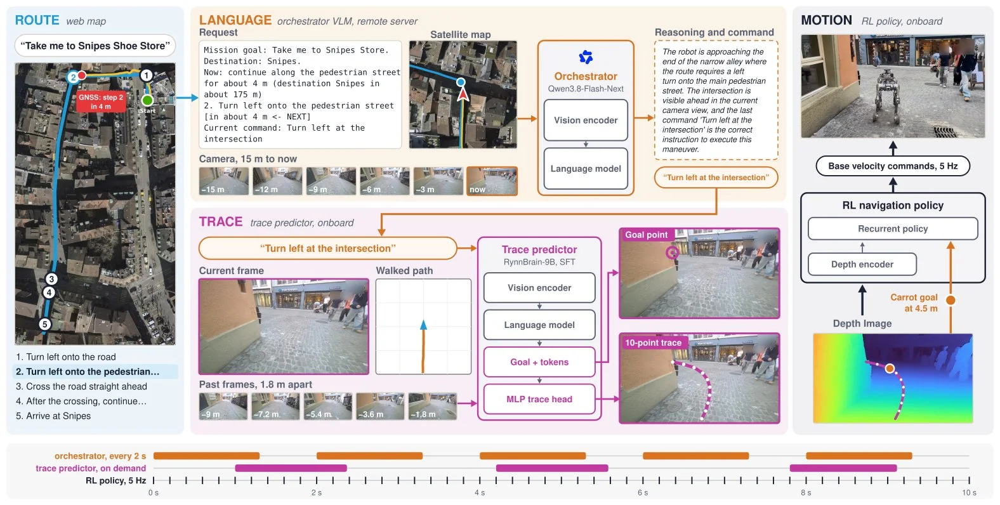
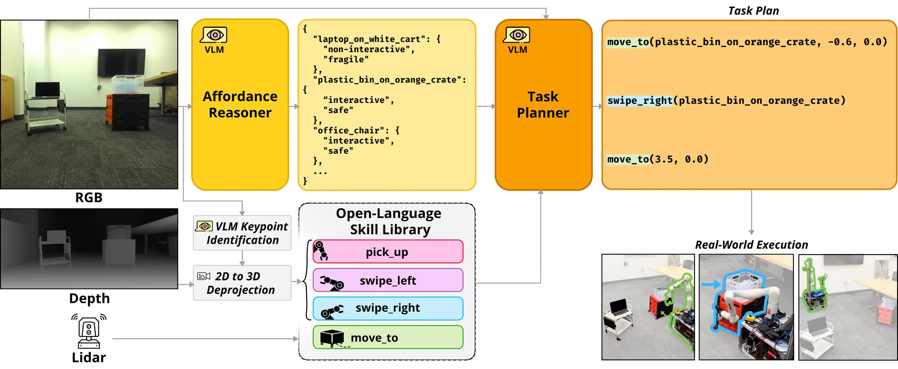
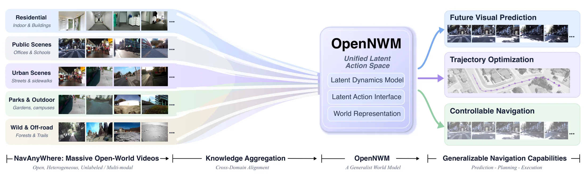

> **本期数字**：131 项独立工作（新收 91 项 / 版本更新 24 项 / 边界日承接 16 项）· 主线：VLN 8 篇 / 具身 Agentic 导航 6 篇 · 其他方向 117 篇 · 公众号 0 条

## 一、本期要点
{: id="key-points"}

- **语言到运动的接口有了更长距离的实机证据。** [WayTrace](#waytrace)把地图指引分解为语言命令，再交给轨迹预测与控制；论文报告最长 1.37 km 的真机任务。
- **导航决策同时面对“能否移动障碍”和“目标是否存在”。** [MessyNav](#messynav)先做可供性判断，[Object Search](#object-search)在检索后验证存在性，分别约束动作选择与目标选择。
- **VLN 的物理落地和世界建模走向不同的证据口径。** [Legged-VLN](#legged-vln)检验安全执行层，[OpenNWM](#opennwm)利用无动作标注视频学习动力学，不能用预测效果替代导航成功。

## 二、精读
{: id="deep-reads"}

### 1. WayTrace
{: id="waytrace"}

**用语言接口连接地图指引与长程运动。**

**[论文](https://arxiv.org/abs/2611.05129v1)** · 主线：具身 Agentic 导航 · 室外地图指引 / 轮足机器人

**问题。** 地图提供的步行指引与 GNSS 位置不足以直接生成可靠的街道运动。

**方法。** 编排 VLM 根据地图指引和近期图像逐条发出原子语言命令，车载预测器生成图像轨迹，再由强化学习策略跟踪；各层异步运行。

<figcaption>地图指引经语言命令与图像轨迹落到异步运动控制。 <a href="https://arxiv.org/html/2611.05129v1/fig_overview.png">论文原图</a></figcaption>

**证据。** 论文报告最长 1.37 km、约 1.1 m/s 的真机任务，包含人行横道、楼梯和施工场景；这是任务距离与速度，不是标准 VLN 成功率。

**判断。** 适合研究规划与控制的接口及等待时间，但系统仍使用网络地图、GNSS 和远端 VLM；不应据此宣称完全无定位依赖。

**下一步。** 精读：按路口、命令切换和轨迹失效统计错误，并核对网络延迟下沿旧轨迹执行的边界。

### 2. MessyNav
{: id="messynav"}

**先判断障碍能否移动，再规划怎样通过。**

**[论文](https://arxiv.org/abs/2611.07417v1)** · 主线：具身 Agentic 导航 · 开放世界交互导航 / 移动操作机器人

**问题。** 路被物体挡住时，几何上可移动并不意味着语义上适合移动，例如装有易碎物的推车。

**方法。** 显式可供性推理先判断交互的物理可行性和物体安全性，再由任务规划器编排导航、拾取与拨开动作；借助视觉定位把对象引用落到三维位置。

<figcaption>可供性推理先约束对象选择，再由规划器调用导航与操作技能。 <a href="https://arxiv.org/html/2611.07417v1/figs/fig2.png">论文原图</a></figcaption>

**证据。** 摘要称真机交互导航成功率比最强基线提高 27 个百分点；另有离线评测。摘要未列真机回合数与基线名称，不能据此推断绝对成功率。

**判断。** 对地面导航的价值是把“绕行”扩展为有条件的交互；语义风险判断和底层技能失败仍需分别评估。

**下一步。** 精读：比较显式可供性阶段与端到端 VLM 规划，重点看危险物体误交互和动作失败后的处理。

### 3. Legged-VLN
{: id="legged-vln"}

**把语义目标交给独立的物理约束执行层。**

**[论文](https://arxiv.org/abs/2611.04972v1)** · 主线：VLN · 人形 / 四足语言导航 · 真机验证

**问题。** VLM/VLA 能解释语言目标，却不自然具备对机器人几何、障碍距离和运动约束的显式保证。

**方法。** 在语义规划器下增加状态估计、三维感知和 SDF 表示，以 Bézier 参数化 MPPI 与离散指数屏障约束生成可执行轨迹。

**证据。** 摘要无数值；论文称在人形与四足机器人上开展真机实验，并在所述假设下给出避碰保证。

**判断。** 可将语义选点错误与局部执行错误分开定位。形式保证依赖建图、估计与模型假设，不能扩展成任意动态场景下的无碰撞结论；本工作不是 R2R-CE 排名证据。

**下一步。** 精读：核对障碍运动假设与约束不可行时的行为，再比较普通 MPPI 与加入屏障约束后的停滞和碰撞。

### 4. OpenNWM
{: id="opennwm"}

**先从多来源视频学习动力学，再对齐实际动作。**

**[论文](https://arxiv.org/abs/2611.01844v2)** · 主线：VLN · 视觉导航世界模型 · 跨环境预测与规划

**问题。** 有动作标注的导航轨迹覆盖有限，而大规模无动作标注视频不能直接监督可执行动作的后果。

**方法。** 用视频预测预训练潜在动作，再通过动作条件后训练对齐物理运动，将异构视觉经验用于导航动力学学习。

<figcaption>异构导航视频通过共享潜在动作空间支持预测、规划与执行。 <a href="https://arxiv.org/html/2611.01844v2/nwm-overview.png">论文原图</a></figcaption>

**证据。** NavAnywhere 包含来自 15 个来源的 1750 万个视觉观测；这是数据规模。摘要无导航成功率数值，只称预测和下游导航均有改善。

**判断。** 值得检查跨场景经验是否能改善导航，而非只改善图像预测。地面、人类和无人机视频的混合收益需要按来源和动作对齐方式拆开。

**下一步。** 精读：对照相同导航规划器，分别评估潜在动作预训练、物理对齐和训练数据来源的贡献。

### 5. Object Search
{: id="object-search"}

**让场景记忆检索能够明确返回目标不存在。**

**[论文](https://arxiv.org/abs/2611.07493v1)** · 主线：VLN · 开放词汇目标检索 / 导航前目标选择 · ScanNet

**问题。** 从历史图像中总能找到“最相似结果”，不代表被请求的物体确实存在。

**方法。** 先快速召回候选观测，再用视觉验证选择结果或拒答；返回图像及其采集位姿，为后续寻找目标提供线索。原文图 1 展示两阶段架构。

**证据。** 摘要称在 ScanNet 公寓场景中，视觉验证使可靠性达到或超过穷举搜索，同时将检测器调用减少一个数量级；另报告单张消费级 GPU 上的真机运行。

**判断。** 这是导航前的目标检索证据，不能替代完整 ObjectNav 成功率。历史记忆中的“不存在”也应与当前环境的“不存在”分开解释。

**下一步。** 复现：同时测召回、缺失目标的特异度与调用成本，再加入物体移动和过期观测。

## 三、也值得一看
{: id="also-worth"}

- **[Knowing Where to Look](https://arxiv.org/abs/2611.00499v1)** · 三维信念融合语义与几何证据，闭环选择观察、移动和开柜。
- **[HiPer](https://arxiv.org/abs/2611.07662v1)** · 从相似实例历史估计持久性；可借鉴到导航记忆过期处理。
- **[Graph-swap](https://arxiv.org/abs/2611.02056v1)** · 替换场景图后观察答案变化；可借鉴到记忆依赖诊断。
- **[LIFE](https://arxiv.org/abs/2611.00180v2)** · 用事件门控选择观测与写入；可借鉴到导航代理的持续监测。
- **[ARP](https://arxiv.org/abs/2611.05155v1)** · 语义记忆与动作生成异步运行；可借鉴到导航执行架构。
- **[VLALagBench](https://arxiv.org/abs/2611.03103v1)** · 按任务与执行模式测时延敏感性；可借鉴到导航运行时评测。
- **[REA](https://arxiv.org/abs/2610.42053v1)** · 边界判别与共享恢复预算；可借鉴到导航运行时，主证据为操作。
- **[RoboCasa-Mem](https://arxiv.org/abs/2611.06475v1)** · 由早期行为决定后续约束；可借鉴到导航历史使用的评测。
- **[RESONATE](https://arxiv.org/abs/2611.02937v1)** · 8 种配置、8 类场景、每类 5 次，共 320 次实机社会导航实验。
- **[EvoLife](https://arxiv.org/abs/2610.39446v1)** · 承接 10 月 29 日：统一主动求助、混合动作与持久地点记忆。

## 四、趋势与行动
{: id="trends-and-actions"}

**趋势**

- **分层接口需要与失败处理一起设计。** [WayTrace](#waytrace)的异步语言接口、[MessyNav](#messynav)的可供性阶段和 REA 的边界判别，分别处理命令刷新、交互选择与策略升级；它们尚不是同一套统一评测。
- **记忆评测需要允许拒答、过期和反事实检查。** [Object Search](#object-search)、HiPer、Graph-swap 与 SPARK 分别提示“对象缺失、位置变化、历史未被使用、知识出错”四类问题。
- **训练数据、离线指标和部署收益应分别核算。** [OpenNWM](#opennwm)的数据规模和 LoopQ 的硬件结论不能直接转化成导航成功率或真机速度收益。

**研究空白**

- 长程语言导航中，错误目标检索、过期地点记忆与执行失败如何联合触发回访或求助，仍缺少本批工作共同验证的闭环。
- 需要在同一任务上同时记录路线完成、误交互、正确停止、模型调用和等待时间，避免仅用成功率覆盖运行时问题。

**下一步**

- **高 · 精读** WayTrace 与 MessyNav：先复核任务协议、失败分类和异步执行边界，再决定复现哪一层。
- **高 · 复现** 将缺失目标查询与记忆替换诊断加入现有导航评测，区分检索正确、记忆被使用与最终到达。
- **中 · 跟踪** Legged-VLN 与 OpenNWM：分别核对安全假设和下游导航增益，保留分任务证据。
- **中 · 对照** 从上期 EvoLife 的主动求助与地点记忆出发，对照本期目标验证和事件触发机制。

## 五、全部工作索引
{: id="full-index"}

A 为两条主线的直接工作，B 为可迁移机制或评测，C 为领域观察；10 月 29 日的工作保留为承接材料。

VLN 与语义导航 · 8 篇

- [Object Search](#object-search): 见精读。
- [OdorSpaces](https://arxiv.org/abs/2611.05738v1): 将视觉与气味扩散结合用于室内源定位。
- [Legged-VLN](#legged-vln): 见精读。
- [SNAP](https://arxiv.org/abs/2611.03498v2): 统一语义地形与行人动态的导航策略。
- [RESONATE](https://arxiv.org/abs/2611.02937v1): 实机社会导航测试平台与重复实验协议。
- [OpenNWM](#opennwm): 见精读。
- [MOON](https://arxiv.org/abs/2610.33546v2): 版本更新；偏航判别触发清空与恢复。
- [WNM-3D](https://arxiv.org/abs/2608.07267v3): 版本更新；以三维场景条件联合生成观察与动作。

具身 Agentic 导航 · 6 篇

- [MessyNav](#messynav): 见精读。
- [WayTrace](#waytrace): 见精读。
- [Spatiotemporal Memory](https://arxiv.org/abs/2610.38318v2): 版本更新；组织任务、时间与空间记忆。
- [HaltNav](https://arxiv.org/abs/2603.12696v3): 版本更新；视觉暂停后修改拓扑并重规划。
- [Knowing Where to Look](https://arxiv.org/abs/2611.00499v1): 三维信念驱动观察、移动与开柜搜索。
- [EvoLife](https://arxiv.org/abs/2610.39446v1): 承接上期：主动求助、混合动作与持续地点记忆。

可迁移机制与评测 · 32 篇

- [Seeing Beyond the Next Step](https://arxiv.org/abs/2611.07730v1): 训练时蒸馏世界模型的社会导航偏好。
- [LMGN](https://arxiv.org/abs/2611.07515v1): 联合基座位置、接近方向与抓取阶段。
- [HiPer](https://arxiv.org/abs/2611.07662v1): 学习物体位置持久性并随重识别更新。
- [Generate-then-Rank](https://arxiv.org/abs/2611.07825v1): 生成后排序，减少符号目标解释错误。
- [Criteria Exposure](https://arxiv.org/abs/2611.08318v1): 检验代理得分是否依赖暴露的成功判据。
- [When to Ask for Help](https://arxiv.org/abs/2611.06702v1): 用预计导航收益决定何时请求空中观测。
- [RoboCasa-Mem](https://arxiv.org/abs/2611.06475v1): 以既往行为决定后续约束，测环境与流程记忆。
- [Failure-boundary profiles](https://arxiv.org/abs/2611.06453v1): 把应该停止与能够通过分开评价。
- [Cosmos Interactive Simulation](https://arxiv.org/abs/2611.06627v1): 按动作或外部物理状态流式生成观测。
- [LoopQ](https://arxiv.org/abs/2611.05093v1): 在同一引擎与权重上比较闭环量化收益。
- [DiMuRe](https://arxiv.org/abs/2611.04226v1): 以诊断结果选择不同层级的恢复操作。
- [ARP](https://arxiv.org/abs/2611.05155v1): 异步语义记忆与快速动作生成分频运行。
- [VLALagBench](https://arxiv.org/abs/2611.03103v1): 按任务、速度与执行模式检验时延敏感性。
- [HeLM](https://arxiv.org/abs/2611.02660v1): 事件触发的显式语言记忆支持跨回合操作。
- [Continual Spatial World Models](https://arxiv.org/abs/2611.04016v1): 跨回合空间变化与动作后果共同修正预测。
- [Serving Agentic Robot Fleets](https://arxiv.org/abs/2611.01404v1): 分析动作期限与长上下文缓存的服务瓶颈。
- [SCOUT](https://arxiv.org/abs/2611.01600v1): 针对遮挡，用对象世界模型检验候选计划。
- [Graph-swap](https://arxiv.org/abs/2611.02056v1): 替换记忆图，检验模型是否真正使用历史。
- [PREM](https://arxiv.org/abs/2611.00634v1): 以预测误差调节各位置视觉记忆的更新。
- [MOST](https://arxiv.org/abs/2611.00734v1): 用物体状态变化与子任务进度监督记忆。
- [Auriga](https://arxiv.org/abs/2611.01112v1): 动作前预览、执行中容差检查与原地恢复。
- [Understanding Embodied Memory](https://arxiv.org/abs/2610.41688v1): 按记忆需求、架构与评测证据梳理研究。
- [SPARK](https://arxiv.org/abs/2611.00344v1): 定向回访并纠正具身知识库；验证任务为 EQA。
- [RoboArchitect](https://arxiv.org/abs/2610.42141v1): 观察失败并自动修改冻结策略外的 harness。
- [REA](https://arxiv.org/abs/2610.42053v1): 异步路由、边界判别与有预算的恢复。
- [LIFE](https://arxiv.org/abs/2611.00180v2): 事件门控选择观测、记忆写入与工具扩展。
- [ID-WM](https://arxiv.org/abs/2610.42146v1): 分离高层可达子目标与低层动作落地。
- [BioAgent](https://arxiv.org/abs/2610.41383v1): 技能验证与执行前后条件控制任务推进。
- [RoboSeed](https://arxiv.org/abs/2610.40026v2): 把能力、成本与复现证据分维度评价。
- [LOGIV](https://arxiv.org/abs/2610.40016v3): 检查任务依赖的物理有效性并局部修复。
- [EmbodiExp](https://arxiv.org/abs/2610.39180v1): 按可验证子目标组合经验并利用局部成功。
- [CaPtain](https://arxiv.org/abs/2610.40799v1): 以代码策略组织机器人代理的后训练。

其他方向速览 · 85 篇

- **评测、恢复与安全（13）**：[OopsieRecover](https://arxiv.org/abs/2611.08462v1)、[AffectiveVLA](https://arxiv.org/abs/2611.07712v1)、[CRONOS](https://arxiv.org/abs/2611.05080v1)、[Auditing Imagined Rewards](https://arxiv.org/abs/2611.04873v1)、[Onboard HJ Reachability](https://arxiv.org/abs/2611.04096v1)、[Rollout then Recycle](https://arxiv.org/abs/2611.03168v1)、[RoboColosseum](https://arxiv.org/abs/2611.02497v1)、[When Delay Meets Drift](https://arxiv.org/abs/2611.02101v1)、[Route-Guided CBF-QP Repair for Safe…](https://arxiv.org/abs/2611.01713v1)、[ClothDojo](https://arxiv.org/abs/2611.01190v1)、[Simulator Contact Audit](https://arxiv.org/abs/2610.41857v1)、[Start Suppression](https://arxiv.org/abs/2610.41609v1)、[BURGER](https://arxiv.org/abs/2610.40532v1)
- **策略与操作（27）**：[SLA](https://arxiv.org/abs/2611.08373v1)、[La-JEPA](https://arxiv.org/abs/2611.08156v1)、[Concertina](https://arxiv.org/abs/2611.07513v1)、[A3-VLA](https://arxiv.org/abs/2611.06447v1)、[Astra / RoboMME](https://arxiv.org/abs/2611.06184v1)、[NEO-VLA](https://arxiv.org/abs/2611.06918v1)、[Action-Token Supervision](https://arxiv.org/abs/2611.05249v1)、[RAFT](https://arxiv.org/abs/2611.04368v1)、[Text-Action Divergence](https://arxiv.org/abs/2611.04166v1)、[PolicyIK](https://arxiv.org/abs/2611.05372v1)、[Beyond Policy Patches](https://arxiv.org/abs/2611.02777v1)、[AdaIE](https://arxiv.org/abs/2611.04006v1)、[ODE Policy](https://arxiv.org/abs/2611.01729v1)、[GatedVLA with Camera-Based…](https://arxiv.org/abs/2611.01663v1)、[Joint Denoisers](https://arxiv.org/abs/2611.01215v2)、[Behavioral Steering](https://arxiv.org/abs/2611.00522v1)、[CalVLA](https://arxiv.org/abs/2611.00394v1)、[SAFARI](https://arxiv.org/abs/2610.41456v1)、[TRACE](https://arxiv.org/abs/2610.41275v2)、[Consequence-Grounded Alignment](https://arxiv.org/abs/2610.39543v1)、[Gym-Anything](https://arxiv.org/abs/2610.40565v1)、[HiFOR](https://arxiv.org/abs/2610.40373v1)、[Step-Level Action Value](https://arxiv.org/abs/2610.40002v1)、[Planar Loco-Manipulation](https://arxiv.org/abs/2610.40248v1)、[UI Planning-Grounding Agent](https://arxiv.org/abs/2610.39264v1)、[PRIME W0](https://arxiv.org/abs/2610.39528v2)、[Smooth Action Chunking](https://arxiv.org/abs/2610.39451v1)
- **数据与技能（10）**：[Proactive Human Intervention](https://arxiv.org/abs/2611.05667v1)、[Action Intent as a Bridge](https://arxiv.org/abs/2611.04522v1)、[ActOR](https://arxiv.org/abs/2611.04255v1)、[Bridging Representation and Action](https://arxiv.org/abs/2611.04391v1)、[AceAction-5M](https://arxiv.org/abs/2611.04241v1)、[AIRoA-0](https://arxiv.org/abs/2611.03815v1)、[MoSoLoco](https://arxiv.org/abs/2611.03189v1)、[Imitable Teacher](https://arxiv.org/abs/2611.00615v1)、[Demonstration Expansion](https://arxiv.org/abs/2610.40430v1)、[TouchBridge](https://arxiv.org/abs/2610.40349v1)
- **驾驶与空中机器人（6）**：[MotoVerse](https://arxiv.org/abs/2611.06007v1)、[Aero-VPA](https://arxiv.org/abs/2611.04392v1)、[Scene-Adaptive Readout and Decoding…](https://arxiv.org/abs/2611.02076v1)、[STEER](https://arxiv.org/abs/2611.00718v1)、[OpenFlyV2](https://arxiv.org/abs/2610.39287v2)、[Long-Horizon Dexterity](https://arxiv.org/abs/2610.40828v1)
- **压缩与部署（9）**：[T3R](https://arxiv.org/abs/2611.08413v1)、[Calibrated Latent Probing](https://arxiv.org/abs/2611.08425v1)、[Kinematic Hypothesis Context](https://arxiv.org/abs/2611.07411v1)、[VLA Inference Bottlenecks](https://arxiv.org/abs/2611.06710v1)、[Same Path, Less Time](https://arxiv.org/abs/2611.01390v1)、[SVD-Prune](https://arxiv.org/abs/2611.02284v1)、[Leap-VLA](https://arxiv.org/abs/2611.01011v1)、[SACQ](https://arxiv.org/abs/2610.41408v1)、[STAR](https://arxiv.org/abs/2610.41009v1)
- **旧论文版本更新（20）**：[SimForcing](https://arxiv.org/abs/2610.06598v2)、[Intent-Conditioned Fine-Tuning](https://arxiv.org/abs/2606.12109v3)、[Selected Diffusion Noise](https://arxiv.org/abs/2606.14084v2)、[PDRVLA](https://arxiv.org/abs/2610.37381v3)、[Pre-Imagined Milestones](https://arxiv.org/abs/2606.09258v2)、[Self-Demonstrated Control](https://arxiv.org/abs/2608.19490v2)、[Compositional Agentic Robotics](https://arxiv.org/abs/2610.35817v3)、[LIBERO-RECOVER](https://arxiv.org/abs/2609.05178v4)、[CLAP](https://arxiv.org/abs/2607.08974v2)、[DuoBench](https://arxiv.org/abs/2606.11901v2)、[VLA Feature Mechanisms](https://arxiv.org/abs/2603.19233v6)、[OmniGuide](https://arxiv.org/abs/2603.10052v2)、[Neural Geometry](https://arxiv.org/abs/2610.20840v3)、[OpenHLM](https://arxiv.org/abs/2606.22174v2)、[MAESTRO](https://arxiv.org/abs/2511.00917v3)、[ActionFlow](https://arxiv.org/abs/2512.20276v2)、[RynnVLA-Latent](https://arxiv.org/abs/2610.34356v2)、[Large Discrete Policy](https://arxiv.org/abs/2609.07049v2)、[SpecPrune-VLA](https://arxiv.org/abs/2509.05614v4)、[Detect and Suppress](https://arxiv.org/abs/2610.03498v2)

