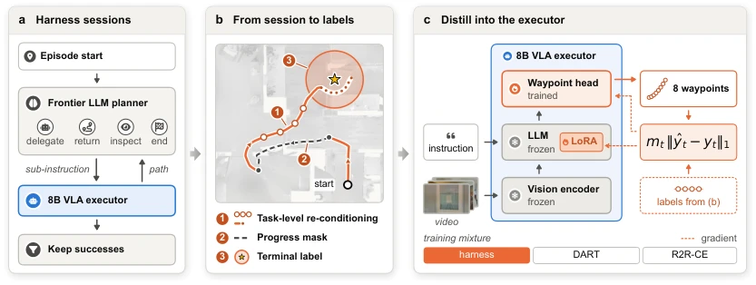
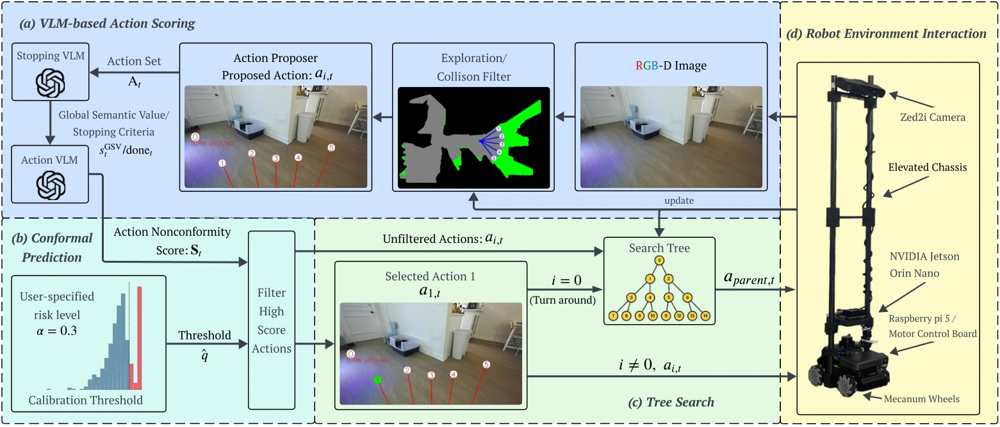
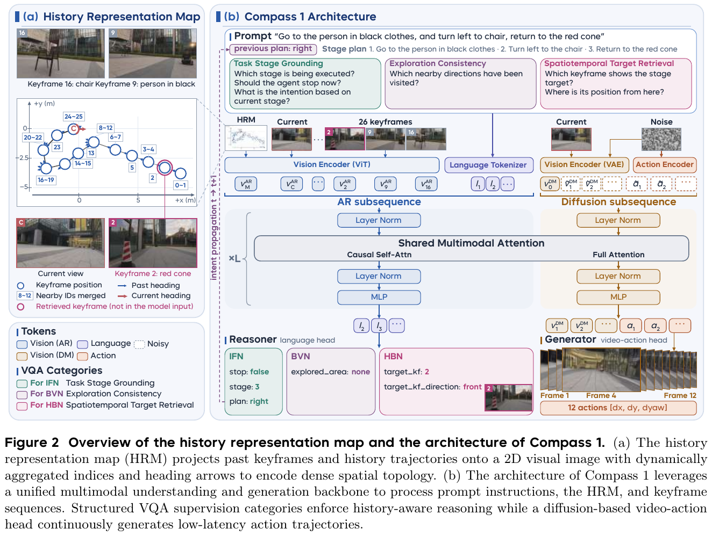
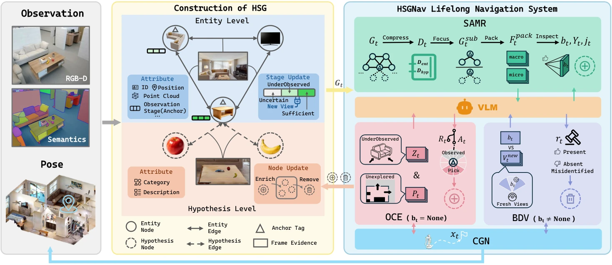
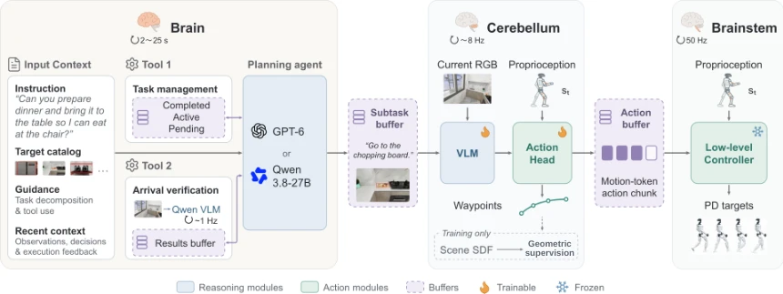

> **本期数字**：88 项独立工作（新收 86 项 / 版本更新 2 项）· 主线：VLN 7 篇 / 具身 Agentic 导航 2 篇 · 其他方向 79 篇 · 公众号 0 条

## 一、本期要点
{: id="key-points"}

- **导航能力开始从运行时协助转回执行器。** [H2E](#h2e)把 Agent 会话转为训练数据；论文报告 REVERIE-CE SR 从 35.0% 到 44.9%，测试时由 VLA 独立导航。
- **记忆既要会使用，也要能撤销。** [Compass 1](#compass-1)通过结构化监督学习历史回溯；[HSGNav](#hsgnav)把会移动的小物体当作可验证、可失效的假设。
- **动作评分与任务完成各有独立的验证环节。** [CPNav](#cpnav)校准候选动作分数，[LHNav](#lhnav)把到达反馈接入多频率执行系统，两者验证的对象并不相同。

## 二、精读
{: id="deep-reads"}

### 1. H2E
{: id="h2e"}

**让执行器学会独立完成曾需规划器协助的任务。**

**[论文](https://arxiv.org/abs/2611.16246v1)** · 主线：VLN · 目标指令导航 · REVERIE-CE（连续环境）

**问题。** 每个导航回合持续调用 LLM 规划器会增加成本，而 Agent 会话混有工具动作、子指令与绕路，不能直接当作执行器示范。

**方法。** 论文将成功会话的所有运动重新标到原始任务指令下，屏蔽远离目标步骤的训练损失，并为距目标 1 m 内的访问状态加停止标签，再用 LoRA 更新 VLA。

<figcaption>图 2：Agent 会话经任务重标、进度掩码和停止标签转成执行器训练数据。 <a href="https://arxiv.org/html/2611.16246v1#S2.F2">论文原图</a></figcaption>

**证据。** 论文报告：在全部 3,189 个 REVERIE-CE val-unseen 回合，8B VLA 的 SR 从 35.0% 提高到 44.9%。

**判断。** 价值在于将训练时的复杂编排转为测试时的简化执行；目前这些数字证明仿真导航增益，不能推出真机泛化或完整规划能力被蒸馏。

**下一步。** 复现：分别消融任务重标、进度掩码和停止标签，并独立记录到达率与停止成功率。

### 2. CPNav
{: id="cpnav"}

**把语言模型动作分数接到可检验的校准层。**

**[论文](https://arxiv.org/abs/2611.10366v1)** · 主线：VLN · ObjectNav · HM3D v0.2 / MP3D · RGB-D

**问题。** VLM 给出的高动作分数可能过度自信，单靠语义推断也不能保证候选动作可通行。

**方法。** 论文先生成避碰运动基元，再由两个 VLM 分别做目标检测与动作评分；利用离线 oracle 动作做共形校准，在线结合树状探索历史筛选动作并回溯。

<figcaption>图 1：动作候选、离线校准阈值与在线探索树组成导航闭环。 <a href="https://arxiv.org/html/2611.10366v1#S1.F1">论文原图</a></figcaption>

**证据。** 论文报告：相对未校准基线，HM3D v0.2 的 SR / SPL 相对提高 6.2% / 11.4%；MentorPi 真机评测对应相对提高 24.9% / 15.2%。

**判断。** 适合检验现有语义策略的分数可靠性；部署前应核对校准数据与现场分布是否匹配，有限样本保证不能直接解释成整条轨迹的无条件安全保证。

**下一步。** 复现：固定候选生成器，对比校准前后 SR、SPL、回溯次数与分布变化后的覆盖情况。

### 3. Compass 1
{: id="compass-1"}

**长时历史需要表示方式与使用监督一起设计。**

**[论文](https://arxiv.org/abs/2611.12087v1)** · [我的导读](https://tingdeliu.github.io/VLN-Papers-Outdoor/#compass-1) · 主线：VLN · 单目 RGB · 开放世界导航 / 历史回溯

**问题。** 历史帧记录了看过什么，却不一定说明在哪里看过、该往哪里返回；缺少使用监督时，模型也可能忽略已有记忆。

**方法。** 论文把稀疏关键帧的位置、编号与朝向画成历史表示地图（HRM），再用任务阶段、探索一致性和时空目标检索三类 VQA 教会模型读图；共享骨干连接语言推理与视频—动作预测。

<figcaption>图 2：左侧用 HRM 对齐历史关键帧与空间轨迹，右侧将记忆问答、语言推理及视频—动作预测接入统一骨干。 <a href="https://arxiv.org/pdf/2611.12087v1#page=4">论文原图</a></figcaption>

**证据。** 论文报告：4 类场景、8 类任务、各 10 次，共 320 次真机测试，总 SR 为 79.4%，AwareVLN 为 17.8%；持续历史回溯 SR 为 58%，该项最强对照为 0%。

**判断。** 适合研究长历史检索与回访，但总 SR 混合室内外任务，不能与标准 R2R-CE 直接排名；真机系统仍依赖里程计和远端 GPU，单目输入不等于整机无位姿支持。

**下一步。** 精读：对照已有导读核对 HRM 与 VQA 消融，分别检查历史检索准确性和闭环返回成功率。

### 4. HSGNav
{: id="hsgnav"}

**把可变的小物体记忆当作需要验证的假设。**

**[论文](https://arxiv.org/abs/2611.10547v1)** · 主线：具身 Agentic 导航 · 多尺度终身找物 · GOAT-Bench / FAROS-Bench

**问题。** 家庭小物体会移动，旧记录可能继续误导检索；为台面小物体逐个维护独立三维几何也容易失稳。

**方法。** 论文将稳定家具实体与可修订的表面物体假设分离；检索按尺度选择证据，探索补充观测，验证目标是否仍在，并作废被新证据否定的假设。

<figcaption>图 2：检索、探索与目标验证共同更新双层假设场景图。 <a href="https://arxiv.org/html/2611.10547v1#S3.F2">论文原图</a></figcaption>

**证据。** 论文报告：GOAT-Bench SR / SPL 为 71.2% / 50.3%，略高于 3D-Mem 的 69.1% / 48.9%；在新提出的 FAROS-Bench 上为 58.1% / 28.5%，最强对照 MSGNav 的 SR 为 36.7%，其中物体被搬走的动态子集为 57.1% 对 26.2%。去掉目标验证后动态子集 SR 降到 28.6%；验证准确率 86.8%（212 次），被误判作废的目标有 93.3% 可凭新观测找回。每个子任务的 VLM 调用为 18.2 次，3D-Mem 为 36.8 次。

**判断。** 与导航 Agent 的记忆失效问题直接相关，重点是何时撤销旧事实。增益主要来自自建的 FAROS-Bench，GOAT-Bench 上只领先约 2 个百分点；实验全在 Habitat 仿真，没有真机搬移测试，论文也没给延迟。

**下一步。** 精读：围绕“检索成功但目标已搬走”，核对验证误判的 13% 落在哪些尺度的物体上，再看连续搬移三次后 SR 从 82.4% 降到 78.4% 的失败案例。

### 5. LHNav
{: id="lhnav"}

**用进度与到达反馈协调不同频率的导航层。**

**[论文](https://arxiv.org/abs/2611.12136v1)** · 主线：具身 Agentic 导航 · 人形机器人 · 多目标长程语言导航

**问题。** 分解任务不能自动保证持续推进，航点正确也不代表人形机器人能自然稳定地走完路线。

**方法。** 论文让 Brain 管任务推理、Cerebellum 生成局部运动、Brainstem 执行全身控制；通过异步缓冲、进度与到达反馈协调各层，并用物理约束数据引擎训练局部运动。

<figcaption>图 3：任务管理与到达验证通过缓冲区连接局部运动和全身控制。 <a href="https://arxiv.org/html/2611.12136v1#S2.F3">论文原图</a></figcaption>

**证据。** 论文报告：仅用单目标示范训练的 VLA，在仿真长程导航任务中达到 75.56% SR；另展示 Unitree G1 真机单目标与零样本长程执行，摘要未给真机 SR。

**判断。** 可迁移到地面轮式系统的是任务状态、到达验证与异步执行接口；全身运动数据及控制器收益则与本体相关，需要分开验证。

**下一步。** 精读：检查目标切换时的陈旧动作处理，以及到达误判后的恢复路径。

## 三、也值得一看
{: id="also-worth"}

- **[PreNav](https://arxiv.org/abs/2611.15093v1)** · VLN：先生成全局搜索参考，再在线检测目标；Gibson 六类子集上同等先验比 SGM 高 2.3 个 SR 点，十类全集只高 1.4 个点；真机 15 次成功 13 次。
- **[BAMOS](https://arxiv.org/abs/2611.15689v1)** · VLN：用检测误差消融检验目标信念更新；漏检率到 0.3 时成功率只降 0.018，误检的影响大得多（HSSD 最多降 0.402），且只与自身消融比较。
- **[EMS-Nav](https://arxiv.org/abs/2611.15589v1)** · VLN：按区域组织端侧多尺度导航，值得核对资源开销。
- **[HeMeR](https://arxiv.org/abs/2611.16487v1)** · 可借鉴到导航 Agent 的记忆缓存复用；真机数字来自操作场景。
- **[SimplEvo](https://arxiv.org/abs/2611.11509v1)** · 可借鉴到导航 Agent 的训练期经验修订与固定记忆测试。
- **[Memory as a Clock?](https://arxiv.org/abs/2611.14488v1)** · 可借鉴到导航记忆评测：用无效停顿区分时间与真实进度。
- **[HDH](https://arxiv.org/abs/2611.14834v1)** · 可借鉴到候选动作验证；操作任务结果尚不能证明导航收益。
- **[IncR-3DSGG](https://arxiv.org/abs/2611.15429v1)** · 可借鉴到纯 RGB 导航地图，推理仍依赖相机位姿。
- **[MAP-VP](https://arxiv.org/abs/2611.11510v1)** · 可借鉴到停止后的目标核验；依赖基准提供的地图地标轮廓。
- **[AST](https://arxiv.org/abs/2611.14111v1)** · 可借鉴到导航停滞检测，需先定义任务尚未解决的证据需求。

## 四、趋势与行动
{: id="trends-and-actions"}

**趋势**

- **推理成本成为系统设计变量。** H2E 将协助经验沉入权重，PreNav 将搜索参考提前生成，LHNav 将慢推理与快执行分开。比较时应同时记录成功率、调用成本与总耗时。
- **长期记忆的关键转向状态维护。** Compass 1、HSGNav 与 BAMOS 分别涉及历史利用、旧记录失效与目标信念更新。统一增加上下文长度可能掩盖这几类机制的差异。

**研究空白**

- 仍缺少同时考察目标搬移、无效停顿、检测误差和模型延迟的地面导航统一评测，难以判断记忆收益能否跨失效类型保持。
- 规划器蒸馏后的恢复能力、置信校准的跨场景有效性，以及到达验证误判后的纠错，应在独立真机测试中分别报告。

**下一步**

- **高 · 复现** H2E：先拆分到达与停止，核实收益来自执行能力还是终止标签。
- **高 · 精读** HSGNav / LHNav：提取记忆失效与任务切换接口，整理可迁移到轮式导航的最小闭环。
- **中 · 对照实验** CPNav / BAMOS：固定感知输入，分别改变评分校准与信念更新机制。
- **中 · 跟踪** Compass 1：等待可复核的任务协议、模型和数据，再安排跨本体复现。

## 五、全部工作索引
{: id="full-index"}

按两条主线、可迁移机制和其他方向分组，覆盖本期全部独立工作。

VLN 与语义导航 · 7 篇

- [CPNav](#cpnav)：见精读。
- [CSG-Nav](https://arxiv.org/abs/2611.11978v1)：融合语义置信度与深度定位，约束探索和停止。
- [Compass 1](#compass-1)：见精读。
- [PreNav](https://arxiv.org/abs/2611.15093v1)：根据稳定结构与家具先验预生成搜索参考。
- [EMS-Nav](https://arxiv.org/abs/2611.15589v1)：以区域层级组织多尺度语言目标与端侧地图。
- [BAMOS](https://arxiv.org/abs/2611.15689v1)：联合目标信念、占据与检测误差分析主动搜索。
- [H2E](#h2e)：见精读。

具身 Agentic 导航 · 2 篇

- [HSGNav](#hsgnav)：见精读。
- [LHNav](#lhnav)：见精读。

可迁移机制 · 13 篇

- [Flex-RSI](https://arxiv.org/abs/2611.08946v1)：在固定预算内评测 harness 自我修订。
- [A2-MEAS](https://arxiv.org/abs/2611.09124v1)：用纠错代码连接训练监督与运行时恢复。
- [CUA Generalists](https://arxiv.org/abs/2611.09847v1)：以屏幕与软件控件访问具身环境。
- [SimplEvo](https://arxiv.org/abs/2611.11509v1)：训练阶段修订文本经验，测试时固定记忆。
- [MAP-VP](https://arxiv.org/abs/2611.11510v1)：用地图地标提示修正空中导航末端定位。
- [WanderBench](https://arxiv.org/abs/2611.12557v1)：评测视频世界探索中的回访一致性。
- [Safe Depth](https://arxiv.org/abs/2611.13769v1)：以深度不确定性支持安全导航感知。
- [AST](https://arxiv.org/abs/2611.14111v1)：监测任务信息获取是否停滞。
- [Memory as a Clock?](https://arxiv.org/abs/2611.14488v1)：停顿干预揭示时间索引记忆的虚假进度。
- [HDH](https://arxiv.org/abs/2611.14834v1)：冻结策略，用小型验证器挑选动作块。
- [IncR-3DSGG](https://arxiv.org/abs/2611.15429v1)：用带位姿 RGB 增量构建三维场景图。
- [HeMeR](https://arxiv.org/abs/2611.16487v1)：按记忆内容变化局部更新 KV 缓存。
- [ProtoVis-Nav](https://arxiv.org/abs/2611.17330v1)：以局部视觉想象约束无人机航点。

其他方向速览 · 66 篇

- **版本更新（2）**：[A3-VLA](https://arxiv.org/abs/2611.06447v2)、[NEO-VLA](https://arxiv.org/abs/2611.06918v3)
- **通用模型与其他（10）**：[Run-and-Tumble Agent](https://arxiv.org/abs/2611.07531v1)、[NINJA](https://arxiv.org/abs/2611.10027v1)、[DexDICE](https://arxiv.org/abs/2611.09433v1)、[MaRiO](https://arxiv.org/abs/2611.10344v1)、[Collaborative Inference / 6G](https://arxiv.org/abs/2611.11023v1)、[DocFS](https://arxiv.org/abs/2611.12957v1)、[Embodied Science Agents](https://arxiv.org/abs/2611.12958v1)、[MOON-RL](https://arxiv.org/abs/2611.15227v1)、[XBot-Omni](https://arxiv.org/abs/2611.17160v1)、[Memory Footprints](https://arxiv.org/abs/2611.17257v1)
- **VLA 与操作（46）**：[Q-OIL](https://arxiv.org/abs/2611.08576v1)、[Meituan-Robotics-0](https://arxiv.org/abs/2611.08577v3)、[VICTR](https://arxiv.org/abs/2611.08698v2)、[ActPrune](https://arxiv.org/abs/2611.08827v2)、[PRISM](https://arxiv.org/abs/2611.08917v1)、[VLA Handover](https://arxiv.org/abs/2611.08987v1)、[ToolDex](https://arxiv.org/abs/2611.09036v1)、[DobotTrack](https://arxiv.org/abs/2611.09041v1)、[HiMEM](https://arxiv.org/abs/2611.09355v1)、[ODEAction](https://arxiv.org/abs/2611.09672v2)、[SURE](https://arxiv.org/abs/2611.09684v1)、[Agentic Manipulation](https://arxiv.org/abs/2611.09892v1)、[Spatial Representation…](https://arxiv.org/abs/2611.10443v1)、[Look Ahead](https://arxiv.org/abs/2611.10769v1)、[DreamVLA](https://arxiv.org/abs/2611.10872v1)、[Zero-Shot VLA Adaptation with…](https://arxiv.org/abs/2611.10894v1)、[Control-Aware Command Generation…](https://arxiv.org/abs/2611.11089v2)、[Efficient VLA Inference via…](https://arxiv.org/abs/2611.11098v2)、[From Game Generation to Game Playing](https://arxiv.org/abs/2611.11136v1)、[Kimodo-Policy](https://arxiv.org/abs/2611.11554v1)、[Streaming Failure Forecasting](https://arxiv.org/abs/2611.11688v1)、[SurgTAP-3D](https://arxiv.org/abs/2611.11697v1)、[PAIR](https://arxiv.org/abs/2611.11798v1)、[Decoupled Asynchronous System for…](https://arxiv.org/abs/2611.11854v2)、[Instruction Weight Edits](https://arxiv.org/abs/2611.11894v1)、[Thermo-VLA](https://arxiv.org/abs/2611.11981v1)、[Motion Belief Action](https://arxiv.org/abs/2611.12113v1)、[GeoMind](https://arxiv.org/abs/2611.12175v1)、[VLA-MOPD](https://arxiv.org/abs/2611.12286v1)、[Be My Eye](https://arxiv.org/abs/2611.12295v1)、[VLA Adaptation with Real and…](https://arxiv.org/abs/2611.12676v1)、[Learning Heterogeneous Tactile…](https://arxiv.org/abs/2611.12806v1)、[APS-VLA](https://arxiv.org/abs/2611.13030v1)、[Robo-MLT](https://arxiv.org/abs/2611.13039v1)、[How Much VLA Is kNN?](https://arxiv.org/abs/2611.13160v1)、[BEHAVIOR / WAM](https://arxiv.org/abs/2611.13818v1)、[DexSeed](https://arxiv.org/abs/2611.14092v1)、[BEHAVIOR / One Policy](https://arxiv.org/abs/2611.14432v1)、[Scaling VLA Serving Under Robotic…](https://arxiv.org/abs/2611.14969v1)、[PolyMorphWBC](https://arxiv.org/abs/2611.15117v1)、[Low-Cost Mobile Bimanual…](https://arxiv.org/abs/2611.15381v1)、[ActionCodec2](https://arxiv.org/abs/2611.15490v1)、[What Makes a VLA Reactive?](https://arxiv.org/abs/2611.15491v1)、[MOSAIC](https://arxiv.org/abs/2611.15937v1)、[I See What You Want](https://arxiv.org/abs/2611.16419v1)、[STVLA](https://arxiv.org/abs/2611.16589v1)
- **运动控制与定位（6）**：[Fisheye Polarization](https://arxiv.org/abs/2611.08911v1)、[FASTFUNNELS](https://arxiv.org/abs/2611.09005v1)、[Compliance / Passive Walker](https://arxiv.org/abs/2611.13779v1)、[A Faster and Efficient Indoor User…](https://arxiv.org/abs/2611.13828v1)、[ReACT](https://arxiv.org/abs/2611.13929v1)、[VINE](https://arxiv.org/abs/2611.16282v1)
- **自动驾驶（2）**：[DeltaForge](https://arxiv.org/abs/2611.11856v1)、[CARE-Drive](https://arxiv.org/abs/2611.15360v1)

