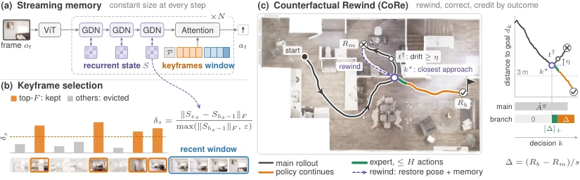
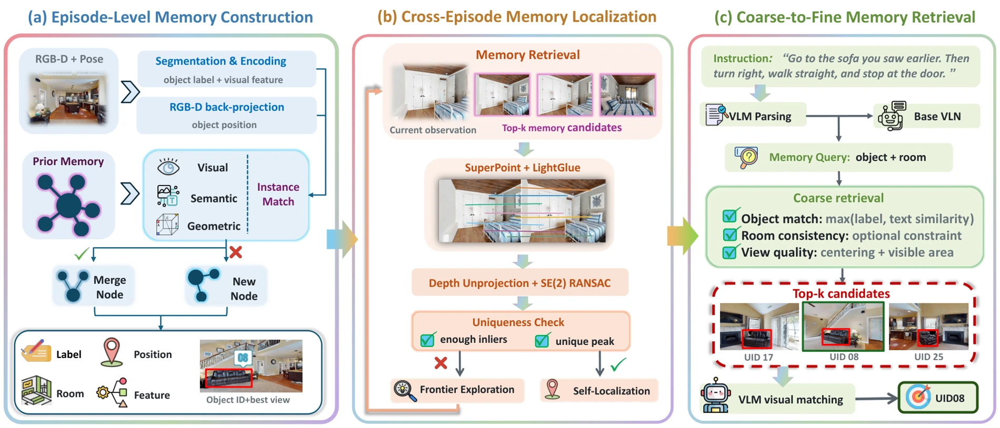
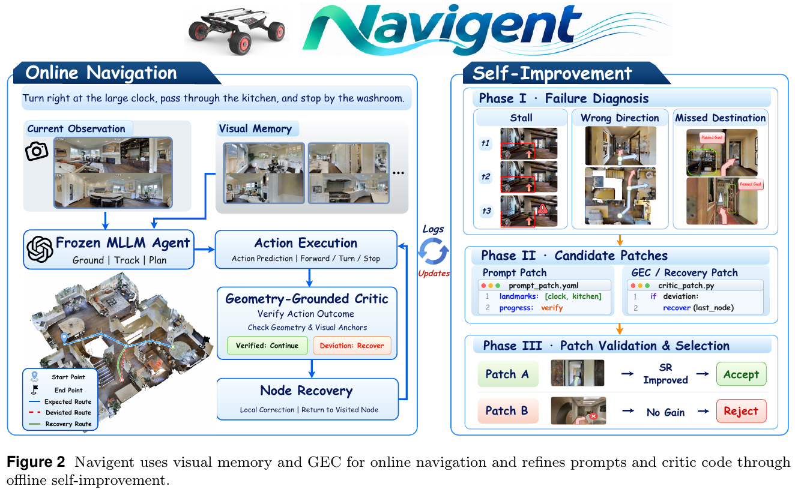
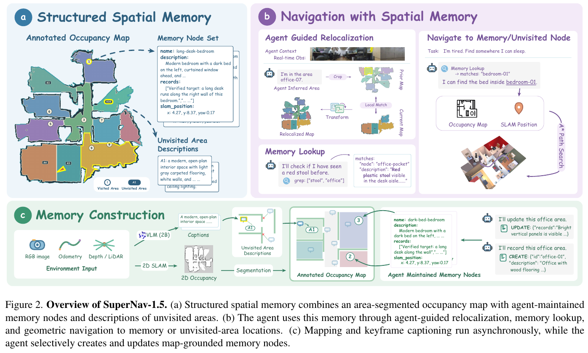
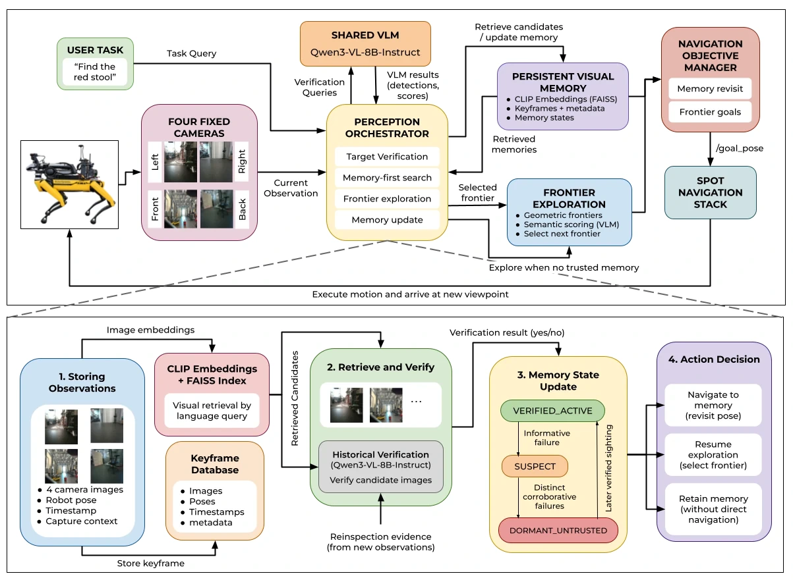

> **本期数字**：135 项独立工作（窗口内首次提交 131 项 / 既有论文修订 4 项）· 主线：VLN 7 篇 / 具身 Agentic 导航 5 篇 · 其他方向 123 篇 · 公众号 0 条

## 一、本期要点
{: id="key-points"}

- **固定历史预算也能做长程指令跟随。** [GlanceNav](#glancenav)把视频帧编码一次，用循环状态、近期帧和关键帧保留沿途信息。
- **跨回合记忆开始按使用过程评测。** [Mem-X](#mem-x)检查机器人是否按要求重走历史路线，[SuperNav-1.5](#supernav)测量更换起点后复用地图能节省多少路程。
- **验证模块开始决定机器人何时中断或改目标。** [Navigent](#navigent)根据位移和地标检查动作，[Memory Revision](#memory-revision)根据复查证据撤销或恢复记忆点的使用资格。

## 二、精读
{: id="deep-reads"}

### 1. GlanceNav
{: id="glancenav"}

**每帧只编码一次，历史长度增长时单步开销保持稳定。**

**[论文](https://arxiv.org/abs/2611.30900v1)** · 主线：VLN · 指令跟随 · R2R-CE / RxR-CE（连续环境）

**问题。** 每次决策重复编码历史帧会增加延迟。整回合奖励也难定位哪一步引起绕路或走偏。

**方法。** 循环层传递状态，注意力层保留近期帧和按状态变化选出的关键帧。训练时，CoRe 恢复到轨迹最接近目标的位置，让专家短暂纠偏，再用结果差异为决策分配奖励。

<figcaption>图 2 展示单次帧编码、按状态变化保留关键帧，以及训练时的回溯纠偏。 <a href="https://arxiv.org/html/2611.30900v1#S3.F2">论文原图</a></figcaption>

**证据。** 论文报告 4B 模型的 val-unseen SR 在 R2R-CE 为 71.9%，在英语 RxR-CE 为 73.6%。RTX PRO 6000 上每次策略调用约 104 ms。

**判断。** 固定容量有助于稳定长路线的推理延迟。Unitree G1 真机演示由外部工作站推理，部署时还需计入传输和执行时间。

**下一步。** 固定骨干与视觉帧预算，对照纯滑窗和关键帧库，按路线长度分别记录延迟、SR 和 SPL。

### 2. Mem-X
{: id="mem-x"}

**到达终点之外，还要核验历史地标经过顺序。**

**[论文](https://arxiv.org/abs/2611.27166v2)** · 主线：VLN · 跨回合指令跟随 · Mem-X（连续仿真）

**问题。** 当指令引用先前见过的对象或路线时，常规成功率无法区分机器人是否用到了历史信息。

**方法。** Mem-X 逐级考查对象回忆、跨回合定位和从历史覆盖区外重入旧路线。基线 MemBridge 用 RGB-D 和局部位姿建语义图，配准回合坐标后检索目标。

<figcaption>图 2 展示回合内建图、跨回合配准和粗到细检索。 <a href="https://arxiv.org/html/2611.27166v2#S2.F2">论文原图</a></figcaption>

**证据。** 数据集在 34 个场景中包含 2,071 个回合，其中 1,204 个依赖记忆。论文报告 JanusVLN 加入 MemBridge 后，Level 3 的约束成功率（C-SR）从 5.73% 升至 28.66%。

**判断。** C-SR 能揭示绕过历史地标而直接到达终点的情况。Level 3 的结果表明，机器人从记忆覆盖区外起步时仍容易失败。

**下一步。** 分别关闭历史检索和跨回合定位，记录起点在覆盖区内外时的重定位成功率和 C-SR。

### 3. Navigent
{: id="navigent"}

**执行核验同时检查机器人走了多远、是否越过地标。**

**[论文](https://arxiv.org/abs/2611.34249v1)** · [我的导读](https://tingdeliu.github.io/Agentic-Navigation-Papers/#navigent) · 主线：具身 Agentic 导航 · 执行验证 · R2R-CE / RxR-CE（连续环境）

**问题。** 连续执行多步动作时，移动受阻和错过入口都可能让机器人偏离指令。

**方法。** 冻结多模态模型负责规划，几何执行核验器用位姿和深度检查指令动作与实际位移是否一致，以及运动与地标的相对关系。发现异常时中断余下动作，触发复看、局部调整或沿节点恢复。

<figcaption>图 2 展示视觉记忆、执行核验与离线提示和规则更新。 <a href="https://arxiv.org/html/2611.34249v1#S3.F2">论文原图</a></figcaption>

**证据。** 论文报告 R2R-CE val-unseen 的 SR / SPL 为 84.0% / 72.9%，RxR-CE 为 86.0% / 69.1%。SCOUT MINI 真机在 6 个任务的 30 次试验中成功 27 次，停止阈值为距目标 1 米。

**判断。** 核验器给出了可记录的中断原因。复现时应分别报告深度、里程计与模型调用预算，才能定位增益来自哪一环节。

**下一步。** 固定模型与传感器，分开关闭位移检查和地标检查，按卡住、越界两类失败统计恢复率。

### 4. SuperNav-1.5
{: id="supernav"}

**地图上的记忆节点可以直接转成可执行目标。**

**[论文](https://arxiv.org/abs/2611.29912v2)** · [我的导读](https://tingdeliu.github.io/Agentic-Navigation-Papers/#supernav-1-5) · 主线：具身 Agentic 导航 · 跨会话物体导航 · Habitat-GS

**问题。** 图文记忆能描述见过的地方，但机器人换一个起点后，需要先恢复自身在地图上的位置，才能沿原地图前往目标。

**方法。** 在分区占据图上记录带坐标的记忆节点和未探索区域。新会话用当前观测与旧记录推断所在区域，缩小几何重定位的搜索范围，再调用导航工具。

<figcaption>图 2 展示如何记录地图节点、重定位，并导航到记忆目标或未探索区域。 <a href="https://arxiv.org/html/2611.29912v2#S2.F2">论文原图</a></figcaption>

**证据。** 在 Habitat-GS 单物体任务的第二会话更换起点时，论文报告复用记忆使 SR 从 78.00% 到 82.00%，SPL 从 0.4364 到 0.5022。Unitree Go2 展示了记忆点回访与多物体任务。

**判断。** 固定第二会话起点的对照能隔离记忆收益。物体挪动、地图过期时，仍需测量错误目标带来的额外路程。

**下一步。** 在同一地图设置相似房间与已挪动目标，分别记录重定位错误和过期记忆误用。

### 5. Memory Revision
{: id="memory-revision"}

**连续漏检时，可以暂停使用旧路标并保留复查机会。**

**[论文](https://arxiv.org/abs/2611.34915v1)** · 主线：具身 Agentic 导航 · 持久记忆核验 · Boston Dynamics Spot

**问题。** 同一视角附近重复漏检可能来自感知盲区，也可能来自对象被移走。按漏检次数淘汰记忆会放大相关观测的影响。

**方法。** 给相近复查归组，限制相关漏检的累积权重。证据不足时暂停把记忆点作为直接导航目标，转向语义前沿搜索，后续阳性证据可恢复使用。

<figcaption>图 2 展示旧记忆的复查、降级、恢复及切换到语义前沿的流程。 <a href="https://arxiv.org/html/2611.34915v1#S4.F2">论文原图</a></figcaption>

**证据。** Spot 的 40 对相邻复查中，36 对得到相同检测结果。三组共享过期记忆历史的配对情境中，基线均选旧记忆点，所提方法均转向语义前沿。

**判断。** 证据支持目标选择会改变。三组情境共用同一段记忆历史，端到端找物成功率和耗时还需独立试验。

**下一步。** 随机改变目标是否在场和复查视角，分别统计错误回访、有效记忆误停用与搜索耗时。

## 三、也值得一看
{: id="also-worth"}

- **[PHAR](https://arxiv.org/abs/2611.32400v1)** · 检查视觉证据是否支持当前指令进度，并在误停前选择回退幅度。
- **[AlphaNav](https://arxiv.org/abs/2611.34561v1)** · 将视野外的路线方向编码为机体方位角，供小模型和控制器使用。
- **[One Shared Image](https://arxiv.org/abs/2611.33865v1)** · 在 RxR-EN 和 SAGE 仿真接力中，给动作记录加一张动作前图像，并以配对回放测量影响。
- **[EviCraft](https://arxiv.org/abs/2611.32765v1)** · 检查工具内部是否偷用未观测的仿真状态，可借鉴到导航仿真的信息泄漏审计。
- **[NWM Action Interface Audit](https://arxiv.org/abs/2611.34739v1)** · 对齐训练与评测的动作输入，可借鉴到导航世界模型的测试协议。
- **[Tripwire](https://arxiv.org/abs/2611.27182v2)** · 由轻量监控器在动作执行中发出中断，可借鉴到地面机器人的长动作调度。

## 四、趋势与行动
{: id="trends-and-actions"}

**趋势**

- **记忆评测正在区分保留、定位和使用。** [GlanceNav](#glancenav)控制回合内记忆开销，[Mem-X](#mem-x)核验旧路是否走对，[SuperNav-1.5](#supernav)衡量复用地图是否缩短路径。
- **多步执行开始引入可观测的中断理由。** [Navigent](#navigent)检验位移与地标关系，PHAR 查指令进度，[Memory Revision](#memory-revision)根据新证据决定旧目标是否可用。三者可用不同失败事件分别触发。

**研究空白**

- 需要在同一批地面任务里同时扰动起点、目标位置与检测视角，区分地图配准失败、物体移动和感知漏检。
- 需要在统一传感器与调用预算下报告端到端耗时、恢复率、SR 和 SPL，才能比较不同核验策略的收益。

**下一步**

- **高 · 复现** 在同一冻结策略上复现 [GlanceNav](#glancenav)式记忆与纯滑窗对照，记录每次调用耗时和长路线上的 SR / SPL。
- **高 · 评测** 结合 [Mem-X](#mem-x) 的受约束成功率与 [SuperNav-1.5](#supernav) 的换起点协议，增加目标移动和地图变更条件。
- **中 · 评测** 结合 [Navigent](#navigent)与 [Memory Revision](#memory-revision)设计阻塞、越过地标、相关漏检三组试验，分别统计触发次数与恢复代价。

## 五、全部工作索引
{: id="full-index"}

以下索引覆盖本期 135 项工作，包括两条导航主线（A）、可迁移方法（B）与相邻领域（C）。

VLN 与语义导航 · 7 篇

- [GlanceNav](#glancenav)。见精读。
- [Mem-X](#mem-x)。见精读。
- [AlphaNav](https://arxiv.org/abs/2611.34561v1)。用机体方位角输出路径并纠正策略访问状态。
- [PoseVLN](https://arxiv.org/abs/2611.32218v1)。同步预测短程动作与相对位姿变化。
- [PHAR](https://arxiv.org/abs/2611.32400v1)。在停止前核验指令进度，按需回退。
- [NavDecision](https://arxiv.org/abs/2611.28796v1)。并行预测动作，用成功轨迹指导策略更新。
- [WorldWeave](https://arxiv.org/abs/2611.28553v1)。用潜动作共享导航与视觉跟踪的预测动力学。

具身 Agentic 导航 · 5 篇

- [Navigent](#navigent)。见精读。
- [SuperNav-1.5](#supernav)。见精读。
- [Memory Revision](#memory-revision)。见精读。
- [One Shared Image](https://arxiv.org/abs/2611.33865v1)。用配对回放测量机器人接力时单帧图像的价值。
- [SEER](https://arxiv.org/abs/2611.30310v1)。共享多机观测的潜在表征，各机器人独立决策。

可迁移方法 · 15 篇

- [EviCraft](https://arxiv.org/abs/2611.32765v1)。约束工具查询的证据来源，可用于排查仿真信息泄漏。
- [CoverMem](https://arxiv.org/abs/2611.32119v1)。按场景覆盖增量更新记忆，供固定预算检索。
- [InfoField3D](https://arxiv.org/abs/2611.29230v1)。在可达性和遮挡约束下选取下一观察位置。
- [CARE-3D](https://arxiv.org/abs/2611.29969v1)。用反事实对照给空间问答工具分配证据贡献。
- [RUIBench](https://arxiv.org/abs/2611.31115v1)。在相同感知与控制下比较机器人动作接口。
- [Tripwire](https://arxiv.org/abs/2611.27182v2)。以轻量监控器在操作策略执行中发出中断。
- [CriticJEPA](https://arxiv.org/abs/2611.32357v1)。用冻结的世界模型给候选计划排序。
- [NWM Action Interface Audit](https://arxiv.org/abs/2611.34739v1)。检查世界模型训练与评测的动作输入是否一致。
- [MERLoc](https://arxiv.org/abs/2611.34932v1)。用位姿先验检索离线渲染的参考视图。
- [Nav4Manip](https://arxiv.org/abs/2611.34655v1)。用下游操作反馈细化移动底盘的抵达姿态。
- [MotionServe](https://arxiv.org/abs/2611.30083v1)。按动作缓冲剩余时间调度多机共享推理。
- [RegHarness](https://arxiv.org/abs/2611.33739v1)。管理从操作执行积累到可复用技能的过程。
- [Study of Harness Design](https://arxiv.org/abs/2611.34778v1)。对照机器人操作系统中的工具和运行时设计。
- [ReWeave](https://arxiv.org/abs/2611.31053v1)。从任务执行轨迹提取共享结构并优化运行时。
- [Self-Upgrading Embodied Agents](https://arxiv.org/abs/2611.31117v1)。先回归验证再保留经验驱动的权重编辑。

相邻领域 · 108 篇

- **无人机与水下机器人（6）**。[CoFiNav](https://arxiv.org/abs/2611.32493v1)、[ROVO](https://arxiv.org/abs/2611.32475v1)、[A Simple Yet Effective Agent for…](https://arxiv.org/abs/2611.34115v1)、[End-to-End Image-Goal Navigation for…](https://arxiv.org/abs/2611.34046v1)、[One Ocean, Many Tasks](https://arxiv.org/abs/2611.34925v1)、[Towards 360circ Embodied UAV Tracking…](https://arxiv.org/abs/2611.33934v1)
- **几何导航、控制与感知（7）**。[MobileNeTTT](https://arxiv.org/abs/2611.29454v1)、[Scenario Compliant Indoor Pedestrian…](https://arxiv.org/abs/2611.29366v1)、[Does Research-Paper Context Improve…](https://arxiv.org/abs/2611.32381v1)、[ObsBridge](https://arxiv.org/abs/2611.32447v1)、[Seeing to Drive on a Single Board](https://arxiv.org/abs/2611.32718v1)、[Anytime-Valid Sequential Verification…](https://arxiv.org/abs/2611.34764v1)、[Geometric Acceleration Obstacles](https://arxiv.org/abs/2611.34586v1)
- **自动驾驶（5）**。[AlpaSafe](https://arxiv.org/abs/2611.28509v1)、[AgentMoT](https://arxiv.org/abs/2611.30389v1)、[Pruning Autonomous Driving VLAs](https://arxiv.org/abs/2611.31240v1)、[GeoVLDrive](https://arxiv.org/abs/2611.32510v1)、[NativeDrive](https://arxiv.org/abs/2611.32216v1)
- **机器人数据与评测（7）**。[LIBERO-MOR](https://arxiv.org/abs/2611.28867v1)、[FabricBench](https://arxiv.org/abs/2611.31577v1)、[WorldLeague](https://arxiv.org/abs/2611.30989v1)、[Physicl Scenes](https://arxiv.org/abs/2611.33137v1)、[AIRIS](https://arxiv.org/abs/2611.34347v1)、[Dynamic Task Update Benchmark…](https://arxiv.org/abs/2611.34538v1)、[FailPoint-X](https://arxiv.org/abs/2611.33769v1)
- **人形与全身操作（4）**。[BeyondEgo](https://arxiv.org/abs/2611.27047v2)、[zeta_0](https://arxiv.org/abs/2611.29277v1)、[DiffGR00T](https://arxiv.org/abs/2611.32665v2)、[EgoLoAF](https://arxiv.org/abs/2611.32260v1)
- **VLA 推理与执行效率（11）**。[AsyncMixVLA](https://arxiv.org/abs/2611.28585v1)、[JEPA-Tuner](https://arxiv.org/abs/2611.29096v1)、[Hierarchical Reasoning Action Head for…](https://arxiv.org/abs/2611.29813v1)、[DelayOPSD](https://arxiv.org/abs/2611.30534v1)、[NoveltyGate](https://arxiv.org/abs/2611.31099v1)、[ProMix](https://arxiv.org/abs/2611.29873v1)、[Quantizing in the Loop](https://arxiv.org/abs/2611.30178v1)、[Resource-Aware VLA-MPC Co-Location for…](https://arxiv.org/abs/2611.30177v1)、[Perception Is Enough, at the Right Scale](https://arxiv.org/abs/2611.31954v1)、[Procedure Inference as Memory](https://arxiv.org/abs/2611.34576v1)、[RePace](https://arxiv.org/abs/2611.34864v1)
- **VLA 训练、适应与数据（30）**。[TacInno](https://arxiv.org/abs/2611.26405v3)、[DeRail](https://arxiv.org/abs/2611.28803v1)、[NAT](https://arxiv.org/abs/2611.28873v1)、[PhysPPF](https://arxiv.org/abs/2611.28551v1)、[VTLA-RL](https://arxiv.org/abs/2611.28752v1)、[A2I-VLA](https://arxiv.org/abs/2611.29279v1)、[JKO-GRPO](https://arxiv.org/abs/2611.29646v1)、[Representation Alignment Is Only as…](https://arxiv.org/abs/2611.29483v1)、[Self-Refining VLA Sampling](https://arxiv.org/abs/2611.29383v1)、[Beyond Which](https://arxiv.org/abs/2611.30291v1)、[ConsisX](https://arxiv.org/abs/2611.30308v2)、[EgoStudy](https://arxiv.org/abs/2611.30490v1)、[GeoMerge-OPD](https://arxiv.org/abs/2611.30632v1)、[Near-Zero Forgetting Is Not Enough](https://arxiv.org/abs/2611.31511v1)、[OVOGO](https://arxiv.org/abs/2611.30477v1)、[RoboAda](https://arxiv.org/abs/2611.30209v2)、[SWEEP-Bench](https://arxiv.org/abs/2611.30637v1)、[Beyond Expert Replay](https://arxiv.org/abs/2611.31903v1)、[DexWAC](https://arxiv.org/abs/2611.32654v1)、[ReFocus](https://arxiv.org/abs/2611.32639v1)、[Sparks of Weight-Space Programming for…](https://arxiv.org/abs/2611.31715v1)、[What Does a Skill Vocabulary Cost? A…](https://arxiv.org/abs/2611.32858v1)、[A Failure-Driven Data Flywheel for…](https://arxiv.org/abs/2611.34698v1)、[Cairn](https://arxiv.org/abs/2611.34914v1)、[CamAct](https://arxiv.org/abs/2611.34257v1)、[DataForgeVLA](https://arxiv.org/abs/2611.34287v1)、[Escapingthe instruction blackhole of…](https://arxiv.org/abs/2611.34280v1)、[HoloBrain-0.5 Technical Report](https://arxiv.org/abs/2611.34449v1)、[Integration of Vision-Language-Action…](https://arxiv.org/abs/2611.33880v1)、[widetildevarepsilon](https://arxiv.org/abs/2611.33816v1)
- **世界模型与动作预测（7）**。[Spatially Grounded Latent Lookahead…](https://arxiv.org/abs/2611.28839v1)、[JEPA-ICL](https://arxiv.org/abs/2611.30516v1)、[World Models as Native Latent Action…](https://arxiv.org/abs/2611.30898v1)、[LeanWAM](https://arxiv.org/abs/2611.31740v1)、[Aegis-VLA](https://arxiv.org/abs/2611.33993v1)、[Can Visual World Models See Force?](https://arxiv.org/abs/2611.34422v1)、[FreshVLA](https://arxiv.org/abs/2611.33635v1)
- **操作感知、记忆与空间定位（13）**。[JevNavAgent](https://arxiv.org/abs/2611.28766v1)、[More Than Picturing the Future](https://arxiv.org/abs/2611.29339v1)、[Ground, Guide, Act](https://arxiv.org/abs/2611.31452v1)、[Hi3R-VLA](https://arxiv.org/abs/2611.31535v1)、[RMR-VLA](https://arxiv.org/abs/2611.30145v1)、[WeaveVLA](https://arxiv.org/abs/2611.31126v2)、[KeyMemVLA](https://arxiv.org/abs/2611.32081v1)、[MXI-MemICL](https://arxiv.org/abs/2611.32564v1)、[Seeing Is Not Reaching](https://arxiv.org/abs/2611.32206v1)、[Beyond Natural-Language Instructions](https://arxiv.org/abs/2611.34352v1)、[Commit2Drive](https://arxiv.org/abs/2611.34614v1)、[M2AdaptVLA](https://arxiv.org/abs/2611.34560v1)、[MMotion](https://arxiv.org/abs/2611.33819v1)
- **操作鲁棒性与安全评测（10）**。[Detecting Is Not Choosing](https://arxiv.org/abs/2611.29553v1)、[Embodied Neuro-symbolic AI](https://arxiv.org/abs/2611.31488v1)、[FATCAT](https://arxiv.org/abs/2611.31129v1)、[Best-of-N Test-Time Steering Can Lead…](https://arxiv.org/abs/2611.33398v1)、[Embodied AI Fails the Mirror Test](https://arxiv.org/abs/2611.33010v1)、[Knocked Off Course](https://arxiv.org/abs/2611.32705v1)、[Sparse Poison, Strong Hijack](https://arxiv.org/abs/2611.32304v1)、[Why Does Sensor Depth Fail Learned…](https://arxiv.org/abs/2611.33352v1)、[FlipVLA](https://arxiv.org/abs/2611.33810v1)、[One Patch, Many Policies](https://arxiv.org/abs/2611.34360v1)
- **操作智能体与工具（6）**。[Body and Soul](https://arxiv.org/abs/2611.30550v1)、[Real2Worlds2Real](https://arxiv.org/abs/2611.31098v1)、[RoboThink](https://arxiv.org/abs/2611.30111v2)、[RoboHarness-RL](https://arxiv.org/abs/2611.32016v1)、[VLAs Execute, Code Recovers](https://arxiv.org/abs/2611.32245v1)、[RoboEvo2](https://arxiv.org/abs/2611.34675v1)
- **其他相邻研究（2）**。[VidForce](https://arxiv.org/abs/2611.32967v1)、[3D CoCa v3](https://arxiv.org/abs/2611.33835v1)

