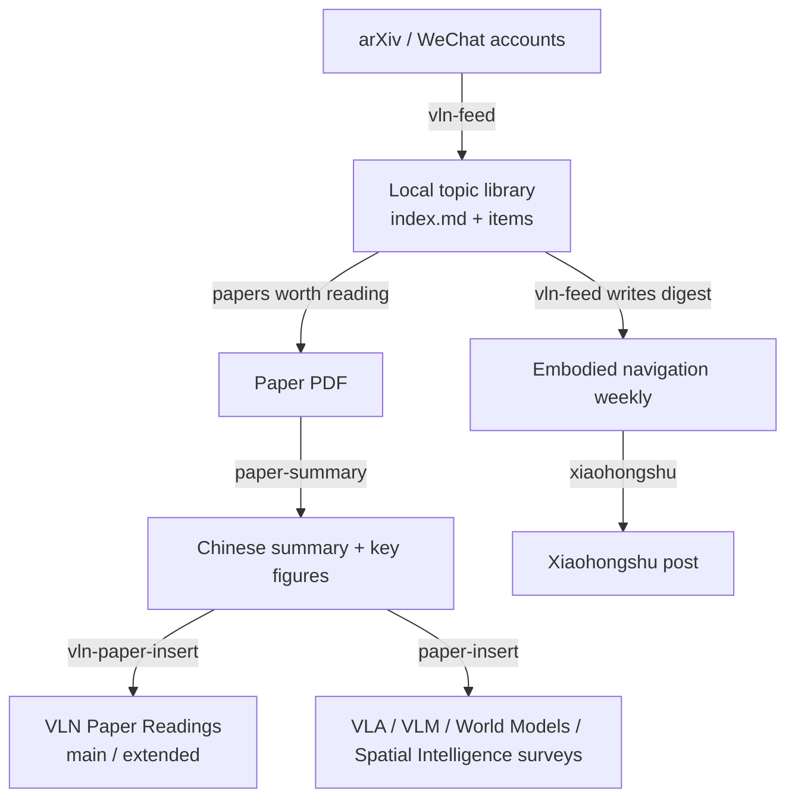

# 1. Before we start

The repository behind this blog was created on January 4, 2026. In the ten months since, it has accumulated more than 950 commits, 18 research surveys and paper-reading collections, and 12 embodied-navigation weekly digests. The main VLN Paper Readings page has reached its cap of 60 papers, with an uncapped extended page alongside it, and the English edition covers every survey and digest.

I did not type all of this word by word. Most of the time I work with AI coding assistants such as Claude Code and Codex: I decide what to read and how to judge it, and they handle fetching, organizing, formatting, validating, and the mechanical steps I would otherwise repeat a hundred times. What made this collaboration stable was not one brilliant prompt, but a set of **Skills** that I kept refining.

This post covers three things:

1. Why I built this site;
2. How the site itself is built and maintained;
3. Most importantly, how I turned the pipeline of "fetch sources → read papers → write summaries → insert them into surveys" into a set of Skills, and the pitfalls I hit while refining them.

Almost all of the skills I use live in one repository. Feel free to use or adapt them: **[TingdeLiu/Tyndall-Skills](https://github.com/TingdeLiu/Tyndall-Skills)**.

<!-- more -->

# 2. Why build this blog

## 2.1 Papers I have read need a home

My research focuses on embodied navigation (VLN, ObjectNav) and the neighboring areas of VLA, world models, and spatial intelligence. The field moves fast: arXiv can see more than a hundred new navigation-related works in a single week. Early on, my notes were scattered across PDF annotations, Obsidian, and chat logs. Two months later, when I wanted to recall "the method that reached an SR in the 60s on R2R-CE", I usually could not find it again.

I needed a place where every paper I read has a fixed home: a consistent structure, searchable, and placed next to related work for comparison. A blog fits naturally. Each survey becomes a knowledge map that keeps growing.

## 2.2 Writing in public forces understanding

"Understanding" a paper in my head and writing a paragraph someone else can follow are two different things. When writing a survey I have to answer questions such as: how exactly does this method differ from the previous one? Can its numbers sit in the same table as everyone else's? These questions send me back to the original paper instead of stopping at the abstract.

## 2.3 Making progress in the field trackable

Paper readings provide depth, but not freshness. So I also started a weekly embodied-navigation digest: pull in the week's new work, sort it into pools, pick a few papers worth a close reading, and compress the rest into an index. Digests and surveys feed each other. Papers selected for close reading in a digest later go through paper-summary and into a survey.

# 3. The site skeleton: keep it simple, leave complexity to the content

## 3.1 Technology choices

The site runs on Jekyll 4.3 with a heavily customized jekyll-now theme, hosted on GitHub Pages. The reasons are simple:

- **Content is just Markdown files**, which AI assistants read and write without friction, and every diff is easy to review;
- **No database or backend**, so there is nothing to operate;
- **Push to deploy**: GitHub Actions builds and publishes the site.

The directory conventions are equally plain. Research surveys go in `_posts/research/`, weekly digests in `_posts/weekly-reports/`, and technical notes like this one in `_posts/blog/`. Paper figures are grouped by topic under `images/vln/`, `images/vla/`, `images/wm/`, and so on. Intermediate paper summaries live in `paper_summary/` and are not rendered as articles.

## 3.2 CI as the build machine

A somewhat counterintuitive fact: the computer I maintain the blog on **does not have Ruby installed**, so I cannot run `jekyll build` locally. Every build happens in CI, and after pushing I watch the result with `gh run watch`.

That constraint produced a fairly complete pipeline. On every push, Actions runs:

1. `lint_posts.py`: checks article formatting rules (more on why this step matters most below);
2. `check_translations.py`: compares the synchronization state of Chinese and English versions;
3. Unit tests for translation tracking;
4. The Jekyll build;
5. `check_site_styles.py` and `check_english_site.py`: check the compiled stylesheet, English pages, and language-switch links.

If any step fails, nothing is published. For a site whose content is produced largely with AI assistance, this gate matters more than anything else.

## 3.3 Two languages

The English edition is not a separate set of posts. It lives in its own `_translations/en/` collection, and each translation is paired with its Chinese source through a `translation_id`. `check_translations.py` hashes the Chinese source section by section and records the hashes in `docs/translations/*.en.json`. If a source section changes and the translation does not follow, the build reports that section as stale. "Chinese first, English later" becomes a tracked state rather than a vague backlog.

# 4. Write the rules for the AI, then let machines enforce them

## 4.1 AGENTS.md: the project's onboarding manual

The repository root contains an `AGENTS.md` (Claude Code reads the equivalent `CLAUDE.md`). It is the first thing an AI assistant reads when it enters the project, and it describes the site structure, the article front matter, and how to write images and formulas.

The most valuable parts are a few **hard rules**, each learned the hard way:

- **Editing any existing article updates its `date:` to today.** The article list therefore always sorts by most recent update, and readers can see at a glance which pages were maintained recently.
- **No blank lines inside an image `
` block.** When kramdown meets a blank line inside the block, it switches back to Markdown mode and prints the `` tag as plain text.
- **HTML attributes must use ASCII straight quotes.** Editing tools sometimes replace `"` with curly quotes, and the image disappears entirely.
- **Inline formulas containing `}_` must use double dollar signs.** kramdown treats the underscore in `}_` as the start of italics and breaks the formula apart.

Each rule traces back to an incident where an image broke or a formula shattered after publishing.

## 4.2 Rules that live only in documents will eventually be broken

I quickly learned that writing a rule into `AGENTS.md` is only the first step. The model follows it most of the time, but in long conversations, batch edits, or after the context has been compressed, something always slips through.

So every hard rule also has a **machine-checkable version** in `scripts/lint_posts.py`, which runs as the first CI step. Curly quotes, blank lines inside `
`, `}_` formulas: if any check fails, the build fails.

This is the lesson I would most like to recommend from the whole project: **every rule you write for an AI should also have a check that can run in CI.** The document makes sure the model knows; the script makes sure it cannot get it wrong.

## 4.3 Memory: carrying today's lessons into the next session

Beyond the rules in the repository, Claude Code keeps a set of cross-session memory files for things that do not belong in the repository but will certainly come up again. For example:

- Jekyll consumes double curly braces inside Mermaid diagrams as Liquid templates, so a diagram that parses locally can still fail online;
- Writing a long script longer than roughly 10 KB through a Bash heredoc gets silently truncated;
- Batch-checking arXiv citations should go through the export API, which handles more than 60 entries in one request, instead of checking them one by one;
- The two weekly digests marked `published: false` are intentional, not defects, so there is no need to raise them again.

Each memory is small, but together they save me from re-explaining the same pitfalls in every new session.

# 5. Skills: turning one-off prompts into reusable tools

## 5.1 What a Skill is

In Claude Code, a Skill is a directory whose core is a `SKILL.md` file:

- Its front matter contains a `name` and a `description`; the model uses the description to decide when to invoke the skill;
- The body describes the workflow, command templates, and caveats;
- It can sit next to `scripts/` (deterministic scripts) and `references/` (reference material read on demand).

Compared with re-describing the task in every conversation, Skills have three advantages:

1. **They load only when needed.** Normally the model sees just a one-line description, and reads the full workflow only when the skill triggers, which saves context.
2. **Scripts do the deterministic work; the model does the judgment.** Extracting figures, renaming files, counting characters, and inserting anchors go to Python instead of relying on the model's estimates. Understanding a paper, choosing what to read closely, and deciding where it belongs go to the model.
3. **Experience accumulates.** After every pitfall, I write the cause and the fix back into `SKILL.md`, so the same mistake does not happen again.

## 5.2 The whole pipeline

Content production for the blog roughly follows this chain:

The following sections walk through the core skills in order.

## 5.3 vln-feed: the weekly entry point

`vln-feed` collects new material in embodied navigation into a local topic library and then writes the weekly digest. Its skeleton is a classic pipeline:

> **RSS sources → keyword filtering → deduplication → one Markdown file per item + an index**

Concretely:

- **Sources** are configured in `feeds.yaml`: two arXiv queries (embodied navigation, and embodied agents / AgentOS), plus WeChat official accounts;
- Each item is saved as `items/*.md` and collected into `index.md`; `seen.json` handles deduplication, so reruns only add new items;
- Each item is automatically tagged with a **domain** and a **benchmark** field, so digest filtering queries fields directly instead of running regular expressions over full text;
- The digest has three layers sized to the reader's time: a numbers bar with key points, 3–5 close-reading cards, and a collapsed index of all works. Before publishing, `validate_report.py` checks structure, length budget, figures, and links.

It sounds simple, but this is the skill I have changed most. A few pitfalls stand out:

**Why there are pools.** At one point I noticed the library was almost entirely VLA manipulation papers, while the embodied-agent work I actually wanted was missing. On inspection, 52 of 70 items in one issue (74%) never mentioned navigation; they had all flowed in through an unconstrained `vision-language-action` query branch. Instead of cutting them, I split them into **pools**: navigation and embodied agents form the primary pool, which gets the deep analysis, while VLA manipulation, autonomous driving, and other items go to a secondary pool summarized as brief lists.

**"Navigation" is too common a word.** Knowledge graphs have "Graph Navigation", software engineering has "Navigating architecture", and GUIs have "GUI Navigation". I once tried "count it as navigation if the abstract mentions navigation", and a pile of clinical agents and SWE agents squeezed into the primary pool. The final rules are: titles take priority over abstracts, agent terms must pass an "embodied context" gate, and `waypoint` must appear close to words such as robot or navigation. Each rule carries a comment explaining why it must not be removed, so nobody reverts it later.

**arXiv started returning 406.** From mid-September 2026, under heavy load the arXiv API only served queries that hit its cache. My queries are long custom strings that nobody else will ever cache, so they were rejected again and again. Changing the user agent, the headers, or switching to POST did not help. The solution was an **automatic fallback**: when the API fails, the script switches to OAI-PMH, pulls complete cs and eess metadata by date, and matches the unchanged query locally. A comparison showed about 98% recall.

**The WeChat route took several detours.** The original wewe-rss depended on a relay its author hosted on Deno Deploy Classic, and it stopped working for good when that platform shut down. After moving to a self-hosted we-mp-rss, I ran into account-level rate limiting on the WeChat Official Accounts Platform. The first step of the skill is now a five-second probe script that branches on the return code: under rate limiting it falls back to manually supplied article links, and if there are none, the issue uses arXiv only. **An unreliable source should never block the whole pipeline.**

All of these experiences are recorded in `SKILL.md` as they happened, with dates and reasons. Next time, even if a different model runs the skill, it knows which paths have already been tried.

## 5.4 paper-summary: one paper into one structured summary

Once I have chosen a paper to read closely, I hand the PDF to `paper-summary`. Its workflow is:

1. **Read the PDF first and decide which pages contain key figures**, instead of scanning every page;
2. Run TF-ID (a figure and table detector based on Florence-2) **only on those pages** to extract figures;
3. Generate a Chinese summary, insert image placeholders in the method and experiment sections, and mark each figure's target name with a `RENAME` comment;
4. Run `process_images.py` to rename the figures, move them into `images/<topic>/`, convert them to lossless WebP, delete unused images, and update the paths in the Markdown in one pass.

Every summary opens with a **"Key takeaways"** section: at most five sentences, covering only ideas that transfer to other work. It is the part I return to most often.

This skill also illustrates the principle of letting scripts do deterministic work. Unicode issues with conda on Windows, poppler missing from PATH, and `.bat` files that change the working directory so relative paths land in the wrong place were all pinned down into a **single command template**. The model only has to copy it, rather than rediscovering the setup each time.

## 5.5 vln-paper-insert and paper-insert: putting summaries into surveys

After a summary is written, it still has to go into the right article. This looks simple but touches many places. For VLN Paper Readings, `vln-paper-insert` handles up to five insertion points at once:

1. A new section in the body with a fixed anchor;
2. A `TAG_MAP` entry for the page filter;
3. A numbered entry in the reference list;
4. The conference / journal table for published papers (preprints are skipped);
5. Optional leaderboard rows, placed in SR order with bold formatting reapplied by rule.

VLN papers are split across two pages. **The main page holds at most 60 papers**: published work or work on the instruction-following leaderboards. **The extended page has no cap** and holds preprints and further additions. So the first step of the skill is always to **ask me which page**. If the main page is full, one existing paper must first move to the extended page, and I decide which one; the skill never makes that call on its own. Each page's filter also shows matches from the other, so `sync_remote.py` runs after every addition or removal.

`paper-insert` handles the other four surveys: VLA, VLM, world models, and spatial intelligence. Its most interesting part is a **classification decision tree**. Modern VLMs are becoming spatial, and spatial intelligence is becoming model-based, so the two often overlap. The decision tree assigns a paper by asking whether its inputs and outputs are strongly 3D and geometric or general 2D image and text, which has removed a lot of back-and-forth about where a paper belongs.

## 5.6 Supporting skills

- **xiaohongshu**: rewrites a digest or article as a Xiaohongshu post and generates 1080×1440 image cards. It holds to one principle: the 20-character title and 1000-character body limits **must be counted with a script**, never estimated. Xiaohongshu counts UTF-16 code units, emoji count as two, and visual estimates are often more than 25% too low.
- **video-subtitle-extractor / video-localize**: extract subtitles from Bilibili and YouTube videos, or turn them into bilingual subtitles and a Chinese dub, which I use to organize talks.
- **skill-creator**: writes and evaluates new skills, and is itself a skill.

# 6. How the skills repository is managed

## 6.1 One repository, several machines

All skills live in one Git repository: **[TingdeLiu/Tyndall-Skills](https://github.com/TingdeLiu/Tyndall-Skills)**. On my machine, `~/.claude/skills` is a symbolic link to that repository, so editing a skill in Claude Code edits the repository files directly, ready to commit.

I work on two computers, and the blog repository lives at a different path on each. So wherever a skill refers to the blog path, it **lists the paths for both machines** and uses whichever exists locally. If neither exists, it asks me instead of guessing.

## 6.2 Skills I wrote and skills I borrowed

The skills in the repository come from two places:

- **Written by me**: vln-feed, paper-summary, vln-paper-insert, paper-insert, xiaohongshu, and others tied closely to this blog's workflow;
- **Borrowed**: Anthropic's official pdf, docx, pptx, and skill-creator; Matt Pocock's grilling and diagnosing-bugs; and several skills from other community authors.

I often tweak borrowed skills, which raises a question: what happens when upstream changes? Overwriting loses my edits; never updating means falling behind. So I wrote `sync-upstream-skills`. `upstream.json` records each borrowed skill's upstream repository, path, and matching upstream commit, and `sync-upstream.py` uses that base for a three-way comparison: if only upstream changed, it overwrites; if both sides changed, it merges with `git merge-file`; files added locally are kept.

# 7. Lessons learned

Looking back over these ten months, these are the points I think are most worth sharing:

**1. Write pitfalls into the skill, and write down why.** "Don't do this" is not enough; next time the model, or I, will think the rule is unnecessary and delete it. Recording the date, the symptom, and the cause is what makes a rule stick.

**2. If a script can do it, don't give it to the model.** Counting, renaming, inserting anchors, checking formats: a script gets these right once and for all, while a model doing them a hundred times will eventually get one wrong. The model's value is judgment, not mechanical work.

**3. Validators matter more than generators.** `lint_posts.py`, `validate_report.py`, `check_translations.py`, and the Xiaohongshu character counter each protect quality more than the generation step they check.

**4. Leave key judgments to a human.** Which papers to read closely, which paper leaves the full main page, which survey a paper belongs to: the skills stop and ask me. Automation is there to remove mechanical work, not to make research judgments for me.

**5. What an AI writes is not automatically fact.** Paper numbers and citation links must be checked against the source. I regularly batch-check survey citations through the arXiv export API, dozens at a time.

**6. Allow the pipeline to degrade.** Sources go down, interfaces change, platforms shut down. A good pipeline keeps going when one stage fails instead of stalling entirely.

# 8. Closing

This blog is itself an experiment: can one person, working with AI assistants, maintain a research site of real depth and scale over the long term? After ten months, my answer is yes, provided you are willing to spend time breaking the workflow down clearly, writing the rules down, capturing experience in skills, and setting gates for yourself in CI.

If you are doing something similar, feel free to browse the skills in the repository: **[TingdeLiu/Tyndall-Skills](https://github.com/TingdeLiu/Tyndall-Skills)**. They are written around my own workflow and may not apply directly, but the records of pitfalls and the notes on why things were designed this way may save you a few detours. Questions are welcome as a GitHub Issue.
