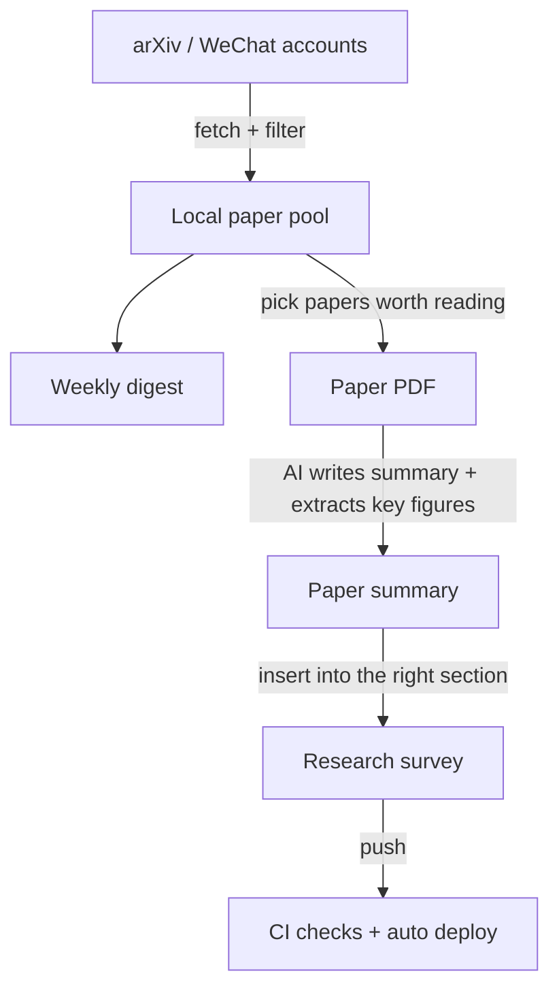

I started this blog in January 2026. It now holds 18 research surveys, more than 60 VLN paper readings, and a weekly embodied-navigation digest. Almost all of it was written together with AI coding assistants (Claude Code and Codex).

The split is simple: **I decide what to read and how to judge it; AI handles fetching, organizing, formatting, and checking.** Below is how the workflow is put together, so you can build a similar research-notes site of your own.

<!-- more -->

# 1. The workflow

Each arrow is something I have done hundreds of times. I turned each one into a reusable "skill" the AI can call (Claude Code calls them Skills): an instruction file that spells out the steps, plus a few scripts for the deterministic parts. After that, a single sentence such as "write this week's digest" or "summarize this paper" makes the AI follow the same process every time.

# 2. Four steps

**Step 1: Collect sources.** Every week, [vln-feed](https://github.com/TingdeLiu/Tyndall-Skills/tree/main/vln-feed) pulls new embodied-navigation work from arXiv and WeChat accounts, filters it by keywords, removes duplicates, stores it in a local pool, and writes a digest: highlights, 3–5 close readings, and an index of everything else. I only read the digest and decide which papers deserve a closer look.

**Step 2: Read the paper.** I give the PDF to [paper-summary](https://github.com/TingdeLiu/Tyndall-Skills/tree/main/paper-summary). It first finds the pages with key figures, extracts them with [pdf-figure-extractor](https://github.com/TingdeLiu/Tyndall-Skills/tree/main/pdf-figure-extractor), and writes a Chinese summary with a fixed structure. Each summary opens with a "key takeaways" section of at most five sentences, covering only ideas that transfer to other work. I then check the key numbers and claims against the original paper.

**Step 3: Add it to a survey.** A summary has to land in the right place in the right survey, along with its anchor, reference entry, leaderboard rows, and more. [paper-insert](https://github.com/TingdeLiu/Tyndall-Skills/tree/main/paper-insert) (for the VLA, VLM, world-model, and spatial-intelligence surveys) and [vln-paper-insert](https://github.com/TingdeLiu/Tyndall-Skills/tree/main/vln-paper-insert) (for the VLN paper list) handle this. They are written around this site's post structure, so using them on another blog means adjusting the section headings, and they always stop to ask me which page to use and whether an older paper should be moved out.

**Step 4: Publish.** The site runs on Jekyll and GitHub Pages. Posts are plain Markdown files, so AI can read and edit them easily, and there is no backend. After each push, GitHub Actions runs format checks before building and deploying; if any step fails, nothing goes live.

# 3. Where to start if you want one

1. **Start with the simplest static blog.** Jekyll or Hugo plus GitHub Pages is enough; what matters is that all content is plain text.
2. **Write an `AGENTS.md` (or `CLAUDE.md`) at the repository root.** Describe the folder layout, post format, and how to write images and math. The AI reads it every time it enters the project.
3. **Turn rules into check scripts and run them in CI.** Rules that live only in a document will eventually be broken. For example, image tags must not use curly quotes, so a script checks for them before every build and blocks the deploy if any are found.
4. **Once you do something a third time, make it a skill.** Write down the steps, leave counting, renaming, and moving files to scripts rather than the AI's judgment, and record each pitfall together with its cause so it does not happen again.
5. **Keep the research judgment for yourself.** What to read, how to classify it, and whether a conclusion holds should not be handed to AI.

All of the linked tools live in **[TingdeLiu/Tyndall-Skills](https://github.com/TingdeLiu/Tyndall-Skills)**. You can install them in Claude Code directly or use them as a reference for writing your own. Questions are welcome in the comments of the Chinese edition.
