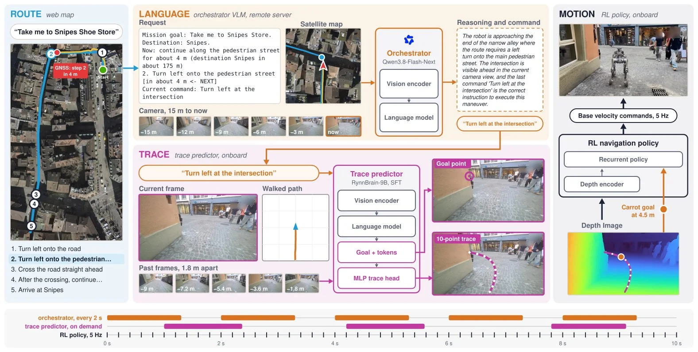
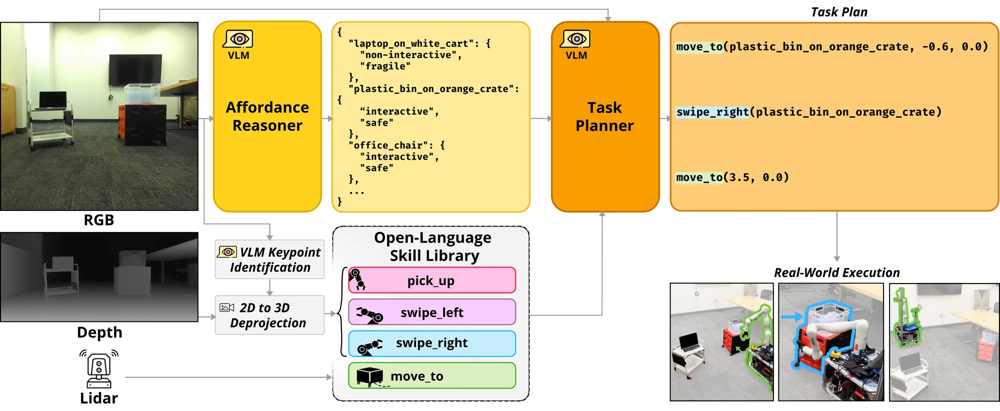
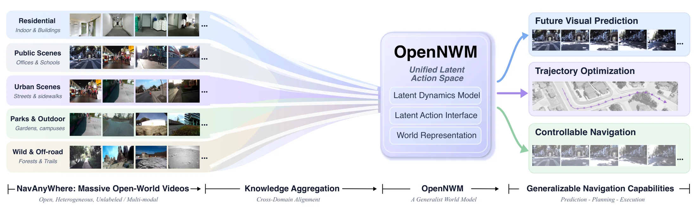

> **This issue**: 131 independent works (91 newly collected / 24 version updates / 16 carried over at the boundary) · Tracks: VLN 8 / embodied agentic navigation 6 · Other directions 117 · WeChat 0

## 1. Key points
{: id="key-points"}

- **The language-to-motion interface gains longer physical deployments.** [WayTrace](#waytrace) decomposes map directions into language commands, trace prediction, and control; the paper reports physical missions up to 1.37 km.
- **Navigation decisions must address movable obstacles and missing targets.** [MessyNav](#messynav) reasons about affordances before planning. [Object Search](#object-search) verifies existence after retrieval, constraining action and target selection respectively.
- **Physical grounding and world modeling require different evidence.** [Legged-VLN](#legged-vln) examines constrained execution, while [OpenNWM](#opennwm) learns dynamics from videos without action labels. Prediction quality does not substitute for navigation success.

## 2. Deep reads
{: id="deep-reads"}

### 1. WayTrace
{: id="waytrace"}

**Language connects map directions to long-range motion.**

**[Paper](https://arxiv.org/abs/2611.05129v1)** · Track: embodied agentic navigation · Outdoor map guidance / wheeled-legged robot

**Problem.** Walking directions and GNSS positions do not directly specify reliable street-level motion.

**Method.** An orchestrator VLM issues atomic commands from directions and recent images. An onboard predictor produces image traces for an RL controller. The layers run asynchronously.

<figcaption>Map directions pass through language commands and image traces to asynchronous motion control. <a href="https://arxiv.org/html/2611.05129v1/fig_overview.png">Original paper figure</a></figcaption>

**Evidence.** Physical missions reach 1.37 km at about 1.1 m/s across crossings, stairs, and construction sites. These are distance and speed, not a standard VLN success rate.

**Assessment.** Useful for studying planning–control interfaces and waiting. It still uses online maps, GNSS, and a remote VLM; it does not establish localization independence.

**Next.** Read: classify junction, command-switch, and trace failures, and examine when following the old trace becomes unsafe under latency.

### 2. MessyNav
{: id="messynav"}

**Decide whether to move an obstacle before planning passage.**

**[Paper](https://arxiv.org/abs/2611.07417v1)** · Track: embodied agentic navigation · Open-world interactive navigation / mobile manipulator

**Problem.** Physical movability does not imply that interaction is appropriate: a cart carrying fragile objects may need to be avoided.

**Method.** Explicit affordance reasoning checks feasibility and object safety before a planner sequences navigation, picking, and swiping. Visual grounding resolves object references into 3D positions.

<figcaption>Affordance reasoning constrains object selection before planning navigation and manipulation skills. <a href="https://arxiv.org/html/2611.07417v1/figs/fig2.png">Original paper figure</a></figcaption>

**Evidence.** The abstract reports a 27-percentage-point physical-robot success gain over the strongest baseline, plus offline evaluation. It omits physical trial counts and the baseline name, so absolute success cannot be inferred.

**Assessment.** Conditional interaction broadens ground navigation beyond detours. Semantic risk decisions and failures of underlying skills need separate evaluation.

**Next.** Read: compare explicit affordance reasoning with end-to-end VLM planning, emphasizing hazardous interactions and recovery after failed actions.

### 3. Legged-VLN
{: id="legged-vln"}

**A separate physical layer constrains semantic navigation goals.**

**[Paper](https://arxiv.org/abs/2611.04972v1)** · Track: VLN · Humanoid / quadruped language navigation · Physical experiments

**Problem.** Interpreting language does not itself provide explicit guarantees about robot geometry, obstacle clearance, or motion constraints.

**Method.** A grounding layer combines state estimation, 3D perception, and an SDF with Bezier-parameterized MPPI and discrete exponential barrier constraints.

**Evidence.** No quantitative results in the abstract. The authors report humanoid and quadruped experiments and collision-avoidance guarantees under stated assumptions.

**Assessment.** The separation helps diagnose semantic and execution errors. Guarantees depend on mapping, estimation, and model assumptions; they do not establish collision avoidance in arbitrary dynamic scenes. This is not R2R-CE ranking evidence.

**Next.** Read: inspect moving-obstacle assumptions and infeasible constraints; compare collisions and stalls with standard MPPI.

### 4. OpenNWM
{: id="opennwm"}

**Learn dynamics from varied videos, then align physical actions.**

**[Paper](https://arxiv.org/abs/2611.01844v2)** · Track: VLN · Navigation world model · Cross-environment prediction and planning

**Problem.** Action-labeled trajectories offer limited coverage, whereas videos without actions do not directly supervise executable motion.

**Method.** Latent-action video pretraining is followed by action-conditioned adaptation to physical motion.

<figcaption>Heterogeneous navigation videos feed a shared latent action space for prediction, planning, and execution. <a href="https://arxiv.org/html/2611.01844v2/nwm-overview.png">Original paper figure</a></figcaption>

**Evidence.** NavAnywhere contains 17.5 million visual observations from 15 sources, a data-volume measure. The abstract gives no navigation success rate, only qualitative claims of prediction and navigation gains.

**Assessment.** Check whether broad experience improves navigation as well as prediction. Separate gains by video source and action alignment, including ground-robot, human, and drone footage.

**Next.** Read: hold the navigation planner fixed and isolate latent-action pretraining, physical alignment, and data-source contributions.

### 5. Object Search
{: id="object-search"}

**Memory retrieval must be able to return target absent.**

**[Paper](https://arxiv.org/abs/2611.07493v1)** · Track: VLN · Open-vocabulary retrieval / target selection before navigation · ScanNet

**Problem.** A most-similar historical frame does not prove that the requested object exists.

**Method.** Fast retrieval proposes observations; visual verification selects one or abstains. An accepted frame and capture pose guide later search. Paper Figure 1 shows the two stages.

**Evidence.** On ScanNet apartments, the abstract reports reliability matching or exceeding exhaustive search with an order of magnitude fewer detector calls. It also reports onboard physical-robot operation with one consumer GPU.

**Assessment.** This supports target retrieval before navigation, not full ObjectNav success. Absence from stored observations must also be distinguished from absence in the current environment.

**Next.** Reproduce: measure recall, absent-target specificity, and call cost, then introduce moved objects and stale observations.

## 3. Also worth reading
{: id="also-worth"}

- **[Knowing Where to Look](https://arxiv.org/abs/2611.00499v1)** · A 3D belief fuses semantic and geometric evidence to select observations, movement, and cabinet interactions.
- **[HiPer](https://arxiv.org/abs/2611.07662v1)** · Persistence from similar instances may inform expiration of navigation memories.
- **[Graph-swap](https://arxiv.org/abs/2611.02056v1)** · Memory-graph swaps may inform diagnostics of whether navigation history is used.
- **[LIFE](https://arxiv.org/abs/2611.00180v2)** · Event-gated observation and writing may inform continuous monitoring in navigation agents.
- **[ARP](https://arxiv.org/abs/2611.05155v1)** · Asynchronous semantic memory and action generation may inform navigation execution.
- **[VLALagBench](https://arxiv.org/abs/2611.03103v1)** · Task- and execution-mode-dependent latency tests may inform navigation runtime evaluation.
- **[REA](https://arxiv.org/abs/2610.42053v1)** · Boundary checks and shared recovery budgets may inform navigation runtimes; principal evidence concerns manipulation.
- **[RoboCasa-Mem](https://arxiv.org/abs/2611.06475v1)** · Earlier behavior defines later constraints, a useful mechanism for testing use of navigation history.
- **[RESONATE](https://arxiv.org/abs/2611.02937v1)** · 8 controller configurations, 8 scenarios, and 5 repetitions yield 320 physical social-navigation experiments.
- **[EvoLife](https://arxiv.org/abs/2610.39446v1)** · Carried over from 10/29: help-seeking, hybrid actions, and persistent place memory.

## 4. Trends and actions
{: id="trends-and-actions"}

**Trends**

- **Hierarchical interfaces need explicit failure handling.** [WayTrace](#waytrace), [MessyNav](#messynav), and REA address command refresh, interaction choice, and policy escalation respectively. Their evaluations are not yet unified.
- **Memory evaluation needs abstention, expiration, and counterfactual checks.** [Object Search](#object-search), HiPer, Graph-swap, and SPARK address missing targets, moving objects, unused history, and incorrect knowledge respectively.
- **Account for data, offline metrics, and deployment gains separately.** [OpenNWM](#opennwm)'s data volume and LoopQ's hardware findings do not directly establish navigation success or physical-robot speed gains.

**Research gaps**

- This batch does not jointly validate how wrong target retrieval, stale place memory, and execution failures should trigger revisits or requests for help in long-horizon language navigation.
- A shared task should report route completion, inappropriate interactions, correct stopping, model calls, and waiting time together, so success rate does not hide runtime problems.

**Next steps**

- **High · Read** WayTrace and MessyNav: verify task protocols, failure categories, and asynchronous execution boundaries before selecting a component to reproduce.
- **High · Reproduce** Add absent-target queries and memory-swap diagnostics to navigation evaluation, distinguishing retrieval correctness, memory use, and arrival.
- **Medium · Track** Legged-VLN and OpenNWM: inspect safety assumptions and downstream gains separately, retaining task-specific evidence.
- **Medium · Compare** Use the previous issue's EvoLife help-seeking and place memory as context for target verification and event-triggered mechanisms.

## 5. Full work index
{: id="full-index"}

A marks direct work on the two tracks, B transferable mechanisms or evaluation, and C field observations; 10/29 works are retained for continuity.

VLN and semantic navigation · 8 papers

- [Object Search](#object-search): See deep read.
- [OdorSpaces](https://arxiv.org/abs/2611.05738v1): Combines vision and odor transport for indoor source localization.
- [Legged-VLN](#legged-vln): See deep read.
- [SNAP](https://arxiv.org/abs/2611.03498v2): Jointly handles semantic terrain and pedestrian dynamics.
- [RESONATE](https://arxiv.org/abs/2611.02937v1): A physical social-navigation testbed with repeated trials.
- [OpenNWM](#opennwm): See deep read.
- [MOON](https://arxiv.org/abs/2610.33546v2): Version update; deviation detection triggers clearing and recovery.
- [WNM-3D](https://arxiv.org/abs/2608.07267v3): Version update; 3D scene conditioning for joint view and action generation.

Embodied agentic navigation · 6 papers

- [MessyNav](#messynav): See deep read.
- [WayTrace](#waytrace): See deep read.
- [Spatiotemporal Memory](https://arxiv.org/abs/2610.38318v2): Version update; organizes task, temporal, and spatial memories.
- [HaltNav](https://arxiv.org/abs/2603.12696v3): Version update; visual halting revises topology and replans.
- [Knowing Where to Look](https://arxiv.org/abs/2611.00499v1): A 3D belief selects observations, movement, and cabinet interactions.
- [EvoLife](https://arxiv.org/abs/2610.39446v1): From the previous issue: help-seeking, hybrid actions, and persistent place memory.

Transferable mechanisms and evaluation · 32 papers

- [Seeing Beyond the Next Step](https://arxiv.org/abs/2611.07730v1): Distills world-model preferences for social navigation during training.
- [LMGN](https://arxiv.org/abs/2611.07515v1): Couples base placement, approach direction, and grasp stages.
- [HiPer](https://arxiv.org/abs/2611.07662v1): Learns object persistence and updates it after re-identification.
- [Generate-then-Rank](https://arxiv.org/abs/2611.07825v1): Ranks generated symbolic-goal candidates to reduce interpretation errors.
- [Criteria Exposure](https://arxiv.org/abs/2611.08318v1): Tests whether agent scores rely on exposed success criteria.
- [When to Ask for Help](https://arxiv.org/abs/2611.06702v1): Requests aerial sensing according to expected navigation benefit.
- [RoboCasa-Mem](https://arxiv.org/abs/2611.06475v1): Uses earlier behavior to define later constraints and test memory.
- [Failure-boundary profiles](https://arxiv.org/abs/2611.06453v1): Separates decisions to stop from competence to pass.
- [Cosmos Interactive Simulation](https://arxiv.org/abs/2611.06627v1): Streams observations conditioned on actions or external physical state.
- [LoopQ](https://arxiv.org/abs/2611.05093v1): Compares quantization in closed loop with matched weights and engines.
- [DiMuRe](https://arxiv.org/abs/2611.04226v1): Uses diagnosis to select recovery at different levels.
- [ARP](https://arxiv.org/abs/2611.05155v1): Semantic-memory updates and fast actions run asynchronously.
- [VLALagBench](https://arxiv.org/abs/2611.03103v1): Tests latency sensitivity by task, speed, and execution mode.
- [HeLM](https://arxiv.org/abs/2611.02660v1): Event-triggered language memory supports cross-episode manipulation.
- [Continual Spatial World Models](https://arxiv.org/abs/2611.04016v1): Spatial-change history and action outcomes refine predictions.
- [Serving Agentic Robot Fleets](https://arxiv.org/abs/2611.01404v1): Studies action deadlines and long-context serving bottlenecks.
- [SCOUT](https://arxiv.org/abs/2611.01600v1): Checks candidate plans under occlusion with object-centric rollouts.
- [Graph-swap](https://arxiv.org/abs/2611.02056v1): Swaps memory graphs to test whether predictions depend on history.
- [PREM](https://arxiv.org/abs/2611.00634v1): Prediction discrepancy regulates spatial visual-memory updates.
- [MOST](https://arxiv.org/abs/2611.00734v1): Supervises memory with object-state changes and task progress.
- [Auriga](https://arxiv.org/abs/2611.01112v1): Previews motion and checks execution tolerances for local recovery.
- [Understanding Embodied Memory](https://arxiv.org/abs/2610.41688v1): Organizes embodied memory by requirements, architectures, and evidence.
- [SPARK](https://arxiv.org/abs/2611.00344v1): Targeted revisits correct an embodied knowledge base; evaluated on EQA.
- [RoboArchitect](https://arxiv.org/abs/2610.42141v1): Automatically revises a harness around a frozen robot policy.
- [REA](https://arxiv.org/abs/2610.42053v1): Asynchronous routing, boundary checks, and budgeted recovery.
- [LIFE](https://arxiv.org/abs/2611.00180v2): Event gates select observations, memory writes, and tool expansion.
- [ID-WM](https://arxiv.org/abs/2610.42146v1): Separates reachable subgoals from low-level action grounding.
- [BioAgent](https://arxiv.org/abs/2610.41383v1): Validated skills and pre/postconditions govern task progression.
- [RoboSeed](https://arxiv.org/abs/2610.40026v2): Assesses capability, affordability, and reproduction evidence separately.
- [LOGIV](https://arxiv.org/abs/2610.40016v3): Checks physical task dependencies and repairs them locally.
- [EmbodiExp](https://arxiv.org/abs/2610.39180v1): Composes experience through verifiable subgoals and local successes.
- [CaPtain](https://arxiv.org/abs/2610.40799v1): A post-training pipeline organizes robot code-as-policy agents.

Other directions · 85 papers

- **Evaluation, recovery, and safety（13）**：[OopsieRecover](https://arxiv.org/abs/2611.08462v1), [AffectiveVLA](https://arxiv.org/abs/2611.07712v1), [CRONOS](https://arxiv.org/abs/2611.05080v1), [Auditing Imagined Rewards](https://arxiv.org/abs/2611.04873v1), [Onboard HJ Reachability](https://arxiv.org/abs/2611.04096v1), [Rollout then Recycle](https://arxiv.org/abs/2611.03168v1), [RoboColosseum](https://arxiv.org/abs/2611.02497v1), [When Delay Meets Drift](https://arxiv.org/abs/2611.02101v1), [Route-Guided CBF-QP Repair for Safe…](https://arxiv.org/abs/2611.01713v1), [ClothDojo](https://arxiv.org/abs/2611.01190v1), [Simulator Contact Audit](https://arxiv.org/abs/2610.41857v1), [Start Suppression](https://arxiv.org/abs/2610.41609v1), [BURGER](https://arxiv.org/abs/2610.40532v1)
- **Policies and manipulation（27）**：[SLA](https://arxiv.org/abs/2611.08373v1), [La-JEPA](https://arxiv.org/abs/2611.08156v1), [Concertina](https://arxiv.org/abs/2611.07513v1), [A3-VLA](https://arxiv.org/abs/2611.06447v1), [Astra / RoboMME](https://arxiv.org/abs/2611.06184v1), [NEO-VLA](https://arxiv.org/abs/2611.06918v1), [Action-Token Supervision](https://arxiv.org/abs/2611.05249v1), [RAFT](https://arxiv.org/abs/2611.04368v1), [Text-Action Divergence](https://arxiv.org/abs/2611.04166v1), [PolicyIK](https://arxiv.org/abs/2611.05372v1), [Beyond Policy Patches](https://arxiv.org/abs/2611.02777v1), [AdaIE](https://arxiv.org/abs/2611.04006v1), [ODE Policy](https://arxiv.org/abs/2611.01729v1), [GatedVLA with Camera-Based…](https://arxiv.org/abs/2611.01663v1), [Joint Denoisers](https://arxiv.org/abs/2611.01215v2), [Behavioral Steering](https://arxiv.org/abs/2611.00522v1), [CalVLA](https://arxiv.org/abs/2611.00394v1), [SAFARI](https://arxiv.org/abs/2610.41456v1), [TRACE](https://arxiv.org/abs/2610.41275v2), [Consequence-Grounded Alignment](https://arxiv.org/abs/2610.39543v1), [Gym-Anything](https://arxiv.org/abs/2610.40565v1), [HiFOR](https://arxiv.org/abs/2610.40373v1), [Step-Level Action Value](https://arxiv.org/abs/2610.40002v1), [Planar Loco-Manipulation](https://arxiv.org/abs/2610.40248v1), [UI Planning-Grounding Agent](https://arxiv.org/abs/2610.39264v1), [PRIME W0](https://arxiv.org/abs/2610.39528v2), [Smooth Action Chunking](https://arxiv.org/abs/2610.39451v1)
- **Data and skills（10）**：[Proactive Human Intervention](https://arxiv.org/abs/2611.05667v1), [Action Intent as a Bridge](https://arxiv.org/abs/2611.04522v1), [ActOR](https://arxiv.org/abs/2611.04255v1), [Bridging Representation and Action](https://arxiv.org/abs/2611.04391v1), [AceAction-5M](https://arxiv.org/abs/2611.04241v1), [AIRoA-0](https://arxiv.org/abs/2611.03815v1), [MoSoLoco](https://arxiv.org/abs/2611.03189v1), [Imitable Teacher](https://arxiv.org/abs/2611.00615v1), [Demonstration Expansion](https://arxiv.org/abs/2610.40430v1), [TouchBridge](https://arxiv.org/abs/2610.40349v1)
- **Driving and aerial robots（6）**：[MotoVerse](https://arxiv.org/abs/2611.06007v1), [Aero-VPA](https://arxiv.org/abs/2611.04392v1), [Scene-Adaptive Readout and Decoding…](https://arxiv.org/abs/2611.02076v1), [STEER](https://arxiv.org/abs/2611.00718v1), [OpenFlyV2](https://arxiv.org/abs/2610.39287v2), [Long-Horizon Dexterity](https://arxiv.org/abs/2610.40828v1)
- **Compression and deployment（9）**：[T3R](https://arxiv.org/abs/2611.08413v1), [Calibrated Latent Probing](https://arxiv.org/abs/2611.08425v1), [Kinematic Hypothesis Context](https://arxiv.org/abs/2611.07411v1), [VLA Inference Bottlenecks](https://arxiv.org/abs/2611.06710v1), [Same Path, Less Time](https://arxiv.org/abs/2611.01390v1), [SVD-Prune](https://arxiv.org/abs/2611.02284v1), [Leap-VLA](https://arxiv.org/abs/2611.01011v1), [SACQ](https://arxiv.org/abs/2610.41408v1), [STAR](https://arxiv.org/abs/2610.41009v1)
- **Earlier papers with version updates（20）**：[SimForcing](https://arxiv.org/abs/2610.06598v2), [Intent-Conditioned Fine-Tuning](https://arxiv.org/abs/2606.12109v3), [Selected Diffusion Noise](https://arxiv.org/abs/2606.14084v2), [PDRVLA](https://arxiv.org/abs/2610.37381v3), [Pre-Imagined Milestones](https://arxiv.org/abs/2606.09258v2), [Self-Demonstrated Control](https://arxiv.org/abs/2608.19490v2), [Compositional Agentic Robotics](https://arxiv.org/abs/2610.35817v3), [LIBERO-RECOVER](https://arxiv.org/abs/2609.05178v4), [CLAP](https://arxiv.org/abs/2607.08974v2), [DuoBench](https://arxiv.org/abs/2606.11901v2), [VLA Feature Mechanisms](https://arxiv.org/abs/2603.19233v6), [OmniGuide](https://arxiv.org/abs/2603.10052v2), [Neural Geometry](https://arxiv.org/abs/2610.20840v3), [OpenHLM](https://arxiv.org/abs/2606.22174v2), [MAESTRO](https://arxiv.org/abs/2511.00917v3), [ActionFlow](https://arxiv.org/abs/2512.20276v2), [RynnVLA-Latent](https://arxiv.org/abs/2610.34356v2), [Large Discrete Policy](https://arxiv.org/abs/2609.07049v2), [SpecPrune-VLA](https://arxiv.org/abs/2509.05614v4), [Detect and Suppress](https://arxiv.org/abs/2610.03498v2)

