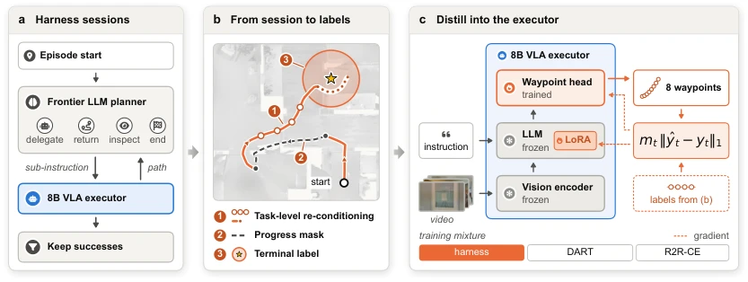
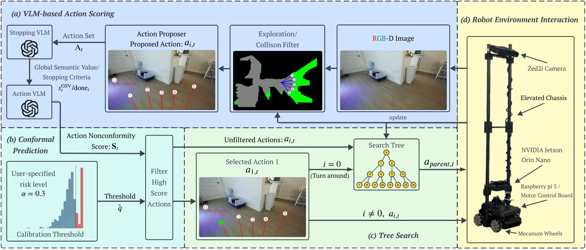
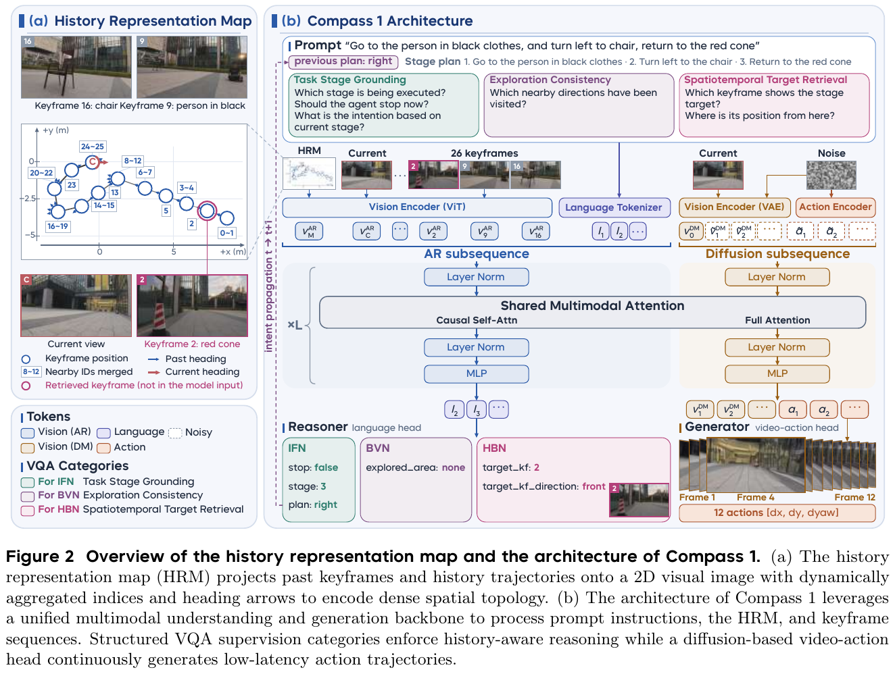
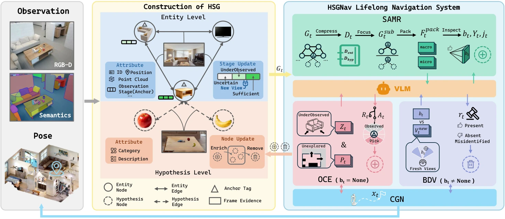
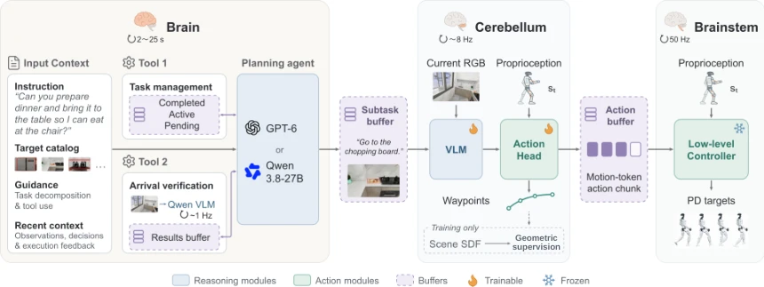

> **This issue**: 88 independent works (86 newly collected / 2 version updates) · Tracks: VLN 7 / embodied agentic navigation 2 · Other directions 79 · WeChat 0

## 1. Key points
{: id="key-points"}

- **Navigation assistance is being transferred back into the executor.** [H2E](#h2e) turns agent sessions into training data; the paper reports REVERIE-CE SR from 35.0% to 44.9%, with the VLA navigating alone at test time.
- **Memory needs both retrieval and withdrawal.** [Compass 1](#compass-1) uses structured supervision for history backtracking; [HSGNav](#hsgnav) treats movable-object records as hypotheses that can be verified and invalidated.
- **Action scoring and task completion have distinct verification stages.** [CPNav](#cpnav) calibrates candidate-action scores, while [LHNav](#lhnav) feeds arrival checks into multi-rate execution. They verify different parts of the system.

## 2. Deep reads
{: id="deep-reads"}

### 1. H2E
{: id="h2e"}

**Teach the executor to finish tasks without its planner.**

**[Paper](https://arxiv.org/abs/2611.16246v1)** · Track: VLN · Object-directed instruction navigation · REVERIE-CE (continuous)

**Problem.** Calling an LLM planner throughout every episode adds cost. Agent sessions mix tool motions, sub-instructions, and detours, so they are not ready-made executor demonstrations.

**Method.** The paper relabels all motions in successful sessions under the original task instruction, masks training loss on steps moving away from the goal, labels visited states within 1 m as stops, and updates the VLA with LoRA.

<figcaption>Figure 2: Task relabelling, progress masking, and stop labels turn agent sessions into executor training data. <a href="https://arxiv.org/html/2611.16246v1#S2.F2">Original figure</a></figcaption>

**Evidence.** The paper reports that an 8B VLA improves SR from 35.0% to 44.9% across all 3,189 REVERIE-CE val-unseen episodes.

**Assessment.** The useful separation is complex orchestration during training and simpler execution at test time. These results establish a simulation gain, rather than real-robot generalization or transfer of the full planning capability.

**Next step.** Reproduce: ablate task relabelling, progress masking, and stop labels separately, and log goal-reaching and successful stopping independently.

### 2. CPNav
{: id="cpnav"}

**Put a testable calibration layer around action scores.**

**[Paper](https://arxiv.org/abs/2611.10366v1)** · Track: VLN · ObjectNav · HM3D v0.2 / MP3D · RGB-D

**Problem.** High VLM action scores can be overconfident, while semantic reasoning alone does not establish traversability.

**Method.** The paper generates collision-free motion primitives, uses two VLMs for goal detection and action scoring, calibrates scores offline with oracle actions through conformal prediction, and combines online selection with tree-based exploration and backtracking.

<figcaption>Figure 1: Action candidates, offline calibration thresholds, and an online exploration tree form the navigation loop. <a href="https://arxiv.org/html/2611.10366v1#S1.F1">Original figure</a></figcaption>

**Evidence.** The paper reports relative SR / SPL gains of 6.2% / 11.4% over the uncalibrated baseline on HM3D v0.2, and corresponding relative gains of 24.9% / 15.2% in its MentorPi hardware evaluation.

**Assessment.** This is useful for testing the reliability of an existing semantic policy. Deployment needs a check of calibration-to-field distribution match; a finite-sample guarantee should not be read as unconditional safety for the entire trajectory.

**Next step.** Reproduce: hold the action proposer fixed and compare SR, SPL, backtracking frequency, and coverage after a distribution change.

### 3. Compass 1
{: id="compass-1"}

**Long history needs both representation and supervision.**

**[Paper](https://arxiv.org/abs/2611.12087v1)** · [My reading guide (Chinese)](https://tingdeliu.github.io/VLN-Papers-Outdoor/#compass-1) · Track: VLN · Monocular RGB · open-world navigation / history backtracking

**Problem.** History frames record what was seen without necessarily explaining where it was seen or how to return. Without supervision for memory use, the model can also ignore the history it receives.

**Method.** The paper draws sparse keyframe positions, indices, and headings into a History Representation Map (HRM). VQA supervision for task stages, exploration consistency, and spatiotemporal target retrieval teaches the model to use it; a shared backbone connects language reasoning with video–action prediction.

<figcaption>Figure 2: The HRM aligns historical keyframes with spatial trajectories on the left; memory questions, language reasoning, and video–action prediction share a backbone on the right. <a href="https://arxiv.org/pdf/2611.12087v1#page=4">Original figure</a></figcaption>

**Evidence.** The paper reports 320 hardware trials per method: 4 scenarios, 8 tasks, and 10 trials for each combination. Overall SR is 79.4%, versus 17.8% for AwareVLN; persistent history-backtracking SR is 58%, versus 0% for the strongest baseline on that task.

**Assessment.** This is useful for studying long-history retrieval and revisits, but overall SR mixes indoor and outdoor tasks and cannot be ranked directly against standard R2R-CE. The hardware system still relies on odometry and remote GPU inference; monocular input does not imply a pose-free robot system.

**Next step.** Read closely: use the reading guide to examine HRM and VQA ablations, separating history-retrieval accuracy from successful closed-loop returns.

### 4. HSGNav
{: id="hsgnav"}

**Treat movable-object memories as revisable hypotheses.**

**[Paper](https://arxiv.org/abs/2611.10547v1)** · Track: embodied agentic navigation · Multi-scale lifelong object search · GOAT-Bench / FAROS-Bench

**Problem.** Small household objects move, leaving stale records that mislead retrieval. Maintaining separate 3D geometry for every small surface object can also be brittle.

**Method.** The paper separates persistent furniture entities from revisable surface-object hypotheses. Retrieval selects evidence by scale, exploration adds observations, and verification checks continued presence and invalidates contradicted hypotheses.

<figcaption>Figure 2: Retrieval, exploration, and target verification update a two-level hypothesis scene graph. <a href="https://arxiv.org/html/2611.10547v1#S3.F2">Original figure</a></figcaption>

**Evidence.** The paper reports GOAT-Bench SR / SPL of 71.2% / 50.3%, slightly above 3D-Mem at 69.1% / 48.9%. On its new FAROS-Bench it reaches 58.1% / 28.5%, against an SR of 36.7% for the strongest baseline, MSGNav; on the subset where objects are moved, SR is 57.1% versus 26.2%. Removing target verification drops that subset to 28.6%. Verification is correct 86.8% of the time over 212 checks, and 93.3% of wrongly invalidated targets are recovered from fresh observations. Each subtask uses 18.2 VLM calls, versus 36.8 for 3D-Mem.

**Assessment.** This directly addresses memory invalidation in navigation agents, especially when to withdraw an old fact. Most of the gain comes from the self-built FAROS-Bench; on GOAT-Bench the lead is only about 2 points. All experiments run in Habitat simulation, with no hardware relocation test and no reported latency.

**Next step.** Read closely: for cases where retrieval succeeds but the target has moved, check which object sizes account for the 13% of wrong verification decisions, then inspect the failures behind the SR drop from 82.4% to 78.4% after three successive relocations.

### 5. LHNav
{: id="lhnav"}

**Coordinate navigation layers through execution feedback.**

**[Paper](https://arxiv.org/abs/2611.12136v1)** · Track: embodied agentic navigation · Humanoid robot · long-horizon, multi-goal language navigation

**Problem.** Task decomposition does not ensure sustained progress, and correct waypoints do not ensure natural, stable humanoid motion along a route.

**Method.** The paper assigns task reasoning to a Brain, local motion generation to a Cerebellum, and whole-body execution to a Brainstem. Asynchronous buffers, progress and arrival feedback coordinate them; a physics-grounded data engine trains local motion.

<figcaption>Figure 3: Task management and arrival verification connect through buffers to local motion and whole-body control. <a href="https://arxiv.org/html/2611.12136v1#S2.F3">Original figure</a></figcaption>

**Evidence.** The paper reports 75.56% SR on simulated long-horizon navigation with a VLA trained only on single-goal demonstrations. It also demonstrates single-goal and zero-shot long-horizon execution on Unitree G1, without a hardware SR in the abstract.

**Assessment.** Task state, arrival verification, and asynchronous execution interfaces can inform wheeled systems. Benefits from whole-body motion data and the controller are embodiment-dependent and require separate validation.

**Next step.** Read closely: check stale-action handling at goal changes and recovery after incorrect arrival decisions.

## 3. Also worth reading
{: id="also-worth"}

- **[PreNav](https://arxiv.org/abs/2611.15093v1)** · VLN: generate a global search reference before online detection; with matched priors it beats SGM by 2.3 SR points on the Gibson six-category subset and by only 1.4 points on the full ten-category set; on hardware it succeeds in 13 of 15 trials.
- **[BAMOS](https://arxiv.org/abs/2611.15689v1)** · VLN: test target-belief updates through detection-error ablations; a false-negative rate of 0.3 lowers success by only 0.018, while false positives hurt far more (up to 0.402 in HSSD); it compares only against its own ablations.
- **[EMS-Nav](https://arxiv.org/abs/2611.15589v1)** · VLN: region-based onboard multi-scale navigation; examine resource overhead.
- **[HeMeR](https://arxiv.org/abs/2611.16487v1)** · Transferable to navigation-agent cache reuse; its hardware numbers concern manipulation.
- **[SimplEvo](https://arxiv.org/abs/2611.11509v1)** · Transferable to training-time lesson refinement and fixed-memory testing in navigation agents.
- **[Memory as a Clock?](https://arxiv.org/abs/2611.14488v1)** · Transferable to navigation-memory evaluation: separate elapsed time from progress with null pauses.
- **[HDH](https://arxiv.org/abs/2611.14834v1)** · Transferable to candidate-action verification; manipulation results do not establish navigation gains.
- **[IncR-3DSGG](https://arxiv.org/abs/2611.15429v1)** · Transferable to RGB-only navigation maps; inference still requires camera poses.
- **[MAP-VP](https://arxiv.org/abs/2611.11510v1)** · Transferable to post-stop target verification; it relies on benchmark-provided map landmark outlines.
- **[AST](https://arxiv.org/abs/2611.14111v1)** · Transferable to navigation-stagnation detection after defining unresolved task evidence requirements.

## 4. Trends and actions
{: id="trends-and-actions"}

**Trends**

- **Reasoning cost is a system-design variable.** H2E transfers assisted experience into weights, PreNav generates search references in advance, and LHNav separates slow reasoning from fast execution. Compare success, call cost, and total elapsed time together.
- **Long-term memory increasingly depends on state maintenance.** Compass 1, HSGNav, and BAMOS address history use, record invalidation, and target-belief updates respectively. Increasing context length alone can obscure those distinctions.

**Research gaps**

- Ground navigation still needs a joint evaluation of object relocation, null pauses, detection errors, and model latency to test whether memory gains survive different failure modes.
- Recovery after planner distillation, calibration under scene shifts, and correction after arrival-check errors need separate reporting in independent hardware tests.

**Next steps**

- **High · Reproduce** H2E: separate reaching from stopping to locate the benefit in execution or termination labels.
- **High · Read closely** HSGNav / LHNav: extract memory-invalidation and task-switching interfaces for a minimal loop transferable to wheeled navigation.
- **Medium · Controlled experiment** CPNav / BAMOS: fix perception inputs and vary score calibration and belief updates separately.
- **Medium · Track** Compass 1: review reproducible task protocols, models, and data before cross-embodiment reproduction.

## 5. Full index
{: id="full-index"}

Grouped into the two main tracks, transferable mechanisms, and other directions; the blocks below cover every independent work in this issue.

VLN and semantic navigation · 7 works

- [CPNav](#cpnav): see deep read.
- [CSG-Nav](https://arxiv.org/abs/2611.11978v1): Fuse semantic confidence and depth localization for exploration and stopping.
- [Compass 1](#compass-1): see deep read.
- [PreNav](https://arxiv.org/abs/2611.15093v1): Generate a search reference from persistent structure and furniture priors.
- [EMS-Nav](https://arxiv.org/abs/2611.15589v1): Organize multi-scale language goals and onboard maps by regions.
- [BAMOS](https://arxiv.org/abs/2611.15689v1): Study active search with target beliefs, occupancy, and detection errors.
- [H2E](#h2e): see deep read.

Embodied agentic navigation · 2 works

- [HSGNav](#hsgnav): see deep read.
- [LHNav](#lhnav): see deep read.

Transferable mechanisms · 13 works

- [Flex-RSI](https://arxiv.org/abs/2611.08946v1): Evaluate harness self-revision under a fixed budget.
- [A2-MEAS](https://arxiv.org/abs/2611.09124v1): Connect training supervision and runtime recovery through correction codes.
- [CUA Generalists](https://arxiv.org/abs/2611.09847v1): Access embodied environments through screens and software controls.
- [SimplEvo](https://arxiv.org/abs/2611.11509v1): Revise text lessons during training; freeze them at test time.
- [MAP-VP](https://arxiv.org/abs/2611.11510v1): Use map-landmark prompts for final aerial target localization.
- [WanderBench](https://arxiv.org/abs/2611.12557v1): Evaluate revisit consistency in video-world exploration.
- [Safe Depth](https://arxiv.org/abs/2611.13769v1): Use depth uncertainty for navigation perception.
- [AST](https://arxiv.org/abs/2611.14111v1): Monitor stagnation in task-relevant information acquisition.
- [Memory as a Clock?](https://arxiv.org/abs/2611.14488v1): Pause interventions expose phantom progress in time-indexed memory.
- [HDH](https://arxiv.org/abs/2611.14834v1): Select frozen-policy action chunks with a compact verifier.
- [IncR-3DSGG](https://arxiv.org/abs/2611.15429v1): Build incremental 3D scene graphs from posed RGB.
- [HeMeR](https://arxiv.org/abs/2611.16487v1): Update KV caches selectively as memory changes.
- [ProtoVis-Nav](https://arxiv.org/abs/2611.17330v1): Constrain UAV waypoints through local visual imagination.

Other directions · 66 works

- **Version updates（2）**: [A3-VLA](https://arxiv.org/abs/2611.06447v2), [NEO-VLA](https://arxiv.org/abs/2611.06918v3)
- **General models and other topics（10）**: [Run-and-Tumble Agent](https://arxiv.org/abs/2611.07531v1), [NINJA](https://arxiv.org/abs/2611.10027v1), [DexDICE](https://arxiv.org/abs/2611.09433v1), [MaRiO](https://arxiv.org/abs/2611.10344v1), [Collaborative Inference / 6G](https://arxiv.org/abs/2611.11023v1), [DocFS](https://arxiv.org/abs/2611.12957v1), [Embodied Science Agents](https://arxiv.org/abs/2611.12958v1), [MOON-RL](https://arxiv.org/abs/2611.15227v1), [XBot-Omni](https://arxiv.org/abs/2611.17160v1), [Memory Footprints](https://arxiv.org/abs/2611.17257v1)
- **VLA and manipulation（46）**: [Q-OIL](https://arxiv.org/abs/2611.08576v1), [Meituan-Robotics-0](https://arxiv.org/abs/2611.08577v3), [VICTR](https://arxiv.org/abs/2611.08698v2), [ActPrune](https://arxiv.org/abs/2611.08827v2), [PRISM](https://arxiv.org/abs/2611.08917v1), [VLA Handover](https://arxiv.org/abs/2611.08987v1), [ToolDex](https://arxiv.org/abs/2611.09036v1), [DobotTrack](https://arxiv.org/abs/2611.09041v1), [HiMEM](https://arxiv.org/abs/2611.09355v1), [ODEAction](https://arxiv.org/abs/2611.09672v2), [SURE](https://arxiv.org/abs/2611.09684v1), [Agentic Manipulation](https://arxiv.org/abs/2611.09892v1), [Spatial Representation…](https://arxiv.org/abs/2611.10443v1), [Look Ahead](https://arxiv.org/abs/2611.10769v1), [DreamVLA](https://arxiv.org/abs/2611.10872v1), [Zero-Shot VLA Adaptation with…](https://arxiv.org/abs/2611.10894v1), [Control-Aware Command Generation…](https://arxiv.org/abs/2611.11089v2), [Efficient VLA Inference via…](https://arxiv.org/abs/2611.11098v2), [From Game Generation to Game Playing](https://arxiv.org/abs/2611.11136v1), [Kimodo-Policy](https://arxiv.org/abs/2611.11554v1), [Streaming Failure Forecasting](https://arxiv.org/abs/2611.11688v1), [SurgTAP-3D](https://arxiv.org/abs/2611.11697v1), [PAIR](https://arxiv.org/abs/2611.11798v1), [Decoupled Asynchronous System for…](https://arxiv.org/abs/2611.11854v2), [Instruction Weight Edits](https://arxiv.org/abs/2611.11894v1), [Thermo-VLA](https://arxiv.org/abs/2611.11981v1), [Motion Belief Action](https://arxiv.org/abs/2611.12113v1), [GeoMind](https://arxiv.org/abs/2611.12175v1), [VLA-MOPD](https://arxiv.org/abs/2611.12286v1), [Be My Eye](https://arxiv.org/abs/2611.12295v1), [VLA Adaptation with Real and…](https://arxiv.org/abs/2611.12676v1), [Learning Heterogeneous Tactile…](https://arxiv.org/abs/2611.12806v1), [APS-VLA](https://arxiv.org/abs/2611.13030v1), [Robo-MLT](https://arxiv.org/abs/2611.13039v1), [How Much VLA Is kNN?](https://arxiv.org/abs/2611.13160v1), [BEHAVIOR / WAM](https://arxiv.org/abs/2611.13818v1), [DexSeed](https://arxiv.org/abs/2611.14092v1), [BEHAVIOR / One Policy](https://arxiv.org/abs/2611.14432v1), [Scaling VLA Serving Under Robotic…](https://arxiv.org/abs/2611.14969v1), [PolyMorphWBC](https://arxiv.org/abs/2611.15117v1), [Low-Cost Mobile Bimanual…](https://arxiv.org/abs/2611.15381v1), [ActionCodec2](https://arxiv.org/abs/2611.15490v1), [What Makes a VLA Reactive?](https://arxiv.org/abs/2611.15491v1), [MOSAIC](https://arxiv.org/abs/2611.15937v1), [I See What You Want](https://arxiv.org/abs/2611.16419v1), [STVLA](https://arxiv.org/abs/2611.16589v1)
- **Motion control and localization（6）**: [Fisheye Polarization](https://arxiv.org/abs/2611.08911v1), [FASTFUNNELS](https://arxiv.org/abs/2611.09005v1), [Compliance / Passive Walker](https://arxiv.org/abs/2611.13779v1), [A Faster and Efficient Indoor User…](https://arxiv.org/abs/2611.13828v1), [ReACT](https://arxiv.org/abs/2611.13929v1), [VINE](https://arxiv.org/abs/2611.16282v1)
- **Autonomous driving（2）**: [DeltaForge](https://arxiv.org/abs/2611.11856v1), [CARE-Drive](https://arxiv.org/abs/2611.15360v1)

