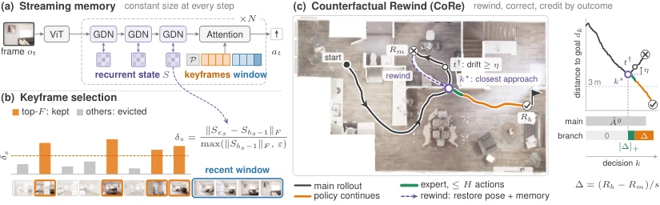
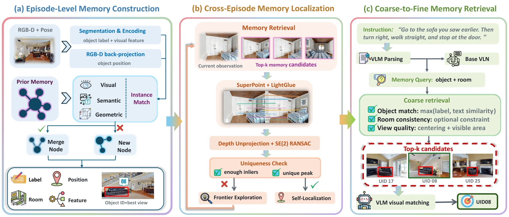
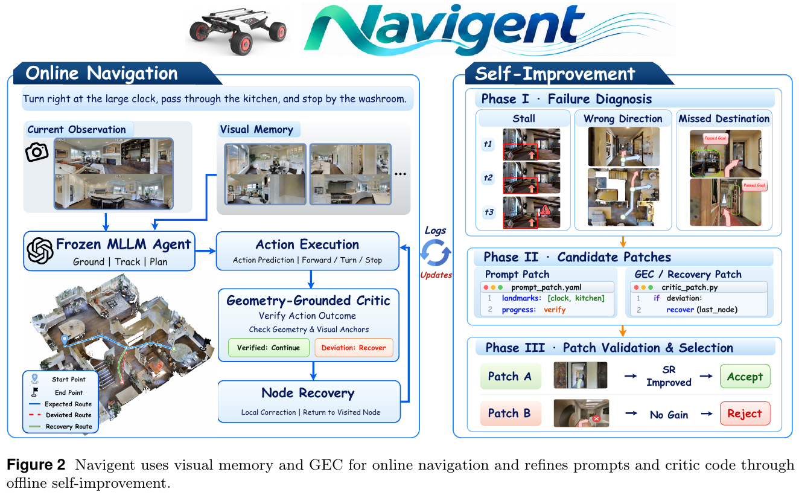
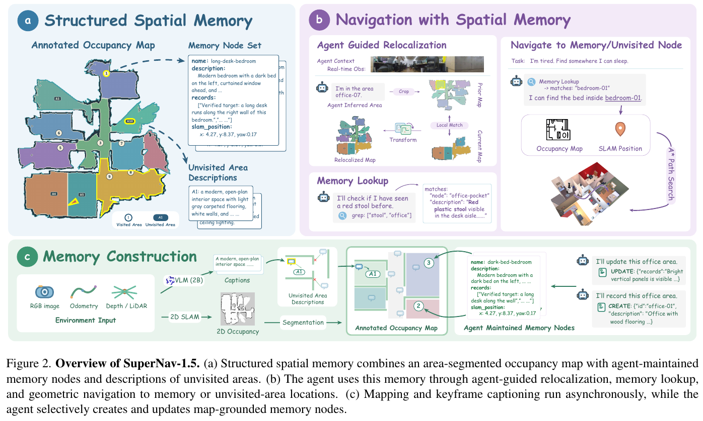
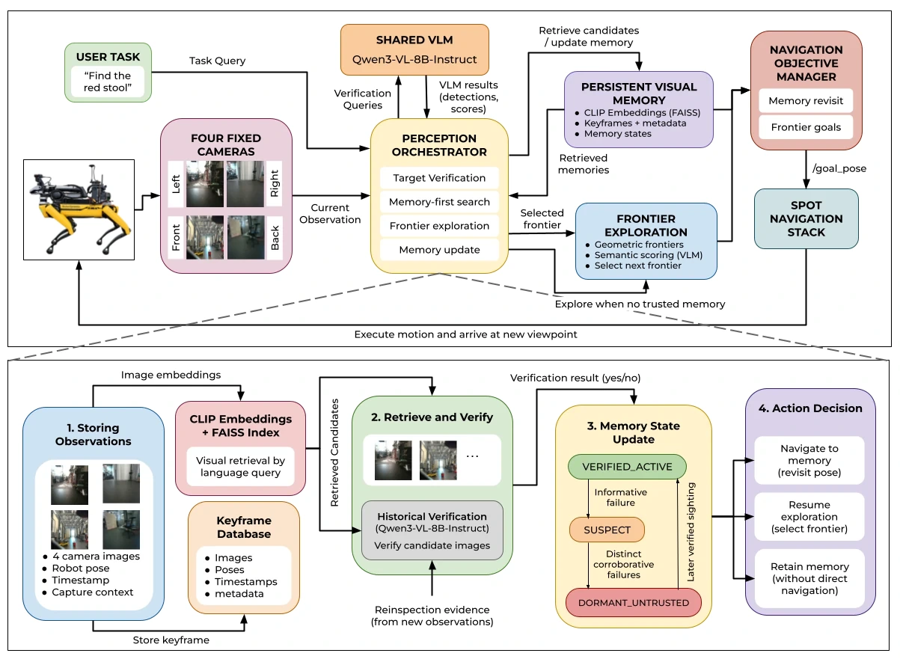

> **This issue**: 135 distinct works (131 first submissions in the window and 4 revisions of earlier papers) · Tracks: VLN 7 / embodied agentic navigation 5 · Other directions 123 · WeChat 0

## 1. Key points
{: id="key-points"}

- **Long instructions can be followed with a fixed memory budget.** [GlanceNav](#glancenav) encodes each frame once and retains route information in a recurrent state, recent frames, and selected keyframes.
- **Cross-episode evaluations now measure how a robot uses memory.** [Mem-X](#mem-x) checks whether the robot retraces the requested route. [SuperNav-1.5](#supernav) measures how much travel a reused map saves from a different starting point.
- **Verifiers help decide when to interrupt a robot or change its goal.** [Navigent](#navigent) checks motion and landmarks. [Memory Revision](#memory-revision) uses evidence from revisits to suspend or restore a waypoint's eligibility as a goal.

## 2. Deep reads
{: id="deep-reads"}

### 1. GlanceNav
{: id="glancenav"}

**Encoding each frame once keeps the cost per decision stable as history grows.**

**[Paper](https://arxiv.org/abs/2611.30900v1)** · Track: VLN · Instruction following · R2R-CE / RxR-CE (continuous environments)

**Problem.** Re-encoding history at every decision adds latency. An episode-level reward also makes it hard to identify which decision caused a detour or a deviation.

**Method.** Recurrent layers carry state forward. Attention layers retain recent frames and keyframes selected by changes in that state. During training, CoRe restores a rollout to its closest approach to the goal, lets an expert briefly correct its course, and assigns credit based on the change in outcome.

<figcaption>Figure 2 shows single-pass frame encoding, keyframe selection by state change, and corrective rewinding during training. <a href="https://arxiv.org/html/2611.30900v1#S3.F2">Original figure</a></figcaption>

**Evidence.** The paper reports a 4B model's val-unseen SR of 71.9% on R2R-CE and 73.6% on English RxR-CE. A policy call takes about 104 ms on an RTX PRO 6000.

**Assessment.** A fixed memory capacity helps stabilize inference latency on long routes. The Unitree G1 demonstrations used an external workstation, so deployment timing still needs to include communication and execution.

**Next step.** Fix the backbone and frame budget. Compare a sliding window with a keyframe bank and break down latency, SR, and SPL by route length.

### 2. Mem-X
{: id="mem-x"}

**Success also depends on visiting historical landmarks in the right order.**

**[Paper](https://arxiv.org/abs/2611.27166v2)** · Track: VLN · Cross-episode instruction following · Mem-X (continuous simulation)

**Problem.** When instructions refer to a previously seen object or route, ordinary success rate leaves it unclear whether the robot used that history.

**Method.** Mem-X progresses from object recall to cross-episode localization and re-entry onto an old route from outside the remembered area. Its baseline, MemBridge, builds semantic graphs from RGB-D and local poses, aligns the episode frames, and retrieves a target.

<figcaption>Figure 2 shows within-episode mapping, cross-episode alignment, and coarse-to-fine retrieval. <a href="https://arxiv.org/html/2611.27166v2#S2.F2">Original figure</a></figcaption>

**Evidence.** The dataset contains 2,071 episodes across 34 scenes, with 1,204 episodes dependent on memory. The paper reports that adding MemBridge to JanusVLN raises Level 3 constrained success rate (C-SR) from 5.73% to 28.66%.

**Assessment.** C-SR exposes shortcuts that reach the goal while skipping historical landmarks. The Level 3 results show that starting outside the remembered area remains difficult.

**Next step.** Disable historical retrieval and cross-episode localization separately, then measure localization success and C-SR for starts inside and outside the remembered area.

### 3. Navigent
{: id="navigent"}

**Execution checks cover both how far the robot moved and whether it passed a landmark.**

**[Paper](https://arxiv.org/abs/2611.34249v1)** · [My reading guide (Chinese)](https://tingdeliu.github.io/Agentic-Navigation-Papers/#navigent) · Track: Embodied agentic navigation · Execution verification · R2R-CE / RxR-CE (continuous environments)

**Problem.** During multi-action execution, both a blocked move and an overlooked entrance can take a robot off its instructed route.

**Method.** A frozen multimodal model plans. A geometric critic uses pose and depth to check commanded motion against actual displacement and track how movement changes the robot's relation to landmarks. A discrepancy interrupts the remaining actions and triggers a fresh observation, a local adjustment, or node-based recovery.

<figcaption>Figure 2 shows visual memory, execution checks, and offline refinement of prompts and rules. <a href="https://arxiv.org/html/2611.34249v1#S3.F2">Original figure</a></figcaption>

**Evidence.** The paper reports val-unseen SR / SPL of 84.0% / 72.9% on R2R-CE and 86.0% / 69.1% on RxR-CE. An AgileX SCOUT MINI succeeded on 27 of 30 trials across 6 tasks, using a stop threshold of 1 meter from the target.

**Assessment.** The critic supplies reasons for interruptions that can be logged. A replication should report the depth, odometry, and model-call budgets separately to locate the source of any gain.

**Next step.** Fix the model and sensors, disable motion and landmark checks separately, and measure recovery from stalls and overshoots.

### 4. SuperNav-1.5
{: id="supernav"}

**Map-grounded memories can serve directly as navigation goals.**

**[Paper](https://arxiv.org/abs/2611.29912v2)** · [My reading guide (Chinese)](https://tingdeliu.github.io/Agentic-Navigation-Papers/#supernav-1-5) · Track: Embodied agentic navigation · Multi-session object navigation · Habitat-GS

**Problem.** Images and text can describe visited places. A robot that starts somewhere else must first find itself on the old map to return to a goal.

**Method.** A segmented occupancy map stores memory nodes with coordinates and records unvisited areas. At the start of a new session, current observations and stored records suggest a region, narrowing the geometric relocalization search before the agent calls the navigation tool.

<figcaption>Figure 2 shows map-node recording, relocalization, and navigation to remembered or unexplored areas. <a href="https://arxiv.org/html/2611.29912v2#S2.F2">Original figure</a></figcaption>

**Evidence.** With a changed start in the second session of Habitat-GS single-object tasks, the paper reports that reusing memory raises SR from 78.00% to 82.00% and SPL from 0.4364 to 0.5022. A Unitree Go2 demonstrates revisiting remembered sites and completing multi-object tasks.

**Assessment.** Comparing runs from the same second-session start isolates the benefit of memory. Moved objects and outdated maps introduce travel costs that this comparison leaves open.

**Next step.** Use a map with similar rooms and moved targets. Track localization errors separately from the use of stale memories.

### 5. Memory Revision
{: id="memory-revision"}

**Repeated misses can suspend an old goal while leaving it open to re-verification.**

**[Paper](https://arxiv.org/abs/2611.34915v1)** · Track: Embodied agentic navigation · Persistent memory verification · Boston Dynamics Spot

**Problem.** Repeated misses from nearby viewpoints can come from a detector blind spot or a moved object. Discarding a memory after a fixed number of misses can give correlated observations too much weight.

**Method.** The system groups similar revisits to limit how much correlated misses count. When evidence is weak, the robot stops using the memory as a direct goal and explores semantic frontiers. Later positive evidence can restore the memory's use.

<figcaption>Figure 2 shows how the system rechecks, downgrades, and restores a memory, and switches to semantic frontiers. <a href="https://arxiv.org/html/2611.34915v1#S4.F2">Original figure</a></figcaption>

**Evidence.** On Spot, 36 of 40 adjacent revisit pairs gave the same detection outcome. In three matched contexts sharing a stale-memory history, the baseline chose the old memory each time and the proposed method chose a semantic frontier each time.

**Assessment.** The evidence establishes a change in goal selection. Measuring end-to-end search success and time requires independent trials because the three contexts shared one memory history.

**Next step.** Randomize target presence and revisit viewpoints. Measure erroneous revisits, valid memories incorrectly suspended, and total search time separately.

## 3. Also worth a look
{: id="also-worth"}

- **[PHAR](https://arxiv.org/abs/2611.32400v1)** · Tests whether visual evidence supports instruction progress and chooses how far to rewind before a premature stop.
- **[AlphaNav](https://arxiv.org/abs/2611.34561v1)** · Represents route directions outside the camera view as a body-relative bearing for a compact model and controller.
- **[One Shared Image](https://arxiv.org/abs/2611.33865v1)** · Uses paired replay to measure how a pre-action image added to an action log affects RxR-EN and SAGE handoffs in simulation.
- **[EviCraft](https://arxiv.org/abs/2611.32765v1)** · Tests whether tools read simulator state the agent never observed, a useful pattern for auditing information leakage in navigation simulations.
- **[NWM Action Interface Audit](https://arxiv.org/abs/2611.34739v1)** · Aligns action inputs between training and evaluation, a check worth carrying over to navigation world-model protocols.
- **[Tripwire](https://arxiv.org/abs/2611.27182v2)** · Uses a lightweight monitor to interrupt running actions, a mechanism that could transfer to ground robots executing long action segments.

## 4. Trends and actions
{: id="trends-and-actions"}

**Trends**

- **Memory evaluations separate retention, localization, and use.** [GlanceNav](#glancenav) bounds within-episode memory cost, [Mem-X](#mem-x) checks whether the old route was followed, and [SuperNav-1.5](#supernav) measures whether map reuse shortens the route.
- **Multi-action execution is gaining observable reasons to interrupt.** [Navigent](#navigent) checks motion and landmarks, PHAR checks instruction progress, and [Memory Revision](#memory-revision) checks whether old goals are still actionable. Different failure events can trigger each check.

**Open questions**

- Ground-navigation evaluations need to vary starting position, target position, and detector viewpoint in the same tasks to distinguish map-alignment failures, object movement, and detection misses.
- Comparing verifiers calls for end-to-end time, recovery rate, SR, and SPL under matched sensors and model-call budgets.

**Next steps**

- **High · Replicate.** Compare [GlanceNav](#glancenav)-style memory with a sliding window on the same frozen policy. Record latency per call and SR / SPL on long routes.
- **High · Evaluate.** Combine [Mem-X](#mem-x)'s constrained success rate with [SuperNav-1.5](#supernav)'s changed-start protocol, then vary the target position and the map.
- **Medium · Evaluate.** Use [Navigent](#navigent) and [Memory Revision](#memory-revision) to design separate tests for blocked motion, overshoots, and correlated misses. Measure trigger counts and recovery costs.

## 5. Full index
{: id="full-index"}

The index covers all 135 works in this issue, including the two navigation tracks (A), transferable methods (B), and adjacent research (C).

VLN and semantic navigation · 7 works

- [GlanceNav](#glancenav). See deep read.
- [Mem-X](#mem-x). See deep read.
- [AlphaNav](https://arxiv.org/abs/2611.34561v1). Predicts a body-relative route bearing and corrects policy-visited states.
- [PoseVLN](https://arxiv.org/abs/2611.32218v1). Predicts short action sequences and relative pose changes together.
- [PHAR](https://arxiv.org/abs/2611.32400v1). Checks instruction progress before stopping and rewinds when needed.
- [NavDecision](https://arxiv.org/abs/2611.28796v1). Predicts actions in parallel and uses successful rollouts for policy updates.
- [WorldWeave](https://arxiv.org/abs/2611.28553v1). Shares predictive dynamics across navigation and visual tracking via latent actions.

Embodied agentic navigation · 5 works

- [Navigent](#navigent). See deep read.
- [SuperNav-1.5](#supernav). See deep read.
- [Memory Revision](#memory-revision). See deep read.
- [One Shared Image](https://arxiv.org/abs/2611.33865v1). Uses matched replays to measure the value of one image at robot handoff.
- [SEER](https://arxiv.org/abs/2611.30310v1). Shares latent observations across robots while keeping decisions decentralized.

Transferable methods · 15 works

- [EviCraft](https://arxiv.org/abs/2611.32765v1). Restricts tool access to observed evidence, an audit pattern for simulator leakage.
- [CoverMem](https://arxiv.org/abs/2611.32119v1). Maintains scene coverage incrementally for retrieval under a fixed budget.
- [InfoField3D](https://arxiv.org/abs/2611.29230v1). Chooses the next viewpoint under reachability and occlusion constraints.
- [CARE-3D](https://arxiv.org/abs/2611.29969v1). Uses counterfactuals to credit tool evidence in spatial question answering.
- [RUIBench](https://arxiv.org/abs/2611.31115v1). Compares robot action interfaces under shared perception and control.
- [Tripwire](https://arxiv.org/abs/2611.27182v2). Uses a lightweight monitor to interrupt a manipulation policy mid-execution.
- [CriticJEPA](https://arxiv.org/abs/2611.32357v1). Uses a frozen world model to rank candidate plans.
- [NWM Action Interface Audit](https://arxiv.org/abs/2611.34739v1). Checks whether world-model action inputs match between training and evaluation.
- [MERLoc](https://arxiv.org/abs/2611.34932v1). Retrieves offline-rendered reference views using a pose prior.
- [Nav4Manip](https://arxiv.org/abs/2611.34655v1). Uses downstream manipulation feedback to refine base arrival poses.
- [MotionServe](https://arxiv.org/abs/2611.30083v1). Schedules shared inference using the time left in robot action buffers.
- [RegHarness](https://arxiv.org/abs/2611.33739v1). Manages how manipulation experiences become reusable skills.
- [Study of Harness Design](https://arxiv.org/abs/2611.34778v1). Compares tools and runtime design choices for robot-use agents.
- [ReWeave](https://arxiv.org/abs/2611.31053v1). Uses shared structure in task traces to optimize the harness.
- [Self-Upgrading Embodied Agents](https://arxiv.org/abs/2611.31117v1). Regression-tests experience-driven weight edits before retaining them.

Adjacent research · 108 works

- **Aerial and marine robots（6）**。[CoFiNav](https://arxiv.org/abs/2611.32493v1), [ROVO](https://arxiv.org/abs/2611.32475v1), [A Simple Yet Effective Agent for…](https://arxiv.org/abs/2611.34115v1), [End-to-End Image-Goal Navigation for…](https://arxiv.org/abs/2611.34046v1), [One Ocean, Many Tasks](https://arxiv.org/abs/2611.34925v1), [Towards 360circ Embodied UAV Tracking…](https://arxiv.org/abs/2611.33934v1)
- **Geometric navigation, control and perception（7）**。[MobileNeTTT](https://arxiv.org/abs/2611.29454v1), [Scenario Compliant Indoor Pedestrian…](https://arxiv.org/abs/2611.29366v1), [Does Research-Paper Context Improve…](https://arxiv.org/abs/2611.32381v1), [ObsBridge](https://arxiv.org/abs/2611.32447v1), [Seeing to Drive on a Single Board](https://arxiv.org/abs/2611.32718v1), [Anytime-Valid Sequential Verification…](https://arxiv.org/abs/2611.34764v1), [Geometric Acceleration Obstacles](https://arxiv.org/abs/2611.34586v1)
- **Autonomous driving（5）**。[AlpaSafe](https://arxiv.org/abs/2611.28509v1), [AgentMoT](https://arxiv.org/abs/2611.30389v1), [Pruning Autonomous Driving VLAs](https://arxiv.org/abs/2611.31240v1), [GeoVLDrive](https://arxiv.org/abs/2611.32510v1), [NativeDrive](https://arxiv.org/abs/2611.32216v1)
- **Robot data and evaluation（7）**。[LIBERO-MOR](https://arxiv.org/abs/2611.28867v1), [FabricBench](https://arxiv.org/abs/2611.31577v1), [WorldLeague](https://arxiv.org/abs/2611.30989v1), [Physicl Scenes](https://arxiv.org/abs/2611.33137v1), [AIRIS](https://arxiv.org/abs/2611.34347v1), [Dynamic Task Update Benchmark…](https://arxiv.org/abs/2611.34538v1), [FailPoint-X](https://arxiv.org/abs/2611.33769v1)
- **Humanoids and whole-body manipulation（4）**。[BeyondEgo](https://arxiv.org/abs/2611.27047v2), [zeta_0](https://arxiv.org/abs/2611.29277v1), [DiffGR00T](https://arxiv.org/abs/2611.32665v2), [EgoLoAF](https://arxiv.org/abs/2611.32260v1)
- **VLA inference and execution efficiency（11）**。[AsyncMixVLA](https://arxiv.org/abs/2611.28585v1), [JEPA-Tuner](https://arxiv.org/abs/2611.29096v1), [Hierarchical Reasoning Action Head for…](https://arxiv.org/abs/2611.29813v1), [DelayOPSD](https://arxiv.org/abs/2611.30534v1), [NoveltyGate](https://arxiv.org/abs/2611.31099v1), [ProMix](https://arxiv.org/abs/2611.29873v1), [Quantizing in the Loop](https://arxiv.org/abs/2611.30178v1), [Resource-Aware VLA-MPC Co-Location for…](https://arxiv.org/abs/2611.30177v1), [Perception Is Enough, at the Right Scale](https://arxiv.org/abs/2611.31954v1), [Procedure Inference as Memory](https://arxiv.org/abs/2611.34576v1), [RePace](https://arxiv.org/abs/2611.34864v1)
- **VLA training, adaptation and data（30）**。[TacInno](https://arxiv.org/abs/2611.26405v3), [DeRail](https://arxiv.org/abs/2611.28803v1), [NAT](https://arxiv.org/abs/2611.28873v1), [PhysPPF](https://arxiv.org/abs/2611.28551v1), [VTLA-RL](https://arxiv.org/abs/2611.28752v1), [A2I-VLA](https://arxiv.org/abs/2611.29279v1), [JKO-GRPO](https://arxiv.org/abs/2611.29646v1), [Representation Alignment Is Only as…](https://arxiv.org/abs/2611.29483v1), [Self-Refining VLA Sampling](https://arxiv.org/abs/2611.29383v1), [Beyond Which](https://arxiv.org/abs/2611.30291v1), [ConsisX](https://arxiv.org/abs/2611.30308v2), [EgoStudy](https://arxiv.org/abs/2611.30490v1), [GeoMerge-OPD](https://arxiv.org/abs/2611.30632v1), [Near-Zero Forgetting Is Not Enough](https://arxiv.org/abs/2611.31511v1), [OVOGO](https://arxiv.org/abs/2611.30477v1), [RoboAda](https://arxiv.org/abs/2611.30209v2), [SWEEP-Bench](https://arxiv.org/abs/2611.30637v1), [Beyond Expert Replay](https://arxiv.org/abs/2611.31903v1), [DexWAC](https://arxiv.org/abs/2611.32654v1), [ReFocus](https://arxiv.org/abs/2611.32639v1), [Sparks of Weight-Space Programming for…](https://arxiv.org/abs/2611.31715v1), [What Does a Skill Vocabulary Cost? A…](https://arxiv.org/abs/2611.32858v1), [A Failure-Driven Data Flywheel for…](https://arxiv.org/abs/2611.34698v1), [Cairn](https://arxiv.org/abs/2611.34914v1), [CamAct](https://arxiv.org/abs/2611.34257v1), [DataForgeVLA](https://arxiv.org/abs/2611.34287v1), [Escapingthe instruction blackhole of…](https://arxiv.org/abs/2611.34280v1), [HoloBrain-0.5 Technical Report](https://arxiv.org/abs/2611.34449v1), [Integration of Vision-Language-Action…](https://arxiv.org/abs/2611.33880v1), [widetildevarepsilon](https://arxiv.org/abs/2611.33816v1)
- **World models and action forecasting（7）**。[Spatially Grounded Latent Lookahead…](https://arxiv.org/abs/2611.28839v1), [JEPA-ICL](https://arxiv.org/abs/2611.30516v1), [World Models as Native Latent Action…](https://arxiv.org/abs/2611.30898v1), [LeanWAM](https://arxiv.org/abs/2611.31740v1), [Aegis-VLA](https://arxiv.org/abs/2611.33993v1), [Can Visual World Models See Force?](https://arxiv.org/abs/2611.34422v1), [FreshVLA](https://arxiv.org/abs/2611.33635v1)
- **Manipulation perception, memory and grounding（13）**。[JevNavAgent](https://arxiv.org/abs/2611.28766v1), [More Than Picturing the Future](https://arxiv.org/abs/2611.29339v1), [Ground, Guide, Act](https://arxiv.org/abs/2611.31452v1), [Hi3R-VLA](https://arxiv.org/abs/2611.31535v1), [RMR-VLA](https://arxiv.org/abs/2611.30145v1), [WeaveVLA](https://arxiv.org/abs/2611.31126v2), [KeyMemVLA](https://arxiv.org/abs/2611.32081v1), [MXI-MemICL](https://arxiv.org/abs/2611.32564v1), [Seeing Is Not Reaching](https://arxiv.org/abs/2611.32206v1), [Beyond Natural-Language Instructions](https://arxiv.org/abs/2611.34352v1), [Commit2Drive](https://arxiv.org/abs/2611.34614v1), [M2AdaptVLA](https://arxiv.org/abs/2611.34560v1), [MMotion](https://arxiv.org/abs/2611.33819v1)
- **Manipulation robustness and safety evaluation（10）**。[Detecting Is Not Choosing](https://arxiv.org/abs/2611.29553v1), [Embodied Neuro-symbolic AI](https://arxiv.org/abs/2611.31488v1), [FATCAT](https://arxiv.org/abs/2611.31129v1), [Best-of-N Test-Time Steering Can Lead…](https://arxiv.org/abs/2611.33398v1), [Embodied AI Fails the Mirror Test](https://arxiv.org/abs/2611.33010v1), [Knocked Off Course](https://arxiv.org/abs/2611.32705v1), [Sparse Poison, Strong Hijack](https://arxiv.org/abs/2611.32304v1), [Why Does Sensor Depth Fail Learned…](https://arxiv.org/abs/2611.33352v1), [FlipVLA](https://arxiv.org/abs/2611.33810v1), [One Patch, Many Policies](https://arxiv.org/abs/2611.34360v1)
- **Manipulation agents and tools（6）**。[Body and Soul](https://arxiv.org/abs/2611.30550v1), [Real2Worlds2Real](https://arxiv.org/abs/2611.31098v1), [RoboThink](https://arxiv.org/abs/2611.30111v2), [RoboHarness-RL](https://arxiv.org/abs/2611.32016v1), [VLAs Execute, Code Recovers](https://arxiv.org/abs/2611.32245v1), [RoboEvo2](https://arxiv.org/abs/2611.34675v1)
- **Other adjacent research（2）**。[VidForce](https://arxiv.org/abs/2611.32967v1), [3D CoCa v3](https://arxiv.org/abs/2611.33835v1)

