> This collection covers 24 works on how LLM/VLM agents call perception and movement tools, request help, read and write spatial memory, and replan or resume tasks using execution feedback. It includes supporting work on mobile manipulation and spatial mapping; individual papers need not implement every mechanism.
>
> Papers are grouped by research focus. Agent systems evaluated on goal navigation, such as SuperNav, NavHarness, and EvoLife, are read here. See [Goal Navigation](/en/VLN-Papers-Extended/) for goal-navigation methods and leaderboards, and [Instruction Following](/en/VLN-Papers/) for instruction-following methods and results.

# Agentic-navigation readings
{: id="agentic-navigation-readings"}
{: id="agentic-navigation-readings"}

## 1. PanoNav (2025)
{: id="panonav"}
——Mapless Zero-Shot Object Navigation

📄 **Paper**: [arXiv:2511.06840](https://arxiv.org/abs/2511.06840) · 🏛️ **AAAI 2026 (Poster)**

**Background and problem**

Most existing goal navigation methods rely on depth sensors or pre-built maps to construct 2.5D scene representations, which limits their applicability and generalization capabilities in real environments. Zero-shot goal navigation requires the robot to identify and navigate to objects beyond the scope of predefined categories, and existing methods have limited performance in open vocabulary scenarios. Mapless methods usually make decisions based only on current observations, ignoring historical trajectory information, and are prone to local deadlocks.

**Method and innovations**

PanoNav is a zero-shot goal navigation framework without a map and using only RGB images. It contains two core modules:

  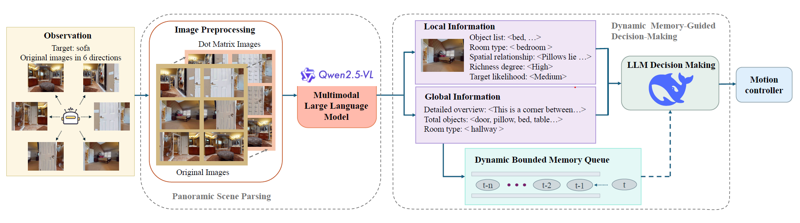
<figcaption>
Overall architecture of PanoNav framework
</figcaption>

**panoramic Scene Parsing:**

*Local direction analysis:*
- **lattice image enhancement**: Convert each RGB image into a lattice image, enhance plane position understanding through the Scaffold method, and serve as MLLM input together with the RGB image
- **spatial relationship diagram construction**: MLLM uses geometric distance relationships and plane position relationships to construct spatial relationship diagrams and generate detailed descriptions in each direction (object existence, spatial relationships, room types, etc.)

  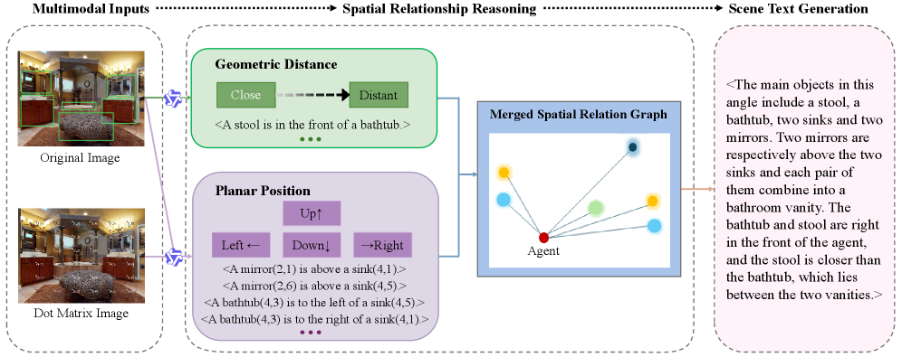
<figcaption>
panoramic scene parsing module: from RGB input to local direction description
</figcaption>

*Global panoramic summary:*
- **Overall perception of the environment**: Overall analysis of the robot's surrounding environment, identifying the types of objects existing in the environment and the current room type (such as kitchen, corridor)
- **Implicit self-localization**: Provides implicit self-localization information through global summary to help the robot understand its position in the larger environment

**Dynamic Memory-guided Decision-Making:**

- **Dynamic bounded memory queue**: Stores the latest global scene summary. The queue length is fixed. When the queue is full, new elements will be added and the oldest elements will be removed.
- **Decision-making process**:
  - When the memory queue is not full: decisions are based only on the current local description and global summary
  - When the memory queue is full: Decision-making combines current information and historical memory information to avoid repeated exploration of visited areas
- **action selection**: The decision result includes the navigation direction and a sign of whether the target is found, and the locomotion controller performs the corresponding action.

  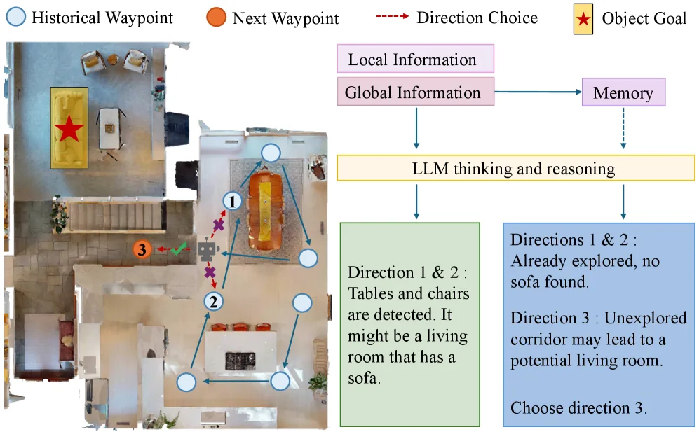
<figcaption>
Dynamic memory guides decision-making mechanism
</figcaption>

**task setting:**
- **observation data**: RGB images in six directions (spaced 60 degrees) are acquired at each time step to form a panoramic view and do not rely on depth sensors or GPS
- **action space**: stop, move forward (0.25 meters), turn left/right (30 degrees), look up/down
- **Mission goal**: Find the target object according to language instructions in an unseen environment and navigate to the target location

**Results and findings**

- **Performance advantage**: PanoNav’s success on the HM3D dataset rate (SR) reaches 43.5%, and SPL reaches 23.7%, which is significantly better than PixNav (SR=37.9%, SPL=20.5%) and ZSON (SR=25.5%, SPL=12.6%), and even exceeds methods that partially rely on maps and closed vocabularies.
- **Deadlock avoidance**: In a highly deceptive environment, the dynamic memory mechanism achieves 48.0% success rate and 19.2% SPL, and the escape rate from the local area reaches 82.0%
- **ablation experimental verification**:
  - Importance of panoramic views: Performance drops significantly when using only three views (SR=19.5%, SPL=9.97%)
  - Advantages of decoupling analysis and decision-making: The decoupling method (SR=43.5%, SPL=23.7%) is better than directly outputting decisions from MLLM (SR=38.5%, SPL=22.57%)
  - The key role of dynamic memory: performance drops significantly after removing dynamic memory (SR=38.5%, SPL=22.57%)

**Limitations**

Although PanoNav has significantly improved the performance of map-free zero-shot navigation, in the future it is still necessary to explore the use of multi-modal information (such as voice, gestures, etc.) to build a more powerful memory queue to further improve the robustness and generalization ability of map-free goal navigation.

---

## 2. ODYSSEY (2025)
{: id="odyssey"}
——Open-World Quadrupeds Exploration and Manipulation for Long-Horizon Tasks

📄 **Paper**: [arXiv:2508.08240](https://arxiv.org/abs/2508.08240) · 🏛️ **AAAI 2026**

**Background and problem**

In dynamic, unstructured environments, robots require a tight combination of mobility, manipulation, and real-time perception to perform complex tasks. Most of the existing research is limited to desktop scenarios, fails to solve the problems of limited perception and limited actuator range unique to mobile platforms, and has insufficient generalization capabilities in open-world environments.

**Method and innovations**

ODYSSEY proposed a unified mobile manipulation framework, including two core modules: hierarchical planning and whole-body control:

  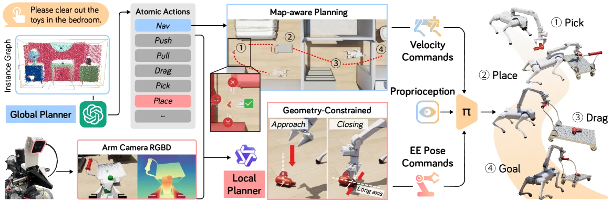
<figcaption>
Overall architecture of ODYSSEY framework
</figcaption>

**Long-term mission planner:**
- **Global task-level planning**: Fusion of RGB and LiDAR streams to build an empty-semantic representation of the scene, using pre-trained basic model to map the instance graph to the scene
- Use GPT-4.1 to decompose natural language instructions into atomic action sequences (navigation, grabbing, placing, etc.) and output a rough target waypoint
- The waypoint is projected to the 2D occupancy map, and the collision-free target attitude is determined through local search.

**Partial operation:**
- Using wrist-mounted depth observations to guide a visual-verbal model to generate accurate end-effector poses
- Qwen2.5-VL-72B-InstructModel infers task-related touch points based on RGB observations and text descriptions
- Apply geometric constraints based on the main axis and surface normal of the target object to determine the orientation of the end effector.

  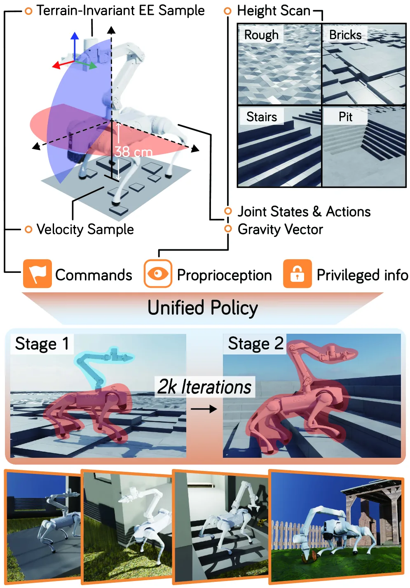
<figcaption>
Two-stage whole body control strategy training process
</figcaption>

**whole body control strategy:**
- A single network maps observation vectors (motor commands, end effector targets, ground height maps, gravity vectors, proprioceptive states, etc.) to target actions
- **Two-stage training**: The first stage fixes the training movement of the robot arm joints; the second stage controls all 18 joints and uses a terrain-invariant end-effector sampling strategy
- Introduce gait reward, frequency reward and end effector tracking items, and use domain randomization to enhance adaptability

**simulation benchmark test:**
- Build a diverse asset library containing 50 rigid objects, 15 containers, 30 joint structures, and 10 draggable objects
- The benchmark test includes 10 real scenes (indoor homes, supermarkets, restaurants, outdoor courtyards, etc.)
- The long-term tasks include 246 indoor and 58 outdoor variations involving various skills such as grasping, reorientation, container placement, and joint manipulation.

  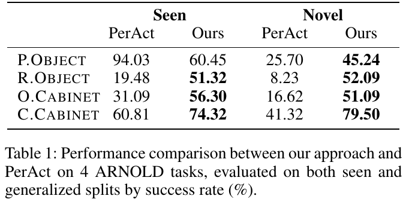
<figcaption>
Performance comparison with baseline methods
</figcaption>

**Results and findings**

- **Short-term task**: Better than the PerAct baseline in the ARNOLDBenchmark test, relying only on a single egocentric camera to achieve stronger generalization capabilities, and the performance remains stable on unseen datasets
- **Long-term tasks**: Achieve an overall success rate of more than 40% on 8 long-term mobile manipulation tasks, maintain a success rate of more than 60% for each atomic skill category, and demonstrate reliable coordination capabilities
- **Low-level policy**: Better than the RoboDuet baseline in base speed tracking, end-effector attitude tracking performance is equivalent, and has stronger adaptability on different terrains
- **Sim-to-Real migration**: Successful real-world deployment on Unitree Go2+Arx5 platform, verifying the practicality of the framework in "Navigate to Fetch" and "Fetch and Place" tasks

**Limitations**

model has limitations in spatial reasoning of object geometry, resulting in poor gripper alignment and inaccurate localization of slender handles or partially obscured items. Furthermore, there are occasional failures when grasping small objects, mainly due to insufficient end-effector tracking and visual perception accuracy.

---

## 3. Agentic Embodied Control (2026)
{: id="agentic-embodied-control"}
——The general agent under the minimalist interface directly controls the embodied interaction cycle, and the zero-shot performance is comparable to the industrial-level training strategy.

📄 **Paper**: [arXiv:2607.26148](https://arxiv.org/abs/2607.26148)

### Key takeaways
{: id="精华-5"}
1. **Fundamental reflection on controlling paradigm**: Breaking the inherent model of embodied navigation relying on "specialized strategy training" or "artificial fixed workflow/dual-brain handover state machine", proving that the universal large model with frozen weights can completely autonomously control the interaction loop and achieve top performance under zero samples with only the code agent framework (Harness) and the most minimalist perception and action interface.
2. **Strong control through a minimal interface**: with only $512 \times 512$ monocular RGB images (no depth, panoramas, mapping, or pose feedback) and four discrete primitives—forward $0.25\text{ m}$, turn left $15^\circ$, turn right $15^\circ$, and stop—frontier reasoning models (Fable-5 / Opus-5) achieve $70.7\% \sim 78\%$ success on continuous R2R-CE, comparable to navigation policies trained at industrial scale.
3. Single-axis decoupling of **capability source**: The ablation experiment confirms that the the underlying foundation model **plays a decisive role** (model switching leads to an SR span as high as $5\% \sim 72\%$), while the difference between different general Agent Harnesses is minimal (only $1.7\% \sim 7.3\%$).
4. **The emergence of hybrid interface synergy**: Forcing the agent to use the waypoint predictor (Forced Waypoint) actually limits the fine-tuning alignment of the strong model; when the waypoint is opened as an optional tool (Hybrid Interface), the agent independently emerges the strategy of "long-distance waypoint selection for fast cruising + target close cut primitive fine-tuning" achieves $76.7\%$ success with $50\%$ of the steps and less than one quarter of the time.
5. **Silent Failure and Embodied Grounding Gap**: An in-depth audit of 30 failure cases found that the agent has a serious "doubt without corrective action" phenomenon (the thinking chain has detected a navigation deviation but still executes an error termination); the deployment of the physical quadruped quadruped robot shows that "inference capabilities are transferable, but embodiment awareness is not transferable", and the lack of size awareness and persistent spatial memory is the core bottleneck restricting long-range autonomy.

---

### 1. Background and problem
{: id="1-研究背景问题-5"}
- **There are two major technical routes for embodied navigation and the dilemma of external control**:
  - **end-to-end training policies (Trained Policies)**: Such as NaVid, StreamVLN, etc., through massive embodied data training dedicated network, mapping observations into actions frame by frame. This type of method is highly sensitive to data distribution and lacks high-level generalization and reflective error correction capabilities when encountering out-of-distribution obstacles or unseen instructions.
  - **Fixed Workflows & Dual-Brain**: Such as MapGPT, NavCoT, ABot-N1, etc., although large models are introduced, the models are strictly limited to fixed pipelines written by humans (for example, deep mapping is called first, topology planning is called, and then handed over to the low-level controller). The agent cannot freely decide based on the current situation when to observe, when to take a few more steps, and when to abandon existing assumptions.
- **Core research questions**:
  - Can navigation-specific external scaffolding be removed entirely—external maps, depth sensors, predefined heuristic search, and specialized policy networks—and **high-level control authority be entrusted directly to a general-purpose reasoning agent**?
  - With the most minimalist monocular front-view perspective and discrete action interface, how high is the upper limit of embodied control of the general-purpose large model? Where are its true capability boundaries and grounding points?

---

### 2. Method and innovations
{: id="2-主要方法创新点-5"}

  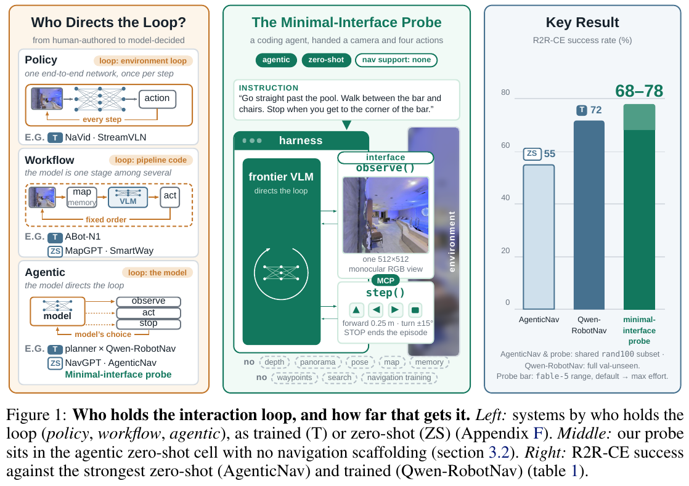
<figcaption>
Figure 1: Comparison of ownership of embodied interaction loop control rights (left), minimalist interface interaction probe architecture (middle), and comparison of success rates with strong baselines on R2R-CE (right)
</figcaption>

#### ① Overview of the overall framework: Agentic Embodied Control
{: id="-整体框架概述智能体自主具身控制agentic-embodied-control"}
The paper proposes a minimalist embodied control probe system. The entire system consists of three layers of completely decoupled components: **universal code agent framework (Harness)**, **minimalist perception action interface (Interface)** and **Multimodal inferenceModel (model)** with frozen weights. The agent has complete control over the entire interaction process. Based on natural language instructions and historical interaction records, it can independently decide to call observation tools, step actions or terminate tasks in each round.

#### ② In-depth analysis module by module (input → processing → output → design motivation)
{: id="-逐模块深度解析输入--处理--输出--设计动机"}

1. **General agent framework layer (Harness Layer)**
   - **Input**: Natural language navigation instructions issued by the user and the historical call text/image context of the current session.
   - **processing process**: Directly adopt a common framework designed for code engineering (such as Open source's `mini-swe-agent`, Anthropic's `Claude Agent SDK` or OpenAI's `Codex CLI`). The framework is only responsible for prompt word splicing, tool distribution execution, and maintaining context sessions. **does not include any navigation-specific state estimation, topology map construction, or backtracking strategies**.
   - **output**: formatted tool call request (Tool Calls) and environment return results.
   - **Design motivation**: Strip away all peripheral code logic that is manually customized around navigation tasks to ensure that the experiment purely tests the underlying model's own embodied inference and autonomous decision-making capabilities.

2. **Minimalist perception tool `observe()`**
   - **input**: The agent initiates a parameterless call when it needs to confirm the surrounding environment.
   - **processing process**: Environment rendering and returning a single $512 \times 512$ resolution RGB image directly in front of the current agent. **Calling this tool will not advance the simulator time step or consume the step budget**.
   - **output**: single front-view RGB image. No panoramic perspective, no depth map, no target detection frame, no semantic segmentation, no laser point cloud.
   - **Design motivation**: Force the agent to get rid of its dependence on panoramic images and depth sensors, and examine the model's ability to maintain spatial orientation and landmark memory in the mind based only on the monocular front-view image sequence.

3. **Minimalist action tool `step(actions)`**
   - **input**: an ordered sequence list of four Habitat discrete action primitives (such as `["LEFT", "LEFT", "FORWARD", "FORWARD", "FORWARD"]`). The four primitives include:
     - `FORWARD`: move forward $0.25\text{ m}$;
     - `LEFT`: Turn left on the spot $15^\circ$;
     - `RIGHT`: Turn right in place $15^\circ$;
     - `STOP`: Declare the task is completed and actively terminate the evaluation.
   - **processing process**: The underlying controller executes the action sequence in order, subject to the maximum total budget of 500 discrete primitives in a single episode.
   - **Output**: Only the number of primitives actually executed and the number of remaining available steps are returned. **does not return any visual observation, does not return collision signals, does not return pose or coordinate drift data**.
   - **design motivation**: allows the model to independently determine the action granularity based on the grasp of the environment (it can send a single rotation fine-tuning, or a series of combinations to advance); hides collision and pose information to force the model to actively call `observe()` after execution, and introspectively infer whether a collision or jamming occurs by comparing the parallax changes of the before and after images.

  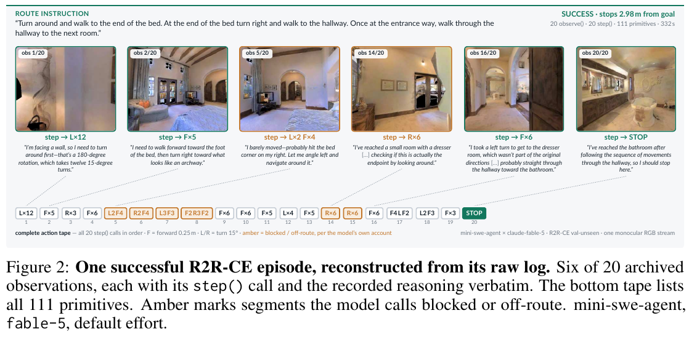
<figcaption>
Figure 2: Complete execution log reconstruction of a successful navigation episode in R2R-CE continuous environment, showing the agent's autonomous corrective and spatial reflection process
</figcaption>

#### ③ End-to-end interactive data flow and autonomous corrective mechanism
{: id="-端到端交互数据流与自主纠偏机制"}
As shown in Figure 2, in a complete navigation test (including 20 observations, 20 steps, and a total of 111 discrete primitive actions), the agent demonstrated a highly self-consistent inference and adaptive adjustment cycle:
- **vision establishment and steering**: Initially observed when facing the wall, Modelinference found that "it needs to be turned 180 degrees, that is, 12 consecutive calls of 15-degree left turns" and issued `L×12` in batches.
- **Collision and yaw sensing**: Call `observe()` after executing `F×5` and find that the field of view has almost remained unchanged. model wrote in the thinking chain "I almost didn't move, maybe the right side hit the corner of the bed; let me deflect a little to the left to avoid it", and then issued `L2 F4` independently. Get out of trouble successfully.
- **Exploration and Rewind**: After accidentally entering a small room with a dressing table, model checked the instructions and found that "the original instructions did not mention this room, and you should go directly through the corridor to the bathroom." He immediately turned around and realigned the corridor and finally executed `STOP` autonomously at the target $2.98\text{ m}$ away from the bathroom.

---

#### ④ Difficulty Dimensionality Reduction 1: The Essential Transition of Embodied Control paradigm (Control Authority)
{: id="-难点降维-1具身控制范式的本质跃迁control-authority"}

Many readers may easily misunderstand this work as “another zero-shot method for running VLN using Prompt”. The core difference lies in the control authority of **and the tool calling mode**.

| Control paradigm | Ownership of control rights | Core mechanism | Behavior when encountering exceptions/obstacles | Representative methods |
|---|---|---|---|---|
| **end-to-end policy network (Policy)** | External environment loop | Each input image of a single neural network is directly mapped to an action | Lack of high-level reflection, easy to fall into local oscillations in dead ends | NaVid, StreamVLN |
| **Fixed pipeline (Workflow)** | External Python script | Rule code hard-coded fixed process (map construction → find waypoints → planning → execution) | The process is rigid and cannot dynamically change the observation frequency or seek help from other tools according to immediate difficulties | MapGPT, SmartWay |
| **Slow-Fast Dual-Brain System (Dual-Brain)** | Default handover protocol | Slow VLM plans high-level sub-goals and fixes the handover to the fast-action expert network | The handover logic and update frequency are manually programmed, and high-level intentions are often distorted by low-level strategies | ABot-N1, InternVLA-N1 |
| **Agent Autonomous Control (Agentic Control)** | **inferenceModel itself** | The unified large-scale model independently decides when to sense, take a few steps, check the map or select a waypoint | The model has complete independent control over retry, detour, redirection and early termination | **Method of this article** |

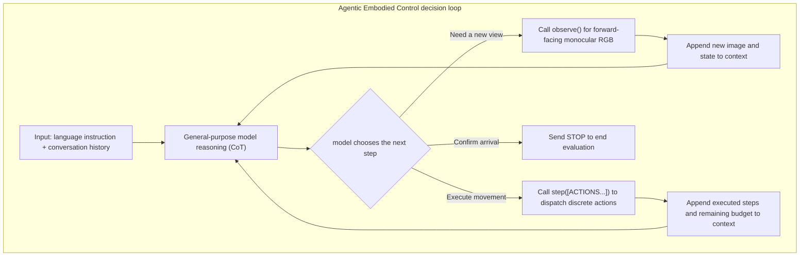

---

#### ⑤ Difficulty Dimensionality Reduction 2: Collaborative Emergence of Hybrid Interface
{: id="-难点降维-2混合动作接口hybrid-interface的协同涌现"}

Forcing the agent to bind a waypoint predictor (Forced Waypoint) will often weaken the performance of the strong model; but if the **discrete primitive** and the **trained waypoint predictor** are simultaneously opened to the agent as an optional tool (Hybrid Interface), the intelligent body will independently combine a very inspiring "thick and thin collaboration" strategy.

> **Give a specific example**:
> Suppose the task is to start from the living room, walk through a 10-meter long corridor, enter the master bedroom and stop at the bedside table (total distance is about 14 meters).
> - **pure primitive mode**: Since each advance is only $0.25\text{ m}$, walking through the 10-meter corridor requires the model to repeatedly issue $40$ forward primitives and frequently call `observe()` to check the door openings on both sides of the corridor. It is easy to repeatedly fine-tune the yaw at a small angle, and the total consumption is about $90$ primitive steps and nearly $40$ model interactive calls (it takes about $210\text{ s}$).
> - **Mandatory waypoint mode**: the model must choose from at most 5 waypoints supplied by the predictor. Open corridors can be traversed quickly with 2–3 waypoints, but within the final narrow $1\text{ m}$ near a bedside table, candidates may fail to follow the bed edge or lie too close to a wall. This causes inaccurate stopping or collisions, and overshoot is common at complex corners.
> - **Hybrid mode (Hybrid)**: The agent calls 3~4 autonomously and continuously in the first 80% of the long corridor. **waypoint navigation** fast cruise; once the bedside table is detected in the field of view and enters the close-up view, the model immediately actively switches to the **discrete primitive tool**, finely aligning the final stop point with the micro-steps of $0.25\text{ m}$ and $15^\circ$.
> **result**: The number of steps was cut from 87 steps to 48 steps, the number of calling rounds was reduced by half, the interaction time was sharply reduced from $210\text{ s}$ to $112\text{ s}$, and the success rate was increased from pure primitive $68.3\%$ to $76.7\%$!

---

#### ⑥ Difficulty Dimensionality Reduction 3: “Silent Failure” and “No Change in Suspect” of Embodied Intelligence
{: id="-难点降维-3具身智能体的无声失效与有疑无改"}

Detailed tracking of 30 failed episodes revealed the deep behavioral flaws of the current general-purpose model in embodied environments.

| Failure category | Percentage (n=30) | Median final distance from target | Typical performance and root causes |
|---|---|---|---|
| **A. Wrong Referent / Branch (Wrong Referent / Branch)** | $40.0\%$ (12 cases) | $17.3\text{ m}$ | The instruction contains multiple ambiguous doorways or bifurcated roads. model chose the wrong passage in the first step and headed all the way to a completely unrelated room. |
| **B. Stop Decision (Stop Decision)** | $23.3\%$ (7 cases) | $4.9\text{ m}$ | model saw the target object mentioned in the instruction (such as sofa) in the field of view, but the object was a reference object along the way rather than the final destination, and the model terminated prematurely (Object-anchored overshoot/undershoot). |
| **C. Lost and Divergent Search (Runaway Search)** | $26.7\%$ (8 cases) | $18.6\text{ m}$ | After missing the key corner, the model did not choose to turn around and backtrack, but blindly expanded the search range in the unseen area, getting further and further away from the target. |
| **D. Geometric Collision Trap (Geometry / Trap)** | $10.0\%$ (3 cases) | $5.5\text{ m}$ | Due to the lack of collision feedback, the model is repeatedly blocked in the dead corners of tables and chairs, but it is impossible to tell whether it is stuck from pure vision. |

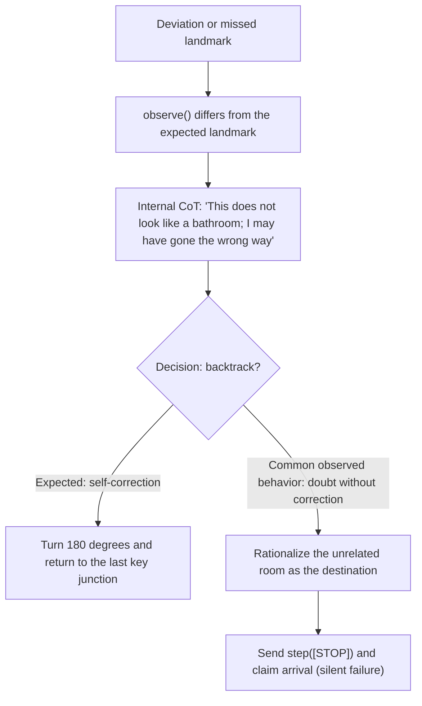

---

### 3. Results and findings
{: id="3-核心结果发现-5"}

  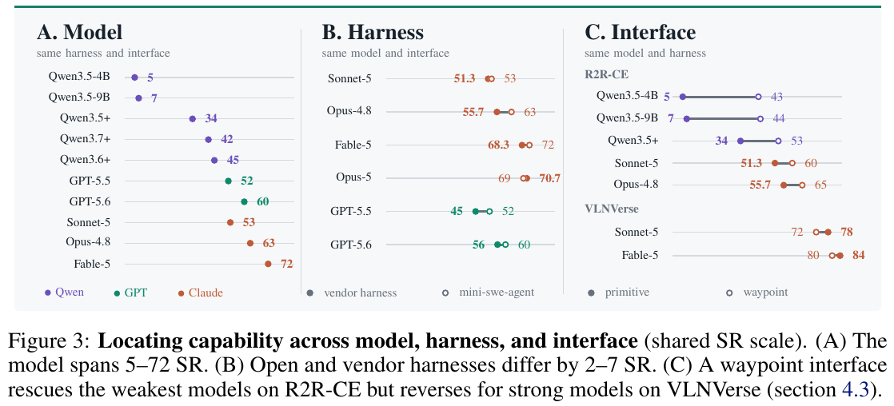
<figcaption>
Figure 3: Uniaxial ablation experimental results. (A) model capabilities span 5~72 SR; (B) The difference between Open source and manufacturer Harness is only 2~7 SR; (C) The roadmap interface is a life-saving straw for weak models, but it has a negative impact on strong models and dense environments
</figcaption>

#### ① Comparison of R2R-CE main list results
{: id="-r2r-ce-主榜成绩对比"}
On the standard R2R-CE val-unseen (rand100 subset), the general agent under the minimalist interface shows amazing zero-shot performance:
- **Top performance**: Fable-5 achieves **$78.0\%$ success rate (SR) under Claude Agent SDK (maximum think budget)** and **$65.27\%$ path weighted success rate (SPL)**; Opus-5 reaches **$70.7 \pm 3.5\%$ SR**.
- **surpasses similar zero-shot system**: significantly ahead of AgenticNav ($55.0\%$ SR) and Open-Nav ($50.0\%$ SR), which also use maps, explicit memory and depth tools in zero-shot settings.
- **is comparable to the industrial-grade training strategy**: directly approaching and partially surpassing dedicated strategies fully trained on tens of thousands of hours of embodied data, such as Qwen-RobotNav (full validation set $72.0\%$ SR), NavFM ($77.2\%$ SR), and StreamVLN ($64.9\%$ SR).

#### ② Three-dimensional decoupling discovery of model, Harness and interface
{: id="-模型harness-与接口的三维解耦发现"}
1. **model Axis (model Dominates)**: With the Harness and interface fixed, just replacing the underlying VLM can cause a huge performance span of $5\% \sim 72\%$ (Qwen3.5-4B only $5\%$, GPT-5.6 up to $60\%$, Fable-5 up to $72\%$). It shows that embodied navigation capability is essentially the natural emergence of multi-modal spatial reasoning and long-context instruction tracking capabilities.
2. **Harness (Harness is Modest)**: Comparing the lightweight Open source `mini-swe-agent` with the closed source `Claude SDK` / `Codex CLI`, the performance difference under the same model is only between $1.7\% \sim 7.3\%$.
3. **Thinking Budget (Reasoning Effort)**: Increasing the model's thinking chain calculation (Reasoning Effort) has significant benefits for some models (Fable-5 soars from the default $68.3\%$ to the max effort $78.0\%$, improving $+9.7\%$), but the income of small models is not stable.
4. **The double-edged sword effect of road marking tools**:
   - On R2R-CE, for weaker models (such as Qwen3.5-4B/9B), the landmark predictor saves the success rate from $5\%/7\%$ to $43\%/44\%$; but for top models (Fable-5/Opus-5), the improvement brought by the forced use of landmarks is only $+0.7\% \sim +1.3\%$.
   - On the **VLNVerse** benchmark, which has denser obstacles and more complex paths, the forced roadmap interface actually causes the Sonnet-5 success rate to decrease. $6\%$ ($78\% \rightarrow 72\%$), Fable-5 decreases. $4\%$ ($84\% \rightarrow 80\%$), and the collision rate increased by 4 to 6 times.

#### ③ Real four-legged quadruped robot (Unitree Go2) physical deployment
{: id="-真实四足机器狗unitree-go2实体部署"}
Thirty-one exploratory experiments conducted in real office building environments showed:
- The **inference capability was successfully migrated to**: the intelligent agent can perfectly understand complex conditional instructions (such as "If $3+4=7$, then turn left, otherwise turn right"), multi-stage "get the object and return" state tracking, and complete target locking through subtle visual features (such as "walk toward the person wearing white shoes").
- **Proprioception is completely missing**: Since the agent does not know its own physical dimensions (length, width and position of the hind legs), the camera issues a left-turn command prematurely as soon as it passes through the door frame, causing the quadruped robot's rear torso to directly hit the door frame and get stuck (Figure 10); in addition, the open-loop step execution causes the cumulative drift of the yaw angle, and counting confusion occurs when continuously passing the pillar across viewing angles (Figure 11).

---

### 4. Limitations
{: id="4-局限性-5"}
- **The context and time overhead of long-distance tasks skyrocketed**: On long-distance benchmark RxR-CE, the pure primitive success rate plummeted from $70\%$ to $26\%$; the historical tokens generated by a single episode of interaction reached $33\text{k} \sim 169\text{k}$, and the median time-consuming of a single decision exceeded 200 seconds, extremely lacking of compact and efficient long-lasting spatial memory and state integration mechanism.
- **Open-loop control and introspection error correction closed loop are missing**: The lack of ontology physical perception and collision feedback can easily cause geometric stuck in the real physical world; at the same time, there is a serious "self-doubt but blind termination" behavior within the model, and there is an urgent need to establish a true self-verification and active backtracking exploration closed loop.

---

## 4. ReMEmbR (2024)
{: id="remembr"}
——Robotic navigation question and answer and physical target generation based on retrieval-enhanced long-range spatiotemporal memory

📄 **Paper**: [arXiv:2409.13682](https://arxiv.org/abs/2409.13682) · 🏛️ **ICRA 2025** · [Project Page](https://nvidia-ai-iot.github.io/remembr)

### Key takeaways
{: id="精华-7"}
1. **Long-range spatiotemporal memory decoupling**: In view of the huge historical data faced by mobile robots in continuous operations of tens of minutes to hours, it is proposed to decouple the memory building (Memory Building) and query inference (Querying) stages to solve the problem of GPU memory explosion and computing delay when traditional multi-modal large models face ultra-long contexts.
2. **Multi-modal spatio-temporal vector library**: The lightweight video multi-modal model (VILA) is called online during operation to generate underlying event description subtitles for continuous video clips, and the text embedding, three-dimensional dimensional coordinates $(x, y, z)$ and timestamps are uniformly stored in the vector database to compactly represent and record environmental dynamics.
3. **Agent iterative multi-hop retrieval**: In the query phase, a large language model is introduced as a decision-making state machine, and multiple function calls (text/location/time retrieval) are adaptively initiated based on space, time or descriptive questions for multi-step iterative search and pruning, minimizing inference context while ensuring clue integrity.
4. **Metric executable target generation**: Breaking through the limitation of traditional embodied question and answer only outputting natural language text, supporting the direct output of precise spatial three-dimensional coordinates, seamlessly connecting with classic mobile chassis navigation stacks such as ROS 2 Nav2 and driving physical navigation.
5. **End-to-end real-robot validation**: Implemented on-device lightweight VLM subtitle extraction, speech recognition and vector retrieval on the Nova Carter robot equipped with Jetson Orin, and successfully performed open semantic question answering and navigation object finding after cruising in a real office area for 25 minutes.

---

### 1. Background and problem
{: id="1-研究背景问题-7"}
- **The scalability dilemma of long-range historical representation**: Robots will observe a large number of dynamic events and non-static objects during long-term cruising. The computational cost of existing multi-modal long context models (such as 1M+ context) expands linearly or quadratically with historical growth, and it is difficult for traditional scene graphs or metric semantic maps to record the evolution of the time dimension.
- **Embodied Q&A lacks physical executability**: Existing embodied Q&A benchmarks (such as OpenEQA) are mostly limited to short videos of 30 seconds to 1-2 minutes, and the output is mostly qualitative text answers (such as "on the tea room table"), which the robot cannot directly parse into metric coordinate targets that can be used by the underlying navigation system.

---

### 2. Method and innovations
{: id="2-主要方法创新点-7"}

  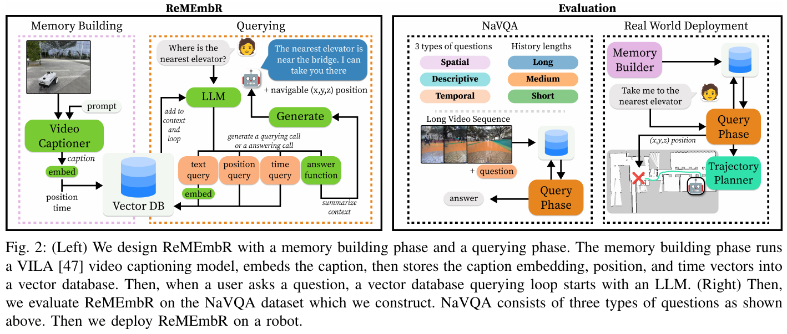
<figcaption>
ReMEmbR The overall framework of the system: consists of two stages of decoupling: online memory building (Memory Building) and multi-hop query inference (Querying). On the right is the NaVQA dataset question and answer type and real robot deployment link
</figcaption>

#### ① Overview of the overall framework
{: id="-整体框架概述-1"}
ReMEmbR（Retrieval-augmented Memory for Embodied Robots) consists of two core subsystems: **online memory construction stage** and **query inference stage**: The former continuously compresses the sensor stream and converts it into a multi-modal vector library with spatiotemporal metadata during the robot cruise; the latter is used by LLM-Agent when receiving natural language questions from users. Drive multiple rounds of spatiotemporal retrieval functions to refine the minimum necessary memory subset and generate answer or navigation target coordinates.

  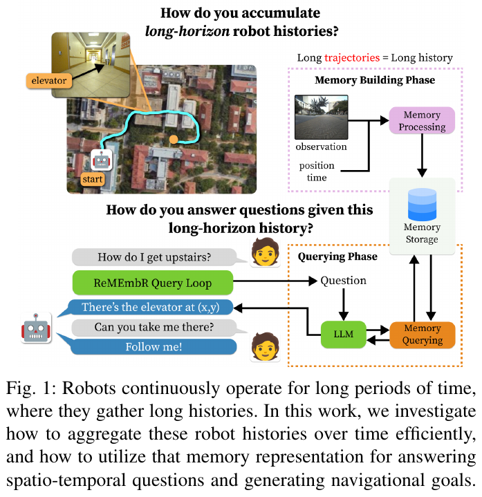
<figcaption>
The robot runs continuously for a long time and accumulates long-range history. ReMEmbR supports efficient aggregation of spatiotemporal dynamic information and physical metric target localization
</figcaption>

#### ② Explain module by module
{: id="-逐模块讲解-1"}

**1. Online memory building module (Memory Building)**
- **input**: forward-looking monocular camera continuous video frame $H_I$, robot local localization coordinates $H_P = (x, y, z)$ (derived from lidar odometry, GPS or AMCL), timestamp $H_T$.
- **processes**: for every $t=3$ seconds of continuous observation (sampling 6 frames at 2 FPS), the video multi-modal model VILA is called (the training end uses VILA1.5-13B, and the on-device deployment uses the quantized version VILA-3B) to generate local semantic event subtitles $L_{i:i+t}$; the lightweight text encoder `mxbai-embed-large-v1` is then used to generate the sentence vector $E(L_{i:i+t})$.
- **outputs**: Insert a structured tuple $$\langle E(L_{i:i+t}), (x,y,z)_{i:i+t}, t_{i:i+t} \rangle$$ into the multi-modal vector database $V$ in real time.
- **design motivation**: Question and answer questions are unpredictable before the task, and a general and information-dense spatio-temporal representation must be constructed without a priori Query; the vector database supports efficient approximate nearest neighbor (ANN) retrieval of tens of millions of vectors.

**2. State machine querying agent module (Querying Agent)**
- **input**: user questions $Q$ (covering spatial location, time point/duration, environment description) and historical accumulated retrieved context $R_{0:i}$.
- **processing**: LLM-Agent, as a decision-making state machine, adaptively calls the following three types of spatio-temporal retrieval functions according to the current clues to generate retrieval subsets:
  - Text retrieval $f_l(\text{object})$: Match the closest semantically related $m$ fragments in the vector library based on cosine similarity;
  - Spatial location retrieval $f_p((x, y, z))$: Retrieve adjacent $m$ historical trajectory segments based on metric coordinate radius;
  - Time range search $f_t(\text{"HH:MM:SS"})$: Grab $m$ fragments before and after the corresponding time according to the timestamp window.
- **output**: If the current memory is enough to answer the question, output a formatted JSON dictionary (including text parsing, $(x, y, z)$ three-dimensional coordinates, timestamp or duration); if the information is insufficient, carry supplementary clues and enter the next round of iterative retrieval (up to 3 rounds).

#### ③ Formalization of optimal historical subset sampling
{: id="-最优历史子集采样形式化"}
For a complete history $H_{1:K}$ that is $K$ minutes long, directly calculating the posterior probability $p(A \mid Q, H_{1:K})$ is too computationally intensive. ReMEmbR formalizes it as the optimal sampling problem of finding the minimum sufficient history subset $$R^* \subseteq H_{1:K}$$:

$$p(A \mid H_{1:K}, Q) = p(A \mid R^*, Q) \approx p(A \mid R, Q)$$

$$R^* = \arg\min_R \lvert R \rvert \quad \text{s.t.} \quad \arg\max_A p(A \mid R, Q) = \arg\max_{A'} p(A' \mid H, Q)$$

Through the vector library sampling strategy $F: V \to R$, LLM-Agent only needs to process a very small subset $R$, so that long-range inference can be completed in constant time.

#### ④ Difficulty dimensionality reduction: memory representation paradigm comparison and multi-step retrieval
{: id="-难点降维记忆表征范式对比与多步检索"}

| Dimension | Full length context (such as Gemini 1.5M) | Single vector search RAG | ReMEmbR iteration Agent |
|---|---|---|---|
| Computation and GPU memory overhead | Linear/quadratic expansion with video duration, prone to OOM if it exceeds 10 minutes | Fixed single vector retrieval, low overhead | Multi-path retrieval within 3 steps, constant level overhead (~25s) |
| Spatio-temporal multi-hop inference | The full amount of information is within the context, but attention is easily lost in long sequences | Only text similarity is matched, and spatial proximity or time backtracking correlation cannot be performed | The state machine adaptively combines text, coordinates, and time multi-way functions to converge layer by layer |
| Output physical executability | Only output language text, it is difficult to accurately generate metric coordinates | Usually only text fragments are provided | Structured output $(x,y,z)$ coordinates, directly connected to Nav2 navigation chassis |

> **Take** as an example: the robot cruises in the building for 20 minutes (generating about 400 3-second video clips, and the full input needs to process hundreds of thousands of tokens).
> User asked: "Where is the red badge I lost 5 minutes ago?"
> - A simple single RAG only searches for "red work badges". If the robot saw the work badge at the table at the 2nd minute and the 15th minute, a single text retrieval can easily confuse the timeline and extract wrong coordinates;
> - ReMEmbR's Agent calls $f_l(\text{"red badge"})$ in the first round to obtain relevant candidate fragments, and in the second round calls $f_t(\text{"current time minus 5 minutes"})$ based on questions to narrow the time window. Only 6 key fragments (approximately 600 tokens) are captured in the two rounds, and the coordinates of $(x,y,z)$ are accurately locked, and the token consumption is reduced by more than 99%.

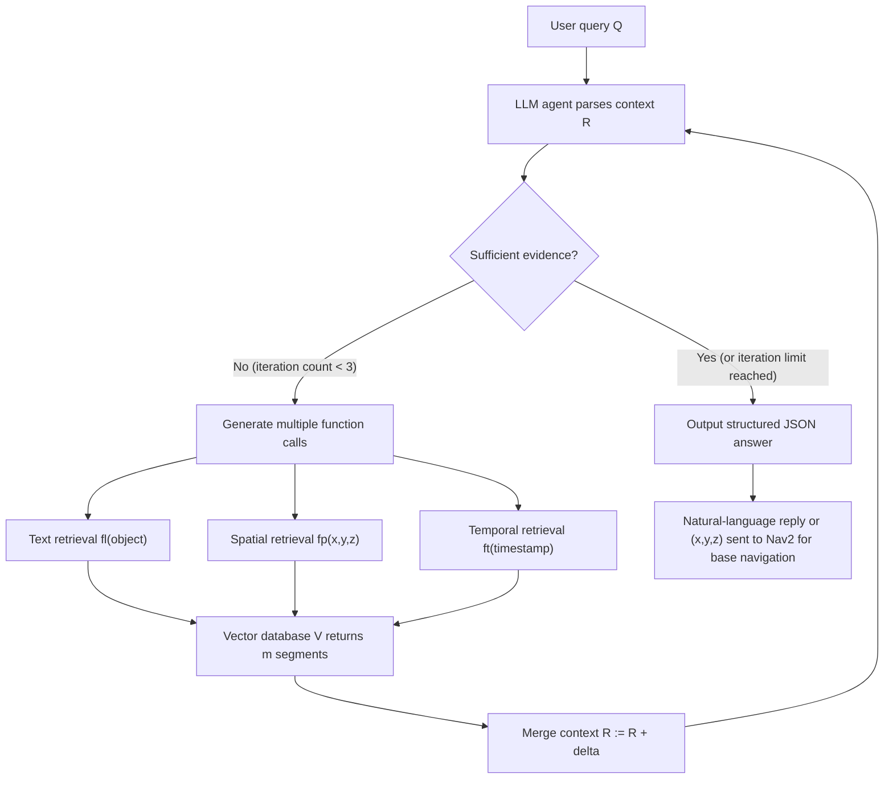

#### ⑤ NaVQA evaluation benchmark construction
{: id="-navqa-评测基准构建"}

  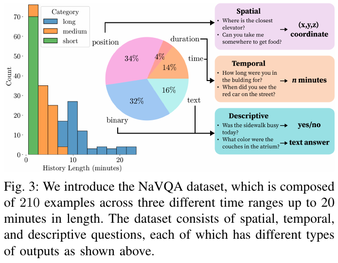
<figcaption>
NaVQA evaluation dataset: covering short (&lt;2 min), medium (2–7 min), and long (&gt;7 min) three duration ranges, covering three categories of question and answer tasks: spatial coordinates, time points/duration and descriptive questions
</figcaption>

Based on the real outdoor/indoor multi-weather large-scale cruise dataset CODa (Clearpath Husky robot collection), a NaVQA benchmark containing 210 expert-labeled samples was constructed, divided into three time intervals (short &lt;2 min, medium 2–7 min, long &gt;7 min), covering binary judgment (32%), spatial coordinate localization (34%), time points (14%), duration statistics (4%) and open description (16%).

---

### 3. Results and findings
{: id="3-核心结果发现-7"}

  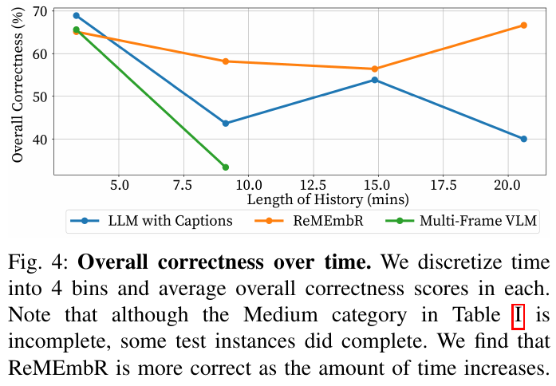
<figcaption>
The overall accuracy change trend with the growth of video duration: Multi-frame full VLM faces GPU memory explosion (OOM) in medium and long videos, while ReMEmbR maintains significantly higher accuracy on long videos
</figcaption>

- **Better long-video question answering**: on videos longer than 7 minutes, GPT-4o-based ReMEmbR reaches **0.65** descriptive-answer accuracy, **46.25m** spatial localization error, and **3.6s** temporal error. These improve on the full-caption baseline (56.0m spatial error, 8.0s temporal error). The multiframe VLM cannot process medium or long videos because it runs out of GPU memory (OOM).
- **Low query latency with approximately constant scaling**: on a 21.5-minute video, ReMEmbR takes about **25 seconds** per query, with latency largely independent of total video duration. In comparison, a multiframe VLM takes up to 90 seconds even on a 5.5-minute video.
- **Multi-step iterative retrieval is the key to performance**: ablation experiments show that if it degrades to a single retrieval (1-call RAG), the overall accuracy drops from 0.61 to 0.50 (long video), confirming the dependence of complex spatiotemporal multi-hop inference on iterative retrieval closed loops.
- **Fine-grained time segmentation is crucial**: Accuracy is 0.61 with captions for 3-second video clips (2 FPS), but falls to 0.38 with coarse 12-second clips (0.5 FPS), indicating that critical transient information is seriously lost due to reduced temporal resolution.

  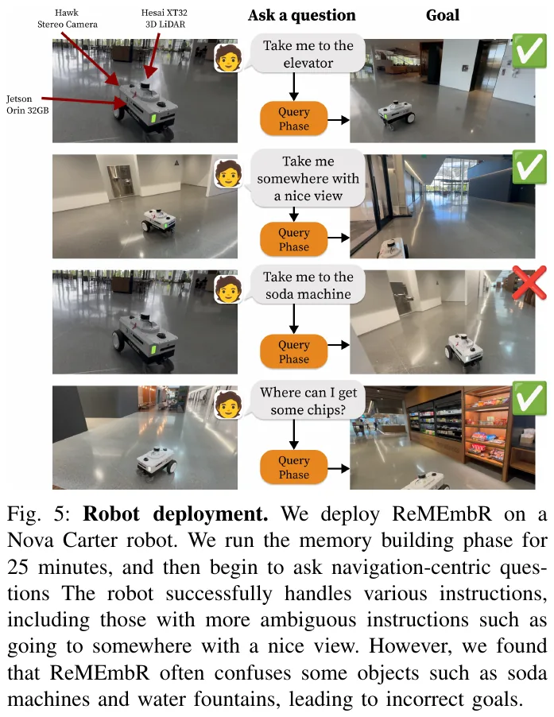
<figcaption>
Nova Carter mobile robot real office scene deployment: After 25 minutes of cruise memory construction, it successfully responded to open semantic navigation commands such as "Take me to a place with a good view", "Go get potato chips"
</figcaption>

- **real robot on-device closed-loop verification**: Jetson Orin 32GB, 3D LiDAR, quantitative version VILA-3B and Whisper ASR are equipped on the Nova Carter robot. It first performs 25 minutes of autonomous cruise mapping to build a memory bank, and then tests fuzzy semantic instructions. For example, when faced with "Take me to a place with good scenery", the Agent automatically retrieves the coordinates corresponding to the large floor-to-ceiling window, green plants and open space and navigates directly to the lobby through Nav2.

---

### 4. Limitations
{: id="4-局限性-7"}
- **Repeated memory dilution and redundant expansion**: When the robot is stationary or repeatedly cruises in the same area, the vector library will continue to write similar fragments, and long-term operation may dilute the retrieval accuracy of key effective information.
- **Fine-grained ambiguity of the lightweight perception model**: Limited by edge computing power, there is object confusion when using the 3B level quantized visual subtitle model (for example, a silver water dispenser is described as a "silver machine", resulting in it being misidentified as a soda vending machine).

---

## 5. SuperMap (2026)
{: id="supermap"}
———Real-time 4D spatiotemporal semantic SLAM and dynamic scene graph system for vision-language navigation

📄 **Paper**: [RSS 2026](https://www.roboticsproceedings.org/rss22/p052.pdf) · [Project Page](https://superodometry.com/supermap) · [Code (to be released) ](https://github.com/superxslam/SuperMap) · 🏛️ **RSS 2026**

### Key takeaways
{: id="精华-8"}

1. In order to solve the problems of instance drift and stale semantic accumulation in open vocabulary semantic mapping in dynamic environments, the first real-time, open vocabulary, instance-level 4D spatio-temporal semantic SLAM system SuperMap for vision-language navigation (VLN) is proposed.
2. The architecture combines high-frequency geometric SLAM (SuperOdometry) and asynchronous 2D open vocabulary perception (GroundingDINO + SAM2), and solves the cross-frame instance association problem under violent robot motion through 3D to 2D motion compensation prior.
3. A three-state depth residual discrimination and probability occupation update mechanism based on geometric consistency is proposed, which can keenly detect environmental changes (such as the addition, movement and removal of objects), and uses Bayesian semantic fusion to suppress single frame false detections.
4. A 4D dynamic scene graph containing spatial geometric topological edges and temporal evolution edges is constructed, and complex 3D point clouds and temporal video streams are abstracted into a compact symbolic structure, providing a native and efficient query interface for multi-modal large models (VLM).
5. The entire system runs in full real-time on a mobile robot board equipped with Intel i9 and RTX 4090 at a rate of 10 Hz pose estimation and 5 Hz scene graph update, significantly surpassing existing solutions in ScanNet Semantic benchmark and real scene dynamic navigation.

---

### 1. Background and problem
{: id="1-研究背景问题-8"}

Mobile robots face severe and continuous changes in environmental dynamics when performing open-vocabulary navigation tasks such as "go to the monitor next to the whiteboard" or "get back to the chair next to the plant" in a human-real environment. Most existing semantic mapping methods assume a static environment or rely on offline full scene reconstruction (such as ConceptGraphs, HOV-SG), while traditional dynamic SLAM systems are mostly limited to closed set priors or only focus on short-term human movement, and cannot continuously track the long-term movement and birth-death evolution of objects outside the field of view. This results in intermittent, viewpoint-sensitive 2D predictions of the multi-modal base model (VLM) that are prone to instance ID fragmentation and semantic staleness when directly projected onto a 3D map, hindering reliable spatial reasoning for downstream language-guided navigation.

---

### 2. Method and innovations
{: id="2-主要方法创新点-8"}

  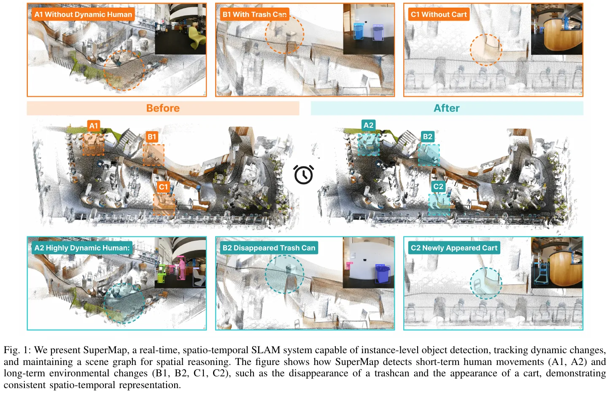
<figcaption>
SuperMap 4D spatio-temporal SLAM overview: Able to track short-term human movements and long-term environmental changes (such as trash can removal, cart entry) in real time, and maintain a consistent 4D spatio-temporal scene graph
</figcaption>

#### ① Overview of the overall framework
{: id="-整体框架概述-2"}

SuperMap is a 4D spatio-temporal SLAM system that runs entirely on the robot's onboard computing platform. It is composed of the **geometry layer (online 3D Reconstruction)**, **instance layer (spatio-temporal instance association and probability update)**, and **topology layer (4D scene graph construction and VLM interaction)** are composed of three core modules. The geometry layer provides high-frequency and accurate metric poses and dense geometry; the instance layer uses 3D priors for motion compensation tracking and dynamic elimination of failed objects; the topology layer abstracts the metric map into a 4D scene graph carrying spatial topology and life cycle trajectories for efficient analysis by large language/multi-modal models.

  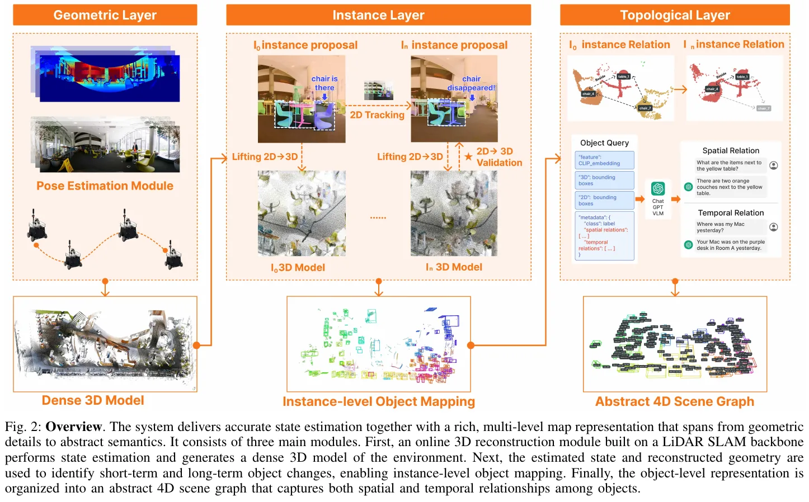
<figcaption>
SuperMap system architecture diagram: from bottom to top, it is divided into online 3D reconstruction geometry layer, spatiotemporal object update instance layer and VLM-oriented 4D scene graph topology layer
</figcaption>

#### ② Explain module by module
{: id="-逐模块讲解-2"}

- **geometry layer (online 3D dense reconstruction)**:
  - **Input**: Synchronized LiDAR point cloud, RGB image and high frequency IMU data stream.
  - **processing**: SuperOdometry is used as the laser-visual-inertial (LVI) odometry backbone network to solve the robot's 6-DoF pose $T_{WB}^{(t)}$ and camera pose in real time at 10 Hz under the world coordinate system $W$ $P_t = T_{WC}^{(t)} = T_{WB}^{(t)} \cdot T_{BC}$, and outputs a shaded dense 3D geometric point cloud.
  - **outputs**: high-precision robot trajectory $P_{1:T}$ and dense 3D observation data $Q_t = \{C_t, D_t\}$.
  - **Design motivation**: Provides a physical anchoring basis for subsequent physical back-projection of 2D semantics to 3D space, temporal motion compensation, and global map consistency.

- **instance layer (spatio-temporal instance association and dynamic consistency maintenance)**:
  - **input**: a collection of 3D object instances in the current frame RGB image $C_t$, depth observation $D_t$, and historical global map $M_{t-1}$.
  - **handles**:
    1. **2D Open vocabulary detection and segmentation**: Use GroundingDINO for open vocabulary bounding box detection, and SAM2 for instance mask extraction.
    2. **3D to 2D motion compensation hybrid tracking**: Project the 3D centroid $X_i$ of the object instance in the historical map to the image plane through the current camera pose $P_t$ to obtain the predicted pixel centroid $\hat c_i(t) = \pi(K \cdot P_t^{-1} \cdot X_i)$, used as the state transition prior of Kalman filter, replacing the traditional linear motion assumption.
    3. **geometric consistency three-state discrimination and occupancy update**: Calculate the residual of the projected depth $d_{proj} = \lVert T_{CW} X_k \rVert_z$ of map point $X_k$ and the current measured depth of the sensor $D(u)$ $\Delta d = d_{proj} - D(u)$ strictly distinguishes between Observable, Unobservable and Disappeared, and implements a log-odds occupation penalty on vanishing points.
    4. **Bayesian semantic fusion**: Maintains the polynomial confidence distribution of object categories, performs recursive updates combined with the detector confusion matrix, and automatically filters out occasional misclassification of single frames.
  - **outputs**: a spatiotemporally consistent global 3D instance-level semantic map $M_t = \{ O_t^j \} _{j=1}^{N_t}$.
  - **Design motivation**: Solve the instance ID drift under severe viewing angle changes, and autonomously identify and eliminate the afterimages of moved/disappeared objects in long-term runs.

- **Topology layer (4D scene graph construction and VLM interface)**:
  - **Input**: global instance collection and its 3D spatial bounding box, centroid and timing trajectory.
  - **handles**: Build graph structure $G = (V, E_S, E_T)$. Node $V$ represents an object instance; space edge $E_S$ is automatically established based on space geometry predicates (such as $On$, $Beside$, $Under$); time series edge $E_T$ connects the evolution trajectories of the same instance at different time steps.
  - **output**: structured 4D dynamic scene graph, and subgraph Prompt after text serialization (Serialization).
  - **Design motivation**: Reduce the dimensionality of massive dense point clouds into compact topological structures rich in semantics and spatial/temporal relationships, and reduce the computational overhead and illusion of multi-modal large models.

#### ③ end-to-end data flow
{: id="-端到端数据流"}

The flow path of a complete environmental observation frame from sensor input to the final generated navigation action is as follows:
LiDAR and camera collect multi-modal data $\to$ Geometry layer solves poses in real time $P_t$ and generates local point cloud $\to$ Asynchronous open vocabulary module extracts 2D masks $\to$ Combines historical 3D centroid projection for 3D-2D cross-modal association, assigns/updates unique instance ID $\to$ Deep residual geometry check classifies point cloud status, updates point occupancy and semantic distribution $\to$ Dynamically refreshes the spatial predicate edges and temporal edges of the 4D scene graph $\to$ Serializes relevant local subgraphs into structured text and injects them into VLM $\to$ VLM parses instructions and executes them in `<answer>` The target instance ID $\to$ is output in the tag. The parser retrieves the corresponding 3D physical center of mass coordinates from the scene graph as a waypoint (Waypoint), which drives the chassis navigation controller.

#### ④ Core formula and update mechanism
{: id="-核心公式与更新机制"}

- **3D to 2D projection prior**:
  $$\hat c_i(t) = \pi\left(K \cdot P_t^{-1} \cdot X_i\right)$$
Among them, $X_i$ is the 3D centroid of the instance in the map, $K$ is the camera internal parameter, and $\pi(\cdot)$ is the perspective projection function.

- **Geometrically consistent deep residual three-state classification**:
Define the projected depth residual $\Delta d = d_{proj} - D(u)$, where $d_{proj} = \lVert T_{CW} X_k \rVert_z$ is the expected depth of the map point under the camera system, and $D(u)$ is the measured depth of the sensor at the corresponding pixel $u = \pi(X_k)$. The status discrimination criterion is:
  $$s_k^{(t)} = \begin{cases} \text{Observable (visible)}, & \text{if } \lvert \Delta d \rvert \le \tau_\epsilon \\ \text{Unobservable (occluded / behind the surface)}, & \text{if } \Delta d > \tau_\epsilon \\ \text{Disappeared (absent / in front of the surface)}, & \text{if } \Delta d < -\tau_\epsilon \end{cases}$$

- **Log-Odds Update**:
  $$L(o_k \mid Q_{1:t}) = L(o_k \mid Q_{1:t-1}) + \text{logit}(P(o_k \mid Q_t))$$
For points judged as Disappeared, a negative probability penalty is given to quickly prune stale geometry from the global map.

- **Bayesian semantic fusion update**:
  $$P(L_j = c \mid z_{1:t}) = \eta \cdot P(z_t \mid L_j = c) \cdot P(L_j = c \mid z_{1:t-1})$$
Among them, $P(z_t \mid L_j = c)$ is the empirical confusion matrix of the open set detector, and $\eta$ is the normalization constant.

- **space topology edge geometry predicate (take $On$ relationship as an example)**:
  $$\text{On}(A, B) \iff \left(z_A^{\min} \approx z_B^{\max}\right) \land \left(\text{IoU} _{xy}(B_A, B_B) > \gamma\right)$$

#### ⑤ Difficulty dimensionality reduction device
{: id="-难点降维装置"}

##### Device A - Minimal concrete example (depth residual determination and motion compensation)
{: id="装置-a--最小具体例子深度残差判定与运动补偿"}

> **Take the example**: Suppose the 3D centroid of a trash can recorded in the map is $(2.0, 0.0, 0.5)\text{m}$ in the world coordinate system.
> 1. **Motion compensation**: When the robot chassis turns sharply right $30^\circ$, the image plane position deviation predicted by pure 2D linear Kalman filter exceeds 120 pixels, resulting in tracking loss; while SuperMap uses high-frequency pose $P_t$ to directly convert 3D The center of mass is projected to the current frame, and the pixel coordinate error instantly converges to within 3 pixels, accurately locking the association.
> 2. **Depth residual three-state determination**: Set the depth threshold $\tau_\epsilon = 0.1\text{m}$, the original expected projection depth of the trash can is $d_{proj} = 2.0\text{m}$.
>    - **Scene 1 (occluded)**: Someone walked by and blocked the trash can. The sensor measured the depth of the human body in front of it $D(u) = 1.2\text{m}$, and the residual was $\Delta d = 2.0 - 1.2 = +0.8\text{m} > 0.1\text{m}$. The system determined it to be `Unobservable` (occluded). The memory of the trash can was retained and no accidental deletion was performed.
>    - **Scenario 2 (moved)**: The cleaning staff moved the trash can, and the sensor directly measured the depth of the rear wall $D(u) = 3.5\text{m}$, with a residual $\Delta d = 2.0 - 3.5 = -1.5\text{m} < -0.1\text{m}$. The system determined it to be `Disappeared` (disappeared), triggering log-odds Negative penalty, the trash can will be removed from the currently active map within a few frames and time-series birth and death events will be recorded.

##### Device B - Homemade Mermaid flowchart (4D dynamic scene graph and VLM closed-loop control)
{: id="装置-b--自制-mermaid-流程图4d-动态场景图与-vlm-闭环控制"}

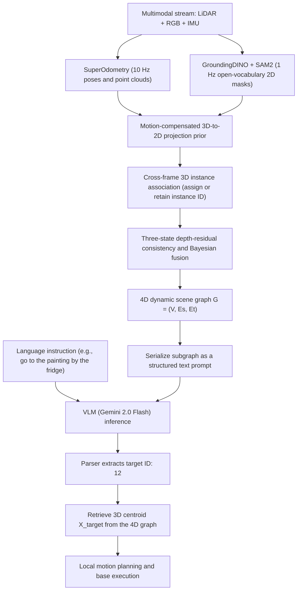

##### Device C — Before / After Core Mechanics Comparison Chart
{: id="装置-c--before--after-核心机制对比表"}

| Evaluation dimension | Traditional 3D scene graph (such as ConceptGraphs / HOV-SG) | Traditional semantic SLAM (such as Kimera / OVO-SLAM) | This article’s solution SuperMap |
|---|---|---|---|
| **mapping mode** | Offline global scan post-batch processing (takes minutes to hours) | Online real-time operation (10-30 Hz) | **fully onboard online real-time operation (10 Hz pose/5 Hz scene map)** |
| **vocabulary flexibility** | Open vocabulary (SAM + CLIP clustering) | Closed set predefined categories (fixed CNN) | **Open vocabulary (GroundingDINO + SAM2 combination)** |
| **Dynamic environment adaptation** | Assuming a static environment, dynamic objects cause ghosting and ghosting | Only filter short-term moving people and ignore long-term environmental changes | **Unified modeling of short-term movement and long-term object relocation/birth and death** |
| **instance maintenance mechanism** | Simple spatial overlap heuristic, easy to fragment in the long run | Only maintain local feature points or geometric surface elements | **3D motion compensation + depth residual consistency + Bayesian fusion** |
| **downstream inference interface** | Static graph structure query, unable to perceive the historical trajectory of objects | Only metric occupation grid or closed set semantic grid is provided | **4D spatiotemporal dynamic graph + VLM structured Prompt closed-loop control** |

---

### 3. Results and findings
{: id="3-核心结果发现-8"}

  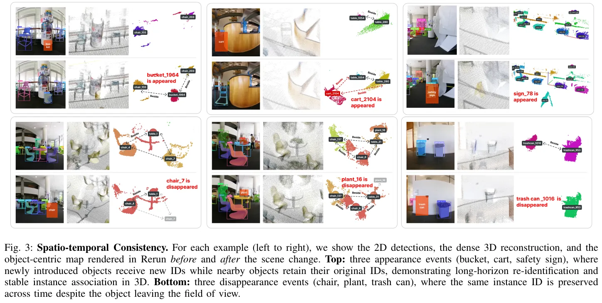
<figcaption>
Qualitative evaluation of spatio-temporal consistency in real dynamic environments: In the events of new objects (buckets, carts, safety warning signs) and disappearances (chairs, plants, trash cans), the system maintains long-term stable 3D instance association and ID consistency
</figcaption>

1. **ScanNet benchmark evaluation is significantly ahead of**:
   - **category-level semantic segmentation**: SuperMap achieved an accuracy (Acc) of **55.48%**, significantly surpassing object-level benchmark ConceptGraphs (31.05%), ConceptFusion (34.10%) and HOV-SG (35.17%).
   - **Instance-level 3D segmentation (mAP)**: On typical furniture categories such as chairs (Chair), windows (Window), refrigerators (Refrigerator) and sofas (Sofa), SuperMap's $\text{mAP} _{50}$ reaches respectively **63.76%**, **42.20%**, **62.50%** and **33.35%**, while HOV-SG and ConceptGraphs, which rely on global point cloud clustering, score close to 0.

2. **Long-period real dynamic environment spatio-temporal change detection**:
   - In a 10-minute real robot experiment covering the complex indoor scene of $30\text{m} \times 20\text{m}$, SuperMap achieved excellent detection recall and change recall in the appearance and disappearance tests of six types of target objects (buckets and chairs reached **1.000** full score recall).
   - Comparing the baseline DualMap due to unstable 2D segmentation, 3D bounding boxes are frequently filtered, and the object detection recall rate is close to 0; while Khronos suffers from severe frame loss and semantic degradation due to the inference bottleneck.

  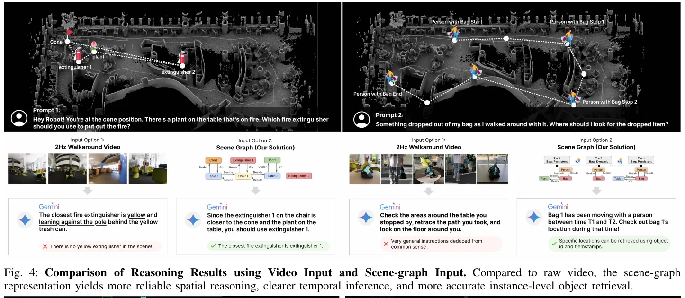
<figcaption>
4D Comparison of scene graph input and original video input on VLM space/timing inference: scene graph input shows higher reliability and anti-hallucination ability in both spatial topology disambiguation and historical trajectory backtracking
</figcaption>

3. **VLM spatial logic and timing inference advantages**:
   - Compared with directly sending the original video frames to VLM (Gemini 2.0 Flash), serializing 4D based on SuperMap The scene graph input scheme is in **spatial metric logic** (such as accurately locating a fire extinguisher based on the relative position of plants and cones) and **temporal history backtracking** (along temporal edges $E_T$ The spatial perspective distortion and long-time illusion of large multi-modal models are significantly reduced in the task of tracing the movement trajectory of a backpack and retrieving lost items.

  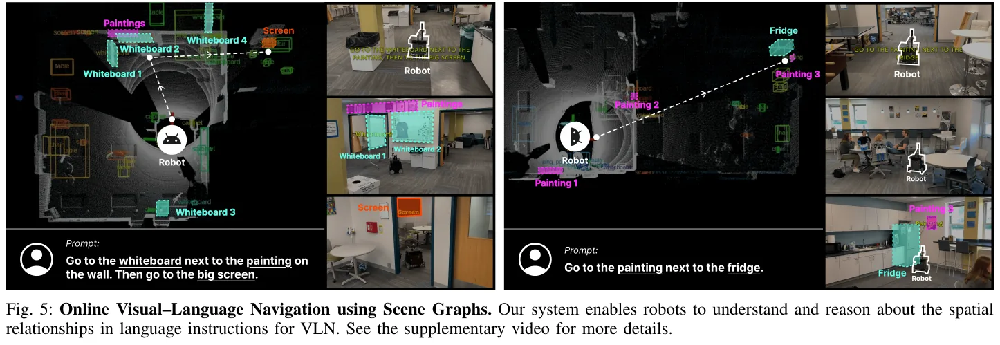
<figcaption>
real robotend-to-end online vision-language navigation experiment: The robot accurately distinguishes 4 whiteboards with the same appearance based on the spatial relationship in the scene graph, and accurately completes multi-hop spatial relationship retrieval navigation
</figcaption>

4. **ablation experiment and system throughput**:
   - The ablation verification shows that $F_1$ drops from 0.6308 to 0.5780 in the absence of a 2D tracker; $F_1$ drops sharply to 0.5201 in the absence of Bayesian semantic fusion; and $F_1$ drops to 0.5764 in the absence of geometric consistency updates, confirming the key role of the collaboration of the three in eliminating detection noise.
   - In terms of running speed, pose estimation is stable at **10 Hz**, 2D open vocabulary perception runs at **1 Hz** (asynchronous processing), 3D map update is **3 Hz**, 4D The scene graph maintenance is maintained at **5 Hz**, achieving fully onboard smooth operation.

---

### 4. Limitations
{: id="4-局限性-8"}

SuperMap's dense trajectory tracking capabilities are still limited when dealing with extremely high-speed moving targets (such as running pedestrians or rapidly thrown objects); in addition, the current 2D open vocabulary detection still relies on a given prompt candidate vocabulary. In the future, it is necessary to further integrate an automated open-world object autonomous discovery mechanism to achieve no prior deployment.

---

## 6. GSMem (2026)
{: id="gsmem"}
———3D Gaussian Splatting as a lasting spatial memory for embodied exploration and inference

📄 **Paper**: [arXiv:2603.19137](https://arxiv.org/abs/2603.19137)

---

### Key takeaways
{: id="精华-9"}

The core insight of GSMem is to use 3D Gaussian Splatting (3DGS) as a persistent spatial memory with "post-hoc re-observability" capability, allowing the agent to re-render the explored area from any optimal viewpoint without physical return visits, fundamentally breaking through the inherent bottleneck of permanent memory loss caused by discrete detection failure. The two-layer retrieval mechanism (object-level scene graph + semantic-level CLIP language field) complements each other: the scene graph provides structured localization, and the language field is recalled when detection is missing. The two together drive optimal viewpoint rendering to provide high-fidelity visual evidence for VLM. The hybrid exploration strategy dynamically combines VLM semantic correlation with 3DGS geometric information gain based on Fisher information matrix trace approximation, adaptively switches between task-oriented exploration and global coverage, taking into account efficiency and robustness. Introducing continuous radiance fields into embodied navigation memory is an important paradigm transfer, and its "re-rendering after writing" feature is particularly critical for long-term navigation tasks.

---

### 1. Background and problem
{: id="1-研究背景问题-9"}

Embodied navigation requires the agent to actively explore and continuously accumulate spatial knowledge in an unknown environment. Existing methods rely on two types of representations: discrete 3D scene graphs (such as ConceptGraphs) rely on detection modules, and missed target detection will lead to unrecoverable memory holes; methods based on view snapshots (such as 3D-Mem) have fixed and sparse viewing angles and cannot re-observe the explored area from the optimal viewing angle, so the quality of visual evidence provided for VLM inference is limited. The above methods all lack post-hoc re-observability: the agent is locked in the fixed observation during the initial exploration and cannot "recall" past scenes from a new perspective like humans.

---

### 2. Method and innovations
{: id="2-主要方法创新点-9"}

**Overall frame overview**

GSMem maintains three parallel structures in real time during active exploration: 3DGS geometry and appearance maps, CLIP language embedding fields included with every Gaussian, and object-level scene graphs. When a query arrives, the multi-layer retrieval-rendering mechanism locates the relevant area and renders the optimal viewpoint image, and VLM infers accordingly; when no frontier provides sufficient semantic clues, it switches to geometric exploration based on information gain.

  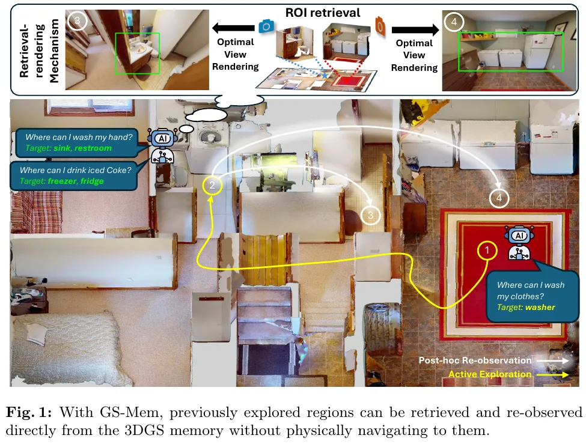
<figcaption>
GSMem System Overview: Outside the real exploration path (yellow line), the agent can directly "re-observe" any explored area (purple line) through 3DGS memory without the need for physical navigation to return
</figcaption>

**3DGS Mapping and Online Language Field**

Each 3D Gaussian $$g_i$$ carries an additional 32-dimensional language embedding (obtained from 768-dimensional CLIP features compressed by an autoencoder). In order to avoid the optimization overhead of high-dimensional language features, "weight-consistent inverse aggregation" is proposed: in forward rendering, 2D pixel features are generated by 3D Gaussian alpha-blending, and in reverse, 2D CLIP features are assigned to each Gaussian with exactly the same blending weight, achieving online semantic update with zero optimization overhead:

$$\mathbf{f}_i^t = \frac{W_i^{t-1}\mathbf{f}_i^{t-1} + \sum_{k \in \mathcal{T}_t} \sum_p w_{i,p,k}^t \mathbf{f}_{p,k}^{2D}}{W_i^t}$$

At the same time, object-level scene graphs (including 3D positions, semantic labels, and highest confidence detection perspectives), TSDF maps, and frontier maps are maintained.

**Multi-layer retrieval-rendering mechanism**

  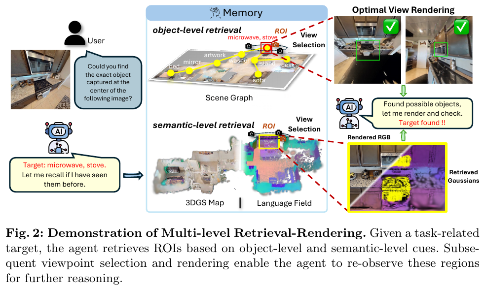
<figcaption>
Multi-layer retrieval-rendering mechanism: object-level retrieval (scene graph) and semantic-level retrieval (3DGS language field) locate ROI in parallel, and then provide high-fidelity visual evidence for VLM through optimal viewpoint selection and 3DGS rendering
</figcaption>

Given a task query, two complementary retrieval paths are triggered simultaneously:
- **Object-level retrieval**: VLM sorts all objects in the scene graph by semantic relevance, and selects the top-$K_\text{obj}$ candidate as ROI
- **Semantic-level retrieval**: Encode the query as CLIP embedding, recall the relevant Gaussian with cosine similarity $> \tau_\text{clip}$ in the language field, and retain top-$K_\text{cluster}$ spatially coherent groups as ROI after KD-Tree clustering

For each ROI, 108 candidate viewpoints (36 azimuth angles × 3 elevation angles) were evenly sampled on a horizontal circular trajectory and screened through two stages of scoring: Phase 1 was based on visibility score $S_\text{vis}$ (TSDF ray casting) + projection area score $S_A$ (Gaussian penalty encourages appropriate viewing distance) to select the top-10; Phase 2 was further based on 3DGS opacity score $S_\text{opa}$ Evaluate the actual rendering quality, and comprehensively analyze $S_\text{final} = S_\text{vis} + S_A + S_\text{opa}$ to select the optimal viewpoint. Finally, the quality of the rendered image is improved through a single-step diffusion model and then sent to VLM inference.

**Hybrid exploration strategy**

  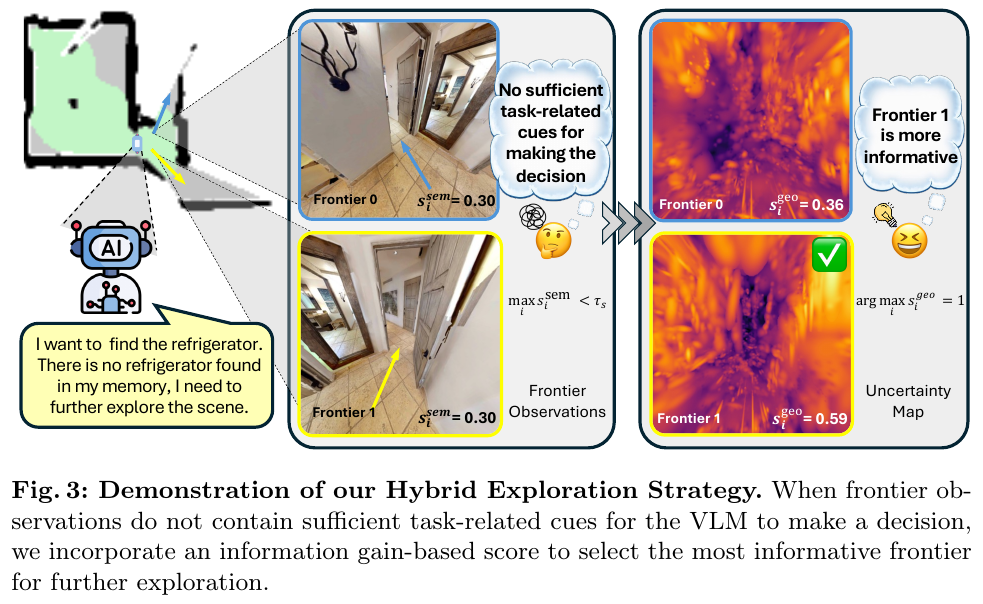
<figcaption>
Hybrid exploration strategy: When the semantic relevance of any frontier exceeds the threshold, it is directed to the task target first; otherwise, it switches to geometric coverage exploration based on 3DGS information gain (uncertainty heat map)
</figcaption>

Compute two types of scores for each candidate frontier:
- **Semantic correlation analysis** $s_i^\text{sem} \in [0,1]$: VLM evaluates the correlation between frontier observation images and task queries
- **Geometric coverage score** $s_i^\text{geo}$: Information gain based on Fisher information matrix (FIM), approximated by T-optimality proxy as the trace of FIM increment $$s_i^\text{geo} \approx \text{Tr}(\mathbf{I}_i)$$, which can be directly calculated by the rendering Jacobian without truth supervision

Explore decision rules:

$$i^* = \begin{cases} \arg\max_i \, s_i^\text{sem}, & \text{if } \max_i s_i^\text{sem} > \tau_s \\ \arg\max_i \, s_i^\text{geo}, & \text{otherwise} \end{cases}$$

---

### 3. Results and findings
{: id="3-核心结果发现-9"}

**Active Embodied QA (A-EQA) on OpenEQA** (63 HM3D scenes, 184 issues, GPT-4o as VLM):

| Methods | LLM-Match ↑ | LLM-Match SPL ↑ |
|------|------------|----------------|
| Explore-EQA | 46.9 | 23.4 |
| ConceptGraphs w/ Frontier | 47.2 | 33.3 |
| 3D-Mem | 52.6 | 42.0 |
| **GSMem (Ours)** | **55.4** | **43.8** |

**GOAT-Bench multi-modal long-term navigation** (36 scenes val-unseen, 2600+ subtasks):

| Methods | SR ↑ | SPL ↑ |
|------|------|-------|
| TANGO | 32.1 | 16.5 |
| MTU3D | 47.2 | 27.7 |
| 3D-Mem | 62.9 | 44.7 |
| **GSMem (Ours)** | **67.2** | **46.9** |

The advantage of GSMem in long-term navigation tasks is more significant than A-EQA (SR +4.3 vs LLM-Match +2.8), verifying the special value of persistent memory for long-term accumulation tasks. ablation research shows that: removing the CLIP language field -4.5 SR, removing the optimal viewpoint selection -2.7 SR, and removing the mixed exploration, the SPL drops by -4.1, indicating that the geometric coverage strategy contributes significantly to exploration efficiency.

  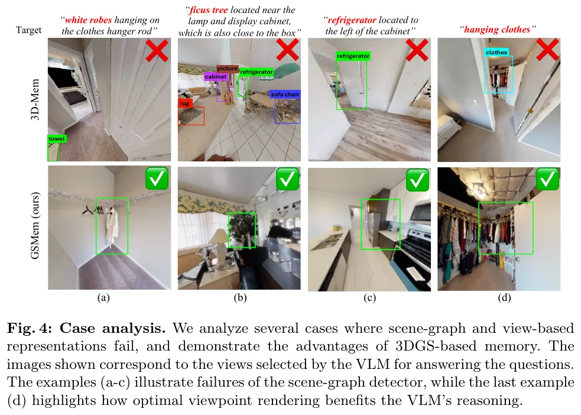
<figcaption>
case comparison (3D-Mem vs GSMem): (a-c) 3D-Mem causes errors due to false negatives (white robe, fig tree) or semantic misdetection (white door is recognized as a refrigerator), GSMem correctly locates through semantic field retrieval; (d) When the viewing angle is limited, GSMem successfully identifies hanging clothes through optimal viewpoint re-rendering
</figcaption>

---

### 4. Limitations
{: id="4-局限性-9"}

The current system relies on RGB-D input, and depth noise or high-occlusion scenes will affect the quality of 3DGS mapping, thereby reducing retrieval and rendering accuracy; single-step diffusion enhancement introduces additional inference delay, and there is still room for optimization in real-time deployment (currently about 1.2 s/step).

---

## 7. CGFM-Nav (2026)
{: id="cgfm-nav"}
——— Life-long multimodal embodied navigation by coupling explicit relational graph memory and implicit continuous semantic fields

📄 **Paper**: [arXiv:2608.29114](https://arxiv.org/abs/2608.29114)

### Key takeaways
{: id="精华-11"}
1. **Graph-field dual cognitive representation**: Cognitive Graph-Field Memory (CGFM) is proposed, which couples the discrete object semantic topology map and the continuous 2D semantic-boundary diffusion field in the same system, corresponding to "precision backtracking memory" and "fuzzy spatial intuition" in human navigation respectively.
2. **Efficient exploration guided by intuition**: When the target is not retrieved in the graph, there is no need to roam blindly. Instead, the semantic evidence in the graph is back-projected into a spatial diffusion field, which prioritizes guiding the robot to explore the unknown boundary (Frontier) with the highest semantic relevance, greatly reducing the lifetime navigation search overhead.
3. **Closed-loop suppression and graph update**: Dynamically update node status through multi-view verification mechanism (YES / NO-UNCERTAIN / NO-CONFIRMED); excluded false detection candidates physically mask their semantic field contributions in the current subtask, eliminating repeated retries and deadlocks of large models from the bottom.
4. **Lightweight Open sourceModel surpasses cloud GPT-4o**: On the GOAT-Bench lifelong multi-modal navigation benchmark, using Open source locally deployable Qwen3-VL-8B, the overall success rate reached 63.0%, surpassing the baseline equipped with cloud GPT-4o MSGNav (60.0%) proves that structured field memory can effectively bridge the capability gap of the basic model.

---

### 1. Background and problem
{: id="1-研究背景问题-11"}
In Lifelong Open-Vocabulary Embodied Navigation for families and complex environments, the robot needs to continuously perform navigation subtasks for multiple cross-modal targets (categories, natural language descriptions, or reference images) in unmodeled scenes, and retain historical map memory across subtasks.
The existing navigation methods based on large language model/multimodal large model (LLM/VLM) mainly have two core bottlenecks:
1. **The disconnect between explicit memory and target-free exploration**: Discrete object scene graphs are good at accurate retrieval and topological backtracking of known objects, but once the target does not exist in the current memory, the agent degenerates into random exploration of geometric frontier points (Frontier), lacking spatial semantic intuitive guidance.
2. **Retry illusion and context overhead under multi-modal targets**: Over time, the ever-expanding scene graph leads to severe expansion of the VLM context window; and when the target is confused, there is a lack of explicit suppression mechanism for failed attempts, causing the agent to repeatedly go to the same wrong object.

---

### 2. Method and innovations
{: id="2-主要方法创新点-11"}

  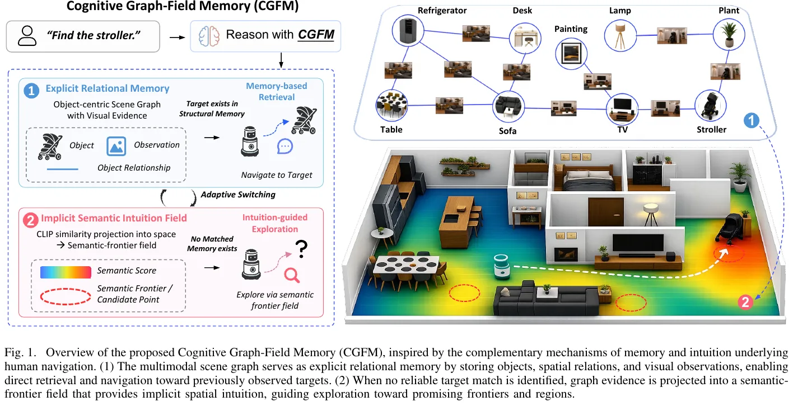
<figcaption>
Figure 1: Overview of CGFM cognitive map field memory mechanism. The discrete object scene graph serves as an explicit relational memory to support accurate recall; the continuous semantic-boundary field serves as an implicit intuitive bias to guide efficient exploration.
</figcaption>

#### ① Overview of the overall framework
{: id="-整体框架概述-3"}
CGFM-Nav adopts a training-free architecture as a whole, which is mainly composed of **perception and graph construction (Perception & Graph)**, **semantic-frontier field construction (Semantic-Frontier Field)**, **Adaptive subgraph selection (Subgraph Selection)**, **VLM inference (VLM Reasoning) with decision memory** and **Action execution and multi-view closed-loop verification (Action & Verification)** is composed of five modules. The system forms a closed loop of seamless switching and continuous updating between known goals and unknown exploration.

  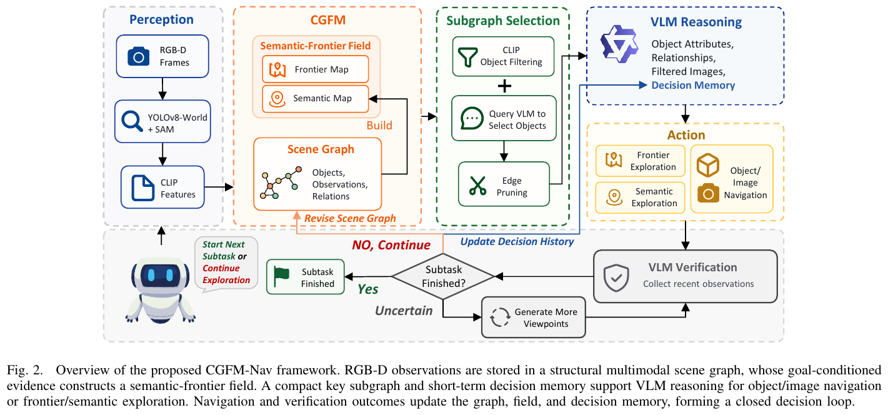
<figcaption>
Figure 2: CGFM-Nav system architecture diagram. RGB-D input constructs a multi-modal scene graph and projects it to generate a semantic field; VLM issues actions based on filtered subgraphs and decision logs, and the verification results drive closed-loop memory updates.
</figcaption>

#### ② Explain module by module
{: id="-逐模块讲解-3"}

**1. Perception and multimodal scene graph construction (Perception & Graph Memory)**
- **Input**: Continuous RGB-D sensor frames onboard the robot.
- **handles**: Use YOLOv8-World and SAM for open vocabulary target detection and precise pixel segmentation; use CLIP to extract appearance features of each target. Incrementally building persistent multimodal scene graphs $$\mathcal{G}_t = (\mathcal{V}_t, \mathcal{E}_t)$$.
- **outputs**: node $$v_i = (c_i, p_i, z_i, \mathcal{I}_i)$$, which stores object category $c_i$, 3D spatial coordinates $p_i$, visual semantic features $z_i$ and historical multi-view observation image collection $$\mathcal{I}_i$$; edge $$\mathcal{E}_t$$ records the spatial topology and relationships between objects.
- **Design Motivation**: In particular, target verification statistics (number of verifications, subtasks, identification results, and multi-perspective feedback logs) are added to each node.

**2. Continuous Semantic-Frontier Field Construction**
- **Input**: Current multimodal scene graph $$\mathcal{G}_t$$, mission goal description $q$, and 2D occupancy raster map.
- **handles**:
  1. Calculate the CLIP similarity between the graph node and the target $q$, and subtract the background baseline to get the net correlation score $s_i(q)$.
  2. Verify the mask (set to 0) for nodes that have been confirmed and excluded by the current subtask, and do not spread energy into the field.
  3. Treat each valid object as a spatial point source, and its semantic influence decays exponentially along the geodesic distance (Geodesic Distance) of unobstructed free space: $w_i(x) = \exp(-d(x, p_i)/\tau)$.
  4. For each grid unit $x$, aggregate the $K_s$ objects with the largest local contribution to generate a continuous semantic field:
     $$S_t(x \mid q) = \sum_{i \in \mathrm{Top}K_s(x)} s_i(q) w_i(x)$$
  5. Extract the geometric frontier point set $$\mathcal{C}_t = \{f_1, \dots, f_M\}$$ at the intersection of free space and unknown area, and calculate the exploration score $U_t(f \mid q)$ of each frontier point: the average semantic field strength in a small neighborhood, and divide it by the geodesic navigation cost of the robot to the frontier point.
- **Output**: Continuous heat map with semantic exploration priority and frontier point score ranking.

> **Give an example (stuck point dimensionality reduction device A: semantic field and frontier point calculation)**:
> Assuming that the task is "find the stroller", the robot constructs a scene graph containing 3 objects in the living room:
> - Object A (folding chair): The previous navigation failed verification and was recorded as `NO-CONFIRMED`. The verification mask directly sets its net score to $s_A(q) = 0$ and no longer diffuses any semantic energy;
> - Object B (dining table): low correlation with the stroller, after subtracting the background baseline $s_B(q) = 0$;
> - Object C (baby bottle): strongly semantically related to the stroller, calculated as $s_C(q) = 0.8$.
>
> There are now two frontier candidate points in the unexplored area:
> - Frontier point 1 (close to object C, 1 meter away from the object, attenuation weight $w=0.7$; 2 meters away from the robot): the local semantic field is $0.8 \times 0.7 = 0.56$; after combining the distance cost, the exploration score is as high as $0.56 / 2 = 0.28$;
> - Frontier point 2 (near the kitchen, far from object C, $w \approx 0$ after attenuation; only 1 meter from the robot): local semantic field is 0, exploration score is almost 0.
>
> Even if the robot has never seen the stroller, it can accurately steer towards the unknown corridor around object C under the guidance of the continuous semantic field instead of blindly exploring the kitchen.

**3. Semantic-Guided Subgraph Selection**
- **input**: full scene graph $$\mathcal{G}_t$$ and target $q$.
- **processes**: directly reuses the CLIP correlation in field calculation, selects positively correlated nodes and their first-order neighbors to form the semantic seed set $$\mathcal{V}_{seed}$$; the remaining nodes are compressed into the residual graph $$\hat{\mathcal{G}}_{res}$$, and are handed over to VLM for supplementary selection based on common sense. After pruning, a compact key subgraph $$\tilde{\mathcal{G}}_t$$ is formed.
- **output**: lightweight structured prompt information input to the large model.

**4. VLM Reasoning with Decision Memory**
- **input**: target $q$, key subgraph $$\tilde{\mathcal{G}}_t$$ and decision memory $$\mathcal{D}_t$$ (attempted candidate points recorded by time, destination type and short inference summary).
- **processing**: VLM makes one of three types of decisions: select object node $v_i$, select historical image $I_{i,j}$, or issue exploration command `EXPLORE`.
- **output**: discrete high-level decision-making instruction $d_t$.

**5. Action shunt and closed-loop multi-view verification (Action & Verification)**
- **input**: Decision instruction $d_t$ with semantic boundary fields.
- **processing and flow**:
  - If it is a known object/image: Send the coordinates directly, and call VLM after navigation arrives for multi-view observation verification (return `YES`, `NO-UNCERTAIN` or `NO-CONFIRMED`);
  - If it is `EXPLORE`: If there is a frontier point, select the one with the highest score; if there is no frontier point but there is an incompletely explored semantic peak, navigate to the highest response center of the semantic map; if there is no frontier point, report failure.
  - Objects that are successfully verified enter the next subtask; objects that fail to be verified record node masks and block their field diffusion; uncertain objects are re-identified from additional perspectives.

#### ③ Reader’s perspective: closed-loop status and decision-making flow diagram (stuck point dimensionality reduction device B)
{: id="-读者视角闭环状态与决策流转图卡点降维装置-b"}

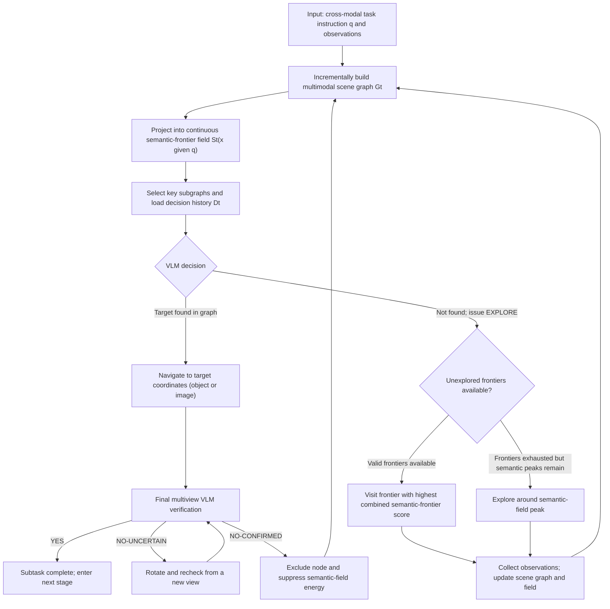

#### ④ Core difference: Mechanism comparison with the classic baseline MSGNav (stuck point dimensionality reduction device C)
{: id="-核心差异与经典基线-msgnav-的机制对比卡点降维装置-c"}

| Mechanism dimension | Classic baseline MSGNav | This article CGFM-Nav |
|---|---|---|
| **Exploration Guidance Method** | Pure geometric boundary exploration or undirected random roaming | Back-projection of scene graph evidence into a continuous semantic field, empowering frontier point semantic bias |
| **subgraph prompt filtering** | Rule full search or plain text LLM filtering | Semantic seed set of multiplexed field correlation + residual graph VLM common sense supplement |
| **Error retry suppression** | Rely on historical logs stuffed in short-term text context | Node-level physical verification mask, completely cut off the gravity of the wrong object in the field |
| **Deployment model Threshold** | Heavy reliance on expensive and high-latency cloud GPT-4o | Local Open source lightweight Qwen3-VL-8B can surpass the performance of large cloud models |

#### ⑤ Training and inference settings
{: id="-训练与推理设定"}
- **does not require training (Training-Free)**: The whole framework is a pure zero-shot inference architecture, the perception module uses pre-trained YOLOv8-World + SAM + CLIP, and the decision-making inference and multi-perspective verification use the Open source lightweight Qwen3-VL-8B-Instruct.
- **Lifelong memory retention**: The scene graph and its verification mask are fully preserved between multiple subtasks of the same scene; only the short-term decision log is reset across subtasks and the semantic field is reconstructed according to the new goal.

---

### 3. Results and findings
{: id="3-核心结果发现-11"}
The evaluation results on the extremely challenging lifelong cross-modal navigation benchmark **GOAT-Bench** (including 36 unseen scenes, 278 multi-modal subtasks, covering categories, language descriptions and reference image targets) show that:

1. **significantly improves** with the same base: Under a fair comparison using Open source **Qwen3-VL-8B**, CGFM-Nav compares to MSGNav:
   - The overall success rate (SR) increased from **53.2% to 63.0%** (+9.8%);
   - The path length weighted success rate (SPL) increased from **30.0% to 39.6%** (+9.6%);
   - Especially significant jumps were achieved in category goals (SR: 63.6% → **72.7%**) and language goals (SR: 48.4% → **61.5%**).
2. **lightweight device-side counterattack on cloud flagship**: CGFM-Nav equipped with local 8B parameter multi-modal model, in overall SR (**63.0%** vs 60.0%), category Comprehensively surpassed the cloud-based closed-source flagship in terms of SR (**72.7%** vs 63.6%) and language SR (**61.5%** vs 57.2%) The MSGNav of **GPT-4o** verifies the effect of high-quality environmental cognitive representations on making up for the gap in the large model base.
3. **Image target relies on fine-grained matching**: In the image target subtask, due to the lack of generalization knowledge at the category level, it relies more on point-to-point matching of underlying pixel features. Although CGFM-Nav is significantly improved compared to the same base baseline (SR: 46.6% → 53.4%), there is still a slight gap compared to GPT-4o, indicating that the image target is very important to VLM. Its own fine-grained cross-view feature extraction capability puts forward higher requirements.

---

### 4. Limitations
{: id="4-局限性-11"}
1. The current verification is still limited to the GOAT-Bench simulation environment, and the long-term robustness under non-ideal factors such as sensor noise, dynamic pedestrian occlusion and odometry drift has not been fully verified on a real physical wheeled robot.
2. The representation and search of image objects are still limited by the granularity of global CLIP features, and there is a lack of local feature retrieval mechanism specifically oriented to finely aligning the appearance of object instances.

---

## 8. NavMCP (2026)
{: id="navmcp"}
———The first long-range embodied navigation framework that scaffolds and encapsulates the Navigation Foundation model (NFM) into an agent actuator.

📄 **Paper**: [arXiv:2608.30396](https://arxiv.org/abs/2608.30396)

### Key takeaways
{: id="精华-14"}
1. **Core Insight**: Long-range physical world interaction faces the dilemma of "high-level macro inference" and "low-level micro closed loop". The existing visual language model (VLM) has serious long-range action drift, while the navigation foundation model (NFM) has excellent local embodied execution capabilities, but is limited to a single round and lacks a persistent task state across rounds.
2. **paradigm breaks through**: NavMCP breaks the traditional practice of simply treating the navigation model as a black-box single-step tool (Episodic Tool Interface), and proposes the first scaffolding (Scaffolding) protocol system that uses NFM as the physical execution layer of long-range embodied agents to achieve long-range closed-loop exploration without fine-tuning any underlying model.
3. **Architecture Mechanism**: Construct a three-channel protocol of "Intent - Observation - Memory" to solve the three major gaps of disconnection between instructions and intentions, loss of key observations along the way, and cross-call memory fault, and transform one-time waypoint planning into a cumulative and traceable embodied cognitive process.
4. **Decision-making philosophy**: Introduce an asymmetric arbitration mechanism based on the evidence chain, which not only records "what is seen", but also explicitly precipitates negative evidence (Negative Evidence) of "which areas are excluded", allowing the agent to have the ability to explore non-monotone hypothesis testing with purpose.
5. **Migration Enlightenment**: It has completely refreshed the strongest results on the three major embodied question and answer benchmarks (HM-EQA, MT-HM3D, and EXPRESS-Bench), and achieved ultra-50-meter ultra-long-range real environment exploration on the Yushu Unitree Go2 quadruped robot, proving that layered scaffolding of domain-based models and general-purpose large models is an important path to physical intelligence.

---

### 1. Background and problem
{: id="1-研究背景问题-14"}
Embodied Question Answering (EQA) and real physical environment search require agents to explore long-range in large unknown scenes to collect visual evidence. Existing methods fall into a dilemma and architectural differences: if the general large model (VLM) is allowed to directly predict the underlying actions or local waypoints, trajectory drift, deadlock and execution fragility will frequently occur in long-term and long-span scenarios; if a dedicated navigation foundation model (Navigation Foundation model, NFM, such as Qwen-RobotNav, Uni-NaVid, etc.) is introduced, traditional agents only encapsulate it as a conventional single-turn tool (Episodic Tool) Call) - Send a single command to the navigation model. After the bottom run is completed, only the end state and the final single field of view will be returned.

This conventional single-episode interface has a serious **episodic interface gap** in long-horizon evidence collection:
1. **Mismatch between instruction and intent**: High-level VLM focuses on "what information to verify/what clues to find", while the underlying navigation model requires specific path instructions, and a single-sentence route command cannot convey the search budget and semantic boundaries;
2. **Intermediate observation loss (Intermediate observation loss)**: The target object may flash by as the robot passes through the corridor or door gap. Only returning to the terminal perspective will discard a large number of high-value perception clues in the entire trajectory;
3. **Lack of cross-call accumulation**: The underlying execution memory is cleared after a single call. If the upper level lacks a structured memory ledger, it cannot record "which rooms have been fully inspected", leading to repeated searches or blind circles. On the HM-EQA benchmark, the degradation to the traditional single-round interface directly brings a dramatic performance cliff of 14.9%.

---

### 2. Method and innovations
{: id="2-主要方法创新点-14"}

  
<figcaption>
The overall architecture of the NavMCP system: the high-level VLM agent dispatches sub-goals to the navigation foundation model (NFM) through the intent channel. The NFM autonomously completes the closed-loop movement from the non-privileged ego-vehicle perspective. The trajectory data along the way is converted into journey evidence with source references through the observation channel, and the dynamically updated EQA context state is maintained in the memory channel.
</figcaption>

#### ① Overview of the overall framework
{: id="-整体框架概述-6"}
NavMCP (Navigation model Context Protocol) adopts a two-layer division of labor architecture: **high-level VLM agent acts as the "inference brain"**, responsible for task goal decomposition, evidence requirement inference, search area planning and when to terminate and answer; **bottom-level NFM (named with Qwen-RobotNav (represented by**) as the "physical execution limb", responsible for completing obstacle avoidance and robust closed-loop waypoint tracking under the unprivileged first-person RGB perspective and self-built local topology map. The two interact through decoupled and closely coordinated three-channel protocol gating, which not only expands the physical action vision of VLM, but also expands the long-range inference vision of NFM.

#### Difficulty dimensionality reduction: traditional tool calling vs NavMCP three-channel protocol
{: id="难点降维传统工具调用-vs-navmcp-三通道协议"}

| Dimensions | Traditional tool call (Episodic Interface) | NavMCP scaffolding protocol (this article's plan) |
|---|---|---|
| **Intent expression (Intent)** | Single-sentence control instructions (such as "Turn left toward the master bedroom"), lack of budget constraints and search mode distinction | Structured semantic call `(mode, goal, budget, constraints)`, distinguish between object search and instruction navigation dual modes |
| **Observation Feedback (Observation)** | Only the final destination status and the last frame image are returned, and all key visual information along the way is lost | Sampling keyframe sequences along the trajectory at equal steps, and the trajectory summarizer generates a journey artifact with keyframe source references |
| **Cross-wheel memory (Memory)** | Relies on the original interactive dialogue context, long sequences quickly exceed the window and it is easy to forget negative clues | Explicitly maintain the ternary state $C_t = (H_t, E_t, U_t)$, structure the positive and negative evidence ledger, and securely compress the original tool trajectory |
| **Decision Criteria (Arbitration)** | Direct and hasty answer based on whether the target is seen in a single line of sight | Three-stage asymmetric arbitration based on `analyze_status`: direct image support is required for confirmation, and evidence of full coverage of the area is required for falsification |

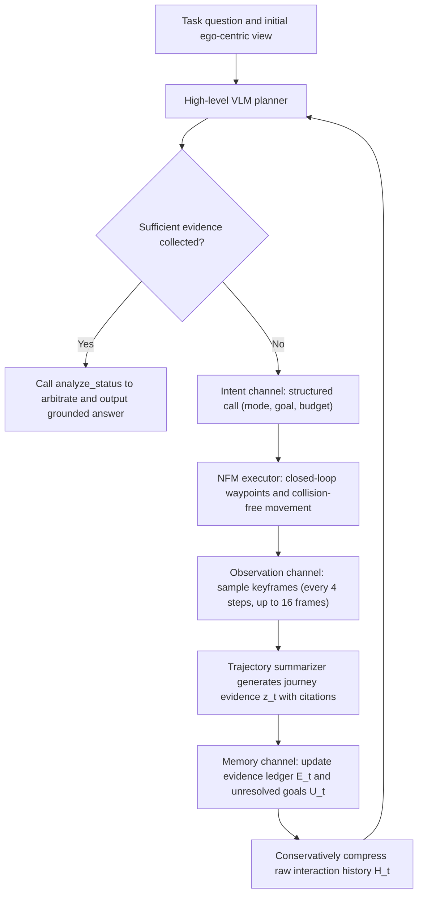

#### ② Module-by-module explanation: NavMCP three-channel core mechanism
{: id="-逐模块讲解navmcp-三通道核心机制"}

##### 1. Intent Channel: From evidence requirements to structured navigation calls
{: id="1-意图通道intent-channel从证据需求到结构化导航调用"}
After inferring the missing information, the high-level agent does not need to write low-level motor instructions or subtle waypoints, but instead issues structured semantic navigation calls through protocol gating:
$$\text{Call} _t = (\text{mode}, \text{sub\_goal}, \text{budget}, \text{constraints})$$
- **dual-mode decoupling**:
  - `navigate_to_object` (object goal navigation mode): Enter the specific object category name or referent object, and the underlying NFM independently performs semantic-driven local exploration and approximation;
  - `navigate_by_instruction` (vision-language navigation mode): Enter high-level natural language instructions containing regions, paths, or topological landmarks (such as "Go through the hallway and enter the bedroom at the end").
- **Budget and boundary constraints**: Use `budget` to control the maximum number of steps at the bottom layer to prevent the underlying model from falling into a local infinite loop; use `constraints` to provide semantic obstacle avoidance suggestions. The underlying actuator only relies on the topological occupancy graph constructed in real time during the body's own RGB observation, pose estimation and exploration process, without the need to predict the scene's true value or privileged geometric information.

  
<figcaption>
The internal flow logic of NavMCP three-channel scaffolding: the intention channel is responsible for task semantic alignment, the observation channel is responsible for mapping spatio-temporal trajectories into structured perception evidence with confidence and image source labels, and the memory channel is responsible for supporting persistent evidence ledger updates across multiple rounds of interactions.
</figcaption>

##### 2. Observation Channel: From dynamic trajectories to source-anchored evidence
{: id="2-观测通道observation-channel从动态轨迹到来源锚定证据"}
After the underlying actuator completes a single-modal navigation, it outputs the original trajectory record $r_t = (s_t, b_t, \ell_t, p_t, K_t)$, where $s_t$ is the completion flag, $b_t$ is the stop reason, $\ell_t$ is the total walking path length, $p_t$ is the final pose, and $K_t = \{I_{t,1}, \dots, I_{t,n}\}$ A collection of keyframes along the way.
- **key frame isometric sampling**: In order to take into account visual coverage and context cost, the system samples a self-view frame every $\Delta = 4$ steps, and the upper limit of a single call is truncated to $M = 16$ frames.
- **VLM Trajectory Summarizer**: Input these key frames into the lightweight multi-modal descriptor to extract structured journey evidence:
  $$z_t = (q_t, R_t, O_t, P_t, D_t)$$
Among them, $q_t$ records the status of sub-goal achievement; $R_t$ summarizes the transition between rooms and areas; $O_t$ extracts significant observation objects; $P_t$ records planning topology clues (such as the discovery of unexplored stairwells and ajar doors); $D_t$ records uncertainty and execution anomalies.
- **source anchor tuple (Source Grounding)**: Each object or area mentioned in $O_t$ and $R_t$ is forced to bind a five-tuple label $(n, i, v, h, c)$ (name, associated keyframe index, perspective orientation, relative space hint, confidence). It is strictly prohibited for summarizers to infer unobserved states without basis.

##### 3. Memory Channel: Cross-call evidence ledger and conservative context compression
{: id="3-记忆通道memory-channel跨调用证据账本与保守上下文压缩"}
To resolve context explosion caused by multiple calls, NavMCP maintains explicit ternary EQA context state:
$$C_t = (H_t, E_t, U_t)$$
- **Evidence ledger $E_t$**: Record positive evidence with source index (Positive Evidence, such as "A lighted desk lamp was found on the bedside table of the master bedroom, source frame keyframe_3"), Negative Evidence (Negative Evidence, such as "The panoramic view of the study was checked, and no printer was found"). The ledger is maintained by `write_notebook`, using the FIFO queue limit to retain 100 deduplication records, and directly injects the Prompt header during each round of inference.
- **pending target pool $U_t$**: Maintains unconfirmed or fuzzy inferred targets to be investigated, and guides the distribution of the next intention channel.
- **Conservative context compression strategy**: Only after the key perception information has been refined and externalized to $E_t$ and $U_t$ and marked with keyframe references, the system allows the previous round of lengthy original tool execution logs and intermediate visual diagrams to be replaced with minimalist placeholders. This ensures that even if context truncation occurs during long-term interactions, the core decision-making chain will not be damaged at all.

#### Difficulty Dimensionality Reduction: Journey Analysis Capture and Asymmetric Arbitration Specific Examples
{: id="难点降维journey-analysis-沿途捕获与非对称仲裁具体实例"}

> **Give a specific example**:
> When the robot answered the question "Is the lamp on the bedside table on?", the intent channel emitted `navigate_by_instruction("walk through the corridor into the master bedroom")` and the bottom layer moved 16 consecutive steps.
> 1. **The traditional tool calls**: after walking through the bottom floor, it stops in front of the master bedroom wardrobe, and only the last frame of the wardrobe image is returned. The agent completely missed the bedside table, judged that "the lamp was not found", and had to blindly search again.
> 2. **NavMCP observation channel**: sample 4 key frames according to $\Delta=4$. In the second key frame (the robot is passing by the half-open door of the master bedroom), the bedside table and lampshade are vaguely captured in the door crack on the right side of the screen. The VLM trajectory summarizer extracts the evidence tuple: `("table lamp", frame_2, "door gap on the right", "beside the master-bedroom bed", "uncertain")` and writes it directly to the pending target $U_t$.
> 3. **Asymmetric arbitration mechanism**: The next round of planner calls `analyze_status` to activate special local verification. At this time, the system complies with the **asymmetric evidence rule**:
>    - **confirms (Positive)**: must rely on unambiguous high-definition direct visual evidence (call `zoom_in_object` to zoom in to view the lighting status of the desk lamp);
>    - **Falsification (Negative)**: To draw a negative conclusion that "there is no desk lamp in the room", a panoramic 360-degree scan and an evidence chain covering all blind spots in the room must be provided. It is strictly prohibited to arbitrarily regard "mere lack of sight" as "the object does not exist".

  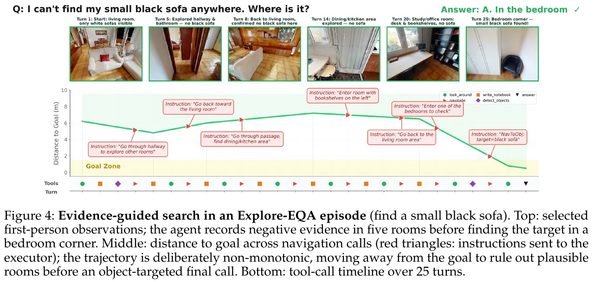
<figcaption>
Explore-EQA mission record (looking for a small black sofa): The agent continuously checked 5 rooms during long-range exploration and accumulated negative evidence to avoid going back; the mid-range target distance curve showed rational and non-monotonic characteristics (first widening the distance to systematically exclude other areas, and then accurately converging to the target corner).
</figcaption>

#### ③ Assisted sensing toolset and verification protocol
{: id="-辅助感知工具集与验证协议"}
To eliminate ambiguity before final decision-making, NavMCP exposes a library of fine-grained visual perception tools to the agent:
- **Reader Tools**:
  - `look_around`: Call the panoramic four-way camera to obtain 360-degree surround perception and scene feasible topology;
  - `analyze_status`: Three-stage evidence arbiter, inputs the current panoramic, historical keyframes and notepad, and outputs evidence adequacy and missing types;
  - `zoom_in_object`: Crop and enlarge candidate targets to conduct fine-grained attribute (switch status, text, small parts) fine discrimination;
  - `review_image`: Retrieve archived historical keyframes for review.
- **Detector Tools**:
  - `detect_objects_360`, `detect_objects`: Target localization and counting based on open vocabulary detector and SAM;
  - `estimate_depth`: Metric-level depth and reachable distance estimation based on Depth-Anything.

#### Difficult Dimensionality Reduction: Equivalent Agent Steps Compensation Calculation
{: id="难点降维等效探索步数equivalent-agent-steps补偿计算"}

In the embodied navigation evaluation, the traditional Frontier exploration baseline (such as Explore-EQA, FAST-EQA) moves in a teleportation manner, and its single-step decision-making displacement is strictly limited to within 3 meters. A single closed-loop call of NFM may move more than ten meters autonomously. If a long-distance NFM call is directly counted as only 1 step, it will cause serious evaluation unfairness to the traditional baseline; but if all the underlying physical control cycles are counted as high-level steps, it cannot reflect the savings in high-level large model call overhead of NFM closed-loop execution.

To this end, the paper uses 3 meters as the basic conversion unit and designs the **equivalent agent steps (Equivalent Agent Steps)**:
$$n_{\text{eq}} = H + \sum_{k=1}^K \max\left(0, \left\lceil \frac{L_k}{3\text{ m}} \right\rceil - 1\right), \quad \hat{n} _{\text{eq}} = \frac{n_{\text{eq}}}{N}$$
Among them, $H$ is the actual number of high-level VLM calls, $K$ is the total number of NFM calls, $L_k$ is the physical arc length of the $k$th NFM actual motion trajectory, $N = \lfloor \sqrt{A \times 3} \rfloor$ is the scene-based passable area $A$ The theoretical total budget steps.

> **hand calculation example**:
> Assume that the total step budget of a certain scene is $N = 50$ steps. The agent called VLM a total of $H = 3$ times at the high level:
> - The 1st call to NFM moved 2.5 meters: due to $L_1 \le 3\text{m}$, $\lceil 2.5/3 \rceil - 1 = 0$, compensation 0 steps;
> - 2nd call to NFM across long corridor, moved 8.2 meters: $\lceil 8.2/3 \rceil - 1 = 3 - 1 = 2$ step compensation;
> - 3rd call to NFM cross-room search, moved 11.0 meters: $\lceil 11.0/3 \rceil - 1 = 4 - 1 = 3$ step compensation.
>
> The final equivalent total number of steps is $n_{\text{eq}} = 3 + (0 + 2 + 3) = 8$ steps, and the normalized step consumption is:
> $$\hat{n} _{\text{eq}} = \frac{8}{50} = 0.16$$
> This conversion not only rigorously compensates for long-range physical displacement, but also truly reflects that NavMCP reduces the frequency of high-level large model interactions by more than 70% compared to traditional single-step exploration.

---

### 3. Results and findings
{: id="3-核心结果发现-14"}

#### ① The three major EQA benchmarks comprehensively surpassed SOTA
{: id="-三大-eqa-基准全面超越-sota"}
In the three major benchmark tests, NavMCP achieved significant breakthroughs (using Qwen3.6-Plus agent and Qwen-RobotNav-8B actuator):
- **HM-EQA (500 multiple-choice questions and answers)**: NavMCP reaches **76.7%** accuracy, significantly surpassing the previous strongest method FAST-EQA (69.2%) reaching **7.5 percentage points**. At the same time, the number of normalized high-level exploration steps is only **0.15**, which reduces the number of high-level large model calls by 77% compared with FAST-EQA's 0.65, and has both extremely high accuracy and ultimate energy efficiency.
- **MT-HM3D (multi-target, cross-room complex question answering)**: The accuracy reaches **54.4%**, which is 3.9 percentage points ahead of FAST-EQA (50.5%).
- **EXPRESS-Bench (2,044 long-range free-form questions and answers)**: In the free-form question and answer evaluation, the LLM score reached **79.27**, and the path exploration efficiency weighted index $E_{\text{path}}$ reached **33.96**, significantly ahead of Fine-EQA (63.95/25.58) and ToolEQA (65.77/25.82).

#### ② System-wide alignment test under strict control of variables (HM-EQA, fixed Qwen3.5-397B-A17B)
{: id="-严格控制变量下的全系统对齐测试hm-eqa固定-qwen35-397b-a17b"}
In order to eliminate the impact of large model base differences, the paper was retested on the premise of uniformly using Open source Qwen3.5-397B-A17B as the decision-making agent, unified initial state, unified budget and perception tool:
- Explore-EQA：57.6%
- ToolEQA：60.8%
- FAST-EQA：63.5%
- **NavMCP + Qwen-RobotNav-8B**: **74.0%** (10.5 to 16.4 percentage points ahead of benchmark).

#### ③ Double-layer division of labor and complementary ablation (Architecture Ablation)
{: id="-双层分工互补性消融architecture-ablation"}
- **fixes the bottom NFM and changes the high-level agent**:
  - No intelligent agent (blind guess based on initial perspective only): 38.2%
  - Single-round passive Agent (only single panoramic shot): 58.4%
  - Traditional reactive agent (fixed exploration loop): 62.0%
  - Full NavMCP scaffold (Qwen3.5): **74.0%** (Qwen3.6-Plus further reaches 76.7%).
  - *Conclusion*: No matter how powerful the underlying navigation model is, it lacks high-level adaptive hypothesis testing and memory accumulation, and is unable to handle complex embodied inference.
- **fixes the high-level agent and changes the underlying navigation actuator**:
  - NavMCP + Random Walk: 60.9%
  - NavMCP + Frontier Exploration (traditional frontier point detection): 65.3%
  - NavMCP + StreamVLN：69.3%
  - NavMCP + Qwen-RobotNav-4B：73.3%
  - NavMCP + Qwen-RobotNav-8B：**74.0%**
  - *Conclusion*: High-level agents cannot make up for the fragile physical execution of the bottom layer. Stronger language-conditional closed-loop navigators can transform high-level semantic requirements into higher-quality spatiotemporal observations.

#### ④ Protocol channel ablation experiment (Protocol Ablation on HM-EQA)
{: id="-协议通道消融实验protocol-ablation-on-hm-eqa"}
- **directly degrades to the traditional single-round tool interface (Episodic Interface)**: performance plummets **14.9 percentage points** (74.0% $\to$ 59.1%), directly confirming the fatality of round gaps to long-range physical interactions;
- **degrades to Terminal-only Observation return (Terminal-only Observation)**: Performance loss **5.9 percentage points** (down to 68.1%), confirming that key frames and process observations along the way are crucial to evidence collection;
- **Remove the EQA context ledger of the memory channel**: Performance loss **4.6 percentage points** (down to 69.4%);
- **removes VLM Journey Analysis (Journey Analysis)**: performance loss **4.4 percentage points** (down to 69.6%);
- **Sparse keyframe sampling (from 4 steps/16 frames to 8 steps/8 frames)**: Performance loss **2.8 percentage points** (down to 71.2%).

  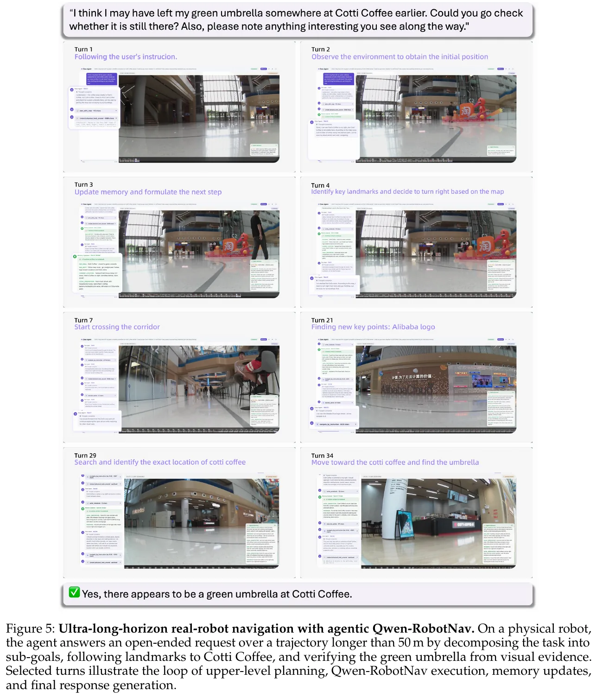
<figcaption>
Yushu Unitree Go2 quadruped robot real environment measurement: Facing ultra-long-range exploration tasks of more than 50 meters across multiple functional areas, NavMCP guides the quadruped robot to decompose high-level goals into progressive sub-goals anchored by landmarks, with a success rate of 78.3%, showing a huge advantage over the reactive baseline.
</figcaption>

#### ⑤ Real robot deployment: Yushu Unitree Go2 physical verification
{: id="-真实机器人部署宇树-unitree-go2-物理验证"}
In a real office building environment, in the face of unstructured obstacles, ranging drift and sensing noise, real robot tests were conducted on three levels of difficulty: single room (Low), cross-room (Medium) and super-20-meter large-scale multi-area (High) (fixed Qwen3.6-Plus):
- **Single room level (Low, 20 rounds)**: Reactive 80%, Frontier 70%, **NavMCP 90%**;
- **Cross-room level (Medium, 20 rounds)**: Reactive dropped to 35%, Frontier 60%, **NavMCP maintained 85%**;
- **Super 20-meter wide range exploration (High, 20 rounds)**: Reactive completely collapsed to **0%**, Frontier was only **15%**, and **NavMCP still maintains a success rate of up to 60%**!
- **Overall real-robot success rate**: NavMCP reaches **78.3%**, showing an overwhelming advantage compared to Frontier (48.3%) and Reactive (38.3%), proving that the longer the task duration and the more complex the environment, the more obvious the advantages of layered scaffolding.

---

### 4. Limitations
{: id="4-局限性-14"}
1. **High-level model calculation overhead and response delay**: NavMCP relies on large-parameter VLM (such as Qwen3.6-Plus or 397B-level model) for each round of multi-modal journey analysis and evidence arbitration. The inference delay of high-level large models is higher than that of traditional lightweight heuristic algorithms. In the future, it is necessary to explore on-device small models or reinforcement learning distillation solutions;
2. **Object duplication and counting ambiguity under multi-view sampling**: When the same object is photographed multiple times in multiple key frames or different camera angles along the way, VLM still occasionally encounters cross-view duplication errors in dense small object counting tasks;
3. **Dynamic environment and unsteady physical interference**: The current test is mainly carried out in relatively static large indoor scenes. In extremely challenging real-life scenes containing violent dynamic pedestrian flow or sudden changes in lighting, the local deadlock and recovery mechanism of the underlying NFM still has room for further improvement.

---

## 9. SysNav (2026)
{: id="sysnav"}
———Multi-Level Systematic Cooperation Enables Real-World, Cross-Embodiment Object Navigation

📄 **Paper**: [arXiv:2603.06914](https://arxiv.org/abs/2603.06914) · [Project Page](https://cmu-vln.github.io/) · [Code](https://github.com/zwandering/SysNav)

### Key takeaways
{: id="精华-18"}

SysNav redefines ObjectNav as a system-level problem and completely decouples the three layers of semantic reasoning, navigation planning, and locomotion control, which is worth learning from. The core insight is that VLM should not be used for fine-grained frontier-level decision-making, but should be limited to high-level planning at the room level to achieve the best balance between inference capabilities and spatial reliability. The three-layer scene graph (Room→Viewpoint→Object) provides a structured context for VLM and is the key infrastructure for efficient inference of VLM. The two VLM calling modes, Early-stop and Room-query, are triggered on demand, effectively avoiding redundant VLM calls. The system was deployed on three robotic platforms, verifying the value of modular design for cross-platform generalization.

---

### 1. Background and problem
{: id="1-研究背景问题-17"}

Object Navigation (ObjectNav) requires the robot to independently find the target object in an unknown indoor environment, and it needs to handle complex spatial structure, long-range planning and semantic understanding at the same time. Existing methods treat ObjectNav as a single policy learning problem, and it is difficult for end-to-endModel to take into account multiple sub-challenges; and over-reliance on VLM for frontier-level decision-making will lead to frequent backtracking and inefficient behavior due to VLM's lack of accurate 3D spatial understanding.

---

### 2. Method and innovations
{: id="2-主要方法创新点-17"}

  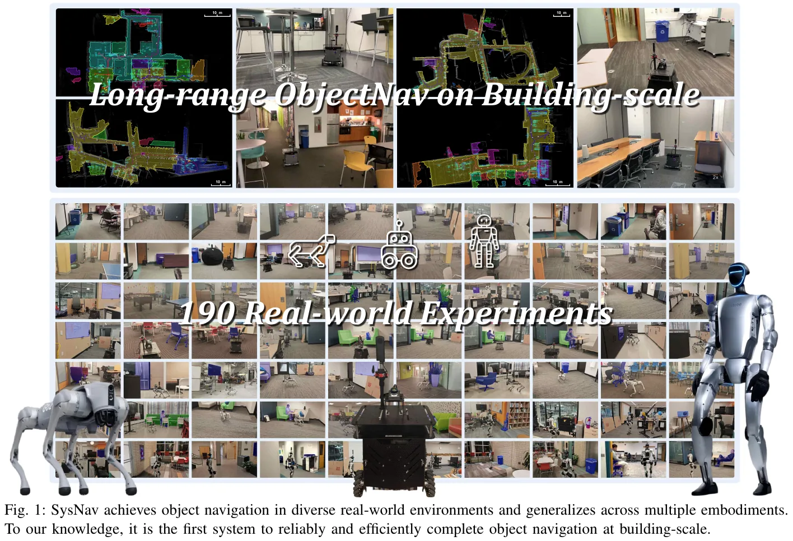
<figcaption>
SysNav implements building-level long-range ObjectNav in a variety of real-world environments and cross-platform robots
</figcaption>

SysNav is a three-layer decoupled ObjectNav system. Each layer focuses on sub-problems of different granularities:

**High level - semantic reasoning (Semantic Reasoning)**

Construct a three-layer scene graph representation $\mathcal{R}$:
- **Room Node** $v^r$: Fit the wall and divide independent rooms through the vertical distribution of point clouds. Each node stores room categories, 2D top views and representative RGB images.
- **Viewpoint Node** $v^v$: Added when the coverage changes significantly, storing location, coverage area and panoramic images to achieve efficient semantic storage
- **Object Node** $v^o$: Instantiated using open vocabulary detection (YOLOv8x + SAM2), each node stores category, confidence, 3D point cloud, bounding box and self-attributes

Edge types include: Room-Room (doorway connection), Room-Viewpoint (containment relationship), Room-Object (containment relationship), Viewpoint-Object (visibility), Object-Object (space constraints, added as needed).

The VLM Reasoning component (Gemini-2.5-flash) performs semantic reasoning based on the above scene graph and provides room-level navigation guidance.

**Middle level - Room-based Navigation**

  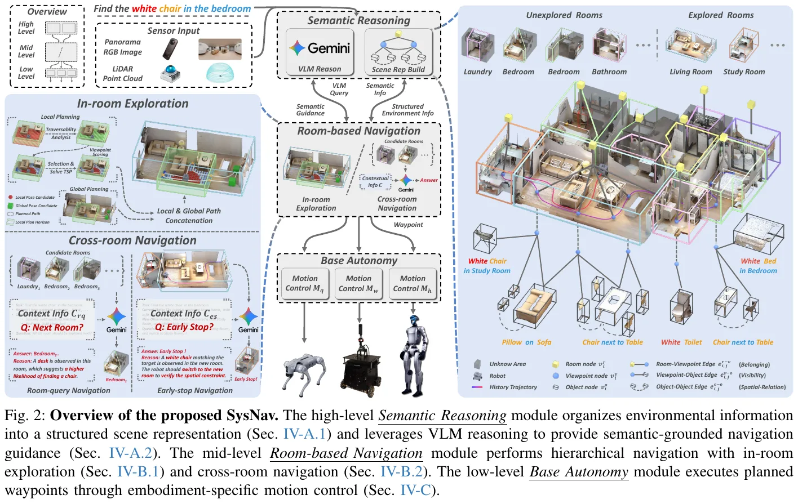
<figcaption>
SysNav system architecture: three-layer decoupling of high-level semantic reasoning, middle-level room navigation, and low-level locomotion control
</figcaption>

Treat the room as the smallest semantic planning unit, use an efficient classical exploration algorithm in the room, and only call VLM when the room switches:

- **In-room Exploration**: Two-level planning (local + global) to cover the score $w_{cov}(c_i) = \lvert \mathcal S_{cov}(c_i) \cap \hat{\mathcal S} \rvert$ selects pose candidates, uses TSP to generate exploration paths, and the rolling window mechanism coordinates local and global plans
- **Early-stop mode**: When entering a new room, VLM determines whether to terminate the current room exploration early and switch to the new room based on the contextual information $\mathcal C_{es}$ (room attributes, observed objects, task goals)
- **Room-query mode**: When the target is not found after the current room exploration, VLM is based on the unexplored room information $\mathcal C_{rq}$ inference of the next room that is most likely to contain the target.

**Low level - Base Autonomy**

Design a cross-platform basic autonomous module to convert path points into specific locomotion control instructions for each platform (wheeled robot, quadruped Unitree Go2, humanoid Unitree G1), including path point following, collision avoidance and terrain traversability analysis.

---

### 3. Results and findings
{: id="3-核心结果发现-17"}

  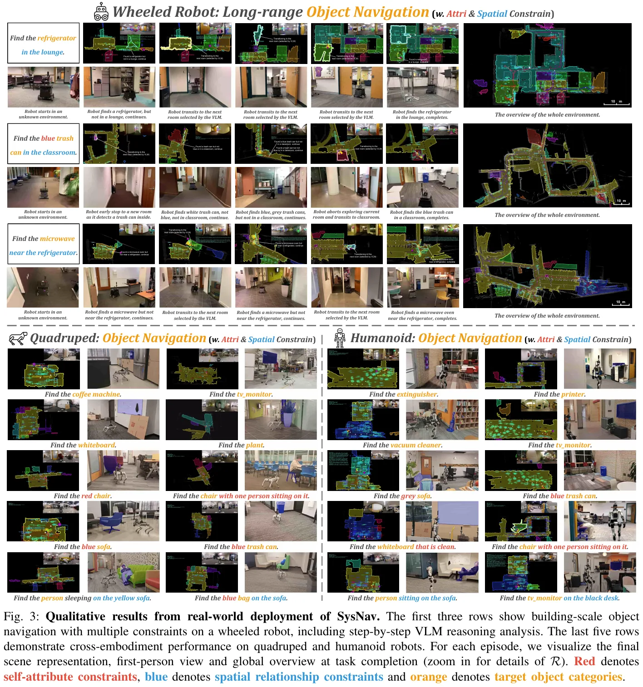
<figcaption>
Qualitative results of SysNav in real environments on wheeled, quadruped, and humanoid robot platforms
</figcaption>

**simulation benchmark** (4 benchmarks, compared with SOTA):
- HM3D-v1: SR **63.7%**, SPL **30.5%** (significantly ahead of the next best ApexNav’s 59.6%/33.0%)
- HM3D-v2: SR **80.8%**, SPL **37.2%** (suboptimal ApexNav 76.2%/38.0%)
- MP3D：SR **50.7%**，SPL **18.1%**
- HM3D-OVON: SR **54.9%**, SPL **26.1%** (suboptimal MTU3D 40.8%/12.1%, improvement 14.1%/6.5%)

**Real environment** (190 experiments, comparing VLFM and InstructNav):
- Hard setting (targets in different rooms): SR **97.5%**, SPT **71.8**, AT **67.6s** (Hard setting SR is improved from suboptimal 61.1%, SPT increased by 51.1%, AT decreased by 29.8s)
- Navigation efficiency is improved compared to the existing ObjectNav baseline **4-5×**

---

### 4. Limitations
{: id="4-局限性-17"}

The SPL improvement in simulation is smaller than SR because the strict coverage strategy designed for real scenes will cause slight over-coverage in simulation; in addition, the multi-room layout poses limited additional challenges to the system because more dense obstacles in moderately difficult scenes will reduce the speed.

---

## 10. EvoMemNav (2026)
{: id="evomemnav"}
———— An efficient self-evolving fine-grained topological memory framework based on lightweight graph prior and multi-view reflection in zero-shot embodied navigation

📄 **Paper**: [arXiv:2606.03509](https://arxiv.org/abs/2606.03509v1) · [Code (to be released) ](https://github.com/caicaiya123/EvoMemNav)

### Key takeaways
{: id="精华-20"}

1. **Pure visual memory design**: Proposes the visual-semantic memory graph (VSMGraph), which stores the original visual view (View) as a first-class citizen (first-class) in the graph node, avoiding the information compression and noise accumulation of traditional detection-centered scene graphs, and eliminating the need for high 3D reconstruction overhead.
2. **Budgeted Coarse-to-Fine**: Decompose the decision into a coarse stage (Explore, filter and route to the front or anchor point) and a fine stage (Search+Verify, only make VLM decisions and multi-view Stop verification for short lists), while reducing VLM latency and Token While counting, it also solves the problem of ambiguity and premature stop of multiple instances of the same type.
3. **Reflection-driven self-evolving memory (RDCMA)**: An online prior update mechanism without training is designed. After the subtask ends, by evaluating the trajectory events and stop results, the lightweight target condition prior (Episode-STM and Scene-LTM) attached to the graph node is updated to guide subsequent decisions.
4. **is out-of-the-box and efficient and versatile.**: achieves significant SR/SPL improvements on GOAT-Bench and HM3D, performs better than 3D-Mem, while reducing the number of VLM calls by 41% and reducing the total time by 39% without any weight training or fine-tuning.

---

### 1. Background and problem
{: id="1-研究背景问题-19"}

In long-range zero-shot embodied navigation (Zero-Shot Embodied Navigation), it is crucial to establish a memory system that can support long-term planning. However, existing memory representation schemes have the following limitations:
1. **Detector-centric Scene Graphs**: Compressing observations into sparse object nodes will discard fine-grained visual cues such as texture and spatial layout, and detector errors (such as category noise) will accumulate in downstream inference, leading to decision-making errors.
2. **3D-reconstruction-based Memory**: It will generate high computing and storage overhead at runtime, and is incompatible with powerful VLM that can only directly inference images.
3. **Image-based topological graph cache (Image-based Topological Graphs)**: It lacks a structured organization of rooms, frontiers or accessibility, and is easily confused in multi-instance scenes of objects of the same category, resulting in premature stopping (Premature Stop) before the wrong instance, and the memory lacks the ability to evolve, and failure lessons cannot be reused.

---

### 2. Method and innovations
{: id="2-主要方法创新点-19"}

#### Overall framework overview
{: id="整体框架概述"}
EvoMemNav consists of three core parts: a hierarchical topological memory graph (VSMGraph) built on an occupancy grid, a dual-stage "coarse-to-fine" navigation controller (Coarse-to-Fine Policy), and a training-free reflection-driven online self-evolving prior module (RDCMA). The system receives posed RGB-D observations at each time step and updates the topology map; when making navigation decisions, coarse decisions are used for candidate filtering and navigation, and then VLM is used for fine-grained precise routing and multi-view Stop verification; at the end of the subtask, the reflection mechanism writes the results back to lightweight statistics (STM/LTM) in the graph to guide future navigation.

  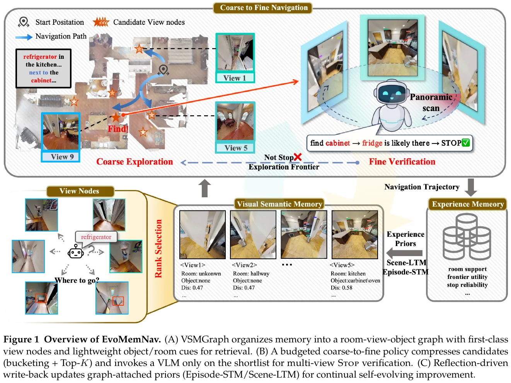
<figcaption>
EvoMemNav core concepts and process overview (VSMGraph, coarse-to-fine navigation decision-making, reflective writing)
</figcaption>

  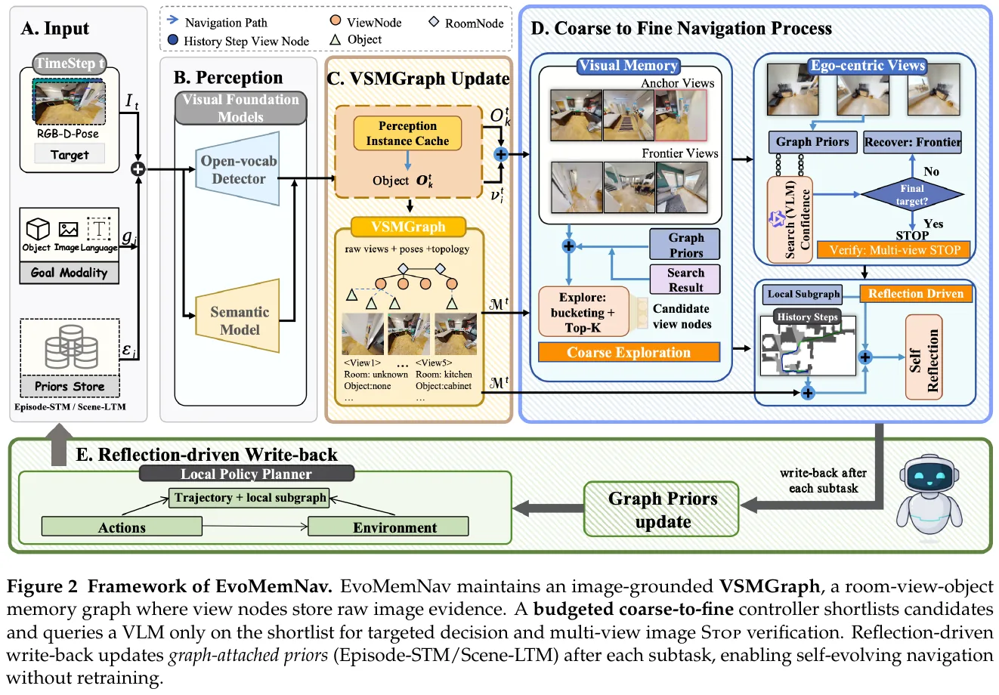
<figcaption>
EvoMemNav Detailed framework: including image-based VSMGraph topological memory graph, budget-constrained "coarse-to-fine" navigation decision system, and reflection-driven online self-evolving prior writing strategy
</figcaption>

#### Module by module explanation
{: id="逐模块讲解"}

**① Visual-Semantic Memory Graph (VSMGraph) to construct**
- **input**: posed RGB-D observation stream $I_t = \langle I_t^{rgb}, I_t^{depth}, p_t \rangle$ and 2D occupancy grid $M_t$ as metric support.
- **handles**: Add view nodes along the robot's motion trajectory online to the occupancy grid, and establish navigability edges based on collision-free paths. A 3D target candidate cache $O_{map}$ is maintained through the lightweight target detection model (YOLOv8-World & SAM), but it is only used to add weak labels (visibility edges) of "target visibility" to view nodes and is not used to compress image information. View nodes are divided into:
  - **Anchor Views** $V_{A,t}$: An explored area rich in object observations, storing original images, poses and visible target weak labels.
  - **Frontier Views** $V_{F,t}$: An unexplored area located at the exploration boundary, connected to the nearest explored view, representing the explorable frontier direction.
At the same time, CLIP is used to extract the room category and classify each view $\rho_v$, forming a hierarchical topology map of "Room-View-Object" (Room-View-Object).
- **output**: graph structure $G_t = (R_t, V_t, O_t, E_t)$.
- **Design motivation**: Use the original view as a first-class citizen memory, fully retaining fine-grained details for direct image-level analysis and verification by VLM, avoiding hard classification errors caused by detection errors; at the same time, using topological edges and room category soft labels to accelerate retrieval.

  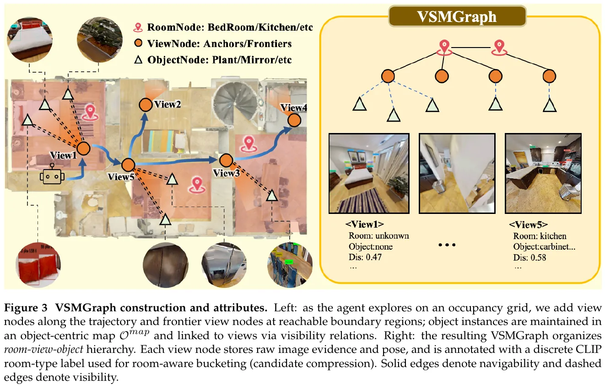
<figcaption>
VSMGraph construction process: organize visual information based on topological relationships and room-view-object hierarchical structure
</figcaption>

**② Budget-constrained coarse-to-fine navigation decision (Coarse-to-Fine Policy)**
- **input**: multi-modal target $g$, current topology map $G_t$.
- **handles**:
  - **Coarse stage (Explore - Candidate Compression and Routing)**: Filter from a large number of anchor and frontier views to retain only the most relevant Top-K candidates (the anchor candidate set $C_t^A$ has a budget limit of $K_A$, and the frontier candidate set $C_t^F$ has a budget limit of $K_F$). Candidates are initially screened through room class association and lightweight target hits. If the anchor point set is empty, it is routed directly to the frontier; if it is not empty, it enters the fine stage.
  - **fine stage (Search+Verify - local selection and verification)**: Input the filtered candidate pool $C_t = C_t^A \cup C_t^F$ to VLM (Qwen3-VL-8B). VLM only needs to perform a single-step inference on this streamlined short list:
    $$a_t, \sigma_t = \text{VLM}(g, C_t)$$
Among them, $a_t$ is the selected target point, and $\sigma_t \in \{\text{certain}, \text{uncertain}, \text{unknown}\}$ is the confidence level. If VLM selects the anchor view but the confidence level is insufficient (`uncertain`/`unknown`), the system will be forced to downgrade to frontier exploration to avoid blind decision-making.
  - **Verification step (Verify - Multi-view Stop Verification)**: When the agent reaches the selected anchor view, it does not stop immediately, but calls VLM to combine the multi-angle view of the agent at the current position for final multi-view Stop verification, returning `STOP` or `RESELECT`. If it is determined to be `RESELECT`, the current anchor point will be pulled into the cooling queue and returned to the coarse stage to prevent premature stopping errors due to local field of view limitations.
  - **recovery mechanism (Recover)**: If a deadlock or multiple coolings are detected, the Recover mechanism will be triggered, forcing the agent to perform pure frontier exploration for a period of time.
- **output**: next motion path end point or `STOP` instruction.
- **Design motivation**: Use coarse filtering to control the computational overhead of VLM (to avoid token explosion for full image retrieval), while performing local fine-grained comparison at the multi-view image level to improve the accuracy of multi-instance discrimination.

**③ Reflection-driven online memory adaptation (RDCMA)**
- **Input**: Movement trajectory events of historical subtasks (such as frequently visited rooms, blocked exploration frontiers, loop detection, etc.) and multi-view verification results (STOP / RESELECT).
- **processing**: At the end of the task, the results are summarized into lightweight statistical priors with the target condition signature $s_g$ (category or modality), and written back to the graph structure attached to the corresponding room/view/front node:
  - **Short-term memory (Episode-STM)**: Cache the obstacle avoidance and path penalty information in the current episode to avoid repeatedly spinning in a task, and reset it at the end of the episode.
  - **Long-term memory (Scene-LTM)**: Record the support probability of specific objects in the room (for example, the kitchen is more likely to have a refrigerator) and the stopping reliability of specific anchor points, long-term retention, and reuse across subtasks.
In the Explore stage, these priors adjust the filtered candidate ranking in a "weighted tie-breaker" manner to guide the direction of exploration; in the Verify stage, they are input to VLM as hints to indicate whether the current region has been successfully verified before.
Eliminate stale priors through exponential decay, retain only Top-K items, and suppress conflicting priors.
- **Output**: Graph-attached memory prior.
- **design motivation**: To achieve non-parametric lightweight adaptation, the agent can become "smarter and smarter" over time in unknown lifelong learning tasks. The more familiar it is with the current environment, the higher the navigation success rate.

  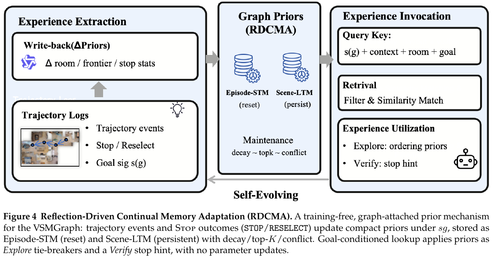
<figcaption>
How reflection-driven online memory adaptation (RDCMA) works
</figcaption>

---

### 3. Results and findings
{: id="3-核心结果发现-19"}

1. **GOAT-Bench Lifelong multi-modal navigation**:
On the GOAT-Bench VAL-UNSEEN validation set, EvoMemNav achieved the best results of **59.6% SR** and **38.9% SPL** (see table below), significantly ahead of previous image-level topology memory methods. 3D-Mem (42.6% SR / 22.8% SPL) and MSGNav (52.0% SR / 29.6% SPL).

| Method | Category | No training required | SR (%) ↑ | SPL (%) ↑ |
|---|---|---|---|---|
| SenseAct-NN Monolithic [20] | Monolithic learning type | ❌ | 12.3 | 6.8 |
| CLIP on Wheels [20] | Modular zero-shot | ✓ | 16.1 | 10.4 |
| Modular GOAT [20] | Modular zero sample | ✓ | 24.9 | 17.2 |
| TANGO [28] | Modular zero-shot | ✓ | 32.1 | 16.5 |
| 3D-Mem [46] | Modular topology | ✓ | 42.6 | 22.8 |
| MSGNav [17] | Modular topology | ✓ | 52.0 | 29.6 |
| **EvoMemNav (Ours)** | **Modular topology (self-evolution)** | **✓** | **59.6** | **38.9** |

2. **HM3D ObjectGoal Navigation**:
On the HM3D task of pure goal navigation (ObjectGoal), EvoMemNav has set or approached the highest level of the training-free method on both HM3Dv1 (59.2% SR / 33.6% SPL) and HM3Dv2 (63.8% SR / 39.4% SPL).

3. **ablation experiment and efficiency analysis**:
   - Compared with the topology baseline without coarse filtering at all, adding VSMGraph increased SR by 7.2%, and the coarse filtering (Coarse) module directly brought a huge SR jump of **+11.6%**, which is the main factor in performance improvement.
   - The reflection module RDCMA further improved the overall SR by 4.0% (from 60.8% to 64.8%), and this gain was most obvious in the 3rd to 5th subtasks (Mid subtasks), indicating that as the memory continues to be written and evolved in the scene, the agent's performance becomes more and more robust.
   - Compared with 3D-Mem, thanks to the decision-making shortlist mechanism in the coarse stage, the number of VLM calls has been reduced from 10.7 to 6.5 times (a reduction of 39%), and the time consumption of a single subtask has plummeted from 102.2s to 58.7s (a reduction of 42.5%), achieving a perfect balance between performance and efficiency.

---

### 4. Limitations
{: id="4-局限性-19"}

1. **Multi-modal target recognition is still limited by the perception module**: Although the use of VSMGraph avoids the absolute dependence of downstream inference on the target detection frame, the generation of soft tags in the rough screening stage still needs to rely on 2D detectors such as YOLOv8-World and SAM. In extremely noisy or low-light environments, if the detection labels are completely lost or deviated, it may cause the correct anchor points to be missed from the Top-K list during filtering, thus dragging down the accuracy of rough screening.
2. **Reflection on a priori expression and retrieval granularity can still be optimized**: The current RDCMA a priori writing is achieved by doing simple support and error rate counting of discrete CLIP room types and stop events. For extremely complex room structures with very discrete distribution or large-scale open worlds out of the box, simple graph counting may face memory conflict problems. In the future, non-parametric contextual memory retrieval based on small-scale vector embedding can be considered.

---

## 11. Harness Robotic OS (2026)
{: id="harness-robotic-os"}
———Upgrading quadruped inspection from a navigation stack to an embodied agent runtime

📄 **Paper**: [arXiv:2609.11225](https://arxiv.org/abs/2609.11225)

The paper focuses on embodied agent runtime, skill orchestration, hierarchical memory and self-evolution management. The complete reading has been moved to .

---

## 12. SparseNav (2026)
{: id="sparsenav"}
——Less is more: training-free VLN with “on-demand” semantic awareness based on instructions

📄 **Paper**: [arXiv:2609.26408](https://arxiv.org/abs/2609.26408)

### Key takeaways
{: id="精华-23"}

- A more complete semantic map is **not always better**: retain geometry persistently, but perceive, map, and remember semantics only when the current instruction calls for them.
- Turn "whether to call the segmentation model" itself into a decision made by VLM, and the perception changes from "running every frame" to "event-triggered", which not only saves computing power but also reduces noise annotation in the map.
- Candidate points include both frontier points (exploring the unknown) and local left/front/right points (completing maneuvers such as "go straight and then turn left" in a known area), both of which are indispensable.
- The BEV image shown to the VLM should be centered on the robot and oriented upward, so that "top/left/right" on the image directly corresponds to "front/left/right" in the language - this represents a difference of 12.5 points SR.
- VLM is only responsible for "selecting which candidate point". The trajectory is handed over to the classic A* planner for execution, and semantic decision-making and measurement execution are completely decoupled.

---

### 1. Background and problem
{: id="1-研究背景问题-22"}

Map-based training-free VLN usually marks all objects that can be recognized in the field of view onto a semantic map (such as MapNav's Annotated Semantic Map). But for the current decision-making step, the vast majority of objects are irrelevant to the instructions: they waste segmentation computing power, clutter the map seen by VLM, and introduce false detections. The author therefore raises a question: **has wider semantic coverage, will it definitely improve the instruction following?**

---

### 2. Method and innovations
{: id="2-主要方法创新点-22"}

  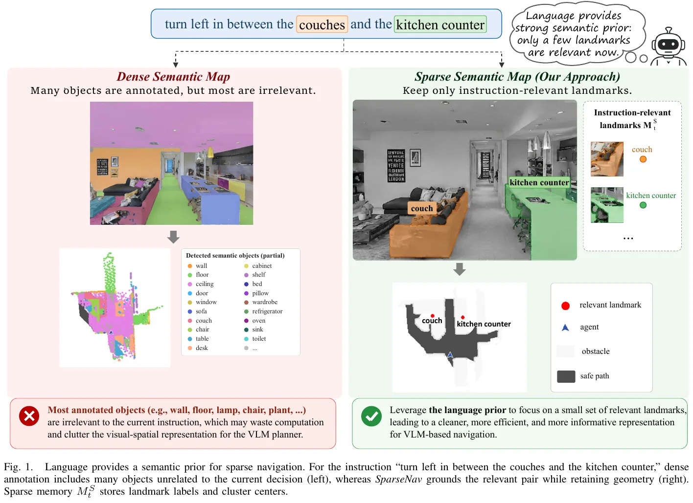
<figcaption>
Dense semantic map vs. sparse semantic map: For the instruction "turn left between the sofa and the kitchen countertop", the dense method marked a large number of irrelevant objects, and SparseNav only grounded the two landmarks of the sofa and the kitchen countertop, while retaining the complete geometry
</figcaption>

  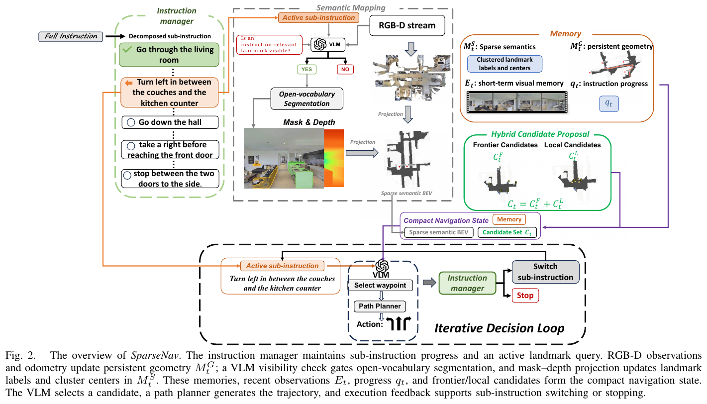
<figcaption>
SparseNav overall framework: Instruction manager maintains sub-instruction progress and current landmark query; VLM visibility judgment determines whether to call open vocabulary segmentation; mask + depth projection updates sparse landmark memory; VLM selects waypoint among mixed candidate points, and the path planner executes
</figcaption>

**① Overview of the overall framework**

SparseNav consists of four modules: **instruction manager** is responsible for dismantling instructions, tracking progress and giving "what landmarks to find now"; **geometry memory** $M_t^G$ continuous maintenance obstacles/free space BEV; **Sparse semantic perception** Only calls segmentation when needed and writes the landmark center into sparse memory $M_t^S$; **Mixed candidate points + VLM decision-making** Selects a waypoint among the frontier point and the local direction point, and hands it to the classic planner for execution. Agent state writing:

$$\mathcal M_t = (M_t^G, M_t^S, E_t, q_t)$$

Among them, $E_t$ is the observation of the last few frames, and $q_t$ is the instruction progress.

**② Explain** module by module

**Geometry-Centric Spatial Memory**
- **Input**: RGB-D (or LiDAR) point cloud + odometry pose
- **processing**: Take the point with a height of $z_{min} < z < z_{max}$ and rasterize it into an obstacle map according to the resolution $\rho$; use elliptical expansion to connect the scattered wall observations, and then perform morphological closing operation to fill the small holes; expand the obstacles according to the robot radius $r_a = 0.1$ m
- **outputs**: a BEV picture of **centered on the robot and facing upward**. The coordinates are transformed to $p^{ego} = R(-\theta_t)(p - p_t)$, and the front of $+x$ corresponds to the top of the image, $+y$ The left side corresponds to the left side of the image.
- **Design motivation**: Geometry is the basis of obstacle avoidance and planning, which must be durable and complete; and "facing upward" allows the direction on the picture to naturally align with the "front/left/right" in the language, and VLM no longer needs to do mental rotation.

> **gives an example of**: the robot is located at world coordinates $(5, 5)$, facing due east ($\theta_t = 0°$); the sofa is at $(5, 7)$, which is 2 m due north of the robot.
> In the fixed north-up global map (north-up), the sofa is drawn "above" the robot, and VLM can easily read it as "sofa in front";
> After changing to the upward-facing image, first translate and then rotate $-\theta_t$ to get $p^{ego} = (0, 2)$, which is 2 m in the $+y$ direction. Draw **on the left side of the robot** - directly opposite to the instruction "The sofa is on your left".
> In the ablation of the paper, the global north-up is only 30.3% SR, with the robot as the center but not rotating is 36.2%, and with the robot as the center and facing upward is 42.8%.

**Hybrid Waypoint Proposal**
- **input**: geometry BEV, robot pose
- **handles**:
  - **frontier candidate** $\mathcal C_t^F$: clustering of passable grids adjacent to unknown areas, eliminating small clusters, and selecting a reachable point with obstacle avoidance margin for each cluster
  - **local direction candidate** $\mathcal C_t^L$: Place a point in each of the three directions of the current $\{-\phi, 0, +\phi\}$ and at a distance of $d_l$. Points falling in obstacles or disconnected areas are discarded or projected back to free space.
- **output**: candidate set $\mathcal C_t = \mathcal C_t^F \cup \mathcal C_t^L$, each point is rendered on the BEV with a number
- **Design motivation**: The forward point can only guide "to places you have never seen before", but many command actions occur in known areas ("go straight first, then turn left when you get to the sofa"), and the local left/front/right points just fill this gap.

**Hierarchical Instruction Management**
- **Input**: Complete Instructions $I$
- **processing**: split into ordered sub-instructions $S = (s_1, \dots, s_K)$, maintenance progress $q_t = (i_t, S_t^{done})$; record and advance when the current sub-instruction is completed
- **output**: completed / current / to be completed three goals, and the current **landmark query** $l_i$ (can contain multiple tags, such as {couch, kitchen counter})
- **Design motivation**: Avoid VLM repeatedly executing completed actions while deciding "which semantics should be sensed at this moment" - this is the source of sparse perception

**Sparse semantic awareness of instruction conditions (core innovation)**

This is the most critical part of the paper and the easiest to mention in one sentence: When **semantic perception occurs and what is perceived, it is determined by the current sub-instruction.**

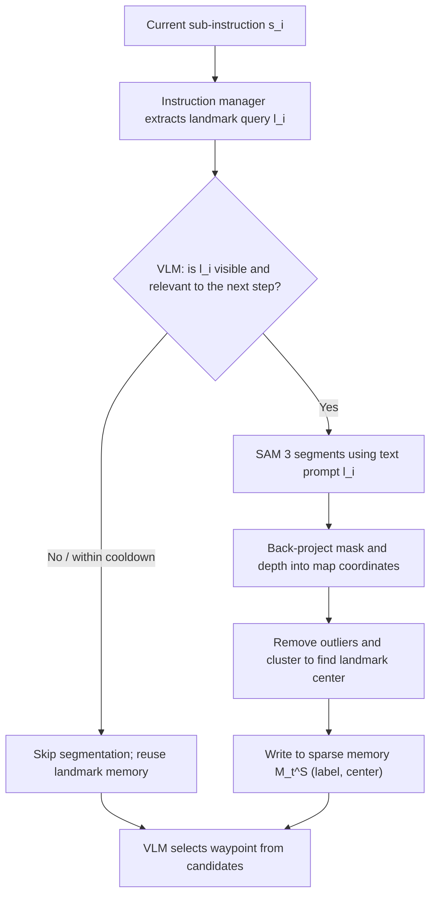

- **semantic trigger**: VLM reads $(O_t, E_t, s_i, l_i)$, outputs the visibility score and the decision of whether to ground or not $z_t \in \{0, 1\}$; it is triggered only when "the landmark is highly likely to be visible, and its measurement position will affect the next decision", and has a time cooldown to avoid repeated calls
- **Open vocabulary segmentation**: Use SAM 3 to use landmark text as a prompt to obtain instance masks
- **2D→3D projection**: The effective depth pixels in the mask are back-projected using camera internal parameters, transformed to the map coordinate system, and clustered after removing outliers
- **sparse memory**: $M_t^S = \{(\ell_j, \mu_j)\}$, only labels and cluster centers are stored; different instances of the same label are stored separately; new observations update the nearest matching cluster, otherwise create a new one; **landmarks that are no longer queried will also retain** for subsequent reuse

| Dimensions | Dense semantic maps (such as MapNav) | SparseNav |
|---|---|---|
| What to sense | All identifiable objects in the field of view | Only the landmarks named by the current subcommand are sensed |
| When to sense | Continuously sense every frame | Triggered only when VLM determines that it is visible and useful |
| What is stored in the map | A large number of category color blocks | Geometry + a small number of labels and centers of landmarks |

**③ end-to-end data flow**

One decision: RGB-D and odometry update geometry BEV → Instruction manager gives the current sub-instruction and landmark query → VLM determines whether to trigger segmentation, and when triggered, the landmark center is written into sparse memory → Generate frontier + local candidate points and render numbers → VLM reads $X_t = \{M_t^G, M_t^S, E_t, s_i, q_t, \mathcal C_t\}$, outputs a candidate number and short reason → A* plans a collision-free trajectory on the expanded obstacle map and executes → Execution feedback is used to determine whether to switch sub-instructions or stop.

**④ Training target**

None. The whole process **training-free**, all experiments (including real robot) use GPT-5 as the VLM and SAM 3 as the segmentation model.

  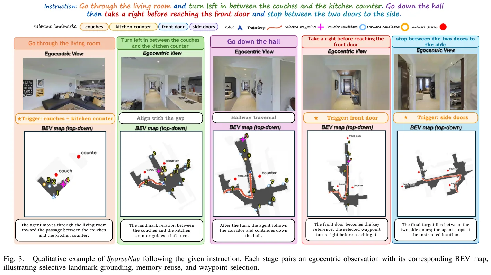
<figcaption>
Qualitative example: Each of the five sub-command stages is equipped with a first-person view and BEV; the asterisk marks the moment when semantic grounding is actually triggered (sofa + kitchen countertop, front door, side door), and the remaining stages reuse existing landmarks and geometry candidates
</figcaption>

---

### 3. Results and findings
{: id="3-核心结果发现-22"}

**benchmark results (Val-Unseen)**:

| Method | Setup | R2R-CE SR | R2R-CE SPL | RxR-CE SR | RxR-CE nDTW |
|---|---|---|---|---|---|
| InstructNav | Zero sample | 31.0 | 24.0 | – | – |
| CA-Nav | Zero sample | 25.3 | 10.8 | 19.0 | 13.5 |
| DreamNav | Zero sample | 32.8 | 28.9 | – | – |
| MapNav | Supervision | 39.7 | 37.2 | 32.6 | 43.5 |
| ETPNav | Oversight | 57.0 | 49.0 | 54.8 | 61.9 |
| **SparseNav** | training-free | **42.8** | 35.2 | **40.7** | 48.6 |

**Key ablation**:
- **Semantic policy** (R2R-CE SR): No semantics 34.6 → Dense + persistent-aware 36.7 → Dense + On-demand 38.8 → Instruction-related + On-demand 40.2 → **Instruction-related + On-demand 42.8**. Both dimensions "perception range" and "triggering timing" contribute
- **candidate point**: only local points 29.1, only front points 35.2, front + front 37.4, front + left/front/right 42.8
- **landmark localization**: VLM direct estimation position 34.6 (error 1.56 m, worse than 36.5 without localization), labeling frame 40.2 (0.51 m), segmentation 42.8 (0.12 m)
- **instructions and memory** (RxR-CE): complete instructions 29.8 → + timing memory 31.5 → sub instructions 33.2 → + progress tracking 35.0 → + persistent landmark memory 40.7; persistent landmark memory has the largest single contribution (+5.7)
- **Trigger quality**: Cycle trigger accuracy/recall 41.5/45.6, visibility only 72.1/99.8, sub-command awareness **90.4/99.8**
- **real robot**: Unitree Go2 + RealSense D455 (mapping and landmark grounding) + Livox MID-360 (localization), no pre-built map, complete landmark conditional instructions such as "turn left to the quadruped robot, pass the humanoid robot, enter the next room and stop" in multiple indoor scenes

  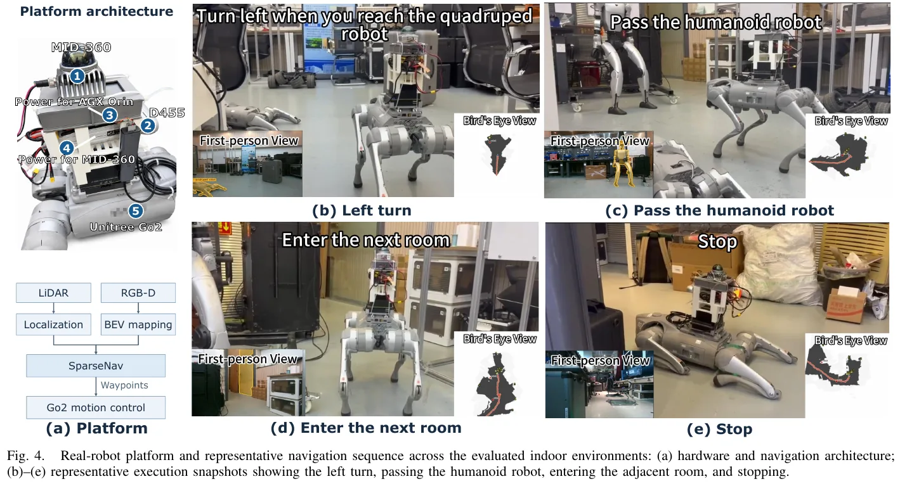
<figcaption>
real robot deployment: (a) Go2 platform and navigation architecture; (b)–(e) Turn left, pass the humanoid robot, enter the adjacent room, and stop four execution fragments. The lower right corner is the corresponding BEV
</figcaption>

---

### 4. Limitations
{: id="4-局限性-22"}

Candidate points are generated by rules, and VLM can only choose from the preset frontier and left/front/right points, which may miss waypoints that better fit the instructions. Although on-demand segmentation saves perception overhead, VLM inference is still the main delay. The serial "perception→inference→execution" will cause the robot to stop and wait for decisions. In addition, the comparison with other methods in the table is based on cross-paper data (different episodes and backbone models). The real robot part only has qualitative display and no success rate statistics.

---

## 13. Talk2Escape (2026)
{: id="talk2escape"}
——When you get lost, just ask: Turn multi-round conversations into VLN’s closed-loop error correction channel

📄 **Paper**: [arXiv:2609.28296](https://arxiv.org/abs/2609.28296) · [Project Page](https://zeruili22.github.io/talk2escape/)

### Key takeaways
{: id="精华-24"}

- The essence of single-round VLN is open loop: an instruction is executed to the end without any verification or error correction mechanism in the middle. Small deviations will accumulate along the way and cause task failure.
- Dialogue serves as **a runtime error-correction safety net**: the robot pauses and requests help only when an anomaly is detected, rather than merely supplementing its initial plan.
- "When to ask" is more critical than "what to ask": sparse, targeted deviation triggering is better than high-frequency or timed questioning, and asking too many questions will disrupt the internal inference (intervention fatigue) of a strong agent.
- Before asking for help, "translate" the multi-perspective observation into a short question with landmarks, so that the respondent (human or Oracle) can reliably answer it.
- The module has nothing to do with the base and can be directly connected to zero-shot agents such as NavGPT, MapGPT, and GTA. The cleaner the history and the more action-centered the base, the better it can digest natural language error correction.

---

### 1. Background and problem
{: id="1-研究背景问题-23"}

Mainstream VLN is a single-round paradigm: the agent receives an instruction and executes it in an open loop. There is no mechanism to check progress, request clarification, or recover from errors. On a real robot, sensor noise, odometry drift, and unmapped obstacles are inevitable. A small deviation may push the robot into a "lost" state that cannot be recovered. Existing conversational VLNs mostly treat conversations as supplementary information for initial planning, rely on fine-tuning of conversation data, and assume that communication is instant and execution is error-free.

---

### 2. Method and innovations
{: id="2-主要方法创新点-23"}

  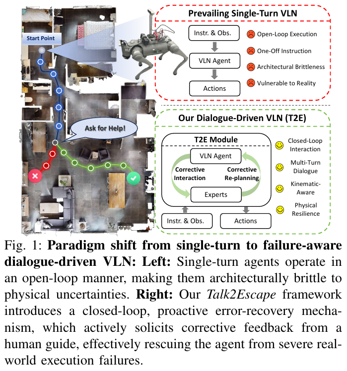
<figcaption>
Comparison of paradigm: The left is a single-wheel open-loop VLN, which cannot be recovered once it goes astray; the right is Talk2Escape's closed-loop dialogue paradigm. The agent proactively asks for help when it makes a mistake, and the expert gives corrective tips and then re-plans
</figcaption>

  
<figcaption>
Talk2Escape framework: ① The base agent outputs kinematic status and actions; ② The kinematics monitor detects spinning or deviation in place and triggers a pause; ③ The visual-language translator converts the current RGB-D observation into a short help question; ④ Oracle/human gives correction tips based on relative orientation and distance; ⑤ The entire dialogue is injected into MLLM Prompt word, the agent re-plans accordingly
</figcaption>

**① Overview of the overall framework**

Talk2Escape is an intervention module attached to any zero-shot base agent. A **kinematic monitor** detects trouble; a **vision-language translator** expresses the situation as a question; and **prompt generation and injection** inserts corrective information into the base MLLM prompt. It adds communication actions $\mathcal A^c$ alongside physical actions $\mathcal A^p$, changing the policy from $a_t = \pi(H_t)$ to $a_t = \pi(H_t \cup D_k)$. Here, $D_k = \{(Q_1, F_1), \dots, (Q_k, F_k)\}$ is the question–answer history up to interaction $k$. No fine-tuning is performed; Gemini 3.1 Pro is the reasoning engine.

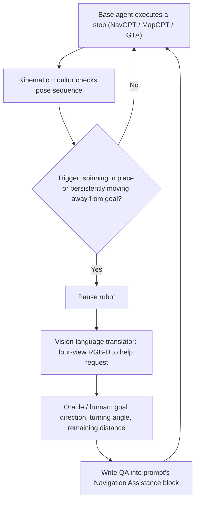

**② Explain** module by module

**Base Navigation Agent**
- **Input**: RGB-D view $O_t$, pose $p_t$, history $H_t$ in four orthogonal directions (0°/90°/180°/270°) per step
- **handles**: MLLM specifies the navigation target with normalized pixel coordinates $(u, v)$; stronger bases (such as GTA) also maintain TSDF top view and topology map
- **output**: physical action (discrete action, relative waypoint or pixel coordinate), handed over to the underlying controller for execution
- **design motivation**: Talk2Escape does not change the base, only adds a closed loop to the outer layer, so it can be verified to be "independent of the base"

**Kinematics monitor and trigger conditions (core stuck point)**

The paper compares six intervention strategies: None (no intervention), Repeat, Deviation, Hybrid (or the two), Periodic (a prompt is given every $k_{per} = 5$ step), and Human-in-the-Loop. The two automatic trigger conditions are:

- **Repeat trigger (turn in place)**: Within the radius of the current position $r = 0.5$ m, it has been visited at least $n = 3$ times in history:

$$\mathcal C_{rep}(t) = \mathbb 1\left[ \left\lvert \{ \tau \in [0, t] : \lVert p_\tau - p_t \rVert_{xz} < r \} \right\rvert \ge n \right]$$

- **Deviation trigger (continuously moving away from the target)**: Set $d_t = \lVert p_t - p_g \rVert_{xz}$ as the horizontal distance to the target, and use the sliding average of the window $k = 2$ to compare the "last two steps" and "the next two steps":

$$\mathcal C_{away}(t) = \mathbb 1\left[ \bar d_{t,k} > \bar d_{t-k,k} \right], \quad \bar d_{t,k} = \frac{1}{k} \sum_{i=0}^{k-1} d_{t-i}$$

> **Take for example** (Deviation trigger, $k = 2$): the distance to the target in four consecutive steps is 8.0, 7.0, 7.2, 7.6 m.
> If you only look at a single step, the third step from 7.0 to 7.2 triggers a false trigger - it's just a small motion jitter.
> Use sliding average: the average of the last two steps is $(7.6 + 7.2)/2 = 7.4$, the average of the previous two steps is $(7.0 + 8.0)/2 = 7.5$, $7.4 < 7.5$, **does not trigger**.
> The next step distance becomes 8.0: the average of the last two steps is $(8.0 + 7.6)/2 = 7.8$, the average of the previous two steps is $(7.2 + 7.0)/2 = 7.1$, $7.8 > 7.1$, **triggers** - at this time it is really continuing to move away from the target.

Note: Deviation triggering requires knowing the target position $p_g$, which is true value information in the simulation; on the real robot, the human supervisor decides whether to intervene according to the same criteria.

**Vision-Language Translator (Help-Seeking)**
- **input**: four views when triggered RGB-D observation + trigger type
- **processing**: MLLM completes three things in sequence: summarizes the local scene; determines the most likely failure mode based on trigger conditions (driving in the corridor, facing a dead end, stuck at an intersection); generating a short help question
- **output**: For example, "I'm stuck at this intersection and there's a sofa in front of me. Where should I go?"
- **Design motivation**: The original multi-view image has a large amount of information and is difficult to understand quickly; the translator is constrained to only mention observable landmarks and relative directions, and does not speculate on unseen areas

**Oracle prompt generation and injection**
- **input**: agent orientation $\psi_t$, target azimuth angle $\phi_t = \mathrm{atan2}(p_g^z - p_t^z,\ p_g^x - p_t^x)$
- **processing**: Calculate the relative angle $\theta_t = \phi_t - \psi_t \in (-180°, 180°]$; if $d_t < d_{th}$ answers "You are very close to the target", otherwise it answers "The target is on your [left/right], turn to [left/right] about $\lvert \theta_t \rvert$ degrees, distance $d_t$ meters"
- **Output**: The question and answer pair is written to the MLLM prompt word in the dedicated **Navigation Assistance** block, positioned between the historical context and the current visual input
- **design motivation**: Give clear, self-centered corrective instructions to allow the agent to jump out of the current failure state

**③ Training target**

None. The entire framework runs on frozen MLLM with zero samples and does not rely on any dialogue data fine-tuning.

---

### 3. Results and findings
{: id="3-核心结果发现-23"}

**R2R-CE / RxR-CE (Val-Unseen sampling subset: R2R-CE 100 strips, RxR-CE 260 strips)**:

| Methods | R2R-CE SR | R2R-CE SPL | RxR-CE SR | RxR-CE SPL | RxR-CE nDTW |
|---|---|---|---|---|---|
| Efficient-VLN (best supervision) | 64.2 | 55.9 | 67.0 | 54.3 | 68.4 |
| GTA (zero sample) | 48.8 | 41.8 | 46.2 | 39.3 | 57.4 |
| T2E + NavGPT | 64.0 | 46.4 | 50.4 | 27.2 | 45.7 |
| **T2E + GTA** | **72.0** | 49.4 | **62.9** | 34.2 | 49.9 |

- SR is greatly improved, but SPL and nDTW on RxR-CE are reduced: error correction requires backtracking and detours, and the path becomes longer. This is a trade-off of "exchanging path efficiency for success rate"
- **values are inconsistent with**: the abstract states that the R2R-CE SR is 66.0%, while the T2E + GTA given in Table I and the text is 72.0%; in Table IV, Deviation is triggered on the same 100 episodes, the SPL is 49.4, but the SR is 66.0%. The paper does not explain the difference between the two. Please be careful when citing.
- **VLNVerse (base independent)**: NavGPT 19.3 → +CoT 28.7 → **+T2E 84.6**; MapGPT 25.5 → +CoT 42.2 → +T2E 67.0. Passive thinking chain is far inferior to active dialogue
- **found counter-intuitively that**: MapGPT is better than NavGPT when used alone, but it is even worse when T2E is attached. The author attributes this to a modal mismatch - the large number of absolute 3D coordinates in the MapGPT hints conflicts with the relative, egocentric hints given by Oracle.

**trigger strategy ablation (R2R-CE, the same 100 episodes, the base is GTA)**:

| Strategy | SR | SPL | Trigger Rate |
|---|---|---|---|
| None | 48.8 | 41.8 | 0% |
| Repeat | 57.0 | 45.1 | 4.74% |
| **Deviation** | **66.0** | **49.4** | 15.0% |
| Hybrid | 54.0 | 44.5 | 23.1% |
| Periodic (k=5) | 63.0 | 46.5 | 10.2% |
| Human-in-the-Loop | 74.5 | 61.2 | 9.8% |

Hybrid triggered too frequently, but dropped to 54.0%, which shows that asking more questions is not necessarily better.

  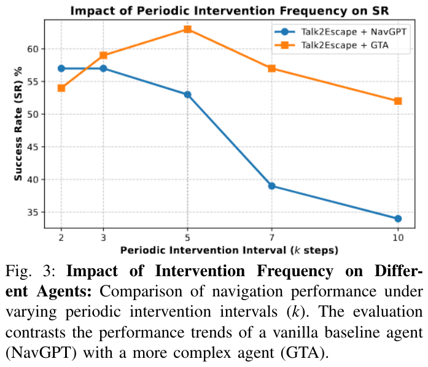
<figcaption>
The impact of timing intervention interval k on different bases: the weak base NavGPT decreases approximately linearly as the interval becomes larger (relying on continuous external guidance); the strong base GTA is in an inverted U shape, k=5 is the best, and asking too frequently will interrupt its internal inference
</figcaption>

**real robot (Unitree Go2, gimbal depth camera scans orthogonal view, MLLM asynchronous output waypoint)**: SR increased from 40.0% of GTA to 62.0%, NE decreased from 3.66 m to 3.31 m; supervision method VLN-BERT 16.0%, RDP 20.0%. The real robot uses human supervisors to intervene according to Deviation criteria.

  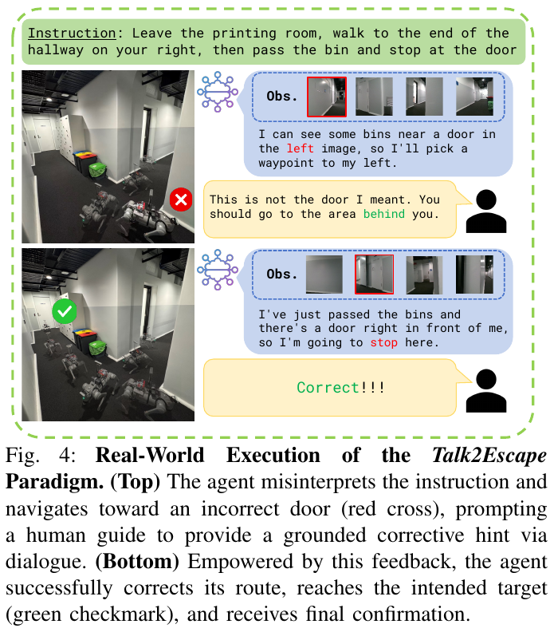
<figcaption>
real robot example: The upper agent misunderstood the instruction and went to the wrong door, and the human gave the correction "It's not this door, go to the area behind you"; the lower agent changed its route accordingly, reached the correct target and was confirmed
</figcaption>

---

### 4. Limitations
{: id="4-局限性-23"}

The Oracle prompts and Deviation triggers in the simulation directly use the target's true position (azimuth and distance), which is equivalent to privileged information and is not compared under the same conditions as the method that only relies on single-round instructions; real robot relies on human supervisors. The author also pointed out the "asymmetric context" bottleneck: humans only see discrete static images, and it is difficult to restore the robot's global orientation and local obstacles, and the prompts given may be vague. In addition, R2R-CE is only evaluated on 100 sampling episodes, and the statistics fluctuate greatly.

---

## 14. SuperNav (2026)
{: id="supernav"}
———Turn a general-purpose multimodal model into a continuing navigation agent through navigation skills, visual-point tools, and context management

📄 **Paper**: [arXiv:2610.12126](https://arxiv.org/abs/2610.12126) · [Project Page](https://zju3dv.github.io/SuperNav/)

### Key takeaways
{: id="精华-26"}

SuperNav separates responsibilities: a general-purpose multimodal model interprets requests, understands scenes, and selects destinations, while tools handle path planning and motion control.
Navigation performance also depends on the surrounding execution framework: readable skills, convenient destination-selection tools, task-progress records, and context management support search, verification, and recovery.
A shared image-point interface connects the same high-level decision loop to geometric or learned motion backends, although their sensing and geometric resources differ, and similar success rates can conceal different path efficiency.
“No navigation-specific fine-tuning” applies to the high-level MLLM; the learned executor is trained on simulator expert trajectories, while geometric execution uses depth and navigable geometry.

---

### 1. Background and problem
{: id="1-研究背景问题-25"}

Service robots must interpret requests such as “find the specified sofa” and “visit several objects in order,” infer suitable targets from needs such as “find somewhere to rest,” and keep exploring and verifying in unfamiliar scenes.
Fixed modular workflows usually prescribe when a model participates, rechecks a candidate, or stops, requiring workflow changes for new tasks; directly fine-tuning a VLM to predict navigation actions is constrained by training-task and scene coverage.
SuperNav therefore preserves the pretrained MLLM's general capabilities and uses an agent harness to organize tool calls, skill reading, and history management, allowing feedback to guide each subsequent decision.

---

### 2. Method and innovations
{: id="2-主要方法创新点-25"}

  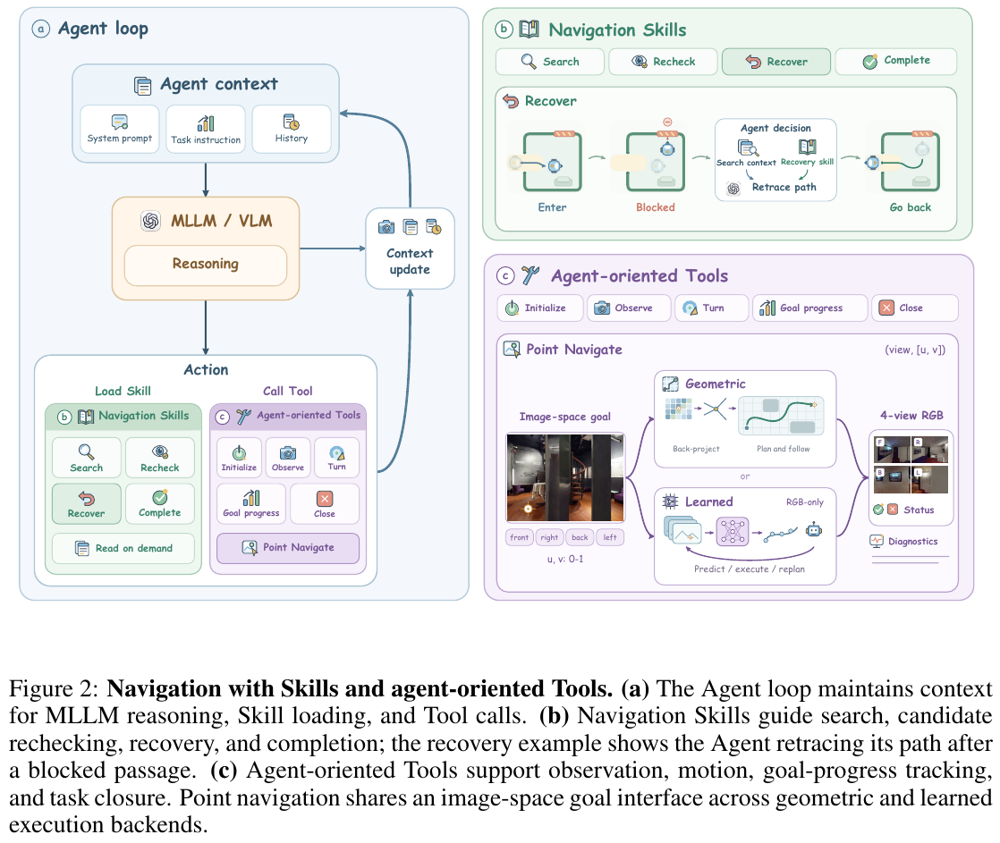
<figcaption>Figure 2: SuperNav's overall framework. The agent loop maintains context; Navigation Skills guide search, rechecking, recovery, and completion; tools execute observation and motion through a shared image-point interface for two motion backends.</figcaption>

**Overall framework.** SuperNav combines an agent loop, Navigation Skills, and agent-oriented navigation tools: the loop presents requests, history, and feedback to the MLLM; skills provide readable procedural experience; tools translate selected destinations into movement and return fresh observations.

**① Agent loop: connect each action to earlier evidence.** Inputs are the task instruction, current images, textual interaction history, and pending-goal records. The MLLM chooses to observe, move, read a skill, update goal state, or close the session, and tool results enter the next decision context.
For example, when approaching a presumed sofa reveals a bed, the model should continue searching using the new images.
The implementation uses Codex CLI for the loop and MCP for environment tools. The high-level model receives RGB observations and execution feedback rather than absolute poses, maps, or evaluator target information.

Long tasks use **media-only pruning**: once newer observations supersede old images, their media payloads are omitted from subsequent requests while textual history, task state, and image paths remain; earlier images can be reread when needed.
This reduces repeated image input while preserving inspected areas, failed attempts, and unfinished goals. Returning to an earlier area relies on visual recognition and records, rather than a stored executable return path.

**② Navigation Skills: experience as readable procedural guidance.** Each skill is a Markdown package specifying applicable situations, evidence to inspect, recommended steps, and references. The model sees names and descriptions first and reads relevant instructions on demand.
Search guidance asks it to record inspected areas, visible entrances, and uncertain branches; recovery guidance suggests changing a point or route, stepping back, or finding an entrance; completion guidance asks it to verify appearance, requested relations, and surrounding context before updating goal records.
Skills influence reasoning by entering the context, while the MLLM chooses each action.

| Dimension | Fixed modular navigation workflow | SuperNav skills and loop |
|---|---|---|
| Decision order | Program logic prescribes transitions between exploration, verification, and termination | The model selects the next operation from the request and feedback |
| Adding experience | Implement workflow branches or dedicated modules | Read written guidance for search, recovery, and completion |
| Effect of guidance | Program logic executes prescribed procedures | Skills recommend procedures without enforcing action sequences |

**③ Visual-point tools: specify the destination in an image and delegate movement to the backend.** Observations provide front, right, back, and left RGB images relative to the robot's heading when captured. The model selects a view and coordinates normalized from the top-left corner:

$$
\operatorname{PointNav}(d,[u,v]),\qquad u,v\in[0,1].
$$

Here $d$ identifies the view, and $u$ and $v$ are horizontal and vertical coordinates. A selected point can lie on a candidate object or visible floor, allowing the robot to approach a target or obtain a better view.
After movement or turning, the tool returns fresh four-view images, execution status, and concise diagnostics, allowing immediate rechecking without a separate observation call after every movement.

> **Example:** Selecting $[0.5,0.75]$ in a 640 × 480 right-view image approximately identifies horizontal pixel 320 and vertical pixel 360.
> This specifies a visual destination, without supplying a heading change or travel distance, or guaranteeing direct reachability; the motion tool handles those questions.

The same pointing interface connects two backends:

| Backend | Inputs and processing | Output and role |
|---|---|---|
| Geo-based Executor | Uses depth, camera calibration, and pose to back-project the pixel, select a reachable position, and plan and follow a path | Completes a movement and returns observations; simulation uses a precomputed navigation mesh, while deployment uses LiDAR mapping and odometry |
| Learned Executor | Reads a marked reference RGB image and subsequent RGB history, predicts short displacement sequences and a local stop signal, and repeatedly executes and replans | Completes a local movement and returns observations; policy inference requires no depth back-projection or navigation-mesh planning |

A shared high-level interface therefore does not imply shared low-level resources: geometric execution uses geometry internally, while the simulated learned backend still uses position changes and collision reports to monitor progress.

  
<figcaption>Figure 4: Demand-driven navigation. For a request to make a workspace clear and usable, the agent finds a table, identifies a vase to clear, and finds a suitable shelf; the example demonstrates navigation and target judgments.</figcaption>

**④ Learned Executor: a fixed goal reference with a changing current view.** After the high-level model selects a reference image and pixel, the executor draws a red ring and central dot at that point. The reference image and point remain fixed throughout the local request, while current RGB observations change with movement.
A shared DINOv2 ViT-S/14 encodes 224 × 224 images into 384-dimensional global features. History features are projected into 256-dimensional observation tokens; concatenated current-image and marked-reference features pass through a 768 → 256 → 256 MLP to form the goal token.
This goal token relates the initially selected destination to the current scene for motion prediction.

  
<figcaption>Figure 6: Learned Executor. A shared visual encoder processes the marked reference and RGB history. An age-aware Transformer fuses the inputs, a flow action head generates displacement increments, and a stop head decides whether the current movement request should end.</figcaption>

**Variable-length visual history** preserves the starting frame and emphasizes recent observations, with at most 12 frames per fusion pass.
Selection starts from stride-two history frames plus the current frame. When over budget, it repeatedly thins the older half while preserving the start and current frames. Each frame receives an age encoding indicating how many observations have elapsed; a four-layer, four-head Transformer fuses these tokens with the goal token, and valid-token mean pooling produces the condition $c_t$.
Cached image features can be reused, while their age encodings update at the current time, preserving temporal information for unevenly spaced observations.

> **Frame-index example:** At $t=8$, the paper selects $[0,2,4,6,8]$; at $t=60$, it selects $[0,30,42,46,48,50,52,54,56,58,60]$.
> The latter uses only 11 frames while retaining the initial view and dense recent observations. Omitted frames can remain in history and the feature cache; the 12-frame limit applies to a single fusion pass.

**⑤ Motion prediction and training objectives.** Conditioned on $c_t$, a one-dimensional U-Net generates 8 two-dimensional displacement increments, all expressed in the robot's fixed coordinate frame at prediction time, with forward and left axes. Multiplying by 0.25 m converts normalized predictions to physical displacements.
Training uses Habitat greedy-follower expert trajectories. Future positions are projected into the initial image to form goal points, with depth checking occlusion during data generation; for object-surface markers, the corresponding ground-level approach position supplies the trajectory.
Normalized increments are clipped componentwise to $[-1,1]$, with zero increments after the expert endpoint.

> **Example:** Simplify to 3 normalized increments $[(1,0),(1,1),(0,1)]$. Scaling by 0.25 m gives $(0.25,0)$, $(0.25,0.25)$, and $(0,0.25)$.
> Accumulating in the same prediction-time frame gives waypoints $(0.25,0)$, $(0.50,0.25)$, and $(0.50,0.50)$. The actual policy predicts 8 increments and normally executes only the first 3 before observing and replanning to correct deviations.

The action head uses **flow matching** to learn how noise becomes an expert displacement sequence: it interpolates between the expert sequence $A$ and Gaussian noise $\epsilon$ and learns the interpolation's velocity.

$$
x_\tau=(1-\tau)A+\tau\epsilon,\qquad
\mathcal L_{\mathrm{flow}}=\frac{1}{16}\mathbb E\left[\lVert v_\theta(x_\tau,\tau,c_t)-(\epsilon-A)\rVert_F^2\right].
$$

Here $\tau$ is uniform on $[0,1]$, $\epsilon$ is standard Gaussian noise, and $1/16$ averages over the 8 × 2 sequence components.
A stop head predicts $p_t$, and an auxiliary head estimates the remaining expert-observation steps. The stop label is positive when at most 2 steps remain; the step count includes turning primitives.
The total objective is:

$$
\mathcal L=\mathcal L_{\mathrm{flow}}+0.5\mathcal L_{\mathrm{stop}}+0.002\mathcal L_{\mathrm{remaining}}.
$$

Stopping uses binary cross-entropy with positive-label weight 3, and remaining-step estimation uses squared error.
For classifier-free guidance, 10% of samples replace the goal token with a learned null token while retaining observation history. The latter two losses apply only to samples retaining the goal token.
The executor trains for 45,000 updates with global batch size 256 and jointly fine-tunes the visual encoder. This training is separate from preserving the high-level MLLM without navigation fine-tuning.

**⑥ Inference and termination: a local stop still requires a task-level decision.** Inference starts from Gaussian noise and generates an increment sequence with 4 Euler updates, using $v_{\mathrm{guided}}=v_u+2(v_c-v_u)$ to combine goal-conditioned and null-goal predictions. It selects one of 16 samples by endpoint-direction agreement and path straightness.
The executor normally follows the first three increments, translates them into turning and forward primitives, acquires RGB, and replans. A local stop requires $p_t\geq0.1$ on two consecutive replanning calls plus a motion-progress condition; the auxiliary remaining-step prediction does not gate stopping.
That progress condition requires at least 4 executed primitives overall and at least 3 since the current streak's first above-threshold prediction, or no executed primitives in the previous cycle. Failures and budget exhaustion are reported separately.

> **Two levels of stopping:** After selecting a doorway, the executor may confirm that the movement to it has ended. The sofa remains unfound, so the MLLM must inspect the new views and choose another destination.
> Even when the MLLM closes the session and declares achieved, successful closure only confirms that the session ended; an independent evaluator determines task success.

End to end, a request follows a loop of interpreting goals, inspecting four views, reading relevant skills, selecting a visual point, executing movement and receiving feedback, and rechecking and updating goals until the model decides to terminate. Within one learned-backend tool call, multiple short movement and replanning cycles can occur.

---

### 3. Results and findings
{: id="3-核心结果发现-25"}

**Instance and demand-driven navigation (Table 1).** Main experiments use GPT-5.6 Terra. SR measures success rate, while SPL combines success and path efficiency; each cell below reports **SR (%) / SPL**.

| Method | Single-object (150 tasks) | Ordered multi-object (150 tasks) | Demand-driven (200 tasks) |
|---|---|---|---|
| NaVid | 24.67 / 0.1599 | 2.67 / 0.0216 | 17.00 / 0.0920 |
| UniNaVid | 34.00 / 0.1833 | 1.33 / 0.0131 | 25.00 / 0.0943 |
| StreamVLN | 13.33 / 0.1036 | 0.00 / 0.0000 | 25.50 / 0.0775 |
| OmniNav (Action Former) | 27.33 / 0.2133 | 4.00 / 0.0275 | 37.50 / 0.1213 |
| SuperNav + Geo-based Executor | **78.00 / 0.4127** | **34.00 / 0.1388** | **59.50 / 0.1801** |
| SuperNav + Learned Executor | 68.00 / 0.2059 | **34.00** / 0.0862 | 45.00 / 0.1603 |

The geometric backend exceeds the strongest single-object baseline, UniNaVid, by **44 percentage points**, and OmniNav Action Former on demand-driven navigation by **22 percentage points**. Both SuperNav backends achieve 34% on multi-object tasks, with more efficient paths from geometric execution.
Multi-object tasks contain 2–5 targets. Single-object scoring checks the final position; multi-object scoring checks ordered trajectory arrivals within 1 m of approved viewpoints. Both require explicit STOP.
Demand-driven tasks adapt Demand-Bench's 1–8-stage requests to ordered arrivals within 2 m of admissible objects' horizontal bounding boxes, without object reuse and with explicit STOP, but without additional visibility or line-of-sight checks. These scores are not directly comparable to DemandAgent's original protocol.
Baselines retain native observations and history mechanisms, without fully matching camera counts, fields of view, or low-level geometric resources; the comparison evaluates complete system configurations.

**Category-level navigation (Table 2).** HM3D-OVON uses a shared 120-episode val-unseen subset; HM3Dv2 uses 1,000 validation episodes. Thresholds apply to the shortest navigable distance from the final position to the nearest goal viewpoint; cells report **SR (%) / SPL**.

| SuperNav backend | OVON, 0.25 m | OVON, 1 m | HM3Dv2, 0.2 m | HM3Dv2, 1 m |
|---|---|---|---|---|
| Geo-based Executor | 68.33 / 0.3837 | 73.33 / 0.4105 | 80.30 / 0.3338 | 86.50 / 0.3638 |
| Learned Executor | 65.00 / 0.1355 | 70.83 / 0.1443 | 79.00 / 0.1288 | 85.40 / 0.1383 |

The learned backend retains most success rates but substantially lowers SPL, showing why arrival capability and path efficiency should be evaluated separately.
Published comparison methods differ in episode subsets, action budgets, STOP rules, and execution resources; their reported scores do not establish a ranking under one shared protocol.
SuperNav's OVON scoring neither additionally requires Habitat STOP nor uses the model's verbal judgment. Two designated unreachable-goal episodes per configuration receive SR and SPL contributions of one under the adopted rule.

**Skill, tool, and model ablations (Table 3).** Geo-based Executor, the 120 OVON episodes, and GPT-5.6 Terra (high) are fixed, except the last row changes both model and reasoning setting:

| Configuration | SR, 0.25 m (%) | SPL, 0.25 m | SR, 1 m (%) | SPL, 1 m |
|---|---|---|---|---|
| Full SuperNav | 68.33 | 0.3837 | 73.33 | 0.4105 |
| Without Navigation Skills | 35.00 | 0.2460 | 54.17 | 0.3894 |
| Front-only interaction | 52.50 | 0.2230 | 65.83 | 0.2855 |
| Without skills and tool design | 31.67 | 0.1870 | 54.17 | 0.3417 |
| External language grounding and candidate selection | 55.83 | 0.3201 | 62.50 | 0.3624 |
| GPT-6 Astra (medium) + full harness | **71.67** | **0.4579** | **79.17** | **0.4974** |

At the stricter 0.25 m threshold, removing skills lowers SR by **33.33 percentage points**. Front-only interaction lowers it by **15.83 percentage points** and increases mean turning-tool calls from 0.41 to 17.56 (Table 6).
Replacing direct pointing with LocateAnything language grounding and candidate selection does not improve performance. Astra (medium) improves SR and SPL, although changing both model and reasoning setting prevents attributing the gain to either alone.

**Long sequences and robot deployment.** On eligible five-goal multi-object tasks, the geometric backend completes the first five goals with a 39.47% stage success rate; five-stage demand-driven success is only 9.09%. No method completes six or more demand stages, for which only 3, 2, and 1 tasks qualify at stages six, seven, and eight respectively (Table 4), leaving long sequences a clear challenge.
Stage success uses tasks with at least that many goals and does not require STOP; it is distinct from complete-task success.
Unitree Go2 demonstrations use four-view RGB and LiDAR geometric execution to find a basketball, find another Go2, and visit a printer followed by a bin. The paper provides qualitative demonstrations rather than a large-scale real-robot success rate.

  
<figcaption>Figure 5: Unitree Go2 demonstrations show single-goal search, route revision after blockage, close-range verification, and transitions from a printer to a bin.</figcaption>

---

### 4. Limitations
{: id="4-局限性-25"}

Semantic and completion judgments depend on the MLLM, and inference cost and latency variation affect execution efficiency. Geometric execution requires maps or scene geometry, while learned-backend path efficiency and long-sequence reliability need improvement.
Demand-driven evaluation measures ordered arrivals at relevant targets rather than carrying out activities such as moving objects or organizing a workspace. External benchmark comparisons differ in protocol, and robot validation is mainly qualitative.

---

## 15. NavHarness (2026)
{: id="navharness"}
———Sustain navigation through cross-session handovers, external memory, and two-stage verification

📄 **Paper**: [arXiv:2609.34276](https://arxiv.org/abs/2609.34276) · [Code](https://github.com/billzhao1030/NavHarness) · [Project Page](https://billzhao1030.github.io)

NavHarness is an embodied-agent harness centered on continuing navigation. It keeps spatial maps, task records, and experiential memory outside reasoning sessions so that fresh sessions can inherit searched areas, pending branches, and failure evidence, with recovery handovers, pre-stop verification, and post-stop certification supporting further navigation. Evaluations cover GOAT-Bench multimodal-goal navigation, IR2R-CE instruction navigation, and simulated continuous deployment across 36 houses, making the paper relevant to navigation tasks and long-term memory.

**Full analysis and experimental results**: [NavHarness: session handovers, memory reuse, and continuing navigation (Embodied Agents: Paper Readings, entry 9)](/en/Embodied-Agent-Papers/#navharness).

---

## 16. EvoLife (2026)
{: id="evolife"}
———Turn directions into place memories so that the next navigation task can build on experience

📄 **Paper**: [arXiv:2610.39446v1](https://arxiv.org/abs/2610.39446v1) · [Project Page](https://kai-sheng-caesar.github.io/EvoLife-Web/)

---

### Key takeaways
{: id="精华-27"}

EvoLife lets a single multimodal agent decide how to move, when to ask for help, and which experiences to retain. Its hybrid action space gives the same decision maker waypoint selection, floor-pixel selection, object approach, and local adjustment, while a geometric backend turns these intentions into executable movement. Directions and target cues acquired through interaction are grounded in actual places, so one question can resolve immediate ambiguity and support later revisits. Here, “evolution” means accumulating and revising maps, places, and dialogue records; the paper introduces no new parameter-training objective. The reported 100% SR must be read with its information conditions: the main experiments permit questions to an independent guide with privileged target and route information and evaluate sampled task sets.

---

### 1. Background and problem
{: id="1-研究背景问题-26"}

A robot operating in an environment over time must select suitable movement interfaces, ask for help when instructions are ambiguous or passages are blocked, and preserve verified places and routes for subsequent tasks. Existing policies, interaction mechanisms, and spatial memories provide parts of this capability; EvoLife connects them through a unified tool loop so that an interaction can influence both the current action and future experience. The tasks cover route following, object search, instance disambiguation, and continuous multi-goal navigation, without a prebuilt map supplied to the navigation agent on its first visit.

---

### 2. Method and innovations
{: id="2-主要方法创新点-26"}

  
<figcaption>Original Figure 2: EvoLife connects hybrid actions, active interaction, and persistent memory in one decision loop. Candidate waypoints support current movement; place records preserve poses, descriptions, and question–answer evidence for later visits.</figcaption>

**Overall framework.** EvoLife is a navigation harness built around existing multimodal models. The **hybrid action space** expresses movement intentions, **active interaction** supplies target or route information, and **persistent spatial memory** stores and retrieves acquired experience. At each step, the model reads the current task, observations, tool history, and available memory, then selects a tool and its arguments; the tool returns the actual outcome, informing state updates and the next decision.

**① Hybrid action space: the model expresses where to go, and the backend checks whether it can get there.**

Inputs include front, right, back, and left RGB views and observed geometry constructed from depth; the main simulation experiments also provide simulator poses. Perception tools expose panoramas with candidate waypoints, occupancy maps, historical routes, and places. The model selects among four movement interfaces:

| Movement mode | Agent-selected tool input | Backend processing and purpose |
|---|---|---|
| Waypoint navigation `navigate_candidate` | Geometric candidate waypoint index | Refresh candidates using current RGB-D geometry, plan through observed free space, and execute continuously; useful for longer movements. |
| Local actions `step` | Forward, left turn, or right turn | In simulation, move forward 0.25 m, turn left 15°, or turn right 15° for exploration and final position or orientation adjustment. |
| Pixel navigation `navigate_pixel` | View, normalized floor-pixel coordinates, and image version | Project the selection to a ground waypoint using depth and the camera transform, check reachability, and execute without restricting selection to the candidate set. |
| Object navigation `navigate_object` | Localized object identifier, stand-off distance, and facing options | Find reachable free space near the object and plan an approach, rather than treating its surface as a robot destination. |

**A pixel is not a movement coordinate.** Clicking an image expresses visual intent; RGB-D geometry and reachability checks still have to turn it into a motion target.

> **Worked example:** Suppose the current image is 1000 pixels wide and 500 pixels high. Selecting the normalized floor point `(0.4, 0.8)` corresponds approximately to image pixel `(400, 400)`. This means “move toward this patch of floor in the image,” not “go to world coordinates `(0.4 m, 0.8 m)`.” The backend must read depth, transform the point using calibration and camera pose, and confirm a traversable path. These illustrative dimensions are not the paper's image-resolution settings.

Object navigation adds a semantic-to-geometric grounding step. The agent recognizes an object in current RGB observations and calls `localize_object` with a box or point; the backend filters valid depth, extracts a depth-consistent component, and back-projects it, returning an object identifier, 3D points, and overlays. `verify_object` can reproject the estimate into current views for inspection; `navigate_object` then searches for an appropriate approach position. **The agent remains responsible for recognizing the intended target and deciding when to stop.**

Navigation requests can specify an inspection distance or execution time. Control returns at an inspection checkpoint or destination, or after collision, lack of progress, or budget exhaustion. A backend arrival report is not successful task submission: only `stop` ends the current task or advances to the next subtask.

**② Active interaction: ask a specific question, then verify the answer against new observations.**

  
<figcaption>Original Figure 3: The navigation agent generates a question; an independent multimodal guide uses current views, target views, and a reference route to answer it. Only the natural-language answer reaches the navigator, which selects its own subsequent actions.</figcaption>

`ask_human` takes a question or assistance intent generated from the current goal, views, and relevant memory, and returns natural-language feedback. It can clarify which table is intended, ask which doorway to use, or request that a person open a door in a physical deployment. The paper introduces neither a separately trained question classifier nor a fixed confidence threshold: the multimodal model chooses when to ask as part of tool selection.

**The simulated guide's information is essential to interpreting the results.** Guide and navigator run in independent sessions; the main experiments use **GPT-6 Astra (ultra)** for both. Beyond instructions, current views, target information, and dialogue history, the guide can access the current pose, target position, shortest navigable path, relevant maps, and reference-route visualizations. It translates this privileged information into directions, landmarks, and spatial relations. The navigator does not directly receive target coordinates, complete reference paths, or private maps; each subtask permits at most 10 interactions. In VL-LN and CoIN, the navigator initially receives only an object category while the guide knows the intended instance, so dialogue also resolves instance ambiguity.

**③ Persistent spatial memory: attach what a question established to an actual place.**

Memory contains four parts: observed geometry $G_t$, the place collection $P_t$, executed routes $R_t$, and retained dialogue $D_t$. Geometry, routes, and spatially associated dialogue are recorded automatically. The agent selectively creates, revises, or retires semantic places. A place record links an identifier, actual pose, name and description, object labels, historical images, associated question–answer evidence, map context, timestamp, and active status.

> **Worked example:** On a first visit to two similar doorways, the guide explains, “Go through the narrow arch; the target is at the end of the picture-lined hallway.” The agent can save the arch entrance as a place, linked to its actual pose, four-view images, and this exchange. Later retrieval supports replanning toward that entrance and checking it against current observations. If a previously open door is now closed, the old record helps establish where to go, while current evidence determines whether passage is possible; the agent can ask again and revise the record. This accumulates retrievable experience rather than updating model weights through revisits.

`remember_place` creates a record at the actual current location or updates an existing identifier. `search_memory` matches names, descriptions, and object labels, with an empty query listing available places. `inspect_place` returns four-view images and details explicitly marked as historical evidence. `navigate_place` **replans using currently observed geometry** toward the stored pose; `resume_navigation` continues after local inspection or avoidance. A revisit therefore does not blindly replay previous actions, and the agent chooses retrieval operations as needed rather than following a fixed retrieval pipeline.

The diagram below isolates how an interaction becomes reusable experience:

**④ Decisions and state updates: a tool loop, with no new loss function.**

The central decision and update rules are:

$$
a_t=(u_t,\eta_t)=\pi_\theta(g_j,o_t,H_t,M_t),\qquad
M_{t+1}=U(M_t,a_t,z_t,o_{t+1}).
$$

Here $g_j$ is the current stage goal, $o_t$ the current observation, $H_t$ the current execution's tool requests and returns, $M_t$ persistent memory, $u_t$ and $\eta_t$ the selected tool and arguments, and $z_t$ the actual execution feedback. The first rule selects the next call, and the second determines what the execution retains. These are decision and memory-update rules, not supervised or reinforcement-learning losses. The paper reports no navigation-specific parameter fine-tuning; inference cycles through existing multimodal models and tools.

---

### 3. Results and findings
{: id="3-核心结果发现-26"}

**Evaluation size and protocol.** The main study contains six sets of 100 single-task episodes and 50 continuous sequences each for LHPR-VLN and GOAT-Bench: 700 complete tasks or sequences and 1,105 subtasks in total. R2R-CE reuses OpenNav's fixed 100 episodes; the other five single-task sets are randomly sampled. Continuous sequences are sampled after checking annotation consistency. Memory persists within a sequence and resets at the next sequence; a first visit without initial memory can still use experience accumulated during that run.

**Assisted first visits and continuous tasks.** The table follows the main results in Tables 3 and 4. SR and SPL are percentages; SPL accounts for both success and path efficiency.

| Task | Evaluation size | Main results |
|---|---|---|
| R2R-CE | 100 tasks | SR 100, SPL 82.2, NE 0.95 m. |
| RxR-CE | 100 tasks | SR 100, SPL 75.4, nDTW 82.3. |
| HM3D v2 | 100 tasks | SR 100, SPL 64.3. |
| HM3D-OVON | 100 tasks | SR 100, SPL 71.4. |
| VL-LN | 100 tasks | SR 99, SPL 76.2, 3.21 questions on average. |
| CoIN | 100 tasks | SR 100, SPL 73.5, 2.83 questions on average. |
| LHPR-VLN | 50 sequences, 133 stages | Complete-sequence SR 98, or 49/50; independent-stage success 99.3. |
| GOAT-Bench | 50 sequences, 372 subtasks | Complete-sequence e-SR 94, or 47/50; subtask SR 99.3, SPL 81.9. |

The abstract reports **1.87 interactions** on average. Table 5 lists 1.66, 1.64, 2.02, and 2.15 for the first four VLN/ObjectNav first-visit sets, whose mean is approximately 1.87; this should not be treated as a uniform average over all eight benchmarks. Previously published baselines use different evaluation and information conditions, so their differences cannot all be attributed to a harness improvement under matched settings. Table 5 also gives GOAT SPL as 82.2, whereas Table 4 gives 81.9; this summary uses the task's main results in Table 4.

**The matched R2R task set better separates interaction from experience reuse.**

| Setting | SR | SPL | Mean tool decisions | Navigator-active execution time |
|---|---|---|---|---|
| First visit: no active interaction or initial memory | 86 | 63.7 | 18.71 | 170.17 s |
| First visit: active interaction, no initial memory | 100 | 82.2 | 15.57 | 164.08 s |
| Revisit: corresponding first-visit memory, active interaction disabled | 100 | 93.3 | 12.31 | 107.41 s |

After an interactive first visit, revisits retain 100% SR without further questions. Using the precise values in the text, SPL rises from **82.23 to 93.31**; tool decisions decrease by approximately 20.9%, and navigator-active execution time by approximately 34.5%. This demonstrates experience reuse on the same tasks, not a 100% unassisted success rate for entirely new goals. The paper also lacks a complete ablation of the four action interfaces individually.

**How much does arrival confirmation contribute?** An additional setting retains earlier directional guidance and target clarification but executes `STOP` at the first arrival-confirmation request, preventing subsequent position corrections informed by the confirmation answer. SR becomes **90% / 95%** on R2R-CE / RxR-CE and **69% / 89%** on HM3D-OVON / HM3D v2. Earlier questions still help, while confirmation and fine adjustment near the goal also affect results substantially, particularly under strict object-navigation distance thresholds. This remains an interactive setting, not an experiment without a guide.

**Backbones and cost.** On assisted R2R-CE, GPT-6 Astra, Qwen3.8-Max, and DeepSeek V4.1-Flash achieve 100%, 91%, and 98% SR with 15.57, 72.98, and 44.72 tool decisions on average. The reported approximately USD 1.06, 0.46, and 0.03 per task cover only navigator-side API-equivalent costs, excluding the guide. Time measures navigator-active execution rather than end-to-end robot runtime including all interaction waiting. Model names and settings are reproduced as stated in the paper.

  
<figcaption>Original Figure 6: Three navigation tasks across two days. On the first night, the robot travels from room 625 to the elevator and back, asking a person to open the door on its return. The next morning it restores the historical map and revisits the glass office seen the previous day.</figcaption>

**Physical validation.** The first-night route from room 625 to the opposite-side elevator is approximately 87 m. On the return, the robot reuses place memory and asks someone to open the door; the two routes total approximately 166 m. The next morning it restores the map and localization and travels approximately 60 m to the glass office. These three tasks demonstrate assistance and cross-day reuse under changing doors and lighting, but are qualitative examples rather than a large-scale physical-robot success-rate evaluation.

---

### 4. Limitations
{: id="4-局限性-26"}

The main results rely on strong multimodal backbones, RGB-D geometry, simulator poses, and a guide with privileged target and route information; sampled evaluations, matched-task revisits, and three physical demonstrations do not establish equivalent performance in long-term, large-scale, unassisted deployment. The authors identify multi-round inference latency and expense as bottlenecks, while final positioning and stopping can still fail: the GOAT example identifies the correct bookcase but stops 0.73 m from the reference target, exceeding the 0.25 m threshold.

---

## 17. Open-Nav (2025)
{: id="open-nav"}
———Zero-Shot VLN in Continuous Environment with Open-Source LLMs

📄 **Paper**: [arXiv:2409.18794](https://arxiv.org/abs/2409.18794) · 🏛️ **ICRA 2025**

### Key takeaways
{: id="open-nav-精华-5"}

The core contribution of Open-Nav is to replace the expensive GPT-4 API with a locally deployed open source LLM while maintaining competitive performance, which has important implications for privacy-sensitive real-world robot deployments. The three-stage spatial-temporal CoT (instruction understanding → progress estimation → decision making) designed in the paper is a reusable LLM navigation reasoning framework and is worth learning from. The idea of ​​using SpatialBot + RAM to jointly enhance visual perception - one is responsible for spatial relationship understanding, and the other is responsible for fine-grained target recognition - effectively bridges the gap in visual perception between open source LLM and GPT-4. Real-world evaluation results show that Open-Nav without training even surpasses the SOTA method with supervised training, indicating that the generalization ability of LLM has significant advantages in out-of-distribution scenarios.

---

### 1. Background and problem
{: id="1-研究背景问题-4"}

Vision-and-Language Navigation in Continuous Environments (VLN-CE) requires agents to navigate in unseen 3D indoor environments based on natural language instructions. Existing LLM-based zero-shot methods (such as NavGPT, DiscussionNav) rely heavily on the GPT-4 API, which involves high token fees and the risk of user environment data privacy leakage. They are mainly verified in discrete environments and are difficult to be directly applied to continuous real-world scenarios.

---

### 2. Method and innovations
{: id="2-主要方法创新点-4"}

  
<figcaption>
Comparison between GPT-based Navigator and Open-Source LLM-based Navigator: The latter requires no API fees, and environmental data does not leave the local device, protecting user privacy.
</figcaption>

The Open-Nav framework consists of three core modules:

**1. Waypoint Prediction module**

Use a Transformer-based waypoint prediction model that fuses RGB and depth image features (two dedicated ResNet50 branches):

$$v_i^{rgbd} = W_m(f_{\text{ResNet-RGB}}(I_i^{rgb}) \| f_{\text{ResNet-Depth}}(I_i^d))$$

After Transformer processing, a candidate path point heat map is generated, and then K candidate direction points $$\Delta W = \{\Delta w_i\}_{i=1}^K$$ are filtered out through NMS. Each candidate point is represented by angle and distance.

**2. Scene Perception module**

For challenges requiring accurate spatial understanding in continuous environments, scene description is enhanced using two complementary models:

- **SpatialBot**: Spatial understanding VLM, input RGB+depth map, output text description containing distance and spatial relationship between objects
- **RAM** (Recognize Anything Model): Fine-grained target detection, identifying the categories and three-dimensional positions of all objects in the scene

The two outputs are merged into a unified textual scene observation $O_{text} = \langle D_{spatial}, \{o_i\}\rangle$, providing rich spatial context for LLM.

  
<figcaption>
Open-Nav overall architecture: Waypoint Prediction module identifies candidate guide waypoints, Scene Perception module (RAM + SpatialBot) extracts object positions and spatial relationships, and LLM Navigator performs three-stage CoT reasoning and outputs actions.
</figcaption>

**3. LLM Navigator: Three-stage space-timing Chain-of-Thought**

This is the core innovation of Open-Nav. At each navigation step, LLM sequentially completes three inference stages:

- **Instruction Comprehension**: Decompose navigation instructions into action sequences and landmark lists, using dedicated prompts to extract structured information
- **Progress Estimation**: Based on historical trajectories and current observations, determine which subtasks have been completed through four steps: landmark verification, direction analysis, and action completion assessment.
- **Decision Making**: Integrate the spatial description, historical trajectory summary and progress estimation results of the current candidate waypoint, generate the reasoning process and select the optimal direction point

The framework deploys four open source LLMs locally via [Ollama](https://ollama.ai/): Llama3.1-70B, Qwen2-72B, Gemma2-27B, Phi3-14B.

---

### 3. Results and findings
{: id="3-核心结果发现-4"}

**Simulation Environment (R2R-CE Dataset)**:

| Methods | SR↑ | SPL↑ | nDTW↑ |
|------|-----|------|--------|
| DiscussNav-GPT4 | 15 | 10.51 | 42.87 |
| Open-Nav-Llama3.1 (this article) | **16** | **12.90** | **44.99** |
| Open-Nav-GPT4 (this article) | 19 | 16.10 | 45.79 |

Open-Nav uses open source LLM to surpass DiscussNav-GPT4 in both SR and SPL, proving that open source LLM with good perceptual enhancement is comparable to closed source solutions.

**Real World Environment (Office/Lab/Game Room)**:

  
<figcaption>
Real-world testing environment: office, laboratory, game room, each scene is marked with 20 instructions (including simple and complex instructions).
</figcaption>

  
<figcaption>
The navigation process of Open-Nav in the real environment is visualized. The right side shows the step-by-step reasoning process of LLM Navigator, reflecting the interpretability of the CoT thinking chain.
</figcaption>

In all real scenarios: Open-Nav-Llama3.1 reaches **SR=35, NE=2.39**, surpassing supervised training CMA (SR=23), RecBERT (SR=27), and BEVBert (SR=20), verifying the superiority of LLM generalization ability in out-of-distribution scenarios.

**Comparison of different open source LLMs (simulated environment navigation performance)**:

  
<figcaption>
Performance comparison of four open source LLMs on action decomposition tasks (SPICE/BLEU/METEOR/ROUGE).
</figcaption>

  
<figcaption>
Performance comparison of four open source LLMs on landmark extraction tasks. Llama3.1-70B performs best in landmark extraction, Qwen2-72B scores highest in action decomposition, but Llama3.1-70B is the best overall in final navigation performance (SR=16, SPL=12.90).
</figcaption>

---

### 4. Limitations
{: id="4-局限性-4"}

The current inference speed of open source LLM is slow, and the computational efficiency in real environments still needs to be improved; the paper does not explore the potential of fine-tuning open source LLM for navigation tasks, and the performance gap with GPT-4 can be further narrowed in the future.

---

## 18. AgentVLN (2026)
{: id="agentvln"}
———Towards Agentic Vision-and-Language Navigation

📄 **Paper**: [arXiv:2603.17670](https://arxiv.org/abs/2603.17670) · 🏛️ **ECCV 2026** · [Project Page](https://allenxinn.github.io/AgentVLN/) · [Code](https://github.com/Allenxinn/AgentVLN)

### Key takeaways
{: id="精华-13"}

The most valuable idea for AgentVLN is the **VLM-as-Brain** paradigm: using VLM as a brain purely for high-level semantic reasoning and skill scheduling, it encapsulates low-level capabilities such as perception, planning, and control into a modular, plug-and-play skill library, completely decoupling cognition and execution.

Cross-space representation mapping (back-projecting 3D topological waypoints into pixel-aligned 2D visual cues) is an elegant design that bridges the gap between 2D VLM and the 3D physical world without additional parameters.

QD-PCoT shows how to give the model metacognitive capabilities: proactively ask questions when faced with spatial ambiguity, and call on perceptual skills to obtain depth information instead of blindly outputting coordinates.

The 3B parameter count surpasses the previous SOTA of 7B+ in both R2R/RxR lists, proving that structured hierarchical reasoning is far more efficient than brute-force parameter scaling. This framework can be directly deployed on the Jetson embedded edge platform and has strong deployment value.

---

### 1. Background and problem
{: id="1-研究背景问题-12"}

Vision-and-Language Navigation (VLN) requires embodied agents to convert complex natural language instructions into long-term, continuous space navigation behaviors. Current VLN systems face three core bottlenecks: the cross-spatial mismatch between VLM's inherent 2D semantic understanding and 3D geometric perception; scale ambiguity caused by monocular RGB images leads to failure of local target positioning; and large parameter models cannot meet the real-time reasoning needs of edge devices.

---

### 2. Method and innovations
{: id="2-主要方法创新点-10"}

  
<figcaption>
AgentVLN overall framework: The VLM-as-Brain paradigm decomposes long-term navigation into the alternating invocation of perception skills (Perception Skills) and planning skills (Planning Skills), supplemented by QD-PCoT to handle spatial ambiguity.
</figcaption>

**VLM-as-Brain Paradigm and POSMDP Modeling**

AgentVLN formalizes the VLN task as the Partially Observable Semi-Markov Decision Process (POSMDP) $\mathcal{M} = \langle \mathcal{S}, \mathcal{O}, \mathcal{F}, \mathcal{T}, \mathcal{I}, \mathcal{H} \rangle$. As a central controller, VLM generates skill calling instructions at each decision step $t$ based on historical context $$\mathcal{H}_t$$, visual observations $o_t$ and natural language instructions $\mathcal{I}$:

$$c_k \sim \pi_\theta(f \mid \mathcal{H}_{t_k}, o_{t_k}, \mathcal{I}), \quad f \in \mathcal{F}$$

The skill library $\mathcal{F}$ is divided into two categories: **Perception skills** $\mathcal F_{percep}$ ($\tau=0$, extract geometric/semantic features from the environment without delay, update the global state $\mathcal{S}$) and **Planning skills** $\mathcal F_{plan}$ ($\tau>0$, execute a multi-step physical action sequence). Specifically including: Back-Projection, Global Planning, Obstacle Avoidance, Incremental Exploration Map, Feasible Waypoints and other modules. This hierarchical design allows VLM to be completely disconnected from low-level motion details and focus on high-level semantic-spatial matching.

**Cross-Space Representation Mapping**

To solve the problem that VLM cannot directly perceive 3D geometry, AgentVLN designed a set of inverse perspective projection mechanisms. Perception skills first construct a global occupancy grid map through back-projection of RGB-D observations to generate a three-dimensional waypoint $\mathbf{P}^w_{path} = [X_{path}, Y_{path}, 0]^T$; then project the 3D waypoint back to pixel coordinates through the camera internal parameter matrix $K$ and the current pose $T_t$:

$$s \cdot \mathbf{p}^{img}_{path} = KR_t^{-1}(\mathbf{P}^w_{path} - \mathbf{t}_t)$$

In this way, VLM only needs to select the most matching waypoint based on semantics in 2D pixel space, and then use planning skills to restore it to a 3D control signal, achieving a seamless bridge between 2D visual semantics and 3D physical structures.

**Context-aware fine-grained self-correction and active exploration**

When there is no feasible waypoint that satisfies the command semantics in the current observation $o_t$ (such as occlusion, blind zone, trajectory deviation), AgentVLN does not force the long-distance blind displacement, but outputs fine-grained atomic actions $$a_t \sim \pi_\theta(a \mid \mathcal{H}_t, o_t, \mathcal{I})$$, $a \in \{\text{Forward, Left, Right}\}$. After the autonomous look-around restores the visible waypoint, it switches back to the macro skill call, effectively suppressing the accumulation of long trajectory errors.

**Query-Driven Perceptual Chain-of-Thought (QD-PCoT)**

  
<figcaption>
AgentVLN-3B's parameter count-success rate comparison on RxR-CE Val-Unseen surpasses all previous methods of 7B+ with 3B parameter count.
</figcaption>

To address the monocular scale ambiguity in the local target positioning stage, AgentVLN introduces the QD-PCoT mechanism. When the model detects spatial ambiguity, it does not blindly return pixel coordinates, but generates an intermediate natural language query (such as *"How many meters is the chair in front of me?"*) and calls the perception skill $\mathcal F_{percep}$ to obtain accurate depth feedback. This feedback is injected into the context in the form of incremental text prompts, guiding the model to finally output the accurate target pixel coordinate $\mathbf p_{target}^{img} = [u_{target}, v_{target}, 1]^T$, which is then converted into the 3D target coordinate $\mathbf{P}^w_{target}$ by back-projection of the depth map to achieve accurate docking.

**AgentVLN-Instruct Dataset**

A large-scale instruction tuning dataset, AgentVLN-Instruct (based on the Habitat simulator), was constructed, which contains four key components: a dynamic stage routing mechanism driven by target visibility (simulating the human cognitive model of "first coarse navigation, then fine positioning"), generalizable skill call annotation, localized reasoning data, and active question and answer interactive pairs. The foundation model is Qwen2.5-VL-3B, the visual encoder is frozen during training, optimized with AdamW, and uses 32 NVIDIA A100 GPUs.

---

### 3. Results and findings
{: id="agentvln-3-核心结果发现-11"}

  
<figcaption>
AgentVLN navigation visualization: The green dot is the pixel-level visual prompt generated by the perception skill, and the red circle is the waypoint selected by the planning skill; it automatically switches to fine-grained atomic actions when encountering visual occlusion.
</figcaption>

- **R2R-CE Val-Unseen**: AgentVLN-3B reaches SR=67.2%, SPL=64.7%, surpassing similar SOTA InternVLA-N1-8.3B (SR+9.0%, SPL+10.7%), achieving comprehensive surpassing with less than half the number of parameters
- **RxR-CE Val-Unseen**: SR=69.5%, SPL=61.3%, nDTW=74.6%, also refresh SOTA
- **ablation analysis**: Only introducing VLM-as-Brain + cross-space mapping, SR increased from the baseline 38.6% to 59.7%; adding CDFG fine-grained self-correction reached 65.6%; the final integrated QD-PCoT reached 67.2%
- **Timing context**: The optimal number of historical frames K=8 (SR=67.2%, SPL=64.7%). If it is too short, it will be short-sighted, and if it is too long, the attention will be diluted.
- **Real World Deployment**: Based on Unitree Go2 quadruped robot + Intel RealSense D455, combined with RTAB-Map SLAM, it can achieve accurate navigation in indoor and outdoor scenes and support Jetson edge real-time inference.

---

### 4. Limitations
{: id="agentvln-4-局限性-11"}

AgentVLN currently relies on a depth sensor (RGB-D) to support accurate 3D back-projection, and its scale ambiguity processing capabilities in pure RGB monocular scenes are still limited; in addition, the expansion and maintenance of the skill library requires a certain engineering cost, and its zero-shot adaptation ability to new scenes has yet to be systematically evaluated.

---

## 19. CA-VLN (2026)
{: id="ca-vln"}
——— Multi-modal large model embodied navigation framework based on dual-agent collaboration

📄 **Paper**: [Sensors 2026](https://doi.org/10.3390/s26041254) · 🏛️ **Sensors 2026**

### Key takeaways
{: id="精华-21"}
---
1. **Dual-agent collaboration mechanism**: Decouples high-level common sense cognition from underlying episodic memory, and effectively improves the generalization and backtracking capabilities of embodied navigation agents in unseen environments through the collaboration of knowledge agents and hierarchical history agents.
2. **Progressive Online Knowledge Generation**: During reasoning, the agent dynamically generates and retrieves Top-K relevant semantic knowledge facts based on original instructions and real-time visual observations, reducing dependence on static offline knowledge bases.
3. **Hierarchical topological memory design**: Constructing the episodic memory topology map through hierarchical descriptions at the perspective layer and path layer not only retains temporal continuity, but also effectively prevents memory explosion caused by wandering or reciprocating motion.
4. **Two-stage parameter efficient fine-tuning**: LoRA is used to constrain the trainable parameters within 10M, and the dual-agent and multi-modal fusion modules are fine-tuned successively to achieve low-cost domain adaptation of large models in specific navigation tasks.
5. **Sim-to-Real Enlightenment of Decoupled Generalization**: Binding navigation strategies to relatively stable semantic concepts and connectivity relationships instead of fragile low-level visual textures provides an excellent transferable design for overcoming Sim-to-Real domain shift.

### 1. Background and problem
{: id="1-研究背景问题-20"}
---
Vision-language navigation (VLN) requires agents to find paths in complex 3D environments based on natural language instructions. However, traditional end-to-end methods have poor generalization performance when facing unseen environments, and are easily lost or stuck in loops due to the lack of long-term historical context in large-scale scenarios. Although multimodal large models (MLLM) have been introduced into embodied navigation in recent years, the huge parameters of the large model that directly output navigation actions will bring about a huge "Domain Gap" and extremely high computational delays. How to skillfully integrate the common sense reasoning advantages of the large model with the fine underlying local decision-making and spatial topology memory is still an urgent problem to be solved.

### 2. Method and innovations
{: id="2-主要方法创新点-18"}
---

  
<figcaption>
CA-VLN overall collaboration architecture: including Knowledge Agent and Hierarchical History Agent, supplemented by multi-modal feature retrieval
</figcaption>

#### ① Overview of the overall framework
{: id="-整体框架概述-8"}
CA-VLN proposes a dual-agent collaboration framework composed of a Knowledge Reasoning Agent and a Hierarchical History Agent, and uses a specialized multi-modal fusion module to deeply interact with vision, text, common sense and memory features, and finally output action decisions.

  
<figcaption>
CA-VLN Agent interaction and information flow: Knowledge Agent extracts semantic features, History Agent maintains situation memory and guides action decisions
</figcaption>

#### ② Explain module by module
{: id="-逐模块讲解-6"}
- **Knowledge Reasoning Agent**
  - **Input**: Original natural language instructions, real-time multi-view images from the current perspective.
  - **Processing**: During training, the original instructions are spliced with the ground truth trajectories, and MLLM generates accurate step-by-step instructions and extracts key entities; during inference, in the absence of ground truth, the large model adopts a step-by-step prompting strategy to identify visible object attributes in the scene from color, shape, and size, describe the spatial layout, and use the CLIP text encoder to retrieve between the current instructions and preset facts to obtain the Top-K most relevant semantic facts (such as "Dining table is near the kitchen").
  - **Output**: Extracted key semantic entity feature vectors and retrieved Top-K semantic fact feature vectors.
  - **Design Motivation**: In order to bridge the context gap between MLLM and downstream navigation action decisions, the large model is used as a "high-level planner and common sense retriever" to assist multi-modal alignment with natural language description.

- **Hierarchical History Agent**
  - **Input**: The graph topology at the current moment, the local scene description of the historical traversal nodes, and the CLIP features of the image.
  - **Processing**: Maintain a two-layer hierarchical structure: One is the **Viewpoint Hierarchy**, which uses LLaVA to generate a triplet description containing location type, salient visual features and connected area relationships for each newly visited observation point; in order to avoid memory explosion caused by wandering and reciprocating motion, new nodes are only added when the agent advances to a new observation point. The second is **Path Hierarchy**, which cascades the descriptions of visited perspectives according to the timeline, and uses MLLM to semantically enhance the global path.
  - **Output**: Hierarchical history feature vector $H_{hist}$ and connection description of topological nodes.
  - **Design motivation**: Overcome the shortcomings of traditional graph neural networks that are lost in long-distance dependencies and long-range backtracking due to the lack of high-level timing semantics.

- **History Enhancement Module (HEM)**
  - **Input**: Unenhanced local node feature vector $V_t$, candidate node feature vector $v_i$, and associated memory vector $m_s$ retrieved from episodic memory.
  - **Processing**: First, perform nonlinear fusion of node features and memory features through MLP:
    $$\tilde{V}_t = \text{MLP}([V_t; m_s]), \quad \tilde{v}_i = \text{MLP}([v_i; m_s])$$
Global dependencies are then established through the Graph-Aware Transformer (GAT). GAT internally contains a cross-attention layer (used to model node feature relationships) and a self-attention layer (used to encode topological layout). The calculation formula is:
    $$\tilde{h}'_t = \text{GAT}(\tilde{h}_t) = \text{softmax}\left(\frac{(\tilde{h}_t W_q)(\tilde{h}_t W_k)^T}{\sqrt{d}} + M\right)\tilde{h}_t W_v$$
The bias matrix $M = D W_a + b_d$ is used to integrate the topological distance graph and limit the influence between unreachable nodes.
  - **Output**: Enhanced global historical trajectory feature representation $$\tilde{H}_t = \{\tilde{h}'_1, \tilde{h}'_2, \dots, \tilde{h}'_{t-1}\}$$.
  - **Design motivation**: Make the historical representation rich in temporal and semantic information, as well as precise geometric structure constraints, thereby improving the accuracy of backtracking decision-making.

- **Multi-modal fusion and action prediction module**
  - This module contains two sub-parts: **Instruction Guided Feature Fusion (IGFF)** and **Knowledge-Aware Visual Semantic Interactor (KVSI)**.
  - **IGFF module**: Extract the global semantic features of the instruction `[CLS]` Token, and calculate the response weight of each visual area feature $o_i$ through cross attention, so that the agent focuses on the landmarks related to the instruction:
    $$\eta_i = \text{softmax}\left(\frac{o_i W_q \hat{W}_0^T}{\sqrt{d}}\right), \quad \bar{o}_i = \eta_i o_i$$
  - **KVSI module**: Integrate visual and knowledge features. First, the alignment score $a_{ij}$ between the visual query and the knowledge key is calculated through cross attention, and the local features of the fused semantic knowledge are obtained:
    $$a_{ij} = \text{softmax}\left(\frac{Q K^T}{\sqrt{d}}\right), \quad o'_i = \sum_{j} a_{ij} \cdot V_j$$
Afterwards, the spatial relationship is refined through self-attention, and an adaptive view weighting mechanism is introduced to calculate the importance score for each candidate view based on the historical context. Finally, the weighted context representation is calculated through Softmax normalization.

  
<figcaption>
Multi-modal fusion and action prediction: Combining KVSI and IGFF mechanisms, using semantic, historical and local candidate perspectives respectively for global and local prediction
</figcaption>

#### ③ end-to-end data flow
{: id="ca-vln--端到端数据流"}
At every decision-making step $t$:
1. The agent obtains the panoramic visual observation $O_t$ from the current environment.
2. The knowledge reasoning agent combines the current instructions with the description generated online by the multi-modal model to retrieve the Top-K semantic fact knowledge $K_{emb}$.
3. The hierarchical historical agent updates the graph topology and uses HEM to obtain enhanced global trajectory features $$\tilde{H}_t$$.
4. The extracted visual features, knowledge features, instruction features and entity features are input into the multi-modal fusion module respectively, and KVSI is used for knowledge-visual alignment, and IGFF is used for instruction-visual alignment to obtain refined local candidate feature representations.
5. The global action prediction branch uses graph attention to model the global topology graph and instruction intersection to output a global candidate score, while the local action prediction branch performs local scoring for adjacent navigation candidates of the current node.
6. After adaptive weighted fusion, the two use Softmax to decide the next action with the highest probability (execute movement or stop), and update the history and topology at the next moment.

#### ④ Training objective/loss function
{: id="-训练目标--损失函数-2"}
The model adopts two-stage fine-tuning. First, LoRA is used to fine-tune the instructions of LLaVA-7B, limiting the trainable parameters to less than 10M, and optimizing its ability to generate stepwise instructions and hierarchical history descriptions. The agent is then frozen and the fusion and action prediction modules are jointly fine-tuned. The action prediction branch is optimized using a hybrid loss of behavior cloning (Imitation Learning) and reinforcement learning.

### 3. Results and findings
{: id="ca-vln-3-核心结果发现-19"}
---
- **R2R dataset performance**: On the unseen validation set, CA-VLN reached a Success Rate (SR) of **73.31%** (an increase of **+1.79%** compared to the baseline DUET) and an SPL of **61.95%** (an improvement of **+1.53%**); on the unseen test set, the SR reached **70.27%** and the SPL reached **60.31%**, surpassing SOTA methods such as HAMT and KERM.
- **REVERIE and SOON performance**: On the REVERIE dataset, which contains rich object positioning requirements, the SR in unseen scenes reaches **50.99%**, and the object positioning index RGSR is improved by **+2.85%**; on the SOON dataset with longer paths and more complex spatial structures, the SR on unseen validation reaches **37.32%** (+1.02%), indicating that hierarchical history and knowledge enhancement have significant gains for large-scale exploration.
- **Ablation experiments and hyperparameter analysis**: Hierarchical history, entity guidance, large model step-by-step instructions, etc. all provide positive gains. Sensitivity analysis of Top-K shows that the optimal Top-K setting for knowledge retrieval is between 3 and 5. If it is too high (Top-K > 5), the performance will plummet due to the introduction of redundant or illusory information.

### 4. Limitations
{: id="ca-vln-4-局限性-19"}
---
- **Sensitive to visually sparse scenes**: In visually minimalist scenes that lack significant landmarks and object textures, the semantic enhancement effect of the navigation instructions will be reduced due to the inability of the knowledge reasoning agent to capture rich entity attributes.
- **Computation and reasoning delay**: Due to the introduction of online MLLM's text description retrieval and graph attention calculation, the reasoning time of each navigation decision has increased by about **15%** compared to the baseline (but better path planning, that is, higher SPL, reduces the total number of navigation steps, providing partial compensation for the total time consumption).

---

## 20. ReflectVLN (2026)
{: id="reflectvln"}
——Embodied vision-language navigation based on reflective reasoning and two-way interaction mechanism

📄 **Paper**: [arXiv:2607.12680](https://arxiv.org/abs/2607.12680) · 🏛️ **IROS 2026**

### Key takeaways
{: id="精华-29"}

- Upgrade the one-way cascade structure of "slow planning-fast execution" in the traditional vision-language navigation (VLN) to a two-way closed-loop interaction architecture between the intent agent and execution agent.
- Introducing the **Trigger Token mechanism** (`<VLNBOA>`, `<VLNBOR>`, `<VLNBOC>`), the execution agent monitors the sub-goal completion and yaw deviation in real time during the navigation process, realizing **on-demand high-level reflection and re-planning**, avoiding the waste of resources with fixed frequency refresh and the semantic disconnect of one-way cascade.
- **Action-CoT** (path condition dual query training mechanism) is proposed to predict implicit coarse-grained future routes before predicting short-term actions and introduce global topological path constraints for local control.
- Build a **single-round reflection-driven data generation pipeline** (Reflection-Driven Data Pipeline), collect policy Rollout failure samples and introduce Oracle expert intervention and VLM reflection generation. High-quality error correction data is generated through three-party cross-validation. It can significantly improve the recovery ability of the agent in long-term unknown environments without the need for large-scale pre-training or multiple rounds of iterative data enhancement.

---

### 1. Background and problem
{: id="1-研究背景问题-28"}

During the long-range execution of vision-language navigation in a continuous environment (VLN-CE), small control errors of the robot tend to accumulate and cause yaw. Most of the existing high- and low-level decoupling (Slow-Fast or Dual-System) methods use one-way communication: the high-level outputs language sub-goals at a fixed frequency, and the low-level executes in one direction, lacking semantic progress tracking and fault diagnosis closed loops during the execution process. When the robot yaws, the upper level cannot receive deviation feedback in time, resulting in a lag in replanning. In addition, traditional methods lack explicit reflection mechanisms to identify, diagnose, and correct navigation failures.

  
<figcaption>
Comparison between ReflectVLN and traditional Slow-Fast/dual system navigation framework. (a) The traditional cascade method delivers sub-goals in one direction; (b) ReflectVLN defines three trigger tokens (&lt;VLNBOR&gt; starts regular reflection to generate the next sub-goal, &lt;VLNBOC&gt; starts error correction reflection and diagnose errors, and &lt;VLNBBOA&gt; maintains pure action execution) to control the intent Agent in a closed loop on demand.
</figcaption>

---

### 2. Method and innovations
{: id="reflectvln-2-主要方法创新点-26"}

The ReflectVLN architecture consists of two independently parameterized Agents: **Intention Agent (Intention Agent, $\theta_{int}$)** and **Execution Agent ($\theta_{exe}$)**, both initialized based on the Qwen2.5-VL-3B model.

  
<figcaption>
ReflectVLN overall architecture diagram. As a high-level reflective planner, the intent agent receives visual history, natural language instructions and execution feedback, and generates reflective sub-goal descriptions; the execution agent conditions the sub-goals and current observations, outputs continuous motion trajectories and status tokens that regulate subsequent dual-agent interactions.
</figcaption>

#### ① Overview of the overall framework
{: id="-整体框架概述-11"}
The system consists of high-level intent Agent and low-level execution Agent. The intent agent is responsible for sub-task decomposition and yaw reflection of global long-range instructions; the execution agent is responsible for grounding sub-goals into short-term continuous motion control in the local field of view and evaluating the execution status in real time. The two establish event-driven two-way closed-loop communication through the explicit **Status Token interface** (Status Tokens) instead of a fixed frequency of one-way command issuance.

#### ② Explain module by module
{: id="-逐模块讲解-9"}

- **Intention Agent（Intention Agent, $\theta_{int}$）**
  - **Input**: Global natural language instruction $\ell$, monocular RGB historical observation $I_{t-H:t}$, and status trigger signal $z_t \in \{R, C\}$ sent by the execution agent.
  - **Processing process**: Based on the multi-modal understanding and generation capabilities of VLM, when the regular trigger signal $z_t = R$ (`<VLNBOR>`) is received, the next executable sub-goal description $c_t$ is generated based on the route progress; when the error correction trigger signal is received When $z_t = C$ (`<VLNBOC>`), diagnose the cause of yaw and output the sub-target description with corrective actions.
  - **Output**: Structured natural language sub-target text $c_t$.
  - **Design motivation**: Directly utilize the language reasoning capabilities of VLM to complete advanced semantic planning, avoiding the introduction of additional target detectors or complex pixel-level target calibration.

- **Execution Agent (Execution Agent with Action-CoT, $\theta_{exe}$)**
  - **Input**: Global instruction $\ell$, current language subgoal $c_t$, and historical visual observation $I_{t-H:t}$.
  - **Processing process (Action-CoT path condition double query)**:
    1. First, learnable navigation queries (Navigation Queries, $Q_{nav}$) are used to predict implicit coarse-grained future routes $$\hat{P}_t = \text{MLP}_{nav}(f_{\theta_{exe}}(X, Q_{nav}))$$ for longer horizons.
    2. Splice the coarse-grained route feature $E_{nav}$ with the action query (Action Queries, $Q_{act}$) to predict the short-term control action $$\hat{A}_t = \text{MLP}_{act}(f_{\theta_{exe}}(X, [E_{nav}; Q_{act}]))$$.
    3. At the same time, the language generation head autoregression is used to predict a discrete state Token $z_t \in \{A, R, C\}$.
  - **Output**: Continuous motion control quantity $$\hat{A}_t$$ (including plane relative displacement $(\Delta x_t, \Delta y_t)$, orientation angle $(\cos\phi_t, \sin\phi_t)$ and stop probability logit $s_t$) and interaction status Token $z_t$.
  - **Design motivation**: Break the traditional plain text CoT model, model "Thought" as a coarse-grained future path constraint, and explicitly improve the spatiotemporal consistency of the route of local action prediction.

#### ③ Closed-loop data flow and interaction logic
{: id="-闭环数据流与交互逻辑"}
1. At the initial moment, the intent Agent generates the first sub-target $c_1$.
2. At each time step $t$, the executing Agent outputs short-range action $$\hat{A}_t$$ and status Token $z_t$ based on $c_t$ and visual history.
3. If $z_t = \langle \text{VLNBOA} \rangle$, the agent is executed to run independently for short-term control without calling the high-level intent agent;
4. If $z_t = \langle \text{VLNBOR} \rangle$, it indicates that the current sub-goal has been completed, triggering the intent Agent to generate the next regular sub-goal;
5. If $z_t = \langle \text{VLNBOC} \rangle$, it indicates that the agent detects severe yaw, triggers the intent Agent to perform error diagnosis and outputs the error correction sub-goal.

#### ④ Training objective and loss function
{: id="-训练目标与损失函数-2"}

- **Stage I: Action-CoT pre-training**
Define a single control point prediction loss as a combination of position loss, orientation loss and stop loss:
  $$\mathcal{L}_{traj}(\hat{U}, U^*) = \lambda_{pos} \mathcal{L}_{pos} + \lambda_{ang} \mathcal{L}_{ang} + \lambda_{stop} \mathcal{L}_{stop}$$
Action-CoT pre-training total loss combines short-term action loss and coarse-grained route loss:
  $$\mathcal{L}_{WP} = \mathcal{L}_{traj}(\hat{A}, A^*) + \beta \mathcal{L}_{traj}(\hat{P}, P^*)$$
Among them, set the weight $\lambda_{pos} = \lambda_{ang} = \lambda_{stop} = 1.0$ and the route regular weight $\beta = 0.1$.

- **Stage II: State-aware joint fine-tuning**
  - **Intent Agent Goal**: Autoregressive language modeling of regular requests and error correction requests:
    $$\mathcal{L}_{int}^{(z)} = -\sum_{j=1}^{T} \log p_{\theta_{int}}(y_j^* \mid y_{<j}^*, \ell, I_{t-H:t}, z)$$
  - **Execution Agent Goal**: Jointly predict actions and status Token:
    $$\mathcal{L}_{exe} = \mathbf{1}[z_t^* = A] \mathcal{L}_{WP} + \lambda_{status} \mathcal{L}_{status}$$
Among them $$\mathcal{L}_{status} = -\log p_{\theta_{exe}}(z_t^* \mid \ell, c_t, I_{t-H:t})$$.

#### ⑤ Reflection-driven data construction pipeline
{: id="-反思驱动的数据构建流水线"}

  
<figcaption>
Reflection-driven data generation pipeline. (1) Expert data collection; (2) Policy Rollout produces yaw failure, calling Oracle experts to calculate the rescue trajectory and VLM to generate reflection text; (3) Quality filtering and three-party cross-validation to produce a high-quality reflection error correction training set.
</figcaption>

---

### 3. Results and findings
{: id="3-核心结果发现-27"}

Comprehensive evaluation on standard continuous environment vision-language navigation benchmarks (R2R-CE and RxR-CE Val-Unseen) on Matterport3D:

  
<figcaption>
Qualitative visual comparison on R2R Val-Unseen. Above: sub-goal grounding and progress tracking; below: off-orbit and yaw detection and successful error correction recovery based on closed-loop re-planning.
</figcaption>

1. **SOTA Navigation Performance**:
   - **R2R-CE benchmark**: Achieved **62.8% success rate (SR)** and **58.5% SPL** under pure monocular RGB conditions (compared to StreamVLN baseline SR improvement of 5.9 percentage points, the same as DualVLN's 58.5% SPL).
   - **RxR-CE benchmark**: Achieved **66.0% success rate (SR)** and **57.2% SPL** on the long-instruction complex RxR-CE (13.1 percentage points higher than the StreamVLN baseline SR, surpassing the 61.4% SR / 51.8% SPL of DualVLN based on the 7B model).

2. **High data and parameter efficiency**:
   - Compared with DualVLN (7B model, 12M training samples, introduction of additional ScaleVLN data) and CorrectNav (7B model, multi-round flywheel iteration), ReflectVLN only uses **2×3B parameter architecture** and **1.5M expert data + 100k single-round reflection data**, which means it achieves better overall performance.

3. **ablation experiment and on-demand triggering efficiency**:
   - **Action-CoT effect**: The introduction of coarse-grained route prediction of path conditions increases the SR from 52.8% to 60.0% and the SPL from 50.1% to 57.2%.
   - **Advantages of on-demand triggering**: Compared with fixed step size triggering (such as calling high-level every 4 steps or 12 steps), on-demand triggering achieves the highest success rate (62.8% vs 61.8%/59.4%).
   - **Frequency of high-level calls**: During the inference phase, the intent agent is triggered and called once on average every **9.63 execution steps**, which significantly reduces the computational burden of high-level language inference in slow systems.

---

### 4. Limitations
{: id="4-局限性-27"}

- The decoupled dual-agent architecture in this article uses two 3B models independently (the total parameter count is 6B). Compared with the ablation of the single 7B model, the total parameter count alignment is not strictly controlled;
- The evaluation indicators mainly focus on the high-level invocation frequency (Invocation frequency) triggered on demand. In the future, it is still necessary to further measure the end-to-end delay (Latency) and actual FLOPs power consumption on actual hardware devices.

---

## 21. AgenticNav (2026)
{: id="agenticnav"}
———Reconstruct zero-shot continuous environment navigation (VLN-CE) into a VLM callable Tool-Calling architecture

📄 **Paper**: [arXiv:2606.10577](https://arxiv.org/abs/2606.10577)

---

### Key takeaways
{: id="精华-31"}
1. **Paradigm Reconstruction**: Redefine zero-shot continuous environment vision-language navigation (VLN-CE) as the Tool-Calling interaction Harness between VLM and the environment, breaking the dependence on additionally trained waypoint predictors (Waypoint Predictor).
2. **Pixel-level waypoint-free action control**: Action Tool is proposed to allow VLM to directly click the target pixel $(u,v)$ in the RGB image, and the background Harness completes the back-projection, ground plane steering/step calculation and swept-corridor sweeping safety collision check.
3. **Depth Perception on Demand**: Designed by Pixel-Depth Tool, VLM can query the true physical depth and $5\times 5$ local depth statistics of specific pixels on demand, without the need for full depth maps or implicit predictions.
4. **Lightweight Agentic Memory**: Build a Memory mechanism that combines the bird's-eye view Map Image and the on-demand Recall Tool to only call the historical node RGB view when necessary, completely solving the problem of prompt context overload and cross-episode dependency.
5. **SOTA performance and real robot generalization**: On the R2R-CE benchmark, using GPT-5.5 as the VLM core achieves **55% SR** and **48.41% SPL** (significantly exceeding SmartWay's 44% SR / 35.04% SPL); it demonstrates extremely strong Zero-Shot Sim-to-Real generalization capabilities in real four-wheeled robots and complex indoor and outdoor scenes.

---

### 1. Background and problem
{: id="1-研究背景问题-30"}

Zero-shot continuous environment vision-language navigation (Zero-Shot VLN-CE) requires the agent to complete continuous motion control in an unseen 3D physical scene without predefined navigation graph (Navigation Graph) and policy fine-tuning, relying only on natural language instructions and visual/depth perception. The rapid development of large language/visual language models (VLM) has made it the core of high-level decision-making, but existing methods have three serious bottlenecks:
- **Limited action space**: SOTA methods such as Open-Nav and SmartWay generally rely on additionally trained waypoint prediction networks (Waypoint Predictor) to recommend candidate action points. If the predictor does not reveal the critical directions/goals required by the instruction, the VLM will be limited to the wrong candidate set and cannot select the correct path.
- **Lack of geometry/depth perception**: The existing architecture treats the depth input as a black box to the waypoint predictor, or forces the VLM to directly parse complex dense depth maps, making it difficult for the VLM to accurately evaluate the physical distance and spatial accessibility of the target object.
- **Memory mechanism dilemma**: Traditional methods maintain memory by continuously splicing historical text/visual frames to Prompt, causing the Context to quickly overload and introduce a large amount of irrelevant interference; or relying on cross-episode (Cross-episode) experience retrieval (such as EvoNav), weakening the strict zero-shot assumption.

---

### 2. Method and innovations
{: id="2-主要方法创新点-28"}

AgenticNav reconstructs zero-shot VLN-CE into a lightweight **Tool-Calling Harness**, decoupling action generation, depth perception and historical memory into 4 callable tool interfaces (Action Tool, Depth Tool, Recall Tool, Stop Tool). While retaining the semantic reasoning and perceptual freedom of VLM, numerical geometry calculations and safety checks are handled by deterministic physical Harness.

  
<figcaption>
Comparison between AgenticNav and the traditional Zero-Shot VLN-CE architecture: breaking the movement restrictions of the traditional Waypoint Predictor, the full depth map perception bottleneck and the long prompt memory overload.
</figcaption>

  
<figcaption>
AgenticNav system overall workflow: VLM makes decisions based on the current RGB and Map Image, can query the depth (Depth Tool) on demand, recall historical visual nodes (Recall Tool), and trigger the Action Tool to perform safe movements by clicking on the RGB target pixel.
</figcaption>

#### ① Overview of the overall framework
{: id="-整体框架概述-13"}
AgenticNav consists of **VLM decision-making core** and **four deterministic Tool interfaces**:
1. **Action Tool (`move_to`)**: Responsible for converting image pixels selected by VLM into safe continuous control quantities.
2. **Depth Tool (`query_depth`)**: Responsible for providing VLM with precise physical distances and local surface features of specific pixels.
3. **Agentic Memory (`Map Image` + `recall`)**: Responsible for maintaining global trajectory awareness and on-demand retrieval of local details.
4. **Stop Tool (`stop`)**: Responsible for determining navigation termination.

#### ② Explain module by module
{: id="-逐模块讲解-11"}

##### 1. Waypoint-Free Action Tool (`move_to(k, u, v)`)
{: id="1-waypoint-free-action-tool-move_tok-u-v"}
- **Input**: VLM selected view index $k$ and normalized pixel coordinates $(u, v) \in [0,1]^2$.
- **Processing**:
  - **Geometric back-projection**: Combined with the camera internal parameter $K$, external parameter $T_k$ and depth value $d = D_t^k(x, y)$, back-project the pixel $(x, y)$ into a 3D target point in the robot coordinate system:
    $$p_t = T_k \left( d K^{-1} [x, y, 1]^\top \right)$$
  - **Motion Calculation**: Extract the ground plane azimuth angle $\theta = \text{bearing}(p_{t,xz})$, and calculate the actual forward distance according to the maximum step limit $\rho_{\max}$, stop margin $m$ and step discretization interval $\Delta$:
    $$\rho = \Delta \left\lfloor \frac{\min\left(\rho_{\max}, \max(0, \|p_{t,xz}\| - m)\right)}{\Delta} \right\rfloor$$
  - **Swept-Corridor Sweep Safety Check**: Filter out all obstacle point clusters $P_t$ located within the robot body height interval $[y_{\min}, y_{\max}]$. Check whether there is a collision point in the robot sweep corridor along the heading vector $b_\theta = (-\sin\theta, \cos\theta)$ and the lateral vector $\ell_\theta = (\cos\theta, \sin\theta)$:
    $$\text{Safe}(\theta, \rho) = \mathbf{1} \left[ \nexists q \in P_t : 0 \lt q_{xz} \cdot b_\theta \lt \rho + r_a \land |q_{xz} \cdot \ell_\theta| \lt r_a \right]$$
Among them, $r_a$ is the radius of the robot. If a collision is detected, `Reselect` feedback is returned to prompt VLM to reselect; if it is safe, `Execute(θ, ρ)` is output.
- **Design motivation**: Abandon the supervised training waypoint predictor and give VLM the freedom to directly select any visually accessible location in the visual scene (such as a specific door gap, the end of the corridor, next to furniture).

##### 2. On-Demand Pixel-Depth Tool (`query_depth(P)`)
{: id="2-on-demand-pixel-depth-tool-query_depthp"}
- **Input**: Batch set of candidate pixels $$P = \{ p_i = (k_i, u_i, v_i) \}_{i=1}^m$$.
- **Processing**: Sample the phase depth map of each query point and return structured information:
  $$D(p_i) = \left( d_i, s_i^{5 \times 5}, \hat{\theta}_i, \hat{\rho}_i \right)$$
Among them, $d_i$ is the physical depth (meters), $s_i^{5 \times 5}$ is the minimum, mean and median depth within the $5\times 5$ window centered on the pixel (used to determine whether it falls on the edge or a flat surface), $$\hat{\theta}_i$$ and $$\hat{\rho}_i$$ are pre-calculated action previews.
- **Design motivation**: Dense depth maps are extremely difficult for VLM to parse quantitatively. On-demand query enables VLM to accurately compare different directions (such as "whether the left channel is clear" and "how far away is the door ahead") before making decisions, providing reliable local spatial geometry evidence.

##### 3. Agentic Memory and Visual Recall Tool
{: id="3-agentic-memory-与-visual-recall-tool"}
- **Input and structure**: The internal memory of Episode is represented as $$\mathcal{M}_t = (B_t, \mathcal{C}_t)$$.
  - $B_t$ is a **topology Map Image** placed directly in Prompt, which visually displays historical trajectory nodes and current orientation.
  - $$\mathcal{C}_t$$ is the cache of all past observation views.
- **Recall mechanism**: When VLM needs to check early road signs (such as "the sign you just saw at the intersection"), it calls `recall(p, k)` and only extracts the single-frame RGB image $$R_t(p, k) = \mathcal{C}_t[p, k]$$ of the $p$ perspective $k$ and appends it to Prompt.
- **Design motivation**: Prevent Prompt from overflowing as the number of navigation steps increases, avoid useless visual frames from interfering with VLM's attention, and achieve efficient long-distance navigation.

#### ③ Reasoning and interaction process
{: id="-推理与交互流程"}
1. At the initial moment, VLM receives language commands, the current panoramic RGB image and the initial Map Image $B_t$.
2. VLM can call `query_depth` as many times as needed to evaluate the distance to a target point of interest, or call `recall` to backtrack a specific historical view.
3. VLM calls `move_to` to output target pixels; Harness evaluates safety checks. If it is safe, drive the robot to move and update the Map Image; if it is unsafe, feedback `Reselect` to prompt a new decision.
4. After reaching the target area, VLM calls `stop()` to complete the task.

---

### 3. Results and findings
{: id="3-核心结果发现-29"}

  
<figcaption>
real-world robot deployment comparison: AgenticNav can accurately pass through narrow door openings and long corridors without waypoint predictor constraints, and significantly surpasses SmartWay in four views mode.
</figcaption>

#### 1. R2R-CE Simulation Evaluation (R2R-CEval Unseen 100 Episodes)
{: id="1-r2r-ce-simulation-评估r2r-ceval-unseen-100-episodes"}
Under the strict same VLM Backbone (GPT-5.5 / Gemini-2.5-Pro), AgenticNav refreshed the Zero-Shot VLN-CE performance record:
- **AgenticNav-GPT-5.5** achieved **55% SR**, **48.41% SPL**, **65% OSR**, **63.41 nDTW** and **5.19 m NE**. Compared with the SOTA Baseline **SmartWay-GPT-5.5** (SR 44%, SPL 35.04%) reproduced with Backbone, the SR is improved **11%**, SPL increased significantly by **13.37%**.
- **AgenticNav-Gemini-2.5-Pro** achieves **49% SR**, surpassing Open-Nav (23% SR) and EvoNav (43% SR) which relies on cross-episode experience retrieval.

#### 2. Ablation Experimental Analysis (Ablation Study)
{: id="2-消融实验分析ablation-study"}
Perform strip testing on each Tool module on R2R-CE:
- **Replace Action Tool with Waypoint Predictor**: SR dropped by 5% (55% $\to$ 50%), SPL dropped by 4.42%, proving that freely selecting visual target pixels is better than selecting candidate waypoints recommended by the model.
- **Remove Depth Tool**: SR plummets to 42%; if the complete depth map is directly input, SR recovers to 53%, but is still lower than 55% of on-demand query, proving that structured local depth query is more suitable for VLM's inference mode.
- **Remove Agentic Memory**: SR drops to 41%; if only Map Image is retained without Recall Tool, SR is 51%, proving that Visual Recall Tool is indispensable in long-range/sign recognition tasks.

#### 3. Real-World real robot test
{: id="3-real-world-实机测试"}
Deployed on four-wheeled omnidirectional robots in 30 complex real-world scenarios including laboratories, offices and outdoor courtyards:
- **Single-view mode (1-view)**: SR reaches 33.3%, navigation error NE is 3.20m (SmartWay is 23.3% / 3.57m).
- **four views mode (4-view)**: SR increased to **46.7%**, NE dropped to 2.67m, doubled compared to SmartWay success rate (the advantage is particularly significant in wide-angle scenes such as outdoor courtyards).

---

### 4. Limitations
{: id="4-局限性-29"}

1. **Strong dependence on basic VLM decision-making capabilities**: Failure analysis shows that 88.9% of failures in simulation and 71.4% of failures in the real world originate from incorrect judgments of VLM itself (such as wrong room/branch selection or final docking deviation), and hardware and control failures only account for a very small proportion.
2. **Cloud API latency and network dependence**: Relying on large-scale VLM APIs in the cloud brings obvious inference delays and network fluctuation risks, limiting real-time high-frequency closed-loop control capabilities.
3. **Environment Assumption Dependence**: Relies on accurate local positioning and RGB-D sensor quality, limited performance in extremely featureless or depth-deficient areas.

---

## 22. HarnessVLN (2026)
{: id="harnessvln"}
——A set of Agent Harness, which compresses the two types of navigation "instruction following" and "finding objects" into the same tool calling protocol

📄 **Paper**: [arXiv:2609.15195](https://arxiv.org/abs/2609.15195) · [Project Page](https://agibot-harnessvln.netlify.app/)

---

### Key takeaways
{: id="精华-39"}

The real bottleneck of training-independent navigation is not whether the planner is smart enough, but the lack of an arbitration layer between "semantically reasonable proposals" and "whether they can be physically executed" - HarnessVLN explicitly implements this arbitration layer.

The approach is to downgrade MLLM from the decision-maker to the proposer: every tool call it outputs must first pass the three verifications of evidence freshness, geometric reachability, and sub-goal consistency before it is allowed to be dispatched. Even Stop is only an "application" and not a "command".

The memory is split into two complementary sets - event memory (task center, which stores complete failure trajectories) and spatio-temporal graph ST Graph (environment center, which stores reusable spatial evidence plus lightweight failure annotations and references back to events), which not only maintains traceability, but also prevents things entering the MLLM context from expanding linearly with the length of the trajectory.

The protocol remains unchanged and the actuators are replaceable, so the same set of Harness consumes the four benchmarks of VLN-CE R2R/RxR and HM3D-v2/OVON at the same time, and is directly migrated to the humanoid robot.

The core idea of ​​migration is: **Add a layer of "pre-dispatch verification + structured feedback infusion" runtime to the agent, which can better connect semantic reasoning back to physical execution** than continuing to adjust the prompt.

---

### 1. Background and problem
{: id="1-研究背景问题-38"}

Both instruction following and target object navigation tasks require the agent to connect language to part of the observable environment, accumulate spatial knowledge while walking, and judge whether its actions really advance the task. The training method is effective on the target task, but if the task form or environment is changed, the data must be collected again; the MLLM-driven training-independent method bypasses training, but generally treats the model as a planner in the task-specific pipeline - how to retain evidence, how to verify proposals, and how failure affects subsequent decisions are still determined by the peripheral pipeline. So the old problem remains: recognizing the target does not mean reaching it, and taking action does not mean completing the sub-goal; old observations, unreachable goals, and execution failures will make subsequent planning more and more deviated from the actual task status, manifested in repeated attempts or error termination.

---

### 2. Method and innovations
{: id="2-主要方法创新点-36"}

**Overall Framework**: HarnessVLN consists of four components - **MLLM Planner** is only responsible for proposing semantic operations, **Agent Harness** is responsible for assembling context, verifying proposals, dispatching tools and feedback, **Hierarchical Event Memory** is responsible for recording task progress and execution events, **Persistence ST Graph** is responsible for precipitating reusable spatial evidence. The four close the loop through a set of **unified tool interface**: context assembly → proposal verification → tool distribution → feedback integration → reassembly.

  
<figcaption>
HarnessVLN Overall architecture: MLLM Planner only mentions "operation proposals", Agent Harness completes evidence/geometry/task consistency verification before dispatch, and the structured feedback returned by the tool then updates the event memory and ST Graph
</figcaption>

#### Stuck point 1: After talking for a long time, what is the difference between Harness and the ordinary "MLLM as planner" assembly line?
{: id="卡点一说了半天harness-和普通的mllm-当-planner流水线到底差在哪"}

The only difference is one sentence: **What MLLM says no longer directly counts**. In traditional pipelines, whatever the model outputs is executed, Harness inserts a gate between the model and the environment.

| Dimensions | Traditional MLLM-as-planner pipeline | Agent Harness by HarnessVLN |
|---|---|---|
| The role of MLLM | Decision-maker: The output action is directly issued for execution | Proposer: The output is an "operation proposal", pending review |
| Suggest how to grounding | The downstream module tries its best to execute, whether it succeeds or not depends on luck | Check three things before dispatching: evidence source and freshness, target geometric reachability, and whether it is consistent with the current sub-goal |
| How to use failure | It only reflects "this step failed", and the same one will be raised in the next round | Write to reflection memory, and hang lightweight annotation at the corresponding location of ST Graph to lower the next round of retrieval score |
| Stop and stop | Stop when the model says stop | The model can only "apply", and it can only be issued after the triple gate control of semantics ∧ geometry ∧ progress |

Drawing a runtime loop is the picture below. Pay attention to the return edge that fails the verification - it is the difference between the entire framework and the pipeline: the rejected proposal will not disappear, but will become a piece of negative evidence in the next round of context.

#### 2.1 Harness’ status and decision-making cycle
{: id="21-harness-的状态与决策循环"}

At decision step $t$, Harness maintains the status

$$
S_t = \langle x,\ \omega_t,\ p_t,\ z_t,\ M_t,\ G_t \rangle
$$

Among them, $x$ is the task specification (a route instruction, or a target object category), $\omega_t$ is the pose-aligned RGB-D observation and local geometric map, $p_t$ is the agent pose, $z_t$ is the task progress, and $M_t$ is hierarchical event memory, and $G_t$ is persistent ST Graph.

**Both types of tasks share the same state definition, and the difference only lies in $z_t$**: When the instruction is following, $z_t$ records the current route segment, satisfied motion constraints, and observed landmarks; when ObjectNav is used, $z_t$ records the explored area, candidate target hypothesis, and its verification status. The tasks have changed, the progress representation and completion criteria have changed, but the Harness protocol itself has not changed a word - this is the fundamental reason why it can cover both types of tasks at the same time.

Single-step loop (paper Algorithm 1): If the observation is inconsistent with the pose, re-`Observe` → Record the event → Merge the graph → Get the current active sub-goal → Retrieve experience by sub-goal → Assemble the context → MLLM makes a proposal → **Validate** → Dispatch the tool → Update the status with feedback.

#### 2.2 Unified tool interface
{: id="22-统一工具接口"}

All heterogeneous capabilities are wrapped into a shared input and output contract, so replacing any individual tool does not require changing the MLLM Planner or Harness protocol:

| Tools | Roles | Features |
|---|---|---|
| `observe` | Perception | Capture the current RGB-D observation and agent pose |
| `observe_panorama` | Perception | Grab panoramic observations in the preset orientation |
| `retrieve_memory` | Retrieval | Get task-related evidence from event memory and ST Graph |
| `ground_target` | Grounding | Drop the sub-target into the image area of a candidate perspective |
| `query_depth` | Perception | Estimating the depth of the grounded area and its uncertainty |
| `navigate_to` | Navigation | Call Navigation Executor on the target that has passed the verification |
| `backtrack` | Restore | Return to a previously visited location and confirm arrival |
| `request_stop` | Termination | Verify whether the task is actually completed before terminating execution |

#### 2.3 Hierarchical event memory $M_t$ (task center)
{: id="23-分层事件记忆-m_t任务中心"}

- **Working memory**: Current observations, bounded panoramic history, active target hypotheses, recent tool feedback. **Leaves only the short-term context needed for one-step decision-making, so it does not grow infinitely with the trajectory length**.
- **Progress memory**: task decomposition and completion status. Each sub-goal has a unique id and one of four states - pending / active / completed / blocked; **At most one active at the same time**, and the mark completed must be supported by posture-aligned observations or successful tool results, blocking the planner's way of advancing the task just by saying it is completed.
- **Reflection memory**: Completely records sub-goal level execution events - unreachable target, inconsistent grounding, collision, no progress, backtracking failure, rejected stop request. Each entry contains event id, task context, location, timestamp, tool feedback and supporting observations.

#### 2.4 Space-time diagram hosted by Harness $G_t$ (Environmental Center)
{: id="24-harness-托管的时空图-g_t环境中心"}

$$
G_t = \left( V_t^P \cup V_t^E,\ E_t,\ T_t \right)
$$

$V_t^P$ is a place node, $V_t^E$ is an entity node, $E_t$ is a typed spatial relationship, and $T_t$ stores timestamps and lightweight event annotations.

- **Place node** summarizes visited locations, supporting observations and accessible waypoints; spatially compatible observations are merged into existing places, otherwise new nodes are created; adjacent places are connected by bidirectional `NavigableTo` edges to form a persistent topology that can be reused for forward and backtracking.
- **Entity node** represents the ObjectNav target and the landmark mentioned in the instruction, with semantic aliases, spatial assumptions, confidence and supporting perspective; `ObservedFrom` retains the traceability information of "when and from which perspective it was seen", and `Contains` encodes coarse-grained place-entity attribution. **It is precisely because of the traceability that Harness can retrieve both the "target hypothesis" and the "evidence required to verify this hypothesis"**.
- **Task condition retrieval**: Before each MLLM decision, score the place node according to the current active sub-goal $g_t$

$$
s(v_i \mid g_t) = R(v_i, g_t) + \lambda_{rec} C(v_i) + \lambda_{sal} A(v_i) - \lambda_{fail} P(v_i, g_t)
$$

where $R$ is semantic relatedness (implemented with local IDF weighted cosine similarity), $C$ is freshness, $A$ is spatial saliency, and $P$ is the historical failure to which the penalty applies.

#### Stuck point 2: Both event memory and ST Graph seem to store history, why are they divided into two sets?
{: id="卡点二事件记忆和-st-graph-看起来都在存历史为什么要分两套"}

Because they answer two different questions: event memory answers "**What did I do on this mission**", and ST Graph answers "**What does this house look like**". The former is rolling and bounded as the task progresses; the latter is accumulated continuously across sub-goals.

| Dimensions | Event Memory (event memory) | ST Graph (space-time graph) |
|---|---|---|
| Perspective and lifespan | Task center, rolling with sub-goals, working part bounded | Environment center, persistent across sub-goals, accumulated throughout the episode |
| What to store | Three layers: working (current observation and recent feedback) / progress (sub-goal state machine) / reflection (complete failure event) | place node, entity node, typed space relationship, timestamp |
| Failure record | Authoritative full quantity: event id, task context, location, timestamp, tool feedback, support observation | Only attach the light annotation "Failed here under this sub-goal", plus a reference pointing back to the original event |
| Read by whom | Assemble the current decision context | Score according to $s(v_i \mid g_t)$ to select the top-K locations and feed it to MLLM |

The key design is in the last two lines: **Only one copy of the complete trajectory of failure is stored (in reflection memory), and only "pointer weighting" is placed in the picture**. This enables failure-aware retrieval and recovery without copying the execution history in the graph. The relevance of the annotation will also be dynamically adjusted - if the sub-goal changes or new evidence overturns it, the weight will decrease; if similar failures occur repeatedly, the weight will increase; at the same time, the punishment has an upper limit to avoid a branch being permanently blacklisted just because it failed once.

> **For example (how to calculate the search score)**: Suppose there are only 3 place nodes in the graph, and the current sub-goal is "Go to the kitchen to find the dishwasher". According to the weight given by the appendix of the paper (freshness 0.3, significance 0.3, 0.5 deduction for each failed application, maximum deduction limit 1.0):
>
> - Node A (kitchen, just viewed 3 steps ago): $0.9 + 0.3 \times 1.0 + 0.3 \times 0.8 = 1.44$
> - Node B (on the other side of the kitchen, seen 60 steps ago, and failed to navigate into the wall from here last time): $0.85 + 0.3 \times 0.2 + 0.3 \times 0.7 - 0.5 = 0.62$
> - Node C (bedroom): $0.1 + 0.3 \times 0.5 + 0.3 \times 0.3 = 0.34$
>
> Take the three with the highest scores as seeds, expand each one by one jump, and return up to 5 places - **It is always these 5 places and their entities that enter the MLLM context, but the graph can continue to grow with the trajectory**. This is the specific meaning of "the graph grows but the context does not grow".

#### 2.5 Grounded enforcement and evidence-based termination
{: id="25-接地执行与基于证据的终止"}

MLLM proposes semantic commands, and physical execution requires grounded targets and executable control quantities, so Navigation Executor is made into a **replaceable Harness hosting tool**: Harness is responsible for grounding and verification, and Executor is only responsible for path planning and local control. Commands are only dispatched when "supported by evidence + geometrically reachable + consistent with active sub-goals and applicable failure history"; the Executor returns structured feedback such as arrival/collision/unreachable/no progress for updating status, event memory and graph. **Forward and backtracking follow the same "verification-execution-update" loop**.

Termination is also arbitrated by Harness - MLLM can propose a stop, but cannot directly issue an environment-level Stop action. The request is accepted if and only if

$$
F_{stop} = F_{semantic} \wedge F_{geometric} \wedge F_{progress}
$$

Three items respectively verify the target identity, geometric validity and task completion. ObjectNav requires that the target is visually supported and falls within the stopping radius; instruction following requires that the current evidence supports the last route segment, the referenced landmark, and the grounded end point. **Rejected requests will be written to the event memory and trigger further observation, target refinement, continued approach or backtracking**.

> **For example (how to save a failure by stopping gating)**: Paper Figure 8, HM3D-OVON Episode 1297, the target category is picture.
>
> In step 216, the agent thinks it has arrived: according to the projected navigation target point, the distance is only **0.40 m**, which is lower than the projection target threshold of 1.0 m. It "looks" like it is time to stop.
>
> But Harness doesn't believe this number - it prioritizes grabbing a frame of **fresh depth**: taking the median of the 5×5 neighborhood on the detection frame anchor point (requiring the patch standard deviation not to exceed 0.5 m), it reads **4.65 m**, far exceeding the depth threshold of 2.5 m, so $F_{geometric}$ is not established, the stop application is rejected, and the event is stored in the database.
>
> The agent continues to approach, and the new depth reads **1.53 m** at step 429, and the door passes; it actually stops at step 430, and the end distance of the benchmark evaluation is **0.13 m**, which is successful.
>
> In a word: **The projected target point can only show "I went to where I thought I was", and fresh depth can show "I am really next to that object"**. The value of Harness is to choose to trust the sensor rather than the plan when the two conflict.

  
<figcaption>
The actual effect of stop gating: the stop application in step 216 was rejected due to the fresh depth of 4.65 m, the agent continued to approach, and the stop application was successfully terminated at 0.13 m in step 430
</figcaption>

The runtime panel below grounds all the previous abstract states at once - pay attention to the STOP GATE count (requested / gate pass / gate fail / rejected) in panel ⑤, the node edge count of ST Graph, and the `evidence` id hanging behind each TODO in panel ⑦: **The two words "complete" are always tied to a backtracking observation in the system**.

  
<figcaption>
Runtime panel: ① Running status ② RGB observation with ground frame ③ Navigation map ④ Legend ⑤ Harness status (decision, stop gate, ST Graph count, executor count) ⑥ Task and current action ⑦ TODO memory with evidence id
</figcaption>

**Implementation configuration**: 640×480 synchronized RGB-D, 79° horizontal field of view; GroundingDINO plus SAM to provide open-vocabulary target areas and segmentation masks; Navigation Executor uses FMM planner for planar motion, and calls NavDP when going up and down stairs. In the main simulation experiment, the instruction following uses GPT-5.5, and the ObjectNav uses GPT-5.6-luna - **All reasoning functions (task decomposition, navigation planning, target grounding, stop verification, recovery) in the same episode share a model, and only the prompt** is changed.

---

### 3. Results and findings
{: id="3-核心结果发现-37"}

**instruction following (VLN-CE val-unseen)**: Among the training-independent methods, both R2R and RxR have the highest SR. Compared with AgenticNav, which also uses GPT-5.5, R2R's SR is 5.8 points higher and OSR is 7.7 points higher. Compared with HSGM, RxR's SR is 12.1 points higher, SPL is 12.9 points higher, and nDTW is equivalent.

| Method | R2R NE↓ | R2R OSR↑ | R2R SR↑ | R2R SPL↑ | RxR SR↑ | RxR SPL↑ | RxR nDTW↑ |
|---|---|---|---|---|---|---|---|
| *NavFoM (ICLR26, supervised)* | *3.78* | *70.8* | *61.7* | *55.3* | *64.4* | *56.2* | *–* |
| *ABot-N0 (CVPR26, supervised)* | *3.78* | *70.8* | *66.4* | *63.9* | *69.3* | *60.0* | *–* |
| GC-VLN [CoRL25] | 7.30 | 41.8 | 33.6 | 16.3 | 33.8 | 13.8 | – |
| HSGM [CVPR26] | 5.42 | 58.7 | 47.9 | 32.8 | 41.8 | 25.1 | 54.9 |
| AgenticNav-GPT-5.5 | 5.19 | 65.0 | 55.0 | **48.4** | – | – | – |
| **HarnessVLN-GPT-5.5** | **4.01** | **72.7** | **60.8** | 43.5 | **53.9** | **38.0** | 54.8 |

**Target object navigation**: HM3D-v2 got the highest SR (76.0%) among training-independent methods; HM3D-OVON achieved SR 59.3% and SPL 36.6%, **the highest among all listed methods (including supervised methods)**, 9.1 points and 4.0 points higher than DRIVE-Nav.

| Method | Training required | HM3D-v2 SR↑ | HM3D-v2 SPL↑ | OVON SR↑ | OVON SPL↑ |
|---|---|---|---|---|---|
| FiLM-Nav [arXiv25] | ✓ | 77.0 | **41.3** | 40.8 | 24.4 |
| ABot-N0 [CVPR26] | ✓ | – | – | 54.0 | 30.5 |
| DRIVE-Nav [arXiv26] | ✗ | 72.4 | **41.3** | 50.2 | 32.6 |
| MSGNav [CVPR26] | ✗ | 74.4 | 33.4 | 48.3 | 27.0 |
| **HarnessVLN** | ✗ | **76.0** | 37.9 | **59.3** | **36.6** |

**ablation (100 fixed subsets each, accumulation is on)**: Event memory is the largest single gain, ST Graph is the second, and SPL is improved at the same time, stop verification and then make another stab. Compared with the basic agent, the SR of R2R and OVON in complete Harness increased by 18.0 and 10.0 points respectively, and the OSR–SR gap narrowed in both tasks.

| Mem. | Graph | Stop | R2R SR↑ | R2R SPL↑ | R2R Gap↓ | OVON SR↑ | OVON SPL↑ | OVON Gap↓ |
|---|---|---|---|---|---|---|---|---|
| ✗ | ✗ | ✗ | 46.0 | 23.7 | 26.0 | 45.0 | 32.0 | 27.0 |
| ✓ | ✗ | ✗ | 54.0 | 33.0 | 19.0 | 52.0 | 32.4 | 20.0 |
| ✓ | ✓ | ✗ | 60.0 | 35.4 | 15.0 | 53.0 | 34.2 | 18.0 |
| ✓ | ✓ | ✓ | **64.0** | **35.8** | **13.0** | **55.0** | 33.0 | 19.0 |

**An honest counterexample**: Stopping verification raised SR from 53.0 to 55.0 on OVON, but caused SPL to drop from 34.2 to 33.0, and the OSR-SR gap increased from 18.0 to 19.0 - **Stronger verification leads to a higher completion rate at the expense of detours and more cautious termination**, which are not in the same direction.

**Model sensitivity (fixed 100 sets of OVON subsets)**: The protocol and tools remain unchanged and only the base is changed, the SR swings between 51.0 (Qwen3.8-flash) to 63.0 (GPT-6-astra); while under the same base GPT-5.6-luna, HarnessVLN’s 55.0 versus MSGNav’s 37.0, indicating that the  **gain mainly comes from Harness rather than the model itself**.

| Methods | Base Model | SR↑ | SPL↑ | OSR↑ | Gap↓ |
|---|---|---|---|---|---|
| MSGNav | GPT-5.6-luna | 37.0 | 18.9 | 46.0 | **9.0** |
| HarnessVLN | GPT-5.6-luna | 55.0 | 33.0 | 74.0 | 19.0 |
| HarnessVLN | GPT-6-astra | **63.0** | **39.4** | **76.0** | 13.0 |
| HarnessVLN | Qwen3.8-flash | 51.0 | 32.8 | 75.0 | 24.0 |

**real robot deployment**: AgiBot A3U full-size humanoid robot (1.74 m, 3D LiDAR plus multi-channel RGB-D and fisheye cameras, NVIDIA Thor onboard computing power), head stereo camera as the main visual sensor, Fast FoundationStereo to produce dense volume depth, **planning model replaced with local Qwen-3.8-27B**. Three scenarios: continuous instruction following (walk to the intersection in front of Room 806, turn left and stop at the trash can next to the water dispenser, and then go to the refrigerator), open word list object search, and the combined task of "first stop at the sign at the door and then look for the vending machine." ST Graph preserves landmark and target evidence between route following and object search, supporting continuity between stages.

  
<figcaption>
Three examples of real robot navigation: continuous instruction following, open-vocabulary object search, and a combined task of route following and object search; on the right is the synchronously constructed ST Graph
</figcaption>

  
<figcaption>
is a Harness set that covers four benchmarks and two types of tasks, and can be migrated to the humanoid robot
</figcaption>

---

### 4. Limitations
{: id="4-局限性-37"}

Paper description: The current orchestration and verification rules of Harness are preset and lack a self-evolution mechanism in open environment interaction. There are two points worth noting from the data - **Tougher verification is not free**, HarnessVLN’s R2R SPL (43.5) is lower than AgenticNav (48.4), which also uses GPT-5.5, HM3D-v2 SPL (37.9) is also lower than FiLM-Nav and DRIVE-Nav’s 41.3, stopping verification on OVON even lowers SPL and increases OSR–SR at the same time gap; **still quite sensitive to the base model**, after switching to Qwen3.8-flash, OVON's SR dropped by 4 points, and the OSR-SR gap expanded from 19 to 24, indicating that "seeing it but not being able to walk through the door" is still the main failure mode.

---

## 23. GPT-6-Astra (2026)
{: id="gpt-6-astra"}
———The general foundation model only relies on monocular RGB and primitive movements, and can run through the continuous environment vision-language navigation with zero-shot.

📄 **Paper**: [arXiv:2609.29861v2](https://arxiv.org/abs/2609.29861v2) · [Project Page](https://daiguangzhao.github.io/gpt-6-astra-for-vln/)

> This section is organized based on v2 (2026-09-25). v2 is only one day away from v1 (2026-09-24), but the single run of each level of inference intensity is changed to the average of three runs, and cross-run consistency analysis is supplemented; 79.0% / 76.0% of v1 is a single result, which has been replaced by 81.3% / 75.7%.

---

### Key takeaways
{: id="精华-41"}

- "Look" is also made into a tool that the model can decide when to call - `observe()` does not consume steps, and `step()` does not return images after execution - the interface only has two verbs: "look" and "move". What is measured is the navigation ability of the foundation model itself, not the ability of peripheral modules.
- After removing the "scaffolding" of waypoint predictor, panoramic, depth, and prebuilt maps, and adding a primitive motion of 0.25 m / 15° to monocular RGB, the average of three runs on R2R-CE-100 still reached SR 81.3±2.5%, SPL 71.5±1.7% (ultra), and SR is higher than Table 1 Reported values for all zero-shot and training-based methods in (the evaluation subsets are different and should be treated with caution). This is only the result under the same interface and fixed task set. The paper proposes "how to combine general capabilities and navigation-specific capabilities" based on this, and does not prove that scaffolding is redundant.
- Only looking at SR will miss three types of problems: the difference between OSR and SR (there are 1–3 episodes in each run where the target circle is entered but parked at the wrong location), low nDTW success (EP42 took about 2.4 times the distance to arrive; about 9% of the successful trajectories of three runs have nDTW lower than 50%), and "empty walking" with unchanged pixels (EP176 walked 8 times in a row) The step screen has not changed), corresponding to stop judgment, route following and execution confirmation respectively.
- Multiple runs separate the "difficulty of the task itself" from the "jitter between runs": medium and ultra were run three times each, and out of 100 tasks, 62 were successful six times, 8 were failed six times, and 30 were good and bad. The average SR value of ultra is 5.7 points higher than that of medium, but only 6 of the 14 tasks that were completely failed by medium were successful at least once under ultra, and another 3 tasks that were completely successful by medium failed once by ultra. If you think about it for a while, what changes is the outcome of individual tasks, and there is no systematic repair of execution and endpoint verification.
- Inspiration for VLN research: The paper (v2) advocates studying which general models of navigation capabilities can be directly provided and which areas need to be supplemented by navigation-specific learning. It proposes three directions: spatial representation, navigation experience, and acquired control skills, but it is clearly stated that these directions are only motivations and have not been evaluated. The author's inference: The value of navigation-specific components should be measured by "what kind of measurable remaining failures have been repaired in the foundation model" (route deviation, invalid action, error stop).

---

### 1. Background and problem
{: id="1-研究背景问题-40"}

VLN-CE (continuous environment vision-language navigation) requires the agent to turn and advance step by step according to natural language instructions in a continuous 3D space, and stop at the correct position, testing the long-range cooperation of perception, reasoning, memory and action. After GPT-4, Gemini-2.5-Pro, and Qwen2.5-VL, the mainstream approach to zero-shot VLN is to put a navigation-specific "scaffolding" on a general model - a trained waypoint predictor, panoramic RGB-D, a manually designed planning and memory module, and even pre-exploration mapping - so the score reflects the entire system rather than the model itself. This report from Singapore Management University and the Australian Machine Learning Institute does not propose new methods, but follows the minimalist interface setting of Embodied Agents Take Control (arXiv:2607.26148) to ask: Take away all the scaffolding, how far can OpenAI's general model GPT-6-Astra navigate by itself, and where will it fail?

---

### 2. Method and innovations
{: id="2-主要方法创新点-38"}

This is an evaluation report. The "method" refers to three things: a minimalist navigation interface, an evaluation protocol aligned with existing zero-shot work, and a behavioral analysis framework based on interaction logs. The report did not disclose the structure, training data or scale of GPT-6-Astra. It only stated that it is a closed-source general model of OpenAI that provides two levels of inference intensity, medium (default) and ultra, in Codex.

**Overall Framework**

  
<figcaption>
Navigation interface: GPT-6-Astra In the Codex harness session, call observe() via MCP to obtain monocular RGB, call step() to perform primitive actions; the top view and reference path on the right are only for illustration, and
</figcaption>

The system consists of three parts: **Codex harness** is only responsible for maintaining a continuous session and does not participate in any navigation decisions; **MCP (Model Context Protocol, a standard protocol for model calling external tools) tool layer** only exposes two tools `observe()` and `step(actions)`; **VLN-CE simulator** executes actions and determines success or failure. Understanding commands, when to look, how to move, and when to stop are all determined by GPT-6-Astra within a session.

Compared with a typical zero-shot VLN-CE system, this interface is "minimalist" in the following ways:

| Dimensions | Typical zero-shot VLN-CE method | Interface to this report |
|---|---|---|
| Observation | 360° panoramic, most with depth; some methods pre-explore the scene and reconstruct it (such as SpatialAnt) | 512×512 monocular RGB, adjust `observe()` if you want; no depth, no map, no pose |
| Action space | The trained waypoint predictor gives candidate points, and the model selects one from them | Primitive action sequence: forward 0.25 m, turn left/right 15°, camera pitch 30°, STOP |
| Process | Manually designed planning, memory, and action selection modules | No navigation-specific modules, harness only maintains sessions |
| Navigation training | Some methods are fine-tuned on navigation data | No navigation fine-tuning is performed |

**Module 1: Observation Tool `observe()`**

- **Input**: no parameters
- **Processing**: Read the current camera perspective, do not advance the simulator, and do not consume the action budget
- **Output**: A 512×512 monocular RGB. Scene map, reference trajectory, target coordinates, global pose and depth are not provided.
- **Design motivation**: Turn "looking" into an action actively selected by the model - how many times and when to look are determined by the model, thereby testing its active perception ability, rather than feeding a panoramic sheet at each step by an external process

**Module 2: Action Tool `step(actions)`**

- **Input**: An ordered sequence of primitive actions, multiple primitives can be packaged in one call
- **Processing**: The simulator executes in sequence
- **Output**: Execution count, remaining budget, whether to terminate - **No image returned**, you must adjust it again if you want to see the image after execution `observe()`
- **Design motivation**: The action granularity is kept to a minimum and does not rely on any trained waypoint predictor; "no picture is given after the action" also means that the model has to judge whether the action is really effective, which is the foreshadowing of the execution failure analysis later.

> **For example**: The instruction "turn right into the corridor" is approximately 6 right turns (6 × 15° = 90°). A call "L × 6, F × 4" of EP42 in Figure 3 means turning left 90° and then moving forward 1 m (4 × 0.25 m) in one `step()`. Packing multiple primitives only saves the number of calls, and each primitive is still included in the 500 action budget - which is only enough to walk straight for about 125 meters.

**Module 3: Codex harness and task prompt**

The task prompt describes the tool usage, budget and stopping conditions; the harness maintains the session, allowing the model to continuously accumulate the pictures it has seen and the actions it has performed in the same context. GPT-6-Astra runs the entire episode in two levels of inference intensity: medium and ultra. The two levels share the same prompt and tools.

**end-to-end data flow (redrawn in reader version)**

**Evaluation Agreement**

- **Data**: R2R-CE-100, that is, 100 val-unseen episodes introduced by Open-Nav, covering 10 scenes, using the same protocol as EvoNav, Open-Nav, SmartWay and other zero-shot work; the numbers of the training method in Table 1 come from the full amount of val-unseen
- **Budget**: Each episode has a maximum of 500 primitive actions and 2,400 s. It ends when STOP is called or any budget is exhausted.
- **Number of runs**: Each level of inference intensity was run three times. Table 1 and Table 2 report the mean ± sample standard deviation; three runs are regarded as repeated observations of the same batch of tasks (v1 is a single run)
- **Successful Determination**: Explicitly call STOP, and the geodesic distance from the end point to the target is less than 3 m

**Evaluation Indicators**

The report uses five indicators together because they answer different questions:

- **SR** (success rate): The proportion of distance less than 3 m from the target during STOP - "Arrival or not"
- **NE** (navigation error): geodesic distance from the end point to the target, in meters - "how far"
- **OSR** (oracle success rate): Any point on the trajectory that has entered the 3 m circle is counted as "passing by"
- **SPL**: Success rate weighted by path length - "Is the result efficient?"

$$\text{SPL} = \frac{1}{N}\sum_{i=1}^{N} S_i \cdot \frac{\ell_i}{\max(p_i, \ell_i)}$$

Among them, $S_i$ is whether the $i$ episode is successful, $\ell_i$ is the shortest path length, and $p_i$ is the actual walking length.

- **nDTW** (Normalized Dynamic Time Warping): Press the cumulative distance after point-by-point alignment between the actual trajectory $Q$ and the reference path $R$ to 0–1 - "Is it following the route described by the instruction?"

$$\text{nDTW}(R, Q) = \exp\left(-\frac{\mathrm{DTW}(R, Q)}{\lvert R \rvert \cdot d_{th}}\right)$$

Among them, $d_{th}$ takes a success radius of 3 m.

> **For example**: Among the 100 episodes of the first run of ultra, 79 were successful, 3 trajectories entered the 3m target circle but eventually stopped outside the circle, and 18 never entered the target circle. So SR = 79%, OSR = (79 + 3) / 100 = 82% - these three points between OSR and SR are "passing by but not stopping". The three runs were 79 / 81 / 84 successes and 3 / 3 / 1 lap failures, respectively. The mean values ​​are therefore SR 81.3 and OSR 83.7, corresponding to Table 1. Let’s look at the successful EP42 (the first run): the end point error is only 0.7 m, and it is still recorded as a success; but SPL 41.2% means that the actual distance is about 1 / 0.412 ≈ 2.4 times of the shortest path, and nDTW 27.5% shows that the trajectory and the reference route hardly fit - it first walked into the bedroom, found that the order was wrong, and turned back to the kitchen to start again.

**Behavior Analysis Framework**

In addition to the aggregated indicators, the author checked the interaction logs of three ultra runs one by one (tool calls, actual executed actions and corresponding RGB images), and organized the analysis according to three groups of questions:

- **Ability side**: How to ground spatial reference (4.1), whether reaching the target is equal to following the route (4.2), how to adjust actions (4.3)
- **Failure side**: Where does route following break (5.1), whether it can recover from execution difficulties (5.2), and whether it can stop at the correct location (5.3)
- **Stability side**: How many times did the same task succeed in six evaluations (medium × 3 + ultra × 3), distinguish between "continuous failure" and "inter-run jitter", and answer whether increasing inference intensity can solve the failure (5.4)

The author also emphasizes that logs can only support the analysis of "observable behavior". They can neither confirm whether a single semantic judgment is correct, nor can they see the internal reasoning of the model.

---

### 3. Results and findings
{: id="3-核心结果发现-39"}

**Main results: monocular RGB, zero sample, ultra's SR, SPL, OSR, and NE are all the best in Table 1 of the paper**

  
<figcaption>
SR comparison on R2R-CE (v2, average of three runs): The left is the zero-shot method, ultra (81.3%) is 15.3 points higher than the best zero-shot SpatialAnt (66.0%, panoramic + pre-exploration mapping); the right is the training method (full val-unseen), which is better than Qwen-RobotNav (72.1%, panoramic) + 15.6 million mixed source samples) is 9.2 points higher; the blue column is medium (75.7%). The evaluation subsets and settings are different, and the author notes that the comparison is not strictly fair
</figcaption>

Representative rows taken from Table 1 (NE units are meters, remainder are percentages; GPT-6-Astra two rows are means ± sample standard deviations of three runs):

| Method | Type | Evaluation Set | Perspective | NE↓ | OSR↑ | SR↑ | SPL↑ |
|---|---|---|---|---|---|---|---|
| GC-VLN | Zero sample | Full | monocular | 7.3 | 41.8 | 33.6 | 16.3 |
| AgenticNav-GPT-5.5 | Zero sample | R2R-CE-100 | panoramic | 5.2 | 65.0 | 55.0 | 48.4 |
| HarnessVLN-GPT-5.5 | zero sample | – | panoramic | 4.0 | 72.7 | 60.8 | 43.5 |
| SpatialAnt | zero-shotd | Author-sampled | panoramic | 4.4 | 76.0 | 66.0 | 54.4 |
| Image2Nav | Training | Full | monocular | 4.0 | 72.9 | 66.3 | 61.5 |
| Qwen-RobotNav-8B | Training | Full | monocular | 4.4 | 72.7 | 65.7 | 59.6 |
| OmniNav | Training | Full | panoramic | 3.7 | 74.6 | 69.5 | 66.1 |
| Qwen-RobotNav-8B | Training | Full | panoramic | 3.5 | 78.5 | 72.1 | 66.6 |
| **GPT-6-Astra (medium)** | Zero sample | R2R-CE-100 | monocular | 3.0±0.4 | 80.7±2.1 | 75.7±1.5 | 65.6±2.1 |
| **GPT-6-Astra(ultra)** | Zero sample | R2R-CE-100 | monocular | **2.9±0.2** | **83.7±1.5** | **81.3±2.5** | **71.5±1.7** |

- Among the zero-shot methods that are also monocular RGB, the previous best GC-VLN has only 33.6% SR / 16.3% SPL, and the SR of GPT-6-Astra is more than twice as high.
- Ultra's NE of 2.9 m is the lowest in Table 1, lower than the strongest training model Qwen-RobotNav-8B (panoramic, 3.5 m); in terms of SPL, only ultra (71.5) is higher than all training methods in Table 1, and medium's 65.6 is lower than Qwen-RobotNav-8B panoramic (66.6) and OmniNav (66.1). Table 1 Not included Robostral Navigate: It achieved 77.4% SR and 74.2 SPL with monocular RGB on full val-unseen. The SR is higher than medium’s 75.7 and SPL is higher than ultra’s 71.5 (NE 3.20 m is not as good as ultra’s 2.9 m)
- Ultra compared to medium: SR +5.7, SPL +5.9 (the paper is calculated based on the values before rounding), OSR 83.7 vs. 80.7, nDTW 74.0 vs. 70.5, NE 2.9 vs. 3.0 m. The standard deviation of the two bins is between 1.5–2.5 points, which the paper positions as a descriptive comparison of the two configurations
- The author repeatedly reminds: the training method uses the full amount of val-unseen, SpatialAnt uses the author's self-sampled episodes and relies on scene reconstruction and simulator depth. HarnessVLN does not indicate a subset. These comparisons only illustrate competitiveness and do not constitute a conclusion on the advantages and disadvantages under the same conditions.

**Spatial reference: Ordinal formula is more stable than landmark relative formula (but the number of tasks is small and the fluctuation is large)**

| Instruction subset | N | SR | SPL | nDTW |
|---|---|---|---|---|
| R2R-CE-100 (all) | 100 | 81.3±2.5 | 71.5±1.7 | 74.0±1.2 |
| Ordinal selection ("second room" "rightmost door") | 14 | 95.2±8.2 | 77.3±8.2 | 75.9±3.2 |
| Landmark relative selection ("on the left of...", "between...", "behind...") | 13 | 74.4±11.8 | 69.0±8.1 | 73.9±2.0 |

(Mean ± sample standard deviation of three runs, ultra setting.) In EP218, after the model left the bedroom, it first recognized a bathroom as the "first room on the left" in the interaction log, and then walked to the next door; in EP244, it selected the door opening on the "left side of the white double door". Both cases were successful in six evaluations (two levels of inference intensity × three times). The NEs of the first ultra run were 2.6 m and 1.8 m respectively. The author notes that this is the score of the entire task, not the accuracy of a single spatial relationship judgment; the two subsets may overlap, and the scene layout and difficulty are also different. There are only 14 and 13 tasks, and the standard deviation itself is 8–12 points. The difference should not be directly attributed to "spatial relationship difficulty".

**Arrive ≠ Follow the route**

- There were a total of 244 successful trajectories in the three ultra runs (79 + 81 + 84, which are repeated observations of the same batch of tasks, not 244 different tasks). The median nDTW was between 90.3%–91.0%, and most of them followed the reference route; but there were still 8, 7, and 7 below 50% each time, accounting for 9.0±1.0% of the successful trajectories. EP116 has an end point error of 0.1 m and nDTW of 89.2%, which is a typical example of line bonding; EP42 is a success after a significant detour.
- There are 16, 16, and 12 trajectories in each run in the log recording action adjustments after obvious route deviations or difficulty in access, of which 10, 6, and 7 were successful; the median SPL of these successful trajectories was only 45.5%, 30.3%, and 35.6%, and the median nDTW was 8.9%–44.3%. This only counts recorded adjustments, and the score covers the complete trajectory including retracement, which cannot explain the causal effect of the adjustment itself on success or failure.

  
<figcaption>
Route fit of 's three ultra runs: (a) nDTW–SPL scatter points of successful trajectories, the number of successes in each run is 79 / 81 / 84 in the brackets of the legend; (b) the number of trajectories where route or action adjustments were recorded and their success or failure, the right side is the median SPL of the winners
</figcaption>

  
<figcaption>
The return process of EP42 (command: kitchen → small living room → left-hand bedroom): t=135 The model found that it entered the bedroom, which did not match the order of "kitchen-living room-bedroom", so it turned left and returned to the kitchen, passed through the living room, and finally entered the correct bedroom and STOP; succeeded, but the nDTW was only 27.5% and the SPL was 41.2%. t is the number of executed primitive actions
</figcaption>

**Failure modes: three categories: route, execution, and stop**

  
<figcaption>
Repeated evaluation distinguishes continuous failure from operational fluctuations: (a) The results of three ultra runs (successful 79/81/84, entered the target circle but stopped wrongly 3/3/1, never entered the circle 18/16/15); (b) The distribution of the number of successes in the same batch of 100 tasks under medium and ultra, 62 were all successful six times, 8 All six times failed; (c) EP176’s RGB image remained unchanged after eight consecutive forward actions, and finally exhausted the 500-step budget and NE 35.4 m; (d) EP1133 failed all six times and stopped near the arch, with NE fluctuating between 5.6–12.3 m and always exceeding 3 m
</figcaption>

- **Route Following Breaks**: In each ultra run, 10–13 failed finish lines were at least 5 m away from the target, and 5–8 of them were more than 10 m away, indicating that the remaining errors were more likely to be significant deviations rather than narrow misses. The instruction of EP513 mentioned the fireplace living room, two white sofas and the entrance to the adjacent dining room. In the first run, the model announced its arrival when it finally saw the fireplace and light-colored seats, but the NE was 14.5 m; in the other two ultra runs, it succeeded - the local landmarks were aligned, which does not mean that it has reached the place mentioned in the instruction. This was a failure in execution, not that the task was impossible, and the log could not locate the first wrong location.
- **Execution difficulties and recovery**: Among the 1,103 action batches with readable observations at both ends, the three ultra runs had a total of 11 batches of pure forward actions, distributed among 10 trajectories. The RGB before and after execution was the same pixel by pixel (no visible displacement, but it does not mean that a collision was measured), and 6 of the trajectories were still successful in the end; EP70 entered the next room after turning and advancing near the narrow door and succeeded; EP176 in 8 After the forward screen remained unchanged, the budget of 500 steps was consumed, and the end point was 35.4 m away from the target. It failed in three runs of ultra, but succeeded in two runs of medium. It can be seen that the problem is unstable execution and recovery, rather than a failure of the task. Making an action does not mean that it has actually moved, nor does it mean that it has effectively recovered.
- **Stop judgment**: In each ultra run, 96–99 trajectories are actively stopped by the model, and 1–3 failed trajectories enter and then leave the success radius each time. In the first run of EP705, the model reported stopping after seeing a fire extinguisher next to the door. The final NE was 12.3 m. The same task was successful in the other two ultra runs.

**How many failures can be solved by increasing the strength of reasoning?**

Interleave the success times of three runs of medium and ultra on the same batch of 100 tasks (paper Figure 4b):

| ultra number of successes ＼ medium number of successes | 0 | 1 | 2 | 3 |
|---|---|---|---|---|
| **3** | 0 | 2 | 7 | **62** |
| **2** | 2 | 4 | 3 | 3 |
| **1** | 4 | 3 | 0 | 0 |
| **0** | **8** | 1 | 1 | 0 |

> **How to read this table**: The 62 tasks in the upper right corner were all successful in six evaluations, the 8 tasks in the lower left corner were all failed in six evaluations, and the remaining 30 tasks were good and bad. This is an extra layer of information than the crosstab of "run each of the two gears once": part of the "turnover" or "rollover" in a single run is just the normal fluctuation of the same task in different runs.

- Among the 14 tasks (first column) that failed all three times on medium, 6 succeeded at least once under ultra, and 8 still failed completely; conversely, among the tasks that succeeded all three times on medium, 3 failed in a certain run of ultra. Higher inference strength does not guarantee reliable completion, and the paper makes it clear that these observations cannot explain the cause of every persistent failure.
- EP1133 is one of the eight missions that failed six times: the end point NE of medium is 7.5–11.4 m, and the ultra is 5.6–12.3 m. A smaller NE cannot be regarded as a stable improvement.

**Author’s suggestions for subsequent VLN research**

- The general model can complete competitive navigation through a minimalist "observation-action" interface. It is worth studying: which capabilities can be directly provided by the general model, and which areas need to be supplemented by navigation-specific learning; the paper states that how to divide labor between general models and special methods is still an empirical issue
- There are three types of possible supplementary methods: spatial representation (matching current observations with the places traveled and completed instruction steps, to help progress tracking and end-point verification), navigation experience (using trajectories or demonstrations during reasoning, to help path selection and error correction), and learned control skills (efficient movement and recovery routines); these supplements should retain the flexibility of the model to observe and adjust its route by itself. The paper itself emphasizes that these directions are just motivations and have not been evaluated.
- Follow-up evaluations should fix the model, tasks, observations, primitive actions and budgets, disclose any additional information, do component ablation and multiple runs, and report task success, path efficiency, reference path fit and progress tracking, recovery, and stop behaviors together. At the same time, the reasoning cost and delay should be given, and then the migration should be tested in more environments, instruction lengths, and layouts.

---

### 4. Limitations
{: id="4-局限性-39"}

Only evaluated on R2R-CE-100 (100 episodes, 10 scenes), each run three times; the multiple runs added by v2 illustrate the repeatability on the same task set, but do not illustrate generalization. It is still different from the training method on the full val-unseen and Author-sampled SpatialAnt; the standard deviation of the three runs (ultra is 2.5 points) only reflects the fluctuation between runs, and the sampling error of the 100 tasks itself is still there: the author roughly calculated based on the binomial distribution, the standard error of 81.3% SR is about 3.9 percentage points, leading Qwen-RobotNav's 9.2 The point is about 2.4 times the standard error, which is more generous than the case of v1, but it is still not the same set conclusion.

GPT-6-Astra is a closed-source model, and it cannot be ruled out that its training data contains navigation data - the paper clearly states that "zero sample" only means that the author has not fine-tuned navigation, but does not mean that the model has never seen navigation data; inference costs and delays also currently restrict actual deployment.

The author plans to expand to RxR-CE, NavRAG-CE and other datasets with more environments and instructions.

---

## 24. NavGPT-3 (2026)
{: id="navgpt-3"}
———Asynchronous planning, action, and monitoring, closed through inspectable execution evidence

📄 **Paper**: [arXiv:2610.10787](https://arxiv.org/abs/2610.10787) · [Code](https://github.com/metacognitionai/NavGPT-3) · [Project Page](https://metacognitionai.github.io/NavGPT3/)

### Key Takeaways
{: id="精华-49"}

1. Long-horizon navigation can be split into three tempos: the language model interprets and corrects, the VLA keeps predicting actions, and a monitor interrupts promptly, while the runtime decides which operation may move the robot.
2. Delegated execution must close an evidence loop: only when it returns keyframes along the route, the actual motion state, and stable place IDs can the planner tell which segment was missed, where to return, and whether the task is truly complete.
3. The VLA's main system value is shorter action-update intervals and fewer planning rounds. Whether success rate improves depends on the planning model and its map and backtracking tools, so adding a VLA does not by itself guarantee higher accuracy.
4. Under a fixed visual budget, image resolution can be allocated jointly by visual change, recency, and view direction; yet the cumulative gains from expanding training data and task coverage are larger, and the effects of data quantity and composition have not been separated.

---

### 1. Background and Problem
{: id="1-研究背景问题-48"}

Language models are good at understanding long instructions, analyzing routes, and calling tools, but each inference takes seconds, which makes them unsuitable for continuous motion control. A purpose-trained VLA reacts faster but can drift, skip instructions, or stop early over long horizons. Real environments also change while a model is still reasoning. NavGPT-3 therefore addresses three problems together: how to assemble usable context for the planner, how to make execution results inspectable and correctable, and how to interrupt motion promptly while the model is still thinking.

---

### 2. Method and Contributions
{: id="2-主要方法创新点-46"}

  
<figcaption>Figure 1: NavGPT-3 overview. The navigation interface connects the planner, the VLA, and spatial tools; the runtime runs route review and monitoring concurrently with motion and switches motion authority in one place.</figcaption>

**Overall framework.** NavGPT-3 consists of a Planner, a Harness, a Runtime, and NavGPT VLA. The Planner chooses the navigation strategy and when to finish; the Harness organizes observations, route records, and tool returns into context; the Runtime schedules logical threads and manages motion authority; and the VLA outputs local waypoints from the instruction and visual history, which the simulator or robot executes.

**① Harness: turning "let the small model walk a segment" into an inspectable, redoable operation.** The Harness is the full interaction interface between the planning model and the environment, covering context organization, persistent state, tool checks, and execution feedback. Its inputs are the current RGB observation, route history, visited places, and dialogue history. It maintains place IDs and semantic annotations, renders the observed map, and passes this information to the Planner together with the tools currently allowed; the Planner outputs a tool name and arguments. The Harness checks the request, executes the approved operation, and returns the actual motion result rather than only "call succeeded".

The full interface provides eight tools:

| Tool group | Tools | Inputs, outputs, and role |
|---|---|---|
| Basic observation | `observe_forward`, `observe_panorama` | Return a forward view or four views (front, right, back, left) to identify landmarks and estimate the current position. |
| Local motion and termination | `navigate_relative`, `terminate_episode` | Move by a relative angle and distance and return the actual result, or explicitly end the task; termination can also include returning to a specified place. |
| VLA delegation | `navigate_by_instruction` | Accept the full instruction or the remaining subtask, and return up to eight keyframes along the route, an endpoint panorama, and the execution status. |
| Map | `observe_map` | Return a top-down map of observed areas and a place table numbered in visiting order; unobserved areas are not treated as free space. |
| Backtracking and annotation | `navigate_to_node`, `annotate_node` | Return to a previously visited place or to the waypoint of the most recent execution, or attach a semantic label to an existing place. |

**There are two stopping conditions: a VLA stop only ends the current delegation, and only the Planner calling `terminate_episode` means the whole task is complete.** The VLA keeps its visual history across re-delegation or continued execution; the Planner decides from the returned evidence whether to continue, backtrack, make a local correction, or finish. Each delegation runs at most 200 environment steps, and the whole task is capped at 500 steps.

This forms an end-to-end loop. For example, if the robot has already passed the target table, the Planner can see from the keyframes and the place table that it overshot the endpoint, return to the corresponding node, and then make a short correction and verify the endpoint. Place IDs turn "go back to where we just were" into an action with a stable target rather than a new, vague navigation request.

**② Runtime: threads work concurrently, but only one operation drives the robot at a time.** The intuition behind motion authority is "who is holding the steering wheel": the operation that holds authority may issue motion commands, while other threads can still take approved observations and keep reasoning. The main thread runs the current task, a background thread reviews the route, and a monitor thread checks for hazards. Each thread keeps its own working history, lifecycle state, and read/write permissions on shared state, and the runtime keeps, transfers, or revokes motion authority according to event priority.

  
<figcaption>Figure 2: Thread concurrency and control handover. A route correction pauses the current motion and hands over authority; a protective interrupt can revoke authority directly while language-model reasoning continues.</figcaption>

| Dimension | Synchronous delegation interface | NavGPT-3 asynchronous runtime |
|---|---|---|
| Route review | Check only after the VLA returns. | While the VLA moves, the background reviews a snapshot of the state at that time. |
| Route correction | Choose a new action at the call boundary. | Request an interrupt, wait for the current motion step to finish and be confirmed, then authorize the corrective operation. |
| Hazard handling | Sequential handling may wait until the next regular control step. | Protective events revoke authority first, without waiting for Planner reasoning to finish. |
| Late commands | Call order alone cannot easily distinguish stale operations. | Commands carry an authority version, and the final command filter rejects old versions. |

**Authority versions solve the problem of stale reasoning results arriving late.** The version number increments every time authority is revoked or replaced. A motion command is executed only if the operation is still authorized, its version matches the current one, and the current state satisfies its preconditions. Protective stops and control timeouts have the highest priority, followed by the task cap, natural completion of an operation, and routine review. After an alert clears, motion resumes only with a new observation and new authority.

> **For example**: the VLA issues a forward command under version 7; the monitor then detects an obstacle and changes the current authority to version 8. Even if a queued version-7 waypoint or language-model reply arrives only now, it can no longer drive the robot.
> These numbers only illustrate the mechanism: an ordinary route correction waits until the current motion step ends, whereas a hazard interrupt revokes authority directly, so the two hand over at different times.

The paper also distinguishes the full runtime design from the experimental implementation: simulation ablations use simplified single-motion-operation scheduling, version checks, and pending reviews, while independent monitor preemption and physical stopping latency are measured on a real Go2.

**③ NavGPT VLA: predict eight waypoints jointly, execute the first, then observe again.** The VLA uses Qwen3-VL-Instruct as its backbone with an added MLP action head, in 4B and 8B versions. Its inputs are the Planner's instruction and visual history from up to 16 retained time steps; in simulation each time step usually has four images (front, right, back, left). It outputs eight cumulative targets in the current robot frame, each with forward displacement $x$, leftward displacement $y$, and relative heading $\theta$, for 24 regression values. Inference executes only the first waypoint and then re-predicts the rest of the trajectory from the new observation.

**Codec allocation: the more an image changes, the more detail it deserves.** Borrowing the idea of reference frames and subsequent frames from video coding, this mechanism adjusts each image's resolution within a fixed total visual-token budget. It does not perform video residual decoding or crop semantically important regions; it assigns each whole image a token cap and resizes the image accordingly.

  
<figcaption>Figure 3: Change-aware visual budget allocation. Recency, camera direction, and visual change jointly determine image resolution; optical flow and change masks are visual diagnostics, not inputs to the allocator.</figcaption>

For each camera direction, adjacent retained observations are shrunk to $64\times64$ RGB thumbnails and the normalized mean pixel difference is computed:

$$
\delta_{h,v}=\frac{\lVert \mathrm{thumb}(I_{h,v})-\mathrm{thumb}(I_{h-1,v})\rVert_1}{255\cdot3\cdot64^2}.
$$

The first image in each direction serves as an I-frame with change score 1; later P-frames score $\mathrm{clip}(5\delta_{h,v},0.05,1)$. The final weight is the original recency and view weight multiplied by the change score, which keeps the priority of recent, forward observations while giving newly appearing visual information more budget.

The allocator first gives each image a minimum number of tokens, then distributes the remainder by weight, handling integer rounding and the per-image cap. Evaluation uses a total budget of 3072, a per-image range of 4–196, view weights $(2,1,0.5,1)$ for front, right, back, and left, and recency parameter $\gamma=2$. The first and current observations are always retained, and the remaining history steps are sampled uniformly. Image resizing must also align with the encoder grid, so the actual token count can fall below the allocated cap.

> **For example**: consider only two later images with the same position weight, a total budget of 12, and 2–10 tokens per image.
> If their change scores are 0.2 and 0.6, the minimum of 4 is assigned first and the remaining 8 is split 1:3, giving 4 and 8; allocating by position alone gives 6 and 6.
> If the total budget rises to 20, both images reach the cap of 10 and the change weights can no longer alter the allocation. This is a worked example of the mechanism, not the paper's measured token counts.

The ratio of budget to capacity, $\rho_{\mathrm{vis}}=B_{\mathrm{vis}}/(N_{\mathrm{hist}}N_{\mathrm{view}}b_{\mathrm{max}})$, determines whether the mechanism takes effect: below 1, images compete for budget; at or above 1, every image can reach the cap and the two rules coincide. Under the paper's evaluation configuration, four-view history with at most three time steps already reaches the per-image cap, so the budget constraint only begins to bind from four time steps. Change scores are also affected by camera motion and lighting, so they cannot be read directly as semantic importance.

**④ Data coverage and training objectives: a unified action space, plus off-route recovery and visual grounding.** The training mixture draws on 83 sources in 11 categories, about 19.28 million effective training samples per epoch, of which 65.6% are used for action regression and 34.4% only for next-token prediction. It covers instruction following, point goals, object goals, target tracking, and outdoor driving, and adds embodied question answering, general vision-language, spatial reasoning, and visual grounding data. All navigation sources are converted to the same eight-waypoint action format; language tasks use the same image-dialogue format without action targets.

Transferable practices include re-rendering the same route as four-view and single-view observations; rewriting inaccurate navigation instructions; relabeling SRDF's DAgger off-route states with the shortest-path direction from the current position to the goal, rather than continuing to imitate the original executed trajectory; and geometric resampling to raise the proportion of turns and stops. The 19 subsets of LocateAnything contribute about 2.31 million effective samples that explicitly teach "where in the image the language refers to", supplying object-grounding signals that waypoint supervision lacks. The 19.28 million figure counts effective records after sampling and repetition, including different views or augmented versions of the same route, so it is not a count of independent trajectories.

Action coordinates are normalized by $(1.0,0.433,2.094)$ for training. The action loss is the mean squared error over eight waypoints, and the language loss is the cross-entropy over annotated answer tokens:

$$
\mathcal L_{\mathrm{nav}}=\frac{1}{24\lvert B_{\mathrm{nav}}\rvert}\sum_{i\in B_{\mathrm{nav}}}\sum_{r=1}^{8}\lVert\hat a_{i,r}-a_{i,r}\rVert_2^2,
\qquad
\mathcal L=\mathcal L_{\mathrm{nav}}+\mathcal L_{\mathrm{NTP}}.
$$

Both terms have weight 1: navigation samples participate only in action regression, and QA and grounding samples only in next-token prediction. Empty action targets of language tasks are masked out so they are not learned as zero motion, and prompt and padding tokens are excluded from the language loss. Trajectory ends use padded stop targets, and the action loss does not additionally mask terminal waypoints; the normalization scales set the relative weight of position and heading errors in physical units. Both 4B and 8B train for one epoch with a global batch of 256, about 75.3K steps, and learning rates of $5\times10^{-6}$ for the backbone and $10^{-3}$ for the action head.

  
<figcaption>Figure 8: As the cumulative training recipe expands, both 4B and 8B policies improve overall. The horizontal axis changes sample count and data composition together, so the curves cannot be attributed to any single data source.</figcaption>

**⑤ Harness development: searching the interaction interface rather than updating models online.** The paper uses recursive self-improvement (RSI) to search for executable Harness versions: it proposes changes to prompts, tools, state, or visual return formats, checks constraints, runs experiments, records effective and failed changes, and selects the better version. The search uses Claude Opus 5 on a fixed set of 100 R2R-CE training tasks, whose scenes are disjoint from Val-Unseen. The best development success rate rises from 66% to 81%, but the final evaluation uses a fixed interface, and neither Planner nor VLA weights are updated during navigation.

---

### 3. Key Results and Findings
{: id="3-核心结果发现-47"}

**Full validation sets: the Harness helps more on long instructions.** The table below comes from the paper's Table 6 on full R2R-CE and RxR-CE Val-Unseen. SR is task success rate, SPL measures success and path efficiency together, and nDTW measures how closely the instructed route is followed; all are percentages.

| Method | R2R-CE SR | R2R-CE SPL | RxR-CE SR | RxR-CE SPL | RxR-CE nDTW |
|---|---:|---:|---:|---:|---:|
| Qwen-RobotNav 8B | 72.1 | 66.6 | 76.5 | 65.7 | 72.5 |
| Robostral Navigate 8B | 77.4 | 74.2 | 75.1 | 68.7 | — |
| NavGPT VLA 4B | 72.54 | 67.19 | 76.77 | 67.77 | 73.33 |
| NavGPT VLA 8B | 74.51 | 68.54 | 78.19 | 68.98 | 74.85 |
| NavGPT-3, Opus 5 + 8B VLA | 79.01 | 70.16 | 84.80 | 69.85 | 75.09 |
| NavGPT-3, GPT-6 Astra + 8B VLA | **81.51** | 70.42 | **90.43** | **74.31** | **78.47** |
| RxR English human followers, discrete environment | — | — | 90.4 | — | 77.7 |

Compared with the 8B VLA alone, the GPT-6 Astra full system raises R2R-CE SR by **7.00 percentage points** and RxR-CE SR by **12.24 percentage points**. The best R2R-CE SR reported in the paper does not mean the highest SPL. The paper's "human level" means that SR and nDTW on English RxR instructions approach the historical human baseline; humans moved on a discrete navigation graph while the system executes in a continuous environment, so this is not a matched comparison under the same control protocol.

**Tool and VLA ablations: high success, low inference cost, and fast action updates are different metrics.** On a fixed set of 100 R2R-CE ablation tasks, GPT-6 Astra reaches 72% SR with basic tools and 83% with maps and backtracking but no VLA; adding only the VLA gives 75%, and full tools plus VLA give 82%, so the VLA does not always raise success rate. The full combination cuts Astra's average planning rounds from 32.14 in the basic configuration to 3.88 and cumulative tokens from 325.0k to 155.0k. The action-update interval becomes the 8B VLA's average of 0.78 seconds, shorter than the 3–19 seconds without a VLA, but this inference interval excludes communication, Harness overhead, physical braking, and interrupt propagation time.

**Review frequency: more frequent supervision sharply increases context cost.** On the same ablation set, moving from no periodic review to a review every 16 VLA steps raises SR from 77% to 83% and SPL from 67.51 to 77.36, but average cumulative tokens grow from 179.2k to 2319.5k, about **12.9 times**; reviewing every 32 steps reaches only 78% SR and already needs 1529.9k tokens. Here "one step" means predicting eight waypoints and executing the first. The periodic-review experiment has no additional event-triggered reviews; event triggering is a direction for real-robot deployment.

  
<figcaption>Figure 7: Codec ablation across cumulative training scopes. The 8B model benefits on both benchmarks and the 4B model on RxR-CE, but the first two training scopes show no stable gain on R2R-CE for 4B.</figcaption>

**Codec and data scaling: gains are conditional.** For 8B, across the three scopes of VLN only, adding navigation QA, and adding cross-embodiment data, Codec raises R2R-CE SR by 1.7, 5.7, and 2.1 percentage points and RxR-CE by 1.6, 2.6, and 2.6. For 4B on R2R-CE, the first two scopes change by −0.1 and −0.8 points, and only adding cross-embodiment data yields a 1.1-point gain. As the cumulative Codec training mixture grows from 1.7 million to 19.28 million effective samples, 8B R2R-CE SR rises from 65.3 to 74.51 and RxR-CE from 70.5 to 78.19. The full 4B model's R2R-CE SR of 72.54 exceeds the 71.6 of an 8B model that had not yet added the final stage of grounding and other data, but each stage changes data quantity and composition together.

**Real robot: priority monitoring and overlapping inference with execution each contribute.** The Go2 drives the VLA with forward RGB, and LiDAR is used only for runtime hazard monitoring. The onboard version runs the 4B VLA on a Jetson Thor with FP8 and TensorRT, while the Planner remains a remote service. Each condition and scene uses five routes, three event timings, and two repetitions, for 30 trials. Switching from "sequential execution + queued monitoring" to "overlapping inference and execution + priority monitoring" raises route-correction SR from 73.3% to 83.3%, cuts correction time from 12.8 to 7.9 seconds, reduces the p95 latency from hazard trigger to physical stop from 1840 to 180 milliseconds, and reduces missed stops from 7/30 to 0/30, though 1/30 trials still accepted a stale command.

**Across tasks: the interface also transfers to object navigation and embodied QA.** Appendix Table 16 compares the full system with Qwen-RobotNav 8B on the same 500 tasks per dataset: MP3D SR/SPL is 59.2/25.2 versus 47.8/17.5, and HM3D v2 is 75.3/40.8 versus 72.4/33.1. The full system has no corresponding full-validation ObjectNav result. HM-EQA and MT-HM3D accuracies are 77.38% and 55.27%, and the open-answer EXPRESS score is 80.43; that score uses a GPT-6 Astra judge, which differs in judging protocol from historical scores that used GPT-4o-mini.

**Code and reproducibility.** As checked on 2026-10-12, the [official repository](https://github.com/metacognitionai/NavGPT-3) publishes VLA inference, the Harness, simulation evaluation code, and configurations. The repository states that ZEOS-based Unitree deployment code (including thread management) will be released separately, so the public simulation code should not be equated with the complete real-robot runtime.

---

### 4. Limitations
{: id="4-局限性-47"}

The system depends on a remote Planner, a large vision-language model, and continually accumulating route evidence, and high-frequency review markedly increases cost. Codec's RGB change score is affected by lighting and camera motion, and the cumulative data experiments do not separately identify the contributions of data quantity and source composition. The human baseline uses a discrete environment, tool ablations are limited to 100 tasks, ObjectNav is limited to 500-task subsets, and the real-robot study has only 30 trials per condition and scene while still accepting a stale command. The results therefore support navigation and scheduling ability in the tested scenarios, but do not establish general human-level performance or complete safety guarantees.

---

# References
{: id="navigation-references"}
{: id="navigation-references"}

## Paper citations
{: id="paper-citations"}
{: id="paper-citations"}

1. **PanoNav** (2025). Mapless Zero-Shot Object Navigation. arXiv: [2511.06840](https://arxiv.org/abs/2511.06840) · AAAI 2026 (Poster)
2. **ODYSSEY** (2025). Open-World Quadrupeds Exploration and Manipulation for Long-Horizon Tasks. arXiv: [2508.08240](https://arxiv.org/abs/2508.08240) · AAAI 2026
3. **Agentic Embodied Control** (2026). The general agent under the minimalist interface directly controls the embodied interaction loop, and the zero-shot performance is comparable to the industrial-grade training strategy. arXiv: [2607.26148](https://arxiv.org/abs/2607.26148)
4. **ReMEmbR** (2024). Robot navigation question answering and physical target generation based on retrieval-enhanced long-range spatiotemporal memory. arXiv: [2409.13682](https://arxiv.org/abs/2409.13682) · ICRA 2025
5. **SuperMap** (2026). Real-time 4D spatiotemporal semantic SLAM and dynamic scene graph system for vision-language navigation. RSS 2026 · Code (to be released): [superxslam/SuperMap](https://github.com/superxslam/SuperMap)
6. **GSMem** (2026). 3D Gaussian Splatting as persistent spatial memory for embodied exploration and inference. arXiv: [2603.19137](https://arxiv.org/abs/2603.19137)
7. **CGFM-Nav** (2026). Lifelong multimodal embodied navigation by coupling explicit relational graph memory and implicit continuous semantic fields. arXiv: [2608.29114](https://arxiv.org/abs/2608.29114)
8. **NavMCP** (2026). The first long-range embodied navigation framework that scaffolds the Navigation Foundation model (NFM) into an agent actuator. arXiv: [2608.30396](https://arxiv.org/abs/2608.30396)
9. **SysNav** (2026). Multi-Level Systematic Cooperation Enables Real-World, Cross-Embodiment Object Navigation. arXiv: [2603.06914](https://arxiv.org/abs/2603.06914) · Code: [zwandering/SysNav](https://github.com/zwandering/SysNav)
10. **EvoMemNav** (2026). An efficient self-evolving fine-grained topological memory framework based on lightweight graph priors and multi-view reflection in zero-shot embodied navigation. arXiv: [2606.03509v1](https://arxiv.org/abs/2606.03509v1) · Code (to be released): [caicaiya123/EvoMemNav](https://github.com/caicaiya123/EvoMemNav)
11. **Harness Robotic OS** (2026). Upgrading quadruped inspection from a navigation stack to an embodied agent runtime. arXiv: [2609.11225](https://arxiv.org/abs/2609.11225)
12. **SparseNav** (2026). Less is more: training-free VLN with semantics-aware “on demand” instruction. arXiv: [2609.26408](https://arxiv.org/abs/2609.26408)
13. **Talk2Escape** (2026). Ask when you are lost: turning multi-round conversations into a closed-loop error correction channel for VLN. arXiv: [2609.28296](https://arxiv.org/abs/2609.28296)
14. **SuperNav** (2026). Organize a general navigation agent through navigation skills, visual-point tools, and context management. arXiv: [2610.12126](https://arxiv.org/abs/2610.12126)
15. **NavHarness** (2026). Sustain navigation through cross-session handovers, external memory, and two-stage verification. arXiv: [2609.34276](https://arxiv.org/abs/2609.34276)
16. **EvoLife** (2026). Turn directions into place memories so that the next navigation task can build on experience. arXiv: [2610.39446](https://arxiv.org/abs/2610.39446)
17. **Open-Nav** (2025). Zero-Shot VLN in Continuous Environment with Open-Source LLMs. arXiv: [2409.18794](https://arxiv.org/abs/2409.18794) · ICRA 2025
18. **AgentVLN** (2026). Towards Agentic Vision-and-Language Navigation. arXiv: [2603.17670](https://arxiv.org/abs/2603.17670) · ECCV 2026 · Code: [Allenxinn/AgentVLN](https://github.com/Allenxinn/AgentVLN)
19. **CA-VLN** (2026). Multimodal large model embodied navigation framework based on dual-agent collaboration. DOI: [10.3390/s26041254](https://doi.org/10.3390/s26041254) · Sensors 2026
20. **ReflectVLN** (2026). Embodied vision-language navigation based on reflective reasoning and two-way interaction mechanism. arXiv: [2607.12680](https://arxiv.org/abs/2607.12680) · IROS 2026
21. **AgenticNav** (2026). Refactoring zero-shot continuous environment navigation (VLN-CE) into a VLM callable Tool-Calling architecture. arXiv: [2606.10577](https://arxiv.org/abs/2606.10577)
22. **HarnessVLN** (2026). A set of Agent Harness that compresses the two types of navigation "instruction following" and "finding objects" into the same tool calling protocol. arXiv: [2609.15195](https://arxiv.org/abs/2609.15195)
23. **GPT-6-Astra** (2026). The general foundation model only relies on monocular RGB and primitive actions, and runs through the continuous environment vision-language navigation with zero-shot. arXiv: [2609.29861v2](https://arxiv.org/abs/2609.29861v2)
24. **NavGPT-3** (2026). Asynchronous planning, action, and monitoring, closed through inspectable execution evidence. arXiv: [2610.10787](https://arxiv.org/abs/2610.10787)

<!-- Background image prefetch after page load. -->

