> This collection covers 26 works on how LLM/VLM agents call perception and movement tools, request help, read and write spatial memory, and replan or resume tasks using execution feedback. It includes supporting work on mobile manipulation and spatial mapping; individual papers need not implement every mechanism.
>
> Papers are grouped by research focus. Agent systems evaluated on goal navigation, such as SuperNav, NavHarness, and EvoLife, are read here. See [Goal Navigation](/en/VLN-Papers-Extended/) for goal-navigation methods and leaderboards, and [Instruction Following](/en/VLN-Papers/) for instruction-following methods and results.

# Agentic-navigation readings
{: id="agentic-navigation-readings"}
{: id="agentic-navigation-readings"}

## 1. PanoNav (2025)
{: id="panonav"}
——Mapless Zero-Shot Object Navigation

📄 **Paper**: [arXiv:2511.06840](https://arxiv.org/abs/2511.06840) · 🏛️ **AAAI 2026 (Poster)**

**Background and problem**

Most existing goal-navigation methods rely on depth sensors or pre-built maps to construct 2.5D scene representations, which limits their applicability and generalization in real environments. Zero-shot goal navigation requires the robot to find and reach objects outside a predefined category set, yet existing methods perform poorly in open-vocabulary settings. Mapless methods usually decide from the current observation alone and ignore the trajectory history, so they easily get stuck in local dead ends.

**Method and innovations**

PanoNav is a zero-shot goal-navigation framework that uses only RGB images and no map. It has two core modules:

  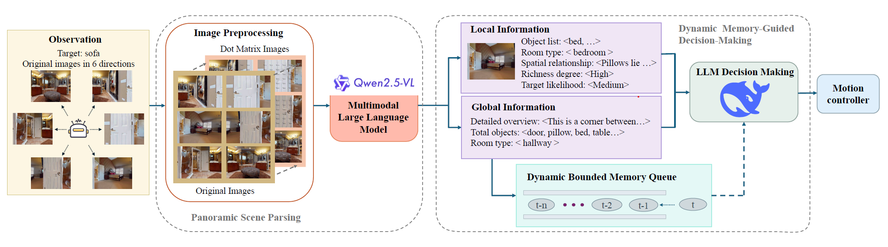
<figcaption>
Overall architecture of PanoNav framework
</figcaption>

**Panoramic scene parsing:**

*Local direction analysis:*
- **Lattice image enhancement**: Convert each RGB image into a lattice image to strengthen the MLLM's understanding of planar positions via the Scaffold method; the lattice image is fed to the MLLM together with the RGB image
- **Spatial relationship graph construction**: The MLLM builds a spatial relationship graph from geometric distance relations and planar position relations, and generates a detailed description of each direction (object presence, spatial relations, room type, etc.)

  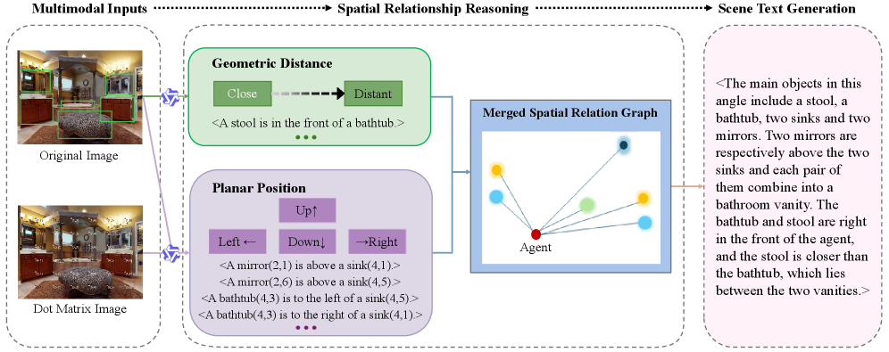
<figcaption>
Panoramic scene parsing module: from RGB input to local direction descriptions
</figcaption>

*Global panoramic summary:*
- **Overall perception of the environment**: Analyze the robot's surroundings as a whole, identifying the object types present and the current room type (e.g., kitchen, corridor)
- **Implicit self-localization**: The global summary provides implicit localization cues that help the robot understand its position in the larger environment

**Dynamic memory-guided decision-making:**

- **Dynamic bounded memory queue**: Stores the most recent global scene summaries. The queue has a fixed length; once it is full, each new entry evicts the oldest one.
- **Decision process**:
  - Queue not full: decisions rely only on the current local description and global summary
  - Queue full: decisions combine the current information with historical memory, which avoids re-exploring visited areas
- **Action selection**: The decision output contains the navigation direction and a flag indicating whether the target has been found; the locomotion controller then executes the corresponding action.

  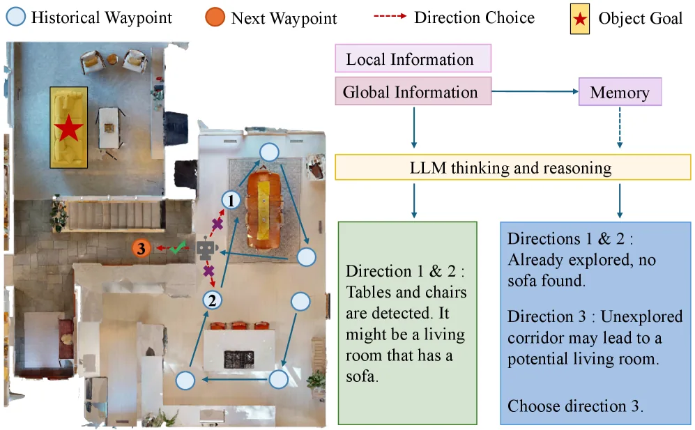
<figcaption>
Dynamic memory-guided decision mechanism
</figcaption>

**Task setting:**
- **Observations**: At each time step, six RGB images (60 degrees apart) form a panoramic view; no depth sensor or GPS is used
- **Action space**: stop, move forward (0.25 m), turn left/right (30 degrees), look up/down
- **Goal**: Find the target object specified by a language instruction in an unseen environment and navigate to it

**Results and findings**

- **Performance**: On HM3D, PanoNav reaches a success rate (SR) of 43.5% and an SPL of 23.7%, clearly outperforming PixNav (SR=37.9%, SPL=20.5%) and ZSON (SR=25.5%, SPL=12.6%), and even surpassing methods that partly rely on maps and closed vocabularies.
- **Dead-end avoidance**: In a highly deceptive environment, the dynamic memory mechanism achieves a 48.0% success rate and 19.2% SPL, with an 82.0% rate of escaping local regions
- **Ablation studies**:
  - Panoramic views matter: performance drops sharply with only three views (SR=19.5%, SPL=9.97%)
  - Decoupling analysis from decision-making helps: the decoupled design (SR=43.5%, SPL=23.7%) beats having the MLLM output decisions directly (SR=38.5%, SPL=22.57%)
  - Dynamic memory is essential: performance drops sharply once it is removed (SR=38.5%, SPL=22.57%)

**Limitations**

Although PanoNav substantially improves mapless zero-shot navigation, future work should explore multimodal cues (e.g., speech and gestures) to build a stronger memory queue and further improve the robustness and generalization of mapless goal navigation.

---

## 2. ODYSSEY (2025)
{: id="odyssey"}
——Open-World Quadrupeds Exploration and Manipulation for Long-Horizon Tasks

📄 **Paper**: [arXiv:2508.08240](https://arxiv.org/abs/2508.08240) · 🏛️ **AAAI 2026**

**Background and problem**

In dynamic, unstructured environments, robots must tightly combine mobility, manipulation, and real-time perception to perform complex tasks. Most existing work is confined to tabletop scenarios and does not address the limited perception and limited actuator reach specific to mobile platforms, and it generalizes poorly to open-world environments.

**Method and innovations**

ODYSSEY proposes a unified mobile-manipulation framework with two core modules, hierarchical planning and whole-body control:

  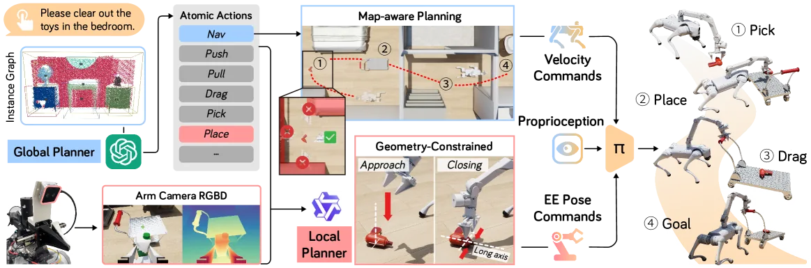
<figcaption>
Overall architecture of the ODYSSEY framework
</figcaption>

**Long-horizon task planner:**
- **Global task-level planning**: Fuse RGB and LiDAR streams to build an open-semantic scene representation, and use pre-trained foundation models to map instances into a scene graph
- Use GPT-4.1 to decompose natural-language instructions into sequences of atomic actions (navigation, grasping, placing, etc.) and output a coarse target waypoint
- The waypoint is projected onto a 2D occupancy map, and a collision-free target pose is found by local search

**Local manipulation:**
- Wrist-mounted depth observations guide a vision-language model to generate accurate end-effector poses
- The Qwen2.5-VL-72B-Instruct model infers task-relevant contact points from RGB observations and text descriptions
- Geometric constraints based on the principal axis and surface normal of the target object determine the end-effector orientation

  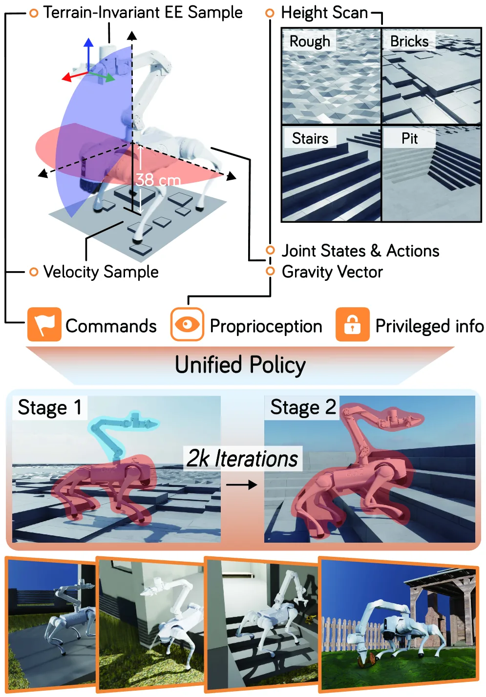
<figcaption>
Training pipeline of the two-stage whole-body control policy
</figcaption>

**Whole-body control policy:**
- A single network maps the observation vector (motion commands, end-effector targets, ground height map, gravity vector, proprioceptive state, etc.) to target actions
- **Two-stage training**: The first stage trains locomotion with the arm joints fixed; the second stage controls all 18 joints and uses a terrain-invariant end-effector sampling strategy
- Gait, frequency, and end-effector tracking reward terms are introduced, and domain randomization improves adaptability

**Simulation benchmark:**
- A diverse asset library is built, containing 50 rigid objects, 15 containers, 30 articulated structures, and 10 draggable objects
- The benchmark includes 10 real scenes (indoor homes, supermarkets, restaurants, outdoor courtyards, etc.)
- The long-horizon tasks comprise 246 indoor and 58 outdoor variants involving skills such as grasping, reorientation, container placement, and articulated-object manipulation

  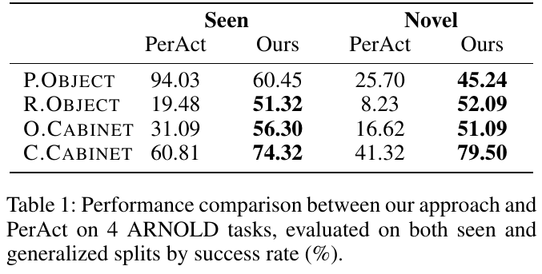
<figcaption>
Performance comparison with baseline methods
</figcaption>

**Results and findings**

- **Short-horizon tasks**: Outperforms the PerAct baseline on the ARNOLD benchmark; relying on a single egocentric camera, it generalizes better and stays stable on unseen datasets
- **Long-horizon tasks**: Achieves an overall success rate above 40% on 8 long-horizon mobile-manipulation tasks and above 60% for each atomic skill category, demonstrating reliable coordination
- **Low-level policy**: Beats the RoboDuet baseline in base velocity tracking, matches it in end-effector pose tracking, and adapts better to different terrains
- **Sim-to-real transfer**: Deployed successfully in the real world on a Unitree Go2 + Arx5 platform, validating the framework on the "Navigate to Fetch" and "Fetch and Place" tasks

**Limitations**

The model's spatial reasoning about object geometry is limited, leading to poor gripper alignment and inaccurate localization of slender handles or partially occluded items. In addition, grasping small objects occasionally fails, mainly because of insufficient end-effector tracking and visual perception accuracy.

---

## 3. Agentic Embodied Control (2026)
{: id="agentic-embodied-control"}
——A general agent under a minimalist interface directly controls the embodied interaction loop, with zero-shot performance comparable to industrial-scale trained policies

📄 **Paper**: [arXiv:2607.26148](https://arxiv.org/abs/2607.26148)

### Key takeaways
{: id="精华-5"}
1. **Rethinking the control paradigm**: Breaking with the usual pattern of embodied navigation that relies on "specialized policy training" or "hand-fixed workflows / dual-brain handover state machines", the paper shows that a general-purpose large model with frozen weights can autonomously control the whole interaction loop and reach top zero-shot performance, using only a code-agent framework (Harness) and the most minimal perception and action interface.
2. **Strong control through a minimal interface**: With only $512 \times 512$ monocular RGB images (no depth, panoramas, mapping, or pose feedback) and four discrete primitives—forward $0.25\text{ m}$, turn left $15^\circ$, turn right $15^\circ$, and stop—frontier reasoning models (Fable-5 / Opus-5) achieve $70.7\% \sim 78\%$ success on continuous R2R-CE, comparable to navigation policies trained at industrial scale.
3. **Isolating the source of capability**: Ablations confirm that the underlying foundation model **plays the decisive role** (switching models changes SR across a span as wide as $5\% \sim 72\%$), whereas the differences between general-purpose agent harnesses are minimal (only $1.7\% \sim 7.3\%$).
4. **Emergent synergy in a hybrid interface**: Forcing the agent to use a waypoint predictor (Forced Waypoint) actually constrains strong models; when the waypoint predictor is offered as an optional tool (Hybrid Interface), the agent spontaneously adopts a strategy of "long-range waypoints for fast cruising + primitive actions for fine adjustment near the target", reaching $76.7\%$ success with $50\%$ of the steps and less than one quarter of the time.
5. **Silent failure and the embodied grounding gap**: A detailed audit of 30 failure cases reveals a serious "doubt without corrective action" phenomenon (the chain of thought notices a navigation deviation, yet the agent still executes an erroneous stop). Deployment on a physical quadruped robot shows that "reasoning transfers, but embodiment awareness does not"; the lack of body-size awareness and persistent spatial memory is the core bottleneck for long-range autonomy.

---

### 1. Background and problem
{: id="1-研究背景问题-5"}
- **Two technical routes for embodied navigation, and the dilemma of external control**:
  - **End-to-end trained policies**: Methods such as NaVid and StreamVLN train a dedicated network on massive embodied data that maps observations to actions frame by frame. They are highly sensitive to the data distribution and lack high-level generalization and reflective error correction when facing out-of-distribution obstacles or unseen instructions.
  - **Fixed workflows and dual-brain designs**: Methods such as MapGPT, NavCoT, and ABot-N1 introduce large models but strictly confine them to human-written fixed pipelines (e.g., first call depth mapping, then topological planning, then hand over to a low-level controller). The agent cannot freely decide, based on the current situation, when to observe, when to take a few more steps, or when to abandon existing hypotheses.
- **Core research questions**:
  - Can navigation-specific external scaffolding be removed entirely—external maps, depth sensors, predefined heuristic search, and specialized policy networks—and **high-level control authority be entrusted directly to a general-purpose reasoning agent**?
  - With only a monocular front-view image and a discrete action interface, how high is the ceiling of embodied control for a general-purpose large model? Where are its true capability boundaries and grounding gaps?

---

### 2. Method and innovations
{: id="2-主要方法创新点-5"}

  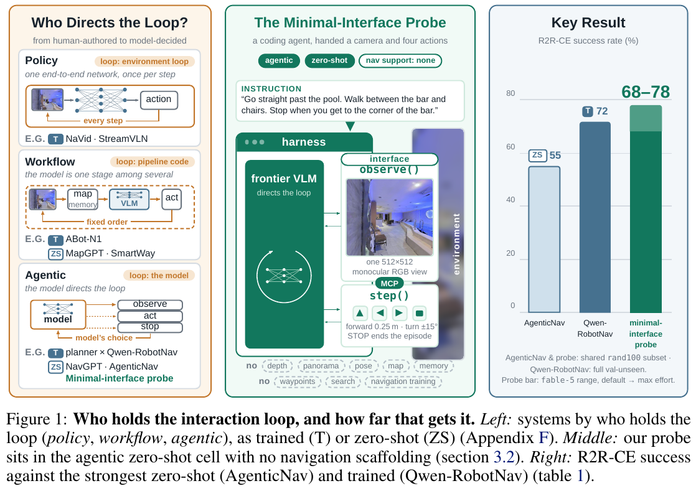
<figcaption>
Figure 1: Who holds control of the embodied interaction loop (left), the minimalist-interface interaction probe (middle), and success rate against strong baselines on R2R-CE (right)
</figcaption>

#### ① Overall framework: Agentic Embodied Control
{: id="-整体框架概述智能体自主具身控制agentic-embodied-control"}
The paper proposes a minimalist probe system for embodied control. It consists of three fully decoupled layers: a **general-purpose code-agent framework (Harness)**, a **minimalist perception-action interface (Interface)**, and a **multimodal reasoning model (Model)** with frozen weights. The agent has complete control over the interaction process: given a natural-language instruction and the interaction history, it independently decides in each round whether to call the observation tool, execute steps, or terminate the task.

#### ② Module-by-module analysis (input → processing → output → motivation)
{: id="-逐模块深度解析输入--处理--输出--设计动机"}

1. **General agent framework layer (Harness Layer)**
   - **Input**: The natural-language navigation instruction issued by the user, plus the text/image context of earlier calls in the current session.
   - **Processing**: Directly adopts a general framework designed for code engineering (such as the open-source `mini-swe-agent`, Anthropic's `Claude Agent SDK`, or OpenAI's `Codex CLI`). The framework is only responsible for assembling prompts, dispatching tool execution, and maintaining the session context. **It contains no navigation-specific state estimation, topological map construction, or backtracking strategy**.
   - **Output**: Formatted tool-call requests (Tool Calls) and the results returned by the environment.
   - **Motivation**: Strip away all peripheral code logic hand-crafted for navigation, so that the experiment purely tests the base model's own embodied reasoning and autonomous decision-making.

2. **Minimalist perception tool `observe()`**
   - **Input**: The agent makes a parameterless call whenever it needs to check its surroundings.
   - **Processing**: The environment renders and returns a single $512 \times 512$ RGB image directly ahead of the agent. **Calling this tool neither advances the simulator time step nor consumes the step budget**.
   - **Output**: A single front-view RGB image. No panoramic view, depth map, detection boxes, semantic segmentation, or laser point cloud.
   - **Motivation**: Force the agent to give up its dependence on panoramas and depth sensors, and test whether the model can maintain spatial orientation and landmark memory in its head from monocular front-view images alone.

3. **Minimalist action tool `step(actions)`**
   - **Input**: An ordered list of Habitat discrete action primitives (such as `["LEFT", "LEFT", "FORWARD", "FORWARD", "FORWARD"]`). There are four primitives:
     - `FORWARD`: move forward $0.25\text{ m}$;
     - `LEFT`: turn left in place by $15^\circ$;
     - `RIGHT`: turn right in place by $15^\circ$;
     - `STOP`: declare the task complete and actively end the evaluation.
   - **Processing**: The low-level controller executes the action sequence in order, subject to a total budget of 500 discrete primitives per episode.
   - **Output**: Only the number of primitives actually executed and the number of remaining steps. **No visual observation, collision signal, or pose/coordinate drift data is returned**.
   - **Motivation**: Lets the model choose the action granularity based on its grasp of the environment (a single fine rotation, or a batch of combined actions to advance); hiding collision and pose information forces the model to call `observe()` after execution and infer introspectively whether it collided or got stuck by comparing the parallax between the before and after images.

  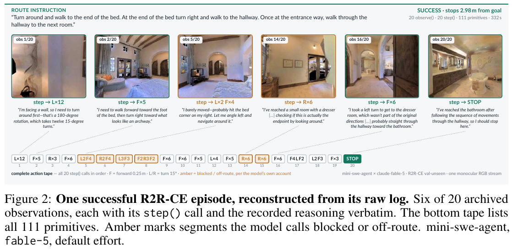
<figcaption>
Figure 2: Reconstructed full execution log of a successful navigation episode in the continuous R2R-CE environment, showing the agent's autonomous error correction and spatial reflection
</figcaption>

#### ③ End-to-end interaction data flow and autonomous error-correction mechanism
{: id="-端到端交互数据流与自主纠偏机制"}
As shown in Figure 2, in one complete navigation test (20 observations, 20 steps, and 111 discrete primitive actions in total), the agent exhibits a highly self-consistent cycle of reasoning and adaptive adjustment:
- **Establishing orientation and turning**: At the start the agent faces a wall; the model reasons that "it needs to turn 180 degrees, i.e., 12 consecutive 15-degree left turns", and issues `L×12` as a batch.
- **Collision and yaw sensing**: After executing `F×5`, the agent calls `observe()` and finds that the view has barely changed. The model writes in its chain of thought, "I hardly moved; maybe the right side hit the corner of the bed. Let me veer slightly left to avoid it", and then independently issues `L2 F4`, getting out of the jam successfully.
- **Exploration and backtracking**: After accidentally entering a small room with a dressing table, the model rereads the instruction and finds that "the instruction never mentions this room; I should go straight along the corridor to the bathroom". It immediately turns around, realigns with the corridor, and finally issues `STOP` autonomously at a point $2.98\text{ m}$ from the bathroom.

---

#### ④ Worked example 1: The essential shift in the embodied control paradigm (control authority)
{: id="-难点降维-1具身控制范式的本质跃迁control-authority"}

Many readers may easily mistake this work for "yet another zero-shot VLN method that runs on prompting". The core difference lies in **who holds control authority and how tools are called**.

| Control paradigm | Who holds control | Core mechanism | Behavior on exceptions/obstacles | Representative methods |
|---|---|---|---|---|
| **End-to-end policy network (Policy)** | External environment loop | A single neural network maps each input image directly to an action | Lacks high-level reflection and easily oscillates in dead ends | NaVid, StreamVLN |
| **Fixed pipeline (Workflow)** | External Python script | Hard-coded rule-based process (map construction → waypoint finding → planning → execution) | The process is rigid: it cannot dynamically change the observation frequency or seek help from other tools according to the difficulty at hand | MapGPT, SmartWay |
| **Slow-Fast dual-brain system (Dual-Brain)** | Fixed handover protocol | A slow VLM plans high-level sub-goals and hands them off to a fast action expert network | The handover logic and update frequency are hand-programmed, and high-level intent is often distorted by the low-level policy | ABot-N1, InternVLA-N1 |
| **Autonomous agent control (Agentic Control)** | **The reasoning model itself** | A single large model decides on its own when to sense, how many steps to take, whether to check the map, or which waypoint to pick | The model has full autonomy over retrying, detouring, changing direction, and terminating early | **This paper's method** |

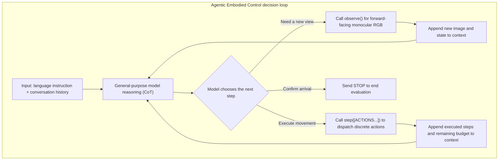

---

#### ⑤ Worked example 2: Emergent collaboration in the hybrid interface
{: id="-难点降维-2混合动作接口hybrid-interface的协同涌现"}

Forcing the agent to use a waypoint predictor (Forced Waypoint) often weakens a strong model. But when both the **discrete primitives** and the **trained waypoint predictor** are offered to the agent as optional tools (Hybrid Interface), the agent spontaneously combines them into an inspiring "coarse-and-fine collaboration" strategy.

> **Example**:
> Suppose the task is to start in the living room, walk down a 10-meter corridor, enter the master bedroom, and stop at the bedside table (about 14 meters in total).
> - **Pure primitive mode**: Since each step advances only $0.25\text{ m}$, crossing the 10-meter corridor requires the model to issue $40$ forward primitives and call `observe()` frequently to check the doorways on both sides. It easily falls into repeated small yaw corrections, consuming about $90$ primitive steps and nearly $40$ model interaction calls (about $210\text{ s}$).
> - **Forced waypoint mode**: The model must choose from at most 5 waypoints supplied by the predictor. Open corridors can be crossed quickly with 2–3 waypoints, but within the final narrow $1\text{ m}$ near the bedside table, candidates may fail to follow the bed edge or lie too close to a wall. This causes inaccurate stops or collisions, and overshoot is common at complex corners.
> - **Hybrid mode**: In the first 80% of the long corridor, the agent autonomously makes 3–4 consecutive **waypoint navigation** calls to cruise quickly; once the bedside table is detected and comes into close view, the model immediately switches to the **discrete primitive tool**, aligning the final stopping point with fine steps of $0.25\text{ m}$ and $15^\circ$.
> **Result**: The step count falls from 87 to 48, the number of calls is halved, interaction time drops sharply from $210\text{ s}$ to $112\text{ s}$, and the success rate rises from $68.3\%$ (pure primitives) to $76.7\%$.

---

#### ⑥ Worked example 3: "Silent failure" and "doubt without correction" in embodied agents
{: id="-难点降维-3具身智能体的无声失效与有疑无改"}

A detailed trace of 30 failed episodes reveals deep behavioral flaws of current general-purpose models in embodied environments.

| Failure category | Share (n=30) | Median final distance to target | Typical behavior and root cause |
|---|---|---|---|
| **A. Wrong referent / branch (Wrong Referent / Branch)** | $40.0\%$ (12 cases) | $17.3\text{ m}$ | The instruction contains several ambiguous doorways or forks. The model chooses the wrong passage at the first step and heads all the way into a completely unrelated room. |
| **B. Stop decision (Stop Decision)** | $23.3\%$ (7 cases) | $4.9\text{ m}$ | The model sees the object mentioned in the instruction (such as a sofa) in its view, but that object is only a landmark along the way rather than the final destination, and the model terminates prematurely (object-anchored overshoot/undershoot). |
| **C. Lost and divergent search (Runaway Search)** | $26.7\%$ (8 cases) | $18.6\text{ m}$ | After missing a key corner, the model does not turn around and backtrack, but blindly widens the search in unseen areas and drifts further and further from the target. |
| **D. Geometric collision trap (Geometry / Trap)** | $10.0\%$ (3 cases) | $5.5\text{ m}$ | Lacking collision feedback, the model is repeatedly blocked in the dead corners around tables and chairs, and cannot tell from vision alone that it is stuck. |

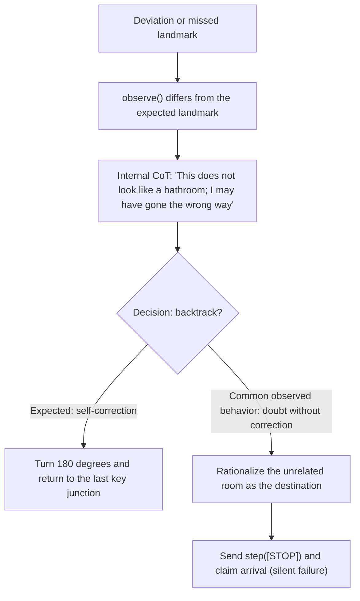

---

### 3. Results and findings
{: id="3-核心结果发现-5"}

  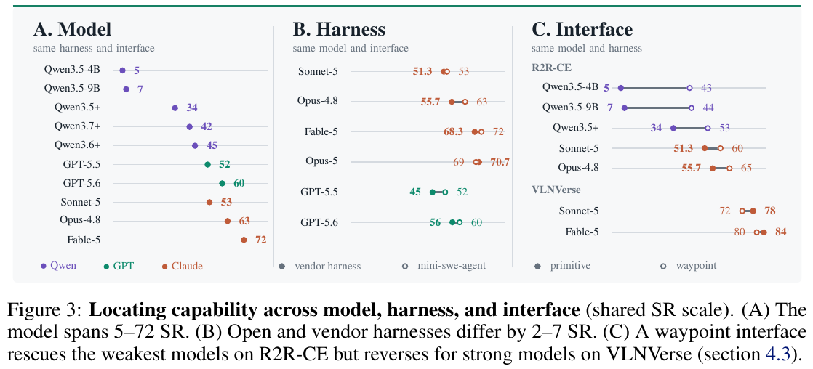
<figcaption>
Figure 3: Single-axis ablation results. (A) Model capability spans an SR range of 5–72; (B) the gap between the open-source and vendor harnesses is only 2–7 SR; (C) the waypoint interface is a lifeline for weak models, but hurts strong models and dense environments
</figcaption>

#### ① Main results on R2R-CE
{: id="-r2r-ce-主榜成绩对比"}
On the standard R2R-CE val-unseen (rand100 subset), the general-purpose agent under the minimalist interface shows remarkable zero-shot performance:
- **Top performance**: Fable-5 achieves **$78.0\%$ success rate (SR) under the Claude Agent SDK (maximum thinking budget)** and **$65.27\%$ SPL**; Opus-5 reaches **$70.7 \pm 3.5\%$ SR**.
- **Surpasses comparable zero-shot systems**: Clearly ahead of AgenticNav ($55.0\%$ SR) and Open-Nav ($50.0\%$ SR), which use maps, explicit memory, and depth tools in zero-shot settings.
- **Comparable to industrial-scale trained policies**: Approaches, and in some cases surpasses, dedicated policies trained on tens of thousands of hours of embodied data, such as Qwen-RobotNav ($72.0\%$ SR on the full validation set), NavFM ($77.2\%$ SR), and StreamVLN ($64.9\%$ SR).

#### ② Three-axis decoupling of model, harness, and interface
{: id="-模型harness-与接口的三维解耦发现"}
1. **Model axis (the model dominates)**: With the harness and interface fixed, merely swapping the underlying VLM produces a huge performance span of $5\% \sim 72\%$ (Qwen3.5-4B only $5\%$, GPT-5.6 up to $60\%$, Fable-5 up to $72\%$). This indicates that embodied navigation ability essentially emerges naturally from multimodal spatial reasoning and long-context instruction tracking.
2. **Harness (the harness matters little)**: Comparing the lightweight open-source `mini-swe-agent` with the closed-source `Claude SDK` / `Codex CLI`, the performance difference for the same model is only $1.7\% \sim 7.3\%$.
3. **Thinking budget (reasoning effort)**: Spending more chain-of-thought compute brings clear gains for some models (Fable-5 jumps from $68.3\%$ at default effort to $78.0\%$ at max effort, a gain of $+9.7\%$), but the benefit for small models is unstable.
4. **The double-edged sword of the waypoint tool**:
   - On R2R-CE, for weaker models (such as Qwen3.5-4B/9B), the waypoint predictor lifts the success rate from $5\%/7\%$ to $43\%/44\%$; for top models (Fable-5/Opus-5), however, forcing its use brings only $+0.7\% \sim +1.3\%$.
   - On the **VLNVerse** benchmark, which has denser obstacles and more complex paths, the forced waypoint interface actually lowers the success rate of Sonnet-5 by $6\%$ ($78\% \rightarrow 72\%$) and Fable-5 by $4\%$ ($84\% \rightarrow 80\%$), while the collision rate rises 4 to 6 times.

#### ③ Physical deployment on a real quadruped robot (Unitree Go2)
{: id="-真实四足机器狗unitree-go2实体部署"}
Thirty-one exploratory experiments in a real office building showed:
- **Reasoning ability transfers successfully**: The agent perfectly understands complex conditional instructions (such as "If $3+4=7$, turn left; otherwise turn right"), tracks multi-stage "fetch the object and return" states, and locks onto targets through subtle visual cues (such as "walk toward the person wearing white shoes").
- **Body awareness is completely missing**: Since the agent does not know its own physical dimensions (body length, width, and hind-leg position), it issues a left-turn command as soon as the camera passes the door frame, so the quadruped's rear torso hits the door frame and gets stuck (Figure 10). In addition, open-loop step execution causes cumulative yaw drift, and counting becomes confused when passing pillars across consecutive viewpoints (Figure 11).

---

### 4. Limitations
{: id="4-局限性-5"}
- **Context and time overhead explode on long-range tasks**: On the long-range benchmark RxR-CE, the pure-primitive success rate plummets from $70\%$ to $26\%$; a single episode generates $33\text{k} \sim 169\text{k}$ history tokens and the median time per decision exceeds 200 seconds, so a compact and efficient long-term spatial memory and state integration mechanism is badly needed.
- **Missing open-loop control and introspective error-correction loop**: Without embodied physical perception and collision feedback, the agent easily gets geometrically stuck in the real world; the model also shows a serious "self-doubt but blind termination" behavior, so a genuine closed loop of self-verification and active backtracking exploration is urgently needed.

---

## 4. ReMEmbR (2024)
{: id="remembr"}
——Robot question answering and physical goal generation based on retrieval-augmented long-horizon spatiotemporal memory

📄 **Paper**: [arXiv:2409.13682](https://arxiv.org/abs/2409.13682) · 🏛️ **ICRA 2025** · [Project Page](https://nvidia-ai-iot.github.io/remembr)

### Key takeaways
{: id="精华-7"}
1. **Decoupled long-horizon spatiotemporal memory**: Mobile robots in continuous operation over tens of minutes to hours face enormous amounts of history. To avoid the GPU memory explosion and computation latency that conventional multimodal large models suffer on ultra-long contexts, the paper decouples memory building from query inference.
2. **Multimodal spatiotemporal vector database**: A lightweight video multimodal model (VILA) runs online to generate low-level event captions for consecutive video clips; the text embeddings, three-dimensional coordinates $(x, y, z)$, and timestamps are stored together in a vector database, compactly recording how the environment evolves.
3. **Iterative multi-hop retrieval by an agent**: In the query phase, a large language model acts as a decision state machine and adaptively issues multiple function calls (text, location, and time retrieval) depending on whether the question is spatial, temporal, or descriptive, performing iterative multi-step search and pruning that minimizes the reasoning context while keeping the clues complete.
4. **Metric, executable goal generation**: Going beyond traditional embodied question answering that outputs only natural-language text, the system can directly output precise 3D spatial coordinates, which connect seamlessly to classic mobile-base navigation stacks such as ROS 2 Nav2 and drive physical navigation.
5. **End-to-end real-robot validation**: On a Nova Carter robot equipped with a Jetson Orin, the authors run on-device lightweight VLM captioning, speech recognition, and vector retrieval, and successfully perform open-semantic question answering and object-finding navigation after cruising a real office area for 25 minutes.

---

### 1. Background and problem
{: id="1-研究背景问题-7"}
- **The scalability dilemma of long-horizon history representation**: During long cruises, robots observe many dynamic events and non-static objects. The computational cost of existing multimodal long-context models (e.g., 1M+ contexts) grows linearly or quadratically with the history, and traditional scene graphs or metric semantic maps struggle to record how things evolve over time.
- **Embodied QA lacks physical executability**: Existing embodied QA benchmarks (such as OpenEQA) are mostly limited to short videos of 30 seconds to 1–2 minutes, and their outputs are mostly qualitative text answers (such as "on the tea room table"), which a robot cannot directly parse into metric coordinate goals usable by the underlying navigation system.

---

### 2. Method and innovations
{: id="2-主要方法创新点-7"}

  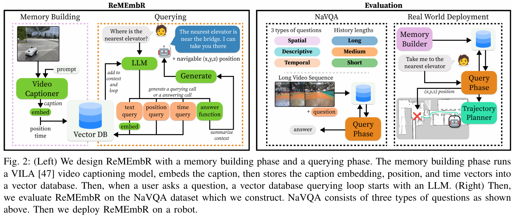
<figcaption>
Overall framework of ReMEmbR: two decoupled stages, online memory building and multi-hop query inference. On the right: the question types of the NaVQA dataset and the real-robot deployment pipeline
</figcaption>

#### ① Overall framework
{: id="-整体框架概述-1"}
ReMEmbR (Retrieval-augmented Memory for Embodied Robots) consists of two core subsystems, an **online memory-building stage** and a **query-inference stage**. The former continuously compresses the sensor stream during the robot's cruise into a multimodal vector database with spatiotemporal metadata; the latter, upon receiving a natural-language question from a user, has an LLM agent drive multiple rounds of spatiotemporal retrieval functions to distill the minimal necessary memory subset and generate an answer or navigation goal coordinates.

  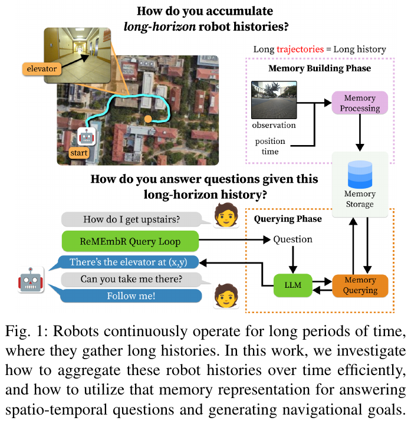
<figcaption>
The robot runs continuously for a long time and accumulates a long history. ReMEmbR supports efficient aggregation of spatiotemporal dynamics and metric goal localization
</figcaption>

#### ② Module-by-module explanation
{: id="-逐模块讲解-1"}

**1. Online memory-building module (Memory Building)**
- **Input**: Continuous frames $H_I$ from the forward-facing monocular camera, the robot's local pose $H_P = (x, y, z)$ (from lidar odometry, GPS, or AMCL), and timestamps $H_T$.
- **Processing**: For every $t=3$ seconds of observation (6 frames sampled at 2 FPS), the video multimodal model VILA (VILA1.5-13B during training, and the quantized VILA-3B for on-device deployment) generates a local semantic event caption $L_{i:i+t}$; the lightweight text encoder `mxbai-embed-large-v1` then produces the sentence embedding $E(L_{i:i+t})$.
- **Output**: A structured tuple $$\langle E(L_{i:i+t}), (x,y,z)_{i:i+t}, t_{i:i+t} \rangle$$ is inserted into the multimodal vector database $V$ in real time.
- **Motivation**: Questions are unpredictable before the task, so a general, information-dense spatiotemporal representation must be built without knowing the query in advance; the vector database supports efficient approximate nearest neighbor (ANN) retrieval over tens of millions of vectors.

**2. Querying agent module (Querying Agent), a state machine**
- **Input**: The user question $Q$ (covering spatial location, time point/duration, or environment description) and the retrieved context accumulated so far, $R_{0:i}$.
- **Processing**: The LLM agent acts as a decision state machine and adaptively calls the following three types of spatiotemporal retrieval functions according to the current clues to produce a retrieved subset:
  - Text retrieval $f_l(\text{object})$: finds the $m$ most semantically related segments in the vector database by cosine similarity;
  - Spatial retrieval $f_p((x, y, z))$: retrieves the $m$ nearest historical trajectory segments within a metric coordinate radius;
  - Temporal retrieval $f_t(\text{"HH:MM:SS"})$: fetches the $m$ segments before and after the given time within a timestamp window.
- **Output**: If the current memory suffices to answer the question, the agent outputs a formatted JSON dictionary (containing the text answer, $(x, y, z)$ 3D coordinates, and timestamp or duration); otherwise it carries supplementary clues into the next round of iterative retrieval (up to 3 rounds).

#### ③ Formalization of optimal history-subset sampling
{: id="-最优历史子集采样形式化"}
For a full history $H_{1:K}$ that is $K$ minutes long, computing the posterior $p(A \mid Q, H_{1:K})$ directly is too expensive. ReMEmbR formalizes the problem as finding the minimal sufficient history subset $$R^* \subseteq H_{1:K}$$:

$$p(A \mid H_{1:K}, Q) = p(A \mid R^*, Q) \approx p(A \mid R, Q)$$

$$R^* = \arg\min_R \lvert R \rvert \quad \text{s.t.} \quad \arg\max_A p(A \mid R, Q) = \arg\max_{A'} p(A' \mid H, Q)$$

With the vector-database sampling strategy $F: V \to R$, the LLM agent only needs to process a very small subset $R$, so long-horizon reasoning can be completed in constant time.

#### ④ Worked example: memory representation paradigms and multi-step retrieval
{: id="-难点降维记忆表征范式对比与多步检索"}

| Dimension | Full-length context (e.g., Gemini 1.5M) | Single-shot vector-retrieval RAG | ReMEmbR iterative agent |
|---|---|---|---|
| Compute and GPU memory overhead | Grows linearly/quadratically with video duration; prone to OOM beyond 10 minutes | Fixed single vector retrieval, low overhead | Multi-way retrieval within 3 steps, constant-level overhead (~25s) |
| Spatiotemporal multi-hop reasoning | All information is in the context, but attention is easily lost over long sequences | Matches only text similarity, so it cannot exploit spatial proximity or temporal backtracking correlations | A state machine adaptively combines text, coordinate, and time functions and converges layer by layer |
| Physical executability of the output | Outputs only language text, so accurate metric coordinates are hard to generate | Usually provides only text snippets | Structured $(x,y,z)$ coordinate output that connects directly to the Nav2 navigation base |

> **Example**: The robot cruises through a building for 20 minutes (producing about 400 three-second video clips; feeding everything in would require processing hundreds of thousands of tokens).
> The user asks: "Where is the red badge I lost 5 minutes ago?"
> - A simple single-shot RAG only searches for "red work badge". If the robot saw a work badge on a table at both the 2nd and the 15th minute, a single text retrieval easily confuses the timeline and returns the wrong coordinates;
> - ReMEmbR's agent calls $f_l(\text{"red badge"})$ in the first round to obtain candidate segments, then in the second round calls $f_t(\text{"current time minus 5 minutes"})$ based on the question to narrow the time window. Only 6 key segments (about 600 tokens) are fetched over the two rounds, the $(x,y,z)$ coordinates are pinned down precisely, and token consumption drops by more than 99%.

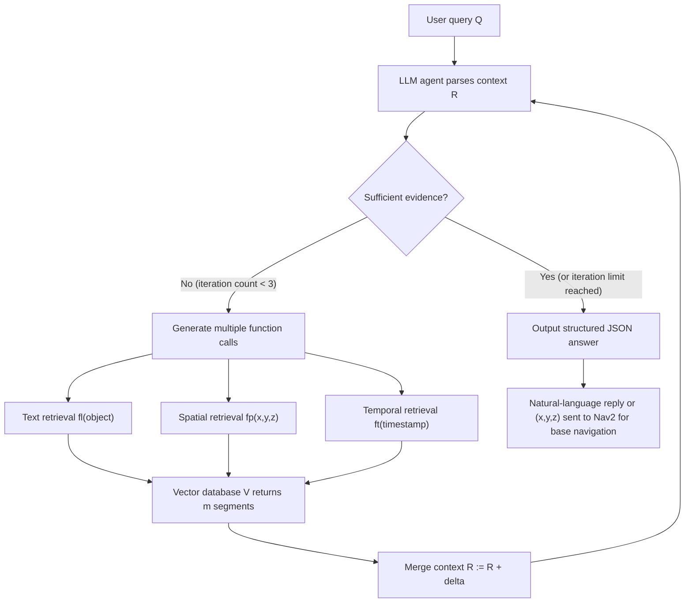

#### ⑤ Construction of the NaVQA benchmark
{: id="-navqa-评测基准构建"}

  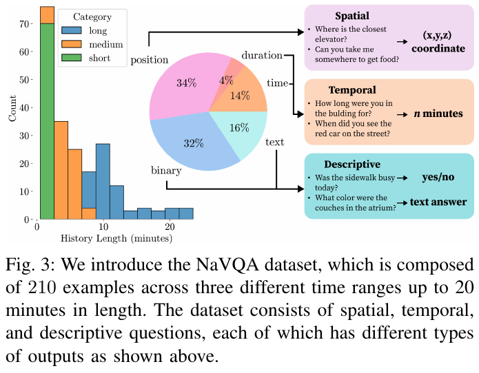
<figcaption>
NaVQA evaluation dataset: three duration ranges, short (&lt;2 min), medium (2–7 min), and long (&gt;7 min), covering three categories of QA tasks: spatial coordinates, time points/durations, and descriptive questions
</figcaption>

Built on CODa, a large-scale real-world outdoor/indoor multi-weather cruise dataset collected with a Clearpath Husky robot, the NaVQA benchmark contains 210 expert-labeled samples split into three duration ranges (short &lt;2 min, medium 2–7 min, long &gt;7 min), covering binary judgments (32%), spatial coordinate localization (34%), time points (14%), duration statistics (4%), and open-ended descriptions (16%).

---

### 3. Results and findings
{: id="3-核心结果发现-7"}

  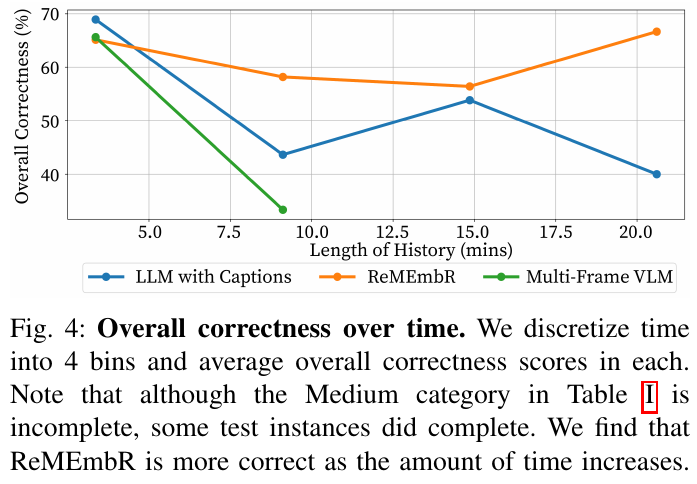
<figcaption>
Overall accuracy trend as video duration grows: the multi-frame full VLM runs out of GPU memory (OOM) on medium and long videos, while ReMEmbR maintains markedly higher accuracy on long videos
</figcaption>

- **Better long-video question answering**: On videos longer than 7 minutes, GPT-4o-based ReMEmbR reaches a descriptive-answer accuracy of **0.65**, a spatial localization error of **46.25m**, and a temporal error of **3.6s**. These improve on the full-caption baseline (56.0m spatial error, 8.0s temporal error). The multi-frame VLM cannot process medium or long videos because it runs out of GPU memory (OOM).
- **Low query latency that scales roughly constantly**: On a 21.5-minute video, ReMEmbR takes about **25 seconds** per query, with latency largely independent of the total video duration. By comparison, a multi-frame VLM takes up to 90 seconds even on a 5.5-minute video.
- **Multi-step iterative retrieval is the key to performance**: Ablations show that degrading to a single retrieval (1-call RAG) drops overall accuracy from 0.61 to 0.50 (long videos), confirming that complex spatiotemporal multi-hop reasoning depends on an iterative retrieval loop.
- **Fine-grained temporal segmentation is crucial**: Accuracy is 0.61 with captions for 3-second clips (2 FPS) but falls to 0.38 with coarse 12-second clips (0.5 FPS), showing that critical transient information is badly lost when the temporal resolution is reduced.

  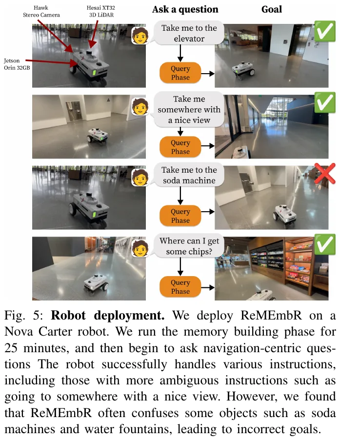
<figcaption>
Deployment of the Nova Carter mobile robot in a real office: after building memory during a 25-minute cruise, it responds successfully to open-semantic navigation commands such as "Take me to a place with a good view" and "Go get potato chips"
</figcaption>

- **On-device closed-loop validation on a real robot**: The Nova Carter robot is equipped with a Jetson Orin 32GB, a 3D LiDAR, the quantized VILA-3B, and Whisper ASR. It first cruises autonomously for 25 minutes to build a memory bank, and is then tested with fuzzy semantic instructions. For example, given "Take me to a place with a good view", the agent automatically retrieves the coordinates of the large floor-to-ceiling windows, green plants, and open space, and navigates straight to the lobby through Nav2.

---

### 4. Limitations
{: id="4-局限性-7"}
- **Memory dilution and redundant growth from repetition**: When the robot stays still or cruises repeatedly in the same area, the vector database keeps writing similar segments, and long-term operation may dilute the retrieval accuracy of the key useful information.
- **Fine-grained ambiguity of the lightweight perception model**: Limited by edge compute, the 3B-class quantized visual captioning model confuses objects (for example, a silver water dispenser is described as a "silver machine" and then misidentified as a soda vending machine).

---

## 5. SuperMap (2026)
{: id="supermap"}
——Real-time 4D spatiotemporal semantic SLAM and dynamic scene graphs for vision-language navigation

📄 **Paper**: [RSS 2026](https://www.roboticsproceedings.org/rss22/p052.pdf) · [Project Page](https://superodometry.com/supermap) · [Code (to be released) ](https://github.com/superxslam/SuperMap) · 🏛️ **RSS 2026**

### Key takeaways
{: id="精华-8"}

1. To address instance drift and the accumulation of stale semantics in open-vocabulary semantic mapping in dynamic environments, the paper proposes SuperMap, the first real-time, open-vocabulary, instance-level 4D spatiotemporal semantic SLAM system for vision-language navigation (VLN).
2. The architecture combines high-frequency geometric SLAM (SuperOdometry) with asynchronous 2D open-vocabulary perception (GroundingDINO + SAM2), and uses a 3D-to-2D motion-compensation prior to solve cross-frame instance association under violent robot motion.
3. A geometric-consistency-based three-state depth-residual test with probabilistic occupancy updates is proposed, which sensitively detects environmental changes (such as objects being added, moved, or removed), while Bayesian semantic fusion suppresses single-frame false detections.
4. A 4D dynamic scene graph containing spatial geometric topology edges and temporal evolution edges is built, abstracting complex 3D point clouds and temporal video streams into a compact symbolic structure that gives vision-language models (VLMs) a native and efficient query interface.
5. The whole system runs fully in real time on a mobile robot equipped with an Intel i9 and an RTX 4090, with 10 Hz pose estimation and 5 Hz scene-graph updates, and significantly surpasses existing solutions on the ScanNet semantic benchmark and in real dynamic navigation scenes.

---

### 1. Background and problem
{: id="1-研究背景问题-8"}

When performing open-vocabulary navigation tasks such as "go to the monitor next to the whiteboard" or "return to the chair next to the plant" in real human environments, mobile robots face severe and continuous environmental change. Most existing semantic mapping methods assume a static environment or rely on offline reconstruction of the whole scene (such as ConceptGraphs and HOV-SG), while traditional dynamic SLAM systems are mostly limited to closed-set priors or focus only on short-term human motion, and cannot continuously track the long-term movement and appearance/disappearance of objects outside the field of view. As a result, the intermittent, viewpoint-sensitive 2D predictions of vision-language foundation models (VLMs) easily cause instance ID fragmentation and stale semantics when projected directly onto a 3D map, hindering reliable spatial reasoning for downstream language-guided navigation.

---

### 2. Method and innovations
{: id="2-主要方法创新点-8"}

  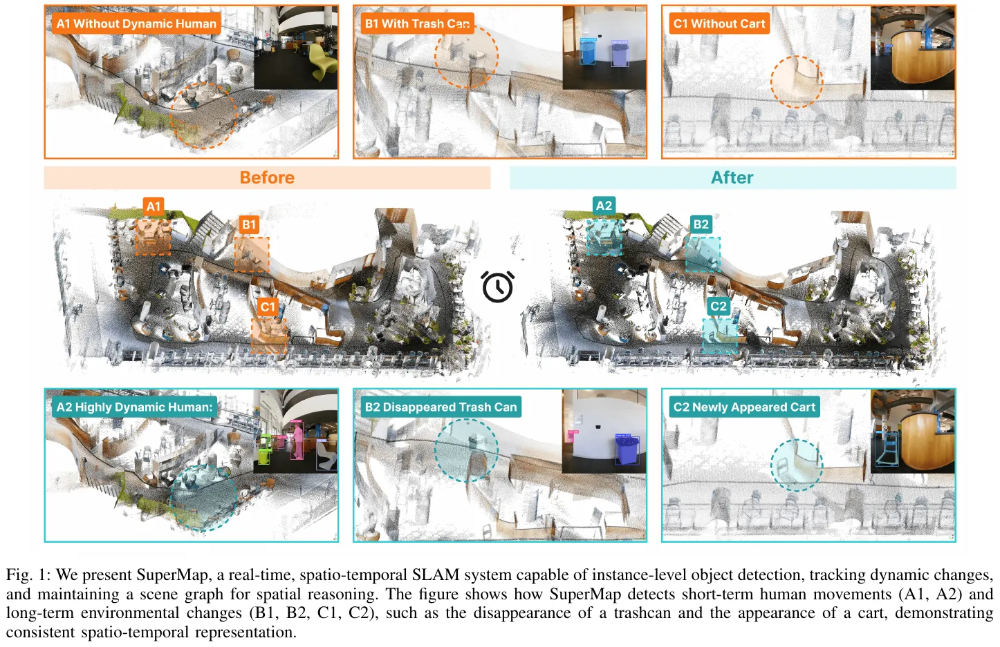
<figcaption>
SuperMap 4D spatiotemporal SLAM overview: it tracks short-term human motion and long-term environmental changes (such as a trash can being removed or a cart entering) in real time, and maintains a consistent 4D spatiotemporal scene graph
</figcaption>

#### ① Overall framework
{: id="-整体框架概述-2"}

SuperMap is a 4D spatiotemporal SLAM system that runs entirely on the robot's onboard computing platform. It consists of three core modules: a **geometry layer (online 3D reconstruction)**, an **instance layer (spatiotemporal instance association and probabilistic update)**, and a **topology layer (4D scene graph construction and VLM interaction)**. The geometry layer provides high-frequency, accurate metric poses and dense geometry; the instance layer uses 3D priors for motion-compensated tracking and removes stale objects dynamically; the topology layer abstracts the metric map into a 4D scene graph carrying spatial topology and lifecycle trajectories, which large language/multimodal models can analyze efficiently.

  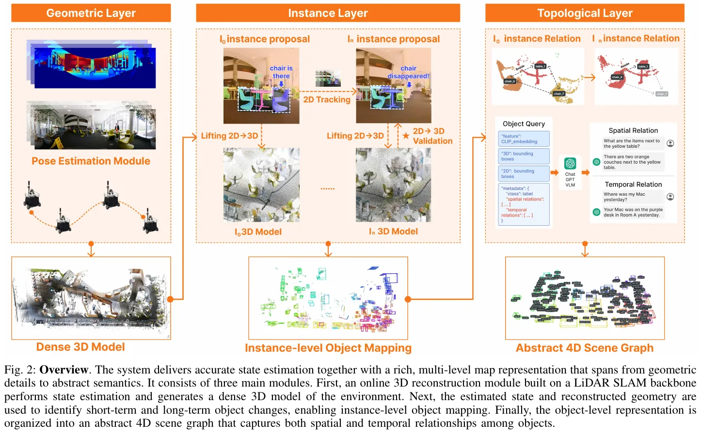
<figcaption>
SuperMap system architecture: from bottom to top, the online 3D reconstruction geometry layer, the spatiotemporal object-update instance layer, and the VLM-oriented 4D scene graph topology layer
</figcaption>

#### ② Module-by-module explanation
{: id="-逐模块讲解-2"}

- **Geometry layer (online dense 3D reconstruction)**:
  - **Input**: Synchronized LiDAR point clouds, RGB images, and a high-frequency IMU data stream.
  - **Processing**: SuperOdometry serves as the LiDAR-visual-inertial (LVI) odometry backbone, solving the robot's 6-DoF pose $T_{WB}^{(t)}$ in the world frame $W$ at 10 Hz in real time, together with the camera pose $P_t = T_{WC}^{(t)} = T_{WB}^{(t)} \cdot T_{BC}$, and outputs a colored dense 3D point cloud.
  - **Output**: A high-precision robot trajectory $P_{1:T}$ and dense 3D observations $Q_t = \{C_t, D_t\}$.
  - **Motivation**: Provides the physical anchor for the subsequent back-projection of 2D semantics into 3D space, temporal motion compensation, and global map consistency.

- **Instance layer (spatiotemporal instance association and dynamic consistency maintenance)**:
  - **Input**: The current-frame RGB image $C_t$, the depth observation $D_t$, and the set of 3D object instances in the historical global map $M_{t-1}$.
  - **Processing**:
    1. **2D open-vocabulary detection and segmentation**: GroundingDINO performs open-vocabulary bounding-box detection, and SAM2 extracts instance masks.
    2. **Hybrid tracking with 3D-to-2D motion compensation**: The 3D centroid $X_i$ of an object instance in the historical map is projected onto the image plane via the current camera pose $P_t$ to obtain the predicted pixel centroid $\hat c_i(t) = \pi(K \cdot P_t^{-1} \cdot X_i)$, which serves as the state-transition prior of a Kalman filter in place of the traditional linear motion assumption.
    3. **Three-state geometric-consistency test and occupancy update**: The residual $\Delta d = d_{proj} - D(u)$ between the projected depth $d_{proj} = \lVert T_{CW} X_k \rVert_z$ of a map point $X_k$ and the sensor's current measured depth $D(u)$ strictly separates Observable, Unobservable, and Disappeared states, and a log-odds occupancy penalty is applied to disappeared points.
    4. **Bayesian semantic fusion**: Maintains a multinomial confidence distribution over object categories and updates it recursively with the detector's confusion matrix, automatically filtering out occasional single-frame misclassifications.
  - **Output**: A spatiotemporally consistent global 3D instance-level semantic map $M_t = \{ O_t^j \} _{j=1}^{N_t}$.
  - **Motivation**: Resolves instance ID drift under severe viewpoint changes, and autonomously identifies and removes the ghosts of objects that have moved or disappeared during long-term operation.

- **Topology layer (4D scene graph construction and VLM interface)**:
  - **Input**: The set of global instances with their 3D bounding boxes, centroids, and temporal trajectories.
  - **Processing**: Builds the graph $G = (V, E_S, E_T)$. Nodes $V$ are object instances; spatial edges $E_S$ are established automatically from geometric spatial predicates (such as $On$, $Beside$, $Under$); temporal edges $E_T$ link the evolution trajectory of the same instance across time steps.
  - **Output**: A structured 4D dynamic scene graph, and subgraph prompts after text serialization.
  - **Motivation**: Compresses massive dense point clouds into a compact topology rich in semantic and spatial/temporal relations, reducing the compute overhead and hallucination of large multimodal models.

#### ③ End-to-end data flow
{: id="-端到端数据流"}

The path of one complete observation frame, from sensor input to the final navigation action, is as follows:
LiDAR and camera collect multimodal data $\to$ the geometry layer solves the pose $P_t$ in real time and generates a local point cloud $\to$ the asynchronous open-vocabulary module extracts 2D masks $\to$ 3D-2D cross-modal association with the projected historical 3D centroids assigns or updates a unique instance ID $\to$ the depth-residual geometric check classifies point states and updates point occupancy and semantic distributions $\to$ the spatial-predicate edges and temporal edges of the 4D scene graph are refreshed $\to$ the relevant local subgraph is serialized into structured text and injected into the VLM $\to$ the VLM parses the instruction and outputs the target instance ID inside an `<answer>` tag $\to$ the parser retrieves the corresponding 3D centroid coordinates from the scene graph as a waypoint, which drives the chassis navigation controller.

#### ④ Core formulas and update mechanism
{: id="-核心公式与更新机制"}

- **3D-to-2D projection prior**:
  $$\hat c_i(t) = \pi\left(K \cdot P_t^{-1} \cdot X_i\right)$$
Here $X_i$ is the 3D centroid of the instance in the map, $K$ is the camera intrinsic matrix, and $\pi(\cdot)$ is the perspective projection function.

- **Three-state classification by geometrically consistent depth residual**:
Define the projected-depth residual $\Delta d = d_{proj} - D(u)$, where $d_{proj} = \lVert T_{CW} X_k \rVert_z$ is the expected depth of the map point in the camera frame and $D(u)$ is the sensor's measured depth at the corresponding pixel $u = \pi(X_k)$. The state criterion is:
  $$s_k^{(t)} = \begin{cases} \text{Observable (visible)}, & \text{if } \lvert \Delta d \rvert \le \tau_\epsilon \\ \text{Unobservable (occluded / behind the surface)}, & \text{if } \Delta d > \tau_\epsilon \\ \text{Disappeared (absent / in front of the surface)}, & \text{if } \Delta d < -\tau_\epsilon \end{cases}$$

- **Log-odds update**:
  $$L(o_k \mid Q_{1:t}) = L(o_k \mid Q_{1:t-1}) + \text{logit}(P(o_k \mid Q_t))$$
For points judged as Disappeared, a negative probability penalty is applied so that stale geometry is quickly pruned from the global map.

- **Bayesian semantic fusion update**:
  $$P(L_j = c \mid z_{1:t}) = \eta \cdot P(z_t \mid L_j = c) \cdot P(L_j = c \mid z_{1:t-1})$$
Here $P(z_t \mid L_j = c)$ is the empirical confusion matrix of the open-set detector, and $\eta$ is a normalization constant.

- **Geometric predicate for spatial topology edges (taking the $On$ relation as an example)**:
  $$\text{On}(A, B) \iff \left(z_A^{\min} \approx z_B^{\max}\right) \land \left(\text{IoU} _{xy}(B_A, B_B) > \gamma\right)$$

#### ⑤ Worked examples
{: id="-难点降维装置"}

##### Example A: A minimal concrete case (depth-residual test and motion compensation)
{: id="装置-a--最小具体例子深度残差判定与运动补偿"}

> **Example**: Suppose the 3D centroid of a trash can recorded in the map is $(2.0, 0.0, 0.5)\text{m}$ in the world frame.
> 1. **Motion compensation**: When the robot chassis turns sharply right by $30^\circ$, the image-plane position predicted by a pure 2D linear Kalman filter is off by more than 120 pixels, so tracking is lost; SuperMap instead uses the high-frequency pose $P_t$ to project the 3D centroid directly into the current frame, and the pixel error instantly converges to within 3 pixels, locking the association accurately.
> 2. **Three-state depth-residual test**: Set the depth threshold $\tau_\epsilon = 0.1\text{m}$; the originally expected projected depth of the trash can is $d_{proj} = 2.0\text{m}$.
>    - **Case 1 (occluded)**: Someone walks by and blocks the trash can. The sensor measures the depth of the human body in front, $D(u) = 1.2\text{m}$, giving a residual $\Delta d = 2.0 - 1.2 = +0.8\text{m} > 0.1\text{m}$. The system classifies it as `Unobservable` (occluded), keeps the memory of the trash can, and does not delete it by mistake.
>    - **Case 2 (moved)**: A cleaner moves the trash can, and the sensor directly measures the depth of the rear wall, $D(u) = 3.5\text{m}$, giving a residual $\Delta d = 2.0 - 3.5 = -1.5\text{m} < -0.1\text{m}$. The system classifies it as `Disappeared`, triggers the negative log-odds penalty, removes the trash can from the currently active map within a few frames, and records the temporal birth and death events.

##### Example B: Flowchart of the 4D dynamic scene graph and closed-loop VLM control
{: id="装置-b--自制-mermaid-流程图4d-动态场景图与-vlm-闭环控制"}

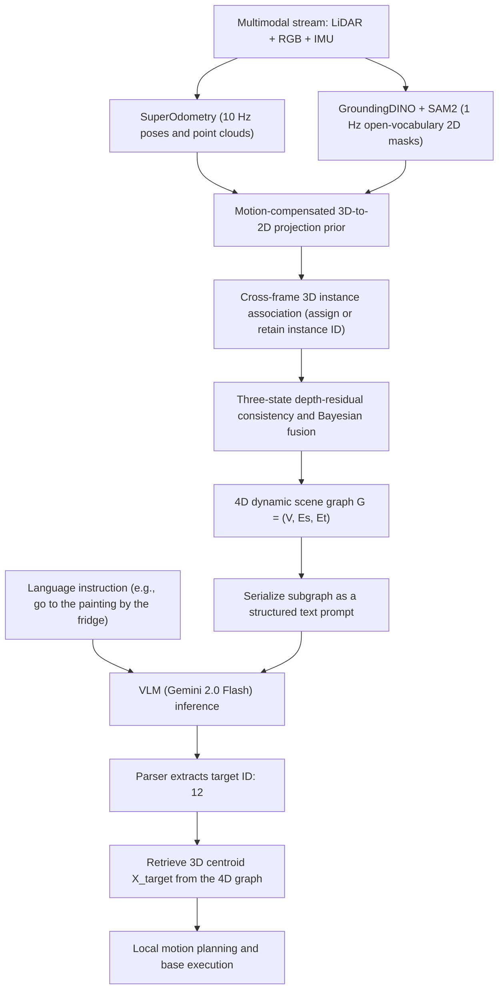

##### Example C: Before/after comparison of the core mechanisms
{: id="装置-c--before--after-核心机制对比表"}

| Dimension | Traditional 3D scene graphs (such as ConceptGraphs / HOV-SG) | Traditional semantic SLAM (such as Kimera / OVO-SLAM) | SuperMap (this paper) |
|---|---|---|---|
| **Mapping mode** | Offline batch processing after a global scan (minutes to hours) | Online real-time operation (10-30 Hz) | **Fully onboard online real-time operation (10 Hz pose / 5 Hz scene graph)** |
| **Vocabulary flexibility** | Open vocabulary (SAM + CLIP clustering) | Closed-set predefined categories (fixed CNN) | **Open vocabulary (GroundingDINO + SAM2)** |
| **Adaptation to dynamic environments** | Assumes a static environment; dynamic objects cause ghosting | Filters only short-term moving people and ignores long-term environmental changes | **Unified modeling of short-term motion and long-term object relocation/appearance/disappearance** |
| **Instance maintenance mechanism** | Simple spatial-overlap heuristics that easily fragment over long runs | Maintains only local feature points or geometric surfels | **3D motion compensation + depth-residual consistency + Bayesian fusion** |
| **Downstream reasoning interface** | Static graph structure queries that cannot perceive an object's historical trajectory | Provides only a metric occupancy grid or a closed-set semantic grid | **4D spatiotemporal dynamic graph + closed-loop control through structured VLM prompts** |

---

### 3. Results and findings
{: id="3-核心结果发现-8"}

  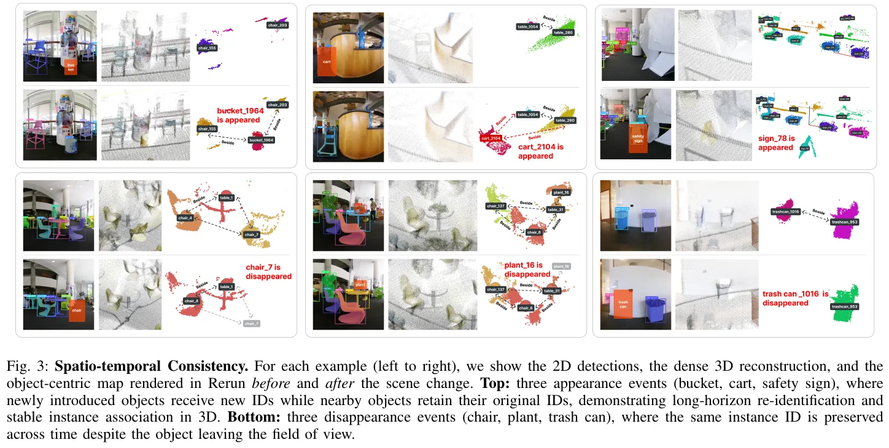
<figcaption>
Qualitative evaluation of spatiotemporal consistency in real dynamic environments: through the appearance of new objects (buckets, carts, safety warning signs) and the disappearance of others (chairs, plants, trash cans), the system maintains stable long-term 3D instance association and ID consistency
</figcaption>

1. **Clear lead on the ScanNet benchmark**:
   - **Category-level semantic segmentation**: SuperMap reaches an accuracy (Acc) of **55.48%**, clearly surpassing the object-level baselines ConceptGraphs (31.05%), ConceptFusion (34.10%), and HOV-SG (35.17%).
   - **Instance-level 3D segmentation (mAP)**: On typical furniture categories such as chair, window, refrigerator, and sofa, SuperMap's $\text{mAP} _{50}$ reaches **63.76%**, **42.20%**, **62.50%**, and **33.35%** respectively, while HOV-SG and ConceptGraphs, which rely on global point-cloud clustering, score close to 0.

2. **Spatiotemporal change detection in long-duration real dynamic environments**:
   - In a 10-minute real-robot experiment covering a complex indoor scene of $30\text{m} \times 20\text{m}$, SuperMap achieves excellent detection recall and change recall in appearance and disappearance tests on six object categories (buckets and chairs reach a perfect recall of **1.000**).
   - The baseline DualMap, because of unstable 2D segmentation, has its 3D bounding boxes filtered out frequently, and its object-detection recall is close to 0; Khronos suffers from severe frame dropping and semantic degradation caused by its inference bottleneck.

  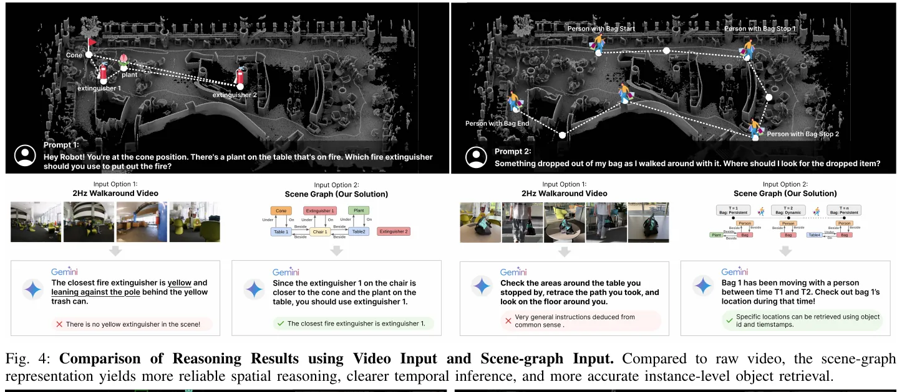
<figcaption>
Comparison of 4D scene-graph input and raw video input for VLM spatial/temporal reasoning: scene-graph input shows higher reliability and stronger resistance to hallucination in both spatial-topology disambiguation and historical-trajectory backtracking
</figcaption>

3. **Advantages in VLM spatial logic and temporal reasoning**:
   - Compared with feeding raw video frames directly to the VLM (Gemini 2.0 Flash), the scheme that serializes the SuperMap 4D scene graph significantly reduces the spatial perspective distortion and long-horizon hallucination of large multimodal models, both in **spatial metric logic** (e.g., locating a fire extinguisher precisely from the relative positions of plants and cones) and in **temporal history backtracking** (e.g., tracing a backpack's movement trajectory along temporal edges $E_T$ and retrieving lost items).

  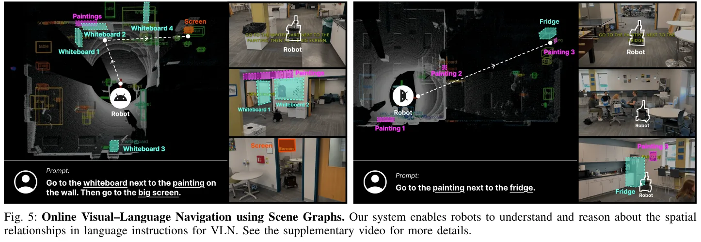
<figcaption>
Real-robot end-to-end online vision-language navigation experiment: the robot accurately tells apart 4 identical-looking whiteboards using the spatial relations in the scene graph, and completes multi-hop spatial-relation retrieval navigation correctly
</figcaption>

4. **Ablation study and system throughput**:
   - The ablations show that $F_1$ drops from 0.6308 to 0.5780 without the 2D tracker, $F_1$ drops sharply to 0.5201 without Bayesian semantic fusion, and $F_1$ drops to 0.5764 without the geometric-consistency update, confirming that the three components work together to eliminate detection noise.
   - In terms of speed, pose estimation runs stably at **10 Hz**, 2D open-vocabulary perception at **1 Hz** (processed asynchronously), 3D map updates at **3 Hz**, and 4D scene-graph maintenance at **5 Hz**, so the whole system runs smoothly fully onboard.

---

### 4. Limitations
{: id="4-局限性-8"}

SuperMap's dense trajectory tracking is still limited for extremely fast-moving targets (such as running pedestrians or rapidly thrown objects). In addition, the current 2D open-vocabulary detection still relies on a given candidate vocabulary of prompts; future work should integrate an automatic mechanism for autonomously discovering objects in the open world, enabling deployment without prior knowledge.

---

## 6. GSMem (2026)
{: id="gsmem"}
——3D Gaussian Splatting as persistent spatial memory for embodied exploration and reasoning

📄 **Paper**: [arXiv:2603.19137](https://arxiv.org/abs/2603.19137)

---

### Key takeaways
{: id="精华-9"}

The core insight of GSMem is to use 3D Gaussian Splatting (3DGS) as a persistent spatial memory with "post-hoc re-observability": the agent can re-render an explored area from any optimal viewpoint without physically revisiting it, which fundamentally overcomes the permanent memory loss caused by discrete detection failures. The two-level retrieval mechanism (an object-level scene graph plus a semantic-level CLIP language field) is complementary: the scene graph provides structured localization, and the language field is recalled when detection is missing. Together they drive optimal-viewpoint rendering that gives the VLM high-fidelity visual evidence. The hybrid exploration strategy dynamically combines VLM semantic relevance with the 3DGS geometric information gain (approximated by the trace of the Fisher information matrix), adaptively switching between task-oriented exploration and global coverage to balance efficiency and robustness. Introducing continuous radiance fields into embodied navigation memory is an important paradigm shift, and its "write once, re-render later" property is particularly valuable for long-horizon navigation tasks.

---

### 1. Background and problem
{: id="1-研究背景问题-9"}

Embodied navigation requires an agent to explore actively and continuously accumulate spatial knowledge in an unknown environment. Existing methods rely on two kinds of representation. Discrete 3D scene graphs (such as ConceptGraphs) depend on a detection module, so a missed detection leaves an unrecoverable hole in memory. View-snapshot methods (such as 3D-Mem) store fixed, sparse viewpoints and cannot re-observe an explored area from the optimal viewpoint, which limits the quality of the visual evidence provided for VLM reasoning. Both lack post-hoc re-observability: the agent is locked into whatever it observed during initial exploration and cannot "recall" a past scene from a new viewpoint the way humans do.

---

### 2. Method and innovations
{: id="2-主要方法创新点-9"}

**Framework overview**

During active exploration, GSMem maintains three parallel structures in real time: a 3DGS geometry-and-appearance map, a CLIP language embedding field attached to every Gaussian, and an object-level scene graph. When a query arrives, a multi-level retrieval-and-rendering mechanism locates the relevant region and renders an image from the optimal viewpoint, on which the VLM reasons; when no frontier offers sufficient semantic clues, the system switches to geometric exploration driven by information gain.

  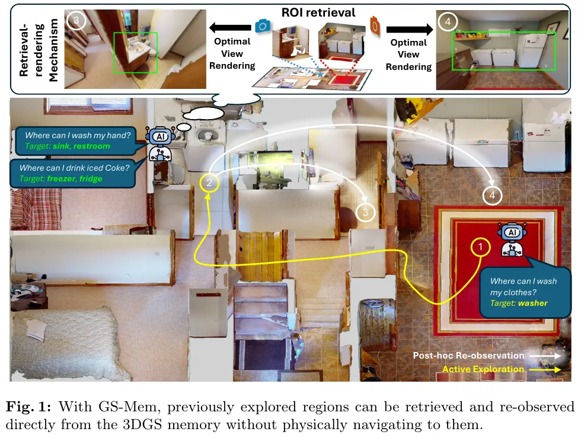
<figcaption>
GSMem system overview: besides the actual exploration path (yellow line), the agent can directly "re-observe" any explored area (purple line) through the 3DGS memory, without physically navigating back
</figcaption>

**3DGS mapping and online language field**

Each 3D Gaussian $$g_i$$ carries an extra 32-dimensional language embedding (768-dimensional CLIP features compressed by an autoencoder). To avoid the optimization overhead of high-dimensional language features, the paper proposes "weight-consistent inverse aggregation": in the forward pass, 2D pixel features are produced by alpha-blending the 3D Gaussians; in the reverse pass, 2D CLIP features are assigned back to each Gaussian with exactly the same blending weights, giving online semantic updates with zero optimization overhead:

$$\mathbf{f}_i^t = \frac{W_i^{t-1}\mathbf{f}_i^{t-1} + \sum_{k \in \mathcal{T}_t} \sum_p w_{i,p,k}^t \mathbf{f}_{p,k}^{2D}}{W_i^t}$$

In addition, the system maintains an object-level scene graph (with 3D positions, semantic labels, and the highest-confidence detection viewpoints), a TSDF map, and a frontier map.

**Multi-level retrieval-and-rendering mechanism**

  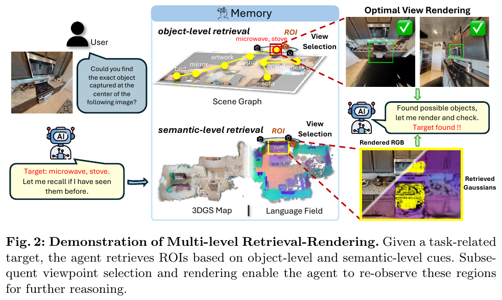
<figcaption>
Multi-level retrieval-and-rendering mechanism: object-level retrieval (scene graph) and semantic-level retrieval (3DGS language field) locate ROIs in parallel, and optimal viewpoint selection plus 3DGS rendering then provide high-fidelity visual evidence for the VLM
</figcaption>

Given a task query, two complementary retrieval paths are triggered at the same time:
- **Object-level retrieval**: The VLM ranks all objects in the scene graph by semantic relevance and selects the top-$K_\text{obj}$ candidates as ROIs
- **Semantic-level retrieval**: The query is encoded as a CLIP embedding, Gaussians in the language field with cosine similarity $> \tau_\text{clip}$ are recalled, and after KD-Tree clustering the top-$K_\text{cluster}$ spatially coherent groups are kept as ROIs

For each ROI, 108 candidate viewpoints (36 azimuths × 3 elevations) are sampled uniformly on a horizontal circular trajectory and filtered by two-stage scoring. Stage 1 selects the top 10 using a visibility score $S_\text{vis}$ (TSDF ray casting) plus a projected-area score $S_A$ (a Gaussian penalty that encourages an appropriate viewing distance); stage 2 further evaluates the actual rendering quality with a 3DGS opacity score $S_\text{opa}$ and picks the optimal viewpoint by the combined score $S_\text{final} = S_\text{vis} + S_A + S_\text{opa}$. Finally, a single-step diffusion model improves the quality of the rendered image before it is passed to the VLM for reasoning.

**Hybrid exploration strategy**

  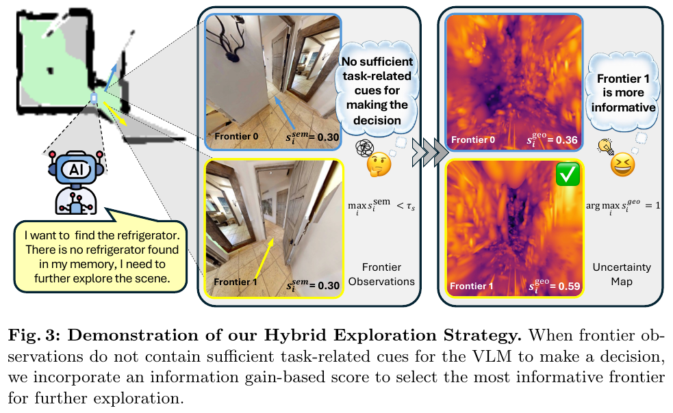
<figcaption>
Hybrid exploration strategy: when the semantic relevance of any frontier exceeds the threshold, the agent heads for the task target first; otherwise it switches to geometric coverage exploration driven by 3DGS information gain (an uncertainty heat map)
</figcaption>

Two scores are computed for each candidate frontier:
- **Semantic relevance score** $s_i^\text{sem} \in [0,1]$: the VLM evaluates how relevant the frontier's observation image is to the task query
- **Geometric coverage score** $s_i^\text{geo}$: an information gain based on the Fisher information matrix (FIM), approximated by a T-optimality proxy, namely the trace of the FIM increment $$s_i^\text{geo} \approx \text{Tr}(\mathbf{I}_i)$$, which can be computed directly from the rendering Jacobian without ground-truth supervision

Exploration decision rule:

$$i^* = \begin{cases} \arg\max_i \, s_i^\text{sem}, & \text{if } \max_i s_i^\text{sem} > \tau_s \\ \arg\max_i \, s_i^\text{geo}, & \text{otherwise} \end{cases}$$

---

### 3. Results and findings
{: id="3-核心结果发现-9"}

**Active Embodied QA (A-EQA) on OpenEQA** (63 HM3D scenes, 184 issues, GPT-4o as VLM):

| Methods | LLM-Match ↑ | LLM-Match SPL ↑ |
|------|------------|----------------|
| Explore-EQA | 46.9 | 23.4 |
| ConceptGraphs w/ Frontier | 47.2 | 33.3 |
| 3D-Mem | 52.6 | 42.0 |
| **GSMem (Ours)** | **55.4** | **43.8** |

**GOAT-Bench multi-modal long-term navigation** (36 scenes val-unseen, 2600+ subtasks):

| Methods | SR ↑ | SPL ↑ |
|------|------|-------|
| TANGO | 32.1 | 16.5 |
| MTU3D | 47.2 | 27.7 |
| 3D-Mem | 62.9 | 44.7 |
| **GSMem (Ours)** | **67.2** | **46.9** |

GSMem's advantage on long-horizon navigation is more pronounced than on A-EQA (SR +4.3 vs. LLM-Match +2.8), confirming the special value of persistent memory for tasks that accumulate over a long time. Ablations show that removing the CLIP language field costs 4.5 SR, removing optimal viewpoint selection costs 2.7 SR, and removing hybrid exploration lowers SPL by 4.1, indicating that the geometric coverage strategy contributes substantially to exploration efficiency.

  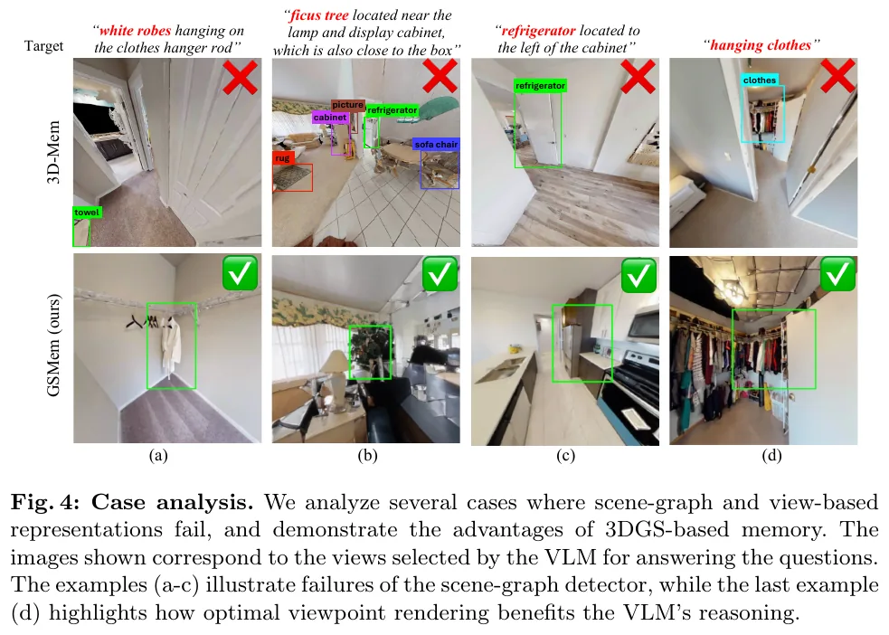
<figcaption>
Case comparison (3D-Mem vs. GSMem): (a-c) 3D-Mem makes errors because of false negatives (a white robe, a fig tree) or semantic misdetections (a white door recognized as a refrigerator), while GSMem localizes correctly through semantic-field retrieval; (d) when the viewpoint is restricted, GSMem identifies the hanging clothes successfully by re-rendering from the optimal viewpoint
</figcaption>

---

### 4. Limitations
{: id="4-局限性-9"}

The current system relies on RGB-D input, and depth noise or heavily occluded scenes degrade the quality of 3DGS mapping and hence the accuracy of retrieval and rendering; single-step diffusion enhancement adds inference latency, and real-time deployment still has room for optimization (currently about 1.2 s/step).

---

## 7. CGFM-Nav (2026)
{: id="cgfm-nav"}
——Lifelong multimodal embodied navigation by coupling explicit relational graph memory with an implicit continuous semantic field

📄 **Paper**: [arXiv:2608.29114](https://arxiv.org/abs/2608.29114)

### Key takeaways
{: id="精华-11"}
1. **Graph-field dual cognitive representation**: Cognitive Graph-Field Memory (CGFM) is proposed, which couples a discrete object-semantic topology graph with a continuous 2D semantic-frontier diffusion field in a single system, corresponding to "precise backtracking memory" and "fuzzy spatial intuition" in human navigation, respectively.
2. **Intuition-guided efficient exploration**: When the target cannot be retrieved from the graph, the robot does not roam blindly. Instead, the semantic evidence in the graph is back-projected into a spatial diffusion field that guides the robot first toward the unknown frontier with the highest semantic relevance, greatly reducing the search overhead of lifelong navigation.
3. **Closed-loop suppression and graph updates**: A multi-view verification mechanism (YES / NO-UNCERTAIN / NO-CONFIRMED) dynamically updates node states; rejected false-detection candidates are physically masked out of the semantic field within the current subtask, eliminating at the root the repeated retries and dead loops of large models.
4. **A lightweight open-source model surpasses cloud GPT-4o**: On the GOAT-Bench lifelong multimodal navigation benchmark, using the locally deployable open-source Qwen3-VL-8B, the overall success rate reaches 63.0%, surpassing the baseline MSGNav equipped with cloud GPT-4o (60.0%), which shows that structured field memory can effectively bridge the capability gap of the base model.

---

### 1. Background and problem
{: id="1-研究背景问题-11"}
In lifelong open-vocabulary embodied navigation for homes and other complex environments, a robot must continuously carry out navigation subtasks for multiple cross-modal targets (categories, natural-language descriptions, or reference images) in unmapped scenes, while retaining historical map memory across subtasks.
Existing navigation methods based on large language models / multimodal large models (LLM/VLM) have two core bottlenecks:
1. **Disconnect between explicit memory and goal-free exploration**: Discrete object scene graphs excel at accurate retrieval and topological backtracking of known objects, but once the target is absent from the current memory, the agent degenerates into random exploration of geometric frontiers, lacking semantic spatial intuition to guide it.
2. **Retry hallucination and context overhead under multimodal targets**: Over time, the ever-growing scene graph severely inflates the VLM's context window; and when the target is ambiguous, there is no explicit mechanism for suppressing failed attempts, so the agent repeatedly goes to the same wrong object.

---

### 2. Method and innovations
{: id="2-主要方法创新点-11"}

  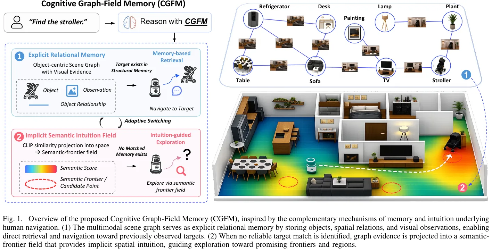
<figcaption>
Figure 1: Overview of the CGFM cognitive graph-field memory mechanism. The discrete object scene graph serves as explicit relational memory to support accurate recall; the continuous semantic-frontier field serves as an implicit intuitive bias to guide efficient exploration.
</figcaption>

#### ① Overall framework
{: id="-整体框架概述-3"}
CGFM-Nav is training-free overall and consists of five modules: **perception and graph construction (Perception & Graph)**, **semantic-frontier field construction (Semantic-Frontier Field)**, **adaptive subgraph selection (Subgraph Selection)**, **VLM reasoning with decision memory (VLM Reasoning)**, and **action execution with multi-view closed-loop verification (Action & Verification)**. The system forms a closed loop that switches seamlessly between known goals and unknown exploration and keeps updating itself.

  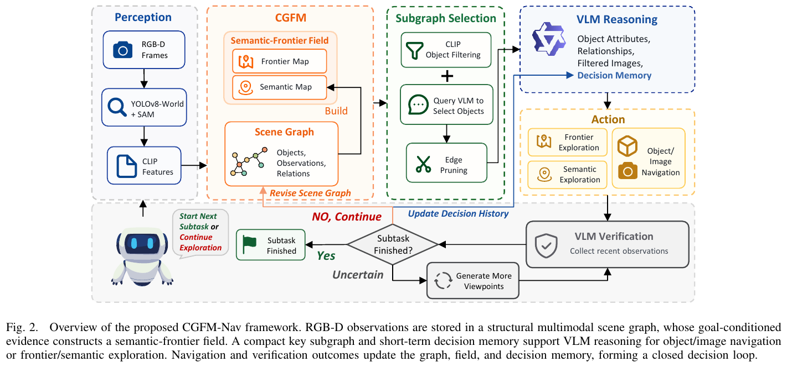
<figcaption>
Figure 2: CGFM-Nav system architecture. RGB-D input builds a multimodal scene graph, which is projected to generate a semantic field; the VLM issues actions based on the filtered subgraph and the decision log, and the verification results drive closed-loop memory updates.
</figcaption>

#### ② Module-by-module explanation
{: id="-逐模块讲解-3"}

**1. Perception and multimodal scene graph construction (Perception & Graph Memory)**
- **Input**: Continuous RGB-D sensor frames from the robot.
- **Processing**: YOLOv8-World and SAM perform open-vocabulary object detection and precise pixel segmentation, and CLIP extracts the appearance features of each object. A persistent multimodal scene graph $$\mathcal{G}_t = (\mathcal{V}_t, \mathcal{E}_t)$$ is built incrementally.
- **Output**: Nodes $$v_i = (c_i, p_i, z_i, \mathcal{I}_i)$$ storing the object category $c_i$, the 3D position $p_i$, the visual semantic feature $z_i$, and the set of historical multi-view observation images $$\mathcal{I}_i$$; the edges $$\mathcal{E}_t$$ record the spatial topology and relations between objects.
- **Design note**: Each node additionally carries verification statistics (number of verifications, subtask, recognition result, and multi-view feedback log).

**2. Continuous semantic-frontier field construction**
- **Input**: The current multimodal scene graph $$\mathcal{G}_t$$, the task goal description $q$, and the 2D occupancy grid map.
- **Processing**:
  1. Compute the CLIP similarity between each graph node and the goal $q$, and subtract the background baseline to obtain the net relevance score $s_i(q)$.
  2. Mask (set to 0) nodes already verified and rejected in the current subtask, so that they spread no energy into the field.
  3. Treat each valid object as a spatial point source whose semantic influence decays exponentially with the geodesic distance through unobstructed free space: $w_i(x) = \exp(-d(x, p_i)/\tau)$.
  4. For each grid cell $x$, aggregate the $K_s$ objects with the largest local contributions to produce a continuous semantic field:
     $$S_t(x \mid q) = \sum_{i \in \mathrm{Top}K_s(x)} s_i(q) w_i(x)$$
  5. Extract the set of geometric frontiers $$\mathcal{C}_t = \{f_1, \dots, f_M\}$$ at the boundary between free and unknown space, and compute an exploration score $U_t(f \mid q)$ for each frontier: the mean semantic field strength in a small neighborhood, divided by the geodesic navigation cost from the robot to that frontier.
- **Output**: A continuous heat map of semantic exploration priority and a ranked list of frontier scores.

> **Example (worked example A: semantic field and frontier scoring)**:
> Suppose the task is "find the stroller", and the robot has built a scene graph containing 3 objects in the living room:
> - Object A (folding chair): an earlier navigation attempt failed verification and was recorded as `NO-CONFIRMED`. The verification mask sets its net score directly to $s_A(q) = 0$, so it no longer diffuses any semantic energy;
> - Object B (dining table): weakly related to the stroller, with $s_B(q) = 0$ after subtracting the background baseline;
> - Object C (baby bottle): strongly related to the stroller, with a computed $s_C(q) = 0.8$.
>
> There are now two candidate frontiers in the unexplored area:
> - Frontier 1 (near object C, 1 meter from it, decay weight $w=0.7$; 2 meters from the robot): the local semantic field is $0.8 \times 0.7 = 0.56$; after accounting for the distance cost, the exploration score is as high as $0.56 / 2 = 0.28$;
> - Frontier 2 (near the kitchen, far from object C, so $w \approx 0$ after decay; only 1 meter from the robot): the local semantic field is 0 and the exploration score is almost 0.
>
> Even though the robot has never seen the stroller, the continuous semantic field steers it accurately toward the unknown corridor around object C instead of blindly exploring the kitchen.

**3. Semantic-guided subgraph selection (Semantic-Guided Subgraph Selection)**
- **Input**: The full scene graph $$\mathcal{G}_t$$ and the goal $q$.
- **Processing**: Directly reuses the CLIP relevance from the field computation, selecting positively correlated nodes and their first-order neighbors as the semantic seed set $$\mathcal{V}_{seed}$$; the remaining nodes are compressed into a residual graph $$\hat{\mathcal{G}}_{res}$$, from which the VLM makes supplementary selections based on common sense. Pruning yields a compact key subgraph $$\tilde{\mathcal{G}}_t$$.
- **Output**: A lightweight structured prompt for the large model.

**4. VLM reasoning with decision memory (VLM Reasoning with Decision Memory)**
- **Input**: The goal $q$, the key subgraph $$\tilde{\mathcal{G}}_t$$, and the decision memory $$\mathcal{D}_t$$ (candidates already tried, recorded by time, destination type, and a short reasoning summary).
- **Processing**: The VLM makes one of three kinds of decisions: select an object node $v_i$, select a historical image $I_{i,j}$, or issue the exploration command `EXPLORE`.
- **Output**: A discrete high-level decision instruction $d_t$.

**5. Action dispatch and closed-loop multi-view verification (Action & Verification)**
- **Input**: The decision instruction $d_t$ and the semantic-frontier field.
- **Processing and flow**:
  - For a known object/image: send its coordinates directly, and after arriving, call the VLM for multi-view observation verification (returning `YES`, `NO-UNCERTAIN`, or `NO-CONFIRMED`);
  - For `EXPLORE`: if frontiers exist, pick the highest-scoring one; if there are no frontiers but an incompletely explored semantic peak remains, navigate to the highest-response center of the semantic map; if neither exists, report failure.
  - Objects that pass verification move on to the next subtask; objects that fail verification get a node mask recorded, which blocks their field diffusion; uncertain objects are re-identified from additional viewpoints.

#### ③ Closed-loop states and decision flow (worked example B)
{: id="-读者视角闭环状态与决策流转图卡点降维装置-b"}

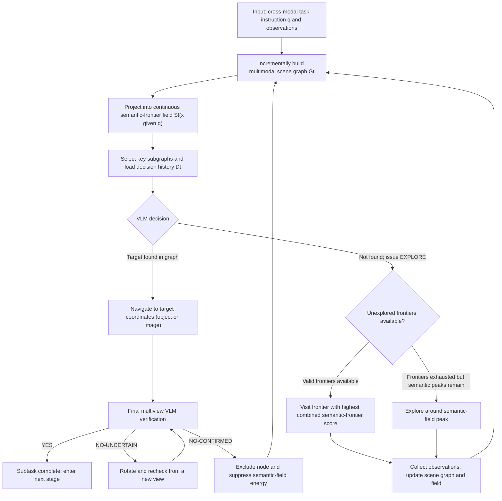

#### ④ Core difference: mechanism comparison with the classic baseline MSGNav (worked example C)
{: id="-核心差异与经典基线-msgnav-的机制对比卡点降维装置-c"}

| Mechanism | Classic baseline MSGNav | CGFM-Nav (this paper) |
|---|---|---|
| **Exploration guidance** | Purely geometric frontier exploration or undirected random roaming | Scene-graph evidence is back-projected into a continuous semantic field, giving frontiers a semantic bias |
| **Subgraph prompt filtering** | Rule-based full search or text-only LLM filtering | Reuses the field relevance as a semantic seed set, supplemented by the VLM's commonsense over the residual graph |
| **Suppressing erroneous retries** | Relies on history logs stuffed into the short-term text context | Node-level physical verification masks that completely cut off the pull of a wrong object in the field |
| **Deployment barrier** | Heavily depends on expensive, high-latency cloud GPT-4o | The locally deployed open-source lightweight Qwen3-VL-8B can surpass the performance of large cloud models |

#### ⑤ Training and inference settings
{: id="-训练与推理设定"}
- **Training-free**: The whole framework is a purely zero-shot inference architecture; the perception modules use pre-trained YOLOv8-World + SAM + CLIP, and decision reasoning and multi-view verification use the open-source lightweight Qwen3-VL-8B-Instruct.
- **Lifelong memory retention**: The scene graph and its verification masks are fully preserved across the subtasks of the same scene; only the short-term decision log is reset between subtasks, and the semantic field is rebuilt for the new goal.

---

### 3. Results and findings
{: id="3-核心结果发现-11"}
The evaluation results on the extremely challenging lifelong cross-modal navigation benchmark **GOAT-Bench** (36 unseen scenes, 278 multimodal subtasks, covering category, language-description, and reference-image goals) show that:

1. **Significant gains with the same base model**: In a fair comparison using the open-source **Qwen3-VL-8B**, CGFM-Nav versus MSGNav:
   - The overall success rate (SR) rises from **53.2% to 63.0%** (+9.8%);
   - The success weighted by path length (SPL) rises from **30.0% to 39.6%** (+9.6%);
   - Particularly large jumps are seen on category goals (SR: 63.6% → **72.7%**) and language goals (SR: 48.4% → **61.5%**).
2. **A lightweight on-device model beats the cloud flagship**: CGFM-Nav, equipped with a local 8B-parameter multimodal model, comprehensively surpasses MSGNav with cloud-based closed-source **GPT-4o** in overall SR (**63.0%** vs. 60.0%), category SR (**72.7%** vs. 63.6%), and language SR (**61.5%** vs. 57.2%), showing that high-quality environment representations can make up for the gap in the large-model base.
3. **Image goals rely on fine-grained matching**: In image-goal subtasks, which lack category-level generalization knowledge, success depends more on point-to-point matching of low-level pixel features. Although CGFM-Nav improves markedly over the baseline with the same base model (SR: 46.6% → 53.4%), a slight gap to GPT-4o remains, indicating that image goals place higher demands on the VLM's own fine-grained cross-view feature extraction.

---

### 4. Limitations
{: id="4-局限性-11"}
1. Verification is still limited to the GOAT-Bench simulation environment; long-term robustness under non-ideal factors such as sensor noise, occlusion by moving pedestrians, and odometry drift has not been fully verified on a real wheeled robot.
2. The representation and retrieval of image goals are still limited by the granularity of global CLIP features, and there is no local-feature retrieval mechanism dedicated to finely aligning the appearance of object instances.

---

## 8. NavMCP (2026)
{: id="navmcp"}
——The first long-horizon embodied navigation framework that scaffolds a Navigation Foundation Model (NFM) into an agent's executor

📄 **Paper**: [arXiv:2608.30396](https://arxiv.org/abs/2608.30396)

### Key takeaways
{: id="精华-14"}
1. **Core insight**: Long-horizon interaction with the physical world faces a dilemma between "high-level macro reasoning" and "low-level micro closed loops". Existing vision-language models (VLMs) suffer from serious long-range action drift, while navigation foundation models (NFMs) have excellent local embodied execution but are limited to a single round and lack a persistent task state across rounds.
2. **Paradigm breakthrough**: NavMCP breaks with the traditional practice of treating a navigation model merely as a black-box, single-step tool (Episodic Tool Interface), and proposes the first scaffolding protocol system that uses an NFM as the physical execution layer of a long-horizon embodied agent, achieving long-horizon closed-loop exploration without fine-tuning any underlying model.
3. **Architecture and mechanism**: A three-channel "Intent - Observation - Memory" protocol closes three gaps: the disconnect between instructions and intent, the loss of key observations along the way, and the memory break between calls. It turns one-shot waypoint planning into a cumulative, traceable embodied cognitive process.
4. **Decision philosophy**: An asymmetric, evidence-chain-based arbitration mechanism records not only "what was seen" but also explicitly distills negative evidence about "which areas have been ruled out", giving the agent the ability to carry out purposeful, non-monotonic hypothesis-testing exploration.
5. **Transfer and implications**: It sets new state-of-the-art results on three embodied question answering benchmarks (HM-EQA, MT-HM3D, and EXPRESS-Bench), and achieves real-world exploration over distances exceeding 50 meters on a Unitree Go2 quadruped robot, showing that layering a domain-specific model under a general-purpose large model is an important path toward physical intelligence.

---

### 1. Background and problem
{: id="1-研究背景问题-14"}
Embodied Question Answering (EQA) and real-world search require agents to explore large unknown scenes over long horizons to collect visual evidence. Existing methods face a dilemma. If a general-purpose large model (VLM) is asked to predict low-level actions or local waypoints directly, trajectory drift, deadlocks, and brittle execution occur frequently over long durations and distances. If a dedicated navigation foundation model (NFM, such as Qwen-RobotNav or Uni-NaVid) is introduced, traditional agents merely wrap it as an ordinary single-turn tool (Episodic Tool Call): a single command is sent to the navigation model, and once the low-level run finishes, only the final state and the last single view are returned.

This conventional single-episode interface has a serious **episodic interface gap** in long-horizon evidence collection:
1. **Mismatch between instruction and intent**: The high-level VLM cares about "what information to verify / what clues to look for", whereas the low-level navigation model needs concrete route instructions; a single route command cannot convey the search budget and semantic boundaries;
2. **Loss of intermediate observations**: The target object may flash by as the robot passes through a corridor or a doorway. Returning only the terminal view discards a large amount of high-value perceptual clues from the entire trajectory;
3. **No accumulation across calls**: The low-level execution memory is cleared after each call. Without a structured memory ledger at the upper level, the system cannot record "which rooms have been fully inspected", leading to repeated searches or aimless circling. On the HM-EQA benchmark, degrading to the traditional single-round interface directly causes a sharp performance drop of 14.9%.

---

### 2. Method and innovations
{: id="2-主要方法创新点-14"}

  
<figcaption>
Overall architecture of NavMCP: the high-level VLM agent dispatches sub-goals to the navigation foundation model (NFM) through the intent channel. The NFM autonomously completes closed-loop movement from a non-privileged egocentric view. The trajectory data collected along the way is converted into journey evidence with source references through the observation channel, and the dynamically updated EQA context state is maintained in the memory channel.
</figcaption>

#### ① Overall framework
{: id="-整体框架概述-6"}
NavMCP (Navigation model Context Protocol) adopts a two-layer division of labor: the **high-level VLM agent acts as the "reasoning brain"**, responsible for decomposing the task goal, inferring evidence requirements, planning the search region, and deciding when to stop and answer; the **low-level NFM (represented by Qwen-RobotNav) acts as the "physical execution limb"**, responsible for obstacle avoidance and robust closed-loop waypoint tracking from a non-privileged first-person RGB view and a self-built local topological map. The two interact through a decoupled yet tightly coordinated three-channel protocol, which extends the VLM's physical action horizon as well as the NFM's long-horizon reasoning horizon.

#### Worked example: traditional tool calling vs. the NavMCP three-channel protocol
{: id="难点降维传统工具调用-vs-navmcp-三通道协议"}

| Dimension | Traditional tool call (Episodic Interface) | NavMCP scaffolding protocol (this paper's approach) |
|---|---|---|
| **Intent expression (Intent)** | A single-sentence control instruction (such as "Turn left toward the master bedroom"), with no budget constraint and no distinction of search modes | A structured semantic call `(mode, goal, budget, constraints)` that distinguishes the object-search and instruction-navigation modes |
| **Observation feedback (Observation)** | Returns only the final destination state and the last frame, losing all key visual information along the way | Keyframes are sampled at equal step intervals along the trajectory, and a trajectory summarizer produces journey evidence with keyframe source references |
| **Cross-call memory (Memory)** | Relies on the raw interaction dialogue context; long sequences quickly exceed the window and negative clues are easily forgotten | Explicitly maintains the three-part state $C_t = (H_t, E_t, U_t)$, structures a ledger of positive and negative evidence, and safely compresses the raw tool trajectories |
| **Decision criteria (Arbitration)** | Answers hastily based on whether the target was seen from a single viewpoint | Three-stage asymmetric arbitration based on `analyze_status`: confirmation requires direct image support, and refutation requires evidence of full coverage of the area |

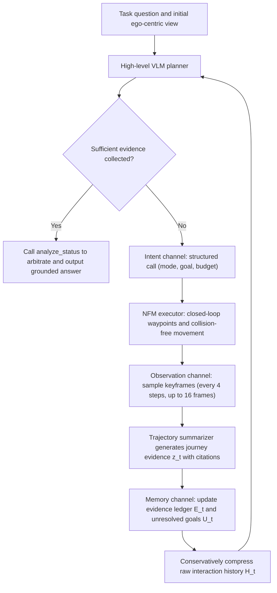

#### ② Module-by-module explanation: the NavMCP three-channel core mechanism
{: id="-逐模块讲解navmcp-三通道核心机制"}

##### 1. Intent channel: from evidence requirements to structured navigation calls
{: id="1-意图通道intent-channel从证据需求到结构化导航调用"}
After inferring what information is missing, the high-level agent does not write low-level motor commands or fine waypoints, but issues a structured semantic navigation call through the protocol:
$$\text{Call} _t = (\text{mode}, \text{sub\_goal}, \text{budget}, \text{constraints})$$
- **Decoupled dual modes**:
  - `navigate_to_object` (object-goal navigation mode): takes a specific object category name or a referent object, and the low-level NFM independently performs semantics-driven local exploration and approach;
  - `navigate_by_instruction` (vision-language navigation mode): takes a high-level natural-language instruction containing regions, paths, or topological landmarks (such as "Go through the hallway and enter the bedroom at the end").
- **Budget and boundary constraints**: `budget` caps the maximum number of low-level steps to keep the underlying model from falling into a local infinite loop; `constraints` provides semantic obstacle-avoidance suggestions. The low-level executor relies only on its own RGB observations, pose estimates, and the topological occupancy graph built in real time during exploration, and needs no ground-truth scene information or privileged geometry.

  
<figcaption>
Internal flow of the NavMCP three-channel scaffold: the intent channel handles semantic alignment of the task, the observation channel maps spatiotemporal trajectories into structured perceptual evidence labeled with confidence and image sources, and the memory channel supports persistent evidence-ledger updates across multiple rounds of interaction.
</figcaption>

##### 2. Observation channel: from dynamic trajectories to source-anchored evidence
{: id="2-观测通道observation-channel从动态轨迹到来源锚定证据"}
After the low-level executor completes one navigation call, it outputs a raw trajectory record $r_t = (s_t, b_t, \ell_t, p_t, K_t)$, where $s_t$ is the completion flag, $b_t$ is the stop reason, $\ell_t$ is the total path length, $p_t$ is the final pose, and $K_t = \{I_{t,1}, \dots, I_{t,n}\}$ is the set of keyframes collected along the way.
- **Uniform keyframe sampling**: To balance visual coverage against context cost, the system samples an egocentric frame every $\Delta = 4$ steps, truncated to at most $M = 16$ frames per call.
- **VLM trajectory summarizer**: These keyframes are fed to a lightweight multimodal describer that extracts structured journey evidence:
  $$z_t = (q_t, R_t, O_t, P_t, D_t)$$
Here $q_t$ records whether the sub-goal was achieved; $R_t$ summarizes transitions between rooms and areas; $O_t$ extracts salient observed objects; $P_t$ records planning topology clues (such as an unexplored stairwell or an ajar door); and $D_t$ records uncertainty and execution anomalies.
- **Source grounding tuple**: Every object or area mentioned in $O_t$ and $R_t$ must be bound to a five-tuple label $(n, i, v, h, c)$ (name, associated keyframe index, view direction, relative spatial hint, confidence). The summarizer is strictly forbidden from inferring unobserved states without basis.

##### 3. Memory channel: cross-call evidence ledger and conservative context compression
{: id="3-记忆通道memory-channel跨调用证据账本与保守上下文压缩"}
To prevent context explosion caused by multiple calls, NavMCP maintains an explicit three-part EQA context state:
$$C_t = (H_t, E_t, U_t)$$
- **Evidence ledger $E_t$**: Records positive evidence with source indices (e.g., "A lit desk lamp was found on the bedside table of the master bedroom, source frame keyframe_3") and negative evidence (e.g., "The panoramic view of the study was checked and no printer was found"). The ledger is maintained via `write_notebook`, keeps 100 deduplicated records under a FIFO limit, and is injected directly into the head of the prompt in every round of reasoning.
- **Pending target pool $U_t$**: Maintains unconfirmed or vaguely inferred targets awaiting investigation, and guides what the next intent-channel call requests.
- **Conservative context compression**: Only after key perceptual information has been distilled and externalized into $E_t$ and $U_t$ with keyframe references does the system allow the lengthy raw tool logs and intermediate images of earlier rounds to be replaced with minimal placeholders. This ensures that even if the context is truncated during long interactions, the core decision chain is not damaged at all.

#### Worked example: journey analysis capture and asymmetric arbitration
{: id="难点降维journey-analysis-沿途捕获与非对称仲裁具体实例"}

> **Example**:
> While answering "Is the lamp on the bedside table on?", the robot's intent channel emits `navigate_by_instruction("walk through the corridor into the master bedroom")`, and the low level moves 16 consecutive steps.
> 1. **Traditional tool call**: After the run, the robot stops in front of the master bedroom wardrobe, and only the last frame, showing the wardrobe, is returned. The agent completely misses the bedside table, concludes that "the lamp was not found", and has to search blindly again.
> 2. **NavMCP observation channel**: 4 keyframes are sampled at $\Delta=4$. In the second keyframe (the robot is passing the half-open door of the master bedroom), the bedside table and lampshade are faintly captured through the door gap on the right of the image. The VLM trajectory summarizer extracts the evidence tuple `("table lamp", frame_2, "door gap on the right", "beside the master-bedroom bed", "uncertain")` and writes it directly into the pending targets $U_t$.
> 3. **Asymmetric arbitration**: In the next round, the planner calls `analyze_status` to trigger targeted local verification. The system then follows the **asymmetric evidence rule**:
>    - **Confirmation (positive)**: requires unambiguous, high-definition direct visual evidence (call `zoom_in_object` to zoom in and check whether the desk lamp is lit);
>    - **Refutation (negative)**: To conclude that "there is no desk lamp in the room", the agent must provide a 360-degree panoramic scan and an evidence chain covering all blind spots of the room. It is strictly forbidden to treat "merely not having seen it" as "the object does not exist".

  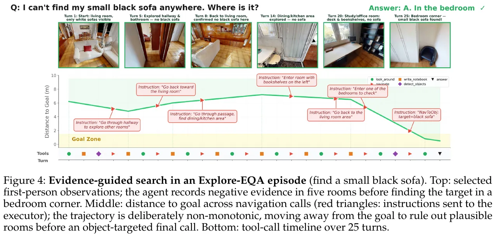
<figcaption>
Explore-EQA task record (looking for a small black sofa): during long-range exploration the agent checks 5 rooms in succession and accumulates negative evidence to avoid backtracking; the mid-course distance-to-target curve is rational and non-monotonic (first moving away to systematically rule out other areas, then converging precisely on the target corner).
</figcaption>

#### ③ Auxiliary perception toolset and verification protocol
{: id="-辅助感知工具集与验证协议"}
To eliminate ambiguity before the final decision, NavMCP exposes a library of fine-grained visual perception tools to the agent:
- **Reader tools**:
  - `look_around`: calls the four-way panoramic camera to obtain 360-degree surround perception and the feasible topology of the scene;
  - `analyze_status`: a three-stage evidence arbiter that takes the current panorama, historical keyframes, and the notebook as input, and outputs whether the evidence is sufficient and which kinds are missing;
  - `zoom_in_object`: crops and enlarges candidate targets for fine-grained discrimination of attributes (switch state, text, small parts);
  - `review_image`: retrieves archived historical keyframes for review.
- **Detector tools**:
  - `detect_objects_360`, `detect_objects`: target localization and counting based on an open-vocabulary detector and SAM;
  - `estimate_depth`: metric depth and reachable-distance estimation based on Depth-Anything.

#### Worked example: compensating for equivalent agent steps
{: id="难点降维等效探索步数equivalent-agent-steps补偿计算"}

In embodied navigation evaluation, traditional frontier-exploration baselines (such as Explore-EQA and FAST-EQA) move by teleportation, with a single-step displacement strictly limited to within 3 meters. A single closed-loop NFM call may move autonomously for more than ten meters. Counting a long NFM call as just 1 step would be seriously unfair to the traditional baselines; but counting every low-level physical control cycle as a high-level step would fail to reflect the savings in high-level large-model calls that NFM closed-loop execution brings.

To this end, the paper takes 3 meters as the basic conversion unit and designs the **equivalent agent steps**:
$$n_{\text{eq}} = H + \sum_{k=1}^K \max\left(0, \left\lceil \frac{L_k}{3\text{ m}} \right\rceil - 1\right), \quad \hat{n} _{\text{eq}} = \frac{n_{\text{eq}}}{N}$$
Here $H$ is the actual number of high-level VLM calls, $K$ is the total number of NFM calls, $L_k$ is the physical arc length of the trajectory actually traveled in the $k$th NFM call, and $N = \lfloor \sqrt{A \times 3} \rfloor$ is the theoretical total step budget derived from the scene's traversable area $A$.

> **Worked calculation**:
> Suppose a scene has a total step budget of $N = 50$ steps. At the high level, the agent calls the VLM $H = 3$ times in total:
> - The 1st NFM call moves 2.5 meters: since $L_1 \le 3\text{m}$, $\lceil 2.5/3 \rceil - 1 = 0$, so 0 steps of compensation;
> - The 2nd NFM call crosses a long corridor and moves 8.2 meters: $\lceil 8.2/3 \rceil - 1 = 3 - 1 = 2$ steps of compensation;
> - The 3rd NFM call searches across rooms and moves 11.0 meters: $\lceil 11.0/3 \rceil - 1 = 4 - 1 = 3$ steps of compensation.
>
> The final equivalent total is $n_{\text{eq}} = 3 + (0 + 2 + 3) = 8$ steps, and the normalized step consumption is:
> $$\hat{n} _{\text{eq}} = \frac{8}{50} = 0.16$$
> This conversion not only compensates rigorously for long physical displacements, but also truly reflects that NavMCP reduces the frequency of high-level large-model interactions by more than 70% compared with traditional single-step exploration.

---

### 3. Results and findings
{: id="3-核心结果发现-14"}

#### ① State-of-the-art results on all three EQA benchmarks
{: id="-三大-eqa-基准全面超越-sota"}
On the three benchmarks, NavMCP achieves significant breakthroughs (using the Qwen3.6-Plus agent and the Qwen-RobotNav-8B executor):
- **HM-EQA (500 multiple-choice questions)**: NavMCP reaches **76.7%** accuracy, **7.5 percentage points** above the previous strongest method FAST-EQA (69.2%). Its normalized number of high-level exploration steps is only **0.15**, which cuts high-level large-model calls by 77% relative to FAST-EQA's 0.65, delivering both very high accuracy and excellent efficiency.
- **MT-HM3D (multi-target, cross-room complex question answering)**: Accuracy reaches **54.4%**, 3.9 percentage points ahead of FAST-EQA (50.5%).
- **EXPRESS-Bench (2,044 long-range open-ended questions)**: In open-ended question answering, the LLM score reaches **79.27** and the path-efficiency-weighted metric $E_{\text{path}}$ reaches **33.96**, clearly ahead of Fine-EQA (63.95/25.58) and ToolEQA (65.77/25.82).

#### ② System-level comparison under strictly controlled variables (HM-EQA, fixed Qwen3.5-397B-A17B)
{: id="-严格控制变量下的全系统对齐测试hm-eqa固定-qwen35-397b-a17b"}
To remove the influence of differences between large-model bases, the paper re-tests all methods using the open-source Qwen3.5-397B-A17B as the decision agent, with the same initial state, the same budget, and the same perception tools:
- Explore-EQA：57.6%
- ToolEQA：60.8%
- FAST-EQA：63.5%
- **NavMCP + Qwen-RobotNav-8B**: **74.0%** (10.5 to 16.4 percentage points ahead of the baselines).

#### ③ Complementary roles of the two layers (architecture ablation)
{: id="-双层分工互补性消融architecture-ablation"}
- **Fix the low-level NFM, vary the high-level agent**:
  - No agent (blind guess from the initial view only): 38.2%
  - Single-round passive agent (one panoramic shot only): 58.4%
  - Traditional reactive agent (fixed exploration loop): 62.0%
  - Full NavMCP scaffold (Qwen3.5): **74.0%** (Qwen3.6-Plus raises it further to 76.7%).
  - *Conclusion*: However powerful the underlying navigation model is, without high-level adaptive hypothesis testing and memory accumulation it cannot handle complex embodied reasoning.
- **Fix the high-level agent, vary the low-level navigation executor**:
  - NavMCP + Random Walk: 60.9%
  - NavMCP + Frontier Exploration (traditional frontier detection): 65.3%
  - NavMCP + StreamVLN：69.3%
  - NavMCP + Qwen-RobotNav-4B：73.3%
  - NavMCP + Qwen-RobotNav-8B：**74.0%**
  - *Conclusion*: A high-level agent cannot compensate for fragile low-level physical execution. A stronger language-conditioned closed-loop navigator turns high-level semantic requirements into higher-quality spatiotemporal observations.

#### ④ Protocol channel ablation (Protocol Ablation on HM-EQA)
{: id="-协议通道消融实验protocol-ablation-on-hm-eqa"}
- **Degrading directly to the traditional single-round tool interface (Episodic Interface)**: performance plummets by **14.9 percentage points** (74.0% $\to$ 59.1%), directly confirming how damaging the episodic gap is for long-horizon physical interaction;
- **Degrading to terminal-only observation returns (Terminal-only Observation)**: performance drops by **5.9 percentage points** (to 68.1%), confirming that keyframes and process observations along the way are crucial for evidence collection;
- **Removing the EQA context ledger of the memory channel**: performance drops by **4.6 percentage points** (to 69.4%);
- **Removing the VLM journey analysis (Journey Analysis)**: performance drops by **4.4 percentage points** (to 69.6%);
- **Sparser keyframe sampling (from 4 steps/16 frames to 8 steps/8 frames)**: performance drops by **2.8 percentage points** (to 71.2%).

  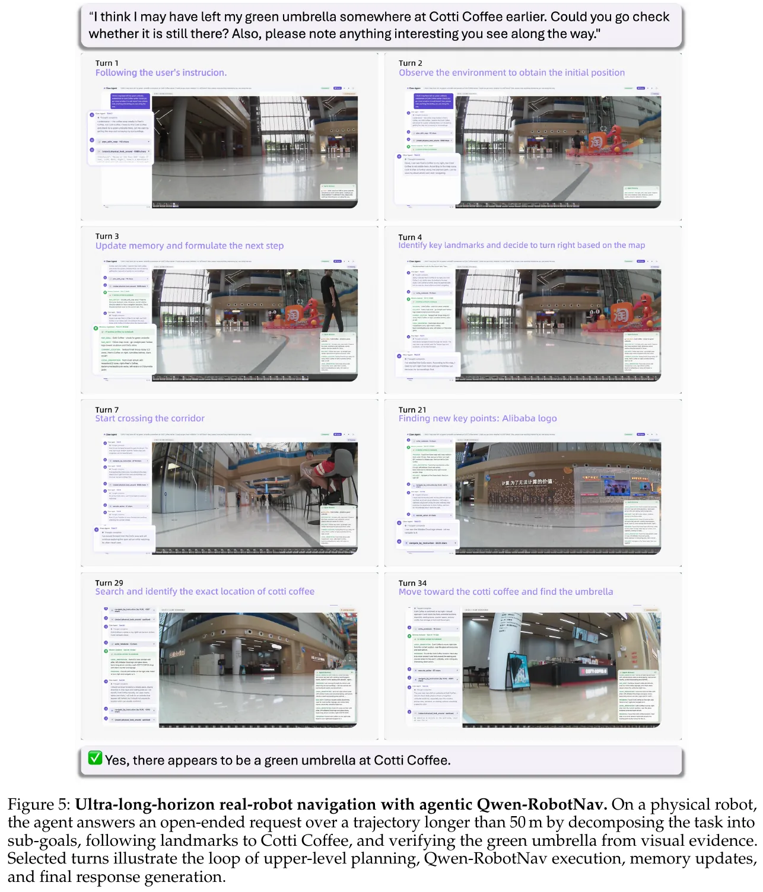
<figcaption>
Real-world test on the Unitree Go2 quadruped robot: on ultra-long-range exploration tasks of more than 50 meters across multiple functional areas, NavMCP guides the robot to decompose high-level goals into progressive, landmark-anchored sub-goals, reaching a 78.3% success rate and showing a large advantage over reactive baselines.
</figcaption>

#### ⑤ Real-robot deployment: physical validation on the Unitree Go2
{: id="-真实机器人部署宇树-unitree-go2-物理验证"}
In a real office building, facing unstructured obstacles, odometry drift, and sensing noise, real-robot tests were run at three difficulty levels: single room (Low), cross-room (Medium), and large-scale multi-area over 20 meters (High) (fixed Qwen3.6-Plus):
- **Single room (Low, 20 trials)**: Reactive 80%, Frontier 70%, **NavMCP 90%**;
- **Cross-room (Medium, 20 trials)**: Reactive drops to 35%, Frontier 60%, **NavMCP holds at 85%**;
- **Large-scale exploration over 20 meters (High, 20 trials)**: Reactive collapses completely to **0%**, Frontier reaches only **15%**, and **NavMCP still maintains a success rate of 60%**!
- **Overall real-robot success rate**: NavMCP reaches **78.3%**, an overwhelming advantage over Frontier (48.3%) and Reactive (38.3%), showing that the longer the task and the more complex the environment, the more pronounced the advantage of layered scaffolding.

---

### 4. Limitations
{: id="4-局限性-14"}
1. **Compute overhead and response latency of the high-level model**: NavMCP relies on a large-parameter VLM (such as Qwen3.6-Plus or a 397B-class model) for the multimodal journey analysis and evidence arbitration in every round. The inference latency of high-level large models is higher than that of traditional lightweight heuristics; future work should explore on-device small models or reinforcement-learning distillation;
2. **Duplicate objects and counting ambiguity under multi-view sampling**: When the same object is captured repeatedly across multiple keyframes or camera angles along the way, the VLM still occasionally makes cross-view duplication errors in dense small-object counting tasks;
3. **Dynamic environments and unsteady physical interference**: Current tests are mainly conducted in relatively static, large indoor scenes. In extremely challenging real-world scenes with heavy pedestrian flow or sudden lighting changes, the low-level NFM's local deadlock-recovery mechanism still has room for improvement.

---

## 9. SysNav (2026)
{: id="sysnav"}
——Multi-Level Systematic Cooperation Enables Real-World, Cross-Embodiment Object Navigation

📄 **Paper**: [arXiv:2603.06914](https://arxiv.org/abs/2603.06914) · [Project Page](https://cmu-vln.github.io/) · [Code](https://github.com/zwandering/SysNav)

### Key takeaways
{: id="精华-18"}

SysNav redefines ObjectNav as a system-level problem and fully decouples semantic reasoning, navigation planning, and locomotion control into three layers, which is worth learning from. The core insight is that the VLM should not be used for fine-grained, frontier-level decisions but should be limited to room-level high-level planning, striking the best balance between reasoning ability and spatial reliability. The three-level scene graph (Room→Viewpoint→Object) gives the VLM structured context and is the key infrastructure for efficient VLM reasoning. The two VLM invocation modes, Early-stop and Room-query, are triggered on demand and effectively avoid redundant VLM calls. The system is deployed on three robot platforms, verifying the value of a modular design for cross-platform generalization.

---

### 1. Background and problem
{: id="1-研究背景问题-17"}

Object Navigation (ObjectNav) requires a robot to find a target object on its own in an unknown indoor environment, handling complex spatial structure, long-horizon planning, and semantic understanding at the same time. Existing methods treat ObjectNav as a single policy-learning problem, and an end-to-end model struggles to cover all of these sub-challenges; moreover, relying too heavily on the VLM for frontier-level decisions leads to frequent backtracking and inefficient behavior, because the VLM lacks accurate 3D spatial understanding.

---

### 2. Method and innovations
{: id="2-主要方法创新点-17"}

  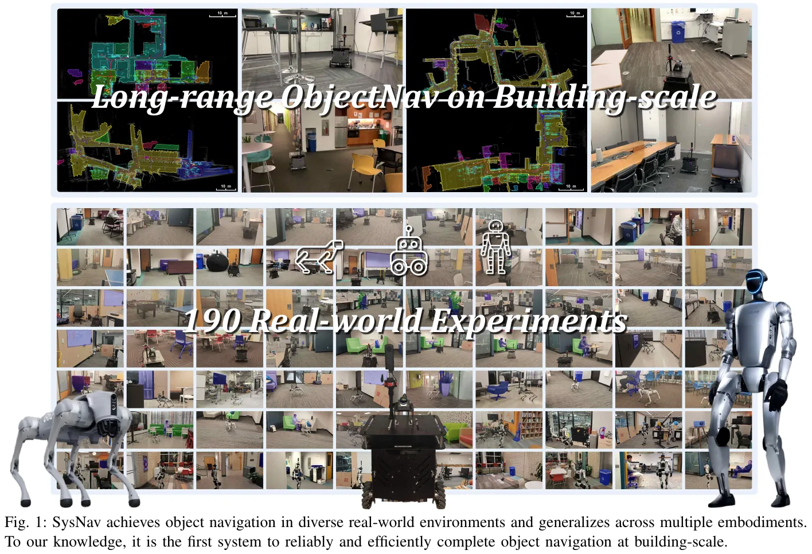
<figcaption>
SysNav performs building-scale long-horizon ObjectNav in a variety of real-world environments and on different robot platforms
</figcaption>

SysNav is a three-layer decoupled ObjectNav system, with each layer focusing on a sub-problem of a different granularity:

**High level - semantic reasoning (Semantic Reasoning)**

Build a three-level scene graph representation $\mathcal{R}$:
- **Room Node** $v^r$: Fits walls and separates independent rooms from the vertical distribution of the point cloud. Each node stores the room category, a 2D top view, and representative RGB images.
- **Viewpoint Node** $v^v$: Added when the coverage changes significantly; stores the position, coverage area, and panoramic images for efficient semantic storage
- **Object Node** $v^o$: Instantiated with open-vocabulary detection (YOLOv8x + SAM2); each node stores the category, confidence, 3D point cloud, bounding box, and its own attributes

Edge types include: Room-Room (doorway connection), Room-Viewpoint (containment), Room-Object (containment), Viewpoint-Object (visibility), and Object-Object (spatial constraints, added as needed).

The VLM reasoning component (Gemini-2.5-flash) performs semantic reasoning on this scene graph and provides room-level navigation guidance.

**Middle level - room-based navigation (Room-based Navigation)**

  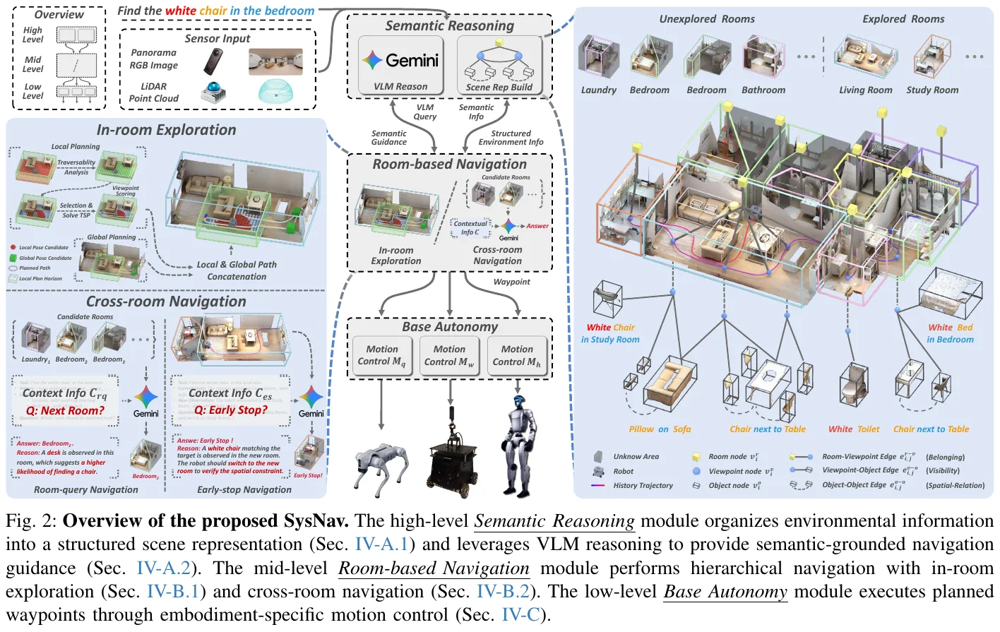
<figcaption>
SysNav system architecture: three decoupled layers, namely high-level semantic reasoning, middle-level room navigation, and low-level locomotion control
</figcaption>

The room is treated as the smallest semantic planning unit; an efficient classical exploration algorithm is used inside a room, and the VLM is called only when switching rooms:

- **In-room exploration**: Two-level planning (local + global) selects pose candidates by the coverage score $w_{cov}(c_i) = \lvert \mathcal S_{cov}(c_i) \cap \hat{\mathcal S} \rvert$, generates the exploration path with TSP, and uses a rolling-window mechanism to coordinate the local and global plans
- **Early-stop mode**: When entering a new room, the VLM decides, from the context information $\mathcal C_{es}$ (room attributes, observed objects, task goal), whether to stop exploring the current room early and move on to the new room
- **Room-query mode**: When the target is not found after the current room has been explored, the VLM infers, from the unexplored-room information $\mathcal C_{rq}$, the next room most likely to contain the target.

**Low level - base autonomy (Base Autonomy)**

A cross-platform base autonomy module converts waypoints into locomotion commands for each platform (wheeled robot, Unitree Go2 quadruped, Unitree G1 humanoid), covering waypoint following, collision avoidance, and terrain traversability analysis.

---

### 3. Results and findings
{: id="3-核心结果发现-17"}

  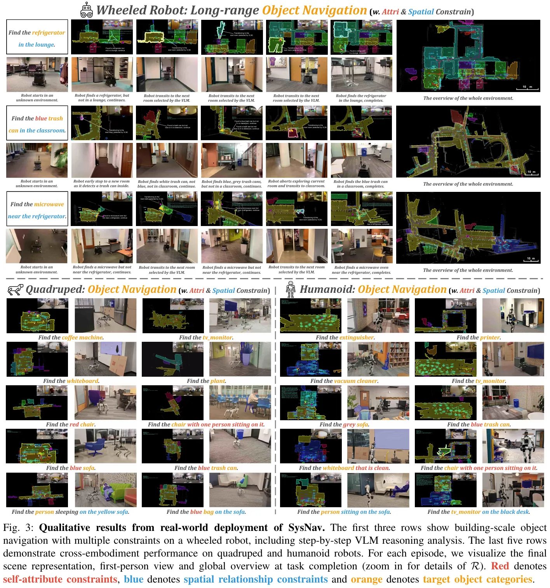
<figcaption>
Qualitative results of SysNav in real environments on wheeled, quadruped, and humanoid robot platforms
</figcaption>

**Simulation benchmarks** (4 benchmarks, compared with SOTA):
- HM3D-v1: SR **63.7%**, SPL **30.5%** (clearly ahead of the runner-up ApexNav's 59.6%/33.0% in SR)
- HM3D-v2: SR **80.8%**, SPL **37.2%** (runner-up ApexNav 76.2%/38.0%)
- MP3D：SR **50.7%**，SPL **18.1%**
- HM3D-OVON: SR **54.9%**, SPL **26.1%** (runner-up MTU3D 40.8%/12.1%, an improvement of 14.1%/6.5%)

**Real environments** (190 experiments, compared with VLFM and InstructNav):
- Hard setting (targets in different rooms): SR **97.5%**, SPT **71.8**, AT **67.6s** (SR in the hard setting improves from the runner-up's 61.1%, SPT increases by 51.1%, and AT decreases by 29.8s)
- Navigation efficiency improves by **4-5×** over existing ObjectNav baselines

---

### 4. Limitations
{: id="4-局限性-17"}

The SPL gain in simulation is smaller than the SR gain, because the strict coverage strategy designed for real scenes causes slight over-coverage in simulation; in addition, multi-room layouts pose only limited extra challenge to the system, since the denser obstacles in moderately difficult scenes slow it down.

---

## 10. EvoMemNav (2026)
{: id="evomemnav"}
——An efficient self-evolving fine-grained topological memory framework based on a lightweight graph prior and multi-view reflection for zero-shot embodied navigation

📄 **Paper**: [arXiv:2606.03509](https://arxiv.org/abs/2606.03509v1) · [Code (to be released) ](https://github.com/caicaiya123/EvoMemNav)

### Key takeaways
{: id="精华-20"}

1. **Purely visual memory design**: Proposes the Visual-Semantic Memory Graph (VSMGraph), which stores the original visual view (View) as a first-class citizen in the graph nodes, avoiding the information compression and noise accumulation of traditional detection-centric scene graphs and removing the need for costly 3D reconstruction.
2. **Budgeted coarse-to-fine decisions**: Decisions are split into a coarse stage (Explore: filter and route to a frontier or anchor) and a fine stage (Search+Verify: the VLM decides only over a short list and performs multi-view Stop verification). This lowers VLM latency and token counts while also solving the ambiguity among multiple instances of the same category and premature stopping.
3. **Reflection-driven self-evolving memory (RDCMA)**: A training-free online prior-update mechanism is designed. After a subtask ends, it evaluates the trajectory events and stop results and updates the lightweight goal-conditioned priors (Episode-STM and Scene-LTM) attached to graph nodes, which guide subsequent decisions.
4. **Out-of-the-box, efficient, and general**: Achieves significant SR/SPL improvements on GOAT-Bench and HM3D and outperforms 3D-Mem, while cutting VLM calls by 41% and total time by 39%, without any weight training or fine-tuning.

---

### 1. Background and problem
{: id="1-研究背景问题-19"}

In long-horizon zero-shot embodied navigation (Zero-Shot Embodied Navigation), it is crucial to build a memory system that supports long-term planning. However, existing memory representations have the following limitations:
1. **Detector-centric scene graphs**: Compressing observations into sparse object nodes discards fine-grained visual cues such as texture and spatial layout, and detector errors (such as category noise) accumulate in downstream reasoning, leading to wrong decisions.
2. **3D-reconstruction-based memory**: Incurs high compute and storage overhead at runtime, and is incompatible with powerful VLMs that can only reason directly over images.
3. **Image-based topological graphs**: They lack a structured organization of rooms, frontiers, or reachability, and are easily confused in scenes with multiple instances of the same category, causing premature stopping (Premature Stop) at the wrong instance; the memory also cannot evolve, so lessons from failures cannot be reused.

---

### 2. Method and innovations
{: id="2-主要方法创新点-19"}

#### Framework overview
{: id="整体框架概述"}
EvoMemNav consists of three core parts: a hierarchical topological memory graph (VSMGraph) built on an occupancy grid, a two-stage "coarse-to-fine" navigation controller (Coarse-to-Fine Policy), and a training-free, reflection-driven online self-evolving prior module (RDCMA). At each time step the system receives posed RGB-D observations and updates the topological map. When making navigation decisions, the coarse stage filters candidates and navigates, and the VLM then performs fine-grained routing and multi-view Stop verification. At the end of a subtask, the reflection mechanism writes the results back into lightweight statistics (STM/LTM) in the graph to guide future navigation.

  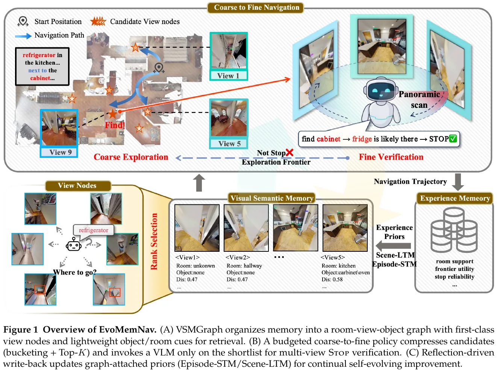
<figcaption>
EvoMemNav core concepts and process overview (VSMGraph, coarse-to-fine navigation decisions, reflective writing)
</figcaption>

  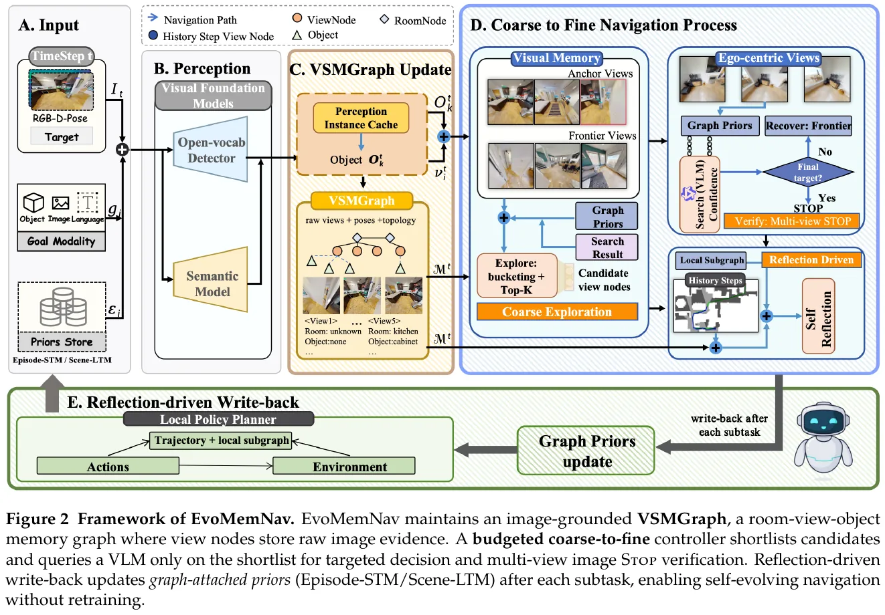
<figcaption>
EvoMemNav detailed framework: the image-based VSMGraph topological memory graph, the budget-constrained "coarse-to-fine" navigation decision system, and the reflection-driven online self-evolving prior writing strategy
</figcaption>

#### Module-by-module explanation
{: id="逐模块讲解"}

**① Visual-Semantic Memory Graph (VSMGraph) construction**
- **Input**: The posed RGB-D observation stream $I_t = \langle I_t^{rgb}, I_t^{depth}, p_t \rangle$ and a 2D occupancy grid $M_t$ as metric support.
- **Processing**: View nodes are added online to the occupancy grid along the robot's trajectory, with traversability edges established from collision-free paths. A 3D goal-candidate cache $O_{map}$ is maintained by a lightweight object detection model (YOLOv8-World & SAM), but it is only used to attach weak "goal visibility" labels (visibility edges) to view nodes and not to compress image information. View nodes are divided into:
  - **Anchor Views** $V_{A,t}$: explored areas rich in object observations, storing the original image, pose, and weak labels of visible goals.
  - **Frontier Views** $V_{F,t}$: unexplored areas at the exploration boundary, connected to the nearest explored view, representing explorable frontier directions.
In addition, CLIP extracts the room category and classifies each view $\rho_v$, forming a hierarchical "Room-View-Object" topological map.
- **Output**: The graph structure $G_t = (R_t, V_t, O_t, E_t)$.
- **Motivation**: Using the original view as first-class memory fully retains fine-grained detail for direct image-level analysis and verification by the VLM, avoiding hard-classification errors caused by detection mistakes; topological edges and soft room-category labels are used to speed up retrieval.

  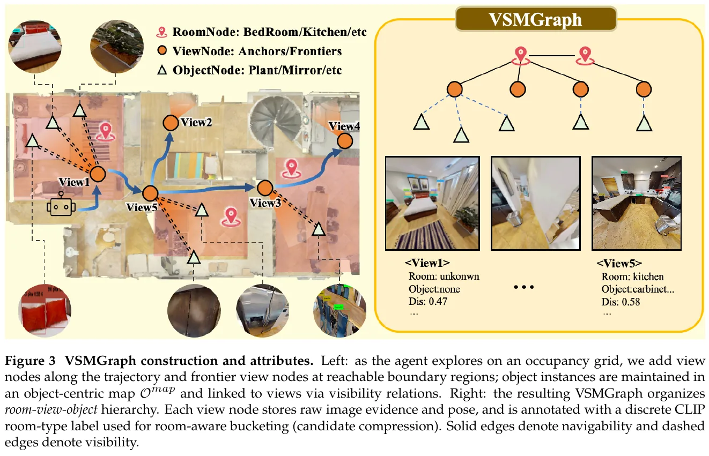
<figcaption>
VSMGraph construction process: organizing visual information by topological relations and the room-view-object hierarchy
</figcaption>

**② Budget-constrained coarse-to-fine navigation decision (Coarse-to-Fine Policy)**
- **Input**: The multimodal goal $g$ and the current topological map $G_t$.
- **Processing**:
  - **Coarse stage (Explore - candidate compression and routing)**: Filters a large number of anchor and frontier views and keeps only the most relevant Top-K candidates (the anchor candidate set $C_t^A$ has budget $K_A$, and the frontier candidate set $C_t^F$ has budget $K_F$). Candidates are first screened by room-category association and lightweight goal hits. If the anchor set is empty, the agent is routed directly to a frontier; otherwise it enters the fine stage.
  - **Fine stage (Search+Verify - local selection and verification)**: The filtered candidate pool $C_t = C_t^A \cup C_t^F$ is given to the VLM (Qwen3-VL-8B). The VLM only needs to reason in a single step over this streamlined short list:
    $$a_t, \sigma_t = \text{VLM}(g, C_t)$$
Here $a_t$ is the selected target point and $\sigma_t \in \{\text{certain}, \text{uncertain}, \text{unknown}\}$ is the confidence level. If the VLM selects an anchor view but the confidence is insufficient (`uncertain`/`unknown`), the system is forced to fall back to frontier exploration to avoid blind decisions.
  - **Verification step (Verify - multi-view Stop verification)**: When the agent reaches the selected anchor view, it does not stop immediately; instead it calls the VLM to perform a final multi-view Stop verification using multi-angle views at the current position, returning `STOP` or `RESELECT`. If the result is `RESELECT`, the current anchor is put into a cooldown queue and the agent returns to the coarse stage, preventing premature-stop errors caused by a limited local field of view.
  - **Recovery mechanism (Recover)**: If a deadlock or repeated cooldowns are detected, the Recover mechanism is triggered, forcing the agent to perform pure frontier exploration for a while.
- **Output**: The endpoint of the next motion path, or the `STOP` command.
- **Motivation**: Coarse filtering keeps the VLM's compute overhead under control (avoiding the token explosion of retrieving over all images), while local fine-grained comparison at the multi-view image level improves the accuracy of distinguishing multiple instances.

**③ Reflection-driven online memory adaptation (RDCMA)**
- **Input**: The trajectory events of historical subtasks (such as frequently visited rooms, blocked exploration frontiers, and loop detections) and multi-view verification results (STOP / RESELECT).
- **Processing**: At the end of a task, the results are summarized into lightweight statistical priors keyed by the goal-conditioned signature $s_g$ (category or modality) and written back to the corresponding room/view/frontier nodes attached to the graph:
  - **Short-term memory (Episode-STM)**: Caches obstacle-avoidance and path-penalty information within the current episode to avoid circling repeatedly within one task, and is reset at the end of the episode.
  - **Long-term memory (Scene-LTM)**: Records the probability that a room supports specific objects (for example, a kitchen is more likely to contain a refrigerator) and the stopping reliability of specific anchors; it is kept for the long term and reused across subtasks.
In the Explore stage, these priors adjust the ranking of filtered candidates as a "weighted tie-breaker" to guide the exploration direction; in the Verify stage, they are fed to the VLM as hints indicating whether the current region has been successfully verified before.
Stale priors are eliminated through exponential decay, only the Top-K items are retained, and conflicting priors are suppressed.
- **Output**: Memory priors attached to the graph.
- **Motivation**: To achieve non-parametric, lightweight adaptation, so that in unknown lifelong tasks the agent grows "smarter and smarter" over time: the more familiar it is with the current environment, the higher its navigation success rate.

  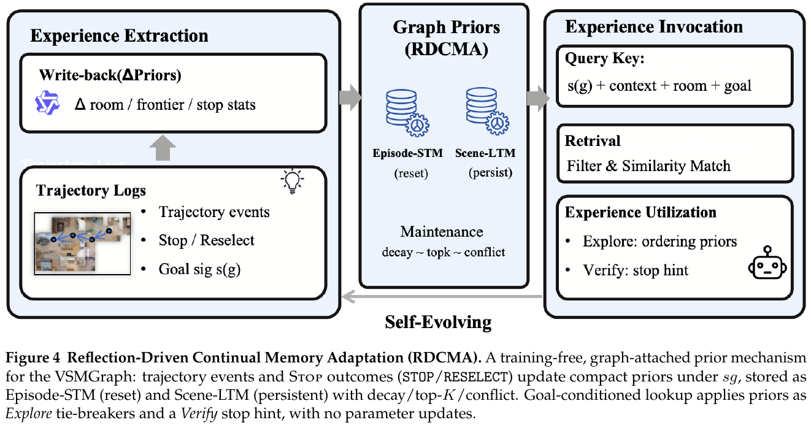
<figcaption>
How reflection-driven online memory adaptation (RDCMA) works
</figcaption>

---

### 3. Results and findings
{: id="3-核心结果发现-19"}

1. **GOAT-Bench lifelong multimodal navigation**:
On the GOAT-Bench val-unseen split, EvoMemNav achieves the best results of **59.6% SR** and **38.9% SPL** (see the table below), clearly ahead of the earlier image-level topological memory methods 3D-Mem (42.6% SR / 22.8% SPL) and MSGNav (52.0% SR / 29.6% SPL).

| Method | Category | No training required | SR (%) ↑ | SPL (%) ↑ |
|---|---|---|---|---|
| SenseAct-NN Monolithic [20] | Monolithic learning type | ❌ | 12.3 | 6.8 |
| CLIP on Wheels [20] | Modular zero-shot | ✓ | 16.1 | 10.4 |
| Modular GOAT [20] | Modular zero-shot | ✓ | 24.9 | 17.2 |
| TANGO [28] | Modular zero-shot | ✓ | 32.1 | 16.5 |
| 3D-Mem [46] | Modular topology | ✓ | 42.6 | 22.8 |
| MSGNav [17] | Modular topology | ✓ | 52.0 | 29.6 |
| **EvoMemNav (Ours)** | **Modular topology (self-evolution)** | **✓** | **59.6** | **38.9** |

2. **HM3D ObjectGoal Navigation**:
On the HM3D pure goal-navigation task (ObjectGoal), EvoMemNav sets or approaches the best results among training-free methods on both HM3Dv1 (59.2% SR / 33.6% SPL) and HM3Dv2 (63.8% SR / 39.4% SPL).

3. **Ablations and efficiency analysis**:
   - Relative to a topological baseline with no coarse filtering at all, adding VSMGraph increases SR by 7.2%, and the coarse filtering (Coarse) module alone brings a huge SR jump of **+11.6%**, making it the main source of the performance gain.
   - The reflection module RDCMA further improves the overall SR by 4.0% (from 60.8% to 64.8%), and the gain is most evident in the 3rd to 5th subtasks (mid-sequence subtasks), indicating that as memory keeps being written and evolving within a scene, the agent's performance becomes increasingly robust.
   - Compared with 3D-Mem, thanks to the shortlist mechanism of the coarse stage, the number of VLM calls drops from 10.7 to 6.5 (a 39% reduction) and the time per subtask plummets from 102.2s to 58.7s (a 42.5% reduction), striking an excellent balance between performance and efficiency.

---

### 4. Limitations
{: id="4-局限性-19"}

1. **Multimodal goal recognition is still limited by the perception module**: Although VSMGraph removes the absolute dependence of downstream reasoning on detection boxes, generating the soft labels for the coarse stage still depends on 2D detectors such as YOLOv8-World and SAM. In extremely noisy or low-light environments, if detection labels are completely lost or biased, the correct anchor may be dropped from the Top-K list during filtering, dragging down the accuracy of coarse screening.
2. **Prior expression and retrieval granularity in reflection can still be improved**: The current RDCMA prior writing is based on simple support and error-rate counts over discrete CLIP room types and stop events. For extremely complex room structures with very scattered distributions, or for large-scale out-of-the-box open worlds, simple graph counting may suffer from memory conflicts. Non-parametric contextual memory retrieval based on small-scale vector embeddings could be considered in the future.

---

## 11. Harness Robotic OS (2026)
{: id="harness-robotic-os"}
——Upgrading quadruped inspection from a navigation stack to an embodied agent runtime

📄 **Paper**: [arXiv:2609.11225](https://arxiv.org/abs/2609.11225)

The paper focuses on the embodied agent runtime, skill orchestration, hierarchical memory, and self-evolution management. The full reading has been moved to .

---

## 12. SparseNav (2026)
{: id="sparsenav"}
——Less is more: training-free VLN with instruction-driven "on-demand" semantic perception

📄 **Paper**: [arXiv:2609.26408](https://arxiv.org/abs/2609.26408)

### Key takeaways
{: id="精华-23"}

- A more complete semantic map is **not always better**: keep the geometry persistently, but perceive, map, and remember semantics only when the current instruction calls for them.
- Turn "whether to call the segmentation model" into a decision made by the VLM itself, so that perception shifts from "running on every frame" to "event-triggered", which saves compute and also reduces noisy annotations in the map.
- Candidate points include both frontier points (exploring the unknown) and local left/front/right points (completing maneuvers such as "go straight and then turn left" in a known area); both are indispensable.
- The BEV image shown to the VLM should be centered on the robot and oriented upward, so that "top/left/right" in the image directly corresponds to "front/left/right" in the language; this makes a difference of 12.5 SR points.
- The VLM is only responsible for "choosing which candidate point"; the trajectory is handed to a classic A* planner for execution, so semantic decision-making and metric execution are fully decoupled.

---

### 1. Background and problem
{: id="1-研究背景问题-22"}

Map-based training-free VLN usually marks every recognizable object in the field of view onto a semantic map (such as the Annotated Semantic Map of MapNav). But for the current decision step, the vast majority of objects are irrelevant to the instruction: they waste segmentation compute, clutter the map seen by the VLM, and introduce false detections. The authors therefore ask: **does wider semantic coverage necessarily improve instruction following?**

---

### 2. Method and innovations
{: id="2-主要方法创新点-22"}

  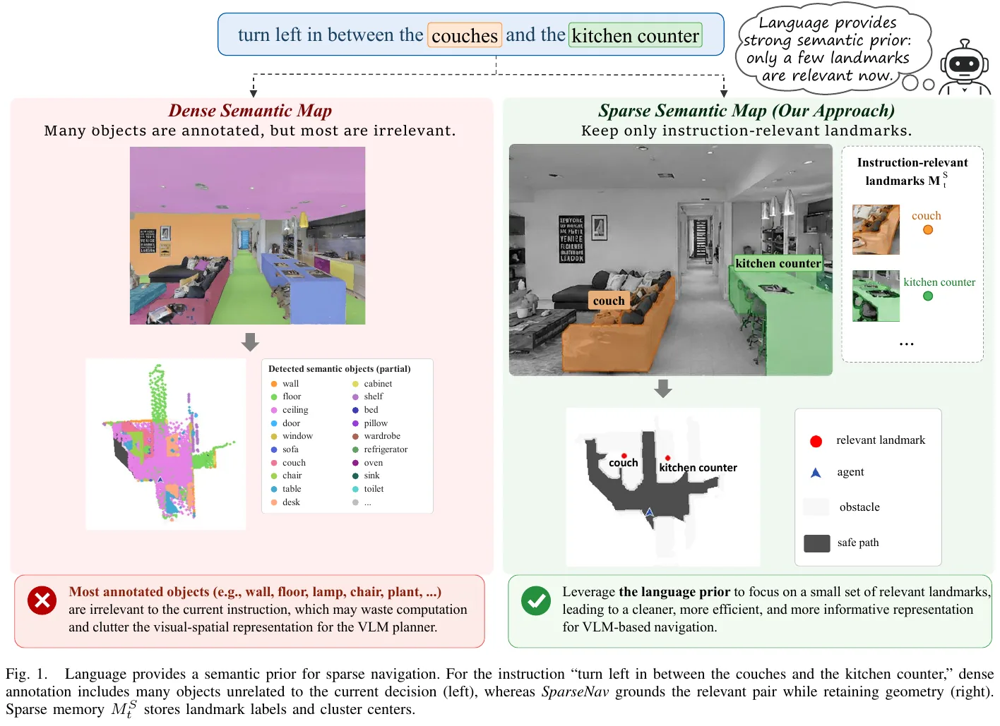
<figcaption>
Dense vs. sparse semantic maps: for the instruction "turn left between the sofa and the kitchen countertop", the dense method marks a large number of irrelevant objects, whereas SparseNav grounds only the two landmarks, the sofa and the kitchen countertop, while retaining the complete geometry
</figcaption>

  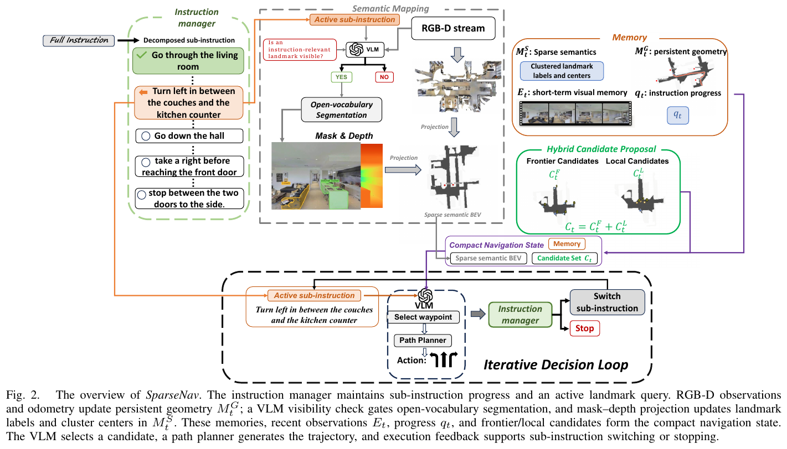
<figcaption>
SparseNav overall framework: the instruction manager maintains sub-instruction progress and the current landmark query; the VLM's visibility judgment decides whether to call open-vocabulary segmentation; mask + depth projection updates the sparse landmark memory; the VLM selects a waypoint among the mixed candidate points, and the path planner executes it
</figcaption>

**① Overall framework**

SparseNav consists of four modules: the **instruction manager** splits the instruction, tracks progress, and gives "which landmarks to look for now"; the **geometry memory** $M_t^G$ continuously maintains a BEV map of obstacles and free space; **sparse semantic perception** calls segmentation only when needed and writes landmark centers into the sparse memory $M_t^S$; **mixed candidate points + VLM decision** selects a waypoint among frontier points and local direction points and hands it to a classic planner for execution. The agent state is written as:

$$\mathcal M_t = (M_t^G, M_t^S, E_t, q_t)$$

Here $E_t$ is the observations of the last few frames, and $q_t$ is the instruction progress.

**② Module-by-module explanation**

**Geometry-centric spatial memory (Geometry-Centric Spatial Memory)**
- **Input**: RGB-D (or LiDAR) point cloud + odometry pose
- **Processing**: Points with height $z_{min} < z < z_{max}$ are rasterized into an obstacle map at resolution $\rho$; elliptical dilation connects scattered wall observations, and a morphological closing fills small holes; obstacles are then inflated by the robot radius $r_a = 0.1$ m
- **Output**: A BEV image **centered on the robot and facing upward**. Coordinates are transformed as $p^{ego} = R(-\theta_t)(p - p_t)$, so the front ($+x$) corresponds to the top of the image and the left ($+y$) corresponds to the left of the image.
- **Motivation**: Geometry is the basis of obstacle avoidance and planning, so it must be persistent and complete; and "facing upward" makes directions in the image align naturally with "front/left/right" in language, so the VLM no longer has to do mental rotation.

> **Example**: The robot is at world coordinates $(5, 5)$, facing due east ($\theta_t = 0°$); the sofa is at $(5, 7)$, 2 m due north of the robot.
> In a fixed north-up global map, the sofa is drawn "above" the robot, and the VLM can easily read it as "the sofa is in front";
> After switching to the upward-facing image, translating first and then rotating by $-\theta_t$ gives $p^{ego} = (0, 2)$, i.e., 2 m along $+y$. It is drawn **on the left of the robot**, exactly matching the instruction "the sofa is on your left".
> In the paper's ablation, the global north-up map reaches only 30.3% SR, a robot-centered but non-rotating map reaches 36.2%, and a robot-centered, upward-facing map reaches 42.8%.

**Hybrid waypoint proposal (Hybrid Waypoint Proposal)**
- **Input**: The geometry BEV and the robot pose
- **Processing**:
  - **Frontier candidates** $\mathcal C_t^F$: cluster the traversable grid cells adjacent to unknown areas, discard small clusters, and pick one reachable point with an obstacle-avoidance margin for each cluster
  - **Local direction candidates** $\mathcal C_t^L$: place one point at distance $d_l$ in each of the three directions $\{-\phi, 0, +\phi\}$ relative to the current heading. Points that fall inside obstacles or disconnected areas are discarded or projected back to free space.
- **Output**: The candidate set $\mathcal C_t = \mathcal C_t^F \cup \mathcal C_t^L$; each point is rendered with a number on the BEV
- **Motivation**: Frontier points can only guide the agent "to places it has never seen", but many instruction actions take place in known areas ("go straight first, then turn left when you reach the sofa"), and the local left/front/right points fill exactly this gap.

**Hierarchical instruction management (Hierarchical Instruction Management)**
- **Input**: The full instruction $I$
- **Processing**: Split it into ordered sub-instructions $S = (s_1, \dots, s_K)$ and maintain the progress $q_t = (i_t, S_t^{done})$; when the current sub-instruction is completed, record it and advance
- **Output**: Three sets of goals (completed / current / pending), and the current **landmark query** $l_i$ (which can contain multiple labels, such as {couch, kitchen counter})
- **Motivation**: Prevents the VLM from re-executing completed actions while deciding "which semantics should be perceived right now"; this is the source of sparse perception

**Instruction-conditioned sparse semantic perception (core innovation)**

This is the most critical part of the paper, and it can be summed up in one sentence: **when semantic perception happens, and what is perceived, are determined by the current sub-instruction.**

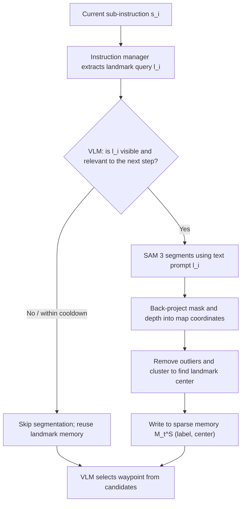

- **Semantic trigger**: The VLM reads $(O_t, E_t, s_i, l_i)$ and outputs a visibility score and a decision on whether to ground, $z_t \in \{0, 1\}$; grounding is triggered only when "the landmark is very likely visible and its metric position will affect the next decision", with a time cooldown to avoid repeated calls
- **Open-vocabulary segmentation**: SAM 3 uses the landmark text as a prompt to obtain instance masks
- **2D→3D projection**: Valid depth pixels inside the mask are back-projected with the camera intrinsics, transformed into the map frame, and clustered after outlier removal
- **Sparse memory**: $M_t^S = \{(\ell_j, \mu_j)\}$ stores only labels and cluster centers; different instances of the same label are stored separately; a new observation updates the nearest matching cluster, or creates a new one otherwise; **landmarks that are no longer queried are also retained** for later reuse

| Dimensions | Dense semantic maps (such as MapNav) | SparseNav |
|---|---|---|
| What to sense | All identifiable objects in the field of view | Only the landmarks named by the current subcommand are sensed |
| When to sense | Continuously sense every frame | Triggered only when VLM determines that it is visible and useful |
| What is stored in the map | A large number of category color blocks | Geometry + a small number of labels and centers of landmarks |

**③ End-to-end data flow**

One decision step: RGB-D and odometry update the geometry BEV → the instruction manager provides the current sub-instruction and landmark query → the VLM decides whether to trigger segmentation, and if triggered, the landmark center is written into the sparse memory → frontier + local candidate points are generated and rendered with numbers → the VLM reads $X_t = \{M_t^G, M_t^S, E_t, s_i, q_t, \mathcal C_t\}$ and outputs a candidate number with a short rationale → A* plans a collision-free trajectory on the inflated obstacle map and executes it → execution feedback decides whether to switch sub-instructions or stop.

**④ Training**

None. The whole pipeline is **training-free**; all experiments (including the real robot) use GPT-5 as the VLM and SAM 3 as the segmentation model.

  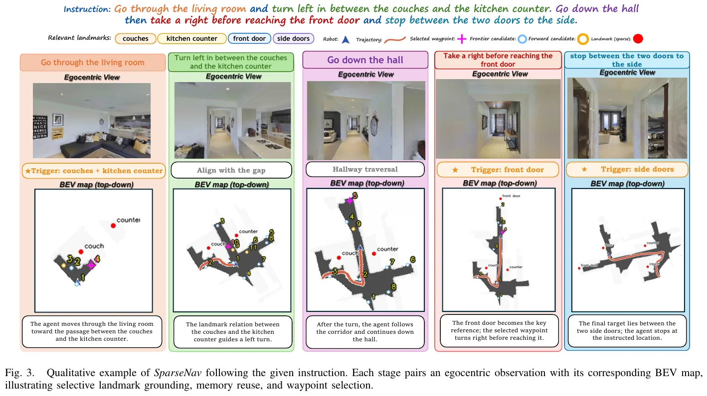
<figcaption>
Qualitative example: each of the five sub-instruction stages is shown with a first-person view and the BEV; the asterisk marks the moments when semantic grounding is actually triggered (sofa + kitchen countertop, front door, side door), while the remaining stages reuse existing landmarks and geometric candidates
</figcaption>

---

### 3. Results and findings
{: id="3-核心结果发现-22"}

**Benchmark results (Val-Unseen)**:

| Method | Setup | R2R-CE SR | R2R-CE SPL | RxR-CE SR | RxR-CE nDTW |
|---|---|---|---|---|---|
| InstructNav | Zero-shot | 31.0 | 24.0 | – | – |
| CA-Nav | Zero-shot | 25.3 | 10.8 | 19.0 | 13.5 |
| DreamNav | Zero-shot | 32.8 | 28.9 | – | – |
| MapNav | Supervision | 39.7 | 37.2 | 32.6 | 43.5 |
| ETPNav | Oversight | 57.0 | 49.0 | 54.8 | 61.9 |
| **SparseNav** | training-free | **42.8** | 35.2 | **40.7** | 48.6 |

**Key ablations**:
- **Semantic policy** (R2R-CE SR): No semantics 34.6 → Dense + persistent perception 36.7 → Dense + on-demand 38.8 → Instruction-related + persistent 40.2 → **Instruction-related + on-demand 42.8**. Both dimensions, "perception scope" and "trigger timing", contribute
- **Candidate points**: local points only 29.1, frontier points only 35.2, frontier + forward 37.4, frontier + left/front/right 42.8
- **Landmark localization**: the VLM estimating position directly 34.6 (error 1.56 m, worse than the 36.5 without localization), bounding-box annotation 40.2 (0.51 m), segmentation 42.8 (0.12 m)
- **Instructions and memory** (RxR-CE): full instruction 29.8 → + temporal memory 31.5 → sub-instructions 33.2 → + progress tracking 35.0 → + persistent landmark memory 40.7; persistent landmark memory has the largest single contribution (+5.7)
- **Trigger quality**: periodic triggering precision/recall 41.5/45.6, visibility only 72.1/99.8, sub-instruction-aware **90.4/99.8**
- **Real robot**: Unitree Go2 + RealSense D455 (mapping and landmark grounding) + Livox MID-360 (localization), with no pre-built map; it completes landmark-conditioned instructions such as "turn left at the quadruped robot, pass the humanoid robot, enter the next room and stop" in several indoor scenes

  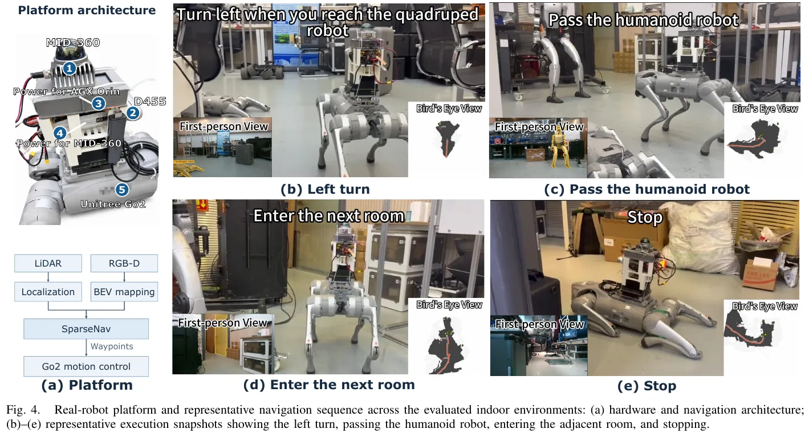
<figcaption>
Real-robot deployment: (a) the Go2 platform and navigation architecture; (b)–(e) four execution snippets: turn left, pass the humanoid robot, enter the adjacent room, and stop. The lower-right corner shows the corresponding BEV
</figcaption>

---

### 4. Limitations
{: id="4-局限性-22"}

Candidate points are generated by rules, and the VLM can only choose among the preset frontier and left/front/right points, so it may miss waypoints that better fit the instruction. Although on-demand segmentation saves perception overhead, VLM inference remains the main source of latency; the serial "perceive→reason→execute" loop makes the robot stop and wait for decisions. In addition, the comparison with other methods in the table uses cross-paper data (different episodes and backbone models). The real-robot part is only qualitative, with no success-rate statistics.

---

## 13. Talk2Escape (2026)
{: id="talk2escape"}
——When lost, just ask: turning multi-turn dialogue into a closed-loop error-correction channel for VLN

📄 **Paper**: [arXiv:2609.28296](https://arxiv.org/abs/2609.28296) · [Project Page](https://zeruili22.github.io/talk2escape/)

### Key takeaways
{: id="精华-24"}

- Single-round VLN is essentially open-loop: an instruction is executed to the end with no verification or error-correction mechanism in between, so small deviations accumulate along the way and cause the task to fail.
- Dialogue serves as **a runtime error-correction safety net**: the robot pauses and asks for help only when an anomaly is detected, rather than merely supplementing its initial plan.
- "When to ask" matters more than "what to ask": sparse, targeted deviation-triggered questions beat high-frequency or timed questioning, and asking too much disrupts the internal reasoning of a strong agent (intervention fatigue).
- Before asking for help, multi-view observations are "translated" into a short question with landmarks, so that the respondent (a human or an Oracle) can answer reliably.
- The module is independent of the base agent and can be attached directly to zero-shot agents such as NavGPT, MapGPT, and GTA. The cleaner the history and the more action-centric the base, the better it digests natural-language error correction.

---

### 1. Background and problem
{: id="1-研究背景问题-23"}

Mainstream VLN is a single-round paradigm: the agent receives an instruction and executes it open-loop, with no mechanism to check progress, request clarification, or recover from errors. On a real robot, sensor noise, odometry drift, and unmapped obstacles are unavoidable, and a small deviation may push the robot into a "lost" state it cannot recover from. Existing conversational VLN methods mostly treat dialogue as supplementary information for the initial plan, depend on fine-tuning with dialogue data, and assume that communication is instantaneous and execution is error-free.

---

### 2. Method and innovations
{: id="2-主要方法创新点-23"}

  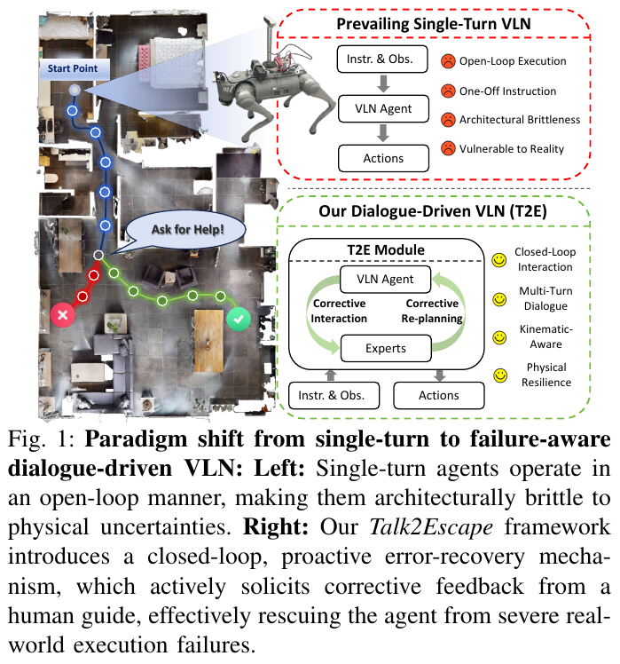
<figcaption>
Paradigm comparison: on the left, single-round open-loop VLN, which cannot recover once it goes astray; on the right, Talk2Escape's closed-loop dialogue paradigm, in which the agent proactively asks for help when it errs, and the expert gives corrective hints before the agent re-plans
</figcaption>

  
<figcaption>
Talk2Escape framework: ① The base agent outputs its kinematic state and actions; ② the kinematic monitor detects spinning in place or deviation and triggers a pause; ③ the vision-language translator converts the current RGB-D observation into a short help request; ④ the Oracle/human gives corrective hints based on relative direction and distance; ⑤ the whole dialogue is injected into the MLLM prompt, and the agent re-plans accordingly
</figcaption>

**① Overall framework**

Talk2Escape is an intervention module attached to any zero-shot base agent. A **kinematic monitor** detects trouble; a **vision-language translator** expresses the situation as a question; and **prompt generation and injection** inserts corrective information into the base MLLM prompt. It adds communication actions $\mathcal A^c$ alongside physical actions $\mathcal A^p$, changing the policy from $a_t = \pi(H_t)$ to $a_t = \pi(H_t \cup D_k)$. Here, $D_k = \{(Q_1, F_1), \dots, (Q_k, F_k)\}$ is the question–answer history up to interaction $k$. No fine-tuning is performed; Gemini 3.1 Pro is the reasoning engine.

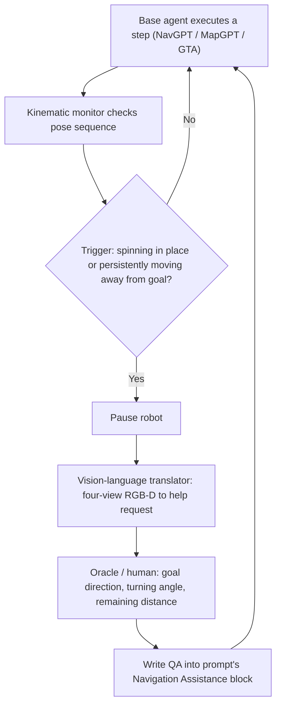

**② Module-by-module explanation**

**Base navigation agent (Base Navigation Agent)**
- **Input**: At each step, RGB-D views $O_t$ in four orthogonal directions (0°/90°/180°/270°), the pose $p_t$, and the history $H_t$
- **Processing**: The MLLM specifies the navigation target with normalized pixel coordinates $(u, v)$; stronger bases (such as GTA) also maintain a TSDF top view and a topological map
- **Output**: A physical action (discrete action, relative waypoint, or pixel coordinate), handed to the low-level controller for execution
- **Motivation**: Talk2Escape does not change the base agent and only adds a closed loop around it, so "independence from the base" can be verified

**Kinematic monitor and trigger conditions (core mechanism)**

The paper compares six intervention strategies: None (no intervention), Repeat, Deviation, Hybrid (either of the two), Periodic (a prompt every $k_{per} = 5$ steps), and Human-in-the-Loop. The two automatic trigger conditions are:

- **Repeat trigger (turning in place)**: within radius $r = 0.5$ m of the current position, the agent has been visited at least $n = 3$ times in its history:

$$\mathcal C_{rep}(t) = \mathbb 1\left[ \left\lvert \{ \tau \in [0, t] : \lVert p_\tau - p_t \rVert_{xz} < r \} \right\rvert \ge n \right]$$

- **Deviation trigger (continuously moving away from the target)**: let $d_t = \lVert p_t - p_g \rVert_{xz}$ be the horizontal distance to the target, and compare "the last two steps" with "the two steps before" using a sliding average over a window of $k = 2$:

$$\mathcal C_{away}(t) = \mathbb 1\left[ \bar d_{t,k} > \bar d_{t-k,k} \right], \quad \bar d_{t,k} = \frac{1}{k} \sum_{i=0}^{k-1} d_{t-i}$$

> **Example** (deviation trigger, $k = 2$): the distances to the target over four consecutive steps are 8.0, 7.0, 7.2, 7.6 m.
> Looking at a single step only, the third step (7.0 to 7.2) would cause a false trigger; it is just small motion jitter.
> With the sliding average: the mean of the last two steps is $(7.6 + 7.2)/2 = 7.4$ and the mean of the two steps before is $(7.0 + 8.0)/2 = 7.5$; since $7.4 < 7.5$, it **does not trigger**.
> If the next step's distance becomes 8.0: the mean of the last two steps is $(8.0 + 7.6)/2 = 7.8$ and the mean of the two before is $(7.2 + 7.0)/2 = 7.1$; since $7.8 > 7.1$, it **triggers**, because the agent really is continuing to move away from the target.

Note: the deviation trigger requires knowing the target position $p_g$, which is ground-truth information in simulation; on the real robot, a human supervisor decides whether to intervene according to the same criterion.

**Vision-language translator (Help-Seeking)**
- **Input**: The four-view RGB-D observations at the moment of triggering, plus the trigger type
- **Processing**: The MLLM does three things in order: summarizes the local scene; determines the most likely failure mode from the trigger condition (wandering in a corridor, facing a dead end, stuck at an intersection); and generates a short help request
- **Output**: For example, "I'm stuck at this intersection and there's a sofa in front of me. Where should I go?"
- **Motivation**: Raw multi-view images carry a lot of information and are hard to grasp quickly; the translator is constrained to mention only observable landmarks and relative directions, and not to speculate about unseen areas

**Oracle prompt generation and injection**
- **Input**: The agent's heading $\psi_t$ and the target azimuth $\phi_t = \mathrm{atan2}(p_g^z - p_t^z,\ p_g^x - p_t^x)$
- **Processing**: Compute the relative angle $\theta_t = \phi_t - \psi_t \in (-180°, 180°]$; if $d_t < d_{th}$, answer "You are very close to the target"; otherwise answer "The target is on your [left/right]; turn [left/right] by about $\lvert \theta_t \rvert$ degrees; the distance is $d_t$ meters"
- **Output**: The question-answer pair is written into the MLLM prompt in a dedicated **Navigation Assistance** block, placed between the historical context and the current visual input
- **Motivation**: Gives clear, egocentric corrective instructions so the agent can escape its current failure state

**③ Training**

None. The whole framework runs zero-shot on a frozen MLLM and does not rely on fine-tuning with any dialogue data.

---

### 3. Results and findings
{: id="3-核心结果发现-23"}

**R2R-CE / RxR-CE (Val-Unseen sampled subsets: 100 episodes for R2R-CE, 260 for RxR-CE)**:

| Methods | R2R-CE SR | R2R-CE SPL | RxR-CE SR | RxR-CE SPL | RxR-CE nDTW |
|---|---|---|---|---|---|
| Efficient-VLN (best supervision) | 64.2 | 55.9 | 67.0 | 54.3 | 68.4 |
| GTA (zero-shot) | 48.8 | 41.8 | 46.2 | 39.3 | 57.4 |
| T2E + NavGPT | 64.0 | 46.4 | 50.4 | 27.2 | 45.7 |
| **T2E + GTA** | **72.0** | 49.4 | **62.9** | 34.2 | 49.9 |

- SR improves greatly, but SPL and nDTW on RxR-CE decrease: error correction requires backtracking and detours, so paths get longer. This is a trade-off of "exchanging path efficiency for success rate"
- **Inconsistent numbers**: The abstract states an R2R-CE SR of 66.0%, whereas Table I and the text give 72.0% for T2E + GTA; in Table IV, Deviation triggering on the same 100 episodes gives an SPL of 49.4 but an SR of 66.0%. The paper does not explain the discrepancy. Please be careful when citing.
- **VLNVerse (base-agnostic)**: NavGPT 19.3 → +CoT 28.7 → **+T2E 84.6**; MapGPT 25.5 → +CoT 42.2 → +T2E 67.0. A passive chain of thought is far inferior to active dialogue
- **A counter-intuitive finding**: MapGPT outperforms NavGPT on its own, but is even worse once T2E is attached. The authors attribute this to a modality mismatch: the many absolute 3D coordinates in MapGPT's hints conflict with the relative, egocentric hints given by the Oracle.

**Trigger strategy ablation (R2R-CE, the same 100 episodes, GTA as the base)**:

| Strategy | SR | SPL | Trigger Rate |
|---|---|---|---|
| None | 48.8 | 41.8 | 0% |
| Repeat | 57.0 | 45.1 | 4.74% |
| **Deviation** | **66.0** | **49.4** | 15.0% |
| Hybrid | 54.0 | 44.5 | 23.1% |
| Periodic (k=5) | 63.0 | 46.5 | 10.2% |
| Human-in-the-Loop | 74.5 | 61.2 | 9.8% |

Hybrid triggers too frequently and falls to 54.0%, showing that asking more questions is not necessarily better.

  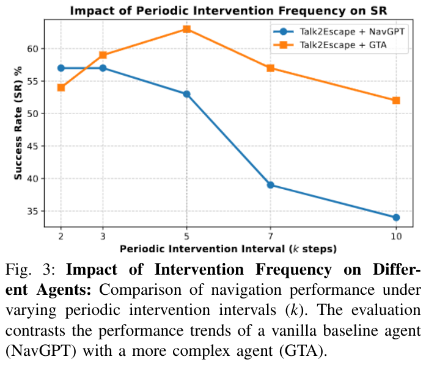
<figcaption>
Effect of the periodic intervention interval k on different bases: for the weak base NavGPT, performance decreases roughly linearly as the interval grows (it depends on continuous external guidance); for the strong base GTA, it follows an inverted U with k=5 the best, and asking too frequently interrupts its internal reasoning
</figcaption>

**Real robot (Unitree Go2, gimbal depth camera scanning orthogonal views, MLLM outputting waypoints asynchronously)**: SR rises from GTA's 40.0% to 62.0% and NE falls from 3.66 m to 3.31 m; the supervised methods VLN-BERT and RDP reach 16.0% and 20.0%. On the real robot, human supervisors intervene according to the Deviation criterion.

  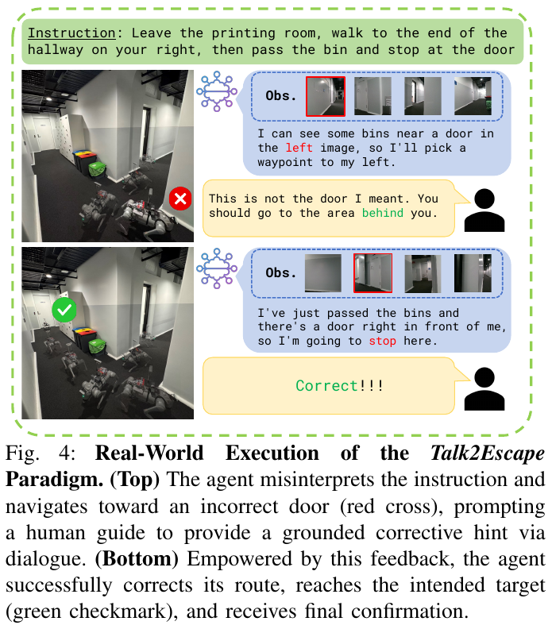
<figcaption>
Real-robot example: in the upper row the agent misreads the instruction and goes to the wrong door, and the human gives the correction "It's not this door, go to the area behind you"; in the lower row the agent changes its route accordingly, reaches the correct target, and is confirmed
</figcaption>

---

### 4. Limitations
{: id="4-局限性-23"}

The Oracle prompts and Deviation triggers in simulation directly use the target's true position (azimuth and distance), which amounts to privileged information, so the comparison with methods that rely only on single-round instructions is not like-for-like; the real robot relies on human supervisors. The authors also point out an "asymmetric context" bottleneck: humans see only discrete static images and can hardly reconstruct the robot's global orientation and local obstacles, so the hints they give may be vague. In addition, R2R-CE is evaluated on only 100 sampled episodes, so the statistics fluctuate considerably.

---

## 14. SuperNav (2026)
{: id="supernav"}
——Turn a general-purpose multimodal model into a continuing navigation agent through navigation skills, visual-point tools, and context management

📄 **Paper**: [arXiv:2610.12126](https://arxiv.org/abs/2610.12126) · [Project Page](https://zju3dv.github.io/SuperNav/)

### Key takeaways
{: id="精华-26"}

SuperNav separates responsibilities: a general-purpose multimodal model interprets requests, understands scenes, and selects destinations, while tools handle path planning and motion control.
Navigation performance also depends on the surrounding execution framework: readable skills, convenient destination-selection tools, task-progress records, and context management support search, verification, and recovery.
A shared image-point interface connects the same high-level decision loop to geometric or learned motion backends, although their sensing and geometric resources differ, and similar success rates can conceal different path efficiency.
“No navigation-specific fine-tuning” applies to the high-level MLLM; the learned executor is trained on simulator expert trajectories, while geometric execution uses depth and navigable geometry.

---

### 1. Background and problem
{: id="1-研究背景问题-25"}

Service robots must interpret requests such as “find the specified sofa” and “visit several objects in order,” infer suitable targets from needs such as “find somewhere to rest,” and keep exploring and verifying in unfamiliar scenes.
Fixed modular workflows usually prescribe when a model participates, rechecks a candidate, or stops, requiring workflow changes for new tasks; directly fine-tuning a VLM to predict navigation actions is constrained by training-task and scene coverage.
SuperNav therefore preserves the pretrained MLLM's general capabilities and uses an agent harness to organize tool calls, skill reading, and history management, allowing feedback to guide each subsequent decision.

---

### 2. Method and innovations
{: id="2-主要方法创新点-25"}

  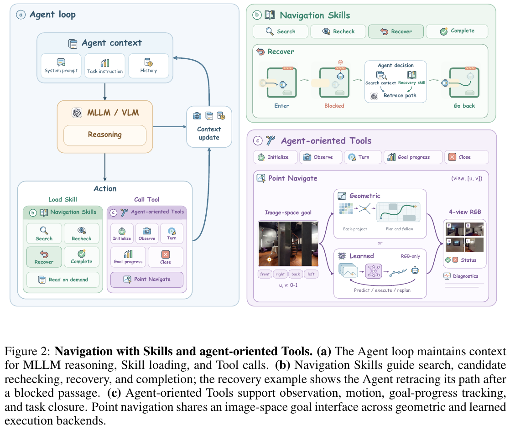
<figcaption>Figure 2: SuperNav's overall framework. The agent loop maintains context; Navigation Skills guide search, rechecking, recovery, and completion; tools execute observation and motion through a shared image-point interface for two motion backends.</figcaption>

**Overall framework.** SuperNav combines an agent loop, Navigation Skills, and agent-oriented navigation tools: the loop presents requests, history, and feedback to the MLLM; skills provide readable procedural experience; tools translate selected destinations into movement and return fresh observations.

**① Agent loop: connect each action to earlier evidence.** Inputs are the task instruction, current images, textual interaction history, and pending-goal records. The MLLM chooses to observe, move, read a skill, update goal state, or close the session, and tool results enter the next decision context.
For example, when approaching a presumed sofa reveals a bed, the model should continue searching using the new images.
The implementation uses Codex CLI for the loop and MCP for environment tools. The high-level model receives RGB observations and execution feedback rather than absolute poses, maps, or evaluator target information.

Long tasks use **media-only pruning**: once newer observations supersede old images, their media payloads are omitted from subsequent requests while textual history, task state, and image paths remain; earlier images can be reread when needed.
This reduces repeated image input while preserving inspected areas, failed attempts, and unfinished goals. Returning to an earlier area relies on visual recognition and records, rather than a stored executable return path.

**② Navigation Skills: experience as readable procedural guidance.** Each skill is a Markdown package specifying applicable situations, evidence to inspect, recommended steps, and references. The model sees names and descriptions first and reads relevant instructions on demand.
Search guidance asks it to record inspected areas, visible entrances, and uncertain branches; recovery guidance suggests changing a point or route, stepping back, or finding an entrance; completion guidance asks it to verify appearance, requested relations, and surrounding context before updating goal records.
Skills influence reasoning by entering the context, while the MLLM chooses each action.

| Dimension | Fixed modular navigation workflow | SuperNav skills and loop |
|---|---|---|
| Decision order | Program logic prescribes transitions between exploration, verification, and termination | The model selects the next operation from the request and feedback |
| Adding experience | Implement workflow branches or dedicated modules | Read written guidance for search, recovery, and completion |
| Effect of guidance | Program logic executes prescribed procedures | Skills recommend procedures without enforcing action sequences |

**③ Visual-point tools: specify the destination in an image and delegate movement to the backend.** Observations provide front, right, back, and left RGB images relative to the robot's heading when captured. The model selects a view and coordinates normalized from the top-left corner:

$$
\operatorname{PointNav}(d,[u,v]),\qquad u,v\in[0,1].
$$

Here $d$ identifies the view, and $u$ and $v$ are horizontal and vertical coordinates. A selected point can lie on a candidate object or visible floor, allowing the robot to approach a target or obtain a better view.
After movement or turning, the tool returns fresh four-view images, execution status, and concise diagnostics, allowing immediate rechecking without a separate observation call after every movement.

> **Example:** Selecting $[0.5,0.75]$ in a 640 × 480 right-view image approximately identifies horizontal pixel 320 and vertical pixel 360.
> This specifies a visual destination, without supplying a heading change or travel distance, or guaranteeing direct reachability; the motion tool handles those questions.

The same pointing interface connects two backends:

| Backend | Inputs and processing | Output and role |
|---|---|---|
| Geo-based Executor | Uses depth, camera calibration, and pose to back-project the pixel, select a reachable position, and plan and follow a path | Completes a movement and returns observations; simulation uses a precomputed navigation mesh, while deployment uses LiDAR mapping and odometry |
| Learned Executor | Reads a marked reference RGB image and subsequent RGB history, predicts short displacement sequences and a local stop signal, and repeatedly executes and replans | Completes a local movement and returns observations; policy inference requires no depth back-projection or navigation-mesh planning |

A shared high-level interface therefore does not imply shared low-level resources: geometric execution uses geometry internally, while the simulated learned backend still uses position changes and collision reports to monitor progress.

  
<figcaption>Figure 4: Demand-driven navigation. For a request to make a workspace clear and usable, the agent finds a table, identifies a vase to clear, and finds a suitable shelf; the example demonstrates navigation and target judgments.</figcaption>

**④ Learned Executor: a fixed goal reference with a changing current view.** After the high-level model selects a reference image and pixel, the executor draws a red ring and central dot at that point. The reference image and point remain fixed throughout the local request, while current RGB observations change with movement.
A shared DINOv2 ViT-S/14 encodes 224 × 224 images into 384-dimensional global features. History features are projected into 256-dimensional observation tokens; concatenated current-image and marked-reference features pass through a 768 → 256 → 256 MLP to form the goal token.
This goal token relates the initially selected destination to the current scene for motion prediction.

  
<figcaption>Figure 6: Learned Executor. A shared visual encoder processes the marked reference and RGB history. An age-aware Transformer fuses the inputs, a flow action head generates displacement increments, and a stop head decides whether the current movement request should end.</figcaption>

**Variable-length visual history** preserves the starting frame and emphasizes recent observations, with at most 12 frames per fusion pass.
Selection starts from stride-two history frames plus the current frame. When over budget, it repeatedly thins the older half while preserving the start and current frames. Each frame receives an age encoding indicating how many observations have elapsed; a four-layer, four-head Transformer fuses these tokens with the goal token, and valid-token mean pooling produces the condition $c_t$.
Cached image features can be reused, while their age encodings update at the current time, preserving temporal information for unevenly spaced observations.

> **Frame-index example:** At $t=8$, the paper selects $[0,2,4,6,8]$; at $t=60$, it selects $[0,30,42,46,48,50,52,54,56,58,60]$.
> The latter uses only 11 frames while retaining the initial view and dense recent observations. Omitted frames can remain in history and the feature cache; the 12-frame limit applies to a single fusion pass.

**⑤ Motion prediction and training objectives.** Conditioned on $c_t$, a one-dimensional U-Net generates 8 two-dimensional displacement increments, all expressed in the robot's fixed coordinate frame at prediction time, with forward and left axes. Multiplying by 0.25 m converts normalized predictions to physical displacements.
Training uses Habitat greedy-follower expert trajectories. Future positions are projected into the initial image to form goal points, with depth checking occlusion during data generation; for object-surface markers, the corresponding ground-level approach position supplies the trajectory.
Normalized increments are clipped componentwise to $[-1,1]$, with zero increments after the expert endpoint.

> **Example:** Simplify to 3 normalized increments $[(1,0),(1,1),(0,1)]$. Scaling by 0.25 m gives $(0.25,0)$, $(0.25,0.25)$, and $(0,0.25)$.
> Accumulating in the same prediction-time frame gives waypoints $(0.25,0)$, $(0.50,0.25)$, and $(0.50,0.50)$. The actual policy predicts 8 increments and normally executes only the first 3 before observing and replanning to correct deviations.

The action head uses **flow matching** to learn how noise becomes an expert displacement sequence: it interpolates between the expert sequence $A$ and Gaussian noise $\epsilon$ and learns the interpolation's velocity.

$$
x_\tau=(1-\tau)A+\tau\epsilon,\qquad
\mathcal L_{\mathrm{flow}}=\frac{1}{16}\mathbb E\left[\lVert v_\theta(x_\tau,\tau,c_t)-(\epsilon-A)\rVert_F^2\right].
$$

Here $\tau$ is uniform on $[0,1]$, $\epsilon$ is standard Gaussian noise, and $1/16$ averages over the 8 × 2 sequence components.
A stop head predicts $p_t$, and an auxiliary head estimates the remaining expert-observation steps. The stop label is positive when at most 2 steps remain; the step count includes turning primitives.
The total objective is:

$$
\mathcal L=\mathcal L_{\mathrm{flow}}+0.5\mathcal L_{\mathrm{stop}}+0.002\mathcal L_{\mathrm{remaining}}.
$$

Stopping uses binary cross-entropy with positive-label weight 3, and remaining-step estimation uses squared error.
For classifier-free guidance, 10% of samples replace the goal token with a learned null token while retaining observation history. The latter two losses apply only to samples retaining the goal token.
The executor trains for 45,000 updates with global batch size 256 and jointly fine-tunes the visual encoder. This training is separate from preserving the high-level MLLM without navigation fine-tuning.

**⑥ Inference and termination: a local stop still requires a task-level decision.** Inference starts from Gaussian noise and generates an increment sequence with 4 Euler updates, using $v_{\mathrm{guided}}=v_u+2(v_c-v_u)$ to combine goal-conditioned and null-goal predictions. It selects one of 16 samples by endpoint-direction agreement and path straightness.
The executor normally follows the first three increments, translates them into turning and forward primitives, acquires RGB, and replans. A local stop requires $p_t\geq0.1$ on two consecutive replanning calls plus a motion-progress condition; the auxiliary remaining-step prediction does not gate stopping.
That progress condition requires at least 4 executed primitives overall and at least 3 since the current streak's first above-threshold prediction, or no executed primitives in the previous cycle. Failures and budget exhaustion are reported separately.

> **Two levels of stopping:** After selecting a doorway, the executor may confirm that the movement to it has ended. The sofa remains unfound, so the MLLM must inspect the new views and choose another destination.
> Even when the MLLM closes the session and declares achieved, successful closure only confirms that the session ended; an independent evaluator determines task success.

End to end, a request follows a loop of interpreting goals, inspecting four views, reading relevant skills, selecting a visual point, executing movement and receiving feedback, and rechecking and updating goals until the model decides to terminate. Within one learned-backend tool call, multiple short movement and replanning cycles can occur.

---

### 3. Results and findings
{: id="3-核心结果发现-25"}

**Instance and demand-driven navigation (Table 1).** Main experiments use GPT-5.6 Terra. SR measures success rate, while SPL combines success and path efficiency; each cell below reports **SR (%) / SPL**.

| Method | Single-object (150 tasks) | Ordered multi-object (150 tasks) | Demand-driven (200 tasks) |
|---|---|---|---|
| NaVid | 24.67 / 0.1599 | 2.67 / 0.0216 | 17.00 / 0.0920 |
| UniNaVid | 34.00 / 0.1833 | 1.33 / 0.0131 | 25.00 / 0.0943 |
| StreamVLN | 13.33 / 0.1036 | 0.00 / 0.0000 | 25.50 / 0.0775 |
| OmniNav (Action Former) | 27.33 / 0.2133 | 4.00 / 0.0275 | 37.50 / 0.1213 |
| SuperNav + Geo-based Executor | **78.00 / 0.4127** | **34.00 / 0.1388** | **59.50 / 0.1801** |
| SuperNav + Learned Executor | 68.00 / 0.2059 | **34.00** / 0.0862 | 45.00 / 0.1603 |

The geometric backend exceeds the strongest single-object baseline, UniNaVid, by **44 percentage points**, and OmniNav Action Former on demand-driven navigation by **22 percentage points**. Both SuperNav backends achieve 34% on multi-object tasks, with more efficient paths from geometric execution.
Multi-object tasks contain 2–5 targets. Single-object scoring checks the final position; multi-object scoring checks ordered trajectory arrivals within 1 m of approved viewpoints. Both require explicit STOP.
Demand-driven tasks adapt Demand-Bench's 1–8-stage requests to ordered arrivals within 2 m of admissible objects' horizontal bounding boxes, without object reuse and with explicit STOP, but without additional visibility or line-of-sight checks. These scores are not directly comparable to DemandAgent's original protocol.
Baselines retain native observations and history mechanisms, without fully matching camera counts, fields of view, or low-level geometric resources; the comparison evaluates complete system configurations.

**Category-level navigation (Table 2).** HM3D-OVON uses a shared 120-episode val-unseen subset; HM3Dv2 uses 1,000 validation episodes. Thresholds apply to the shortest navigable distance from the final position to the nearest goal viewpoint; cells report **SR (%) / SPL**.

| SuperNav backend | OVON, 0.25 m | OVON, 1 m | HM3Dv2, 0.2 m | HM3Dv2, 1 m |
|---|---|---|---|---|
| Geo-based Executor | 68.33 / 0.3837 | 73.33 / 0.4105 | 80.30 / 0.3338 | 86.50 / 0.3638 |
| Learned Executor | 65.00 / 0.1355 | 70.83 / 0.1443 | 79.00 / 0.1288 | 85.40 / 0.1383 |

The learned backend retains most success rates but substantially lowers SPL, showing why arrival capability and path efficiency should be evaluated separately.
Published comparison methods differ in episode subsets, action budgets, STOP rules, and execution resources; their reported scores do not establish a ranking under one shared protocol.
SuperNav's OVON scoring neither additionally requires Habitat STOP nor uses the model's verbal judgment. Two designated unreachable-goal episodes per configuration receive SR and SPL contributions of one under the adopted rule.

**Skill, tool, and model ablations (Table 3).** Geo-based Executor, the 120 OVON episodes, and GPT-5.6 Terra (high) are fixed, except the last row changes both model and reasoning setting:

| Configuration | SR, 0.25 m (%) | SPL, 0.25 m | SR, 1 m (%) | SPL, 1 m |
|---|---|---|---|---|
| Full SuperNav | 68.33 | 0.3837 | 73.33 | 0.4105 |
| Without Navigation Skills | 35.00 | 0.2460 | 54.17 | 0.3894 |
| Front-only interaction | 52.50 | 0.2230 | 65.83 | 0.2855 |
| Without skills and tool design | 31.67 | 0.1870 | 54.17 | 0.3417 |
| External language grounding and candidate selection | 55.83 | 0.3201 | 62.50 | 0.3624 |
| GPT-6 Astra (medium) + full harness | **71.67** | **0.4579** | **79.17** | **0.4974** |

At the stricter 0.25 m threshold, removing skills lowers SR by **33.33 percentage points**. Front-only interaction lowers it by **15.83 percentage points** and increases mean turning-tool calls from 0.41 to 17.56 (Table 6).
Replacing direct pointing with LocateAnything language grounding and candidate selection does not improve performance. Astra (medium) improves SR and SPL, although changing both model and reasoning setting prevents attributing the gain to either alone.

**Long sequences and robot deployment.** On eligible five-goal multi-object tasks, the geometric backend completes the first five goals with a 39.47% stage success rate; five-stage demand-driven success is only 9.09%. No method completes six or more demand stages, for which only 3, 2, and 1 tasks qualify at stages six, seven, and eight respectively (Table 4), leaving long sequences a clear challenge.
Stage success uses tasks with at least that many goals and does not require STOP; it is distinct from complete-task success.
Unitree Go2 demonstrations use four-view RGB and LiDAR geometric execution to find a basketball, find another Go2, and visit a printer followed by a bin. The paper provides qualitative demonstrations rather than a large-scale real-robot success rate.

  
<figcaption>Figure 5: Unitree Go2 demonstrations show single-goal search, route revision after blockage, close-range verification, and transitions from a printer to a bin.</figcaption>

---

### 4. Limitations
{: id="4-局限性-25"}

Semantic and completion judgments depend on the MLLM, and inference cost and latency variation affect execution efficiency. Geometric execution requires maps or scene geometry, while learned-backend path efficiency and long-sequence reliability need improvement.
Demand-driven evaluation measures ordered arrivals at relevant targets rather than carrying out activities such as moving objects or organizing a workspace. External benchmark comparisons differ in protocol, and robot validation is mainly qualitative.

---

## 15. NavHarness (2026)
{: id="navharness"}
——Sustain navigation through cross-session handovers, external memory, and two-stage verification

📄 **Paper**: [arXiv:2609.34276](https://arxiv.org/abs/2609.34276) · [Code](https://github.com/billzhao1030/NavHarness) · [Project Page](https://billzhao1030.github.io)

NavHarness is an embodied-agent harness centered on continuing navigation. It keeps spatial maps, task records, and experiential memory outside reasoning sessions so that fresh sessions can inherit searched areas, pending branches, and failure evidence, with recovery handovers, pre-stop verification, and post-stop certification supporting further navigation. Evaluations cover GOAT-Bench multimodal-goal navigation, IR2R-CE instruction navigation, and simulated continuous deployment across 36 houses, making the paper relevant to navigation tasks and long-term memory.

**Full analysis and experimental results**: [NavHarness: session handovers, memory reuse, and continuing navigation (Embodied Agents: Paper Readings, entry 9)](/en/Embodied-Agent-Papers/#navharness).

---

## 16. EvoLife (2026)
{: id="evolife"}
——Turn directions into place memories so that the next navigation task can build on experience

📄 **Paper**: [arXiv:2610.39446v1](https://arxiv.org/abs/2610.39446v1) · [Project Page](https://kai-sheng-caesar.github.io/EvoLife-Web/)

---

### Key takeaways
{: id="精华-27"}

EvoLife lets a single multimodal agent decide how to move, when to ask for help, and which experiences to retain. Its hybrid action space gives the same decision maker waypoint selection, floor-pixel selection, object approach, and local adjustment, while a geometric backend turns these intentions into executable movement. Directions and target cues acquired through interaction are grounded in actual places, so one question can resolve immediate ambiguity and support later revisits. Here, “evolution” means accumulating and revising maps, places, and dialogue records; the paper introduces no new parameter-training objective. The reported 100% SR must be read with its information conditions: the main experiments permit questions to an independent guide with privileged target and route information and evaluate sampled task sets.

---

### 1. Background and problem
{: id="1-研究背景问题-26"}

A robot operating in an environment over time must select suitable movement interfaces, ask for help when instructions are ambiguous or passages are blocked, and preserve verified places and routes for subsequent tasks. Existing policies, interaction mechanisms, and spatial memories provide parts of this capability; EvoLife connects them through a unified tool loop so that an interaction can influence both the current action and future experience. The tasks cover route following, object search, instance disambiguation, and continuous multi-goal navigation, without a prebuilt map supplied to the navigation agent on its first visit.

---

### 2. Method and innovations
{: id="2-主要方法创新点-26"}

  
<figcaption>Original Figure 2: EvoLife connects hybrid actions, active interaction, and persistent memory in one decision loop. Candidate waypoints support current movement; place records preserve poses, descriptions, and question–answer evidence for later visits.</figcaption>

**Overall framework.** EvoLife is a navigation harness built around existing multimodal models. The **hybrid action space** expresses movement intentions, **active interaction** supplies target or route information, and **persistent spatial memory** stores and retrieves acquired experience. At each step, the model reads the current task, observations, tool history, and available memory, then selects a tool and its arguments; the tool returns the actual outcome, informing state updates and the next decision.

**① Hybrid action space: the model expresses where to go, and the backend checks whether it can get there.**

Inputs include front, right, back, and left RGB views and observed geometry constructed from depth; the main simulation experiments also provide simulator poses. Perception tools expose panoramas with candidate waypoints, occupancy maps, historical routes, and places. The model selects among four movement interfaces:

| Movement mode | Agent-selected tool input | Backend processing and purpose |
|---|---|---|
| Waypoint navigation `navigate_candidate` | Geometric candidate waypoint index | Refresh candidates using current RGB-D geometry, plan through observed free space, and execute continuously; useful for longer movements. |
| Local actions `step` | Forward, left turn, or right turn | In simulation, move forward 0.25 m, turn left 15°, or turn right 15° for exploration and final position or orientation adjustment. |
| Pixel navigation `navigate_pixel` | View, normalized floor-pixel coordinates, and image version | Project the selection to a ground waypoint using depth and the camera transform, check reachability, and execute without restricting selection to the candidate set. |
| Object navigation `navigate_object` | Localized object identifier, stand-off distance, and facing options | Find reachable free space near the object and plan an approach, rather than treating its surface as a robot destination. |

**A pixel is not a movement coordinate.** Clicking an image expresses visual intent; RGB-D geometry and reachability checks still have to turn it into a motion target.

> **Worked example:** Suppose the current image is 1000 pixels wide and 500 pixels high. Selecting the normalized floor point `(0.4, 0.8)` corresponds approximately to image pixel `(400, 400)`. This means “move toward this patch of floor in the image,” not “go to world coordinates `(0.4 m, 0.8 m)`.” The backend must read depth, transform the point using calibration and camera pose, and confirm a traversable path. These illustrative dimensions are not the paper's image-resolution settings.

Object navigation adds a semantic-to-geometric grounding step. The agent recognizes an object in current RGB observations and calls `localize_object` with a box or point; the backend filters valid depth, extracts a depth-consistent component, and back-projects it, returning an object identifier, 3D points, and overlays. `verify_object` can reproject the estimate into current views for inspection; `navigate_object` then searches for an appropriate approach position. **The agent remains responsible for recognizing the intended target and deciding when to stop.**

Navigation requests can specify an inspection distance or execution time. Control returns at an inspection checkpoint or destination, or after collision, lack of progress, or budget exhaustion. A backend arrival report is not successful task submission: only `stop` ends the current task or advances to the next subtask.

**② Active interaction: ask a specific question, then verify the answer against new observations.**

  
<figcaption>Original Figure 3: The navigation agent generates a question; an independent multimodal guide uses current views, target views, and a reference route to answer it. Only the natural-language answer reaches the navigator, which selects its own subsequent actions.</figcaption>

`ask_human` takes a question or assistance intent generated from the current goal, views, and relevant memory, and returns natural-language feedback. It can clarify which table is intended, ask which doorway to use, or request that a person open a door in a physical deployment. The paper introduces neither a separately trained question classifier nor a fixed confidence threshold: the multimodal model chooses when to ask as part of tool selection.

**The simulated guide's information is essential to interpreting the results.** Guide and navigator run in independent sessions; the main experiments use **GPT-6 Astra (ultra)** for both. Beyond instructions, current views, target information, and dialogue history, the guide can access the current pose, target position, shortest navigable path, relevant maps, and reference-route visualizations. It translates this privileged information into directions, landmarks, and spatial relations. The navigator does not directly receive target coordinates, complete reference paths, or private maps; each subtask permits at most 10 interactions. In VL-LN and CoIN, the navigator initially receives only an object category while the guide knows the intended instance, so dialogue also resolves instance ambiguity.

**③ Persistent spatial memory: attach what a question established to an actual place.**

Memory contains four parts: observed geometry $G_t$, the place collection $P_t$, executed routes $R_t$, and retained dialogue $D_t$. Geometry, routes, and spatially associated dialogue are recorded automatically. The agent selectively creates, revises, or retires semantic places. A place record links an identifier, actual pose, name and description, object labels, historical images, associated question–answer evidence, map context, timestamp, and active status.

> **Worked example:** On a first visit to two similar doorways, the guide explains, “Go through the narrow arch; the target is at the end of the picture-lined hallway.” The agent can save the arch entrance as a place, linked to its actual pose, four-view images, and this exchange. Later retrieval supports replanning toward that entrance and checking it against current observations. If a previously open door is now closed, the old record helps establish where to go, while current evidence determines whether passage is possible; the agent can ask again and revise the record. This accumulates retrievable experience rather than updating model weights through revisits.

`remember_place` creates a record at the actual current location or updates an existing identifier. `search_memory` matches names, descriptions, and object labels, with an empty query listing available places. `inspect_place` returns four-view images and details explicitly marked as historical evidence. `navigate_place` **replans using currently observed geometry** toward the stored pose; `resume_navigation` continues after local inspection or avoidance. A revisit therefore does not blindly replay previous actions, and the agent chooses retrieval operations as needed rather than following a fixed retrieval pipeline.

The diagram below isolates how an interaction becomes reusable experience:

**④ Decisions and state updates: a tool loop, with no new loss function.**

The central decision and update rules are:

$$
a_t=(u_t,\eta_t)=\pi_\theta(g_j,o_t,H_t,M_t),\qquad
M_{t+1}=U(M_t,a_t,z_t,o_{t+1}).
$$

Here $g_j$ is the current stage goal, $o_t$ the current observation, $H_t$ the current execution's tool requests and returns, $M_t$ persistent memory, $u_t$ and $\eta_t$ the selected tool and arguments, and $z_t$ the actual execution feedback. The first rule selects the next call, and the second determines what the execution retains. These are decision and memory-update rules, not supervised or reinforcement-learning losses. The paper reports no navigation-specific parameter fine-tuning; inference cycles through existing multimodal models and tools.

---

### 3. Results and findings
{: id="3-核心结果发现-26"}

**Evaluation size and protocol.** The main study contains six sets of 100 single-task episodes and 50 continuous sequences each for LHPR-VLN and GOAT-Bench: 700 complete tasks or sequences and 1,105 subtasks in total. R2R-CE reuses OpenNav's fixed 100 episodes; the other five single-task sets are randomly sampled. Continuous sequences are sampled after checking annotation consistency. Memory persists within a sequence and resets at the next sequence; a first visit without initial memory can still use experience accumulated during that run.

**Assisted first visits and continuous tasks.** The table follows the main results in Tables 3 and 4. SR and SPL are percentages; SPL accounts for both success and path efficiency.

| Task | Evaluation size | Main results |
|---|---|---|
| R2R-CE | 100 tasks | SR 100, SPL 82.2, NE 0.95 m. |
| RxR-CE | 100 tasks | SR 100, SPL 75.4, nDTW 82.3. |
| HM3D v2 | 100 tasks | SR 100, SPL 64.3. |
| HM3D-OVON | 100 tasks | SR 100, SPL 71.4. |
| VL-LN | 100 tasks | SR 99, SPL 76.2, 3.21 questions on average. |
| CoIN | 100 tasks | SR 100, SPL 73.5, 2.83 questions on average. |
| LHPR-VLN | 50 sequences, 133 stages | Complete-sequence SR 98, or 49/50; independent-stage success 99.3. |
| GOAT-Bench | 50 sequences, 372 subtasks | Complete-sequence e-SR 94, or 47/50; subtask SR 99.3, SPL 81.9. |

The abstract reports **1.87 interactions** on average. Table 5 lists 1.66, 1.64, 2.02, and 2.15 for the first four VLN/ObjectNav first-visit sets, whose mean is approximately 1.87; this should not be treated as a uniform average over all eight benchmarks. Previously published baselines use different evaluation and information conditions, so their differences cannot all be attributed to a harness improvement under matched settings. Table 5 also gives GOAT SPL as 82.2, whereas Table 4 gives 81.9; this summary uses the task's main results in Table 4.

**The matched R2R task set better separates interaction from experience reuse.**

| Setting | SR | SPL | Mean tool decisions | Navigator-active execution time |
|---|---|---|---|---|
| First visit: no active interaction or initial memory | 86 | 63.7 | 18.71 | 170.17 s |
| First visit: active interaction, no initial memory | 100 | 82.2 | 15.57 | 164.08 s |
| Revisit: corresponding first-visit memory, active interaction disabled | 100 | 93.3 | 12.31 | 107.41 s |

After an interactive first visit, revisits retain 100% SR without further questions. Using the precise values in the text, SPL rises from **82.23 to 93.31**; tool decisions decrease by approximately 20.9%, and navigator-active execution time by approximately 34.5%. This demonstrates experience reuse on the same tasks, not a 100% unassisted success rate for entirely new goals. The paper also lacks a complete ablation of the four action interfaces individually.

**How much does arrival confirmation contribute?** An additional setting retains earlier directional guidance and target clarification but executes `STOP` at the first arrival-confirmation request, preventing subsequent position corrections informed by the confirmation answer. SR becomes **90% / 95%** on R2R-CE / RxR-CE and **69% / 89%** on HM3D-OVON / HM3D v2. Earlier questions still help, while confirmation and fine adjustment near the goal also affect results substantially, particularly under strict object-navigation distance thresholds. This remains an interactive setting, not an experiment without a guide.

**Backbones and cost.** On assisted R2R-CE, GPT-6 Astra, Qwen3.8-Max, and DeepSeek V4.1-Flash achieve 100%, 91%, and 98% SR with 15.57, 72.98, and 44.72 tool decisions on average. The reported approximately USD 1.06, 0.46, and 0.03 per task cover only navigator-side API-equivalent costs, excluding the guide. Time measures navigator-active execution rather than end-to-end robot runtime including all interaction waiting. Model names and settings are reproduced as stated in the paper.

  
<figcaption>Original Figure 6: Three navigation tasks across two days. On the first night, the robot travels from room 625 to the elevator and back, asking a person to open the door on its return. The next morning it restores the historical map and revisits the glass office seen the previous day.</figcaption>

**Physical validation.** The first-night route from room 625 to the opposite-side elevator is approximately 87 m. On the return, the robot reuses place memory and asks someone to open the door; the two routes total approximately 166 m. The next morning it restores the map and localization and travels approximately 60 m to the glass office. These three tasks demonstrate assistance and cross-day reuse under changing doors and lighting, but are qualitative examples rather than a large-scale physical-robot success-rate evaluation.

---

### 4. Limitations
{: id="4-局限性-26"}

The main results rely on strong multimodal backbones, RGB-D geometry, simulator poses, and a guide with privileged target and route information; sampled evaluations, matched-task revisits, and three physical demonstrations do not establish equivalent performance in long-term, large-scale, unassisted deployment. The authors identify multi-round inference latency and expense as bottlenecks, while final positioning and stopping can still fail: the GOAT example identifies the correct bookcase but stops 0.73 m from the reference target, exceeding the 0.25 m threshold.

---

## 17. Open-Nav (2025)
{: id="open-nav"}
——Zero-Shot VLN in Continuous Environments with Open-Source LLMs

📄 **Paper**: [arXiv:2409.18794](https://arxiv.org/abs/2409.18794) · 🏛️ **ICRA 2025**

### Key takeaways
{: id="open-nav-精华-5"}

The core contribution of Open-Nav is to replace the expensive GPT-4 API with a locally deployed open-source LLM while maintaining competitive performance, which matters for privacy-sensitive real-world robot deployments. The three-stage spatial-temporal CoT (instruction understanding → progress estimation → decision making) is a reusable LLM navigation reasoning framework worth learning from. Using SpatialBot + RAM together to enhance visual perception, one for spatial-relation understanding and the other for fine-grained object recognition, effectively closes the visual perception gap between open-source LLMs and GPT-4. Real-world results show that the training-free Open-Nav even surpasses state-of-the-art methods trained with supervision, indicating that LLM generalization has a significant advantage in out-of-distribution scenarios.

---

### 1. Background and problem
{: id="1-研究背景问题-4"}

Vision-and-Language Navigation in Continuous Environments (VLN-CE) requires an agent to navigate unseen 3D indoor environments by following natural-language instructions. Existing LLM-based zero-shot methods (such as NavGPT and DiscussNav) rely heavily on the GPT-4 API, which incurs high token costs and risks leaking users' environment data. They are also mainly validated in discrete environments and are hard to apply directly to continuous real-world scenes.

---

### 2. Method and innovations
{: id="2-主要方法创新点-4"}

  
<figcaption>
Comparison between a GPT-based navigator and an open-source LLM-based navigator: the latter needs no API fees, and environment data never leaves the local device, protecting user privacy.
</figcaption>

The Open-Nav framework consists of three core modules:

**1. Waypoint prediction module (Waypoint Prediction)**

A Transformer-based waypoint prediction model fuses RGB and depth image features (two dedicated ResNet50 branches):

$$v_i^{rgbd} = W_m(f_{\text{ResNet-RGB}}(I_i^{rgb}) \| f_{\text{ResNet-Depth}}(I_i^d))$$

After Transformer processing, a candidate waypoint heat map is generated, and K candidate direction points $$\Delta W = \{\Delta w_i\}_{i=1}^K$$ are then selected via NMS. Each candidate point is represented by an angle and a distance.

**2. Scene perception module (Scene Perception)**

To meet the demand for accurate spatial understanding in continuous environments, two complementary models are used to enhance the scene description:

- **SpatialBot**: a spatial-understanding VLM that takes RGB + depth maps as input and outputs a text description containing distances and spatial relations between objects
- **RAM** (Recognize Anything Model): fine-grained object detection that identifies the categories and 3D positions of all objects in the scene

The two outputs are merged into a unified textual scene observation $O_{text} = \langle D_{spatial}, \{o_i\}\rangle$, giving the LLM rich spatial context.

  
<figcaption>
Open-Nav overall architecture: the waypoint prediction module identifies candidate waypoints, the scene perception module (RAM + SpatialBot) extracts object positions and spatial relations, and the LLM navigator performs three-stage CoT reasoning and outputs actions.
</figcaption>

**3. LLM navigator: three-stage spatial-temporal chain of thought**

This is the core innovation of Open-Nav. At each navigation step, the LLM completes three reasoning stages in sequence:

- **Instruction comprehension**: Decompose the navigation instruction into an action sequence and a landmark list, using dedicated prompts to extract structured information
- **Progress estimation**: From the historical trajectory and current observations, determine which subtasks are already completed through four steps, including landmark verification, direction analysis, and action completion assessment
- **Decision making**: Combine the spatial descriptions of the current candidate waypoints, the summary of the historical trajectory, and the progress estimate to produce a reasoning process and select the best direction point

The framework deploys four open-source LLMs locally via [Ollama](https://ollama.ai/): Llama3.1-70B, Qwen2-72B, Gemma2-27B, and Phi3-14B.

---

### 3. Results and findings
{: id="3-核心结果发现-4"}

**Simulation environment (R2R-CE dataset)**:

| Methods | SR↑ | SPL↑ | nDTW↑ |
|------|-----|------|--------|
| DiscussNav-GPT4 | 15 | 10.51 | 42.87 |
| Open-Nav-Llama3.1 (this article) | **16** | **12.90** | **44.99** |
| Open-Nav-GPT4 (this article) | 19 | 16.10 | 45.79 |

Using open-source LLMs, Open-Nav surpasses DiscussNav-GPT4 in both SR and SPL, showing that an open-source LLM with good perception enhancement is comparable to closed-source solutions.

**Real-world environments (office / lab / game room)**:

  
<figcaption>
Real-world test environments: an office, a laboratory, and a game room, each scene with 20 instructions (both simple and complex).
</figcaption>

  
<figcaption>
Visualization of Open-Nav's navigation process in a real environment. The right side shows the LLM navigator's step-by-step reasoning, reflecting the interpretability of the CoT.
</figcaption>

Across all real scenarios, Open-Nav-Llama3.1 reaches **SR=35, NE=2.39**, surpassing the supervised CMA (SR=23), RecBERT (SR=27), and BEVBert (SR=20), verifying the advantage of LLM generalization in out-of-distribution scenarios.

**Comparison of different open-source LLMs (navigation performance in simulation)**:

  
<figcaption>
Performance comparison of four open-source LLMs on the action decomposition task (SPICE/BLEU/METEOR/ROUGE).
</figcaption>

  
<figcaption>
Performance comparison of four open-source LLMs on the landmark extraction task. Llama3.1-70B is best at landmark extraction and Qwen2-72B scores highest on action decomposition, but Llama3.1-70B is the best overall in final navigation performance (SR=16, SPL=12.90).
</figcaption>

---

### 4. Limitations
{: id="4-局限性-4"}

The inference speed of open-source LLMs is currently slow, so computational efficiency in real environments still needs improvement; the paper does not explore the potential of fine-tuning open-source LLMs for navigation, and the performance gap to GPT-4 could be narrowed further in the future.

---

## 18. AgentVLN (2026)
{: id="agentvln"}
——Towards Agentic Vision-and-Language Navigation

📄 **Paper**: [arXiv:2603.17670](https://arxiv.org/abs/2603.17670) · 🏛️ **ECCV 2026** · [Project Page](https://allenxinn.github.io/AgentVLN/) · [Code](https://github.com/Allenxinn/AgentVLN)

### Key takeaways
{: id="精华-13"}

The most valuable idea in AgentVLN is the **VLM-as-Brain** paradigm: the VLM serves purely as a brain for high-level semantic reasoning and skill scheduling, while low-level capabilities such as perception, planning, and control are encapsulated into a modular, plug-and-play skill library, completely decoupling cognition from execution.

Cross-space representation mapping (back-projecting 3D topological waypoints into pixel-aligned 2D visual cues) is an elegant design that bridges the gap between the 2D VLM and the 3D physical world without extra parameters.

QD-PCoT shows how to give a model metacognitive ability: when facing spatial ambiguity, it proactively asks questions and calls perception skills to obtain depth information instead of blindly outputting coordinates.

With only 3B parameters, it surpasses the previous 7B+ state of the art on both R2R and RxR, showing that structured hierarchical reasoning is far more efficient than brute-force parameter scaling. The framework can be deployed directly on an embedded Jetson edge platform, giving it strong practical value.

---

### 1. Background and problem
{: id="1-研究背景问题-12"}

Vision-and-Language Navigation (VLN) requires embodied agents to turn complex natural-language instructions into long-horizon, continuous spatial navigation behavior. Current VLN systems face three core bottlenecks: the cross-space mismatch between the VLM's inherent 2D semantic understanding and 3D geometric perception; the scale ambiguity of monocular RGB images, which makes local target localization fail; and large models whose parameter counts cannot meet the real-time reasoning needs of edge devices.

---

### 2. Method and innovations
{: id="2-主要方法创新点-10"}

  
<figcaption>
AgentVLN overall framework: the VLM-as-Brain paradigm decomposes long-horizon navigation into alternating calls to perception skills (Perception Skills) and planning skills (Planning Skills), supplemented by QD-PCoT to handle spatial ambiguity.
</figcaption>

**VLM-as-Brain paradigm and POSMDP modeling**

AgentVLN formalizes the VLN task as a Partially Observable Semi-Markov Decision Process (POSMDP) $\mathcal{M} = \langle \mathcal{S}, \mathcal{O}, \mathcal{F}, \mathcal{T}, \mathcal{I}, \mathcal{H} \rangle$. As the central controller, at each decision step $t$ the VLM generates a skill-call instruction from the history $$\mathcal{H}_t$$, the visual observation $o_t$, and the natural-language instruction $\mathcal{I}$:

$$c_k \sim \pi_\theta(f \mid \mathcal{H}_{t_k}, o_{t_k}, \mathcal{I}), \quad f \in \mathcal{F}$$

The skill library $\mathcal{F}$ is divided into two categories: **perception skills** $\mathcal F_{percep}$ ($\tau=0$; extract geometric/semantic features from the environment with no delay and update the global state $\mathcal{S}$) and **planning skills** $\mathcal F_{plan}$ ($\tau>0$; execute a multi-step sequence of physical actions). They include Back-Projection, Global Planning, Obstacle Avoidance, Incremental Exploration Map, Feasible Waypoints, and other modules. This hierarchical design lets the VLM stay entirely detached from low-level motion details and focus on high-level semantic-spatial matching.

**Cross-space representation mapping (Cross-Space Representation Mapping)**

To solve the problem that a VLM cannot directly perceive 3D geometry, AgentVLN designs an inverse perspective projection mechanism. Perception skills first build a global occupancy grid map by back-projecting RGB-D observations and generate a 3D waypoint $\mathbf{P}^w_{path} = [X_{path}, Y_{path}, 0]^T$; the 3D waypoint is then projected back to pixel coordinates through the camera intrinsic matrix $K$ and the current pose $T_t$:

$$s \cdot \mathbf{p}^{img}_{path} = KR_t^{-1}(\mathbf{P}^w_{path} - \mathbf{t}_t)$$

In this way, the VLM only needs to select the best-matching waypoint semantically in 2D pixel space, and planning skills then convert it back into a 3D control signal, seamlessly bridging 2D visual semantics and 3D physical structure.

**Context-aware fine-grained self-correction and active exploration**

When the current observation $o_t$ contains no feasible waypoint that satisfies the instruction semantics (for example because of occlusion, a blind spot, or trajectory deviation), AgentVLN does not force a long blind move, but outputs fine-grained atomic actions $$a_t \sim \pi_\theta(a \mid \mathcal{H}_t, o_t, \mathcal{I})$$, $a \in \{\text{Forward, Left, Right}\}$. After looking around autonomously to recover a visible waypoint, it switches back to macro skill calls, effectively suppressing the accumulation of long-trajectory errors.

**Query-Driven Perceptual Chain-of-Thought (QD-PCoT)**

  
<figcaption>
Parameter count vs. success rate of AgentVLN-3B on RxR-CE Val-Unseen: with 3B parameters it surpasses all previous 7B+ methods.
</figcaption>

To address monocular scale ambiguity in the local target localization stage, AgentVLN introduces the QD-PCoT mechanism. When the model detects spatial ambiguity, it does not blindly return pixel coordinates; instead it generates an intermediate natural-language query (such as *"How many meters away is the chair in front of me?"*) and calls the perception skill $\mathcal F_{percep}$ to obtain accurate depth feedback. This feedback is injected into the context as an incremental text prompt, guiding the model to finally output the accurate target pixel coordinates $\mathbf p_{target}^{img} = [u_{target}, v_{target}, 1]^T$, which are then converted into the 3D target coordinates $\mathbf{P}^w_{target}$ by back-projecting the depth map for precise docking.

**AgentVLN-Instruct dataset**

A large-scale instruction-tuning dataset, AgentVLN-Instruct (built on the Habitat simulator), is constructed with four key components: a dynamic stage-routing mechanism driven by target visibility (imitating the human cognitive pattern of "coarse navigation first, fine positioning later"), generalizable skill-call annotations, localization reasoning data, and active question-answer interaction pairs. The base model is Qwen2.5-VL-3B; during training the visual encoder is frozen, optimization uses AdamW, and 32 NVIDIA A100 GPUs are used.

---

### 3. Results and findings
{: id="agentvln-3-核心结果发现-11"}

  
<figcaption>
AgentVLN navigation visualization: the green dots are pixel-level visual prompts generated by perception skills, and the red circle is the waypoint selected by planning skills; when visual occlusion is encountered, the agent switches automatically to fine-grained atomic actions.
</figcaption>

- **R2R-CE Val-Unseen**: AgentVLN-3B reaches SR=67.2% and SPL=64.7%, surpassing the comparable state of the art InternVLA-N1-8.3B (SR +9.0%, SPL +10.7%), a comprehensive win with less than half the parameters
- **RxR-CE Val-Unseen**: SR=69.5%, SPL=61.3%, nDTW=74.6%, also setting a new state of the art
- **Ablation analysis**: VLM-as-Brain + cross-space mapping alone raises SR from the 38.6% baseline to 59.7%; adding CDFG fine-grained self-correction reaches 65.6%; the full model with QD-PCoT reaches 67.2%
- **Temporal context**: The optimal number of history frames is K=8 (SR=67.2%, SPL=64.7%). Too few makes the agent short-sighted, and too many dilutes attention.
- **Real-world deployment**: On a Unitree Go2 quadruped robot + Intel RealSense D455 combined with RTAB-Map SLAM, it navigates accurately in indoor and outdoor scenes and supports real-time inference on Jetson edge devices.

---

### 4. Limitations
{: id="agentvln-4-局限性-11"}

AgentVLN currently relies on a depth sensor (RGB-D) for accurate 3D back-projection, and its ability to handle scale ambiguity in pure monocular RGB scenes is still limited; in addition, extending and maintaining the skill library carries some engineering cost, and its zero-shot adaptation to new scenes has yet to be evaluated systematically.

---

## 19. CA-VLN (2026)
{: id="ca-vln"}
——A multimodal large-model embodied navigation framework based on dual-agent collaboration

📄 **Paper**: [Sensors 2026](https://doi.org/10.3390/s26041254) · 🏛️ **Sensors 2026**

### Key takeaways
{: id="精华-21"}
---
1. **Dual-agent collaboration mechanism**: Decouples high-level commonsense cognition from low-level episodic memory; through the collaboration of a knowledge agent and a hierarchical history agent, it effectively improves the generalization and backtracking abilities of embodied navigation agents in unseen environments.
2. **Progressive online knowledge generation**: During inference, the agent dynamically generates and retrieves the Top-K most relevant semantic facts from the original instruction and real-time visual observations, reducing dependence on a static offline knowledge base.
3. **Hierarchical topological memory design**: The episodic memory topology map is built from hierarchical descriptions at a viewpoint level and a path level, which preserves temporal continuity and effectively prevents memory explosion caused by wandering or back-and-forth motion.
4. **Two-stage parameter-efficient fine-tuning**: LoRA keeps the trainable parameters within 10M, and the dual agents and the multimodal fusion module are fine-tuned in turn, achieving low-cost domain adaptation of large models to specific navigation tasks.
5. **Implications of decoupled generalization for sim-to-real**: Tying the navigation policy to relatively stable semantic concepts and connectivity relations rather than fragile low-level visual textures offers a highly transferable design for overcoming the sim-to-real domain shift.

### 1. Background and problem
{: id="1-研究背景问题-20"}
---
Vision-language navigation (VLN) requires an agent to find paths in complex 3D environments from natural-language instructions. However, traditional end-to-end methods generalize poorly to unseen environments, and in large scenes they easily get lost or stuck in loops for lack of long-term historical context. Although multimodal large models (MLLMs) have recently been introduced into embodied navigation, having a large model with huge parameter counts output navigation actions directly causes a severe "domain gap" and extremely high computational latency. How to combine the commonsense reasoning strengths of large models with fine-grained low-level local decision-making and spatial topological memory remains an urgent open problem.

### 2. Method and innovations
{: id="2-主要方法创新点-18"}
---

  
<figcaption>
CA-VLN overall collaboration architecture: including the Knowledge Agent and the Hierarchical History Agent, supplemented by multimodal feature retrieval
</figcaption>

#### ① Overall framework
{: id="-整体框架概述-8"}
CA-VLN proposes a dual-agent collaboration framework composed of a Knowledge Reasoning Agent and a Hierarchical History Agent, and uses a dedicated multimodal fusion module to let visual, textual, commonsense, and memory features interact deeply before finally outputting action decisions.

  
<figcaption>
CA-VLN agent interaction and information flow: the Knowledge Agent extracts semantic features, and the History Agent maintains episodic memory and guides action decisions
</figcaption>

#### ② Module-by-module explanation
{: id="-逐模块讲解-6"}
- **Knowledge Reasoning Agent**
  - **Input**: The original natural-language instruction and real-time multi-view images from the current viewpoint.
  - **Processing**: During training, the original instruction is concatenated with the ground-truth trajectory, and the MLLM generates accurate step-by-step instructions and extracts key entities. During inference, where no ground truth is available, the large model uses a step-by-step prompting strategy to identify the attributes of visible objects in the scene (color, shape, size) and describe the spatial layout, and the CLIP text encoder retrieves between the current instruction and preset facts to obtain the Top-K most relevant semantic facts (such as "The dining table is near the kitchen").
  - **Output**: The feature vectors of the extracted key semantic entities and of the retrieved Top-K semantic facts.
  - **Motivation**: To bridge the context gap between the MLLM and downstream navigation action decisions, the large model serves as a "high-level planner and commonsense retriever" that aids multimodal alignment through natural-language descriptions.

- **Hierarchical History Agent**
  - **Input**: The current graph topology, the local scene descriptions of previously visited nodes, and the CLIP image features.
  - **Processing**: Maintains a two-level hierarchy. The first is the **Viewpoint Hierarchy**, in which LLaVA generates, for each newly visited viewpoint, a triplet description containing the location type, salient visual features, and connected-area relations; to avoid the memory explosion caused by wandering and back-and-forth motion, a new node is added only when the agent advances to a new viewpoint. The second is the **Path Hierarchy**, which concatenates the descriptions of visited viewpoints along the timeline and uses the MLLM to semantically enrich the global path.
  - **Output**: The hierarchical history feature vector $H_{hist}$ and the connection descriptions of topological nodes.
  - **Motivation**: Overcomes the weakness of traditional graph neural networks, which get lost in long-range dependencies and long-range backtracking because they lack high-level temporal semantics.

- **History Enhancement Module (HEM)**
  - **Input**: The unenhanced local node feature vector $V_t$, the candidate node feature vectors $v_i$, and the associated memory vector $m_s$ retrieved from episodic memory.
  - **Processing**: First, an MLP performs nonlinear fusion of node features and memory features:
    $$\tilde{V}_t = \text{MLP}([V_t; m_s]), \quad \tilde{v}_i = \text{MLP}([v_i; m_s])$$
Global dependencies are then established by a Graph-Aware Transformer (GAT). The GAT contains a cross-attention layer (modeling relations between node features) and a self-attention layer (encoding the topological layout). The formula is:
    $$\tilde{h}'_t = \text{GAT}(\tilde{h}_t) = \text{softmax}\left(\frac{(\tilde{h}_t W_q)(\tilde{h}_t W_k)^T}{\sqrt{d}} + M\right)\tilde{h}_t W_v$$
The bias matrix $M = D W_a + b_d$ integrates the topological distance graph and limits the influence between mutually unreachable nodes.
  - **Output**: The enhanced global historical trajectory feature representation $$\tilde{H}_t = \{\tilde{h}'_1, \tilde{h}'_2, \dots, \tilde{h}'_{t-1}\}$$.
  - **Motivation**: Makes the historical representation rich in temporal and semantic information as well as precise geometric structural constraints, thereby improving the accuracy of backtracking decisions.

- **Multimodal fusion and action prediction module**
  - This module has two sub-parts: **Instruction Guided Feature Fusion (IGFF)** and **Knowledge-Aware Visual Semantic Interactor (KVSI)**.
  - **IGFF module**: Extracts the global semantic feature of the instruction (the `[CLS]` token) and computes the response weight of each visual region feature $o_i$ through cross-attention, so that the agent focuses on landmarks related to the instruction:
    $$\eta_i = \text{softmax}\left(\frac{o_i W_q \hat{W}_0^T}{\sqrt{d}}\right), \quad \bar{o}_i = \eta_i o_i$$
  - **KVSI module**: Integrates visual and knowledge features. It first computes the alignment score $a_{ij}$ between visual queries and knowledge keys through cross-attention to obtain local features fused with semantic knowledge:
    $$a_{ij} = \text{softmax}\left(\frac{Q K^T}{\sqrt{d}}\right), \quad o'_i = \sum_{j} a_{ij} \cdot V_j$$
Spatial relations are then refined through self-attention, and an adaptive view-weighting mechanism computes an importance score for each candidate view based on the historical context. Finally, the weighted context representation is obtained via Softmax normalization.

  
<figcaption>
Multimodal fusion and action prediction: combining the KVSI and IGFF mechanisms and using the semantic, historical, and local candidate views for global and local prediction respectively
</figcaption>

#### ③ End-to-end data flow
{: id="ca-vln--端到端数据流"}
At every decision step $t$:
1. The agent obtains the panoramic visual observation $O_t$ from the current environment.
2. The knowledge reasoning agent combines the current instruction with the descriptions generated online by the multimodal model to retrieve the Top-K semantic facts $K_{emb}$.
3. The hierarchical history agent updates the graph topology and uses the HEM to obtain the enhanced global trajectory features $$\tilde{H}_t$$.
4. The extracted visual, knowledge, instruction, and entity features are fed into the multimodal fusion module; KVSI performs knowledge-visual alignment and IGFF performs instruction-visual alignment, yielding refined local candidate feature representations.
5. The global action prediction branch models the global topology graph and its interaction with the instruction through graph attention and outputs global candidate scores, while the local action prediction branch scores the adjacent navigation candidates of the current node locally.
6. After adaptive weighted fusion, the two are passed through Softmax to choose the highest-probability next action (move or stop), and the history and topology are updated at the next time step.

#### ④ Training objective and loss function
{: id="-训练目标--损失函数-2"}
The model uses two-stage fine-tuning. First, LoRA is used to instruction-tune LLaVA-7B with the trainable parameters limited to under 10M, optimizing its ability to generate step-by-step instructions and hierarchical history descriptions. This agent is then frozen, and the fusion and action prediction modules are fine-tuned jointly. The action prediction branch is optimized with a hybrid loss of behavior cloning (imitation learning) and reinforcement learning.

### 3. Results and findings
{: id="ca-vln-3-核心结果发现-19"}
---
- **Performance on R2R**: On the unseen validation set, CA-VLN reaches a success rate (SR) of **73.31%** (**+1.79%** over the DUET baseline) and an SPL of **61.95%** (**+1.53%**); on the unseen test set, SR reaches **70.27%** and SPL **60.31%**, surpassing state-of-the-art methods such as HAMT and KERM.
- **Performance on REVERIE and SOON**: On REVERIE, which has rich object-grounding requirements, the SR in unseen scenes reaches **50.99%** and the object grounding metric RGSR improves by **+2.85%**; on SOON, with longer paths and more complex spatial structures, the unseen-validation SR reaches **37.32%** (+1.02%), indicating that hierarchical history and knowledge enhancement bring significant gains for large-scale exploration.
- **Ablations and hyperparameter analysis**: Hierarchical history, entity guidance, and large-model step-by-step instructions all provide positive gains. A sensitivity analysis of Top-K shows that the optimal setting for knowledge retrieval is between 3 and 5; if it is too high (Top-K > 5), performance plummets because of the redundant or hallucinated information introduced.

### 4. Limitations
{: id="ca-vln-4-局限性-19"}
---
- **Sensitivity to visually sparse scenes**: In minimalist scenes that lack salient landmarks and object textures, the semantic enhancement of navigation instructions weakens because the knowledge reasoning agent cannot capture rich entity attributes.
- **Computation and inference latency**: Because of the online MLLM text-description retrieval and the graph attention computation, the inference time of each navigation decision increases by about **15%** compared with the baseline (although better path planning, i.e., higher SPL, reduces the total number of navigation steps and partly compensates for the total time).

---

## 20. ReflectVLN (2026)
{: id="reflectvln"}
——Embodied vision-language navigation based on reflective reasoning and a two-way interaction mechanism

📄 **Paper**: [arXiv:2607.12680](https://arxiv.org/abs/2607.12680) · 🏛️ **IROS 2026**

### Key takeaways
{: id="精华-29"}

- Upgrades the one-way cascade of "slow planning, fast execution" in traditional vision-language navigation (VLN) to a two-way closed-loop interaction architecture between an intent agent and an execution agent.
- Introduces a **trigger token mechanism** (`<VLNBOA>`, `<VLNBOR>`, `<VLNBOC>`): the execution agent monitors sub-goal completion and yaw deviation in real time during navigation, enabling **on-demand high-level reflection and re-planning** and avoiding both the resource waste of fixed-frequency refreshes and the semantic disconnect of a one-way cascade.
- **Action-CoT** (a dual-query training mechanism conditioned on the path) is proposed: before predicting short-term actions, the model predicts an implicit coarse-grained future route, introducing a global topological path constraint on local control.
- A **single-round reflection-driven data generation pipeline** (Reflection-Driven Data Pipeline) is built: failure samples from policy rollouts are collected, and Oracle expert intervention and VLM reflection are introduced; three-way cross-validation then yields high-quality error-correction data. This significantly improves the agent's recovery ability in long-horizon unknown environments without large-scale pre-training or multiple rounds of iterative data augmentation.

---

### 1. Background and problem
{: id="1-研究背景问题-28"}

During long-horizon execution of vision-language navigation in continuous environments (VLN-CE), small control errors of the robot tend to accumulate and cause yaw drift. Most existing methods that decouple high-level and low-level control (Slow-Fast or Dual-System) communicate in one direction: the high level outputs language sub-goals at a fixed frequency and the low level simply executes them, so there is no closed loop of semantic progress tracking and fault diagnosis during execution. When the robot drifts off course, the high level cannot receive the deviation feedback in time, so replanning lags. In addition, traditional methods lack an explicit reflection mechanism to identify, diagnose, and correct navigation failures.

  
<figcaption>
Comparison between ReflectVLN and the traditional Slow-Fast / dual-system navigation framework. (a) The traditional cascade passes sub-goals in one direction; (b) ReflectVLN defines three trigger tokens (&lt;VLNBOR&gt; starts regular reflection to generate the next sub-goal, &lt;VLNBOC&gt; starts error-correction reflection to diagnose errors, and &lt;VLNBOA&gt; keeps pure action execution) to control the intent agent in an on-demand closed loop.
</figcaption>

---

### 2. Method and innovations
{: id="reflectvln-2-主要方法创新点-26"}

The ReflectVLN architecture consists of two independently parameterized agents: an **Intention Agent ($\theta_{int}$)** and an **Execution Agent ($\theta_{exe}$)**, both initialized from the Qwen2.5-VL-3B model.

  
<figcaption>
ReflectVLN overall architecture. As a high-level reflective planner, the intention agent receives the visual history, the natural-language instruction, and execution feedback, and generates reflective sub-goal descriptions; the execution agent, conditioned on the sub-goal and the current observation, outputs continuous motion trajectories and status tokens that regulate subsequent interaction between the two agents.
</figcaption>

#### ① Overall framework
{: id="-整体框架概述-11"}
The system consists of a high-level intention agent and a low-level execution agent. The intention agent handles sub-task decomposition of the global long-horizon instruction and reflection on yaw deviation; the execution agent grounds sub-goals into short-term continuous motion control within the local field of view and evaluates the execution status in real time. The two establish event-driven two-way closed-loop communication through an explicit **status token interface** (Status Tokens), instead of issuing one-way commands at a fixed frequency.

#### ② Module-by-module explanation
{: id="-逐模块讲解-9"}

- **Intention Agent ($\theta_{int}$)**
  - **Input**: The global natural-language instruction $\ell$, the monocular RGB observation history $I_{t-H:t}$, and the status trigger signal $z_t \in \{R, C\}$ sent by the execution agent.
  - **Processing**: Based on the VLM's multimodal understanding and generation abilities, when the regular trigger signal $z_t = R$ (`<VLNBOR>`) is received, it generates the description $c_t$ of the next executable sub-goal according to the route progress; when the error-correction trigger signal $z_t = C$ (`<VLNBOC>`) is received, it diagnoses the cause of the yaw and outputs a sub-goal description with corrective actions.
  - **Output**: The structured natural-language sub-goal text $c_t$.
  - **Motivation**: Directly leverages the VLM's language reasoning for high-level semantic planning, avoiding an extra object detector or complex pixel-level goal calibration.

- **Execution Agent with Action-CoT ($\theta_{exe}$)**
  - **Input**: The global instruction $\ell$, the current language sub-goal $c_t$, and the historical visual observations $I_{t-H:t}$.
  - **Processing (Action-CoT: dual queries conditioned on the path)**:
    1. First, learnable navigation queries ($Q_{nav}$) are used to predict an implicit coarse-grained future route over a longer horizon, $$\hat{P}_t = \text{MLP}_{nav}(f_{\theta_{exe}}(X, Q_{nav}))$$.
    2. The coarse-grained route feature $E_{nav}$ is concatenated with the action queries ($Q_{act}$) to predict the short-term control action $$\hat{A}_t = \text{MLP}_{act}(f_{\theta_{exe}}(X, [E_{nav}; Q_{act}]))$$.
    3. At the same time, the language generation head autoregressively predicts a discrete status token $z_t \in \{A, R, C\}$.
  - **Output**: The continuous motion control quantity $$\hat{A}_t$$ (including the planar relative displacement $(\Delta x_t, \Delta y_t)$, the orientation $(\cos\phi_t, \sin\phi_t)$, and the stop-probability logit $s_t$) and the interaction status token $z_t$.
  - **Motivation**: Breaks away from the traditional plain-text CoT and models the "thought" as a coarse-grained future path constraint, explicitly improving the spatiotemporal consistency of the route behind local action prediction.

#### ③ Closed-loop data flow and interaction logic
{: id="-闭环数据流与交互逻辑"}
1. At the initial moment, the intention agent generates the first sub-goal $c_1$.
2. At each time step $t$, the execution agent outputs a short-horizon action $$\hat{A}_t$$ and a status token $z_t$ based on $c_t$ and the visual history.
3. If $z_t = \langle \text{VLNBOA} \rangle$, the execution agent keeps running on its own for short-term control, without calling the high-level intention agent;
4. If $z_t = \langle \text{VLNBOR} \rangle$, the current sub-goal has been completed, which triggers the intention agent to generate the next regular sub-goal;
5. If $z_t = \langle \text{VLNBOC} \rangle$, the agent has detected a severe yaw, which triggers the intention agent to diagnose the error and output a corrective sub-goal.

#### ④ Training objective and loss function
{: id="-训练目标与损失函数-2"}

- **Stage I: Action-CoT pre-training**
The prediction loss for a single control point is defined as a combination of a position loss, an orientation loss, and a stop loss:
  $$\mathcal{L}_{traj}(\hat{U}, U^*) = \lambda_{pos} \mathcal{L}_{pos} + \lambda_{ang} \mathcal{L}_{ang} + \lambda_{stop} \mathcal{L}_{stop}$$
The total Action-CoT pre-training loss combines the short-term action loss and the coarse-grained route loss:
  $$\mathcal{L}_{WP} = \mathcal{L}_{traj}(\hat{A}, A^*) + \beta \mathcal{L}_{traj}(\hat{P}, P^*)$$
The weights are set to $\lambda_{pos} = \lambda_{ang} = \lambda_{stop} = 1.0$, and the route regularization weight to $\beta = 0.1$.

- **Stage II: State-aware joint fine-tuning**
  - **Intention agent objective**: autoregressive language modeling of regular requests and error-correction requests:
    $$\mathcal{L}_{int}^{(z)} = -\sum_{j=1}^{T} \log p_{\theta_{int}}(y_j^* \mid y_{<j}^*, \ell, I_{t-H:t}, z)$$
  - **Execution agent objective**: jointly predict actions and the status token:
    $$\mathcal{L}_{exe} = \mathbf{1}[z_t^* = A] \mathcal{L}_{WP} + \lambda_{status} \mathcal{L}_{status}$$
Here $$\mathcal{L}_{status} = -\log p_{\theta_{exe}}(z_t^* \mid \ell, c_t, I_{t-H:t})$$.

#### ⑤ Reflection-driven data construction pipeline
{: id="-反思驱动的数据构建流水线"}

  
<figcaption>
Reflection-driven data generation pipeline. (1) Expert data collection; (2) policy rollouts produce yaw failures, for which an Oracle expert computes a rescue trajectory and a VLM generates reflection text; (3) quality filtering and three-way cross-validation produce a high-quality reflective error-correction training set.
</figcaption>

---

### 3. Results and findings
{: id="3-核心结果发现-27"}

Comprehensive evaluation on the standard continuous-environment vision-language navigation benchmarks on Matterport3D (R2R-CE and RxR-CE Val-Unseen):

  
<figcaption>
Qualitative comparison on R2R Val-Unseen. Top: sub-goal grounding and progress tracking; bottom: detection of off-track drift and yaw, and successful error-correction recovery through closed-loop re-planning.
</figcaption>

1. **State-of-the-art navigation performance**:
   - **R2R-CE benchmark**: Achieves a **62.8% success rate (SR)** and **58.5% SPL** with monocular RGB only (SR is 5.9 percentage points above the StreamVLN baseline, and SPL matches DualVLN's 58.5%).
   - **RxR-CE benchmark**: Achieves a **66.0% success rate (SR)** and **57.2% SPL** on the long-instruction, complex RxR-CE (13.1 percentage points higher SR than the StreamVLN baseline, surpassing the 61.4% SR / 51.8% SPL of the 7B-model-based DualVLN).

2. **High data and parameter efficiency**:
   - Compared with DualVLN (7B model, 12M training samples, extra ScaleVLN data) and CorrectNav (7B model, multi-round flywheel iteration), ReflectVLN uses only a **2×3B-parameter architecture** and **1.5M expert samples + 100k single-round reflection samples**, yet achieves better overall performance.

3. **Ablations and efficiency of on-demand triggering**:
   - **Effect of Action-CoT**: Introducing path-conditioned coarse-grained route prediction raises SR from 52.8% to 60.0% and SPL from 50.1% to 57.2%.
   - **Advantage of on-demand triggering**: Compared with fixed-interval triggering (such as calling the high level every 4 or 12 steps), on-demand triggering achieves the highest success rate (62.8% vs. 61.8%/59.4%).
   - **Frequency of high-level calls**: At inference time, the intention agent is triggered once every **9.63 execution steps** on average, which significantly reduces the computational burden of high-level language reasoning in the slow system.

---

### 4. Limitations
{: id="4-局限性-27"}

- The decoupled dual-agent architecture uses two independent 3B models (6B parameters in total). Compared with the single-7B-model ablation, the total parameter counts are not strictly aligned;
- The evaluation focuses mainly on the invocation frequency of on-demand high-level calls. In the future, end-to-end latency and actual FLOPs and power consumption still need to be measured on real hardware.

---

## 21. AgenticNav (2026)
{: id="agenticnav"}
——Reconstructing zero-shot navigation in continuous environments (VLN-CE) as a VLM tool-calling architecture

📄 **Paper**: [arXiv:2606.10577](https://arxiv.org/abs/2606.10577)

---

### Key takeaways
{: id="精华-31"}
1. **Paradigm reconstruction**: Redefines zero-shot vision-language navigation in continuous environments (VLN-CE) as a tool-calling interaction harness between a VLM and the environment, removing the dependence on an additionally trained waypoint predictor.
2. **Pixel-level, waypoint-free action control**: An action tool is proposed that lets the VLM click a target pixel $(u,v)$ in the RGB image directly, while the background harness performs the back-projection, the ground-plane turn/step computation, and a swept-corridor safety collision check.
3. **On-demand depth perception**: With the Pixel-Depth Tool, the VLM can query the true physical depth of specific pixels and $5\times 5$ local depth statistics on demand, with no need for a full depth map or implicit prediction.
4. **Lightweight agentic memory**: A memory mechanism combining a bird's-eye-view Map Image with an on-demand Recall Tool retrieves historical node RGB views only when necessary, completely avoiding prompt context overload and cross-episode dependence.
5. **State-of-the-art performance and real-robot generalization**: On the R2R-CE benchmark, using GPT-5.5 as the VLM core, it achieves **55% SR** and **48.41% SPL** (far above SmartWay's 44% SR / 35.04% SPL); it also shows very strong zero-shot sim-to-real generalization on a real four-wheeled robot in complex indoor and outdoor scenes.

---

### 1. Background and problem
{: id="1-研究背景问题-30"}

Zero-shot vision-language navigation in continuous environments (Zero-Shot VLN-CE) requires an agent to perform continuous motion control in unseen 3D physical scenes, without a predefined navigation graph or policy fine-tuning, relying only on natural-language instructions and visual/depth perception. The rapid progress of large language/vision-language models (VLMs) has made them the core of high-level decision-making, but existing methods have three serious bottlenecks:
- **Limited action space**: State-of-the-art methods such as Open-Nav and SmartWay generally rely on an additionally trained waypoint prediction network (Waypoint Predictor) to recommend candidate action points. If the predictor fails to expose the critical directions or goals required by the instruction, the VLM is confined to a wrong candidate set and cannot choose the correct path.
- **Lack of geometric/depth perception**: Existing architectures either treat the depth input as a black box inside the waypoint predictor or force the VLM to parse complex dense depth maps directly, making it hard for the VLM to evaluate the physical distance and spatial reachability of target objects accurately.
- **Memory dilemma**: Traditional methods maintain memory by continually appending historical text/visual frames to the prompt, which quickly overloads the context and introduces a lot of irrelevant interference; others rely on cross-episode experience retrieval (such as EvoNav), which weakens the strict zero-shot assumption.

---

### 2. Method and innovations
{: id="2-主要方法创新点-28"}

AgenticNav recasts zero-shot VLN-CE as a lightweight **tool-calling harness**, decoupling action generation, depth perception, and historical memory into four callable tool interfaces (Action Tool, Depth Tool, Recall Tool, Stop Tool). The VLM keeps its freedom of semantic reasoning and perception, while numerical geometry computation and safety checks are handled by a deterministic physical harness.

  
<figcaption>
Comparison between AgenticNav and the traditional zero-shot VLN-CE architecture: it removes the movement restriction of the traditional waypoint predictor, the bottleneck of full-depth-map perception, and the overload of long prompt memory.
</figcaption>

  
<figcaption>
AgenticNav overall workflow: the VLM makes decisions from the current RGB image and the Map Image, can query depth on demand (Depth Tool), recall historical visual nodes (Recall Tool), and trigger the Action Tool to perform safe movement by clicking a target pixel in the RGB image.
</figcaption>

#### ① Overall framework
{: id="-整体框架概述-13"}
AgenticNav consists of a **VLM decision core** and **four deterministic tool interfaces**:
1. **Action Tool (`move_to`)**: converts the image pixel selected by the VLM into safe continuous control quantities.
2. **Depth Tool (`query_depth`)**: provides the VLM with the precise physical distance and local surface features of specific pixels.
3. **Agentic Memory (`Map Image` + `recall`)**: maintains global trajectory awareness and retrieves local details on demand.
4. **Stop Tool (`stop`)**: decides when navigation terminates.

#### ② Module-by-module explanation
{: id="-逐模块讲解-11"}

##### 1. Waypoint-free Action Tool (`move_to(k, u, v)`)
{: id="1-waypoint-free-action-tool-move_tok-u-v"}
- **Input**: The view index $k$ chosen by the VLM and normalized pixel coordinates $(u, v) \in [0,1]^2$.
- **Processing**:
  - **Geometric back-projection**: Using the camera intrinsics $K$, extrinsics $T_k$, and the depth value $d = D_t^k(x, y)$, back-project the pixel $(x, y)$ into a 3D target point in the robot frame:
    $$p_t = T_k \left( d K^{-1} [x, y, 1]^\top \right)$$
  - **Motion computation**: Extract the ground-plane bearing $\theta = \text{bearing}(p_{t,xz})$ and compute the actual forward distance from the maximum step limit $\rho_{\max}$, the stop margin $m$, and the step discretization interval $\Delta$:
    $$\rho = \Delta \left\lfloor \frac{\min\left(\rho_{\max}, \max(0, \|p_{t,xz}\| - m)\right)}{\Delta} \right\rfloor$$
  - **Swept-corridor safety check**: Keep all obstacle points $P_t$ within the robot's body-height interval $[y_{\min}, y_{\max}]$, and check whether any collision point lies in the corridor swept by the robot along the heading vector $b_\theta = (-\sin\theta, \cos\theta)$ and the lateral vector $\ell_\theta = (\cos\theta, \sin\theta)$:
    $$\text{Safe}(\theta, \rho) = \mathbf{1} \left[ \nexists q \in P_t : 0 \lt q_{xz} \cdot b_\theta \lt \rho + r_a \land |q_{xz} \cdot \ell_\theta| \lt r_a \right]$$
Here $r_a$ is the robot radius. If a collision is detected, `Reselect` feedback is returned to prompt the VLM to choose again; if the move is safe, `Execute(θ, ρ)` is output.
- **Motivation**: Drops the supervised-trained waypoint predictor and gives the VLM the freedom to select any visually reachable location in the scene directly (such as a particular doorway, the end of a corridor, or the side of a piece of furniture).

##### 2. On-demand Pixel-Depth Tool (`query_depth(P)`)
{: id="2-on-demand-pixel-depth-tool-query_depthp"}
- **Input**: A batch of candidate pixels $$P = \{ p_i = (k_i, u_i, v_i) \}_{i=1}^m$$.
- **Processing**: Sample the depth map of the corresponding view at each query point and return structured information:
  $$D(p_i) = \left( d_i, s_i^{5 \times 5}, \hat{\theta}_i, \hat{\rho}_i \right)$$
Here $d_i$ is the physical depth (in meters), $s_i^{5 \times 5}$ is the minimum, mean, and median depth within the $5\times 5$ window centered on the pixel (used to judge whether it lies on an edge or a flat surface), and $$\hat{\theta}_i$$ and $$\hat{\rho}_i$$ are precomputed action previews.
- **Motivation**: Dense depth maps are extremely hard for a VLM to parse quantitatively. On-demand queries let the VLM compare different directions accurately (such as "is the left passage clear" and "how far away is the door ahead") before deciding, providing reliable local spatial geometry evidence.

##### 3. Agentic memory and the visual Recall Tool
{: id="3-agentic-memory-与-visual-recall-tool"}
- **Input and structure**: The in-episode memory is represented as $$\mathcal{M}_t = (B_t, \mathcal{C}_t)$$.
  - $B_t$ is a **topological Map Image** placed directly in the prompt, visually showing the historical trajectory nodes and the current orientation.
  - $$\mathcal{C}_t$$ is the cache of all past observation views.
- **Recall mechanism**: When the VLM needs to check an earlier landmark (such as "the sign you just saw at the intersection"), it calls `recall(p, k)`, which fetches only the single-frame RGB image $$R_t(p, k) = \mathcal{C}_t[p, k]$$ of view $k$ at node $p$ and appends it to the prompt.
- **Motivation**: Keeps the prompt from overflowing as the number of navigation steps grows, prevents useless visual frames from distracting the VLM's attention, and enables efficient long-range navigation.

#### ③ Reasoning and interaction process
{: id="-推理与交互流程"}
1. At the initial moment, the VLM receives the language instruction, the current panoramic RGB images, and the initial Map Image $B_t$.
2. The VLM can call `query_depth` as many times as needed to evaluate the distance to a point of interest, or call `recall` to look back at a specific historical view.
3. The VLM calls `move_to` to output a target pixel; the harness evaluates the safety check. If the move is safe, the robot is driven to move and the Map Image is updated; if not, `Reselect` feedback prompts a new decision.
4. After reaching the target area, the VLM calls `stop()` to complete the task.

---

### 3. Results and findings
{: id="3-核心结果发现-29"}

  
<figcaption>
Real-robot deployment comparison: AgenticNav passes accurately through narrow doorways and long corridors without the constraints of a waypoint predictor, and significantly surpasses SmartWay in four-view mode.
</figcaption>

#### 1. R2R-CE simulation evaluation (R2R-CE Val-Unseen, 100 episodes)
{: id="1-r2r-ce-simulation-评估r2r-ceval-unseen-100-episodes"}
With strictly the same VLM backbones (GPT-5.5 / Gemini-2.5-Pro), AgenticNav sets a new record for zero-shot VLN-CE performance:
- **AgenticNav-GPT-5.5** achieves **55% SR**, **48.41% SPL**, **65% OSR**, **63.41 nDTW**, and **5.19 m NE**. Compared with the state-of-the-art baseline **SmartWay-GPT-5.5** (SR 44%, SPL 35.04%) reproduced with the same backbone, SR improves by **11%** and SPL by **13.37%**.
- **AgenticNav-Gemini-2.5-Pro** achieves **49% SR**, surpassing Open-Nav (23% SR) and EvoNav (43% SR), which relies on cross-episode experience retrieval.

#### 2. Ablation study
{: id="2-消融实验分析ablation-study"}
Each tool module is ablated on R2R-CE:
- **Replacing the Action Tool with a waypoint predictor**: SR drops by 5% (55% $\to$ 50%) and SPL by 4.42%, showing that freely selecting target pixels in the image is better than choosing among candidate waypoints recommended by a model.
- **Removing the Depth Tool**: SR plummets to 42%; feeding the complete depth map directly recovers SR to 53%, still below the 55% of on-demand queries, showing that structured local depth queries suit the VLM's reasoning mode better.
- **Removing Agentic Memory**: SR drops to 41%; keeping only the Map Image without the Recall Tool gives an SR of 51%, showing that the visual Recall Tool is indispensable for long-range and landmark-recognition tasks.

#### 3. Real-robot tests
{: id="3-real-world-实机测试"}
Deployed on a four-wheeled omnidirectional robot in 30 complex real-world scenarios, including laboratories, offices, and outdoor courtyards:
- **Single-view mode (1-view)**: SR reaches 33.3% with a navigation error NE of 3.20m (SmartWay: 23.3% / 3.57m).
- **Four-view mode (4-view)**: SR rises to **46.7%** and NE falls to 2.67m, double SmartWay's success rate (the advantage is especially pronounced in wide-field scenes such as outdoor courtyards).

---

### 4. Limitations
{: id="4-局限性-29"}

1. **Strong dependence on the base VLM's decision-making ability**: Failure analysis shows that 88.9% of failures in simulation and 71.4% of failures in the real world stem from the VLM's own misjudgments (such as choosing the wrong room or branch, or final docking deviation), while hardware and control failures account for only a very small share.
2. **Cloud API latency and network dependence**: Relying on large cloud-hosted VLM APIs brings noticeable inference latency and the risk of network fluctuations, limiting real-time high-frequency closed-loop control.
3. **Dependence on environmental assumptions**: It relies on accurate local localization and RGB-D sensor quality, and performs worse in extremely featureless or depth-deficient areas.

---

## 22. HarnessVLN (2026)
{: id="harnessvln"}
——An agent harness that compresses the two navigation tasks, "instruction following" and "object search", into a single tool-calling protocol

📄 **Paper**: [arXiv:2609.15195](https://arxiv.org/abs/2609.15195) · [Project Page](https://agibot-harnessvln.netlify.app/)

---

### Key takeaways
{: id="精华-39"}

The real bottleneck of training-free navigation is not whether the planner is smart enough, but the lack of an arbitration layer between "semantically reasonable proposals" and "what can actually be executed physically". HarnessVLN implements this arbitration layer explicitly.

The approach is to demote the MLLM from decision-maker to proposer: every tool call it outputs must first pass three checks (evidence freshness, geometric reachability, and sub-goal consistency) before it may be dispatched. Even Stop is only a "request", not a "command".

Memory is split into two complementary parts: event memory (task-centric, storing complete failure trajectories) and the spatiotemporal graph ST Graph (environment-centric, storing reusable spatial evidence plus lightweight failure annotations that point back to events). This preserves traceability while keeping what enters the MLLM context from growing linearly with trajectory length.

The protocol stays fixed and the executors are replaceable, so the same harness handles the four benchmarks VLN-CE R2R/RxR and HM3D-v2/OVON at once, and transfers directly to a humanoid robot.

The core takeaway: **adding a runtime layer of "pre-dispatch verification + structured feedback injection" to the agent connects semantic reasoning back to physical execution better than continuing to tune prompts.**

---

### 1. Background and problem
{: id="1-研究背景问题-38"}

Both instruction following and object navigation require an agent to tie language to parts of the observable environment, accumulate spatial knowledge while moving, and judge whether its actions really advance the task. Trained methods are effective on their target task, but changing the task form or the environment requires collecting data again. MLLM-driven training-free methods bypass training, but they generally treat the model as a planner inside a task-specific pipeline: how evidence is retained, how proposals are verified, and how failures affect later decisions are still decided by the surrounding pipeline. The old problems therefore remain: recognizing the target does not mean reaching it, and taking an action does not mean completing the sub-goal; stale observations, unreachable goals, and execution failures make later planning drift further from the actual task state, showing up as repeated attempts or wrong termination.

---

### 2. Method and innovations
{: id="2-主要方法创新点-36"}

**Overall framework**: HarnessVLN has four components. The **MLLM planner** only proposes semantic operations; the **agent harness** assembles the context, verifies proposals, dispatches tools, and handles feedback; the **hierarchical event memory** records task progress and execution events; the **persistent ST Graph** accumulates reusable spatial evidence. The four close a loop through a **unified tool interface**: context assembly → proposal verification → tool dispatch → feedback integration → reassembly.

  
<figcaption>
HarnessVLN overall architecture: the MLLM planner only makes "operation proposals"; the agent harness completes evidence/geometry/task-consistency verification before dispatch, and the structured feedback returned by the tool then updates the event memory and the ST Graph
</figcaption>

#### Question 1: What exactly differs between a harness and an ordinary "MLLM as planner" pipeline?
{: id="卡点一说了半天harness-和普通的mllm-当-planner流水线到底差在哪"}

The difference is one sentence: **what the MLLM says no longer counts directly**. In a traditional pipeline, whatever the model outputs gets executed; the harness inserts a gate between the model and the environment.

| Dimension | Traditional MLLM-as-planner pipeline | HarnessVLN's agent harness |
|---|---|---|
| Role of the MLLM | Decision-maker: its output action is dispatched for execution directly | Proposer: its output is an "operation proposal" awaiting review |
| Grounding of proposals | Downstream modules do their best to execute; success depends on luck | Three things are checked before dispatch: evidence source and freshness, geometric reachability of the target, and consistency with the current sub-goal |
| Use of failures | Only reflects "this step failed", and the same proposal reappears in the next round | Written into reflection memory, with a lightweight annotation attached at the corresponding place in the ST Graph to lower its retrieval score in the next round |
| Stopping | Stops whenever the model says stop | The model can only "request", and the stop is issued only after the triple gate of semantics ∧ geometry ∧ progress |

The runtime loop is drawn below. Note the return edge for failed verification: it is what separates this framework from a pipeline. A rejected proposal does not vanish but becomes a piece of negative evidence in the next round's context.

#### 2.1 Harness state and decision cycle
{: id="21-harness-的状态与决策循环"}

At decision step $t$, the harness maintains the state

$$
S_t = \langle x,\ \omega_t,\ p_t,\ z_t,\ M_t,\ G_t \rangle
$$

where $x$ is the task specification (a route instruction or a target object category), $\omega_t$ is the pose-aligned RGB-D observation and local geometric map, $p_t$ is the agent pose, $z_t$ is the task progress, $M_t$ is the hierarchical event memory, and $G_t$ is the persistent ST Graph.

**Both kinds of tasks share the same state definition, and the only difference lies in $z_t$**: for instruction following, $z_t$ records the current route segment, the motion constraints already satisfied, and the landmarks observed; for ObjectNav, $z_t$ records the explored area, the candidate target hypotheses, and their verification status. The task changes, and so do the progress representation and completion criteria, but the harness protocol itself does not change at all. This is the fundamental reason why it can cover both kinds of tasks.

Single-step loop (Algorithm 1 in the paper): if the observation is inconsistent with the pose, re-`Observe` → record the event → merge the graph → get the currently active sub-goal → retrieve experience by sub-goal → assemble the context → the MLLM makes a proposal → **verify** → dispatch the tool → update the state with the feedback.

#### 2.2 Unified tool interface
{: id="22-统一工具接口"}

All heterogeneous capabilities are wrapped into a shared input/output contract, so replacing any individual tool requires no change to the MLLM planner or the harness protocol:

| Tools | Roles | Features |
|---|---|---|
| `observe` | Perception | Capture the current RGB-D observation and agent pose |
| `observe_panorama` | Perception | Grab panoramic observations in the preset orientation |
| `retrieve_memory` | Retrieval | Get task-related evidence from event memory and ST Graph |
| `ground_target` | Grounding | Drop the sub-target into the image area of a candidate perspective |
| `query_depth` | Perception | Estimating the depth of the grounded area and its uncertainty |
| `navigate_to` | Navigation | Call Navigation Executor on the target that has passed the verification |
| `backtrack` | Restore | Return to a previously visited location and confirm arrival |
| `request_stop` | Termination | Verify whether the task is actually completed before terminating execution |

#### 2.3 Hierarchical event memory $M_t$ (task-centric)
{: id="23-分层事件记忆-m_t任务中心"}

- **Working memory**: Current observations, a bounded panoramic history, active target hypotheses, and recent tool feedback. **It keeps only the short-term context needed for a one-step decision, so it does not grow without bound with trajectory length**.
- **Progress memory**: Task decomposition and completion status. Each sub-goal has a unique id and one of four states: pending / active / completed / blocked. **At most one sub-goal is active at a time**, and marking one completed must be supported by a pose-aligned observation or a successful tool result, which stops the planner from advancing the task just by claiming it is done.
- **Reflection memory**: Fully records sub-goal-level execution events: unreachable target, inconsistent grounding, collision, no progress, failed backtracking, and rejected stop requests. Each entry contains the event id, task context, location, timestamp, tool feedback, and supporting observations.

#### 2.4 Harness-hosted spatiotemporal graph $G_t$ (environment-centric)
{: id="24-harness-托管的时空图-g_t环境中心"}

$$
G_t = \left( V_t^P \cup V_t^E,\ E_t,\ T_t \right)
$$

$V_t^P$ are place nodes, $V_t^E$ are entity nodes, $E_t$ are typed spatial relations, and $T_t$ stores timestamps and lightweight event annotations.

- **Place nodes** summarize visited locations, their supporting observations, and accessible waypoints; spatially compatible observations are merged into an existing place, and otherwise a new node is created; adjacent places are linked by bidirectional `NavigableTo` edges, forming a persistent topology that can be reused for moving forward and for backtracking.
- **Entity nodes** represent the ObjectNav target and the landmarks mentioned in the instruction, with semantic aliases, spatial hypotheses, confidence, and supporting views; `ObservedFrom` keeps the traceability information of "when and from which view it was seen", and `Contains` encodes the coarse-grained place-entity membership. **Thanks to this traceability, the harness can retrieve both the "target hypothesis" and the "evidence needed to verify that hypothesis"**.
- **Task-conditioned retrieval**: Before each MLLM decision, place nodes are scored according to the current active sub-goal $g_t$:

$$
s(v_i \mid g_t) = R(v_i, g_t) + \lambda_{rec} C(v_i) + \lambda_{sal} A(v_i) - \lambda_{fail} P(v_i, g_t)
$$

where $R$ is semantic relevance (implemented as locally IDF-weighted cosine similarity), $C$ is freshness, $A$ is spatial saliency, and $P$ is the penalty for applicable historical failures.

#### Question 2: Event memory and the ST Graph both seem to store history, so why two separate structures?
{: id="卡点二事件记忆和-st-graph-看起来都在存历史为什么要分两套"}

Because they answer two different questions: event memory answers "**what did I do in this task**", while the ST Graph answers "**what does this house look like**". The former rolls forward and stays bounded as the task progresses; the latter accumulates continuously across sub-goals.

| Dimension | Event memory | ST Graph (spatiotemporal graph) |
|---|---|---|
| Perspective and lifespan | Task-centric, rolls forward with sub-goals, working part bounded | Environment-centric, persists across sub-goals, accumulates over the whole episode |
| What it stores | Three layers: working (current observation and recent feedback) / progress (sub-goal state machine) / reflection (complete failure events) | Place nodes, entity nodes, typed spatial relations, timestamps |
| Failure records | The authoritative full record: event id, task context, location, timestamp, tool feedback, supporting observations | Only a light annotation "failed here under this sub-goal", plus a reference pointing back to the original event |
| Read by | Assembles the current decision context | Scored by $s(v_i \mid g_t)$ to select the top-K places to feed to the MLLM |

The key design lies in the last two lines: **the complete failure trajectory is stored only once (in reflection memory), and only a "pointer with a weight" is placed in the graph**. This enables failure-aware retrieval and recovery without copying execution history into the graph. The annotation's weight is also adjusted dynamically: it decreases when the sub-goal changes or new evidence overturns it, and increases when similar failures recur; the penalty is also capped, so that a branch is not permanently blacklisted just because it failed once.

> **Example (how the retrieval score is computed)**: Suppose the graph has only 3 place nodes and the current sub-goal is "Go to the kitchen to find the dishwasher". Using the weights given in the paper's appendix (freshness 0.3, saliency 0.3, a 0.5 deduction for each applicable failure, with a maximum deduction of 1.0):
>
> - Node A (kitchen, viewed just 3 steps ago): $0.9 + 0.3 \times 1.0 + 0.3 \times 0.8 = 1.44$
> - Node B (the other side of the kitchen, seen 60 steps ago, and the last attempt to navigate from here into a wall failed): $0.85 + 0.3 \times 0.2 + 0.3 \times 0.7 - 0.5 = 0.62$
> - Node C (bedroom): $0.1 + 0.3 \times 0.5 + 0.3 \times 0.3 = 0.34$
>
> The three highest-scoring nodes are taken as seeds, each is expanded by one hop, and at most 5 places are returned. **Only these 5 places and their entities ever enter the MLLM context, while the graph itself can keep growing with the trajectory.** This is the concrete meaning of "the graph grows but the context does not".

#### 2.5 Grounded execution and evidence-based termination
{: id="25-接地执行与基于证据的终止"}

The MLLM proposes semantic commands, whereas physical execution needs grounded targets and executable control quantities, so the navigation executor is made a **replaceable harness-hosted tool**: the harness handles grounding and verification, and the executor only handles path planning and local control. A command is dispatched only when it is "supported by evidence + geometrically reachable + consistent with the active sub-goal and the applicable failure history"; the executor returns structured feedback such as arrived/collision/unreachable/no progress, which is used to update the state, event memory, and graph. **Moving forward and backtracking follow the same "verify-execute-update" loop**.

Termination is also arbitrated by the harness: the MLLM can propose a stop but cannot issue an environment-level Stop action directly. The request is accepted if and only if

$$
F_{stop} = F_{semantic} \wedge F_{geometric} \wedge F_{progress}
$$

The three terms verify the target identity, geometric validity, and task completion respectively. ObjectNav requires that the target be visually supported and lie within the stopping radius; instruction following requires that the current evidence support the last route segment, the referenced landmark, and the grounded endpoint. **A rejected request is written to event memory and triggers further observation, target refinement, continued approach, or backtracking**.

> **Example (how stop gating saves a failure)**: Figure 8 of the paper, HM3D-OVON episode 1297, with the target category picture.
>
> At step 216, the agent thinks it has arrived: according to the projected navigation target point, the distance is only **0.40 m**, below the projected-target threshold of 1.0 m, so it "looks" like time to stop.
>
> But the harness does not trust this number. It first captures a frame of **fresh depth**: taking the median over the 5×5 neighborhood of the detection-box anchor point (requiring the patch standard deviation to be at most 0.5 m), it reads **4.65 m**, far above the depth threshold of 2.5 m. Hence $F_{geometric}$ does not hold, the stop request is rejected, and the event is recorded in memory.
>
> The agent keeps approaching; at step 429 the new depth reads **1.53 m** and passes the gate, it actually stops at step 430, and the final distance in the benchmark evaluation is **0.13 m**, a success.
>
> In short: **the projected target point only shows "I went where I thought I should go", whereas fresh depth shows "I am really next to that object"**. The value of the harness is that, when the two conflict, it chooses to trust the sensor over the plan.

  
<figcaption>
The actual effect of stop gating: the stop request at step 216 was rejected because of the fresh depth of 4.65 m, the agent kept approaching, and the stop request at step 430 was accepted at 0.13 m, ending the episode successfully
</figcaption>

The runtime panel below grounds all the abstract states above at once. Note the STOP GATE counts (requested / gate pass / gate fail / rejected) in panel ⑤, the node and edge counts of the ST Graph, and the `evidence` id attached to each TODO in panel ⑦: **the word "completed" is always tied to a backtracking observation in the system**.

  
<figcaption>
Runtime panel: ① running status ② RGB observation with grounding boxes ③ navigation map ④ legend ⑤ harness status (decisions, stop gate, ST Graph counts, executor counts) ⑥ task and current action ⑦ TODO memory with evidence ids
</figcaption>

**Implementation configuration**: 640×480 synchronized RGB-D with a 79° horizontal field of view; GroundingDINO plus SAM provide open-vocabulary target regions and segmentation masks; the navigation executor uses an FMM planner for planar motion and calls NavDP for going up and down stairs. In the main simulation experiments, instruction following uses GPT-5.5 and ObjectNav uses GPT-5.6-luna. **All reasoning functions within one episode (task decomposition, navigation planning, target grounding, stop verification, recovery) share one model, and only the prompt changes**.

---

### 3. Results and findings
{: id="3-核心结果发现-37"}

**Instruction following (VLN-CE val-unseen)**: Among training-free methods, it achieves the highest SR on both R2R and RxR. Compared with AgenticNav, which also uses GPT-5.5, R2R SR is 5.8 points higher and OSR is 7.7 points higher. Compared with HSGM, RxR SR is 12.1 points higher, SPL is 12.9 points higher, and nDTW is comparable.

| Method | R2R NE↓ | R2R OSR↑ | R2R SR↑ | R2R SPL↑ | RxR SR↑ | RxR SPL↑ | RxR nDTW↑ |
|---|---|---|---|---|---|---|---|
| *NavFoM (ICLR26, supervised)* | *3.78* | *70.8* | *61.7* | *55.3* | *64.4* | *56.2* | *–* |
| *ABot-N0 (CVPR26, supervised)* | *3.78* | *70.8* | *66.4* | *63.9* | *69.3* | *60.0* | *–* |
| GC-VLN [CoRL25] | 7.30 | 41.8 | 33.6 | 16.3 | 33.8 | 13.8 | – |
| HSGM [CVPR26] | 5.42 | 58.7 | 47.9 | 32.8 | 41.8 | 25.1 | 54.9 |
| AgenticNav-GPT-5.5 | 5.19 | 65.0 | 55.0 | **48.4** | – | – | – |
| **HarnessVLN-GPT-5.5** | **4.01** | **72.7** | **60.8** | 43.5 | **53.9** | **38.0** | 54.8 |

**Object navigation**: HM3D-v2 reaches the highest SR (76.0%) among training-free methods; HM3D-OVON reaches an SR of 59.3% and an SPL of 36.6%, **the highest among all listed methods (including supervised ones)**, 9.1 points and 4.0 points above DRIVE-Nav.

| Method | Training required | HM3D-v2 SR↑ | HM3D-v2 SPL↑ | OVON SR↑ | OVON SPL↑ |
|---|---|---|---|---|---|
| FiLM-Nav [arXiv25] | ✓ | 77.0 | **41.3** | 40.8 | 24.4 |
| ABot-N0 [CVPR26] | ✓ | – | – | 54.0 | 30.5 |
| DRIVE-Nav [arXiv26] | ✗ | 72.4 | **41.3** | 50.2 | 32.6 |
| MSGNav [CVPR26] | ✗ | 74.4 | 33.4 | 48.3 | 27.0 |
| **HarnessVLN** | ✗ | **76.0** | 37.9 | **59.3** | **36.6** |

**Ablation (100 fixed episodes each, components added cumulatively)**: Event memory gives the largest single gain, the ST Graph comes second and also improves SPL, and stop verification adds a further small gain. Compared with the base agent, the full harness raises SR on R2R and OVON by 18.0 and 10.0 points respectively, and the OSR–SR gap narrows on both tasks.

| Mem. | Graph | Stop | R2R SR↑ | R2R SPL↑ | R2R Gap↓ | OVON SR↑ | OVON SPL↑ | OVON Gap↓ |
|---|---|---|---|---|---|---|---|---|
| ✗ | ✗ | ✗ | 46.0 | 23.7 | 26.0 | 45.0 | 32.0 | 27.0 |
| ✓ | ✗ | ✗ | 54.0 | 33.0 | 19.0 | 52.0 | 32.4 | 20.0 |
| ✓ | ✓ | ✗ | 60.0 | 35.4 | 15.0 | 53.0 | 34.2 | 18.0 |
| ✓ | ✓ | ✓ | **64.0** | **35.8** | **13.0** | **55.0** | 33.0 | 19.0 |

**An honest counterexample**: Stop verification raises SR on OVON from 53.0 to 55.0, but lowers SPL from 34.2 to 33.0 and widens the OSR-SR gap from 18.0 to 19.0. **Stronger verification buys a higher completion rate at the cost of detours and more cautious termination**, so the metrics do not all move in the same direction.

**Model sensitivity (fixed 100-episode OVON subset)**: With the protocol and tools unchanged and only the base model swapped, SR swings between 51.0 (Qwen3.8-flash) and 63.0 (GPT-6-astra); and with the same base GPT-5.6-luna, HarnessVLN's 55.0 compares with MSGNav's 37.0, indicating that the **gain comes mainly from the harness rather than from the model itself**.

| Methods | Base Model | SR↑ | SPL↑ | OSR↑ | Gap↓ |
|---|---|---|---|---|---|
| MSGNav | GPT-5.6-luna | 37.0 | 18.9 | 46.0 | **9.0** |
| HarnessVLN | GPT-5.6-luna | 55.0 | 33.0 | 74.0 | 19.0 |
| HarnessVLN | GPT-6-astra | **63.0** | **39.4** | **76.0** | 13.0 |
| HarnessVLN | Qwen3.8-flash | 51.0 | 32.8 | 75.0 | 24.0 |

**Real-robot deployment**: An AgiBot A3U full-size humanoid robot (1.74 m, 3D LiDAR plus multiple RGB-D and fisheye cameras, NVIDIA Thor onboard compute), with the head stereo camera as the main visual sensor and Fast FoundationStereo producing dense metric depth; the **planning model is replaced with a local Qwen-3.8-27B**. Three scenarios: continuous instruction following (walk to the intersection in front of Room 806, turn left and stop at the trash can next to the water dispenser, then go to the refrigerator), open-vocabulary object search, and a combined task of "first stop at the sign at the door, then look for the vending machine". The ST Graph preserves landmark and target evidence between route following and object search, supporting continuity across stages.

  
<figcaption>
Three real-robot navigation examples: continuous instruction following, open-vocabulary object search, and a combined route-following and object-search task; on the right is the synchronously built ST Graph
</figcaption>

  
<figcaption>
is one harness that covers four benchmarks and two kinds of tasks, and can be transferred to a humanoid robot
</figcaption>

---

### 4. Limitations
{: id="4-局限性-37"}

As the paper states, the current orchestration and verification rules of the harness are preset and lack a mechanism for self-evolution through interaction in open environments. Two points in the data are worth noting. **Stricter verification is not free**: HarnessVLN's R2R SPL (43.5) is lower than AgenticNav's (48.4), which also uses GPT-5.5, and its HM3D-v2 SPL (37.9) is also lower than the 41.3 of FiLM-Nav and DRIVE-Nav; stop verification on OVON even lowers SPL while widening the OSR–SR gap. It is also **still quite sensitive to the base model**: after switching to Qwen3.8-flash, OVON SR drops by 4 points and the OSR-SR gap widens from 19 to 24, indicating that "seeing the target but being unable to get through the door" remains the main failure mode.

---

## 23. GPT-6-Astra (2026)
{: id="gpt-6-astra"}
——A general foundation model, using only monocular RGB and primitive movements, can complete vision-language navigation in continuous environments zero-shot

📄 **Paper**: [arXiv:2609.29861v2](https://arxiv.org/abs/2609.29861v2) · [Project Page](https://daiguangzhao.github.io/gpt-6-astra-for-vln/)

> This section is based on v2 (2026-09-25). v2 appeared only one day after v1 (2026-09-24), but replaces the single run at each reasoning-effort level with the average of three runs and adds a cross-run consistency analysis; v1's 79.0% / 76.0% were single-run results and are replaced here by 81.3% / 75.7%.

---

### Key takeaways
{: id="精华-41"}

- "Looking" is also made a tool that the model decides when to call: `observe()` does not consume steps, and `step()` returns no image after execution, so the interface has only two verbs, "look" and "move". What is measured is the navigation ability of the foundation model itself, not that of surrounding modules.
- With the "scaffolding" of waypoint predictors, panoramas, depth, and pre-built maps removed, and only monocular RGB plus primitive motions of 0.25 m / 15° remaining, the three-run average on R2R-CE-100 still reaches SR 81.3±2.5% and SPL 71.5±1.7% (ultra), and the SR is higher than the reported values of all zero-shot and trained methods in Table 1 (the evaluation subsets differ, so treat this with caution). This is only the result under the same interface and a fixed task set. Building on it, the paper raises the question of "how to combine general capabilities with navigation-specific ones", and does not prove that scaffolding is redundant.
- Looking at SR alone misses three kinds of problems: the gap between OSR and SR (in each run, 1–3 episodes enter the target circle but stop at the wrong place), successes with low nDTW (EP42 traveled about 2.4 times the shortest distance to arrive; about 9% of the successful trajectories over the three runs have nDTW below 50%), and "empty walking" in which the pixels do not change (in EP176 the image did not change over 8 consecutive forward steps). These correspond to stop judgment, route following, and execution confirmation respectively.
- Multiple runs separate the "difficulty of the task itself" from "jitter between runs": medium and ultra were each run three times, and of the 100 tasks, 62 succeeded all six times, 8 failed all six times, and 30 were mixed. The average SR of ultra is 5.7 points higher than that of medium, but only 6 of the 14 tasks that medium failed completely succeeded at least once under ultra, and another 3 tasks that medium always completed failed once under ultra. On reflection, what changes is the outcome of individual tasks, with no systematic repair of execution or endpoint verification.
- Implications for VLN research: The paper (v2) advocates studying which navigation capabilities general models can provide directly and which areas need to be supplemented by navigation-specific learning. It proposes three directions (spatial representation, navigation experience, and learned control skills), but states clearly that these directions are only motivation and have not been evaluated. The author's inference: the value of a navigation-specific component should be measured by "which measurable remaining failures of the foundation model it repairs" (route deviation, invalid actions, wrong stops).

---

### 1. Background and problem
{: id="1-研究背景问题-40"}

VLN-CE (vision-language navigation in continuous environments) requires an agent to turn and advance step by step in continuous 3D space following a natural-language instruction, and stop at the correct position, testing the long-horizon coordination of perception, reasoning, memory, and action. After GPT-4, Gemini-2.5-Pro, and Qwen2.5-VL, the mainstream approach to zero-shot VLN has been to put a navigation-specific "scaffold" around a general model, such as a trained waypoint predictor, panoramic RGB-D, hand-designed planning and memory modules, or even pre-exploration mapping, so the score reflects the whole system rather than the model itself. This report from Singapore Management University and the Australian Institute for Machine Learning proposes no new method. Following the minimalist interface setting of Embodied Agents Take Control (arXiv:2607.26148), it asks: with all the scaffolding removed, how far can OpenAI's general model GPT-6-Astra navigate on its own, and where does it fail?

---

### 2. Method and innovations
{: id="2-主要方法创新点-38"}

This is an evaluation report. Its "method" consists of three things: a minimalist navigation interface, an evaluation protocol aligned with existing zero-shot work, and a behavioral analysis framework based on interaction logs. The report does not disclose the architecture, training data, or scale of GPT-6-Astra; it only states that it is a closed-source general model from OpenAI that offers two reasoning-effort levels in Codex, medium (default) and ultra.

**Overall framework**

  
<figcaption>
Navigation interface: within a Codex harness session, GPT-6-Astra calls observe() through MCP to obtain monocular RGB and calls step() to perform primitive actions; the top view and reference path on the right are for illustration only, and
</figcaption>

The system consists of three parts: the **Codex harness** only maintains a continuous session and takes no part in any navigation decision; the **MCP (Model Context Protocol, a standard protocol for models to call external tools) tool layer** exposes only two tools, `observe()` and `step(actions)`; the **VLN-CE simulator** executes the actions and judges success or failure. Understanding the instruction, when to look, how to move, and when to stop are all decided by GPT-6-Astra within one session.

Compared with a typical zero-shot VLN-CE system, this interface is "minimalist" in the following ways:

| Dimensions | Typical zero-shot VLN-CE method | Interface to this report |
|---|---|---|
| Observation | 360° panorama, mostly with depth; some methods pre-explore and reconstruct the scene (such as SpatialAnt) | 512×512 monocular RGB, with `observe()` called when wanted; no depth, no map, no pose |
| Action space | A trained waypoint predictor gives candidate points and the model selects one | Primitive action sequence: forward 0.25 m, turn left/right 15°, camera pitch 30°, STOP |
| Pipeline | Hand-designed planning, memory, and action-selection modules | No navigation-specific modules; the harness only maintains the session |
| Navigation training | Some methods are fine-tuned on navigation data | No navigation fine-tuning |

**Module 1: Observation tool `observe()`**

- **Input**: none
- **Processing**: Reads the current camera view; does not advance the simulator and does not consume the action budget
- **Output**: A 512×512 monocular RGB image. No scene map, reference trajectory, target coordinates, global pose, or depth is provided.
- **Motivation**: Makes "looking" an action the model chooses actively; how many times and when to look is up to the model, which tests its active perception rather than having an external process feed a panorama at every step

**Module 2: Action tool `step(actions)`**

- **Input**: An ordered sequence of primitive actions; several primitives can be packed into one call
- **Processing**: The simulator executes them in order
- **Output**: The number executed, the remaining budget, and whether the episode has terminated. **No image is returned**; to see the image after execution, `observe()` must be called again
- **Motivation**: Keeps the action granularity minimal and relies on no trained waypoint predictor; "no image after the action" also means the model must judge for itself whether the action actually took effect, which sets up the execution-failure analysis later.

> **Example**: The instruction "turn right into the corridor" is roughly 6 right turns (6 × 15° = 90°). The call "L × 6, F × 4" of EP42 in Figure 3 means turning left by 90° and then moving forward 1 m (4 × 0.25 m) in one `step()`. Packing multiple primitives only saves the number of calls; every primitive still counts against the 500-action budget, which is only enough to walk straight for about 125 meters.

**Module 3: Codex harness and task prompt**

The task prompt describes tool usage, the budget, and the stopping conditions; the harness maintains the session, letting the model accumulate the images it has seen and the actions it has executed in the same context. GPT-6-Astra runs each whole episode at two reasoning-effort levels, medium and ultra, which share the same prompt and tools.

**End-to-end data flow (redrawn for readers)**

**Evaluation protocol**

- **Data**: R2R-CE-100, i.e., the 100 val-unseen episodes introduced by Open-Nav, covering 10 scenes, using the same protocol as zero-shot work such as EvoNav, Open-Nav, and SmartWay; the numbers for trained methods in Table 1 come from the full val-unseen set
- **Budget**: Each episode allows at most 500 primitive actions and 2,400 s. It ends when STOP is called or either budget is exhausted.
- **Number of runs**: Each reasoning-effort level was run three times. Tables 1 and 2 report the mean ± sample standard deviation; the three runs are treated as repeated observations of the same set of tasks (v1 was a single run)
- **Success criterion**: STOP is called explicitly, and the geodesic distance from the endpoint to the goal is less than 3 m

**Evaluation metrics**

The report uses five metrics together because they answer different questions:

- **SR** (success rate): the proportion of episodes in which the distance to the goal at STOP is below 3 m, i.e., "did it arrive?"
- **NE** (navigation error): the geodesic distance from the endpoint to the goal, in meters, i.e., "how far off?"
- **OSR** (oracle success rate): any point of the trajectory that entered the 3 m circle counts as "passing by"
- **SPL**: success rate weighted by path length, i.e., "was it efficient?"

$$\text{SPL} = \frac{1}{N}\sum_{i=1}^{N} S_i \cdot \frac{\ell_i}{\max(p_i, \ell_i)}$$

Here $S_i$ indicates whether episode $i$ succeeded, $\ell_i$ is the shortest path length, and $p_i$ is the actual path length traveled.

- **nDTW** (normalized dynamic time warping): the cumulative distance after point-by-point alignment of the actual trajectory $Q$ with the reference path $R$, normalized to 0–1, i.e., "did it follow the route described by the instruction?"

$$\text{nDTW}(R, Q) = \exp\left(-\frac{\mathrm{DTW}(R, Q)}{\lvert R \rvert \cdot d_{th}}\right)$$

Here $d_{th}$ is the success radius of 3 m.

> **Example**: Among the 100 episodes of the first ultra run, 79 succeeded, 3 trajectories entered the 3 m goal circle but finally stopped outside it, and 18 never entered the goal circle. So SR = 79% and OSR = (79 + 3) / 100 = 82%; these 3 points between OSR and SR are cases of "passing by but not stopping". The three runs had 79 / 81 / 84 successes and 3 / 3 / 1 circle-entering failures respectively, so the means are SR 81.3 and OSR 83.7, matching Table 1. Now consider the successful EP42 (first run): its endpoint error is only 0.7 m and it is still recorded as a success; but an SPL of 41.2% means the actual distance is about 1 / 0.412 ≈ 2.4 times the shortest path, and an nDTW of 27.5% shows that the trajectory hardly fits the reference route. It first walked into the bedroom, found the order was wrong, and turned back to the kitchen to start over.

**Behavior analysis framework**

Beyond the aggregate metrics, the authors went through the interaction logs of the three ultra runs one by one (tool calls, actually executed actions, and the corresponding RGB images) and organized the analysis around three groups of questions:

- **Capabilities**: how spatial references are grounded (4.1), whether reaching the goal equals following the route (4.2), and how actions are adjusted (4.3)
- **Failures**: where route following breaks (5.1), whether the agent can recover from execution difficulties (5.2), and whether it can stop at the correct place (5.3)
- **Stability**: how many times the same task succeeded in six evaluations (medium × 3 + ultra × 3), distinguishing "persistent failure" from "run-to-run jitter", and answering whether higher reasoning effort fixes the failures (5.4)

The authors also stress that logs can only support analysis of "observable behavior": they can neither confirm whether a single semantic judgment is correct nor reveal the model's internal reasoning.

---

### 3. Results and findings
{: id="3-核心结果发现-39"}

**Main results: with monocular RGB and zero-shot, ultra's SR, SPL, OSR, and NE are all the best in Table 1 of the paper**

  
<figcaption>
SR comparison on R2R-CE (v2, three-run average): on the left are zero-shot methods, where ultra (81.3%) is 15.3 points above the best zero-shot method SpatialAnt (66.0%, panorama + pre-exploration mapping); on the right are trained methods (full val-unseen), where it is 9.2 points above Qwen-RobotNav (72.1%, panorama + 15.6 million mixed-source samples); the blue bar is medium (75.7%). The evaluation subsets and settings differ, and the authors note that the comparison is not strictly fair
</figcaption>

Representative rows from Table 1 (NE in meters, the rest in percent; the two GPT-6-Astra rows are the mean ± sample standard deviation of three runs):

| Method | Type | Evaluation Set | Perspective | NE↓ | OSR↑ | SR↑ | SPL↑ |
|---|---|---|---|---|---|---|---|
| GC-VLN | Zero-shot | Full | monocular | 7.3 | 41.8 | 33.6 | 16.3 |
| AgenticNav-GPT-5.5 | Zero-shot | R2R-CE-100 | panoramic | 5.2 | 65.0 | 55.0 | 48.4 |
| HarnessVLN-GPT-5.5 | Zero-shot | – | panoramic | 4.0 | 72.7 | 60.8 | 43.5 |
| SpatialAnt | zero-shotd | Author-sampled | panoramic | 4.4 | 76.0 | 66.0 | 54.4 |
| Image2Nav | Training | Full | monocular | 4.0 | 72.9 | 66.3 | 61.5 |
| Qwen-RobotNav-8B | Training | Full | monocular | 4.4 | 72.7 | 65.7 | 59.6 |
| OmniNav | Training | Full | panoramic | 3.7 | 74.6 | 69.5 | 66.1 |
| Qwen-RobotNav-8B | Training | Full | panoramic | 3.5 | 78.5 | 72.1 | 66.6 |
| **GPT-6-Astra (medium)** | Zero-shot | R2R-CE-100 | monocular | 3.0±0.4 | 80.7±2.1 | 75.7±1.5 | 65.6±2.1 |
| **GPT-6-Astra(ultra)** | Zero-shot | R2R-CE-100 | monocular | **2.9±0.2** | **83.7±1.5** | **81.3±2.5** | **71.5±1.7** |

- Among zero-shot methods that also use monocular RGB, the previous best, GC-VLN, reaches only 33.6% SR / 16.3% SPL; GPT-6-Astra's SR is more than twice as high.
- Ultra's NE of 2.9 m is the lowest in Table 1, lower than that of the strongest trained model Qwen-RobotNav-8B (panorama, 3.5 m); in SPL, only ultra (71.5) is higher than all trained methods in Table 1, while medium's 65.6 is lower than Qwen-RobotNav-8B with panorama (66.6) and OmniNav (66.1). Table 1 does not include Robostral Navigate, which achieves 77.4% SR and 74.2 SPL with monocular RGB on the full val-unseen set: its SR is higher than medium's 75.7 and its SPL is higher than ultra's 71.5 (its NE of 3.20 m is worse than ultra's 2.9 m)
- Ultra vs. medium: SR +5.7, SPL +5.9 (computed by the paper from unrounded values), OSR 83.7 vs. 80.7, nDTW 74.0 vs. 70.5, NE 2.9 vs. 3.0 m. The standard deviation of both configurations is between 1.5 and 2.5 points, and the paper positions this as a descriptive comparison of two configurations
- The authors repeatedly remind readers that trained methods use the full val-unseen set, SpatialAnt uses episodes sampled by its own authors and relies on scene reconstruction and simulator depth, and HarnessVLN does not specify its subset. These comparisons only show competitiveness and do not establish which is better under identical conditions.

**Spatial references: ordinal expressions are more stable than landmark-relative expressions (but the number of tasks is small and the fluctuation large)**

| Instruction subset | N | SR | SPL | nDTW |
|---|---|---|---|---|
| R2R-CE-100 (all) | 100 | 81.3±2.5 | 71.5±1.7 | 74.0±1.2 |
| Ordinal selection ("second room" "rightmost door") | 14 | 95.2±8.2 | 77.3±8.2 | 75.9±3.2 |
| Landmark relative selection ("on the left of...", "between...", "behind...") | 13 | 74.4±11.8 | 69.0±8.1 | 73.9±2.0 |

(Mean ± sample standard deviation over three runs, ultra setting.) In EP218, after leaving the bedroom the model first recognized a bathroom as "the first room on the left" in the interaction log and then walked to the next door; in EP244, it picked the doorway "to the left of the white double door". Both succeeded in all six evaluations (two reasoning-effort levels × three runs). The NE of the first ultra run was 2.6 m and 1.8 m respectively. The authors note that this is the score of the whole task, not the accuracy of a single spatial-relation judgment; the two subsets may overlap, and their scene layouts and difficulty also differ. There are only 14 and 13 tasks, and the standard deviation itself is 8–12 points, so the difference should not be attributed directly to "difficulty of spatial relations".

**Arriving ≠ following the route**

- The three ultra runs have 244 successful trajectories in total (79 + 81 + 84, which are repeated observations of the same set of tasks, not 244 different tasks). The median nDTW is between 90.3% and 91.0%, and most follow the reference route; but 8, 7, and 7 trajectories in the respective runs still fall below 50%, accounting for 9.0±1.0% of successful trajectories. EP116, with an endpoint error of 0.1 m and an nDTW of 89.2%, is a typical example of close route fit; EP42 is a success after a significant detour.
- In each run, 16, 16, and 12 trajectories have logged action adjustments after an obvious route deviation or difficulty getting through, of which 10, 6, and 7 succeeded; the median SPL of these successful trajectories is only 45.5%, 30.3%, and 35.6%, and the median nDTW ranges from 8.9% to 44.3%. This counts only recorded adjustments, and the score covers the complete trajectory including backtracking, so it cannot explain the causal effect of the adjustment itself on success or failure.

  
<figcaption>
Route fit of the three ultra runs: (a) nDTW–SPL scatter of successful trajectories, with the number of successes in each run (79 / 81 / 84) shown in the legend; (b) the number of trajectories with recorded route or action adjustments and whether they succeeded, with the median SPL of the successful ones on the right
</figcaption>

  
<figcaption>
The backtracking process of EP42 (instruction: kitchen → small living room → left-hand bedroom): at t=135 the model finds that it has entered a bedroom, which does not match the order "kitchen-living room-bedroom", so it turns left and returns to the kitchen, passes through the living room, and finally enters the correct bedroom and calls STOP; it succeeds, but the nDTW is only 27.5% and the SPL is 41.2%. t is the number of executed primitive actions
</figcaption>

**Failure modes: three categories (route, execution, and stop)**

  
<figcaption>
Repeated evaluation distinguishes persistent failures from run-to-run fluctuation: (a) results of the three ultra runs (successes 79/81/84, entered the goal circle but stopped wrongly 3/3/1, never entered the circle 18/16/15); (b) distribution of the number of successes on the same 100 tasks under medium and ultra: 62 tasks succeeded all six times and 8 failed all six times; (c) the RGB image of EP176 stays unchanged after eight consecutive forward actions, and the agent finally exhausts the 500-step budget with an NE of 35.4 m; (d) EP1133 failed all six times and stopped near an arch, with NE fluctuating between 5.6 and 12.3 m and always above 3 m
</figcaption>

- **Route following breaks**: In each ultra run, 10–13 failed endpoints are at least 5 m from the goal, and 5–8 of them are more than 10 m away, indicating that the remaining errors are more likely large deviations than narrow misses. The instruction of EP513 mentions a fireplace living room, two white sofas, and the entrance to the adjacent dining room. In the first run, the model announced arrival when it finally saw the fireplace and light-colored seats, but the NE was 14.5 m; in the other two ultra runs it succeeded. Aligning local landmarks does not mean having reached the place the instruction refers to. This was an execution failure rather than an impossible task, and the logs cannot pinpoint the first wrong location.
- **Execution difficulties and recovery**: Among the 1,103 action batches with readable observations at both ends, the three ultra runs contain a total of 11 batches of pure forward actions, spread over 10 trajectories, in which the RGB before and after execution is pixel-for-pixel identical (no visible displacement, though this does not mean a collision was detected); 6 of those trajectories still succeeded in the end. EP70 entered the next room after turning and advancing near a narrow door and succeeded; EP176 consumed the whole 500-step budget after 8 forward steps with an unchanged image and ended 35.4 m from the goal; it failed in all three ultra runs but succeeded in two medium runs. The problem is thus unstable execution and recovery rather than an impossible task. Issuing an action does not mean the agent has actually moved, nor that it has recovered effectively.
- **Stop judgment**: In each ultra run, 96–99 trajectories were stopped actively by the model, and 1–3 failed trajectories per run entered and then left the success radius. In the first run of EP705, the model reported stopping after seeing a fire extinguisher next to the door; the final NE was 12.3 m. The same task succeeded in the other two ultra runs.

**How many failures can be solved by raising reasoning effort?**

Cross-tabulating the success counts of the three medium runs and the three ultra runs on the same 100 tasks (Figure 4b of the paper):

| ultra number of successes ＼ medium number of successes | 0 | 1 | 2 | 3 |
|---|---|---|---|---|
| **3** | 0 | 2 | 7 | **62** |
| **2** | 2 | 4 | 3 | 3 |
| **1** | 4 | 3 | 0 | 0 |
| **0** | **8** | 1 | 1 | 0 |

> **How to read this table**: The 62 tasks in the upper right corner succeeded in all six evaluations, the 8 tasks in the lower left failed in all six, and the remaining 30 were mixed. This carries one more layer of information than a cross-tab of "one run of each of the two levels": some of the "flips" seen in a single run are just ordinary fluctuation of the same task across runs.

- Of the 14 tasks that failed all three times under medium (first column), 6 succeeded at least once under ultra and 8 still failed completely; conversely, among the tasks that succeeded all three times under medium, 3 failed in some ultra run. Higher reasoning effort does not guarantee reliable completion, and the paper makes clear that these observations cannot explain the cause of every persistent failure.
- EP1133 is one of the eight tasks that failed all six times: the endpoint NE is 7.5–11.4 m under medium and 5.6–12.3 m under ultra. A smaller NE should not be taken as a stable improvement.

**The authors' suggestions for future VLN research**

- A general model can complete competitive navigation through a minimalist "observe-act" interface. It is worth studying which capabilities a general model can provide directly and which areas need navigation-specific learning; the paper states that how to divide the labor between general models and specialized methods remains an empirical question
- Three kinds of supplements are possible: spatial representation (matching current observations against places traveled and completed instruction steps, to help progress tracking and endpoint verification), navigation experience (using trajectories or demonstrations during reasoning, to help path selection and error correction), and learned control skills (efficient movement and recovery routines). These supplements should preserve the model's flexibility to observe and adjust its route on its own. The paper itself stresses that these directions are only motivation and have not been evaluated.
- Follow-up evaluations should fix the model, tasks, observations, primitive actions, and budgets; disclose any extra information; run component ablations and multiple runs; and report task success, path efficiency, reference-path fit and progress tracking, recovery, and stop behavior together. Reasoning cost and latency should also be reported, and transfer should then be tested across more environments, instruction lengths, and layouts.

---

### 4. Limitations
{: id="4-局限性-39"}

Only R2R-CE-100 (100 episodes, 10 scenes) was evaluated, with three runs each; the multiple runs added in v2 show repeatability on the same task set but not generalization. The set still differs from the full val-unseen set used by trained methods and from the author-sampled episodes of SpatialAnt; the standard deviation over three runs (2.5 points for ultra) reflects only run-to-run fluctuation, and the sampling error of the 100 tasks themselves remains: a rough binomial estimate by the authors puts the standard error of the 81.3% SR at about 3.9 percentage points, so the 9.2-point lead over Qwen-RobotNav is about 2.4 times the standard error. This is more generous than in v1, but it is still not a conclusion on the same task set.

GPT-6-Astra is a closed-source model, and it cannot be ruled out that its training data contains navigation data. The paper states explicitly that "zero-shot" only means the authors did no navigation fine-tuning, not that the model has never seen navigation data; inference cost and latency also currently limit real deployment.

The authors plan to extend the evaluation to RxR-CE, NavRAG-CE, and other datasets with more environments and instructions.

---

## 24. NavGPT-3 (2026)
{: id="navgpt-3"}
——Asynchronous planning, action, and monitoring, closed through inspectable execution evidence

📄 **Paper**: [arXiv:2610.10787](https://arxiv.org/abs/2610.10787) · [Code](https://github.com/metacognitionai/NavGPT-3) · [Project Page](https://metacognitionai.github.io/NavGPT3/)

### Key Takeaways
{: id="精华-49"}

1. Long-horizon navigation can be split into three tempos: the language model interprets and corrects, the VLA keeps predicting actions, and a monitor interrupts promptly, while the runtime decides which operation may move the robot.
2. Delegated execution must close an evidence loop: only when it returns keyframes along the route, the actual motion state, and stable place IDs can the planner tell which segment was missed, where to return, and whether the task is truly complete.
3. The VLA's main system value is shorter action-update intervals and fewer planning rounds. Whether success rate improves depends on the planning model and its map and backtracking tools, so adding a VLA does not by itself guarantee higher accuracy.
4. Under a fixed visual budget, image resolution can be allocated jointly by visual change, recency, and view direction; yet the cumulative gains from expanding training data and task coverage are larger, and the effects of data quantity and composition have not been separated.

---

### 1. Background and Problem
{: id="1-研究背景问题-48"}

Language models are good at understanding long instructions, analyzing routes, and calling tools, but each inference takes seconds, which makes them unsuitable for continuous motion control. A purpose-trained VLA reacts faster but can drift, skip instructions, or stop early over long horizons. Real environments also change while a model is still reasoning. NavGPT-3 therefore addresses three problems together: how to assemble usable context for the planner, how to make execution results inspectable and correctable, and how to interrupt motion promptly while the model is still thinking.

---

### 2. Method and Contributions
{: id="2-主要方法创新点-46"}

  
<figcaption>Figure 1: NavGPT-3 overview. The navigation interface connects the planner, the VLA, and spatial tools; the runtime runs route review and monitoring concurrently with motion and switches motion authority in one place.</figcaption>

**Overall framework.** NavGPT-3 consists of a Planner, a Harness, a Runtime, and NavGPT VLA. The Planner chooses the navigation strategy and when to finish; the Harness organizes observations, route records, and tool returns into context; the Runtime schedules logical threads and manages motion authority; and the VLA outputs local waypoints from the instruction and visual history, which the simulator or robot executes.

**① Harness: turning "let the small model walk a segment" into an inspectable, redoable operation.** The Harness is the full interaction interface between the planning model and the environment, covering context organization, persistent state, tool checks, and execution feedback. Its inputs are the current RGB observation, route history, visited places, and dialogue history. It maintains place IDs and semantic annotations, renders the observed map, and passes this information to the Planner together with the tools currently allowed; the Planner outputs a tool name and arguments. The Harness checks the request, executes the approved operation, and returns the actual motion result rather than only "call succeeded".

The full interface provides eight tools:

| Tool group | Tools | Inputs, outputs, and role |
|---|---|---|
| Basic observation | `observe_forward`, `observe_panorama` | Return a forward view or four views (front, right, back, left) to identify landmarks and estimate the current position. |
| Local motion and termination | `navigate_relative`, `terminate_episode` | Move by a relative angle and distance and return the actual result, or explicitly end the task; termination can also include returning to a specified place. |
| VLA delegation | `navigate_by_instruction` | Accept the full instruction or the remaining subtask, and return up to eight keyframes along the route, an endpoint panorama, and the execution status. |
| Map | `observe_map` | Return a top-down map of observed areas and a place table numbered in visiting order; unobserved areas are not treated as free space. |
| Backtracking and annotation | `navigate_to_node`, `annotate_node` | Return to a previously visited place or to the waypoint of the most recent execution, or attach a semantic label to an existing place. |

**There are two stopping conditions: a VLA stop only ends the current delegation, and only the Planner calling `terminate_episode` means the whole task is complete.** The VLA keeps its visual history across re-delegation or continued execution; the Planner decides from the returned evidence whether to continue, backtrack, make a local correction, or finish. Each delegation runs at most 200 environment steps, and the whole task is capped at 500 steps.

This forms an end-to-end loop. For example, if the robot has already passed the target table, the Planner can see from the keyframes and the place table that it overshot the endpoint, return to the corresponding node, and then make a short correction and verify the endpoint. Place IDs turn "go back to where we just were" into an action with a stable target rather than a new, vague navigation request.

**② Runtime: threads work concurrently, but only one operation drives the robot at a time.** The intuition behind motion authority is "who is holding the steering wheel": the operation that holds authority may issue motion commands, while other threads can still take approved observations and keep reasoning. The main thread runs the current task, a background thread reviews the route, and a monitor thread checks for hazards. Each thread keeps its own working history, lifecycle state, and read/write permissions on shared state, and the runtime keeps, transfers, or revokes motion authority according to event priority.

  
<figcaption>Figure 2: Thread concurrency and control handover. A route correction pauses the current motion and hands over authority; a protective interrupt can revoke authority directly while language-model reasoning continues.</figcaption>

| Dimension | Synchronous delegation interface | NavGPT-3 asynchronous runtime |
|---|---|---|
| Route review | Check only after the VLA returns. | While the VLA moves, the background reviews a snapshot of the state at that time. |
| Route correction | Choose a new action at the call boundary. | Request an interrupt, wait for the current motion step to finish and be confirmed, then authorize the corrective operation. |
| Hazard handling | Sequential handling may wait until the next regular control step. | Protective events revoke authority first, without waiting for Planner reasoning to finish. |
| Late commands | Call order alone cannot easily distinguish stale operations. | Commands carry an authority version, and the final command filter rejects old versions. |

**Authority versions solve the problem of stale reasoning results arriving late.** The version number increments every time authority is revoked or replaced. A motion command is executed only if the operation is still authorized, its version matches the current one, and the current state satisfies its preconditions. Protective stops and control timeouts have the highest priority, followed by the task cap, natural completion of an operation, and routine review. After an alert clears, motion resumes only with a new observation and new authority.

> **For example**: the VLA issues a forward command under version 7; the monitor then detects an obstacle and changes the current authority to version 8. Even if a queued version-7 waypoint or language-model reply arrives only now, it can no longer drive the robot.
> These numbers only illustrate the mechanism: an ordinary route correction waits until the current motion step ends, whereas a hazard interrupt revokes authority directly, so the two hand over at different times.

The paper also distinguishes the full runtime design from the experimental implementation: simulation ablations use simplified single-motion-operation scheduling, version checks, and pending reviews, while independent monitor preemption and physical stopping latency are measured on a real Go2.

**③ NavGPT VLA: predict eight waypoints jointly, execute the first, then observe again.** The VLA uses Qwen3-VL-Instruct as its backbone with an added MLP action head, in 4B and 8B versions. Its inputs are the Planner's instruction and visual history from up to 16 retained time steps; in simulation each time step usually has four images (front, right, back, left). It outputs eight cumulative targets in the current robot frame, each with forward displacement $x$, leftward displacement $y$, and relative heading $\theta$, for 24 regression values. Inference executes only the first waypoint and then re-predicts the rest of the trajectory from the new observation.

**Codec allocation: the more an image changes, the more detail it deserves.** Borrowing the idea of reference frames and subsequent frames from video coding, this mechanism adjusts each image's resolution within a fixed total visual-token budget. It does not perform video residual decoding or crop semantically important regions; it assigns each whole image a token cap and resizes the image accordingly.

  
<figcaption>Figure 3: Change-aware visual budget allocation. Recency, camera direction, and visual change jointly determine image resolution; optical flow and change masks are visual diagnostics, not inputs to the allocator.</figcaption>

For each camera direction, adjacent retained observations are shrunk to $64\times64$ RGB thumbnails and the normalized mean pixel difference is computed:

$$
\delta_{h,v}=\frac{\lVert \mathrm{thumb}(I_{h,v})-\mathrm{thumb}(I_{h-1,v})\rVert_1}{255\cdot3\cdot64^2}.
$$

The first image in each direction serves as an I-frame with change score 1; later P-frames score $\mathrm{clip}(5\delta_{h,v},0.05,1)$. The final weight is the original recency and view weight multiplied by the change score, which keeps the priority of recent, forward observations while giving newly appearing visual information more budget.

The allocator first gives each image a minimum number of tokens, then distributes the remainder by weight, handling integer rounding and the per-image cap. Evaluation uses a total budget of 3072, a per-image range of 4–196, view weights $(2,1,0.5,1)$ for front, right, back, and left, and recency parameter $\gamma=2$. The first and current observations are always retained, and the remaining history steps are sampled uniformly. Image resizing must also align with the encoder grid, so the actual token count can fall below the allocated cap.

> **For example**: consider only two later images with the same position weight, a total budget of 12, and 2–10 tokens per image.
> If their change scores are 0.2 and 0.6, the minimum of 4 is assigned first and the remaining 8 is split 1:3, giving 4 and 8; allocating by position alone gives 6 and 6.
> If the total budget rises to 20, both images reach the cap of 10 and the change weights can no longer alter the allocation. This is a worked example of the mechanism, not the paper's measured token counts.

The ratio of budget to capacity, $\rho_{\mathrm{vis}}=B_{\mathrm{vis}}/(N_{\mathrm{hist}}N_{\mathrm{view}}b_{\mathrm{max}})$, determines whether the mechanism takes effect: below 1, images compete for budget; at or above 1, every image can reach the cap and the two rules coincide. Under the paper's evaluation configuration, four-view history with at most three time steps already reaches the per-image cap, so the budget constraint only begins to bind from four time steps. Change scores are also affected by camera motion and lighting, so they cannot be read directly as semantic importance.

**④ Data coverage and training objectives: a unified action space, plus off-route recovery and visual grounding.** The training mixture draws on 83 sources in 11 categories, about 19.28 million effective training samples per epoch, of which 65.6% are used for action regression and 34.4% only for next-token prediction. It covers instruction following, point goals, object goals, target tracking, and outdoor driving, and adds embodied question answering, general vision-language, spatial reasoning, and visual grounding data. All navigation sources are converted to the same eight-waypoint action format; language tasks use the same image-dialogue format without action targets.

Transferable practices include re-rendering the same route as four-view and single-view observations; rewriting inaccurate navigation instructions; relabeling SRDF's DAgger off-route states with the shortest-path direction from the current position to the goal, rather than continuing to imitate the original executed trajectory; and geometric resampling to raise the proportion of turns and stops. The 19 subsets of LocateAnything contribute about 2.31 million effective samples that explicitly teach "where in the image the language refers to", supplying object-grounding signals that waypoint supervision lacks. The 19.28 million figure counts effective records after sampling and repetition, including different views or augmented versions of the same route, so it is not a count of independent trajectories.

Action coordinates are normalized by $(1.0,0.433,2.094)$ for training. The action loss is the mean squared error over eight waypoints, and the language loss is the cross-entropy over annotated answer tokens:

$$
\mathcal L_{\mathrm{nav}}=\frac{1}{24\lvert B_{\mathrm{nav}}\rvert}\sum_{i\in B_{\mathrm{nav}}}\sum_{r=1}^{8}\lVert\hat a_{i,r}-a_{i,r}\rVert_2^2,
\qquad
\mathcal L=\mathcal L_{\mathrm{nav}}+\mathcal L_{\mathrm{NTP}}.
$$

Both terms have weight 1: navigation samples participate only in action regression, and QA and grounding samples only in next-token prediction. Empty action targets of language tasks are masked out so they are not learned as zero motion, and prompt and padding tokens are excluded from the language loss. Trajectory ends use padded stop targets, and the action loss does not additionally mask terminal waypoints; the normalization scales set the relative weight of position and heading errors in physical units. Both 4B and 8B train for one epoch with a global batch of 256, about 75.3K steps, and learning rates of $5\times10^{-6}$ for the backbone and $10^{-3}$ for the action head.

  
<figcaption>Figure 8: As the cumulative training recipe expands, both 4B and 8B policies improve overall. The horizontal axis changes sample count and data composition together, so the curves cannot be attributed to any single data source.</figcaption>

**⑤ Harness development: searching the interaction interface rather than updating models online.** The paper uses recursive self-improvement (RSI) to search for executable Harness versions: it proposes changes to prompts, tools, state, or visual return formats, checks constraints, runs experiments, records effective and failed changes, and selects the better version. The search uses Claude Opus 5 on a fixed set of 100 R2R-CE training tasks, whose scenes are disjoint from Val-Unseen. The best development success rate rises from 66% to 81%, but the final evaluation uses a fixed interface, and neither Planner nor VLA weights are updated during navigation.

---

### 3. Key Results and Findings
{: id="3-核心结果发现-47"}

**Full validation sets: the Harness helps more on long instructions.** The table below comes from the paper's Table 6 on full R2R-CE and RxR-CE Val-Unseen. SR is task success rate, SPL measures success and path efficiency together, and nDTW measures how closely the instructed route is followed; all are percentages.

| Method | R2R-CE SR | R2R-CE SPL | RxR-CE SR | RxR-CE SPL | RxR-CE nDTW |
|---|---:|---:|---:|---:|---:|
| Qwen-RobotNav 8B | 72.1 | 66.6 | 76.5 | 65.7 | 72.5 |
| Robostral Navigate 8B | 77.4 | 74.2 | 75.1 | 68.7 | — |
| NavGPT VLA 4B | 72.54 | 67.19 | 76.77 | 67.77 | 73.33 |
| NavGPT VLA 8B | 74.51 | 68.54 | 78.19 | 68.98 | 74.85 |
| NavGPT-3, Opus 5 + 8B VLA | 79.01 | 70.16 | 84.80 | 69.85 | 75.09 |
| NavGPT-3, GPT-6 Astra + 8B VLA | **81.51** | 70.42 | **90.43** | **74.31** | **78.47** |
| RxR English human followers, discrete environment | — | — | 90.4 | — | 77.7 |

Compared with the 8B VLA alone, the GPT-6 Astra full system raises R2R-CE SR by **7.00 percentage points** and RxR-CE SR by **12.24 percentage points**. The best R2R-CE SR reported in the paper does not mean the highest SPL. The paper's "human level" means that SR and nDTW on English RxR instructions approach the historical human baseline; humans moved on a discrete navigation graph while the system executes in a continuous environment, so this is not a matched comparison under the same control protocol.

**Tool and VLA ablations: high success, low inference cost, and fast action updates are different metrics.** On a fixed set of 100 R2R-CE ablation tasks, GPT-6 Astra reaches 72% SR with basic tools and 83% with maps and backtracking but no VLA; adding only the VLA gives 75%, and full tools plus VLA give 82%, so the VLA does not always raise success rate. The full combination cuts Astra's average planning rounds from 32.14 in the basic configuration to 3.88 and cumulative tokens from 325.0k to 155.0k. The action-update interval becomes the 8B VLA's average of 0.78 seconds, shorter than the 3–19 seconds without a VLA, but this inference interval excludes communication, Harness overhead, physical braking, and interrupt propagation time.

**Review frequency: more frequent supervision sharply increases context cost.** On the same ablation set, moving from no periodic review to a review every 16 VLA steps raises SR from 77% to 83% and SPL from 67.51 to 77.36, but average cumulative tokens grow from 179.2k to 2319.5k, about **12.9 times**; reviewing every 32 steps reaches only 78% SR and already needs 1529.9k tokens. Here "one step" means predicting eight waypoints and executing the first. The periodic-review experiment has no additional event-triggered reviews; event triggering is a direction for real-robot deployment.

  
<figcaption>Figure 7: Codec ablation across cumulative training scopes. The 8B model benefits on both benchmarks and the 4B model on RxR-CE, but the first two training scopes show no stable gain on R2R-CE for 4B.</figcaption>

**Codec and data scaling: gains are conditional.** For 8B, across the three scopes of VLN only, adding navigation QA, and adding cross-embodiment data, Codec raises R2R-CE SR by 1.7, 5.7, and 2.1 percentage points and RxR-CE by 1.6, 2.6, and 2.6. For 4B on R2R-CE, the first two scopes change by −0.1 and −0.8 points, and only adding cross-embodiment data yields a 1.1-point gain. As the cumulative Codec training mixture grows from 1.7 million to 19.28 million effective samples, 8B R2R-CE SR rises from 65.3 to 74.51 and RxR-CE from 70.5 to 78.19. The full 4B model's R2R-CE SR of 72.54 exceeds the 71.6 of an 8B model that had not yet added the final stage of grounding and other data, but each stage changes data quantity and composition together.

**Real robot: priority monitoring and overlapping inference with execution each contribute.** The Go2 drives the VLA with forward RGB, and LiDAR is used only for runtime hazard monitoring. The onboard version runs the 4B VLA on a Jetson Thor with FP8 and TensorRT, while the Planner remains a remote service. Each condition and scene uses five routes, three event timings, and two repetitions, for 30 trials. Switching from "sequential execution + queued monitoring" to "overlapping inference and execution + priority monitoring" raises route-correction SR from 73.3% to 83.3%, cuts correction time from 12.8 to 7.9 seconds, reduces the p95 latency from hazard trigger to physical stop from 1840 to 180 milliseconds, and reduces missed stops from 7/30 to 0/30, though 1/30 trials still accepted a stale command.

**Across tasks: the interface also transfers to object navigation and embodied QA.** Appendix Table 16 compares the full system with Qwen-RobotNav 8B on the same 500 tasks per dataset: MP3D SR/SPL is 59.2/25.2 versus 47.8/17.5, and HM3D v2 is 75.3/40.8 versus 72.4/33.1. The full system has no corresponding full-validation ObjectNav result. HM-EQA and MT-HM3D accuracies are 77.38% and 55.27%, and the open-answer EXPRESS score is 80.43; that score uses a GPT-6 Astra judge, which differs in judging protocol from historical scores that used GPT-4o-mini.

**Code and reproducibility.** As checked on 2026-10-12, the [official repository](https://github.com/metacognitionai/NavGPT-3) publishes VLA inference, the Harness, simulation evaluation code, and configurations. The repository states that ZEOS-based Unitree deployment code (including thread management) will be released separately, so the public simulation code should not be equated with the complete real-robot runtime.

---

### 4. Limitations
{: id="4-局限性-47"}

The system depends on a remote Planner, a large vision-language model, and continually accumulating route evidence, and high-frequency review markedly increases cost. Codec's RGB change score is affected by lighting and camera motion, and the cumulative data experiments do not separately identify the contributions of data quantity and source composition. The human baseline uses a discrete environment, tool ablations are limited to 100 tasks, ObjectNav is limited to 500-task subsets, and the real-robot study has only 30 trials per condition and scene while still accepting a stale command. The results therefore support navigation and scheduling ability in the tested scenarios, but do not establish general human-level performance or complete safety guarantees.

---

## 25. HSGNav (2026)
{: id="hsgnav"}
——Revisable hypotheses for small tabletop objects, supporting multi-scale lifelong object search

📄 **Paper**: [arXiv:2611.10547](https://arxiv.org/abs/2611.10547)

---

### Key Takeaways
{: id="精华-50"}

1. Memory should be layered: furniture is stable and can be built as 3D entities, while small tabletop objects move often and are detected unreliably, so they are stored only as hypotheses attached to furniture, keeping visual evidence without separate geometry.
2. Infer the target scale before retrieval: look at wide views for furniture and close surface views for small objects. The images sent to the VLM drop to about one-sixth of what 3D-Mem uses.
3. A memory hit must be verified on site, and records that fail verification must be invalidated persistently; verification without invalidation lets stale records mislead later retrievals again and again.
4. Exploration is more than pushing map frontiers: furniture already visited but with surfaces not fully seen is often worth checking before distant unknown space.
5. Most lifelong navigation benchmarks test static goals only; evaluating objects moved mid-episode needs a purpose-built benchmark.

---

### 1. Background and Problem
{: id="1-研究背景问题-49"}

A household robot must find things repeatedly in the same environment, with goals ranging from large furniture such as sofas and beds to small objects such as apples and scissors, and people move things around. Existing 3D scene-graph methods (ConceptGraph, MSGNav, 3D-Mem) instantiate every detection as a 3D object. Small objects are detected intermittently with unstable depth, so they often gather too little support and are filtered out or merged into a nearby table. Even when a node is built, there is no state validation or removal, so a moved object's stale node keeps misleading retrieval. Lifelong benchmarks such as GOAT-Bench mostly use static, furniture-dominated goals and rarely test memory invalidation within an episode.

---

### 2. Method and Contributions
{: id="2-主要方法创新点-47"}

  
<figcaption>HSGNav's three core mechanisms: on the left, the two-level hypothesis scene graph separates stable furniture from revisable surface objects; top right, a missing target at a remembered location removes the stale hypothesis locally; bottom right, after memory fails, under-observed surfaces are inspected first</figcaption>

**Overall framework**

HSGNav consists of a two-level Hypothesis Scene Graph (HSG) and four modules around it: scale-adaptive memory retrieval (SAMR) selects evidence from memory; when retrieval fails, observation-complete exploration (OCE) chooses the next destination; committed goal navigation (CGN) drives to the chosen point; and belief-driven verification (BDV) checks the target on site and invalidates contradicted records.

  
<figcaption>HSGNav overview: streaming RGB-D builds the two-level HSG; SAMR retrieves, OCE picks a destination when retrieval fails, CGN executes, and BDV verifies with fresh views and invalidates contradicted descriptions</figcaption>

The diagram below redraws the control flow of one subtask from the reader's side:

**① Two-level hypothesis scene graph (HSG)**

- **Input**: RGB-D frames with poses.
- **Entity level**: following ConceptGraph's back-projection and association, furniture and support surfaces become 3D entity nodes, and stable furniture is selected as semantic anchors. Co-visible entity pairs are linked by edges that store the frames showing both.
- **Hypothesis level**: for each anchor, YOLO-World (with the confidence threshold lowered to 0.1) detects objects on its surface inside an enlarged image crop. Each detected non-anchor class creates a hypothesis node on that anchor, at most one per class per anchor. Hypothesis nodes **are not added to the 3D map**; they keep only appearance-description records and the views supporting them.
- **Observation state**: each anchor's collected views are scored by mask area, truncation at the image border, and camera distance, with a bonus when the views cover 3 or more sectors. Anchors are labelled uncertain, under-observed, or sufficient, so OCE knows which surfaces have not been fully seen.
- **Design motivation**: small objects can enter memory without first gathering reliable 3D geometry; when a record becomes invalid, only the hypothesis level changes while the furniture skeleton stays intact.

**Traditional scene graphs versus HSG**

| Aspect | Traditional (instantiate everything) | HSG |
|---|---|---|
| How small objects enter memory | Need enough cross-view 3D support, otherwise filtered out or merged into furniture | Attached to an anchor as a hypothesis, needing only visual evidence |
| After an object is moved | The node remains and keeps taking part in retrieval | BDV invalidates the record and removes the node once all its records are invalid |
| Update cost | Rebuild or repair the 3D instance | Change only the records under the anchor; leave the furniture topology intact |

**② Scale-adaptive memory retrieval (SAMR)**

Four steps. First, **compress** the whole graph into a text-only index (for each anchor, a summary of co-visible furniture and a summary of surface objects, with no images loaded). The VLM reads the index and the goal, infers the target scale, and **focuses** on node groups linked to at most 3 anchors. Next, images are **packed** by scale: close surface views (micro) for small objects, wide co-visibility views (macro) for furniture. Finally, the packed frames go to the VLM together for **inspection**, which returns the best view index (or a miss) and, for a small-object hit, the matching description record. Objects newly seen during inspection are merged into the corresponding hypothesis nodes.

**③ Observation-complete exploration (OCE)**

When retrieval misses, the agent must choose between exploring unknown space and returning to an under-observed anchor. One VLM call looks at frontier previews and under-observed anchor previews together and picks the next destination. If an anchor is picked, the 360° around it is divided into 5 sectors of 72°; the agent takes the direction farthest from the covered sectors and stands on a circle 1 m from the anchor to observe from there.

**④ Committed goal navigation (CGN)**

Once a destination is chosen, the agent drives all the way there without calling the VLM to replan, only capturing a ring of views every 1 m and adding them to the HSG. This saves calls and avoids switching goals back and forth.

**⑤ Belief-driven verification (BDV) — the sticking point**

Intuitively, BDV means: memory says the apple is on the table, so go back and look; if it is not there, cross that memory out. Concretely, the agent returns to the remembered camera pose and captures three views (±60°); for small objects it also approaches the anchor to 1 m and captures another ring. The VLM compares the old frame, the fresh views, and the goal description and returns one of three verdicts: **present** (end the subtask), **misidentified** (a retrieval error, excluded for the current subtask only), or **absent** (the object has been moved). A record is invalidated only when the fresh views contradict the record itself:

$$N_{ak} \leftarrow N_{ak} \cup \{\delta_t\}$$

Here $D_{ak}$ is the set of all description records for class k on anchor a, and $N_{ak}$ is the invalidated subset; when $D_{ak} \subseteq N_{ak}$, meaning every record has been invalidated, the hypothesis node is deleted.

> **Example**: the desk holds two "cup" records: a red mug (record one) and a white paper cup (record two). The task is "find the red mug", and SAMR hits record one. The agent returns to the desk and sees only the paper cup, so the verdict is absent: record one is invalidated, record two stays, and the "cup" hypothesis node remains. Later someone takes the paper cup as well; the next verification invalidates record two, both records are now invalid, and the node is deleted. Invalidated records are never retrieved again, but their source images are kept for other records to share; if the red mug is seen again later, it gets a new record.

---

### 3. Key Results and Findings
{: id="3-核心结果发现-48"}

All experiments run in Habitat-Sim (HM3D-Semantics v0.2), with GPT-4o for both navigation and verification; success means stopping within 1 m of the target.

**GOAT-Bench** (val-unseen, 36 scenes and 278 subtasks; training-free methods):

| Method | SR | SPL |
|---|---|---|
| MTU3D | 47.2 | 27.7 |
| MSGNav | 60.0 | 37.0 |
| 3D-Mem | 69.1 | 48.9 |
| **HSGNav** | **71.2** | **50.3** |

On static, furniture-dominated goals, HSGNav leads 3D-Mem by only 2.1 points.

  
<figcaption>FAROS-Bench: each episode has 10 subtasks; the same movable target is queried at steps 1, 5, and 10 and moved twice in between; large objects make up 20.0% of goals, small 51.9%, and tiny 28.1%</figcaption>

**FAROS-Bench** (built by the authors; 7 HM3D scenes, 210 subtasks):

| Method | Overall SR | Overall SPL | Tiny SR | Small SR | Large SR | Dynamic SR |
|---|---|---|---|---|---|---|
| 3D-Mem | 35.7 | 16.8 | 23.7 | 30.3 | 66.7 | 21.4 |
| MSGNav | 36.7 | 12.5 | 25.4 | 33.0 | 61.9 | 26.2 |
| Full Inst. + Removal (instantiate all surface detections and allow removal) | 41.4 | 21.5 | 33.9 | 35.8 | 66.7 | 33.3 |
| **HSGNav** | **58.1** | **28.5** | **47.5** | **58.7** | **71.4** | **57.1** |

- **The gain comes mainly from small and moved targets**: Large SR is only 4.7 points above 3D-Mem, Small SR is 28.4 points above, and dynamic subtasks rise from 21.4% to 57.1%. Giving the baselines the same surface detections (+Det) barely helps—MSGNav gains just 0.9 points—so the bottleneck is the memory representation, not detection recall.
- **Module ablations**: without BDV, dynamic SR falls from 57.1% to 28.6%; keeping verification but disabling invalidation (w/o Removal) gives 50.0%; removing OCE lowers overall SR by 10.0 points; removing CGN changes SR little but drops SPL from 28.5% to 25.4%.
- **Verification reliability**: over 212 small-object checks, accuracy is 86.8% with 15 erroneous invalidations; 93.3% of wrongly invalidated targets are re-admitted from fresh observations.
- **Repeated relocation** (pre-mapped scenes, 51 sequences): after three moves SR is 78.4%, versus 60.8% without invalidation and 64.7% for OASIS; without invalidation, the rate of revisiting already-rejected anchors rises from 3.9% to 27.5%.
- **Cost**: each subtask averages 18.2 VLM calls and 102.6 input images, versus 36.8 calls and 657.3 images for 3D-Mem; the average path of 17.4 m is the shortest of the three.

  
<figcaption>Hypothesis effectiveness: (a) full instantiation merges a mug into the desk and loses it, while HSG retains evidence at 70.51% versus 32.69%; (b) confusion matrix of small-object verification; (c) persistent invalidation lowers the revisit rate to 3.9% and wasted travel to 3.2%</figcaption>

---

### 4. Limitations
{: id="4-局限性-48"}

All experiments are in simulation, with no real-robot relocation test and no reported latency; the lead on GOAT-Bench is small, and most of the gain comes from the authors' own FAROS-Bench. The hypothesis level assumes furniture anchors stay put; moved furniture is not yet handled.

---

## 26. H2E (2026)
{: id="h2e"}
———Distilling the successful experience of the LLM agent that calls a VLA back into the VLA, so no planner is needed at test time

📄 **Paper**: [arXiv:2611.16246](https://arxiv.org/abs/2611.16246)

---

### Key Takeaways
{: id="精华-51"}

1. The distillation target can be reversed: earlier agent distillation shrank the planner, whereas H2E trains the executor it calls (the VLA) and removes the LLM entirely at test time.
2. Agent sessions are not usable as demonstrations directly; three rewriting rules are needed: every motion is credited under the original task instruction, detour steps leave the loss, and every state near the goal is labelled as a stop.
3. Separate the sources of gain first: success rate equals the reach rate times the share of reaches that stop correctly. H2E's gain over the base model comes almost entirely from stopping correctly, while its gain over geodesic fine-tuning comes entirely from finding more goals.
4. The loss function shapes the learned behavior: the L1 optimum is the median, so when stop labels are the majority the model outputs an exact zero (a stop); L2 yields only a nonzero mean.
5. Distillation transfers part of the agent's goal finding as well as stopping, but recovery after going off track depends on the agent's map and memory and does not transfer.

---

### 1. Background and Problem
{: id="1-研究背景问题-50"}

Strong goal-directed navigation systems today mostly have two levels: a frontier LLM planner keeps a map, hands sub-goals to a VLA, and corrects the VLA when it goes wrong. This works well but calls the LLM in every episode; the authors measure a median of about 70k tokens per episode and more than twice the time of the VLA running alone. Prior agent distillation (TinyAstral, Guava, OmniBrain-0) shrinks the planner and keeps the VLA frozen. H2E asks the reverse question: can the called VLA learn from these sessions to finish tasks on its own? The difficulty is that sessions are not VLA demonstrations: in the authors' data, the planner's own tool motions and its sub-instructions produce about 45% of the motion, and nearly a quarter of the steps are detours away from the goal.

---

### 2. Method and Contributions
{: id="2-主要方法创新点-48"}

  
<figcaption>H2E setting: (a) on training scenes an LLM planner calls the 8B VLA, and only successful sessions are distilled; (b) at test time the VLA runs alone—the base model walks through the 3 m goal region and stops outside it, while H2E stops inside; (c) SR rises by 9.9 points on REVERIE-CE val-unseen</figcaption>

**Overall framework**

H2E has three stages: an LLM agent with a map and tools runs tasks on training scenes and only successful sessions are kept; three rules rewrite each session into VLA training samples; the VLA is fine-tuned with LoRA and runs alone at test time.

  
<figcaption>H2E pipeline: (a) the planner calls the VLA to produce sessions; (b) three rules turn a session into labels—task-level relabelling, progress masking, and stop labels; (c) the vision encoder and language model stay frozen, and only LoRA and the waypoint head are trained</figcaption>

**The distilled model and its teacher**

- **VLA**: the 8B video VLA from NavGPT-3. It reads the last 16 observations (four RGB views each) and the instruction, outputs 8 waypoints (planar offset plus heading), executes the first, and queries again. It has **no separate stop head**: it stops after two all-zero outputs in a row, so moving and stopping come from the same regression output.
- **Agent**: gpt-6-astra acts as the planner. It can send the VLA the original instruction or a sub-instruction, or use its own tools to move the robot, walk back to a place in its place graph, look at a panorama or the map, and end the episode. The planner sees the place graph and the whole history; the VLA does not.
- **Data**: 2,395 successful sessions are kept from 57 training scenes, with 332,405 labelled steps. In 1,538 sessions the first VLA call reached the goal (direct); in 857 the planner had to rescue it (rescued). Rescued sessions hold two thirds of all steps.

**Three rewriting rules**

- **① Task-level relabelling**: each step's target is the next 8 poses the session actually went through (in the current robot frame), and the instruction is always the original task instruction. Whether the motion came from the VLA or a planner tool, and whether the VLA was given a sub-instruction at that step, does not affect the label. The planner's interventions are thus learned as what the VLA should have done.
- **② Progress masking**: a step enters the loss if either condition holds: the geodesic distance to the goal after K steps has not grown by too much ($d(p_{t+K}) \le d(p_t) + \delta$, $\delta = 0.25$ m), or the next K steps come within 1 m of the goal. Detour steps meeting neither condition leave the loss. Turns in place keep the distance and stay in. Masked steps remain in the history, so the model still sees them. The geodesic distance is used only to build labels; the VLA never receives it.
- **③ Stop labels**: every state within 1 m of the goal gets an all-zero target. The 1 m radius is tighter than the 3 m success radius, so stop points fall inside the success region; the rule also adds stop labels at states the VLA once walked through without stopping.

**Training objective**

Three data sources are mixed with weights: agent sessions 0.60, geodesic expert trajectories with DART noise 0.25, and R2R-CE path following 0.15, all under a masked L1 loss:

$$L(\theta) = \sum_s w_s \, \mathbb E_{x_t \sim D_s} \left[ m_t \lVert \pi_\theta(o_{\le t}, \ell) - y_t \rVert_1 \right]$$

LoRA uses rank 16 and scale 32 on the language model's attention and MLP layers; the action head is trained in full and the vision encoder stays frozen. Training takes 9000 updates on 4 L40 GPUs, about 28 hours.

**Why L1 is what teaches stopping — the sticking point**

The VLA stops only when its output is exactly zero. Under an L1 loss, the optimal output for each coordinate is the **median** of the labels; if more than half the labels for a history are zero, the optimum is uniquely zero. An L2 loss gives the **mean**, which stays nonzero as long as a few samples still move, so the robot keeps shuffling near the goal and never stops.

> **Example**: a state near the goal appears 5 times; 3 are labelled as stops (0), and the other two move forward by 0.4 m and 0.6 m. The L1 optimum is the median, 0, which triggers a stop; the L2 optimum is the mean, (0.4 + 0.6) / 5 = 0.2 m, so the robot keeps inching forward. Labelling every visited state within 1 m as zero is exactly what makes zero the majority there.

**Deployment**

The LoRA weights can be merged back into the original matrices, so the distilled VLA has the same size and per-step cost as the base model; no LLM is called and no module is added at test time.

---

### 3. Key Results and Findings
{: id="3-核心结果发现-49"}

**REVERIE-CE val-unseen** (10 unseen scenes, all 3,189 episodes; success means stopping within 3 m of the goal):

| Method | Input | Training data | SR | OSR | SPL | NE |
|---|---|---|---|---|---|---|
| Dynam3D | RGB-D | 4M+ samples | 40.1 | 48.9 | 28.5 | 6.22 |
| D3D-VLP | RGB-D | 10M samples | 47.5 | 56.9 | 34.7 | 5.36 |
| Base VLA | 4-view RGB | – | 35.0 | 52.0 | 26.5 | 8.53 |
| + Geodesic fine-tuning | 4-view RGB | DART + R2R, 48k samples | 34.9 | 38.5 | 33.2 | 8.93 |
| **+ H2E** | 4-view RGB | 2,395 sessions + DART + R2R | **44.9** | 50.1 | **38.4** | 6.90 |

- SR rises by 9.9 points (95% scene-bootstrap interval 3.9–16.3), improving in 9 of the 10 scenes; just 504 sessions already reach 43.2%, while geodesic fine-tuning with the same recipe gains nothing.
- The farther the goal, the larger the gain: splitting episodes into thirds by start-to-goal distance, H2E's lead over geodesic fine-tuning grows from 4.4 points on the near third to 17.5 points on the far third.
- LoRA rank 16 is far better than rank 64 (45.6% versus 33.2% on 861 episodes).
- With only four RGB views, both SR and SPL exceed Dynam3D, which uses depth and more than 4M samples; but the evaluation protocols differ (Dynam3D is scored after 50 waypoint decisions, whereas this VLA must stop on its own), so the comparison is not strictly like for like.

  
<figcaption>Outcome split over all val-unseen episodes: success, reached the goal region but did not stop inside it, and never reached; on the right is the share of reaches that stop correctly—67% for the base model and 89% for H2E</figcaption>

**Splitting the gain into finding and stopping**

Write SR as OSR (whether the goal region was ever entered) times C (the share of entries that stop correctly):

$$SR_c - SR_b = (OSR_c - OSR_b)\, C_c + OSR_b\, (C_c - C_b)$$

The first term is the gain from finding, the second the gain from stopping. Against the base model, the stop term is +11.6 and the reach term −1.7, so the whole gain comes from stopping: the base model entered the goal region but stopped outside it in 544 episodes, and H2E cuts this to 168. Against geodesic fine-tuning, the reach term is +10.4 and the stop term −0.4: geodesic fine-tuning also learns to stop, but stops too early and reaches the goal region in only 38.5% of episodes, versus 50.1% for H2E. In addition, H2E enters the goal region in 401 episodes the base model never reached, and 355 of them succeed.

**Against the full agent** (100 episodes from 26 scenes outside the training data; H2E is distilled from only 63 sessions):

| Method | SR | OSR | NE | Time per episode (median) | LLM tokens per episode (median) |
|---|---|---|---|---|---|
| Agent (planner + base VLA) | 53 | 70 | 5.50 | 423 s | 70k |
| Base VLA | 38 | 59 | 8.60 | 196 s | 0 |
| **H2E** | **57** | 64 | 5.96 | **114 s** | **0** |

The distilled VLA overtakes its teacher in success rate and runs 3.7 times faster. The agent still has the higher OSR (70 versus 64): it finds goals but stops imprecisely, 53/70, whereas H2E finds a few fewer and stops more accurately, 57/64.

**Ablations** (100 development episodes, removing one rule at a time): without task-level relabelling or progress masking, SR drops from 53% to 47% in both cases; keeping the agent's states but replacing its motions with geodesic expert actions gives 46%; training the VLA only on its own successful runs gives 47%. The gain is therefore not just from selecting successes: both the states the agent visits and the motions it takes contribute. On the 12 episodes only the agent reaches, H2E reaches 8 and the base model none.

  
<figcaption>Stopping behavior: from the same start, the base model (blue) walks through the 3 m goal region and stops outside it, while H2E (orange) stops inside; below are the views each model sees when it stops and its final distance to the goal</figcaption>

---

### 4. Limitations
{: id="4-局限性-49"}

Only one benchmark, one VLA, and one agent are studied, all in simulation. The distilled VLA does not yet learn to recover after going off track, which needs the agent's map and memory; the authors propose collecting sessions that start from the VLA's own failures as the next step.

---

# References
{: id="navigation-references"}
{: id="navigation-references"}

## Paper citations
{: id="paper-citations"}
{: id="paper-citations"}

1. **PanoNav** (2025). Mapless Zero-Shot Object Navigation. arXiv: [2511.06840](https://arxiv.org/abs/2511.06840) · AAAI 2026 (Poster)
2. **ODYSSEY** (2025). Open-World Quadrupeds Exploration and Manipulation for Long-Horizon Tasks. arXiv: [2508.08240](https://arxiv.org/abs/2508.08240) · AAAI 2026
3. **Agentic Embodied Control** (2026). The general agent under the minimalist interface directly controls the embodied interaction loop, and the zero-shot performance is comparable to the industrial-grade training strategy. arXiv: [2607.26148](https://arxiv.org/abs/2607.26148)
4. **ReMEmbR** (2024). Robot navigation question answering and physical target generation based on retrieval-enhanced long-range spatiotemporal memory. arXiv: [2409.13682](https://arxiv.org/abs/2409.13682) · ICRA 2025
5. **SuperMap** (2026). Real-time 4D spatiotemporal semantic SLAM and dynamic scene graph system for vision-language navigation. RSS 2026 · Code (to be released): [superxslam/SuperMap](https://github.com/superxslam/SuperMap)
6. **GSMem** (2026). 3D Gaussian Splatting as persistent spatial memory for embodied exploration and inference. arXiv: [2603.19137](https://arxiv.org/abs/2603.19137)
7. **CGFM-Nav** (2026). Lifelong multimodal embodied navigation by coupling explicit relational graph memory and implicit continuous semantic fields. arXiv: [2608.29114](https://arxiv.org/abs/2608.29114)
8. **NavMCP** (2026). The first long-range embodied navigation framework that scaffolds the Navigation Foundation model (NFM) into an agent actuator. arXiv: [2608.30396](https://arxiv.org/abs/2608.30396)
9. **SysNav** (2026). Multi-Level Systematic Cooperation Enables Real-World, Cross-Embodiment Object Navigation. arXiv: [2603.06914](https://arxiv.org/abs/2603.06914) · Code: [zwandering/SysNav](https://github.com/zwandering/SysNav)
10. **EvoMemNav** (2026). An efficient self-evolving fine-grained topological memory framework based on lightweight graph priors and multi-view reflection in zero-shot embodied navigation. arXiv: [2606.03509v1](https://arxiv.org/abs/2606.03509v1) · Code (to be released): [caicaiya123/EvoMemNav](https://github.com/caicaiya123/EvoMemNav)
11. **Harness Robotic OS** (2026). Upgrading quadruped inspection from a navigation stack to an embodied agent runtime. arXiv: [2609.11225](https://arxiv.org/abs/2609.11225)
12. **SparseNav** (2026). Less is more: training-free VLN with semantics-aware “on demand” instruction. arXiv: [2609.26408](https://arxiv.org/abs/2609.26408)
13. **Talk2Escape** (2026). Ask when you are lost: turning multi-round conversations into a closed-loop error correction channel for VLN. arXiv: [2609.28296](https://arxiv.org/abs/2609.28296)
14. **SuperNav** (2026). Organize a general navigation agent through navigation skills, visual-point tools, and context management. arXiv: [2610.12126](https://arxiv.org/abs/2610.12126)
15. **NavHarness** (2026). Sustain navigation through cross-session handovers, external memory, and two-stage verification. arXiv: [2609.34276](https://arxiv.org/abs/2609.34276)
16. **EvoLife** (2026). Turn directions into place memories so that the next navigation task can build on experience. arXiv: [2610.39446](https://arxiv.org/abs/2610.39446)
17. **Open-Nav** (2025). Zero-Shot VLN in Continuous Environment with Open-Source LLMs. arXiv: [2409.18794](https://arxiv.org/abs/2409.18794) · ICRA 2025
18. **AgentVLN** (2026). Towards Agentic Vision-and-Language Navigation. arXiv: [2603.17670](https://arxiv.org/abs/2603.17670) · ECCV 2026 · Code: [Allenxinn/AgentVLN](https://github.com/Allenxinn/AgentVLN)
19. **CA-VLN** (2026). Multimodal large model embodied navigation framework based on dual-agent collaboration. DOI: [10.3390/s26041254](https://doi.org/10.3390/s26041254) · Sensors 2026
20. **ReflectVLN** (2026). Embodied vision-language navigation based on reflective reasoning and two-way interaction mechanism. arXiv: [2607.12680](https://arxiv.org/abs/2607.12680) · IROS 2026
21. **AgenticNav** (2026). Refactoring zero-shot continuous environment navigation (VLN-CE) into a VLM callable Tool-Calling architecture. arXiv: [2606.10577](https://arxiv.org/abs/2606.10577)
22. **HarnessVLN** (2026). A set of Agent Harness that compresses the two types of navigation "instruction following" and "finding objects" into the same tool calling protocol. arXiv: [2609.15195](https://arxiv.org/abs/2609.15195)
23. **GPT-6-Astra** (2026). The general foundation model only relies on monocular RGB and primitive actions, and runs through the continuous environment vision-language navigation with zero-shot. arXiv: [2609.29861v2](https://arxiv.org/abs/2609.29861v2)
24. **NavGPT-3** (2026). Asynchronous planning, action, and monitoring, closed through inspectable execution evidence. arXiv: [2610.10787](https://arxiv.org/abs/2610.10787)
25. **HSGNav** (2026). Revisable hypotheses for small tabletop objects, supporting multi-scale lifelong object search. arXiv: [2611.10547](https://arxiv.org/abs/2611.10547)
26. **H2E** (2026). Distilling the successful experience of the LLM agent that calls a VLA back into the VLA, so no planner is needed at test time. arXiv: [2611.16246](https://arxiv.org/abs/2611.16246)

<!-- Background image prefetch after page load. -->

