# 1. Introduction
{: id="1-引言"}

> **Update (2026-10-28)**: This revision expands the optimizers and learning rate strategies in §5, and updates FP8 / FlashAttention-4 in §9 and reasoning reinforcement learning and hybrid attention architectures in §11. Years generally refer to first public release; conference publication years are noted separately. Performance claims are limited to the experimental settings of the original papers. Primary sources for the additions are listed at the end.

**Deep learning** is a machine learning approach built on multi-layer neural networks. AlexNet's breakthrough in the 2012 ImageNet Challenge accelerated its adoption in computer vision, natural language processing, speech recognition and scientific computing. Representative systems such as GPT, BERT, Stable Diffusion and AlphaFold are also built on deep neural networks.

The power of deep learning lies in its ability to learn multi-level abstract feature representations automatically from raw data (pixels, words, signals) without manual feature engineering. However, training a high-performance deep network is not easy: problems such as vanishing gradients, overfitting and learning-rate tuning have long troubled researchers, and they gave rise to a body of systematic training techniques.

<figure class="survey-intro-figure">
  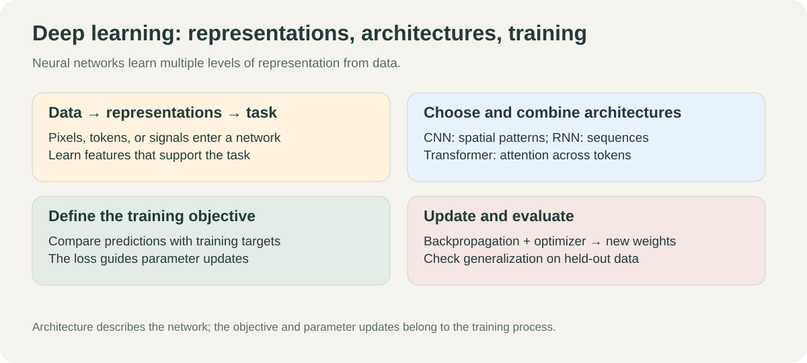
<figcaption>Figure: deep learning learns representations from data and completes tasks. CNN, RNN, and Transformer are optional and composable architectures; the target and parameter updates below are part of the training process.</figcaption>
</figure>

To understand deep learning, you need to grasp two levels at once: **architecture design** (how to build the network) and **training methods** (how to optimize it effectively). Both are indispensable. If you only know how to stack layers like building blocks without understanding what problem each training technique solves, you will often end up in the dilemma of "adding Dropout only makes things worse" or "swapping in a new optimizer changes nothing".

This article systematically sorts out the core principles and key techniques of deep learning, providing a searchable map for learning, reproduction and research. The full text is organized as follows:

- **§2–3 Basics**: the three-step machine learning framework, neurons and backpropagation
- **§4 Architectures**: the main line of evolution from MLP → CNN → RNN/LSTM → Transformer, supplemented by graph neural networks (GNNs)
- **§5 Training optimization**: from AdamW to Muon / SOAP / NorMuon; learning-rate schedules and Schedule-Free; initialization, normalization and residual connections
- **§6 Loss and regularization**: choosing a loss, Dropout, data augmentation, AdamW
- **§7 Method taxonomy**: mapping all techniques onto the "three steps × two goals" coordinate system
- **§8 Benchmarks**: a review of classic benchmarks such as MNIST/CIFAR/ImageNet/GLUE/MMLU/HumanEval/long-context
- **§9 Efficient training and inference**: BF16 / FP8, gradient clipping and checkpointing, FlashAttention 1–4
- **§10 Model compression and adaptation**: MoE, LoRA/PEFT, quantization, knowledge distillation and other lightweight, deployment-oriented methods
- **§11 Frontier architectures and large models**: RLHF / GRPO / RLVR, generative models (AE/VAE/GAN), diffusion models, Mamba/SSMs and hybrid attention

**Reading suggestions**: Beginners can read §2–§6 in order; when training models, prioritize §5–§7 and §9; for large models, focus on §4.3, §10 and §11. The accuracies, parameter counts and years in the article illustrate historical context and depend on model version, data processing and evaluation protocol. When reproducing an experiment, defer to the original paper or official report.

---

# 2. Overview of deep learning basics
{: id="2-深度学习基础概述"}

## 2.1 What is deep learning?
{: id="21-什么是深度学习"}

Deep learning is a branch of machine learning that uses **artificial neural networks (ANNs)** as its base model. "Deep" usually means the model contains multiple layers of nonlinear transformations; there is no fixed layer threshold that applies to all tasks. Stacking many layers lets the network extract increasingly abstract features layer by layer.

The basic computing unit of a neural network is the **neuron**:

$$a = f\left(\sum_i w_i x_i + b\right)$$

Here $x_i$ is the input, $w_i$ the weight, $b$ the bias and $f$ the activation function. Neurons are stacked into layers, and layers are chained into a deep network that ultimately forms a complex mapping from input to output.

<div align="center">
  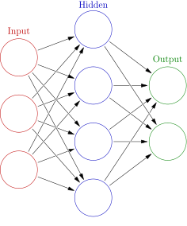
<figcaption>Schematic of a multi-layer neural network: input layer (left) → hidden layers (middle) → output layer (right)</figcaption>
</div>

### Universal approximation theorem
{: id="通用近似定理"}

One of the important theoretical foundations for the expressive power of neural networks is the **universal approximation theorem** (Cybenko 1989, Hornik 1991):

> Under conditions such as continuity and a non-polynomial activation function, a **single-hidden-layer feedforward network** with sufficient width can approximate any continuous function on a compact set to arbitrary accuracy.

This result answers the fundamental question "why can neural networks work?", but it comes with two key limitations:

|Limitation|Meaning|
|:---|:---|
|**Only guarantees existence**|The theorem only says that "a set of parameters exists that achieves the approximation"; it does not guarantee that SGD can find them.|
|**Width may be huge**|A single hidden layer may need a very large number of neurons to reach the target accuracy; for some functions, adding depth is more efficient than simply widening|
|**Guarantees fitting, not generalization**|A perfect fit on the training set does not mean good performance on the validation set; this is where the generalization problem comes from|

 **The advantage of depth**: Theoretically (Telgarsky 2016), there are classes of functions that deep networks can express with far fewer units than shallow ones. Note that the theorem describes expressive power and parameter efficiency; it does not guarantee that optimization will find those parameters, nor does it directly guarantee generalization.

### Why deep learning took off
{: id="深度学习爆发的三大驱动因素"}

|Factor|Description|Representative event|
|:---|:---|:---|
|**Algorithmic breakthroughs**|The ReLU activation alleviates vanishing gradients; residual connections make hundred-layer networks trainable| AlexNet 2012, ResNet 2015 |
|**Data explosion**|The Internet generates massive amounts of labeled data; the more data, the better deep learning performs|ImageNet: 1.2 million images|
|**Compute revolution**|Parallel GPU computing cuts training time from weeks to hours| NVIDIA GPU + CUDA |

## 2.2 Machine learning three-step framework
{: id="22-机器学习三步骤框架"}

Any machine learning method can be broken down into three steps. Understanding this framework is the basis for all the training techniques that follow:

1. **Step 1 - Define the loss function**: Measure the difference between the model output and the correct answer, i.e. "how to judge good from bad"
2. **Step 2 - Choose the function search space (model architecture)**: Select the network structure and delimit the set of candidate functions, i.e. "where to search"
3. **Step 3 - Optimization**: Find the function in the search space that minimizes the loss, i.e. "how to search efficiently"

The ultimate goal of training is to find a function whose loss is low on the **training set** and stays low on the **validation set**. Whether the training error can be reduced mainly reflects **optimization**, while the gap between training and validation error reflects **generalization**; in practice the two interact.

## 2.3 Two core goals
{: id="23-两大核心目标"}

Deep learning training techniques fall into two categories according to the problem they solve:

|Goal|Symptom|Meaning|Typical methods|
|:---|:---|:---|:---|
| **Optimization** |Training loss will not go down|Problem in the optimization process| Adam, skip connections, batch norm |
| **Generalization** |Training loss is low, validation loss is high|Overfitting|Dropout, data augmentation, regularization|

> **Rule of thumb**: First look at the training loss, then at the gap between the training and validation curves. When the training loss will not go down, check the learning rate, initialization, normalization and the data pipeline first; when the training loss is already low but the validation loss is clearly higher, consider regularization and data augmentation. Real problems may involve both kinds of factors.

## 2.4 Development timeline
{: id="24-发展时间线"}

```mermaid
flowchart LR
    subgraph G1990 ["1990s: laying the foundation"]
        A["LeNet 1998<br/>CNN foundations"] --> B["Backpropagation<br/>becomes widespread"]
    end
    subgraph G2012 ["2012-2014: breakthrough"]
        C["AlexNet 2012<br/>ImageNet breakthrough"] --> D["Dropout 2014"]
        D --> E["Adam 2014"]
    end
    subgraph G2015 ["2015-2017: going deeper"]
        F["ResNet 2015<br/>Skip connections"] --> G["BN 2015"]
        G --> H["AdamW 2017"]
    end
    subgraph G2018 ["2018-2022: pre-training"]
        I["BERT/GPT 2018<br/>Pre-training paradigm"] --> J["Transformer<br/>takes over"]
        J --> R["RoPE 2021<br/>Rotary position encoding"]
        R --> K["LoRA 2021<br/>Parameter-efficient fine-tuning"]
    end
    subgraph G2022 ["2022 to date: large models"]
        L["Chinchilla<br/>2022 scaling laws"] --> M["ChatGPT 2022<br/>RLHF alignment"]
        M --> N["FlashAttention 2/3<br/>2023-2024"]
        N --> O["Muon / SOAP<br/>2024 matrix optimizers"]
        O --> P["GRPO / reasoning RL<br/>2024-2025"]
        P --> Q["FlashAttention-4<br/>2026 hardware co-design"]
    end
    B --> C
    E --> F
    H --> I
    K --> L
```

## 2.5 Main abbreviations
{: id="25-主要缩写"}

- **ANN**: Artificial Neural Network
- **MLP**: Multi-Layer Perceptron
- **CNN**: Convolutional Neural Network
- **RNN**: Recurrent Neural Network
- **LSTM**: Long Short-Term Memory
- **SGD**: Stochastic Gradient Descent
- **BN**: Batch Normalization
- **LN**: Layer Normalization
- **LR**: Learning Rate
- **PEFT**: Parameter-Efficient Fine-Tuning
- **SFT**: Supervised Fine-Tuning
- **RLHF**: Reinforcement Learning from Human Feedback

---

# 3. Neural network basics
{: id="3-神经网络基础"}

## 3.1 Multi-layer perceptron
{: id="31-多层感知机"}

The **multi-layer perceptron (MLP)** is the most basic form of neural network. It consists of an input layer, several hidden layers and an output layer, with each layer fully connected:

$$h^{(l)} = f\left(W^{(l)} h^{(l-1)} + b^{(l)}\right)$$

Fully connected means each neuron in layer $l$ connects to every neuron in layer $l-1$, so the parameter count is the product of the two layers' sizes. When the input dimension is extremely large (e.g. a 1000×1000 color image has 3 million dimensions once flattened), the number of fully connected parameters exceeds billions, which makes training hard and overfitting extremely easy. Specialized architectures such as CNNs were proposed to solve this problem.

## 3.2 Activation function
{: id="32-激活函数"}

Activation functions introduce nonlinearity into neural networks so they can fit complex functions. Without nonlinear activations, a multi-layer network is equivalent to a single-layer linear model.

|Activation function|Formula|Output range|Advantages|Disadvantages|Typical use|
|:---|:---|:---:|:---|:---|:---|
| Sigmoid | $\frac{1}{1+e^{-x}}$ | (0, 1) |Output can be interpreted as a probability|Vanishing gradient; not zero-centered|Output layer for binary classification|
| Tanh | $\tanh(x)$ | (-1, 1) |Zero-centered output|Still suffers from vanishing gradients|RNN hidden layers (earlier)|
| **ReLU** | $\max(0, x)$ | [0, ∞) |Cheap to compute; effectively alleviates vanishing gradients|Dead neuron problem|CNN/MLP hidden layers (the most common choice today)|
| Leaky ReLU | $\max(0.01x, x)$ | (-∞, ∞) |Fixes dead neurons|Slope needs tuning|Drop-in improvement over ReLU|
| GELU | $x \cdot \Phi(x)$ | (-∞, ∞) |Smooth; excellent performance|Slightly more expensive to compute|Standard in Transformers (BERT, GPT)|
| SiLU/Swish | $x \cdot \sigma(x)$ | (-∞, ∞) |Self-gated; similar to GELU| — |Large language models such as LLaMA and Qwen|

<div align="center">
  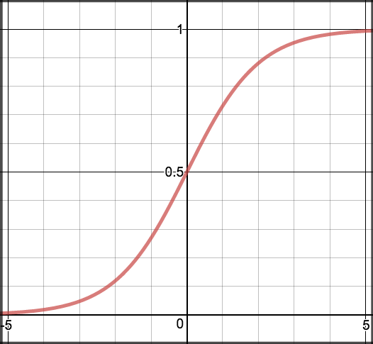
  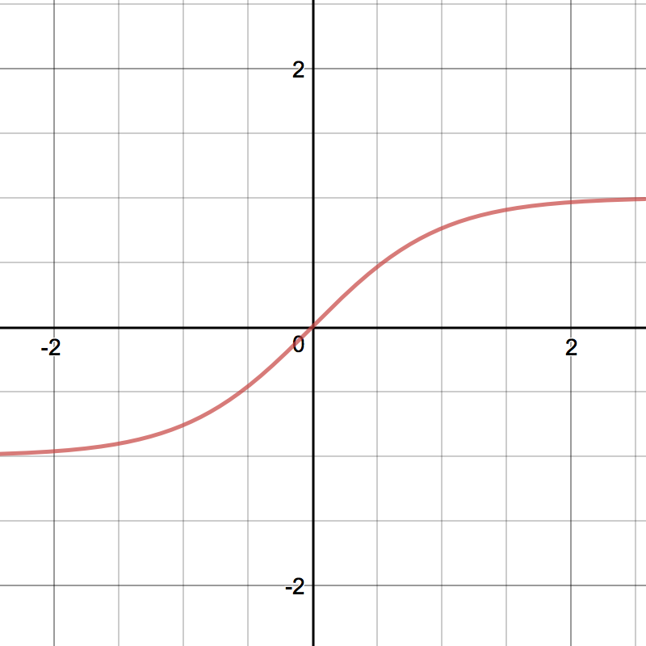
  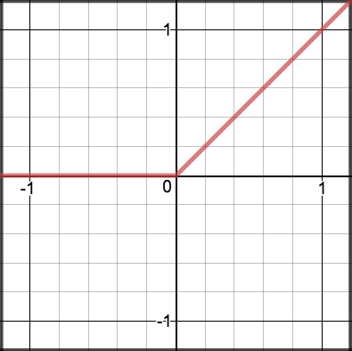
<figcaption>Left: Sigmoid | Middle: Tanh | Right: ReLU (currently the most commonly used)</figcaption>
</div>

**ReLU (Rectified Linear Unit)** succeeds because its gradient in the positive region is always 1, which effectively alleviates the vanishing-gradient problem of deep networks and allows stable training of networks with dozens or even hundreds of layers.

## 3.3 Backpropagation algorithm
{: id="33-反向传播算法"}

**Backpropagation** is the core algorithm for training neural networks. Based on the chain rule, it passes the gradient of the loss with respect to each parameter from the output layer back to the input layer, layer by layer:

$$\frac{\partial \mathcal{L}}{\partial W^{(l)}} = \frac{\partial \mathcal{L}}{\partial h^{(l)}} \cdot \frac{\partial h^{(l)}}{\partial W^{(l)}}$$

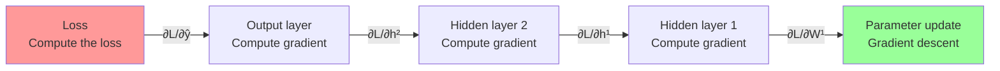

The **computation graph** automatically records the forward computation path, and during backpropagation the gradient flows back along that path in the opposite direction. PyTorch's `autograd` is built on this principle: users only define the forward computation, and the framework computes the gradients automatically.

### A tiny backprop example
{: id="一个最小反向传播数值例子"}

Consider the simplest single-hidden-layer network $y = w_2 \cdot \sigma(w_1 \cdot x)$ with loss $\mathcal{L} = \frac{1}{2}(y - t)^2$. Let $x=1, w_1=0.5, w_2=0.8, t=0.5$, and let the activation $\sigma$ be the sigmoid.

**Forward pass**:

$$z_1 = w_1 x = 0.5, \quad a_1 = \sigma(0.5) \approx 0.622, \quad y = w_2 a_1 \approx 0.498, \quad \mathcal{L} \approx 2\times 10^{-6}$$

**Backward pass** (chain rule, step by step):

$$\frac{\partial \mathcal{L}}{\partial y} = y - t \approx -0.002$$

$$\frac{\partial \mathcal{L}}{\partial w_2} = \frac{\partial \mathcal{L}}{\partial y} \cdot a_1 \approx -0.00124$$

$$\frac{\partial \mathcal{L}}{\partial a_1} = \frac{\partial \mathcal{L}}{\partial y} \cdot w_2 \approx -0.0016$$

$$\frac{\partial \mathcal{L}}{\partial z_1} = \frac{\partial \mathcal{L}}{\partial a_1} \cdot a_1(1-a_1) \approx -0.000376$$

$$\frac{\partial \mathcal{L}}{\partial w_1} = \frac{\partial \mathcal{L}}{\partial z_1} \cdot x \approx -0.000376$$

**Observation**: The gradient $\partial \mathcal{L}/\partial w_2 \approx 10^{-3}$ near the output and $\partial \mathcal{L}/\partial w_1 \approx 10^{-4}$ near the input. Even with only 2 layers, the gradient is attenuated by roughly $\sim 3$ times. **Every additional layer in a deep network adds another multiplication by $\sigma'(\cdot) \leq 0.25$**. This is the source of vanishing gradients.

### Three variations of gradient descent
{: id="梯度下降的三种变体"}

Gradient descent comes in three forms, depending on the number of samples used per update:

|Variant|Samples per update|Advantages|Disadvantages|
|:---|:---:|:---|:---|
|**Batch GD** (full batch)|The entire training set|Accurate gradient and stable convergence path|Each iteration is very expensive and cannot exploit big data|
|**SGD** (stochastic)| 1 |Minimal memory use; gradient noise helps escape saddle points|Severe convergence oscillation and low hardware utilization|
| **Mini-batch SGD** |$B$ (usually 32–4096)|Balances efficiency and stability; compatible with GPU parallelism|Batch size must be tuned as a hyperparameter|

**Modern deep learning almost always uses mini-batch SGD**. When practitioners say "SGD" they usually mean the mini-batch version. Batch size directly affects training stability, hardware utilization and final generalization: large batches converge quickly but generalize slightly worse (Keskar et al., 2017, "On Large-Batch Training"), making it an important hyperparameter to tune.

---

# 4. Classic network architecture
{: id="4-经典网络架构"}

## 4.1 Convolutional Neural Network
{: id="41-卷积神经网络"}

**Convolutional neural networks (CNNs)** are the standard architecture for grid-structured data (images, time-series signals). A CNN imposes two key constraints on an MLP:

**Local receptive fields**: Each neuron observes only a local region of the input (such as a 3×3 kernel) rather than the whole image. Local patterns in images (edges, textures) can be detected from local information alone, without a global view.

**Parameter sharing**: Neurons at different positions share the same set of parameters (a filter / convolution kernel). The same pattern (such as a horizontal edge) can appear anywhere in the image and should be handled by the same detector. This constraint gives **translation equivariance**; only after pooling or global aggregation does the model acquire some translation invariance.

### Convolution hyperparameters
{: id="卷积层的核心超参数"}

|Hyperparameter|Meaning|Typical values|Effect|
|:---|:---|:---:|:---|
| **Kernel size** $k$ |Spatial size of the convolution kernel|3×3 (mainstream), 5×5, 7×7|Determines the receptive field; 3×3 has been standard since VGG|
| **Stride** $s$ |Step size of the convolution sliding window|1 (regular), 2 (downsampling)|A stride above 1 shrinks the spatial size and can replace pooling|
| **Padding** $p$ |Number of pixels padded at the edges| "same" / "valid" |"same" preserves the output size; "valid" does no padding|
| **Dilation** $d$ |Dilation rate|1 (regular), 2, 4|Enlarges the receptive field without adding parameters (DeepLab semantic segmentation)|
| **Channels** $C$ |Number of output feature maps| 64/128/256/512 |The number of channels in a layer determines feature diversity|

**Output size formula**:

$$\text{out} = \left\lfloor \frac{\text{in} + 2p - d(k-1) - 1}{s} \right\rfloor + 1$$

Regular convolution ($d=1$) simplifies to $\text{out} = \lfloor (\text{in} + 2p - k)/s \rfloor + 1$.

### Special convolution
{: id="特殊卷积"}

|Type|Core idea|Representative models|Purpose|
|:---|:---|:---|:---|
|**1×1 convolution**|Pointwise linear combination across channels| NiN, ResNet bottleneck |Changes the channel count (reducing or expanding dimensions) and adds nonlinearity|
| **Depthwise separable** |Depthwise (per-channel) convolution + 1×1 pointwise convolution| MobileNet, EfficientNet |Reduces parameters and computation to about $\sim 1/k^2$|
| **Dilated / atrous** |The kernel has "holes"| DeepLab |Enlarges the receptive field without adding parameters; suited to dense prediction|
| **Transposed conv** |Inverse of convolution, used for upsampling| FCN, GAN generator |Upsampling for segmentation and generation tasks|
| **Grouped conv** |Channels are split into groups that are convolved independently| AlexNet, ResNeXt |Reduces computation and increases feature diversity|

### Pooling layer (Pooling)
{: id="池化层pooling"}

Pooling **downsamples** the feature map, reducing its spatial size, enlarging the receptive field and providing some translation invariance. Pooling layers have **no learnable parameters**.

|Method|Operation|Use case|
|:---|:---|:---|
| **Max pooling** |Takes the maximum within the window|Extracts the most salient features; the most common choice in the middle of a CNN|
| **Average pooling** |Takes the mean within the window|Smooths features; common in early networks|
| **Global average pooling (GAP)** |Takes the average over the whole feature map|**Replaces fully connected layers**, greatly reducing parameters (at the end of GoogLeNet and ResNet)|
| **Adaptive pooling** |Specify the output size and the kernel is computed automatically|Adapts to different input resolutions|

> **Why GAP matters**: The fully connected layers of VGG-16 hold 123M parameters (89% of the total); this part can simply be dropped after switching to GAP. This is one of the key reasons ResNet and EfficientNet have far fewer parameters than VGG.

A typical CNN alternates convolutional layers (feature extraction) and pooling layers (downsampling), followed by fully connected layers or GAP to produce the prediction. Below is the structure of LeNet-5 (LeCun, 1998), the foundational CNN work:

<div align="center">
  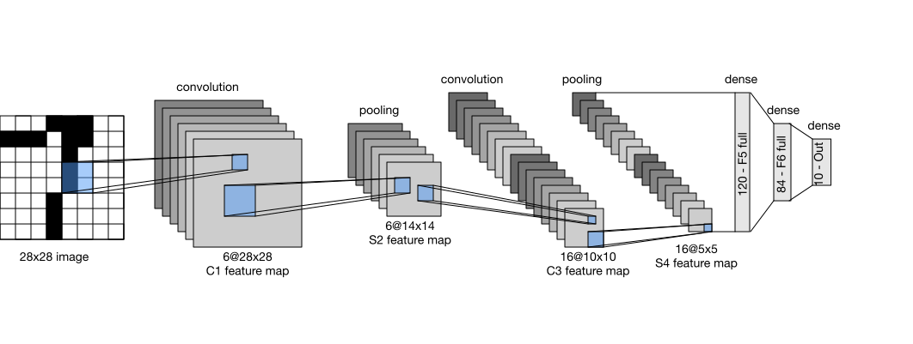
<figcaption>LeNet-5 architecture (LeCun et al., 1998): convolutional layer → pooling layer → convolutional layer → pooling layer → fully connected layer</figcaption>
</div>

### CNN architecture evolution comparison
{: id="cnn-架构演进对比"}

|Model|Year|Parameters| ImageNet Top-1 |Key innovation|
|:---|:---:|:---:|:---:|:---|
| LeNet-5 | 1998 | ~60K | — (MNIST) |The foundation of CNNs: convolution + pooling structure|
| AlexNet | 2012 | 60M | ~56.5% |GPU training, ReLU, Dropout|
| VGG-16 | 2014 | 138M | ~71.5% |Uniform 3×3 convolutions, deeper network|
| GoogLeNet | 2014 | 6.8M | ~69.8% |Inception module, greatly reduced parameters|
| ResNet-50 | 2015 | 25M | ~76.0% |Residual connections make very deep networks trainable|
| ResNet-152 | 2015 | 60M | ~77.8% |The classic paper reports a Top-5 error of about 3.57%|
| SENet-154 | 2017 | ~115M | ~82.7% |Channel attention (squeeze-and-excitation)|
| EfficientNet-B0 | 2019 | 5.3M | 77.1% |Compound scaling (NAS finds the optimal ratio)|
| EfficientNet-B7 | 2019 | 66M | 84.4% |Best parameter efficiency|
| ViT-B/16 | 2020 | 86M | ~81.8% |Pure Transformer for images|
| ConvNeXt-XL | 2022 | 350M | ~87.8% |A CNN that absorbs Transformer design ideas|

> Key insight: **ResNet-50 (25M parameters) outperforms VGG-16 (138M parameters)** with only 18% of its parameters; **EfficientNet-B0 (5.3M) reaches VGG-level accuracy** with only 4% of the parameters. More parameters do not mean higher performance; architectural design is what matters.

### ResNet residual block structure
{: id="resnet-残差块结构"}

<div align="center">
  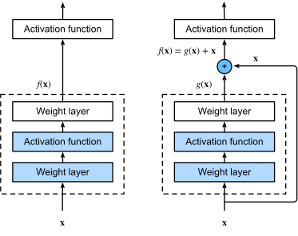
<figcaption>ResNet residual block (He et al., 2016): output = F(x) + x, identity mapping allows the gradient to flow directly back to the shallow layer</figcaption>
</div>

---

## 4.2 Recurrent Neural Network and LSTM
{: id="42-循环神经网络与-lstm"}

**Recurrent neural networks (RNNs)** are designed for sequential data and pass information between time steps through the hidden state $h_t$:

$$h_t = f(W_h h_{t-1} + W_x x_t + b)$$

An RNN uses the same parameters $W_h, W_x$ at every time step, which makes it naturally suited to variable-length sequences. The figure below shows the RNN "unrolled" along the time dimension:

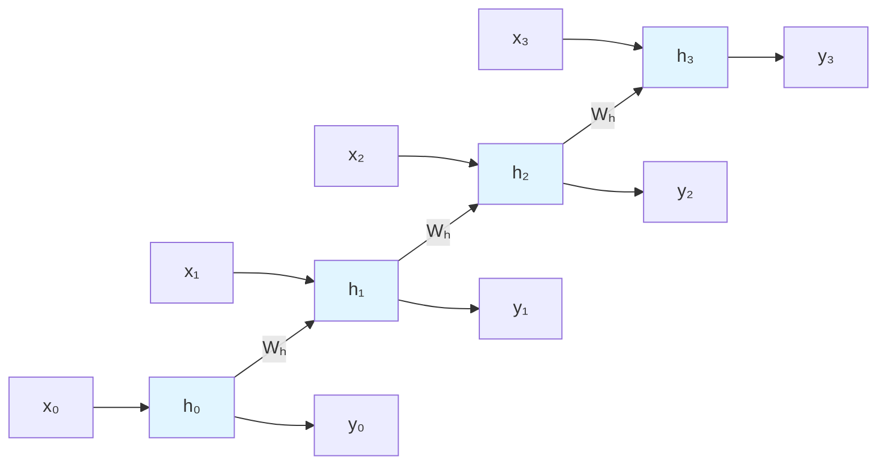

However, the standard RNN suffers from a serious **long-range dependency** problem: when the gradient is backpropagated through time, the matrix $W_h$ is multiplied $T$ times. When the largest singular value of $W_h$ is $< 1$, the gradient decays exponentially with sequence length (**vanishing gradients**); when it is $> 1$, the gradient explodes exponentially (**exploding gradients**), making it hard for the model to remember distant context.

**LSTM (Long Short-Term Memory, Hochreiter & Schmidhuber, 1997)** solves this problem by introducing a **gating mechanism**:

<div align="center">
  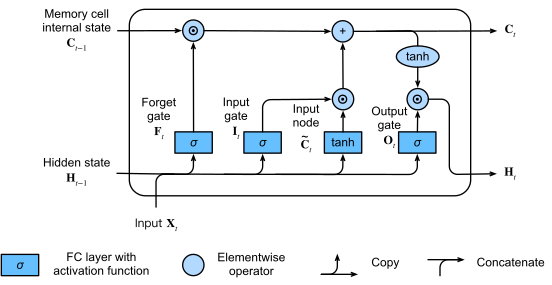
<figcaption>LSTM chain structure (Colah, 2015): Cell state (top horizontal line) runs through the entire sequence, carrying long-term memory</figcaption>
</div>

An LSTM maintains two states: the hidden state $h_t$ (short-term memory) and the cell state $c_t$ (long-term memory).

**Internal data flow of a single LSTM cell**:

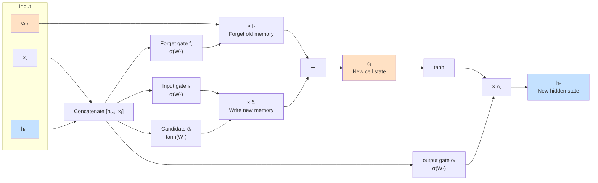

**Cell state update**:

$$c_t = f_t \odot c_{t-1} + i_t \odot \tilde{c}_t$$

|Component|Formula|Function|
|:---|:---|:---|
|Forget gate $f_t$| $\sigma(W_f [h_{t-1}, x_t] + b_f)$ |Decides how much of the historical cell state to forget|
|Input gate $i_t$| $\sigma(W_i [h_{t-1}, x_t] + b_i)$ |Decides how much new information to write|
|Candidate value $$\tilde{c}_t$$| $\tanh(W_c [h_{t-1}, x_t] + b_c)$ |Computes the new information to be written|
|Output gate $o_t$| $\sigma(W_o [h_{t-1}, x_t] + b_o)$ |Decides how much of the cell state to expose as output|

**Why does gating alleviate vanishing gradients?** The cell-state update $c_t = f_t \odot c_{t-1} + \ldots$ is an **additive** path (compare the RNN's multiplicative recursion $h_t = f(Wh_{t-1} + \ldots)$). When the forget gate $f_t \approx 1$, $c_{t-1}$ passes to $c_t$ almost without attenuation, so the gradient stays stable when backpropagated along the cell state. This resembles ResNet's skip connection, except that it acts along time rather than depth.

### GRU: a simplified version of LSTM
{: id="grulstm-的简化版"}

The **Gated Recurrent Unit (GRU, Cho et al., 2014)** simplifies the LSTM's 3 gates into 2 and merges the cell state with the hidden state:

$$r_t = \sigma(W_r [h_{t-1}, x_t]) \quad \text{(reset gate)}$$

$$z_t = \sigma(W_z [h_{t-1}, x_t]) \quad \text{(update gate)}$$

$$\tilde{h}_t = \tanh(W_h [r_t \odot h_{t-1}, x_t])$$

$$h_t = (1-z_t) \odot h_{t-1} + z_t \odot \tilde{h}_t$$

|Dimension| LSTM | GRU |
|:---|:---:|:---:|
|Number of gates| 3 (f, i, o)| 2 (r, z)|
|Number of states| 2 (h, c) | 1 (h) |
|Parameters (same hidden size)|4 weight sets|3 weight sets|
|Convergence speed|Slower|Faster|
|Long-range dependency modeling|Stronger (protected cell state)|Slightly weaker but sufficient|
|Typical use|Long sequences, complex tasks|Short sequences, limited resources|

**Empirical conclusion**: The systematic experiments of Chung et al. (2014) show that GRU and LSTM perform comparably on most tasks. GRU has fewer parameters and trains faster, and is more common on short and medium-length sequence tasks (dialogue, sentiment classification); LSTM retains an advantage on tasks that demand strict long-term memory (machine translation of long sentences, speech recognition).

### Bidirectional RNN
{: id="双向-rnn"}

A standard RNN can only use **past** information (left to right). But for many tasks (named entity recognition, sentiment analysis, reading comprehension) **future** context is just as important. For example, deciding whether "bank" means a financial institution or a river bank requires looking at the words that follow.

A **bidirectional RNN (Schuster & Paliwal, 1997)** runs two RNNs in opposite directions at once and concatenates their outputs:

$$\overrightarrow{h}_t = \text{RNN}_\text{fwd}(x_t, \overrightarrow{h}_{t-1}), \quad \overleftarrow{h}_t = \text{RNN}_\text{bwd}(x_t, \overleftarrow{h}_{t+1})$$

$$h_t = [\overrightarrow{h}_t; \overleftarrow{h}_t]$$

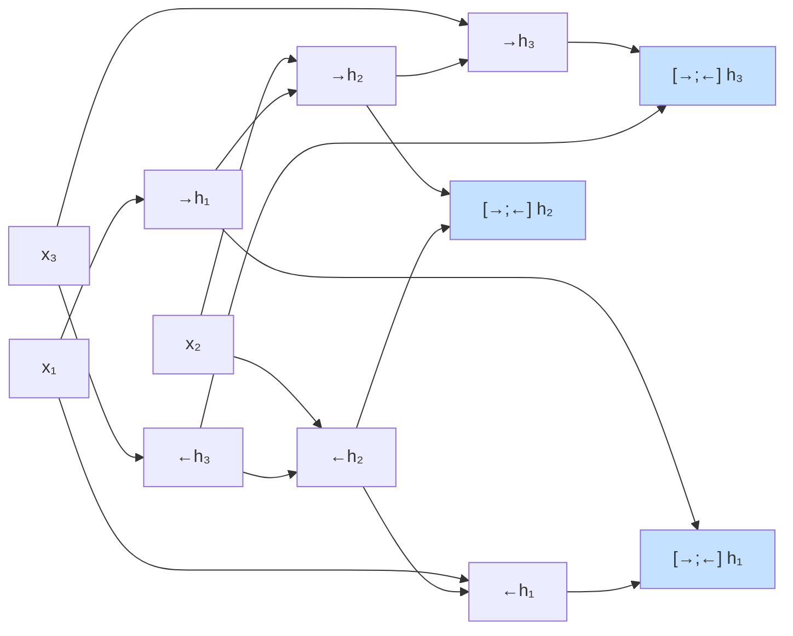

**Limitations**: A bidirectional RNN must see the entire sequence before it can compute, so it **cannot be used for autoregressive generation** (there is no future information when generating the next word). Therefore:
- **Suitable for**: sequence labeling, classification, NER and reading comprehension (BiLSTM-CRF was the mainstream NER solution in 2016–2018)
- **Not suitable for**: the decoder side of language models and machine translation

BERT's MLM (masked language model) can be seen as the Transformer's generalization of "bidirectional modeling", using masking to ensure that bidirectional attention does not leak the target.

### Teacher forcing
{: id="teacher-forcing"}

Training a Seq2Seq / RNN decoder involves a subtle choice: what is the input at decoding step $t$?

|Strategy|Input at step $t$|Advantages|Disadvantages|
|:---|:---|:---|:---|
| **Teacher forcing** |**Ground-truth label** $y_{t-1}$|Stable training and fast convergence|Mismatch between training and inference distributions (inference uses the model's own predictions)|
| **Free running** |**Model prediction** $$\hat{y}_{t-1}$$|Fully consistent with inference|Early in training the predictions are poor, errors cascade, and convergence is difficult|
| **Scheduled sampling** |Sample the ground truth or the prediction with probability $p$ (Bengio et al., 2015)|A compromise with a gradual switch|Requires tuning the schedule hyperparameters|

The problem with **teacher forcing** is **exposure bias**: during training the model never "sees" its own wrong predictions. Once a prediction goes astray at some step during inference, it drifts further and further off (the prototype of error accumulation / hallucination).

**Modern remedies**:
- **Scheduled sampling**: Gradually mix in the model's own predictions later in training
- **Minimum risk training / REINFORCE**: Use the overall quality of the generated sequence directly as the training signal
- **Transformer + causal masking**: Compute all positions in parallel (see §4.3). This is still essentially teacher forcing, but far more efficient than the RNN's step-by-step recursion.

*Representative work*: GRU (2014, a simplified LSTM), Seq2Seq (2014), Attention + LSTM (2015), bidirectional LSTM (proposed in 2005, with BiLSTM-CRF widely used from 2016)

---

## 4.3 Transformer
{: id="43-transformer"}

The **Transformer** (Vaswani et al., 2017) completely changed NLP and the wider deep learning landscape. It abandons recurrence and convolution entirely and models the global dependency between any two positions in a sequence directly through the **self-attention mechanism**.

<div align="center">
  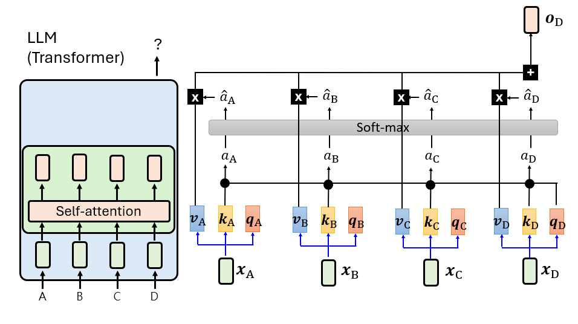
<figcaption>Self-attention architecture: after linear projection of the query, key and value, attention weights are computed with scaled dot-product and used to form a weighted sum as the output</figcaption>
</div>

### Core: scaled dot-product attention
{: id="核心机制缩放点积注意力"}

$$\text{Attention}(Q, K, V) = \text{softmax}\left(\frac{QK^T}{\sqrt{d_k}}\right)V$$

- **Query (Q)**: represents "what am I looking for" (such as the current word).
- **Key (K)**: represents "what features do I have" (used to match Q).
- **Value (V)**: represents "the information I will pass on" (the content delivered after a successful match).
- **$\sqrt{d_k}$ scaling**: When the dimension is large, dot products can become extremely large and push the softmax into a region with tiny gradients. Scaling keeps the gradients stable.

**A concrete example: the sentence "The cat sat on the mat"**

Suppose the model is processing the verb "sat" and needs to find "who sat" (the subject). The weights below are for illustration only and are not the output of a real model:

| Token |Q (what am I looking for?)|K (what am I?)|V (what can I offer?)|
|:---|:---|:---|:---|
| The |Determiner context|Determiner|No substantive information|
| **cat** | — |**Noun, singular, animate**|**Semantic vector for "cat"**|
| **sat** |**Looking for a singular noun subject that can perform an action**|Past-tense verb|Semantics of the action "sit"|
| on |Looking for a prepositional object|Preposition|Positional relation|
| the |Determiner context|Determiner|No substantive information|
| mat |Noun, singular, object|Noun, singular, object|Semantic vector for "mat"|

- **The Q of "sat"** and **the K of "cat"** have the largest dot product (matching "singular noun subject"), and the attention weight after softmax is $\approx 0.7$
- **The Q of "sat"** and **the K of "mat"** also match to some degree (both are nouns), but the semantic role is wrong, so the weight is only $\approx 0.15$
- The final output for "sat" is $\approx 0.7 \cdot V_\text{cat} + 0.15 \cdot V_\text{mat} + \ldots$, i.e. it **mainly absorbs the semantics of "cat"**

This is how attention works: **each token broadcasts a "query", all tokens respond with "how well do I match", and the information is finally aggregated** with weights given by the degree of match. Q/K/V are produced from the same input by three different linear projections $W_Q, W_K, W_V$, and this flexibility lets the model learn a wide variety of information-routing patterns.

### Multi-head attention
{: id="多头注意力"}

The input is mapped into $h$ different subspaces, attention is computed in each separately, and the results are concatenated:
$$\text{MultiHead}(Q,K,V) = \text{Concat}(head_1, \ldots, head_h) W^O$$
**Intuition**: Different "heads" can attend to different information at the same time (for example, one head to syntactic relations and another to semantic relations).

<div align="center">
  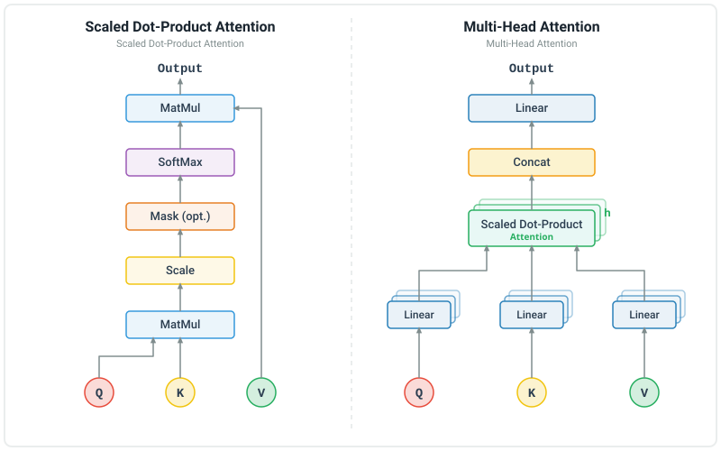
<figcaption>Architecture of multi-head attention. Left: scaled dot-product attention; right: multi-head attention</figcaption>
</div>

### Attention variants
{: id="attention-变体"}

As context lengths grow, the GPU memory used by the KV cache (which stores K and V for all previous tokens during inference) becomes a bottleneck. Multi-head attention has therefore evolved into several variants whose core idea is to **reduce the number of K/V heads** to shrink the KV cache:

|Variant|Year|K/V heads|KV cache vs. MHA|Representative models|
|:---|:---:|:---:|:---:|:---|
| **MHA** (Multi-Head Attention)| 2017 |Each Q head has its own K/V ($h$ groups in total)| 100% |Original Transformer, GPT-2|
| **MQA** (Multi-Query Attention)| 2019 |All Q heads share 1 group of K/V| $1/h$ | PaLM, Falcon |
| **GQA** (Grouped-Query Attention)| 2023 |Q heads are grouped, and K/V are shared within each group ($g$ groups in total, $1 < g < h$)| $g/h$ | **LLaMA-2/3, Mixtral, Qwen** |
| **MLA** (Multi-head Latent Attention)| 2024 |K/V are compressed into a low-rank latent space| $\sim 5-13\%$ | DeepSeek-V2/V3 |

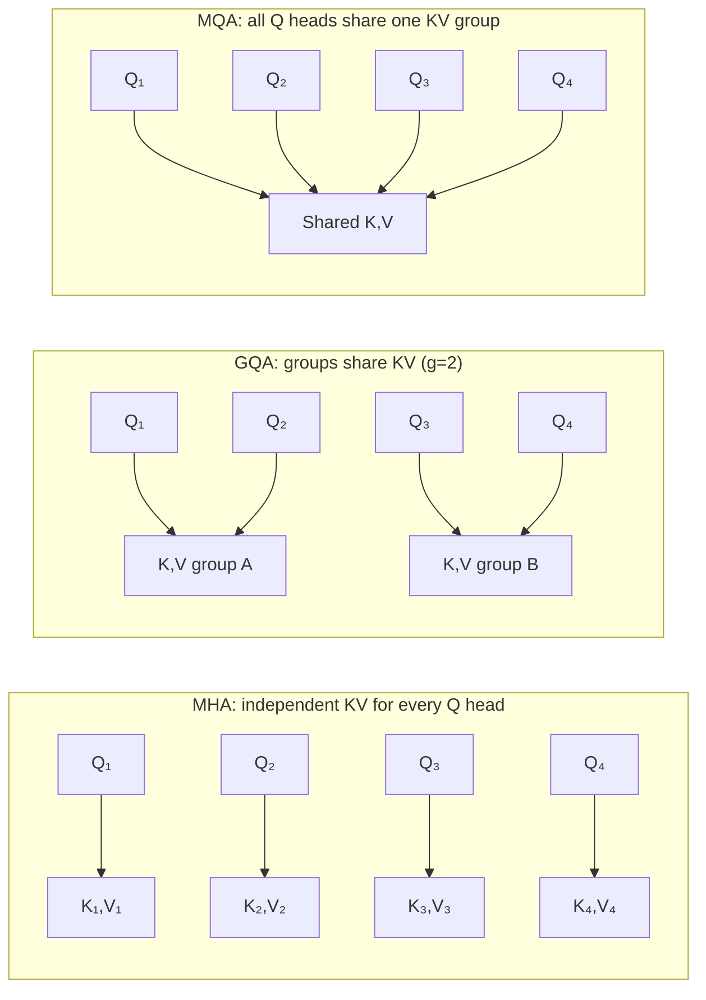

**Why GQA is widely used**: MQA compresses K/V into a single group, which may cost quality, while MHA has a large KV cache. GQA is a compromise between quality and GPU memory. For example, LLaMA-2 70B uses 8 K/V groups with 64 Q heads, so its KV cache is about 1/8 that of MHA; actual gains still depend on the model and task.

**MLA's innovation**: DeepSeek uses a low-rank matrix to compress K/V into a latent space of about $\sim$128 dimensions. Only the latent vector is cached during inference, and the full K/V is reconstructed when needed. This brings a significant GPU-memory advantage for extremely long contexts.

### Key components
{: id="关键组件"}

**1. Positional encoding**

**Why is positional encoding needed?**
The core of the Transformer, the self-attention mechanism, is **permutation equivariant** when there is no positional encoding: if the order of the input tokens changes, the output is rearranged in the same way. When computing $O = \sum \alpha_i V_i$, the model has no extra cue about order, so it cannot reliably distinguish the sentences "you hit me" and "I hit you"; position information must be injected.

<div align="center">
  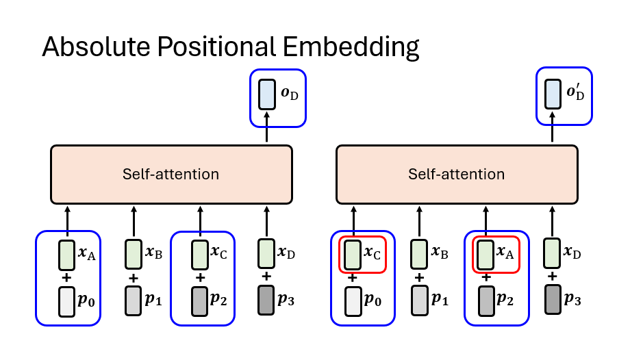
<figcaption>Absolute positional encoding</figcaption>
</div>

**Absolute positional encoding: the sinusoidal design**
The original Transformer builds position vectors from predefined sine and cosine functions:
$$PE_{(pos, 2i)} = \sin\left(\frac{pos}{10000^{2i/d_{model}}}\right)$$
$$PE_{(pos, 2i+1)} = \cos\left(\frac{pos}{10000^{2i/d_{model}}}\right)$$

<div align="center">
  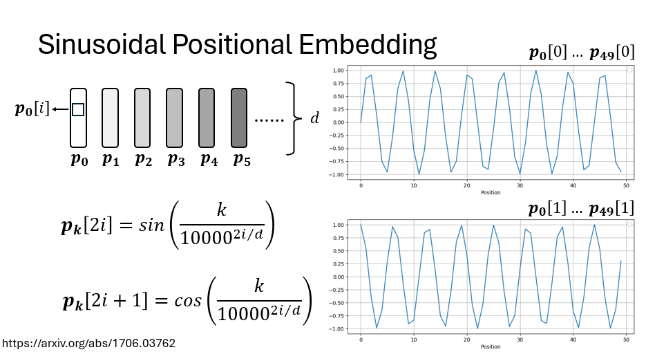
<figcaption>Positional encoding methods</figcaption>
</div>

<div align="center">
  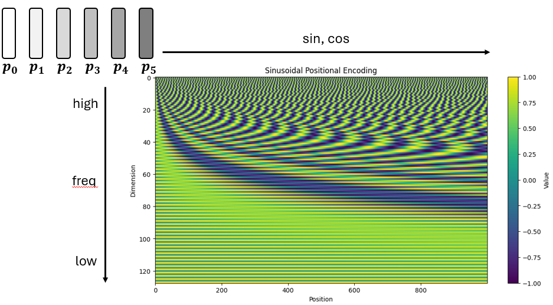
<figcaption>Visualization of positional encoding: different dimensions correspond to sine and cosine waves of different periods, forming a unique positional fingerprint</figcaption>
</div>

<div align="center">
  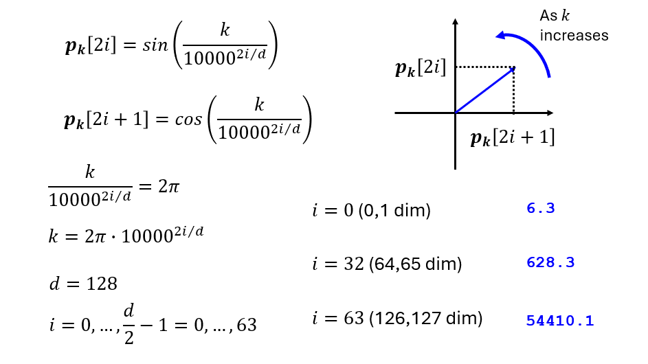
<figcaption>Multi-frequency hands (1): low dimensions correspond to high-frequency hands (the "second hand"), which complete one revolution every few tokens</figcaption>
</div>

<div align="center">
  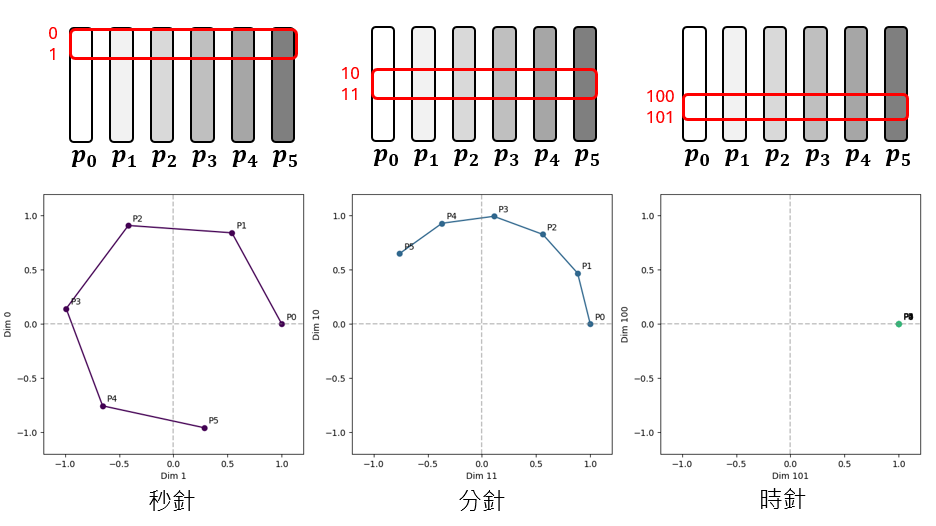
<figcaption>Multi-frequency hands (2): high dimensions correspond to low-frequency hands (the "hour hand"); together they form a precise positional fingerprint</figcaption>
</div>

**Intuition: multi-frequency clock hands**
We can think of each $(\sin, \cos)$ pair as a "hand" in a two-dimensional plane.
- **Low dimensions ($i$ small)**: high frequency, so the hand rotates extremely fast. Like a clock's "second hand", it completes a circle every few tokens.
- **High dimensions ($i$ large)**: low frequency, so the hand rotates extremely slowly. Like the "hour hand", it may take tens of thousands of tokens to make one revolution.
The Transformer is like reading a dashboard of dozens of hands rotating at different speeds, which lets it pinpoint the absolute position of the current token in the sequence.

**Mathematical property: modeling relative position**
The beauty of choosing sine and cosine is that the model can express **relative position** through a linear transformation. By the angle-addition formulas of trigonometry, for any offset $r$ there is a transformation matrix $M_r$ that depends only on the relative distance $r$, such that:
$$PE_{pos+r} = M_r \cdot PE_{pos}$$
This means that, when computing attention, the model can more easily capture the distance between two words rather than only their absolute coordinates.

**RoPE: the design of rotary position embedding**

Absolute positional encoding adds position information to the input embedding, which affects attention only indirectly; ALiBi directly subtracts a distance penalty from the attention score. RoPE takes another path: before taking the inner product of Q and K, it **encodes position information directly into the vectors themselves** by rotation.

<div align="center">
  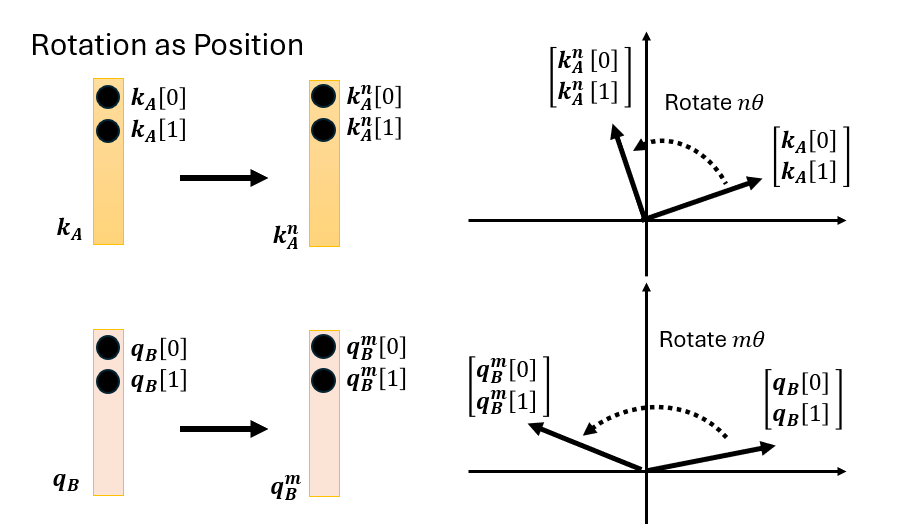
<figcaption>RoPE positional encoding: every two dimensions form a group and are rotated by the angle mθ according to position m, encoding position as an amount of rotation</figcaption>
</div>

**Core idea: rotation instead of addition**

RoPE treats each pair of dimensions ($d_0, d_1$) of a vector as a vector in a two-dimensional plane and rotates it by an angle determined by the token's position $m$:

$$\text{K}^{(m)} = R(m\theta) \cdot \text{K}, \quad \text{Q}^{(m)} = R(m\theta) \cdot \text{Q}$$

The rotation matrix is the standard two-dimensional rotation matrix:

$$R(\alpha) = \begin{pmatrix} \cos\alpha & -\sin\alpha \\ \sin\alpha & \cos\alpha \end{pmatrix}$$

For a $d$-dimensional vector, the dimensions are grouped into $d/2$ pairs, and each pair uses a different base angle $\theta_i$:

$$\theta_i = 10000^{-2i/d}, \quad i = 0, 1, \ldots, \frac{d}{2}-1$$

This design is consistent with sinusoidal PE: different dimensions correspond to different frequencies, with low dimensions rotating fast and high dimensions rotating slowly, together forming a unique positional fingerprint.

**How does RoPE encode relative position naturally?**

When Q is at position $m$ and K is at position $n$, their inner product is:

$$\langle \text{Q}^{(m)}, \text{K}^{(n)} \rangle = \text{Q}^T \cdot R((m-n)\theta) \cdot \text{K}$$

The inner product **depends only on the relative distance $m-n$** and not on absolute coordinates. This is the elegance of RoPE: there is no need to model relative distance explicitly as in relative PE, because the geometry of rotation guarantees it automatically.

<div align="center">
  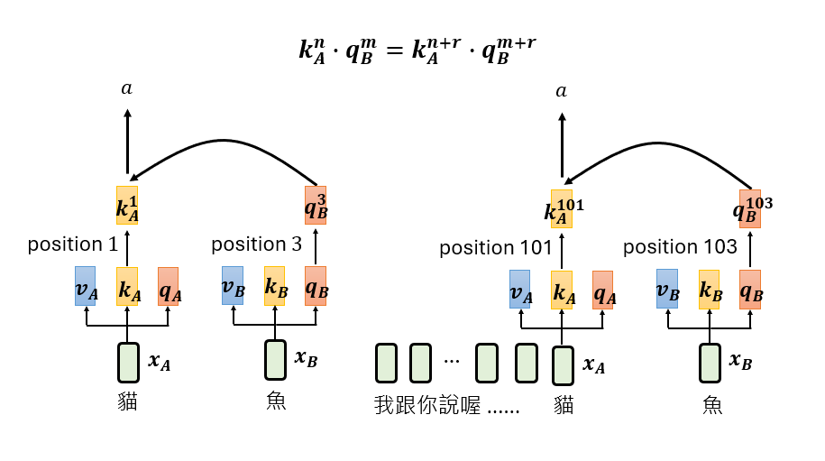
<figcaption>The relative-position property of RoPE: Q and K rotate synchronously, so the inner product depends only on the relative distance m-n and not on absolute position</figcaption>
</div>

**Geometric argument for translation invariance**

Suppose "cat" is at position 1 and "fish" is at position 3, and we compute the attention value $A$. Now insert 100 unrelated tokens in front, so "cat" moves to position 101 and "fish" to position 103. The relative distance between them **stays the same** (still 2), and the rotation angle $(m-n)\theta$ in the inner product is unchanged, so the attention value is still $A$.

The geometry is more intuitive: Q rotates by $N\theta$ and K rotates by $N\theta$, both rotating synchronously, so the inner product (the cosine of the angle between them) is unchanged.

**Compatibility with engineering optimizations**

RoPE modifies only Q and K themselves. The attention computation is exactly the same as in the original version, so it is naturally compatible with all attention acceleration techniques:
- **FlashAttention**: usable directly without modifying the kernel;
- **KV cache**: the rotated $\text{K}^{(m)}$ can be cached directly and read back without injecting position again.

This is also one of the key engineering reasons RoPE ultimately won: it is not only effective, but also fully compatible with the whole engineering ecosystem.

> **Common misconceptions clarified**
>
> Many people think RoPE guarantees, as ALiBi does, that "the farther apart Q and K are, the smaller the attention". **RoPE does not actually guarantee this**: rotation produces a periodic oscillation pattern, and attention fluctuates in a zigzag as distance grows.
>
> This is actually an advantage: RoPE lets the model learn attention patterns that are "distant but still highly relevant" (such as long-range dependencies), whereas ALiBi forcibly suppresses long-range attention.


**Evolution of positional encoding**:

|Scheme|Core idea|Features|Representative models|
|:---|:---|:---|:---|
| **Absolute PE** |Sinusoidal, or a learnable embedding|Simple, but extrapolates poorly (cannot handle sequences longer than those seen in training)|BERT, original Transformer|
| **Relative PE** |Models the relative distance between positions $i$ and $j$|Focuses on distance rather than absolute coordinates| T5 |
| **ALiBi** |Subtracts a distance bias from the attention score|Extrapolates extremely well and is extremely simple to compute| MPT, Bloom |
| **RoPE** |Rotates $Q, K$ by position-dependent angles (rotary position embedding)|Captures relative position while staying engineering-friendly, so it is widely adopted| LLaMA, Qwen, Gemma |

**2. Position-wise feed-forward network (FFN)**
Each attention layer is followed by a fully connected block (usually $d_{model} \to 4d_{model} \to d_{model}$) that introduces nonlinearity:
$$\text{FFN}(x) = \text{max}(0, xW_1 + b_1)W_2 + b_2$$

**3. Residual connections and normalization (Add & Norm)**
Each sub-layer uses a residual connection together with layer normalization (LayerNorm). There are two mainstream layouts:
- **Post-LN** (the original): compute the sub-layer, add the residual, then apply LN. Performs well but is hard to train at depth.
- **Pre-LN** (common in modern large models): apply LN first, then the sub-layer. It is usually easier to train stably; whether warmup is needed still depends on the model, optimizer and training settings.

### Encoder vs. decoder
{: id="encoder-与-decoder-的差异"}

The Transformer uses an encoder-decoder architecture. The core difference between the two is **masking**:
- **Encoder**: bidirectional attention; every token can see all tokens in the sequence.
- **Decoder**: uses **masked self-attention** so that when generating the $t$-th token only the first $t-1$ tokens are visible (to prevent information leakage); it also contains **cross-attention**, which attends to the encoder's output.

The concrete form of the **causal mask** is an $n \times n$ lower-triangular matrix (taking sequence length 4 as an example):

| | $k_1$ | $k_2$ | $k_3$ | $k_4$ |
|:---:|:---:|:---:|:---:|:---:|
| $q_1$ | ✓ | −∞ | −∞ | −∞ |
| $q_2$ | ✓ | ✓ | −∞ | −∞ |
| $q_3$ | ✓ | ✓ | ✓ | −∞ |
| $q_4$ | ✓ | ✓ | ✓ | ✓ |

**Implementation**: before the softmax, the attention scores at masked positions are set to $-\infty$ (in practice a large negative number such as `-1e9`), so after the softmax their weights become 0. This guarantees causality ("token $t$ can only see positions $\leq t$") and also makes teacher forcing parallelizable during training: instead of recursing step by step like an RNN, the model predicts the next token at all positions in a single forward pass.

### Attention visualization
{: id="attention-可视化"}

One of the greatest charms of attention is its **interpretability**: the attention weights of each head in each layer can be visualized directly as heat maps, revealing the model's "attention patterns". Typical findings:

|Attention pattern|Example|Explanation|
|:---|:---|:---|
|**Coreference head**|In "The cat ... it was hungry", "it" attends to "cat"|Some heads specialize in pronoun resolution|
|**Syntax head**|Verbs attend to their subjects and objects; adjectives attend to the nouns they modify|Implicitly learned grammatical dependencies|
|**Positional head**|Each token attends to the token immediately before or after it|Captures local bigram patterns|
|**Delimiter head**|All tokens attend to [SEP] or punctuation|Acts as a "global information pool"|
|**Redundant head**|Highly similar to other heads|Why attention-head pruning works|

Tools such as BertViz (Vig, 2019) and attention-flow (Abnar & Zuidema, 2020) can display these patterns interactively. Clark et al. (2019), "What Does BERT Look At?", systematically analyzed BERT's 144 heads and found that many **heads capture clearly interpretable syntactic or semantic functions**, which is important evidence that the Transformer goes beyond the "black box" label.

<div align="center">
  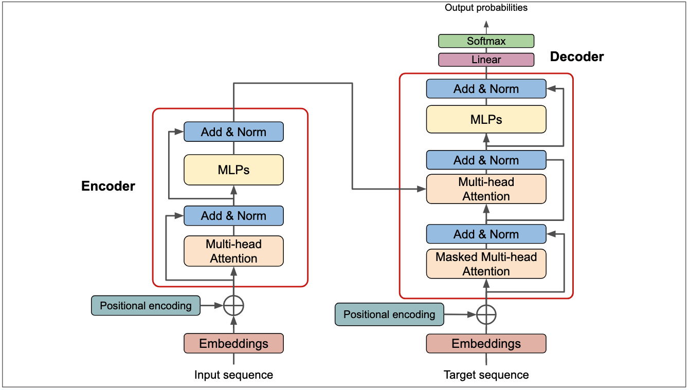
<figcaption>Transformer architecture (Vaswani et al., 2017 "Attention Is All You Need")</figcaption>
</div>

### RNN vs. Transformer
{: id="rnn-与-transformer-对比"}

|Dimension| RNN/LSTM | Transformer |
|:---|:---|:---|
|**Computation**|Sequential recursion, cannot be parallelized|Fully parallel, very high hardware utilization|
|**Long-range dependencies**|Decay exponentially with distance, so very long text is hard to capture|The distance between any two positions is always 1, with no information loss|
|**Context scope**|Local context|Global context|
|**Inductive bias**|Strong (temporal correlation)|Weak (fully connected), so more training data is needed|
|**Memory complexity**| $O(n \cdot d^2)$ |$O(n^2 \cdot d)$, which puts heavy pressure on GPU memory for long sequences|

*Representative work*: BERT (2018, encoder-only), the GPT series (2018 to present, decoder-only), T5 (2019, encoder-decoder), ViT (2020, treating image patches as a sequence).

### Vision Transformer (ViT)
{: id="vision-transformervit"}

**ViT (Vision Transformer, Dosovitskiy et al., 2020)** showed for the first time that, given enough data, a pure Transformer can **directly beat CNNs** on image tasks, ending the nearly ten-year dominance of CNNs in vision.

**Core design**: treat an image as a "sentence"

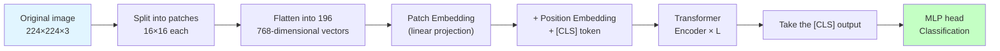

**Key steps**:

1. **Patch splitting**: Cut the $224 \times 224$ image into $14 \times 14 = 196$ patches of $16 \times 16$
2. **Patch embedding**: Flatten each patch into a $16 \times 16 \times 3 = 768$-dimensional vector and obtain a token through a linear projection
3. **[CLS] token**: Prepend a learnable "[CLS]" token to the sequence; its final output is used for classification
4. **Position embedding**: Add a learnable positional encoding (ViT uses learnable PE rather than sinusoidal)
5. **Transformer encoder**: A standard Transformer stack, usually 12–32 layers
6. **Classification head**: Take the [CLS] output and feed it to an MLP

### ViT inductive bias and data
{: id="vit-的归纳偏置与数据需求"}

|Dimension| CNN | ViT |
|:---|:---|:---|
|**Inductive bias**|Strong (locality, translation invariance)|Weak (almost no prior assumptions)|
|**Small-data performance**|Excellent (the bias speeds up convergence)|Poor (needs massive data to compensate)|
|**Big-data performance**|Saturates sooner|Keeps improving and eventually surpasses CNNs|
|**Receptive field**|Small in shallow layers and gradually expanding in deep layers|Global from the first layer|

**Empirical conclusion (original ViT paper)**:
- Data < 1M (such as ImageNet-1k): ViT is clearly worse than ResNet
- Data ~14M (ImageNet-21k): ViT is on par with ResNet
- Data ~300M (JFT-300M): ViT is clearly better

This confirms a core principle of deep learning: **less inductive bias × more data = a more flexible architecture with a higher ceiling**.

### The evolution of ViT
{: id="vit-的演进"}

|Model|Year|Key innovation|
|:---|:---:|:---|
| **ViT** | 2020 |The pioneering pure-Transformer model for images|
| **DeiT** | 2020 |Distillation strategy + data augmentation; reaches SOTA when trained on ImageNet-1k alone|
| **Swin Transformer** | 2021 |Hierarchical window attention that reintroduces local inductive bias, balancing efficiency and generalization|
| **MAE** | 2021 |Masked self-supervised pre-training (randomly masking 75% of patches), a new paradigm for ViT pre-training|
| **DINOv2** | 2023 |Self-supervised ViT reaching the level of a general-purpose vision foundation model|
| **SigLIP / CLIP** | 2021-2023 |ViT serves as the image encoder for image-text contrastive learning, driving multimodal large models|

ViT not only replaces CNNs as the visual backbone but, more importantly, **lets images and text share the same Transformer architecture**. This is the basis on which large multimodal models such as CLIP, LLaVA and GPT-4V unify vision and language in a simple way.

---

## 4.4 Graph neural networks (GNNs)
{: id="44-图神经网络gnn"}

CNNs process grid data and RNNs/Transformers process sequences, but in reality a great deal of data has **graph** structure: social networks, molecular structures, knowledge graphs, and the user-item bipartite graphs of recommender systems. Such data has a variable number of nodes, no fixed order and an uncertain number of neighbors, so the regular-structure assumptions of CNNs/RNNs no longer hold. **Graph neural networks (GNNs)** are designed specifically for this kind of non-Euclidean data.

### Message passing
{: id="消息传递"}

The unified paradigm of GNNs is **neighborhood aggregation**: each node repeatedly "collects neighbor information → aggregates → updates its own representation". The update at layer $l$ can be written as:

$$h_v^{(l+1)} = \sigma\!\left( W^{(l)} \cdot \text{AGG}\big(\{ h_u^{(l)} : u \in \mathcal{N}(v) \}\big) + B^{(l)} h_v^{(l)} \right)$$

Here $$\mathcal{N}(v)$$ is the neighbor set of node $v$, $\text{AGG}$ is a **permutation-invariant** aggregation function (sum / mean / max / attention-weighted), and $\sigma$ is a nonlinearity. After stacking $L$ layers, each node can perceive the subgraph structure within $L$ hops, much as a CNN expands its receptive field layer by layer.

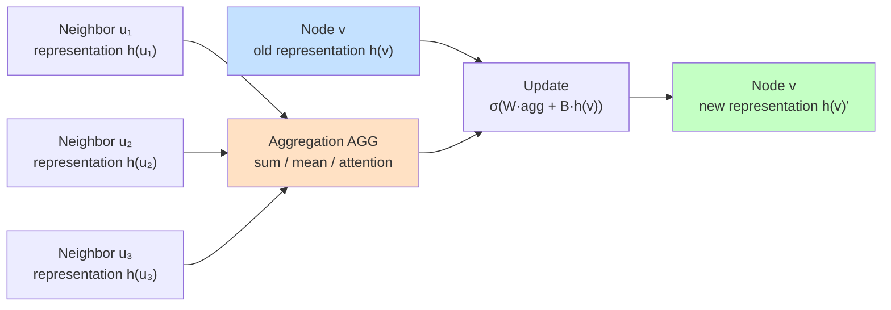

### Classic GNN comparison
{: id="经典-gnn-对比"}

|Model|Year|Aggregation|Key features|
|:---|:---:|:---|:---|
| **GCN** (Kipf & Welling)| 2017 |Degree-normalized weighted sum|First-order approximation of spectral graph convolution; the most classic baseline|
| **GraphSAGE** (Hamilton et al.)| 2017 |Sampled neighbors + mean / pooling|**Inductive**: generalizes to unseen nodes and suits large graphs|
| **GAT** (Veličković et al.)| 2018 |Attention-weighted neighbors|Introduces attention to assign each neighbor an adaptive weight|
| **GIN** (Xu et al.)| 2019 |Sum + MLP|Theoretically reaches the discriminative upper bound of the WL graph isomorphism test, giving the strongest expressive power|

### Task types and core challenges
{: id="任务类型与核心挑战"}

GNN tasks come in three types: **node-level** (node classification, e.g. determining the topic of a paper in a citation network), **edge-level** (link prediction, e.g. recommender systems) and **graph-level** (whole-graph classification, e.g. molecular property prediction).

> **Main challenge: over-smoothing**: When there are too many layers, all node representations converge and lose discriminability. GNNs therefore usually use only 2–4 layers, far shallower than CNNs/Transformers. Residual connections, jumping knowledge (JKNet) and PairNorm are common mitigations.

**Relationship to the Transformer**: A **Transformer can be viewed as a GNN** defined on a fully connected graph, where each token is a node and self-attention aggregates all other nodes with attention weights. GAT's neighbor attention shares its origin with the Transformer's self-attention. In recent years, **Graph Transformers** (such as Graphormer) have carried positional encoding and global attention over to graphs, achieving SOTA on graph-level tasks such as molecules.

*Representative work*: GCN (2017), GraphSAGE (2017), GAT (2018), GIN (2019), Graphormer (2021); applications include AlphaFold (protein residue contact graphs), drug discovery, traffic prediction and recommender systems.

---

# 5. Training optimization
{: id="5-训练优化技术"}

## 5.1 Gradient descent and optimizers
{: id="51-梯度下降与-optimizer"}

The update rule of standard **gradient descent** is:

$$\theta_{t+1} = \theta_t - \eta \cdot g_t$$

Here $\eta$ is the learning rate and $g_t$ is the gradient of the loss with respect to the parameters. All parameters share the same learning rate, yet on a real loss surface the gradients differ greatly across directions, and a fixed learning rate cannot suit them all. This gave rise to adaptive optimizers.

### Momentum
{: id="动量法像小球一样滚下山"}

**Momentum** (Polyak 1964, revived for deep learning by Sutskever et al., 2013) simulates the inertia of a ball rolling down a hillside:

$$v_t = \beta \cdot v_{t-1} + g_t \quad \text{(velocity accumulation)}$$

$$\theta_{t+1} = \theta_t - \eta \cdot v_t$$

Here $\beta \in [0, 1)$ is the momentum coefficient (typically $0.9$) and $v_t$ is the **exponential moving average** of the gradient, which acts like "inertia".

**Physical intuition**:

|Scenario|Plain SGD| Momentum SGD |
|:---|:---|:---|
|**Ravine-shaped loss** (steep on one side, flat on the other)|Oscillates back and forth between the steep walls and makes extremely slow progress|The oscillations accumulate and cancel, leaving only the net motion along the valley floor, so it **accelerates forward**|
|**Flat region** (small gradient)|Very small steps, almost stagnant|Velocity accumulates many small gradients and **keeps moving forward**|
|**Saddle point**|Stalls near zero gradient|Momentum helps escape saddle points|
|**Sharp local minimum**|Easy to get stuck|Momentum may carry the optimizer past shallow local minima|

**Nesterov accelerated gradient (NAG)** is an improved version of momentum: it first "takes a step ahead" according to the current momentum and computes the gradient at the look-ahead position, making the inertia more responsive to the slope ahead ("look-ahead momentum").

$$v_t = \beta \cdot v_{t-1} + \nabla \mathcal{L}(\theta_t - \eta\beta v_{t-1})$$

Enable it in PyTorch with `torch.optim.SGD(momentum=0.9, nesterov=True)`.

### Optimizer evolution
{: id="优化器演进"}

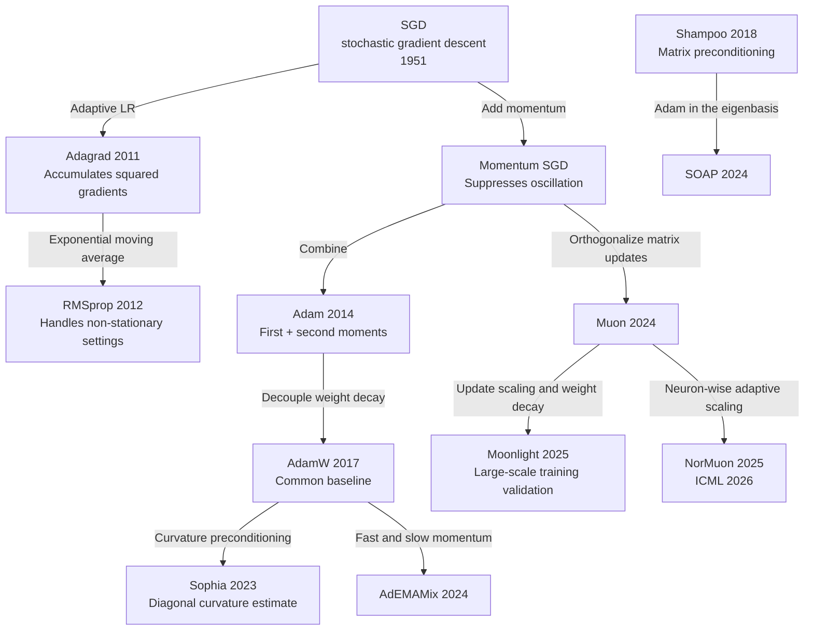

The arrows illustrate related ideas. Muon orthogonalizes momentum updates for matrices; it should not be understood as a switch added to AdamW. Methods based on norm geometry, such as Scion, are discussed below.

### Classical and recent optimizers
{: id="经典与近年优化器对比"}

| Optimizer | First public release | Update mechanism | Main cost or limitation | Application direction |
|:---|:---:|:---|:---|:---|
| SGD / Momentum SGD | Classical methods | Raw gradient or momentum direction | Requires learning rate and schedule tuning | Baselines for supervised learning, including CNNs |
| Adagrad | 2011 | Coordinate-wise scaling by accumulated squared gradients | Learning rates may decay too quickly | Sparse features |
| RMSprop | 2012 | Exponential moving average of squared gradients | Hyperparameters depend on the task | Historically common for RNNs |
| Adam / **AdamW** | 2014 / 2017 | First and second moments; AdamW decouples weight decay | Standard implementations store two per-parameter states | General training and fine-tuning baselines |
| [Adafactor][ref-adafactor] | 2018 | Factorizes matrix second moments into row and column statistics | Saves state memory, but approximation and configuration affect results | Limited optimizer-state memory |
| [Lion][ref-lion] | 2023 | Sign of a combination of momentum and gradient | Usually needs a lower learning rate than AdamW and corresponding decay adjustments | Candidate for vision and language tasks |
| [Sophia][ref-sophia] | 2023 | Diagonal curvature estimates and clipped updates | Requires additional curvature estimation; step count alone is insufficient | LLM pretraining research |
| [AdEMAMix][ref-ademamix] | 2024 | Combines fast and slow gradient EMAs with a second moment | Adds a slow momentum buffer and its hyperparameters relative to AdamW | Long training runs and reduced forgetting |
| [Muon][ref-muon] / [Moonlight extension][ref-moonlight] | 2024 / 2025 | Approximately orthogonalizes matrix momentum and scales updates by layer shape | Usually paired with AdamW; adds matrix operations and communication costs | Validated in large-scale dense / MoE pretraining |
| [SOAP][ref-soap] | 2024 | Runs Adam in the eigenbasis of Shampoo's preconditioner | Stores matrix statistics and periodically updates the eigenbasis | Training that can afford preconditioning overhead |
| [Scion][ref-scion] | 2025 | Produces updates through a linear minimization oracle under layer-specific norm constraints | Requires norms and scales for different layers | Hyperparameter transfer and activation-scale control |
| [NorMuon][ref-normuon] | 2025; ICML 2026 | Adds neuron-wise adaptive scaling to Muon updates | Usually still needs AdamW for parameters outside the hidden weight matrices | Improving Muon for large-batch training |

**A second moment is not a second derivative**: Adam's $v_t$ is a moving average of squared gradients, not a Hessian. Sophia estimates curvature; Shampoo / SOAP use matrix preconditioning; Muon changes the singular-value structure of matrix updates. These approaches address different aspects of optimization and cannot be adequately described by a single “adaptive LR” label.

**Adam’s core formula** (Kingma & Ba, 2014):

$$m_t = \beta_1 m_{t-1} + (1-\beta_1)g_t \quad \text{(first moment)}$$

$$v_t = \beta_2 v_{t-1} + (1-\beta_2)g_t^2 \quad \text{(second moment)}$$

$$\hat{m}_t = \frac{m_t}{1-\beta_1^t}, \qquad \hat{v}_t = \frac{v_t}{1-\beta_2^t}$$

$$\theta_{t+1} = \theta_t - \frac{\eta}{\sqrt{\hat{v}_t}+\epsilon}\hat{m}_t$$

Standard hyperparameters: $\beta_1=0.9$, $\beta_2=0.999$, $\epsilon=10^{-8}$. Adam's $m_t$ determines the direction (and can carry the iterate across saddle points), while $v_t$ determines the magnitude (adaptively adjusting each parameter's learning rate). The two complement each other and together address the two core problems of gradient descent.

### Muon: from coordinate-wise scaling to matrix updates
{: id="muon从逐坐标缩放到矩阵更新"}

**Muon (MomentUm Orthogonalized by Newton-Schulz)** treats hidden-layer weights as matrices and approximately orthogonalizes their momentum. Intuitively, AdamW adjusts each coordinate's step size, while Muon rebalances different singular directions of a matrix update. Omitting Nesterov momentum, shape-dependent scaling, and weight decay, an illustrative formulation is:

$$M_t = \beta M_{t-1} + (1-\beta)G_t, \qquad M_t = U_t\Sigma_t V_t^\top$$

$$Q_t = U_t V_t^\top, \qquad W_{t+1} = W_t - \eta_t Q_t$$

The compact SVD expresses the ideal polar factor. Implementations approximate this transformation with a few **Newton–Schulz iterations**, avoiding an explicit SVD at every step. For a full-rank rectangular matrix, the ideal factor is semi-orthogonal; a finite approximation need not be strictly semi-orthogonal. The **update direction** is orthogonalized, rather than requiring the weight matrix itself to remain orthogonal. See the [author's explanation][ref-muon-note] and [implementation][ref-muon] for the original algorithm and parameter grouping conventions.

**Scaling to larger models**: Moonlight adds weight decay and update-scale calibration to Muon and validates it on a **MoE with 3B active / 16B total parameters, trained on 5.7T tokens**. The paper reports roughly twice the compute efficiency in its comparisons. This does not imply that arbitrary end-to-end training runs take half the time, but it does establish evidence beyond small and medium-sized models. [Original paper][ref-moonlight]

**Parameter grouping**: Common implementations use Muon for hidden-layer matrices and AdamW for embeddings, output heads, biases, and normalization parameters. Grouping solely by `p.ndim == 2` is insufficient: embeddings and output heads are also matrices, and tied weights must be deduplicated. Convolution-kernel flattening, whether Q/K/V are orthogonalized separately, and communication for sharded parameters should follow the conventions of the chosen implementation. [Author's implementation][ref-muon]

### SOAP: Adam in a better coordinate system
{: id="soap在更合适的坐标系中使用-adam"}

**SOAP (Shampoo with Adam in the Preconditioner's eigenbasis)** accumulates left and right statistics of matrix gradients, periodically obtains their eigenbases, transforms gradients into that coordinate system, applies Adam there, and transforms updates back. It combines **Shampoo's matrix structure** with **Adam's coordinate-wise adaptation**. [Original paper][ref-soap]

It is inaccurate to state that “SOAP is equivalent to Shampoo.” The theoretical connection relies on particular assumptions, and practical behavior also depends on basis-update frequency, block size, and momentum handling. For an $m\times n$ matrix, the unblocked left and right statistics alone require $O(m^2+n^2)$ storage, with additional eigendecomposition costs. Fewer training steps must therefore be assessed alongside time per step and peak memory.

### AdEMAMix, Scion, and NorMuon: three directions for improvement
{: id="ademamixscion-与-normuon三种不同的改进方向"}

- **Retaining older gradient information—AdEMAMix (2024)**: A fast EMA tracks recent directions, while a slow EMA retains a longer history; a mixing coefficient combines them. The paper validates benefits in language modeling and image classification. This generally adds a per-parameter momentum buffer relative to AdamW, so it should not also be presented as saving optimizer-state memory. [Original paper][ref-ademamix]
- **Changing the geometry of updates—Scion (2025)**: Norms are chosen according to layer input and output scales, and a linear minimization oracle produces updates. The framework includes constrained and unconstrained variants. One goal is better hyperparameter transfer across model sizes; this does not mean that every model requires no tuning. [ICML 2025 paper][ref-scion]
- **Restoring neuron-wise adaptation—NorMuon (2025; ICML 2026)**: It introduces per-neuron second-moment statistics and row normalization after Muon orthogonalization to address uneven neuron updates, with particular attention to larger batches. It combines matrix updates with neuron-wise adaptation, rather than simply applying coordinate-wise Adam to Muon. [ICML 2026 paper][ref-normuon]

### Recent work in 2026: two directions to follow
{: id="2026-年新近工作值得跟踪的两个方向"}

| Work | First public release | New idea | Scope and limitations |
|:---|:---:|:---|:---|
| [Aurora][ref-aurora] | 2026-06-26 | Improves row-update balance for tall matrices within Muon's spectral geometry, focusing on MLP up / gate projections | The authors report language-model pretraining and nanoGPT experiments; these do not establish benefits for every layer and model |
| [AF-Muon][ref-afmuon] | 2026-10-01 | Designs updates for a shared vocabulary matrix and auxiliary parameters in models with tied embeddings / output heads, removing the need for companion AdamW | The authors test models including 124M–1B parameters; frontier-scale pretraining remains untested, and this is not a universal configuration for original Muon |

As of this update, both are presented as **recent preprints**. AF-Muon's reported savings of about 20% concern **optimizer-state memory** relative to its Hybrid Muon baseline, not a 20% reduction in total training memory. Beyond new optimizer names, useful questions include how vocabulary matrices are handled, how neuron-wise adaptation is retained after orthogonalization, and how orthogonalization and communication costs can be reduced.

### Practical selection and fair comparisons
{: id="实践选型与公平比较"}

| Current problem | Consider first | What to record |
|:---|:---|:---|
| Need a reliable starting point, or perform conventional fine-tuning / LoRA | Establish an AdamW baseline | Learning rate, effective batch size, and decay groups |
| Pretrain a Transformer from scratch and seek better compute efficiency | Muon + AdamW; then compare NorMuon | Parameter grouping, update scaling, distributed implementation, and end-to-end time |
| Want matrix preconditioning and have sufficient memory and compute | SOAP | Block size, preconditioner update interval, and peak memory |
| Run long training and want to retain older gradient information | AdEMAMix | Slow momentum settings, additional state, and training budget |
| Optimizer states are the memory bottleneck | Adafactor, low-bit states, or state sharding | Optimizer-state and total memory separately, plus changes in quality |

These are **selection recommendations** based on the mechanisms and available experimental evidence. Compare optimizers using the same data, model, token / sample budget, and validation protocol, with a reasonable tuning budget for each. Report **GPU time to target quality, final quality, peak memory, and stability**. Fewer steps, fewer tokens, fewer FLOPs, and less elapsed time are different metrics. Benefits in pretraining do not automatically transfer to LoRA, reinforcement learning post-training, or other modalities.

## 5.2 Learning rate scheduling
{: id="52-学习率调度"}

A fixed learning rate can be too large, causing oscillation, or too small, causing slow progress. **Warmup + Cosine Decay** is a common approach; WSD and Schedule-Free reduce dependence on a predetermined training endpoint in different ways.

|training phase|Relative LR|Description|
|:---:|:---:|:---|
|Starting point (step 0)| 0 |Linear heating from zero|
|Warmup ends|1.0 (peak value)|Reach target learning rate|
|mid-training| ~0.5 |Cosine decay through half way|
|end of training| ~0.05 |Close to zero, the parameters slowly "land"|

|stage|Description|purpose|
|:---|:---|:---|
|**Warmup (preheat)**|In the first few steps, LR increases linearly from 0 to the target value.|Let Adam's $m_t$/$v_t$ accumulate accurate statistics to avoid initial instability|
|**Cosine Decay (cosine decay)**|LR drops to close to 0 according to the cosine curve|Let the parameters "land" slowly to avoid continuous oscillation near the optimal point|

### Other commonly used schedulers
{: id="其他常用调度器"}

|Scheduler|Curve characteristics|Applicable scenarios|
|:---|:---|:---|
| **StepLR** |Multiply LR by $\gamma$ every $k$ epoch (e.g. 0.1)|CV classic training (ResNet original paper 30/60/90 epoch reduced to 10×)|
| **MultiStepLR** |descend the ladder at the specified epoch list|Manual version of StepLR, precise control|
| **ExponentialLR** |$\eta_t = \eta_0 \cdot \gamma^t$, proportional attenuation in each step|Scenes that require smooth attenuation|
| **ReduceLROnPlateau** |Validation set Loss stagnated and dropped to LR after $p$ epochs|Adaptive; no need to know the total epochs in advance|
| **Cosine Annealing Warm Restart** |The cosine decays to 0 and then "restarts" back to high LR, with period increment (SGDR)|Escape from local optimality and integrate multiple checkpoints|
| **1Cycle**(Leslie Smith, 2018) |First rise and then fall + Momentum reversely changes synchronously|CV fast training (recommended by FastAI)|
| **Warmup + Linear Decay** |Linear decay after warmup|BERT original paper, GLUE fine-tuning commonly used|
| **Warmup + Cosine** | Cosine decay after warmup | Pretraining and fine-tuning with a predetermined budget |
| **Warmup–Stable–Decay (WSD)** | Warmup → constant-LR trunk → final decay | Extending pretraining flexibly or comparing different budgets |

### WSD: separating the training trunk from final convergence
{: id="wsd把训练主干与末期收敛分开"}

**WSD (Warmup–Stable–Decay)** maintains a constant learning rate after warmup. Once an endpoint for a particular budget is chosen, training branches from a trunk checkpoint into a decay phase. Unlike a cosine schedule tied to a total step count from the start, this allows the stable-phase trunk to be reused to produce models at different compute budgets. [WSD analysis paper][ref-wsd]

This is still a **learning rate schedule**: the peak rate, warmup, decay duration, and decay shape must be chosen, and decay consumes compute. A stable-phase checkpoint and one that has completed cooldown should not be treated as having equal budgets and convergence states.

### Schedule-Free: iterate averaging instead of a preset decay curve
{: id="schedule-free用迭代平均替代预设衰减曲线"}

**Schedule-Free (2024)** combines momentum with iterate averaging, distinguishes the gradient-evaluation point from the parameters used for evaluation, and avoids a decay curve tied to a predetermined stopping step. Variants include SGD and AdamW. Its mechanism differs from WSD, and learning rate, warmup, and weight decay still require configuration. [Original paper][ref-schedulefree]

**Implementation details**: The authors' non-closure interface requires `optimizer.train()` during training and `optimizer.eval()` before validation or saving evaluation weights, alongside `model.train()` / `model.eval()`; switching model mode alone is insufficient. Resumable checkpoints should retain optimizer state according to the implementation's instructions. BatchNorm also requires handling running statistics for the evaluation parameters. The official implementation still recommends warmup. [Author's repository][ref-schedulefree-code]

**Selection principles**:

- **Training a CNN from scratch**: StepLR or cosine annealing (warm restarts for long training)
- **Fine-tuning a pretrained model**: warmup + linear/cosine (low peak LR, usually $1-5 \times 10^{-5}$)
- **LLM pretraining**: Compare Warmup + Cosine for fixed budgets and WSD when the budget may grow. Calibrate peak learning rate and warmup to model scale, batch size, and optimizer rather than copying them across configurations
- **A validation set is available and the number of epochs is uncertain**: ReduceLROnPlateau
- **Rapid prototyping / competitions**: 1Cycle (Smith reported it can achieve "super-convergence")

## 5.3 Parameter initialization
{: id="53-参数初始化"}

Different initial parameters $\theta_0$ may lead to different local optima.

**Xavier initialization** (Glorot & Bengio, 2010; suited to symmetric activations such as sigmoid/tanh):

$$W \sim \mathcal{N}\left(0, \frac{2}{n_{in}+n_{out}}\right)$$

This method keeps the variance of the forward activations and the backward gradients stable, and is the default choice for symmetric activation functions.

**Kaiming initialization** (He et al., 2015; suited to ReLU activations):

$$W \sim \mathcal{N}\left(0, \frac{2}{n_{in}}\right)$$

ReLU zeroes out half of its inputs, so Xavier's variance assumption no longer holds; Kaiming therefore doubles the variance to compensate. This keeps the activation variance stable early in the training of ReLU networks dozens of layers deep, preventing it from exploding or vanishing.

**Selection principle**: Xavier is commonly used for sigmoid/tanh, and Kaiming for ReLU and its variants. In practice, the initialization must also be considered together with the residual structure, normalization and the framework's default implementation.

**Pre-training as initialization**: Train on large-scale data first, then transfer the parameters to the target task. This improves both optimization (a better starting point) and generalization (learning common features).

## 5.4 Normalization methods
{: id="54-归一化方法"}

**Normalization** forces the output of each layer into a reasonable range, which makes the loss surface flatter and the learning rate easier to tune.

### Comparison of normalization methods
{: id="归一化方法对比"}

|Method|Year|Normalized dimensions|Depends on batch|Typical use|Representative models|
|:---|:---:|:---|:---:|:---|:---|
| **Batch Norm (BN)** | 2015 |Across samples, per feature dimension| ✓ |CNN image classification| ResNet, EfficientNet |
| **Layer Norm (LN)** | 2016 |Single sample, all features| ✗ |Transformers, sequence models|BERT, GPT series|
| Group Norm | 2018 |Single sample, groups of features| ✗ |Small-batch CV (object detection)| Mask R-CNN |
| Instance Norm | 2017 |Single sample, single channel| ✗ |Image style transfer| StyleGAN |
| **RMSNorm** | 2019 |Single sample (RMS scaling)| ✗ |Efficient LLM training|LLaMA, Qwen, etc.|

**Batch Normalization(BN, Ioffe & Szegedy, 2015)**: 

$$\hat{x} = \frac{x - \mu_{batch}}{\sqrt{\sigma_{batch}^2 + \epsilon}}, \quad y = \gamma\hat{x} + \beta$$

Here $\gamma, \beta$ are learnable scale and shift parameters, which give the model the ability to "undo the normalization".

#### Key differences between BN in training and inference
{: id="bn-训练与推理的关键差异"}

BN behaves differently during training and inference, which is the most common pitfall in engineering practice:

|Stage|Source of $\mu, \sigma^2$|Behavior|
|:---|:---|:---|
|**Training**|Computed on the fly from the current mini-batch|Each batch has a slightly different mean and variance, which introduces noise that acts as regularization; `running_mean`/`running_var` (exponential moving averages) are updated at the same time|
|**Inference**|The `running_mean`/`running_var` accumulated during training|Independent of the batch, so the same input always gives the same output|

> **Common bug**: In PyTorch, `model.eval()` switches BN to its running statistics for inference; if you forget to call it, inference still uses the current batch's statistics, which makes the output random when the batch size is 1.

#### Limitations of BN and why LN is needed
{: id="bn-的局限与-ln-的必要性"}

BN has three fatal shortcomings, which correspond to the three reasons the Transformer chose LN:

|Problem|BN behavior|LN behavior|
|:---|:---|:---|
|**Batch too small**|Statistics become noisy and training becomes unstable at extremely small batch sizes|Independent of the batch; works even with batch size 1|
|**Varying sequence length**|Samples have different lengths, and padding pollutes the statistics|Each sample is normalized independently|
|**Distributed training**|Batch statistics must be synchronized across devices (SyncBN)|Fully local computation, no communication overhead|

**Layer Normalization(LN, Ba et al., 2016)**: 

$$\hat{x}_i = \frac{x_i - \mu_{layer}}{\sqrt{\sigma_{layer}^2 + \epsilon}}$$

Layer normalization normalizes **across the feature dimensions of each sample**, independently of batch size and sequence length. This is why it is standard in Transformers.

**Normalized dimensions compared intuitively** (taking a 4D feature map of shape [N, C, H, W] as an example):

|Method|Normalization range|Across samples?|Across channels?|
|:---|:---|:---:|:---:|
| **BN** |Over the (N, H, W) dimensions, separately for each C| ✓ | ✗ |
| **LN** |Over the (C, H, W) dimensions, separately for each N| ✗ | ✓ |
| **Instance Norm** |Over (H, W), separately for each (N, C)| ✗ | ✗ |
| **Group Norm** |Split C into groups and normalize within each group| ✗ |Partially|

**RMSNorm** (2019): drops the mean-centering and keeps only the variance scaling:

$$\text{RMSNorm}(x) = \frac{x}{\sqrt{\frac{1}{d}\sum_i x_i^2 + \epsilon}} \cdot \gamma$$

It is typically slightly cheaper to compute than LN and performs similarly in many language models; adoption depends on the architecture and training recipe.

## 5.5 Residual connection
{: id="55-残差连接"}

Deep networks (100+ layers) suffer from both vanishing and **exploding gradients**. The **skip connection / residual connection** (He et al., ResNet, 2015) is:

$$\text{output} = F(x) + x$$

That is, the input $x$ (an identity mapping) is added directly to the transformation $F(x)$. Even if $F(x)$ has little effect, the gradient can still flow back to the shallow layers directly through the identity path, which greatly alleviates vanishing gradients and enables stable training of extremely deep networks such as ResNet-152.

### Variants of residual connections
{: id="残差连接的变体"}

After ResNet, residual connections developed into several variants, each trading off "degree of identity" against "information density":

|Variant|Year|Core formula|Features|
|:---|:---:|:---|:---|
| **Highway Network** | 2015 | $y = T(x) \odot F(x) + (1-T(x)) \odot x$ |A gate $T$ controls the residual scale; the predecessor of ResNet|
| **ResNet v1** | 2015 | $y = \text{ReLU}(F(x) + x)$ |The original residual block, with the activation applied **after the residual addition**|
| **ResNet v2 (pre-activation)** | 2016 |$y = F(x) + x$, with BN/ReLU inside $F$|The activation is placed **before the residual branch**, so the gradient flows back more cleanly; supports networks of more than 1000 layers|
| **DenseNet** | 2017 | $x_l = H_l([x_0, x_1, \ldots, x_{l-1}])$ |Each layer is concatenated **with all preceding layers**, maximizing feature reuse|
| **ResNeXt** | 2017 | ResNet + grouped conv |Multi-path (cardinality) idea: fewer parameters and higher performance|

**Key insight of pre-activation ResNet (v2)**: In the original ResNet's `ReLU(F(x)+x)`, the ReLU truncates part of the gradient; v2 moves BN-ReLU inside $F$, so the residual path is a pure identity mapping and the gradient passes through losslessly. This makes ResNet-1001 (1001 layers!) trainable. The Transformer's Pre-LN layout is essentially a generalization of the same idea.

**DenseNet offers a counterintuitive result**: each layer concatenates all preceding layers, which seems likely to cause an explosion in parameter count. Feature reuse allows each layer to remain narrow (often with a growth rate of only 32 channels), so the total parameter count can be smaller than that of a ResNet of the same depth. The trade-off is high GPU memory use because many intermediate activations must be retained.

The skip connection has become a standard component of almost all modern deep architectures (ResNet, Transformer, U-Net, diffusion UNet). What it improves is **optimization**: it does not address whether deep networks can express complex functions (shallow ones can too), but whether deep networks can be trained by SGD.

---

# 6. Loss function and regularization
{: id="6-损失函数与正则化"}

## 6.1 Loss function
{: id="61-损失函数"}

The loss function is the first step of the three-step machine learning framework and defines "how to measure the quality of a model". Choosing an appropriate loss function is crucial for training.

### Mean Squared Error (MSE)
{: id="均方误差mse"}

**Mean squared error (MSE)** is suited to **regression tasks** and measures the mean squared difference between predictions and targets:

$$\mathcal{L}_{MSE} = \frac{1}{N}\sum_{i=1}^N (y_i - \hat{y}_i)^2$$

- **Advantages**: differentiable everywhere with a simple gradient; larger errors are penalized more heavily (the squaring effect)
- **Disadvantages**: extremely sensitive to outliers; gradients may explode when the prediction error is large

### Mean Absolute Error (MAE)
{: id="平均绝对误差mae"}

$$\mathcal{L}_{MAE} = \frac{1}{N}\sum_{i=1}^N |y_i - \hat{y}_i|$$

- **Advantages**: more robust to outliers (linear rather than squared penalty)
- **Disadvantages**: not differentiable at $$y_i = \hat{y}_i$$ (Huber loss is used as a compromise)

### Huber Loss
{: id="huber-loss"}

$$\mathcal{L}_{Huber} = \begin{cases} \frac{1}{2}(y-\hat{y})^2 & |y-\hat{y}| \leq \delta \\ \delta|y-\hat{y}| - \frac{1}{2}\delta^2 & |y-\hat{y}| > \delta \end{cases}$$

Huber loss uses MSE (smooth and differentiable) when the error is small and MAE (robust to outliers) when the error is large, with $\delta$ controlling the switching threshold. It is commonly used for the regression branch in object detection.

### Cross-entropy loss
{: id="交叉熵损失cross-entropy"}

**Cross-entropy loss** is suited to **classification tasks**, including image classification and language models (next-token prediction is essentially multi-class classification).

**Step 1**: Convert the network's output logits into a probability distribution with **softmax**:

$$p_i = \frac{e^{z_i}}{\sum_j e^{z_j}}$$

**Step 2**: Compute the cross-entropy with the true label (take the log-probability of the true class and negate it):

$$\mathcal{L}_{CE} = -\sum_i \hat{p}_i \log p_i = -\log p_{y^*}$$

Here $y^*$ is the true class and $$\hat{p}_i$$ is the one-hot label.

> **Why not use accuracy as the loss?** Accuracy is a step function: when the parameters change slightly, the loss barely changes (its gradient is almost always zero), so gradient descent cannot be performed. Cross-entropy is differentiable everywhere, and the smaller it is, the higher the accuracy tends to be.

**Numerical stability**: In practice, softmax and cross-entropy are fused (LogSoftmax + NLLLoss) to avoid numerical overflow of $e^{z_i}$.

### Label smoothing
{: id="label-smoothing标签平滑"}

**Label smoothing** (Szegedy et al., 2016; widely popularized by Inception-v3 and the original Transformer) is a simple but powerful regularization trick for cross-entropy.

**Motivation**: A one-hot label requires the model to predict 1.0 for the correct class and 0 for all others. To fit this fully, the model must push the logits towards infinity, which causes **overconfidence**, poorer generalization and weak distillation.

**Approach**: soften the hard label $$\hat{p}_i$$ to:

$$\hat{p}_i^{\text{LS}} = \begin{cases} 1 - \epsilon & i = y^* \\ \epsilon/(K-1) & i \neq y^* \end{cases}$$

Here $K$ is the number of classes and $\epsilon$ is the smoothing coefficient (typically $0.1$). The target probability of the correct class drops to $0.9$, and the remaining $0.1$ is distributed evenly over the other classes.

**Effects**:
- Suppresses overconfidence and gives **better calibration**: when the model predicts 90%, the actual accuracy is also close to 90%
- Slightly improves generalization (roughly <span style="white-space: nowrap;">0.2–0.5%</span> higher Top-1 accuracy on ImageNet)
- Improves the quality of the teacher's soft labels for knowledge distillation (a soft distribution carries more information than a one-hot label)

**Note**: Label smoothing discards a small amount of confidence information, which must be weighed in tasks that rely on confidence (active learning, rejection).

### Binary cross-entropy (BCE)
{: id="二元交叉熵bce"}

For binary classification tasks (with a sigmoid output layer):

$$\mathcal{L}_{BCE} = -[y \log \hat{p} + (1-y)\log(1-\hat{p})]$$

### Focal Loss
{: id="focal-loss"}

**Focal loss** (Lin et al., 2017, proposed in RetinaNet) is designed specifically for scenarios with **severe class imbalance**, such as object detection, where background boxes far outnumber foreground boxes (about 1000:1), or medical images, where positive samples are rare.

Standard cross-entropy still assigns a non-negligible loss to easy samples (predicted probability $p \to 1$), and a large number of easy samples will "swamp" the gradients of the few hard samples. Focal loss multiplies CE by a **modulating factor** $(1-p)^\gamma$:

$$\mathcal{L}_{Focal} = -\alpha(1-p)^\gamma \log p$$

- **$\gamma$ (focusing parameter, typically 2)**: When $p \to 1$, $(1-p)^\gamma \to 0$ and almost no gradient is produced; when $p \to 0$ (a hard sample), the factor approaches 1 and the gradient is normal
- **$\alpha$ (class balancing, typically 0.25)**: A static adjustment of the positive and negative class weights

**Effect**: Focal loss played an important role in RetinaNet becoming the first single-stage detector to match the accuracy of the two-stage Faster R-CNN. It has since been widely used in long-tail classification, anomaly detection and medical image segmentation.

### KL divergence
{: id="kl-散度"}

**KL divergence (Kullback-Leibler divergence)** measures the difference between two probability distributions and is often used in knowledge distillation and variational autoencoders (VAEs):

$$\mathcal{L}_{KL}(P \| Q) = \sum_i P(i) \log \frac{P(i)}{Q(i)}$$

#### Mathematical relationship between cross-entropy and KL divergence
{: id="交叉熵与-kl-散度的数学关系"}

Cross-entropy and KL divergence are not two independent losses; they are **different views of the same quantity**:

$$\text{CE}(P, Q) = H(P) + \text{KL}(P \| Q)$$

where $H(P) = -\sum_i P(i) \log P(i)$ is the entropy of the true distribution $P$.

**Corollary**: When $P$ is a one-hot hard label, $H(P) = 0$, so **CE $\equiv$ KL**. In standard classification, "minimizing cross-entropy" and "minimizing KL divergence" are therefore exactly equivalent.

**Practical differences**:
- Hard labels (one-hot): use CE, which is simpler to compute
- Soft labels (distillation, label smoothing, the RLHF reference policy): use KL. When $H(P) \neq 0$, CE contains a constant term that cannot be optimized, whereas KL measures the "distance from the target distribution" more cleanly

### Contrastive losses
{: id="对比学习损失"}

**Metric learning** aims to learn an embedding space in which "similar samples" are close together and "dissimilar samples" are far apart. There are two classic losses:

**Contrastive loss** (Hadsell et al., 2006): given a pair of samples $(x_i, x_j)$, the label $y=1$ means the same class and $y=0$ means different classes:

$$\mathcal{L}_{\text{contrastive}} = y \cdot d(x_i, x_j)^2 + (1-y) \cdot \max(0, m - d(x_i, x_j))^2$$

Here $d$ is the embedding distance (usually Euclidean) and $m$ is the margin hyperparameter.

**Triplet loss** (Schroff et al., 2015, FaceNet): given a triplet (anchor $a$, positive $p$, negative $n$):

$$\mathcal{L}_{\text{triplet}} = \max(0, d(a, p) - d(a, n) + m)$$

The intuition is that "the distance from the positive to the anchor plus a margin should be smaller than the distance from the negative to the anchor". FaceNet achieves 99.63% accuracy on LFW with the face embeddings it learns.

**InfoNCE (Contrastive Predictive Coding, Oord et al., 2018)**: the mainstream form of modern contrastive learning, in which one positive sample is contrasted against $N-1$ negative samples with a softmax:

$$\mathcal{L}_{\text{InfoNCE}} = -\log \frac{\exp(\text{sim}(q, k^+)/\tau)}{\sum_{i=0}^{N-1} \exp(\text{sim}(q, k_i)/\tau)}$$

where $\tau$ is the temperature coefficient. **SimCLR, MoCo and CLIP** are all based on InfoNCE; this type of loss drove the explosion of self-supervised representation learning in 2020–2023.

> **InfoNCE is essentially the cross-entropy** of an $N$-way classification: the positive sample is the only "correct class" and the negatives are the "other classes". This once again confirms the universality of CE.

### Loss function selection cheat sheet
{: id="损失函数选择速查"}

|Task type|Recommended loss|Notes|
|:---|:---|:---|
|Regression (no outliers)| MSE |Smooth gradients and fast convergence|
|Regression (with outliers)| Huber loss |Balances smoothness and robustness|
|Binary classification| Binary cross-entropy |With a sigmoid output layer|
|Multi-class classification| Cross-entropy |With a softmax output layer|
|Language modeling| Cross-entropy |Next-token prediction = multi-class classification|
|Distribution matching|KL divergence|VAE, knowledge distillation, the RLHF KL constraint|
|Object detection (box regression)| Smooth L1 / IoU loss |Matches the characteristics of detection tasks|
|Severe class imbalance| Focal loss |Object detection, long-tail classification, medical images|
|Metric learning / face recognition| Triplet loss, ArcFace |Learns a discriminative embedding space|
|Self-supervised learning|InfoNCE (contrastive learning)| SimCLR, MoCo, CLIP |

## 6.2 Dropout
{: id="62-dropout"}

**Dropout** (Srivastava et al., 2014): with dropout rate $p$, each neuron's output is set to zero with probability $p$ during training, and the retained activations are divided by $1-p$ (inverted dropout). Dropout is turned off at inference and the full network is used directly, so no additional scaling is needed.

<div align="center">
  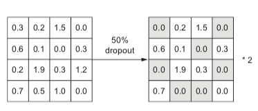
<figcaption>Dropout: neurons are randomly dropped (×) during training, which is equivalent to ensembling a large number of sub-networks</figcaption>
</div>

Intuition: forcing the network to predict correctly even when some neurons are missing prevents excessive co-adaptation between neurons. It is equivalent to training a large number of differently structured sub-networks at the same time and obtaining an ensemble effect.

**When to use it**: When there is a clear gap between training and validation error, Dropout can serve as a regularization option; if the training loss itself will not go down, check the optimization settings first. Too strong a Dropout may slow convergence further.

## 6.3 Data augmentation
{: id="63-数据增强"}

**Data augmentation** artificially enlarges the dataset by applying semantics-preserving transformations to training samples:

|Method|Domain|Core idea|Year|
|:---|:---:|:---|:---:|
|Flip / crop / color jitter|Image|Classic hand-designed augmentations that preserve semantics| — |
| **Mixup** |General|Mixes two samples in proportion and mixes their labels in the same way| 2018 |
| **CutMix** |Image|Cuts and pastes regions, mixing labels in proportion to area| 2019 |
| **AutoAugment** |Image|Searches for the best augmentation policy with reinforcement learning| 2019 |
| **RandAugment** |Image|Randomly samples augmentations with only 2 hyperparameters; a simplified AutoAugment| 2020 |
| **AugMix** |Image|Mixes multiple augmentation chains with a Jensen-Shannon consistency loss to improve distribution robustness| 2020 |
| Time stretch / pitch shift |Speech|Changes speed and pitch while keeping the content the same| — |
|Synonym replacement / back-translation|Text|Semantically equivalent rewriting| — |

**Mixup** formula: $\tilde{x} = \lambda x_i + (1-\lambda)x_j$, $\tilde{y} = \lambda y_i + (1-\lambda)y_j$

**Note**: Augmentations must preserve the label semantics. If the task is to determine which way a bird's head is pointing, left-right flipping is not allowed; if the task is speaker identification, swapping speakers is not allowed.

**When to use it**: Data augmentation is usually used to improve generalization and distribution robustness, but its strength must match the task. If the training loss will not go down, first confirm that the augmentation does not destroy the label semantics, then check the optimization settings.

## 6.4 L2 regularization and AdamW
{: id="64-l2-正则化与-adamw"}

**L2 regularization (weight decay)** adds an L2-norm penalty on the parameters to the loss, biasing the optimization towards solutions with smaller parameter magnitudes ("simpler" functions):

$$\mathcal{L}' = \mathcal{L}_{data} + \lambda \sum_i \theta_i^2$$

**AdamW** (Loshchilov & Hutter, 2017) fixed a common mistake in adding L2 regularization to Adam: the traditional approach merges the regularization gradient into the ordinary gradient and then rescales both with Adam's adaptive terms, so the regularization effect is "diluted" by the adaptive learning rate. AdamW instead applies weight decay directly to the parameters and then performs the Adam update:

```
θ = θ × (1 - lr × λ)       # Weight decay acts directly on the parameters (no adaptive scaling)
θ = θ - lr × Adam_update    # Normal Adam update
```

AdamW is currently the standard optimizer for training large language models and is usually used together with gradient clipping.

## 6.5 Semi-supervised and self-supervised learning
{: id="65-半监督学习与自监督学习"}

In real-world settings, labeled data is scarce while unlabeled data is cheap. **Semi-supervised learning** and **self-supervised learning** are the two mainstream ways to exploit unlabeled data.

### Core idea
{: id="核心思想"}

|Method|Representative work|Core mechanism|
|:---|:---|:---|
| **Entropy minimization** | Grandvalet 2005 |Requires the model to predict unlabeled samples as confidently as possible (low entropy), implicitly assuming that "class boundaries should lie far from high-density regions"|
| **Pseudo-labeling** | Lee 2013 |Uses the current model's predictions as pseudo-labels for unlabeled samples and adds the high-confidence ones to training|
|**Consistency regularization**| Π-Model 2016, Mean Teacher 2017 |Applies different perturbations (augmentation, dropout) to the same sample and requires the outputs to be consistent|
| **FixMatch** | Sohn et al. 2020 |Predictions on weakly augmented inputs serve as pseudo-labels to supervise predictions on strongly augmented inputs; the current mainstream SSL paradigm|
|**Contrastive learning**| SimCLR 2020, MoCo 2020 |Pulls together representations of different views of the same image and pushes apart those of different images|
|**Masked modeling**| BERT 2018, MAE 2021 |Randomly masks part of the input and asks the model to predict the masked content|

### Relationship to modern large models
{: id="与现代大模型的关系"}

The pre-training of large language models is essentially the largest self-supervised learning effort: "predicting the next token" (causal LM) or "predicting the masked token" (masked LM) on massive unlabeled text, followed by adaptation to downstream tasks through fine-tuning (SFT, RLHF) with a small amount of labeled data. The success of the **pre-training + fine-tuning** paradigm means that scarce annotated data is no longer the main bottleneck for deploying deep learning.

---

# 7. Method classification summary
{: id="7-方法分类汇总"}

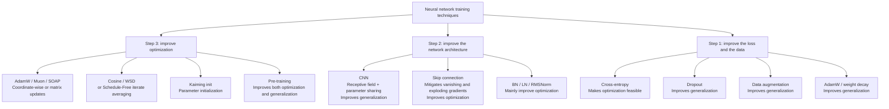

A comparison of the objectives of each method:

|Method|Step improved|Goal|Remarks|
|:---|:---|:---|:---|
| Adagrad / RMSprop | Step 3 | Optimization |Predecessors of adaptive learning rates|
| Adam / AdamW | Step 3 | Optimization | Common coordinate-wise adaptive baseline |
| Muon / NorMuon | Step 3 | Optimization | Orthogonalized matrix updates; parameter grouping must be explicit |
| SOAP / Scion | Step 3 | Optimization | Matrix preconditioning and layer-specific norm geometry, respectively |
| LR Scheduling / Schedule-Free | Step 3 | Optimization | Cosine, WSD, or iterate averaging, chosen for the training budget |
| Kaiming init | Step 3 | Optimization |Standard initialization for ReLU networks|
| Pre-training | Step 3 | Opt + Gen |Improves both at once; the core of modern large models|
| CNN | Step 2 | Opt + Gen |Improves sample efficiency through inductive bias|
| Skip connection | Step 2 | Optimization |Makes deep networks trainable|
| Batch norm | Step 2 | Optimization (+Gen) |Depends on batch statistics|
| Layer norm | Step 2 | Optimization (+Gen) |Standard in Transformers|
| Cross-entropy | Step 1 | Makes optimization feasible |Standard loss for classification / generation tasks|
| Dropout | Step 1 | Generalization |Noise regularization during training|
| Data augmentation | Step 1 | Generalization |Must preserve label semantics|
| L2 reg / AdamW | Step 1/3 | Generalization |Prefers functions with smaller parameter values|
| Semi-supervised | Step 1 | Generalization |Exploits unlabeled data|

### 7.1 Training troubleshooting quick check
{: id="71-训练排错速查"}

When a training anomaly appears, first diagnose the problem from the curves and then decide what to change. Changing only a few factors at a time and recording the data, random seeds and evaluation protocol makes results easy to compare.

|Symptom|Check first|Changes to try|
|:---|:---|:---|
|Training loss barely decreases|Data and labels, learning rate, initialization, and whether gradients are zero|Lower or raise the learning rate, check normalization and activation functions, and first test whether a small dataset can be overfit|
|Loss quickly becomes NaN or spikes violently|Learning rate, mixed-precision overflow, exploding gradients|Use BF16 / loss scaling, enable gradient clipping, and check for abnormal samples|
|Training loss is low but validation loss is high|Data volume, data splits, label leakage, overfitting|Augment the data, add weight decay or dropout, and reduce model capacity|
|Both training and validation loss are poor|Representational capacity, input preprocessing, task definition or annotation quality|Increase model size or training steps, improve features and labels, and confirm that the evaluation metrics are reasonable|
|Training is slow or GPU memory is insufficient|Sequence length, batch size, data loading and operator utilization|Mixed precision, gradient accumulation, checkpointing, FlashAttention or parameter-efficient fine-tuning|

---

# 8. Common experimental benchmarks
{: id="8-常用实验基准"}

Benchmarks are tools for measuring progress. This section reviews the classic benchmarks by field: MNIST/ImageNet for CV, GLUE/MMLU for NLP, plus coding, mathematical reasoning and long-context tasks. Models, data, prompts and evaluation scripts differ between papers, so the scales and historical results in the tables are meant to build intuition and should not be used directly as cross-paper rankings.

## 8.1 Computer vision benchmarks
{: id="81-计算机视觉基准"}

### MNIST
{: id="mnist"}

|Property|Details|
|------|------|
|Release year| 1998 |
|Size|70,000 handwritten digit images (28×28, grayscale)|
|Classes|10 (digits 0-9)|
|SOTA accuracy|>99.8% (essentially saturated)|
|Features|The most classic entry-level benchmark, suited to verifying basic methods|

### CIFAR-10 / CIFAR-100
{: id="cifar-10--cifar-100"}

|Property| CIFAR-10 | CIFAR-100 |
|------|------|------|
|Release year| 2009 | 2009 |
|Size|60,000 color images (32×32)|60,000 color images (32×32)|
|Classes| 10 | 100 |
|Suited to|Regularization, data augmentation and architecture verification|Fine-grained classification|

The effects of Dropout, batch normalization, ResNet and data augmentation have all been extensively verified on this benchmark.

### ImageNet(ILSVRC)
{: id="imagenetilsvrc"}

|Property|Details|
|------|------|
|Release year| 2010 |
|Size|1.2 million training images, 50,000 validation images|
|Classes| 1,000 |
|Features|The industrial-grade deep learning benchmark and the main battlefield in the history of CNNs|

**Evolution of ImageNet Top-1 accuracy (see the table in Section 4)**: AlexNet (56.5%) → VGG (71.5%) → ResNet (76.0%) → EfficientNet (84.4%). These numbers come from classic models and training recipes of different eras and mainly illustrate the evolution of architectures.

## 8.2 NLP benchmarks
{: id="82-自然语言处理基准"}

### GLUE / SuperGLUE
{: id="glue--superglue"}

|Benchmark|Released|Number of tasks|Purpose|
|:---|:---:|:---:|:---|
| GLUE | 2018 | 9 |Comprehensive evaluation of NLU tasks such as text classification, inference and similarity|
| SuperGLUE | 2019 | 8 |A harder successor after GLUE saturated, covering more challenging NLU tasks|

BERT (2018) achieved leading results on GLUE when it was released; as the benchmark gradually saturated, researchers subsequently introduced the harder SuperGLUE.

### MMLU
{: id="mmlu"}

|Property|Details|
|------|------|
|Release year| 2021 |
|Size|57 subjects, about 16,000 multiple-choice questions|
|Coverage|Mathematics, law, medicine, history, computer science, etc.|
|Purpose|Evaluating an LLM's breadth of knowledge and reasoning ability|
|Human level|About 89.8% (experts)|

MMLU is suited to observing a model's knowledge coverage and multi-disciplinary reasoning, but scores are affected by prompts, calibration methods and training-data contamination, so the evaluation protocol must be fixed when comparing.

### Language model perplexity
{: id="语言模型困惑度perplexity"}

Penn Treebank (PTB) and WikiText are the standard benchmarks for traditional language models. The metric is **perplexity (PPL)**: lower is better and means the model is more certain when predicting the next token. PPL remains suitable for comparing language models under the same corpus, tokenization and modeling objective, but it cannot by itself represent knowledge, coding or reasoning ability.

### Code benchmarks
{: id="代码能力基准"}

These evaluate LLM coding ability and are required for almost every frontier model release.

|Benchmark|Released|Size|Task format|Evaluation method|
|:---|:---:|:---|:---|:---|
| **HumanEval** | 2021 (OpenAI) |164 problems|Python function completion|Unit-test pass@1|
| **MBPP** | 2021 (Google) |974 problems|Basic Python problems|Unit tests|
| **HumanEval+** | 2023 |Extends HumanEval|Adds about 80× more test cases|Stricter pass@1|
| **LiveCodeBench** | 2024 |Continuously updated|The latest LeetCode problems|Prevents training-data contamination|
| **SWE-bench** | 2023 |2,294 problems|Real GitHub repository bug fixes|Run the test suite|
| **SWE-bench Verified** | 2024 |500 problems|Human-validated subset|More reliable evaluation|

**Usage suggestions**: HumanEval/MBPP suit function-level code generation, while SWE-bench is closer to real repository repair. When reporting results, also state the number of samples, the test-set version and whether tool calls are allowed.

### Mathematical reasoning benchmarks
{: id="数学推理基准"}

|Benchmark|Released|Difficulty|Features|
|:---|:---:|:---|:---|
| **GSM8K** | 2021 |Grade-school word problems|8.5K problems, testing multi-step arithmetic reasoning|
| **MATH** | 2021 |Competition level (AMC/AIME)|12.5K problems in the style of math olympiads|
| **AIME** |Updated annually|American Invitational Mathematics Examination|Avoids training contamination; the main battlefield for frontier models|
| **Putnam** | — |Undergraduate mathematics competition|Extremely difficult, testing top-level reasoning|

GSM8K focuses on basic multi-step arithmetic, while MATH and AIME demand competition-level mathematical reasoning. As model capabilities improve, training-data contamination, sampling strategies and answer-verification methods significantly affect performance, so a single score is not enough.

### Long-context benchmarks
{: id="长上下文基准"}

As context windows expand from 2K to 32K to 128K to 1M, simple perplexity can no longer reflect a model's long-context ability, and dedicated benchmarks have emerged:

|Benchmark|Released|Evaluation format|Focus|
|:---|:---:|:---|:---|
| **Needle-in-a-Haystack** | 2023 |Hide a key piece of information in a long document and require the model to recall it|Retrieval accuracy as a function of position and length|
| **LongBench** | 2023 |21 tasks in 6 categories (QA, summarization, code, etc.)|Multi-dimensional comprehensive evaluation|
| **RULER** | 2024 |13 synthetic tasks with controllable, scalable difficulty|Tests multiple long-context capabilities|
| **∞BENCH** | 2024 |Average of 200K tokens|Tests realistic ultra-long scenarios|
| **LOFT** | 2024 |Long-document RAG and tool calls|Realistic agent scenarios|

**Usage suggestions**: Needle-in-a-Haystack mainly tests retrieval and cannot replace real long-document QA. Real evaluations should also consider position, document length, question type, retrieval interference and the accuracy of answer citations.

---

# 9. Efficient training and inference
{: id="9-高效训练与推理"}

## 9.1 Mixed-precision training
{: id="91-混合精度训练"}

Mixed-precision training uses formats such as FP16 / BF16 for suitable operations, while retaining higher precision for sensitive computations, accumulation, or master weights. Memory savings and speedups depend on hardware, operator coverage, activations, and optimizer states. Halving a tensor's byte count does not imply halving total memory use.

|Format|Exponent bits|Mantissa bits|Advantages|Disadvantages|
|:---:|:---:|:---:|:---|:---|
| FP32 | 8 | 23 |Most stable|Large memory footprint|
| FP16 | 5 | 10 |Fast|Small numerical range and prone to overflow|
| **BF16** | 8 | 7 |Same numerical range as FP32, stable|Slightly less precise than FP16|
| **FP8 E4M3 / E5M2** | 4 / 5 | 3 / 2 | Higher matrix-multiplication throughput and less storage and transfer on supported hardware | Requires scaling and quantization strategies; more sensitive to errors and overflow |

**BF16** (Brain Float 16) has a wider exponent field (8 bits versus 5 in FP16), giving it a larger numerical range. It has become the preferred low-precision format for large language model training.

### FP8: training precision as part of system design
{: id="fp8训练精度成为系统设计的一部分"}

**FP8 training** depends on scaling, accumulation precision, and operator selection. The DeepSeek-V3 report uses fine-grained scaling and FP8 inputs for most Linear GEMMs, while retaining higher precision for normalization, routing, embeddings, output heads, and other sensitive components, and increasing precision for parts of the accumulation. [Technical report][ref-deepseekv3]

Long training runs can reveal problems that short experiments miss. *Scaling FP8 Training to Trillion-Token LLMs* analyzes SwiGLU outlier amplification over trillion-token runs and introduces Smooth-SwiGLU. FP8 should therefore be evaluated using loss, gradient norms, and downstream quality over the full training run, in addition to throughput. Simply casting BF16 tensors to FP8 does not establish equivalent results. [Original paper][ref-fp8]

## 9.2 Gradient clipping
{: id="92-梯度裁剪"}

Occasional exploding gradients (loss spikes) during large-model training can crash the run. Gradient clipping prevents this by capping the L2 norm of the gradient:

$$g \leftarrow g \cdot \min\left(1, \frac{\tau}{\|g\|_2}\right)$$

The usual threshold is $\tau = 1.0$, the standard companion of AdamW.

## 9.3 Gradient checkpointing
{: id="93-梯度检查点"}

During training, backpropagation needs all the intermediate activations from the forward pass to compute gradients. In deep networks, activation memory can be several times the size of the parameters themselves, becoming the main GPU-memory cost of large-model training.

**Gradient checkpointing** (Chen et al., 2016) retains activations only at selected checkpoint layers. During backpropagation, it recomputes the missing intermediate activations with another forward pass, trading approximately 33% additional computation for activation memory on the order of $O(\sqrt{N})$.

|Item|Standard training|Gradient checkpointing|
|:---|:---:|:---:|
|Activation memory| $O(N)$ | $O(\sqrt{N})$ |
|Forward computation| 1× | 1× |
|Backward computation| 1× |~2× (recomputes the forward pass)|

Combining gradient checkpointing with mixed precision, ZeRO and tensor parallelism is the standard memory-optimization recipe for training models with hundreds of billions of parameters (`gradient_checkpointing=True` in HuggingFace Transformers, `torch.utils.checkpoint` in PyTorch).

## 9.4 FlashAttention
{: id="94-flash-attention"}

The bottleneck of **standard attention** is that the $N \times N$ attention matrix must be written to GPU HBM. The memory complexity is $O(N^2)$, which is extremely expensive for long sequences.

| Version | First public release | Main optimization target | Key contribution |
|:---:|:---:|:---|:---|
| [FlashAttention][ref-fa1] | 2022 | Attention memory traffic | Tiling and online softmax avoid explicitly storing the full attention matrix |
| [FlashAttention-2][ref-fa2] | 2023 | GPU parallelism and work partitioning | Fewer non-matmul operations and better thread-block and warp partitioning |
| [FlashAttention-3][ref-fa3] | 2024 | Hopper / H100 | Asynchronous pipelines overlap matrix multiplication and softmax, with an FP8 path |
| [FlashAttention-4][ref-fa4] | 2026 | Blackwell / B200 | Uses Tensor Memory, asynchronous MMA, and 2-CTA mode, implemented in CuTe-DSL |

FlashAttention equivalently rearranges standard dense softmax attention, while still introducing finite-precision numerical error. It reduces IO and intermediate memory use, but **does not change dense attention's computational complexity from $O(N^2)$ to $O(N)$**.

**FlashAttention-4 results need their comparison conditions**: On B200 with BF16 and the tested shapes, the paper reports up to roughly 1.3× speedup over cuDNN 9.13 and 2.7× over Triton. These are kernel results for specific versions and hardware, not end-to-end model-training speedups. Results from different generations should not be combined across hardware into a single speedup ranking. [Original paper][ref-fa4]

---

# 10. Model compression and adaptation
{: id="10-模型压缩与适配"}

## 10.1 Mixture-of-Experts (MoE)
{: id="101-混合专家模型moe"}

 The core idea of **Mixture of Experts (MoE)**: split a large FFN into $N$ independent "experts", and let a **router / gating network** select the top-$k$ experts to compute for each token. Activating only some of the experts means that **the parameter count is huge, but only a small part of it is used each time**.

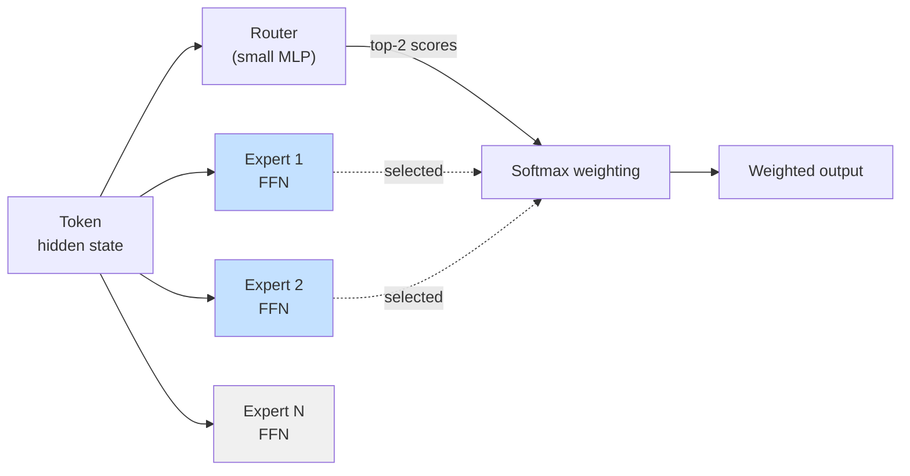

### Core metrics
{: id="核心指标"}

|Metric|Meaning|Example (Mixtral 8×7B)|
|:---|:---|:---:|
|**Total parameters**|Sum of all expert parameters| 47B |
|**Active parameters**|Parameters actually computed in each forward pass| 13B |
|**Number of experts**| $N$ | 8 |
| **Top-k** |Number of experts activated per token| 2 |

### Representative work
{: id="代表性工作"}

|Model|Year|Total parameters|Active parameters|Expert structure|
|:---|:---:|:---:|:---:|:---|
| Switch Transformer | 2021 | 1.6T | — |Top-1 routing|
| GShard | 2020 | 600B | — |Top-2 routing|
| **Mixtral 8×7B** | 2023 | 47B | 13B |8 experts, top-2|
| **DeepSeek-V3** | 2024 | 671B | 37B | Each MoE layer has 1 shared expert and 256 routed experts; each token selects 8 routed experts |

**Key challenge**: **Load balancing** prevents tokens from concentrating on a few experts, often through auxiliary losses or capacity constraints. Total and active parameter counts are not reported uniformly across models; routing strategies and FFN sizes also matter. See the [technical report][ref-deepseekv3] for DeepSeek-V3's configuration above and its load-balancing design.

## 10.2 Parameter-efficient fine-tuning
{: id="102-参数高效微调peft"}

As the parameter counts of pretrained models grow to tens or hundreds of billions, the GPU memory and storage costs of **full fine-tuning** tend to be high. **Parameter-efficient fine-tuning (PEFT)** trains only a very small number of additional parameters (usually < 1%) and can approach the quality of full fine-tuning.

### Comparison of mainstream PEFT methods
{: id="主流-peft-方法对比"}

|Method|Year|Trainable parameter ratio|Core idea|Features|
|:---|:---:|:---:|:---|:---|
| **Adapter** | 2019 | ~3% |Inserts a small bottleneck MLP in each layer|Adds extra computation at inference|
| **Prefix Tuning** | 2021 | <1% |Prepends learnable "soft prompts" to the input|The original model is unchanged; results are sensitive to the task|
| **Prompt Tuning** | 2021 | <0.1% |Adds soft prompts only at the embedding layer|Lightest weight; works well only on very large models|
| **LoRA** | 2021 | 0.1–1% |Injects low-rank updates $\Delta W = BA$ into the weight matrices|Widely used strong baseline|
| **QLoRA** | 2023 |Same as LoRA|4-bit quantized base model + LoRA fine-tuning|Can fine-tune a 65B model on a single 24GB GPU|
| **DoRA** | 2024 |Slightly more than LoRA|Decomposes weights into direction and magnitude and updates them separately|Better quality than LoRA in low-rank settings|

### LoRA core formula
{: id="lora-核心公式"}

For a pretrained weight $W_0 \in \mathbb{R}^{d \times k}$, LoRA freezes $W_0$ and trains only a low-rank decomposition $B \in \mathbb{R}^{d \times r}, A \in \mathbb{R}^{r \times k}$ ($r \ll \min(d,k)$, typically $r=8, 16, 64$):

$$W = W_0 + \Delta W = W_0 + BA$$

Forward computation: $h = W_0 x + BAx$.

**Advantages**:
- **Training**: only $B, A$ need gradients and optimizer state, so GPU memory requirements drop to roughly $\sim 1/100$
- **Storage**: each task only needs to save $BA$ (on the order of MB), so one base model can load LoRA adapters for hundreds of tasks
- **Inference**: $BA$ can be merged into $W_0$, with zero inference overhead
- **Task switching**: load different LoRA weights to switch scenarios within seconds

LoRA/QLoRA are common strong baselines for fine-tuning open-source large models, but the best choice still depends on the task, base model, quantization method and available GPU memory.

## 10.3 Quantization
{: id="103-模型量化"}

**Quantization** compresses model weights (and activations) from FP16/BF16 to INT8/INT4 or even lower bit widths, trading a small loss of accuracy for a **model size reduced to 1/4–1/8 and an inference speedup of 2–4×**.

### Quantization types
{: id="量化类型"}

|Type|When quantization is applied|Representative methods|Features|
|:---|:---|:---|:---|
| **PTQ** (post-training quantization)|After training is complete| GPTQ, AWQ, SmoothQuant |No retraining required; finishes in a few hours|
| **QAT** (quantization-aware training)|Quantization is simulated during training| LSQ, DoReFa |Highest accuracy, but requires retraining|
|**Mixed precision**|Key layers keep high precision|Most deployment scenarios|An engineering trade-off|

### Modern quantization methods
{: id="现代量化方法"}

|Method|Year|Bit width|Core idea|
|:---|:---:|:---:|:---|
| **GPTQ** | 2022 | INT4/INT3 |Minimizes quantization error layer by layer (a second-order method)|
| **AWQ** | 2023 | INT4 |Activation-aware: protects the weights that matter most for the output from quantization error|
| **SmoothQuant** | 2023 | W8A8 |"Migrates" activation outliers into the weights, making quantization easier|
| **bitsandbytes** | 2022 | INT8/NF4 |The standard library in the HuggingFace ecosystem; supports QLoRA|
| **FP8** | 2022 | FP8 |Natively supported by H100 hardware, usable for both training and inference|

**Rule of thumb**: INT4 can often cut GPU memory use significantly, but the quality loss depends on the model, calibration data, quantization granularity and inference kernel; measure latency, throughput and accuracy on the target task before deployment.

## 10.4 Knowledge distillation
{: id="104-知识蒸馏"}

**Knowledge distillation** (Hinton et al., 2015) transfers the capabilities of a large "teacher" model to a small "student" model, so that the small model approaches the large model's performance at deployment.

### Core idea: soft labels
{: id="核心思想软标签"}

A one-hot hard label only tells the student "this picture is a cat", whereas the **soft probability distribution** output by the teacher tells it "this picture is 90% cat, 8% dog, 1% fox and 0% car". The relative relationships between classes ("a dog is closer to a cat than a fox is") carry the teacher's knowledge.

**Distillation loss**:

$$\mathcal{L}_{KD} = \alpha \cdot \mathcal{L}_{CE}(y^*, p_s) + (1-\alpha) \cdot T^2 \cdot \mathcal{L}_{KL}(p_t^{(T)} \| p_s^{(T)})$$

Where:
- $p_t^{(T)} = \text{softmax}(z_t / T)$ is the teacher's output softened by temperature $T$ (the distribution is smoother for $T > 1$)
- $p_s^{(T)}$ is the corresponding softened student output
- $\alpha$ balances hard-label supervision and soft-label distillation

### Three distillation paradigms
{: id="蒸馏的三种范式"}

|Paradigm|What is transferred|Representative work|
|:---|:---|:---|
|**Response-based** (output distillation)|The final logit distribution| Hinton 2015, DistilBERT |
|**Feature-based** (intermediate-layer distillation)|Hidden-layer activations, attention maps| FitNets, TinyBERT |
|**Relation-based** (relational distillation)|Relations between samples, relations between layers| RKD, CRD |

### Representative work
{: id="代表性工作-1"}

|Model|Year|Teacher → student|Effect|
|:---|:---:|:---|:---|
| **DistilBERT** | 2019 |BERT-base → 6 layers|40% fewer parameters, retaining 97% of performance|
| **TinyBERT** | 2019 |BERT → 4 layers|87% fewer parameters, 9× faster|
| **MobileBERT** | 2020 |BERT-large → compact model|On-device inference|
| **MiniLM** | 2020 |BERT → small Transformer|Distills attention and hidden representations|

For LLMs, distillation can act on logits, hidden representations, preference data or generated trajectories. It is often combined with quantization, pruning or parameter sharing, but the capability gap between teacher and student, the data distribution and the generation temperature all affect the final result.

---

# 11. Frontier architectures and large models
{: id="11-前沿架构与大模型"}

## 11.1 RLHF
{: id="111-rlhf"}

**RLHF (Reinforcement Learning from Human Feedback)** was key to ChatGPT's success: it aligns a pretrained large model, moving it from merely "speaking" to "following instructions and matching human preferences".

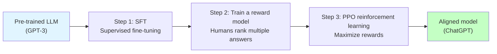

### The three-stage process
{: id="三阶段流程"}

|Stage|Data|Goal|
|:---|:---|:---|
| **SFT** (supervised fine-tuning)|Human-written (prompt, high-quality answer) pairs|Teaches the model basic instruction-following|
|**Reward model training**|Human rankings of multiple responses to the same prompt|Learns a model that scores answers|
|**PPO reinforcement learning**|The SFT model generates answers, the RM scores them, and PPO optimizes the policy|Makes the model's outputs maximize the RM reward|

### Alternatives to RLHF
{: id="rlhf-的替代方案"}

|method|Year|Relative to RLHF|
|:---|:---:|:---|
| [**DPO** (Direct Preference Optimization)][ref-dpo] | 2023 | Expresses preference learning as a directly optimizable loss, without a separately trained RM or online PPO; parameters are still trained through gradients |
| [**IPO**][ref-ipo] / [**KTO**][ref-kto] | 2023 / 2024 | Modify the preference objective or use desirable / undesirable feedback, respectively; their data requirements differ from DPO |
| **RLAIF** | 2023 |Replaces human preference labeling with AI (such as Claude)|
| **Constitutional AI** | 2022 |Proposed by Anthropic: a set of "constitutional" principles guides the model's self-critique|

> DPO has become a common preference optimization method because the training process is simple and there is no need to separately train the reward model. PPO, DPO, rejection sampling, and other methods can also be used in combination; the specific training process of closed-source models is often not fully disclosed.

### From preference alignment to reasoning training: GRPO and RLVR
{: id="从偏好对齐到推理训练grpo-与-rlvr"}

**GRPO (Group Relative Policy Optimization)** was introduced in DeepSeekMath (2024). It samples a group of responses to the same question and uses within-group reward statistics to construct relative advantages, retaining a PPO-style clipped objective while removing the separately trained value / critic network. For the case of one outcome reward per response, the advantage can be illustrated as:

$$A_i = \frac{r_i-\operatorname{mean}(r_1,\ldots,r_G)}{\operatorname{std}(r_1,\ldots,r_G)+\epsilon}$$

Here, $G$ is the number of samples per question, $r_i$ is the reward for response $i$, and $\epsilon$ provides numerical stability. Removing the critic does not remove sampling costs: generating multiple responses per question can dominate compute, and groups with identical rewards provide little relative discrimination. [DeepSeekMath][ref-deepseekmath]

**RLVR (Reinforcement Learning with Verifiable Rewards)** uses verifiable outcomes as rewards, such as checked mathematical answers or code tests. It describes the **reward source**, while GRPO / PPO describe **policy-training algorithms**; they can be combined. DeepSeek-R1 (2025) trains reasoning with rule-based rewards and combines cold-start data, reinforcement learning, and other training stages. R1-Zero and the full R1 pipeline should be distinguished. [Technical report][ref-deepseekr1]

| Approach | Data and signal | Main role | Practical considerations |
|:---|:---|:---|:---|
| Offline preference learning such as DPO | Fixed preferred responses or feedback | Learn preferences and response style | Data coverage, reference policy, and distribution shift |
| GRPO + verifiable rewards | Multiple responses from the current policy, scored by rules / tests | Improve reasoning on verifiable tasks | Generation costs, reward design, and within-group reward variance |
| [DAPO (2025)][ref-dapo] | Large-scale online reasoning RL | Improves clipping, dynamic sampling, token-level loss, and reward handling for overlong responses | Reproduction requires the full sampling and training system |

This also completes the three-step framework: RLVR changes the training signal; GRPO / DAPO define policy objectives and the sampling and update procedure; underlying parameter updates still require optimizers such as AdamW. These methods operate at a different level from the gradient optimizers in §5. Gains on verifiable-task rewards should also be evaluated on independent test sets and other tasks to assess generalization.

## 11.2 Generative model: from AE to GAN
{: id="112-生成模型从-ae-到-gan"}

A discriminative model learns $$p(y\mid x)$$ (predicting a label from the input), whereas a **generative model** learns the data distribution $$p(x)$$ itself, so it can sample new examples "out of nothing". The four major families of deep generative models evolved along the trade-off between "sample quality, training stability and latent-space controllability": **autoencoder (AE) → variational autoencoder (VAE) → generative adversarial network (GAN) → diffusion model** (covered in the next section).

### Autoencoder (AE)
{: id="自编码器autoencoder-ae"}

The encoder $f$ compresses the input into a low-dimensional latent vector $z$, the decoder $g$ reconstructs $\hat{x}$, and the training objective is the reconstruction error $$\mathcal{L} = \|x - g(f(x))\|^2$$. An AE is good at **dimensionality reduction, denoising and representation learning**, but its latent space has no probabilistic constraint and is irregularly distributed, so **you cannot sample from it to generate new examples**. It is essentially a compressor, not a true generative model.

### Variational autoencoder (VAE)
{: id="变分自编码器vae"}

A VAE adds probabilistic structure to the latent space: the encoder outputs a distribution $$q_\phi(z\mid x)$$ (rather than a single point) and constrains it to be close to the prior $$p(z)=\mathcal{N}(0,I)$$. Training maximizes the **evidence lower bound (ELBO)**:

$$\mathcal{L}_{\text{ELBO}} = \mathbb{E}_{q_\phi(z|x)}[\log p_\theta(x|z)] - D_{KL}\big(q_\phi(z|x)\,\|\,p(z)\big)$$

The first term is the reconstruction term, and the second is the regularizer that pulls the latent distribution towards the prior. The **reparameterization trick** $$z = \mu + \sigma \odot \epsilon$$ ($$\epsilon \sim \mathcal{N}(0,I)$$) makes the sampling differentiable so gradients can flow back. After training, samples are generated by sampling directly from the prior $$p(z)$$. VAE sampling is stable and the latent space is continuous and interpolable, but the generated images are blurry.

### Generative adversarial network (GAN)
{: id="生成对抗网络gan"}

A GAN uses an **adversarial game** to bypass the explicit likelihood: the generator $G$ maps noise to fake samples, the discriminator $D$ learns to tell real from fake, and the two alternately optimize a minimax objective:

$$\min_G \max_D \ \mathbb{E}_{x \sim p_{\text{data}}}[\log D(x)] + \mathbb{E}_{z \sim p_z}[\log(1 - D(G(z)))]$$

GAN images are **sharp and high-quality** (StyleGAN's faces are almost lifelike), but training is notoriously unstable: **mode collapse**, games that are hard to converge, and the need for many tricks (WGAN, spectral normalization, etc.) to stabilize them.

### The four families at a glance
{: id="四大家族一览"}

|Family|Latent variable|Training objective|Sampling|Stability|Typical shortcoming|
|:---|:---|:---|:---|:---:|:---|
| **AE** |Deterministic|Reconstruction error|✗ Cannot generate|High|Irregular latent space|
| **VAE** |Probabilistic (Gaussian)|ELBO (reconstruction + KL)|One step, fast|High|Somewhat blurry outputs|
| **GAN** |Noise → sample|Adversarial minimax|One step, fast|**Low**|Mode collapse|
| **Diffusion** |Gradually added noise|Denoising regression|Multi-step iteration, slow|High|Slow inference|

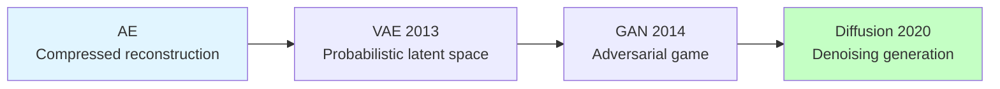

The diffusion model combines the training stability of the VAE with the high quality of the GAN and has become the mainstream of generative modeling; the next section expands on it.

## 11.3 Diffusion models
{: id="113-扩散模型"}

The **diffusion model** is the most successful generative paradigm in deep learning in recent years, powering landmark systems such as Stable Diffusion, DALL-E 3, Midjourney and Sora. Alongside the Transformer, it is another pillar of deep generative modeling.

### Core idea: adding and removing noise
{: id="核心思想加噪与去噪"}

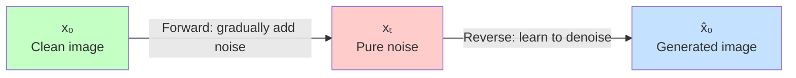

**Forward (diffusion) process**: Gaussian noise is gradually added to real data, and after $T$ steps (usually 1000) it becomes approximately a standard normal distribution:

$$q(x_t | x_{t-1}) = \mathcal{N}(x_t; \sqrt{1-\beta_t} \cdot x_{t-1}, \beta_t I)$$

Because of its closed-form properties, $x_t$ can be obtained from $x_0$ in a single step: $$x_t = \sqrt{\bar{\alpha}_t} \cdot x_0 + \sqrt{1-\bar{\alpha}_t} \cdot \epsilon$$, where $$\bar{\alpha}_t = \prod_{s=1}^t (1-\beta_s)$$.

**Reverse (denoising) process**: A neural network $$\epsilon_\theta(x_t, t)$$ is trained to predict the noise added at each step. The training loss is:

$$\mathcal{L} = \mathbb{E}_{t, x_0, \epsilon}\left[\|\epsilon - \epsilon_\theta(x_t, t)\|^2\right]$$

 **Inference**: sample $x_T$ from the standard normal distribution, then use $$\epsilon_\theta$$ to remove the noise step by step; after $T$ steps you obtain the generated sample.

### Why diffusion beat GANs
{: id="为什么扩散模型比-gan-成功"}

|Dimension| GAN | Diffusion |
|:---|:---|:---|
|**Training stability**|Two-network game; mode collapse is easy|Single-network regression; very stable|
|**Sample diversity**|Mode collapse (only a few kinds of samples are generated)|Covers the data distribution thoroughly|
|**Generation quality**|High single-sample quality but unstable training|Typically achieves higher quality and broader coverage|
|**Inference speed**|Single forward pass (fast)|Multi-step iteration (slow)|
|**Controllable generation**|Conditional control is more complex|Naturally fits classifier-free guidance|

### Representative work
{: id="代表性工作-2"}

|Model|Year|Key innovation|
|:---|:---:|:---|
| **DDPM** | 2020 |The modern revival of diffusion models, with a concise training objective|
| **DDIM** | 2020 |Deterministic sampling, cutting the number of inference steps from 1000 to 50|
| **Classifier-Free Guidance** | 2022 |Enables conditional control without a classifier|
| **Latent Diffusion / Stable Diffusion** | 2022 |Runs diffusion in the VAE latent space, cutting compute by 10×|
| **DALL-E 2** | 2022 |CLIP + diffusion, a breakthrough in text-to-image generation|
| **Imagen** | 2022 |Large text encoder + cascaded diffusion|
| **ControlNet** | 2023 |Precise control by pose, edges or depth|
| **SDXL** | 2023 |Open-source SOTA image generation|
| **Sora** | 2024 |Video diffusion model with a DiT architecture|
| **Stable Diffusion 3 / Flux** | 2024 | Rectified Flow + MMDiT |

### From UNet to DiT
{: id="从-unet-到-dit"}

Early diffusion models used a **UNet** (an encoder-decoder CNN with skip connections) as the denoising network. In 2022, **DiT (Diffusion Transformer, Peebles & Xie, 2022)** replaced the UNet with a Transformer; Sora and Stable Diffusion 3 both use DiT. This once again confirms the trend of the Transformer unifying multiple fields.

## 11.4 State space model and Mamba
{: id="114-状态空间模型与-mamba"}

The Transformer's attention mechanism has $O(N^2)$ computational and memory complexity in sequence length $N$, which is extremely expensive for long sequences. **State space models (SSMs)** offer an alternative architectural route with linear complexity.

### SSM basics
{: id="ssm-基础"}

SSMs originate in control theory and map an input sequence $x(t)$ to an output sequence $y(t)$ through a hidden state $h(t)$:

$$h'(t) = Ah(t) + Bx(t)$$
$$y(t) = Ch(t)$$

Here $A \in \mathbb{R}^{N \times N}$ is the state transition matrix and $B, C$ are projection matrices. After discretization (step size $\Delta$, zero-order hold), the recurrent form is:

$$h_t = \bar{A} h_{t-1} + \bar{B} x_t, \quad y_t = C h_t$$

Here $\bar{A} = e^{\Delta A}$ and $\bar{B} = (\Delta A)^{-1}(e^{\Delta A} - I) \cdot \Delta B$.

**SSMs combine the advantages of RNNs and CNNs**:

|Mode|Equivalent form|Advantages|
|:---|:---|:---|
|**Training**|Equivalent to a 1D convolution ($y = x * k$, where $k$ is the convolution kernel)|Fully parallelizable|
|**Inference**|Equivalent to a recurrence (RNN style)|$O(1)$ memory and constant time per step|

### S4: structured state spaces
{: id="s4结构化状态空间序列模型"}

**S4** (Gu et al., 2021) is the first practical deep SSM: by restricting the matrix $A$ to a **HiPPO-initialized diagonal-plus-low-rank (DPLR)** structure, it makes long-sequence training efficient and feasible, significantly surpassing Transformers on long-sequence benchmarks such as Long Range Arena.

Limitation of S4: the $A, B, C$ matrices are fixed across all time steps (**time-invariant**), so it cannot dynamically choose what to attend to or ignore based on the input content; it is essentially a static filter.

### Mamba (2023)
{: id="mamba2023"}

The core innovation of **Mamba** (Gu & Dao, 2023) is **selectivity**: $B, C$ and the step size $\Delta$ are made **input-dependent**:

$$\Delta, B, C = \text{Linear}(x_t)$$

This lets the model dynamically adjust its state update and forgetting rate according to the content of the current token. Under common parameterizations, $\Delta$ affects the state decay and input injection strength after discretization, so it cannot be simply equated with a fixed "memory switch".

**Hardware-aware parallel scan**: A parallel prefix scan is applied directly to the recurrence $h_t = \bar{A} h_{t-1} + \bar{B} x_t$, and the whole computation is done in GPU SRAM to avoid frequent write-backs to HBM. Memory complexity is $O(N)$, and training speed is comparable to a Transformer's.

**Mamba block structure** (per layer):

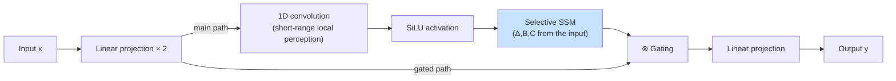

### Mamba 2(2024)
{: id="mamba-22024"}

**Mamba 2** (Dao & Gu, 2024) introduces **state space duality (SSD)**, showing that Mamba's selective SSM is a structured special case of linear attention. This allows optimization and implementation within a unified framework:

- Matrix-multiplication blocks (tensor cores) replace the scan, making it **2–8×** faster than Mamba 1
- The state size can be expanded to larger dimensions, improving model capacity

### Transformer vs. Mamba
{: id="transformer-vs-mamba-对比"}

|Dimension| Transformer | Mamba |
|:---|:---:|:---:|
|Sequence complexity (compute)| $O(N^2)$ | $O(N)$ |
|Sequence complexity (memory)|$O(N^2)$ (attention matrix)|$O(N)$ (activations)|
|Inference KV cache|$O(N)$ (grows with context)|$O(1)$ (fixed-size hidden state)|
|Training parallelism|Fully parallel|Parallel scan (nearly fully parallel)|
|Global dependency modeling|Explicit attention (strong)|Implicit state propagation (optional)|
|Long-sequence performance|Degrades significantly|Stays linear|
|In-context retrieval|Very strong|Relatively weak (lossy state compression)|

### Representative work
{: id="代表性工作-3"}

|Model|Year|Key innovations / applications|
|:---|:---:|:---|
| **S4** | 2021 |Structured SSM, SOTA on Long Range Arena|
| **H3** | 2022 |SSM + attention hybrid for language tasks|
| **Mamba** | 2023 |Selective SSM + hardware-aware algorithm; competes with Transformers in language modeling|
| **Mamba 2** | 2024 |SSD unified framework, 2–8× faster|
| **Vision Mamba / VMamba** | 2024 |Mamba for vision: image classification and segmentation|
| **MambaByte** | 2024 |Byte-level language modeling without a tokenizer|
| **Jamba** | 2024 |Alternating Mamba and Transformer layers (AI21 Labs), 47B parameters|
| **Zamba** | 2024 |Small-scale Mamba-Transformer hybrid with SOTA inference efficiency|
| **RWKV** | 2023 |RNN-like linear attention: Transformer-style training with RNN-style inference|
| **RetNet** | 2023 |Retentive attention proposed by Microsoft: parallel training and recurrent inference|

### Recent progress: combining recurrent memory and attention
{: id="近年进展递推记忆与注意力的混合"}

Alternative architectures should distinguish pure SSMs, linear attention, and hybrid models. Finite-dimensional recurrent states help control decoding-cache size, but tasks differ in their requirements for exact retrieval, forgetting, and long-term memory. Hybrid designs retain some full attention while introducing cheaper recurrent layers.

**Kimi Linear (2025)** is one example: **Kimi Delta Attention (KDA)** extends Gated DeltaNet with fine-grained gating and is combined with MLA layers. It demonstrates an approach to balancing expressivity and long-context efficiency under a fixed training setup. Cache and throughput gains depend on the mixing ratio, sequence length, and implementation; the entire hybrid model should not be described as having exclusively linear computation. [Original paper][ref-kimi-linear]

## 11.5 Deep learning and LLMs
{: id="115-深度学习与大语言模型"}

Deep learning (especially the Transformer) is the technical foundation of large language models (LLMs). **The division of labor between this article and the LLM training survey is as follows**:

|This article focuses on|The LLM training survey focuses on|
|:---|:---|
|General deep learning principles and classic architectures|End-to-end details of the LLM engineering stack|
|Basic mechanisms of CNN / RNN / Transformer| Scaling laws (Chinchilla, Kaplan)|
|General methods for optimizers, normalization and regularization|Pre-training data engineering and curriculum learning|
|Introductory concepts of MoE / PEFT / quantization / RLHF|3D parallelism (DP / TP / PP), ZeRO, FSDP|
|Overview of mainstream benchmarks|Long-context training (YaRN, NTK interpolation)|
|Basic ideas of knowledge distillation|KV cache optimization, continuous batching, PagedAttention, speculative decoding|

For the engineering details of LLM pre-training, fine-tuning and inference, see:

> **[LLM Training Survey](https://tingdeliu.github.io/LLM-Training-Survey/)**
>
> Covers topics such as scaling laws, distributed training, hybrid parallelism, the KV cache, GQA/MQA implementation internals, long-context extrapolation and inference acceleration.

---

# 12. Summary
{: id="12-总结"}

One main thread runs through the whole article: the **three-step machine learning framework (loss → architecture → optimization) × two core goals (optimization vs. generalization)**. Every training technique falls precisely into one cell of this 3×2 coordinate system. See the method taxonomy table in Section 7 for details.

**Core conclusion**:

> Effective deep learning training requires **matching the intervention to the problem**, rather than adding more techniques. Inspect training loss first: if it does not decrease, address optimization before adding Dropout. Low training loss with high validation loss points to generalization, where data augmentation and regularization become relevant. This diagnostic principle is a foundation for effective experimentation and recurs throughout the article.

---

# 13. Primary sources for this update
{: id="13-本次更新的原始资料"}

These sources support the additions made on 2026-10-28. Method years generally refer to first public release, rather than conference publication.

- **State-efficient methods and momentum improvements**: [Adafactor (2018)][ref-adafactor], [Lion (2023)][ref-lion], [Sophia (2023)][ref-sophia], and [AdEMAMix (2024)][ref-ademamix].
- **Matrix optimization and geometric methods**: [Muon author's explanation (2024)][ref-muon-note] and [implementation][ref-muon], [Muon is Scalable for LLM Training / Moonlight (2025)][ref-moonlight], [SOAP (2024)][ref-soap], [Scion (ICML 2025)][ref-scion], and [NorMuon (ICML 2026)][ref-normuon].
- **Recent 2026 preprints**: [Aurora: A Leverage-Aware Spectral Optimizer][ref-aurora] and [AF-Muon: An AdamW-Free Muon Optimizer for Tied-Embedding Models][ref-afmuon].
- **Learning rates and iterate averaging**: [Understanding Warmup-Stable-Decay Learning Rates (2024)][ref-wsd], [The Road Less Scheduled (2024)][ref-schedulefree], and [Schedule-Free's official implementation and usage conventions][ref-schedulefree-code].
- **Low precision and attention kernels**: [DeepSeek-V3 Technical Report (2024)][ref-deepseekv3], [Scaling FP8 Training to Trillion-Token LLMs (2024)][ref-fp8], [FlashAttention (2022)][ref-fa1], [FlashAttention-2 (2023)][ref-fa2], [FlashAttention-3 (2024)][ref-fa3], and [FlashAttention-4 (2026)][ref-fa4].
- **Preference learning, reasoning post-training, and hybrid architectures**: [DPO (2023)][ref-dpo], [IPO (2023)][ref-ipo], [KTO (2024)][ref-kto], [DeepSeekMath / GRPO (2024)][ref-deepseekmath], [DeepSeek-R1 (2025)][ref-deepseekr1], [DAPO (2025)][ref-dapo], and [Kimi Linear (2025)][ref-kimi-linear].

[ref-adafactor]: https://arxiv.org/abs/1804.04235
[ref-lion]: https://arxiv.org/abs/2302.06675
[ref-sophia]: https://arxiv.org/abs/2305.14342
[ref-ademamix]: https://arxiv.org/abs/2409.03137
[ref-muon]: https://github.com/KellerJordan/Muon
[ref-muon-note]: https://kellerjordan.github.io/posts/muon/
[ref-moonlight]: https://arxiv.org/abs/2502.16982
[ref-soap]: https://arxiv.org/abs/2409.11321
[ref-scion]: https://proceedings.mlr.press/v267/pethick25a.html
[ref-normuon]: https://proceedings.mlr.press/v306/li26dh.html
[ref-aurora]: https://arxiv.org/abs/2606.27715
[ref-afmuon]: https://arxiv.org/abs/2610.01395
[ref-wsd]: https://arxiv.org/abs/2410.05192
[ref-schedulefree]: https://arxiv.org/abs/2405.15682
[ref-schedulefree-code]: https://github.com/facebookresearch/schedule_free
[ref-deepseekv3]: https://arxiv.org/abs/2412.19437
[ref-fp8]: https://arxiv.org/abs/2409.12517
[ref-fa1]: https://arxiv.org/abs/2205.14135
[ref-fa2]: https://arxiv.org/abs/2307.08691
[ref-fa3]: https://arxiv.org/abs/2407.08608
[ref-fa4]: https://arxiv.org/abs/2603.05451
[ref-deepseekmath]: https://arxiv.org/abs/2402.03300
[ref-dpo]: https://arxiv.org/abs/2305.18290
[ref-ipo]: https://arxiv.org/abs/2310.12036
[ref-kto]: https://arxiv.org/abs/2402.01306
[ref-deepseekr1]: https://arxiv.org/abs/2501.12948
[ref-dapo]: https://arxiv.org/abs/2503.14476
[ref-kimi-linear]: https://arxiv.org/abs/2510.26692
