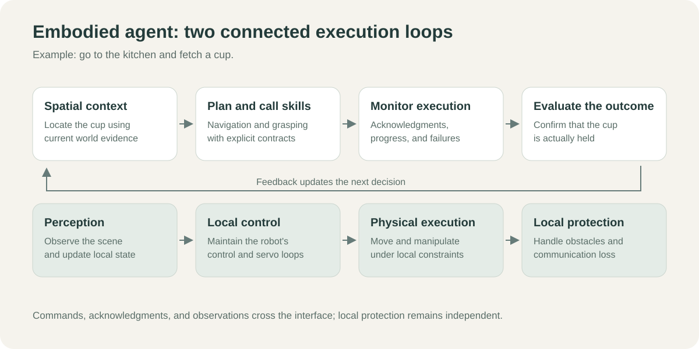
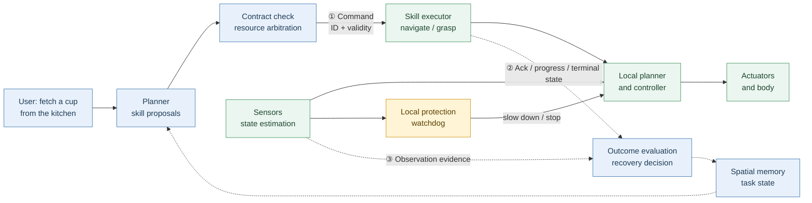
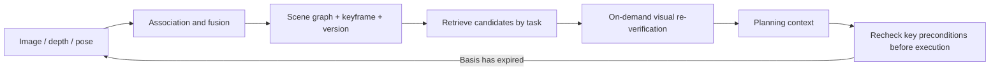
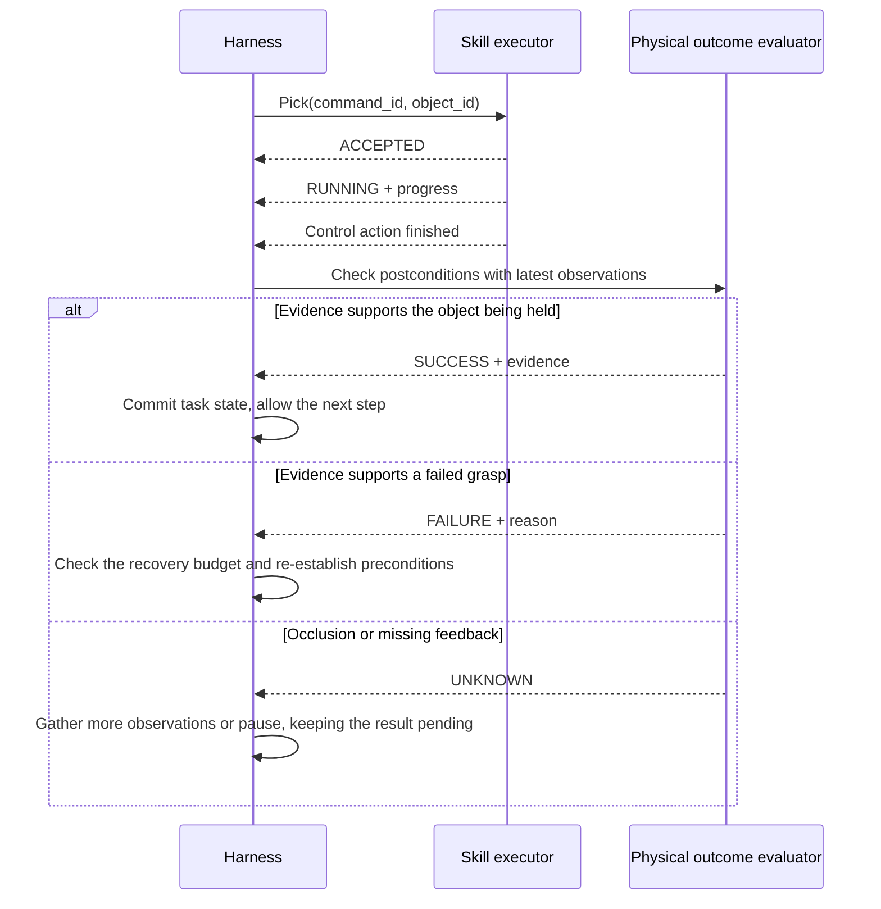
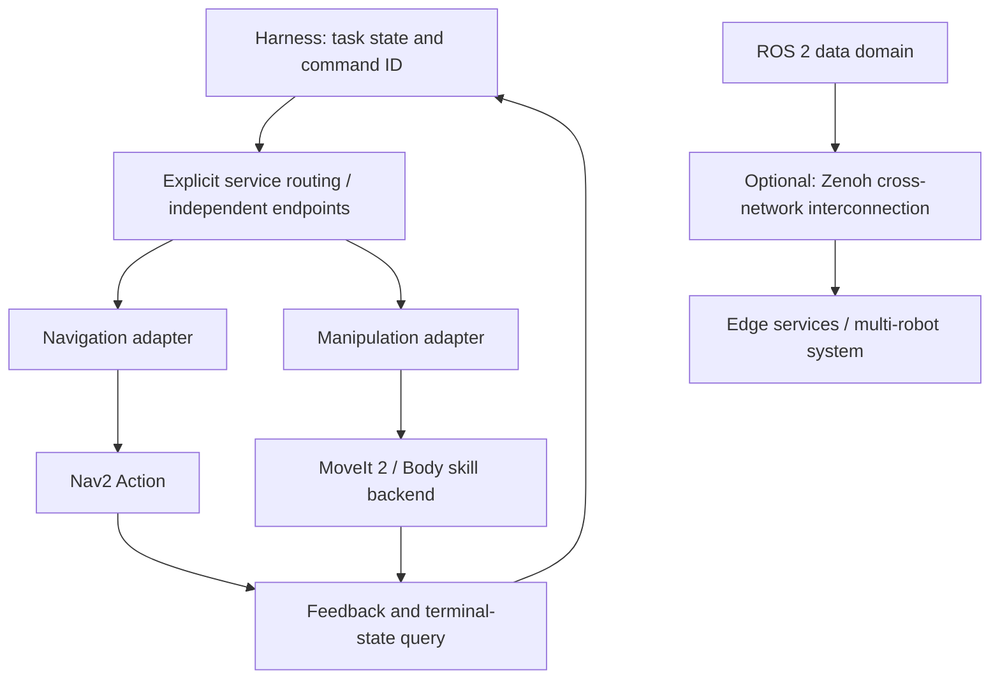
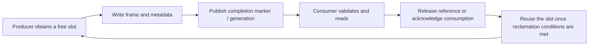
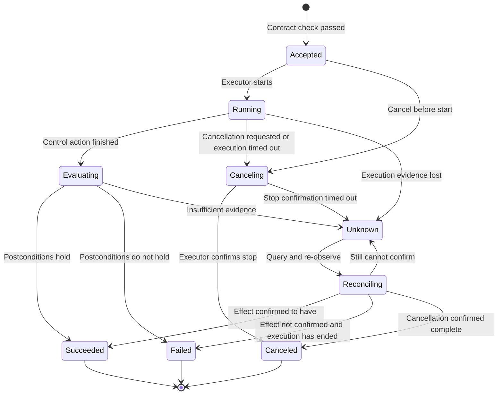
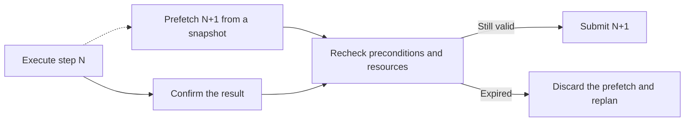

**An embodied-agent harness turns model-generated task intentions into a traceable execution loop in a physical world with noise, latency, and failures.** The model handles understanding and planning; the harness manages context, skill calls, and outcome evaluation; the robot runtime handles execution, feedback, and local protection.

This survey unfolds along the line "upper-layer harness → lower-layer operating system → the interface contract between them". Take "go to the kitchen to get a cup" as an example: the scene graph helps locate the cup, the skill interface describes navigation and grasping, the executor reports progress, and the evaluator confirms whether the cup has actually been obtained; if communication drops or an obstacle appears, the robot must still handle it locally.

> **Scope and evidence boundary**: Descriptions of paper mechanisms follow the linked originals; the layering, message fields, state machines, and code examples are this survey's own engineering synthesis and are not an industry standard. Frequencies and time budgets marked as examples are only meant to illustrate a design method and must not be taken as hardware performance or safety parameters.
>
> Companion reading:  covers the details of individual papers,  discusses general agent engineering. This survey focuses on how the two connect inside a robot system.

# 1. Introduction
{: id="1-引言"}

<figure class="survey-intro-figure">
  
<figcaption>Figure 1 | Taking "go to the kitchen to get a cup" as an example, the upper layer organizes planning, skill calls, and result evaluation, while the lower layer closes the perception, control, and execution loops locally. The two layers exchange commands, acknowledgments, and observation evidence through the interface contract; local protection takes effect independently, and task success must still be confirmed from observations.</figcaption>
</figure>

## 1.1 Three problems
{: id="11-三个问题"}

Connect a model that understands "go to the kitchen and fetch a cup" to a robot, and three problems of different kinds appear quickly. They often occur together, but each needs its own mechanism.

**Different time scales.** One semantic planning step may take hundreds of milliseconds to several seconds, while local control and servo loops update on fixed periods. If a control callback waits synchronously for model inference, the inference latency flows straight into the control path. What needs handling is blocking, resource contention, and scheduling; switching languages or adding processes does not solve it on its own.

**Different failure scopes.** A segmentation fault in a native extension can terminate the whole process, whereas running out of CUDA memory usually surfaces first as a runtime exception. Splitting processes contains some failures, but the GPU, memory, power supply, and communication links can still be failure points shared by several modules.

**A finished action is not a successful task.** "Gripper closed" only says that the control action ended; it does not prove that the cup is held securely. Compared with purely software agents, the difficulty in embodied settings is that observations are incomplete, contact states are uncertain, and actions usually cannot be undone.

For a concrete task, the three problems map to three kinds of judgment, each owned by a different module and each requiring different evidence:

| Question to answer | In the cup task | Main owner | Evidence to keep |
| :--- | :--- | :--- | :--- |
| What should happen now, and is the basis still valid? | Is the cup still where it was last seen on the counter? | Planner and harness | Task goal, world-state version, target object reference |
| Was the command received, and is it running or stopped? | Was the navigation command accepted, and is the base moving? | Skill executor | Command ID, lifecycle state, sequence number, controller feedback |
| Did the expected effect happen, and can the next step proceed? | After the gripper closes, is the cup really in it? | Evaluator and orchestrator | Postconditions, observation evidence, failure reasons, recovery budget |

Section 2 mainly answers the first and third rows, Section 3 covers the communication and control behind the second, and Section 4 ties all three into one reconcilable command lifecycle.

## 1.2 Two layers and local protection
{: id="12-双层视角与本地保护"}

This survey summarizes the system as two cooperating parts: **the upper-layer harness manages task semantics and the execution loop; the lower-layer operating system manages resources, communication, and body control.** This is a division of responsibilities. It does not require deployment as two processes, nor the adoption of all the middleware at once.



Blue nodes belong to the upper-layer harness, green nodes to the lower-layer runtime, and yellow marks local protection; solid lines carry commands and control, dashed lines carry feedback to the upper layer. A skill call goes down along ①, the executor reports its lifecycle through ②, and the evaluator combines that with the observations in ③ to judge the physical outcome, then writes the conclusion back to memory for the next planning round.

Local protection does not need to wait for the planner to decide. The upper layer can request a stop, but executing and confirming the protective action must be completed in the corresponding control path. Even with multiple processes and asynchronous communication, hard real-time behavior still depends on factors such as the operating system, scheduling, memory allocation, and worst-case execution time. [ROS 2 real-time system design instructions](https://design.ros2.org/articles/realtime_background.html)

# 2. Upper-layer harness
{: id="2-上层-harness"}

## 2.1 Spatial memory
{: id="21-空间记忆"}

The planner does not have to reread the entire image history in every round. A practical approach is to retrieve candidate objects from structured memory, and then read the related images, geometry, and recent execution records on demand.

[Thea §4.1](https://arxiv.org/html/2608.11246v1#S4.SS1) uses a persistent scene graph as context, providing queries for object references, positions, and relations. [HoloAgent-0 §4.3](https://arxiv.org/html/2606.23565v1#S4.SS3) follows FSR-VLN's floor-room-viewpoint-object hierarchy as its memory index, supporting coarse-to-fine target localization and visual verification. These designs show that structured memory is useful, but they do not mean raw visual observations can be eliminated entirely.

The scene graph can be written as $$\mathcal{G}_t=(\mathcal{V}_t,\mathcal{E}_t)$$: nodes describe objects and edges describe spatial relations. In practice, the record should also carry the following information:

|Field|Purpose|Typical problem when missing|
| :--- | :--- | :--- |
| `object_id` |Refers to the same object across frames|Two similar-looking cups get confused|
|`frame_id`, units, pose|Explain what the coordinates mean|Map coordinates are treated as arm-base coordinates|
| `observed_at`, `world_version` |Determine whether the basis is outdated|Grasping an object that has since moved, using its old position|
|Observation sources and uncertainty|Support re-verification|A low-quality detection is treated as established fact|
|Visibility and failure conditions|Trigger a re-observation|"Not seen yet" is treated as "the object does not exist"|

**A scene graph is an estimate, not a ground-truth database.** "The cup is on the table" can only support candidate target selection; whether the cup is reachable and can be grasped securely should be rechecked against the current pose and local observations before execution. A similarity score cannot be used directly as the probability of grasp success.



## 2.2 Typed skills
{: id="22-类型化技能"}

[HoloAgent-0 §3.1](https://arxiv.org/html/2606.23565v1#S3.SS1) separates the skill interface into structured commands and runtime state, covering target references, expected effects, progress, failure modes, and recoverability. Building on this, this survey divides skill contracts into three levels:

1. **Syntax contract**: field types, required fields, enumerations, and value ranges. It can be implemented with Pydantic, Protobuf, or ROS message definitions.
2. **Physical contract**: coordinate transforms, workspace, collision constraints, resource occupancy, sensor health, and authorization conditions. The executor must check these against the real-time state.
3. **Lifecycle contract**: acceptance, execution, cancellation, terminal state, and result query. It must specify how timeouts, repeated commands, and service restarts are handled.

The following navigation command is a sketch designed for this survey; it is not the original interface of any particular paper:

```json
{
  "schema_version": 1,
  "command_id": "nav-00042",
  "robot_id": "robot-01",
  "skill": "navigate_to_pose",
  "target": {
    "frame_id": "map",
    "x_m": 1.6,
    "y_m": 0.5,
    "yaw_rad": 0.0,
    "position_tolerance_m": 0.15
  },
  "world_version": 42,
  "start_within_ms": 500,
  "execution_timeout_ms": 10000
}
```

Here `start_within_ms` must define where timing starts. For example, local timing can begin when the trusted ingress receives the message, with the consumed budget deducted when forwarding; if stale messages lingering in the network must be detected, the send time, a clock-error bound, or a session lease must be combined with it. The full validity period must not be granted afresh on every retry.

`execution_timeout_ms` bounds how long a skill execution may take. It is different from the watchdog period of the underlying velocity command: while the robot carries out a ten-second navigation goal, the local controller should still keep generating short-validity control commands.

## 2.3 Execution evaluation
{: id="23-执行评估"}

[Thea §4.2](https://arxiv.org/html/2608.11246v1#S4.SS2)'s "Evaluation as Exit Codes" is an interface analogy. The paper's evaluator distinguishes `process`, `success`, and `failure` and returns evidence and failure reasons; it does not specify a general numeric protocol such as `0=success, 1=recoverable, 2=fatal`. This survey recommends expressing three kinds of information separately:

|Information level|Example|Who judges|
| :--- | :--- | :--- |
|Control lifecycle| `RUNNING`, `CANCELING`, `STOPPED` |Skill executor and controller|
|Physical postconditions|Satisfied, not satisfied, insufficient evidence|Evaluator|
|Follow-up strategy|Continue, gather more observations, limited retry, ask for help|Harness orchestrator|

For example, gripper encoders, motor current, or force sensing can provide evidence of contact, and vision can provide evidence of the object's position, but any single signal can be distorted. Cross-checking multiple sources is an engineering strategy one can adopt. A successful grasp cannot be concluded from the gripper opening alone, nor can the errors of two sensors be assumed to be independent.



`UNKNOWN` is an extension of this survey's engineering interface; it indicates insufficient evidence and must not be interpreted as success or as a trigger to redo immediately. The task state advances only when the evidence meets the conditions; after a failure, the perception system should keep updating its view of how the real world has changed.

[Pigey](https://arxiv.org/abs/2607.21725) combines existing policies or parameterized skills through a high-level orchestrator that tracks results and recovers from failures. The "orchestration gap" describes the difference in capability between a frozen policy executed alone and the same policy inside a closed loop. The takeaway for system design is to implement "executing an action" and "deciding whether execution can continue" separately. The specific sensor combination, post-condition checker, and error codes should be designed for the particular platform and should not be passed off as a double-verification standard specified by the paper.

## 2.4 Runtime monitoring and learning
{: id="24-运行时监控与经验更新"}

[Zetta](https://arxiv.org/abs/2608.16590) keeps the base policy frozen and introduces a runtime critic, recovery skills, and verified updates in the form of code, spanning three time scales: action, rollout, and evolution iteration. The paper reports 90.8% on LIBERO-Pro, 93.6% on RoboCasa, and an 11.1x inference speedup relative to RPent; these results correspond to its evaluation settings and rollout budget and cannot be converted into fixed monitoring frequencies on any real robot. [Original text of experiment](https://arxiv.org/html/2608.16590v1#S4)

During deployment, responsibilities can be divided as follows:

- **Fast protection**: limiting speed or stopping based on signals such as velocity, distance, torque, and state validity period; this is carried by the local control path.
- **Task monitoring**: judging whether there has been no progress for a long time, whether the goal has been lost, or whether the action deviates from expectations, and requesting cancellation or replanning.
- **Experience update**: proposing new rules or recovery skills from failure records, and releasing them only after verification by replay, simulation, and applicability checks.

"Learning a recovery strategy online" does not mean it can immediately take over any robot. An update needs a version number, a target embodiment, resource permissions, and a rollback method; newly generated code must not be allowed to bypass the original execution constraints.

## 2.5 Long-horizon orchestration
{: id="25-长程编排"}

Behavior trees suit repeated checks, skill execution, and local recovery; state charts suit explicit management of task phases, conditional transitions, and history; model loops suit open-ended task decomposition. The three can be combined, and the choice depends on how execution needs to be explained and restored.

For example, "navigation succeeded → grasp → evaluate → place" can be maintained by a state chart. Grasping is carried out internally by a behavior tree of "observe → align → approach → close", and the model re-engages only when the goal is ambiguous or the recovery options are exhausted.

The orchestrator must set a **maximum number of retries, a total task time budget, and no-progress detection**. Physical recovery is a compensating action based on the current state, not a database-style rollback. A recovery node succeeding in a behavior tree only means the recovery action completed; to grasp again, execution must explicitly return to the grasp node, so that recovery success is not mistaken for task success.

## 2.6 Action guardrails
{: id="26-动作护栏"}

|Check layer|Main content|What to do on failure|
| :--- | :--- | :--- |
|Proposal admission|Skill permissions, parameters, object references, request validity period|Reject the proposal with an explainable reason|
|Before execution|Latest coordinate transforms, reachability, collision constraints, resource locks|Gather more observations, replan, or wait for resources|
|During execution|Expired state, approaching obstacle, torque anomaly, control timeout|The local controller limits speed or enters the corresponding stop procedure|
|After execution|Postconditions, object state, outcome evidence|Continue the task or enter the recovery branch|

A fixed "confidence ≥ 0.95" cannot replace physical constraints, and a uniform rule such as "cut power immediately at 0.3 meters" does not suit every machine. Mobile bases, manipulators holding objects, and biped robots need different stopping strategies. Cutting power abruptly can sometimes make the held object fall or destabilize the robot.

## 2.7 Representative work
{: id="27-代表工作对比"}

|Work|Focus|Mechanisms worth learning from|Caveats to keep in mind when reading|
| :--- | :--- | :--- | :--- |
| [HoloAgent-0](https://arxiv.org/abs/2606.23565) |Heterogeneous skills and the organization of spatial memory|AgentOS, typed skills, ROS 2 command/status interface|Some system capabilities are shown through real-robot demonstrations, which does not mean all tasks share a unified baseline|
| [Pigey](https://arxiv.org/abs/2607.21725) |Orchestration capability over frozen policies|Subgoal decomposition, result checking, failure recovery|Orchestration gains depend on the policy's capability and the task setting|
| [Thea](https://arxiv.org/abs/2608.11246) |State readability and verifiable results|Scene graph context, independent evaluator|The evaluator can also misjudge, and structured output does not guarantee correctness|
| [Zetta](https://arxiv.org/abs/2608.16590) |Execution monitoring and harness evolution|Critic, recovery skills, updates after verification|Simulation performance, inference speedup, and real-robot protection latency are different metrics|
| [SayPlan(2023)](https://sayplan.github.io/) |Language task planning in large environments|3D scene graph retrieval, path planning, and iterative replanning|Scene graph planning is not a complete runtime protection system|
| [Voyager(2023)](https://voyager.minedojo.org/) |Continual skill accumulation in Minecraft|Automatic curriculum, executable skill library, feedback-driven improvement|Skill reuse in a digital environment does not directly prove reliability in physical deployment|

These works provide different system building blocks. The runtime architecture below is a synthesis of the engineering issues discussed in this survey, not an implementation commonly used by the projects above.

# 3. Lower-layer runtime
{: id="3-下层运行系统"}

## 3.1 Splitting by role and timescale
{: id="31-按职责与时间尺度拆分"}

The frequencies in the table below are only example ranges to aid understanding. Hard real-time means that a deadline must be met, and this cannot be inferred from the programming language, the number of processes, or the fact that something "runs at 50 Hz".

|Level|Main work|Example update rate|Handling of upper-layer faults|
| :--- | :--- | :--- | :--- |
|Task planning layer|Language understanding, task decomposition, memory retrieval|Event-triggered or about 0.1–1 Hz|Keep the current controlled task state after a timeout|
|Skill orchestration layer|State chart, resource arbitration, result checking|Event-triggered, with periodic checks if necessary|Reject invalid tasks and initiate cancellation and reconciliation|
|Local control layer|Trajectory tracking, local planning, obstacle avoidance|For example 20–100 Hz|Execute the agreed continue-or-stop policy when the upper layer disconnects|
|Drive and servo layer|Motor control, hardware protection|For example 100–1000 Hz or higher|Handle command expiry and faults according to the machine's configuration|

High-level language planners suit outputting subgoals or skill calls. A VLA policy can serve as a skill backend that generates actions or action chunks, which the corresponding controller then tracks; "models can only output waypoints" should therefore not be treated as a general rule. The key is to make clear the validity period of each output, how takeover works, and where constraints are enforced.

Splitting into processes should serve fault isolation and resource governance. For a small prototype, a modular single process may be enough; when blocking callbacks, GPU resource contention, or a need for independent restarts arise, the corresponding modules can be moved into separate processes.

## 3.2 Data types and middleware
{: id="32-数据分类与中间件选择"}

The **control plane** carries skill requests, cancellations, and result queries, and cares about identity, ordering, deduplication, and acknowledgment. The **status plane** conveys pose, progress, and health information and is usually more concerned with freshness. The **data plane** moves images, point clouds, and tensors, and cares about bandwidth, the number of copies, and buffer lifetime.

|Technology|Suited for|What needs additional design or verification|
| :--- | :--- | :--- |
| ZeroMQ |Custom inter-process messaging, asynchronous requests, and pipelined tasks|Messaging pattern, routing, result retention, deduplication, reconnection, and access control|
| ROS 2 / DDS |Drivers, coordinate transforms, robot topics / services / actions|QoS, executors, discovery scope, resource scheduling, and the deployment network|
| Zenoh |Data distribution across networks, ROS 2 interconnection|Topology, routers, access control, reconnection, and version compatibility|
| WebSocket |Browser telemetry, interaction, and delivery of high-level tasks|Authentication, slow clients, send queues, and application-level acknowledgment|
| gRPC / Protobuf |Cross-language services, structured requests and streams|Deadlines, cancellation propagation, retry conditions, and server execution state|
|Shared memory|Passing large images, point clouds, and tensors between processes on the same machine|Data layout, synchronization, ownership, lifecycle, and crash recovery|

There is no fixed "average latency ranking" of these technologies independent of message size, process topology, and hardware. When choosing, first measure throughput, p95/p99 latency, queue depth, and fault-recovery behavior under your application's actual load, and only then decide whether to add a communication layer.

## 3.3 ZeroMQ patterns
{: id="33-zeromq-四种模式"}

### 3.3.1 REQ/REP
{: id="331-reqrep"}

A default REQ socket requires alternating sends and receives. If you send again directly after a timeout, you may hit a state machine error. One approach is the Lazy Pirate pattern: close the old socket, re-establish the connection, and retry. [ZeroMQ Reliable Request Guide](https://zguide.zeromq.org/docs/chapter4/)

However, **a client timeout does not prove that the server did not execute the request**. Requests with side effects, such as navigation and grasping, must keep the same `command_id` and query the original state; they can be resent safely only when the executor can deduplicate and the recovery conditions are met. When closing a socket, you also need to settle the `LINGER` policy: discarding unsent messages and waiting for sending to finish are different choices.

### 3.3.2 PUB/SUB
{: id="332-pubsub"}

Establishing a subscription takes propagation time, and slow subscribers may also lose messages. HWM limits the number of queued messages but does not guarantee that old messages are automatically discarded so that only the latest value is kept. If the application needs only the latest pose, state can be merged at the application layer; when using `ZMQ_CONFLATE`, note that it does not support retaining complete multipart messages. [Socket option description](https://libzmq.readthedocs.io/en/latest/zmq_setsockopt.html)

The terminal state of an action requires a result query or a replayable record. Even if a `SUCCEEDED` broadcast is missed, the upper layer should be able to query by command ID. Stop requests also cannot rely solely on an unacknowledged PUB message.

### 3.3.3 PUSH/PULL
{: id="333-pushpull"}

PUSH distributes messages among the available downstream peers, and PULL receives fairly from upstream peers. It suits parallel processing of tasks of the same type, but does not automatically provide task acknowledgment, work stealing, re-dispatch on failure, or "exactly-once execution". When task durations differ widely, worker availability and task ownership should be maintained explicitly. [Socket mode description](https://libzmq.readthedocs.io/en/latest/zmq_socket.html)

### 3.3.4 ROUTER/DEALER
{: id="334-routerdealer"}

ROUTER prepends the source routing identity to the message frames on receipt and uses the first frame to select the target connection on send; DEALER allows asynchronous sending and receiving. They provide the basis for message routing and do not automatically recognize that "this is a planning request that should be handed to the planner". [ROUTER and DEALER semantics](https://libzmq.readthedocs.io/en/latest/zmq_socket.html)

In particular, avoid putting planning workers and ROS bridge workers, which have different capabilities, into the same backend pool of an ordinary `ROUTER → DEALER` proxy. A transparent proxy only distributes messages; it does not select a service by the `skill` field of the JSON. Use separate endpoints, or implement an application-layer broker with service registration and capability routing.

REQ clients add an empty delimiter frame, while the envelopes of DEALER clients are not necessarily the same. The worker should parse and preserve the reply envelope according to a clearly defined wire protocol; it cannot just take the first and last frames and assume the structure in between is always the same.

The commonly used REQ, REP, ROUTER, DEALER, PUB, and SUB sockets should not be operated by multiple threads concurrently. Let a single thread or event loop own each socket; asynchronous Python can use `zmq.asyncio` rather than running a blocking receive in a thread pool and then operating the same socket from the event loop. [Thread description](https://libzmq.readthedocs.io/en/latest/zmq.html), [PyZMQ asyncio interface](https://pyzmq.readthedocs.io/en/latest/api/zmq.asyncio.html)

## 3.4 WebSocket
{: id="34-websocket"}

Browser connections can carry lightweight JSON state and high-level commands. Large images suit binary transmission or a separate video channel; WebRTC is a different real-time communication mechanism, not a binary frame format of WebSocket.

An uncompressed $1920\times1080$ RGB frame at 3 bytes per pixel is about $6.22\text{MB}$, and about $8.29\text{MB}$ after Base64 encoding, not counting overhead such as JSON. This is a data-volume calculation; how many milliseconds serialization takes must be measured on the target machine.

The gateway should give each client a bounded send queue. Telemetry can be coalesced into the latest state, while critical alarms and command acknowledgments should have independent retention policies. A slow browser must not block broadcasts to all clients.

A remote "Stop" button should display stages such as "Request submitted", "Received by executor", and "Stop confirmed". A successful WebSocket send only means the message has entered the communication path, not that the robot has stopped; low-level protection cannot rely on the browser always being online.

## 3.5 ROS 2 and Zenoh
{: id="35-ros-2-与-zenoh"}

If the system already uses Nav2, MoveIt 2, and TF2, the harness can call the ROS 2 interfaces directly; introduce ZeroMQ bridging only when there are clear requirements for resource isolation, language boundaries, or deployment. Separate processes isolate Python interpreter state but do not eliminate contention for CPU, GPU, and memory bandwidth.

ROS 2 Action already provides goal, feedback, cancellation, and result interfaces, which suit long-running skills. A `command_id ↔ goal UUID` mapping should be maintained across the bridge to handle goal rejection, results, and the terminal state of cancellation; "cancel request accepted" still does not mean the action has entered `CANCELED`. [ROS 2 Action Design](https://design.ros2.org/articles/actions.html)



There are at least two different paths for the combination of Zenoh and ROS 2: [`zenoh-bridge-ros2dds`](https://github.com/eclipse-zenoh/zenoh-plugin-ros2dds) bridges a DDS-based ROS 2 system; [`rmw_zenoh`](https://github.com/ros2/rmw_zenoh) is implemented as an RMW layer for ROS 2. The choice depends on the distribution and deployment topology, and it cannot be stated generally that "every Zenoh scenario must bridge DDS".

DDS discovery is also not equivalent to mDNS. Configurations such as multicast, static discovery, and discovery servers must be discussed together with the specific implementation. Cross-subnet and wireless-roaming issues should be measured and configured for, and NAT traversal, microsecond-level reconnection, or fixed-ratio performance gains should not be treated as inherent guarantees of the protocol.

## 3.6 Shared memory
{: id="36-共享内存"}

Shared memory can reduce the copying of large data blocks between processes on the same machine, but it does not guarantee zero copies along the entire sensing path. Copies may still occur when camera buffers are written into the shared region, images are decoded, formats are converted, and data is uploaded to the GPU.

A frame descriptor can contain `buffer_id`, `offset`, `shape`, `dtype`, `stride`, a timestamp, and a generation counter. What is passed between processes are interpretable handles and offsets; a raw pointer from one process cannot be handed directly to another.



An incrementing sequence number alone is not enough to avoid reading half-written frames: correct memory visibility and an ownership protocol are also required. When reads and writes overlap, use locking, reference counting, or a proven ring-buffer scheme. Using semaphore notifications also does not mean the whole implementation is lock-free.

Sharing GPU tensors also involves device synchronization and the producer's lifetime. The PyTorch multiprocessing documentation emphasizes the start method for CUDA subprocesses and the lifetime constraints on shared tensors; sending handles over ZeroMQ is merely a metadata transfer and cannot replace these constraints. [PyTorch multi-process best practices](https://docs.pytorch.org/docs/2.14/notes/multiprocessing.html)

## 3.7 Failures, clocks, and recovery
{: id="37-故障时钟与恢复"}

The **watchdog should sit close to the control path it protects.** A high-level planning request should not refresh the validity period of a low-level velocity command. Monitoring intervals should use the local monotonic clock; log timestamps and cross-device sensing times need to indicate their respective clock sources.

**A heartbeat only indicates that one particular link is still responding.** That a process can answer a ping does not mean camera frames are being updated, the control loop is progressing, or GPU inference can complete. Health checks should separately cover process liveness, data freshness, skill progress, and controller state.

**Failover requires fencing off the old executor.** A lost heartbeat can only indicate a suspected fault. Before a new controller takes over, use mechanisms such as leases or fencing tokens to prevent the old controller from continuing to issue valid commands after its connection is restored, avoiding dual-master control.

**Retry, backoff, and circuit breaking are different mechanisms.** Retrying requires deciding whether the operation can be repeated; backoff limits the request rate; a circuit breaker stops calls to a failing service for a period of time. Backoff can take the full-jitter form:

<div style="overflow-x: auto;" markdown="1">

$$
T_{\mathrm{wait}} \sim \mathrm{Uniform}\left(0,\min(T_{\max},T_{\mathrm{base}}2^k)\right)
$$

</div>

Retries remain subject to the task's total budget. Stopping, asking for help, or degrading to verified behavior are all possible end states; do not retry indefinitely.

**The time synchronization budget comes from the task's error tolerance.** For example, at a constant translation speed of $1.2\text{m/s}$, a time offset of $30\text{ms}$ corresponds to a displacement error of about $3.6\text{cm}$; this is only an approximation that ignores rotation, extrinsics, and motion changes. Whether hardware timestamps, PTP, or hardware triggering are required should be decided by the sensors and motion conditions, and microsecond accuracy cannot be promised for every node.

# 4. The interface between the layers
{: id="4-上下层接口"}

## 4.1 Command ledger
{: id="41-指令账本"}

It is recommended to keep at least the following record for each command: the command ID and a content digest, the executing body, the time of receipt, the current lifecycle state, the latest event sequence number, the outcome evidence, and the control generation.

A repeated request with the same ID and the same content returns the original state; a request with the same ID but different content should be rejected. State events are deduplicated by sequence number, and a terminal state must never revert to `RUNNING` because of a late progress message. After a service restart, the controller should be queried and the ledger restored before deciding whether new tasks can be accepted.

Keeping the deduplication table in memory only covers the lifetime of the process. When recovery across crashes is required, design for persistent records, result retention periods, controller reconciliation, and the failure window between command submission and execution.

## 4.2 Cancellation, stopping, and unknown outcomes
{: id="42-取消停止与结果未知"}



Python's `asyncio.Task.cancel()` injects a cancellation exception into the coroutine; it does not forcibly terminate arbitrary computation. Blocking extensions, work in a thread pool, or remote inference may keep running, and canceling the wait does not automatically send a stop command to the robot. [Python asyncio cancellation semantics](https://docs.python.org/3/library/asyncio-task.html)

These should therefore be implemented separately: canceling inference that is no longer needed, requesting a stop from the executor, waiting for evidence of the stop, and handling the unconfirmed state. After entering `UNKNOWN`, new conflicting actions should be blocked until reconciliation completes or takeover is completed according to the platform's policy.

## 4.3 Snapshots, locks, and invalidating prefetched plans
{: id="43-快照资源锁与预取失效"}

A plan should record the objects, poses, and world-state versions it depends on. Prefetching step $N+1$ can overlap with the execution of step $N$, but the new action may only be submitted after the result of $N$ is confirmed, the key preconditions still hold, and the required resources are available.

Rejecting the plan whenever the global version changes is a conservative and simple implementation; at larger scale, one can check only the versions of the relevant objects, regions, and resources, so that unrelated changes do not invalidate the whole plan. The arm, base, gripper, and shared workspace also need explicit resource arbitration to prevent two skills from taking over the same executor at once.



## 4.4 Decision latency vs. protection latency
{: id="44-决策时延与保护时延"}

Model decision-making is slow but need not block local control; communication that is fast on average does not prove that the protection path is fast enough in the worst case. The following should be recorded separately:

|Stage|Main components|Metrics to watch|
| :--- | :--- | :--- |
|Task decision|Observation, retrieval, inference, verification, queuing|p50/p95/p99, timeout rate, planning failure rate|
|Skill response|Command reception, resource waiting, controller access|Reception delay, start delay, feedback interval|
|Local protection|Sampling, detection, scheduling, executor response|Verifiable upper bound on latency, number of deadline misses, stop behavior|
|Result confirmation|Terminal-state reception, additional observation, and evaluation|False-success rate, miss rate, and fraction of results left pending|

For an idealized base moving at constant speed, the composition of the protection budget can be understood as follows:

<div style="overflow-x: auto;" markdown="1">

$$
d_{\mathrm{stop}} \approx vT_{\mathrm{reaction}} + \frac{v^2}{2a_{\mathrm{brake}}} + d_{\mathrm{margin}}
$$

</div>

The reaction time includes sampling, detection, scheduling, and executor response. The formula assumes a constant braking deceleration afterward and is not suitable for directly setting a human-robot safety distance; a real system must also consider the load, the floor surface, braking characteristics, and measurement error.

## 4.5 Observability
{: id="45-可观测性"}

Each task should be linked to at least `task_id`, `command_id`, the plan version, the state-event sequence number, sensor frame references, and the model and configuration versions. Record the key time points: proposal generation, receipt by the executor, actual start, cancellation request, stop confirmation, and outcome evaluation.

Only then can "wrong planning", "outdated target basis", "message not delivered", "executor not responding", and "evaluator misjudgment" be told apart. Keeping only a single `success=false` cannot support recovery design, nor can it show whether an optimization is effective.

# 5. A runnable example
{: id="5-可运行示例"}

## 5.1 Scope
{: id="51-示例范围"}

The following hardware-independent Python state machine demonstrates four things: **a repeated command is not started twice, a command with an expired basis is not accepted, cancellation requires stop confirmation, and a missing result is not treated as success.** It is a teaching implementation for this survey that only simulates a navigation skill; no real motors are connected, and no networking, watchdog, or collision checking is implemented.

The example uses a single-threaded, sequential event flow and an in-memory ledger. The caller supplies `now` from the same local monotonic clock domain, which makes time injection easy; a real process can use `time.monotonic()`, and monotonic clock values from different machines cannot be subtracted from one another. `deadline` only indicates the latest start time; timeouts for continued execution are handled by an external scheduler.

Save it as `harness_demo.py` and run it with Python 3.10 or later:

```python
from dataclasses import dataclass, replace
from math import isfinite


@dataclass(frozen=True)
class Command:
    command_id: str
    world_version: int
    deadline: float
    x_m: float
    y_m: float
    frame_id: str = "map"


@dataclass
class Record:
    command: Command
    state: str = "ACCEPTED"
    reason: str = ""
    stop_deadline: float | None = None


class Harness:
    def __init__(self, world_version: int):
        self.world_version = world_version
        self.records: dict[str, Record] = {}
        self.starts = 0

    def submit(self, command: Command, now: float) -> str:
        old = self.records.get(command.command_id)
        if old is not None:
            if old.command != command:
                raise ValueError("COMMAND_ID_CONFLICT")
            return old.state  # Returns the original request's state; the deadline is not refreshed
        if not command.command_id or command.frame_id != "map":
            raise ValueError("INVALID_ID_OR_FRAME")
        if not all(isfinite(v) for v in
                   (command.x_m, command.y_m, command.deadline, now)):
            raise ValueError("NON_FINITE_VALUE")
        if command.world_version != self.world_version:
            raise ValueError("STALE_WORLD")
        if now >= command.deadline:
            raise ValueError("EXPIRED_COMMAND")
        # Single-robot, single-resource example; UNKNOWN also occupies the resource while awaiting external reconciliation.
        terminal = {"SUCCEEDED", "FAILED", "CANCELED", "REJECTED"}
        if any(r.state not in terminal for r in self.records.values()):
            raise ValueError("RESOURCE_BUSY")
        self.records[command.command_id] = Record(command)
        return "ACCEPTED"

    def start(self, command_id: str, now: float) -> str:
        r = self.records[command_id]
        if r.state != "ACCEPTED":
            return r.state
        # The world may change while queued, so check again before starting.
        if (not isfinite(now) or now >= r.command.deadline
                or r.command.world_version != self.world_version):
            r.state, r.reason = "REJECTED", "PRECONDITION_CHANGED"
        else:
            r.state = "RUNNING"
            self.starts += 1  # Simulates submitting a goal to the controller once
        return r.state

    def finish(self, command_id: str, achieved: bool | None) -> str:
        r = self.records[command_id]
        if r.state != "RUNNING":
            return r.state  # A late result cannot overwrite a cancellation in progress or a terminal state
        if achieved is True:
            r.state, r.reason = "SUCCEEDED", "POSTCONDITION_CONFIRMED"
        elif achieved is False:
            r.state, r.reason = "FAILED", "POSTCONDITION_NOT_MET"
        else:
            r.state, r.reason = "UNKNOWN", "MISSING_EVIDENCE"
        return r.state

    def cancel(self, command_id: str, now: float,
               stop_timeout: float = 1.0) -> str:
        if not isfinite(now) or not isfinite(stop_timeout) or stop_timeout <= 0:
            raise ValueError("INVALID_STOP_TIMEOUT")
        r = self.records[command_id]
        if r.state == "ACCEPTED":
            r.state, r.reason = "CANCELED", "NEVER_STARTED"
        elif r.state == "RUNNING":
            # A real adapter would submit a stop request here; this example only simulates the state change.
            r.state = "CANCELING"
            r.stop_deadline = now + stop_timeout
        return r.state  # Repeated cancellations do not extend the stop-confirmation budget

    def confirm_stopped(self, command_id: str) -> str:
        r = self.records[command_id]
        if (r.state == "CANCELING" or
                (r.state == "UNKNOWN" and r.reason == "STOP_UNCONFIRMED")):
            r.state, r.reason = "CANCELED", "STOP_CONFIRMED"
        return r.state

    def tick(self, now: float) -> None:
        for r in self.records.values():
            if (r.state == "CANCELING" and r.stop_deadline is not None
                    and now >= r.stop_deadline):
                r.state, r.reason = "UNKNOWN", "STOP_UNCONFIRMED"


def expect_error(code, action):
    try:
        action()
    except ValueError as exc:
        assert str(exc) == code, (code, str(exc))
    else:
        raise AssertionError(f"expected {code}")


def demo():
    h = Harness(world_version=7)
    c = Command("nav-1", 7, deadline=10.0, x_m=1.6, y_m=0.5)
    assert h.submit(c, now=0.0) == "ACCEPTED"
    assert h.start(c.command_id, now=0.1) == "RUNNING"
    assert h.submit(c, now=0.2) == "RUNNING"
    assert h.start(c.command_id, now=0.3) == "RUNNING"
    assert h.starts == 1
    expect_error("COMMAND_ID_CONFLICT",
                 lambda: h.submit(replace(c, x_m=2.0), now=0.4))
    assert h.finish(c.command_id, achieved=True) == "SUCCEEDED"
    assert h.finish(c.command_id, achieved=False) == "SUCCEEDED"

    expect_error("STALE_WORLD", lambda: h.submit(
        replace(c, command_id="old", world_version=6), now=1.0))
    expect_error("EXPIRED_COMMAND", lambda: h.submit(
        replace(c, command_id="late", deadline=1.0), now=1.0))

    c2 = replace(c, command_id="nav-2")
    h.submit(c2, now=1.0)
    h.start(c2.command_id, now=1.1)
    assert h.cancel(c2.command_id, now=2.0) == "CANCELING"
    h.cancel(c2.command_id, now=2.5)  # Does not extend the deadline to 3.5
    assert h.finish(c2.command_id, achieved=True) == "CANCELING"
    h.tick(now=3.0)
    assert h.records[c2.command_id].state == "UNKNOWN"
    expect_error("RESOURCE_BUSY", lambda: h.submit(
        replace(c, command_id="conflict"), now=3.1))
    assert h.confirm_stopped(c2.command_id) == "CANCELED"

    c3 = replace(c, command_id="nav-3")
    h.submit(c3, now=4.0)
    h.world_version = 8
    assert h.start(c3.command_id, now=4.1) == "REJECTED"

    c4 = replace(c, command_id="nav-4", world_version=8)
    h.submit(c4, now=5.0)
    h.start(c4.command_id, now=5.1)
    assert h.finish(c4.command_id, achieved=None) == "UNKNOWN"
    print("PASS: dedup, stale/expired rejection, cancel/stop, unknown result")


if __name__ == "__main__":
    demo()
```

Running `python harness_demo.py` should print a line starting with `PASS: ...`. The assertions verify protocol behavior and are not a safety or real-time test of a real robot. `achieved` and the stop confirmation are supplied by simulated events; once connected to a real system, they must be produced by the corresponding controller and observation evidence.

## 5.2 Connecting to a real system
{: id="52-接入真实系统"}

|Example entry point|What a real adapter is responsible for|
| :--- | :--- |
| `submit` |Parsing and runtime type validation, permission checks, persistent deduplication, resource arbitration|
| `start` |Check preconditions against the latest state, submit the Action goal, and handle acceptance or rejection|
| `finish` |Read the control terminal state and the physical postconditions separately, and keep a reference to the evidence|
| `cancel` |Send a cancellation or stop request by command ID and record the confirmation window|
| `confirm_stopped` |Verify the stop-completion evidence for the target; must not be triggered merely by "sent successfully"|
| `tick` |Schedule the execution timeout and the confirmation timeout; the low-level watchdog still runs independently|

Python type annotations do not themselves validate network input. When accepting external messages, the field types, value ranges, protocol version, and message size must also be checked. The example does not implement full reconciliation of `UNKNOWN`, persistent storage, or multi-resource concurrency; these should be worked out before adding a communication adapter.

A ROS adapter must also set the timestamp, coordinate frame, and a valid quaternion correctly, and handle the acceptance result of `send_goal_async` and the terminal state from `get_result_async`. A ZeroMQ adapter handles envelopes, request correlation, timeouts, reconnection, and result queries. Neither should wait on model inference for long in its receive loop, to avoid blocking cancellation and state handling.

## 5.3 Fault injection
{: id="53-故障注入"}

|Injected condition|Expected behavior|Where it is verified|
| :--- | :--- | :--- |
|Submit the same command repeatedly|Return the original state without starting again|`starts == 1` in the example|
|The same ID carries different targets|Reject the request|Conflict check in the example|
|The command expires, or the world state changes while it is queued|Reject before execution|Validity and version checks in the example|
|Stop acknowledgment is late or lost|Enter the pending state and block conflicting actions|Cancel-timeout check in the example|
|The action ended but observations are missing|Not marked as successful|`achieved=None` in the example|
|The process crashes after a command is sent|Reconcile the ledger first after restarting; do not blindly resend|Requires testing with real processes and a persistent ledger|
|Inference occupies the CPU/GPU|Check whether the control period and protection latency are still met|Requires load testing on the target hardware|
|A telemetry consumer is blocked for a long time|The queue is bounded and other clients are not held back|Requires gateway integration testing|

# 6. Evaluation and open questions
{: id="6-评估与研究方向"}

## 6.1 Measuring harness changes
{: id="61-如何判断改动有效"}

Task success rate is a necessary metric but cannot by itself explain where an improvement comes from. It is recommended to fix the base policy, task distribution, and compute budget, and then compare enabling spatial memory, outcome evaluation, recovery strategies, and runtime monitoring one at a time.

Also record: completion time, number of model calls, number of recoveries, manual intervention rate, false-success rate, fraction of results left pending, number of control deadline misses, and recovery behavior after a service failure. If the success rate was raised at the cost of a large increase in retries and execution time, that trade-off should be shown.

Cross-paper tables are suited to comparing mechanisms, whereas performance rankings require identical tasks, evaluation protocols, and budgets. Simulated success rate, real-robot success rate, inference latency, and rollout throughput cannot be combined into a single "system sophistication" score.

## 6.2 Research directions
{: id="62-研究方向"}

**Cross-embodiment skill contracts.** The same `pick` has different preconditions and failure modes on different grippers, sensors, and controllers. Reusing an interface requires a description of each embodiment's capabilities and verification of semantic consistency, not just unified field names.

**Task recovery under uncertain outcomes.** After the network disconnects, the robot may have completed the action or may still be executing it. How to restore the task state from limited observations matters more than simply retrying faster.

**Verifiable harness updates.** A new critic or recovery skill should carry its applicability conditions, replay evidence, and version boundaries. Research topics include coverage, the cost of false triggers, cross-task transfer, and rollback after a failed update.

**Task allocation across device, edge, and cloud.** Local control and protection stay on the robot; large-scale memory, planning, and experience aggregation can be distributed according to network and compute conditions. Which skills continue and which stop when the connection is lost should be part of the contract.

These are open problems and design directions. They are not established, unified AgentOS standards, nor predictions that the technology will inevitably be deployed in any particular year.

# 7. Summary and references
{: id="7-总结与参考资料"}

## 7.1 Implementation checklist
{: id="71-落地检查顺序"}

Whether an embodied harness forms a closed loop can be checked by following a single command: **from what observation was it generated, who has the authority to execute it, how is it confirmed to be running, who judges its effect, how does it stop after a timeout, and how are the facts restored after a restart.** Spatial memory, skill contracts, the evaluator, and the communication and control systems each answer part of this.

When implementing, first get the complete lifecycle of a single skill working, and then extend to multi-skill orchestration and spatial memory; use fault injection to verify repeated requests, state expiry, and cancellation behavior, and then introduce asynchronous pipelines, shared memory, or more services according to measured bottlenecks. This way each layer of optimization has observable benefits and clear boundaries.

## 7.2 Papers and projects
{: id="72-论文与项目"}

1. Zhou et al. **HoloAgent-0: A Unified Embodied Agent Framework with 3D Spatial Memory** (2026). [Paper](https://arxiv.org/abs/2606.23565)
2. Galanti, Shah, Dao. **Addressing the Orchestration Gap in Generalist Robots via Physical Agency** (Pigey, 2026). [Paper](https://arxiv.org/abs/2607.21725)
3. Wang et al. **Towards the Harness of Embodied Agents** (Thea, 2026). [Paper](https://arxiv.org/abs/2608.11246) · [Project](https://eit-hai.github.io/thea)
4. Ding et al. **Zetta ζ: An Efficient Closed-Loop Embodied Harness for Self-Evolving Physical Intelligence** (2026). [Paper](https://arxiv.org/abs/2608.16590)
5. Rana et al. **SayPlan: Grounding Large Language Models using 3D Scene Graphs for Scalable Robot Task Planning** (2023). [Project and paper page](https://sayplan.github.io/)
6. Wang et al. **Voyager: An Open-Ended Embodied Agent with Large Language Models** (2023). [Project and paper page](https://voyager.minedojo.org/)

## 7.3 Engineering docs
{: id="73-工程文档"}

1. ZeroMQ: [Socket patterns](https://libzmq.readthedocs.io/en/latest/zmq_socket.html), [Socket options](https://libzmq.readthedocs.io/en/latest/zmq_setsockopt.html), [Reliable request-reply patterns](https://zguide.zeromq.org/docs/chapter4/).
2. ROS 2: [Action design](https://design.ros2.org/articles/actions.html), [Real-time systems design background](https://design.ros2.org/articles/realtime_background.html).
3. Zenoh: [`zenoh-plugin-ros2dds`](https://github.com/eclipse-zenoh/zenoh-plugin-ros2dds), [`rmw_zenoh`](https://github.com/ros2/rmw_zenoh).
4. Python and PyZMQ: [Task cancellation](https://docs.python.org/3/library/asyncio-task.html), [`zmq.asyncio`](https://pyzmq.readthedocs.io/en/latest/api/zmq.asyncio.html).
5. PyTorch: [Multiprocessing best practices](https://docs.pytorch.org/docs/2.14/notes/multiprocessing.html).

Verification date: 2026-09-28. Paper mechanisms follow the linked versions, and library interfaces should be read together with the versions actually installed.
