> This collection accompanies  and the architecture guide . It provides detailed readings of representative embodied-agent papers and recent advances.

# Embodied Agents: Paper Readings
{: id="具身智能体论文精读"}

This article focuses on a common problem: how robots organize perception, planning, execution, verification, and recovery into a closed loop that can operate sustainably. The twenty-one papers examine runtimes, orchestration, evaluation, evolution mechanisms, action interfaces, training objectives, general AgentOS, inspection-system governance, navigation-session handovers, navigation-tool orchestration, visual-memory inspection, reasoning-budget allocation, unified embodied reasoning, a unified taxonomy of agentic robots, recursive harness optimization, evaluation of embodied capabilities, weight-harness co-evolution, history-replay-driven evolution of exploration policies, evaluation in evolving physical and social environments, unified robot-use tools for open models, and robot-program evolution with fixed model weights. The experiments cover simulation environments, text-interaction environments, interactive visual games, real robots, and professional software tasks. The SuperNav entry provides a brief introduction and links to the full reading in the agentic-navigation collection. Evo² and Dream-RSI are evaluated directly on software tasks, so this article treats them as mechanisms that may transfer to embodied-harness evolution rather than as evidence of robot performance.

|Paper|Main entry points|representative verification|
|---|---|---|
| [HoloAgent-0](#holoagent-0) |AgentOS, typed skills and hierarchical Spatial memory|HM3D, ScanNet, real heterogeneous robots|
| [Pigey](#pigey) |inference time physical orchestration, TAMP/VLA dual backend and double verification|LIBERO-PRO, DROID real robot|
| [Thea](#thea) |Scene graph context and evaluator exit code|L1–L3 long-horizon real robot tasks, cross-embodiment deployment|
| [Zetta](#zetta) |High-frequency judge, recovery action library and offline self-evolution|LIBERO-Pro, concurrent sampling infrastructure|
| [Show-Harness](#show-harness) |Semantic action unit and embodiment interpreter|Franka, AgileX, simulation and real robot generalization|
| [SPACE](#space) |Skill-guided adaptive action chunking and reinforcement learning| ALFWorld, ScienceWorld |
| [ABot-AgentOS](#abot-agentos) |Dual LLM, Agent Harness, and Lifelong Multimodal Memory|EmbodiedWorldBench, memory benchmark|
| [ABot-ER](#abot-er) | Unified embodied reasoning and data-model co-evolution | Twelve embodied-understanding and planning benchmarks; qualitative robot demonstrations |
| [Harness Robotic OS](#harness-robotic-os) |Patrol runtime, hierarchical memory and self-evolution governance|Real community navigation and inspection; cognitive operation needs to be controlled and verified|
| [NavHarness](#navharness) | Cross-session search handovers, memory processing, recovery, and two-stage verification | GOAT-Bench, IR2R-CE, and continuous deployment across 36 houses in simulation |
| [SuperNav](#supernav) | Readable navigation skills, visual-point tools, and task-context management | Single-object, multi-object, and demand-driven navigation; HM3D; Unitree Go2 deployment |
| [VISTA](#vista) | Lossless visual memory, model-directed visual inspection, and cross-context notes | ARC-AGI-3, GameWorld, AI GameStore, BabyVision |
| [RACE](#race) | Cross-turn reasoning covers, likelihood proxy signals, and adaptive-reasoning RL | ScienceWorld, WebShop, AppWorld, DeepSearch |
| [Agentic Robots](#agentic-robots) | Four domains—Model, Data, Environment, and Harness—and 17 functional categories | Survey synthesis; no new method evaluated in a unified experiment |
| [Harness²](#harness2) | Behavioral contrasts without answer keys, two-level recursion, and an improvement library | General-agent method reference; WorkBuddy-Bench, JobBench, LAB |
| [GPT-6-Astra-JRT](#gpt-6-astra-jrt) | Frozen knowledge packages, interaction budgets, fast-slow collaboration, and continuous-world evaluation | 12 simulation benchmarks, 8 real-robot configurations, and a household prototype |
| [Evo²](#evo2) | Weight-harness co-evolution, a dual-role evolver, and cross-branch strategy reuse | Polyglot, SWE-bench Verified, LiveCodeBench, and LoCoMo; no robot evaluation |
| [Dream-RSI](#dream-rsi) | Historical discovery-tree replay, offline exploration-policy improvement, and recursive deployment | KernelBench, mathematical optimization, Lasso, Terminal-Bench 2.1; no robot experiments |
| [TARSphere](#tarsphere) | Event-driven physical and social execution, hierarchical memory, and paired capability evaluation | 30 indoor scenes, 360 simulated episodes, and 8 frozen MLLMs; embodied NPCs and dynamic task updates |
| [uni-robot-agent](#uni-robot-agent) | Unified robot-use tools for open models, reliable execution feedback, and reasoning–action pipelining | 42 RoboDojo tasks and 19 dual-arm real-world evaluation entries; primary simulation excludes depth, while real-world agents use depth |
| [ASENA](#asena) | Execution-grounded program repair, persistent workspace evolution, and an optional navigation policy | R2R/RxR, ObjectNav, EQA, and qualitative Unitree G1 demonstrations; navigation evolution reuses fixed task sets |

The filter bar below supports combining multiple tags; when several tags are selected, only papers matching all of them remain visible.

## 1. HoloAgent-0 (2026)
{: id="holoagent-0"}
——A unified closed-loop operating system for embodied agents: decoupling heterogeneous physical skills and anchoring them in layered 3D multimodal spatial memory

📄 **Paper**: [arXiv:2606.23565](https://arxiv.org/abs/2606.23565) · [Code](https://github.com/HorizonRobotics/HoloAgent)

---

### Key takeaways
{: id="精华"}

- **Closed-loop embodied runtime**: Proposes Embodied AgentOS, an operating system for physical robots that turns task planning from single-shot, open-loop text generation into a continuous "observe-retrieve-act-monitor" loop, absorbing the execution uncertainty of the physical world.
- **Standardized typed skills**: Defines action specifications with structured parameters, preconditions, and a runtime heartbeat status stream. VLA grasping, whole-body motion control, and active navigation are wrapped behind one interface, hiding the differences between heterogeneous embodiment controllers.
- **Hierarchical multimodal scene graph (HMSG)**: Builds a four-layer topology of floor, room, view, and object. The "view layer" is the key addition: it bridges geometric coordinates and appearance-based reasoning, enabling efficient spatial retrieval that mixes fast and slow stages.
- **Open-vocabulary dynamic 3D semantic mapping**: Fuses multi-camera neural depth estimation with multi-scale SigLIP features, and uses 3D instance back-projection association to refresh the map locally and incrementally when the environment changes.
- **Full-stack deployment on heterogeneous real robots**: Deployed on the Unitree G1 humanoid, the R1 humanoid, and a dual-arm mobile base, with new state-of-the-art results on ScanNet semantic mapping and on HM3D and real-robot long-horizon navigation benchmarks.

---

### 1. Background and problem
{: id="1-研究背景问题"}

LLM agents in the digital world rely on structured code or software interfaces, which offer deterministic inputs and outputs, transparent state transitions, and cheap, reversible trial and error. In the physical world, a robot's actions are continuous, irreversible, and tightly tied to its specific body configuration. Because of perception degradation, sensor noise, and dynamic changes, robots often go to the wrong room on stale environment memory, or long-horizon tasks crash when the controller returns incomplete feedback. This system-level obstacle is called the "embodiment gap." Current embodied-intelligence research usually treats VLA manipulation policies, 3D spatial representation, whole-body motion control, and active navigation as separate point solutions. What is missing is a unified operating-system runtime that schedules heterogeneous skills, maintains a persistent 3D spatial base, and drives fault recovery from real-time heartbeat evidence.

---

### 2. Methods and innovations
{: id="2-主要方法创新点"}

#### ① Overall framework
{: id="-整体框架概述"}

HoloAgent-0 organizes long-horizon embodied tasks as a self-contained closed-loop system. The architecture has three coupled layers plus a monitoring and verification layer, and uses strongly typed communication over the ROS2 topic bus:
- **Embodied AgentOS runtime layer**: receives the user's natural-language intent, combines it with spatiotemporal memory to compile the instruction into a skill graph with dependencies, and handles resource scheduling, execution monitoring, and autonomous re-planning during execution.
- **Embodied skill layer**: wraps the underlying heterogeneous algorithms and controllers as typed skills with a unified interface, covering voice interaction, open-vocabulary perception, autonomous navigation (HoloNavi), dual-arm manipulation (HoloBrain), and whole-body motion (HoloMotion).
- **Embodied memory layer**: maintains 3D metric geometry, topological navigation relations, open-vocabulary 3D semantic voxel maps, and the hierarchical multimodal scene graph (HMSG) of floors, rooms, views, and objects, and also records the temporal trajectory of task progress.
- **Monitoring and verification layer**: monitors the heartbeat, confidence, and failure modes of skill execution in real time, gives users multimodal interactive feedback, and wakes AgentOS for dynamic re-planning when an unrecoverable fault occurs.

  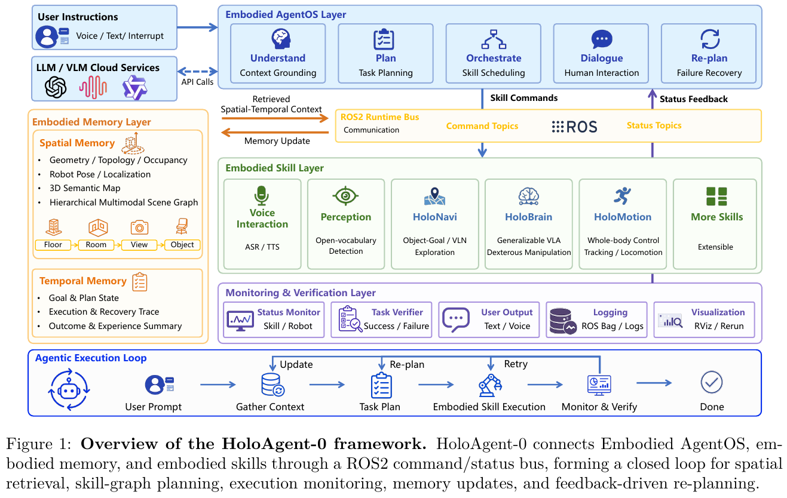
<figcaption>Overview of the HoloAgent-0 closed-loop, end-to-end runtime architecture</figcaption>

#### ② Embodied skill layer and typed skill abstraction
{: id="-具身技能层与类型化动作抽象typed-skills"}

In conventional LLM tool calling, agents treat the underlying tools as black-box functions, which easily causes deadlocks on physical robots. HoloAgent-0 therefore defines a structured skill contract:
1. **Command schema**: Each skill explicitly declares its name, strongly typed input parameters, preconditions, and expected physical post-state (expected effects). For example, the manipulation skill `pick(object=mug, support=table)` declares that the object and its support plane must be geometrically anchored before grasping.
2. **Runtime status interface**: Instead of returning only a binary completion flag, the execution side continuously broadcasts structured tracking data over the ROS2 status topic: progress ratio, success state, fine-grained failure modes (such as object unreachable, grip slip, collision risk, and posture singularity), algorithm confidence, execution latency, and whether the failure is recoverable.

##### Worked example 1: digital software tool calling vs. embodied typed skills
{: id="卡点降维-1数字软件工具调用-vs-具身类型化技能typed-skills"}

|Dimension|Traditional digital-agent tool calling|HoloAgent-0 embodied typed skills|
|---|---|---|
|**Call semantics**|Synchronous or short-lived asynchronous API with deterministic inputs and outputs and clear semantic boundaries|The physical world is a continuous, time-consuming process, vulnerable to dynamic noise, occlusion, and sensor drift|
|**Feedback granularity**|Returns only the final result or a standard error code|Continuously publishes a runtime heartbeat stream (progress percentage, local confidence, collision risk)|
|**Failure modes**|A single error code (such as HTTP 404/500), usually with no physical side effects|Distinguishes recoverable from unrecoverable modes (such as arm joint limit, grip slip, target loss)|
|**Recovery mechanism**|A fixed number of simple retries or a text error message|Explicitly exposes recoverability, driving AgentOS to rotate the viewpoint for a recheck, fine-tune navigation, or re-plan|

> **Example execution flow**:
> The robot receives the instruction "Put the yellow towel on the table into the laundry basket."
> 1. AgentOS issues `pick(object="yellow towel", support="desk")` over the ROS2 topic;
> 2. The HoloBrain manipulation backend takes over control and, as the arm moves to the pre-grasp pose, keeps returning the status stream `{progress: 40%, status: "in_progress", confidence: 0.88}`;
> 3. When the gripper closes, tactile and posture feedback detects an empty grasp, and the status stream immediately reports `{progress: 75%, status: "failed", failure_mode: "grasp_slip", recoverability: "recoverable"}`;
> 4. AgentOS sees that the failure is recoverable and does not blindly repeat the grasp. Instead, it schedules the perception backend to fine-tune the viewpoint and re-evaluate the mask, updates the target's 3D bounding box, and then restarts the grasp loop.

For different embodiments, HoloAgent-0 connects four specialized backends:
- **HoloNavi spatial navigation**: handles target search and path cruising in large environments;
- **HoloBrain embodied manipulation**: built on a general VLA foundation model, it generates end-effector pose trajectories for both arms and grippers, and can autonomously complete delicate operations such as grasping, placing, pouring water, and folding clothes;
- **HoloMotion whole-body motion**: supports a trajectory-tracking mode (for human-robot interaction actions such as waving, bowing, handshaking, and dancing) and a velocity-control mode (for omnidirectional walking, turning, emergency obstacle avoidance, and recovery after a fall);
- **Cross-embodiment coordination**: Multiple heterogeneous robots divide the work through a shared 3D spatial memory base and a unified step-status stream. For example, a wheeled mobile base first patrols, builds the map, and marks the target location, and a humanoid then carries out the complex tabletop manipulation precisely.

  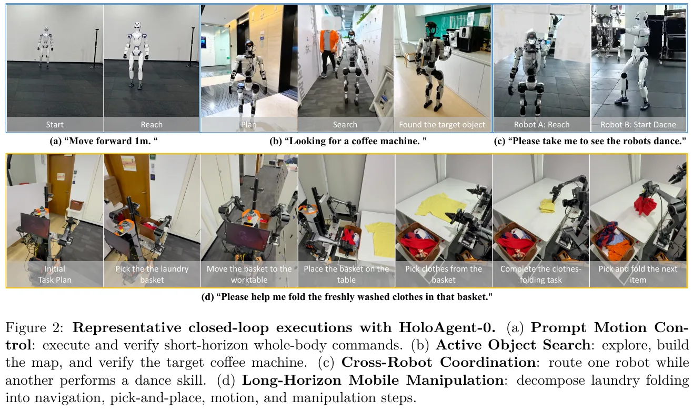
<figcaption>Real-world closed-loop cases of HoloAgent-0 on diverse robot platforms (manipulation control, object finding, multi-robot collaboration, long-distance clothes folding)</figcaption>

#### ③ Spatial memory and open-vocabulary 3D semantic mapping
{: id="-空间记忆与开放词表-3d-语义建图"}

Spatial memory gives robot perception and action a unified, metric 3D physical base:
- **Unified geometric base**: Decoupled from sensor hardware. It supports both metric mapping with tightly coupled lidar, IMU, and cameras (such as FAST-LIVO) and the vision-only multi-camera GeoFlow-SLAM++ system. GeoFlow-SLAM++ uses a 3D foundation model to predict dense depth directly from multi-view RGB images, and builds high-quality metric maps without a hardware depth camera through two-stage multi-camera optical-flow matching, point and surface geometry optimization, and bag-of-words loop retrieval.
- **Open-vocabulary semantic projection**: The online mapping module lifts the general semantics of 2D foundation models into the 3D point cloud and voxel grid.

  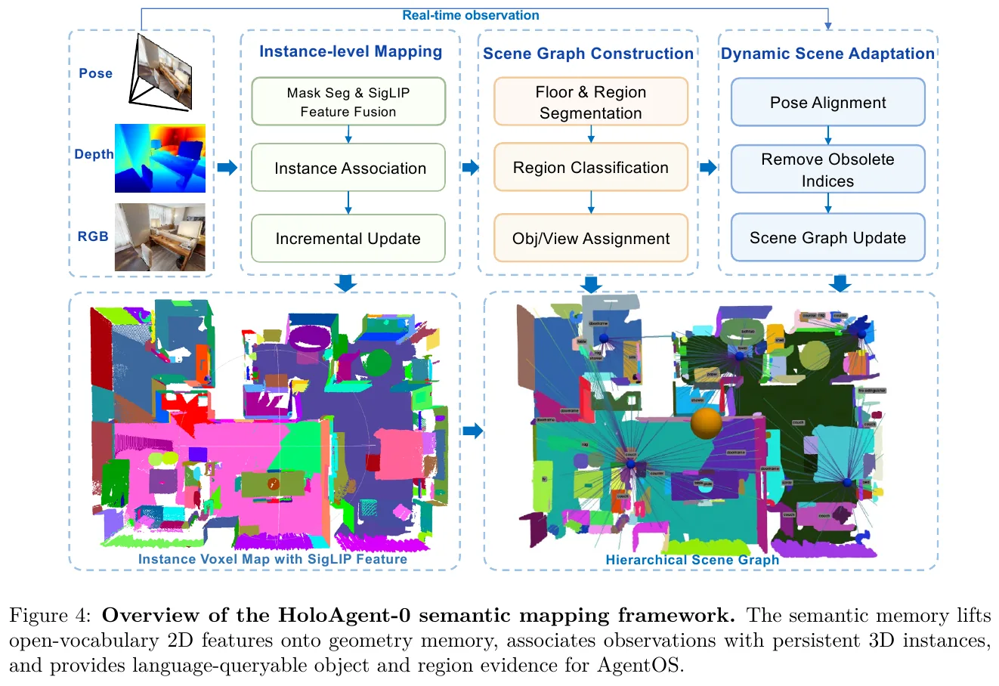
<figcaption>HoloAgent-0 open-vocabulary 3D semantic mapping and dynamic scene adaptation framework</figcaption>

##### Worked example 2: three-scale SigLIP feature fusion and continuous 3D instance association
{: id="卡点降维-2三尺度-siglip-语义特征融合与-3d-实例持续关联"}

When lifting 2D features into 3D space, extracting only a single cropped-region feature easily loses environmental context, while using only full-image features dilutes the discriminability of small objects. HoloAgent-0 therefore uses a weighted multi-scale feature fusion formula:

$$d = \sum_{i=0}^2 w_i \odot d_i$$

Here, $d_i \in \mathbb R^d$ and $w_i \in \mathbb R^d$ are the feature-fusion weights, and $\odot$ denotes the Hadamard product.

> **A small hand-calculated example of feature fusion and projection association**:
> Assume the feature dimension is simplified to 3, and a water glass is detected in the current keyframe:
> 1. Extract SigLIP embeddings at three scales:
>    - Full-image context feature $d_0 = [0.2, 0.8, 0.1]$ (captures large-scale scene information such as the kitchen and workbench);
>    - SAM2 precise segmentation-mask feature $d_1 = [0.9, 0.1, 0.3]$ (highlights the glass's material and shape);
>    - Minimum bounding-box feature $d_2 = [0.7, 0.4, 0.2]$ (adds details of the handle and the contact edge with the tabletop);
> 2. Assume the corresponding feature weight vectors are $w_0 = [0.2, 0.2, 0.2]$, $w_1 = [0.5, 0.5, 0.5]$, and $w_2 = [0.3, 0.3, 0.3]$;
> 3. The final object vector after element-wise fusion is:
> $d = (0.2 \times [0.2, 0.8, 0.1]) + (0.5 \times [0.9, 0.1, 0.3]) + (0.3 \times [0.7, 0.4, 0.2]) = [0.70, 0.33, 0.23]$. This vector combines the macro-level scene context with local appearance details.
> 4. **Cross-view 3D instance association**: When a new frame arrives after the robot has moved, the system back-projects the maintained 3D instance point cloud $V_{t-1}$ onto the current camera plane through the extrinsic matrix to get a projected prediction mask $\tilde m_j$. It then computes the intersection over union $\operatorname{IoU}(m_k, \tilde m_j)$ between $\tilde m_j$ and the newly segmented mask $m_k$. If the IoU exceeds 0.5, they are treated as the same object and the instance ID is reused; if there is no overlap, a new independent 3D instance is created.

  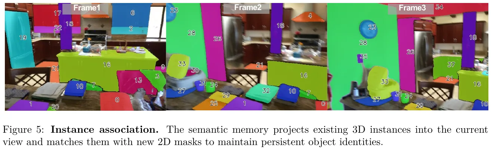
<figcaption>Cross-frame 3D instance back-projection matching and continuous ID tracking</figcaption>

#### ④ Hierarchical multimodal scene graph (HMSG) and fast-slow hybrid retrieval
{: id="-分层多模态场景图hmsg与快慢混合检索机制"}

To balance spatial coverage and fine-grained perception, HMSG vertically decouples environment information into a four-layer topology:
1. **Floor layer**: records each floor's vertical extent and overall semantics, delimiting the vertical range at coarse granularity;
2. **Room layer**: contains the 2D polygonal boundary, point cloud, and room-type CLIP vector, defining functional spaces;
3. **View layer**: the core innovation of HMSG. It records the 6-DoF rigid-body pose, the RGB-D frame, and a local panoramic descriptor at each location where the robot has sampled in the past;
4. **Object layer**: maintains the 3D oriented bounding box, point-cloud cluster, and fused instance SigLIP feature.

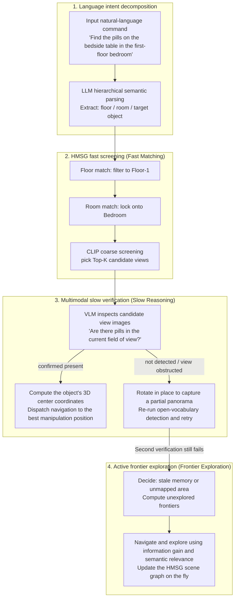

  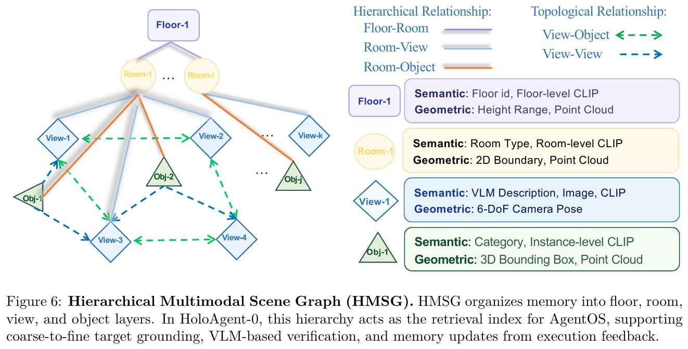
<figcaption>Four-layer structure of the hierarchical multimodal scene graph (HMSG): floor-room-view-object, with hierarchical and topological edges</figcaption>

A traditional scene graph links rooms directly to discrete objects, so the robot knows nothing about the actual observation angle or occlusion. Calling a slow multimodal model (VLM) blindly over a large space would exhaust the compute budget. The view layer in HMSG keeps visibility links between the observer's viewpoint and objects, so the system can first narrow the candidates to a handful of relevant views using metric geometry and then call the VLM only for high-quality visual verification.

#### ⑤ HoloNavi object-goal navigation pipeline
{: id="-holonavi-目标导航流水线"}

Built on HMSG, the HoloNavi navigation system links the task into three interlocking execution loops:
1. **Hierarchical object navigation**: Semantic parsing matches floor, room, and object candidates, and hierarchical CLIP similarity quickly prunes the irrelevant search space;
2. **Online verification loop**: When the robot reaches a candidate viewpoint, the live camera image is sent to an open-vocabulary detector and a VLM for double verification. If the first check fails, the robot rotates in place through several angles to collect surrounding views for a second check, confirms the target's true coordinates, and then navigates to a safe manipulation distance;
3. **Frontier exploration loop**: If the initial HMSG search fails, or online verification fails again, the system switches to frontier exploration. Candidate frontier points are scored on expected information gain, task-semantic relevance, traversability, and dynamic constraints, guiding the robot into unknown areas while it keeps mapping incrementally and searching for the target.

  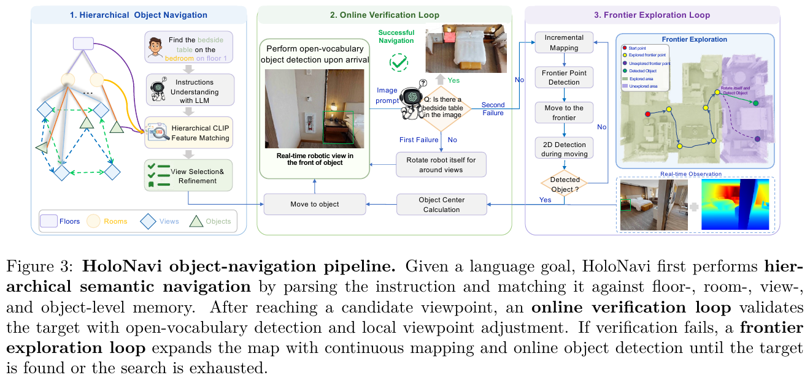
<figcaption>The full HoloNavi object-goal navigation process: hierarchical semantic matching, online multi-view verification, and incremental frontier exploration</figcaption>

#### ⑥ Adaptive incremental update of dynamic spatiotemporal memory
{: id="-动态时空记忆自适应增量更新dynamic-memory-update"}

The real world keeps changing. HoloAgent-0 defines three types of core events that trigger a memory refresh:
- **Perception conflict event**: New sensor data differs markedly from the existing map in geometry or color;
- **Skill outcome event**: A grasp or placement (such as picking up a glass) moves an object off its original support surface, or navigation is blocked and exposes new obstacles;
- **Explicit human feedback event**: The user issues a spoken correction about a room name or an object attribute.

During an update, the memory layer first relocalizes robustly against the existing geometric map using the current observation, locally clears the stale point clouds and voxels that cause the conflict, and merges new features into the local geometry. The semantic layer updates the bounding boxes of the affected 3D instances, and HMSG performs **only an in-place topology update** on the affected local subgraph (recomputing the rooms and views the object belongs to), avoiding the high cost of rebuilding the whole global scene graph.

  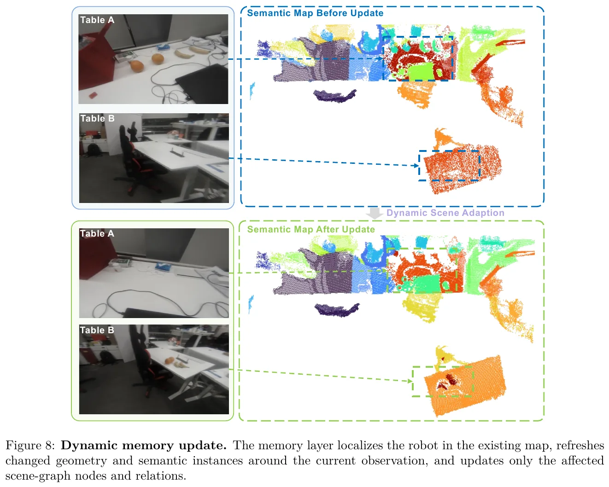
<figcaption>Adaptive refresh of local scene memory in a dynamic environment (in-place update of the local map and scene-graph subgraph after a tabletop object is moved)</figcaption>

---

### 3. Results and findings
{: id="3-核心结果发现"}

- **Large gain on the HM3D-ObjNav simulation benchmark**: On the standard simulation benchmark without hardware noise, HoloAgent-Nav with the AgentOS closed loop reaches a success rate (SR) of **82.6%** and a success weighted by path length (SPL) of **42.8%**, clearly ahead of representative existing navigation methods such as MSGNav (74.1% SR / 33.4% SPL), WMNav (72.2% SR / 33.3% SPL), and the open-loop FSR-VLN (80.8% SR / 41.0% SPL). This confirms that closed-loop monitoring and retry-based re-planning substantially raise the completion rate of complex tasks while keeping paths efficient.
- **Robust long-distance navigation in real apartments**: In multi-target search in real indoor apartments, HoloAgent-Nav achieves a real arrival rate of **97.70%** under the strictest Top-1@1.0m criterion, and a Top-5 arrival rate of **98.90%**. In the same scenes, the well-known baseline OK-Robot reaches only 60.92%, HOV-SG only 51.72%, and MobilityVLA only 34.48%. Even more striking, HoloAgent-Nav's scores are identical at the 1.0m, 2.0m, and 3.0m thresholds, which shows that every successful sample approached the core manipulation area to within 1.0m, indicating very robust positioning and docking accuracy.
- **High-quality open-vocabulary 3D semantic mapping**: On ScanNet, HoloAgent-Memory achieves **31.58% mIoU** and **61.58% frequency-weighted accuracy (f-Acc)** in online mode. It clearly outperforms other online mapping methods (such as Open-Fusion at 18.02% mIoU and ConceptGraphs at 16.29% mIoU) and even approaches offline foundation-model mapping methods, providing a solid, accurate semantic index base for upper-layer agents.
- **Complex long-distance composite tasks on real robots with multiple embodiments**: On the Unitree G1/R1 humanoids and the dual-arm mobile platform, it completes closed-loop tasks including "finding objects from the bedroom," "multi-robot voice-coordinated dance guidance," and the very challenging "long-distance mobile laundry folding" (autonomous cruising from the mobile base to the target workstation, flexible clothing sorting and dual-arm grasping, tabletop flattening, and fine folding).

---

### 4. Limitations
{: id="4-局限性"}

- Robot foundation models still cannot cover, with a single model, the full action spectrum from large-scale spatial navigation and precise dual-arm manipulation to torque-level whole-body motion control. Transferring across physical embodiments still relies on engineered controller bridging and dynamics tuning.
- The field still lacks an end-to-end unified long-horizon real-robot benchmark covering manipulation, multimodal navigation, and whole-body dynamic interaction. For large, complex building scenes, the latency of long-term cross-view feature fusion and the accuracy of fine-grained geometric reconstruction still leave room for improvement.

## 2. Pigey (2026)
{: id="pigey"}
———Addressing the orchestration gap in generalist robots through physical agency

📄 **Paper**: [arXiv:2607.21725](https://arxiv.org/abs/2607.21725)

---

### Key takeaways
{: id="精华-1"}

- **Revealing the "orchestration gap" of embodied intelligence**: The paper argues that the main bottleneck of today's generalist robots is not weak low-level motion control but the lack of a closed-loop orchestration architecture that coordinates perception, planning, verification, and recovery. A single end-to-end model easily overfits and executes blindly when prompted directly, which greatly limits its performance.
- **Closed-loop physical agent at inference time only (no new training)**: Pigey is a closed-loop orchestrator driven by a frontier vision-language model (frontier VLM). It decomposes complex long-horizon instructions into short-horizon sub-goals and drives the frozen low-level motion policies only through high-level perception and tools, with no retraining or fine-tuning of low-level weights.
- **Complementary dual backends: geometric planning (TAMP) and a neural policy ($\pi_{0.5}$)**: Deterministic task and motion planning (TiPToP) and an end-to-end visual action policy ($\pi_{0.5}$) are decoupled and integrated. Rigid objects use grasp-and-place planning with geometric guarantees, while deformable objects, contact-rich manipulation, or failed planning are escalated seamlessly to the VLA.
- **Conservative double verification with sensors and wrist vision**: The open-loop "grasp-and-release" atomic action is split apart, and after each grasp a strict, conservative check combines the gripper-width sensor (`is_grasped`) with the wrist camera image. If the grasp is not stable, Pigey retries or escalates on the spot, eliminating at the source the compounding error of "delivering with an empty gripper."
- **Large gains out of distribution and on long-horizon real-robot tasks**: The frozen $\pi_{0.5}$-LIBERO rises from 12.8% to 53.3% zero-shot success on the strongly perturbed LIBERO-PRO benchmark, and reaches an overall success rate of 97.3% on 30 complex long-horizon evaluations with a real DROID robot arm (the baseline $\pi_{0.5}$ gets only 16.7%).

---

### 1. Background and problem
{: id="1-研究背景问题-1"}

As large models and robotics advance, the field has leaned toward building huge monolithic vision-language-action (VLA) models, hoping that large-scale pre-training can fold high-level semantic understanding, commonsense reasoning, spatial planning, success detection, anomaly recovery, and millimeter-level low-level motor control into a single neural network. This monolithic end-to-end paradigm, however, faces practical bottlenecks that are hard to overcome:

1. **Instruction sensitivity and semantic degradation**: In end-to-end policies, high-level natural-language instructions often degrade into weak prior conditions. The model easily falls back on mechanical memory of specific training trajectories and loses all ability to adapt when the scene is perturbed (for example, the target is displaced, occluded, or already occupied);
2. **Open-loop execution and compounding errors**: Existing code-as-policies methods and classical task and motion planning (TAMP) often generate a plan once, offline, and then run blind in open loop during execution. If a grasp slips or a collision occurs midway, the system still advances mechanically along the predetermined trajectory and ultimately fails;
3. **Lack of orchestration capability**: True physical versatility requires "physical agency": the system must know not only what to do but also observe during execution whether it was done, and actively retry, work around obstacles, or switch methods when it fails.

**Core question**: Can a closed-loop physical orchestration framework applied only at inference time, with no retraining or fine-tuning of the low-level motion policies, unlock the full potential of pre-trained frozen policies and close the "orchestration gap" of generalist robots?

---

### 2. Methods and innovations
{: id="2-主要方法创新点-1"}

The core idea of Pigey is to decouple **control from orchestration**. The bottom layer keeps only two frozen motion executors (a TAMP planner and the $\pi_{0.5}$ VLA). The upper layer is a closed-loop decision-making brain built from a frontier VLM (a frontier multimodal model such as Claude or GPT), which runs the physical execution cycle of "Perceive → Reason → Act → Verify."

  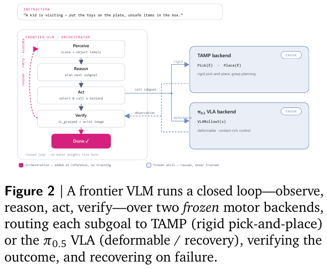
<figcaption>Architecture of the Pigey closed-loop physical agent: a frontier VLM acts as the orchestrator, coordinating perception, reasoning, execution, and double verification, and routing down to the frozen TAMP and VLA motion backends</figcaption>

#### ① Overall framework
{: id="-整体框架概述-1"}

As a closed-loop embodied agent, Pigey receives a global long instruction $I$ (for example, "A child is visiting - put the toys on the plate and put the dangerous items in the box") and maintains a global context history $h$. At each interaction step, the VLM selects and calls exactly one structured tool, receives real feedback from the physical-world sensors and cameras, and updates its internal state accordingly, until all sub-goals are achieved and it terminates by calling `Done`.

The system splits the complex responsibilities originally carried by a single large model into a clear chain of modules:
- **Open-vocabulary target perception and spatial anchoring**: An open-vocabulary detector locks onto the objects in the scene and their labels, which restricts the vocabulary of high-level planning;
- **Task-level long-term memory**: Maintains the list of completed operations, what the gripper currently holds, and the items remaining on the table;
- **Dual geometric and neural motion backends**: Analytically verifiable TAMP for rigid grasp-and-place, and the VLA for irregular or contact-rich manipulation;
- **Conservative double verification and a two-way escalation and fallback engine**: Sensor signals and visual judgments cross-check each other, driving retries, troubleshooting, and strategy switching.

  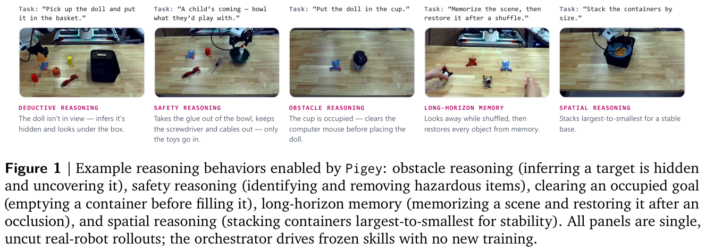
<figcaption>Pigey's physical reasoning demonstrated on a real robot dog and robot arm: deductive reasoning, safety commonsense, obstacle removal, long-term scene memory, and spatial-geometry stacking</figcaption>

#### ② Module-by-module walkthrough
{: id="-逐模块讲解"}

- **Perception and target semantic anchoring (Perceive & Grounding)**
  - **Input**: multi-view camera images (main view and wrist view) and the robot's low-level joint state.
  - **Processing**: Calls the open-vocabulary detector to generate a set of object candidates with bounding boxes and semantic labels. These detection labels strictly define Pigey's "controlled vocabulary," and the parameters of every grasp or placement operation must reference a detection label directly.
  - **Output**: a structured scene-perception dictionary, containing the object label list, local high-resolution wrist images, and the current gripper state.
  - **Motivation**: Prevents the language model from inventing names of unseen objects during physical interaction, and ties high-level fuzzy concepts (such as "dangerous items," "vegetarian food," and "the smallest container") directly to concrete entities already localized in the physical scene.

- **Decoupled, complementary dual motion backends (Frozen Motor Backends)**
  - **TAMP geometric backend (`Pick(ℓ)` / `DropAbove(ℓ)`)**: Built on the TiPToP framework, it handles collision-free spatial motion planning and six-degree-of-freedom grasp-pose generation. Pigey makes one key refactoring: pick-and-place, originally packaged as a single open-loop execution, is forcibly split into two independent tool calls, with a physical verification inserted between grasping and placing.
  - **VLA neural backend (`VLARollout(s)`)**: Wraps the frozen, pre-trained $\pi_{0.5}$ closed-loop visuomotor control model. It takes a short plain-text sub-action description $s$ (such as `"grasp the cable"`) and directly outputs continuous, high-frequency end-effector displacement and gripper open/close commands.
  - **Collaboration**: Rigid objects lying flat on the table go to TAMP first, for its very high trajectory certainty. Stacked objects, easily deformable objects (such as cables and plush toys), and objects in deep containers go directly to the VLA, whose compliant control handles them better.

- **Conservative dual verification (Conservative Dual Verification)**
  - **Input**: the Boolean `is_grasped`, read from the displacement sensor embedded in the gripper, and a snapshot from the hand-eye (wrist) camera after the action completes.
  - **Processing**: The hardware sensor confirms whether the physical gripper gap is within the clamping threshold, while the frontier VLM examines the wrist camera to judge whether the target has left its original position and sits at the center of the gripper.
  - **Conservative combination rule**: Both checks follow the most pessimistic policy. Even if the motion backend reports completion, the step is immediately judged a failure and subsequent actions are cancelled whenever `is_grasped == False` or the image shows the target still on the table.

#### ③ Worked analysis: decision flow and what closed-loop orchestration changes
{: id="-卡点降维与决策流图"}

Readers in embodied intelligence are often puzzled: **why can a single end-to-end model (such as $\pi_0$ / $\pi_{0.5}$), even after large-scale pre-training, still not manage a simple pick-and-place under perturbation? What exactly does Pigey's closed-loop orchestration change?**

We take its mechanism apart with a decision-flow diagram and a comparison table:

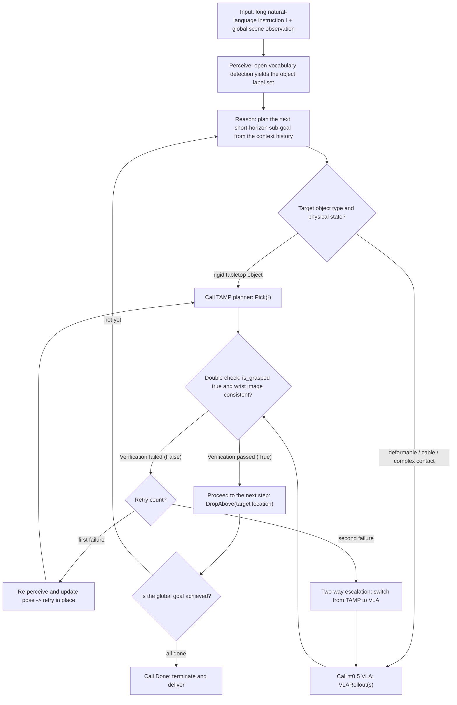

To see how Pigey overturns the traditional robot-control paradigm, the comparison is as follows:

|Dimension|End-to-end monolithic VLA (such as $\pi_{0.5}$ / OpenVLA)|Open-loop code planning (Code-as-Policies / TiPToP)|Closed-loop physical agent (Pigey)|
|---|---|---|---|
|**Division of control**|Language understanding, planning, verification, and motion control are all coupled in one large model|The LLM generates complete Python code or an action plan, and the low level runs it open loop|The frontier VLM is responsible only for closed-loop orchestration and verification; all actions are delegated to frozen policies|
|**Execution mode**|Step-by-step autoregression with no reflection on the macro task state|One-shot planning, "blind" to object slippage and environment changes during execution|Every tool call is double-verified by sensors and vision, advancing the dynamic closed loop|
|**Failure recovery**|Extremely poor (after grasping air, it goes on to place the empty gripper)|None (a planning failure or interrupted execution simply raises an exception and crashes)|Natively supports obstacle removal, regrasping after replacement, and two-way escalation and fallback between TAMP and the VLA|
|**Training cost**|Requires re-fine-tuning or post-training on tens of thousands of hours of real-robot trajectories|No training required, but relies on an idealized simulation environment|**Zero fine-tuning**: fully reuses off-the-shelf frozen pre-trained models and classical planners|

> **Example (target displacement and empty-grasp recovery)**:
> Suppose the task is "put the red cup into the tray."
> - **Single VLA / open-loop planning**: Computes the grasp trajectory and executes the placement straight through. If the cup is bumped and slips as the arm reaches down, the arm still closes on nothing and carries the empty gripper over the tray to release it, believing "the task is complete," and ultimately fails.
> - **Pigey closed-loop handling**:
>   1. Execute `Pick(red_cup)`;
>   2. After the arm closes, the gripper-width sensor returns `is_grasped = False`, and the wrist image shows the cup is still in place;
>   3. Pigey intercepts the subsequent `DropAbove` action and records the grasp failure;
>   4. It triggers `Perceive` to re-detect the cup's exact coordinates after the displacement, updates the grasp pose, and tries again. If the second attempt still fails to grasp the cup, it escalates the backend to the compliant, fault-tolerant `VLARollout` for a touch-guided grasp, finally placing the cup securely on the plate.

---

### 3. Results and findings
{: id="3-核心结果发现-1"}

The paper evaluates the system on the LIBERO-PRO simulation benchmark and on a DROID workstation with a real Franka arm, showing that inference-time physical orchestration multiplies what the underlying models can do.

#### ① LIBERO-PRO simulation benchmark
{: id="-libero-pro-仿真基准评测"}

LIBERO-PRO is the hardest perturbation benchmark for complex long-horizon tabletop manipulation. It introduces six rigorous perturbation suites, including object position swap (Obj. swap), goal attribute swap (Goal swap), and spatial geometry perturbation (Spatial swap/task).

  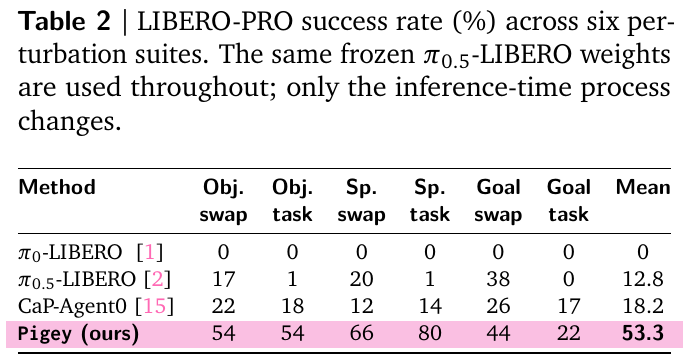
<figcaption>LIBERO-PRO success rates under the six perturbation suites: the underlying frozen weights stay completely unchanged and only the inference-time orchestration differs</figcaption>

- **Severe degradation of the original SOTA VLA**: Run directly with an open-loop prompt, even the current top $\pi_{0.5}$-LIBERO reaches an average success rate of only **12.8%** and drops straight to zero on several tasks, which shows that the end-to-end policy has heavily overfit the training trajectories.
- **Pigey sets a new state of the art**: In a zero-shot setting that uses no task-specific memory and fine-tunes no weights, Pigey raises the frozen policy's average success rate to **53.3%**. That is more than a 4x improvement over the original policy and clearly exceeds the code-generation baseline CaP-Agent0 (18.2%).

#### ② Real-robot capability tests (DROID arm)
{: id="-真实机械臂droid能力测试"}

In the real-robot experiments, the team set up 30 rigorous long-horizon tasks across 8 core capability dimensions, including commonsense reasoning, conditional logic, spatial reasoning, obstacle-clearing safety reasoning, active error recovery, and long-term memory recall.

  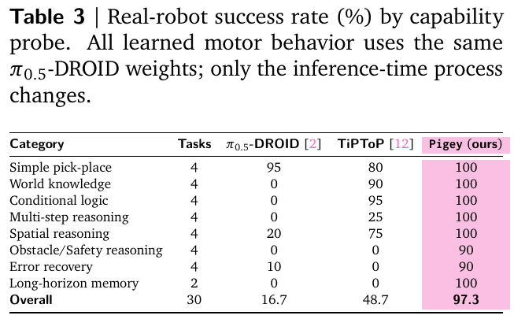
<figcaption>Success rate (%) on eight capability probes with the real DROID arm: the same $\pi_{0.5}$-DROID weights run underneath in every setting</figcaption>

  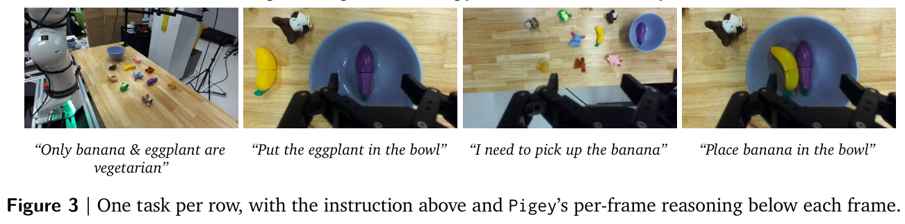
<figcaption>Long-horizon real-robot execution and single-frame reasoning chain: in the vegetarian selection task, identifying the non-vegetarian items and placing them in the bowl one by one</figcaption>

- **Overall success rate of 97.3% vs. 16.7%**: Under direct prompting, $\pi_{0.5}$-DROID was almost wiped out on tasks requiring commonsense reasoning, multi-step logic, and spatial geometry (0% success in these categories), with an overall success rate of only 16.7%. With closed-loop commonsense orchestration and backtracking verification, Pigey scored a perfect 100% in most categories and reached an overall success rate of **97.3%**.
- **Failure recovery on the real robot**: When the placement target is occupied by a foreign object (such as debris in a coffee cup), Pigey reasons its way to a cascading recovery: first remove the debris and set it aside, then put the target object in. When a blind box hides the target, it infers that the target is under the box and actively lifts the box to retrieve the object.

---

### 4. Limitations
{: id="4-局限性-1"}

1. **Dependence on a frontier model for visual understanding, and reasoning latency**: Because a cloud-hosted or high-end VLM must be called after every key action for visual reflection and decision-making, the overall pace of task execution is bounded by API communication and inference throughput, and interaction latency is higher than for a single end-to-end model;
2. **The physical limits of the underlying action policies cannot be exceeded**: The orchestrator can greatly reduce logic errors and grasp-timing errors, but if both underlying motion backends (the TAMP solver and $\pi_{0.5}$) cannot produce valid end-effector trajectories because of singularities, collision deadlocks, or physical deformation, the upper-layer agent still cannot complete the physical contact out of thin air.

---

## 3. Thea (2026)
{: id="thea"}
———Towards a harness for embodied agents

📄 **Paper**: [arXiv:2608.11246](https://arxiv.org/abs/2608.11246) · [Code](https://github.com/EIT-HAI/Thea) · [Project Page](https://eit-hai.github.io/thea)

---

### Key takeaways
{: id="精华-2"}

- **Bringing the "code-agent harness paradigm" to the embodied physical world**: The success of Claude Code and Codex in software engineering lies in the closed loop of test feedback (the harness), not in the model alone. The paper argues that complex long-horizon embodied tasks likewise require a closed-loop harness infrastructure that connects the model to physical reality.
- **Supplying the two signal channels missing in the physical world**: The software world naturally provides ways to "read the world state" (file tree, AST) and to "judge action results" (exit codes, error stack traces); the physical world has neither. Thea proposes two cornerstone mechanisms, **SceneGraph as Context** (the scene graph is the context) and **Evaluation as Exit Codes** (the evaluator is the exit code), to close the physical loop.
- **A reliability analysis bounding the evaluator accuracy $\alpha$**: The paper proves mathematically that the success rate of an open-loop long-horizon task decays exponentially with the number of steps $n$ ($P_{\text{open}} = \prod p_i \to 0$), and that the error-correction ceiling of a closed-loop harness depends strictly on the judgment accuracy $\alpha$ of the independent evaluator ("the ceiling of a harness is set by its judge").
- **Decoupled models and embodiments for cross-platform portability**: It defines a standardized embodiment profile and tool abstraction contract, so the model (LLM/VLM) and the hardware embodiment (the Unitree G1 humanoid, the Astribot S1 humanoid, and the dual-arm wheeled AgileX Cobot Magic) can each be swapped in either direction, and a single architecture deploys across embodiments.
- **Large gains on long-horizon compound tasks**: In real-world evaluation of multi-stage complex tasks (L1 to L3), as task complexity and step count grow, the success rate of traditional end-to-end policies (ACT, $\pi_{0.5}$, LingBot-VLA) falls sharply to 30%-40%, while Thea still achieves a high success rate of **87%** at the hardest level, L3.

---

### 1. Background and problem
{: id="1-研究背景问题-2"}

The rise of coding agents (such as Claude Code and SWE-agent) has transformed software engineering. These systems succeed not because the model "writes perfect code in one shot" but because of a **test-and-retry closed loop (harness)** built from the compiler, test framework, and Git: the agent runs the tests after writing code, captures the stack error, reflects, edits, and iterates until the tests pass.

When researchers try to carry this efficient harness paradigm into the physical world, they hit a fundamental structural gap. The foundations that software has built up over decades are all missing in the physical world:
1. **State cannot be "read" natively**: The code world has a clear file system and type symbols, whereas a physical robot's sensors emit only chaotic, unstructured, high-dimensional continuous point clouds and image pixels, which a large model cannot directly use as precise, reasoning-ready context;
2. **Actions cannot be "judged" natively**: When a program errors, it immediately returns a clear non-zero exit code and a stack trace. In reality, if a robot arm reaches out, misses the grasp, or collides, the physical world is silent: it returns no status code and never announces that "the action has ended," so errors accumulate without bound in open-loop execution.

**Core question**: How can we build an embodied harness in the physical world that provides "persistent, readable state" and "accurate exit-code judgments," so that a high-level language or multimodal model can reliably orchestrate heterogeneous low-level motion policies and self-heal in a closed loop on long-horizon tasks?

---

### 2. Methods and innovations
{: id="2-主要方法创新点-2"}

Thea builds an embodied closed-loop harness that decouples the frontier decision-making model (Model) from the orchestration of diverse robot embodiments (Body), and closes the embodied control loop through structured context evolution, standardized tool interfaces, and an independent post-hoc evaluator.

  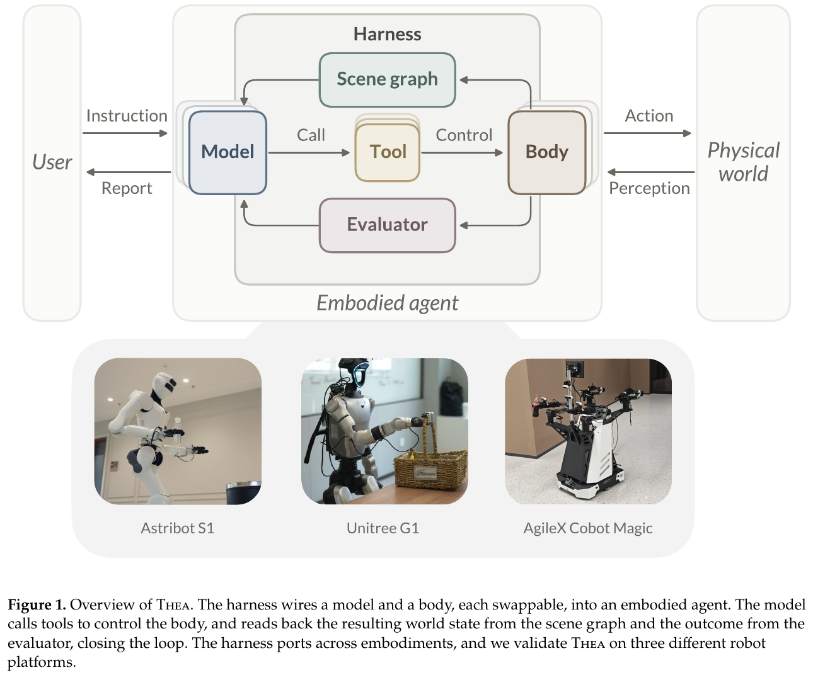
<figcaption>Overview of the Thea embodied harness: the model and the embodiment are fully decoupled, a perception-action-verification closed loop is established through callable tools, scene-graph context, and an independent evaluator, and the system is validated on three different embodiments</figcaption>

#### ① Overall framework
{: id="-整体框架概述-2"}

In the Thea architecture, an embodied agent consists of four core components:
1. **Model**: a high-level large language or vision-language model that only understands the task, reads the dynamic context, and outputs structured tool calls;
2. **Body and tools**: unify low-level mobile navigation, arm grasping, and skill policies (such as ACT, diffusion policies, and $\pi_0$) into standardized tools with a pre-hook and a post-hook;
3. **SceneGraph as Context**: distills the continuous perception stream into a persistent, symbolic scene graph with 3D bounding boxes and topological relations, analogous to the file system in software engineering;
4. **Evaluation as Exit Codes**: an independent visual evaluator, triggered by the system after every action, returns a three-state verdict (Success / Failure / In-progress) together with a failure attribution.

  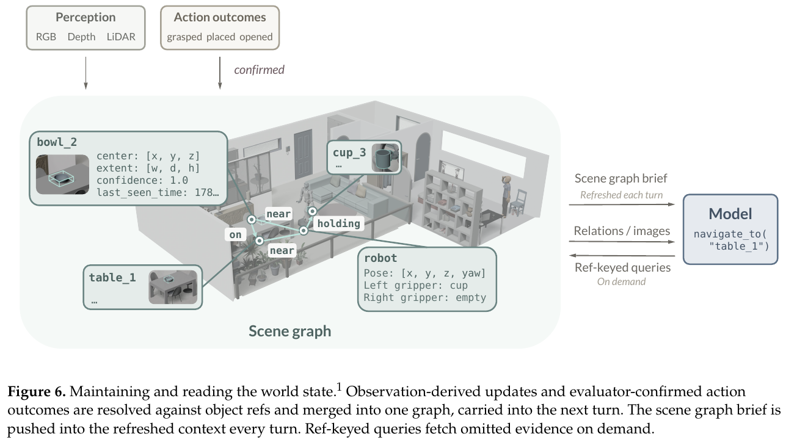
<figcaption>SceneGraph as Context: Fusion of the sensor’s continuous multi-modal observation and the action results confirmed by the evaluator into a unified symbol Scene graph, generating a streamlined briefing (Brief) that is refreshed and injected into the context in rounds, and supports on-demand in-depth query</figcaption>

#### ② Module-by-module walkthrough
{: id="-逐模块讲解-1"}

- **SceneGraph as Context (making the world state readable)**
  - **Input**: RGB images, depth maps, LiDAR point clouds, and the robot pose reported by the low-level odometry.
  - **Processing**: The perception pipeline discretizes continuous physical space into a dynamic graph containing object center coordinates, 3D bounding boxes, visibility confidence, and spatial topological relations (such as `on(bowl, table)`, `near(robot, table)`, `holding(gripper, cup)`). Only action results that the evaluator has confirmed as truly successful are written into the graph as topological changes.
  - **Output**: Before each decision round, the graph is condensed into a high-level structured brief (scene graph brief) and pushed into the refreshed context. The model can also call tools on demand with reference-keyed queries to retrieve historical high-resolution snapshots and detailed geometric properties of a specific object.
  - **Motivation**: Prevents the context from being swamped by massive streams of continuous video and image tokens over long multi-round interactions, and gives the large model a scene understanding akin to "reading a project's code structure tree."

- **Evaluation as Exit Codes (judging action results)**
  - **Trigger mechanism**: After each operation executes, the harness forces a structured trigger through the built-in post-hook, depriving the low-level execution policy of the right to "grade and praise itself."
  - **Processing**: The evaluator receives only the current visual observation and the post-condition declared by the tool, and is fully independent of the high-level decision model. It outputs one of three verdicts: `Success`; `Failure` (with a detailed causal explanation, such as "not grasped because of end-effector offset" or "target blocked by a drawer"); or `In-progress` (the action is still running for a long time and has not timed out).
  - **Output**: The verdict and failure attribution are packaged into an exit-code response and injected into the conversation history, so the decision model can retry in a targeted way or switch approaches.

  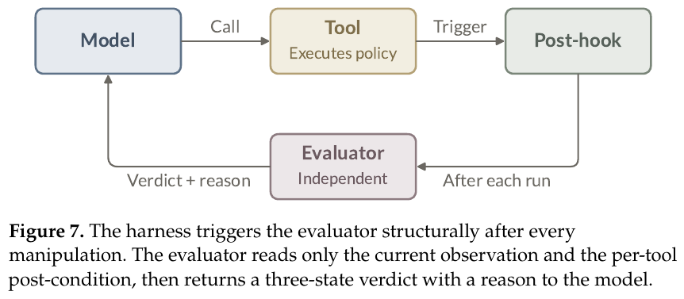
<figcaption>Trigger sequence of Evaluation as Exit Codes: the model calls a tool to execute a policy; when execution finishes, the harness post-hook actively triggers the independent evaluator, which outputs a three-state verdict with the failure reason and feeds it back to the model</figcaption>

#### ③ Worked analysis and theoretical derivation
{: id="-卡点降维与理论推导"}

**Question 1: How does a software harness correspond to an embodied physical harness?**

|Dimension|Software-engineering agent (such as Claude Code / SWE-agent)|Traditional robot control (monolithic VLA / teach-and-replay)|Embodied physical harness (Thea)|
|---|---|---|---|
|**State carrier**|File-system directory tree, AST, source text|Pixels of the instantaneous single-frame or multi-frame continuous camera image|**SceneGraph as Context** (a persistent, symbolic 3D topological scene graph)|
|**Action output**|Terminal shell commands, file-editing patches|Continuous joint angles or end-effector 6-DoF trajectory points|Semantic tools wrapped with standardized pre/post hooks (such as `grasp(ref)`)|
|**Execution feedback**|Operating-system return code (Exit 0 / 1), stack trace|No feedback: once the action ends, it proceeds blindly to the next step|**Evaluation as Exit Codes** (a three-state verdict plus a structured failure diagnosis)|
|**Error correction**|Read the error log, rewrite the code, and recompile|No error correction: after missing a grasp, it runs the whole remaining long sequence empty-handed|Reads the failure attribution, fine-tunes the pose and retries, or actively searches for a hidden target|

**Question 2: Why is the ceiling of a harness set by the evaluator accuracy $\alpha$?**

Consider a long-horizon, multi-step embodied task with $n$ sequential stages, where the single-step success rate is $p_i$.
- In the traditional open-loop mode, the task succeeds only if every step succeeds:
  $$ P_{\text{open}} = \prod_{i=1}^n p_i $$
- When $n$ is large (such as $n=5$), even a single-step success rate as high as $p=0.8$ quickly degrades the total success rate to $0.8^5 \approx 32.8\%$.

Thea introduces a detect-and-retry loop with a maximum of $k$ retries. The evaluator judges correctly with probability $\alpha$ and incorrectly with probability $1-\alpha$. The paper proves that, because the evaluator can produce **false negatives** (misjudging a true success as a failure, causing redundant retries that spoil the result) and **false positives** (misjudging a failure as a success, letting the error pass downstream), the net reliability of each step is pinned down directly by $\alpha$:

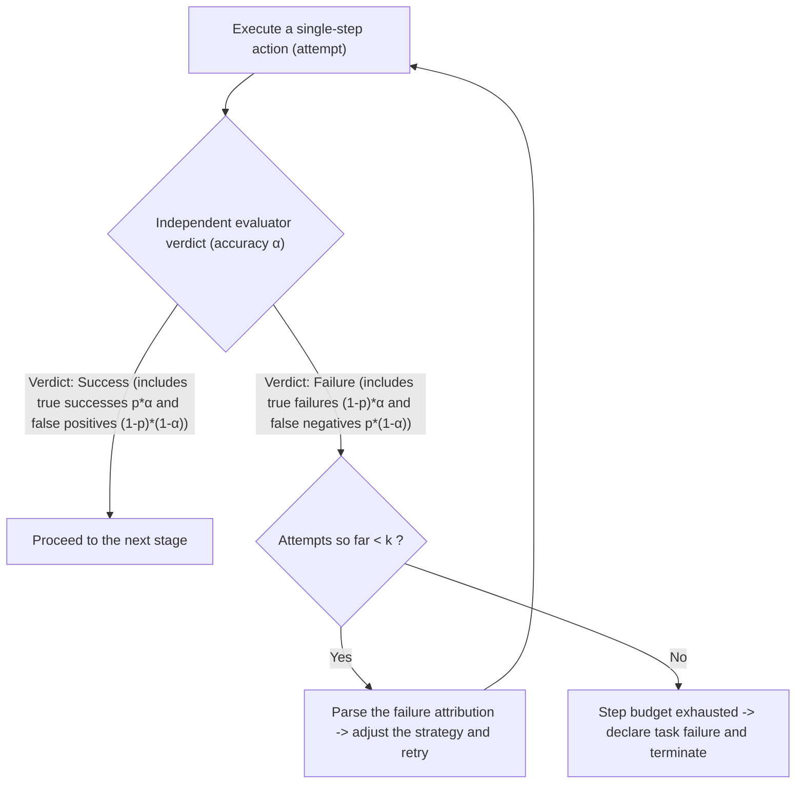

> **Example (concrete numbers on the reliability gain)**:
> Assume a long-horizon delivery task of $n=5$ steps, where the low-level policy succeeds at each step with probability $p=0.8$:
> - **Open-loop execution**: the total success rate is only $0.8^5 = 32.8\%$;
> - **Thea closed loop (evaluator accuracy $\alpha=0.95$, up to $k=3$ retries)**: With retries and accurate gating, the effective reliability of a single step jumps to $97.6\%$, and the total success rate of the whole 5-step task reaches $0.976^5 \approx 88.5\%$, a task-level reliability gain of nearly 3x over open loop!

---

### 3. Results and findings
{: id="3-核心结果发现-2"}

Thea was validated comprehensively through real-world physical experiments on diverse hardware platforms: the Unitree G1 humanoid, the Astribot S1 flexible humanoid, and the AgileX Cobot Magic wheeled dual-arm collaborative robot.

  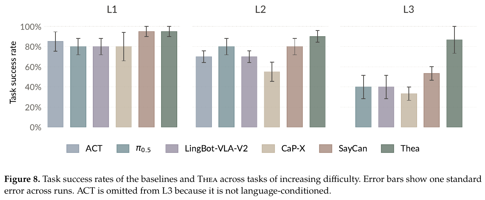
<figcaption>Task success rates at different difficulty levels (L1 basic manipulation, L2 spatial composition, L3 long-horizon, long-distance multi-stage interaction): as the number of task steps grows, the baselines fall off a cliff while Thea stays remarkably robust</figcaption>

#### ① A clear advantage that grows with task complexity
{: id="-随任务复杂度扩展的绝对优势"}

The evaluation divides tasks into three levels, L1, L2, and L3, by duration and stage complexity, and compares against mainstream monolithic or hierarchical baselines such as ACT, $\pi_{0.5}$, LingBot-VLA-V2, CaP-X, and SayCan:
- **L1 (basic, short-horizon single step)**: Baselines and Thea differ little, with success rates between 80% and 95%;
- **L2 (advanced, with spatial rearrangement and multi-step dependencies)**: Monolithic policies begin to suffer trajectory drift and missed grasps, and their success rate drops to 55%-80%, while Thea reaches **90%**;
- **L3 (hardest: cross-room long-distance navigation + opening a drawer to retrieve + grasping and delivering the target)**: Monolithic models (such as $\pi_{0.5}$ and LingBot) plummet to **40%** from accumulated error, and SayCan reaches only 53% for lack of fine-grained geometry and closed-loop verification, while Thea sustains a success rate of **87%** through closed-loop retries and scene-graph memory.

  
<figcaption>Diverse physical-intelligence behaviors that emerged under Thea: (a) autonomously fetching a power bank from another room and delivering it; (b) actively pulling open drawers to search layer by layer when the target is not visible; (c) fine-tuning the pose for a second grasp based on the failure reason fed back by the evaluator; (d) proactively starting a human-robot dialogue to negotiate an alternative when the requested drink is out of stock; (e) seamless transfer of a single harness across three completely different embodiments</figcaption>

#### ② Advanced physical behaviors emerging from the closed loop
{: id="-闭环涌现出的高级物理行为"}

Thanks to the general harness architecture's dynamic closed-loop orchestration of tools, the robot exhibits several higher-order emergent behaviors that earlier monolithic models could not achieve:
- **Active perception**: When the power bank cannot be found in the scene graph, the model actively plans an inspection chain: "navigate to the counter → call the drawer-pulling tool → tilt the wrist camera to look at the inner layer of the drawer."
- **Diagnosed recovery**: When a can slips during grasping because it is too far away, the evaluator returns `"Fail: target slipped due to hand clearance offset"`, and in the next round the model proactively generates `reposition(base, delta=[-0.05, 0])`. After the base position is adjusted slightly, the grasp succeeds on the retry.
- **User clarification**: When the user asks for a specific mineral water but only juice and tea are on the table, the agent autonomously pauses physical execution and asks the user through a phone interface to negotiate an alternative.

---

### 4. Limitations
{: id="4-局限性-2"}

1. **Scene-graph maintenance cost and latency bottleneck**: As the explored indoor space keeps growing, the computational cost of 3D instance point-cloud segmentation and real-time topological map merging rises sharply, which may cause noticeable lag in per-round decisions;
2. **Risk of evaluator misjudgment under 3D occlusion and extreme deformation**: The evaluator relies on visual feedback from a single viewpoint or the wrist camera, so misjudgments can still occur under strong reflections, small-object occlusion, or extreme lighting. Once a misjudgment occurs, it directly limits the final reliability of the system.

---

## 4. Zetta (2026)
{: id="zetta"}
———An efficient closed-loop embodied harness for self-evolving physical intelligence

📄 **Paper**: [arXiv:2608.16590](https://arxiv.org/abs/2608.16590) · [Project Page](https://air-embodied-brain.github.io/zetta)

---

### Key takeaways
{: id="精华-3"}

- **An embodied closed-loop harness for self-evolving physical intelligence**: End-to-end monolithic VLA/WAM models lack fine-grained correction during execution, and traditional post-hoc reflection struggles to attribute failures in high-frequency physical interaction. Zetta addresses this with a self-evolving system that integrates high-frequency online judging, in-situ exception recovery, and offline skill distillation.
- **A structured, evolvable harness abstraction ($H = \{C, R, T\}$)**: The low-level motion policy stays frozen under a high-level orchestrator, and the harness is decoupled into a set of runtime critics $C$, a recovery action library $R$, and a heterogeneous toolset $T$. Physical trial-and-error experience is distilled directly into parameterized code modules that evolve autonomously over interaction rounds.
- **Top-down, minimal-intervention hierarchical causal diagnosis**: It establishes the principle "never change the low-level parameters if the high-level logic can solve it," and investigates top-down in priority order (evaluation → critic → state → planning → recovery → parameters) to prevent the generalization collapse caused by overfitting to a single case.
- **Discovering the robotic "aha moment" of embodied physical intelligence**: It reveals a nonlinear transition in embodied self-evolution: superficial repairs keep performance on a low plateau, but once the root cause is located and a key "critic-recovery" closed-loop mechanism has evolved, the task success rate jumps vertically (for example, a sudden surge from 10% to 95%).
- **Z-Infra, a high-throughput infrastructure decoupling software from hardware**: A multi-node, heterogeneous, concurrent infrastructure that decouples the environment from the model compute pool reaches an effective sampling throughput of 35.1 episodes/min (a 20.6-fold improvement) and cuts inference latency by 91%, strongly supporting large-scale closed-loop self-evolution.

---

### 1. Background and problem
{: id="1-研究背景问题-3"}

Although Vision-Language-Action (VLA) and World Action Model (WAM) systems have advanced greatly through large-scale data pre-training, they remain highly fragile when deployed in the physical world. The root cause is that **the physical environment is a continuous system** that evolves at high frequency on a millisecond scale. If a slight object slip, an unbalanced reaction force on the tabletop, or a small contact disturbance is not sensed and corrected the moment it occurs, it quickly triggers a cascade of compounding errors that eventually collapses the whole task.

To overcome this bottleneck, academia has in recent years tried to introduce multimodal agents for "post-hoc reflection." In embodied physical settings, however, traditional reflection mechanisms face obstacles that are hard to overcome in both theory and engineering:
1. **Credit assignment problem**: A long-horizon manipulation failure involves hundreds or thousands of consecutive control steps. Asked to reflect in detail afterward, the large model cannot accurately infer which small deflection angle of the wrist, within a few seconds, caused the failure;
2. **No on-site online verification environment**: A corrective hypothesis produced by post-mortem reflection can only be tested after the next complete rerun, which is extremely inefficient and easily misleading;
3. **Overfitting from over-parameterized repair**: Earlier manual tuning or simple parameter adjustment often forced changes to the low-level control parameters for a specific failed case. This not only destroyed the base VLA's global semantic understanding and generalization distribution but also caused catastrophic performance degradation in unseen environments and with new random seeds.

**Core question**: How can we build an embodied closed-loop harness that needs no changes to the low-level policy parameters, makes high-frequency fine-grained online corrections, and automatically distills failed physical experience so the system keeps evolving autonomously?

---

### 2. Methods and innovations
{: id="2-主要方法创新点-3"}

Zetta proposes a dual-loop physical intelligence system that combines high-frequency online governance **with offline autonomous evolution**. Together with Z-Infra, a hardware-decoupled, high-throughput concurrent infrastructure, it achieves self-propagating and robust evolution of physical policies.

  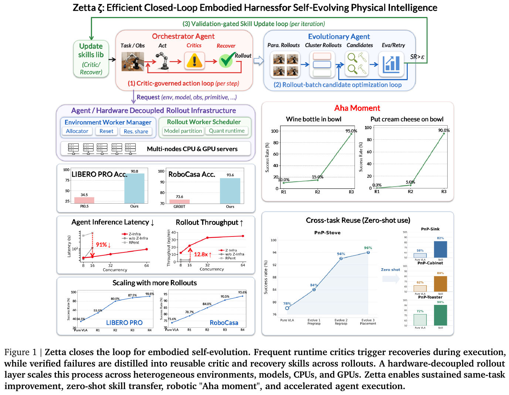
<figcaption>Overview of the Zetta self-evolving embodied harness: high-frequency runtime critics lead the online action-correction loop, an offline evolution agent clusters failure trajectories and distills reusable skills, and the decoupled Z-Infra infrastructure drives the throughput gains and the "aha moment"</figcaption>

#### ① Overall framework and dual-loop operation
{: id="-整体框架与双环运行机制"}

Zetta clearly divides the system into two immutable entities and one core evolving carrier:
- **Two immutable entities**: the low-level action policy $\pi$ (frozen VLA/WAM parameters, $\nabla_\theta = 0$) and the high-level orchestrator agent $A_{orch}$ (a multimodal decision operator whose decision logic is fixed);
- **The core evolving carrier, the harness ($H = \{C, R, T\}$)**:
  - **Runtime critics ($C$)**: monitoring functions that run at a higher frequency than the low-level action policy. They continuously scan live trajectory segments and produce proposals carrying failure evidence and state suggestions $$P_t = \langle e_t, \hat{\sigma}_t \rangle$$;
  - **Recovery playbook ($R$)**: a collection of parameterized micro-actions targeting specific failure mechanisms;
  - **Heterogeneous toolset ($T$)**: a motion planner, a 6-DoF grasp generator (GraspGen), and a placement stabilizer.

The system operates as **online parallel rollouts** plus an **offline reflect-and-evolve cycle**:

  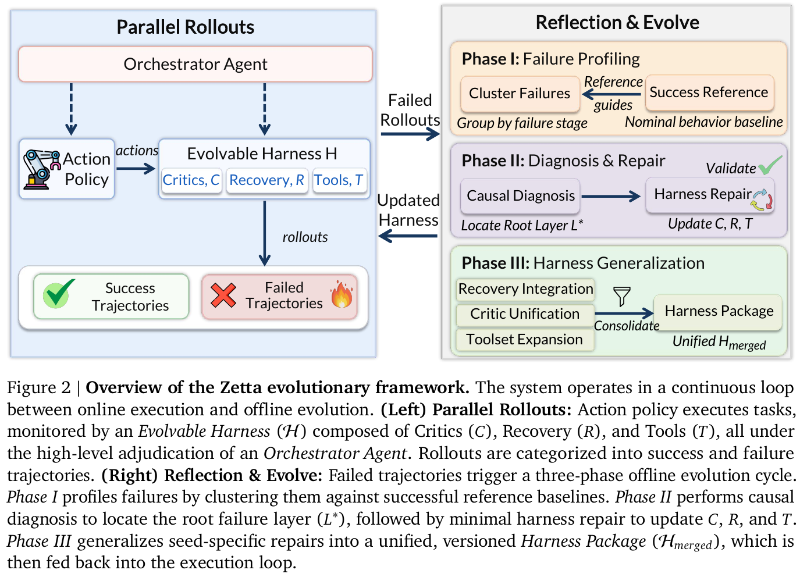
<figcaption>Three-stage process of the Zetta evolution framework: successful and failed trajectories are collected concurrently online, and the harness is updated offline through failure-profile clustering (Phase I), hierarchical causal diagnosis and repair (Phase II), and cross-task generalization merging (Phase III)</figcaption>

#### ② Module-by-module walkthrough
{: id="-逐模块讲解-2"}

- **Phase I: Failure Profiling**
  - **Input**: the failed trajectories collected concurrently by multiple threads, together with the corresponding nominal successful reference trajectories.
  - **Processing**: Slices the failed trajectories by the physical stages of the task (pre-contact approach, grasp closure, spatial transport, placement and release), and clusters common instability modes using the successful trajectories as the reference.
  - **Output**: a structured list of failure profiles that pinpoints the stages where multiple failures commonly occur.

- **Phase II: Hierarchical causal diagnosis and minimal-intervention repair (Diagnosis & Repair)**
  - **Top-down diagnostic hierarchy**: Strictly follows a six-level investigation order:
    $$ \text{Evaluation} \to \text{Critic} \to \text{State} \to \text{Planning} \to \text{Recovery} \to \text{Parameter} $$
  - **Motivation**: Prefer solving problems at the high level, by adding pre-alignment critics or calling geometric planning tools. Tampering directly with the low-level motor joint stiffness or fine-tuning low-level weights is strictly prohibited, in order to preserve the broad generalization of the base model.
  - **Validation guard**: Every code-level fix patch must be replayed in place on the same random seed that caused the failure, and may be committed only if it passes validation.

- **Phase III: Harness generalization and merging**
  - **Processing**: Promotes the patches that passed verification on specific seeds into general critic and recovery logic with abstracted parameters, merges them across cases without conflicts, packages them into a versioned $H_{merged}$, and hot-reloads it into the online environment.

  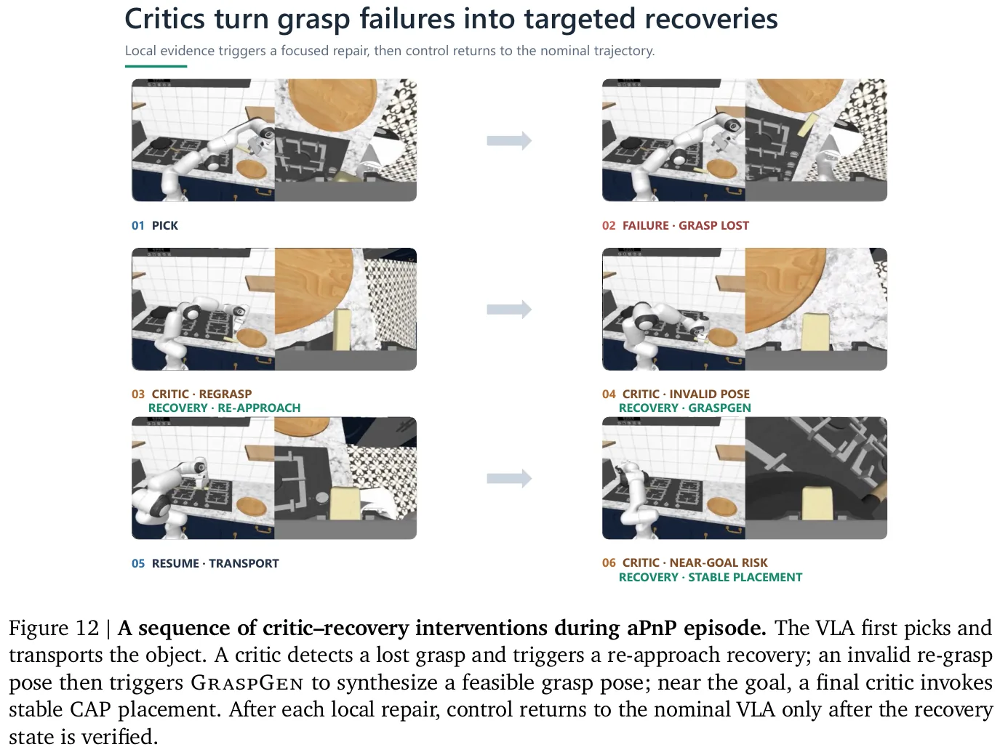
<figcaption>Record of critic-recovery cascade interventions in a single rollout: when an object is detected slipping off during transport, a re-approach is triggered immediately; when an invalid pose is detected, GraspGen is called to generate a new one; in the final stage, a smooth placement recovery is called</figcaption>

#### ③ Worked analysis and a self-drawn architecture diagram
{: id="-卡点降维与自制架构图"}

**Question 1: Why can't physical interaction be solved by post-mortem reflection? How does Zetta's fine-grained closed loop actually work?**

The Mermaid dual-loop diagram below shows how Zetta's online, millisecond-level interception and offline, minute-level self-evolution work together:

```mermaid
graph TD
    subgraph Online ["Online high-speed execution loop (millisecond scale)"]
        Obs["Real-time sensor observation s_t"] --> Policy["Frozen action policy π (VLA)"]
        Policy --> Action["Predicted control action a_t"]
        Action --> Critic{"High-frequency runtime critic C monitors"}
        Critic -- "Nominal" --> Exec["Execute the action physically"]
        Critic -- "Anomaly triggered (Slip/Collision)" --> Intervene["Pause the action, call recovery R"]
        Intervene --> Tool["Toolset T (such as GraspGen / Re-approach)"]
        Tool --> Exec
        Exec --> StatusCheck{"Is the episode over?"}
        StatusCheck -- "Not over" --> Obs
        StatusCheck -- "success/failed" --> Buffer["Save to the trajectory pool"]
    end

    subgraph Offline ["Offline evolutionary self-healing loop (minute scale)"]
        Buffer --> Cluster["Phase I: failure-trajectory clustering and stage slicing"]
        Cluster --> Diagnosis["Phase II: top-down causal diagnosis (E -> C -> S -> P -> R)"]
        Diagnosis --> Patch["Synthesize reusable critic / recovery-skill code"]
        Patch --> Test{"Validation guard: replay the original failed seed"}
        Test -- "Verification passed" --> Generalize["Phase III: abstract and merge into a new version H_merged"]
        Generalize --> Online
    end
```

**Question 2: What is the "aha moment" of embodied physical intelligence?**

In embodied self-evolution, many readers easily assume that a policy's success rate rises smoothly and linearly with the amount of interaction data. Zetta reveals a phenomenon that is physically very instructive:

|Evolution stage|Repair type|Typical behavior|Success rate|Underlying reason|
|---|---|---|---|---|
|**Round 0 (initial)**|Pure frozen VLA, open-loop|Grasping air, slipping, and the end effector hitting the table hard|0%-15% (very low)|No physical interaction feedback at all|
|**Round 1 (initial exploration)**|**Symptomatic fixes**|Relax the time budget, add more retries, raise the gripper closing threshold|5%-15% (**stagnant plateau**)|The root cause of the physical failure is untouched, and errors still occur during transport|
|**Round 2 (aha moment)**|**Root-cause repair**|Evolves `Pre-grasp Staging` (front-space pose alignment) and `Grasp Retention Critic` (high-frequency interception of slip-off)|**Soars instantly to 90%-95%**|Completely resolves the line-of-sight occlusion and the initial normal-vector misalignment as the arm reaches down|

> **Example (the aha-moment derivation for putting a wine bottle onto a plate)**:
> The task requires a robot arm to place an upright red wine bottle smoothly onto a plate.
> - **Stage 1 (pure VLA)**: It lunges directly at the bottle neck and often knocks the bottle over because of reflections and viewpoint deviation, for a success rate of only 5%;
> - **Stage 2 (symptomatic fixes)**: The evolution agent makes the arm retract quickly after a failed grasp and retry at a higher speed. But the bottle has already been knocked askew, so the next descent misses again, and the success rate hovers around 10%;
> - **Stage 3 (aha moment)**: Through causal diagnosis, the evolution agent finally identifies the fundamental contradiction: "The bottle is slender. If no pre-aligned pose is established from the side, a direct dive will inevitably hit the bottle mouth." Zetta then automatically synthesizes two cooperating mechanisms:
>   1. `Pregrasp Staging`: The arm first hovers 5 cm directly in front of the bottle and levels the wrist;
>   2. `Retention Critic`: During lifting it monitors the end-effector tilt angle in real time and immediately decelerates and fine-tunes if a slip occurs.
> After the patch is loaded, the success rate on this task **jumps from 10% to 90%**, truly breaking through the physical bottleneck!

---

### 3. Results and findings
{: id="3-核心结果发现-3"}

Zetta is evaluated systematically on LIBERO-Pro, a widely used embodied manipulation benchmark, and on the RoboCasa kitchen long-horizon benchmark, and compared comprehensively with the latest end-to-end baselines and agent systems.

  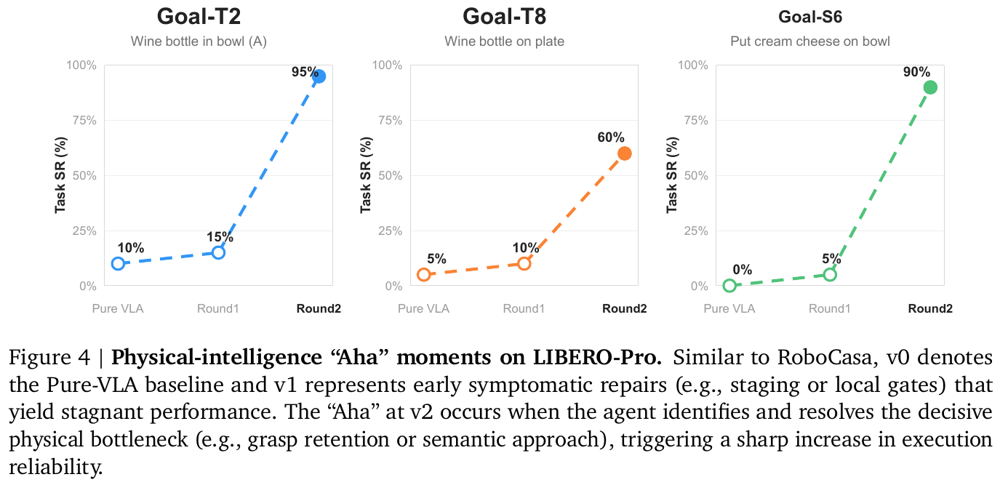
<figcaption>The "aha moment" of physical intelligence on LIBERO-Pro: initial temporary fixes keep performance stagnant for a long time; once the root cause is located and the key critic-recovery mechanism is generated, the success rate rises sharply</figcaption>

#### ① Strong task success rates and self-evolution scalability
{: id="-卓越的任务成功率与自演化扩展性"}

- **LIBERO-Pro simulation benchmark**: On the most challenging perturbation tests, the pure $\pi_{0.5}$ policy reaches a success rate of only 34.5%, whereas Zetta, after several rounds of autonomous closed-loop evolution, raises it substantially to **90.8%**;
- **RoboCasa virtual kitchen benchmark**: On complex long-horizon tasks such as opening hinged cabinet doors, operating kitchen appliances, and organizing items, the base model GR00T has a success rate of 73.6%; after Zetta's autonomous evolution it reaches **93.6%**;
- **Continued evolutionary gains**: Experiments show that as the pool of concurrent rollout experience accumulates, the self-evolution curve keeps rising, breaking the performance deadlock that traditional fixed policies hit under data bottlenecks.

  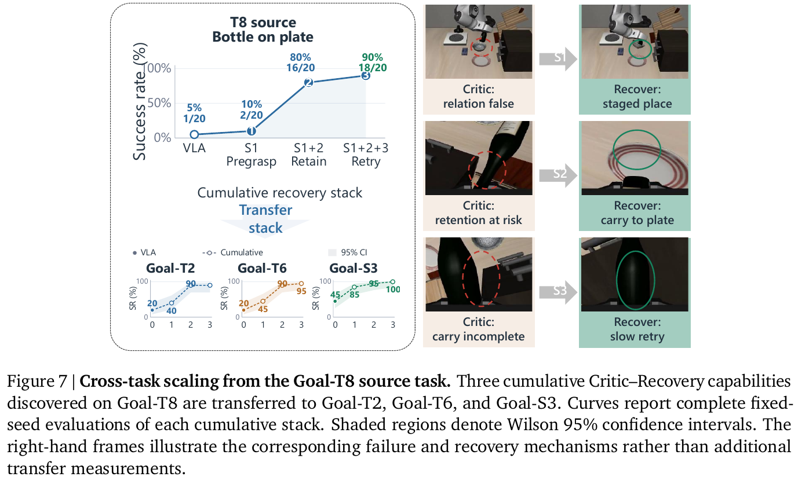
<figcaption>Verification of zero-shot cross-task skill transfer: the pre-grasp, grasp-retention, and retry skill stack distilled on the source task (Goal-T8, the wine-bottle task) transfers plug-and-play, without fine-tuning, to the unseen target tasks (Goal-T2, T6, S3)</figcaption>

#### ② Zero-shot cross-task skill transfer
{: id="-零样本跨任务技能迁移"}

The critic and recovery skills learned through evolution on a single task are not isolated overfits but have strong physical generality:
- The skill stack of aligned approach, re-grasp after dropping, and buffered placement, evolved on RoboCasa's `PnP-Stove` (stove pick-and-place), transfers zero-shot to the sink task (`PnP-Sink`), where the success rate jumps from 58% to **82%**; to the cabinet task (`PnP-Cabinet`), from 62% to **80%**; and to the toaster task (`PnP-Toaster`), from 72% to **90%**.

#### ③ Engineering efficiency gains from Z-Infra
{: id="-z-infra-带来的工程效率质变"}

- **20.6x higher throughput**: By decoupling the environment simulation nodes from the model inference resource pool, Z-Infra raises the effective trajectory sampling throughput from 1.7 episodes/min to **35.1 episodes/min** at 64-way concurrency, 7.7 to 12.8 times ahead of existing baselines;
- **91% lower latency**: End-to-end decision latency drops by 91% (up to 11.1x faster), removing at the engineering level the latency shackles on large-model agents taking part in the physical real-time closed loop.

---

### 4. Limitations
{: id="4-局限性-3"}

1. **Reliance on resettable simulators or digital twins**: Offline autonomous evolution needs multiple in-place replays of failed random seeds and patch verification. It currently runs most smoothly in simulation and in high-fidelity digital twins that can be reset. Autonomous trial and error in purely real physical scenes, where damage is entirely irreversible, remains risky;
2. **Search boundary of automatic high-frequency critic code synthesis**: For highly nonlinear, non-rigid, and extremely complex fluid or cloth manipulation, the automatically generated heuristic critics and recovery action space can hardly cover all dynamic physical boundaries.

---

## 5. Show-Harness (2026)
{: id="show-harness"}
———A VLM agent is all it takes to play robots

📄 **Paper**: [arXiv:2609.10522](https://arxiv.org/abs/2609.10522) · [Project Page](https://showlab.github.io/Show-Harness)

---

### Key takeaways
{: id="精华-4"}

- **A "semantic action unit" interface for the embodied harness**: Robot control is rewritten as a set of discrete, interpretable semantic symbols (`MV_FWD` / `ROTATE_CW` / `GRASP`...). At each step the VLM emits just one symbol, and an embodiment-specific interpreter deterministically carries out a small segment of real motion: **semantics are left to the model, and metrics to the interpreter**. The two sides are fully decoupled, so the model always stays in charge of fine-grained physical decisions.
- **The same interface serves compute at both ends**: A closed-source frontier VLM can drive the robot zero-shot (cross-task 89.0%), and a 2B open-source small model can learn the same action vocabulary (86.0%) with rank-64 LoRA and a single H200 in under two hours of fine-tuning. The key is that semantic action prediction uses the VLM's native vocabulary, with **no added action head and no special tokens**.
- **"Symbol + increment" enables adaptation without retraining**: To change the precision, only the interpreter step size changes (2 cm to 1 cm, ZS 60% to 80%); to change the robot, only the interpreter changes. The unseen 90° rotation is handled by repeating the 15° unit 6 times (70% vs. 20% for $\pi_{0.5}$). The model parameters stay unchanged throughout.
- **The real source of the interface's effectiveness is the plain-text convention, not the symbol names**: A 2x2 ablation shows that arbitrary symbols A-F paired with a direction convention still reach 95%, while symbols given without a convention plummet to 5%. The direction mapping a model infers on its own through trial is only 23.3% correct (16.7% is random), and the confusion matrix shows left and right largely mirrored.
- **GUMI: a data-collection interface that exposes the action vocabulary as web-page buttons**: A human using the keyboard, a computer-use agent clicking on the same page, and a general VLM predicting symbols directly all share the same action space. No dedicated teleoperation hardware is needed, and one demonstration can train both a semantic action policy and a continuous control policy. It also naturally supports cross-embodiment reuse and mixed human-machine collection.

---

### 1. Background and problem
{: id="1-研究背景问题-4"}

Foundation VLMs already hold most of the knowledge needed for robot manipulation (recognizing objects, judging spatial relations, decomposing long-horizon goals), but this knowledge never reaches the joints. The two existing paths each have a cost. VLA fine-tunes a VLM into a continuous action regressor, compressing semantics into an uninterpretable "pixels to actuators" mapping, so data must be collected again whenever the task, environment, or embodiment changes. Hierarchical and skill-library agents let the VLM only issue subgoals or select skills and leave physical execution to a downstream controller, so the model "says it but never sees it done," and every intermediate representation is tied to a carefully engineered grounding pipeline.

The authors' judgment is that what is missing is not model capacity but an **action interface that is both friendly to a VLM's semantics and fine-grained enough to control the physical action space directly.**

---

### 2. Methods and innovations
{: id="2-主要方法创新点-4"}

  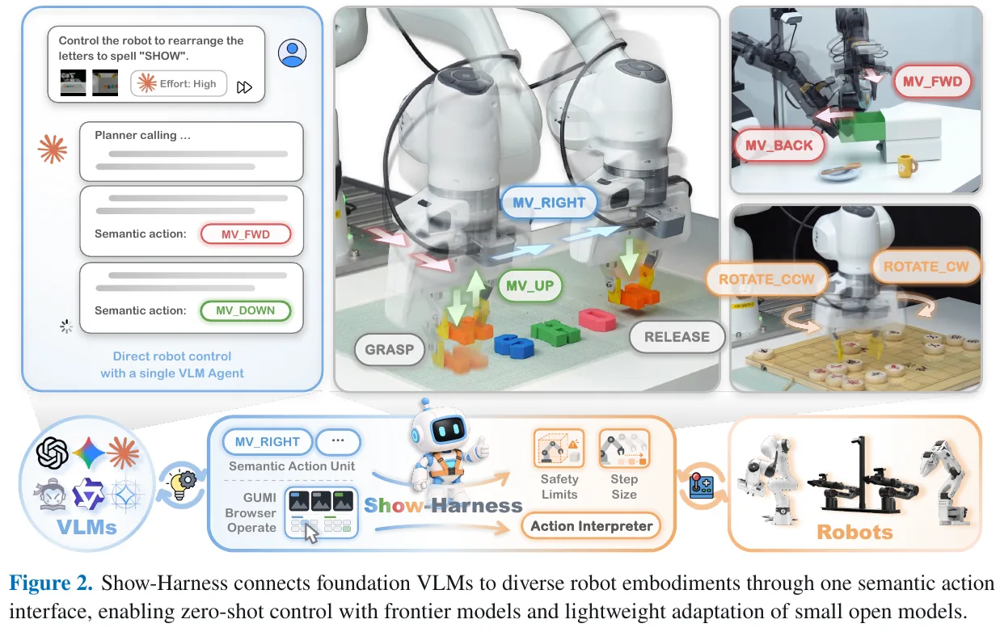
<figcaption>Show-Harness connects a frontier VLM to different robot embodiments through one semantic action interface: the model outputs only symbols such as MV_RIGHT, and the action interpreter enforces safety bounds and step sizes before translating them into each embodiment's low-level commands</figcaption>

#### ① Overall framework
{: id="-整体框架概述-3"}

Show-Harness has three parts: the **semantic action interface** (the action vocabulary $$\mathcal A$$ the model sees), the **embodiment interpreter** (which deterministically translates symbols into robot motion), and the **embodied harness plug-in loop** (which organizes perception, reasoning, and action into a configurable closed loop). It also comes with **GUMI**, a data-collection interface that exposes the same action vocabulary as web buttons. The data flow in one sentence: multi-view images and the embodiment state are first organized into a context by the perception plug-ins; the reasoning plug-ins split the task into visually verifiable subtasks and decide the step size for this step; on that basis the VLM emits **one** semantic action unit; the interpreter converts it into a small displacement, and the execution result flows back into the next observation.

#### ② Semantic action interface: the model only needs to recognize 11 symbols
{: id="-语义动作接口模型只需要认-11-个符号"}

The action vocabulary $$\mathcal A$$ is a compact set of semantic units:

- **Translation**: `MV_FWD` / `MV_BACK`, `MV_LEFT` / `MV_RIGHT`, `MV_UP` / `MV_DOWN`, with directions defined relative to the currently selected reference view;
- **Rotation**: `ROTATE_CW` / `ROTATE_CCW`, each with a rotation axis ($x$ / $y$ / $z$);
- **Gripper and termination**: `GRASP`, `RELEASE`, `DONE`.

The authors deliberately designed this vocabulary around three properties:

1. **Incremental**: Each unit causes only a small, local physical change. The benefit is that the model always stays "in the loop": it sees the effect of its previous step in the next frame and approaches the target accuracy through continuous fine adjustment, instead of planning a whole trajectory at once.
2. **Interpretable and embodiment-agnostic**: Actions are symbols rather than numeric targets, and embodiment-specific low-level control is pushed down into the interpreter, so the space the model faces can be fully reused across robots.
3. **Visually anchorable**: Directions are defined relative to an observable view, so spatial reasoning maps directly onto action selection.

#### ③ Embodiment interpreter: how symbols become real displacements
{: id="-本体解释器符号如何变成真实位移"}

Each decision $$a_t \in \mathcal A$$ is handed to the embodiment-specific interpreter $$g_E$$, which maintains a 6-DoF Cartesian pose set point $$s_t = (\mathbf x_t, Q_t)$$ and updates it as follows:

$$s_{t+1} = \Pi_E\big(\mathbf x_t + \sigma_t R_E d_a,\ \exp(\theta_t [R_E r_a]_\times)\, Q_t\big)$$

Here, $$d_a$$ and $$r_a$$ encode the translation direction and rotation axis respectively (a translation unit has $$r_a = 0$$, a rotation unit has $$d_a = 0$$, and $$r_a \in \{\pm e_x, \pm e_y, \pm e_z\}$$); $$\sigma_t$$ and $$\theta_t$$ are the calibrated translation and rotation increments; $$R_E$$ maps the semantic direction into the motion coordinate frame of embodiment $E$; $$[\cdot]_\times$$ is the skew-symmetric matrix operator; and the projection $$\Pi_E$$ enforces limits on the workspace, tabletop height, and single-step magnitude, so out-of-bounds actions are blocked before execution. Gripper units skip the pose update and map directly to open and close commands.

> **Example (the full execution of one MV_RIGHT)**: The VLM emits `MV_RIGHT`. The interpreter's current set-point position is $$\mathbf x_t = (0.40,\ 0.00,\ 0.25)$$ m. A table lookup gives $$d_a = +e_y$$, $$r_a = 0$$; Franka's $$R_E$$ maps "right relative to the reference view" to $$+y$$ in the base frame; the target has entered the wrist field of view, so the fine step $$\sigma_t = 0.02$$ m is used. The new position is $$(0.40,\ 0.02,\ 0.25)$$ with the orientation unchanged. $$\Pi_E$$ checks again: not outside the workspace and not below the tabletop, so it passes. At the lowest level, Franka follows the Cartesian set point with impedance control, AgileX uses inverse kinematics plus a joint-target stream, and the simulator issues an operational-space command. The same `MV_RIGHT` means "2 cm to the right" on all three systems. For a new robot, the only thing to write is this interpreter.

#### ④ Differences from the two existing routes
{: id="-和现有两条路线的差别"}

This step is the argument of the whole paper, and a table conveys it best:

|Dimension|VLA (π0.5 / GR00T)|Hierarchical / skill-library agent|Show-Harness|
|---|---|---|---|
|What does the VLM output?|Continuous action chunks (regression / diffusion / flow matching)|A subtask description or a skill call|A semantic action unit|
|Who makes fine-grained physical decisions?|The model, but compressed into an uninterpretable perception-to-actuation mapping|A downstream controller or VLA, with a process invisible to the model|The model itself, which sees the result of every step|
|What changes when swapping the robot?|Re-collect data and re-fine-tune|Rewrite the skill library and the grounding pipeline|Only the interpreter|
|What changes to raise the precision requirement?|Collect a batch of fine-motion data and retrain|Depends on the low-level controller's capability|Change the interpreter step size from 2 cm to 1 cm|

#### ⑤ Embodied harness: how nine plug-ins are chained in one step
{: id="-embodied-harness九个插件如何串成一步"}

  
<figcaption>Show-Harness architecture: three groups of configurable plug-ins (perception, reasoning, action) form a closed loop around the central VLM. Pink marks the reasoning flow, green the action flow, and dotted boxes the optional plug-ins enabled on demand.</figcaption>

The perception and reasoning plug-ins turn the raw observation into a "refined context" $$c_t = \Phi_{\mathcal P}(\ell, o_t, h_t)$$ ($\ell$ is the language instruction, $o_t$ the multi-view observation, and $h_t$ the interaction history), and the VLM selects the action $$a_t = \pi(c_t)$$ on this context. The nine plug-ins divide the work as follows:

**Perception**
- **Multi-view guidance**: Tells the VLM how to use each camera: the global first- or third-person view for scene-level context, and the wrist view for detailed evidence during close-range alignment.
- **Proprioception**: Translates the robot's internal state into short text, including the gripper's height above the table, how far it will move in a single step, phase hints (descend first if still too high), contact status, and the gripper's open/close state.

**Reasoning**
- **Subtask planning**: First lets the VLM act as a planner and split the instruction into ordered subtasks. Each subtask has a **completion criterion that can be checked directly against an image**. During execution, each step compares the current image against it to decide whether the criterion is met: if not, it keeps working; if so, it announces the advance.
- **Situated planning** (off by default): Defers a **branch decision** that currently lacks information, and resolves it once the relevant evidence becomes visible during execution. It suits conditional tasks such as "which of the three cups is the block hidden in?", avoiding planning every branch up front.
- **Action chunking**: When the target is still far away and fine-grained feedback is unnecessary, the VLM may emit a short series of actions at once for open-loop execution, reducing the frequency of model calls.
- **Adaptive step**: Uses a fine 2 cm step when the target appears in the wrist view, and a coarse 4 cm step otherwise.
- **Visual prompt** (off by default): Uses a dedicated model call to convert a goal that is hard to define in language, such as "grasp the cup handle," into a visual marker on the image, and later inference anchors directly on this marker.

**Action**
- **Action history**: Carries the last 5 actions into the next step's context, with a usage hint "Don't swing back and forth between opposite directions," providing lightweight memory for stepping.
- **Failure recovery**: Automatically detects a failed grasp, resets the gripper state, and rolls back to the corresponding grasp subtask to start again.

The order of these plug-ins within one interaction step is as follows:

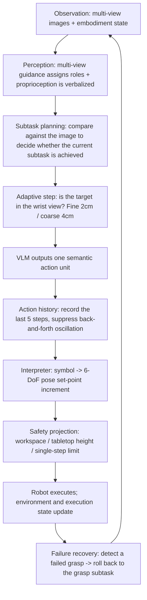

#### ⑥ One interface, two usage modes
{: id="-同一个接口两种用法"}

**ZS mode (a frontier VLM as a zero-shot agent)**: The closed-source frontier model needs no fine-tuning and controls the robot directly through the harness. The advantage is that the robot's capability rises automatically as later models get stronger.

**FT mode (a fine-tuned small open-source model)**: The same action vocabulary can also be used to train a small model. Given demonstrations $$\mathcal D$$ collected in the same action space, the policy minimizes the token-level cross-entropy of the target unit:

$$\min_{\theta}\ \mathcal L(\theta) = -\sum_{(\ell, o, h, a) \in \mathcal D} \log \pi_\theta\big(a \mid \Phi_{\mathcal P_{\min}}(\ell, o, h)\big)$$

Here $$\mathcal P_{\min}$$ is deliberately trimmed to the thinnest context (only the instruction, the multi-view observations, and a short action history) to keep the comparison controlled. The key is that **semantic actions are predicted with the VLM's own native vocabulary**, with no extra action head and no special tokens, so a rank-64 LoRA (freezing the visual encoder and multimodal projection layer and updating only about 3% of the parameters) is enough. Qwen3.5-2B can be trained on a single H200 in under 2 hours, and a 24GB-class GPU can also run it.

#### ⑦ GUMI: turning the action vocabulary into a web page
{: id="-gumi把动作词表变成一个网页"}

  
<figcaption>GUMI interface: each semantic action unit corresponds to a button with a shortcut key. A person can "drive" the robot from the keyboard, and a computer-use agent can operate the same web page directly. Each arm has its own set of keys, and action queuing and submission are supported</figcaption>

Because the action space is discrete and directly operable by humans, the authors conveniently turned it into a graphical interface, GUMI. Each unit is mapped to a button with a shortcut key: a human can control it with the keyboard, a computer-use agent can click on the same page, and a general VLM agent can predict the symbols directly. At every step GUMI records the pair of "pre-execution observation + selected semantic action" $$(o_t, a_t)$$, which is naturally a training sample. Because the interpreter is deterministic, the same rollout also leaves behind the low-level commands and trajectories as a by-product, so **one demonstration can train both a semantic action policy and a continuous control policy**.

Compared with collection pipelines that depend on dedicated teleoperation hardware or simulator-specific control, GUMI needs no special hardware. It supports single-step control, action queuing, single-arm operation, and hybrid collection in which humans step in to correct an agent's rollout. The same demonstrations can be reused across embodiments that implement the same set of units, and remote collection is also supported (the operator need not be next to the robot).

---

### 3. Results and findings
{: id="3-核心结果发现-4"}

**Experimental setup**: Two real robots: a 7-DoF Franka Research 3 (one external RealSense D435 facing the workbench plus one wrist D405) and a dual-arm AgileX (two 6-DoF arms, with one shared overview camera and one wrist camera per arm, three Orbbec Dabai DC1 in total). The tasks are 5 objects (cube, banana, tennis ball, teddy bear, chess piece) x 2 containers (plate, bowl) = 10 pick-and-place tasks, with 10 trials of random placement per task, and a single episode fails on timeout after at most 50 steps. The FT-mode demonstrations cover only the cube, banana, and tennis ball, leaving the teddy bear and chess piece out of distribution. ZS uses Gemini-3.1 Pro by default (medium thinking effort), and FT uses Qwen3.5-2B by default. The demonstrations total 164 real-robot episodes (7.8K decision steps) plus 230 simulated episodes (13.5K steps, from ManiSkill and RoboLab).

On the three levels of generalization, **ZS and FT lead clearly** (success rate, average):

|Generalization level| π0.5 | GR00T | Harness-VLA | Goal-VLA | CaP-X | RATS | **ZS** | **FT** |
|---|---|---|---|---|---|---|---|---|
|Cross-task (10 tasks)| 39.0 | 35.0 | 50.0 | 13.0 | 44.0 | 57.0 | **89.0** | **86.0** |
| Cross-Environment | 40.0 | 34.0 | 63.8 | 15.0 | 52.5 | 65.0 | **100.0** | **88.0** |
| Cross-Embodiment | 41.0 | 36.0 | 49.0 | 11.0 | 43.0 | 52.0 | **93.0** | **87.0** |

A few points deserve separate mention. The advantage also holds for the teddy bear and chess piece, which **do not appear in the fine-tuning data** (ZS gets 10/10 on the chess-piece task, while π0.5 gets only 1/10). In the **sim-to-real** setting, FT trained only on simulated demonstrations gets 13/20, while π0.5 and GR00T, also fed only simulated data, get 0/20. For **cross-embodiment**, ZS only needs a different interpreter, and FT is evaluated directly on each embodiment after joint training on data from both arms.

  
<figcaption>Capability analysis: the upper four boxes cover physical adaptability (fine control, rotation extrapolation, action composition, workspace offset), and the lower three cover multi-arm collaboration and semantic adaptability (reasoning-intensive tasks, video in-context learning)</figcaption>

**Physical adaptability: change the interpreter, not the model**

- **Fine control**: On block stacking and latch tasks, just changing the interpreter step size from 2 cm to 1 cm, with no change to the interface and no retraining, raises ZS from 60% to 80% and FT from 40% to 65%. π0.5 trained on the same demonstrations reaches only 15%, and needs an extra batch of fine-motion data to reach 60%.
- **Action composition**: Merging two orthogonal translation units into one diagonal displacement is purely an interpreter matter. ZS uses 26% fewer steps per episode and FT 24% fewer, while the success rate drops only slightly, from 94%/84% to 92%/82%.
- **Rotation extrapolation**: See the example below.
- **Workspace offset**: Expanding from the core 25% region (S@1) to 90%, close to the boundary (S@3), ZS declines only slightly, from 98% to 92%, and FT from 88% to 82%, while π0.5 collapses from 48% to 24%.
- **Multi-arm collaboration**: On the two AgileX arms, joint action prediction for "clearing the table" reaches 90% (0 collisions), while two independent single-arm agents manage only 70% each (1 collision). The gap is even larger on "passing a banana," which requires a handover: 70% jointly (0 collisions) versus 30% independently (3 collisions).

> **Example (rotation extrapolation)**: Each `ROTATE_CW` rotates only 15°. In the training demonstrations the carrot was rotated only through 0° and 45°, but at test time it must be rotated to an unseen 90°. The model does not need to have "seen 90°"; it just emits 6 consecutive `ROTATE_CW` units to get there. FT reaches 70% at 90°, whereas π0.5, which regresses continuous actions directly, reaches only 20%: the regressed angle is locked into the training distribution, while incremental units can extrapolate through repeated composition. Incidentally, if the rotation units are removed from the vocabulary, the success rates at 45° and 90° drop to 50% and 10%.

**Semantic adaptability: preserving the VLM's flexibility in following instructions**

- **Reasoning-intensive tasks** (finding which of three inverted cups hides the cube, and arranging scattered letters to spell "SHOW"): ZS with situated planning enabled reaches 85%, while FT and π0.5 run alone reach only 10% and 0%. Given the same subtask instructions generated by Gemini, FT rises to 70% while π0.5 still gets only 5%.
- **Video in-context learning**: The robot must collect three objects in the order shown in a demonstration video. Without a demonstration, ZS gets only 20% (the order is unknown to begin with). Given a human or robot demonstration video, both sources reach 20/20. FT gets 90% from both sources when given the task outline extracted by the same planner.

  
<figcaption>Ablation of the nine plug-ins (real Franka + Gemini-3.1 Pro zero-shot): in the default configuration each plug-in is left out in turn, while visual prompt and situated planning are added on top of the default configuration and evaluated in special scenarios. The full-configuration baseline is 96%</figcaption>

**Plug-in ablation** (full configuration 96%):

- **Multi-view guidance**: Using only the global view drops it to 58%; the wrist view is nearly indispensable for fine alignment of small objects.
- **Proprioception**: Removing it drops the rate to 68%. Compact signals such as gripper height and contact status give reliable guidance when appearance or depth makes visual judgment slip.
- **Subtask planning**: Removing it drops the rate to 60%. A typical failure is **dragging the object toward the plate without lifting it**; this problem disappears only once the sequence is broken into stages that are locally valid and image-verifiable.
- **Action chunking**: Turning it off still gives 96% but needs 32 model calls; forcing chunking throughout cuts the calls to 20 (-38%) but drops the rate to 74%. The conclusion supports **selective chunking**: compress redundant transport segments and keep fine-grained feedback before and after contact.
- **Adaptive step**: Fine steps only give 82% (38 steps, easy to hesitate); coarse steps only give 70% (22 steps, easy to overshoot); adaptive switching based on target visibility gives 96% (30 steps).
- **Visual prompt**: Essentially ineffective on regular tasks (96% vs. 94%), which supports leaving it off by default; but on "grasp the cup handle" it improves from 40% to 85%. Note that drawing the marker without aligning it to the language gives only 35%, so **the gain comes from explicitly aligning the language instruction with the marked interaction point, not from the marker itself**.
- **Situated planning**: No effect on regular tasks; on hidden-object search it raises the rate from 35% to 85%.
- **Action history**: Removing it drops the rate to 76% and raises the step count from 30 to 39. Most failures are oscillations between opposite actions.
- **Failure recovery**: Removing it drops the rate to 72%. The main failure mode is an undetected empty grasp, after which the robot carries the empty gripper through the rest of the process.

  
<figcaption>2×2 ablation of action-space representation: the horizontal axis is whether there is an explicit plain-text convention, and the vertical axis is semantic names versus arbitrary symbols; the right side is the direction-mapping confusion matrix inferred by the model under setting (D), in which left and right are largely mirrored</figcaption>

**The most interesting ablation: what does grounding the action symbols actually depend on?** The authors keep the rest of the harness fixed and change only the representation of the six translation units, running a 2×2 comparison:

| |With explicit convention|Without explicit convention|
|---|---|---|
|**Semantic name** (`MV_LEFT`...)|(A) **100%**, 25 steps|(B) 90%, 34 steps|
|**Arbitrary symbol** (A-F)|(C) **95%**, 27 steps|(D) **5%**, 49 steps|

The takeaway: **the convention provides most of the grounding, and the semantic name is merely a useful prior**. An arbitrary symbol paired with an explicit description of "where this symbol moves the end effector" (C) performs almost the same as the default configuration. Conversely, giving only semantic names without a convention (B) still works but is noticeably less efficient. In setting (D) the model can only probe on its own: it emits an unknown symbol, compares observations before and after, and guesses its effect. Only 1 of 20 episodes succeeded, the inferred mapping was only 23.3% correct (random is 16.7%), and left and right were largely mirrored in the confusion matrix. **Relying on visual changes alone to infer action semantics is unreliable; writing the convention into the prompt is the key.**

  
<figcaption>Left: distribution of different frontier VLMs and thinking-effort settings in the success-rate versus step-count plane. Right: in the chess-piece placement task, the capability splits into planning and fine-grained alignment, and the bottleneck is clearly the latter</figcaption>

**Backbone model and thinking budget**: Zero-shot performance broadly follows the capability of the underlying model (Gemini-3.1 Pro > GPT-5.6-sol > Opus 5 > GPT-5.6-luna > Gemini-3.6 Flash). Raising the thinking effort **mainly reduces redundant interaction steps**: the gain in success rate is limited, while wall-clock time rises significantly (up to 3.4x for GPT-5.6-sol). Instruction following is very stable across all models, with more than 98% of responses producing valid action units. Breaking down the chess-piece placement task, **planning is not the bottleneck** (plan-correct is 80-95% for all three models); errors concentrate in fine grasping and placement (place-correct is only 70/30/15), and giving the target bounding box additionally improves it further, indicating that explicit visual grounding cues are very valuable.

**Fine-tuning backbone scale**: 2B is already very strong, and larger backbones mainly help on fine tasks such as stacking and latching. The 1B-scale model makes too many local fine adjustments near the target, which noticeably lengthens episodes, but the small model can beat larger ones on tasks such as tennis that require timely correction for moving objects. Overall, 2B balances accuracy and responsiveness.

  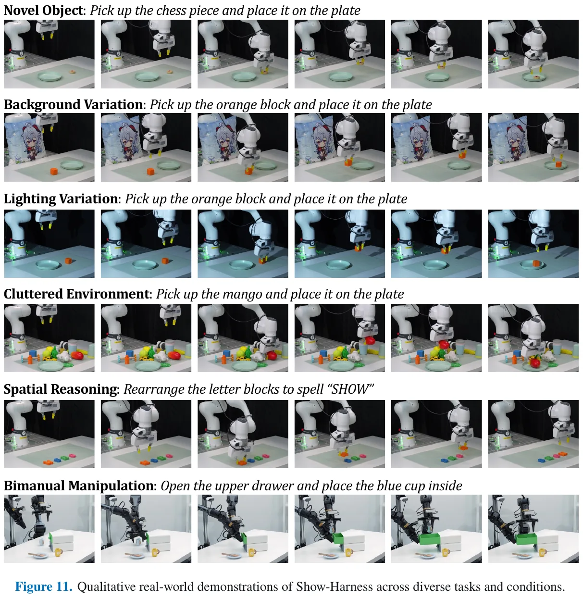
<figcaption>Qualitative real-robot results: new objects, background changes, lighting changes, cluttered scenes, spatial reasoning (placing letters to spell "SHOW"), and dual-arm coordination (opening a drawer and placing cups) are all accomplished through the same action interface</figcaption>

---

### 4. Limitations
{: id="4-局限性-4"}

1. **Limited embodiment coverage**: It has so far been verified only on single-arm (Franka) and dual-arm (AgileX) manipulation with parallel grippers. Extending it to embodiments with more degrees of freedom and more complex contact patterns, such as dexterous hands and humanoids, remains an open question;
2. **Single sensing modality**: The sensing side has only vision and embodiment state and lacks tactile and force feedback, so it still falls short on fine physical interaction that demands dense contact and compliant control.

---

## 6. SPACE (2026)
{: id="space"}
———Learning from programmatic skills when to act continuously and when to stop and observe

📄 **Paper**: [arXiv:2609.02042](https://arxiv.org/abs/2609.02042)

---

### Key takeaways
{: id="精华-5"}

- **The key to action blocks is the boundaries**: Outputting several actions at once reduces the number of large-model calls, but the policy must also learn which actions can run consecutively and when it should stop to get a new observation.
- **Using skill structure for supervision**: SPACE summarizes composite skills and sub-skills from successful trajectories and turns sub-skill call boundaries into action-block boundaries, supplying the temporal structure that terminal rewards can hardly provide directly.
- **Skills during training, direct action at deployment**: Skill calls are expanded into ordinary action-block samples and trained together with data the policy samples on its own. The final policy does not need access to the skill library.
- **Comparing both the whole trajectory and the local state**: The trajectory-level advantage measures the final outcome, while the block-aware step-level advantage compares returns discounted by decision round under the same anchor observation, so the learning signal accounts for both success and decision efficiency.
- **The gains have a clear experimental scope**: In the text-interaction settings of ALFWorld and ScienceWorld, SPACE improves on the strongest baseline in each setting by 7.0-31.3 percentage points and reduces the number of LLM decision rounds.

---

### 1. Background and problem
{: id="1-研究背景问题-5"}

ReAct-style agents usually generate a single atomic action per round, read the environment feedback after executing it, and then call a large model to decide the next step, so deterministic routines in long-horizon tasks require multiple model calls. Simply switching to output a variable-length action sequence in one go and then training with standard reinforcement learning does not necessarily learn well. The paper observes phenomena such as single-action collapse, overly long action blocks that lower the success rate, and unstable multi-action PPO training. The authors attribute the core difficulty to learning action-block boundaries: sparse terminal rewards lack supervision that directly signals "now is the time to pause and observe again."

  
<figcaption>Allowing multiple actions per output does not guarantee effective chunking: different backbone models exhibit single-action collapse and over-commitment, respectively</figcaption>

---

### 2. Methods and innovations
{: id="2-主要方法创新点-5"}

  
<figcaption>Programmatic skills are generated from successful trajectories. Skill calls are expanded into raw action blocks and trained together with directly sampled action blocks; only the action-block policy is kept at test time</figcaption>

SPACE (Skill-guided Policy with Adaptive Chunk Execution) consists of **two-level programmatic skills, hybrid trajectory sampling with skill expansion, and block-aware policy optimization**. The skills provide a reusable task decomposition, the expansion process turns the decomposition into training samples, and joint optimization absorbs this structure into a policy that outputs action blocks directly.

#### ① Action-block interface: fewer decisions while keeping the necessary feedback boundaries
{: id="-动作块接口减少决策次数保留必要的反馈边界"}

The policy first writes several actions at once, and an executor then runs them in order; this is action chunking. Given the interaction history $h_i$ of round $i$, the policy generates $u_i=(a_{i,1},\dots,a_{i,L_i})$ with $1\leq L_i\leq K$; the executor stops when the block is finished or an invalid action is encountered, and then the next LLM decision begins. The experiments set $K=6$.

|Dimension|Single-action policy|Plain multi-action RL|SPACE|
|---|---|---|---|
|Output per round|One atomic action|A variable-length sequence of atomic actions|A variable-length sequence of atomic actions|
|How boundaries are determined|Fixed split after every action|Learned mainly from the task reward|Formed from demonstrations that add sub-skill boundaries|
|Training data|Atomic-action trajectories|Action-block trajectories the policy generates itself|Self-generated action blocks plus skill-expanded action blocks|
|Test interface|Single action|Action block|Action block, no skill calls|

> **Example (illustrating the mechanism)**: If the refrigerator's location is known, the policy can first output "walk to the refrigerator and open it," wait for feedback confirming what is inside, and only then decide which object to take. If an object whose presence has not yet been confirmed is also written into the same block in advance, it may fail for lack of intermediate feedback. Boundary learning aims to resolve exactly this kind of trade-off.

#### ② Two-level procedural skills: turning successful experience into divisible routines
{: id="-两层程序化技能把成功经验变成可切分的例程"}

The **input** is a successful interaction trajectory. A large model divides it into task stages, generating one composite skill responsible for scheduling and several sub-skills (subskills) that carry out local routines. Each sub-skill contains a behavior description, a parameter schema, and an executable function, and the composite skill also records an ordered sequence of sub-skill calls. The generated code is checked for syntax, compilability, and function signatures, then normalized and deduplicated by its abstract syntax tree (AST), and the **output** goes into the skill library.

The two-layer structure provides a concrete basis for segmentation: the composite skill is responsible for a sequence like "find the object first, then heat it, then place it," each sub-skill call corresponds to one action block, and block boundaries form between calls. These boundaries are training demonstrations taken from the program structure; they are not claimed to be proven optimal boundaries for every state.

**Cold start and update**: Appendix A.2 states that manually curated initial skills are used, 3 for ALFWorld and 5 for ScienceWorld, as few-shot examples for subsequent skill induction. Retrieval prioritizes the matching task category and selects the top 3 composite skills by a UCB-style score that combines success rate and usage count; when no category matches, 7 sub-skills that are as diverse as possible are retrieved by description similarity. During training, skills are periodically summarized from new successful trajectories, with at most 20 composite skills per type, and entries with a long-term success rate of zero are purged.

#### ③ Mixed sampling and skill expansion: turning code calls into the deployment interface
{: id="-混合采样与技能展开把代码调用转换为部署接口"}

Training mixes two modes **per trajectory**. A fraction $\rho_{\mathrm{prim}}$ of trajectories use primitive-chunk mode, where the policy outputs action chunks directly, forming the on-policy data $\mathcal D_{\mathrm{on}}$. The remaining trajectories use skill-augmented mode, where the policy receives the retrieved skills and can either output raw action chunks or call skills.

So that the deployed policy outputs only atomic action sequences, skill-augmented trajectories are expanded through skill-to-chunk expansion:

- A raw action block that was output directly is kept as is.
- A sub-skill call is converted into a "current history, action block output by this sub-skill" pair.
- A composite-skill call is expanded into multiple samples following the order of its sub-skill calls; the history of each later sample contains the feedback after the previous action block was executed.

> **Example (showing only the segmentation)**: A composite-skill call executes 3 sub-skills in sequence, producing 2, 3, and 2 atomic actions respectively. After expansion we get three action-block samples of lengths 2, 3, and 2, each paired with the history at its boundary; these 7 actions are not merged into one block. The policy thus learns both the action content and where the block ends.

These expanded samples form the off-policy data $\mathcal D_{\mathrm{off}}$. Here "off-policy" refers to samples that were executed and rewritten through skills, rather than raw data the deployed policy collected directly through the same interface. They are generated continuously during training and do not necessarily come from a fixed, pre-collected dataset.

The default sampling ratio for raw action blocks is 0.5 on ALFWorld and 0.75 on ScienceWorld. Of the 8 trajectories per task, the former splits into 4 direct samples and 4 skill-augmented samples, and the latter into 6 and 2. Samples from both routes are finally aligned to the same interface, so the trained policy does not need to retrieve skills or execute skill functions.

#### ④ Block-aware credit assignment: comparing against the whole trajectory and against the same state
{: id="-块感知信用分配整条轨迹与相同状态分别比较"}

To judge whether an action deserves to be learned more or less, SPACE looks both at "how the whole trajectory turned out" and at "how later performance fares under the same observation," which is the chunk-aware two-level advantage. Let $M_\tau$ be the number of decision rounds in the unified action-block representation, $r(\tau)$ the terminal reward, and $\mathcal G$ the sampling group with the same task and initial conditions. The trajectory-level advantage is:

$$
A_{\tau}^{\mathrm{traj}}=\frac{r(\tau)-\mu_{\mathcal G}}{\sigma_{\mathcal G}+\epsilon}.
$$

For the $i$-th action block, first compute the reward **discounted by** the remaining decision rounds, then broadcast it to every action in the block:

$$
G_{\tau,i}=\gamma_c^{M_\tau-i}r(\tau).
$$

Next, take the anchor state key $z_{\tau,i,j}$ observed before the action is executed, collect the set $H(z)$ of action occurrences that share the same anchor, and normalize by that set's return mean and standard deviation:

$$
A_{\tau,i,j}^{\mathrm{step}}=
\frac{G_{\tau,i}-\mu_{H(z_{\tau,i,j})}}
{\sigma_{H(z_{\tau,i,j})}+\epsilon},
\qquad
A_{\tau,i,j}=A_{\tau}^{\mathrm{traj}}+\lambda_{\mathrm{step}}A_{\tau,i,j}^{\mathrm{step}}.
$$

> **Example (with made-up values, ignoring the stabilizing term)**: Two successful trajectories take one action at the same anchor, and both have terminal reward 1, but they need 1 and 3 later decision rounds respectively. With $\gamma_c=0.9$, the corresponding returns are 0.9 and 0.729. If the anchor group contains only these two samples, using the population standard deviation, the mean is 0.8145, the standard deviation is 0.0855, and the step advantages are +1 and -1. This local signal favors paths with fewer subsequent decisions. The raw returns of actions within the same block are identical, but their final advantages can still differ if their anchor comparison groups differ.

This is a way of assigning credit by relative return within a group; it cannot be claimed to identify accurately the causal contribution of each action. The problem statement in the paper uses success/failure terminal rewards, whereas actual ScienceWorld training uses scaled task scores according to Appendix A.2 and clips negative values to 0. The abstract setting and the concrete implementation should be distinguished.

#### ⑤ Joint training objective and inference procedure
{: id="-联合训练目标与推理流程"}

Raw action-block trajectories use a PPO-style clipped objective. Let $p_\theta(a_{\tau,i,j})$ denote the probability the policy assigns to this action given the history $h_i$ and the preceding actions in the block, and $q_{\tau,i,j}=p_\theta(a_{\tau,i,j})/p_{\mathrm{old}}(a_{\tau,i,j})$ the probability ratio between the new and old policies. Then:

$$
\mathcal L_{\mathrm{on}}=-\mathbb E_{\tau\sim\mathcal D_{\mathrm{on}}}
\left[\sum_{i=1}^{M_\tau}\sum_{j=1}^{\ell_i}
\min\left(q_{\tau,i,j}A_{\tau,i,j},
\operatorname{clip}(q_{\tau,i,j},1-\varepsilon,1+\varepsilon)A_{\tau,i,j}\right)\right].
$$

This term raises the probability of favorable actions while limiting the size of policy updates; following the original presentation, the KL regularization term is omitted here. The skill-expansion data uses an advantage-weighted self-imitation objective:

$$
\mathcal L_{\mathrm{off}}=-\mathbb E_{\tau\sim\mathcal D_{\mathrm{off}}}
\left[\sum_{i=1}^{M_\tau}\sum_{j=1}^{\ell_i}
w(A_{\tau,i,j})\log p_\theta(a_{\tau,i,j})\right],
\qquad w(A)=\operatorname{clip}(A,0,w_{\max}).
$$

This term keeps the imitation weights of positively advantaged samples and caps overly large weights, distilling the action blocks and boundaries obtained from skill expansion into the policy. The overall objective is:

$$
\mathcal L(\theta)=\mathcal L_{\mathrm{on}}(\theta)+\lambda_{\mathrm{off}}\mathcal L_{\mathrm{off}}(\theta).
$$

In the implementation, the advantage of each atomic action is broadcast to the output tokens corresponding to that action. By default, each training step samples 16 tasks with 8 trajectories per task, the learning rate is $10^{-6}$, the history length is 5, and both backbone models run in no-thinking mode.

The end-to-end procedure is: hybrid sampling → expanding skill trajectories → computing the two-level advantages → jointly updating the policy → periodically updating the skill library from successful trajectories. At test time the loop is simply "interaction history → variable-length action block → sequential execution → new feedback." The LLM is not re-invoked in the middle of a block, and the skill library and its retrieval and execution components no longer take part in inference.

---

### 3. Results and findings
{: id="3-核心结果发现-5"}

**Main results (Table 1, Table 2)**: SR is the success rate, and rounds is the average number of LLM decisions per episode. For each setting, the table below compares against the **baseline with the highest success rate**, avoiding mixing the success rate of one baseline with the lowest round count of another.

|Environment / backbone / split|Comparison baseline|Baseline SR → SPACE SR|Gain (percentage points)|Baseline rounds → SPACE rounds|
|---|---|---|---|---|
| ALFWorld / Qwen3-4B / Seen |GiGPO (SR tied with Multi-action GRPO)| 85.2% → 99.2% | +14.0 | 15.9 → 3.7 |
| ALFWorld / Qwen3-4B / Unseen | Multi-action GRPO | 81.3% → 96.9% | +15.6 | 20.9 → 4.4 |
| ALFWorld / Llama-3.1-8B-Instruct / Seen | GiGPO | 89.1% → 96.1% | +7.0 | 14.5 → 5.0 |
| ALFWorld / Llama-3.1-8B-Instruct / Unseen | GiGPO | 83.6% → 94.5% | +10.9 | 18.8 → 5.2 |
| ScienceWorld / Llama-3.1-8B-Instruct / Seen | GiGPO | 35.9% → 67.2% | +31.3 | 10.2 → 5.2 |
| ScienceWorld / Llama-3.1-8B-Instruct / Unseen | GiGPO | 34.4% → 61.7% | +27.3 | 10.1 → 5.8 |

For example, on ALFWorld Unseen with Qwen3-4B, decision rounds drop by about **78.9%**. By contrast, Llama's Multi-action GRPO itself needs only 5.4/5.5 rounds against SPACE's 5.0/5.2, so the main advantage there is that the success rate rises from 71.1%/65.6% to 96.1%/94.5%; this cannot be generalized to a 70% reduction in rounds against every multi-action baseline.

  
<figcaption>ALFWorld Unseen success-rate curve of Qwen3-4B, the number of actions per round for the two backbones, and the change in policy entropy; in the later stage, SPACE keeps roughly 3-4 actions per round</figcaption>

**Action-block behavior**: Multi-action GRPO on Qwen3-4B stays close to one action per round, while on Llama-3.1-8B-Instruct it drifts toward about 5-6 actions per round but with a lower success rate. In these experiments SPACE settles at an intermediate granularity of about 3-4 actions while keeping a higher success rate; this range is an experimental observation and should not be taken as a universally optimal block length.

**Component ablation (Table 3, ALFWorld/Llama-3.1-8B-Instruct)**:

|Training configuration|Seen SR / rounds|Unseen SR / rounds|
|---|---|---|
|Full SPACE| 96.1% / 5.0 | 94.5% / 5.2 |
|Without skills| 86.7% / 5.8 | 88.3% / 5.7 |
|Without block-aware advantage| 90.6% / 5.6 | 89.1% / 7.0 |

Removing either component lowers the success rate and increases the number of decision rounds, supporting the complementary roles of skill-based boundary supervision and block-aware optimization.

  
<figcaption>The left panel counts the LLM rounds sampled during ALFWorld training, not the number of tokens; the right panel compares the raw action-block sampling ratios on ScienceWorld, where 0.75 has the fewest decision rounds and 0.875 has a higher success rate</figcaption>

**Efficiency metrics must be distinguished by how they are counted**: In Figure 3(a), SPACE reaches the final performance of Multi-action GRPO at training step 40, about 26.6% of the training steps given in the paper's overview. Figure 4(a) counts **sampled LLM rounds in a different backbone setting**: SPACE needs 43.60K rounds to match GRPO's performance, while the whole GRPO run takes 564.54K, so SPACE uses about 7.72% (a 92.28% reduction); the entire SPACE run takes 104.46K. These values cannot be taken directly as total tokens, GPU time, or end-to-end training cost.

**Sampling-ratio trade-off**: In Figure 4(b), $\rho_{\mathrm{prim}}=0.75$ corresponds to a success rate of 64.5% and 5.51 rounds, and 0.875 to 66.4% and 6.84 rounds. The authors chose 0.75 as a compromise between success rate and efficiency. However, the text's statement that the success rate is also higher at that setting is inconsistent with the values in the figure; the figure's data are used here.

**Test-time search (Table 4)**: On the hard validation subset of ScienceWorld, with Best-of-N search at $N=8$, GRPO's success rate rises from 33.3% to 37.5% (+4.2 percentage points) and SPACE's from 52.1% to 60.4% (+8.3 percentage points); average LLM calls after adding search are 74.9 and 48.3 respectively. Single-action candidates are scored with a 3-step environment look-ahead, and action-block candidates are scored by executing the complete block. This result therefore depends on evaluation conditions that enable candidate look-ahead in the environment, and does not mean that the two methods incur the same environment-simulation cost.

---

### 4. Limitations
{: id="4-局限性-5"}

1. **Verified only in text-interaction environments**: The experiments cover only the text settings of ALFWorld and ScienceWorld, and ScienceWorld additionally excludes tasks whose optimal solutions exceed 100 environment steps. Visual input, continuous control, and real-robot scenarios have not been verified;
2. **Reliance on manually written cold-start skills and a skill-induction process**: The method requires manually written cold-start skills and keeps summarizing and executing skills during training. The paper's main efficiency metric is LLM decision rounds, so end-to-end training speedup including these extra processes cannot be inferred directly.

---

## 7. ABot-AgentOS (2026)
{: id="abot-agentos"}
——A general-purpose agent operating system and lifelong multimodal memory system for embodied intelligence

📄 **Paper**: [arXiv:2607.10350](https://arxiv.org/abs/2607.10350) · [Project Page](https://amap-cvlab.github.io/ABot-AgentOS)

---

### Key takeaways
{: id="精华-6"}

1. **Modular, layered, decoupled architecture**: ABot-AgentOS sits between the low-level robot controller and the high-level foundation VLM/VLA model, decoupling high-level semantic reasoning, skill execution, multi-level verification, and memory retrieval. This addresses the lack of explicit termination signals and the process drift of traditional monolithic controllers.
2. **Agent-harness closed-loop control**: It proposes a "reason-execute-verify" closed loop with global Main LLM planning, context-isolated local execution by the Skill Runner, and multi-stage runtime, skill-level, and finish-time verification by the Verifier, which markedly reduces false completion and blind stagnation on long-horizon tasks.
3. **Universal multimodal graph memory**: Speech, visual observations, spatial locations, temporal associations, and task trajectories are converted into strongly typed multimodal graph nodes and edges, supporting retrieval and local subgraph extraction with traceable evidence.
4. **Failure-driven lifelong self-evolution**: A trace-diagnosis-based mechanism turns failures into JSON-DSL assets under strict post-check gating, achieving cumulative self-evolution with zero ground-truth leakage in cross-split deployment.
5. **Embodied WorldBench**: The first executable evaluation benchmark spanning composite indoor and outdoor scenes, covering 16 scenes, 4 difficulty levels, and 200+ composite tasks, together with an end-to-end student-policy distillation pipeline based on a text sandbox and a self-evolution reward engine.

---

### 1. Background and problem
{: id="1-研究背景问题-6"}

Embodied AI is pushing artificial intelligence from the digital world into the physical world. In recent years, vision-language models (VLMs) and vision-language-action (VLA) models have given robots strong natural-language understanding, visual scene perception, and action prediction. A critical gap remains, however, between semantic understanding and reliable physical execution:
1. **Semantic beliefs disconnected from environmental facts**: On complex long-horizon tasks, existing end-to-end controllers or simple API calls lack explicit intermediate-state verification and termination signals. A robot may have issued a navigation command without actually moving, or may keep colliding locally while believing, at the language level, that the task is progressing normally.
2. **No general, cross-embodiment hardware abstraction for agents**: Existing systems are mostly tightly bound to specific robot forms or control interfaces and are hard to extend seamlessly to diverse hardware such as humanoids and quadrupeds.
3. **Memory that is hard to persist, trace back, or use for self-improvement**: There is no general multimodal memory system that persists across sessions, traces back to its sources, and improves itself from past interaction failures.

The paper therefore proposes **ABot-AgentOS**, a general-purpose robot agent operating system that runs above the low-level controller and decouples high-level cognition from physical action.

---

### 2. Methods and innovations
{: id="2-主要方法创新点-6"}

ABot-AgentOS consists of four modules: **edge-cloud collaborative dual LLM cores** for scheduling, the **agent-harness closed loop**, **general multimodal graph memory**, and an **end-to-end distillation training pipeline**.

  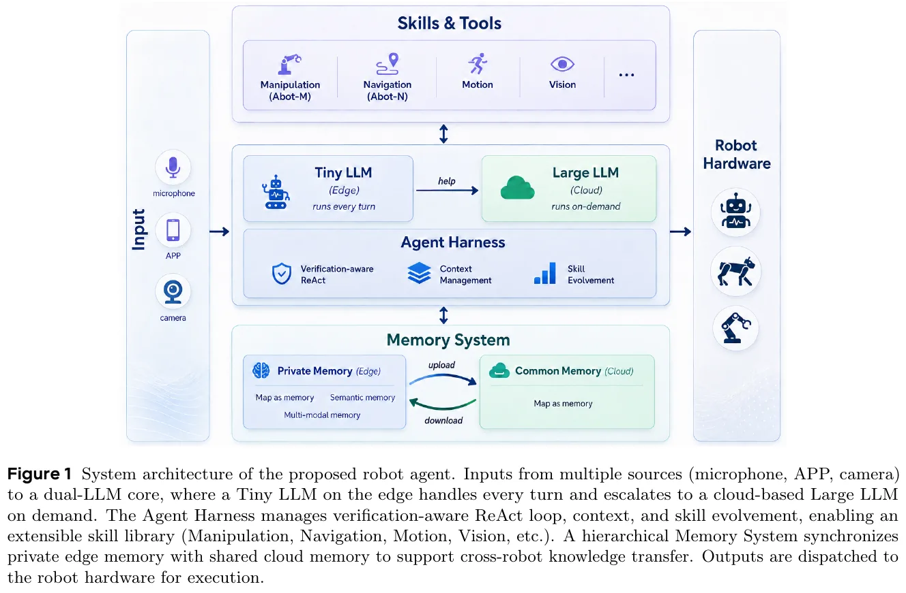
<figcaption>ABot-AgentOS overall system architecture: multi-source multimodal input is routed through the edge-cloud dual LLM cores, the agent-harness closed loop schedules skills and multi-level verification, and the system combines universal multimodal graph memory with the low-level controller</figcaption>

#### ① Overall framework and the edge-cloud dual cores
{: id="-整体框架与边云协同双核心"}

In its architecture, ABot-AgentOS distinguishes a lightweight edge model from a large cloud model (the dual-LLM core):
- **Edge tiny LLM**: Deployed on the robot, it handles routine conversation, simple tool calls, and real-time control instructions first, to keep response latency low.
- **Cloud large LLM**: When a task involves long-horizon complex reasoning, multi-step planning, or hard graph-memory retrieval, a learned routing policy automatically escalates it to the large cloud model.

#### ② Agent-harness closed-loop control
{: id="-agent-harness-闭环控制"}

The agent harness redesigns the traditional monolithic controller, splitting agent scheduling into three clearly decoupled roles:

  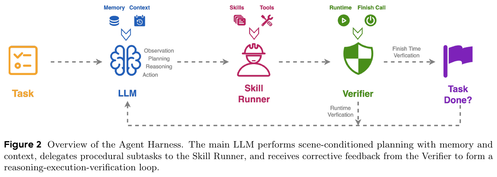
<figcaption>Details of the agent-harness architecture: the Main LLM handles scene-aware global planning, the Skill Runner isolates local execution details, and the Verifier provides multi-stage real-time and final verification</figcaption>

1. **Main LLM (semantic planner)**: Receives user instructions and the memory context and, given the current scene, generates an adjustable high-level plan with explicit completion conditions. Rather than emitting every footstep-level micro-action, the Main LLM decides whether to call a tool directly or delegate a subtask to a Skill Runner.
2. **Skill Runner (process executor)**: Runs in an independent local context as a skill-level subagent. It handles complex procedures such as local repeated movements, viewpoint fine-tuning, and collision recovery, and returns only a compressed, high-level summary of the result to the Main LLM, so local details do not clog the Main LLM's global planning.
3. **Verifier (multi-stage verifier)**:
   - **Runtime verification**: Monitors the trajectory and skill state, promptly catching stagnation, local infinite loops, and frequent collisions.
   - **Skill verification**: Checks whether a subtask actually achieves its semantic goal, instead of relying only on the tool returning success.
   - **Finish verification**: When the Main LLM tries to terminate the task, compares the original instruction, the final visual observation, and the environmental facts to prevent false completion.

#### ③ Universal multimodal graph memory and lifelong self-evolution
{: id="-通用多模态图记忆与终身自进化"}

  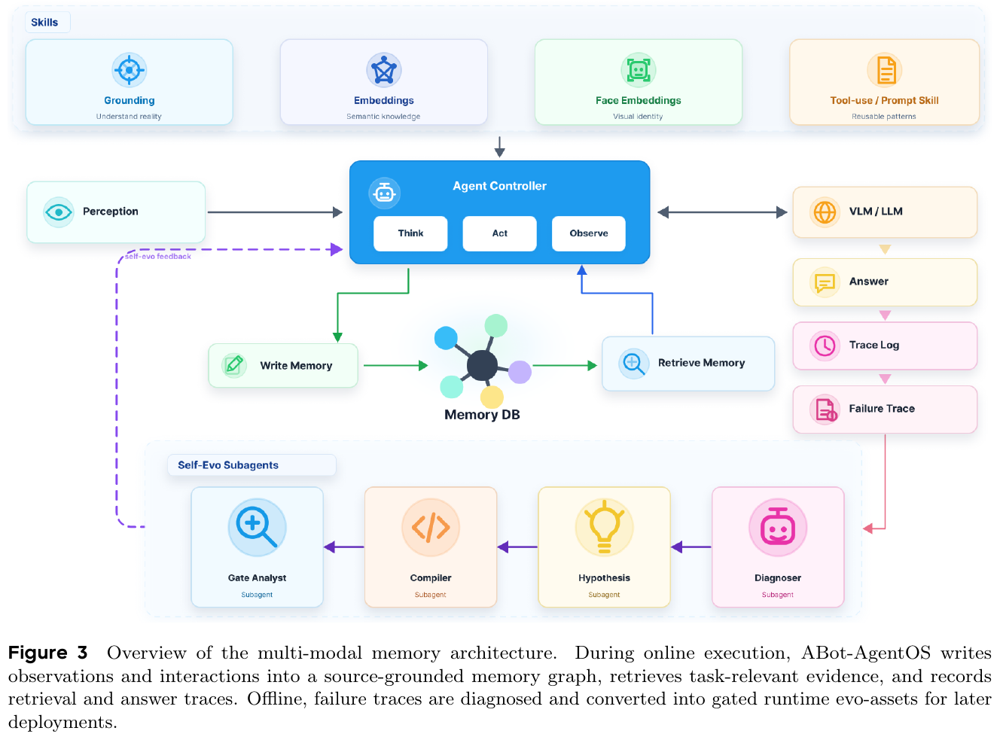
<figcaption>Universal multimodal memory architecture and the offline failure-driven self-evolution loop: source-traceable typed graphs are written online, and failed traces are compiled offline into controllable JSON-DSL evolution assets</figcaption>

1. **Multimodal memory graph**: Entities, events, locations, visual frames, temporal associations, and provenance chains from online interaction are written into strongly typed nodes and edges, replacing piles of raw video streams or plain-text logs.
2. **Hybrid graph retriever**: Combines semantic embeddings, lexical matching, metadata filtering, and graph-edge topology expansion to extract high-quality local evidence subgraphs.
3. **Failure-driven lifelong self-evolution**:
   - **Split isolation protocol**: In sequential split deployment, split $$t$$ may use only the evolution assets $$A_{<t}$$ that have already been promoted in earlier splits.
   - **Trace diagnosis and asset compilation**: After a split finishes, the system runs trace diagnosis on the failed samples and generates candidate evolution assets in JSON-DSL format (covering stages such as memory writing, evidence selection, frame selection, and time normalization).
   - **Strict gating verification**: A candidate asset must improve the score on the target validation set without lowering performance on the regression set:
     $$\text{Accept}(a) = \mathbb{I}[\Delta S_{\text{target}}(a) \ge \tau_{\text{gain}} \land \Delta S_{\text{reg}}(a) \ge -\tau_{\text{reg}}]$$
After passing the check, it can be promoted to $$A_{\le t}$$ for use in later splits, achieving cumulative growth without label leakage.
4. **Edge-cloud privacy management**: Private memories (faces, personal belongings, and so on) stay on the edge, and only public environmental memories without sensitive information (roadblocks, road landmarks) are shared in the cloud, with a privacy-classification accuracy above 99%.

#### ④ EmbodiedWorldBench and the policy distillation pipeline
{: id="-embodiedworldbench-与策略蒸馏训练管线"}

  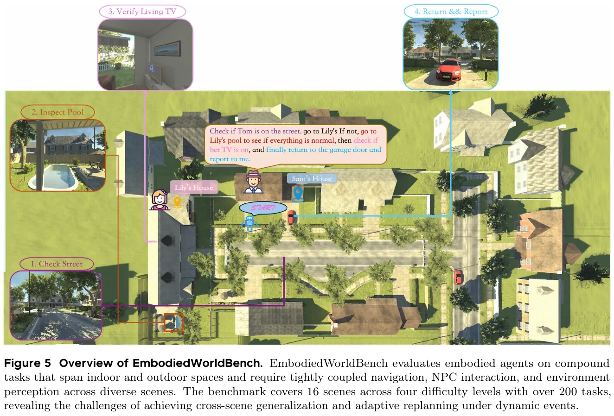
<figcaption>Overview of the EmbodiedWorldBench benchmark: 16 executable scenes and 4 difficulty levels, covering composite indoor and outdoor scenes, NPC interaction, and dynamic events</figcaption>

The paper introduces **EmbodiedWorldBench**, covering 16 indoor, outdoor, and mixed scenes with 4 difficulty levels and 200+ composite tasks involving navigation, NPC interaction, item search, and responses to dynamic events.

  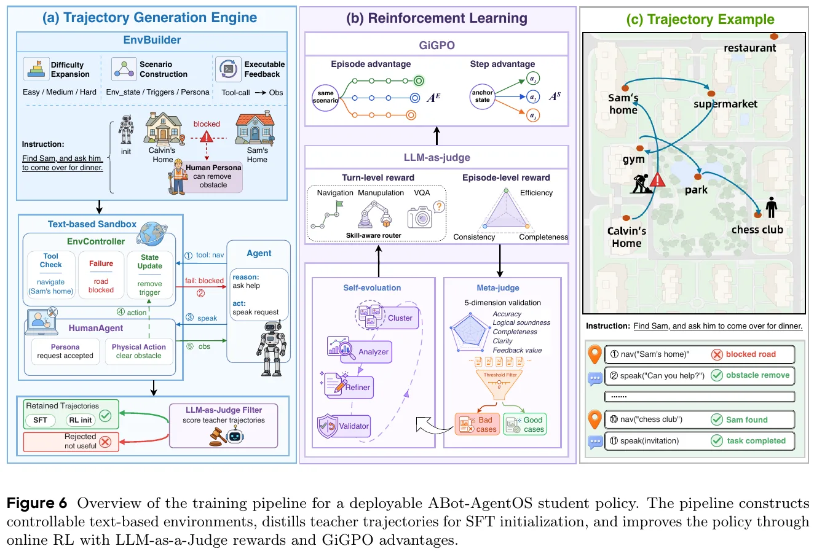
<figcaption>End-to-end training pipeline for the student policy: a text sandbox builds the environment, a self-evolution reward engine generates preference data, and DPO/SFT optimize the edge-deployed model</figcaption>

To transfer the capabilities of the cloud-based large-model agent harness to a small on-device model, the paper designs an end-to-end distillation pipeline:
1. **Controllable text-sandbox construction**: An LLM automatically generates text-sandbox environments with executable state and complex logic.
2. **Self-evolution reward engine**: Generates automatic scores and DPO preference pairs from structured traces.
3. **SFT + DPO policy optimization**: Trains the lightweight student policy in the sandbox environment and deploys it.

---

### 3. Results and findings
{: id="3-核心结果发现-6"}

1. **Long-horizon embodied execution**: On the initial subset of EmbodiedWorldBench, ABot-AgentOS achieves significant gains in success rate and goal completion over the single-controller baseline, and the Verifier mechanism cuts early false terminations by more than 35%.
2. **Clear lead on multimodal memory benchmarks**:
   - **LoCoMo** (long-horizon session memory): The static version reaches **87.5**, and adding self-evolution raises it to **88.7** (close to the human upper bound of 87.7).
   - **OpenEQA (EM-EQA)**: The static version reaches **59.9** under an 8-frame budget, and adding self-evolution raises it to **60.4** (surpassing SnapMem at 57.2 and GaussExplorer at 57.8).
   - **Mem-Gallery**: The static version reaches **88.6**, and adding self-evolution raises it to **89.0** (with outstanding results of 97.5% on conflict detection CD and 100% on reject answer AR).
   - **NExT-QA**: Validation Acc@All reaches **76.5%** (self-evolution adds 4.1 points), clearly ahead of classic video agents such as VideoAgent.
   - **EgoLifeQA**: Reaches an average accuracy of **66.2%** with single-frame retrieval.
3. **Cross-task generalization of lifelong self-evolution**: The self-evolution mechanism brings stable gains on all 5 memory benchmarks, and the improvement comes entirely from general upgrades to the memory pipeline (such as time normalization and relation disambiguation), not from indiscriminately accumulating memory content.

---

### 4. Limitations
{: id="4-局限性-6"}

1. **Perception and control noise in the complex real physical world**: Large-scale verification so far is mostly in executable simulation or semi-physical sandboxes. Facing noisy depth perception, grasp failures, and network latency in the real world, deeper hardware tuning on real robots is still needed.
2. **Automated distillation relies on a text sandbox**: Small-model policy distillation currently depends mainly on a text-state sandbox. Multimodal visual observation and more complex physics simulation platforms (such as Isaac Sim/Habitat) need to be introduced in the future.
3. **Memory self-evolution needs a trustworthy feedback signal**: The offline self-evolution mechanism relies on deterministic error diagnosis or human feedback. How to define "wrong answers" safely in open, unsupervised environments remains a long-term challenge.

---

## 8. ABot-ER (2026) {#abot-er}
———One model for embodied understanding, long-horizon planning, and interaction-point grounding, with training data revised through failure diagnosis

📄 **Paper**: [arXiv:2610.18355v2](https://arxiv.org/abs/2610.18355v2) · [Code](https://github.com/amap-cvlab/ABot-ER)

### Key takeaways {#abot-er-key-takeaways}

ABot-ER unifies spatial relations, scene states, temporal events, action plans, and interaction targets in one embodied reasoning model, supplying judgements, plans, and image coordinates to runtimes such as [ABot-AgentOS](#abot-agentos), while downstream policies carry out physical actions.
Its most transferable idea is to identify what is wrong with the supervision before coordinating new content, output-protocol repairs, and sampling changes, instead of treating every low score as a shortage of data.
The shared backbone receives two task-family-specific low-rank residual branches for question answering and planning, but remains jointly trainable; after protocol repair, the ablation does not show gains in either suite mean, placing a clear boundary on the architectural benefit.
A single post-training pass on the converged corpus approaches the twelve-benchmark mean of a six-round chain with one fifth of the accumulated post-training, suggesting that the reusable assets include audited data and evaluation rules.
Point-hit accuracy, simulated task success, and qualitative physical demonstrations should be distinguished, as should training-time corpus evolution and online adaptation after deployment.

---

### 1. Background and problem {#abot-er-background}

Moving an object to a requested location requires a robot to understand object-to-person spatial relations, current states, step dependencies, and actionable regions; separate training can produce uneven specialists, while joint training introduces interference between output formats and learning rates across capabilities.
The paper calls these bottlenecks **Data-Model Drift**, where a fixed data mixture no longer matches the model's current weaknesses, and **Modality Entanglement**, where text, plans, and coordinate supervision impose different demands on shared parameters.
ABot-ER aims to combine five kinds of embodied judgement in one checkpoint and establish a training workflow that can be diagnosed, revised, and audited.

---

### 2. Methods and innovations {#abot-er-method}

  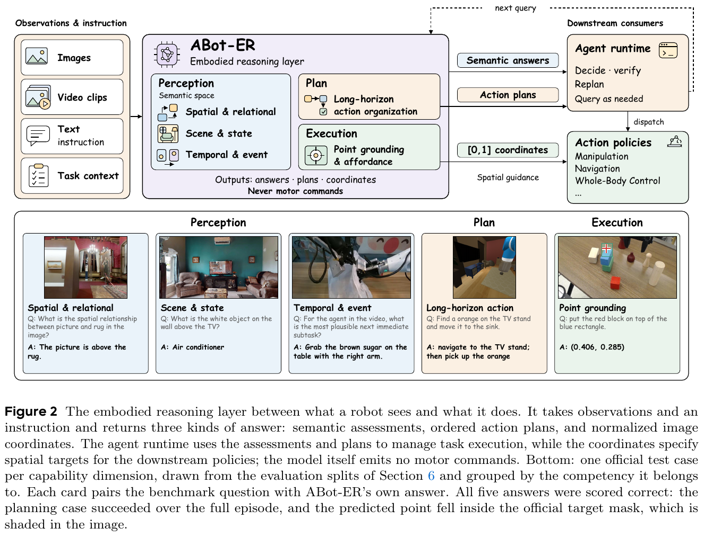
<figcaption>Original Figure 2: ABot-ER sits between observation and control, returning semantic judgements, action plans, and normalized image coordinates. The agent runtime schedules queries, verification, and replanning; downstream policies execute actions.</figcaption>

#### ① Overall framework: a unified reasoning model, data-revision engine, and training-selection workflow {#abot-er-overview}

The **online model** receives images, videos, or textual context and generates the requested response; the **offline data engine** reads evaluations and error records to revise the next training corpus; **two-stage training and checkpoint selection** turn that corpus into a new model while checking for substantial regressions in existing capabilities.
Here, execution means identifying actionable targets and locations. The model does not directly emit base velocities, joint positions, or torques; at deployment, a runtime passes its judgements to navigation, manipulation, and other execution policies.

| Capability dimension | Input and processing | Example output |
|---|---|---|
| Spatial and relational reasoning | Infer directions, distances, and layout from images or multiple views | Identify the object on the user's left |
| Scene and state understanding | Recognize task-relevant objects, attributes, and current states | Identify the tabletop blocks and whether the expression is valid |
| Temporal and event reasoning | Infer event order and state changes from video or before-and-after observations | Determine whether a block was placed or dropped during transfer |
| Long-horizon action organization | Arrange steps with preconditions using the goal, history, and feedback | Pick the object, move, and place it in the target region |
| Point grounding and affordance | Ground an instruction in an actionable image region | Return a grasp point or coordinates inside a valid placement region |

#### ② Shared backbone and task-conditioned low-rank residuals: shared knowledge with task-specific capacity {#abot-er-task-conditioning}

  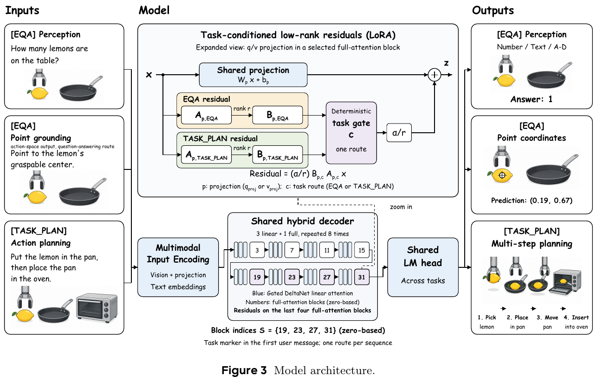
<figcaption>Original Figure 3: tasks share image encoding, the language backbone, and the output head. Two residual branches augment Q/V projections in the last four full-attention blocks. Each sequence selects one route; point grounding still follows the question-answering route.</figcaption>

**Multimodal encoding.** Images or video frames pass through a vision encoder and projector to form visual representations, while text becomes embeddings. Their original interleaved order is retained at the shared decoder; text-only tasks bypass vision.
The 9B instance uses **Qwen3.5-9B**, with 32 decoder blocks arranged as three Gated DeltaNet linear-attention blocks followed by one full-attention block, and a language output head shared by all tasks.

**Task routing.** The data loader inserts a task marker inside the first user message, selects a branch from the record's task family, and keeps that branch throughout the sequence.
The paper's `[EQA]` family covers spatial, state, and temporal questions as well as interaction coordinates; `[TASK_PLAN]` covers action plans. These families follow how the data was collected, rather than a text-versus-coordinate split, and there are no five separate capability decoders.

**Residual adaptation.** The `q_proj` and `v_proj` projections in zero-indexed layers 19, 23, 27, and 31—the last four full-attention blocks—each receive two sets of task-specific low-rank parameters.
For one projection, the calculation can be summarized as:

$$
\widetilde z_c = Wx + b + \frac{\alpha}{r} B_c A_c x, \qquad r=16,\quad \alpha=16.
$$

The first two terms are the shared transformation, and the last is the selected task family's correction. The shared language backbone and residuals train jointly; the vision encoder is frozen and the projector remains trainable, so this is not a frozen backbone with only LoRA trained on top.

> **Example:** For the same lemon image, both “How many lemons are there?” and “Point to the graspable center” select the question-answering residual; “Put the lemon in the pan, then put the pan in the oven” selects the planning residual.
> The three calls share object and spatial knowledge while giving plan generation its own parameter correction. The calling task determines the route; the model need not generate an explanation to decide which branch to use.

#### ③ Data-model self-evolution: use error evidence to choose the repair {#abot-er-data-evolution}

  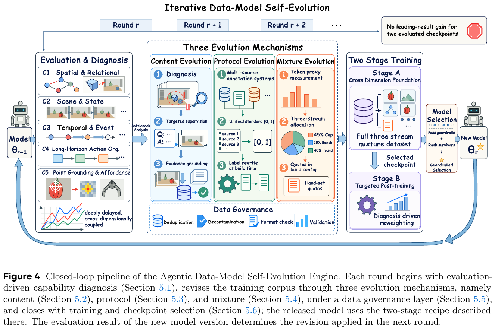
<figcaption>Original Figure 4: each round diagnoses evaluation failures, coordinates content, protocol, and mixture revisions, and selects a new model after data audits, training, and retention checks. The three-stream percentages describe the question-answering partition of a particular development round.</figcaption>

The engine receives capability scores, item-level outputs, training logs, and source records. One coordinating language-model agent proposes root-cause hypotheses and data requirements; deterministic programs check candidate data against format, provenance, exposure-cap, and trajectory-replay requirements.
Experts calibrate diagnoses and acceptance rules in the initial rounds, and later runs are constrained by those rules. The evolving artifact is the training corpus; the architecture and learning algorithm do not rewrite themselves.

**Capability diagnosis** classifies errors into parsing failures, coordinate-protocol violations versus point misses, multiple-choice errors, numeric parsing errors, open-ended deductions, and planning failures, then maps them to capability gaps. A drop on one benchmark does not automatically establish a dimension-wide weakness; other benchmark trends or item-level evidence are required.
The diagnosis feeds three complementary repairs that cannot substitute for one another:

| Revision mechanism | Problem addressed | Concrete action |
|---|---|---|
| Content Evolution | Missing correct or complete learning targets | Construct plans with verified preconditions and successful replay to the terminal state; retain evidence-grounded interaction targets |
| Protocol Evolution | Incompatible values or formats for the same target | Unify numeric coordinate conventions while fixing each task's point count, wrapper, and action schema |
| Mixture Evolution | Insufficient training exposure to valid supervision | Adjust sampling within source and repetition caps while retaining data for established capabilities |

**Coordinate protocols provide the clearest example.** Historical data mixed 0–1000 coordinates, normalized single points, and eight-point XML. Some labels also described arm-motion endpoints rather than the target regions requested by the question.
The repair unifies coordinates as `[0, 1]` values relative to the original image, with three decimal places, while preserving each task's required serialization: eight-point XML for VABench-P and lists of one to three point tuples for Where2Place.

> **Example:** The same target at the center of an image might be represented as `(500, 500)` on the old scale and `(0.500, 0.500)` after normalization.
> Numeric consistency alone is insufficient: a single-point list may still fail an evaluator that expects eight points. Even eight valid points teach the wrong task if they land on the arm endpoint rather than the requested object.

**Training-budget figures need an explicit accounting basis.** Corpus construction uses a token proxy estimated from characters and media costs, rather than an actual tokenizer count. Unique examples, materialized training records, and assistant supervision tokens measure different things.
In the final Stage B corpus, for example, planning represents **25.00% of physical records** but **63.76% of assistant supervision tokens**, because complete plans are much longer than single-option answers. Since the loss is normalized per sequence, the latter share is not directly a loss weight.
The figure's approximately 45% fine-grained capability, 15% benchmark guarantee, and 40% foundational streams belong to **R6's question-answering partition**, with planning allocated separately; they are not a fixed mixture used by both released stages. Quotas are written into the configuration by hand, while programs implement and check them.

**Data governance** checks contradictory answers for the same image-question pair, duplicate media, invalid references, source eligibility, and test overlap. New labels must be grounded in images, environment states, or trusted annotations.
One concrete lesson was R3's apparent EB-ALFRED score of “100”: its summary included only the first 12 completed episodes out of 300, and official test trajectories had separately entered the legacy training pool. Recomputing the full summary gave 27, which was still unusable because the weights were contaminated.
The authors then quarantined three sources in full, covering 23,565 candidate records. R3 remains diagnostic history and is excluded from performance claims; the released line restarts on cleaned data without inheriting weights trained on those sources.

#### ④ Two-stage training, a unified loss, and checkpoint selection {#abot-er-training}

**Stage A: cross-capability foundation.** Supervised training begins from a pretrained VLM on the joint corpus to cover all five capabilities and establish the shared numeric protocol.
**Stage B: targeted repair.** A shorter supervised fine-tuning run continues from the selected Stage A checkpoint, lowers the learning rate, increases data for deficits such as planning recovery, and retains other-task data to reduce forgetting. This stage is not reinforcement learning.

All tasks use the same autoregressive cross-entropy objective, supervising assistant outputs only; input tokens, media placeholders, and padding are excluded.
Writing $S$ for the assistant output positions in one sample, its sequence-normalized objective can be expressed as:

$$
\mathcal L = -\frac{1}{\lvert S\rvert}\sum_{t\in S}\log p_{\theta}(y_t\mid x,c,y_{<t}).
$$

Assistant tokens across a multi-turn sample are normalized together. Relative exposure is controlled mainly through corpus construction and sampling, rather than five separate capability losses.
Paper v2 reports **462,390 physical records and 294,762 unique identities** for Stage A, and **104,960 records and 52,480 identities** for Stage B, where every identity appears exactly twice. The record counts cannot be added and treated as unique examples.
The decoder learning rates are **4×10⁻⁶ and 3×10⁻⁷**, with optimizer and scheduler reset between stages. The complete jobs take approximately **826 GPU hours** across 32 GPUs, excluding data construction and full-suite evaluation.

Checkpoint selection first checks limits on other-capability regressions, parser reliability, and detected test overlap, then compares leading-benchmark counts and target scores within one checkpoint.
The development history is not six continuously accumulated weight updates: major protocol and source changes often trigger retraining from the pretrained model, and the released Stage A→B line must also be distinguished from R6.

#### ⑤ Inference and integration with the physical robot {#abot-er-inference}

At inference, the caller specifies the task family and activates its residual; the shared output head generates the answer token by token. Five separate task models are unnecessary, but autoregressive generation still involves repeated decoding computations.
In the Galaxea R1 Pro demonstrations, ABot-ER is the visual-question-answering component of [ABot-AgentOS](#abot-agentos), served on an external host with one RTX 5090D. AgentOS orchestrates the interaction, and the separate **ABot-M** VLA executes manipulation.
Before each action step, the runtime queries the scene and interaction targets; afterward it queries the outcome, then uses the returned judgement to continue or revise the remaining plan.

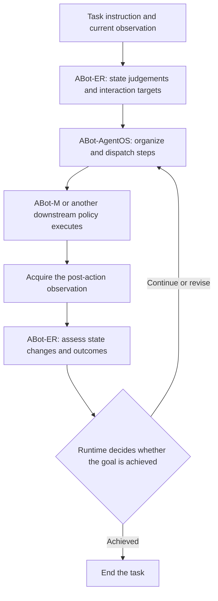

  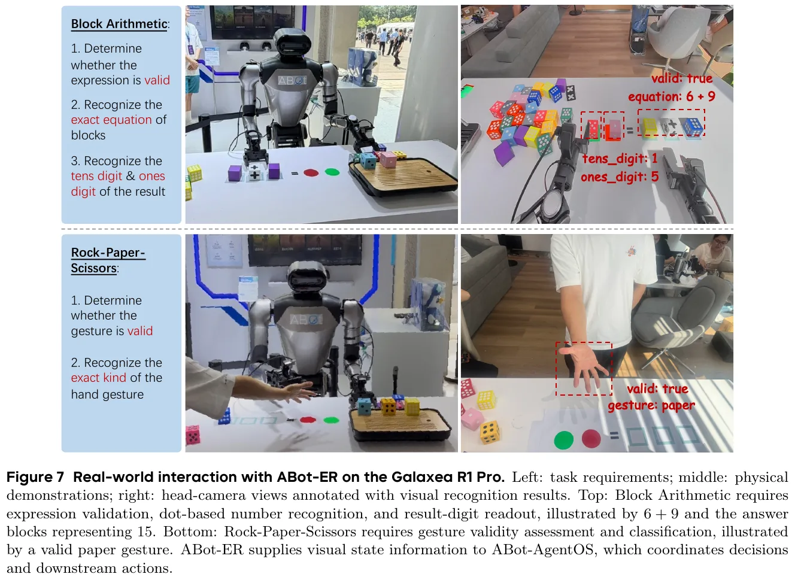
<figcaption>Original Figure 7: qualitative block-arithmetic and rock-paper-scissors demonstrations. ABot-ER reads visual states, ABot-AgentOS controls task progression, and a downstream VLA executes actions. These examples provide no additional physical success-rate measurements.</figcaption>

---

### 3. Results and findings {#abot-er-results}

**① Multiple capabilities coexist in one checkpoint.** Against nine public baselines in the main table, ABot-ER 9B leads the listed results on six of twelve benchmarks.
The equally weighted means over seven perception, three planning, and two point-grounding benchmarks are **63.86, 41.61, and 67.06**, exceeding the strongest listed baseline in each group by **3.94, 4.20, and 11.81** points. Those three reference values come from different models.

| Representative benchmark | ABot-ER 9B | Best listed baseline | Metric meaning |
|---|---|---|---|
| ERQA | **47.31** | Cosmos3-Nano 46.09 | Embodied multiple-choice reasoning accuracy |
| RoboVQA | **71.79** | MiMo-Embodied 66.09 | Open-ended robot-video question-answering score |
| Cosmos | **68.96** | Cosmos3-Nano 63.18 | Temporal and physical-event multiple-choice accuracy |
| EB-ALFRED | **26.67** | MiMo-Embodied 17.33 | Interactive task success rate |
| EB-Habitat | **37.00** | Cosmos3-Nano 26.67 | Interactive task success rate |
| VABench-P | **63.33** | Cosmos3-Nano 47.54 | Fraction of points inside the target box |

The scores share a 0–100 display scale but have different meanings; their aggregate is not an overall physical-robot success rate.
The nine-benchmark EQA mean of **64.57** includes seven perception and two point-grounding tasks. The twelve-benchmark mean is **58.83**, not an equally weighted average of the EQA and planning suite means.

**② Targeted post-training brings gains and trade-offs.** From Stage A to the released checkpoint, the planning mean rises **39.43→41.61**, with EB-ALFRED and EB-Habitat gaining **3.00 and 3.33** points, while Where2Place falls **72.90→70.79**. Improvement is not synchronous across capabilities.

**③ Conditional-branch benefits depend on data consistency.** In controlled paired ablations on **Qwen3.6-35B-A3B**, conditioning improves 11/12 benchmarks and raises the twelve-benchmark mean by **1.36** on the corpus with unaligned protocols. After protocol repair, the best checkpoints of each run give EQA **66.94→66.27** and planning **42.87→41.94**, with neither suite improving.
ET-Plan-Bench retains a consistent benefit: conditioning wins at all 17 matched checkpoints, averaging **+3.3** points. The ablation switches task markers and residuals together, does not isolate their contributions, and does not establish an independent architectural gain for 9B.

**④ The converged corpus transfers, while training history still shapes the capability profile.** With a common starting point, final corpus, and final-pass progress, a single post-training pass and a six-round chain reach twelve-benchmark means of **60.00 and 60.09**, using one fifth as much accumulated post-training in the single-pass case. Interactive planning remains weaker: EB-ALFRED is **25.00 versus 30.00**, and EB-Habitat **48.67 versus 51.67**.
The same two-stage corpora also transfer to 2B, 4B, 27B, and 35B-A3B backbones without rerunning corpus revision for each size. The 27B mean is **62.57**; this is a separate scaling experiment and should not be mixed with the training-history comparison.

  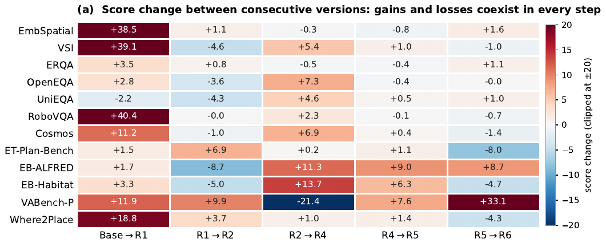
<figcaption>Original Figure 6a: each development transition combines gains and regressions. Budgets, initialization, and some historical protocols differ across rounds, so this heatmap describes development history rather than controlled comparisons that change only the data strategy.</figcaption>

**⑤ Evaluation details limit the conclusions.** The current VABench-P prediction archive repeats one location eight times, so these cannot be interpreted as eight independent candidates. The paper also leaves the provenance of the EB archives' original online calls for verification, preventing success rates alone from establishing native closed-loop correction.
Public baselines come from leaderboard snapshots at different times, with potentially different original training and evaluation configurations. Point scores measure target hits rather than control precision or physical manipulation success.

---

### 4. Limitations {#abot-er-limitations}

Development rounds jointly change budgets, learning rates, data, and some evaluation protocols; quotas remain manually specified, and the appendix retains residual audit risks such as uncovered media. Cross-round gains therefore do not independently establish the causal benefit of self-evolution.
Physical demonstrations are mainly qualitative, without large-scale success-rate and latency comparisons, and interactive planning still fails frequently. Navigation or manipulation integration requires separate validation of visual judgements, runtime decisions, and downstream control.

---

## 9. Harness Robotic OS (2026)
{: id="harness-robotic-os"}
——Upgrading quadruped inspection from a "navigation stack" to an "embodied agent runtime"

📄 **Paper**: [arXiv:2609.11225](https://arxiv.org/abs/2609.11225)

---

### Key takeaways
{: id="精华-7"}

The real question of this paper is not "how to navigate more accurately" but "how to make a set of off-the-shelf modules collaborate in the same context, leave traces, and be rollback-capable," taking system integration itself as the object of study. The most useful takeaway is the hard boundary it establishes: the real-time control loop (SLAM, planning, control) and the cognitive loop (agent orchestration, memory, reflection) belong to two separate layers. The agent can only "orchestrate skills" and cannot issue motion commands directly, so if its reasoning goes wrong, no motor gets burned out. Memory is divided into three layers (working, episodic, semantic) by retention period rather than by data type, and retrieval is jointly conditioned on task intent, spatial location, and scene semantics, so the whole operations-and-maintenance history is not stuffed into every reasoning context. Self-evolution is deliberately designed as "offline candidate → safety gate → staged rollout → rollback" rather than changing the model online, which is a prerequisite for auditing long-running robots. To be clear, though, the cognitive runtime in this paper (speech, memory, self-evolution) comes with only protocols and no numbers; what actually holds up in the real tests is the classical navigation plus VLM inspection pipeline.

---

### 1. Background and problem
{: id="1-研究背景问题-7"}

Residential property inspection must cover a wide range of public spaces such as roads, fire escapes, building entrances and exits, equipment rooms, and garbage rooms. Manual patrols are limited by staffing and personal experience in frequency, consistency, and traceability. Quadruped robots can climb slopes and traverse narrow paths, making them a suitable platform. But "being able to walk" does not mean "being able to inspect": inspection also requires continuous localization, global task planning, reactive obstacle avoidance, scene-level understanding of hazards, human-robot interaction, and integration with the work-order system.

The authors point out that a common problem in deployed systems is that these capabilities are built as loosely coupled modules: sensor drivers, navigation algorithms, vision-language services, operator interfaces, and enterprise applications each hold their own state and talk through point-to-point adapters. This leaves three gaps: **semantic task intent is out of step with the robot's pose, observations, and execution state**; **past task experience is not systematically retained and retrieved**; and **changes to prompts, tool policies, task maps, and skills are hard to evaluate, trace, and roll back safely**.

---

### 2. Methods and innovations
{: id="2-主要方法创新点-7"}

#### 2.1 Overall framework: four planes plus a self-evolution loop
{: id="21-整体框架四个平面--一条自进化环"}

HROS divides the system into four layers: **Robot Runtime** (hardware abstraction: edge computing, multimodal sensing, connectivity and I/O, quadruped execution); **Embodied Autonomy Skills** (wraps SLAM, perception, global planning, and local motion into stateful, reusable "skills"); **Cognitive Agent Runtime** (agent orchestration, hierarchical memory, multimodal reasoning, skill and tool scheduling, and the self-evolution closed loop); and **Interaction and Operations** (voice and multimodal I/O, the inspection task console, and the enterprise closed loop). The four layers are not a call stack but a set of binding relationships: each skill reports its input timestamp, execution status, confidence or failure code, and output reference to the shared context bus, and the cognitive layer monitors progress from these, **but never enters the real-time control loop**.

  
<figcaption>The four-layer HROS architecture. The dark solid lines are the runtime data flow, the bidirectional arrows are the binding between agent and skills, the dotted line is the self-evolution path, and the green line is the safety gate: only candidate versions that pass the safety gate can return to the skill runtime</figcaption>

**Worked analysis: what exactly does an "embodied agent runtime" add over an ordinary navigation stack?**

|Dimension|Conventional quadruped inspection system|HROS|
|---|---|---|
|State ownership|Each module keeps its own state and communicates point-to-point through task-specific adapters|A shared context bus, so physical state and agent reasoning share the same origin|
|Past experience|Discarded after the run, leaving at most a log|Three-level working / episodic / semantic memory, with retrieval conditioned on intent plus location|
|Change governance|Prompt or skill changes go live directly, and a human rolls back if something goes wrong|Candidates are produced offline and return through a safety gate and staged rollout, with traceability and rollback|
|Control boundary|The upper layer can issue motion commands directly|The agent can only orchestrate skills, and motion commands must go through the robot-runtime interface|

#### 2.2 Robot Runtime: the Vbot quadruped platform
{: id="22-robot-runtimevbot-四足平台"}

The physical layer uses the Vbot quadruped as the carrier for sensing, compute, communication, and mobility: stereo cameras, a 16-line lidar, an IMU, GNSS, and 4G/5G. The edge computer is a Horizon RDK S100P (6-core ARM Cortex-A78AE + 128 TOPS Nash BPU), which runs perception and agent services on board. The robot controller exposes motion commands and status feedback through HROS's robot-runtime interface. **The motivation for this isolation layer is to prevent the upper-layer agent from bypassing verification and sending commands directly to the low-level executor.**

#### 2.3 Embodied Autonomy Skills: four stateful skills
{: id="23-embodied-autonomy-skills四个有状态技能"}

This layer is the only part of the paper with actual measured numbers. All four modules are engineered combinations of off-the-shelf open-source software:

- **State estimation · Fast-LIO2**: Takes lidar point clouds and IMU data, tightly coupled, to estimate the 6-DoF pose and build the map incrementally, outputting a prior point-cloud map and an online pose. It has three working modes: mapping (during the on-site survey), online localization (daily patrols, scanning in real time and registering against the prior map), and relocalization (when tracking degrades or after a restart). The motivation is a **shared map coordinate system**: residential patrols repeatedly revisit the same assets under different lighting and scene appearances, and only by tying every image, waypoint, hazard event, and report to this coordinate system can HROS perform spatially conditioned memory retrieval and cross-task comparison.
- **Local perception · Hobot-Stereo**: Takes synchronized stereo images and outputs dense near-field depth, fused with the lidar obstacle representation. The motivation is that sparse laser sampling cannot adequately express short obstacles, fine structures, and occlusion boundaries in the near field. The depth points are first transformed into the map frame, filtered by distance and confidence, and then inserted into the local voxel representation consumed by EGO-Planner; **stereo is a supplement to, not a replacement for, the lidar**. Uncertain observations are treated conservatively and are deleted from the local map if they are not observed repeatedly over a long period.

  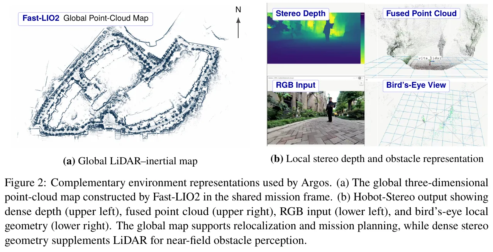
<figcaption>Two complementary environment representations. Left: the global 3D point-cloud map built by Fast-LIO2 in the shared mission coordinate system, used for relocalization and mission planning. Right: Hobot-Stereo's dense depth (upper left), fused point cloud (upper right), RGB input (lower left), and local bird's-eye geometry (lower right), filling the lidar gap in the near field</figcaption>

- **Task planning · PCT-Planner**: Property inspection is a **coverage task** rather than a single start-to-goal query. The route must connect strategically chosen viewpoints (fire-fighting facilities, equipment-room entrances, garbage collection points) and be traversable throughout. PCT-Planner computes collision-free segments on the 3D prior point-cloud map. The task layer orders them according to the inspection strategy and saves the result as a reusable task template. At runtime the global route serves only as a **reference** rather than a direct motion command. Progress is represented as "current road segment + current waypoint + completed viewpoints + remaining inspection actions," so the orchestrator can pause, resume, and reschedule non-safety-critical tasks without touching the local controller at all.

  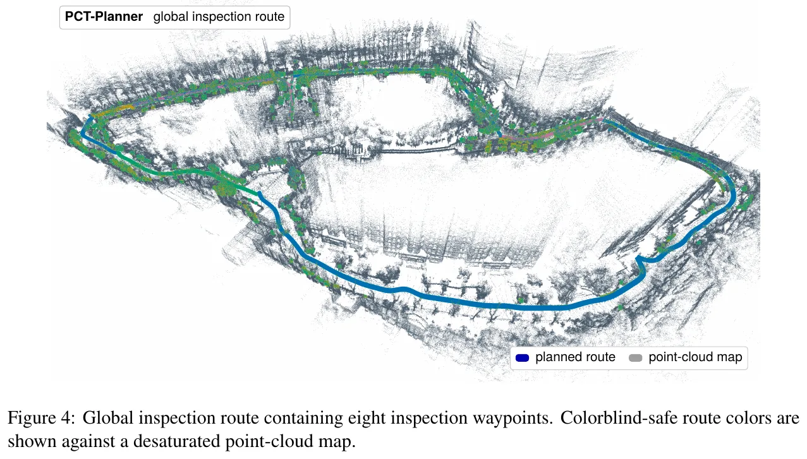
<figcaption>PCT-Planner generates a global inspection route on the prior point-cloud map, connects 8 inspection waypoints, and archives it for reuse as a task template</figcaption>

- **Motion intelligence · EGO-Planner**: Takes the global reference route, the current pose, and the fused obstacle representation, and outputs a dynamically feasible local trajectory, which is then converted into quadruped control commands constrained by speed, clearance, and continuity. It has three behaviors: nominal tracking; local re-planning (generating a short detour around temporary obstructions such as pedestrians, illegally parked vehicles, and cleaning equipment); and recovery (stopping when no feasible local trajectory exists and reporting a **typed** failure code, leaving the task layer to decide whether to wait, retry, or call an operator).

  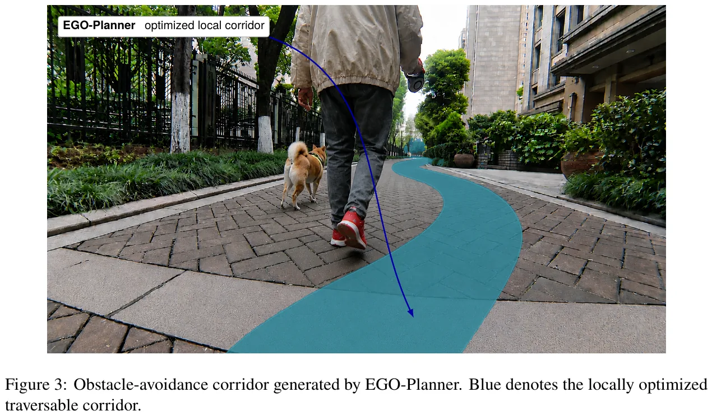
<figcaption>EGO-Planner optimizes the locally passable corridor (blue area) in front of a pedestrian walking a dog. The global route only gives the direction, and the decision to yield is made by the local planner</figcaption>

#### 2.4 Cognitive Agent Runtime (1): grounded voice interaction
{: id="24-cognitive-agent-runtime一接地的语音交互"}

Streaming ASR converts speech into a timestamped intent hypothesis, **which is not executed directly**: it must first be grounded in the current robot pose, active tasks, visible scene, and permission policy. Ambiguous or safety-related instructions require explicit confirmation. TTS reports task acceptance, navigation progress, discovered hazards, recovery actions, and completion status. The motivation is to let text, voice, images, and enterprise messages enter the same multimodal task interface rather than being scattered across independent applications.

#### 2.5 Cognitive Agent Runtime (2): hierarchical memory
{: id="25-cognitive-agent-runtime二分层记忆"}

Memory is divided into three layers by **retention period**. Working memory stores short-range information (the current task, recent conversation, robot status, local observations, and tool calls awaiting return). Episodic memory stores time-indexed task fragments (trajectories, decisions, observations, hazard events, and failure and recovery outcomes). Semantic memory stores stable site knowledge (map partitions, asset identification, inspection rules, historical defects, and property-management handling procedures). Retrieval is jointly conditioned on task intent, spatial location, scene semantics, and execution state.

**Worked analysis: what does each of the three layers hold, and how does retrieval work?**

> **Example**: The robot is inspecting the door of the power distribution room in Building 3 for the seventh time, and a cardboard box appears on the floor in the image.
>
> - **Working memory** holds "this moment": the current task ID, the sentence just spoken ("Go to Building 3 and have a look"), the current pose, the last two observation frames, and the Qwen3-VL call that has not yet returned. It is cleared when the task ends.
> - **Episodic memory** holds "which time": on the third inspection, a pile of items at the same location was judged to be clutter, and manual review changed it to "temporary parcel delivery"; on the fifth, a pedestrian blocking the road triggered local re-planning. Entries are timestamped and indexed.
> - **Semantic memory** holds "this place has always been like this": the power distribution room is a key fire-protection area, the rule is that nothing may be piled within 1 meter in front of the door, and it is a high-frequency point in the historical defect records. It does not change with a single task.
>
> Retrieval does not pour all three layers into the context. It recalls conditionally using "intent = inspection + location = distribution room + scene semantics = box on the floor": semantic memory supplies the applicable rule, episodic memory supplies "last time this kind of box was judged to be a parcel delivery," and working memory supplies the current image. This time there is thus a chance to avoid a false positive. The paper says it will measure this with Recall@5 and task completion rate, but **has not yet given numbers**.

#### 2.6 Cognitive Agent Runtime (3): self-evolution guarded by a safety gate
{: id="26-cognitive-agent-runtime三安全门把守的自进化"}

Self-evolution is explicitly defined as a **governed process** of turning experience into updates, rather than changing the model online. At the end of each task, the execution trace and human feedback are written into an experience buffer. In the reflection and evaluation phase, the system scores success or failure, attributes failures, runs consistency checks, and produces candidate updates (memory entries, prompts, tool-selection policies, task graphs, reusable skills). Candidate versions are evaluated against offline regression cases and safety rules, with traceability records, and are released through a versioned staged rollout after passing the safety gate.

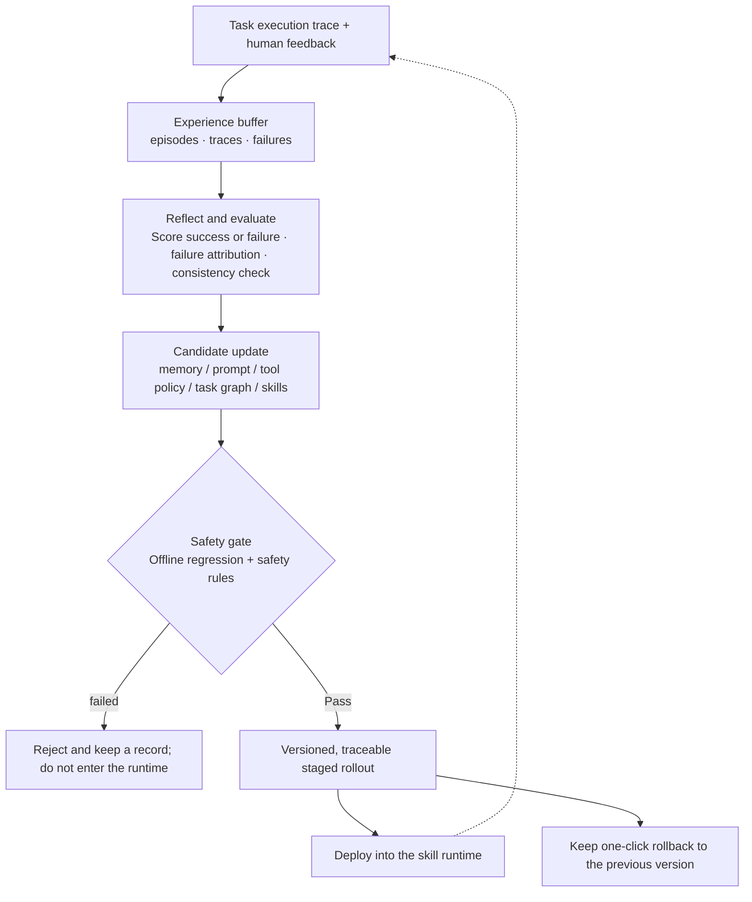

Note that the two nodes **F and I in this diagram are the real design proposition**: every candidate update has a "rejected, with a record kept" path, and every online version has a "rollback" path. The paper calls this boundary necessary for keeping long-running robots reproducible and auditable.

#### 2.7 End to end: the evidence chain from image to work order
{: id="27-端到端从图像到工单的证据链"}

The inspection and reasoning pipeline follows "observe → interpret → verify → report → review." OpenClaw selects the image associated with a waypoint, binds the pose, timestamp, waypoint, task ID, and applicable inspection policy, and then calls Qwen3-VL. The returned description is parsed into a **constrained event schema** (hazard category, severity, evidence, location, recommended disposal action). The target categories fall into two groups: safety (items stacked around equipment rooms, occupied fire escapes, standing water on the floor, exposed cables) and sanitation (overflowing trash cans, stains on the floor, scattered garbage and leaves, abnormal accumulation in public areas).

Only events that pass schema validation enter the operations pipeline. The system retains the original image, the model's raw response, the parsed fields, and the delivery status. After tagging the location and area, it generates a structured report and routes it through the DingTalk/Feishu adapter to the responsible person for review and dispatch. **Manual corrections are written back as tagged feedback rather than silently overwriting the original result**, which both keeps later evaluation and memory updates informed and maintains auditable, replayable records. This design also keeps multimodal reasoning out of the safety-critical motion loop.

#### 2.8 On the "training objective"
{: id="28-关于训练目标"}

This paper has no training stage. The whole system is assembled from off-the-shelf components, with no learnable parameters and no loss function. The only formula in the paper is the definition of word error rate in the speech experiment:

$$\text{WER} = (S + D + I) / N$$

Here, $S$, $D$, and $I$ are the numbers of substitution, deletion, and insertion errors respectively, and $N$ is the total number of words in the reference.

---

### 3. Results and findings
{: id="3-核心结果发现-7"}

System-level measurements from deployment in a real residential community (Table 1):

|Group|Subsystem|Metric|Result|
|---|---|---|---|
|Navigation and motion|Task execution|Waypoint reachability| 100% |
| | Fast-LIO2 |Outdoor localization error| < 10 cm |
| | EGO-Planner |Obstacle response latency| < 200 ms |
|Semantic inspection| Qwen3-VL |Garbage overflow detection rate| 95% |
| | Qwen3-VL |Fire exit occupancy detection rate| 95% |
| | Qwen3-VL |Lane occupancy detection rate| 90% |
| | Qwen3-VL |Standing-water detection rate| 88% |
| | Qwen3-VL |Public-facility damage detection rate| 85% |
| |Inspection reasoning|Hazard false-alarm rate / miss rate|Both < 5%|
|Operations closed loop|DingTalk/Feishu adapter|Alert delivery success rate| 99% |
| |HROS report|Structured report generation accuracy| 99% |
|Field operation|Robot platform|Continuous battery life| > 3 h |
| |End-to-end task|Time for one full-coverage inspection| ≤ 60 min |

A few points are worth noting:

- **The detection rate decreases with the visual category**: 95% for garbage overflow and occupied fire escapes, but only 85% for public-facility damage. The authors attribute this to facility damage having far more diverse visual forms than the first two categories, which is consistent with the argument that "hazards are defined by spatial and operational context, not just by object identity."
- **Battery life of 3 hours against a single 60-minute mission** leaves room for multiple rounds, which is a prerequisite for scheduling.
- **The most important part is the part without numbers**: Section 5.6 of the paper writes out complete controlled-experiment protocols for voice interaction, hierarchical memory, and safety-gated self-evolution (WER, grounded-intent accuracy, confirmation accuracy, P95 end-to-end latency; Recall@5, spatiotemporal grounding accuracy, context-token reduction rate, stale-memory error rate; change in task success rate, regression rate, safety-rule violation rate, safety-gate rejection rate, rollback success rate, and **a safety-gate escape rate required to be zero**), but Table 1 has no numbers for these three blocks. The paper states that "the values will be reported once the corresponding controlled tests are complete." In other words, **HROS's cognitive runtime is currently an architecture proposal plus a set of evaluation designs; what is demonstrated is the layer of classical navigation and VLM inspection pipeline beneath it.**

---

### 4. Limitations
{: id="4-局限性-7"}

The authors list four items: long-term map maintenance (parking patterns, construction, vegetation, and seasonal changes require incremental mapping, change detection, and multi-session map management); open-world hazard recognition (a broader hazard taxonomy needs more diverse annotated data, calibrated confidence, and handling of ambiguity); agent evaluation and safety (the memory and self-evolution mechanisms need dedicated benchmarks measuring retrieval quality, adaptation benefit, regression risk, and rollback reliability before automatic updates can be discussed for production); and human-robot collaboration (ASR robustness under outdoor noise, confirmation design for safety-critical commands, operator workload, and integration with access control, broadcast alarms, and digital twins).

One more point to keep in mind when reading this paper: it is a **systems and architecture paper**. Navigation and perception both use off-the-shelf open-source software, and the real novelty lies in the design of the inter-layer boundaries and governance processes. The three most promising parts of this design (voice grounding, hierarchical memory, and safety-gated self-evolution) are still at the protocol stage, with no comparable experimental evidence yet.

---

## 10. NavHarness (2026)
{: id="navharness"}
———Passing search evidence to fresh navigation sessions to accumulate and revise experience across tasks

📄 **Paper**: [arXiv:2609.34276](https://arxiv.org/abs/2609.34276) · [Code](https://github.com/billzhao1030/NavHarness) · [Project Page](https://billzhao1030.github.io)

**Navigation index**: [NavHarness in the agentic-navigation collection](/en/Agentic-Navigation-Papers/#navharness).

---

### Key takeaways
{: id="精华-8"}

NavHarness offers a transferable idea: keep maps, searched places, evidence-backed conclusions, and remaining search options outside the conversation so that a fresh reasoning session can continue the work.
During recovery, the robot stays in place and retains its remaining budget; only the conversation changes and the search plan is reconsidered, with the handover distinguishing a visited place from one ruled out by evidence.
Memory access is interleaved with observation and action, allowing the model to investigate earlier records and revise conclusions using new views rather than retrieving only at the start.
Independent pre-stop verification gives the current search one opportunity to correct its stopping decision, while post-stop certification improves the record inherited by the next task.
Continuous-deployment experiments further show that, even after maps and task records are retained, organizing experience into source-linked house knowledge brings additional benefits, although incorrect certification can propagate through memory.

---

### 1. Background and problem
{: id="1-研究背景问题-8"}

General-purpose multimodal models can already use observation and movement tools for individual navigation tasks, but a household robot must receive new goals from the previous task's endpoint and reuse explored space and search experience.
A longer conversation can retain outdated goals and observations, while a fresh conversation loses searched regions, unchecked places, and failure leads; navigation therefore needs a mechanism that preserves evidence across sessions while allowing earlier conclusions to be reexamined.
The paper studies continuous navigation without navigation-specific training, with language, object-category, or image goals, focusing on how experience crosses task, recovery-attempt, and run boundaries.

---

### 2. Methods and innovations
{: id="2-主要方法创新点-8"}

  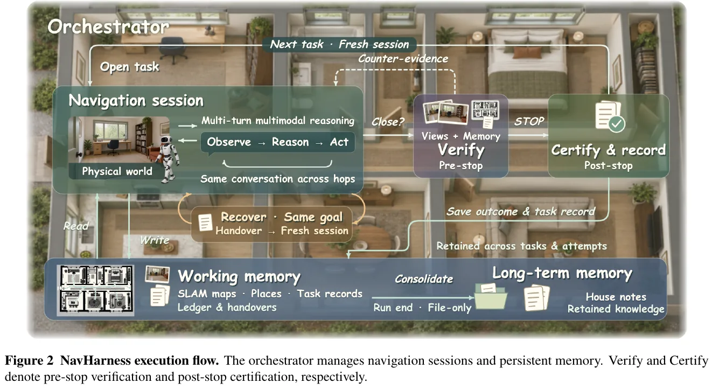
<figcaption>Original Figure 2: the outer orchestrator advances navigation sessions and handles recovery, pre-stop verification, post-stop certification, and memory retention. One task can involve multiple sessions sharing the same task budget.</figcaption>

**① Overall framework: the reasoning session searches, while the outer orchestrator manages handovers.**

NavHarness combines a multi-turn multimodal navigation session, external spatial and task memory, a task-boundary orchestrator, and separate verification and consolidation sessions.
The navigation session reads goals and memory, observes the environment, and invokes tools; the orchestrator decides whether to continue, replace the conversation, or close the task while retaining physical state and external records.

The paper calls a sequence of tasks in one house a **run**, the pursuit of one goal a **task**, and a continuous search for that goal an **attempt**, supported by one **session**. The orchestrator advances a session in **hops**, each a bounded block of model interactions; multiple hops can belong to the same conversation.

**② Memory tiers: changing the conversation does not mean forgetting the house.**

The three tiers can be understood as information in the current conversation, a working archive shared by tasks, and house notes available to later runs.
A new task receives its goal and references to available files; the navigation session first reads the previous task's handover, the task index, and house notes, then opens detailed records as the search develops to determine subsequent observations and actions.
This preserves experience without inserting every earlier conversation wholesale into the new prompt.

| Memory tier | What it stores | Who updates it and when it is used |
|---|---|---|
| Active context | Current goal, reasoning, observations, and retrieved information | Maintained by the navigation session; replaced at task closure or recovery |
| Working memory | Per-floor occupancy grids, named places and photographs, task index, handovers, and checking records | Continuously recorded by navigation tools and the orchestrator; reused across tasks and attempts |
| Long-term memory | House index, overview, room notes, navigation skills, and separately saved maps and place records | The four textual notes are updated only by consolidation; later runs read them again |

**The tiers describe use and lifetime, rather than three disjoint databases.** A map can serve as working memory in the current run and be saved for reuse in the next; consolidating textual notes neither converts the map into text nor changes its geometry.
The **ledger** indexes each closed task's goal, status, and named places, while detailed handovers and verdicts remain in separate files for source-level investigation. A navigation session can read earlier tasks but cannot overwrite their records, the orchestrator's verdicts, or house notes.

  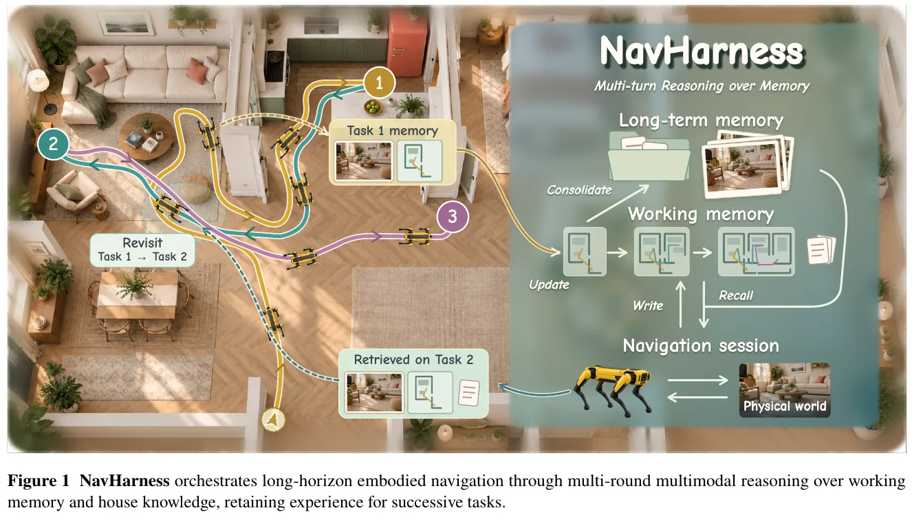
<figcaption>Original Figure 1: maps, places, and search experience from task 1 are read again by the fresh session for task 2. Memory access, observation, and action jointly form a closed loop.</figcaption>

**③ Spatial tools and online search: remembering where to go also requires knowing how to get there.**

The spatial module receives RGB-D observations, estimates pose with **ORB-SLAM3**, and projects depth into per-floor occupancy grids representing known free space, obstacles, and unexplored areas.
The navigation session uses `get_map` to inspect the map, `mark` to save named places with photographs from at most four headings, and `preview_path` to run A* through known free cells and inspect the route and its length. A route preview does not automatically move the robot; the session still chooses the next action.
Map updates pause when tracking is lost to avoid writing unreliable poses into spatial memory. Robot positions, markers, and routes use SLAM estimates rather than simulator ground-truth poses.

The execution module receives lists of forward 0.25 m or left/right 15° actions and returns new observations, collisions, and remaining budget; each `step` accepts at most 12 actions.
Each coarse action is split into five 0.05 m or 3° sub-motions to provide sufficiently continuous images for SLAM. This is the shared motion interface, rather than an additional learned low-level navigation policy.
The session alternates observations, map queries, record access, and movement. When a house note conflicts with the current view, it can inspect the original record and supply evidence for correction.

**④ Structured recovery handovers: telling the next attempt which searches remain worth pursuing.**

Recovery lets a fresh conversation reconsider the plan while inheriting evidence from the preceding search.
A session can request recovery, or a configured turn threshold can trigger assessment; the orchestrator considers exploration progress, tracking status, and earlier attempts before approving recovery and selecting whether location, route, floor, or house interpretation needs reassessment.
The outgoing session then writes a **recovery note** with movement disabled. Its search observations and process become a handover containing searched places, evidence-supported exclusions, a reliable landmark, untried options, and uncertainties. The fresh session reads it and continues the same goal from the current physical location.

> **Minimal example, for explanation rather than experimental data:** while looking for a mirror, the old session enters a bathroom and inspects only the wall above the basin; it has not checked behind the door.
> Writing "no mirror found in the bathroom" can incorrectly suggest that the entire room has been ruled out. A structured handover instead records "basin wall checked, target absent; behind the door unchecked and still worth searching."
> If the task started with 500 steps and used 420, recovery leaves 80 steps. The new session receives neither another 500 steps nor a reset to the initial robot position.

The controlled GOAT-Bench experiments use 500 movement or turning actions and 200 navigation-model turns per task, with at most one recovery and an 80-turn fallback threshold. Observation and memory tools have no movement-step charge, and recovery shares both remaining task allowances.

When location needs reassessment, a separate **wake-up session** compares surrounding views with saved place photographs and supplies a location brief to the fresh navigator.
Recognizing a familiar room differs from recovering metric alignment with the map: the former supplies semantic orientation, while the latter still depends on SLAM. Recovery itself neither moves the robot nor clears stored observations.

**⑤ Two-stage completion checks: correcting the current stop and improving later memory.**

Before ending its search, the navigator writes a **task handover** covering the goal, searched places, outcome evidence, and unfinished searches, then supplies its own completion assessment.
A separate judge session receives the goal, four views at the stopping location, sampled earlier images, the map, and execution records, using at most 12 frames. It sees neither the navigation conversation nor the navigator's self-assessment, has no tools, and returns an evidence-backed `complete`, `incomplete`, or `unknown` verdict.
By default, all roles use the same model; the conversations and evidence interfaces are separate, which does not make navigator and judge errors independent.

| Stage | When it runs | Its effect |
|---|---|---|
| Pre-stop verification | Before STOP | A definite verdict contradicting the navigator's claim on the first check returns counter-evidence to the current session, allowing further search |
| Post-stop certification | After the task actually ends | Records the final assessment for later tasks without changing the completed task's score |

**Each task receives only one pre-stop correction opportunity, and recovery does not reset it.** An `unknown` verdict permits closure, and a repeated closure request is honored. If the action-step count does not change between the checks, certification reuses the previous verdict.
The orchestrator keeps the navigator's completion claim separate from the judge's verdict and reserves environment truth for evaluation. Certification is therefore not ground truth, nor does a certified goal validate every spatial description in the handover.

**⑥ Cross-run consolidation: retaining detailed records while creating accessible knowledge entry points.**

At run end, a separate **consolidation session** reads the ledger, handovers, and existing house notes. Using file tools, it organizes routes, failed searches, corrections, and open questions into four updated files: the index, house overview, room notes, and navigation skills.
It can write only these house notes, has no navigation tools, and cannot change the map or overwrite source task records. Skills must be supported by the journal, and notes should preserve sources and distinguish certified outcomes from the navigator's interpretations, although these content requirements still depend on the model following instructions.
The next run can read the overview for search guidance and open detailed records when needed, preventing failure leads omitted by consolidation from becoming permanently inaccessible.

**⑦ End-to-end flow and training objective.**

A task follows "goal and file references → read memory → observe, query, and act → write a recovery handover and replace the conversation when needed → request closure and verification → STOP and certification → update the ledger and save spatial state." Consolidation runs after the full task sequence ends.
In benchmark evaluations, memory carries only within the same GOAT-Bench episode or IR2R-CE tour; every new episode or tour starts with empty memory. Cross-run house-knowledge reuse is evaluated separately through continuous deployment.

**No model parameters are updated, and no new navigation training loss is introduced.** Consolidation updates external notes, as expressed in the paper's Equation (11):

$$
D_h^{+}=C_\theta(D_h,L_K).
$$

Here, $D_h$ denotes existing house notes, $L_K$ the task-sequence records, and $C_\theta$ a consolidation model with fixed parameters. It produces notes for later inference rather than writing experience into model weights through gradients.

---

### 3. Results and findings
{: id="3-核心结果发现-8"}

**Evaluation scope.** GOAT-Bench Val-Unseen contains 36 scenes, 360 episodes, and 2,669 subtasks; IR2R-CE also uses Val-Unseen.
**s-SR** measures individual-task success, **e-SR** the fraction of sequences with every task completed, and **SPL** combines success with path efficiency. The table uses the three-seed means from Tables 1 and 2, with success gains in percentage points.

| Dataset and reasoning model | Independent-session s-SR | NavHarness s-SR | s-SR gain | NavHarness SPL | NavHarness e-SR |
|---|---:|---:|---:|---:|---:|
| GOAT-Bench · Qwen3.8-27B | 41.4% | 71.7% | +30.3 | 48.2 | 14.4% |
| GOAT-Bench · GPT-4o | 43.5% | 78.3% | +34.8 | 57.1 | 26.9% |
| GOAT-Bench · Opus 5 | 58.9% | 81.5% | +22.6 | 55.0 | 28.6% |
| GOAT-Bench · GPT-6 Astra | 65.1% | **83.7%** | +18.6 | **62.3** | **36.9%** |
| IR2R-CE · GPT-6 Astra | 68.4% | **85.9%** | +17.5 | **76.1** | **27.8%** |

GPT-6 Astra's IR2R-CE t-nDTW rises from 56.8 to 64.2; the paper reports that its results exceed the previous methods in both benchmark tables.
Under the 278-subtask protocol used by some prior methods, the GPT-4o version achieves 77.6% s-SR, compared with HIMM's 72.8% and 3D-Mem's 69.1%. Its 78.3% full-split result should not be treated as the same evaluation scope.
**Gains over independent sessions include the full system—mapping, recovery, and completion checks—and cannot all be attributed to memory.** Controls with matched models and task budgets provide more specific evidence about the mechanisms.

**Cross-task memory and recovery evidence, using Opus 5 on the full benchmark.**

| Control | s-SR | Change from full NavHarness |
|---|---:|---:|
| Full NavHarness | 81.5% | — |
| One long conversation for all tasks | 54.9% | −26.6 percentage points |
| No cross-task memory, with within-task mechanisms retained | 66.8% | −14.7 percentage points |
| Clear the map after each task, keep task records | 68.9% | −12.6 percentage points |
| Hide earlier task records, keep the map | 71.8% | −9.7 percentage points |
| No recovery, unchanged task budget | 71.1% | −10.4 percentage points |
| Recovery with a length-matched ordinary summary | 73.2% | −8.3 percentage points |
| No pre-stop verification | 76.1% | −5.4 percentage points |
| No post-stop certification | 79.0% | −2.5 percentage points |

The ordinary-summary and structured-handover conditions use the same recovery triggers and budgets; their 8.3-point difference supports the value of how handover information is organized.
These interventions remove different mechanisms with interacting effects, so their losses cannot be summed into component contributions. Removing all cross-task memory, for example, has a smaller loss than the sum of removing maps and records separately.

**Agent-directed memory access has its own control.** Appendix Table 12 retains the same initial memory, mapping, record writing, recovery, and completion checks, but replaces historical-text access with scheduled BM25 retrieval: at task start, after recovery, and every 10 navigation turns, it supplies at most 5 original excerpts within 2,000 tokens.
Allowing the model to choose when and what to retrieve and to pursue follow-up queries raises s-SR from 74.5% to 81.5%, a paired gain of **+7.0 percentage points, 95% CI [+5.9, +8.2]**, and SPL from 49.0 to 55.0. This control changes timing, selection, and follow-up together, so it does not isolate the superiority of one retrieval algorithm.

**Certification improves record accuracy without becoming ground truth.** In Appendix Table 16, among claimed completions, four-view certification agrees with environment truth on 90.7%, compared with 82.6% for accepting every claim. False completions still accepted account for 5.2% of all completion claims, and true completions incorrectly rejected account for 4.1%.

**Continuous deployment: consolidation adds value beyond retained maps and task records.**

  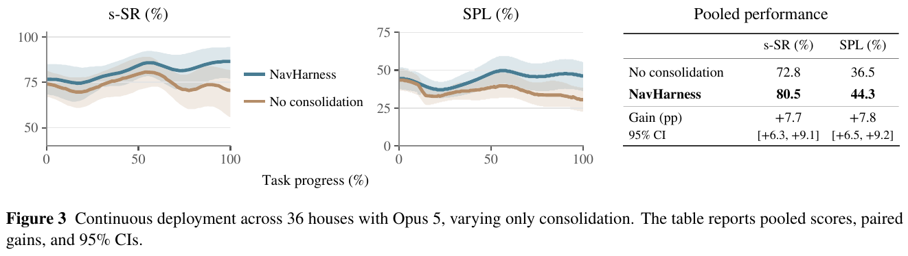
<figcaption>Original Figure 3: continuous deployment with Opus 5 across 36 houses. Both conditions retain maps and task records; only run-end consolidation differs. The curves show performance over task progress, with pooled scores and paired gains on the right.</figcaption>

The authors concatenate 10 GOAT-Bench tours per house, relocate the robot to prescribed starts at tour boundaries to model resumption after shutdown, and keep mapping and task-record retention, recovery, verification, and budgets fixed while disabling consolidation in the control.
Consolidation raises pooled s-SR from **72.8% to 80.5%**, a paired gain of **+7.7 percentage points, 95% CI [+6.3, +9.1]**; SPL rises from **36.5 to 44.3**, a gain of **+7.8, 95% CI [+6.5, +9.2]**.
**Memory can prompt additional evidence gathering or misdirect a search.** In Appendix Case 10, house notes retain the open question of whether two refrigerator descriptions refer to the same appliance. After completing its task, the navigator inspects both sides, records the answer, and passes it through consolidation to help a later task recognize a dark goal photograph.
Case 14 shows the opposite risk: a note mentioning only one mirror initially misleads the session. After recovery, it reexamines the goal image and retrieves a failed task's lead about an unchecked location behind a door. The search succeeds, but its SPL is 0.08, below the no-consolidation control's 0.38.
These cases explain recorded decisions rather than estimating the frequency of mechanisms across houses; the entire step difference between conditions cannot be attributed to a single note.

---

### 4. Limitations
{: id="4-局限性-8"}

The evaluations cover static scanned scenes and finite task sequences, without testing long-term adaptation on real robots or under object motion and layout changes. SLAM drift, cross-run coordinate misalignment, and loop-closure corrections not propagated into existing occupancy cells can undermine old-map reuse, while repeated large-model calls introduce substantial latency.
The judge can still accept false completions or reject true ones, incorrect records can become consolidated house knowledge, and goal certification does not validate every spatial or procedural description. The system also requires sufficiently capable multi-turn multimodal reasoning; the tested Qwen3.5-4B and 9B models struggle with this navigation setting.

---

## 11. SuperNav (2026)
{: id="supernav"}
———A general navigation agent organized through navigation skills, visual-point tools, and context management

📄 **Paper**: [arXiv:2610.12126](https://arxiv.org/abs/2610.12126) · [Project Page](https://zju3dv.github.io/SuperNav/)

SuperNav is an embodied-agent harness evaluated primarily through navigation. A general-purpose MLLM interprets requests and selects destinations, while readable Navigation Skills, visual-point tools, goal-progress records, and context management organize search, target rechecking, and failure recovery into a continuing loop; geometric or learned motion backends execute the movements. Its transferable idea is how skills, tools, and execution feedback sustain physical interaction, making it relevant to embodied-agent frameworks. The decision-making MLLM receives no navigation-specific fine-tuning, while the learned executor is trained on navigation trajectories.

**Full analysis and experimental results**: [SuperNav: methods, evaluation protocols, and performance comparisons in the agentic-navigation collection](/en/Agentic-Navigation-Papers/#supernav).

---

## 12. VISTA (2026)
{: id="vista"}
———Giving a multimodal model eyes that can replay and zoom: lossless visual memory plus model-directed visual inspection

📄 **Paper**: [arXiv:2610.02200](https://arxiv.org/abs/2610.02200) · [Code](https://github.com/joshhhhhan/VISTA)

**Why it is included**: VISTA is evaluated in interactive visual games rather than on robots, but it addresses this collection's shared question: leave the model unchanged, change only the harness, and let a general-purpose multimodal model retain and revisit visual evidence on demand during long-horizon interaction. The authors also name embodied tasks as the next step.

---

### Key takeaways
{: id="精华-9"}

- **The bottleneck is often not model capability but how the harness feeds information**: the same Claude Opus 5.0 scores only 40.68 RHAE on ARC-AGI-3 with the organizers' minimal harness and 100.00 with VISTA, without any training.
- **"Encode once, then discard the raw image" is a hidden ceiling for multimodal agents**: at encoding time the model cannot know which details will matter later. Archiving every original frame and letting the model revisit frames during reasoning amounts to an **explicit, addressable form of attention**.
- **Observe images rather than text grids**: a 64×64 grid costs about 4K tokens as text but only about 308 tokens as a 512×512 rendered image. Performance stays comparable or improves, and token usage per game drops from 71.9M to 30.7M.
- **Make read-only tools free and actions costly**: `inspect` and `read_pixels` consume no game actions; only `play` counts. This encourages the model to look carefully before acting, and it ends up using 57.4% fewer actions than first-time human players.
- **Simplicity transfers**: the same harness, with an almost identical short prompt, carries over to GameWorld, AI GameStore, and BabyVision and clearly outperforms the official baselines using the same model on all three.

---

### 1. Background and problem
{: id="1-研究背景问题-9"}

ARC-AGI-3 is a suite of interactive visual games that **provide neither rules nor goals**: the agent must discover through probing which object is the player, what a click does, and what counts as winning. Most high-scoring methods convert the screen into numeric grids and have an LLM write programs that form an executable world model (program synthesis), which scales poorly as visuals grow complex. Approaches that use a VLM directly suffer from two problems: each image is encoded once, so details may be lost in compression, and during long interactions early observations are truncated or replaced by text summaries once the context fills. The paper asks: **without writing programs, relying only on vision and natural-language reasoning, can the right harness push a general-purpose multimodal model to a perfect score?**

---

### 2. Methods and innovations
{: id="2-主要方法创新点-9"}

  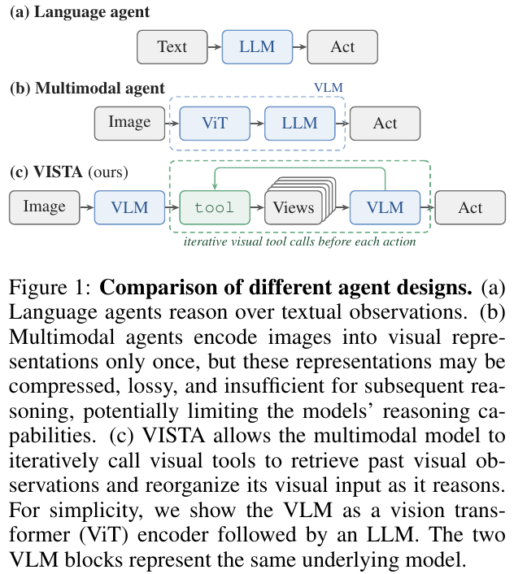
<figcaption>Three agent designs: (a) a language agent sees only text; (b) a conventional multimodal agent encodes each image once and never looks back; (c) VISTA can repeatedly call visual tools before each action, retrieving past frames and reorganizing its own visual input</figcaption>

**① Overall framework**

VISTA is not a new model but a **purely mechanical harness with no trained parameters**. It consists of three visual components—**visual observations**, **lossless visual memory**, and **visual inspection tools**—plus two **note files** (`GUIDE.md` / `WORKING.md`). The harness executes tool calls and returns images or pixel values; all understanding, reasoning, and decision-making is left to the underlying multimodal model (Claude Opus 5.0, GPT-5.6 Sol, or GLM-5.3 Flash) within one multi-turn conversation.

  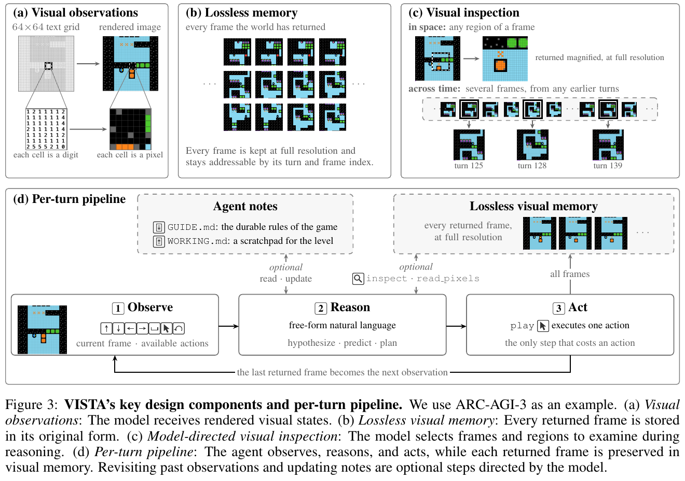
<figcaption>VISTA's core components and per-turn pipeline (ARC-AGI-3 example): (a) observations change from a 64×64 digit grid to a rendered image; (b) every returned frame is archived at full resolution and addressable by turn and frame number; (c) the model can magnify any region in space and retrieve several past frames across time; (d) each turn follows observe → reason → act, where reading and writing notes and inspecting memory are optional and only acting consumes an action</figcaption>

**② Module by module**

**Visual observation**
- **Input**: the current environment state. ARC-AGI-3 officially provides a 64×64 integer grid in which each cell is a color index.
- **Processing**: 8× nearest-neighbor upscaling into a 512×512 PNG, so each cell becomes a solid block of pixels.
- **Output**: one image plus the list of currently available actions.
- **Motivation**: images preserve object appearance and spatial relations, so the model can apply visual priors learned in pretraining ("this is a wall", "these two objects are symmetric") instead of assembling shapes from 4,096 numbers; token cost also drops sharply (see sticking point ② below).

**Lossless visual memory**
- **Input**: **every frame** the environment returns, including all intermediate animation frames triggered by an action (clicking a block, for example, returns six frames).
- **Processing**: frames are archived unchanged, indexed by `(turn, frame)`, and fully decoupled from whatever remains in the model's context.
- **Output**: a frame store that can be addressed at any time (one example game had accumulated 1,472 frames).
- **Motivation**: the usual approach encodes once and truncates or summarizes once the context fills, but the model cannot predict at encoding time which details will become critical. Keeping original images **outside** the context means compressing the context no longer destroys visual evidence.

**Visual inspection**

This interface brings the memory to life; the model decides on its own when to use it and where to look:
- `inspect(question, views)`: **in space**, crops and magnifies any rectangle of any frame (the paper's example magnifies about 13× to tell which way small blocks face); **across time**, retrieves frames from several past turns in one call for comparison, or replays the animation of an action frame by frame.
- `read_pixels(question, views)`: splits a region into a grid and returns exact RGB values per cell, for judgments the eye easily gets wrong, such as whether two colors are actually identical.
- Every call must include a `question`, forcing the model to state what the look is meant to settle.
- **Key design**: inspection tools **consume no game actions**; only `play` counts.

  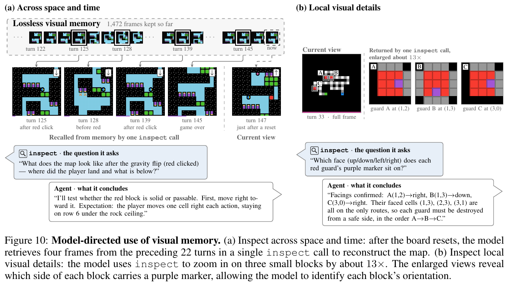
<figcaption>Two ways the model directs its use of visual memory: (a) inspection across space and time—after the board resets, a single inspect call retrieves four frames from the preceding 22 turns to reconstruct the full map; (b) inspection of local details—magnifying three small blocks about 13× reveals which side carries the purple marker, identifying each guard's orientation</figcaption>

**Note files (GUIDE.md / WORKING.md)**
- `GUIDE.md`: a rulebook that stays valid across levels and contexts (for example, "clicking an orange block turns it into an X marker; clicking the X recreates the block").
- `WORKING.md`: a scratchpad for the current level, cleared when the level advances.
- When the context nears its limit, the agent writes a handoff summary to `WORKING.md` and resumes in a fresh context; notes, visual memory, and action history are all retained.

**③ End-to-end data flow**

Within one turn, the model may exchange several messages with the harness but executes only one game action. The reader's version of a single turn:

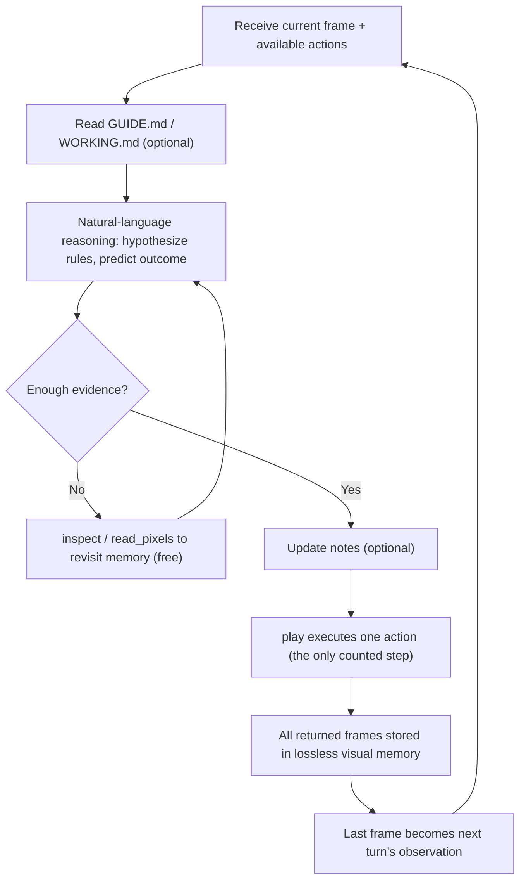

The prompt is minimal, with four core sentences: finish the game in as few actions as possible; build and keep revising a compact model of the game; before each `play`, state the expected result and afterwards state every visible change; write durable understanding into `GUIDE.md`. This "predict, then compare" pattern turns the model into an online hypothesis tester.

> **Sticking point ① — why not just put every frame in the context? An example**: the official implementation automatically feeds up to 7 frames per action. As text grids, each frame costs about 4K tokens, so observations alone take about 28K tokens per request; even as images (about 308 tokens per frame, about 2.2K total), 300 steps accumulate roughly 650K tokens and eventually overflow a 200K context and get truncated. VISTA does the opposite: each turn it **automatically provides only the last frame** (about 308 tokens) and keeps all other frames in a store outside the context, recalling 1–4 frames precisely with `inspect` when needed. The context holds the images the model currently considers relevant rather than the images that happened most recently—this is what the paper calls "explicit attention".

**④ Training objective / loss function**

None. VISTA requires no training; all gains come from harness design, and the underlying models are called as-is through closed-source CLIs (Claude Code / Codex) or with open weights.

**⑤ Evaluation metric: RHAE (sticking point ②)**

ARC-AGI-3 uses **Relative Human Action Efficiency (RHAE)** to measure how many actions you save compared with first-time human players. Let $h$ be the human baseline action count for a level (the upper median among first-time players who completed it) and $a$ the agent's action count. The level score is

$$S_{\ell,g} = \min\left(1.15,\ \left(\frac{h_{\ell,g}}{a_{\ell,g}}\right)^2\right)$$

Unfinished levels score 0. A game has $n$ levels, with level $\ell$ weighted $w_\ell = \ell$ (later levels matter more); if only the first $k$ levels are completed, the game score is the smaller of the weighted average level score and the weighted completion fraction:

$$S_g = \min\left(\frac{\sum_{\ell=1}^{k} w_\ell}{\sum_{\ell=1}^{n} w_\ell},\ \frac{\sum_{\ell=1}^{n} w_\ell S_{\ell,g}}{\sum_{\ell=1}^{n} w_\ell}\right)$$

> **An example**: a game has 2 levels with weights 1 and 2. Level 1: humans take 32 actions, the agent 16 → $(32/16)^2=4$, capped at 1.15. Level 2: humans take 40, the agent 50 → $(40/50)^2=0.64$.
> Both levels cleared: weighted average $(1.15\times1 + 0.64\times2)/3 = 0.81$, completion fraction $3/3=1$, take the smaller → **0.81**.
> Only level 1 cleared: weighted average $1.15/3 = 0.38$, completion fraction $1/3=0.33$, take the smaller → **0.33**.
> The square makes extra actions costly, and a score of 100 means **every game is completed with overall weighted efficiency no worse than humans**—actions saved elsewhere can offset a few over-long levels within the 1.15 cap.

**⑥ Differences from the official baseline (sticking point ③)**

| Dimension | Official minimal harness | VISTA |
|---|---|---|
| Observation format | 64×64 text digit grid | 512×512 rendered image |
| History retention | 175K sliding window; the oldest turns are dropped | All frames archived losslessly outside the context, retrievable by turn and frame number |
| Automatic input per step | Up to 7 intermediate frames | Only 1 frame (the last); the model inspects the rest on demand |
| Long-term knowledge | None | `GUIDE.md` + `WORKING.md`, preserved across context restarts |

---

### 3. Key results and findings
{: id="3-核心结果发现-9"}

**ARC-AGI-3 (25 public games)**: VISTA + Claude Opus 5.0 (xhigh) reaches **RHAE 100.00** with 7,302 actions in total, 57.4% fewer than first-time humans (17,135). VISTA + GPT-5.6 Sol (max) also completes all 25 games, with RHAE 99.00 (99.04 ± 0.17 over three runs). The same models score only 40.68 and 13.33 under the official implementation. To the authors' knowledge, this is the **first system to reach perfect or near-perfect performance without program synthesis**, matching program-synthesis systems such as Tycho (100.00) and Retrodict (99.86).

  
<figcaption>Ablation adding harness components step by step (GPT-5.6 Sol): replacing text grids with images 13.33→47.32; relaxing action and time limits 51.66; continuous conversation 65.82; adding the two notes 70.05; adding lossless memory and inspection 94.10 (the largest jump); adding exact pixel readout gives full VISTA at 99.00, with total actions down to 9,126</figcaption>

**Key reading of the component ablation**: the largest jump comes from lossless memory plus inspection (70.05 → 94.10, +24), while actions fall from 23,702 to 12,261—once it can look back, the model wastes far fewer blind trials.

  
<figcaption>Observation formats compared: under the same harness, image observations (99.00) perform on par with text grids (96.75) while using fewer actions (9,126 vs 10,614) and less than half the tokens per game (30.7M vs 71.9M)</figcaption>

  
<figcaption>Context length and input resolution ablations: (a) a 200K context is best (99.0); 100K loses only 0.4 while halving tokens, and 780K does worse while using more than three times the tokens; (b) 4× upscaling (256 pixels, about 77 tokens per frame) matches the default 8×, while 2× is too blurry and 16× wastes context and drops to 88.3</figcaption>

**Other findings**:
- **A longer context is not always better**: 500K and 780K drop to 94.4 and 93.9, suggesting that inspecting on demand beats keeping everything.
- **Open-weight backend**: with GLM-5.3 Flash 320B, the official implementation scores 1.89 → VISTA without inspection tools 13.27 → full VISTA **66.93**, so the visual tools account for most of the gain.
- **3D rendering**: rendering the same games in an isometric 3D view still yields RHAE 84.12 (actions rise to 20,640), far above the official text baseline.

  
<figcaption>Transfer to other visual environments (GPT-5.6 Sol): GameWorld success rate 63.3% / progress 79.3%, above novice humans (55.3% / 64.1%); AI GameStore geometric mean 140.3, above the human median (100); static BabyVision visual-tracking accuracy 41.0% → 63.2%, still well below humans at 92.3%</figcaption>

**Cross-benchmark transfer**: changing only the action interface name (`play` → `act`) and the task description, the same harness outperforms both the official baselines using the same model and the best previously reported results on all three benchmarks. BabyVision involves no interaction history, so its gain comes purely from zooming into and reading pixels within a single image, showing that the inspection tools have independent value.

---

### 4. Limitations
{: id="4-局限性-9"}

Success depends heavily on the underlying model's own capabilities; VISTA only draws them out. The models were also released after the public games, so the games may have appeared in their training data; generalization needs further verification on unseen games such as the ARC-AGI-3 private set.

---

## 13. RACE (2026)
{: id="race"}
———When should an agent think? Use the drop in action likelihood to judge whether earlier reasoning still suffices

📄 **Paper**: [arXiv:2610.12061](https://arxiv.org/abs/2610.12061) · [Code](https://github.com/HututuAI/RACE)

**Why it is included**: RACE is evaluated on text and API interaction tasks rather than on robots, but it addresses a cost problem shared by every long-horizon closed-loop agent: reasoning at every turn is expensive, so how long does earlier reasoning remain sufficient, and when is fresh reasoning needed? Its cross-turn reasoning-cover criterion and training recipe transfer directly to the multi-turn decisions of embodied agents.

---

### Key takeaways
{: id="精华-10"}

- Reasoning has a shelf life: a plan formed at one turn often supports several later actions, so there is no need to think again at every turn. The real question is not "can this turn skip reasoning?" but "how far does existing reasoning still reach?"
- Replace expensive verification with a cheap proxy: instead of regenerating actions for every candidate context, a single teacher-forced pass that measures how much the reference action's likelihood drops is enough to approximate whether the action can still be recovered.
- Deleting a reasoning step must be judged by its effect on **all later actions**, not only the current one. This is the fundamental difference between cross-turn estimation and earlier per-turn, independent decisions.
- The same labeler (LoGiC) builds SFT data offline and produces RL signals online, so one mechanism spans both training stages. In RL it combines masking with explicitly teaching the model to close `</think>`, rather than tuning the reward.

---

### 1. Background and problem
{: id="1-研究背景问题-10"}

ReAct-style LLM agents reason before every action by default, so reasoning-token cost grows linearly over long trajectories. Existing adaptive-reasoning methods either decide independently at each turn whether to think, ignoring that earlier reasoning can remain effective across several turns, or obtain supervision by generating actions with and without reasoning and comparing them. That cost becomes prohibitive as trajectories grow, and especially in on-policy RL, where it must be repeated for every batch.

---

### 2. Methods and innovations
{: id="2-主要方法创新点-10"}

#### 2.1 Motivating analysis: reasoning persists across turns, and likelihood drop predicts it
{: id="21-动机实验推理会跨轮持续生效且似然下降能预测这一点"}

  
<figcaption>Cross-turn reasoning support: (a) after removing all reasoning beyond turn s, check whether later actions can still be recovered, giving the persistence span L of the reasoning support; (b) the reference-action likelihood drop d closely tracks the action recovery rate, which exceeds 99% when d ≤ 0.001</figcaption>

Using successful Qwen3.5-9B trajectories on ScienceWorld and WebShop, the authors run two analyses:

- **Generation-based measurement (panel a)**: choose a cutoff s, keep the reasoning up to and including turn s, and remove all later reasoning while leaving actions and observations unchanged. At each later turn j, sample K=4 actions and compute the fraction $$\mathrm{Rec}_j$$ that recovers the reference action $a_j^*$. Some reasoning supports only one step, while some keeps supporting several later steps (on ScienceWorld, about 11% of reasoning steps support a full 5 steps). The authors call this **cross-turn reasoning persistence**.
- **Likelihood-based estimation (panel b)**: compute the mean per-token log-likelihood $\ell(a_j^* \mid h)$ of the reference action and compare the full and truncated contexts:

$$d_j = \ell(a_j^* \mid x_j, r_j) - \ell(a_j^* \mid \tilde x_j)$$

A smaller $d_j$ means the model remains just as confident about the action after the reasoning is removed. Experiments show that $d_j$ and the recovery rate correspond almost monotonically. This replaces "generate many times to verify" with "score once under teacher forcing."

| Dimension | Generation-based verification (prior work) | Likelihood proxy (this paper) |
|---|---|---|
| Cost per candidate context | Autoregressively sample K actions and compare | One batched teacher-forced scoring pass |
| Usable inside on-policy RL | Must be redone every batch; too expensive | Cheap enough to run on every rollout batch |
| Scope of effect considered | Usually only the current turn | The current turn plus every later reference action |

#### 2.2 Overall framework
{: id="22-整体框架"}

  
<figcaption>The RACE training framework: the core algorithm LoGiC labels each turn's reasoning as keep (THINK) or remove (SKIP); offline it builds SFT data, and online it drives reasoning masking and reasoning-closure supervision during RL</figcaption>

RACE (Reasoning Adaptation through Cross-Turn Estimation) has three parts. **LoGiC** marks which reasoning steps in a trajectory can be removed. The **SFT stage** uses LoGiC to compress full-reasoning trajectories into "think only when needed" trajectories for supervision. The **RL stage** reruns LoGiC on each batch of successful rollouts, using the result to block gradients on redundant reasoning and to teach the model directly to close its reasoning immediately where it should stop.

#### 2.3 LoGiC: Likelihood-Guided Progressive Reasoning Cover Detection
{: id="23-logic似然引导的渐进式推理覆盖检测"}

  
<figcaption>The three LoGiC steps: (1) initialize the likelihood vector of all reference actions on the full trajectory; (2) from turn 2 onward, try removing the current reasoning step to build a candidate trajectory; (3) accept the removal only if the likelihood drop of the current and all later actions stays within the threshold, and carry the result forward to later turns</figcaption>

The intuition behind a "reasoning cover": keep the fewest reasoning steps that **together** still support every action in the trajectory, like lighting an entire road with the fewest streetlights. LoGiC works as input → processing → output:

- **Input**: a successful trajectory $$\tau = (q, (r_t, a_t, o_t)_{t=1}^T)$$, with each $a_t$ treated as a fixed reference action $a_t^*$, and a threshold $\epsilon = 0.001$.
- **① Initialization**: compute the likelihood vector under the full-reasoning context, $\ell^{(0)} = [\ell(a_1^* \mid x_1, r_1), \dots, \ell(a_T^* \mid x_T, r_T)]$. The first turn's reasoning is always kept.
- **② Progressive compression**: starting at t=2, in the current compressed context $x^{(t)}$, where all accepted removals already apply, try removing $r_t$ and recompute the likelihoods $\tilde\ell_j^{(t)}$ of the reference actions at turn t and every later turn (earlier turns are unaffected and reused).
- **③ Likelihood verification**: compute $d_j^{(t)} = \ell_j^{(t-1)} - \tilde\ell_j^{(t)}$ and accept the removal only if $d_j^{(t)} \le \epsilon$ holds for every $j \in \{t, \dots, T\}$. On acceptance, update the likelihood vector and context; otherwise keep $r_t$ and add it to the cover.
- **Output**: the compressed trajectory $\tilde\tau$ and the reasoning cover C, i.e., a THINK / SKIP label for every turn.
- **Design motivation**: first, "progressive" means each decision is made on the already compressed context, so several steps that each look removable on their own are not removed together when the remainder could no longer support the actions. Second, "looking ahead" matters because a reasoning step can be irrelevant to the current action yet be the only basis for a later one.

> **Worked example**: a 4-turn trajectory, threshold ε = 0.001, initial likelihoods $\ell^{(0)}$ = [-0.20, -0.35, -0.10, -0.40].
> - **t=2, try removing r2**: recomputing turns 2–4 gives [-0.3504, -0.1003, -0.4006]; the drops 0.0004 / 0.0003 / 0.0006 are all ≤ 0.001 → **accept**. r2 is marked SKIP and the likelihood vector becomes [-0.20, -0.3504, -0.1003, -0.4006].
> - **t=3, try removing r3** (r2 already removed): the turn-3 action likelihood drops by only 0.0001, so judged on the current turn alone it is clearly removable. But turn 4 falls from -0.4006 to -0.52, a drop of 0.12 → **reject**, and r3 is kept. This is exactly the case that per-turn, independent decisions would delete by mistake.
> - **t=4, try removing r4**: the turn-4 likelihood falls to -0.95, a drop of 0.55 → reject.
>
> The final reasoning cover is {r1, r3, r4}, i.e., THINK / SKIP / THINK / THINK. The whole procedure needs only 3 batched scoring passes over candidate trajectories. Generation-based verification would sample K=4 actions at every later turn of every candidate, for (3+2+1)×4 = 24 autoregressive generations.

The threshold of 0.001 is supported by Figure 1(b): at d ≤ 0.001, the action recovery rates on ScienceWorld and WebShop are 99.52% and 99.07%.

#### 2.4 Stage 1: LoGiC-based SFT data synthesis
{: id="24-stage-1基于-logic-的-sft-数据合成"}

Successful full-reasoning trajectories are collected with DeepSeek-V4-Pro, and LoGiC is run with Qwen3.5-9B to obtain $\tilde\tau = \mathrm{LoGiC}(\tau)$. Removed turns keep an empty `<think></think>` and output the action directly. Qwen3.5-9B is then trained with standard SFT:

$$\mathcal L_{SFT} = -\mathbb E_{\tilde\tau \sim \mathcal D_{SFT}} \sum_{n=1}^{\lvert \tilde\tau \rvert} \log \pi_\theta(\tilde\tau_n \mid \tilde\tau_{<n})$$

The loss applies only to model-generated reasoning and action tokens. This step first teaches the model when it can act directly, and it serves as the initialization for RL.

#### 2.5 Stage 2: Reasoning-cover-aware agentic RL
{: id="25-stage-2推理覆盖感知的-agentic-rl"}

Offline data gradually drifts away from the evolving policy, so during RL, LoGiC is rerun on the **successful trajectories** of each rollout batch to obtain each trajectory's set of SKIP turns $S_i$; failed trajectories use standard GRPO. Two mechanisms work together:

| Mechanism | What it does | Problem it solves |
|---|---|---|
| Reasoning masking | **Reasoning tokens** at SKIP turns are excluded from the GRPO gradient, while **action tokens** are still optimized; the normalization denominator still counts all original tokens | Prevents the positive advantage of successful trajectories from also reinforcing redundant reasoning |
| Reasoning closure | After the compressed context at a SKIP turn, directly maximize the probability of generating the reasoning terminator `</think>` | Masking only withholds reward; closure supervision actively teaches the model to wrap up right there |

The masked GRPO loss ($K_i$ is the set of positions left after removing the reasoning tokens of SKIP turns, and $P_i$ is the set of all policy-token positions):

$$\mathcal L_{GRPO} = -\frac{1}{\sum_{i \in B} \lvert P_i \rvert} \sum_{i \in B} \sum_{k \in K_i} \min\left(r_{i,k}(\theta) \hat A_i, \mathrm{clip}(r_{i,k}(\theta), 1-\epsilon_{clip}, 1+\epsilon_{clip}) \hat A_i\right)$$

The reasoning-closure loss ($e$ is `</think>`, $I_{succ}$ is the set of successful trajectories, and normalizing by the total number of turns $T_i$ makes the supervision strength proportional to the share of SKIP turns):

$$\mathcal L_{close} = -\frac{1}{\sum_{i \in B} T_i} \sum_{i \in I_{succ}} \sum_{t \in S_i} \log \pi_\theta(e \mid x_i^{(t)})$$

The final actor objective is $\mathcal L_{actor} = \mathcal L_{GRPO} + \lambda \mathcal L_{close}$, with λ = 0.02 on ScienceWorld, WebShop, and AppWorld and 0.01 on DeepSearch. The task reward handles getting it right and the LoGiC signal handles thinking less; the division of labor is clear, and no length penalty is needed in the reward.

**Inference** has no extra steps: at each turn the model decides on its own whether to write a reasoning step or emit an empty `<think></think>` and call a tool directly.

---

### 3. Key results and findings
{: id="3-核心结果发现-10"}

On four benchmarks, ScienceWorld (scientific reasoning), WebShop (web shopping), AppWorld (app API use), and DeepSearch (retrieval QA), with Qwen3.5-9B as the backbone:

| Method | ScienceWorld success / Tok. | WebShop | AppWorld | DeepSearch |
|---|---|---|---|---|
| Qwen3.5-9B (Base) | 18.52 / 2,210 | 15.60 / 2,713 | 46.15 / 3,134 | 29.25 / 1,281 |
| AdaptThink | 64.49 / 1,252 | 44.60 / 748 | **68.72** / 2,381 | 33.50 / 1,481 |
| SFT+GRPO (no LoGiC) | 74.55 / 2,073 | 52.00 / 2,702 | 65.30 / 3,545 | 35.75 / 2,163 |
| **RACE-SFT-RL** | 73.28 / 1,403 | **53.40** / **535** | 65.13 / **1,900** | 35.00 / **822** |

- **Fewer tokens without losing accuracy**: compared with standard SFT+GRPO, success stays within 1.4 points while reasoning tokens fall by **32.3% / 80.2% / 46.4% / 62.0%**.
- **A small model catching up with large ones**: the 9B RACE model surpasses GPT-5.5 (69.88) on ScienceWorld (73.28) and ties Claude-Opus-4.6 on WebShop (53.40), but on AppWorld it still trails GPT-5.5 (91.11) and DeepSeek-V4-Pro (87.69) by a wide margin.
- **The RL stage contributes most**: RACE-SFT saves only 4.3%–20.0% of tokens relative to standard SFT; after RL, RACE-SFT-RL gains another 2–30 points of success over RACE-SFT and cuts tokens by another 29%–57%.

  
<figcaption>With versus without LoGiC: the top row shows success rate and the bottom row reasoning tokens per trajectory. The SFT stage shows little difference; in the RL stage, RACE-SFT-RL greatly reduces reasoning tokens at comparable success</figcaption>

- **Ablation**: removing LoGiC from RL makes reasoning cost soar (AppWorld 1,900 → 8,574 tokens), showing that standard GRPO by itself makes reasoning grow longer during training. Removing only reasoning masking sometimes yields even fewer tokens (only 124 on WebShop), but success falls to 46.00, showing that masking is what keeps reasoning from being cut too far.
- **Behavior analysis**: after RL, the share of turns that skip reasoning rises sharply (ScienceWorld 37% → 70%, WebShop 7% → 56%, AppWorld 8% → 52%). Yet the reasoning that remains is not uniformly shorter: on ScienceWorld and AppWorld each reasoning step actually gets longer (132 → 273 tokens on ScienceWorld), concentrating thought on key turns such as planning and error recovery. On DeepSearch the skip rate is only 5.77%, so reasoning is still needed after almost every retrieval.
- **Scaling**: the trends are broadly consistent across Qwen3.5-2B / 4B / 9B. Because AppWorld has little training data (147 tasks), its RL gains are unstable for smaller models.

---

### 4. Limitations
{: id="4-局限性-10"}

LoGiC relies on successful trajectories and fixed reference actions, so failed trajectories receive no reasoning signal during RL, and the threshold ε is a single global value that does not adapt to task difficulty. On reasoning-heavy retrieval QA (DeepSearch) it can hardly skip any reasoning, and on AppWorld it still lags clearly behind frontier large models. (These are observations made in this reading; the paper has no separate limitations section.)

---

## 14. Agentic Robots (2026)
{: id="agentic-robots"}

———From predicting actions to organizing execution: connecting how robot capabilities are built and used through Model, Data, Environment, and Harness

📄 **Paper**: [arXiv:2610.20442](https://arxiv.org/abs/2610.20442) · [Code](https://github.com/chonghanqin/Awesome-Agentic-Robots)

### Key takeaways
{: id="精华-11"}

A robot's capability depends on whether its reasoning model, executors, observations, interfaces, and feedback work together to support the task; action prediction alone does not explain success or failure on long-horizon tasks.
The key to an agentic system is using goals and actual execution results to decide what to do next, which capability to invoke, when to obtain new evidence, and how to change strategy after failure.
This survey organizes those decisions into four domains—Model, Data, Environment, and Harness—and 17 overlapping functional categories, bringing task execution and improvements to data, training, skills, and software into a single framework.
A harness can coordinate frozen VLAs, analytical controllers, and reusable skills, but its benefits depend on state handovers, trustworthy feedback, and recovery mechanisms as well as the size of the planning model.
Evaluation should hold executors and interaction budgets fixed to isolate the agent's contribution, while also reporting the complete system's time, computation, additional observations, and human effort.

---

### 1. Research background and problem
{: id="1-研究背景问题-11"}

VLAs connect visual and language knowledge to robot actions, while world models and world-action models (WAMs) further introduce predictions of future states or observations. Long-horizon tasks also require continuous progress tracking, responses to environmental changes, and recovery from failure.
Relevant work is scattered across model training, data collection, environment construction, and runtime software, making it easy to conflate stronger action models, better toolchains, and more effective agent decisions.
Through a unified definition, functional taxonomy, and comparisons of representative work, this survey asks where agents make decisions in robot systems and how those decisions connect the current task to future capability improvements.

---

### 2. Main methods and contributions
{: id="2-主要方法创新点-11"}

#### 2.1 Overall framework: four functional domains connecting two feedback loops
{: id="21-整体框架四个功能领域连接两种反馈循环"}

  
<figcaption>Original paper, Figure 2: Model, Data, Environment, and Harness connect through environmental interaction, execution feedback, planning calls, and learning from experience. These are functional domains rather than four stages that must run in sequence.</figcaption>

The main contribution is a **taxonomy and systematic analysis**. Model covers model learning and the conversion of observations into decisions and control; Data acquires and organizes experience; Environment constructs interactive worlds, tasks, and tests; Harness connects models, tools, and skills to actual execution and manages context, verification, and recovery.

The authors define agentic robots as robot systems whose agents use environmental observations and execution feedback to autonomously plan and coordinate tasks, deciding during execution whether to continue, acquire information, revise a plan, or recover from failure (§3.1). Implementation may reside within one model or span multiple models, programs, and tools; the criterion is **how tasks are organized and adjusted**.

| Comparison | When considering only the action policy | The survey's agentic-system perspective |
|---|---|---|
| Objects of decision-making | Output the next action segment given observations and conditions | Also select subgoals, executors, tools, observation requests, and control handovers |
| Use of feedback | Adjust actions within the current policy | Also trigger replanning, state verification, executor switching, and recovery |
| Targets for improvement | Policy parameters and their training conditions | Also data, tasks, skill libraries, training experiments, and runtime software |

These are not mutually exclusive generations of technology: a VLA can itself include memory, reasoning, or tool use, and traditional autonomous robots have long used planning and monitoring. The survey emphasizes how foundation-model agents participate in these functions; the label "agentic" does not automatically imply greater autonomy.

The four domains contain the following 17 functional categories (Table 1). A single work may span several categories: Harness VLA involves orchestration, memory, monitoring, and recovery, while Zero2Skill connects data collection, refinement, and policy training.

| Domain | Functional categories | What changes |
|---|---|---|
| Model (5 categories) | Training, Perception, Planning, Robot Control, Adaptation | Learning processes, task evidence, plans, control commands, and adaptation through experience |
| Data (3 categories) | Collection, Annotation, Refinement | Acquisition of new experience, addition of structured supervision, and selection and correction of existing records |
| Environment (3 categories) | Reconstruction, Task Generation, Benchmarking | Executable scenes, practice goals and distributions, evaluation conditions, and measurement procedures |
| Harness (6 categories) | Orchestration, Memory, Monitoring and Recovery, Skills, Infrastructure, Layered Systems | Capability invocation, information retention, failure handling, behavior reuse, service interfaces, and authority across layers |

Two connected but distinct loops operate here. The **within-task loop** adjusts the next step using current observations and execution results. The **cross-task improvement loop** turns experience into better data, models, skills, or software, then uses new tasks to test whether the improvement holds.

#### 2.2 Model: five intervention points from learning to robot actions
{: id="22-model从学习过程到机器人动作区分五种干预位置"}

  
<figcaption>Original paper, Figure 4: the same task of opening a drawer and retrieving an object can be improved through training, perception, planning, control, or adaptation. Different failures require different interventions.</figcaption>

- **Training: change how the robot learns.** Inputs include task goals, training logs, execution videos, and evaluation results. The agent generates or modifies reward code, objectives, training configurations, policy programs, or experimental procedures; an optimizer produces a new policy, which is tested through real or simulated execution. Eureka iterates reward code, ENPIRE extends this to real-robot policies and training code, and HARBOR emphasizes typed artifacts and stage checks. Measurement criteria must remain stable so that a modification does not change both the method and its judge.
- **Perception: turn observations into evidence that the next decision can use.** Inputs include images, depth, robot state, and history. Outputs may be scene relations, geometric targets, symbolic states, or requests to look again. AgenticNav supports navigation with orientation-indexed views, selective recall, and geometric tools; MG-VQA can push or move objects to reveal occluded information. Remembering an object's identity does not mean its old position is still suitable for immediate action.
- **Planning: decide what to do and in what dependency order.** Inputs include instructions, scene representations, history, and available capabilities; outputs include the next operation, subgoal, action sequence, or program. Hi Robot uses a high-level VLM to update short language subtasks for a VLA, while SayPlan checks and revises plans on a scene graph. Feasibility checks before execution and feedback afterward jointly determine how far a plan should extend: greater uncertainty makes fresh observations more important for subsequent decisions.
- **Robot Control: translate the selected operation into requirements the execution layer can handle.** Outputs may be language instructions, action primitives, target poses, programs, constraints, or cost functions. ReKep expresses keypoint relations as constraints for a solver to repeatedly optimize motion; VoxPoser constructs spatial value maps for a motion planner. The backend responsible for inverse kinematics, collision checking, and trajectory tracking directly affects the capability of an apparently identical agent.
- **Adaptation: change future behavior through experience.** Inputs include failures, corrections, demonstrations, and autonomous interaction results. Outputs may be updated context or planner configurations, or genuinely updated model parameters. TidyBot and DROC can retain experience to change decisions; OLAF and RoboCat involve policy training. The survey distinguishes recovery within the current task, adaptation through context, and long-term improvement after retraining, and calls for checking whether earlier capabilities are retained.

#### 2.3 Data: acquire experience, add supervision, and revise existing records
{: id="23-data获取经验补充监督再修正已有记录"}

  
<figcaption>Original paper, Figure 5: Collection acquires new experience, Annotation adds task, phase, and outcome information, and Refinement selects useful segments and corrects supervision. Failed trajectories may also contain progress and recovery behavior worth retaining.</figcaption>

- **Collection: decide what to collect, how, and when to reset.** Given scenes, task coverage, and execution weaknesses, the agent selects practice tasks, invokes policies or demonstration procedures, and evaluates outcomes to continue, retry, or request assistance. The survey distinguishes real physical collection, simulated execution, and synthesis with generative models: AutoRT and SOAR organize real-world collection; RoboGen connects tasks, scenes, and simulated trajectories; RoboCurate and related systems organize generation and check consistency between actions and visual outcomes.
- **Annotation: turn videos and state logs into supervision.** Processing includes trajectory segmentation, language explanations, detection and segmentation, geometric queries, and outcome verification. Outputs include textual, spatial, interaction, or outcome labels. NILS generates stage instructions from object motion, state changes, and gripper events; ECoT adds reasoning traces. Answers about spatial distances or object locations can also come from geometric computation or simulation records, with semantic interpretation and measurement evidence serving different roles.
- **Refinement: reassess whether existing data is worth learning from and whether its labels are correct.** Inputs include complete trajectories, local segments, and subsequent feedback; outputs are retained data and corrected supervision. HELP and ARS use progress estimates to retain useful portions of failed attempts. Zero2Skill can reapply human-corrected success criteria to earlier demonstrations. Selection need not operate on whole successful or failed trajectories, and the criteria themselves also require verification.

#### 2.4 Environment: examine the world, the goal, and the evaluator separately
{: id="24-environment分别检查世界目标和裁判"}

  
<figcaption>Original paper, Figure 6: Reconstruction builds executable scenes; Task Generation defines goals, constraints, and success conditions; Benchmarking fixes test conditions, reset procedures, metrics, and evaluators.</figcaption>

- **Reconstruction: turn observations or requirements into interactive scenes.** Inputs may be images, videos, demonstrations, or layout descriptions. The agent generates, combines, or modifies meshes, joints, poses, physical properties, and scene code; compilation, geometry, and simulation checks guide repairs. Articulate-Anything iterates link and joint code, while SceneSmith modifies worlds through structured scene operations and rollback. Visual similarity, static stability, correct contact behavior, and validity in the real world require different levels of verification.
- **Task Generation: define what the robot should practice.** Inputs include scenes, capability ranges, and past performance; outputs include goals, initial states, constraints, success conditions, or curriculum distributions. GenSim and RoboGen generate executable tasks, while CurricuLLM and RATs adjust practice according to learning progress. Repairing an infeasible task also requires checking that its original goal is preserved; changing only a solution plan does not necessarily create a new task.
- **Benchmarking: specify which capability a score measures.** Given the capability under evaluation and system interfaces, outputs include tasks, perturbations, observation access, reset protocols, interaction budgets, and scoring rules. Tests of open-loop skill composition, closed-loop replanning, active perception, memory, and safety measure different capabilities. If an agent also generates new tests from evaluation results, improved evaluation must be distinguished from improved robot capability.

#### 2.5 Harness: make capabilities callable, composable, verifiable, and reusable
{: id="25-harness让能力能够被调用衔接核验与复用"}

  
<figcaption>Original paper, Figure 7: tasks and evidence feed decisions and dispatch, which invoke policies, primitives, solvers, or skills and receive actual feedback. The six surrounding harness functions determine whether this execution loop is reliable.</figcaption>

A harness is **the software that tells a model what it can invoke, passes calls to the robot, and returns actual outcomes to the next decision** (§7). It manages input/output contracts, control authority, state, and retained experience as well as function names.

**① Orchestration: select an executor and hand over control.** Inputs include the task, current evidence, executor capabilities, and the previous call's result. Processing includes routing, parameter binding, function-protocol checks, state transitions, and handover timing; outputs are a concrete dispatch and subsequent decisions to continue or switch. RoboHarness uses a motion-planned memory bridge to move the robot into the starting state required by the next policy, whereas RoboRouter selects a policy suited to the current state. Selecting the right policy and preparing a state it can handle are separate problems.

> **Example:** suppose object retrieval requires three steps: open the drawer → grasp the object → place it on the table. The drawer-opening tool reports completion, but the gripper still holds the handle, while the grasping policy requires a free gripper. Calling it immediately would fail at the handover. The harness should verify the drawer state, release the handle, and reach an appropriate pose before starting the grasping policy. If sensors then show an empty gripper after the grasp, it should observe again or recover instead of advancing directly to placement. This is an explanatory illustration, not a new experiment in the paper.

**② Memory: retain past information and manage whether it is still valid.** Inputs include interactions, events, observations, and outcomes. Writing, updating, and retrieval produce evidence or task state relevant to the next decision. Putting all history into context adds redundancy, while excessive compression loses critical commitments; when a scene changes, old positions need updating or verification. Whether memory persists across tasks depends on the system.

**③ Monitoring and Recovery: turn detected problems into executable repairs.** Before execution, check candidate actions and constraints; during execution, assess progress and whether to interrupt; afterward, interpret success or failure. Then choose among retrying, grounding again, switching executors, replanning, and resetting. REFLECT passes failure explanations to a corrective planner, while DoReMi monitors constraints as skills run. Recovery must also specify whether to continue from the current disturbed state or first restore a known state, with limits on retries and conditions for human intervention.

**④ Skills: turn experience into reusable ways of acting.** Inputs include demonstrations, corrections, successful programs, and failure records. Processing includes abstraction, implementation, testing, admission to the library, revision, and retirement; outputs are loadable textual procedures or callable behaviors. Code as Policies composes perception and control APIs into programs, and subsequent skill libraries retain transferable portions. ASPIRE, RATs, and RoboRSI further use execution evidence to revise skills. The key is verifying new versions and retaining earlier capabilities, beyond simply generating more code.

| Object retained or improved | Plain-language meaning | Typical forms |
|---|---|---|
| Memory | Remember what just happened | Object states, failure records, historical views, task progress |
| Skills | Retain what to do next time this situation occurs | Textual procedures, functions, programs, callable behaviors |
| Model parameters | Change the model's own capabilities through training | Updated weights of planning models, action policies, or code models |

**⑤ Infrastructure: provide runnable, inspectable interfaces for tools and policies.** Inputs are invocation requests and robot data. Backend services handle perception, grasping, motion planning, and VLA inference; interfaces return measurements, execution records, or explicit failure information. Typed APIs, ROS 2 / MCP interfaces, remote policy services, and runtime checks outside the model jointly determine available capabilities. If a backend hides perception errors or action latency, the planner also struggles to recover correctly.

**⑥ Layered Systems: divide responsibilities by response speed and authority.** The authors use System 2 for the slow reasoning or program layer responsible for goals and subtasks, System 1 for learned visuomotor policies, and System 0 for analytical control such as inverse kinematics, motion planning, and MPC. Layers exchange language, latent features, paths, or waypoints and update at different frequencies. For example, the cited Ground Slow, Move Fast uses an approximately 2 Hz planner and a 30 Hz policy, followed by MPC tracking (§7.6). These rates belong to that configuration rather than a standard adopted by all systems.

The following reader-oriented dataflow illustrates one closed-loop execution. It synthesizes mechanisms discussed in the survey and does not imply that the paper proposes this fixed architecture.

#### 2.6 Training and inference: specify what actually changes
{: id="26-训练与推理明确哪些东西发生了变化"}

The paper proposes no unified trainable model or dedicated loss function, so its 17 functional categories should not be combined into a new training objective. Surveyed systems may modify rewards under a fixed optimizer, train policies with new annotations and corrected data, or freeze all models and update only context, skill code, or invocation procedures.

At inference time, the agent advances the task using actual observations and execution feedback. High-level calls may be triggered periodically, by progress events, or according to a budget, while lower layers continue timely motion control. Cross-task improvement retains trajectories, reviews, labels, skill revisions, or experimental results. Establishing lasting capability gains requires reevaluation on new tasks and conditions that did not participate in the modification.

---

### 3. Key results and findings
{: id="3-核心结果发现-11"}

**The paper contributes a taxonomy of four domains and 17 overlapping functional categories, comparisons across works, and a research agenda; it does not introduce a new method and evaluate it in a unified leaderboard experiment.** All figures below are results of representative works as reported by the survey (§7.5). They illustrate the importance of interfaces and toolchains and cannot be compared across rows as a method ranking.

| Surveyed work | Comparison conditions and reported results | Observation supported |
|---|---|---|
| NavMCP | QA accuracy is 74.0% with the complete three-channel protocol and 59.1% with an episode-organized interface | Intent, keyframe-based journey summaries, and persistent memory jointly affect results; the difference cannot be attributed to memory alone |
| Show-Harness | Halving the motion step size raises reported zero-shot success from 60% to 82% | The same model can perform differently when action-interface granularity changes |
| ASPIRE | On the evaluated LIBERO-Pro perturbations, adding the execution engine raises macro-average success from 14% to 62% | Primitive-level execution tracking, debugging, and repair verification are important system variables; the reasoning model cannot receive all the credit |
| Work by Kuroki and Tang | Success is 65.0% with full simulation observations and 22.5% with RGB input alone | Privileged state can hide perception costs; results with different state-access conditions require separate interpretation |

Across the domains, **correct action or tool-call syntax does not ensure successful physical execution; storing experience does not ensure that evidence remains valid; accepting one skill update does not ensure continuous long-term capability growth.** The survey notes that perception and tracking errors accumulate through toolchains and that progress in some self-improving systems is not monotonic. Actual execution evidence, independent measurement, and validation on new tasks are therefore necessary.

The authors identify four directions for further work (§8):

- **Fair evaluation:** compare the agent's decision-making contribution under the same executors, observation access, and interaction budgets, while reporting resources and human effort for the complete system.
- **Real-robot deployment:** specify skill preconditions, whether actions have finished or stopped, and recovery mechanisms for noise, contact, and stale observations.
- **Efficient robot use:** trigger high-level reasoning according to task progress and uncertainty, and account for the total cost of model waiting time, networking, tool calls, retries, and physical execution.
- **Cross-embodiment generalization:** let agents adjust plans to a new robot's sensors, motion range, and skills, and measure the effects of additional configuration, training, and transferred experience.

---

### 4. Limitations
{: id="4-局限性-11"}

The evidence comes from existing studies with different observation access, executors, recovery budgets, and simulation or real-world conditions. Classification and synthesis cannot directly establish a common causal benefit for a particular system composition.
Real-world contact and perception errors, runtime latency, reliable self-improvement, and transfer to unfamiliar robots remain open problems. A single task's success rate or a simulation score cannot replace their verification.

---

## 15. Harness² (2026)
{: id="harness2"}
———Improving the harness for the current task while learning how to improve future harnesses

📄 **Paper**: [arXiv:2610.14224](https://arxiv.org/abs/2610.14224) · [Code](https://github.com/google-research/harness2) · [Project Page](https://harness2.github.io/)

**Scope of inclusion:** Harness² evaluates online harness refinement for general agents on coding, office, and legal tasks. It is included as a methodological reference for embodied-agent self-improvement and experience reuse; its results do not establish effectiveness in robot deployment.

### Key takeaways
{: id="harness2-takeaways"}

1. An agent's capabilities also depend on the prompts, skills, scripts, tool constraints, and orchestration surrounding its model. These executable configurations can improve while model parameters remain frozen.
2. Without ground-truth answers, proposing targeted edits, rerunning the task under matched conditions, and retaining changes supported by behavioral contrasts provides more evidence than rewriting a harness by intuition alone, but still does not guarantee correctness.
3. Transferable assets include both the final skills or scripts and improvement experience: which situation exposed a weakness, which edit was tried, and what behavior changed.
4. Starting each new task from a common base harness and selectively consulting the library avoids directly accumulating rules tailored to previous tasks.
5. Additional inference budget is useful through candidate edits, execution evidence, and selective composition. Evaluation must count reruns and editing costs rather than only the steps in the final execution.

---

### 1. Background and problem
{: id="harness2-background"}

Open-world agents continually encounter new tasks whose requirements cannot usually be anticipated during harness design. Online adaptation also lacks ground-truth answers or reliable verifiers to guide edits. Existing approaches either optimize offline on fixed training tasks or refine only the current task, making it difficult to turn the process of diagnosing weaknesses, testing changes, and deciding what to retain into a capability useful for future tasks.

The paper asks how to improve both the current execution harness and the experience that guides future harness refinement **without updating model weights, accessing scoring feedback, or replaying completed tasks**.

---

### 2. Method and innovations
{: id="harness2-method"}

  
<figcaption>Figure 3: Harness² couples two levels of recursion. Within a task, editors propose invariant and domain-specific candidates, execute them, and pass the evidence to a composer. After the task, a reflector stores reusable harnesses and evidence-supported lessons in the improvement library.</figcaption>

**Overall framework.** Harness² comprises an executor, harness editors, a composer, and an experience reflector. The executor produces trajectories and deliverables; editors propose executable harness changes; the composer weighs probe evidence; and the reflector updates the experience library after each task. The paper calls the runtime configuration around a frozen model a **harness**, and the process of optimizing that configuration **harnessing**.

**① Editable objects: eight file-based components.** The inputs are the current task, a frozen model, and an initial execution harness. Edits modify a component tree and produce a new configuration that can be mounted into the agent runtime. The eight components are System prompt, Guardrails, Memory, Tool guidance, Subagents, Skills, Scripts, and Plugin. They change persistent context, on-demand procedures, deterministic capabilities, separate working contexts, or hooks inside the tool loop.

The editable surface extends beyond prompts. Scripts execute mechanical checks, Skills load when relevant, and Plugins intervene around tool calls or turn boundaries. Components are chosen to address observed weaknesses rather than added indiscriminately. The edited tree also passes structural validation: skills must have trigger guidance, scripts must compile, and referenced helpers must exist. These checks establish configuration validity, not task correctness.

**② The basic within-task step: Propose–Probe–Compose.** Without an answer key, the system first asks whether a concrete behavior changed after an edit, then decides whether that edit deserves to remain. This is the paper's behavioral-contrast signal.

- **Propose: diagnose weaknesses from a reference execution.** Inputs include the task, current harness, reference execution record, and existing experience. Two editing scopes produce complete candidate harnesses: Invariant (INV) addresses cross-domain procedures such as retries, planning, tool use, and delivery checks; Domain (DOM) addresses domain knowledge, professional procedures, deliverable structure, and constraints.
- **Probe: execute the candidates.** Each candidate runs on the same task with matched model and environment configurations, producing a trajectory and deliverables. Comparison with the reference asks whether the targeted weakness was mitigated, unchanged, or accompanied by regressions. Sampling variation and shared model biases still limit the evidence.
- **Compose: combine edits according to evidence.** Inputs include candidate diffs, reference and candidate trajectories, and the available task-local history. The composer can merge supported edits, revise conflicts, adopt a candidate, or retain the current harness. It then executes the composed harness and records the observation supporting each decision.

> **A concrete example:** A task requires reconciling schedule, staffing, and budget files into consistent deliverables. The reference execution omits cross-file reconciliation and never reopens its outputs. An INV candidate adds a script to reopen and check deliverables; a DOM candidate adds a skill for reconciling schedules and budgets. If their probe trajectories show those operations occurring, the composer has evidence to retain the corresponding edits. However, running a check does not establish that every number is correct. In the paper's Figure 9 case, the final score rises from 43.1 to 77.8; that score is available only to retrospective evaluation, not to the editors or composer.

**③ Scaling within-task search: parallel exploration and sequential revision.** Both forms build on the basic contrastive step, but their budgets control different aspects of search.

  
<figcaption>Figure 4: Parallel recursion explores multiple candidates against a shared reference set and independently composes successors. Sequential recursion passes the revised harness, accumulated trajectories, and decisions into the next step.</figcaption>

- **Parallel recursion:** Collect $k$ reference executions under the initial harness, independently propose and probe $k$ INV and $k$ DOM candidates, then let $k$ composition sessions read the entire pool. Each session produces and executes one successor harness. The implementation performs one population update, so $k$ controls search width.
- **Sequential recursion:** Starting from the initial harness, chain $k$ improvement steps. Each reads the current harness and accumulated trajectories and decisions to produce the next configuration. Later steps can retain, revise, or undo earlier changes, so $k$ controls revision depth.

> **Counting the budget:** For parallel recursion with $k=2$, there are 2 reference executions, 4 candidate probes, and 2 composed-harness executions: **8 complete task executions**, plus editing, composition, and final-selection sessions. Even $k=1$ involves 1 reference run, 2 candidate probes, and 1 composed-harness execution. A single improvement step therefore involves more than one extra run. This count excludes additional overhead such as configuration-validation retries.

For $k>1$, a final selector compares anonymous deliverables against the task request and source material. It returns an existing result, creates no new content, and cannot see the originating harness. The appendix explicitly allows it to select an output produced by the initial harness. At $k=1$, final selection is bypassed and the executed successor from the basic step is returned. Adoption means selection in this run, not verified optimality.

**④ Across-task improvement: retain the harness, applicable situation, and evidence.** The experience reflector receives the complete improvement record, including rejected candidates rather than only the selected output. It records each edit, the observed behavioral difference, and the strength of attribution before deciding whether to extract a reusable lesson. When multiple edits are confounded or only one execution supports an observation, attribution can be marked as confounded. With insufficient reusable evidence, the reflector can decline to add an experience entry.

The library retains the adopted executable harness and an `EXPERIENCE.md` describing its applicable situation, lesson, evidence, and confidence. An index lets later editors inspect relevant entries on demand. The two recursive levels differ in what they change within a task and what they carry across tasks:

| Dimension | Task-level recursion | Harnessing-level recursion |
|---|---|---|
| Updated object | The current task's execution harness $H$ | The library within the improvement harness $R_t$ that guides future editing |
| Evidence | Reference, candidate, and composed-harness executions on the current task | The complete improvement process and its decisions |
| When it acts | During probes and iterations on the same task | After task completion, for use by subsequent tasks |
| How the next task starts | The task-specific harness is not directly inherited | Start from the common base harness and selectively reuse library components and experience |

The diagram omits anonymous deliverable selection for $k>1$. Throughout recursion within a task, $R_t$ remains fixed. The next task does not directly inherit the previous task's harness, and task-specific facts discovered earlier must be checked for applicability to the new task.

**⑤ Update rules and training objectives.** The method introduces no gradient training, reinforcement-learning reward, or new loss function. It performs discrete updates to configuration files and the experience library around a frozen model. With $e=(\tau,y)$ denoting a trajectory and deliverable, the basic improvement step is:

$$
(H',e',\xi)=\Phi(q_t,H,\mathcal E;R_t).
$$

Here $\mathcal E$ is the available task-local history, and $\xi$ records candidate probes, composition decisions, and their evidence. Executing changes and retaining their evidence is central to this operator. After task completion, the improvement library is updated as:

$$
R_{t+1}=\operatorname{Update}(R_t,H_t^{\star},\mathcal D_t).
$$

$H_t^{\star}$ is the adopted harness and $\mathcal D_t$ the complete improvement record. The star denotes adoption, not correctness or global optimality. Model weights, stage instructions, and decision rules remain fixed; the persistent changes are library components and experience.

**⑥ End-to-end execution.** A new task first runs with the common initial harness to obtain reference trajectories. Editors consult the current library to propose candidates, the executor probes them, and the composer forms a successor from behavioral evidence. Exploration follows the prescribed parallel or sequential budget, a result is delivered, and reflection makes supported experience available to the next task. The whole process takes place at deployment time; benchmark answers, rubrics, and scores are used only for external evaluation.

---

### 3. Key results and findings
{: id="harness2-results"}

**Evaluation setup.** Main experiments combine two frozen executors, Gemini 3.5 Flash and GLM-5, with two initial harnesses, OpenCode and Codex, giving four configurations. The default editor and selector are Claude Opus 4.8. WorkBuddy-Bench uses 40/35/25 test tasks in Code/Web/Office, JobBench uses 34 test tasks, and LAB uses 100 test tasks. Methods process task streams, and the main tables report means and standard deviations over three shuffled runs, starting from empty libraries.

**Both a single step and parallel recursion improve performance.** The following representative results come from the main tables. The $k=5$ values add the reported recursion gains to the $k=1$ results. WorkBuddy-Bench and JobBench report scores; LAB Partial is a per-criterion pass rate (%).

| Benchmark and execution configuration | Initial harness | Harness², $k=1$ | Parallel recursion, $k=5$ |
|---|---:|---:|---:|
| WorkBuddy-Bench average, Gemini 3.5 Flash / OpenCode | 72.4 | 77.5 | 80.8 |
| WorkBuddy-Bench average, GLM-5 / OpenCode | 64.2 | 75.7 | 79.6 |
| JobBench, Gemini 3.5 Flash / OpenCode | 31.5 | 36.0 | 39.0 |
| JobBench, GLM-5 / OpenCode | 20.6 | 24.2 | 28.4 |
| LAB Partial, GLM-5 / OpenCode | 59.6 | 71.4 | 78.1 |

The largest single-step gains over the initial harness are **11.5 points** on WorkBuddy-Bench, **4.5 points** on JobBench, and **11.8 percentage points** on LAB. Increasing the budget to $k=5$ adds 2.9–3.9 points, 3.0–4.2 points, and 2.6–6.7 percentage points, respectively, across the four configurations. Harness² exceeds the compared baselines on WorkBuddy-Bench average and JobBench score in all four configurations. On LAB with Gemini 3.5 Flash / Codex, however, its single-step result of 75.6 is below Meta-Harness's 76.5; the evidence does not support claiming leadership in every setting.

**Composition, scoped editing, and the library all contribute.** With Gemini 3.5 Flash / OpenCode at $k=1$, the full method scores 77.5 / 36.0 on WorkBuddy-Bench / JobBench. Removing the library lowers these to 74.4 / 34.2; removing the INV/DOM split gives 74.6 / 32.3; and skipping composition to choose between the two candidates gives 75.9 / 34.1. In the appendix, removing Skills from an already improved harness reduces the WorkBuddy-Bench average by 5.3 points, while removing Scripts costs 3.7 points. Multiple components contribute; longer prompts alone do not explain the gains.

  
<figcaption>Figure 7: Left, edit the harness directly with the improvement library, without new reference executions or candidate probes. Right, transfer JobBench experience to WorkBuddy-Bench. A library accumulated with more exploration better supports subsequent refinement.</figcaption>

**Experience helps future tasks, but experimental protocols matter.** Directly editing without execution evidence or a library lowers Code from 73.4 to 63.2 and Web from 69.9 to 65.0. With a library accumulated at $k=5$, even without new probes, Code/Web/Office exceed the initial harness by 0.9/4.4/5.1 points. Transferring JobBench experience to single-step WorkBuddy-Bench refinement adds 0.6/0.5/2.9 points across the three domains. The appendix's leave-one-out reruns can also access later-task experience; they are an offline reuse analysis, not an estimate of online gains.

  
<figcaption>Figure 8: With OpenCode at k=2, using the same model as executor and editor still improves all five tested models on all three benchmarks. Gains therefore need not depend on a stronger external editor.</figcaption>

**The same model can improve its own harness, while full costs still matter.** In the same-model experiment, Claude Opus 5 gains 3.3, 5.5, and 3.0 points on WorkBuddy-Bench, JobBench, and LAB, respectively; GLM-5 gains 13.7 percentage points on LAB. Figure 6 counts total execution and improvement tokens and places both Harness² configurations, $k=1$ and $k=5$, for Gemini 3.5 Flash / OpenCode on the empirical Pareto frontier of the compared methods. This describes the observed cost–performance trade-off in that experiment. The main tables' `#Steps` count model turns in an executor session and cannot replace total cost accounting.

  
<figcaption>Figure 9: In a JobBench production-coordination task, procedural guardrails, a professional reconciliation skill, verification scripts, and tool guidance together address cross-file consistency and missing deliverable sections. The score rises from 43.1 to 77.8.</figcaption>

---

### 4. Limitations
{: id="harness2-limitations"}

Repeated executions and editing add substantial inference cost. Parallelism reduces latency only when resources permit, and the paper does not establish a universally optimal budget or an adaptive stopping rule. Behavioral contrasts and anonymous selection remain vulnerable to shared false assumptions, sampling variation, and evaluation noise: the appendix even reports selecting a 55-point output when a 95-point candidate was available. Long-term library consolidation, outdated-experience revision, and retrieval management also remain open.

---

## 16. GPT-6-Astra-JRT (2026) {#gpt-6-astra-jrt}
———From capability limits with demonstrations and interaction budgets to the gaps in real-world embodied intelligence

📄 **Paper**: [arXiv:2610.22471](https://arxiv.org/abs/2610.22471) · [Project Page](https://sensenova.ai/has-gpt-6-astra-achieved-embodied-intelligence)

### Key takeaways {#gpt-6-astra-jrt-takeaways}

1. A general model's embodied capabilities must be assessed together with the experience it can read, its control interfaces, and its interaction budget: this report freezes GPT-6-Astra's weights, lets it organize training demonstrations into a retrievable knowledge package, and evaluates task completion through observation, action, verification, and correction.
2. Additional interaction steps can unlock failure recovery, but the benefit depends on whether recovery remains possible; spilled liquid, parts dropped outside the workspace, and progress undone by later actions cannot automatically be recovered through repeated attempts.
3. Effective collaboration between high-level reasoning and a low-level policy requires reviewing candidate actions, checking physical outcomes, and choosing suitable action-chunk lengths; simply delegating high-level subgoals to a VLA does not improve success in the reported ablations.
4. The main deployment gaps concern physical-state verification, precise contact, transfer of experience across tasks, and the safety and mechanical costs of deliberation time; appearing complete, being declared complete, and being physically complete can be different states.
5. Future evaluations should assess satisfaction of human needs, continuing obligations created by the robot, and timely action in an evolving world to distinguish benchmark success from deployable embodied intelligence.

---

### 1. Background and problem {#gpt-6-astra-jrt-background}

The Joint Research Team (JRT) report, *Has GPT-6-Astra Achieved Embodied Intelligence?*, examines whether a general model can handle tabletop manipulation, dexterous hands, humanoids, and navigation, while asking how much benchmark success depends on demonstrations, tools, and generous budgets. The authors conduct evaluations on 12 simulation benchmarks, harness ablations, validation on 8 real-robot configurations, and a household prototype that keeps running during deliberation to examine the gap between being capable of completing tasks and being reliable and efficient enough to deploy.

---

### 2. Main methods and contributions {#gpt-6-astra-jrt-method}

  
<figcaption>Original Figure 2: training data are used to construct and freeze a knowledge package, which is copied into isolated test episodes; neither the model weights nor the package are updated during testing.</figcaption>

**① Overall framework: experience preparation, closed-loop reasoning, and action execution.** The basic system has three stages: a knowledge package stores experience extracted from training data, GPT-6-Astra chooses actions using current observations and that experience, and robot-control interfaces execute the actions and return feedback; some ablations additionally introduce a VLA to propose candidate actions. The contribution is a systematic study of evaluation protocols and harness design; the report does not introduce a GPT-6-Astra model trained with a new loss function.

**Experience preparation: turning demonstrations into files the model can retrieve and use.** Inputs are the training demonstrations permitted by each benchmark, including images, actions, and robot states, with exploration in training scenes allowed in some settings; the model inspects these materials and writes task notes, reference data, and executable code, producing a knowledge package $K$ that is frozen before testing. The authors identify six recurring components: task goals and stage ordering, motion trajectories and grasp poses, demonstration keyframes and contact crops, programs for forward/inverse kinematics and retrieval, completion checks and recovery procedures, and robot specifications and provenance records; these are observed commonalities rather than a mandated template. Package contents also vary: LIBERO organizes composable atomic skills, SIMPLE retains numerical trajectories, and navigation packages retain landmarks, stopping guidance, and recovery experience.

**Concept 1: ICL here involves more than a few demonstration images, and it does not update weights.** In practical terms, the model first writes its own operating manual containing pictures, numerical examples, and programs, then consults it and adapts actions to the current scene during testing. Each test episode starts a fresh session with the same read-only package, retains only its own interaction history, and transfers no experience to other test episodes.

**Closed-loop reasoning: using execution outcomes to revise the next action.** At test time, the model reads the instruction, package, current images, permitted robot states, and episode history, retrieves reference motions or calls helpers, and produces an action or sequence; after execution, new observations inform whether to continue, adjust, recover, or stop. Visual references help compare the current stage with demonstration stages, while numerical references and programs turn experience into executable actions; observation access varies across benchmarks, so the experiments should not all be described as using an identical RGB-only interface.

**Action execution: connecting high-level reasoning to existing robot interfaces.** Inputs may specify end-effector positions and orientations, relative directions and distances, or joint targets; inverse kinematics or existing low-level controllers translate them into physical motion. This lets the model reason about where the gripper should move while controllers handle joint coordination; humanoid experiments also explore issuing targets directly to existing motor controllers without always going through a task-trained VLA.

**Training and inference boundaries.** GPT-6-Astra's weights remain frozen throughout these experiments, so there is no additional model-training loss; ICL preparation produces an external knowledge package. System 1 in the collaboration experiments uses π0.5 fine-tuned on RoboDojo, which is separate from any update to GPT-6-Astra; inference consists of consulting experience, calling tools, executing actions, and revising decisions from feedback.

**② Interaction budgets: measuring whether the model can progress after failure.** The standard budget is the benchmark's prescribed control-step limit, while the extended budget allows up to ten times as many steps; the main-text protocol emphasizes continuing from the same environment state and history, preserving consequences of prior actions and terminating early on success or terminal failure. Additional steps create opportunities to regrasp, change approach angles, relocalize, and correct errors; episodes need not consume the full extended budget.

> **Concept 2: a numerical example separating control steps from elapsed time.** Consider a RoboDojo task with a standard budget of 200 steps at 25 Hz: 1× permits at most 8 seconds of commanded motion, while 10× permits at most 2,000 steps, or 80 seconds. Time spent observing, reasoning, and calling tools is outside those motion durations, so a simulated task with little commanded motion can still take tens of minutes or hours to run. A 10× budget also does not mean resetting the environment for ten independent attempts.

Implementation details differ across benchmarks: the navigation appendices retain earlier successes, apply additional evaluation to unsuccessful episodes, and preserve better per-episode metrics, so these results cannot uniformly be interpreted as uninterrupted trajectories continued from exactly the same state. The aggregate table also distinguishes an independently executed 1× run from the 1× cutoff of a 10× run, and their results can differ.

**③ Harness ablations: who proposes actions and who reviews them.** The authors call the slower, reasoning-oriented GPT-6-Astra System 2 and the RoboDojo-fine-tuned π0.5 System 1, connecting them through different collaboration protocols. In open-loop collaboration, GPT specifies subgoals and the VLA directly executes joint-action sequences; in closed-loop collaboration, forward kinematics first converts VLA-proposed joint actions into candidate end-effector motions, which GPT accepts, modifies, or rejects using observations before execution and feedback.

| Collaboration stage | Open-loop collaboration | Closed-loop collaboration |
|---|---|---|
| GPT inputs and outputs | Produces subgoals from the current task | Reviews candidate end-effector motions and accepts, modifies, or rejects them |
| How VLA outputs reach the robot | Candidate actions execute directly | Candidate actions first undergo GPT review |
| Main trade-off | Fewer reasoning calls, but no action-level supervision | Candidate actions can be corrected, but frequent review consumes many tokens |

The review horizon matters: $L=1$ means that each GPT call reviews one VLA-proposed end-effector action, while $L=4$ reviews four at once; this differs from direct-control experiments in which GPT generates multiple actions itself. The latter compare single actions, fixed four-action chunks, and adaptive chunks of one to four actions selected by GPT; longer chunks reduce calls but delay feedback, making the appropriate horizon dependent on the task stage.

  
<figcaption>Original Figure 7: success and token cost for different collaboration protocols and action interfaces on RoboDojo; success here is averaged equally across five task categories and should not be conflated with an average over all tasks.</figcaption>

The appendix also ablates agent components individually: a feedback subagent checks outcomes, a planning subagent decomposes tasks, and an execution subagent generates end-effector actions; history compression retains the latest four turns and summarizes earlier interactions in at most 2,000 tokens. These components are added and compared separately, and the results do not establish that adding more modules always improves performance.

**④ Real-robot validation: removing task demonstrations and cost-free retries.** The real-world study covers 8 configurations spanning single arms, dual arms, dexterous hands, wheeled mobile manipulation, and humanoids, without task demonstrations or demonstration-derived packages; it still supplies structured priors such as tool descriptions, joint limits, camera placement, and hand open/close presets, with task guidance or human-written grasp scripts on some platforms. Zero-shot therefore refers to the absence of demonstrations and task-specific training while retaining human priors and controller support. Most trials use a 60-minute wall-clock budget, with platform-specific exceptions, and people judge success from the physical outcome.

One transferable behavior is **active vision: moving the camera to inspect the contact region before acting**. When a single arm holds a flower stem, the nearby wrist camera cannot see the vase mouth below it; on the dual-arm platform, GPT moves the free arm and its wrist camera until the mouth becomes visible, then completes insertion, making viewpoint selection part of the action decision.

  
<figcaption>Original Figure 9: insertion fails with an occluded close-up view on a single-arm platform; a dual-arm platform succeeds after moving its free wrist camera to view the vase mouth. This illustrates the role of viewpoint selection, without statistically isolating camera count or other platform differences.</figcaption>

**⑤ Household prototype: evaluating whether the whole trajectory serves the user.** The authors build an interactive Isaac Sim apartment with contact, articulated fixtures, liquids, cloth, and cooking processes; GPT controls an AgiBot G2 using only onboard cameras and proprioception, with no scene demonstrations, while deliberation advances world time. The proposed evaluation considers both the user's explicit request, Intent, and continuing obligations, Duty, such as closing the refrigerator and turning off the tap while making breakfast.

| Evaluation dimension | Common static-goal evaluation | Direction proposed in this report |
|---|---|---|
| Task specification | Prescribes target conditions for objects | Expresses human needs and allows different useful outcomes |
| Source of experience | Uses task-training demonstrations | Supplies no in-domain demonstrations and requires exploration during deployment |
| Time accounting | Pauses the world during reasoning and primarily counts actions | Advances the world during reasoning, tool calls, and communication |
| Outcome judgment | Succeeds once a goal state is reached | Assesses utility, timeliness, and obligations across the trajectory |

These are design principles and a proof of concept rather than a new benchmark with large-scale statistical rankings; illustrative breakfast deadlines and utility weights should not be treated as a validated universal scoring system.

---

### 3. Main results and findings {#gpt-6-astra-jrt-results}

**Simulation: demonstrations and additional interaction bring some benchmarks close to saturation, while long-horizon tasks retain substantial gaps.** The table below prioritizes the corresponding appendix configurations and coverage, reporting full-task success rate, SR (%); RoboLab has no training set and is reported zero-shot without ICL.

| Benchmark | Standard budget 1× | Extended evaluation up to 10× | Interpretation |
|---|---:|---:|---|
| LIBERO-Long++ | 97.5 | 100.0 | 120 episodes; atomic-skill experience supports composition into task chains |
| LIBERO-PRO | 98.3 | 99.3 | All 800 episodes; experience from training exploration supports perturbation handling |
| LIBERO-Ultra-Long | 82.2 | 98.9 | 90 episodes; additional interaction substantially helps long-chain correction |
| RoboDojo, ICL direct control | 27.6 | 81.9 | 210 episodes, averaged over all 42 tasks |
| RoboLab, no ICL | 57.1 | 69.2 | No training demonstrations; results do not depend on a task knowledge package |
| SIMPLE, ICL | 96.3 | 98.8 | Only the 80 shared complete instances in Matched-8 |
| DexJoCo | 78.2 | 87.3 | 11 tasks and 55 episodes |
| Bench2Dex | 25.6 | 61.5 | 26 tasks and 78 episodes; precise control remains difficult |
| BEHAVIOR | 37.0 | Not extended | One rollout for each of 100 tasks; the standard budget is already long |
| VLN-CE R2R | 80.0 | 88.0 | A subset of 100 episodes in unseen scenes |
| VLN-CE RxR | 82.0 | 90.0 | A selected subset of 100 English-language episodes |
| LHPR-VLN | 21.1 | 28.9 | 114 long-horizon episodes manually filtered for target visibility |

**Reporting distinctions.** The report's aggregate Table 2 lists a VLA-assisted 54.2% for the independent RoboDojo 1× run, whereas its 10× result and corresponding 1× cutoff are 81.9% and 27.6% for direct control; interpreting 54.2%→81.9% as a same-configuration budget ablation is therefore inappropriate. Table 13 and Figure 7 additionally average five categories equally, giving 29.67% for ICL direct control, consistent with 27.62% when averaging all 42 tasks above; SIMPLE's 98.8% does not represent its complete six-task set, and navigation has the previously described rules for retaining better outcomes.

  
<figcaption>Original Figure 1: overview of 12 benchmarks. Published baselines use standard budgets, so extended-budget results should not be interpreted as rankings at matched elapsed time, cost, or identical observation access.</figcaption>

**Paired evidence more directly identifies the contribution of ICL.** On SIMPLE's Common-4 subset of 120 shared instances, standard-budget success increases from 70.8% zero-shot to 90.8% with ICL, a gain of 20.0 percentage points; among the 81 episodes solved in both settings, average action steps fall from 376.9 to 210.4 and test time from 47.0 to 31.4 minutes, while tokens increase from 2.64 million to 6.40 million, in addition to a one-time preparation cost per task. This 120-instance subset differs from the 80-instance Matched-8 set above, so their denominators must remain separate.

**Harness ablations: closed-loop review and adaptation are more useful than simply adding execution modules.** The following values use Figure 7's equal weighting across five categories; tokens count millions of input and output tokens per episode, rather than dollar costs matched across systems.

| Configuration | SR (%) | Tokens (millions) |
|---|---:|---:|
| GPT direct-control baseline | 15.56 | 2.560 |
| Standalone VLA π0.5 | 6.91 | GPT tokens not reported |
| GPT + VLA open-loop | 5.83 | 0.387 |
| GPT + VLA closed-loop, per-action review | 23.61 | 7.664 |
| GPT + VLA closed-loop, four-action review | 25.83 | 2.796 |
| GPT + ICL | 29.67 | 9.567 |
| GPT + ICL + VLA closed-loop | 54.17 | 19.335 |
| GPT with adaptive generated action chunks | 20.00 | 1.146 |

Reviewing four actions at once reduces tokens by 63.5% relative to per-action review while increasing success by 2.22 percentage points; ICL combined with closed-loop collaboration reaches the highest success but consumes about 6.9 times as many tokens as four-action review. In direct control, relative directional commands achieve 18.06% versus 9.72% for joint-angle control, suggesting an interface gap between semantic reasoning and low-level action representations; fixed four-action chunks achieve only 11.39%, showing that longer chunks do not automatically improve outcomes. In the appendix, adding a feedback subagent independently raises baseline SR from 15.56% to 24.72%; history compression raises it to 21.11% while reducing tokens from 2.56 million to approximately 0.86 million.

**High success can still be expensive.** At the standard budget, LIBERO-Long++ averages approximately 1.04 million tokens and 53.1 minutes per episode, while Ultra-Long averages 8.89 million tokens and 110.9 minutes. Extended RoboDojo evaluation averages approximately 38.63 million tokens and 216.6 minutes, excluding ICL preparation; Figure 5 also states that approximately 98% of tokens in the runs are cached inputs, so total tokens cannot simply be priced at the uncached-input rate. Benchmarks differ in their treatment of tool and simulation time, and some token records are incomplete; these figures indicate scale under the report's accounting conventions rather than a strictly uniform ranking of end-to-end latency.

  
<figcaption>Original Figure 5: token and time costs of ICL preparation, standard-budget execution, and additional interaction. Success gains from extra steps should be assessed alongside computation, waiting time, and preparation costs.</figcaption>

**Real robots: cross-embodiment feasibility, with remaining gaps in precise contact and long-horizon reliability.** Rigid-object pick-and-place succeeds in 17/18 trials, while plug insertion succeeds in 0/11 across three platforms; AgileX Tracer navigation and search achieve 9/23. On the Tianji dexterous hands, toy grasping succeeds in 0/3 trials with model-written grasp code and 3/3 with human-written grasp scripts, demonstrating the influence of structured priors; Unitree G1 achieves 2/3 in manipulation and 3/3 in locomotion, with its two successful manipulation runs taking approximately 74.5 and 87.8 minutes and API requests accounting for approximately 89%–92% of elapsed time. These small samples establish feasibility more than stable reliability.

**Failure modes: choosing the next step does not guarantee that correct physical states persist.** Examples include treating image overlap between a mug handle and peg as evidence of successful hanging, undoing an earlier placement while adjusting headphones, and being unable to restore a task after spilled liquid even when the cup is righted. The continuously running household prototype reveals three additional problems: focusing on the held object while overlooking displaced items or an open refrigerator, failing to discover unfamiliar mechanisms and plan whole-body positioning, and acting on images that become outdated during deliberation; these are qualitative cases rather than statistically measured failure rates on a new benchmark.

  
<figcaption>Original Figure 12: representative household failures include disturbing objects while tidying, leaving the refrigerator open, obstructing access through poor body positioning, overflowing the sink, and charring an egg through decision and execution delays.</figcaption>

---

### 4. Limitations {#gpt-6-astra-jrt-limitations}

Knowledge packages largely depend on task-related demonstrations, and transfer across tasks and embodiments is not systematically validated; observations, interfaces, coverage, budget-extension procedures, and cost accounting vary across benchmarks, without matching inference costs to prior methods, so the results better characterize capability limits than establish uniform system rankings. Most real-robot tasks have few trials, some rely on expert priors and differing success criteria, and the household prototype offers only a few qualitative cases whose physical fidelity, utility scoring, and continuous-time protocol require further validation.

---

## 17. Evo² (2026)
{: id="evo2"}
———Co-evolving the agent harness and the model that improves it

📄 **Paper**: [arXiv:2610.13025](https://arxiv.org/abs/2610.13025)

**Why it is included**: Evo² is evaluated directly on coding and memory tasks rather than on robots or embodied benchmarks. Its weight-harness co-evolution, execution-based attribution, cross-branch strategy reuse, and trajectory recovery nevertheless address mechanisms that embodied agents need for long-running harness evolution. This entry treats those mechanisms as transferable research ideas and does not extrapolate coding-benchmark gains into robot performance.

### Highlights
{: id="evo2-highlights"}

Evo² does not optimize model weights and the agent harness as separate artifacts; it turns them into a feedback loop in which better models produce stronger harness edits and evaluated edits become training data for the model. A single shared policy plays two roles: the Proposer writes executable changes, while the Reflector diagnoses their effects and recommends revision, crossover, or retention. EvoTIDE recovers useful data from incomplete edit trajectories, warm-starts the policy with SFT, and then interleaves GRPO updates across both roles. The resulting harnesses improve coding and memory tasks, transfer across benchmarks, and can also improve proprietary models whose weights remain fixed. The broader lesson is to treat an executable system as an experience generator whose structural changes can supervise the policy responsible for future changes.

---

### 1. Background / Problem
{: id="evo2-background"}

Self-evolving agents usually follow one of two paths: update model weights from self-generated experience, or rewrite the agent harness that controls prompts, tools, context, and execution flow. The former improves the model's problem-solving behavior, while the latter accumulates improvements in executable code, but separating them prevents the model from learning systematically which harness changes work. Evo² asks whether every edit, execution result, and failure diagnosis can train a stronger evolver that drives the next round of harness search.

---

### 2. Main Method / Contributions
{: id="evo2-method"}

#### 2.1 The weight-harness co-evolution loop
{: id="evo2-coevolution-loop"}

  
<figcaption>The Evo² feedback loop: a shared Proposer-Reflector policy improves the agent harness, while edits, trajectories, and execution feedback train a stronger evolver.</figcaption>

Evo² combines three coupled components. A **harness tree** stores program variants and their evaluation records; a **shared dual-role evolver** proposes changes and interprets their outcomes; and **EvoTIDE** converts search trajectories into weight-training data. The task executor stays fixed during co-evolution, so changes in candidate performance can be attributed to the harness rather than to a simultaneously changing execution model.

| Dimension | Separate self-evolution | Evo² co-evolution |
|---|---|---|
| Where experience accumulates | Model weights or harness code | Both the harness and the evolver |
| Capability of the editor | The same untrained model continues searching | Search outcomes train the next editor |
| Search structure | A single lineage or candidate archive | A tree with strategy transfer across branches |
| Role of feedback | Candidate selection | Editing, diagnosis, and stop decisions |

#### 2.2 Dual-role harness evolution
{: id="evo2-dual-role-evolution"}

  
<figcaption>Harness evolution and trajectory collection: a sampled parent is edited and evaluated before the Reflector chooses revision, crossover, or retention.</figcaption>

**Proposer: input, transformation, output.** In Type A mode, the Proposer receives a parent harness, its evaluation history, and a role prompt. It independently selects a mechanism to improve and emits executable file edits that create an initial candidate. In Type B mode, it also receives a concrete edit directive from the Reflector and turns that diagnosis into code. Type A learns to discover improvements; Type B learns to implement feedback reliably.

**Reflector: input, transformation, output.** The Reflector receives the parent and child harnesses, their edit diff, the performance change, and relevant success and failure traces. It infers what strategy the edit attempted and chooses one of three actions: `revise` provides a local correction, `crossover` imports a strategy from another branch, and `keep` retains the candidate without further editing. The quality of a directive is measured by the performance of the harness produced after the Proposer executes it, rather than by the apparent quality of the text itself.

**Crossover searching.** The system extracts mechanisms and observed effects from evaluated harnesses into a strategy library. When the current branch exhibits a weakness, the Reflector can select a donor strategy from another branch and explain how to adapt it to the current recipient. The Type B Proposer performs the source-level integration. The resulting node remains a child of the recipient and records the donor strategy, so Evo² transfers an evaluated mechanism instead of blindly merging two codebases.

This simplified view shows one complete loop: edit, execute, and reflect. A second edit occurs only after revision or crossover. `keep` is therefore also a learned action: stopping when another edit is unlikely to help saves evaluation budget.

#### 2.3 EvoTIDE: learning from harness evolution
{: id="evo2-evotide"}

One `propose → evaluate → reflect → revise` cycle can produce three trajectory types: an autonomous Proposer trajectory, a Reflector trajectory, and a directed Type B Proposer trajectory. EvoTIDE first builds a balanced mixture of successful examples for SFT and then performs interleaved GRPO over both roles as the harness tree grows. At each training round, it freezes a policy snapshot to provide counterpart behavior for the role being optimized; the snapshot is refreshed after the round, reducing instability from both roles changing at once.

Trajectory recovery addresses a common systems failure: a rollout may contain several valid edits but end with a malformed tool action. **Edit extraction** recovers concrete changes mentioned in reasoning or chat messages. **Prefix continuation** truncates the rollout after its last successful edit, restores the corresponding intermediate harness, and regenerates only the failed suffix.

> **Minimal example**: suppose a rollout produces three edits. The first two apply successfully, but the third uses an invalid tool format. Discarding the rollout would waste both valid edits. Prefix continuation restores the harness after Edit 2 and regenerates Edit 3; if the new suffix passes application, startup, and task-evaluation checks, the recovered trajectory becomes training data.

#### 2.4 Rewards, parent sampling, and end-to-end flow
{: id="evo2-training-flow"}

Both roles receive execution rewards based on the task-score change caused by their decision. For a Proposer edit from parent harness $h$ to $h'$:

$$
r_P^{\mathrm{exec}} = \hat V(h') - \hat V(h)
$$

For a Reflector intervention that changes candidate `h_0` into `h_1`:

$$
r_R^{\mathrm{exec}} = \hat V(h_1) - \hat V(h_0)
$$

Malformed, non-executable, or no-op edits receive negative rewards. A Reflector is credited for adding a mechanism only when execution traces show that the mechanism actually ran, which reduces accidental reward assignment. The bounded parent pool retains candidates from several tree depths, including strong harnesses that may improve further and weaker harnesses that teach repair behavior, while reserving a fixed sampling share for the root.

End to end, a parent harness undergoes a Type A edit, fixed-executor evaluation, Reflector diagnosis, and an optional Type B revision. The evaluated candidate enters the tree and strategy library; recovered trajectories support SFT and then role-grouped GRPO. The updated shared policy drives the next search round, closing the loop between better evolvers and better harnesses.

---

### 3. Key Results / Findings
{: id="evo2-results"}

With Qwen3.8-27B, Evo² produces the strongest self-evolved harness on all three coding benchmarks. It reaches **82.1% Pass@1** on Polyglot versus 62.6% for the strongest baseline, **48.3% Resolved** on SWE-bench Verified versus 41.0%, and **58.0% Pass@1** on LiveCodeBench versus 56.0%. In cross-benchmark evaluation, Evo² ranks first in five of six transfer directions, indicating that the learned harnesses contain reusable mechanisms rather than benchmark-specific patches.

Weight evolution contributes consistently. Compared with the untrained evolver, EvoTIDE adds **+16.3, +5.0, +9.3, and +10.6** percentage points on Polyglot, SWE-bench Verified, LoCoMo, and LongMemEval, respectively. Even when proprietary-model weights stay fixed, dual-role reflection and crossover raise GPT-5-mini to **48.3%** on a 60-task SWE-bench Verified subset, compared with 24.4% for the strongest baseline.

  
<figcaption>LiveCodeBench accuracy versus inference cost: Evo² obtains the highest Pass@1 while using fewer completion tokens and fewer LLM calls.</figcaption>

The gain is not explained by a larger inference budget. The Evo² LiveCodeBench champion uses about 3.6K completion tokens and 10.2 LLM calls per task; HGM and DGM score lower while consuming about 6.6K-6.9K tokens and 26-37 calls. Beyond coding, Evo² reaches **60.4 F1** on LoCoMo, and the same harness transfers to LongMemEval-S without further evolution, achieving **71.5% accuracy**.

---

### 4. Limitations
{: id="evo2-limitations"}

Evo² still requires many real task executions to evaluate harness candidates, so search and training costs can grow quickly with task complexity and tree size. Keeping the executor fixed improves causal attribution but does not fully represent deployments where the executor and harness change together, and the evidence is currently concentrated on coding and memory tasks rather than high-risk, strongly stateful real-world agents.

---

## 18. Dream-RSI (2026)
{: id="dream-rsi"}
———Turning historical discovery trees into a replay environment, so exploration policies are screened offline before the next real search

📄 **Paper**: [arXiv:2609.14858](https://arxiv.org/abs/2609.14858) · [Code](https://github.com/zhengkid/Dream-RSI) · [Project Page](https://dream-rsi.com/)

**Why it is included**: The paper has no embodied tasks, robot simulation, or real-robot experiments. It is included because its discovery-tree replay and exploration-scheduling mechanism may inform active exploration, failure recovery, and harness evolution for embodied agents; those applications still need separate validation.

> Version note: this entry follows the full PDF of arXiv v2 (6 October 2026); Figures 1–2 and Figures 3–7 are all taken from that version.

### Highlights
{: id="dream-rsi-highlights"}

Dream-RSI stores the exploration an agent has already done as a **discovery tree** with scores and costs, so a candidate scheduling policy can be replayed along the tree instead of re-running every expensive candidate generation. A policy-development agent edits the executable code that decides whether to open a new branch, dig deeper, parallelize, or stop; after comparing versions across many historical trees, it sends the winner back to online discovery. Each online run produces a new tree, which adds experience for the next round of replay. This loop improves the **exploration orchestrator**, not the underlying model weights; it offers a transferable idea for self-evolving agent harnesses, but the paper has no robot validation.

---

### 1. Background / Problem
{: id="dream-rsi-background"}

Long-horizon algorithm discovery often needs many propose-execute-score cycles, and a fixed exploration policy can keep investing in low-yield directions. If every new scheduling policy required re-running an entire online search, evaluating the policy would cost more than evaluating a single candidate, and feedback would arrive only after a long rollout. The paper asks whether existing execution history can be used to evaluate the next exploration policy cheaply.

---

### 2. Main Method / Contributions
{: id="dream-rsi-method"}

#### 2.1 Overall framework: online exploration, historical replay, policy improvement
{: id="dream-rsi-interface"}

  
<figcaption>Paper Figure 1: Online exploration produces a discovery tree; the tree enters a replay pool; the policy-development agent repeatedly replays and edits the scheduling code, then redeploys the winner.</figcaption>

The **online exploration module** takes the current exploration policy, the initial workspace, and earlier history. The policy chooses which nodes to continue from and assigns parallel jobs to a fixed discovery agent. Each new node stores its parent, a workspace snapshot, the full observation, and the score returned by a fixed evaluator, so one real search leaves a reusable tree-shaped record.

**Discovery trees and the shared decision interface**: the tree is rooted at the initial workspace $r$ (root score 0). Every non-root node has exactly one parent: the discovery agent resumes from the parent's saved workspace and inherits its accumulated observations. The selectable set $A(\mathcal T)$ is the root plus all current leaves. With $W$ parallel workers, the policy outputs a batch of at most $W$ nodes per round, deciding both where to continue and how many attempts run at once. Online and offline phases share this interface and differ only in state transition: online executes for real (with stochastic outcomes), while offline only replays records.

The **replay simulator** treats a recorded tree as a local environment: another policy sees only the nodes revealed so far, and after it chooses, the system reveals the corresponding children from the record. It needs no further calls to the base agent or evaluator, but it cannot produce branches absent from the history. The **policy-development module** receives the replay trajectories and scores of different candidate programs over many trees, revises the exploration policy, and hands the version with the best average replay score to the next round of online exploration.

#### 2.2 Sticking point 1: how can a historical tree evaluate a new policy that never actually ran?
{: id="dream-rsi-replay-tree"}

  
<figcaption>Paper Figure 2: A candidate policy changes the visiting order, parallel grouping, and stopping point over recorded branches; replay feedback comes from nodes that were actually saved.</figcaption>

> **Example**: a real exploration recorded two branches. Branch A has three consecutive nodes scoring 0.2, 0.3, 0.3; branch B has two nodes scoring 0.4, 0.8. A fixed policy spends 3 calls digging into A before opening B; a new policy opens A, then B, and reaches 0.8 along B by its third call. Offline replay can compare the "best score versus calls" curves of the two **visiting orders** because the node outcomes are already recorded. If the new policy wanted to explore an unrecorded branch C, replay has no answer, and it must actually run online to find out.

During offline replay, a selected leaf reveals only the **single** child recorded for it in the original tree; if the root is selected, replay opens the earliest-created branch under the root that has not yet been revealed; if no unrevealed successor remains, it returns empty. Each non-empty batch counts as one round, replay runs for at most $K_2$ rounds, and it stops early when a batch is empty. Replay therefore has no shortcut for peeking at future nodes, and its evaluation range is strictly bounded by the historical tree.

#### 2.3 Sticking point 2: why not just pick the policy with the highest score?
{: id="dream-rsi-replay"}

The system replays the same policy once for each budget preference $\rho\in\{0,0.25,0.5,0.75,1\}$, producing quality-cost points: quality is the best score among revealed nodes divided by the best score recorded in that tree, and cost is the number of discovery-agent calls in the replay. It keeps only the Pareto points that no other point beats in both quality and cost, then scores them as follows (for tree $i$ and policy version $m$):

$$V_i^m=\frac{1}{B_i}\sum_{j=1}^{L}\left(\bar a_j-\bar a_{j-1}\right)\left(B_i-\bar n_j\right)-\lambda\,\frac{1}{\lvert\mathcal R\rvert}\sum_{\rho\in\mathcal R}\frac{k_\rho}{n_\rho}$$

The first term is a normalized hypervolume: $B_i$ is the number of evaluated nodes in that tree, and $\bar a_j$, $\bar n_j$ are the quality and call count of the $j$-th Pareto point, so higher quality with fewer calls gives a larger area. In the second term, $k_\rho$ is the number of sequential rounds and $n_\rho$ the number of calls; a larger ratio means less parallelism, and $\lambda$ sets the penalty strength. Finally, scores are averaged over all historical trees to give $V^m$, so the policy does not overfit the accidental structure of a single tree.

| Dimension | Final best score only | Dream-RSI replay score |
|---|---|---|
| Search cost | A late discovery of a high score can still earn full marks | Records the calls needed to reach each quality level |
| Parallel efficiency | Does not distinguish serial from parallel | Penalizes too many sequential decision rounds |
| Budget preference | A single cutoff point | Sweeps multiple budgets and compares the quality-cost frontier |

The policy-development agent repeatedly rewrites the executable scheduling code and includes the currently deployed policy in the candidate set, so the selected policy never scores lower than the old one on the **average replay score over the existing historical trees**. This is an offline selection property; it does not guarantee that scores on new tasks or in real online runs rise monotonically.

#### 2.4 Recursive evolution and inference flow
{: id="dream-rsi-loop"}

In online round $t$, the current policy drives the discovery agent to generate a new tree (using the full earlier history as context, kept separate from the tree under construction) for at most $K_1$ rounds; when the tree is finished it joins the historical pool. The offline phase then builds $M$ policy versions: the policy-development agent inspects the previous version's replay trajectories and scores plus feedback from earlier revisions, identifies successful decisions and recurring failures, rewrites the executable policy code into the next version, and re-evaluates it on all the same historical trees. The currently deployed policy $\pi^0$ always stays in the candidate set, and the version with the highest average replay score among the $M$ becomes the next online policy. Once deployed, the new policy may reach regions never visited before, and its new real results widen the coverage of the next round of replay. The base discovery model, candidate evaluator, and execution interface stay fixed; what changes is the code that orchestrates search resources. The paper does not complete this self-improvement loop by updating model weights.

---

### 3. Core Results / Findings
{: id="dream-rsi-results"}

The current arXiv v2 evaluates four task families and nine concrete tasks: four GPU kernels in KernelBench, three mathematical-optimization problems, Lasso path solving, and one agent-harness optimization. The main controlled baseline for scientific-discovery tasks, **Recursive Fixed Exploration**, uses the same discovery agent, evaluator, initial policy, and per-round budget, and only keeps the exploration policy from updating.

  
<figcaption>Paper Figure 4: (a) Final runtime (ms, lower is better) on six held-out Lasso datasets; (b) average runtime versus cumulative discovery calls across recursive rounds, labeled by round. On both backbones Dream-RSI finds faster solvers with fewer calls.</figcaption>

In the Lasso experiments, with Gemini 3.7 Flash the average runtime falls from **2516.7 ms** under the fixed policy to **2350.6 ms**, and discovery-agent calls drop from **3200** to **1879**; with Gemini 3.1 Pro the numbers are **3587.1 → 2931.0 ms** and **550 → 317 calls**. The paper also notes that on the Pro backbone the average gain is driven mainly by the RCV1 dataset, while the other five held-out datasets are actually slower, so the average should not be read as a gain on every dataset; on the Flash backbone, five of six datasets are faster. The solvers from both backbones beat sklearn and glmnet on all six held-out datasets. Compared with the 51,200 generations reported for SimpleTES, the Pro and Flash runs use roughly **162× and 27× fewer** discovery-agent calls and reach lower average runtime, but the backbone models differ, so this is not a strictly like-for-like comparison.

In round 1 the two methods are identical by design; afterward the fixed policy stays static, while Dream-RSI "dreams" again each round over the accumulated history. By the final round, Dream-RSI reaches lower average runtime with fewer calls on both backbones (Figure 4(b)). The paper analyzes the discovered solver: SimpleTES switches between LARS and coordinate descent depending on problem dimension, whereas this solver makes the active-set optimization itself adaptive, combining strong-rule screening with Cauchy–Schwarz KKT pruning, computing exact gradients only when necessary and refreshing in full once pruning stops being effective.

  
<figcaption>Paper Figure 3: Performance (1/ms, higher is better) versus number of generations on four GPU kernel tasks; VGG16 and LayerNorm reach similar performance with fewer generations, while ConvDiv and ConvMax improve performance under comparable budgets.</figcaption>

On KernelBench, VGG16 and LayerNorm reach similar performance with **2.43× and 1.79× fewer generations**; ConvDiv and ConvMax reach **2.09× and 1.44× higher performance** under comparable budgets, and surpass the PACEvolve baseline capped at two days. The kernel discovered for ConvDiv does not optimize convolution in isolation but restructures the operator chain around downstream pooling and reduction: adjacent convolution outputs are max-pooled immediately, width pooling and later reductions run directly on register-resident values, avoiding materialization of convolution and pooled feature maps, while linear operations such as scaling, averaging, and bias accumulation are deferred to a lightweight final reduction. In mathematical optimization, Sum–Difference scores **1.145427**, above SimpleTES's 1.143975 and the fixed policy's **1.144047**; Circle Packing reaches **2.635983**, tying the strongest compared result; Autocorrelation's **1.456375** is slightly worse than the fixed policy's **1.456001** (lower is better), so the advantage does not cover every task.

  
<figcaption>Paper Figure 5: (a) Best-so-far Terminal-Bench 2.1 score during discovery, rising from the 0.7247 seed to 0.8090; (b) full-suite comparison with Claude Code (CC), Terminus-Kira (TK), and Meta-Harness (MH).</figcaption>

The harness-optimization experiment follows the Meta-Harness setup, starts from Terminus-Kira as the seed harness, and evaluates on the 89 Terminal-Bench 2.1 tasks with two independent runs per task; the discovery agent, policy-development agent, and evaluation all use Claude Opus 4.8 (Claude Code). The full-suite score rises from **0.7247** to **0.8090**, above Claude Code's 0.75 and the reproduced Meta-Harness's 0.79 (Terminus-Kira scores 0.72). The paper runs no fixed-exploration control for this task, estimating that another full search would cost over USD 100,000, so the result mainly shows the final quality of the discovered harness and cannot isolate the contribution of replay-based policy improvement over fixed exploration.

**Further analysis (all on ConvDiv):**

- **Accumulated replay worlds help**: replaying over the full history gives performance **1.90** (786 calls), while using only the current round's history gives **1.59** (430 calls). The authors suggest that multiple trees help learn a more general policy and avoid being overly conservative when fitted to a single world.
- **Replay beats writing history into the prompt**: abstracting history into directional semantic guidance injected into the prompt lowers final performance for both Dream-RSI and the fixed policy (Figure 6); the authors argue such guidance may constrain exploration.
- **Exploration behavior adapts to the stage**: as performance improves, the number of attempts evaluated per round first drops from 110 to 50; once progress stalls it rises back to about 90 and further gains follow (Figure 7).

  
<figcaption>Paper Figure 6: On ConvDiv, replaying history (Dream-RSI) beats using history only as prompt guidance.</figcaption>

  
<figcaption>Paper Figure 7: (a) Round-best performance and (b) number of evaluated attempts across recursive rounds on ConvDiv.</figcaption>

---

### 4. Limitations
{: id="dream-rsi-limitations"}

Replay is deterministic for recorded nodes but cannot evaluate branches that were never reached; insufficient historical coverage, task-distribution shift, or stochastic execution can all open a gap between offline selection and real performance. The experiments focus on software and mathematical discovery, with no robot simulation or real-robot validation; transferring to embodied agents would require handling irreversible actions, state drift, and safety constraints. The paper uses discovery-agent calls as its main search-cost metric, and storing and replaying history also consumes storage and compute. The Lasso results further show that average gains may be driven by individual datasets, and that cross-backbone comparisons (for example against SimpleTES) are not like-for-like.

---

## 19. TARSphere (2026) {#tarsphere}
———One closed loop for physical execution, human–robot interaction, and task requirements that change during execution

📄 **Paper**: [arXiv:2610.30043](https://arxiv.org/abs/2610.30043) · [Code](https://github.com/xuyicheng-zju/TARSphere) · [Project Page](https://xuyicheng-zju.github.io/TARSphere/)

### Key takeaways
{: id="tarsphere-takeaways"}

TARSphere offers a transferable design principle: update plans according to what actually executed, whether information was delivered, and whether the active goal changed, then use those same facts to judge completion.
It connects physical simulation and embodied NPCs, an execution harness for frozen multimodal models, and paired capability evaluations, making bottlenecks in reasoning, execution, and interaction observable separately.
Its evaluation shows that a shared tool interface does not eliminate differences between models: general-purpose models can outperform specialized embodied models in this setting, while substantial gaps remain between good plans, usable skills, and final success.
Even with assistance for locomotion, grasping, grounding, and mapping, task-update and human-coordination success deficits relative to Base persist, indicating that better low-level execution alone cannot resolve every difficulty.
The most reusable evaluation idea is to record stage evidence, final completion, collisions, and falls together, then use matched task variants and controlled interventions to locate capability gaps.

---

### 1. Background and problem
{: id="tarsphere-background"}

Long-horizon robot service tasks involve contact, friction, and balance, as well as situations such as a busy partner, information that must first be requested from another person, or a last-minute change of recipient.
Evaluations with fixed goals or symbolic actions can obscure why a plan fails during execution, motivating a simulation framework and benchmark that connect physical outcomes, message delivery, and task state.

---

### 2. Main methods and innovations
{: id="tarsphere-method"}

  
<figcaption>Figure 2: TARSphere-Infra connects physical execution, NPC interaction, and an event-driven task state machine; evaluation checks evidence against the task requirements active when that evidence was produced.</figcaption>

**Overall framework.** TARSphere consists of the execution and evaluation layer TARSphere-Infra, the decision layer TARSphere-Harness, and TARSphere-Bench built on both: Infra produces execution outcomes under physical and interaction constraints, Harness lets a frozen multimodal large language model (MLLM) call skills using observations, memory, and feedback, and Bench compares capabilities through paired task conditions.
The model receives public observations and events; complete task ground truth and scoring requirements remain private to the environment and evaluator.

**① Physical execution: a tool call does not establish that an action has completed.** Robot actions or skill calls enter Isaac Sim / PhysX, which runs a G1 robot, objects, and NPCs in GRScenes-100 scenes; locomotion follows a learned policy, while grasping executes planned arm motion and checks actual acquisition and continued retention of the object.
Outputs include synchronized RGB-D, LiDAR, action feedback, and collision information rather than only symbolic movement or grasp success. NPCs' visible poses are synchronized with their collision proxies, aligning the human motion the robot sees with the physical contact constraints it encounters.

**② Interaction and state machines: the world advances only when actions finish and messages arrive.** Each NPC maintains its pose, behavior, availability, and authorized knowledge; an LLM backend routes natural-language questions to authorized topics and returns episode-defined replies.
Robot-to-NPC queries require proximity and visibility, and NPC speech reaches the robot only within hearing range; generating an utterance therefore does not establish that the other party heard it.
An event-driven finite-state machine (FSM) admits events according to directed acyclic graph (DAG) prerequisites and live physical and interaction conditions; NPC actions follow Idle → Queued → Acting → Done, and state transitions are committed only after confirmed action completion or actual message delivery.

> **Concrete example, corresponding to the recipient update in Figure 4:** Elena initially asks the robot to bring her a bottle, then requests delivery to Marcus instead. Scheduling this notification in the task logic does not mean the robot has received it: the update changes the active task binding only after actual message delivery. Completion then requires physically handing the correct bottle to Marcus and receiving acceptance. The recipient-change event itself earns no score, but changes the recipient against whom subsequent outcomes are judged.

The diagram below isolates this causal chain; the task update inserted into the workflow does not add an extra scored stage.

**③ Harness observations and hierarchical memory: connect the current view to previously confirmed facts.**

  
<figcaption>Figure 3: Current observations and hierarchical memory inform a frozen MLLM, which calls controller backends through a unified skill interface and continues deciding from new observations, execution feedback, and public events.</figcaption>

Each decision receives current egocentric RGB, body-frame LiDAR information, public events, and execution feedback; RGB-D also supports entity grounding and the online map.
Short-term history retains recent actions, outcomes, and visual-state notes, while long-term records retain the active plan, dialogue, and robot state.
In addition, **semantic spatial memory** associates model-selected people, objects, and places with locations measured from synchronized RGB-D and supporting keyframes; **self-managed key memory** lets the model retain, revise, or forget facts, producing context for later navigation and replanning.

| Memory component | Input and processing | Downstream use |
|---|---|---|
| Short-term history and long-term records | Retain recent execution traces, plans, dialogue, and robot state | Continue unfinished steps without ignoring previous feedback |
| Semantic spatial memory | Associate selected entities with measured locations and supporting keyframes | Return to previously observed targets or people |
| Self-managed key memory | Let the model choose facts to retain, revise, or forget | Adjust active information as the task changes |

These components retain what just happened, where a target is, and which facts should currently be trusted, respectively, rather than merely lengthening the input history. The paper does not define them as modules that retrain the model; their benefits come from how runtime context and tools are organized.

**④ A multi-level skill interface and closed-loop execution.** The input is a structured action list produced by the MLLM; the interface dispatches calls to bounded body, gaze, and end-effector primitives, as well as grasping, navigation, dialogue, and memory operations.
For example, `grasp_object` handles grasping a visible target, `navigate_to_entity` navigates using remembered entity information, and `ask` and `speak` perform interactions subject to spatial conditions; the grasping backend in Figure 3 includes SAM3, GraspGenX, and cuRobo.
The output is measured execution feedback, including motion residuals—the error between actual and requested motion—and collision bearings, allowing the next decision to correct the action; navigation and action backends can also be replaced by corresponding policies.

End to end, the robot first uses images and memory to locate a target, selects a navigation or manipulation skill, then checks whether it arrived, made contact, or actually holds the object before deciding whether to continue delivery or revise its plan.
By default, each decision uses the current image and 10 text-history steps and adaptively proposes 1–5 actions; actions execute serially, control can return to the model at tool boundaries with remaining actions canceled, and each episode has a 100-decision cap.

**⑤ Benchmark curation: make task semantics, causal dependencies, and scene geometry agree.**

  
<figcaption>Figure 4: Starting from task cards, NPC profiles, and scene assets, a coding agent jointly solves entity bindings, event dependencies, and interaction positions; multi-agent review, human audit, and simulation validation then produce executable tasks.</figcaption>

Inputs are task cards, character profiles, authorized knowledge, and 3D scene assets; a coding agent follows `SKILL.md` to jointly determine entity bindings, causal and temporal dependencies, robot and human positions, visibility, and clearance, producing executable task specifications.
Specialized review agents then check causality, dialogue, ground-truth bindings, scoring shortcuts, geometry, and diversity; humans audit meaning, naturalness, and layout, and simulation checks event delivery and physical execution. The feedback improves both the tasks and the curation rules.

The resulting benchmark contains **30 indoor scenes and 360 episodes**, including 10 homes and 20 commercial spaces; its two task families are navigate-and-report and fetch-and-deliver.
Each Base task has five paired conditions sharing its scene and task family, giving six evaluation groups including Base; five conditions does not mean five groups in total.

| Condition | What changes | Capability assessed |
|---|---|---|
| PR: perceptual robustness | Sensing conditions such as lighting, resolution, or depth noise | Completing the task when observations degrade |
| DA: disruption adaptation | Temporary blockage or person/tool unavailability, with the original goal unchanged | Waiting, rerouting, or adjusting execution |
| TU: task update | An authorized event revises task requirements | Receiving a revision and executing the updated goal |
| HC: human coordination | Another person's information or onsite action is required | Obtaining help to achieve a known goal |
| IU: intent understanding | Requirements need clarification, preferences need confirmation, or context must be interpreted | Establishing what the person actually wants |

**⑥ Training and evaluation equations: score execution evidence rather than self-reported completion.** The paper introduces no new MLLM training loss: all 8 evaluated models remain frozen, with no parameter updates for these evaluation tasks; its main contributions are the execution framework, task curation, and evaluation design.
The interaction loop is written as:

$$
B_k = \pi(o_{t_k}, h_{t_k}), \qquad
\langle s_{t+1}, f_t \rangle = W(s_t, \operatorname{Exec}(a_t), e_t), \qquad a_t \in B_k.
$$

The policy produces an action sequence from observations and history; following execution, the world combines the action with external events to update the robot, objects, people, and active task state, returning measured feedback for the next decision.

Evaluation checks five stages in order: **task understanding, onsite target observation, onsite task completion, recipient observation, and final task completion**; depending on the task, the onsite outcome can be an inspection conclusion, received information, or a physical grasp.
Stage Progress and final Success are computed separately:

$$
\operatorname{Prog}(e) = \frac{1}{5}\sum_{i=1}^{5} g_{e,i}q_{e,i}, \qquad
\operatorname{Succ}(e) = c_e(1-u_e).
$$

$g_{e,i}$ indicates whether evidence satisfies stage dependencies and live conditions, and $q_{e,i}$ measures its quality; plans, inspections, and delivered reports receive continuous quality scores, while observations, information receipt, and physical outcomes are binary.
$c_e$ requires all prerequisites to be fulfilled and the correct report delivered to the intended person or the correct object handed over and accepted; $u_e$ indicates terminal fall or object loss. Terminal failure preserves previously earned Progress, and ordinary contact alone does not veto Success, so safety must be reported separately.

> **Concrete example, solely to explain the equation:** If plan quality is 0.5, target observation earns 1, and the remaining stages are not established, Progress is `(0.5 + 1 + 0 + 0 + 0) / 5 = 30%`, while Success remains 0. Checking off every step in the robot's own plan cannot replace evidence of actually receiving an answer, grasping the object, or completing delivery.

Path efficiency Eff. is **the ratio of actual path length to the authored route length on successful Base episodes**, with lower values preferred; it is not SPL and covers only successful Base episodes with complete path records.
The paper separately reports decision counts, tokens per decision, and the proportions of episodes with collisions or falls, avoiding reliance on task success alone.

---

### 3. Core results and findings
{: id="tarsphere-results"}

**Main results: general-purpose models can outperform specialized embodied models under this shared harness.** The table below gives average final Success from paper Table 2, equally weighting Base, PR, DA, TU, HC, and IU; these are neither stage Progress nor Base-only success rates.

| Model | Navigate-and-report success | Fetch-and-deliver success |
|---|---:|---:|
| Gemini-3.8-Flash | **40.6%** | **47.8%** |
| Claude Sonnet-5 | 16.9% | 24.6% |
| GPT-5.6-Terra | 15.0% | 12.8% |
| Qwen3.7-Plus | 11.1% | 5.0% |
| Gemma-4-31B | 13.4% | 2.2% |
| Qwen3.8-27B | 0.0% | 0.0% |
| RoboBrain2.0-32B | 0.0% | 0.0% |
| Hy-Embodied-VLM-1.0 | 0.0% | 0.0% |

The embodied models earn some stage credit but complete no episodes; this finding is specific to these tasks, observations, and skill interfaces, and does not establish that they also trail all general-purpose models on their native control tasks.

  
<figcaption>Figure 6: Performance broken down by task condition, stage, Progress distribution, and subtype; forming a plan does not guarantee subsequent onsite evidence gathering, execution, or final completion.</figcaption>

**Capability gaps depend on the task family.** Gemini achieves 60.0% Base success in both families, but navigate-and-report drops to 16.7% under TU and 16.7% under IU; fetch-and-deliver retains 46.7% under TU, 43.3% under HC, and 40.0% under IU. Identical Base success can conceal different bottlenecks in task updates, coordination, and intent understanding.

**Execution and memory components help, with condition-dependent effects.** On the balanced ablation subset using Gemini, the full Harness reaches average Progress / Success of **70.5% / 45.8%**; removing the grasp skill lowers these to **51.0% / 20.8%**, a 25.0-point Success drop, while removing LiDAR or motion residuals lowers Success by 12.5 and 11.1 points, respectively (Table 3).
Removing semantic spatial memory reduces average Success to 41.7% but improves PR and HC, showing that an overall benefit need not hold monotonically for every condition; this subset also cannot be directly subtracted from the full main-results table.

**Low-level assistance improves completion without eliminating higher-level capability gaps.** In controlled experiments on 30 fetch-and-deliver Base tasks and their DA, TU, and HC variants, joint assistance for locomotion, object attachment, grounding, and mapping improves Base Success from 60.0% to 66.7%, TU from 46.7% to 53.3%, and HC from 43.3% to 50.0% (Table 4).
However, the TU / HC deficits relative to Base remain **13.3 / 16.7 percentage points**, while the DA deficit narrows by only 3.3 points. These are relative gaps within the same assistance setting and do not mean that low-level execution has no effect on Success.

**Success rates still conceal extensive safety problems.** Across model–task groups, collisions occur in 84%–100% of episodes and falls in 9%–47%; even the strongest model, Gemini, incurs collisions in 84% / 98% of episodes and falls in 14% / 16% for the two task families, respectively (Table 2).
Independent skill calibration under valid calls reports 229/240 successful grasps and 285/300 correct target detections, while only 260/300 targets are localized within 10 cm of their 3D references (Table 5), illustrating the remaining gap between usable individual skills and reliable task completion.

**Task quality depends on the curation and review loop.** An independent audit of 360 matched task specifications finds **96.7%** usable episodes for the full pipeline, versus **45.0%** without multi-agent review; removing human audit, rule refinement, or simulation validation gives 65.0%, 72.5%, and 83.3%, respectively (Table 6).
Comparing semantic and human scores on 180 trajectories gives plan SRCC / PLCC of 0.86 / 0.88 and inspection/inquiry report correlations of 0.91 / 0.92; a separate audit of 60 HC and 60 IU tasks passes both causal soundness and feasibility, without proving that every task or score is error-free (Table 7).

---

### 4. Limitations
{: id="tarsphere-limitations"}

Experiments cover one robot body and two indoor service-task families in simulation, without real-robot transfer validation; differences in real sensing, contact, and human behavior remain to be addressed.
Model conclusions depend on the shared Harness, task definitions, and constrained NPC interactions; semantic scoring is checked against sampled human judgments but does not represent every open-world task or human interaction.

---

## 20. uni-robot-agent (2026)
{: id="uni-robot-agent"}
———Unified tools, reliable feedback, and pipelined execution unlock robot manipulation with open models

📄 **Paper**: [arXiv:2611.01560](https://arxiv.org/abs/2611.01560) · [Code](https://github.com/Open-RUA/uni-robot-agent) · [Project Page](https://uni-robot-agent.com)

### Key takeaways
{: id="uni-robot-agent-highlights"}

- **Robot-use performance depends on the interface to the physical world as well as model weights**: consistent action semantics, diagnosable feedback, and observation consistency can substantially improve the same open model's performance.
- **Completed motion is not completed manipulation**: pose errors tell the agent where the hand ended up, while post-action images show whether the object was actually lifted; both forms of evidence are necessary.
- **No depth does not mean no geometry**: RGB, camera calibration, and corresponding points across views can recover 3D positions; the difficult parts are accurate pointing, correct geometric code, and verification.
- **Concurrency means overlapping reasoning with motion, not executing conflicting actions on the same arm simultaneously**; exclusive-resource queues and feedback dependencies remain essential.
- Future RUA training should jointly develop visual understanding, spatial grounding, geometric coding, and embodied reasoning rather than merely fit action outputs; this paper supplies infrastructure for that research but **does not propose or validate a new training algorithm**.

---

### 1. Background and problem
{: id="uni-robot-agent-background"}

Robot-Use Agents (RUAs) let general-purpose multimodal models operate robots through tools, drawing directly on task decomposition, code generation, and failure recovery. Reliance on proprietary models limits weight adaptation, deployment optimization, and large-scale interaction. Existing open-model systems often compensate with simulator ground truth or task-specific skills; this paper first establishes a reusable harness—the runtime connecting model decisions to robots and returning execution evidence—across models and environments to assess what open models can already do and collect standardized interaction records for future training.

---

### 2. Methods and innovations
{: id="uni-robot-agent-method"}

  
<figcaption>Figure 2: Tool requests pass through orchestration and shared tools to environment, action-model, or perception services, then execute on concrete backends; results return to the model through the same interfaces.</figcaption>

**① Overall framework: decouple models, robot tools, and concrete environments.** The five layers are Agent, Orchestration, Tools, Services, and Backends: the agent makes decisions, orchestration schedules requests, shared tools implement robot-operation semantics, services manage runtime resources, and backends connect to specific robots, simulators, or models. Replacing the agent runtime, perception model, or environment does not require rewriting the entire control stack.

**② Data flow through the five layers.**

- **Agent layer: instructions and observations → reasoning and context management → tool requests.** The model receives task instructions, environment descriptions, tool definitions, recent images, and interaction history through runtimes such as Codex or Claude Code. It chooses when to observe, localize, move, or revise its strategy; the harness does not supply a prewritten task plan.
- **Orchestration layer: tool requests → validation, registration, and resource scheduling → execution jobs and results.** MCP adapters route requests to `ToolExecutor`, while unified tool definitions specify schemas and handlers. The executor distinguishes immediate calls, background jobs, and exclusive-resource queues, avoiding direct coupling between agent runtimes and native robot APIs.
- **Tools layer: common arguments → shared operation logic → motion or perception feedback.** `GripperTools` provides `move`, `grasp`, `release`, and `hold`; `SceneTools` handles state inspection, scene capture, and localization; `SkillTools` supports skill reading and writing; `EpisodeTools` manages episode completion. Arm and camera parameters come from environment descriptors, while units, operation meanings, and feedback formats remain consistent across environments.
- **Services layer: domain requests → service calls and resource management → state, action proposals, or segmentation results.** `EnvironmentService` handles state, snapshots, stepping, and execution receipts; `ActorService` supports action-model proposals and batching; `PerceptionService` supplies capabilities such as image segmentation.
- **Backends layer: common interface requests → native implementations → actual execution results.** Environment adapters connect RoboUse, RoboDojo, or physical robots, while action and perception backends can use OpenPI/JAX π0.5 and SAM3. The action-model service is optional: its presence in the architecture does not mean the primary zero-shot RUA experiments depend on a hybrid π0.5 policy.

**How do shared tools avoid repeated implementations?** Put the logic for completing a `move` in the shared layer, and let each environment adapter translate native commands: the tool generates intermediate targets and monitors errors; the adapter converts targets into commands accepted by its robot and returns the measured state.

> **Minimal example**: With 3 tools and 2 environments, separately implementing every pairing requires 6 tool implementations. The shared design maintains 3 tools and 2 adapters, or 5 components. Adding a third environment requires 3 more tool implementations in the first design but only 1 adapter in the second. This illustrates interface reuse, not a guaranteed proportional reduction in code size.

**③ Two levels of concurrency: reasoning can run ahead, while arm motions remain ordered.** A background call immediately returns a job handle, letting the model continue reasoning that does not depend on its outcome and retrieve feedback later. Calls sharing an exclusive resource execute in submission order; non-conflicting operations such as reading an existing snapshot can run concurrently. The model can submit multiple requests at once and wait for results in batches. If new evidence invalidates a plan, `flush_queue` cancels calls that have not started on the specified resource; flushing a queue cannot undo actions already executed.

  
<figcaption>Figure 4: Serial interaction waits after each action; the two-stage pipeline overlaps subsequent reasoning with the current action while calls sharing a resource remain queued.</figcaption>

> **Minimal example (illustrative, not an experimental measurement)**: Two reasoning steps each take 2 seconds, two actions each take 5 seconds, and the second reasoning step does not depend on the first action's result. Serial execution takes 2 + 5 + 2 + 5 = 14 seconds. With pipelining, the first action runs from seconds 2–7, the second reasoning step runs from seconds 2–4, and the second action waits to execute from seconds 7–12, totaling 12 seconds. If the second decision must first check whether the first grasp succeeded, this advance reasoning is not valid.

**④ Six reliability mechanisms: make feedback correspond to what actually happened.**

  
<figcaption>Figure 5: The six designs cover consistent snapshots, duplicate-action prevention, coordinated arm and gripper control, progress monitoring, outcome diagnosis, and visual-history management.</figcaption>

- **Immutable snapshots.** Bind images, camera calibration, and robot state to a single snapshot with an ID, timestamp, and version. Localization uses the camera pose at capture time rather than the new pose after motion, avoiding a mismatch between old images and new extrinsics.
- **Duplicate-action prevention after communication failures.** Requests have identities and execution records. A lost reply triggers receipt recovery rather than blindly repeating the physical action; unresolved execution status blocks subsequent actions and remains explicitly uncertain.
- **Coordinated arm and gripper control.** `move` can receive a target pose and gripper opening together, allowing opening changes during motion instead of forcing separate movement and gripping commands.
- **Stopping based on measured progress.** After every step, the tool reads the actual pose and generates bounded intermediate targets. Arrival, stalling, divergence, planning rejection, abnormal motion, or budget exhaustion stops execution and returns a reason, rather than assuming success after a fixed number of steps.
- **Numerical feedback plus images.** Actual and target poses, position and orientation errors, stop reasons, and post-action images let the model distinguish failure to reach a pose, reaching it without holding the object, and the need for a different manipulation strategy.
- **Useful context retention.** A sliding window replaces old images with text placeholders but preserves recent images, instructions, and action records. Batched image eviction keeps prompt prefixes more stable for cache reuse; if the budget is still exceeded, the policy model itself compacts the history.

Appendix D specifies the monitored `move` algorithm. Position error is Euclidean distance, and orientation error between unit quaternions is:

$$
d_q(q_1,q_2)=2\arccos\!\left(\min\{1,\lvert q_1^\top q_2\rvert\}\right).
$$

A pose is reached only when both position and orientation errors satisfy their respective tolerances; this is still **not a grasp or task-success judgment**. To detect divergence, the algorithm tracks $v_t=e_t^p+0.1e_t^q$, with position in meters and angles in radians, and stops after two consecutive instances of $v_t>v_{t-1}+0.01$. Stalling detection examines four consecutive accepted steps and returns control when neither error has improved sufficiently. Supported backends may also try one alternative execution target within the original tolerances, without relaxing the request.

**⑤ No simulator ground truth: recover geometry from RGB and calibration.** The primary simulation configuration supplies only RGB, camera calibration, robot proprioception and descriptions, and task instructions. It excludes simulator ground-truth depth, object CAD assets, hidden scene annotations, task-verifier feedback, and external web access. Without depth, a pixel determines only a viewing ray from the camera; identifying the same physical point in another view provides a second ray from which to estimate its 3D position—triangulation.

> **Minimal example**: In a horizontal cross-section, camera A is at (0, 0) and camera B at (2, 0). A target corresponds to the ray y = x from A and y = 2 − x from B; their intersection is (1, 1), so depth is not necessary for localization. In real 3D observations, pointing errors usually prevent exact intersection, requiring a least-squares point close to all rays. If the two images mark different physical points, even correct code produces a wrong estimate.

  
<figcaption>Figure 15: Qwen matches a tube cap across two views, writes least-squares ray-intersection code, checks reprojection errors, then grasps and inserts the tubes; the two errors are 0.46 and 1.94 pixels.</figcaption>

In the no-depth, no-skill cases in Appendix E, Qwen **writes and executes its own geometric code rather than calling the built-in triangulation operation**. It converts pixels into world-frame rays using camera intrinsics and extrinsics, estimates their intersection, and reprojects the 3D position to check consistency before estimating tube axes and grasp orientations. In another case involving covering blocks, it sweeps candidate table heights and intersects pixel rays with each plane to compare estimated cup dimensions. Localization can therefore be an exploratory cycle of proposing geometric hypotheses, testing them in code, and refining them.

**⑥ Training and end-to-end inference.** This paper trains no new network and introduces no learning loss; the preceding equations govern execution monitoring, not training. Inference follows the loop “read instructions and snapshots → select observation/localization tools or generate code → obtain 3D targets and an interaction plan → submit actions → receive monitored execution evidence → verify, refine, or change strategy,” until the agent finishes the episode or reaches an execution limit. Background reasoning is inserted only where feedback dependencies permit.

---

### 3. Results and findings
{: id="uni-robot-agent-results"}

**Simulation: the same model behaves very differently under different harnesses.** RoboDojo contains 42 tasks in 5 capability dimensions. The primary evaluation uses 3 seeds × 2 layouts per task, or 252 episodes. SR and partial-credit Score are aggregated within each dimension, then averaged equally across the five dimensions; Score is not complete-task success rate.

| Model and configuration | SR (%) | Score (0–100) |
|---|---:|---:|
| Qwen3.8-Flash-Next + RoboProbe | 0.83 | 1.90 |
| Qwen3.8-Flash-Next + RPent | 4.31 | 7.75 |
| Qwen3.8-Flash-Next + GAP (Hybrid, including π0.5) | 16.11 | 21.01 |
| **Qwen3.8-Flash-Next + uni-robot-agent, no depth** | **25.00** | **31.39** |
| DeepSeek-V4.1-Flash + uni-robot-agent, no depth | 21.39 | 27.11 |
| GPT-6 Astra + RoboProbe (published result) | 22.48 | 28.97 |
| GPT-6 Astra + uni-robot-agent, no depth | 46.67 | 51.90 |

Qwen improves by **10.38 Score points** over its strongest comparison harness, GAP, and exceeds the listed VLA/WAM baselines and published Astra–RoboProbe result; however, **Astra remains substantially stronger than Qwen under the same uni-robot-agent harness**. RUAs are stronger on memory and open-vocabulary tasks, while Qwen achieves only 2.08% SR on precision and 6.25% on long-horizon tasks. Its aggregate advantage does not mean precise control or long-horizon reliability is solved.

**Real robots: competitive performance, but unequal sensing inputs.** Across 19 evaluation entries on the ARX AC one dual-arm platform, Qwen and Astra score **49.50 and 75.50**, versus **47.75** for π0.5 and **35.50** for Dream-1. Qwen is stronger on compositional generalization and unseen tasks, but scores 6.00 on object generalization versus π0.5's 12.50. The RUAs use the D405 **depth stream**, while π0.5 and Dream-1 use RGB only. RUA and Dream-1 are zero-shot, whereas π0.5 is fine-tuned on robot demonstrations; this is therefore not a matched-input, matched-training comparison, and 49.50 is not a 49.50% complete-task success rate.

**Depth and skill ablations: calibration matters more than task-specific skill guidance.** Qwen's Score falls from **35.89** with RGB + depth + calibration to **31.39** with RGB + calibration, retaining about **87.5%**. Removing camera calibration as well, leaving RGB only, reduces it to **9.13**. Disabling skill-library access and skill writing still yields **30.31 Score and 24.58% SR**, retaining **96.6%** of the skill-enabled Score. Performance therefore does not depend on task guidance in the skill library, but this does not imply calibration or environment descriptions are unnecessary.

**Capability analysis: robot use draws on four general capabilities together.** Trajectory analysis identifies four major failures: misinterpreting objects or action outcomes, inconsistent cross-view correspondences, errors in coordinate-transform or orientation code, and physically inappropriate grasp or interaction plans. Earlier Qwen models record zero SR, while Qwen3.8-27B reaches 8.06%, suggesting parameter count is not sufficient. The authors relate this difference to training distributions but do not validate that attribution through controlled training experiments.

  
<figcaption>Figure 8: General benchmark scores correlate positively with RoboDojo Score across six models; ERQA and MMMU-Pro show stronger associations, but small-sample correlations do not establish causation.</figcaption>

Across six models, Pearson correlations between RoboDojo Score and ERQA, MMMU-Pro, ScreenSpot-Pro, and LiveCodeBench v6 are **0.97, 0.93, 0.69, and 0.75**, respectively. ScreenSpot-Pro evaluates 2D screen grounding rather than the full 3D grounding required for robot manipulation. These correlations motivate jointly developing multiple capabilities; they do not prove that improving any one benchmark necessarily improves robot performance.

**Cost and speed: cheaper models do not necessarily need less reasoning time.** Using recorded API usage and the paper's reference prices, mean per-episode costs are **1.09, 0.94, and 21.29 USD** for Qwen, DeepSeek, and Astra. Reaching Score 25 takes about **95.5, 99.2, and 42.6 minutes**, respectively, so low token prices do not remove the latency of longer interaction chains. Across 5 Astra tasks, pipelining reduces episode duration by **4.8%–73.7%**, with model requests overlapping **84.5%–93.8%** of physical-action time. Each task is evaluated once per configuration, making this preliminary efficiency evidence rather than a guaranteed average speedup.

---

### 4. Limitations
{: id="uni-robot-agent-limitations"}

Precise grounding, fine manipulation, bimanual coordination, and reliable long-horizon execution remain bottlenecks. Depth-free operation still depends on calibration, cross-view correspondence, and correct geometric computation, and the paper does not test whether subsequent training resolves these issues. Real-world results cover one dual-arm tabletop platform with unequal depth inputs; model-generation comparisons use differing episode settings, general-benchmark correlations involve only six models, and efficiency tests use one trial per configuration. Generalization, causal, and acceleration claims must retain these boundaries.

---

## 21. ASENA (2026) {#asena}
———Coding agents revise robot programs from execution evidence and accumulate reusable skills with fixed model weights

📄 **Paper**: [arXiv:2609.39207v2](https://arxiv.org/abs/2609.39207v2) · [Project Page](https://research.nvidia.com/labs/gear/asena/)

### Key takeaways {#asena-key-takeaways}

ASENA connects general-purpose coding agents to robots so they can read sensors, write and execute programs, inspect execution records, and retain repaired programs and experience for later tasks. It divides responsibility between general task reasoning and specialized motion capabilities: the agent organizes search, inspection, manipulation, and communication, while the optional 4B monocular ASENA-VLN tool handles extended routes and local navigation. The transferable idea is to turn execution failures into program repairs grounded in recorded evidence, then store the resulting experience as inspectable notes and executable skills. The navigation tool's benefits depend on the coding backend, with reductions in tool calls more consistent than improvements in success rate. The paper primarily demonstrates workspace evolution through repeated execution of the same tasks; transfer to new tasks still requires separate evaluation.

---

### 1. Background and problem {#asena-background}

A request such as finding a vending machine, checking whether it stocks the snack on a desk, and returning to answer with a gesture requires navigation, recognition, spatial memory, and interaction. ASENA lets a coding agent organize these capabilities from live observations, use execution records to identify failures, and retain repairs; it also trains a callable navigation policy to reduce repeated reasoning about individual movements.

---

### 2. Methods and innovations {#asena-method}

  
<figcaption>Figure 2: A coding agent coordinates perception, planning, and execution through a unified robot interface and reads execution records aligned with sensors, actions, and code. Notes and skills retained across tasks form an editable workspace.</figcaption>

**① Overall framework: a coding agent, robot tools, and a persistent workspace.** ASENA comprises a coding agent that generates and repairs task programs, a robot interface for perception, planning, and physical execution, and a workspace that retains programs, notes, and skills. The agent can invoke geometric navigation, ASENA-VLN, grasp planning, and motion checks, then revise its program using subsequent observations and execution records.

**② Grounding programs in robot feedback: action calls produce inspectable outcomes.** Inputs include task instructions, panoramic imagery, LiDAR, odometry, an IMU, and joint states, with calibrated head RGB/stereo-depth observations for manipulation. The agent can process point clouds, compute occupancy maps, and create visualizations to produce waypoints or manipulation programs. MCAP execution records align observations with actions, feedback, code, and visualizations for replay and diagnosis. Program repair can therefore target where physical execution actually diverged from the plan.

The following reader-oriented diagram illustrates tool flow for an object-retrieval task, redrawn from the paper's interfaces; tools are composed as needed:

Navigation has two composable paths. Geometric tools plan waypoints and check obstacle clearance using LiDAR occupancy maps; ASENA-VLN predicts body-frame trajectories from language and recent monocular images. The agent decides which tools to invoke and checks progress through subsequent observations.

For manipulation, SAM 2 object masks and depth observations ground grasp candidates, optionally supplemented by learned GraspGenX proposals. Inverse kinematics computes joint angles from the desired hand position, and motion planning produces reaching, lifting, and carrying trajectories. Before execution, arm trajectories are rebuilt from measured joint states and checked for joint limits, sampled self-collisions, and scene clearance, including held-object clearance during lift and retraction. SONIC handles body motion, the optional YAM controller handles grippers, and the speaker handles speech. Online synthesized gestures undergo MuJoCo checks for pose continuity, motion limits, and sampled self-collision; failed checks return the violated constraint to the agent for repair. Physical robot motion in the paper requires validation and operator approval.

**③ Workspace self-evolution: experience files and programs are updated.** ASENA represents workspace revision k as a combination of notes and executable skills:

$$
W_k = (N_k, S_k), \qquad W_{k+1} = I_\phi(W_k, \mathcal T_k, f_k).
$$

A fixed-weight improver uses execution traces, code, and task feedback to update notes and skills; the task agent reads the revised workspace during later execution. Coding-model, navigation-policy, and controller weights all remain fixed during this stage.

| Dimension | Model-parameter updates | ASENA workspace evolution |
|---|---|---|
| Where experience is stored | Model weights | Notes, programs, and executable skills |
| Improvement process | Change parameters through training | Edit the workspace using execution records and feedback |
| How later tasks benefit | Use the updated model | A fixed model reads and invokes retained experience |
| Evaluation constraint | Freeze the model being evaluated | Disable workspace writes to evaluate the retained version |

In navigation evolution experiments, 16 Claude Sonnet 5 workers execute tasks using private workspaces, while an improver aggregates traces and edits between passes to update the canonical workspace. Tasks, scenes, instructions, and initial poses remain identical across passes, and ground-truth task feedback is supplied. On the real robot, skill revision uses execution records and optional operator feedback with robot motion disabled. These settings primarily measure experience accumulation on recurring tasks.

**④ ASENA-VLN: a shared decoder converts vision and language into executable waypoints.**

  
<figcaption>Figure 3: ASENA-VLN builds on Qwen3-VL-4B-Instruct and takes a structured instruction and up to 8 front-view frames. A shared autoregressive decoder outputs trajectory tokens, auxiliary pixel goals, or text answers; the right panel shows atomic-navigation training examples.</figcaption>

Inputs are up to 8 monocular front-view frames and a JSON instruction containing goal text, a quality setting, and optional end-pose anchors. Recency-weighted visual tokens preserve historical context while emphasizing the latest view. The shared autoregressive decoder adds 1,343 tokens to the original text vocabulary: 660 for trajectories and 683 for pixel goals. Fixed bins along each coordinate axis decode trajectory tokens into up to 8 cumulative waypoints, each containing position and heading. The model thus generates explicit motion targets without a separate continuous-action head.

> **A minimal example:** Consider straight-line motion with 3 predicted waypoints at 0.25, 0.50, and 0.75 meters, all with zero lateral offset and heading. Each is relative to the robot frame at the start of this prediction, so the endpoint is 0.75 meters ahead; adding the three positions again to obtain 1.50 meters would be incorrect. Decoding predicts bin tokens for each waypoint's x, y, and heading, then converts them back into coordinates. These illustrative values explain cumulative poses and do not assert that the paper specifies these particular bin centers.

The decoder can also output a destination's image location, heading, and termination flag as auxiliary visual-grounding supervision, while VQA uses the original text tokens. Pixel goals require additional motion planning before execution. All evaluations in the paper use trajectory-token predictions, so the results should not be interpreted as pixel-goal execution using a simulator shortest-path follower.

**⑤ Atomic-navigation data: train both extended route following and local actions.** The authors construct and validate 9 atomic-navigation task categories in MP3D and HM3D, covering metric motion, rotation, approaching targets from relative directions, fine alignment, room entry, door traversal, corridor following, and floor changes. Scene geometry and goal requirements are checked using shortest traversable-path distance, or geodesic distance, together with visibility and geometric constraints. Each feasible task produces an instruction, waypoint trajectory, and auxiliary pixel goal, giving coding agents callable capabilities such as passing through a particular door.

Training mixes navigation atoms, short-horizon ObjectNav, R2R/RxR routes, ScaleVLN, SRDF, and multi-view spatial VQA. GPT-5.5 re-captions the original navigation instructions into the structured interface. Trajectory prediction and spatial VQA are sampled at a 3:1 ratio. Training uses 64 devices with an effective batch size of 512; the reported checkpoint uses fewer than 10,000 optimizer updates and fewer than 5 million training samples, including repeats. The appendix's 28.422 million trajectory pool and 9.128 million VQA pool include sampling weights and repeated entries; they are available pool sizes rather than actual training consumption.

**Training objective.** Trajectory and auxiliary pixel-goal supervision support motion prediction and visual grounding, while VQA supervises spatial answers. The paper does not explicitly give a loss equation; the following generic negative log-likelihood is an explanatory expression for understanding the shared autoregressive supervision:

$$
\mathcal L_{\mathrm{AR}} = -\sum_{t=1}^{T} \log p_\theta(z_t \mid z_{<t}, V, q).
$$

Here V denotes visual history, q an instruction or question, and z the target token sequence for the task. The 3:1 ratio describes sampling between trajectory tasks and spatial VQA; the paper does not define it as a loss coefficient.

**Inference.** The agent organizes a program from the task and observations, invokes ASENA-VLN when needed, passes its bounded waypoint trajectory to the motion interface, and uses new observations to check the goal or continue planning. Search tasks additionally require a high-level VLM to choose where to search, while the policy handles local navigation. Standalone ASENA-VLN evaluation uses 0.25-meter forward steps and 15° rotations. The full real-robot system also uses sensors such as LiDAR, so the monocular description applies specifically to the navigation policy's visual input.

---

### 3. Results and findings {#asena-results}

**Standalone navigation: leading R2R success, with RxR metrics requiring separate interpretation.** The following results are from the full val_unseen evaluation in Table 1. SR measures stopping in the goal region, while SPL also accounts for path efficiency.

| Method | R2R SR ↑ | R2R SPL ↑ | RxR SR ↑ | RxR SPL ↑ |
|---|---:|---:|---:|---:|
| StreamVLN | 56.9 | 51.9 | 52.9 | 46.0 |
| DualVLN | 64.3 | 58.5 | 61.4 | 51.8 |
| Qwen-RobotNav-4B | 66.9 | 60.5 | 71.3 | 61.5 |
| ASENA-VLN-4B | **68.7** | **64.2** | 70.2 | 59.7 |

On R2R, ASENA-VLN improves over Qwen-RobotNav by 1.8 percentage points in SR and 3.7 points in SPL. Its RxR SR/SPL are lower than that baseline, but navigation error is lower at 3.90 versus 4.15 meters, and reference-route similarity nDTW is higher at 73.1 versus 68.6. The abstract's leading-performance description therefore should not be generalized into a claim that every success metric on both R2R and RxR ranks first.

**Integration with coding agents: the navigation tool consistently reduces calls, while success gains depend on the backend.** The next table comes from Table 3, before workspace evolution. Each R2R/RxR Agentic Split contains 100 tasks across 10 scenes; this is a different evaluation setting from the standalone policy's full val_unseen results.

| Coding backend | Navigation tool | R2R SR / SPL | RxR SR / SPL | Mean R2R / RxR tool calls |
|---|---|---:|---:|---:|
| Claude Sonnet 5 | No | 61.0 / 34.2 | 50.0 / 31.9 | 83.32 / 103.83 |
| Claude Sonnet 5 | Yes | 72.0 / 54.9 | 61.0 / 45.5 | 33.96 / 38.91 |
| GPT-6 Astra | No | 87.0 / 72.4 | 93.0 / 78.0 | 26.37 / 40.80 |
| GPT-6 Astra | Yes | 88.0 / 72.8 | 86.0 / 64.0 | 14.00 / 19.98 |

Claude Sonnet 5 gains 11 percentage points of SR on both benchmarks, with calls reduced by 59.2% and 62.5%. GPT-6 Astra also reduces calls by 46.9% and 51.0%, but its RxR SR falls from 93% to 86%. A specialized policy can absorb batches of local movement without necessarily improving task success for a strong coding backend; reasoning capability and tool integration are important variables. Four RxR episodes produce non-finite NE or SPL values: the authors count them as failures for SR and compute NE/SPL on the remaining 96 episodes.

  
<figcaption>Figure 4: Repeated execution on fixed Agentic Splits of 100 tasks each retains workspace experience while model weights remain fixed. Success-related metrics generally improve and logged per-episode costs generally decrease; the navigation tool consistently improves path efficiency.</figcaption>

**Evolution on recurring tasks: retained experience can increase success and lower logged costs.** The abstract reports that after 10 passes, R2R SR rises from 72% to 98% and RxR from 65% to 89%; Figure 4 shows improvement in all four evolution campaigns with and without the navigation tool. One reporting difference remains: Table 3 gives an initial RxR SR of 61% for tool-equipped Claude Sonnet 5, whereas the abstract reports 65%, without an explicit explanation. Since passes reuse the same tasks with ground-truth feedback, these gains cannot directly establish generalization to new scenes or tasks.

**Object search and embodied question answering: combine high-level search with local navigation.** The full ASENA system reaches 80.8% SR and 38.1% SPL on HM3D-v2 ObjectNav, and 64.9% SR and 38.4% SPL on unseen HM3D-OVON categories (Table 2). In frozen-workspace EQA evaluation, pass 17 with high reasoning effort achieves 81.2% accuracy and 0.253 normalized exploration steps on HM-EQA. The best evolved MT-HM3D workspace is pass 4 at low effort, with 66.5% accuracy and 0.091 steps, while the hand-designed quality configuration reaches 67.1%. Different revisions and reasoning configurations therefore trade accuracy against exploration, rather than improving monotonically. A paired ablation on 132 MT-HM3D questions finds that the navigation tool reduces median normalized exploration steps by approximately 19% with little accuracy change. EQA uses a simulator protocol allowing teleportation, so its step counts do not directly measure real-robot walking time.

  
<figcaption>Figure 5: Four Unitree G1 demonstrations without pre-built maps: find a restroom and return with directions, count coffee machines in a pantry, compare a snack and return with a gesture, and pick up, carry, and hand over a Pringles can. Maps are constructed during execution.</figcaption>

**Physical deployment: capability composition is demonstrated, with speed and reliability still needing improvement.** Odometry-estimated distances for the four demonstrations are 158, 58, 70, and 60 meters. Individual tasks take approximately 10–20 minutes, and the first three search tasks use previously unseen environments. The appendix separately evaluates an earlier policy checkpoint at step 8,400 on Jetson AGX Thor: FP8 and a reduced navigation-output vocabulary lower the sum of component latencies from 2,806 to 877 milliseconds, approximately a 3.20-fold speedup. This checkpoint differs from the main benchmark policy, and quantized prediction agreement is not navigation success.

---

### 4. Limitations {#asena-limitations}

Navigation workspace evolution repeatedly uses the same tasks, scenes, instructions, and initial poses; aggregate monitoring results in EQA evolution also reach the improver, and transfer of retained skills to entirely new tasks lacks independent validation. Real-robot results are primarily qualitative demonstrations without repeated reliability statistics across objects, layouts, and users; tasks take 10–20 minutes, and safeguards for dynamic environments require further work.

---

# References
{: id="参考资料"}

## Paper citations
{: id="论文引用"}

1. **HoloAgent-0** (2026). HoloAgent: A Closed-Loop Embodied Agent Operating System with Hierarchical Spatial Memory. arXiv: [2606.23565](https://arxiv.org/abs/2606.23565) · Code: [HorizonRobotics/HoloAgent](https://github.com/HorizonRobotics/HoloAgent)
2. **Pigey** (2026). Addressing the Orchestration Gap in Generalist Robots via Physical Agency. arXiv: [2607.21725](https://arxiv.org/abs/2607.21725)
3. **Thea** (2026). Towards the Harness of Embodied Agents. arXiv: [2608.11246](https://arxiv.org/abs/2608.11246) · Code: [EIT-HAI/Thea](https://github.com/EIT-HAI/Thea) · Project Page: [eit-hai.github.io/thea](https://eit-hai.github.io/thea)
4. **Zetta** (2026). An Efficient Closed-Loop Embodied Harness for Self-Evolving Physical Intelligence. arXiv: [2608.16590](https://arxiv.org/abs/2608.16590) · Project Page: [air-embodied-brain.github.io/zetta](https://air-embodied-brain.github.io/zetta)
5. **Show-Harness** (2026). Show-Harness: Just a VLM Agent Can Play Robots. arXiv: [2609.10522](https://arxiv.org/abs/2609.10522) · Project Page: [showlab.github.io/Show-Harness](https://showlab.github.io/Show-Harness)
6. **SPACE** (2026). Act More, Decide Less: Skill-Guided Adaptive Action Chunking for Long-Horizon LLM Agents. arXiv: [2609.02042](https://arxiv.org/abs/2609.02042)
7. **ABot-AgentOS** (2026). Universal robot Agent operating system and lifelong multi-modal memory system for embodied intelligence. arXiv: [2607.10350](https://arxiv.org/abs/2607.10350) · Project Page: [ABot-AgentOS](https://amap-cvlab.github.io/ABot-AgentOS)

8. **ABot-ER** (2026). ABot-ER: Unified Embodied Reasoning through Agentic Data–Model Co-Evolution. arXiv: [2610.18355v2](https://arxiv.org/abs/2610.18355v2) · Code: [amap-cvlab/ABot-ER](https://github.com/amap-cvlab/ABot-ER)
9. **Harness Robotic OS** (2026). Upgrade the quadruped inspection from "navigation stack" to "embodied agent runtime". arXiv: [2609.11225](https://arxiv.org/abs/2609.11225)
10. **NavHarness** (2026). NavHarness: Towards Lifelong Embodied Navigation. arXiv: [2609.34276](https://arxiv.org/abs/2609.34276) · Code: [billzhao1030/NavHarness](https://github.com/billzhao1030/NavHarness) · Project Page: [billzhao1030.github.io](https://billzhao1030.github.io)
11. **SuperNav** (2026). SuperNav: An Agentic Navigation System for Any Task in Any Scene. arXiv: [2610.12126](https://arxiv.org/abs/2610.12126) · Full analysis: [Agentic-navigation collection](/en/Agentic-Navigation-Papers/#supernav)
12. **VISTA** (2026). VISTA: A Visual Harness for Reasoning in an Interactive World. arXiv: [2610.02200](https://arxiv.org/abs/2610.02200) · Code: [joshhhhhan/VISTA](https://github.com/joshhhhhan/VISTA)
13. **RACE** (2026). When Should Agents Think? Adaptive Reasoning via Cross-Turn Estimation. arXiv: [2610.12061](https://arxiv.org/abs/2610.12061) · Code: [HututuAI/RACE](https://github.com/HututuAI/RACE)
14. **Agentic Robots** (2026). Towards Agentic Robots: Model, Data, Environment, and Harness. arXiv: [2610.20442](https://arxiv.org/abs/2610.20442) · Code: [chonghanqin/Awesome-Agentic-Robots](https://github.com/chonghanqin/Awesome-Agentic-Robots)
15. **Harness²** (2026). Harness²: Recursive Agent Harnessing for an Open World. arXiv: [2610.14224](https://arxiv.org/abs/2610.14224) · Code: [google-research/harness2](https://github.com/google-research/harness2) · Project Page: [harness2.github.io](https://harness2.github.io/)

16. **GPT-6-Astra-JRT** (2026). Joint Research Team. Has GPT-6-Astra Achieved Embodied Intelligence? arXiv: [2610.22471](https://arxiv.org/abs/2610.22471) · Project Page: [sensenova.ai](https://sensenova.ai/has-gpt-6-astra-achieved-embodied-intelligence)
17. **Evo²** (2026). Evo²: Evolving the Evolver through Weight-Harness Co-Evolution. arXiv: [2610.13025](https://arxiv.org/abs/2610.13025)
18. **Dream-RSI** (2026). Dream-RSI: Recursive Self-Improvement through Evolving Worlds. arXiv: [2609.14858v2](https://arxiv.org/abs/2609.14858) · Code: [zhengkid/Dream-RSI](https://github.com/zhengkid/Dream-RSI) · Project Page: [dream-rsi.com](https://dream-rsi.com/)
19. **TARSphere** (2026). TARSphere: A Robot-Oriented Full-Stack Framework for Long-Horizon Embodied Agents in Evolving Physical and Social Environments. arXiv: [2610.30043](https://arxiv.org/abs/2610.30043) · Code: [xuyicheng-zju/TARSphere](https://github.com/xuyicheng-zju/TARSphere) · Project Page: [xuyicheng-zju.github.io/TARSphere](https://xuyicheng-zju.github.io/TARSphere/)

20. **uni-robot-agent** (2026). Democratizing Robot-Use Agents: A Unified Harness with Open Models. arXiv: [2611.01560](https://arxiv.org/abs/2611.01560) · Code: [Open-RUA/uni-robot-agent](https://github.com/Open-RUA/uni-robot-agent) · Project Page: [uni-robot-agent.com](https://uni-robot-agent.com)
21. **ASENA** (2026). ASENA: Self-evolving Agents for Embodied Navigation. arXiv: [2609.39207v2](https://arxiv.org/abs/2609.39207v2) · Project Page: [ASENA](https://research.nvidia.com/labs/gear/asena/)

