> This collection accompanies  and the architecture guide . It provides detailed readings of representative embodied-agent papers and recent advances.

# Embodied Agents: Paper Readings
{: id="具身智能体论文精读"}

This article focuses on a common problem: how robots organize perception, planning, execution, verification, and recovery into a closed loop that can operate sustainably. The eighteen papers examine runtimes, orchestration, evaluation, evolution mechanisms, action interfaces, training objectives, general AgentOS, inspection-system governance, navigation-session handovers, navigation-tool orchestration, visual-memory inspection, reasoning-budget allocation, unified embodied reasoning, a unified taxonomy of agentic robots, recursive harness optimization, evaluation of embodied capabilities, weight-harness co-evolution, and history-replay-driven evolution of exploration policies. The experiments cover simulation environments, text-interaction environments, interactive visual games, real robots, and professional software tasks. The SuperNav entry provides a brief introduction and links to the full reading in the extended VLN collection. Evo² and Dream-RSI are evaluated directly on software tasks, so this article treats them as mechanisms that may transfer to embodied-harness evolution rather than as evidence of robot performance.

|Paper|Main entry points|representative verification|
|---|---|---|
| [HoloAgent-0](#holoagent-0) |AgentOS, typed skills and hierarchical Spatial memory|HM3D, ScanNet, real heterogeneous robots|
| [Pigey](#pigey) |inference time physical orchestration, TAMP/VLA dual backend and double verification|LIBERO-PRO, DROID real robot|
| [Thea](#thea) |Scene graph context and evaluator exit code|L1–L3 long-horizon real robot tasks, cross-embodiment deployment|
| [Zetta](#zetta) |High-frequency judge, recovery action library and offline self-evolution|LIBERO-Pro, concurrent sampling infrastructure|
| [Show-Harness](#show-harness) |Semantic action unit and embodiment interpreter|Franka, AgileX, simulation and real robot generalization|
| [SPACE](#space) |Skill-guided adaptive action chunking and reinforcement learning| ALFWorld, ScienceWorld |
| [ABot-AgentOS](#abot-agentos) |Dual LLM, Agent Harness, and Lifelong Multimodal Memory|EmbodiedWorldBench, memory benchmark|
| [ABot-ER](#abot-er) | Unified embodied reasoning and data-model co-evolution | Twelve embodied-understanding and planning benchmarks; qualitative robot demonstrations |
| [Harness Robotic OS](#harness-robotic-os) |Patrol runtime, hierarchical memory and self-evolution governance|Real community navigation and inspection; cognitive operation needs to be controlled and verified|
| [NavHarness](#navharness) | Cross-session search handovers, memory processing, recovery, and two-stage verification | GOAT-Bench, IR2R-CE, and continuous deployment across 36 houses in simulation |
| [SuperNav](#supernav) | Readable navigation skills, visual-point tools, and task-context management | Single-object, multi-object, and demand-driven navigation; HM3D; Unitree Go2 deployment |
| [VISTA](#vista) | Lossless visual memory, model-directed visual inspection, and cross-context notes | ARC-AGI-3, GameWorld, AI GameStore, BabyVision |
| [RACE](#race) | Cross-turn reasoning covers, likelihood proxy signals, and adaptive-reasoning RL | ScienceWorld, WebShop, AppWorld, DeepSearch |
| [Agentic Robots](#agentic-robots) | Four domains—Model, Data, Environment, and Harness—and 17 functional categories | Survey synthesis; no new method evaluated in a unified experiment |
| [Harness²](#harness2) | Behavioral contrasts without answer keys, two-level recursion, and an improvement library | General-agent method reference; WorkBuddy-Bench, JobBench, LAB |
| [GPT-6-Astra-JRT](#gpt-6-astra-jrt) | Frozen knowledge packages, interaction budgets, fast-slow collaboration, and continuous-world evaluation | 12 simulation benchmarks, 8 real-robot configurations, and a household prototype |
| [Evo²](#evo2) | Weight-harness co-evolution, a dual-role evolver, and cross-branch strategy reuse | Polyglot, SWE-bench Verified, LiveCodeBench, and LoCoMo; no robot evaluation |
| [Dream-RSI](#dream-rsi) | Historical discovery-tree replay, offline exploration-policy improvement, and recursive deployment | KernelBench, mathematical optimization, Lasso, Terminal-Bench 2.1; no robot experiments |

The filter bar below supports multiple tag combinations; when multiple tags are selected at the same time, the page will only retain papers that meet these tags.

## 1. HoloAgent-0 (2026)
{: id="holoagent-0"}
——Unified embodied agent closed-loop operating system: decoupling heterogeneous physical skills, using layered 3D multi-modal Spatial memory as the physical anchor

📄 **Paper**: [arXiv:2606.23565](https://arxiv.org/abs/2606.23565) · [Code](https://github.com/HorizonRobotics/HoloAgent)

---

### Key takeaways
{: id="精华"}

- **closed-loop embodied runtime architecture**: Proposes the Embodied AgentOS operating system for physical robots, which reconstructs task planning from a single open-loop text generation to a continuous closed-loop of "observation-retrieval-action-monitoring", effectively filling the execution uncertainty of the physical world.
- **Standardized Typed Skills Abstract (Typed Skills)**: Developed action specifications including structured parameters, preconditions and runtime heartbeat status flow, unified encapsulation of VLA grasping, whole body movement control and active navigation, shielding the underlying differences of heterogeneous embodiment controllers.
- **Hierarchical multi-modal Scene graph (HMSG)**: Constructs a four-layer topology structure consisting of floor, room, view and object, cleverly introduces the "view layer" to act as a bridge between geometric coordinates and appearance reasoning, supporting efficient spatial retrieval that mixes speed and slowness.
- **Open Vocabulary 3D Dynamic Semantic Mapping**: Fusion of multi-camera neural depth estimation and multi-scale SigLIP features, combined with 3D instance back-projection correlation algorithm, to achieve local lightweight incremental refresh when physical changes occur in the environment.
- **real robot heterogeneous full-stack deployment verification**: Completed deployment on Unitree G1 humanoid, R1 humanoid and dual-arm mobile chassis, comprehensively refreshing industry indicators on ScanNet semantic mapping and HM3D/real robot long-horizon navigation benchmarks.

---

### 1. Background and problem
{: id="1-研究背景问题"}

Large language model agents in the digital world rely on structured codes or software interfaces, with deterministic input and output, transparent state transitions, and reversible trial and error costs; however, in the physical world, the robot's action execution is continuous, irreversible, and highly dependent on the specific body configuration. Due to perceptual degradation, sensor noise, and dynamic changes, robots often go to the wrong room due to outdated environmental memory, or long-horizon tasks are interrupted and crash due to incomplete feedback from the controller. This system-level obstacle is called the "Embodiment Gap." Current embodied intelligence research often separates VLA operation strategies, 3D spatial representation, whole-body motion control, and active navigation into single-point algorithm modules. There is a lack of a unified operating system runtime to schedule heterogeneous skills, maintain a persistent 3D space base, and drive fault recovery based on real-time heartbeat evidence.

---

### 2. Methods and innovations
{: id="2-主要方法创新点"}

#### ① Overview of the overall framework
{: id="-整体框架概述"}

HoloAgent-0 organizes long-term embodied tasks into a self-Closed-loop systems project. The overall architecture includes three core coupling layers and a monitoring and verification layer, and implements strongly typed communication through the ROS2 topic bus:
- **Embodied AgentOS runtime layer**: receives human natural language intentions, combines spatiotemporal memory to compile instructions into a skill graph with dependencies (Skill Graph), and is responsible for resource scheduling, execution status monitoring and autonomous re-planning during the execution period.
- **Embodied Skill Layer**: Abstracts the underlying heterogeneous algorithms and controllers into typed skills (Typed Skills) with a unified interface, covering voice interaction, open vocabulary perception, autonomous navigation (HoloNavi), double-arm operation (HoloBrain) and whole-body movement (HoloMotion).
- **Embodied Memory Layer**: Maintains three-dimensional metric geometry, topological navigation relationships, open vocabulary 3D semantic voxel maps, and hierarchical multimodal Scene graphs (HMSG) composed of floors, rooms, perspectives, and objects, while recording the temporal trajectory of task progress.
- **Monitoring & Verification Layer (Monitoring & Verification Layer)**: Real-time monitoring of the heartbeat, confidence and error modes of skill execution, providing multi-modal interactive feedback to users, and waking up AgentOS for dynamic re-planning when unrecoverable faults occur.

  
<figcaption>HoloAgent-0 closed-loop End-to-end runtime architecture overview</figcaption>

#### ② Embodied skill layer and Typed actions abstraction (Typed Skills)
{: id="-具身技能层与类型化动作抽象typed-skills"}

In traditional large model tool calls, agents usually treat the underlying tools as black-box functions, but this can easily lead to deadlocks on physical robots. To this end, HoloAgent-0 proposes a structured skill abstract contract:
1. **Command Schema**: Each skill explicitly declares the name, strongly typed input parameters, preconditions (Preconditions) and expected physical post-state (Expected Effects). For example, operational skill `pick(object=mug, support=table)` declares pre-geometric anchoring requirements for grasping objects and support planes.
2. **Runtime Status Interface**: The execution end no longer just returns a binary completion identifier, but continuously broadcasts structured tracking data including progress ratio, success status, fine-grained failure modes (such as object inaccessibility, grip slippage, collision risk, and posture singularity), algorithm confidence, execution delay, and whether the failure is recoverable (Recoverability) through the ROS2 status topic.

##### Stuck Point Dimensionality Reduction 1: Digital Software Tool Calling vs. Embodied Typed Skills (Typed Skills)
{: id="卡点降维-1数字软件工具调用-vs-具身类型化技能typed-skills"}

|Compare dimensions|Traditional digital agent tool calling (Software Tool Calling)|HoloAgent-0 Embodied Typed Skill|
|---|---|---|
|**calling property**|Synchronous or short-term asynchronous API, with determined input and output and clear semantic boundaries|The physical world is a continuous and time-consuming process that is susceptible to interference from dynamic noise, occlusion and sensor drift.|
|**feedback granularity**|Only the final execution result or standard error code is returned|Continuously publish runtime heartbeat stream (including progress percentage, local confidence and collision risk)|
|**failure mode**|Single error code (such as HTTP 404/500), usually no physical side effects|Subdivide recoverable and non-recoverable modes (such as robot arm joint limit, grip slip, target loss)|
|**recovery mechanism**|Simple fixed number of exception retries (Retry) or text error return|Explicitly expose recoverability, driving AgentOS rotation perspective recheck, navigation fine-tuning or re-planning|

> **Specific execution flow example**:
> The robot received the instruction "Put the yellow towel on the table into the laundry basket."
> 1. AgentOS issues instructions `pick(object="yellow towel", support="desk")` through the ROS2 topic;
> 2. The HoloBrain operation backend takes over control and continues to return the status stream `{progress: 40%, status: "in_progress", confidence: 0.88}` when the robotic arm moves to the pre-grasping pose;
> 3. When the gripper is closed, the tactile and posture feedback detects an empty grip, and the status flow is immediately reported `{progress: 75%, status: "failed", failure_mode: "grasp_slip", recoverability: "recoverable"}`;
> 4. AgentOS captures that recoverability is true and does not mechanically repeat blind grasping. Instead, it automatically schedules the perception backend to perform viewpoint fine-tuning and mask re-evaluation, updates the 3D bounding box of the target object, and then reinitiates grasping closed-loop.

For different body postures, HoloAgent-0 is connected to four specialized backends:
- **HoloNavi space navigation**: responsible for target search and path cruising in a wide range of environments;
- **HoloBrain embodied operation**: Based on the general VLA large model, it generates the end posture trajectory of both arms and end clamps, and can autonomously complete delicate operations such as grasping, placing, pouring water, and folding clothes;
- **HoloMotion full body motion**: supports trajectory tracking mode (for human-computer interaction actions such as waving, bowing, shaking hands, dancing, etc.) and speed control mode (for omnidirectional walking, steering, emergency obstacle avoidance and recovery after falling);
- **Cross-Embodiment Coordination**: Multiple heterogeneous robots divide labor through a shared 3D Spatial memory base and a unified step state flow. For example, a wheeled mobile chassis first inspects and builds maps and marks the target location, and the humanoid robot then accurately performs complex desktop operations.

  
<figcaption>HoloAgent-0 A real closed-loop implementation case on a diversified robot platform (operation control, object finding, multi-machine collaboration, long-distance folding)</figcaption>

#### ③ Spatial memory and open vocabulary 3D semantic mapping
{: id="-空间记忆与开放词表-3d-语义建图"}

Spatial memory provides a unified metric three-dimensional physical base for robot perception and action:
- **Unified geometry base**: Decoupled sensor hardware configuration, supporting not only metric mapping (such as FAST-LIVO) where lidar, IMU and cameras are tightly coupled, but also pure visual multi-camera GeoFlow-SLAM++ system. GeoFlow-SLAM++ uses a 3D basic model to directly predict dense depth from multi-view RGB images, and builds high-quality metric maps without a hardware depth camera through multi-camera two-stage optical flow matching, point and surface geometry optimization, and loop bag-of-word retrieval.
- **Open vocabulary semantic projection**: The online mapping module seamlessly upgrades the universal semantics of the 2D basic model to the 3D point cloud and voxel grid.

  
<figcaption>HoloAgent-0 Open Vocabulary 3D Semantic Mapping and Dynamic Scene Adaptation Framework</figcaption>

##### Stuck Point Dimensionality Reduction 2: Three-Scale SigLIP Semantic Feature Fusion and 3D Instance Continuous Association
{: id="卡点降维-2三尺度-siglip-语义特征融合与-3d-实例持续关联"}

When upgrading 2D features to 3D space, if only a single cropped area feature is extracted, the environmental context is easily lost; if full image features are extracted, the discrimination of small objects will be diluted. HoloAgent-0 designed a multi-scale feature weighted fusion formula for this purpose:

$$d = \sum_{i=0}^2 w_i \odot d_i$$

Here, $d_i \in \mathbb R^d$ and $w_i \in \mathbb R^d$ are feature fusion weights, and $\odot$ represents the Hadamard product.

> **A small example of hand-calculated feature fusion and projection correlation**:
> Assume that the feature dimension is simplified to 3 dimensions, and a water glass is detected in the current key frame:
> 1. Extract SigLIP embedding vectors at three scales:
>    - Full image context feature $d_0 = [0.2, 0.8, 0.1]$ (records large scene information such as kitchen and workbench);
>    - SAM2 precise segmentation mask feature $d_1 = [0.9, 0.1, 0.3]$ (highlighting the material and shape of the water cup);
>    - Minimum external rectangular frame feature $d_2 = [0.7, 0.4, 0.2]$ (supplementary handle and tabletop contact edge details);
> 2. Assume that the corresponding feature balance weight vectors are $w_0 = [0.2, 0.2, 0.2]$, $w_1 = [0.5, 0.5, 0.5]$, and $w_2 = [0.3, 0.3, 0.3]$;
> 3. The final object vector after element-by-element fusion is:
> $d = (0.2 \times [0.2, 0.8, 0.1]) + (0.5 \times [0.9, 0.1, 0.3]) + (0.3 \times [0.7, 0.4, 0.2]) = [0.70, 0.33, 0.23]$. This vector combines macroscopic scene attribution with local appearance details.
> 4. **cross-view 3D instance association**: When a new frame is collected after the robot is displaced, the system back-projects the maintained 3D instance point cloud $V_{t-1}$ back to the current camera plane through the external parameter matrix to obtain the projection prediction mask $\tilde m_j$. The system calculates the intersection ratio $\operatorname{IoU}(m_k, \tilde m_j)$ of $\tilde m_j$ and the current new segmentation mask $m_k$. If the intersection ratio is greater than 0.5, it is considered to be the same object and the unique instance ID is reused; if there is no overlap, a new 3D independent instance is opened.

  
<figcaption> Cross-time frame 3D instance back-projection matching and continuous ID tracking mechanism</figcaption>

#### ④ Hierarchical multi-modal Scene graph (HMSG) and fast and slow hybrid retrieval mechanism
{: id="-分层多模态场景图hmsg与快慢混合检索机制"}

In order to take into account both spatial range and fine-grained perception, HMSG vertically decouples environmental information into a four-layer topology:
1. **Floor**: records the vertical height range and the overall semantics of the floor, and delineates the vertical range in coarse granularity;
2. **Room layer (Room)**: Contains 2D polygon geometric boundaries, point clouds and room type CLIP vectors to define the functional space;
3. **perspective layer (View)**: **, the core innovation layer of**HMSG. Record the 6-DoF rigid body pose, RGB-D image frame and local panoramic descriptor at the historical sampling location of the robot;
4. **Object layer (Object)**: Maintain 3D Oriented BBox, point cloud clusters and fused instance SigLIP features.

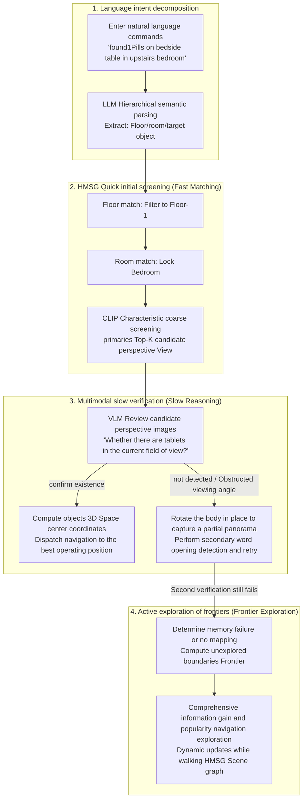

  
<figcaption> Hierarchical multimodal Scene graph (HMSG) four-layer structure (floor-room-view-object) and level and topological edge association</figcaption>

The traditional Scene graph points directly across the room to discrete objects, resulting in the robot's lack of perception of the real observation angle and occlusion conditions. Blindly calling the time-consuming multi-modal model (VLM) when facing a large space will cause a computing power collapse. The "View" in HMSG naturally retains the visual links (Visibility Links) between the observer's perspective and objects, allowing the system to quickly screen out a very small number of relevant perspectives on metric geometry, and then call VLM specifically for high-quality visual identification.

#### ⑤ HoloNavi target navigation pipeline
{: id="-holonavi-目标导航流水线"}

Based on HMSG, the HoloNavi navigation system connects tasks into three interlocking execution loops:
1. **Hierarchical Object Navigation**: Use semantic analysis to match floor, room and object candidates, and use hierarchical CLIP similarity to quickly prune the irrelevant search space;
2. **Online Verification Loop**: When the robot reaches the candidate viewpoint, the real-time camera image is submitted to the open word detector and VLM for double verification. If the initial determination fails, the robot automatically rotates in place at multiple angles to collect the surrounding perspective for a second recheck, confirms the true coordinates of the target and then navigates to a safe operating distance;
3. **Frontier Exploration Loop**: If the initial search of HMSG fails or the online verification fails again, the system immediately switches to Frontier Exploration mode. Comprehensive scoring is performed based on the information gain expectation, task semantic relevance, traversability and dynamic constraints of the candidate frontier points, guiding the robot to explore unknown areas and continue to perform incremental mapping and target sniffing while traveling.

  
<figcaption> HoloNavi object target navigation whole process: hierarchical semantic matching, online multi-view verification and cutting-edge incremental exploration</figcaption>

#### ⑥ Dynamic spatiotemporal memory adaptive incremental update (Dynamic Memory Update)
{: id="-动态时空记忆自适应增量更新dynamic-memory-update"}

The real world is constantly evolving. HoloAgent-0 defines three types of core events that trigger memory refresh:
- **Perception conflict event**: The new sensor data and the existing map are significantly offset in spatial geometry or color;
- **skill operation result event**: The robot performs grasping placement (such as picking up a water cup) to cause the object to break away from the original support surface, or navigation is blocked and new obstacles are exposed;
- **Human explicit feedback event**: The user issued error correction instructions for room naming or object attributes through voice.

When performing an update, the memory layer first uses the current observation to perform robust relocation in the existing geometric map, locally clears out-of-date point clouds and voxels that cause conflicts, and integrates new features into the local geometry. The semantic layer updates the bounding box of the affected 3D instance, and HMSG **only performs an in-situ topology update** on the affected local subgraph (recalculates the room and visual angle to which the object belongs), without having to bear the high cost of reconstructing the entire global Scene graph.

  
<figcaption> Comparison of adaptive refresh of local scene memory in dynamic environment (in-situ update of local map and Scene graph subgraph after desktop object moves)</figcaption>

---

### 3. Results and findings
{: id="3-核心结果发现"}

- **HM3D-ObjNav simulation benchmark navigation performance jumps**: Under the standard simulation benchmark without hardware noise, HoloAgent-Nav equipped with AgentOS closed-loop achieved a success rate (SR) of **82.6%** and **42.8% path length weighted success rate (SPL)** is significantly ahead of existing representative navigation solutions in the industry, such as MSGNav (74.1% SR / 33.4% SPL), WMNav (72.2% SR / 33.3% SPL) and FSR-VLN in open-loop state (80.8% SR / 41.0% SPL), confirming that the closed-loop monitoring and retry re-planning mechanism can significantly improve the completion rate of complex tasks while ensuring path efficiency.
- **Excellent robustness of long-distance navigation in real physical apartments**: In the multi-target search evaluation of real indoor apartments, HoloAgent-Nav achieved a real arrival rate of **97.70%** under the most stringent Top-1@1.0m hit standard, and the Top-5 arrival rate reached **98.90%**; for comparison, the well-known baseline OK-Robot in the same scenario has only 60.92%, HOV-SG only 51.72%, and MobilityVLA only 34.48%. What’s even more striking is that the scores of HoloAgent-Nav under different judgment thresholds of 1.0m, 2.0m and 3.0m are completely consistent, indicating that the successful samples all accurately approach the core operating area within 1.0m, showing extremely robust position and orientation docking accuracy.
- **High-quality open vocabulary 3D semantic mapping**: On the ScanNet data set, HoloAgent-Memory achieved **31.58% mIoU** and **61.58% in online (Online) computing mode Frequency-weighted accuracy (f-Acc)**, the performance clearly overwhelms other online mapping algorithms (such as Open-Fusion's 18.02% mIoU, Concept-Graph's 16.29% mIoU), and even approaches the large model mapping algorithm of offline computing, providing a solid and accurate high-quality semantic index base for upper-layer agents.
- **real robot multi-morphological complex long-distance composite tasks**: Successfully completed on the Unitree G1/R1 bipedal humanoid and two-arm mobile platform including "finding objects from the bedroom", "multi-machine voice collaborative dance guidance" and the extremely challenging "long-distance mobile laundry folding" (covering autonomous cruising from the mobile chassis to the target workstation, flexible clothing sorting and grasping with both arms) , table tiles to fine folding) and many other closed-loop tasks.

---

### 4. Limitations
{: id="4-局限性"}

- At present, the basic model of robot embodiment is still unable to seamlessly cover the complete action spectrum from large-scale spatial navigation, precise dual-arm operation to whole-body torque-level motion control with a single model. The system's cross-embodiment migration of different physical configurations still relies on engineered controller bridging and dynamics tuning.
- The industry still lacks an end-to-end unified long-horizon real robot evaluation benchmark covering operation, multi-modal navigation and whole-body dynamic interaction. For large-scale complex architectural scenes, there is still room for further improvement in the delay of long-term cross-view feature fusion and fine-grained geometric reconstruction accuracy.

## 2. Pigey (2026)
{: id="pigey"}
———Addressing the Orchestration Gap in Generalist Robots via Physical Agency

📄 **Paper**: [arXiv:2607.21725](https://arxiv.org/abs/2607.21725)

---

### Key takeaways
{: id="精华-1"}

- **reveals the “Orchestration Gap” of embodied intelligence**: It is pointed out that the main bottleneck of current general-purpose robots is not the lack of low-level motion control capabilities, but the lack of a closed-loop orchestration architecture that can coordinate perception, planning, verification and recovery; a single end-to-end model is easily overfitted and blindly executed when directly prompted, resulting in greatly limited performance.
- **Pure inference time closed-loop physical agent (no need for any new training)**: Build a closed-loop orchestrator Pigey driven by the Frontier Visual Language Model (Frontier VLM), decompose complex long-term instructions into short-term sub-goals, and only call the frozen motion strategy of the underlying organization through high-level perception and tools, without retraining or fine-tuning low-level weights at all.
- **Geometric Programming (TAMP) and Neural Strategy ($\pi_{0.5}$) Complementary Dual Backend**: Combining deterministic tasks with motion planning (TiP ToP) and end-to-end visual motion strategy ($\pi_{0.5}$) are decoupled and integrated - rigid objects use grab-and-place planning with geometric certainty, and deformable objects, contact-intensive operations, or planning are seamlessly upgraded to VLA.
- **sensor and wrist vision conservative double verification mechanism**: Split the open-loop "grab-and-release" atomic action, and use the gripper width sensor (`is_grasped`) combined with the wrist camera image to perform strict conservative verification after grasping; if grasping is not stable, immediately retry or upgrade in place, eliminating the compound error of "empty gripper delivery" from the source.
- **out-of-distribution and real robot long-term task performance leap**: The frozen $\pi_{0.5}$-LIBERO zero-sample success rate soared from 12.8% to 53.3% on the strong perturbation benchmark LIBERO-PRO; it reached 97.3% in 30 complex long-term evaluations of the real DROID robotic arm The overall success rate (baseline $\pi_{0.5}$ is only 16.7%).

---

### 1. Background and problem
{: id="1-研究背景问题-1"}

With the development of large models and robotics technology, the field of robotics generally tends to build huge single vision-language-action (VLA) models, hoping to integrate high-level semantic understanding, common sense reasoning, space planning, successful detection, abnormality recovery and underlying millimeter-level motor control into the same neural network through large-scale pre-training. However, this monolithic end-to-end paradigm faces practical bottlenecks that are difficult to overcome:

1. **Instruction sensitivity and semantic degradation**: In the end-to-end strategy, high-level natural language instructions often degrade into weak prior conditions, and the model can easily fall into the mechanical memory of specific training trajectories and completely lose its ability to adjust when faced with scene disturbances (such as target displacement, occlusions, and the target is occupied);
2. **open-loop execution and compound errors**: Existing code-as-policies or traditional task and motion planning (TAMP) often rely on one-time offline generation and are in an open-loop blind running state during the execution phase; once grasping slippage or collision occurs in the middle, the system still advances mechanically according to the predetermined trajectory, and ultimately fails completely;
3. **Lack of orchestration capabilities**: True physical versatility requires the system to have a "Physical Agency" - not only knowing "what to do", but also observing "whether it was done or not" during execution, and actively retrying, bypassing obstacles or changing means when it fails.

**Core question**: Without retraining or fine-tuning the underlying motion strategy at all, can the full potential of the pre-trained frozen strategy be unleashed and bridge the "orchestration gap" of general-purpose robots through only a closed-loop physical orchestration framework at inference time?

---

### 2. Methods and innovations
{: id="2-主要方法创新点-1"}

The core idea of Pigey is to decouple **control and orchestration**: the bottom layer only retains two frozen motion executors (TAMP planner and $\pi_{0.5}$ VLA), and the upper layer consists of cutting-edge VLM (such as multi-modal cutting-edge large models such as Claude/GPT) to form a closed-loop decision-making brain, running "Perceive"→ The physical execution cycle of "Reason → Action → Verify".

  
<figcaption>Pigey closed-loop physical Agent system architecture: Frontier VLM acts as an orchestrator to coordinate perception, reasoning, execution and double verification, routing down to the frozen TAMP and VLA motion backend</figcaption>

#### ① Overview of the overall framework
{: id="-整体框架概述-1"}

As a closed-loop embodied intelligence Agent, Pigey maintains the global context history $h$ after receiving the global long instruction $I$ (for example: "A child is visiting - put the toys on the plate and put the dangerous items in the box"). In each step of interaction, VLM only selects and calls a structured tool (Tool Call), obtains real feedback from the physical world sensors and cameras, and updates the internal state accordingly until all sub-goals are achieved and terminated by calling `Done`.

The system splits the complex responsibilities originally undertaken by a single large model into clear module chains:
- **Open vocabulary target perception and spatial anchoring**: Use the open vocabulary detector to lock objects and their labels in the scene to limit the vocabulary space of high-level planning;
- **Task-level long-term memory**: Maintain the list of completed operations, current gripper holdings and remaining items on the desktop;
- **Geometry and Neural Dual Motion Backend**: Rigid catch-and-release analytically verifiable TAMP, irregular/contact-intensive operation VLA;
- **Conservative double verification and two-way upgrading and downgrading engine**: Sensor signals and visual judgments support each other, driving retry, troubleshooting and strategy switching.

  
<figcaption>Pigey’s physical reasoning capabilities demonstrated in real robot dog/robot arm scenarios: deductive reasoning, safety common sense, obstacle elimination, long-term scene memory and spatial geometry stacking</figcaption>

#### ② Explain module by module
{: id="-逐模块讲解"}

- **Perception and target semantic anchoring (Perceive & Grounding)**
  - **Input**: multi-view camera images (main view and wrist view) and underlying robot joint status.
  - **Processing**: Call the open vocabulary detector to generate a set of object candidates with bounding boxes and semantic labels. These detection tags strictly constitute Pigey's "controlled vocabulary" (Vocabulary), and the parameters of all grasping or placement operations must directly reference the detection tags.
  - **output**: structured scene perception dictionary, including object label list, local high-resolution image of the wrist and current gripper status.
  - **Design motivation**: To prevent the language model from inventing the names of unseen objects out of thin air in physical interactions, connect high-level fuzzy concepts (such as "dangerous goods", "vegetarian food", "smallest container") directly to specific entities that have been positioned in the physical scene.

- **Decoupled complementary dual-motion backends (Frozen Motor Backends)**
  - **TAMP geometric backend (`Pick(ℓ)` / `DropAbove(ℓ)`)**: built based on the TiPToP framework, responsible for spatial collision-free motion planning and six-degree-of-freedom geometric grasping pose generation. Pigey performed a key refactoring - forcibly cutting Pick-and-Place, which was originally packaged as a single open-loop execution, into two independent tool calls, and inserting physical verification between grasping and placement.
  - **VLA neural backend (`VLARollout(s)`)**: encapsulates frozen pre-training $\pi_{0.5}$ closed-loop visual action control model, receiving short plain text sub-action description $s$ (such as `“grasp the cable”`), directly outputs continuous high-frequency end displacement and clamping jaw opening and closing.
  - **collaborative mechanism**: Conventional rigid objects tiled on the desktop call TAMP first to obtain extremely high trajectory certainty; stacked objects, easily deformable objects (such as cables, plush toys), or objects in deep containers are directly solved by VLA with compliant control characteristics.

- **Conservative Dual Verification**
  - **input**: the Boolean quantity `is_grasped` read by the displacement sensor embedded in the gripper, and the hand-eye (wrist) camera snapshot after the action is completed.
  - **processing**: The hardware sensor is used to confirm whether the physical clamping gap is within the clamping threshold; the leading edge VLM simultaneously observes the wrist camera to determine whether the target object in the field of view has been moved away from its original position and is in the center of the clamping jaw.
  - **conservative synthesis rule**: Both adopt the most pessimistic strategy - even if the motion backend report is completed, as long as `is_grasped == False` or the visual display target is still on the table, the step will be immediately judged as a failure and subsequent actions will be cancelled.

#### ③ Dimensionality reduction and decision flow diagram of stuck points
{: id="-卡点降维与决策流图"}

Readers in the field of embodied intelligence are often confused: **Why is the single end-to-end model (such as $\pi_0$ / $\pi_{0.5}$) still unable to perform simple catch and release with perturbation after large-scale pre-training? What exactly did Pigey’s closed-loop orchestration change?**

We dismantle its inner mechanism through the self-made Mermaid decision flow chart and comparison table:

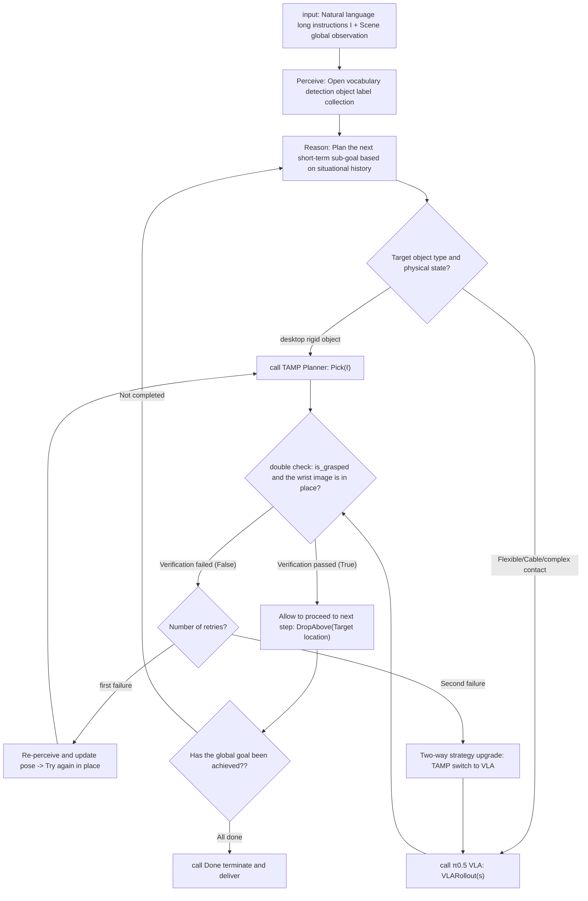

To further see Pigey’s subversion of the traditional robot control paradigm, the comparison table is as follows:

|Dimensions|End-to-end single VLA (such as $\pi_{0.5}$ / OpenVLA)|open-loop code planning (Code-as-Policies / TiPToP)|closed-loop physical agent (Pigey article)|
|---|---|---|---|
|**Control division of labor**|Language understanding, planning, verification and motion control are all coupled into a single large model|LLM generates complete Python code or action plan, and the underlying open-loop is completed|Frontier VLM is only responsible for closed-loop orchestration and verification, and all actions are delegated to the freezing strategy|
|**execution mode**|Step autoregressive, lack of reflection on macro task status|One-time planning, "blind" to object slippage and environmental changes during execution|Each tool call must undergo double verification by sensors and vision, and dynamic closed-loop advancement|
|**Abnormal recovery**|Extremely poor (after catching the air, continue to place the air gripper later)|None (planning failure or execution interruption directly throws an exception and crashes)|Native support for obstacle removal, replacement and re-grabbing, TAMP and VLA two-way upgrading and downgrading|
|**Training cost**|Tens of thousands of hours of real robot trajectory re-fine-tuning/post-training are required|No training required, but relies on an ideal simulation environment|**Zero fine-tuning**, fully utilizing ready-made frozen pre-trained models and classic planners|

> **gives an example (target displacement and empty recovery)**:
> Suppose the task is "put the red cup into the tray".
> - **single VLA / open-loop planning**: calculate the grasping trajectory and execute placement directly and coherently. If the cup is bumped and slips when the robotic arm reaches down, the robotic arm will still close the empty gripper and move it to the top of the tray to release it, thinking that the "mission is completed", and ultimately failing completely.
> - **Pigey closed-loop processing**:
>   1. Execute `Pick(red_cup)`;
>   2. After the robotic arm is closed, the gripper width sensor returns to `is_grasped = False`, and the wrist image detects that the cup is still in place;
>   3. Pigey intercepts the subsequent `DropAbove` action and records grasping failure;
>   4. Trigger `Perceive` to re-detect the precise coordinates of the cup after displacement, update the grasping posture and try again; if the cup is still not grasped correctly the second time, the backend is actively upgraded to `VLARollout` with supple fault tolerance to implement tactile grasping, ultimately ensuring that the cup is securely placed on the plate.

---

### 3. Results and findings
{: id="3-核心结果发现-1"}

The paper conducted a system comparative evaluation on the simulation benchmark LIBERO-PRO and the DROID workbench based on the real Franka robotic arm, which fully verified the multiplication effect of inference time physical orchestration on model capabilities.

#### ① LIBERO-PRO simulation benchmark evaluation
{: id="-libero-pro-仿真基准评测"}

LIBERO-PRO is the industry's most difficult perturbation test benchmark for complex long-term desktop operations. It introduces six rigorous perturbation suites, including object position swap (Obj. swap), target attribute swap (Goal swap), and spatial geometry perturbation (Spatial swap/task).

  
<figcaption>LIBERO-PRO Success rate comparison under six major perturbation suites: keeping the underlying frozen weight completely unchanged, only changing the inference orchestration mechanism</figcaption>

- The performance of the original SOTA VLA of **has seriously declined.**: When running directly with the open-loop prompt, even the current top $\pi_{0.5}$-LIBERO has an average success rate of only **12.8%**, and directly returns to zero in multiple tasks, proving that the end-to-end strategy has seriously overfitted the training set trajectory.
- **Pigey achieves SOTA breakthrough**: Under a zero-sample setting that does not use task-specific memory at all and does not fine-tune any weights, Pigey increases the average success rate of the freezing strategy to **53.3%**. Compared with the original strategy, it achieves a performance improvement of more than 4 times, significantly exceeding the code generation baseline. CaP-Agent0 (18.2%).

#### ② Real robot arm (DROID) capability test
{: id="-真实机械臂droid能力测试"}

In the real robot experiment, the research team set up 30 rigorous long-term tasks in 8 core competency dimensions, including common sense reasoning, conditional logic, spatial reasoning, obstacle clearance safety reasoning, active error recovery, and long-term memory recovery.

  
<figcaption> Type 8 capability probe success rate (%) on the real robot arm DROID: The bottom layer all runs the same π0.5-DROID weight</figcaption>

  
<figcaption> real robot long-term execution and single-frame inference chain demonstration: identifying non-vegetarian food in the vegetarian selection task and placing it in the bowl in sequence</figcaption>

- **comprehensive success rate 97.3% vs 16.7%**: $\pi_{0.5}$-DROID under direct prompts was almost completely wiped out on tasks requiring common sense reasoning, multi-step logic and spatial geometry (success rates were all 0%), with an overall success rate of only 16.7%; while Pigey relied on closed-loop common sense orchestration With backtracking verification, it achieved 100% perfect scores in most categories, with a total success rate as high as **97.3%**.
- **real robot abnormal recovery record**: When the placed target is occupied by foreign objects (such as debris in the coffee cup), Pigey can independently reason out the cascade recovery logic of "first remove the debris, place it next to it, and then put the target object in"; when the blind box blocks the target, it can infer that the target is under the box and actively lift the box to retrieve the object.

---

### 4. Limitations
{: id="4-局限性-1"}

1. **relies on cutting-edge large models for visual understanding and reasoning delay**: Since the cloud or high-specification VLM needs to be called after each key action for visual reflection and decision-making, the overall task execution rhythm is limited by API communication and reasoning throughput, and the interaction delay is higher than that of a single end-to-end model;
2. **The physical limit of the underlying action strategy cannot be exceeded**: Although the orchestrator can greatly repair logic and grasping timing errors, if both underlying motion backends (TAMP solver and $\pi_{0.5}$) cannot generate valid end trajectories due to singular points, collision deadlocks, or physical deformation distortion, it is still difficult for the upper-layer Agent to complete physical contact out of thin air.

---

## 3. Thea (2026)
{: id="thea"}
———Towards the Harness of Embodied Agents

📄 **Paper**: [arXiv:2608.11246](https://arxiv.org/abs/2608.11246) · [Code](https://github.com/EIT-HAI/Thea) · [Project Page](https://eit-hai.github.io/thea)

---

### Key takeaways
{: id="精华-2"}

- **Migrating the "Code Agent Harness Paradigm" to the Embodied Physical World**: Analogous to the successful essence of Claude Code and Codex in software engineering, it lies in the test feedback closed-loop (Harness) rather than the single model itself. It is pointed out that the key to realizing complex long-term tasks with embodied intelligence also lies in building a closed-loop Harness infrastructure that connects the physical reality.
- **Complements the two missing signal infrastructures in the physical world**: The software world naturally has "reading world status" (file tree/AST) and "judging action results" (exit code/error call stack), while the physical world has neither. Thea innovatively proposed two cornerstone mechanisms, **SceneGraph as Context** (Scene graph is context) and **Evaluation as Exit Codes** (evaluator is exit code), to realize physical closed-loop.
- **Strict reliability theory establishes the theoretical bound of evaluation accuracy $\alpha$**: Mathematically proves that the success rate of long-term tasks open-loop exponentially decays with the number of steps $n$ ($P_{\text{open}} = \prod p_i \to 0$); the error correction upper limit of closed-loop Harness strictly depends on the independent evaluator The judgment accuracy rate is $\alpha$ ("The upper limit of Harness is determined by its judge").
- **Cross-platform portability of decoupled models and embodiments**: Defines the standardized embodiment Profile and Tool abstract contracts, the model (LLM/VLM) and the hardware embodiment (bipedal humanoid Unitree G1, bionic humanoid Astribot S1, double-arm wheeled AgileX Cobot Magic) are bidirectionally pluggable and replaceable, and a single set of architectures is deployed aCross-embodiments.
- **long-term compound task performance jumped significantly**: In the real physics evaluation of multi-stage complex tasks (L1~L3), as the task complexity and number of steps increased, the success rate of traditional end-to-end strategies (ACT, $\pi_{0.5}$, LingBot-VLA) dropped sharply to 30%~40%, while Thea still maintained the highest difficulty level at L3 Ultra-high success rate of **87%**.

---

### 1. Background and problem
{: id="1-研究背景问题-2"}

The explosion of coding agents (Coding Agents, such as Claude Code, SWE-agent) has completely changed software engineering. The success of this type of system does not rest on the Superman model of "writing perfect code at once", but on the **test and retry closed-loop mechanism (Harness)** composed of the compiler, testing framework and Git - the agent runs the test after writing the code, captures stack errors, reflects on modifications and iterates repeatedly until the test passes.

When researchers attempted to translate this efficient Harness paradigm to the physical world, they encountered an essential structural gap. The foundational support that has taken decades to build up in the software world is all missing in the physical world:
1. **state cannot be "read" natively**: The code world has clear file systems and type symbols; while the sensors of physical robots only spit out chaotic and unstructured high-dimensional continuous point clouds and image pixels, which large models cannot directly use as accurate inferable context;
2. **action cannot be "determined" natively**: If an error occurs in the running program, a clear non-zero exit code (Exit Code) and stack trace (Stack Trace) will be returned immediately; but in reality, if the robotic arm reaches out to grasp, loses its hand, or collides, the physical world is silent. It will neither return a status code nor actively notify that "the action has ended", resulting in infinite accumulation of errors during open-loop execution.

**Core question**: How to build a set of embodied Harness in the physical world that can provide "persistent readable state" and "accurate exit code determination", so that high-level language/multi-modal models can reliably orchestrate underlying heterogeneous motion strategies and achieve closed-loop self-healing for long-term tasks?

---

### 2. Methods and innovations
{: id="2-主要方法创新点-2"}

Thea built an embodied closed-loop Harness that decouples the cutting-edge decision-making model (Model) from the diverse robot embodiment (Body) orchestration, and closed the embodied control loop through structured context evolution, standardized tool interfaces, and independent post-evaluators.

  
<figcaption>Thea Embodied Harness system panorama: Completely decouple the model (Model) and embodiment (Body), establish a perception-action-verification closed-loop through callable tools (Tool), Scene graph context (Scene graph) and independent evaluator (Evaluator), and verify it on three different embodiments</figcaption>

#### ① Overview of the overall framework
{: id="-整体框架概述-2"}

In the Thea architecture, embodied agent consists of four core components:
1. **model (Model)**: high-level large language/visual language model, only responsible for understanding tasks, reading dynamic context, and output structured tool calls;
2. **embodiment and tool layer (Body & Tools)**: Unify the underlying mobile navigation, robotic arm grasping, and skill strategies (such as ACT, diffusion strategy, $\pi_0$) into a standardized Tool with pre-check (Pre-hook) and post-trigger (Post-hook);
3. **Scene graph context (SceneGraph as Context)**: Precipitate a persistent, symbolic Scene graph with 3D bounding boxes and topological relationships from the continuous perceptual flow, analogous to the file system in software engineering;
4. **exit code evaluator (Evaluation as Exit Codes)**: an independent visual evaluator triggered by the system structure after each action, returning a three-state execution verdict (Success/Failure/In-progress) and failure attribution.

  
<figcaption>SceneGraph as Context: Fusion of the sensor’s continuous multi-modal observation and the action results confirmed by the evaluator into a unified symbol Scene graph, generating a streamlined briefing (Brief) that is refreshed and injected into the context in rounds, and supports on-demand in-depth query</figcaption>

#### ② Explain module by module
{: id="-逐模块讲解-1"}

- **SceneGraph as Context (readability of world state)**
  - **Input**: RGB image, depth map, LiDAR point cloud, and robot pose reported by the underlying odometer.
  - **processing**: The system uses the perception pipeline to discretize the continuous physical space into a dynamic graph structure containing the object center coordinates, 3D bounding box, visible confidence and spatial topological relationships (such as `on(bowl, table)`, `near(robot, table)`, `holding(gripper, cup)`); only after passing through the evaluator Only the action results that are confirmed to be truly successful (Confirmed) will be written into the topological relationship changes of the graph.
  - **output**: Before each round of decision-making, the graph is refined into a high-level structured brief (Scene graph brief) and pushed into the refreshed context (Refreshed context); the model can also call tools on demand through reference ID (Ref-keyed queries) to query the historical high-definition snapshots and detailed geometric properties of a specific object.
  - **Design motivation**: Completely solve the problem of context being overwhelmed by massive continuous video/image tokens in long-term multi-round interactions, and give large models the ability to understand scenes similar to "reading the project code structure tree".

- **Evaluation as Exit Codes (Judgment of action results)**
  - **trigger mechanism**: Harness forces structured triggering through the built-in post-hook after each operation is executed, depriving the underlying execution strategy of the right to "self-evaluate and boast".
  - **Processing**: evaluator It only receives the visual observation at the current moment and the post-condition declared by the tool, which is completely independent of the high-level decision-making model; it outputs three-state judgments - `Success` (success), `Failure` (failure with detailed causal explanation, such as "not grasped due to end offset", "target blocked by drawer"), `In-progress` (the action is still progressing for a long time and has not timed out).
  - **output**: Package the verdict and failure attribution into the exit code response and inject the conversation history for the decision-making model to perform targeted retry or solution switching.

  
<figcaption>Evaluation as Exit Codes Trigger timing: The model calls the Tool execution strategy. After the execution is completed, the Harness post hook actively triggers the independent Evaluator, and outputs a three-state judgment with the failure reason and feeds it back to the model</figcaption>

#### ③ Dimensionality reduction and theoretical derivation of stuck points
{: id="-卡点降维与理论推导"}

**stuck point 1: How do software Harness and embodied physical Harness correspond?**

|Dimensions|Software Engineering Agent (such as Claude Code / SWE-agent)|Traditional robot control (single VLA/teaching playback)|Embodied Physics Harness (Thea)|
|---|---|---|---|
|**status carrier**|File system directory tree, AST, text code|Instantaneous single frame/multi frame continuous camera image pixels|**SceneGraph as Context** (persistent 3D topology symbol Scene graph)|
|**action output**|Terminal Shell Commands, File Editing Patch|Continuous joint angles/end 6-DoF track points|Semantic Tool encapsulated as standardized pre/post Hook (such as `grasp(ref)`)|
|**Execution feedback**|Operating system return code (Exit 0 / 1), Stack Trace|There is no feedback. Once the action is over, you will blindly proceed to the next step.|**Evaluation as Exit Codes** (three-state decision + structured failure diagnosis reason)|
|**Error correction mechanism**|Read the error log, rewrite the code and recompile|There is no way to correct the error. After catching a short shot, I will run through the subsequent long sequence empty-handed.|Read in the failure attribution, fine-tune the pose and try again or actively search for hidden targets|

**stuck point 2: Why is it said that "the upper limit of Harness is determined by its evaluator accuracy $\alpha$"?**

In a long-term multi-step embodied task, assuming a task contains $n$ sequential stages, the single-step success rate is $p_i$.
- In traditional open-loop mode, task success requires that every step must succeed:
  $$ P_{\text{open}} = \prod_{i=1}^n p_i $$
- When $n$ is large (such as $n=5$), even if the single-step success rate is as high as $p=0.8$, the total success rate will quickly degrade to $0.8^5 \approx 32.8\%$.

Thea introduces a detect-retry loop with a maximum retry count of $k$. The evaluator makes a correct judgment with an accuracy of $\alpha$ and a wrong judgment with an accuracy of $1-\alpha$. The paper strictly proves that because the evaluator has **false negatives** (misjudgment of true success as failure, resulting in redundant retries that damage the results) and **false positives** (misjudgment of failure as success, resulting in downward penetration of errors), the net pass reliability of each step of the system is directly determined by $\alpha$ Locked:

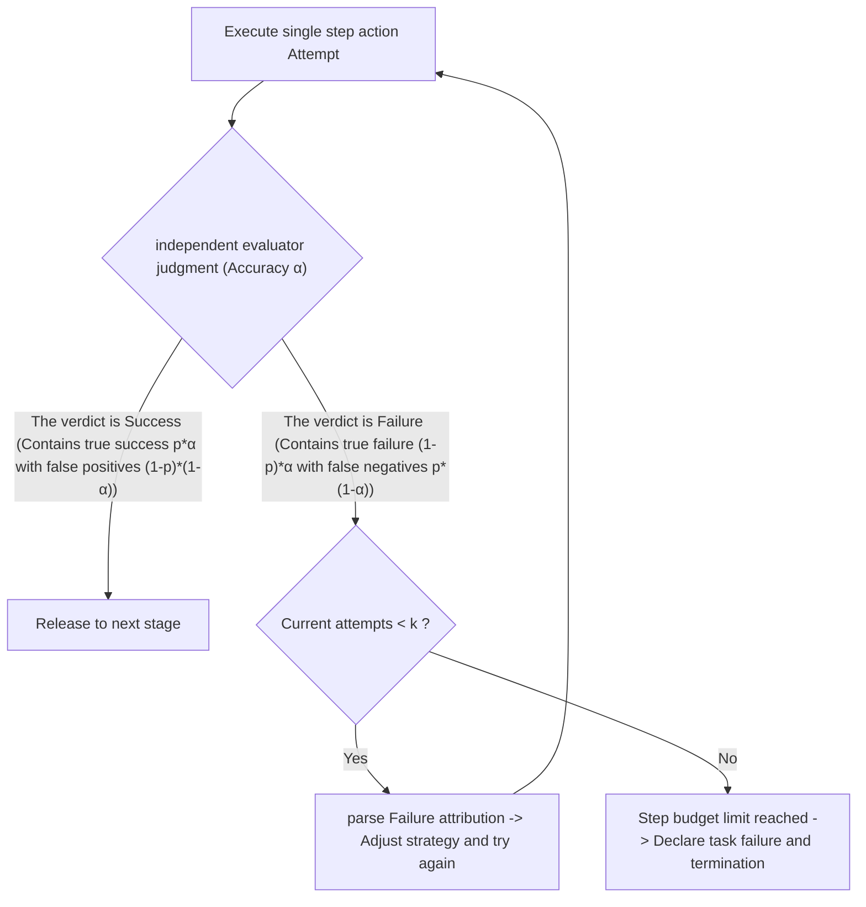

> **gives an example (specific number of reliability doubling)**:
> Assume a long-term delivery task of $n=5$ steps, and the success rate of the underlying strategy at each step is $p=0.8$:
> - **open-loop running**: the total success rate is only $0.8^5 = 32.8\%$;
> - **Thea closed-loop (evaluator precision $\alpha=0.95$, allowed to retry $k=3$ times)**: The effective reliability of a single step under retry and precise release jumps to $97.6\%$, and the total success rate of the entire 5-step task reaches $0.976^5 \approx 88.5\%$ achieves a task-level reliability gain of nearly 3 times that of !

---

### 3. Results and findings
{: id="3-核心结果发现-2"}

Thea has carried out comprehensive real-life physical experimental verification on diverse hardware platforms (Unitree G1 humanoid robot, Astribot S1 flexible humanoid robot, AgileX Cobot Magic wheeled dual-arm collaborative robot).

  
<figcaption> Comparison of task success rates across different difficulty levels (L1 basic operations, L2 spatial combination, L3 long-term long-distance multi-stage interaction): As the number of task steps increases, the baseline model drops off a cliff, while Thea maintains excellent robustness</figcaption>

#### ① Absolute advantages that scale with task complexity
{: id="-随任务复杂度扩展的绝对优势"}

The evaluation divided the tasks into three levels: L1, L2, and L3 according to time course and stage complexity, and compared mainstream single or layered baselines such as ACT, $\pi_{0.5}$, LingBot-VLA-V2, CaP-X, and SayCan:
- **L1 base layer (short-term single step)**: There is not much difference between each baseline and Thea, and the success rate is between 80% and 95%;
- **L2 Advanced level (including space rearrangement and multi-step dependency)**: The single strategy begins to experience trajectory drift and short-sucking disorder, the success rate drops to 55%~80%, Thea reaches **90%**;
- **L3 Ultimate layer (cross-room long-distance navigation + drawer opening retrieval + target object grasping and delivery)**: Single model (such as $\pi_{0.5}$, LingBot) plummeted to **40%** due to accumulated error, SayCan Due to the lack of fine-grained geometry and closed-loop verification, it is only 53%, while Thea maintains a success rate of **87%** with closed-loop retries and Scene graph memory.

  
The diverse physical intelligent behaviors that emerged driven by<figcaption>Thea: (a) autonomously draw power across rooms and deliver power banks; (b) actively open drawers for hierarchical retrieval when the target is not seen; (c) fine-tune the pose for secondary grasping based on the failure reasons fed back by the evaluator; (d) actively initiate human-machine dialogue to negotiate alternatives when the target drink is out of stock; (e) a single set of Harness across three completely different robots Seamless migration</figcaption>

#### ② Advanced physical behaviors emerging from closed-loop
{: id="-闭环涌现出的高级物理行为"}

Thanks to the dynamic closed-loop orchestration of tools by the general Harness architecture, the robot exhibits several high-order emergent behaviors that could not be achieved by the previous single model:
- **Active Perception**: When the power bank is not retrieved in the Scene graph, the model actively plans the detection link of "navigate to the counter → call the drawer pull tool → tilt the wrist camera to observe the inner layer of the drawer";
- **Targeted fault diagnosis and correction (Diagnosed Recovery)**: When the grasping can slips due to too far distance, the evaluator returns `“Fail: target slipped due to hand clearance offset”`, and the model actively generates `reposition(base, delta=[-0.05, 0])` in the next round. After adjusting the micro distance of the base, grasping is successful again;
- **Human-computer collaborative interaction (User Clarification)**: When the user requests the delivery of specific mineral water but only juice and tea are available on the desktop, the Agent autonomously suspends physical execution and asks the user questions to negotiate alternatives through the mobile phone interface.

---

### 4. Limitations
{: id="4-局限性-2"}

1. **Scene graph maintenance computational overhead and latency bottleneck**: As the indoor exploration space continues to expand, the computational overhead of 3D instance point cloud segmentation and real-time topology map merging increases significantly, which may lead to significant lags in round decision-making;
2. **Risk of misjudgment of the evaluator under three-dimensional occlusion and extreme deformation**: The evaluator relies on visual feedback from a single perspective or a hand-eye camera. Misjudgment may still occur under strong reflection, small object occlusion or extreme lighting conditions. Once a misjudgment occurs, it will directly limit the final reliability of the system.

---

## 4. Zetta (2026)
{: id="zetta"}
———An Efficient Closed-Loop Embodied Harness for Self-Evolving Physical Intelligence

📄 **Paper**: [arXiv:2608.16590](https://arxiv.org/abs/2608.16590) · [Project Page](https://air-embodied-brain.github.io/zetta)

---

### Key takeaways
{: id="精华-3"}

- **proposes an embodied closed-loop Harness for self-evolution physical intelligence**: Aiming at the dilemma that end-to-end single VLA/WAM lacks micro-correction during execution and traditional post-hoc reflection (Post-hoc Reflection) is difficult to attribute high-frequency physical interactions, a self-evolution system Zetta is built that integrates high-frequency online judgeing, in-situ exception recovery and offline skill distillation.
- **Structured evolvable Harness abstraction ($H = \{C, R, T\}$)**: Keep the underlying motion strategy frozen with the high-level orchestration commander, and define Harness decoupling as a runtime judge collection $C$, a recovery action library $R$, and a heterogeneous toolset $T$. The physical trial and error experience is directly distilled into parameterized code modules, which evolve autonomously with the interaction rounds.
- **Top-down minimal intervention hierarchical causal diagnosis**: Establish the core principle of "if the high-level logic can be solved, never change the underlying parameters", conduct top-down investigation according to priority (evaluation → judge → status → planning → recovery → parameters) to prevent generalization collapse caused by overfitting to a single use case.
-  **Discovering the Robotic "Aha Moment" of Embodied Physical Intelligence** : Reveals the objective law of the nonlinear transition of embodied self-evolution - the initial repair of the appearance keeps the performance at a low plateau. Once the root cause is located and the key "judge-recovery" closed-loop mechanism is evolved, the task success rate shows an instant vertical increase (such as a sudden surge from 10% to 95%).
- **High-throughput infrastructure with decoupled software and hardware Z-Infra**: Design a multi-node heterogeneous concurrent infrastructure, decouple the environment from the model computing pool, achieve an effective sampling throughput of up to 35.1 episodes/min (20.6 times improvement), and significantly shorten the inference delay by 91%, strongly supporting large-scale closed-loop self-evolution.

---

### 1. Background and problem
{: id="1-研究背景问题-3"}

Although Vision-Language-Action (VLA) and World Action Model (WAM) have made significant progress in large-scale data pre-training, they are still highly fragile when deployed in the physical world. The root cause is: **The physical environment is a continuous system** that evolves at high frequency at the millisecond level. If an object slips slightly, the desktop reaction force is unbalanced, or a small contact disturbance is not sensed and corrected at the moment of occurrence, it will quickly trigger a compound error cascade, eventually leading to the collapse of the global task.

In order to overcome this bottleneck, in recent years, academic circles have tried to introduce multi-modal Agents for "Post-hoc Reflection". However, traditional reflection mechanisms face insurmountable theoretical and engineering obstacles in embodied physical scenarios:
1. **Credit Assignment Problem (Credit Assignment Problem)**: A long-term operation failure involves hundreds or thousands of continuous control steps. Afterwards, the large model is asked to reflect in detail. The model cannot accurately infer which tiny declination angle of the wrist in the few seconds caused the disaster;
2. **Lack of on-site online verification environment**: The corrective hypothesis generated by post-mortem reflection can only be tested after the next complete re-run, which is extremely inefficient and easily misleading;
3. **Patching causes over-fitting (Over-Parameterized Repair)**: In the past, manual tuning or simple parameter tuning often forcibly modified the underlying control parameters for specific failed use cases, which not only destroyed the global semantic understanding and generalization distribution of the base VLA, but also caused catastrophic performance degradation in unseen environments and new random seeds.

**Core question**: How to build an embodied closed-loop Harness that does not need to modify the underlying policy parameters, can achieve high-frequency micro online correction, and can automatically sublimate failed physical experience and continue to evolve autonomously?

---

### 2. Methods and innovations
{: id="2-主要方法创新点-3"}

Zetta proposes a dual-loop physical intelligence system that integrates online high-frequency governance **and offline autonomous evolution**. Together with the hardware-decoupled high-throughput concurrent infrastructure Z-Infra, it achieves self-propagation and robust evolution of physical strategies.

  
<figcaption>Zetta self-evolution Embodied Harness Panorama: High-frequency running time, the judge leads the online action error correction loop, offline evolution Agent clusters failure trajectories and distills reusable skills, and cooperates with the decoupled infrastructure Z-Infra to drive throughput doubling and "aha moment"</figcaption>

#### ① Overall framework and double-loop operating mechanism
{: id="-整体框架与双环运行机制"}

Zetta clearly divides the system into two immutable entities and a core evolution carrier:
- **Two immutable entities**: underlying action strategy $\pi$ (frozen VLA/WAM parameters, $\nabla_\theta = 0$) and high-level orchestration Agent $A_{orch}$ (multimodal decision operator, constant decision logic);
- **core evolution carrier Harness ($H = \{C, R, T\}$)**:
  - **Runtime Critics ($C$)**: A high-frequency monitoring function that runs higher than the low-level action strategy, continuously scans real-time trajectory fragments and generates proposals with fault evidence and status suggestions $$P_t = \langle e_t, \hat{\sigma}_t \rangle$$;
  - **Recovery Action Library (Recovery Playbook, $R$)**: A collection of parameterized micro-actions targeting specific fault causal mechanisms;
  - **Heterogeneous Toolset ($T$)**: motion planner, 6-DoF grasping generator (GraspGen) and placement stabilizer.

The operation of the system is divided into **online parallel Rollout** and **offline Reflection & Evolve evolution cycle**:

  
<figcaption>Zetta evolution framework three-stage process: online concurrent collection of success and failure trajectories, offline update through failure portrait clustering (Phase I), hierarchical causal diagnosis and repair (Phase II), and cross-task generalization merging (Phase III) Harness</figcaption>

#### ② Explain module by module
{: id="-逐模块讲解-2"}

- **Phase I: Failure Profiling**
  - **input**: a collection of failed trajectories collected concurrently by multiple threads, and the corresponding nominal success reference trajectory (Nominal baseline).
  - **processing**: Slice the failed trajectories according to the physical stages of task advancement (pre-contact approach, grasping closure, spatial transportation, placement and release), and use the successful trajectories as the benchmark to cluster common instability modes.
  - **outputs**: a structured failure portrait list, pinpointing the common stage distribution of multiple failures.

- **Phase II: Hierarchical causal diagnosis and minimal intervention repair (Diagnosis & Repair)**
  - **Top-down diagnostic level**: Strictly follow the six-level priority investigation:
    $$ \text{Evaluation} \to \text{Critic} \to \text{State} \to \text{Planning} \to \text{Recovery} \to \text{Parameter} $$
  - **Design Motivation**: Give priority to solving problems by adding pre-aligned critics at high levels or calling geometric planning tools; it is strictly prohibited to directly dive into tampering with the joint stiffness of the underlying motor or fine-tune the low-level weights to maximize the broad generalization of the base model.
  - **Validation Guard**: Each code-level fix patch generated must be retested in-place on the same random seed that caused the failure, and submission is only allowed if it passes validation (Validate Passed).

- **Phase III: Harness Generalization and Merger (Harness Generalization)**
  - **processing**: Promote the specific seed patch that has passed verification into a universal judge and recovery logic with abstract parameters, perform conflict-free merging across use cases, package and generate versioned $H_{merged}$, and hot-reload it to the online environment.

  
<figcaption> Record of judge-recovery cascade intervention in a single rollout: when an object is detected to be off during transportation, re-approach is immediately triggered, when an invalid posture is detected, GraspGen is called to generate the posture, and in the final stage, smooth placement recovery is called</figcaption>

#### ③ Card point dimensionality reduction and self-made architecture diagram
{: id="-卡点降维与自制架构图"}

**stuck point 1: Why can’t physical interaction be solved by post-mortem reflection? How exactly does Zetta's microscopic closed-loop work?**

We clearly present the decoupled collaboration of Zetta's online millisecond-level interception and offline minute-level self-evolution through the Mermaid double-loop mechanism diagram:

```mermaid
graph TD
    subgraph Online ["Online high-speed execution loop (millisecond level)"]
        Obs["Real-time sensor observations s_t"] --> Policy["freeze action strategy π (VLA)"]
        Policy --> Action["Predictive control actions a_t"]
        Action --> Critic{"High frequency runtime judge C Monitor"}
        Critic -- "Nominal normal (Nominal)" --> Exec["Physical execution of actions"]
        Critic -- "trigger exception (Slip/Collision)" --> Intervene["Suspend action, call Recovery R"]
        Intervene --> Tool["Toolset T (Such as GraspGen / Re-approach)"]
        Tool --> Exec
        Exec --> StatusCheck{"determine the Episode Is it over??"}
        StatusCheck -- "Not over" --> Obs
        StatusCheck -- "success/failed" --> Buffer["Save to track storage pool"]
    end

    subgraph Offline ["Offline evolving self-healing loop (Minute level)"]
        Buffer --> Cluster["Phase I: Failure trajectory clustering and stage slicing"]
        Cluster --> Diagnosis["Phase II: top-down causal diagnosis (E -> C -> S -> P -> R)"]
        Diagnosis --> Patch["Synthesis reusable Critic / Recovery Skill code"]
        Patch --> Test{"Validation guard: Original failed seed retest verification"}
        Test -- "Verification passed" --> Generalize["Phase III: Abstract and merge to generate a new version H_merged"]
        Generalize --> Online
    end
```

**stuck point 2: What is the "Aha Moment" of embodied physical intelligence?**

In the process of embodied self-evolution, many readers easily mistakenly believe that the success rate of the strategy will increase uniformly and linearly with the amount of interactive data. Zetta reveals a very physically inspiring phenomenon:

|Evolution stage|Repair strategy type|typical behavior|Success rate performance|essential reason|
|---|---|---|---|---|
|**Round 0 (initial)**|Pure Freeze VLA open-loop run|Grabbing air, sliding, and hard collision between the end and the table|0% ~ 15% (very low)|Lack of any physical interaction feedback|
|**Round 1 (Initial exploration)**|**Symptomatic Fixes** (Symptomatic Fixes)|Relax the time budget, increase the number of retries, and increase the clamping jaw closing threshold|5% ~ 15% (**stagnation plateau period**)|The root cause of physical failure has not been touched, and errors still occur during transportation.|
|**Round 2 (moment of enlightenment)**|**Root-Cause Repair** (Root-Cause Repair)|Evolved `Pre-grasp Staging` (front space posture alignment) and `Grasp Retention Critic` (slip-off high-frequency interception)|**instantly soared to 90% ~ 95%**|Completely solves the line of sight obstruction and initial normal vector misalignment when the robotic arm reaches down.|

> **Give an example (the epiphany deduction of putting a red wine bottle into a deep dish)**:
> The task requires a robotic arm to place an upright red wine bottle smoothly onto a plate.
> - **Stage 1 (Pure VLA)**: Pounces directly towards the bottleneck, frequently knocking over wine bottles due to reflection and perspective deviation, the success rate is only 5%;
> - **Phase 2 (Trying to cure the symptoms)**: Evolution Agent tries to make the robot arm quickly retreat after grasping fails and increase the speed to try again. However, the bottle has been knocked crooked, and the next descent will inevitably miss the target again. The success rate is always hovering around 10%;
> - **Stage 3 (Aha Moment)**: Evolution Agent finally discovered the fundamental contradiction through causal diagnosis - "The bottle body is slender. If a pre-aligned posture is not established from the side, direct dive will inevitably touch the mouth of the bottle." So Zetta automatically synthesized two collaborative mechanisms:
>   1. `Pregrasp Staging`: The robotic arm first hovers 5cm directly in front of the bottle and flattens the wrist;
>   2. `Retention Critic`: Monitor the terminal inclination angle in real time during the lifting process, and immediately decelerate and fine-tune it once it slips.
> After the patch is loaded, the success rate of this task changes from **10% jumps to 90%** , truly crossing the physical bottleneck!

---

### 3. Results and findings
{: id="3-核心结果发现-3"}

Zetta conducted system evaluations on the international common embodied operation benchmark LIBERO-Pro and the RoboCasa kitchen long-term benchmark, and conducted comprehensive comparisons with the latest end-to-end baselines and Agent systems.

  
The "Aha Moment" of physical intelligence on<figcaption>LIBERO-Pro: The initial temporary fix caused the performance to stagnate for a long time. Once the root cause is located and the key judge-recovery mechanism is generated, the success rate increases sharply</figcaption>

#### ① Excellent task success rate and self-evolution scalability
{: id="-卓越的任务成功率与自演化扩展性"}

- **LIBERO-Pro simulation benchmark**: In the most challenging perturbation test, the success rate of the pure $\pi_{0.5}$ strategy was only 34.5%, while Zetta went through several rounds of autonomous closed-loop evolution and finally significantly increased the success rate to **90.8%**;
- **RoboCasa virtual kitchen benchmark**: In the complex long-term hinge cabinet door opening, kitchen appliance operation and item organization tasks, the success rate of the base model GR00T is 73.6%. After Zetta's independent evolution, it reaches the ultra-high level of **93.6%**;
- **Endless evolutionary gains**: Experiments have proven that with the accumulation of concurrent rollout experience pool, the self-evolution curve continues to rise, completely breaking the performance deadlock of traditional fixed strategies under data bottlenecks.

  
<figcaption> Cross-task zero-sample skills transfer verification: The pre-grasping, grasping retention and retry skill stacks precipitated in the source task (Goal-T8 red wine bottle operation) are implemented on the unseen target tasks (Goal-T2, T6, S3) without fine-tuning plug-and-play migration</figcaption>

#### ② Zero-sample cross-task skill transfer
{: id="-零样本跨任务技能迁移"}

The Critic and Recovery skills learned through evolution on a single task are not islands of overfitting, but have strong physical versatility:
- In the alignment approach, drop re-grab and buffer placement skill stack evolved on RoboCasa's `PnP-Stove` (stove pick and place), when the zero sample is migrated to the sink (`PnP-Sink`) task, the success rate jumps directly from 58% to **82%**; from 62% to **80%** when migrating to cabinets (`PnP-Cabinet`); from 72% to when migrating to toasters (`PnP-Toaster`) **90%**.

#### ③ Qualitative changes in engineering efficiency brought about by Z-Infra
{: id="-z-infra-带来的工程效率质变"}

- **throughput increased by 20.6 times**: By decoupling environment simulation nodes and model inference resource pools, Z-Infra increased the effective trajectory sampling throughput from 1.7 episodes/min to **35.1 episodes/min** under 64 concurrency, significantly ahead of the existing baseline. 7.7~12.8 times;
- **delay is significantly reduced by 91%**: The end-to-end decision-making delay is reduced by 91% (up to 11.1 times faster), completely eliminating the delay shackles of large model Agents participating in physical real-time closed-loop from the engineering base.

---

### 4. Limitations
{: id="4-局限性-3"}

1. **relies on the resetability of the emulator or digital twin.**: Offline autonomous evolution requires multiple in-place replays and patch verifications for failed random seeds. Currently, it performs most smoothly in simulation and high-precision digital twin environments with resettable characteristics. It is still risky to carry out independent trial and error in purely realistic physical scenarios with completely irreversible damage;
2. **Search boundary for automatic synthesis of high-frequency critic code**: When faced with highly nonlinear, non-rigid and extremely complex fluid or cloth operations, the automatically generated heuristic critic and recovery action space are difficult to exhaust all dynamic physical boundaries.

---

## 5. Show-Harness (2026)
{: id="show-harness"}
———Just a VLM Agent Can Play Robots

📄 **Paper**: [arXiv:2609.10522](https://arxiv.org/abs/2609.10522) · [Project Page](https://showlab.github.io/Show-Harness)

---

### Key takeaways
{: id="精华-4"}

- **proposed Embodied Harness's "semantic action unit" interface**: rewrite the robot control into a set of discrete, interpretable semantic symbols (`MV_FWD` / `ROTATE_CW` / `GRASP`...), VLM only spits out one symbol at each step, and then the embodiment The dedicated interpreter deterministically completes a small segment of real motion - the semantics of **are left to the model, and the metrics are left to the interpreter**. The two sides are completely decoupled, and the model is therefore always responsible for fine-grained physical decisions.
- **The same interface feeds the computing power of both ends at the same time**: Closed-source cutting-edge VLM can directly start the robot with zero samples (Cross-Task 89.0%); 2B open source small model can learn the same set of action vocabulary (86.0%) using rank-64 LoRA and single card H200 within two hours of fine-tuning. The key lies in the semantic action prediction based on the VLM native vocabulary. **does not add action headers and does not add special token**.
- **"Symbol + Increment" brings no-retraining adaptability**: When changing the accuracy, only the interpreter step size is changed (2 cm→1 cm, ZS 60%→80%), when changing the robot, only the interpreter is changed, and the unseen 90° rotation relies on extrapolation of 15° unit combinations repeated 6 times (70% vs $\pi_{0.5}$'s 20%), the model parameters remain unchanged throughout the process.
- **reveals that the real source of interface effectiveness is "plain text convention" rather than symbol name**: 2×2 ablation shows that arbitrary symbols A–F are paired with direction conventions and still 95%, while only giving symbols without conventions plummets to 5%; the direction mapping inferred by the model's own trial is only 23.3% correct (16.7% random), and the left and right directions on the confusion matrix mirror each other in large areas.
- **GUMI: A data acquisition interface that exposes action words lists as web page buttons**: Human keyboard, computer-use agent clicks on the same web page, and universal VLM directly predicts symbols. The three share the same action space; no dedicated remote operation hardware is required, and one demonstration can train semantic action strategies and continuous control strategies at the same time, and naturally supports cross-embodiment reuse and human-computer hybrid acquisition.

---

### 1. Background and problem
{: id="1-研究背景问题-4"}

The basic VLM has actually installed most of the knowledge required for robot operation (recognizing objects, judging spatial relationships, and dismantling long-horizon targets), but this knowledge does not fall on the joints. The existing two paths have their own costs: VLA fine-tunes VLM into a continuous action regressor, and the semantics are compressed into an uninterpretable "pixel → driver" mapping. When changing tasks, environments, or embodiments, data must be collected again; hierarchical/skill library-based agents allow VLM to only issue sub-goals or adjust skills, and the physical implementation is left to the downstream controller. The model "says it but does not see how to do it", and each intermediate representation is tied to a carefully engineered grounding pipeline.

The author's judgment is: what is missing is not model capacity, but a **It is both friendly to VLM semantics and detailed enough to directly control the physical action space.** .

---

### 2. Methods and innovations
{: id="2-主要方法创新点-4"}

  
<figcaption>Show-Harness uses a set of semantic action interfaces to connect the cutting-edge VLM to different robot embodiments: the model only outputs symbols such as MV_RIGHT, and the action interpreter is responsible for the safety boundary and step size, and then translates them into the underlying instructions of the respective embodiments</figcaption>

#### ① Overview of the overall framework
{: id="-整体框架概述-3"}

Show-Harness consists of three parts: **semantic action interface** (action vocabulary faced by the model $$\mathcal A$$), **embodiment interpreter** (deterministically translate symbols into robot motion), **Embodied Harness Plug-in loop** (organizes perception-reasoning-action into a configurable closed-loop). In addition, it is equipped with **GUMI** - a data collection interface that exposes the same set of action words as web buttons. One sentence summarizes the data flow: multi-view images and embodiment states are first organized into context by the perception plug-in. The reasoning plug-in splits the task into visually verifiable sub-tasks and determines the step size for this step. Based on this, VLM spits out **and a** semantic action unit. The interpreter converts it into a small displacement, and the execution results are reflowed into the next observation.

#### ② Semantic action interface: The model only needs to recognize 11 symbols
{: id="-语义动作接口模型只需要认-11-个符号"}

The action word list $$\mathcal A$$ is a compact set of semantic units:

- **translates**: `MV_FWD` / `MV_BACK`, `MV_LEFT` / `MV_RIGHT`, `MV_UP` / `MV_DOWN`, the direction is defined relative to the currently selected reference perspective;
- **rotates**: `ROTATE_CW` / `ROTATE_CCW`, each with a rotating axis ($x$ / $y$ / $z$);
- **jaws and termination**: `GRASP`, `RELEASE`, `DONE`.

The author deliberately designed this vocabulary list around three properties:

1. **Incremental** - Each unit only causes a small and local physical change. The advantage is that the model always "stands in the loop": it can see the effect of its previous step from the next frame and rely on continuous fine-tuning to approach accuracy, rather than planning an entire trajectory in one go.
2. **is interpretable and embodiment-agnostic** - the actions are symbols rather than numerical targets, the underlying control related to the embodiment is pushed to the downstream interpreter, and the space faced by the model is therefore fully reusable between different robots.
3. **Vision can be anchored** - the direction is defined relative to the observable perspective, and spatial reasoning can be directly mapped to action selection.

#### ③ embodiment interpreter: how symbols become real displacements
{: id="-本体解释器符号如何变成真实位移"}

Each decision $$a_t \in \mathcal A$$ is handed over to the embodiment-specific interpreter $$g_E$$, which maintains a 6-DoF Cartesian pose set point $$s_t = (\mathbf x_t, Q_t)$$ and updates it as follows:

$$s_{t+1} = \Pi_E\big(\mathbf x_t + \sigma_t R_E d_a,\ \exp(\theta_t [R_E r_a]_\times)\, Q_t\big)$$

Here, $$d_a$$ and $$r_a$$ respectively encode the translation direction and rotation axis (translation unit $$r_a = 0$$, rotation unit $$d_a = 0$$, and $$r_a \in \{\pm e_x, \pm e_y, \pm e_z\}$$); $$\sigma_t$$, $$\theta_t$$ It is the calibrated translation/rotation increment; $$R_E$$ maps the semantic direction to the motion coordinate system of the embodiment $E$; $$[\cdot]_\times$$ is the antisymmetric matrix operator; the projection $$\Pi_E$$ enforces the workspace, desktop height and single-step amplitude limits, and out-of-bounds actions are blocked before execution. The gripper unit skips pose updates and is directly mapped to opening and closing commands.

> **gives an example (a complete landing process of MV_RIGHT)**: VLM spits out `MV_RIGHT`. The interpreter's current set point position is $$\mathbf x_t = (0.40,\ 0.00,\ 0.25)$$ m. Look up the table and get $$d_a = +e_y$$, $$r_a = 0$$; Franka's $$R_E$$ maps "right relative to the reference perspective" to the base system $$+y$$; the target has entered the wrist field of view, so use the fine step size $$\sigma_t = 0.02$$ m. The new position is $$(0.40,\ 0.02,\ 0.25)$$, and the posture does not move. $$\Pi_E$$ Check again: not out of the workspace and not lower than the desktop → Release. When he landed on the bottom floor, Franka used impedance control to follow the Cartesian set point, AgileX inverse kinematics + joint target flow, and the simulator issued an operating space command - the same `MV_RIGHT`, which was "2 cm to the right" on the three systems. For a new robot, the only thing that needs to be written is this interpreter.

#### ④ Differences from the existing two routes
{: id="-和现有两条路线的差别"}

This step is the argument of the whole article, which can be best understood with a table:

|Dimensions| VLA(π0.5 / GR00T) |Layering/skill library agent| Show-Harness |
|---|---|---|---|
|What does VLM output?|Continuous Action Blocks (Regression/Diffusion/Flow Matching)|Subtask description or skill invocation|a semantic action unit|
|Who is responsible for fine-grained physics decisions?|Model, but suppressed into unexplainable perceptual→driven mapping|Downstream controller or VLA, process invisible to model|The model itself, and you can see the results at every step|
|What should I change when replacing a robot?|Re-collect data + re-fine-tune|Rewrite skill library and grounding pipeline|Just change an interpreter|
|What should be changed to improve accuracy requirements?|Supplement a batch of fine motor data for retraining|Depends on underlying controller capabilities|Interpreter step size changed from 2 cm to 1 cm|

#### ⑤ Embodied Harness: How nine plug-ins are strung together in one step
{: id="-embodied-harness九个插件如何串成一步"}

  
<figcaption>Show-Harness architecture: three sections of configurable plug-ins: perception-reasoning-action form a closed-loop around the central VLM. Pink is the reasoning flow, green is the action flow, and the dotted box is the optional plug-in  that is enabled on demand.</figcaption>

The perception and reasoning plug-in processes the original observation into a "refined context" $$c_t = \Phi_{\mathcal P}(\ell, o_t, h_t)$$ ($\ell$ is a language command, $o_t$ is a multi-perspective observation, and $h_t$ is an interaction history), and VLM selects the action $$a_t = \pi(c_t)$$ on this context. The division of labor among the nine plug-ins is as follows:

**Perception (Perception)**
- **Multi-View Guidance**: Tells VLM how to use each camera - global first/third person perspective for scene-level context, wrist perspective for detailed evidence of close alignment.
- **Proprioception**: Translate the internal state of the robot into short text, including the height of the gripper from the table, how far it will go in a single step, phased prompts (descend first if it is still too high), contact status and the opening and closing status of the gripper.

**Reasoning**
- **Subtask Planning**: First let VLM act as the planner to split the instructions into ordered subtasks. Each subtask has a **available image to directly check the completion criterion of**; during execution, each step will be compared with the current image to determine whether it has been achieved. If it is not achieved, it will continue to be done. If it is achieved, it will be announced to advance.
- **Situated Planning** (default off): Suspend **for the branch decision** that currently lacks information, and come back to solve it after the relevant evidence becomes visible during execution. It is suitable for conditional tasks such as "Which of the three cups is the block hidden in?" to avoid planning all branches at the beginning.
- **Action Chunking**: When the target is still far away and fine-grained feedback is not needed, VLM is allowed to spit out a small series of actions at a time for open-loop execution, reducing the frequency of model calls.
- **Adaptive Step**: Use a 2 cm fine step when the target appears in the wrist field of view, otherwise use a 4 cm coarse step.
- **Visual Prompt** (off by default): Use a dedicated model call to convert the linguistically difficult-to-define goal of "grasping the cup handle" into a visual mark on the image, and subsequent inferences are directly anchored to this mark.

**Action (Action)**
- **Action History**: Bring the last 5 actions into the next step context, and attach a usage tip "Don't swing back and forth between opposite directions" to provide lightweight memory for stepping.
- **Failure Recovery**: Automatically detect grasping, reset the gripper state and roll back to the corresponding grasping subtask to start again.

The order of these plug-ins in one-step interaction is as follows:

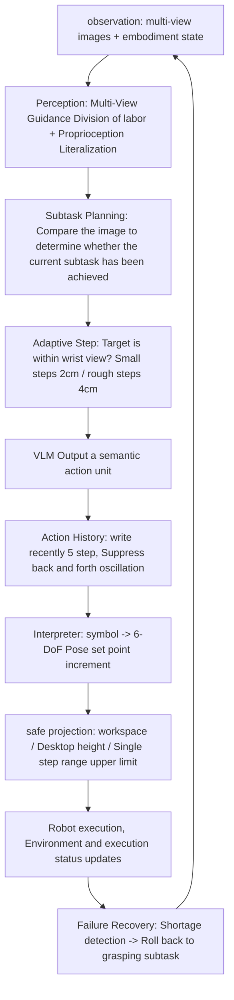

#### ⑥ The same interface, two usages
{: id="-同一个接口两种用法"}

**ZS mode (frontier VLM zero sample as agent)**: The closed-source frontier model does not require any fine-tuning and controls the robot directly through the harness. The advantage is that as subsequent models become stronger, the robot's capabilities will automatically increase accordingly.

**FT mode (fine-tuned open source small model)**: The same set of action words can also be used to train small models. Given the demo $$\mathcal D$$ collected with the same action space, the policy minimizes the token-level cross-entropy of the target unit:

$$\min_{\theta}\ \mathcal L(\theta) = -\sum_{(\ell, o, h, a) \in \mathcal D} \log \pi_\theta\big(a \mid \Phi_{\mathcal P_{\min}}(\ell, o, h)\big)$$

The $$\mathcal P_{\min}$$ here is deliberately trimmed to the thinnest context (leaving only instructions, multi-perspective observations and a small piece of action history) for the purpose of controlled comparison. The key is: **semantic actions are** predicted using VLM’s own native vocabulary. There are no additional action heads and no special tokens, so a rank-64 LoRA (freezing the visual encoder and multi-modal projection layer, only updating about 3% of parameters) is enough. Qwen3.5-2B can be trained on a single H200 in less than 2 hours, 24GB Level graphics cards can also run.

#### ⑦ GUMI: Turn the action vocabulary into a web page
{: id="-gumi把动作词表变成一个网页"}

  
<figcaption>GUMI interface: Each semantic action unit corresponds to a button with a key. People can use the keyboard to "play" the robot, and the computer-use agent can also directly operate the same web page. Each arm has a set of keys and supports action queuing and submission</figcaption>

Because the action space is discrete and can be directly manipulated by humans, the author conveniently made it into a graphical interface GUMI. Each unit is mapped to a button with a shortcut key: a human can control it with a keyboard, a computer-use agent can click on the same web page, and a general-purpose VLM agent can directly predict the symbols. Each step of GUMI records the pair of "pre-execution observation + selected semantic action" $$(o_t, a_t)$$, which is naturally a trainable sample; and because the implementation of the interpreter is deterministic, the same rollout can also leave underlying instructions and tracks incidentally - **A demonstration can simultaneously train the semantic action strategy and the continuous control strategy**.

Compared with acquisition pipelines that rely on dedicated teleoperation hardware or simulation-specific control, GUMI does not require any special hardware and supports single-step control, action queuing, single-arm, and hybrid acquisition where humans intervene to correct during agent rollout; the same batch of demonstrations can be reused between different embodiments that implement the same set of units, and also supports remote acquisition (people do not have to stay with the robot).

---

### 3. Results and findings
{: id="3-核心结果发现-4"}

**Experimental setup**: Two real robots - 7-DoF Franka Research 3 (one RealSense D435 external view facing the workbench + one wrist D405) and two-arm AgileX (two 6-DoF arms, one shared self-view + one per wrist, three Orbbec Dabai DC1 in total). The task is 5 objects (squares, bananas, tennis balls, teddy bears, chess pieces) × 2 containers (plates, bowls) = 10 catch-and-place tasks, each task has 10 random placement trials, and the upper limit of a single episode is 50 steps before the timeout fails. The FT mode demo only covers cubes, bananas, and tennis balls, leaving teddy bears and chess pieces as OOD. ZS uses Gemini-3.1 Pro by default (medium thinking effort), and FT uses Qwen3.5-2B by default. The demo has a total of 164 real robot episodes (7.8K decision steps) + 230 simulation episodes (13.5K steps, from ManiSkill and RoboLab).

The three levels of generalization of **are significantly ahead of** (success rate, average):

|generalization level| π0.5 | GR00T | Harness-VLA | Goal-VLA | CaP-X | RATS | **ZS** | **FT** |
|---|---|---|---|---|---|---|---|---|
|Cross-Task (10 tasks)| 39.0 | 35.0 | 50.0 | 13.0 | 44.0 | 57.0 | **89.0** | **86.0** |
| Cross-Environment | 40.0 | 34.0 | 63.8 | 15.0 | 52.5 | 65.0 | **100.0** | **88.0** |
| Cross-Embodiment | 41.0 | 36.0 | 49.0 | 11.0 | 43.0 | 52.0 | **93.0** | **87.0** |

A few points worth mentioning separately: The advantage is also true for the teddy bears and chess pieces that **has not appeared in the fine-tuning data** (ZS is 10/10 on the chess piece task, π0.5 is only 1/10); **sim-to-real** In one item, FT, which only uses simulation demonstration training, gets 13/20, while π0.5 and GR00T, which also only feed simulation data, get 0/20; when **crosses embodiment**, ZS only needs to change an interpreter, and FT directly evaluates each after joint training on the data of both arms.

  
<figcaption> Capability analysis: The upper four boxes are physical adaptability (fine control, rotation extrapolation, action combination, workspace offset), and the lower three boxes are multi-arm collaboration and semantic adaptability (inference-intensive tasks, video in-context learning)</figcaption>

**Physical adaptability - change the interpreter instead of retraining the model**

- **Fine control**: Block stacking and latch tasks, only adjusting the interpreter step size from 2 cm to 1 cm, without moving the interface and not retraining, ZS increased from 60% to 80%, FT increased from 40% to 65%; π0.5 trained with the same batch of demonstrations was only 15%, and an additional batch of fine motion data was required to reach 60%.
- **action combination**: Synthesizing two orthogonal translation units into one diagonal displacement is only a matter of the interpreter - ZS has −26% steps per episode, FT −24%, and the success rate has only dropped slightly from 94%/84% to 92%/82%.
- **Rotation Extrapolation**: See example below.
- **workspace offset**: expanded from the core 25% area (S@1) to 90% close to the boundary (S@3), ZS 98%→92%, FT 88%→82% only declined slightly, and π0.5 collapsed from 48% to 24%.
- **Multi-arm collaboration**: On both AgileX arms, the joint action prediction of "clearing the table" is 90% (0 collisions), while the two independent single-arm agents each manage only 70% (1 collision); the gap in "passing bananas" that requires handover is even greater - joint 70% (0 collisions) versus independent 30% (3 collisions).

> **as an example (rotation extrapolation)**: Each `ROTATE_CW` only rotates 15°. In the training demonstration, the carrot only swung through 0° and 45°, but during the test it swung to an unseen 90° - the model does not need to have "seen 90°", as long as it vomits 6 `ROTATE_CW` in a row, it will be in place. FT gets 70% at 90°, while the π0.5 of direct regression to continuous action is only 20%: the angle of the regression output is locked by the training distribution, while the incremental unit can be extrapolated by repeated combinations. By the way, if the rotation unit is removed from the vocabulary, the success rates at 45° and 90° drop to 50% and 10% respectively.

**Semantic adaptability—preserving VLM’s instruction following flexibility**

- **Reasoning-intensive task** (find out which of the three inverted cups hides the square, arrange the scattered letters to form "SHOW"): ZS opens Situated Planning and gets 85%, FT and π0.5 run alone only 10% and 0%; feed them the same subtask instructions generated by Gemini, FT rises to 70%, π0.5 still only has 5%.
- **video in-context learning**: It is required to collect three objects in the order in the demonstration video. When there is no demonstration, ZS only gets 20% (the order is not clear in the first place). After giving a human or robot demonstration video, both sources are 20/20; FT gets 90% from both sources under the condition of the task outline extracted by the same planner.

  
<figcaption> Ablation of nine plug-ins (real robot Franka + Gemini-3.1 Pro zero sample): The default plug-in leaves one method behind, Visual Prompt and Situated Planning are superimposed on the default configuration and evaluated in special scenarios. The complete configuration baseline is 96%</figcaption>

**plug-in ablation** (complete configuration 96%):

- **Multi-View Guidance**: Drops to 58% only for global view - wrist view is almost a necessity for fine alignment of small objects.
- **Proprioception**: Removed and dropped to 68%. Compact signals such as gripper height and contact status provide reliable guidance when appearance or depth makes visual judgment slip.
- **Subtask Planning**: Removed and dropped to 60%. A typical failure is **dragging the object toward the plate without lifting it** - this problem disappears only after the operation sequence is broken into stages that are locally valid and can be verified by images.
- **Action Chunking**: Turning it off is still 96% but requires 32 model calls; forcing chunk throughout the process reduces the calls to 20 times (-38%) but drops to 74%. Conclusion supports **selective chunk**: compresses redundant handling segments and retains fine-grained feedback before and after contact.
- **Adaptive Step**: Only 82% of fine steps are used (38 steps, easy to overshoot), only 70% of coarse steps are used (22 steps, easy to overshoot), and 96% of adaptive switching is based on target visibility (30 steps).
- **Visual Prompt**: Basically ineffective in regular tasks (96% vs 94%), support it to be turned off by default; but in "grasping the cup handle" it improved from 40% to 85%. Note that just drawing the mark without language alignment is 35% - **The gain comes from explicitly aligning the language instructions with the marked interaction points, not the mark itself**.
- **Situated Planning**: Zero impact on regular tasks, hidden object search increased from 35% to 85%.
- **Action History**: After removal, it dropped to 76%, and the number of steps increased from 30 to 39. Most of the failures were oscillations between opposite actions.
- **Failure Recovery**: Removed and dropped to 72%. The main failure mode is undetected empty gripping, and then the empty gripper is used to continue through the rest of the process.

  
2×2 ablation of<figcaption> action space representation: the horizontal axis is whether there is a clear text agreement, the vertical axis is the semantic name or an arbitrary symbol; the right side is the direction mapping confusion matrix detected by the model under setting (D), with a large area mirrored in the left and right directions</figcaption>

**The most interesting group of ablation - what exactly does the action symbol rely on grounding**. The author fixed the rest of the harness unchanged and only changed the representation of the six translation units to do a 2×2 comparison:

| |There is an express agreement|No express agreement|
|---|---|---|
|**semantic name** (`MV_LEFT`…)|(A) **100%**, 25 steps|(B) 90%, 34 steps|
|**Any symbol** (A–F)|(C) **95%**, 27 steps|(D) **5%**, 49 steps|

The reading is: **The convention provides most of the grounding, and the semantic name is just a useful prior**. Any symbol is paired with a clear description of "where this symbol will move the end" (C), which is almost the same as the default configuration; conversely, only semantic names are given without conventions (B), although it can still be used, but the efficiency is significantly reduced. In setting (D), the model can only test it by itself - spitting out an unknown symbol, comparing observations before and after, and guessing its effect - only 1 episode was successful out of 20 episodes, and the inferred mapping was only 23.3% correct (randomly 16.7%), and the left and right directions on the confusion matrix mirrored each other in large areas. **It is unreliable to rely solely on visual changes to deduce action semantics. Writing the agreement into prompt is the key.**

  
<figcaption> Left: The distribution of different frontier VLM and thinking effort on the success rate-number of steps plane; Right: In the chess cannon placement task, the ability is divided into planning and fine-grained alignment. The bottleneck is obviously in the latter</figcaption>

**backbone model and thinking budget**: Zero-sample performance generally follows the capabilities of the underlying model (Gemini-3.1 Pro > GPT-5.6-sol > Opus 5 > GPT-5.6-luna > Gemini-3.6 Flash). To improve thinking effort, **mainly reduces the number of redundant interaction steps**. The improvement in success rate is limited, but the wall clock time increases significantly (GPT-5.6-sol reaches 3.4×). The command following of all models is very stable, and more than 98% of the responses can produce legal action units. Taking the chess cannon placement task apart, **planning is not the bottleneck of** (the plan correct of the three models are all 80–95%). The errors are concentrated in fine grasping and placement (place correct is only 70/30/15); additionally given the target bounding box, it can be mentioned further, indicating that explicit visual grounding clues are of great value.

**Fine-tuning backbone scale**: 2B is already very strong, and the larger backbone mainly has gains in fine tasks such as stacking and latching; the 1B-level model will do too many local fine-tuning near the target, resulting in a significantly longer set length; but the small model can outperform the large model in tasks such as tennis that require timely correction of moving objects. Overall 2B is a balance between accuracy and responsiveness.

  
<figcaption> real robot qualitative results: new objects, background changes, lighting changes, cluttered scenes, spatial reasoning (putting letters to spell "SHOW") and arm coordination (opening drawers and placing cups) are all completed by the same set of action interfaces</figcaption>

---

### 4. Limitations
{: id="4-局限性-4"}

1. **embodiment has limited coverage**: Currently, it has only been verified on single-arm (Franka) and double-arm (AgileX) operations equipped with parallel grippers. It is still unknown to extend it to embodiments with higher degrees of freedom and more complex contact patterns such as dexterous hands and humanoids;
2. **Single sensing mode**: The sensing side only has vision and embodiment states, lacks tactile and force feedback, and is still short of fine physical interactions that require intensive contact and compliant control.

---

## 6. SPACE (2026)
{: id="space"}
———Learn from programmed skills when to act continuously and when to stop and observe

📄 **Paper**: [arXiv:2609.02042](https://arxiv.org/abs/2609.02042)

---

### Key takeaways
{: id="精华-5"}

- The key to **action blocks is boundaries**: Outputting multiple actions at once can reduce large model calls, but the strategy also needs to learn which actions can be executed continuously, and when it should stop to obtain new observations.
- **uses skill structure to provide supervision**: SPACE summarizes compound skills and sub-skills from success trajectories, converts sub-skill call boundaries into action block boundaries, and supplements the time structure that terminal rewards are difficult to provide directly.
- **has skills during training and takes direct action during deployment**: Skill calls are expanded into ordinary action block samples and trained together with data independently sampled by the strategy. The final strategy does not need to access the skill library.
- **Simultaneously compares the entire trajectory with the local state**: The trajectory-level advantage measures the final result, and the block-aware step-level advantage compares the returns discounted by decision round under the same anchor point observation, so that the learning signal takes into account both success and decision-making efficiency.
- **The benefits have a clear experimental scope**: In the text interaction settings of ALFWorld and ScienceWorld, SPACE improves 7.0–31.3 percentage points compared with the baseline with the highest success rate in each setting, and reduces LLM decision rounds.

---

### 1. Background and problem
{: id="1-研究背景问题-5"}

ReAct-style agents usually only generate one atomic action per round, read environmental feedback after execution, and then call a large model to determine the next step; deterministic routines in long-term tasks therefore require multiple model calls. Directly changing to output a variable-length action sequence at once, and then using standard reinforcement learning training may not necessarily lead to good learning: the paper observed phenomena such as single action collapse, excessively long action blocks leading to a decrease in success rate, and multi-action PPO training being unstable. The authors attribute the core difficulty to action block boundary learning—sparse terminal rewards lack supervision that directly signals “this is the time to pause and re-observe.”

  
<figcaption> allows the output of multiple actions and does not guarantee effective chunking; different backbone models exhibit single-action collapse and over-commitment respectively</figcaption>

---

### 2. Methods and innovations
{: id="2-主要方法创新点-5"}

  
<figcaption> Successfully generated programmed skills from trajectories. Skill calls were expanded into original action blocks and trained together with directly sampled action blocks; only the action block strategy was retained during testing</figcaption>

SPACE (Skill-guided Policy with Adaptive Chunk Execution) consists of two layers of programmed skills **, hybrid trajectory sampling and skill expansion, and block-aware policy optimization**. Skills provide reusable task decomposition, the expansion process converts the decomposition into training samples, and joint optimization absorbs this structure into a strategy that directly outputs action blocks.

#### ① Action block interface: Reduce the number of decisions and retain necessary feedback boundaries
{: id="-动作块接口减少决策次数保留必要的反馈边界"}

First write several actions at a time, and then execute them sequentially by the executor. This is action chunking (Action Chunking). The strategy generates $u_i=(a_{i,1},\dots,a_{i,L_i})$ based on the interaction history $h_i$ of the $i$ round, where $1\leq L_i\leq K$; the executor stops execution when the block is completed or encounters an invalid action, and then enters the next LLM decision, experimental setting $K=6$.

|Dimensions|single action strategy|Simple multi-action RL| SPACE |
|---|---|---|---|
|Output per round|an atomic action|Variable length atomic action sequence|Variable length atomic action sequence|
|How to determine boundaries|Fixed segmentation after each action|Mainly relies on task reward learning|Demonstration of adding sub-skill boundary formation|
|training data|Atomic motion trajectory|Autonomously generated action block trajectories|Autonomous action blocks and skill expansion action blocks|
|test interface|single action|action block|Action block, no skill call|

> **Take an example (mechanism diagram)**: If the location of the refrigerator is known, you can first output "walk to the refrigerator and open the refrigerator", wait for feedback to confirm what objects are inside, and then decide which object to take. If objects that have not yet been confirmed to exist are also written into the same block in advance, it may fail due to lack of mid-way feedback; it is this kind of trade-off that boundary learning aims to solve.

#### ② Two levels of procedural skills: turning successful experiences into divisible routines
{: id="-两层程序化技能把成功经验变成可切分的例程"}

 **input** is the trajectory of successful interaction. The large model divides it into sub-task stages, generating a composite skill responsible for scheduling, and several sub-skills (Subskills) that complete local routines; each sub-skill contains behavior descriptions, parameter modes and executable functions, and the composite skill also records an ordered sequence of sub-skill calls. The generated code is checked for syntax, compilability and function signature, and then standardized and deduplicated according to the Abstract Syntax Tree (AST). **output** to the skill library.

The two-layer structure provides a specific basis for segmentation: the composite skill is responsible for the sequence of "find the object first, then heat it, then place it". Each sub-skill call corresponds to an action block, and block boundaries are formed between calls. These bounds are training demonstrations taken from the program structure and do not imply that they have been proven to be optimal bounds for all states.

**Cold start and update**: Appendix A.2 clearly uses the initial skills of manual sorting, 3 for ALFWorld and 5 for ScienceWorld, and serves as a few sample examples for subsequent skill induction. The search prioritizes the matching task category, and selects the top 3 composite skills based on the UCB-style score that combines the success rate and the number of uses; when there is no corresponding category, 7 sub-skills that are as diverse as possible are retrieved based on the description semantic similarity. During training, skills are regularly summarized from new success trajectories, with a maximum of 20 composite skills for each type, and entries with zero long-term success rate are cleared.

#### ③ Mixed sampling and skill expansion: convert code calls into deployment interfaces
{: id="-混合采样与技能展开把代码调用转换为部署接口"}

The training is based on **track** mixed two modes. The trajectory of proportion $\rho_{\mathrm{prim}}$ adopts Primitive-Chunk Mode, and the strategy directly outputs action chunks to form the same strategy data $\mathcal D_{\mathrm{on}}$; the remaining trajectories adopt Skill-Augmented Mode, and the strategy receives the retrieved skills and can output original action chunks or call skills.

In order for the deployment strategy to output only atomic action sequences, skill enhancement trajectories are expanded via Skill-to-Chunk Expansion:

- Already the output of the original action block, leave it as is.
- Calling a sub-skill is converted into a set of "current history, action blocks output by this sub-skill".
- Call a compound skill and expand it into multiple groups of samples along the order of its sub-skill calls; the history of the latter sample contains the feedback after the execution of the previous action block.

> **Take an example (only demonstrates segmentation)**: A composite skill call executes 3 sub-skills in sequence, which produce 2, 3, and 2 atomic actions respectively. After expansion, three action block samples with lengths 2, 3, and 2 are obtained. Each sample is matched with the history at the corresponding boundary; these 7 actions will not be merged into one block. The policy thus learns both the action content and the block end position.

These expanded samples form hetero-strategy data $\mathcal D_{\mathrm{off}}$. The "different strategies" here refer to samples that have been executed and rewritten by skills, rather than raw data directly collected by the deployment strategy through the same interface; they are continuously generated during the training process and do not necessarily come from a fixed pre-collected data set.

The default original action block sampling ratio is 0.5 in ALFWorld and 0.75 in ScienceWorld; the 8 tracks per task in the former can be divided into 4 direct sampling and 4 skill-enhanced sampling, while the latter is 6 and 2. The two-way samples are finally aligned to the same interface, so the trained policy does not need to retrieve skills or execute skill functions.

#### ④ Block-aware credit allocation: compare the entire trajectory with the same state separately
{: id="-块感知信用分配整条轨迹与相同状态分别比较"}

To judge whether an action deserves to be learned more or less, SPACE simultaneously looks at "what is the result of the entire trajectory" and "how is the subsequent performance under the same observation", that is, Chunk-Aware Two-Level Advantages. Let $M_\tau$ be the number of decision rounds in the unified action block representation, $r(\tau)$ be the terminal reward, the sampling group with the same task and initial conditions is recorded as $\mathcal G$, and the trajectory-level advantage is:

$$
A_{\tau}^{\mathrm{traj}}=\frac{r(\tau)-\mu_{\mathcal G}}{\sigma_{\mathcal G}+\epsilon}.
$$

For the $i$ action block, first calculate the reward of **discount according to** remaining decision round, and then broadcast it to each action in the block:

$$
G_{\tau,i}=\gamma_c^{M_\tau-i}r(\tau).
$$

Then take the anchor state key $z_{\tau,i,j}$ observed before the action is executed, form a set $H(z)$ of action occurrence positions sharing the same anchor point, and normalize it by the return mean and standard deviation of the set:

$$
A_{\tau,i,j}^{\mathrm{step}}=
\frac{G_{\tau,i}-\mu_{H(z_{\tau,i,j})}}
{\sigma_{H(z_{\tau,i,j})}+\epsilon},
\qquad
A_{\tau,i,j}=A_{\tau}^{\mathrm{traj}}+\lambda_{\mathrm{step}}A_{\tau,i,j}^{\mathrm{step}}.
$$

> Take **as an example (set your own value and ignore the stable term)**: Two successful trajectories take one action at the same anchor point, and the terminal rewards are both 1, but then 1 and 3 rounds of decision-making are required respectively; taking $\gamma_c=0.9$, the corresponding rewards are 0.9 and 0.729. If the anchor point group only has these two samples, calculated based on the overall standard deviation, the mean is 0.8145, the standard deviation is 0.0855, and the step advantages are +1 and −1 respectively. This local signal biases paths with fewer subsequent decisions; the raw rewards of actions within the same block are the same, but the final advantage can still be different if the anchor comparison group is different.

This is a method of assigning credit based on relative returns within a group, and one cannot claim that it accurately identifies the causal contribution of each action. The problem statement in the article uses success/failure terminal rewards, while the actual training in ScienceWorld uses scaled task scores according to Appendix A.2, and cuts negative values ​​to 0. Abstract settings and specific implementations should be distinguished.

#### ⑤ Joint training goals and inference process
{: id="-联合训练目标与推理流程"}

The original action block trajectory uses PPO-style clipping targets. Let $p_\theta(a_{\tau,i,j})$ abbreviated strategy generate the probability of this action under the conditions of history $h_i$ and previous actions in the block, $q_{\tau,i,j}=p_\theta(a_{\tau,i,j})/p_{\mathrm{old}}(a_{\tau,i,j})$ is the probability ratio of the old and new strategies, then:

$$
\mathcal L_{\mathrm{on}}=-\mathbb E_{\tau\sim\mathcal D_{\mathrm{on}}}
\left[\sum_{i=1}^{M_\tau}\sum_{j=1}^{\ell_i}
\min\left(q_{\tau,i,j}A_{\tau,i,j},
\operatorname{clip}(q_{\tau,i,j},1-\varepsilon,1+\varepsilon)A_{\tau,i,j}\right)\right].
$$

This term increases the probability of favorable actions while limiting the scope of strategy updates; consistent with the original presentation, the KL regular term is omitted here. The skill expansion data uses advantage-weighted self-imitation targets:

$$
\mathcal L_{\mathrm{off}}=-\mathbb E_{\tau\sim\mathcal D_{\mathrm{off}}}
\left[\sum_{i=1}^{M_\tau}\sum_{j=1}^{\ell_i}
w(A_{\tau,i,j})\log p_\theta(a_{\tau,i,j})\right],
\qquad w(A)=\operatorname{clip}(A,0,w_{\max}).
$$

This item retains the imitation weights of positive dominant samples and limits excessive weights, distilling the action blocks and their boundaries obtained by skill expansion into the strategy. The overall goal is:

$$
\mathcal L(\theta)=\mathcal L_{\mathrm{on}}(\theta)+\lambda_{\mathrm{off}}\mathcal L_{\mathrm{off}}(\theta).
$$

When implemented, the advantage of each atomic action is broadcast to the output token corresponding to that action. By default, 16 tasks are sampled per training step, 8 trajectories per task, the learning rate is $10^{-6}$, the history length is 5, and both backbone models run in no-thinking mode.

The end-to-end process is: hybrid sampling → unfold skill trajectories → calculate two-level advantages → joint update strategy → regularly update the skill library from successful trajectories. During testing, the loop is directly in the manner of "interaction history → variable-length action block → sequential execution → new feedback". LLM is not re-invoked in the middle of the block; the skill library and its retrieval and execution components no longer participate in reasoning.

---

### 3. Results and findings
{: id="3-核心结果发现-5"}

 **Main results (Table 1, Table 2)** : SR is the success rate, and round is the average number of LLM decisions per episode. Select each setting uniformly in the table below **Baseline with the highest success rate** Compare and avoid piecing together the success rates of different baselines with the lowest rounds.

|Environment / Backbone / Partition|compare baseline|Baseline SR → SPACE SR|Gain (percentage points)|Baseline round → SPACE round|
|---|---|---|---|---|
| ALFWorld / Qwen3-4B / Seen |GiGPO (SR alongside Multi-action GRPO)| 85.2% → 99.2% | +14.0 | 15.9 → 3.7 |
| ALFWorld / Qwen3-4B / Unseen | Multi-action GRPO | 81.3% → 96.9% | +15.6 | 20.9 → 4.4 |
| ALFWorld / Llama-3.1-8B-Instruct / Seen | GiGPO | 89.1% → 96.1% | +7.0 | 14.5 → 5.0 |
| ALFWorld / Llama-3.1-8B-Instruct / Unseen | GiGPO | 83.6% → 94.5% | +10.9 | 18.8 → 5.2 |
| ScienceWorld / Llama-3.1-8B-Instruct / Seen | GiGPO | 35.9% → 67.2% | +31.3 | 10.2 → 5.2 |
| ScienceWorld / Llama-3.1-8B-Instruct / Unseen | GiGPO | 34.4% → 61.7% | +27.3 | 10.1 → 5.8 |

For example, Qwen3-4B's ALFWorld Unseen decision rounds are reduced by approximately **78.9%**. In comparison, Llama's Multi-action GRPO itself only requires 5.4/5.5 rounds, and SPACE is 5.0/5.2 rounds. The main advantage is that the success rate is increased from 71.1%/65.6% to 96.1%/94.5%; it cannot be generalized to all multi-action baselines as a 70% reduction in rounds.

  
<figcaption>Qwen3-4B’s ALFWorld Unseen success rate curve, the number of actions per round of the two backbones, and the change in strategy entropy; in the later stages of SPACE, 3–4 actions per round were roughly maintained</figcaption>

**Action Block Behavior**: Qwen3-4B's Multi-action GRPO is close to one action per round, and Llama-3.1-8B-Instruct tends to about 5–6 actions per round but with a lower success rate. SPACE resulted in an intermediate granularity of about 3–4 actions in these experiments while maintaining a higher success rate; this range is an experimental observation and cannot be relied upon as a universal optimal block length.

**component ablation (Table 3, ALFWorld/Llama-3.1-8B-Instruct)**:

|training configuration|Seen SR / round|Unseen SR / round|
|---|---|---|
|Complete SPACE| 96.1% / 5.0 | 94.5% / 5.2 |
|Remove skills| 86.7% / 5.8 | 88.3% / 5.7 |
|Remove block-aware advantages| 90.6% / 5.6 | 89.1% / 7.0 |

Removing either component reduces the success rate and increases the number of decision rounds, supporting the complementary role of skill-bound supervision and block-aware optimization.

  
<figcaption> The left picture counts ALFWorld’s training sampling LLM rounds, not the number of tokens; the right picture compares ScienceWorld’s original action block sampling ratio, the decision round of 0.75 is the lowest, and the success rate of 0.875 is higher</figcaption>

**efficiency indicators need to differentiate between calibers**: In Figure 3(a), SPACE reaches the final performance of Multi-action GRPO at the 40th training step, corresponding to about 26.6% of the training steps stated in the paper overview; Figure 4(a) counts **sampling LLM in another backbone setting In round**, it takes 43.60K times for SPACE to achieve GRPO performance, and the entire GRPO process is 564.54K times, which is about 7.72% (a reduction of 92.28%). The entire SPACE process is 104.46K times; these values ​​cannot be directly regarded as total tokens, GPU time or end-to-end training costs.

Trade-off of **sampling ratio**: In Figure 4(b), $\rho_{\mathrm{prim}}=0.75$ corresponds to a success rate of 64.5% and 5.51 rounds; 0.875 corresponds to 66.4% and 6.84 rounds. The author chose 0.75 as a compromise between success rate and efficiency. However, the statement in the text that "the success rate is also higher" is inconsistent with the value in the figure. Here, the illustration is based on the data shown in the figure.

**Search during test (Table 4)**: On the difficult validation subset of ScienceWorld, the Best-of-N search takes $N=8$, the GRPO success rate increases from 33.3% to 37.5% (+4.2 percentage points), and SPACE increases from 52.1% to 60.4% (+8.3 percentage points); the average LLM calls after adding search were 74.9 and 48.3 respectively. Single action candidates use 3-step environment look-ahead scoring, and action block candidates use complete block execution scoring. Therefore, this result depends on the evaluation conditions that enable candidate environment look-ahead, and it does not mean that the two environment simulation costs are the same.

---

### 4. Limitations
{: id="4-局限性-5"}

1. **is only verified in the text interactive environment**: The experiment only covers the text settings of ALFWorld and ScienceWorld. ScienceWorld also excludes tasks with optimal solutions exceeding 100 environmental steps. Visual input, continuous control and real robots scenarios have not been verified;
2. **relies on manual cold start skills and skill induction process**: The method requires manual cold start skills, and continues to summarize and execute skills during training; the main efficiency indicator of the paper is the LLM decision round, and the end-to-end training acceleration including these additional processes cannot be directly inferred based on this.

---

## 7. ABot-AgentOS (2026)
{: id="abot-agentos"}
——Universal robot Agent operating system and lifelong multi-modal memory system for embodied intelligence

📄 **Paper**: [arXiv:2607.10350](https://arxiv.org/abs/2607.10350) · [Project Page](https://amap-cvlab.github.io/ABot-AgentOS)

---

### Key takeaways
{: id="精华-6"}

1. **Modular layered decoupling architecture**: ABot-AgentOS is deployed between the underlying robot controller and the high-level basic VLM/VLA model, decoupling high-level semantic reasoning, skill execution, multi-level verification and memory retrieval, solving the problems of lack of explicit termination signals and process drift in traditional single-model controllers.
2. **Agent Harness control closed-loop**: Propose a "reasoning-execution-verification" closed-loop that includes global Main LLM planning, Skill Runner context-isolated local execution, and Verifier run-time/skill-time/end-time multi-stage verification, which significantly reduces false completion and blind stagnation in long-term tasks.
3. **Universal Multi-modal Graph Memory**: Converts speech, image observation, spatial location, time association and task trajectory into strongly typed multi-modal graph nodes and edges, supporting retrieval and local subgraph extraction based on evidence traceability.
4. **Failure-Driven Lifelong Self-Evolution (Failure-Driven Lifelong Self-Evolution)**: Build a fail-to-JSON DSL asset mechanism based on Trace diagnosis, adopt strict post-check gating, and achieve cumulative self-evolution with zero ground-truth leakage in cross-Split deployment.
5. **Embodied WorldBench**: Launches the first executable evaluation benchmark across indoor and outdoor composite scenes, covering 16 scenes, 4 difficulty levels and 200+ composite tasks; and provides an end-to-end student policy distillation training pipeline based on text sandbox and self-evolution reward engine.

---

### 1. Background and problem
{: id="1-研究背景问题-6"}

Embodied AI (Embodied AI) is pushing artificial intelligence from the digital world to the physical world. In recent years, the visual language model (VLM) and the visual language action (VLA) model have given robots excellent natural language understanding, visual scene perception and action prediction capabilities. However, a critical gap remains between semantic understanding and reliable physical execution:
1. **Semantic beliefs are disconnected from environmental facts**: In complex long-term tasks, existing end-to-end controllers or simple API calls lack explicit intermediate state verification and termination signals. The robot may have executed the navigation instructions but not moved, or it may have continuously collided locally but thought the task was progressing normally at the language level.
2. **lacks cross-modality universal Agent hardware abstraction**: Existing systems are mostly highly bound to specific robot forms or control interfaces, and are difficult to seamlessly extend to diverse hardware such as humanoid robots and four-legged dogs.
3. **Memory is difficult to persist and trace back to self-improvement**: There is a lack of a general multi-modal memory system that can be persistently stored across sessions, traceable to origin, and self-improved from historical interaction failures.

To this end, the paper proposes **ABot-AgentOS**, a universal robot Agent operating system that runs on the underlying controller and decouples high-level cognition and physical actions.

---

### 2. Methods and innovations
{: id="2-主要方法创新点-6"}

ABot-AgentOS is scheduled by **edge cloud in collaboration with dual LLM cores** and **Agent Harness closed-loop**, **general multi-modal graph memory** and **end-to-end distillation training pipeline** are composed of four modules.

  
<figcaption>ABot-AgentOS overall system architecture: multi-source multi-modal input through edge cloud collaboration dual LLM core routing, Agent Harness closed-loop scheduling skills and multi-level verification, combined with universal multi-modal graph memory and underlying controller</figcaption>

#### ① Overall framework and edge cloud collaboration dual core
{: id="-整体框架与边云协同双核心"}

ABot-AgentOS distinguishes between edge lightweight model and cloud large model (Dual-LLM Core) in architectural design:
- **Edge Tiny LLM**: Deployed on the robot end side, it prioritizes regular conversations, simple tool calls and real-time control instructions to reduce response delays.
- **Cloud Large LLM**: When the task involves long-term complex reasoning, multi-step planning or difficult graph memory retrieval, the learned routing strategy is automatically upgraded to cloud large model processing.

#### ② Agent Harness closed-loop control
{: id="-agent-harness-闭环控制"}

Agent Harness changes the design of traditional single-model controllers and divides Agent scheduling into three clearly decoupled roles:

  
<figcaption>Agent Harness Architecture details: Main LLM is responsible for global scene awareness planning, Skill Runner isolates local execution details, and Verifier provides multi-stage real-time and final verification</figcaption>

1. **Main LLM (Semantic Planner)**: Receives user instructions and memory context, and generates adjustable high-level plans and explicit completion conditions based on the current scenario. Instead of directly emitting micro-actions for each foot, the Main LLM decides to call tools directly or delegate subtasks to a Skill Runner.
2. **Skill Runner (process executor)**: Runs in an independent local context as a skill-level Subagent. It handles complex processes such as local repeated movements, perspective fine-tuning, and collision recovery, and only returns compressed high-level execution result summaries to the Main LLM to prevent local details from blocking the Main LLM's global planning.
3. **Verifier (multi-stage verifier)**:
   - **Runtime Verification (Runtime Verification)**: Monitor the trajectory and skill status, and promptly identify stagnation, local infinite loops and frequent collisions.
   - **Skill Verification**: Verify whether the subtask actually achieves the semantic goal, rather than just relying on Tool to return success.
   - **Finish Verification**: When Main LLM attempts to terminate the task, compare the initial instructions, final visual observation and environmental facts to prevent false completion.

#### ③ Universal multi-modal graph memory and lifelong self-evolution
{: id="-通用多模态图记忆与终身自进化"}

  
<figcaption> Universal multi-modal memory architecture and offline fault-driven self-evolution loop: write source-traceable type graphs online, and compile failed Traces into controllable JSON DSL evolution assets offline</figcaption>

1. **Multimodal Memory Graph (Memory Graph)**: Write entities, events, locations, visual frames, time associations and attribution chains (Provenance) in online interactions into strongly typed nodes and edges, replacing the stack of original video streams or plain text logs.
2. **Hybrid Graph Retriever**: combines semantic embedding, lexical matching, metadata filtering and graph edge topology expansion to extract high-quality local evidence subgraphs.
3. **Failure-Driven Lifelong Self-Evolution (Failure-Driven Lifelong Self-Evolution)**:
   - **Split isolation protocol**: In the sequence split deployment, the $$t$$ split can only use the evolution asset $$A_{<t}$$ that has been promoted in history.
   - **Trace diagnosis and asset compilation**: After the split is completed, the system performs Trace diagnosis on the failed sample and generates candidate evolution assets in JSON DSL format (covering the stages of memory writing, evidence selection, frame selection, time normalization, etc.).
   - **Strict gating verification (Gating)**: The candidate asset must improve the score on the target verification set and not reduce the performance on the regression set:
     $$\text{Accept}(a) = \mathbb{I}[\Delta S_{\text{target}}(a) \ge \tau_{\text{gain}} \land \Delta S_{\text{reg}}(a) \ge -\tau_{\text{reg}}]$$
After passing the inspection, it can be upgraded to $$A_{\le t}$$ for subsequent split use, achieving cumulative growth without label leakage.
4. **Edge-cloud collaborative privacy management**: Private memories (faces, personal items, etc.) are retained at the edge, and only public environmental memories (roadblocks, road landmarks) without sensitive information are shared on the cloud, with a privacy classification accuracy of over 99%.

#### ④ EmbodiedWorldBench and policy distillation training pipeline
{: id="-embodiedworldbench-与策略蒸馏训练管线"}

  
<figcaption>EmbodiedWorldBench evaluation benchmark overview: 16 executable scenarios and 4-level difficulty settings covering indoor and outdoor composite scenes, NPC interactions and dynamic events</figcaption>

The paper launched **EmbodiedWorldBench**, covering 16 indoor, outdoor and mixed scenes, with 4 difficulty levels and 200+ composite tasks involving navigation, NPC interaction, item search and dynamic event response.

  
<figcaption> Student policy end-to-end training pipeline: build environment through text sandbox, self-evolution reward engine to generate preference data and use DPO/SFT to optimize edge deployment model</figcaption>

In order to transfer the capabilities of the large cloud model Agent Harness to the small on-device model, the paper designed an end-to-end distillation pipeline:
1. **Controllable text sandbox construction**: Use LLM to automatically generate a text sandbox environment with executable status and complex logic.
2. **self-evolution reward engine**: Generate automatic scoring and DPO preference pairs based on structured Trace.
3. **SFT + DPO policy optimization**: Training and deploying lightweight Student Policy in a sandbox environment.

---

### 3. Results and findings
{: id="3-核心结果发现-6"}

1. **Long-range embodied execution**: In the initial subset evaluation of EmbodiedWorldBench, ABot-AgentOS achieved significant improvements in task success rate (Success Rate) and goal completion (Goal Completion) compared with the single controller baseline, and the Verifier mechanism reduced early false terminations by more than 35%.
2. **multi-modal memory benchmark is fully ahead of**:
   - **LoCoMo** (long-horizon session memory): Static version reaches **87.5**, +Self-evo improves to **88.7** (close to the human upper limit of 87.7).
   - **OpenEQA (EM-EQA)**: Static reaches **59.9** under 8 frame budget, +Self-evo improves to **60.4** (surpassing SnapMem 57.2 and GaussExplorer 57.8).
   - **Mem-Gallery**: Static reaches **88.6**, +Self-evo improves to **89.0** (on conflict detection CD 97.5% with reject answer AR 100% outstanding performance).
   - **NExT-QA**: Validation Acc@All reaches **76.5%** (+Self-evo increased by 4.1 points), significantly ahead of classic video agents such as VideoAgent.
   - **EgoLifeQA**: Obtained the average accuracy of **66.2%** under single frame retrieval settings.
3. **Cross-task generalization of lifelong self-evolution**: The self-evolution mechanism brings stable increments on all 5 memory benchmarks, and the performance gain comes entirely from general improvements to the memory pipeline (such as time normalization, relationship disambiguation), rather than indiscriminate accumulation of memory content.

---

### 4. Limitations
{: id="4-局限性-6"}

1. **Perception and control of noise in the complex real physical world**: At present, large-scale verification is mostly carried out in executable simulation or semi-physical sandbox. In the face of high-noise depth perception, grasping failure and network communication delay in the real world, more in-depth hardware real robot tuning is still needed.
2. **Automated distillation relies on text sandbox**: Small model strategy distillation currently mainly relies on the text state sandbox environment. In the future, multi-modal visual observation and more complex physical simulation platforms (such as Isaac Sim/Habitat) need to be introduced.
3. **Memory self-evolution requires a credible feedback signal**: The offline self-evolution mechanism relies on deterministic error diagnosis or human feedback. How to safely define "answer errors" in an open unsupervised environment is still a long-term challenge.

---

## 8. ABot-ER (2026) {#abot-er}
———One model for embodied understanding, long-horizon planning, and interaction-point grounding, with training data revised through failure diagnosis

📄 **Paper**: [arXiv:2610.18355v2](https://arxiv.org/abs/2610.18355v2) · [Code](https://github.com/amap-cvlab/ABot-ER)

### Key takeaways {#abot-er-key-takeaways}

ABot-ER unifies spatial relations, scene states, temporal events, action plans, and interaction targets in one embodied reasoning model, supplying judgements, plans, and image coordinates to runtimes such as [ABot-AgentOS](#abot-agentos), while downstream policies carry out physical actions.
Its most transferable idea is to identify what is wrong with the supervision before coordinating new content, output-protocol repairs, and sampling changes, instead of treating every low score as a shortage of data.
The shared backbone receives two task-family-specific low-rank residual branches for question answering and planning, but remains jointly trainable; after protocol repair, the ablation does not show gains in either suite mean, placing a clear boundary on the architectural benefit.
A single post-training pass on the converged corpus approaches the twelve-benchmark mean of a six-round chain with one fifth of the accumulated post-training, suggesting that the reusable assets include audited data and evaluation rules.
Point-hit accuracy, simulated task success, and qualitative physical demonstrations should be distinguished, as should training-time corpus evolution and online adaptation after deployment.

---

### 1. Background and problem {#abot-er-background}

Moving an object to a requested location requires a robot to understand object-to-person spatial relations, current states, step dependencies, and actionable regions; separate training can produce uneven specialists, while joint training introduces interference between output formats and learning rates across capabilities.
The paper calls these bottlenecks **Data-Model Drift**, where a fixed data mixture no longer matches the model's current weaknesses, and **Modality Entanglement**, where text, plans, and coordinate supervision impose different demands on shared parameters.
ABot-ER aims to combine five kinds of embodied judgement in one checkpoint and establish a training workflow that can be diagnosed, revised, and audited.

---

### 2. Methods and innovations {#abot-er-method}

  
<figcaption>Original Figure 2: ABot-ER sits between observation and control, returning semantic judgements, action plans, and normalized image coordinates. The agent runtime schedules queries, verification, and replanning; downstream policies execute actions.</figcaption>

#### ① Overall framework: a unified reasoning model, data-revision engine, and training-selection workflow {#abot-er-overview}

The **online model** receives images, videos, or textual context and generates the requested response; the **offline data engine** reads evaluations and error records to revise the next training corpus; **two-stage training and checkpoint selection** turn that corpus into a new model while checking for substantial regressions in existing capabilities.
Here, execution means identifying actionable targets and locations. The model does not directly emit base velocities, joint positions, or torques; at deployment, a runtime passes its judgements to navigation, manipulation, and other execution policies.

| Capability dimension | Input and processing | Example output |
|---|---|---|
| Spatial and relational reasoning | Infer directions, distances, and layout from images or multiple views | Identify the object on the user's left |
| Scene and state understanding | Recognize task-relevant objects, attributes, and current states | Identify the tabletop blocks and whether the expression is valid |
| Temporal and event reasoning | Infer event order and state changes from video or before-and-after observations | Determine whether a block was placed or dropped during transfer |
| Long-horizon action organization | Arrange steps with preconditions using the goal, history, and feedback | Pick the object, move, and place it in the target region |
| Point grounding and affordance | Ground an instruction in an actionable image region | Return a grasp point or coordinates inside a valid placement region |

#### ② Shared backbone and task-conditioned low-rank residuals: shared knowledge with task-specific capacity {#abot-er-task-conditioning}

  
<figcaption>Original Figure 3: tasks share image encoding, the language backbone, and the output head. Two residual branches augment Q/V projections in the last four full-attention blocks. Each sequence selects one route; point grounding still follows the question-answering route.</figcaption>

**Multimodal encoding.** Images or video frames pass through a vision encoder and projector to form visual representations, while text becomes embeddings. Their original interleaved order is retained at the shared decoder; text-only tasks bypass vision.
The 9B instance uses **Qwen3.5-9B**, with 32 decoder blocks arranged as three Gated DeltaNet linear-attention blocks followed by one full-attention block, and a language output head shared by all tasks.

**Task routing.** The data loader inserts a task marker inside the first user message, selects a branch from the record's task family, and keeps that branch throughout the sequence.
The paper's `[EQA]` family covers spatial, state, and temporal questions as well as interaction coordinates; `[TASK_PLAN]` covers action plans. These families follow how the data was collected, rather than a text-versus-coordinate split, and there are no five separate capability decoders.

**Residual adaptation.** The `q_proj` and `v_proj` projections in zero-indexed layers 19, 23, 27, and 31—the last four full-attention blocks—each receive two sets of task-specific low-rank parameters.
For one projection, the calculation can be summarized as:

$$
\widetilde z_c = Wx + b + \frac{\alpha}{r} B_c A_c x, \qquad r=16,\quad \alpha=16.
$$

The first two terms are the shared transformation, and the last is the selected task family's correction. The shared language backbone and residuals train jointly; the vision encoder is frozen and the projector remains trainable, so this is not a frozen backbone with only LoRA trained on top.

> **Example:** For the same lemon image, both “How many lemons are there?” and “Point to the graspable center” select the question-answering residual; “Put the lemon in the pan, then put the pan in the oven” selects the planning residual.
> The three calls share object and spatial knowledge while giving plan generation its own parameter correction. The calling task determines the route; the model need not generate an explanation to decide which branch to use.

#### ③ Data-model self-evolution: use error evidence to choose the repair {#abot-er-data-evolution}

  
<figcaption>Original Figure 4: each round diagnoses evaluation failures, coordinates content, protocol, and mixture revisions, and selects a new model after data audits, training, and retention checks. The three-stream percentages describe the question-answering partition of a particular development round.</figcaption>

The engine receives capability scores, item-level outputs, training logs, and source records. One coordinating language-model agent proposes root-cause hypotheses and data requirements; deterministic programs check candidate data against format, provenance, exposure-cap, and trajectory-replay requirements.
Experts calibrate diagnoses and acceptance rules in the initial rounds, and later runs are constrained by those rules. The evolving artifact is the training corpus; the architecture and learning algorithm do not rewrite themselves.

**Capability diagnosis** classifies errors into parsing failures, coordinate-protocol violations versus point misses, multiple-choice errors, numeric parsing errors, open-ended deductions, and planning failures, then maps them to capability gaps. A drop on one benchmark does not automatically establish a dimension-wide weakness; other benchmark trends or item-level evidence are required.
The diagnosis feeds three complementary repairs that cannot substitute for one another:

| Revision mechanism | Problem addressed | Concrete action |
|---|---|---|
| Content Evolution | Missing correct or complete learning targets | Construct plans with verified preconditions and successful replay to the terminal state; retain evidence-grounded interaction targets |
| Protocol Evolution | Incompatible values or formats for the same target | Unify numeric coordinate conventions while fixing each task's point count, wrapper, and action schema |
| Mixture Evolution | Insufficient training exposure to valid supervision | Adjust sampling within source and repetition caps while retaining data for established capabilities |

**Coordinate protocols provide the clearest example.** Historical data mixed 0–1000 coordinates, normalized single points, and eight-point XML. Some labels also described arm-motion endpoints rather than the target regions requested by the question.
The repair unifies coordinates as `[0, 1]` values relative to the original image, with three decimal places, while preserving each task's required serialization: eight-point XML for VABench-P and lists of one to three point tuples for Where2Place.

> **Example:** The same target at the center of an image might be represented as `(500, 500)` on the old scale and `(0.500, 0.500)` after normalization.
> Numeric consistency alone is insufficient: a single-point list may still fail an evaluator that expects eight points. Even eight valid points teach the wrong task if they land on the arm endpoint rather than the requested object.

**Training-budget figures need an explicit accounting basis.** Corpus construction uses a token proxy estimated from characters and media costs, rather than an actual tokenizer count. Unique examples, materialized training records, and assistant supervision tokens measure different things.
In the final Stage B corpus, for example, planning represents **25.00% of physical records** but **63.76% of assistant supervision tokens**, because complete plans are much longer than single-option answers. Since the loss is normalized per sequence, the latter share is not directly a loss weight.
The figure's approximately 45% fine-grained capability, 15% benchmark guarantee, and 40% foundational streams belong to **R6's question-answering partition**, with planning allocated separately; they are not a fixed mixture used by both released stages. Quotas are written into the configuration by hand, while programs implement and check them.

**Data governance** checks contradictory answers for the same image-question pair, duplicate media, invalid references, source eligibility, and test overlap. New labels must be grounded in images, environment states, or trusted annotations.
One concrete lesson was R3's apparent EB-ALFRED score of “100”: its summary included only the first 12 completed episodes out of 300, and official test trajectories had separately entered the legacy training pool. Recomputing the full summary gave 27, which was still unusable because the weights were contaminated.
The authors then quarantined three sources in full, covering 23,565 candidate records. R3 remains diagnostic history and is excluded from performance claims; the released line restarts on cleaned data without inheriting weights trained on those sources.

#### ④ Two-stage training, a unified loss, and checkpoint selection {#abot-er-training}

**Stage A: cross-capability foundation.** Supervised training begins from a pretrained VLM on the joint corpus to cover all five capabilities and establish the shared numeric protocol.
**Stage B: targeted repair.** A shorter supervised fine-tuning run continues from the selected Stage A checkpoint, lowers the learning rate, increases data for deficits such as planning recovery, and retains other-task data to reduce forgetting. This stage is not reinforcement learning.

All tasks use the same autoregressive cross-entropy objective, supervising assistant outputs only; input tokens, media placeholders, and padding are excluded.
Writing $S$ for the assistant output positions in one sample, its sequence-normalized objective can be expressed as:

$$
\mathcal L = -\frac{1}{\lvert S\rvert}\sum_{t\in S}\log p_{\theta}(y_t\mid x,c,y_{<t}).
$$

Assistant tokens across a multi-turn sample are normalized together. Relative exposure is controlled mainly through corpus construction and sampling, rather than five separate capability losses.
Paper v2 reports **462,390 physical records and 294,762 unique identities** for Stage A, and **104,960 records and 52,480 identities** for Stage B, where every identity appears exactly twice. The record counts cannot be added and treated as unique examples.
The decoder learning rates are **4×10⁻⁶ and 3×10⁻⁷**, with optimizer and scheduler reset between stages. The complete jobs take approximately **826 GPU hours** across 32 GPUs, excluding data construction and full-suite evaluation.

Checkpoint selection first checks limits on other-capability regressions, parser reliability, and detected test overlap, then compares leading-benchmark counts and target scores within one checkpoint.
The development history is not six continuously accumulated weight updates: major protocol and source changes often trigger retraining from the pretrained model, and the released Stage A→B line must also be distinguished from R6.

#### ⑤ Inference and integration with the physical robot {#abot-er-inference}

At inference, the caller specifies the task family and activates its residual; the shared output head generates the answer token by token. Five separate task models are unnecessary, but autoregressive generation still involves repeated decoding computations.
In the Galaxea R1 Pro demonstrations, ABot-ER is the visual-question-answering component of [ABot-AgentOS](#abot-agentos), served on an external host with one RTX 5090D. AgentOS orchestrates the interaction, and the separate **ABot-M** VLA executes manipulation.
Before each action step, the runtime queries the scene and interaction targets; afterward it queries the outcome, then uses the returned judgement to continue or revise the remaining plan.

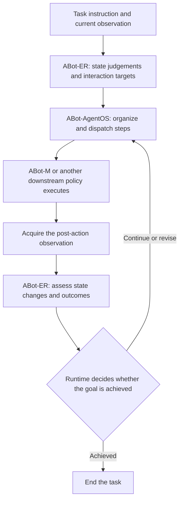

  
<figcaption>Original Figure 7: qualitative block-arithmetic and rock-paper-scissors demonstrations. ABot-ER reads visual states, ABot-AgentOS controls task progression, and a downstream VLA executes actions. These examples provide no additional physical success-rate measurements.</figcaption>

---

### 3. Results and findings {#abot-er-results}

**① Multiple capabilities coexist in one checkpoint.** Against nine public baselines in the main table, ABot-ER 9B leads the listed results on six of twelve benchmarks.
The equally weighted means over seven perception, three planning, and two point-grounding benchmarks are **63.86, 41.61, and 67.06**, exceeding the strongest listed baseline in each group by **3.94, 4.20, and 11.81** points. Those three reference values come from different models.

| Representative benchmark | ABot-ER 9B | Best listed baseline | Metric meaning |
|---|---|---|---|
| ERQA | **47.31** | Cosmos3-Nano 46.09 | Embodied multiple-choice reasoning accuracy |
| RoboVQA | **71.79** | MiMo-Embodied 66.09 | Open-ended robot-video question-answering score |
| Cosmos | **68.96** | Cosmos3-Nano 63.18 | Temporal and physical-event multiple-choice accuracy |
| EB-ALFRED | **26.67** | MiMo-Embodied 17.33 | Interactive task success rate |
| EB-Habitat | **37.00** | Cosmos3-Nano 26.67 | Interactive task success rate |
| VABench-P | **63.33** | Cosmos3-Nano 47.54 | Fraction of points inside the target box |

The scores share a 0–100 display scale but have different meanings; their aggregate is not an overall physical-robot success rate.
The nine-benchmark EQA mean of **64.57** includes seven perception and two point-grounding tasks. The twelve-benchmark mean is **58.83**, not an equally weighted average of the EQA and planning suite means.

**② Targeted post-training brings gains and trade-offs.** From Stage A to the released checkpoint, the planning mean rises **39.43→41.61**, with EB-ALFRED and EB-Habitat gaining **3.00 and 3.33** points, while Where2Place falls **72.90→70.79**. Improvement is not synchronous across capabilities.

**③ Conditional-branch benefits depend on data consistency.** In controlled paired ablations on **Qwen3.6-35B-A3B**, conditioning improves 11/12 benchmarks and raises the twelve-benchmark mean by **1.36** on the corpus with unaligned protocols. After protocol repair, the best checkpoints of each run give EQA **66.94→66.27** and planning **42.87→41.94**, with neither suite improving.
ET-Plan-Bench retains a consistent benefit: conditioning wins at all 17 matched checkpoints, averaging **+3.3** points. The ablation switches task markers and residuals together, does not isolate their contributions, and does not establish an independent architectural gain for 9B.

**④ The converged corpus transfers, while training history still shapes the capability profile.** With a common starting point, final corpus, and final-pass progress, a single post-training pass and a six-round chain reach twelve-benchmark means of **60.00 and 60.09**, using one fifth as much accumulated post-training in the single-pass case. Interactive planning remains weaker: EB-ALFRED is **25.00 versus 30.00**, and EB-Habitat **48.67 versus 51.67**.
The same two-stage corpora also transfer to 2B, 4B, 27B, and 35B-A3B backbones without rerunning corpus revision for each size. The 27B mean is **62.57**; this is a separate scaling experiment and should not be mixed with the training-history comparison.

  
<figcaption>Original Figure 6a: each development transition combines gains and regressions. Budgets, initialization, and some historical protocols differ across rounds, so this heatmap describes development history rather than controlled comparisons that change only the data strategy.</figcaption>

**⑤ Evaluation details limit the conclusions.** The current VABench-P prediction archive repeats one location eight times, so these cannot be interpreted as eight independent candidates. The paper also leaves the provenance of the EB archives' original online calls for verification, preventing success rates alone from establishing native closed-loop correction.
Public baselines come from leaderboard snapshots at different times, with potentially different original training and evaluation configurations. Point scores measure target hits rather than control precision or physical manipulation success.

---

### 4. Limitations {#abot-er-limitations}

Development rounds jointly change budgets, learning rates, data, and some evaluation protocols; quotas remain manually specified, and the appendix retains residual audit risks such as uncovered media. Cross-round gains therefore do not independently establish the causal benefit of self-evolution.
Physical demonstrations are mainly qualitative, without large-scale success-rate and latency comparisons, and interactive planning still fails frequently. Navigation or manipulation integration requires separate validation of visual judgements, runtime decisions, and downstream control.

---

## 9. Harness Robotic OS (2026)
{: id="harness-robotic-os"}
——Upgrade the four-legged inspection from "navigation stack" to "embodied agent runtime"

📄 **Paper**: [arXiv:2609.11225](https://arxiv.org/abs/2609.11225)

---

### Key takeaways
{: id="精华-7"}

The real question of this article is not "how to navigate more accurately", but "how to make a bunch of ready-made modules collaborate, leave traces, and be rollable in the same context" - taking system integration itself as the research object. The most worthy reference is the hard boundary it establishes: the real-time control loop (SLAM/planning/control) and the cognitive loop (agent orchestration/memory/reflection) belong to two layers. The agent can only "orchestrate skills" but cannot directly issue movement instructions, so if the reasoning goes wrong, the motor will not be burned. The memory is divided into three layers: working / episodic / semantic based on "retention period" rather than "data type". The retrieval is jointly conditioned by task intention, spatial location, and scene semantics to avoid stuffing the entire operation and maintenance history into each reasoning context. Self-evolution is deliberately made into "offline candidate → safety gate → staged rollout → rollback" instead of changing the model online. This is a prerequisite for long-running robots to be audited. But be clear: Cognitive runtime (speech/memory/self-evolution) in this article only has protocols and no numbers. What really outperforms the actual test is the classic navigation plus VLM inspection pipeline.

---

### 1. Background and problem
{: id="1-研究背景问题-7"}

Residential property inspections must cover a wide range of public spaces such as roads, fire escapes, building entrances and exits, equipment rooms, and garbage rooms. Manual patrols are limited by manpower and personal experience in terms of frequency, consistency, and traceability. Quadruped robots can climb hills and climb narrow roads, making them a suitable carrier. However, "being able to walk" does not mean "being able to perform inspections" - it also requires continuous positioning, global task planning, reactive obstacle avoidance, scene-level understanding of hidden dangers, human-computer interaction, and connection with the work order system.

The author points out that a common problem in current deployed systems is that these capabilities are made into a bunch of loosely coupled modules: sensor drivers, navigation algorithms, visual language services, operating interfaces, and enterprise applications each hold state and rely on point-to-point adapters to communicate, resulting in three gaps - **Semantic task intent and robot pose/observation/ Execution status is out of line**, **Historical task experience is not systematically retained and retrieved**, **Prompt words/tool strategies/task maps/skill changes are difficult to evaluate, trace and safely roll back**.

---

### 2. Methods and innovations
{: id="2-主要方法创新点-7"}

#### 2.1 Overall framework: four planes + a self-evolution ring
{: id="21-整体框架四个平面--一条自进化环"}

HROS divides the system into four layers: **Robot Runtime** (Hardware abstraction: edge computing, multi-modal sensing, connectivity and I/O, quadruped execution), **Embodied Autonomy Skills** (Encapsulate SLAM, perception, global planning, and local motion into stateful, reusable "skills"), **Cognitive Agent Runtime** (Agent orchestration, hierarchical memory, multimodal reasoning, skill and tool scheduling, and self-evolution closed-loop), **Interaction and Operations** (Voice and multi-modal I/O, inspection task console, enterprise closed-loop). The four layers are not call stacks but binding relationships: each skill reports its own input timestamp, execution status, confidence or failure code, and output reference to the shared context bus, and the cognitive layer monitors the progress accordingly. **but does not enter the real-time control loop** .

  
<figcaption>HROS four-layer architecture. The dark solid line is the runtime data flow, the bidirectional arrow is the binding between the agent and the skill, the dotted line is the self-evolution path, and the green line is the safety gate - only the candidate version that has passed the safety gate can return to the skill runtime</figcaption>

**stuck point dimensionality reduction｜What exactly does "embodied agent runtime" have more than ordinary navigation stack**

|Dimensions|Regular four-legged inspection system| HROS |
|---|---|---|
|Status ownership|Each module maintains its own state and relies on task-specific adapters to communicate point-to-point.|Shared context bus, physical state and agent reasoning have the same origin|
|historical experience|Throw it away after running, leaving at most one log|working / episodic / semantic third-level memory, retrieval based on intention plus location conditions|
|Change governance|Change the prompt or skill and go online directly. If something goes wrong, rely on human resources to roll it back.|Candidate version goes offline and returns with security gate and staged rollout, which can be traced and rolled back|
|control boundary|The upper layer can directly issue motion instructions|Agents can only use orchestration skills, and movement instructions must pass the robot-runtime interface.|

#### 2.2 Robot Runtime: Vbot quadruped platform
{: id="22-robot-runtimevbot-四足平台"}

The physical layer uses Vbot quadrupeds as the carrier of sensing, computing power, communication and mobility: binocular cameras, 16-line lidar, IMU, GNSS and 4G/5G. The edge computer is Horizon RDK S100P (6-core ARM Cortex-A78AE + 128 TOPS Nash BPU), which runs perception and intelligent agent services on the machine. The robot controller exposes motion instructions and status feedback through the robot-runtime interface of HROS - **. The design motivation of this layer of isolation is to prevent the upper-layer agent from bypassing the verification and directly sending the bottom-layer executor instruction**.

#### 2.3 Embodied Autonomy Skills: Four stateful skills
{: id="23-embodied-autonomy-skills四个有状态技能"}

This layer is the only part of the entire text that has actual measured numbers. The four modules are all engineered combinations of off-the-shelf open source software:

- **state estimation · Fast-LIO2**: Input lidar point cloud and IMU, tightly coupled to estimate 6-DoF pose and incremental mapping, and output a priori point cloud map and online pose. Three working modes - mapping (on-site survey phase), online positioning (daily patrol, real-time scanning and registration to a priori map), and relocation (tracking degradation or restoring pose after restart). The design motivation is a **shared map coordinate system**: residential patrols will repeatedly revisit the same asset under different lighting and different scene appearances. Only by tying each image, each waypoint, each hidden danger event, and each report to this coordinate system can HROS perform spatially related memory retrieval and cross-task comparison.
- **Local Perception · Hobot-Stereo**: Inputs synchronized binocular images, outputs dense near-field depth and fuses it with lidar obstacle representation. The design motivation is that laser sparse sampling cannot adequately express short obstacles, fine structures, and occlusion boundaries in the near field. The depth points are first transformed into the map system, filtered by distance and confidence, and then inserted into the local voxel representation consumed by EGO-Planner; **binocular is a supplement rather than a replacement for**. Uncertain observations are treated conservatively and are deleted from the local map if they have not been observed repeatedly for a long time.

  
<figcaption> Two sets of complementary environment representations. Left: Global three-dimensional point cloud map built by Fast-LIO2 in the shared mission coordinate system, used for relocation and mission planning; Right: Hobot-Stereo's dense depth (upper left), fused point cloud (upper right), RGB input (lower left), local bird's-eye geometry (lower right), filling the laser gap in the near field</figcaption>

- **Task Planning · PCT-Planner**: Property inspection is a **coverage task** rather than a single query from the starting point to the end point. The route must connect the strategically defined viewpoints (firefighting facilities, equipment room entrances, garbage collection points) and be passable throughout. PCT-Planner calculates collision-free sections on the three-dimensional prior point cloud map. The task layer is sorted according to the inspection strategy and saves the results as a reusable task template. The global route at runtime is just **reference** instead of direct motion instructions. The progress is represented by "current road segment + current waypoint + completed viewpoint + remaining inspection actions" - in this way, the orchestrator can pause, resume, and reschedule non-safety-critical tasks without touching the local controller at all.

  
<figcaption>PCT-Planner generates a global inspection route on a priori point cloud map, connects 8 inspection waypoints, and archives and reuses it as a task template</figcaption>

- **Motion Intelligence · EGO-Planner**: Input the global reference route, current pose, and fused obstacle representation, output a dynamically feasible local trajectory, and then convert it into quadruped control instructions constrained by speed, clearance, and continuity. Three behaviors - nominal tracking, local re-planning (generating short detours when temporary obstructions such as pedestrians, illegally parked vehicles, cleaning equipment, etc.), recovery (stopping when there is no feasible local trajectory and reporting a failure code **with type**, leaving it to the task layer to decide whether to wait, retry or call the operator).

  
<figcaption>EGO-Planner optimizes the partially passable corridor (blue area) in front of the dog walking pedestrian. The global route only gives direction, and the decision to give way is completed by the local planner</figcaption>

#### 2.4 Cognitive Agent Runtime (1): Grounded Voice Interaction
{: id="24-cognitive-agent-runtime一接地的语音交互"}

Streaming ASR converts speech into a time-stamped intent hypothesis, **, but does not directly execute** - it must first be grounded with the current robot pose, active tasks, visible scenes, and permission policies. Ambiguous or security-related instructions must be explicitly confirmed. TTS reports task acceptance, navigation progress, discovered hidden dangers, recovery actions, and completion status. The design motivation is to allow text, voice, images, and enterprise messages to enter the same multi-modal task interface, rather than being scattered in independent applications.

#### 2.5 Cognitive Agent Runtime (2): Hierarchical memory
{: id="25-cognitive-agent-runtime二分层记忆"}

The memory is divided into three layers according to the **retention period**: working stores short-range information (current tasks, recent conversations, robot status, local observations, tool calls to be returned); episodic stores task fragments indexed by time (trajectories, decisions, observations, hidden danger events, failure and recovery results); semantic stores stable site knowledge (map partitions, asset identification, inspection rules, historical defects, property disposal processes). Retrieval is jointly conditioned by task intention, spatial location, scene semantics, and execution status.

**stuck point dimensionality reduction｜What are installed in each of the three layers and how does the retrieval occur?**

> **Take** as an example: The robot inspected the door of the power distribution room in Building 3 for the seventh time, and there was a cardboard box on the ground in the screen.
>
> - **working memory** Install "at this moment": the current task ID, the sentence just now "Go to Building 3 and have a look", the current pose, the last two frames of observation, and the Qwen3-VL call that has not yet been returned. Cleared when the task is over.
> - **episodic memory** "Which time" was installed: The third inspection was judged as "stuff pile" at the same location, and manual review was changed to "temporary express delivery"; the fifth time a partial replanning was triggered due to pedestrians blocking the road. Timestamped, indexed.
> - **semantic memory** Installation "This place has always been like this": The power distribution room is a key fire protection area. The rule is that no objects should be piled within 1 meter in front of the door. It is a high-frequency point in the historical defect record. Does not change with a single task.
>
> The retrieval is not to pour all three layers into the context, but to use "intent = inspection + location = distribution room + scene semantics = there are boxes on the ground" to conditional recall: semantic gives the applicable rules, episodic gives "the last time this kind of box was judged as express delivery", and working gives the current screen. So this time there is a chance to stop false positives - and this is what the paper says to use Recall@5 and task completion rate to measure, but the **number has not yet been given to**.

#### 2.6 Cognitive Agent Runtime (3): Self-evolution of security gate guarding
{: id="26-cognitive-agent-runtime三安全门把守的自进化"}

Self-evolution is clearly defined as "experience to update" **Governed process** , instead of changing the model online. At the end of each task, the execution trace and manual feedback are written into the experience buffer; in the reflection and evaluation phase, success or failure scoring, failure attribution, consistency checks are performed, and candidate updates (memory entries, prompts, tool selection strategies, task diagrams, reusable skills) are produced; candidate versions are evaluated on offline regression use cases and safety rules, with traceability records, and versioned grayscale is launched after passing the safety gate.

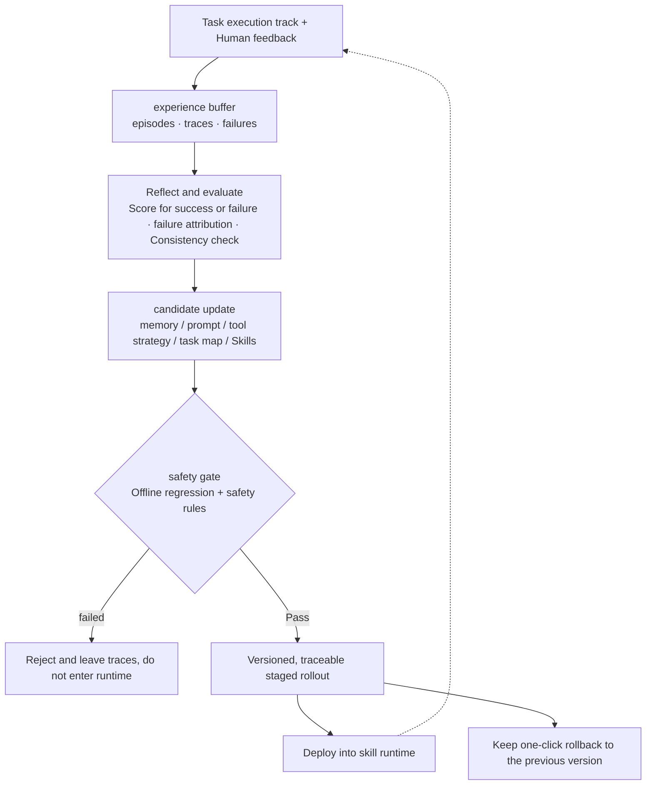

Note that the two nodes **F and I in this picture are the real design proposition**: any candidate update has a "rejected and left traces" path, and any online version has a "rollback" path. The paper calls this boundary what is necessary to keep long-running robots reproducible and auditable.

#### 2.7 End-to-end: Evidence chain from image to work order
{: id="27-端到端从图像到工单的证据链"}

The inspection and reasoning pipeline is organized according to "observation → interpretation → verification → reporting → review". OpenClaw selects the image associated with the waypoint, binds the pose, timestamp, waypoint, task ID, applicable inspection strategy, and then calls Qwen3-VL; the returned description is parsed into a **constrained event schema** (hazard category, severity, evidence, location, recommended disposal action). The target categories are divided into two groups - safety category (stacks around the equipment room, occupied fire escapes, water accumulation on the ground, exposed cables) and sanitation category (overflowing trash cans, stains on the ground, scattered garbage and leaves, abnormal accumulation in public areas).

Only events that pass schema verification will enter the operation pipeline. The system retains the original image, original response of the model, parsed fields, and delivery status. It generates a structured report after labeling the location and area, and routes it to the responsible person for review and dispatch via the DingTalk/Feishu adapter. **Manual corrections are written back in the form of tagged feedback instead of silently overwriting the original results** - which not only ensures that subsequent evaluations and memory updates are informed, but also maintains auditable and replayable records. This design also keeps multimodal reasoning out of safety-critical motion loops.

#### 2.8 About "Training Objectives"
{: id="28-关于训练目标"}

There is no training link in this article. The entire system is assembled from ready-made components. There are no learnable parameters and no loss functions. The only formula in the whole article is the definition of word error rate in the speech experiment:

$$\text{WER} = (S + D + I) / N$$

Here, $S$, $D$, and $I$ are the number of substitution, deletion, and insertion errors respectively, and $N$ is the total number of reference words.

---

### 3. Results and findings
{: id="3-核心结果发现-7"}

System-level measurements deployed in a real residential complex (Table 1):

|Group|Subsystem|indicator|result|
|---|---|---|---|
|Navigation and Movement|Task execution|Waypoint accessibility rate| 100% |
| | Fast-LIO2 |Outdoor positioning error| < 10 cm |
| | EGO-Planner |Obstacle response delay| < 200 ms |
|Semantic inspection| Qwen3-VL |Garbage overflow detection rate| 95% |
| | Qwen3-VL |Fire exit occupancy detection rate| 95% |
| | Qwen3-VL |Lane occupancy detection rate| 90% |
| | Qwen3-VL |Ground water detection rate| 88% |
| | Qwen3-VL |Damage detection rate of public facilities| 85% |
| |Inspection reasoning|Hidden danger false alarm rate/missed detection rate|All < 5%|
|Operation closed-loop|DingTalk/Feishu Adapter|Alarm delivery success rate| 99% |
| |HROS report|Structured report generation accuracy| 99% |
|Live operation|Robot platform|Continuous battery life| > 3 h |
| |end-to-end tasks|Full coverage of single inspection time| ≤ 60 min |

A few points worth noting:

- The detection rate of **decreases regularly with visual categories.**: 95% of garbage overflows and fire escape passages are occupied, and only 85% of public facilities are damaged. The author attributes the diversity of visual forms in the category of facility damage to be much greater than the first two categories - this is consistent with the argument that "hazards are defined by spatial and operational context, rather than just by the identity of the object."
- **has a battery life of 3 hours. For a single mission of 60 minutes, there is room for multiple rounds of**, which is a prerequisite for scheduling.
- The most important thing about **is the part without numbers**: Paper §5.6 wrote a complete controlled experimental protocol for voice interaction, hierarchical memory, and security door self-evolution (WER, grounding intention accuracy, confirmation accuracy, P95 end-to-end delay; Recall@5, spatiotemporal grounding accuracy, context token Reduction rate, stale memory error rate; change in task success rate, regression rate, safety rule violation rate, safety gate rejection rate, rollback success rate, **requires a safety gate escape rate of zero (**), but there are no numbers in these three blocks in Table 1. The original text states that "the values need to be reported after the corresponding controlled test is completed." In other words, the cognitive runtime of **HROS is currently an architectural proposal and a set of evaluation designs. What is demonstrated is the layer of classic navigation and VLM inspection pipeline** below it.

---

### 4. Limitations
{: id="4-局限性-7"}

The author listed four items: long-term map maintenance (parking patterns, construction, vegetation, and seasonal changes require incremental mapping, change detection, and multi-session map management), open world hazard identification (a wider hazard classification system requires more diverse annotation data, calibration confidence, and ambiguity processing), and agent evaluation and security (memory and self-evolution) Mechanisms need to be specifically benchmarked to measure retrieval quality, adaptation benefits, regression risk and rollback reliability before we can talk about releasing automatic updates in production environments), human-machine collaboration (ASR robustness under outdoor noise, confirmation design of safety-critical instructions, operator load, integration with access control broadcast alarm digital twins).

One additional sentence that should be taken into account when reading this article: it is a **system and architecture paper**. Navigation and perception all use off-the-shelf open source software. The real novelty lies in the design of inter-layer boundaries and governance processes; and the three most promising pieces of this design (voice grounding, layered memory, and safety gate self-evolution) are still in the protocol stage, and no comparable experimental evidence has yet been provided.

---

## 10. NavHarness (2026)
{: id="navharness"}
———Passing search evidence to fresh navigation sessions to accumulate and revise experience across tasks

📄 **Paper**: [arXiv:2609.34276](https://arxiv.org/abs/2609.34276) · [Code](https://github.com/billzhao1030/NavHarness) · [Project Page](https://billzhao1030.github.io)

**Navigation index**: [NavHarness in the extended VLN collection](/en/VLN-Papers-Extended/#navharness).

---

### Key takeaways
{: id="精华-8"}

NavHarness offers a transferable idea: keep maps, searched places, evidence-backed conclusions, and remaining search options outside the conversation so that a fresh reasoning session can continue the work.
During recovery, the robot stays in place and retains its remaining budget; only the conversation changes and the search plan is reconsidered, with the handover distinguishing a visited place from one ruled out by evidence.
Memory access is interleaved with observation and action, allowing the model to investigate earlier records and revise conclusions using new views rather than retrieving only at the start.
Independent pre-stop verification gives the current search one opportunity to correct its stopping decision, while post-stop certification improves the record inherited by the next task.
Continuous-deployment experiments further show that, even after maps and task records are retained, organizing experience into source-linked house knowledge brings additional benefits, although incorrect certification can propagate through memory.

---

### 1. Background and problem
{: id="1-研究背景问题-8"}

General-purpose multimodal models can already use observation and movement tools for individual navigation tasks, but a household robot must receive new goals from the previous task's endpoint and reuse explored space and search experience.
A longer conversation can retain outdated goals and observations, while a fresh conversation loses searched regions, unchecked places, and failure leads; navigation therefore needs a mechanism that preserves evidence across sessions while allowing earlier conclusions to be reexamined.
The paper studies continuous navigation without navigation-specific training, with language, object-category, or image goals, focusing on how experience crosses task, recovery-attempt, and run boundaries.

---

### 2. Methods and innovations
{: id="2-主要方法创新点-8"}

  
<figcaption>Original Figure 2: the outer orchestrator advances navigation sessions and handles recovery, pre-stop verification, post-stop certification, and memory retention. One task can involve multiple sessions sharing the same task budget.</figcaption>

**① Overall framework: the reasoning session searches, while the outer orchestrator manages handovers.**

NavHarness combines a multi-turn multimodal navigation session, external spatial and task memory, a task-boundary orchestrator, and separate verification and consolidation sessions.
The navigation session reads goals and memory, observes the environment, and invokes tools; the orchestrator decides whether to continue, replace the conversation, or close the task while retaining physical state and external records.

The paper calls a sequence of tasks in one house a **run**, the pursuit of one goal a **task**, and a continuous search for that goal an **attempt**, supported by one **session**. The orchestrator advances a session in **hops**, each a bounded block of model interactions; multiple hops can belong to the same conversation.

**② Memory tiers: changing the conversation does not mean forgetting the house.**

The three tiers can be understood as information in the current conversation, a working archive shared by tasks, and house notes available to later runs.
A new task receives its goal and references to available files; the navigation session first reads the previous task's handover, the task index, and house notes, then opens detailed records as the search develops to determine subsequent observations and actions.
This preserves experience without inserting every earlier conversation wholesale into the new prompt.

| Memory tier | What it stores | Who updates it and when it is used |
|---|---|---|
| Active context | Current goal, reasoning, observations, and retrieved information | Maintained by the navigation session; replaced at task closure or recovery |
| Working memory | Per-floor occupancy grids, named places and photographs, task index, handovers, and checking records | Continuously recorded by navigation tools and the orchestrator; reused across tasks and attempts |
| Long-term memory | House index, overview, room notes, navigation skills, and separately saved maps and place records | The four textual notes are updated only by consolidation; later runs read them again |

**The tiers describe use and lifetime, rather than three disjoint databases.** A map can serve as working memory in the current run and be saved for reuse in the next; consolidating textual notes neither converts the map into text nor changes its geometry.
The **ledger** indexes each closed task's goal, status, and named places, while detailed handovers and verdicts remain in separate files for source-level investigation. A navigation session can read earlier tasks but cannot overwrite their records, the orchestrator's verdicts, or house notes.

  
<figcaption>Original Figure 1: maps, places, and search experience from task 1 are read again by the fresh session for task 2. Memory access, observation, and action jointly form a closed loop.</figcaption>

**③ Spatial tools and online search: remembering where to go also requires knowing how to get there.**

The spatial module receives RGB-D observations, estimates pose with **ORB-SLAM3**, and projects depth into per-floor occupancy grids representing known free space, obstacles, and unexplored areas.
The navigation session uses `get_map` to inspect the map, `mark` to save named places with photographs from at most four headings, and `preview_path` to run A* through known free cells and inspect the route and its length. A route preview does not automatically move the robot; the session still chooses the next action.
Map updates pause when tracking is lost to avoid writing unreliable poses into spatial memory. Robot positions, markers, and routes use SLAM estimates rather than simulator ground-truth poses.

The execution module receives lists of forward 0.25 m or left/right 15° actions and returns new observations, collisions, and remaining budget; each `step` accepts at most 12 actions.
Each coarse action is split into five 0.05 m or 3° sub-motions to provide sufficiently continuous images for SLAM. This is the shared motion interface, rather than an additional learned low-level navigation policy.
The session alternates observations, map queries, record access, and movement. When a house note conflicts with the current view, it can inspect the original record and supply evidence for correction.

**④ Structured recovery handovers: telling the next attempt which searches remain worth pursuing.**

Recovery lets a fresh conversation reconsider the plan while inheriting evidence from the preceding search.
A session can request recovery, or a configured turn threshold can trigger assessment; the orchestrator considers exploration progress, tracking status, and earlier attempts before approving recovery and selecting whether location, route, floor, or house interpretation needs reassessment.
The outgoing session then writes a **recovery note** with movement disabled. Its search observations and process become a handover containing searched places, evidence-supported exclusions, a reliable landmark, untried options, and uncertainties. The fresh session reads it and continues the same goal from the current physical location.

> **Minimal example, for explanation rather than experimental data:** while looking for a mirror, the old session enters a bathroom and inspects only the wall above the basin; it has not checked behind the door.
> Writing "no mirror found in the bathroom" can incorrectly suggest that the entire room has been ruled out. A structured handover instead records "basin wall checked, target absent; behind the door unchecked and still worth searching."
> If the task started with 500 steps and used 420, recovery leaves 80 steps. The new session receives neither another 500 steps nor a reset to the initial robot position.

The controlled GOAT-Bench experiments use 500 movement or turning actions and 200 navigation-model turns per task, with at most one recovery and an 80-turn fallback threshold. Observation and memory tools have no movement-step charge, and recovery shares both remaining task allowances.

When location needs reassessment, a separate **wake-up session** compares surrounding views with saved place photographs and supplies a location brief to the fresh navigator.
Recognizing a familiar room differs from recovering metric alignment with the map: the former supplies semantic orientation, while the latter still depends on SLAM. Recovery itself neither moves the robot nor clears stored observations.

**⑤ Two-stage completion checks: correcting the current stop and improving later memory.**

Before ending its search, the navigator writes a **task handover** covering the goal, searched places, outcome evidence, and unfinished searches, then supplies its own completion assessment.
A separate judge session receives the goal, four views at the stopping location, sampled earlier images, the map, and execution records, using at most 12 frames. It sees neither the navigation conversation nor the navigator's self-assessment, has no tools, and returns an evidence-backed `complete`, `incomplete`, or `unknown` verdict.
By default, all roles use the same model; the conversations and evidence interfaces are separate, which does not make navigator and judge errors independent.

| Stage | When it runs | Its effect |
|---|---|---|
| Pre-stop verification | Before STOP | A definite verdict contradicting the navigator's claim on the first check returns counter-evidence to the current session, allowing further search |
| Post-stop certification | After the task actually ends | Records the final assessment for later tasks without changing the completed task's score |

**Each task receives only one pre-stop correction opportunity, and recovery does not reset it.** An `unknown` verdict permits closure, and a repeated closure request is honored. If the action-step count does not change between the checks, certification reuses the previous verdict.
The orchestrator keeps the navigator's completion claim separate from the judge's verdict and reserves environment truth for evaluation. Certification is therefore not ground truth, nor does a certified goal validate every spatial description in the handover.

**⑥ Cross-run consolidation: retaining detailed records while creating accessible knowledge entry points.**

At run end, a separate **consolidation session** reads the ledger, handovers, and existing house notes. Using file tools, it organizes routes, failed searches, corrections, and open questions into four updated files: the index, house overview, room notes, and navigation skills.
It can write only these house notes, has no navigation tools, and cannot change the map or overwrite source task records. Skills must be supported by the journal, and notes should preserve sources and distinguish certified outcomes from the navigator's interpretations, although these content requirements still depend on the model following instructions.
The next run can read the overview for search guidance and open detailed records when needed, preventing failure leads omitted by consolidation from becoming permanently inaccessible.

**⑦ End-to-end flow and training objective.**

A task follows "goal and file references → read memory → observe, query, and act → write a recovery handover and replace the conversation when needed → request closure and verification → STOP and certification → update the ledger and save spatial state." Consolidation runs after the full task sequence ends.
In benchmark evaluations, memory carries only within the same GOAT-Bench episode or IR2R-CE tour; every new episode or tour starts with empty memory. Cross-run house-knowledge reuse is evaluated separately through continuous deployment.

**No model parameters are updated, and no new navigation training loss is introduced.** Consolidation updates external notes, as expressed in the paper's Equation (11):

$$
D_h^{+}=C_\theta(D_h,L_K).
$$

Here, $D_h$ denotes existing house notes, $L_K$ the task-sequence records, and $C_\theta$ a consolidation model with fixed parameters. It produces notes for later inference rather than writing experience into model weights through gradients.

---

### 3. Results and findings
{: id="3-核心结果发现-8"}

**Evaluation scope.** GOAT-Bench Val-Unseen contains 36 scenes, 360 episodes, and 2,669 subtasks; IR2R-CE also uses Val-Unseen.
**s-SR** measures individual-task success, **e-SR** the fraction of sequences with every task completed, and **SPL** combines success with path efficiency. The table uses the three-seed means from Tables 1 and 2, with success gains in percentage points.

| Dataset and reasoning model | Independent-session s-SR | NavHarness s-SR | s-SR gain | NavHarness SPL | NavHarness e-SR |
|---|---:|---:|---:|---:|---:|
| GOAT-Bench · Qwen3.8-27B | 41.4% | 71.7% | +30.3 | 48.2 | 14.4% |
| GOAT-Bench · GPT-4o | 43.5% | 78.3% | +34.8 | 57.1 | 26.9% |
| GOAT-Bench · Opus 5 | 58.9% | 81.5% | +22.6 | 55.0 | 28.6% |
| GOAT-Bench · GPT-6 Astra | 65.1% | **83.7%** | +18.6 | **62.3** | **36.9%** |
| IR2R-CE · GPT-6 Astra | 68.4% | **85.9%** | +17.5 | **76.1** | **27.8%** |

GPT-6 Astra's IR2R-CE t-nDTW rises from 56.8 to 64.2; the paper reports that its results exceed the previous methods in both benchmark tables.
Under the 278-subtask protocol used by some prior methods, the GPT-4o version achieves 77.6% s-SR, compared with HIMM's 72.8% and 3D-Mem's 69.1%. Its 78.3% full-split result should not be treated as the same evaluation scope.
**Gains over independent sessions include the full system—mapping, recovery, and completion checks—and cannot all be attributed to memory.** Controls with matched models and task budgets provide more specific evidence about the mechanisms.

**Cross-task memory and recovery evidence, using Opus 5 on the full benchmark.**

| Control | s-SR | Change from full NavHarness |
|---|---:|---:|
| Full NavHarness | 81.5% | — |
| One long conversation for all tasks | 54.9% | −26.6 percentage points |
| No cross-task memory, with within-task mechanisms retained | 66.8% | −14.7 percentage points |
| Clear the map after each task, keep task records | 68.9% | −12.6 percentage points |
| Hide earlier task records, keep the map | 71.8% | −9.7 percentage points |
| No recovery, unchanged task budget | 71.1% | −10.4 percentage points |
| Recovery with a length-matched ordinary summary | 73.2% | −8.3 percentage points |
| No pre-stop verification | 76.1% | −5.4 percentage points |
| No post-stop certification | 79.0% | −2.5 percentage points |

The ordinary-summary and structured-handover conditions use the same recovery triggers and budgets; their 8.3-point difference supports the value of how handover information is organized.
These interventions remove different mechanisms with interacting effects, so their losses cannot be summed into component contributions. Removing all cross-task memory, for example, has a smaller loss than the sum of removing maps and records separately.

**Agent-directed memory access has its own control.** Appendix Table 12 retains the same initial memory, mapping, record writing, recovery, and completion checks, but replaces historical-text access with scheduled BM25 retrieval: at task start, after recovery, and every 10 navigation turns, it supplies at most 5 original excerpts within 2,000 tokens.
Allowing the model to choose when and what to retrieve and to pursue follow-up queries raises s-SR from 74.5% to 81.5%, a paired gain of **+7.0 percentage points, 95% CI [+5.9, +8.2]**, and SPL from 49.0 to 55.0. This control changes timing, selection, and follow-up together, so it does not isolate the superiority of one retrieval algorithm.

**Certification improves record accuracy without becoming ground truth.** In Appendix Table 16, among claimed completions, four-view certification agrees with environment truth on 90.7%, compared with 82.6% for accepting every claim. False completions still accepted account for 5.2% of all completion claims, and true completions incorrectly rejected account for 4.1%.

**Continuous deployment: consolidation adds value beyond retained maps and task records.**

  
<figcaption>Original Figure 3: continuous deployment with Opus 5 across 36 houses. Both conditions retain maps and task records; only run-end consolidation differs. The curves show performance over task progress, with pooled scores and paired gains on the right.</figcaption>

The authors concatenate 10 GOAT-Bench tours per house, relocate the robot to prescribed starts at tour boundaries to model resumption after shutdown, and keep mapping and task-record retention, recovery, verification, and budgets fixed while disabling consolidation in the control.
Consolidation raises pooled s-SR from **72.8% to 80.5%**, a paired gain of **+7.7 percentage points, 95% CI [+6.3, +9.1]**; SPL rises from **36.5 to 44.3**, a gain of **+7.8, 95% CI [+6.5, +9.2]**.
**Memory can prompt additional evidence gathering or misdirect a search.** In Appendix Case 10, house notes retain the open question of whether two refrigerator descriptions refer to the same appliance. After completing its task, the navigator inspects both sides, records the answer, and passes it through consolidation to help a later task recognize a dark goal photograph.
Case 14 shows the opposite risk: a note mentioning only one mirror initially misleads the session. After recovery, it reexamines the goal image and retrieves a failed task's lead about an unchecked location behind a door. The search succeeds, but its SPL is 0.08, below the no-consolidation control's 0.38.
These cases explain recorded decisions rather than estimating the frequency of mechanisms across houses; the entire step difference between conditions cannot be attributed to a single note.

---

### 4. Limitations
{: id="4-局限性-8"}

The evaluations cover static scanned scenes and finite task sequences, without testing long-term adaptation on real robots or under object motion and layout changes. SLAM drift, cross-run coordinate misalignment, and loop-closure corrections not propagated into existing occupancy cells can undermine old-map reuse, while repeated large-model calls introduce substantial latency.
The judge can still accept false completions or reject true ones, incorrect records can become consolidated house knowledge, and goal certification does not validate every spatial or procedural description. The system also requires sufficiently capable multi-turn multimodal reasoning; the tested Qwen3.5-4B and 9B models struggle with this navigation setting.

---

## 11. SuperNav (2026)
{: id="supernav"}
———A general navigation agent organized through navigation skills, visual-point tools, and context management

📄 **Paper**: [arXiv:2610.12126](https://arxiv.org/abs/2610.12126) · [Project Page](https://zju3dv.github.io/SuperNav/)

SuperNav is an embodied-agent harness evaluated primarily through navigation. A general-purpose MLLM interprets requests and selects destinations, while readable Navigation Skills, visual-point tools, goal-progress records, and context management organize search, target rechecking, and failure recovery into a continuing loop; geometric or learned motion backends execute the movements. Its transferable idea is how skills, tools, and execution feedback sustain physical interaction, making it relevant to embodied-agent frameworks. The decision-making MLLM receives no navigation-specific fine-tuning, while the learned executor is trained on navigation trajectories.

**Full analysis and experimental results**: [SuperNav: methods, evaluation protocols, and performance comparisons in the extended VLN collection](/en/VLN-Papers-Extended/#supernav).

---

## 12. VISTA (2026)
{: id="vista"}
———Giving a multimodal model eyes that can replay and zoom: lossless visual memory plus model-directed visual inspection

📄 **Paper**: [arXiv:2610.02200](https://arxiv.org/abs/2610.02200) · [Code](https://github.com/joshhhhhan/VISTA)

**Why it is included**: VISTA is evaluated in interactive visual games rather than on robots, but it addresses this collection's shared question: leave the model unchanged, change only the harness, and let a general-purpose multimodal model retain and revisit visual evidence on demand during long-horizon interaction. The authors also name embodied tasks as the next step.

---

### Key takeaways
{: id="精华-9"}

- **The bottleneck is often not model capability but how the harness feeds information**: the same Claude Opus 5.0 scores only 40.68 RHAE on ARC-AGI-3 with the organizers' minimal harness and 100.00 with VISTA, without any training.
- **"Encode once, then discard the raw image" is a hidden ceiling for multimodal agents**: at encoding time the model cannot know which details will matter later. Archiving every original frame and letting the model revisit frames during reasoning amounts to an **explicit, addressable form of attention**.
- **Observe images rather than text grids**: a 64×64 grid costs about 4K tokens as text but only about 308 tokens as a 512×512 rendered image. Performance stays comparable or improves, and token usage per game drops from 71.9M to 30.7M.
- **Make read-only tools free and actions costly**: `inspect` and `read_pixels` consume no game actions; only `play` counts. This encourages the model to look carefully before acting, and it ends up using 57.4% fewer actions than first-time human players.
- **Simplicity transfers**: the same harness, with an almost identical short prompt, carries over to GameWorld, AI GameStore, and BabyVision and clearly outperforms the official baselines using the same model on all three.

---

### 1. Background and problem
{: id="1-研究背景问题-9"}

ARC-AGI-3 is a suite of interactive visual games that **provide neither rules nor goals**: the agent must discover through probing which object is the player, what a click does, and what counts as winning. Most high-scoring methods convert the screen into numeric grids and have an LLM write programs that form an executable world model (program synthesis), which scales poorly as visuals grow complex. Approaches that use a VLM directly suffer from two problems: each image is encoded once, so details may be lost in compression, and during long interactions early observations are truncated or replaced by text summaries once the context fills. The paper asks: **without writing programs, relying only on vision and natural-language reasoning, can the right harness push a general-purpose multimodal model to a perfect score?**

---

### 2. Methods and innovations
{: id="2-主要方法创新点-9"}

  
<figcaption>Three agent designs: (a) a language agent sees only text; (b) a conventional multimodal agent encodes each image once and never looks back; (c) VISTA can repeatedly call visual tools before each action, retrieving past frames and reorganizing its own visual input</figcaption>

**① Overall framework**

VISTA is not a new model but a **purely mechanical harness with no trained parameters**. It consists of three visual components—**visual observations**, **lossless visual memory**, and **visual inspection tools**—plus two **note files** (`GUIDE.md` / `WORKING.md`). The harness executes tool calls and returns images or pixel values; all understanding, reasoning, and decision-making is left to the underlying multimodal model (Claude Opus 5.0, GPT-5.6 Sol, or GLM-5.3 Flash) within one multi-turn conversation.

  
<figcaption>VISTA's core components and per-turn pipeline (ARC-AGI-3 example): (a) observations change from a 64×64 digit grid to a rendered image; (b) every returned frame is archived at full resolution and addressable by turn and frame number; (c) the model can magnify any region in space and retrieve several past frames across time; (d) each turn follows observe → reason → act, where reading and writing notes and inspecting memory are optional and only acting consumes an action</figcaption>

**② Module by module**

**Visual observation**
- **Input**: the current environment state. ARC-AGI-3 officially provides a 64×64 integer grid in which each cell is a color index.
- **Processing**: 8× nearest-neighbor upscaling into a 512×512 PNG, so each cell becomes a solid block of pixels.
- **Output**: one image plus the list of currently available actions.
- **Motivation**: images preserve object appearance and spatial relations, so the model can apply visual priors learned in pretraining ("this is a wall", "these two objects are symmetric") instead of assembling shapes from 4,096 numbers; token cost also drops sharply (see sticking point ② below).

**Lossless visual memory**
- **Input**: **every frame** the environment returns, including all intermediate animation frames triggered by an action (clicking a block, for example, returns six frames).
- **Processing**: frames are archived unchanged, indexed by `(turn, frame)`, and fully decoupled from whatever remains in the model's context.
- **Output**: a frame store that can be addressed at any time (one example game had accumulated 1,472 frames).
- **Motivation**: the usual approach encodes once and truncates or summarizes once the context fills, but the model cannot predict at encoding time which details will become critical. Keeping original images **outside** the context means compressing the context no longer destroys visual evidence.

**Visual inspection**

This interface brings the memory to life; the model decides on its own when to use it and where to look:
- `inspect(question, views)`: **in space**, crops and magnifies any rectangle of any frame (the paper's example magnifies about 13× to tell which way small blocks face); **across time**, retrieves frames from several past turns in one call for comparison, or replays the animation of an action frame by frame.
- `read_pixels(question, views)`: splits a region into a grid and returns exact RGB values per cell, for judgments the eye easily gets wrong, such as whether two colors are actually identical.
- Every call must include a `question`, forcing the model to state what the look is meant to settle.
- **Key design**: inspection tools **consume no game actions**; only `play` counts.

  
<figcaption>Two ways the model directs its use of visual memory: (a) inspection across space and time—after the board resets, a single inspect call retrieves four frames from the preceding 22 turns to reconstruct the full map; (b) inspection of local details—magnifying three small blocks about 13× reveals which side carries the purple marker, identifying each guard's orientation</figcaption>

**Note files (GUIDE.md / WORKING.md)**
- `GUIDE.md`: a rulebook that stays valid across levels and contexts (for example, "clicking an orange block turns it into an X marker; clicking the X recreates the block").
- `WORKING.md`: a scratchpad for the current level, cleared when the level advances.
- When the context nears its limit, the agent writes a handoff summary to `WORKING.md` and resumes in a fresh context; notes, visual memory, and action history are all retained.

**③ End-to-end data flow**

Within one turn, the model may exchange several messages with the harness but executes only one game action. The reader's version of a single turn:

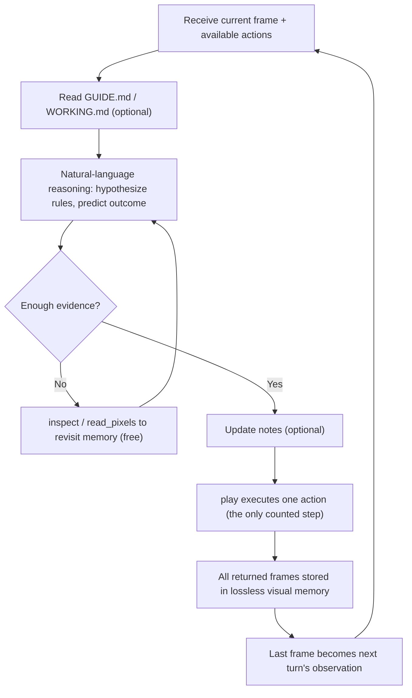

The prompt is minimal, with four core sentences: finish the game in as few actions as possible; build and keep revising a compact model of the game; before each `play`, state the expected result and afterwards state every visible change; write durable understanding into `GUIDE.md`. This "predict, then compare" pattern turns the model into an online hypothesis tester.

> **Sticking point ① — why not just put every frame in the context? An example**: the official implementation automatically feeds up to 7 frames per action. As text grids, each frame costs about 4K tokens, so observations alone take about 28K tokens per request; even as images (about 308 tokens per frame, about 2.2K total), 300 steps accumulate roughly 650K tokens and eventually overflow a 200K context and get truncated. VISTA does the opposite: each turn it **automatically provides only the last frame** (about 308 tokens) and keeps all other frames in a store outside the context, recalling 1–4 frames precisely with `inspect` when needed. The context holds the images the model currently considers relevant rather than the images that happened most recently—this is what the paper calls "explicit attention".

**④ Training objective / loss function**

None. VISTA requires no training; all gains come from harness design, and the underlying models are called as-is through closed-source CLIs (Claude Code / Codex) or with open weights.

**⑤ Evaluation metric: RHAE (sticking point ②)**

ARC-AGI-3 uses **Relative Human Action Efficiency (RHAE)** to measure how many actions you save compared with first-time human players. Let $h$ be the human baseline action count for a level (the upper median among first-time players who completed it) and $a$ the agent's action count. The level score is

$$S_{\ell,g} = \min\left(1.15,\ \left(\frac{h_{\ell,g}}{a_{\ell,g}}\right)^2\right)$$

Unfinished levels score 0. A game has $n$ levels, with level $\ell$ weighted $w_\ell = \ell$ (later levels matter more); if only the first $k$ levels are completed, the game score is the smaller of the weighted average level score and the weighted completion fraction:

$$S_g = \min\left(\frac{\sum_{\ell=1}^{k} w_\ell}{\sum_{\ell=1}^{n} w_\ell},\ \frac{\sum_{\ell=1}^{n} w_\ell S_{\ell,g}}{\sum_{\ell=1}^{n} w_\ell}\right)$$

> **An example**: a game has 2 levels with weights 1 and 2. Level 1: humans take 32 actions, the agent 16 → $(32/16)^2=4$, capped at 1.15. Level 2: humans take 40, the agent 50 → $(40/50)^2=0.64$.
> Both levels cleared: weighted average $(1.15\times1 + 0.64\times2)/3 = 0.81$, completion fraction $3/3=1$, take the smaller → **0.81**.
> Only level 1 cleared: weighted average $1.15/3 = 0.38$, completion fraction $1/3=0.33$, take the smaller → **0.33**.
> The square makes extra actions costly, and a score of 100 means **every game is completed with overall weighted efficiency no worse than humans**—actions saved elsewhere can offset a few over-long levels within the 1.15 cap.

**⑥ Differences from the official baseline (sticking point ③)**

| Dimension | Official minimal harness | VISTA |
|---|---|---|
| Observation format | 64×64 text digit grid | 512×512 rendered image |
| History retention | 175K sliding window; the oldest turns are dropped | All frames archived losslessly outside the context, retrievable by turn and frame number |
| Automatic input per step | Up to 7 intermediate frames | Only 1 frame (the last); the model inspects the rest on demand |
| Long-term knowledge | None | `GUIDE.md` + `WORKING.md`, preserved across context restarts |

---

### 3. Key results and findings
{: id="3-核心结果发现-9"}

**ARC-AGI-3 (25 public games)**: VISTA + Claude Opus 5.0 (xhigh) reaches **RHAE 100.00** with 7,302 actions in total, 57.4% fewer than first-time humans (17,135). VISTA + GPT-5.6 Sol (max) also completes all 25 games, with RHAE 99.00 (99.04 ± 0.17 over three runs). The same models score only 40.68 and 13.33 under the official implementation. To the authors' knowledge, this is the **first system to reach perfect or near-perfect performance without program synthesis**, matching program-synthesis systems such as Tycho (100.00) and Retrodict (99.86).

  
<figcaption>Ablation adding harness components step by step (GPT-5.6 Sol): replacing text grids with images 13.33→47.32; relaxing action and time limits 51.66; continuous conversation 65.82; adding the two notes 70.05; adding lossless memory and inspection 94.10 (the largest jump); adding exact pixel readout gives full VISTA at 99.00, with total actions down to 9,126</figcaption>

**Key reading of the component ablation**: the largest jump comes from lossless memory plus inspection (70.05 → 94.10, +24), while actions fall from 23,702 to 12,261—once it can look back, the model wastes far fewer blind trials.

  
<figcaption>Observation formats compared: under the same harness, image observations (99.00) perform on par with text grids (96.75) while using fewer actions (9,126 vs 10,614) and less than half the tokens per game (30.7M vs 71.9M)</figcaption>

  
<figcaption>Context length and input resolution ablations: (a) a 200K context is best (99.0); 100K loses only 0.4 while halving tokens, and 780K does worse while using more than three times the tokens; (b) 4× upscaling (256 pixels, about 77 tokens per frame) matches the default 8×, while 2× is too blurry and 16× wastes context and drops to 88.3</figcaption>

**Other findings**:
- **A longer context is not always better**: 500K and 780K drop to 94.4 and 93.9, suggesting that inspecting on demand beats keeping everything.
- **Open-weight backend**: with GLM-5.3 Flash 320B, the official implementation scores 1.89 → VISTA without inspection tools 13.27 → full VISTA **66.93**, so the visual tools account for most of the gain.
- **3D rendering**: rendering the same games in an isometric 3D view still yields RHAE 84.12 (actions rise to 20,640), far above the official text baseline.

  
<figcaption>Transfer to other visual environments (GPT-5.6 Sol): GameWorld success rate 63.3% / progress 79.3%, above novice humans (55.3% / 64.1%); AI GameStore geometric mean 140.3, above the human median (100); static BabyVision visual-tracking accuracy 41.0% → 63.2%, still well below humans at 92.3%</figcaption>

**Cross-benchmark transfer**: changing only the action interface name (`play` → `act`) and the task description, the same harness outperforms both the official baselines using the same model and the best previously reported results on all three benchmarks. BabyVision involves no interaction history, so its gain comes purely from zooming into and reading pixels within a single image, showing that the inspection tools have independent value.

---

### 4. Limitations
{: id="4-局限性-9"}

Success depends heavily on the underlying model's own capabilities; VISTA only draws them out. The models were also released after the public games, so the games may have appeared in their training data; generalization needs further verification on unseen games such as the ARC-AGI-3 private set.

---

## 13. RACE (2026)
{: id="race"}
———When should an agent think? Use the drop in action likelihood to judge whether earlier reasoning still suffices

📄 **Paper**: [arXiv:2610.12061](https://arxiv.org/abs/2610.12061) · [Code](https://github.com/HututuAI/RACE)

**Why it is included**: RACE is evaluated on text and API interaction tasks rather than on robots, but it addresses a cost problem shared by every long-horizon closed-loop agent: reasoning at every turn is expensive, so how long does earlier reasoning remain sufficient, and when is fresh reasoning needed? Its cross-turn reasoning-cover criterion and training recipe transfer directly to the multi-turn decisions of embodied agents.

---

### Key takeaways
{: id="精华-10"}

- Reasoning has a shelf life: a plan formed at one turn often supports several later actions, so there is no need to think again at every turn. The real question is not "can this turn skip reasoning?" but "how far does existing reasoning still reach?"
- Replace expensive verification with a cheap proxy: instead of regenerating actions for every candidate context, a single teacher-forced pass that measures how much the reference action's likelihood drops is enough to approximate whether the action can still be recovered.
- Deleting a reasoning step must be judged by its effect on **all later actions**, not only the current one. This is the fundamental difference between cross-turn estimation and earlier per-turn, independent decisions.
- The same labeler (LoGiC) builds SFT data offline and produces RL signals online, so one mechanism spans both training stages. In RL it combines masking with explicitly teaching the model to close `</think>`, rather than tuning the reward.

---

### 1. Background and problem
{: id="1-研究背景问题-10"}

ReAct-style LLM agents reason before every action by default, so reasoning-token cost grows linearly over long trajectories. Existing adaptive-reasoning methods either decide independently at each turn whether to think, ignoring that earlier reasoning can remain effective across several turns, or obtain supervision by generating actions with and without reasoning and comparing them. That cost becomes prohibitive as trajectories grow, and especially in on-policy RL, where it must be repeated for every batch.

---

### 2. Methods and innovations
{: id="2-主要方法创新点-10"}

#### 2.1 Motivating analysis: reasoning persists across turns, and likelihood drop predicts it
{: id="21-动机实验推理会跨轮持续生效且似然下降能预测这一点"}

  
<figcaption>Cross-turn reasoning support: (a) after removing all reasoning beyond turn s, check whether later actions can still be recovered, giving the persistence span L of the reasoning support; (b) the reference-action likelihood drop d closely tracks the action recovery rate, which exceeds 99% when d ≤ 0.001</figcaption>

Using successful Qwen3.5-9B trajectories on ScienceWorld and WebShop, the authors run two analyses:

- **Generation-based measurement (panel a)**: choose a cutoff s, keep the reasoning up to and including turn s, and remove all later reasoning while leaving actions and observations unchanged. At each later turn j, sample K=4 actions and compute the fraction $$\mathrm{Rec}_j$$ that recovers the reference action $a_j^*$. Some reasoning supports only one step, while some keeps supporting several later steps (on ScienceWorld, about 11% of reasoning steps support a full 5 steps). The authors call this **cross-turn reasoning persistence**.
- **Likelihood-based estimation (panel b)**: compute the mean per-token log-likelihood $\ell(a_j^* \mid h)$ of the reference action and compare the full and truncated contexts:

$$d_j = \ell(a_j^* \mid x_j, r_j) - \ell(a_j^* \mid \tilde x_j)$$

A smaller $d_j$ means the model remains just as confident about the action after the reasoning is removed. Experiments show that $d_j$ and the recovery rate correspond almost monotonically. This replaces "generate many times to verify" with "score once under teacher forcing."

| Dimension | Generation-based verification (prior work) | Likelihood proxy (this paper) |
|---|---|---|
| Cost per candidate context | Autoregressively sample K actions and compare | One batched teacher-forced scoring pass |
| Usable inside on-policy RL | Must be redone every batch; too expensive | Cheap enough to run on every rollout batch |
| Scope of effect considered | Usually only the current turn | The current turn plus every later reference action |

#### 2.2 Overall framework
{: id="22-整体框架"}

  
<figcaption>The RACE training framework: the core algorithm LoGiC labels each turn's reasoning as keep (THINK) or remove (SKIP); offline it builds SFT data, and online it drives reasoning masking and reasoning-closure supervision during RL</figcaption>

RACE (Reasoning Adaptation through Cross-Turn Estimation) has three parts. **LoGiC** marks which reasoning steps in a trajectory can be removed. The **SFT stage** uses LoGiC to compress full-reasoning trajectories into "think only when needed" trajectories for supervision. The **RL stage** reruns LoGiC on each batch of successful rollouts, using the result to block gradients on redundant reasoning and to teach the model directly to close its reasoning immediately where it should stop.

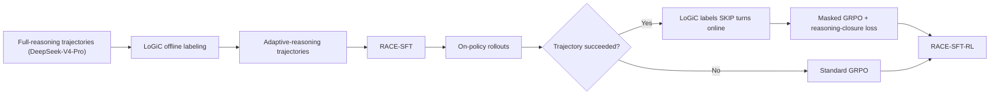

#### 2.3 LoGiC: Likelihood-Guided Progressive Reasoning Cover Detection
{: id="23-logic似然引导的渐进式推理覆盖检测"}

  
<figcaption>The three LoGiC steps: (1) initialize the likelihood vector of all reference actions on the full trajectory; (2) from turn 2 onward, try removing the current reasoning step to build a candidate trajectory; (3) accept the removal only if the likelihood drop of the current and all later actions stays within the threshold, and carry the result forward to later turns</figcaption>

The intuition behind a "reasoning cover": keep the fewest reasoning steps that **together** still support every action in the trajectory, like lighting an entire road with the fewest streetlights. LoGiC works as input → processing → output:

- **Input**: a successful trajectory $$\tau = (q, (r_t, a_t, o_t)_{t=1}^T)$$, with each $a_t$ treated as a fixed reference action $a_t^*$, and a threshold $\epsilon = 0.001$.
- **① Initialization**: compute the likelihood vector under the full-reasoning context, $\ell^{(0)} = [\ell(a_1^* \mid x_1, r_1), \dots, \ell(a_T^* \mid x_T, r_T)]$. The first turn's reasoning is always kept.
- **② Progressive compression**: starting at t=2, in the current compressed context $x^{(t)}$, where all accepted removals already apply, try removing $r_t$ and recompute the likelihoods $\tilde\ell_j^{(t)}$ of the reference actions at turn t and every later turn (earlier turns are unaffected and reused).
- **③ Likelihood verification**: compute $d_j^{(t)} = \ell_j^{(t-1)} - \tilde\ell_j^{(t)}$ and accept the removal only if $d_j^{(t)} \le \epsilon$ holds for every $j \in \{t, \dots, T\}$. On acceptance, update the likelihood vector and context; otherwise keep $r_t$ and add it to the cover.
- **Output**: the compressed trajectory $\tilde\tau$ and the reasoning cover C, i.e., a THINK / SKIP label for every turn.
- **Design motivation**: first, "progressive" means each decision is made on the already compressed context, so several steps that each look removable on their own are not removed together when the remainder could no longer support the actions. Second, "looking ahead" matters because a reasoning step can be irrelevant to the current action yet be the only basis for a later one.

> **Worked example**: a 4-turn trajectory, threshold ε = 0.001, initial likelihoods $\ell^{(0)}$ = [-0.20, -0.35, -0.10, -0.40].
> - **t=2, try removing r2**: recomputing turns 2–4 gives [-0.3504, -0.1003, -0.4006]; the drops 0.0004 / 0.0003 / 0.0006 are all ≤ 0.001 → **accept**. r2 is marked SKIP and the likelihood vector becomes [-0.20, -0.3504, -0.1003, -0.4006].
> - **t=3, try removing r3** (r2 already removed): the turn-3 action likelihood drops by only 0.0001, so judged on the current turn alone it is clearly removable. But turn 4 falls from -0.4006 to -0.52, a drop of 0.12 → **reject**, and r3 is kept. This is exactly the case that per-turn, independent decisions would delete by mistake.
> - **t=4, try removing r4**: the turn-4 likelihood falls to -0.95, a drop of 0.55 → reject.
>
> The final reasoning cover is {r1, r3, r4}, i.e., THINK / SKIP / THINK / THINK. The whole procedure needs only 3 batched scoring passes over candidate trajectories. Generation-based verification would sample K=4 actions at every later turn of every candidate, for (3+2+1)×4 = 24 autoregressive generations.

The threshold of 0.001 is supported by Figure 1(b): at d ≤ 0.001, the action recovery rates on ScienceWorld and WebShop are 99.52% and 99.07%.

#### 2.4 Stage 1: LoGiC-based SFT data synthesis
{: id="24-stage-1基于-logic-的-sft-数据合成"}

Successful full-reasoning trajectories are collected with DeepSeek-V4-Pro, and LoGiC is run with Qwen3.5-9B to obtain $\tilde\tau = \mathrm{LoGiC}(\tau)$. Removed turns keep an empty `<think></think>` and output the action directly. Qwen3.5-9B is then trained with standard SFT:

$$\mathcal L_{SFT} = -\mathbb E_{\tilde\tau \sim \mathcal D_{SFT}} \sum_{n=1}^{\lvert \tilde\tau \rvert} \log \pi_\theta(\tilde\tau_n \mid \tilde\tau_{<n})$$

The loss applies only to model-generated reasoning and action tokens. This step first teaches the model when it can act directly, and it serves as the initialization for RL.

#### 2.5 Stage 2: Reasoning-cover-aware agentic RL
{: id="25-stage-2推理覆盖感知的-agentic-rl"}

Offline data gradually drifts away from the evolving policy, so during RL, LoGiC is rerun on the **successful trajectories** of each rollout batch to obtain each trajectory's set of SKIP turns $S_i$; failed trajectories use standard GRPO. Two mechanisms work together:

| Mechanism | What it does | Problem it solves |
|---|---|---|
| Reasoning masking | **Reasoning tokens** at SKIP turns are excluded from the GRPO gradient, while **action tokens** are still optimized; the normalization denominator still counts all original tokens | Prevents the positive advantage of successful trajectories from also reinforcing redundant reasoning |
| Reasoning closure | After the compressed context at a SKIP turn, directly maximize the probability of generating the reasoning terminator `</think>` | Masking only withholds reward; closure supervision actively teaches the model to wrap up right there |

The masked GRPO loss ($K_i$ is the set of positions left after removing the reasoning tokens of SKIP turns, and $P_i$ is the set of all policy-token positions):

$$\mathcal L_{GRPO} = -\frac{1}{\sum_{i \in B} \lvert P_i \rvert} \sum_{i \in B} \sum_{k \in K_i} \min\left(r_{i,k}(\theta) \hat A_i, \mathrm{clip}(r_{i,k}(\theta), 1-\epsilon_{clip}, 1+\epsilon_{clip}) \hat A_i\right)$$

The reasoning-closure loss ($e$ is `</think>`, $I_{succ}$ is the set of successful trajectories, and normalizing by the total number of turns $T_i$ makes the supervision strength proportional to the share of SKIP turns):

$$\mathcal L_{close} = -\frac{1}{\sum_{i \in B} T_i} \sum_{i \in I_{succ}} \sum_{t \in S_i} \log \pi_\theta(e \mid x_i^{(t)})$$

The final actor objective is $\mathcal L_{actor} = \mathcal L_{GRPO} + \lambda \mathcal L_{close}$, with λ = 0.02 on ScienceWorld, WebShop, and AppWorld and 0.01 on DeepSearch. The task reward handles getting it right and the LoGiC signal handles thinking less; the division of labor is clear, and no length penalty is needed in the reward.

**Inference** has no extra steps: at each turn the model decides on its own whether to write a reasoning step or emit an empty `<think></think>` and call a tool directly.

---

### 3. Key results and findings
{: id="3-核心结果发现-10"}

On four benchmarks, ScienceWorld (scientific reasoning), WebShop (web shopping), AppWorld (app API use), and DeepSearch (retrieval QA), with Qwen3.5-9B as the backbone:

| Method | ScienceWorld success / Tok. | WebShop | AppWorld | DeepSearch |
|---|---|---|---|---|
| Qwen3.5-9B (Base) | 18.52 / 2,210 | 15.60 / 2,713 | 46.15 / 3,134 | 29.25 / 1,281 |
| AdaptThink | 64.49 / 1,252 | 44.60 / 748 | **68.72** / 2,381 | 33.50 / 1,481 |
| SFT+GRPO (no LoGiC) | 74.55 / 2,073 | 52.00 / 2,702 | 65.30 / 3,545 | 35.75 / 2,163 |
| **RACE-SFT-RL** | 73.28 / 1,403 | **53.40** / **535** | 65.13 / **1,900** | 35.00 / **822** |

- **Fewer tokens without losing accuracy**: compared with standard SFT+GRPO, success stays within 1.4 points while reasoning tokens fall by **32.3% / 80.2% / 46.4% / 62.0%**.
- **A small model catching up with large ones**: the 9B RACE model surpasses GPT-5.5 (69.88) on ScienceWorld (73.28) and ties Claude-Opus-4.6 on WebShop (53.40), but on AppWorld it still trails GPT-5.5 (91.11) and DeepSeek-V4-Pro (87.69) by a wide margin.
- **The RL stage contributes most**: RACE-SFT saves only 4.3%–20.0% of tokens relative to standard SFT; after RL, RACE-SFT-RL gains another 2–30 points of success over RACE-SFT and cuts tokens by another 29%–57%.

  
<figcaption>With versus without LoGiC: the top row shows success rate and the bottom row reasoning tokens per trajectory. The SFT stage shows little difference; in the RL stage, RACE-SFT-RL greatly reduces reasoning tokens at comparable success</figcaption>

- **Ablation**: removing LoGiC from RL makes reasoning cost soar (AppWorld 1,900 → 8,574 tokens), showing that standard GRPO by itself makes reasoning grow longer during training. Removing only reasoning masking sometimes yields even fewer tokens (only 124 on WebShop), but success falls to 46.00, showing that masking is what keeps reasoning from being cut too far.
- **Behavior analysis**: after RL, the share of turns that skip reasoning rises sharply (ScienceWorld 37% → 70%, WebShop 7% → 56%, AppWorld 8% → 52%). Yet the reasoning that remains is not uniformly shorter: on ScienceWorld and AppWorld each reasoning step actually gets longer (132 → 273 tokens on ScienceWorld), concentrating thought on key turns such as planning and error recovery. On DeepSearch the skip rate is only 5.77%, so reasoning is still needed after almost every retrieval.
- **Scaling**: the trends are broadly consistent across Qwen3.5-2B / 4B / 9B. Because AppWorld has little training data (147 tasks), its RL gains are unstable for smaller models.

---

### 4. Limitations
{: id="4-局限性-10"}

LoGiC relies on successful trajectories and fixed reference actions, so failed trajectories receive no reasoning signal during RL, and the threshold ε is a single global value that does not adapt to task difficulty. On reasoning-heavy retrieval QA (DeepSearch) it can hardly skip any reasoning, and on AppWorld it still lags clearly behind frontier large models. (These are observations made in this reading; the paper has no separate limitations section.)

---

## 14. Agentic Robots (2026)
{: id="agentic-robots"}

———From predicting actions to organizing execution: connecting how robot capabilities are built and used through Model, Data, Environment, and Harness

📄 **Paper**: [arXiv:2610.20442](https://arxiv.org/abs/2610.20442) · [Code](https://github.com/chonghanqin/Awesome-Agentic-Robots)

### Key takeaways
{: id="精华-11"}

A robot's capability depends on whether its reasoning model, executors, observations, interfaces, and feedback work together to support the task; action prediction alone does not explain success or failure on long-horizon tasks.
The key to an agentic system is using goals and actual execution results to decide what to do next, which capability to invoke, when to obtain new evidence, and how to change strategy after failure.
This survey organizes those decisions into four domains—Model, Data, Environment, and Harness—and 17 overlapping functional categories, bringing task execution and improvements to data, training, skills, and software into a single framework.
A harness can coordinate frozen VLAs, analytical controllers, and reusable skills, but its benefits depend on state handovers, trustworthy feedback, and recovery mechanisms as well as the size of the planning model.
Evaluation should hold executors and interaction budgets fixed to isolate the agent's contribution, while also reporting the complete system's time, computation, additional observations, and human effort.

---

### 1. Research background and problem
{: id="1-研究背景问题-11"}

VLAs connect visual and language knowledge to robot actions, while world models and world-action models (WAMs) further introduce predictions of future states or observations. Long-horizon tasks also require continuous progress tracking, responses to environmental changes, and recovery from failure.
Relevant work is scattered across model training, data collection, environment construction, and runtime software, making it easy to conflate stronger action models, better toolchains, and more effective agent decisions.
Through a unified definition, functional taxonomy, and comparisons of representative work, this survey asks where agents make decisions in robot systems and how those decisions connect the current task to future capability improvements.

---

### 2. Main methods and contributions
{: id="2-主要方法创新点-11"}

#### 2.1 Overall framework: four functional domains connecting two feedback loops
{: id="21-整体框架四个功能领域连接两种反馈循环"}

  
<figcaption>Original paper, Figure 2: Model, Data, Environment, and Harness connect through environmental interaction, execution feedback, planning calls, and learning from experience. These are functional domains rather than four stages that must run in sequence.</figcaption>

The main contribution is a **taxonomy and systematic analysis**. Model covers model learning and the conversion of observations into decisions and control; Data acquires and organizes experience; Environment constructs interactive worlds, tasks, and tests; Harness connects models, tools, and skills to actual execution and manages context, verification, and recovery.

The authors define agentic robots as robot systems whose agents use environmental observations and execution feedback to autonomously plan and coordinate tasks, deciding during execution whether to continue, acquire information, revise a plan, or recover from failure (§3.1). Implementation may reside within one model or span multiple models, programs, and tools; the criterion is **how tasks are organized and adjusted**.

| Comparison | When considering only the action policy | The survey's agentic-system perspective |
|---|---|---|
| Objects of decision-making | Output the next action segment given observations and conditions | Also select subgoals, executors, tools, observation requests, and control handovers |
| Use of feedback | Adjust actions within the current policy | Also trigger replanning, state verification, executor switching, and recovery |
| Targets for improvement | Policy parameters and their training conditions | Also data, tasks, skill libraries, training experiments, and runtime software |

These are not mutually exclusive generations of technology: a VLA can itself include memory, reasoning, or tool use, and traditional autonomous robots have long used planning and monitoring. The survey emphasizes how foundation-model agents participate in these functions; the label "agentic" does not automatically imply greater autonomy.

The four domains contain the following 17 functional categories (Table 1). A single work may span several categories: Harness VLA involves orchestration, memory, monitoring, and recovery, while Zero2Skill connects data collection, refinement, and policy training.

| Domain | Functional categories | What changes |
|---|---|---|
| Model (5 categories) | Training, Perception, Planning, Robot Control, Adaptation | Learning processes, task evidence, plans, control commands, and adaptation through experience |
| Data (3 categories) | Collection, Annotation, Refinement | Acquisition of new experience, addition of structured supervision, and selection and correction of existing records |
| Environment (3 categories) | Reconstruction, Task Generation, Benchmarking | Executable scenes, practice goals and distributions, evaluation conditions, and measurement procedures |
| Harness (6 categories) | Orchestration, Memory, Monitoring and Recovery, Skills, Infrastructure, Layered Systems | Capability invocation, information retention, failure handling, behavior reuse, service interfaces, and authority across layers |

Two connected but distinct loops operate here. The **within-task loop** adjusts the next step using current observations and execution results. The **cross-task improvement loop** turns experience into better data, models, skills, or software, then uses new tasks to test whether the improvement holds.

#### 2.2 Model: five intervention points from learning to robot actions
{: id="22-model从学习过程到机器人动作区分五种干预位置"}

  
<figcaption>Original paper, Figure 4: the same task of opening a drawer and retrieving an object can be improved through training, perception, planning, control, or adaptation. Different failures require different interventions.</figcaption>

- **Training: change how the robot learns.** Inputs include task goals, training logs, execution videos, and evaluation results. The agent generates or modifies reward code, objectives, training configurations, policy programs, or experimental procedures; an optimizer produces a new policy, which is tested through real or simulated execution. Eureka iterates reward code, ENPIRE extends this to real-robot policies and training code, and HARBOR emphasizes typed artifacts and stage checks. Measurement criteria must remain stable so that a modification does not change both the method and its judge.
- **Perception: turn observations into evidence that the next decision can use.** Inputs include images, depth, robot state, and history. Outputs may be scene relations, geometric targets, symbolic states, or requests to look again. AgenticNav supports navigation with orientation-indexed views, selective recall, and geometric tools; MG-VQA can push or move objects to reveal occluded information. Remembering an object's identity does not mean its old position is still suitable for immediate action.
- **Planning: decide what to do and in what dependency order.** Inputs include instructions, scene representations, history, and available capabilities; outputs include the next operation, subgoal, action sequence, or program. Hi Robot uses a high-level VLM to update short language subtasks for a VLA, while SayPlan checks and revises plans on a scene graph. Feasibility checks before execution and feedback afterward jointly determine how far a plan should extend: greater uncertainty makes fresh observations more important for subsequent decisions.
- **Robot Control: translate the selected operation into requirements the execution layer can handle.** Outputs may be language instructions, action primitives, target poses, programs, constraints, or cost functions. ReKep expresses keypoint relations as constraints for a solver to repeatedly optimize motion; VoxPoser constructs spatial value maps for a motion planner. The backend responsible for inverse kinematics, collision checking, and trajectory tracking directly affects the capability of an apparently identical agent.
- **Adaptation: change future behavior through experience.** Inputs include failures, corrections, demonstrations, and autonomous interaction results. Outputs may be updated context or planner configurations, or genuinely updated model parameters. TidyBot and DROC can retain experience to change decisions; OLAF and RoboCat involve policy training. The survey distinguishes recovery within the current task, adaptation through context, and long-term improvement after retraining, and calls for checking whether earlier capabilities are retained.

#### 2.3 Data: acquire experience, add supervision, and revise existing records
{: id="23-data获取经验补充监督再修正已有记录"}

  
<figcaption>Original paper, Figure 5: Collection acquires new experience, Annotation adds task, phase, and outcome information, and Refinement selects useful segments and corrects supervision. Failed trajectories may also contain progress and recovery behavior worth retaining.</figcaption>

- **Collection: decide what to collect, how, and when to reset.** Given scenes, task coverage, and execution weaknesses, the agent selects practice tasks, invokes policies or demonstration procedures, and evaluates outcomes to continue, retry, or request assistance. The survey distinguishes real physical collection, simulated execution, and synthesis with generative models: AutoRT and SOAR organize real-world collection; RoboGen connects tasks, scenes, and simulated trajectories; RoboCurate and related systems organize generation and check consistency between actions and visual outcomes.
- **Annotation: turn videos and state logs into supervision.** Processing includes trajectory segmentation, language explanations, detection and segmentation, geometric queries, and outcome verification. Outputs include textual, spatial, interaction, or outcome labels. NILS generates stage instructions from object motion, state changes, and gripper events; ECoT adds reasoning traces. Answers about spatial distances or object locations can also come from geometric computation or simulation records, with semantic interpretation and measurement evidence serving different roles.
- **Refinement: reassess whether existing data is worth learning from and whether its labels are correct.** Inputs include complete trajectories, local segments, and subsequent feedback; outputs are retained data and corrected supervision. HELP and ARS use progress estimates to retain useful portions of failed attempts. Zero2Skill can reapply human-corrected success criteria to earlier demonstrations. Selection need not operate on whole successful or failed trajectories, and the criteria themselves also require verification.

#### 2.4 Environment: examine the world, the goal, and the evaluator separately
{: id="24-environment分别检查世界目标和裁判"}

  
<figcaption>Original paper, Figure 6: Reconstruction builds executable scenes; Task Generation defines goals, constraints, and success conditions; Benchmarking fixes test conditions, reset procedures, metrics, and evaluators.</figcaption>

- **Reconstruction: turn observations or requirements into interactive scenes.** Inputs may be images, videos, demonstrations, or layout descriptions. The agent generates, combines, or modifies meshes, joints, poses, physical properties, and scene code; compilation, geometry, and simulation checks guide repairs. Articulate-Anything iterates link and joint code, while SceneSmith modifies worlds through structured scene operations and rollback. Visual similarity, static stability, correct contact behavior, and validity in the real world require different levels of verification.
- **Task Generation: define what the robot should practice.** Inputs include scenes, capability ranges, and past performance; outputs include goals, initial states, constraints, success conditions, or curriculum distributions. GenSim and RoboGen generate executable tasks, while CurricuLLM and RATs adjust practice according to learning progress. Repairing an infeasible task also requires checking that its original goal is preserved; changing only a solution plan does not necessarily create a new task.
- **Benchmarking: specify which capability a score measures.** Given the capability under evaluation and system interfaces, outputs include tasks, perturbations, observation access, reset protocols, interaction budgets, and scoring rules. Tests of open-loop skill composition, closed-loop replanning, active perception, memory, and safety measure different capabilities. If an agent also generates new tests from evaluation results, improved evaluation must be distinguished from improved robot capability.

#### 2.5 Harness: make capabilities callable, composable, verifiable, and reusable
{: id="25-harness让能力能够被调用衔接核验与复用"}

  
<figcaption>Original paper, Figure 7: tasks and evidence feed decisions and dispatch, which invoke policies, primitives, solvers, or skills and receive actual feedback. The six surrounding harness functions determine whether this execution loop is reliable.</figcaption>

A harness is **the software that tells a model what it can invoke, passes calls to the robot, and returns actual outcomes to the next decision** (§7). It manages input/output contracts, control authority, state, and retained experience as well as function names.

**① Orchestration: select an executor and hand over control.** Inputs include the task, current evidence, executor capabilities, and the previous call's result. Processing includes routing, parameter binding, function-protocol checks, state transitions, and handover timing; outputs are a concrete dispatch and subsequent decisions to continue or switch. RoboHarness uses a motion-planned memory bridge to move the robot into the starting state required by the next policy, whereas RoboRouter selects a policy suited to the current state. Selecting the right policy and preparing a state it can handle are separate problems.

> **Example:** suppose object retrieval requires three steps: open the drawer → grasp the object → place it on the table. The drawer-opening tool reports completion, but the gripper still holds the handle, while the grasping policy requires a free gripper. Calling it immediately would fail at the handover. The harness should verify the drawer state, release the handle, and reach an appropriate pose before starting the grasping policy. If sensors then show an empty gripper after the grasp, it should observe again or recover instead of advancing directly to placement. This is an explanatory illustration, not a new experiment in the paper.

**② Memory: retain past information and manage whether it is still valid.** Inputs include interactions, events, observations, and outcomes. Writing, updating, and retrieval produce evidence or task state relevant to the next decision. Putting all history into context adds redundancy, while excessive compression loses critical commitments; when a scene changes, old positions need updating or verification. Whether memory persists across tasks depends on the system.

**③ Monitoring and Recovery: turn detected problems into executable repairs.** Before execution, check candidate actions and constraints; during execution, assess progress and whether to interrupt; afterward, interpret success or failure. Then choose among retrying, grounding again, switching executors, replanning, and resetting. REFLECT passes failure explanations to a corrective planner, while DoReMi monitors constraints as skills run. Recovery must also specify whether to continue from the current disturbed state or first restore a known state, with limits on retries and conditions for human intervention.

**④ Skills: turn experience into reusable ways of acting.** Inputs include demonstrations, corrections, successful programs, and failure records. Processing includes abstraction, implementation, testing, admission to the library, revision, and retirement; outputs are loadable textual procedures or callable behaviors. Code as Policies composes perception and control APIs into programs, and subsequent skill libraries retain transferable portions. ASPIRE, RATs, and RoboRSI further use execution evidence to revise skills. The key is verifying new versions and retaining earlier capabilities, beyond simply generating more code.

| Object retained or improved | Plain-language meaning | Typical forms |
|---|---|---|
| Memory | Remember what just happened | Object states, failure records, historical views, task progress |
| Skills | Retain what to do next time this situation occurs | Textual procedures, functions, programs, callable behaviors |
| Model parameters | Change the model's own capabilities through training | Updated weights of planning models, action policies, or code models |

**⑤ Infrastructure: provide runnable, inspectable interfaces for tools and policies.** Inputs are invocation requests and robot data. Backend services handle perception, grasping, motion planning, and VLA inference; interfaces return measurements, execution records, or explicit failure information. Typed APIs, ROS 2 / MCP interfaces, remote policy services, and runtime checks outside the model jointly determine available capabilities. If a backend hides perception errors or action latency, the planner also struggles to recover correctly.

**⑥ Layered Systems: divide responsibilities by response speed and authority.** The authors use System 2 for the slow reasoning or program layer responsible for goals and subtasks, System 1 for learned visuomotor policies, and System 0 for analytical control such as inverse kinematics, motion planning, and MPC. Layers exchange language, latent features, paths, or waypoints and update at different frequencies. For example, the cited Ground Slow, Move Fast uses an approximately 2 Hz planner and a 30 Hz policy, followed by MPC tracking (§7.6). These rates belong to that configuration rather than a standard adopted by all systems.

The following reader-oriented dataflow illustrates one closed-loop execution. It synthesizes mechanisms discussed in the survey and does not imply that the paper proposes this fixed architecture.

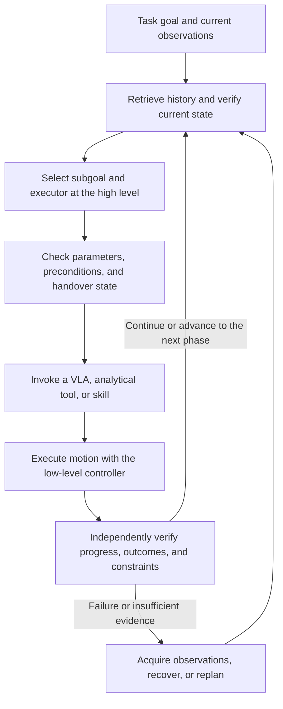

#### 2.6 Training and inference: specify what actually changes
{: id="26-训练与推理明确哪些东西发生了变化"}

The paper proposes no unified trainable model or dedicated loss function, so its 17 functional categories should not be combined into a new training objective. Surveyed systems may modify rewards under a fixed optimizer, train policies with new annotations and corrected data, or freeze all models and update only context, skill code, or invocation procedures.

At inference time, the agent advances the task using actual observations and execution feedback. High-level calls may be triggered periodically, by progress events, or according to a budget, while lower layers continue timely motion control. Cross-task improvement retains trajectories, reviews, labels, skill revisions, or experimental results. Establishing lasting capability gains requires reevaluation on new tasks and conditions that did not participate in the modification.

---

### 3. Key results and findings
{: id="3-核心结果发现-11"}

**The paper contributes a taxonomy of four domains and 17 overlapping functional categories, comparisons across works, and a research agenda; it does not introduce a new method and evaluate it in a unified leaderboard experiment.** All figures below are results of representative works as reported by the survey (§7.5). They illustrate the importance of interfaces and toolchains and cannot be compared across rows as a method ranking.

| Surveyed work | Comparison conditions and reported results | Observation supported |
|---|---|---|
| NavMCP | QA accuracy is 74.0% with the complete three-channel protocol and 59.1% with an episode-organized interface | Intent, keyframe-based journey summaries, and persistent memory jointly affect results; the difference cannot be attributed to memory alone |
| Show-Harness | Halving the motion step size raises reported zero-shot success from 60% to 82% | The same model can perform differently when action-interface granularity changes |
| ASPIRE | On the evaluated LIBERO-Pro perturbations, adding the execution engine raises macro-average success from 14% to 62% | Primitive-level execution tracking, debugging, and repair verification are important system variables; the reasoning model cannot receive all the credit |
| Work by Kuroki and Tang | Success is 65.0% with full simulation observations and 22.5% with RGB input alone | Privileged state can hide perception costs; results with different state-access conditions require separate interpretation |

Across the domains, **correct action or tool-call syntax does not ensure successful physical execution; storing experience does not ensure that evidence remains valid; accepting one skill update does not ensure continuous long-term capability growth.** The survey notes that perception and tracking errors accumulate through toolchains and that progress in some self-improving systems is not monotonic. Actual execution evidence, independent measurement, and validation on new tasks are therefore necessary.

The authors identify four directions for further work (§8):

- **Fair evaluation:** compare the agent's decision-making contribution under the same executors, observation access, and interaction budgets, while reporting resources and human effort for the complete system.
- **Real-robot deployment:** specify skill preconditions, whether actions have finished or stopped, and recovery mechanisms for noise, contact, and stale observations.
- **Efficient robot use:** trigger high-level reasoning according to task progress and uncertainty, and account for the total cost of model waiting time, networking, tool calls, retries, and physical execution.
- **Cross-embodiment generalization:** let agents adjust plans to a new robot's sensors, motion range, and skills, and measure the effects of additional configuration, training, and transferred experience.

---

### 4. Limitations
{: id="4-局限性-11"}

The evidence comes from existing studies with different observation access, executors, recovery budgets, and simulation or real-world conditions. Classification and synthesis cannot directly establish a common causal benefit for a particular system composition.
Real-world contact and perception errors, runtime latency, reliable self-improvement, and transfer to unfamiliar robots remain open problems. A single task's success rate or a simulation score cannot replace their verification.

---

## 15. Harness² (2026)
{: id="harness2"}
———Improving the harness for the current task while learning how to improve future harnesses

📄 **Paper**: [arXiv:2610.14224](https://arxiv.org/abs/2610.14224) · [Code](https://github.com/google-research/harness2) · [Project Page](https://harness2.github.io/)

**Scope of inclusion:** Harness² evaluates online harness refinement for general agents on coding, office, and legal tasks. It is included as a methodological reference for embodied-agent self-improvement and experience reuse; its results do not establish effectiveness in robot deployment.

### Key takeaways
{: id="harness2-takeaways"}

1. An agent's capabilities also depend on the prompts, skills, scripts, tool constraints, and orchestration surrounding its model. These executable configurations can improve while model parameters remain frozen.
2. Without ground-truth answers, proposing targeted edits, rerunning the task under matched conditions, and retaining changes supported by behavioral contrasts provides more evidence than rewriting a harness by intuition alone, but still does not guarantee correctness.
3. Transferable assets include both the final skills or scripts and improvement experience: which situation exposed a weakness, which edit was tried, and what behavior changed.
4. Starting each new task from a common base harness and selectively consulting the library avoids directly accumulating rules tailored to previous tasks.
5. Additional inference budget is useful through candidate edits, execution evidence, and selective composition. Evaluation must count reruns and editing costs rather than only the steps in the final execution.

---

### 1. Background and problem
{: id="harness2-background"}

Open-world agents continually encounter new tasks whose requirements cannot usually be anticipated during harness design. Online adaptation also lacks ground-truth answers or reliable verifiers to guide edits. Existing approaches either optimize offline on fixed training tasks or refine only the current task, making it difficult to turn the process of diagnosing weaknesses, testing changes, and deciding what to retain into a capability useful for future tasks.

The paper asks how to improve both the current execution harness and the experience that guides future harness refinement **without updating model weights, accessing scoring feedback, or replaying completed tasks**.

---

### 2. Method and innovations
{: id="harness2-method"}

  
<figcaption>Figure 3: Harness² couples two levels of recursion. Within a task, editors propose invariant and domain-specific candidates, execute them, and pass the evidence to a composer. After the task, a reflector stores reusable harnesses and evidence-supported lessons in the improvement library.</figcaption>

**Overall framework.** Harness² comprises an executor, harness editors, a composer, and an experience reflector. The executor produces trajectories and deliverables; editors propose executable harness changes; the composer weighs probe evidence; and the reflector updates the experience library after each task. The paper calls the runtime configuration around a frozen model a **harness**, and the process of optimizing that configuration **harnessing**.

**① Editable objects: eight file-based components.** The inputs are the current task, a frozen model, and an initial execution harness. Edits modify a component tree and produce a new configuration that can be mounted into the agent runtime. The eight components are System prompt, Guardrails, Memory, Tool guidance, Subagents, Skills, Scripts, and Plugin. They change persistent context, on-demand procedures, deterministic capabilities, separate working contexts, or hooks inside the tool loop.

The editable surface extends beyond prompts. Scripts execute mechanical checks, Skills load when relevant, and Plugins intervene around tool calls or turn boundaries. Components are chosen to address observed weaknesses rather than added indiscriminately. The edited tree also passes structural validation: skills must have trigger guidance, scripts must compile, and referenced helpers must exist. These checks establish configuration validity, not task correctness.

**② The basic within-task step: Propose–Probe–Compose.** Without an answer key, the system first asks whether a concrete behavior changed after an edit, then decides whether that edit deserves to remain. This is the paper's behavioral-contrast signal.

- **Propose: diagnose weaknesses from a reference execution.** Inputs include the task, current harness, reference execution record, and existing experience. Two editing scopes produce complete candidate harnesses: Invariant (INV) addresses cross-domain procedures such as retries, planning, tool use, and delivery checks; Domain (DOM) addresses domain knowledge, professional procedures, deliverable structure, and constraints.
- **Probe: execute the candidates.** Each candidate runs on the same task with matched model and environment configurations, producing a trajectory and deliverables. Comparison with the reference asks whether the targeted weakness was mitigated, unchanged, or accompanied by regressions. Sampling variation and shared model biases still limit the evidence.
- **Compose: combine edits according to evidence.** Inputs include candidate diffs, reference and candidate trajectories, and the available task-local history. The composer can merge supported edits, revise conflicts, adopt a candidate, or retain the current harness. It then executes the composed harness and records the observation supporting each decision.

> **A concrete example:** A task requires reconciling schedule, staffing, and budget files into consistent deliverables. The reference execution omits cross-file reconciliation and never reopens its outputs. An INV candidate adds a script to reopen and check deliverables; a DOM candidate adds a skill for reconciling schedules and budgets. If their probe trajectories show those operations occurring, the composer has evidence to retain the corresponding edits. However, running a check does not establish that every number is correct. In the paper's Figure 9 case, the final score rises from 43.1 to 77.8; that score is available only to retrospective evaluation, not to the editors or composer.

**③ Scaling within-task search: parallel exploration and sequential revision.** Both forms build on the basic contrastive step, but their budgets control different aspects of search.

  
<figcaption>Figure 4: Parallel recursion explores multiple candidates against a shared reference set and independently composes successors. Sequential recursion passes the revised harness, accumulated trajectories, and decisions into the next step.</figcaption>

- **Parallel recursion:** Collect $k$ reference executions under the initial harness, independently propose and probe $k$ INV and $k$ DOM candidates, then let $k$ composition sessions read the entire pool. Each session produces and executes one successor harness. The implementation performs one population update, so $k$ controls search width.
- **Sequential recursion:** Starting from the initial harness, chain $k$ improvement steps. Each reads the current harness and accumulated trajectories and decisions to produce the next configuration. Later steps can retain, revise, or undo earlier changes, so $k$ controls revision depth.

> **Counting the budget:** For parallel recursion with $k=2$, there are 2 reference executions, 4 candidate probes, and 2 composed-harness executions: **8 complete task executions**, plus editing, composition, and final-selection sessions. Even $k=1$ involves 1 reference run, 2 candidate probes, and 1 composed-harness execution. A single improvement step therefore involves more than one extra run. This count excludes additional overhead such as configuration-validation retries.

For $k>1$, a final selector compares anonymous deliverables against the task request and source material. It returns an existing result, creates no new content, and cannot see the originating harness. The appendix explicitly allows it to select an output produced by the initial harness. At $k=1$, final selection is bypassed and the executed successor from the basic step is returned. Adoption means selection in this run, not verified optimality.

**④ Across-task improvement: retain the harness, applicable situation, and evidence.** The experience reflector receives the complete improvement record, including rejected candidates rather than only the selected output. It records each edit, the observed behavioral difference, and the strength of attribution before deciding whether to extract a reusable lesson. When multiple edits are confounded or only one execution supports an observation, attribution can be marked as confounded. With insufficient reusable evidence, the reflector can decline to add an experience entry.

The library retains the adopted executable harness and an `EXPERIENCE.md` describing its applicable situation, lesson, evidence, and confidence. An index lets later editors inspect relevant entries on demand. The two recursive levels differ in what they change within a task and what they carry across tasks:

| Dimension | Task-level recursion | Harnessing-level recursion |
|---|---|---|
| Updated object | The current task's execution harness $H$ | The library within the improvement harness $R_t$ that guides future editing |
| Evidence | Reference, candidate, and composed-harness executions on the current task | The complete improvement process and its decisions |
| When it acts | During probes and iterations on the same task | After task completion, for use by subsequent tasks |
| How the next task starts | The task-specific harness is not directly inherited | Start from the common base harness and selectively reuse library components and experience |

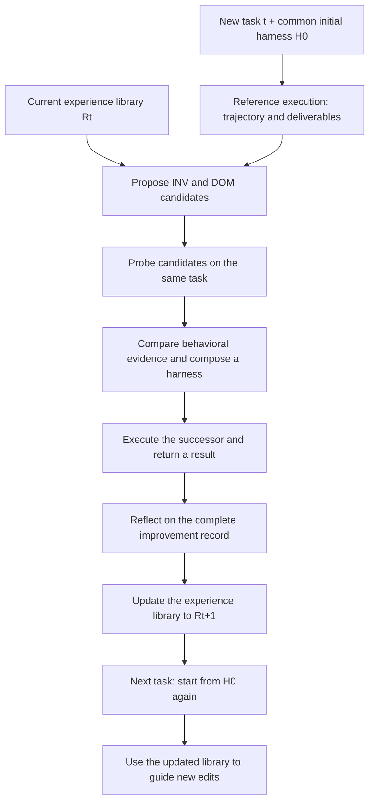

The diagram omits anonymous deliverable selection for $k>1$. Throughout recursion within a task, $R_t$ remains fixed. The next task does not directly inherit the previous task's harness, and task-specific facts discovered earlier must be checked for applicability to the new task.

**⑤ Update rules and training objectives.** The method introduces no gradient training, reinforcement-learning reward, or new loss function. It performs discrete updates to configuration files and the experience library around a frozen model. With $e=(\tau,y)$ denoting a trajectory and deliverable, the basic improvement step is:

$$
(H',e',\xi)=\Phi(q_t,H,\mathcal E;R_t).
$$

Here $\mathcal E$ is the available task-local history, and $\xi$ records candidate probes, composition decisions, and their evidence. Executing changes and retaining their evidence is central to this operator. After task completion, the improvement library is updated as:

$$
R_{t+1}=\operatorname{Update}(R_t,H_t^{\star},\mathcal D_t).
$$

$H_t^{\star}$ is the adopted harness and $\mathcal D_t$ the complete improvement record. The star denotes adoption, not correctness or global optimality. Model weights, stage instructions, and decision rules remain fixed; the persistent changes are library components and experience.

**⑥ End-to-end execution.** A new task first runs with the common initial harness to obtain reference trajectories. Editors consult the current library to propose candidates, the executor probes them, and the composer forms a successor from behavioral evidence. Exploration follows the prescribed parallel or sequential budget, a result is delivered, and reflection makes supported experience available to the next task. The whole process takes place at deployment time; benchmark answers, rubrics, and scores are used only for external evaluation.

---

### 3. Key results and findings
{: id="harness2-results"}

**Evaluation setup.** Main experiments combine two frozen executors, Gemini 3.5 Flash and GLM-5, with two initial harnesses, OpenCode and Codex, giving four configurations. The default editor and selector are Claude Opus 4.8. WorkBuddy-Bench uses 40/35/25 test tasks in Code/Web/Office, JobBench uses 34 test tasks, and LAB uses 100 test tasks. Methods process task streams, and the main tables report means and standard deviations over three shuffled runs, starting from empty libraries.

**Both a single step and parallel recursion improve performance.** The following representative results come from the main tables. The $k=5$ values add the reported recursion gains to the $k=1$ results. WorkBuddy-Bench and JobBench report scores; LAB Partial is a per-criterion pass rate (%).

| Benchmark and execution configuration | Initial harness | Harness², $k=1$ | Parallel recursion, $k=5$ |
|---|---:|---:|---:|
| WorkBuddy-Bench average, Gemini 3.5 Flash / OpenCode | 72.4 | 77.5 | 80.8 |
| WorkBuddy-Bench average, GLM-5 / OpenCode | 64.2 | 75.7 | 79.6 |
| JobBench, Gemini 3.5 Flash / OpenCode | 31.5 | 36.0 | 39.0 |
| JobBench, GLM-5 / OpenCode | 20.6 | 24.2 | 28.4 |
| LAB Partial, GLM-5 / OpenCode | 59.6 | 71.4 | 78.1 |

The largest single-step gains over the initial harness are **11.5 points** on WorkBuddy-Bench, **4.5 points** on JobBench, and **11.8 percentage points** on LAB. Increasing the budget to $k=5$ adds 2.9–3.9 points, 3.0–4.2 points, and 2.6–6.7 percentage points, respectively, across the four configurations. Harness² exceeds the compared baselines on WorkBuddy-Bench average and JobBench score in all four configurations. On LAB with Gemini 3.5 Flash / Codex, however, its single-step result of 75.6 is below Meta-Harness's 76.5; the evidence does not support claiming leadership in every setting.

**Composition, scoped editing, and the library all contribute.** With Gemini 3.5 Flash / OpenCode at $k=1$, the full method scores 77.5 / 36.0 on WorkBuddy-Bench / JobBench. Removing the library lowers these to 74.4 / 34.2; removing the INV/DOM split gives 74.6 / 32.3; and skipping composition to choose between the two candidates gives 75.9 / 34.1. In the appendix, removing Skills from an already improved harness reduces the WorkBuddy-Bench average by 5.3 points, while removing Scripts costs 3.7 points. Multiple components contribute; longer prompts alone do not explain the gains.

  
<figcaption>Figure 7: Left, edit the harness directly with the improvement library, without new reference executions or candidate probes. Right, transfer JobBench experience to WorkBuddy-Bench. A library accumulated with more exploration better supports subsequent refinement.</figcaption>

**Experience helps future tasks, but experimental protocols matter.** Directly editing without execution evidence or a library lowers Code from 73.4 to 63.2 and Web from 69.9 to 65.0. With a library accumulated at $k=5$, even without new probes, Code/Web/Office exceed the initial harness by 0.9/4.4/5.1 points. Transferring JobBench experience to single-step WorkBuddy-Bench refinement adds 0.6/0.5/2.9 points across the three domains. The appendix's leave-one-out reruns can also access later-task experience; they are an offline reuse analysis, not an estimate of online gains.

  
<figcaption>Figure 8: With OpenCode at k=2, using the same model as executor and editor still improves all five tested models on all three benchmarks. Gains therefore need not depend on a stronger external editor.</figcaption>

**The same model can improve its own harness, while full costs still matter.** In the same-model experiment, Claude Opus 5 gains 3.3, 5.5, and 3.0 points on WorkBuddy-Bench, JobBench, and LAB, respectively; GLM-5 gains 13.7 percentage points on LAB. Figure 6 counts total execution and improvement tokens and places both Harness² configurations, $k=1$ and $k=5$, for Gemini 3.5 Flash / OpenCode on the empirical Pareto frontier of the compared methods. This describes the observed cost–performance trade-off in that experiment. The main tables' `#Steps` count model turns in an executor session and cannot replace total cost accounting.

  
<figcaption>Figure 9: In a JobBench production-coordination task, procedural guardrails, a professional reconciliation skill, verification scripts, and tool guidance together address cross-file consistency and missing deliverable sections. The score rises from 43.1 to 77.8.</figcaption>

---

### 4. Limitations
{: id="harness2-limitations"}

Repeated executions and editing add substantial inference cost. Parallelism reduces latency only when resources permit, and the paper does not establish a universally optimal budget or an adaptive stopping rule. Behavioral contrasts and anonymous selection remain vulnerable to shared false assumptions, sampling variation, and evaluation noise: the appendix even reports selecting a 55-point output when a 95-point candidate was available. Long-term library consolidation, outdated-experience revision, and retrieval management also remain open.

---

## 16. GPT-6-Astra-JRT (2026) {#gpt-6-astra-jrt}
———From capability limits with demonstrations and interaction budgets to the gaps in real-world embodied intelligence

📄 **Paper**: [arXiv:2610.22471](https://arxiv.org/abs/2610.22471) · [Project Page](https://sensenova.ai/has-gpt-6-astra-achieved-embodied-intelligence)

### Key takeaways {#gpt-6-astra-jrt-takeaways}

1. A general model's embodied capabilities must be assessed together with the experience it can read, its control interfaces, and its interaction budget: this report freezes GPT-6-Astra's weights, lets it organize training demonstrations into a retrievable knowledge package, and evaluates task completion through observation, action, verification, and correction.
2. Additional interaction steps can unlock failure recovery, but the benefit depends on whether recovery remains possible; spilled liquid, parts dropped outside the workspace, and progress undone by later actions cannot automatically be recovered through repeated attempts.
3. Effective collaboration between high-level reasoning and a low-level policy requires reviewing candidate actions, checking physical outcomes, and choosing suitable action-chunk lengths; simply delegating high-level subgoals to a VLA does not improve success in the reported ablations.
4. The main deployment gaps concern physical-state verification, precise contact, transfer of experience across tasks, and the safety and mechanical costs of deliberation time; appearing complete, being declared complete, and being physically complete can be different states.
5. Future evaluations should assess satisfaction of human needs, continuing obligations created by the robot, and timely action in an evolving world to distinguish benchmark success from deployable embodied intelligence.

---

### 1. Background and problem {#gpt-6-astra-jrt-background}

The Joint Research Team (JRT) report, *Has GPT-6-Astra Achieved Embodied Intelligence?*, examines whether a general model can handle tabletop manipulation, dexterous hands, humanoids, and navigation, while asking how much benchmark success depends on demonstrations, tools, and generous budgets. The authors conduct evaluations on 12 simulation benchmarks, harness ablations, validation on 8 real-robot configurations, and a household prototype that keeps running during deliberation to examine the gap between being capable of completing tasks and being reliable and efficient enough to deploy.

---

### 2. Main methods and contributions {#gpt-6-astra-jrt-method}

  
<figcaption>Original Figure 2: training data are used to construct and freeze a knowledge package, which is copied into isolated test episodes; neither the model weights nor the package are updated during testing.</figcaption>

**① Overall framework: experience preparation, closed-loop reasoning, and action execution.** The basic system has three stages: a knowledge package stores experience extracted from training data, GPT-6-Astra chooses actions using current observations and that experience, and robot-control interfaces execute the actions and return feedback; some ablations additionally introduce a VLA to propose candidate actions. The contribution is a systematic study of evaluation protocols and harness design; the report does not introduce a GPT-6-Astra model trained with a new loss function.

**Experience preparation: turning demonstrations into files the model can retrieve and use.** Inputs are the training demonstrations permitted by each benchmark, including images, actions, and robot states, with exploration in training scenes allowed in some settings; the model inspects these materials and writes task notes, reference data, and executable code, producing a knowledge package $K$ that is frozen before testing. The authors identify six recurring components: task goals and stage ordering, motion trajectories and grasp poses, demonstration keyframes and contact crops, programs for forward/inverse kinematics and retrieval, completion checks and recovery procedures, and robot specifications and provenance records; these are observed commonalities rather than a mandated template. Package contents also vary: LIBERO organizes composable atomic skills, SIMPLE retains numerical trajectories, and navigation packages retain landmarks, stopping guidance, and recovery experience.

**Concept 1: ICL here involves more than a few demonstration images, and it does not update weights.** In practical terms, the model first writes its own operating manual containing pictures, numerical examples, and programs, then consults it and adapts actions to the current scene during testing. Each test episode starts a fresh session with the same read-only package, retains only its own interaction history, and transfers no experience to other test episodes.

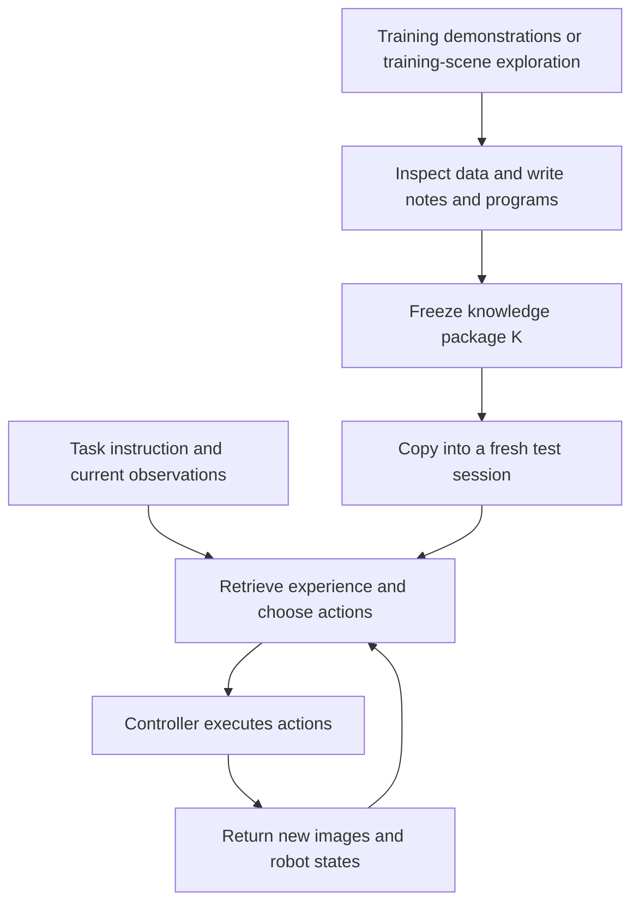

**Closed-loop reasoning: using execution outcomes to revise the next action.** At test time, the model reads the instruction, package, current images, permitted robot states, and episode history, retrieves reference motions or calls helpers, and produces an action or sequence; after execution, new observations inform whether to continue, adjust, recover, or stop. Visual references help compare the current stage with demonstration stages, while numerical references and programs turn experience into executable actions; observation access varies across benchmarks, so the experiments should not all be described as using an identical RGB-only interface.

**Action execution: connecting high-level reasoning to existing robot interfaces.** Inputs may specify end-effector positions and orientations, relative directions and distances, or joint targets; inverse kinematics or existing low-level controllers translate them into physical motion. This lets the model reason about where the gripper should move while controllers handle joint coordination; humanoid experiments also explore issuing targets directly to existing motor controllers without always going through a task-trained VLA.

**Training and inference boundaries.** GPT-6-Astra's weights remain frozen throughout these experiments, so there is no additional model-training loss; ICL preparation produces an external knowledge package. System 1 in the collaboration experiments uses π0.5 fine-tuned on RoboDojo, which is separate from any update to GPT-6-Astra; inference consists of consulting experience, calling tools, executing actions, and revising decisions from feedback.

**② Interaction budgets: measuring whether the model can progress after failure.** The standard budget is the benchmark's prescribed control-step limit, while the extended budget allows up to ten times as many steps; the main-text protocol emphasizes continuing from the same environment state and history, preserving consequences of prior actions and terminating early on success or terminal failure. Additional steps create opportunities to regrasp, change approach angles, relocalize, and correct errors; episodes need not consume the full extended budget.

> **Concept 2: a numerical example separating control steps from elapsed time.** Consider a RoboDojo task with a standard budget of 200 steps at 25 Hz: 1× permits at most 8 seconds of commanded motion, while 10× permits at most 2,000 steps, or 80 seconds. Time spent observing, reasoning, and calling tools is outside those motion durations, so a simulated task with little commanded motion can still take tens of minutes or hours to run. A 10× budget also does not mean resetting the environment for ten independent attempts.

Implementation details differ across benchmarks: the navigation appendices retain earlier successes, apply additional evaluation to unsuccessful episodes, and preserve better per-episode metrics, so these results cannot uniformly be interpreted as uninterrupted trajectories continued from exactly the same state. The aggregate table also distinguishes an independently executed 1× run from the 1× cutoff of a 10× run, and their results can differ.

**③ Harness ablations: who proposes actions and who reviews them.** The authors call the slower, reasoning-oriented GPT-6-Astra System 2 and the RoboDojo-fine-tuned π0.5 System 1, connecting them through different collaboration protocols. In open-loop collaboration, GPT specifies subgoals and the VLA directly executes joint-action sequences; in closed-loop collaboration, forward kinematics first converts VLA-proposed joint actions into candidate end-effector motions, which GPT accepts, modifies, or rejects using observations before execution and feedback.

| Collaboration stage | Open-loop collaboration | Closed-loop collaboration |
|---|---|---|
| GPT inputs and outputs | Produces subgoals from the current task | Reviews candidate end-effector motions and accepts, modifies, or rejects them |
| How VLA outputs reach the robot | Candidate actions execute directly | Candidate actions first undergo GPT review |
| Main trade-off | Fewer reasoning calls, but no action-level supervision | Candidate actions can be corrected, but frequent review consumes many tokens |

The review horizon matters: $L=1$ means that each GPT call reviews one VLA-proposed end-effector action, while $L=4$ reviews four at once; this differs from direct-control experiments in which GPT generates multiple actions itself. The latter compare single actions, fixed four-action chunks, and adaptive chunks of one to four actions selected by GPT; longer chunks reduce calls but delay feedback, making the appropriate horizon dependent on the task stage.

  
<figcaption>Original Figure 7: success and token cost for different collaboration protocols and action interfaces on RoboDojo; success here is averaged equally across five task categories and should not be conflated with an average over all tasks.</figcaption>

The appendix also ablates agent components individually: a feedback subagent checks outcomes, a planning subagent decomposes tasks, and an execution subagent generates end-effector actions; history compression retains the latest four turns and summarizes earlier interactions in at most 2,000 tokens. These components are added and compared separately, and the results do not establish that adding more modules always improves performance.

**④ Real-robot validation: removing task demonstrations and cost-free retries.** The real-world study covers 8 configurations spanning single arms, dual arms, dexterous hands, wheeled mobile manipulation, and humanoids, without task demonstrations or demonstration-derived packages; it still supplies structured priors such as tool descriptions, joint limits, camera placement, and hand open/close presets, with task guidance or human-written grasp scripts on some platforms. Zero-shot therefore refers to the absence of demonstrations and task-specific training while retaining human priors and controller support. Most trials use a 60-minute wall-clock budget, with platform-specific exceptions, and people judge success from the physical outcome.

One transferable behavior is **active vision: moving the camera to inspect the contact region before acting**. When a single arm holds a flower stem, the nearby wrist camera cannot see the vase mouth below it; on the dual-arm platform, GPT moves the free arm and its wrist camera until the mouth becomes visible, then completes insertion, making viewpoint selection part of the action decision.

  
<figcaption>Original Figure 9: insertion fails with an occluded close-up view on a single-arm platform; a dual-arm platform succeeds after moving its free wrist camera to view the vase mouth. This illustrates the role of viewpoint selection, without statistically isolating camera count or other platform differences.</figcaption>

**⑤ Household prototype: evaluating whether the whole trajectory serves the user.** The authors build an interactive Isaac Sim apartment with contact, articulated fixtures, liquids, cloth, and cooking processes; GPT controls an AgiBot G2 using only onboard cameras and proprioception, with no scene demonstrations, while deliberation advances world time. The proposed evaluation considers both the user's explicit request, Intent, and continuing obligations, Duty, such as closing the refrigerator and turning off the tap while making breakfast.

| Evaluation dimension | Common static-goal evaluation | Direction proposed in this report |
|---|---|---|
| Task specification | Prescribes target conditions for objects | Expresses human needs and allows different useful outcomes |
| Source of experience | Uses task-training demonstrations | Supplies no in-domain demonstrations and requires exploration during deployment |
| Time accounting | Pauses the world during reasoning and primarily counts actions | Advances the world during reasoning, tool calls, and communication |
| Outcome judgment | Succeeds once a goal state is reached | Assesses utility, timeliness, and obligations across the trajectory |

These are design principles and a proof of concept rather than a new benchmark with large-scale statistical rankings; illustrative breakfast deadlines and utility weights should not be treated as a validated universal scoring system.

---

### 3. Main results and findings {#gpt-6-astra-jrt-results}

**Simulation: demonstrations and additional interaction bring some benchmarks close to saturation, while long-horizon tasks retain substantial gaps.** The table below prioritizes the corresponding appendix configurations and coverage, reporting full-task success rate, SR (%); RoboLab has no training set and is reported zero-shot without ICL.

| Benchmark | Standard budget 1× | Extended evaluation up to 10× | Interpretation |
|---|---:|---:|---|
| LIBERO-Long++ | 97.5 | 100.0 | 120 episodes; atomic-skill experience supports composition into task chains |
| LIBERO-PRO | 98.3 | 99.3 | All 800 episodes; experience from training exploration supports perturbation handling |
| LIBERO-Ultra-Long | 82.2 | 98.9 | 90 episodes; additional interaction substantially helps long-chain correction |
| RoboDojo, ICL direct control | 27.6 | 81.9 | 210 episodes, averaged over all 42 tasks |
| RoboLab, no ICL | 57.1 | 69.2 | No training demonstrations; results do not depend on a task knowledge package |
| SIMPLE, ICL | 96.3 | 98.8 | Only the 80 shared complete instances in Matched-8 |
| DexJoCo | 78.2 | 87.3 | 11 tasks and 55 episodes |
| Bench2Dex | 25.6 | 61.5 | 26 tasks and 78 episodes; precise control remains difficult |
| BEHAVIOR | 37.0 | Not extended | One rollout for each of 100 tasks; the standard budget is already long |
| VLN-CE R2R | 80.0 | 88.0 | A subset of 100 episodes in unseen scenes |
| VLN-CE RxR | 82.0 | 90.0 | A selected subset of 100 English-language episodes |
| LHPR-VLN | 21.1 | 28.9 | 114 long-horizon episodes manually filtered for target visibility |

**Reporting distinctions.** The report's aggregate Table 2 lists a VLA-assisted 54.2% for the independent RoboDojo 1× run, whereas its 10× result and corresponding 1× cutoff are 81.9% and 27.6% for direct control; interpreting 54.2%→81.9% as a same-configuration budget ablation is therefore inappropriate. Table 13 and Figure 7 additionally average five categories equally, giving 29.67% for ICL direct control, consistent with 27.62% when averaging all 42 tasks above; SIMPLE's 98.8% does not represent its complete six-task set, and navigation has the previously described rules for retaining better outcomes.

  
<figcaption>Original Figure 1: overview of 12 benchmarks. Published baselines use standard budgets, so extended-budget results should not be interpreted as rankings at matched elapsed time, cost, or identical observation access.</figcaption>

**Paired evidence more directly identifies the contribution of ICL.** On SIMPLE's Common-4 subset of 120 shared instances, standard-budget success increases from 70.8% zero-shot to 90.8% with ICL, a gain of 20.0 percentage points; among the 81 episodes solved in both settings, average action steps fall from 376.9 to 210.4 and test time from 47.0 to 31.4 minutes, while tokens increase from 2.64 million to 6.40 million, in addition to a one-time preparation cost per task. This 120-instance subset differs from the 80-instance Matched-8 set above, so their denominators must remain separate.

**Harness ablations: closed-loop review and adaptation are more useful than simply adding execution modules.** The following values use Figure 7's equal weighting across five categories; tokens count millions of input and output tokens per episode, rather than dollar costs matched across systems.

| Configuration | SR (%) | Tokens (millions) |
|---|---:|---:|
| GPT direct-control baseline | 15.56 | 2.560 |
| Standalone VLA π0.5 | 6.91 | GPT tokens not reported |
| GPT + VLA open-loop | 5.83 | 0.387 |
| GPT + VLA closed-loop, per-action review | 23.61 | 7.664 |
| GPT + VLA closed-loop, four-action review | 25.83 | 2.796 |
| GPT + ICL | 29.67 | 9.567 |
| GPT + ICL + VLA closed-loop | 54.17 | 19.335 |
| GPT with adaptive generated action chunks | 20.00 | 1.146 |

Reviewing four actions at once reduces tokens by 63.5% relative to per-action review while increasing success by 2.22 percentage points; ICL combined with closed-loop collaboration reaches the highest success but consumes about 6.9 times as many tokens as four-action review. In direct control, relative directional commands achieve 18.06% versus 9.72% for joint-angle control, suggesting an interface gap between semantic reasoning and low-level action representations; fixed four-action chunks achieve only 11.39%, showing that longer chunks do not automatically improve outcomes. In the appendix, adding a feedback subagent independently raises baseline SR from 15.56% to 24.72%; history compression raises it to 21.11% while reducing tokens from 2.56 million to approximately 0.86 million.

**High success can still be expensive.** At the standard budget, LIBERO-Long++ averages approximately 1.04 million tokens and 53.1 minutes per episode, while Ultra-Long averages 8.89 million tokens and 110.9 minutes. Extended RoboDojo evaluation averages approximately 38.63 million tokens and 216.6 minutes, excluding ICL preparation; Figure 5 also states that approximately 98% of tokens in the runs are cached inputs, so total tokens cannot simply be priced at the uncached-input rate. Benchmarks differ in their treatment of tool and simulation time, and some token records are incomplete; these figures indicate scale under the report's accounting conventions rather than a strictly uniform ranking of end-to-end latency.

  
<figcaption>Original Figure 5: token and time costs of ICL preparation, standard-budget execution, and additional interaction. Success gains from extra steps should be assessed alongside computation, waiting time, and preparation costs.</figcaption>

**Real robots: cross-embodiment feasibility, with remaining gaps in precise contact and long-horizon reliability.** Rigid-object pick-and-place succeeds in 17/18 trials, while plug insertion succeeds in 0/11 across three platforms; AgileX Tracer navigation and search achieve 9/23. On the Tianji dexterous hands, toy grasping succeeds in 0/3 trials with model-written grasp code and 3/3 with human-written grasp scripts, demonstrating the influence of structured priors; Unitree G1 achieves 2/3 in manipulation and 3/3 in locomotion, with its two successful manipulation runs taking approximately 74.5 and 87.8 minutes and API requests accounting for approximately 89%–92% of elapsed time. These small samples establish feasibility more than stable reliability.

**Failure modes: choosing the next step does not guarantee that correct physical states persist.** Examples include treating image overlap between a mug handle and peg as evidence of successful hanging, undoing an earlier placement while adjusting headphones, and being unable to restore a task after spilled liquid even when the cup is righted. The continuously running household prototype reveals three additional problems: focusing on the held object while overlooking displaced items or an open refrigerator, failing to discover unfamiliar mechanisms and plan whole-body positioning, and acting on images that become outdated during deliberation; these are qualitative cases rather than statistically measured failure rates on a new benchmark.

  
<figcaption>Original Figure 12: representative household failures include disturbing objects while tidying, leaving the refrigerator open, obstructing access through poor body positioning, overflowing the sink, and charring an egg through decision and execution delays.</figcaption>

---

### 4. Limitations {#gpt-6-astra-jrt-limitations}

Knowledge packages largely depend on task-related demonstrations, and transfer across tasks and embodiments is not systematically validated; observations, interfaces, coverage, budget-extension procedures, and cost accounting vary across benchmarks, without matching inference costs to prior methods, so the results better characterize capability limits than establish uniform system rankings. Most real-robot tasks have few trials, some rely on expert priors and differing success criteria, and the household prototype offers only a few qualitative cases whose physical fidelity, utility scoring, and continuous-time protocol require further validation.

---

## 17. Evo² (2026)
{: id="evo2"}
———Co-evolving the agent harness and the model that improves it

📄 **Paper**: [arXiv:2610.13025](https://arxiv.org/abs/2610.13025)

**Why it is included**: Evo² is evaluated directly on coding and memory tasks rather than on robots or embodied benchmarks. Its weight-harness co-evolution, execution-based attribution, cross-branch strategy reuse, and trajectory recovery nevertheless address mechanisms that embodied agents need for long-running harness evolution. This entry treats those mechanisms as transferable research ideas and does not extrapolate coding-benchmark gains into robot performance.

### Highlights
{: id="evo2-highlights"}

Evo² does not optimize model weights and the agent harness as separate artifacts; it turns them into a feedback loop in which better models produce stronger harness edits and evaluated edits become training data for the model. A single shared policy plays two roles: the Proposer writes executable changes, while the Reflector diagnoses their effects and recommends revision, crossover, or retention. EvoTIDE recovers useful data from incomplete edit trajectories, warm-starts the policy with SFT, and then interleaves GRPO updates across both roles. The resulting harnesses improve coding and memory tasks, transfer across benchmarks, and can also improve proprietary models whose weights remain fixed. The broader lesson is to treat an executable system as an experience generator whose structural changes can supervise the policy responsible for future changes.

---

### 1. Background / Problem
{: id="evo2-background"}

Self-evolving agents usually follow one of two paths: update model weights from self-generated experience, or rewrite the agent harness that controls prompts, tools, context, and execution flow. The former improves the model's problem-solving behavior, while the latter accumulates improvements in executable code, but separating them prevents the model from learning systematically which harness changes work. Evo² asks whether every edit, execution result, and failure diagnosis can train a stronger evolver that drives the next round of harness search.

---

### 2. Main Method / Contributions
{: id="evo2-method"}

#### 2.1 The weight-harness co-evolution loop
{: id="evo2-coevolution-loop"}

  
<figcaption>The Evo² feedback loop: a shared Proposer-Reflector policy improves the agent harness, while edits, trajectories, and execution feedback train a stronger evolver.</figcaption>

Evo² combines three coupled components. A **harness tree** stores program variants and their evaluation records; a **shared dual-role evolver** proposes changes and interprets their outcomes; and **EvoTIDE** converts search trajectories into weight-training data. The task executor stays fixed during co-evolution, so changes in candidate performance can be attributed to the harness rather than to a simultaneously changing execution model.

| Dimension | Separate self-evolution | Evo² co-evolution |
|---|---|---|
| Where experience accumulates | Model weights or harness code | Both the harness and the evolver |
| Capability of the editor | The same untrained model continues searching | Search outcomes train the next editor |
| Search structure | A single lineage or candidate archive | A tree with strategy transfer across branches |
| Role of feedback | Candidate selection | Editing, diagnosis, and stop decisions |

#### 2.2 Dual-role harness evolution
{: id="evo2-dual-role-evolution"}

  
<figcaption>Harness evolution and trajectory collection: a sampled parent is edited and evaluated before the Reflector chooses revision, crossover, or retention.</figcaption>

**Proposer: input, transformation, output.** In Type A mode, the Proposer receives a parent harness, its evaluation history, and a role prompt. It independently selects a mechanism to improve and emits executable file edits that create an initial candidate. In Type B mode, it also receives a concrete edit directive from the Reflector and turns that diagnosis into code. Type A learns to discover improvements; Type B learns to implement feedback reliably.

**Reflector: input, transformation, output.** The Reflector receives the parent and child harnesses, their edit diff, the performance change, and relevant success and failure traces. It infers what strategy the edit attempted and chooses one of three actions: `revise` provides a local correction, `crossover` imports a strategy from another branch, and `keep` retains the candidate without further editing. The quality of a directive is measured by the performance of the harness produced after the Proposer executes it, rather than by the apparent quality of the text itself.

**Crossover searching.** The system extracts mechanisms and observed effects from evaluated harnesses into a strategy library. When the current branch exhibits a weakness, the Reflector can select a donor strategy from another branch and explain how to adapt it to the current recipient. The Type B Proposer performs the source-level integration. The resulting node remains a child of the recipient and records the donor strategy, so Evo² transfers an evaluated mechanism instead of blindly merging two codebases.

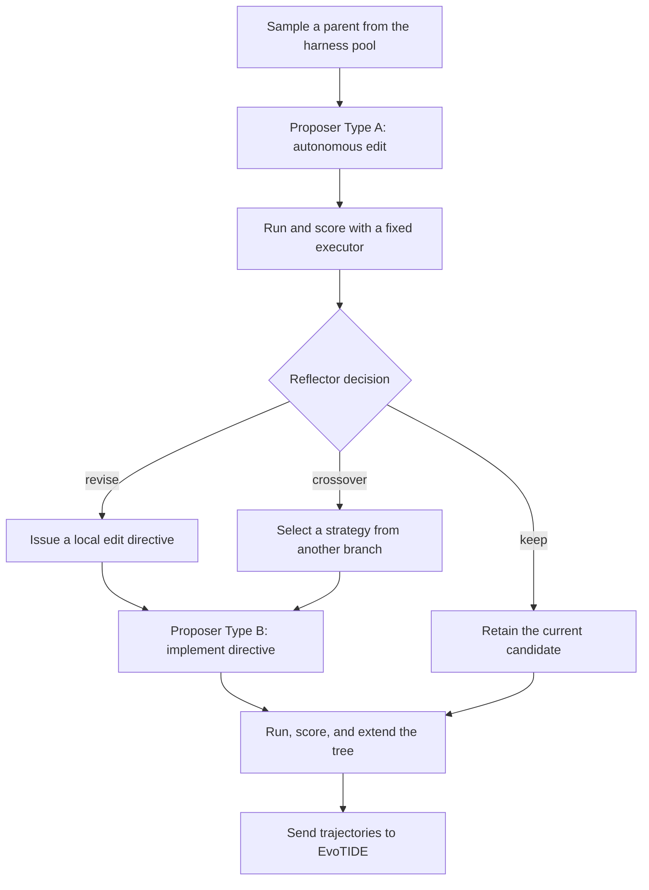

This simplified view shows one complete loop: edit, execute, and reflect. A second edit occurs only after revision or crossover. `keep` is therefore also a learned action: stopping when another edit is unlikely to help saves evaluation budget.

#### 2.3 EvoTIDE: learning from harness evolution
{: id="evo2-evotide"}

One `propose → evaluate → reflect → revise` cycle can produce three trajectory types: an autonomous Proposer trajectory, a Reflector trajectory, and a directed Type B Proposer trajectory. EvoTIDE first builds a balanced mixture of successful examples for SFT and then performs interleaved GRPO over both roles as the harness tree grows. At each training round, it freezes a policy snapshot to provide counterpart behavior for the role being optimized; the snapshot is refreshed after the round, reducing instability from both roles changing at once.

Trajectory recovery addresses a common systems failure: a rollout may contain several valid edits but end with a malformed tool action. **Edit extraction** recovers concrete changes mentioned in reasoning or chat messages. **Prefix continuation** truncates the rollout after its last successful edit, restores the corresponding intermediate harness, and regenerates only the failed suffix.

> **Minimal example**: suppose a rollout produces three edits. The first two apply successfully, but the third uses an invalid tool format. Discarding the rollout would waste both valid edits. Prefix continuation restores the harness after Edit 2 and regenerates Edit 3; if the new suffix passes application, startup, and task-evaluation checks, the recovered trajectory becomes training data.

#### 2.4 Rewards, parent sampling, and end-to-end flow
{: id="evo2-training-flow"}

Both roles receive execution rewards based on the task-score change caused by their decision. For a Proposer edit from parent harness $h$ to $h'$:

$$
r_P^{\mathrm{exec}} = \hat V(h') - \hat V(h)
$$

For a Reflector intervention that changes candidate `h_0` into `h_1`:

$$
r_R^{\mathrm{exec}} = \hat V(h_1) - \hat V(h_0)
$$

Malformed, non-executable, or no-op edits receive negative rewards. A Reflector is credited for adding a mechanism only when execution traces show that the mechanism actually ran, which reduces accidental reward assignment. The bounded parent pool retains candidates from several tree depths, including strong harnesses that may improve further and weaker harnesses that teach repair behavior, while reserving a fixed sampling share for the root.

End to end, a parent harness undergoes a Type A edit, fixed-executor evaluation, Reflector diagnosis, and an optional Type B revision. The evaluated candidate enters the tree and strategy library; recovered trajectories support SFT and then role-grouped GRPO. The updated shared policy drives the next search round, closing the loop between better evolvers and better harnesses.

---

### 3. Key Results / Findings
{: id="evo2-results"}

With Qwen3.8-27B, Evo² produces the strongest self-evolved harness on all three coding benchmarks. It reaches **82.1% Pass@1** on Polyglot versus 62.6% for the strongest baseline, **48.3% Resolved** on SWE-bench Verified versus 41.0%, and **58.0% Pass@1** on LiveCodeBench versus 56.0%. In cross-benchmark evaluation, Evo² ranks first in five of six transfer directions, indicating that the learned harnesses contain reusable mechanisms rather than benchmark-specific patches.

Weight evolution contributes consistently. Compared with the untrained evolver, EvoTIDE adds **+16.3, +5.0, +9.3, and +10.6** percentage points on Polyglot, SWE-bench Verified, LoCoMo, and LongMemEval, respectively. Even when proprietary-model weights stay fixed, dual-role reflection and crossover raise GPT-5-mini to **48.3%** on a 60-task SWE-bench Verified subset, compared with 24.4% for the strongest baseline.

  
<figcaption>LiveCodeBench accuracy versus inference cost: Evo² obtains the highest Pass@1 while using fewer completion tokens and fewer LLM calls.</figcaption>

The gain is not explained by a larger inference budget. The Evo² LiveCodeBench champion uses about 3.6K completion tokens and 10.2 LLM calls per task; HGM and DGM score lower while consuming about 6.6K-6.9K tokens and 26-37 calls. Beyond coding, Evo² reaches **60.4 F1** on LoCoMo, and the same harness transfers to LongMemEval-S without further evolution, achieving **71.5% accuracy**.

---

### 4. Limitations
{: id="evo2-limitations"}

Evo² still requires many real task executions to evaluate harness candidates, so search and training costs can grow quickly with task complexity and tree size. Keeping the executor fixed improves causal attribution but does not fully represent deployments where the executor and harness change together, and the evidence is currently concentrated on coding and memory tasks rather than high-risk, strongly stateful real-world agents.

---

## 18. Dream-RSI (2026)
{: id="dream-rsi"}
———Turning historical discovery trees into a replay environment, so exploration policies are screened offline before the next real search

📄 **Paper**: [arXiv:2609.14858](https://arxiv.org/abs/2609.14858) · [Code](https://github.com/zhengkid/Dream-RSI) · [Project Page](https://dream-rsi.com/)

**Why it is included**: The paper has no embodied tasks, robot simulation, or real-robot experiments. It is included because its discovery-tree replay and exploration-scheduling mechanism may inform active exploration, failure recovery, and harness evolution for embodied agents; those applications still need separate validation.

> Version note: this entry follows the full PDF of arXiv v2 (6 October 2026); Figures 1–2 and Figures 3–7 are all taken from that version.

### Highlights
{: id="dream-rsi-highlights"}

Dream-RSI stores the exploration an agent has already done as a **discovery tree** with scores and costs, so a candidate scheduling policy can be replayed along the tree instead of re-running every expensive candidate generation. A policy-development agent edits the executable code that decides whether to open a new branch, dig deeper, parallelize, or stop; after comparing versions across many historical trees, it sends the winner back to online discovery. Each online run produces a new tree, which adds experience for the next round of replay. This loop improves the **exploration orchestrator**, not the underlying model weights; it offers a transferable idea for self-evolving agent harnesses, but the paper has no robot validation.

---

### 1. Background / Problem
{: id="dream-rsi-background"}

Long-horizon algorithm discovery often needs many propose-execute-score cycles, and a fixed exploration policy can keep investing in low-yield directions. If every new scheduling policy required re-running an entire online search, evaluating the policy would cost more than evaluating a single candidate, and feedback would arrive only after a long rollout. The paper asks whether existing execution history can be used to evaluate the next exploration policy cheaply.

---

### 2. Main Method / Contributions
{: id="dream-rsi-method"}

#### 2.1 Overall framework: online exploration, historical replay, policy improvement
{: id="dream-rsi-interface"}

  
<figcaption>Paper Figure 1: Online exploration produces a discovery tree; the tree enters a replay pool; the policy-development agent repeatedly replays and edits the scheduling code, then redeploys the winner.</figcaption>

The **online exploration module** takes the current exploration policy, the initial workspace, and earlier history. The policy chooses which nodes to continue from and assigns parallel jobs to a fixed discovery agent. Each new node stores its parent, a workspace snapshot, the full observation, and the score returned by a fixed evaluator, so one real search leaves a reusable tree-shaped record.

**Discovery trees and the shared decision interface**: the tree is rooted at the initial workspace $r$ (root score 0). Every non-root node has exactly one parent: the discovery agent resumes from the parent's saved workspace and inherits its accumulated observations. The selectable set $A(\mathcal T)$ is the root plus all current leaves. With $W$ parallel workers, the policy outputs a batch of at most $W$ nodes per round, deciding both where to continue and how many attempts run at once. Online and offline phases share this interface and differ only in state transition: online executes for real (with stochastic outcomes), while offline only replays records.

The **replay simulator** treats a recorded tree as a local environment: another policy sees only the nodes revealed so far, and after it chooses, the system reveals the corresponding children from the record. It needs no further calls to the base agent or evaluator, but it cannot produce branches absent from the history. The **policy-development module** receives the replay trajectories and scores of different candidate programs over many trees, revises the exploration policy, and hands the version with the best average replay score to the next round of online exploration.

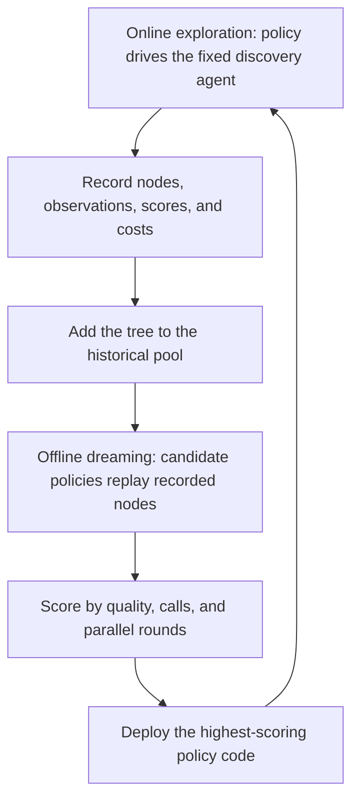

#### 2.2 Sticking point 1: how can a historical tree evaluate a new policy that never actually ran?
{: id="dream-rsi-replay-tree"}

  
<figcaption>Paper Figure 2: A candidate policy changes the visiting order, parallel grouping, and stopping point over recorded branches; replay feedback comes from nodes that were actually saved.</figcaption>

> **Example**: a real exploration recorded two branches. Branch A has three consecutive nodes scoring 0.2, 0.3, 0.3; branch B has two nodes scoring 0.4, 0.8. A fixed policy spends 3 calls digging into A before opening B; a new policy opens A, then B, and reaches 0.8 along B by its third call. Offline replay can compare the "best score versus calls" curves of the two **visiting orders** because the node outcomes are already recorded. If the new policy wanted to explore an unrecorded branch C, replay has no answer, and it must actually run online to find out.

During offline replay, a selected leaf reveals only the **single** child recorded for it in the original tree; if the root is selected, replay opens the earliest-created branch under the root that has not yet been revealed; if no unrevealed successor remains, it returns empty. Each non-empty batch counts as one round, replay runs for at most $K_2$ rounds, and it stops early when a batch is empty. Replay therefore has no shortcut for peeking at future nodes, and its evaluation range is strictly bounded by the historical tree.

#### 2.3 Sticking point 2: why not just pick the policy with the highest score?
{: id="dream-rsi-replay"}

The system replays the same policy once for each budget preference $\rho\in\{0,0.25,0.5,0.75,1\}$, producing quality-cost points: quality is the best score among revealed nodes divided by the best score recorded in that tree, and cost is the number of discovery-agent calls in the replay. It keeps only the Pareto points that no other point beats in both quality and cost, then scores them as follows (for tree $i$ and policy version $m$):

$$V_i^m=\frac{1}{B_i}\sum_{j=1}^{L}\left(\bar a_j-\bar a_{j-1}\right)\left(B_i-\bar n_j\right)-\lambda\,\frac{1}{\lvert\mathcal R\rvert}\sum_{\rho\in\mathcal R}\frac{k_\rho}{n_\rho}$$

The first term is a normalized hypervolume: $B_i$ is the number of evaluated nodes in that tree, and $\bar a_j$, $\bar n_j$ are the quality and call count of the $j$-th Pareto point, so higher quality with fewer calls gives a larger area. In the second term, $k_\rho$ is the number of sequential rounds and $n_\rho$ the number of calls; a larger ratio means less parallelism, and $\lambda$ sets the penalty strength. Finally, scores are averaged over all historical trees to give $V^m$, so the policy does not overfit the accidental structure of a single tree.

| Dimension | Final best score only | Dream-RSI replay score |
|---|---|---|
| Search cost | A late discovery of a high score can still earn full marks | Records the calls needed to reach each quality level |
| Parallel efficiency | Does not distinguish serial from parallel | Penalizes too many sequential decision rounds |
| Budget preference | A single cutoff point | Sweeps multiple budgets and compares the quality-cost frontier |

The policy-development agent repeatedly rewrites the executable scheduling code and includes the currently deployed policy in the candidate set, so the selected policy never scores lower than the old one on the **average replay score over the existing historical trees**. This is an offline selection property; it does not guarantee that scores on new tasks or in real online runs rise monotonically.

#### 2.4 Recursive evolution and inference flow
{: id="dream-rsi-loop"}

In online round $t$, the current policy drives the discovery agent to generate a new tree (using the full earlier history as context, kept separate from the tree under construction) for at most $K_1$ rounds; when the tree is finished it joins the historical pool. The offline phase then builds $M$ policy versions: the policy-development agent inspects the previous version's replay trajectories and scores plus feedback from earlier revisions, identifies successful decisions and recurring failures, rewrites the executable policy code into the next version, and re-evaluates it on all the same historical trees. The currently deployed policy $\pi^0$ always stays in the candidate set, and the version with the highest average replay score among the $M$ becomes the next online policy. Once deployed, the new policy may reach regions never visited before, and its new real results widen the coverage of the next round of replay. The base discovery model, candidate evaluator, and execution interface stay fixed; what changes is the code that orchestrates search resources. The paper does not complete this self-improvement loop by updating model weights.

---

### 3. Core Results / Findings
{: id="dream-rsi-results"}

The current arXiv v2 evaluates four task families and nine concrete tasks: four GPU kernels in KernelBench, three mathematical-optimization problems, Lasso path solving, and one agent-harness optimization. The main controlled baseline for scientific-discovery tasks, **Recursive Fixed Exploration**, uses the same discovery agent, evaluator, initial policy, and per-round budget, and only keeps the exploration policy from updating.

  
<figcaption>Paper Figure 4: (a) Final runtime (ms, lower is better) on six held-out Lasso datasets; (b) average runtime versus cumulative discovery calls across recursive rounds, labeled by round. On both backbones Dream-RSI finds faster solvers with fewer calls.</figcaption>

In the Lasso experiments, with Gemini 3.7 Flash the average runtime falls from **2516.7 ms** under the fixed policy to **2350.6 ms**, and discovery-agent calls drop from **3200** to **1879**; with Gemini 3.1 Pro the numbers are **3587.1 → 2931.0 ms** and **550 → 317 calls**. The paper also notes that on the Pro backbone the average gain is driven mainly by the RCV1 dataset, while the other five held-out datasets are actually slower, so the average should not be read as a gain on every dataset; on the Flash backbone, five of six datasets are faster. The solvers from both backbones beat sklearn and glmnet on all six held-out datasets. Compared with the 51,200 generations reported for SimpleTES, the Pro and Flash runs use roughly **162× and 27× fewer** discovery-agent calls and reach lower average runtime, but the backbone models differ, so this is not a strictly like-for-like comparison.

In round 1 the two methods are identical by design; afterward the fixed policy stays static, while Dream-RSI "dreams" again each round over the accumulated history. By the final round, Dream-RSI reaches lower average runtime with fewer calls on both backbones (Figure 4(b)). The paper analyzes the discovered solver: SimpleTES switches between LARS and coordinate descent depending on problem dimension, whereas this solver makes the active-set optimization itself adaptive, combining strong-rule screening with Cauchy–Schwarz KKT pruning, computing exact gradients only when necessary and refreshing in full once pruning stops being effective.

  
<figcaption>Paper Figure 3: Performance (1/ms, higher is better) versus number of generations on four GPU kernel tasks; VGG16 and LayerNorm reach similar performance with fewer generations, while ConvDiv and ConvMax improve performance under comparable budgets.</figcaption>

On KernelBench, VGG16 and LayerNorm reach similar performance with **2.43× and 1.79× fewer generations**; ConvDiv and ConvMax reach **2.09× and 1.44× higher performance** under comparable budgets, and surpass the PACEvolve baseline capped at two days. The kernel discovered for ConvDiv does not optimize convolution in isolation but restructures the operator chain around downstream pooling and reduction: adjacent convolution outputs are max-pooled immediately, width pooling and later reductions run directly on register-resident values, avoiding materialization of convolution and pooled feature maps, while linear operations such as scaling, averaging, and bias accumulation are deferred to a lightweight final reduction. In mathematical optimization, Sum–Difference scores **1.145427**, above SimpleTES's 1.143975 and the fixed policy's **1.144047**; Circle Packing reaches **2.635983**, tying the strongest compared result; Autocorrelation's **1.456375** is slightly worse than the fixed policy's **1.456001** (lower is better), so the advantage does not cover every task.

  
<figcaption>Paper Figure 5: (a) Best-so-far Terminal-Bench 2.1 score during discovery, rising from the 0.7247 seed to 0.8090; (b) full-suite comparison with Claude Code (CC), Terminus-Kira (TK), and Meta-Harness (MH).</figcaption>

The harness-optimization experiment follows the Meta-Harness setup, starts from Terminus-Kira as the seed harness, and evaluates on the 89 Terminal-Bench 2.1 tasks with two independent runs per task; the discovery agent, policy-development agent, and evaluation all use Claude Opus 4.8 (Claude Code). The full-suite score rises from **0.7247** to **0.8090**, above Claude Code's 0.75 and the reproduced Meta-Harness's 0.79 (Terminus-Kira scores 0.72). The paper runs no fixed-exploration control for this task, estimating that another full search would cost over USD 100,000, so the result mainly shows the final quality of the discovered harness and cannot isolate the contribution of replay-based policy improvement over fixed exploration.

**Further analysis (all on ConvDiv):**

- **Accumulated replay worlds help**: replaying over the full history gives performance **1.90** (786 calls), while using only the current round's history gives **1.59** (430 calls). The authors suggest that multiple trees help learn a more general policy and avoid being overly conservative when fitted to a single world.
- **Replay beats writing history into the prompt**: abstracting history into directional semantic guidance injected into the prompt lowers final performance for both Dream-RSI and the fixed policy (Figure 6); the authors argue such guidance may constrain exploration.
- **Exploration behavior adapts to the stage**: as performance improves, the number of attempts evaluated per round first drops from 110 to 50; once progress stalls it rises back to about 90 and further gains follow (Figure 7).

  
<figcaption>Paper Figure 6: On ConvDiv, replaying history (Dream-RSI) beats using history only as prompt guidance.</figcaption>

  
<figcaption>Paper Figure 7: (a) Round-best performance and (b) number of evaluated attempts across recursive rounds on ConvDiv.</figcaption>

---

### 4. Limitations
{: id="dream-rsi-limitations"}

Replay is deterministic for recorded nodes but cannot evaluate branches that were never reached; insufficient historical coverage, task-distribution shift, or stochastic execution can all open a gap between offline selection and real performance. The experiments focus on software and mathematical discovery, with no robot simulation or real-robot validation; transferring to embodied agents would require handling irreversible actions, state drift, and safety constraints. The paper uses discovery-agent calls as its main search-cost metric, and storing and replaying history also consumes storage and compute. The Lasso results further show that average gains may be driven by individual datasets, and that cross-backbone comparisons (for example against SimpleTES) are not like-for-like.

---

# References
{: id="参考资料"}

## Paper citations
{: id="论文引用"}

1. **HoloAgent-0** (2026). HoloAgent: A Closed-Loop Embodied Agent Operating System with Hierarchical Spatial Memory. arXiv: [2606.23565](https://arxiv.org/abs/2606.23565) · Code: [HorizonRobotics/HoloAgent](https://github.com/HorizonRobotics/HoloAgent)
2. **Pigey** (2026). Addressing the Orchestration Gap in Generalist Robots via Physical Agency. arXiv: [2607.21725](https://arxiv.org/abs/2607.21725)
3. **Thea** (2026). Towards the Harness of Embodied Agents. arXiv: [2608.11246](https://arxiv.org/abs/2608.11246) · Code: [EIT-HAI/Thea](https://github.com/EIT-HAI/Thea) · Project Page: [eit-hai.github.io/thea](https://eit-hai.github.io/thea)
4. **Zetta** (2026). An Efficient Closed-Loop Embodied Harness for Self-Evolving Physical Intelligence. arXiv: [2608.16590](https://arxiv.org/abs/2608.16590) · Project Page: [air-embodied-brain.github.io/zetta](https://air-embodied-brain.github.io/zetta)
5. **Show-Harness** (2026). Show-Harness: Just a VLM Agent Can Play Robots. arXiv: [2609.10522](https://arxiv.org/abs/2609.10522) · Project Page: [showlab.github.io/Show-Harness](https://showlab.github.io/Show-Harness)
6. **SPACE** (2026). Act More, Decide Less: Skill-Guided Adaptive Action Chunking for Long-Horizon LLM Agents. arXiv: [2609.02042](https://arxiv.org/abs/2609.02042)
7. **ABot-AgentOS** (2026). Universal robot Agent operating system and lifelong multi-modal memory system for embodied intelligence. arXiv: [2607.10350](https://arxiv.org/abs/2607.10350) · Project Page: [ABot-AgentOS](https://amap-cvlab.github.io/ABot-AgentOS)

8. **ABot-ER** (2026). ABot-ER: Unified Embodied Reasoning through Agentic Data–Model Co-Evolution. arXiv: [2610.18355v2](https://arxiv.org/abs/2610.18355v2) · Code: [amap-cvlab/ABot-ER](https://github.com/amap-cvlab/ABot-ER)
9. **Harness Robotic OS** (2026). Upgrade the quadruped inspection from "navigation stack" to "embodied agent runtime". arXiv: [2609.11225](https://arxiv.org/abs/2609.11225)
10. **NavHarness** (2026). NavHarness: Towards Lifelong Embodied Navigation. arXiv: [2609.34276](https://arxiv.org/abs/2609.34276) · Code: [billzhao1030/NavHarness](https://github.com/billzhao1030/NavHarness) · Project Page: [billzhao1030.github.io](https://billzhao1030.github.io)
11. **SuperNav** (2026). SuperNav: An Agentic Navigation System for Any Task in Any Scene. arXiv: [2610.12126](https://arxiv.org/abs/2610.12126) · Full analysis: [Extended VLN collection](/en/VLN-Papers-Extended/#supernav)
12. **VISTA** (2026). VISTA: A Visual Harness for Reasoning in an Interactive World. arXiv: [2610.02200](https://arxiv.org/abs/2610.02200) · Code: [joshhhhhan/VISTA](https://github.com/joshhhhhan/VISTA)
13. **RACE** (2026). When Should Agents Think? Adaptive Reasoning via Cross-Turn Estimation. arXiv: [2610.12061](https://arxiv.org/abs/2610.12061) · Code: [HututuAI/RACE](https://github.com/HututuAI/RACE)
14. **Agentic Robots** (2026). Towards Agentic Robots: Model, Data, Environment, and Harness. arXiv: [2610.20442](https://arxiv.org/abs/2610.20442) · Code: [chonghanqin/Awesome-Agentic-Robots](https://github.com/chonghanqin/Awesome-Agentic-Robots)
15. **Harness²** (2026). Harness²: Recursive Agent Harnessing for an Open World. arXiv: [2610.14224](https://arxiv.org/abs/2610.14224) · Code: [google-research/harness2](https://github.com/google-research/harness2) · Project Page: [harness2.github.io](https://harness2.github.io/)

16. **GPT-6-Astra-JRT** (2026). Joint Research Team. Has GPT-6-Astra Achieved Embodied Intelligence? arXiv: [2610.22471](https://arxiv.org/abs/2610.22471) · Project Page: [sensenova.ai](https://sensenova.ai/has-gpt-6-astra-achieved-embodied-intelligence)
17. **Evo²** (2026). Evo²: Evolving the Evolver through Weight-Harness Co-Evolution. arXiv: [2610.13025](https://arxiv.org/abs/2610.13025)
18. **Dream-RSI** (2026). Dream-RSI: Recursive Self-Improvement through Evolving Worlds. arXiv: [2609.14858v2](https://arxiv.org/abs/2609.14858) · Code: [zhengkid/Dream-RSI](https://github.com/zhengkid/Dream-RSI) · Project Page: [dream-rsi.com](https://dream-rsi.com/)

