# Introduction
{: id="引言"}

Large language models (LLMs) mark a new stage in artificial intelligence. BERT and GPT emerged in 2018; GPT-3 demonstrated striking few-shot learning capabilities in 2020; and ChatGPT brought conversational AI to a global audience in 2022. In just a few years, these models made major advances, approaching human performance on traditional NLP tasks while demonstrating capabilities in code generation, mathematical reasoning, and creative writing.

<figure class="survey-intro-figure">
  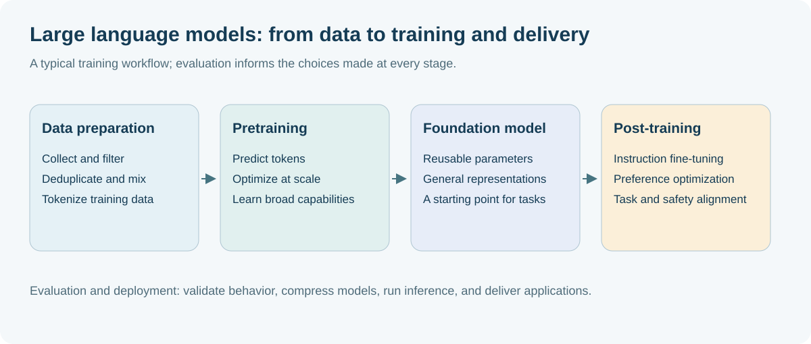
<figcaption>Figure: pretraining produces a base model, and post-training may include instruction fine-tuning and preference optimization. The figure shows common steps; the exact order varies by recipe. Compression, inference, and delivery belong to deployment engineering.</figcaption>
</figure>

## Why study LLM training
{: id="为什么关注大模型训练"}

Training is where a large model's capabilities come from. A high-performing model depends on:
- **Massive high-quality data**: trillions of carefully processed tokens
- **Large-scale compute**: thousands of GPUs training in parallel for months
- **Carefully designed training strategies**: a complete pipeline from pretraining to alignment
- **Solid engineering**: distributed training, memory optimization, and stability safeguards

Yet knowledge about LLM training is scattered across papers, blogs, and code repositories, and is rarely organized systematically. **This survey aims to fill that gap.**

## What this survey covers
{: id="本文内容"}

This survey systematically covers the core techniques of LLM training:

1. **Overview of LLM training**: core concepts, how the field evolved, and the main components
2. **Pretraining**: objectives, data sources and mixing, key hyperparameters, MoE, multi-token prediction, sparse/hybrid attention, and mid-training
3. **Supervised fine-tuning**: SFT objectives, data sources, and recent synthesis and quality-filtering techniques
4. **Preference alignment**: RLHF, DPO, and GRPO, the training paradigm of reasoning models, and on-policy distillation
5. **Post-training and catastrophic forgetting**: why models forget during continual learning and how to mitigate it
6. **Distributed training**: data, tensor, and pipeline parallelism, sequence parallelism, and ZeRO sharding
7. **Training optimization**: AdamW, Muon, and other optimizers, learning-rate schedules, and Flash Attention
8. **Quantization**: PTQ and QLoRA low-bit fine-tuning, and accuracy/performance trade-offs across formats
9. **Data engineering**: best practices for collection, cleaning, deduplication, and mixing
10. **Evaluation and benchmarks**: knowledge, reasoning, code, long-context, safety, and agent evaluation
11. **Practical guide**: compute estimation, training monitoring, OOM debugging, and checkpoint recovery
12. **FAQ**: common training problems and fine-tuning and alignment practice
13. **Toward multimodal models and agents**: VLM architecture, two-stage training, agent tool use, and agentic RL
14. **References**: key papers, core open-source projects, and a learning path

## Intended readers
{: id="目标读者"}

- **Researchers**: understand the full technology stack of LLM training
- **Engineers**: learn the engineering practices and optimizations used in real training runs
- **Students**: build a systematic understanding of LLM training
- **Practitioners**: keep up with recent technical progress and industry trends

> **How to read this survey**
>
> This survey tries to balance theoretical depth with practical guidance: it explains the core principles and also gives code examples and engineering solutions. The code is meant to illustrate principles, and some of it is schematic, omitting details such as data loading. Figures for cost, GPU memory, and accuracy are mostly order-of-magnitude estimates that depend on model version, hardware, and evaluation protocol; when reproducing results, rely on the original papers or official documentation.

---

## Reading guide
{: id="快速导航"}

The survey has 14 main chapters. Read selectively according to your needs:

|Chapter|Content|Suitable for|Reading time|
|------|------|---------|---------|
|**1. Overview**|What LLM training is and how it evolved|All readers|10 minutes|
|**2. Pretraining**|Objectives, data sources, key hyperparameters, MoE, and mid-training|All readers ⭐ must read|30 minutes|
|**3. Supervised fine-tuning**|SFT objectives, data construction, synthesis, and filtering|All readers ⭐ must read|15 minutes|
|**4. Preference alignment**|RLHF, DPO, GRPO, and RL for reasoning models|All readers ⭐ must read|15 minutes|
|**5. Post-training and forgetting**|Catastrophic forgetting, experience replay, and Self-Output|Engineers, researchers ⭐ recommended|15 minutes|
|**6. Distributed training**|DP, TP, PP, ZeRO, and other parallelism techniques|Engineers, researchers|20 minutes|
|**7. Training optimization**|Optimizers (including Muon), learning rate, Flash Attention|Engineers|15 minutes|
|**8. Quantization**|GPTQ/AWQ quantization and QLoRA low-bit fine-tuning|Engineers, researchers ⭐ recommended|20 minutes|
|**9. Data engineering**|Data collection, cleaning, deduplication, and mixing|Engineers, researchers|25 minutes|
|**10. Evaluation**|MMLU, GSM8K, and other benchmark suites|Researchers, practitioners|15 minutes|
|**11. Practical guide**|Hardware, cost estimation, monitoring, and checkpoint recovery|Engineers ⭐ must read|30 minutes|
|**12. FAQ**|Common training problems and fine-tuning/alignment questions|All readers ⭐ recommended|20 minutes|
|**13. VLMs and agents**|Vision-language model architecture, two-stage training, and agent tool-use training|Engineers, researchers|20 minutes|
|**14. References**|Key papers, flagship open-source projects, and a learning path|All readers|15 minutes|

> **Suggested reading paths**
>
> - **Beginners**: "1. Overview" → "2. Pretraining / 3. SFT / 4. Alignment" → "12. FAQ"
> - **Engineers**: "11. Practical guide" → "6. Distributed training" → "5. Post-training and forgetting"
> - **Researchers**: "2. Pretraining / 3. SFT / 4. Alignment" → "5. Post-training and forgetting" → "10. Evaluation"
> - **Full study**: read everything in order (about 3.5 hours)

---

# 1. LLM training basics
{: id="1-大模型训练基础概述"}

## 1.1 What LLM training is
{: id="11-什么是大模型训练"}

LLM training is the process of using massive amounts of text and deep learning to train neural networks with billions or even trillions of parameters. These models are usually based on the Transformer architecture and learn both the statistical regularities and the meaning of language.

Training aims to give the model:
- **Language understanding**: the syntax, semantics, and context of natural language
- **Knowledge**: world knowledge learned from the training data
- **Reasoning**: logical inference and problem solving from the information at hand
- **Instruction following**: understanding and carrying out a wide range of user instructions

> **Key facts**
>
> - **Scale**: from about a billion to trillions of parameters
> - **Data**: training data usually reaches trillions of tokens
> - **Time**: a full training run takes weeks to months
> - **Cost**: training a medium or large model costs from hundreds of thousands to millions of dollars

## 1.2 How it evolved
{: id="12-演进历程"}

LLM training has moved from small-scale experiments to industrial production. The timeline below lists representative work by year; the subsections that follow summarize each stage:

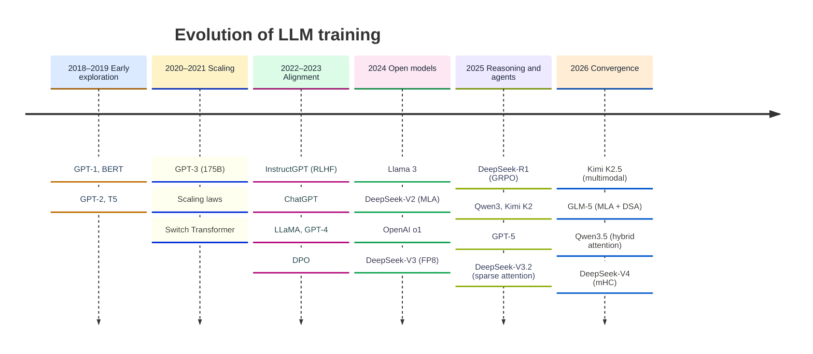

### 1.2.1 Early exploration (2018–2019)
{: id="121-早期探索20182019"}
- GPT-1, BERT, and similar models validated the pretrain-then-fine-tune paradigm
- Model scale: millions to hundreds of millions of parameters
- Key breakthroughs: self-supervised pretraining and the Transformer architecture

### 1.2.2 Scaling (2020–2021)
{: id="122-规模化20202021"}
- GPT-3 scaled models up to 175 billion parameters
- Emergent abilities were observed
- Few-shot learning improved markedly

### 1.2.3 Alignment and applications (2022–2023)
{: id="123-对齐与应用20222023"}
- InstructGPT and ChatGPT introduced RLHF (reinforcement learning from human feedback)
- The key shift from models that merely work to models that are pleasant to use
- LLMs started to be deployed widely in real applications

### 1.2.4 Open source (2024)
{: id="124-开源与民主化2024"}
- Open models such as LLaMA and Mistral developed rapidly
- Training efficiency kept improving and costs kept falling
- Multimodal and long-context capabilities kept growing

### 1.2.5 Reasoning and efficiency (2025–2026)
{: id="125-推理模型与效率20252026"}
- **Reasoning models become a paradigm**: OpenAI o1/o3 and DeepSeek-R1 (followed by the V3.x series) established test-time compute scaling as a dimension alongside training-time scaling laws. Long chain-of-thought (long CoT) plus RL (GRPO and its successors) became the standard recipe for strong reasoning models
- **Chinese labs close the gap**: the Qwen3 series introduced a hybrid thinking/non-thinking mode (one model switches between deliberate reasoning and fast answers); Kimi K2 pairs a trillion-parameter MoE with strong agentic (tool-calling) ability; MiniMax, Zhipu GLM, StepFun, and others keep iterating
- **Closed flagships keep advancing**: the GPT-5 series, Claude 4.x (Opus/Sonnet/Haiku), and the Gemini series compete on reasoning, long context, and agent capabilities
- **Architecture innovation**: MLA (multi-head latent attention), production FP8 training, and multi-token prediction (DeepSeek-V3) sharply cut the training and inference cost of models with hundreds of billions of parameters. Sparse attention (DSA in DeepSeek-V3.2) and hybrids that mix linear attention with a few full-attention layers (MiniMax-01, Qwen3-Next, Kimi Linear) push long-context cost down further (Section 2.6.4)
- **More refined training recipes**: a separate mid-training stage now sits between pretraining and post-training, annealing on high-quality math, code, and long-context data (Section 2.6.5). The Muon optimizer has been shown to replace AdamW at trillion-parameter scale (Kimi K2, Section 7.1.4)
- **In the first half of 2026, these techniques began to converge**: Kimi K2.5 mixes vision tokens into pretraining, making it natively multimodal; GLM-5 adopts both MLA and DSA; Qwen3.5 brings Gated DeltaNet hybrid attention into its main line. DeepSeek-V4 (1.6T total and 49B active parameters, 1M context) was pretrained on 32T tokens, uses the Muon optimizer and manifold-constrained hyper-connections (mHC) to improve residual connections, handles long context with sparse attention over a compressed KV cache, and finishes post-training with on-policy distillation, bringing most of the new techniques from Chapters 2, 4, and 7 of this survey together in one model
- **Agents become the new focus**: models shift from chat assistants to agents that use tools and finish multi-step tasks on their own. Training objectives expand from single-turn Q&A to multi-turn tool use and long-horizon planning, and RL environments grow from math and code verifiers to executable repositories, terminals, and browser sandboxes (Section 13.6.4)

## 1.3 Three training stages
{: id="13-三大训练阶段"}

Modern LLM training follows a three-stage paradigm, **pretraining → supervised fine-tuning → preference alignment**, which has become the standard pipeline for mainstream models such as GPT-4, Claude, Gemini, and LLaMA.

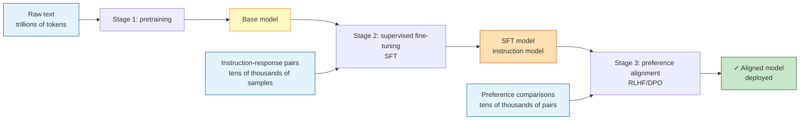

Section 1.3.4 compares the data, compute, and hyperparameters of the three stages.

### 1.3.1 Pretraining
{: id="131-预训练"}

The model learns the statistical regularities, grammar, and world knowledge of language from massive unlabeled text, producing a **base model**.

**Characteristics**:
- **Largest data scale**: trillions of tokens (LLaMA-3 used 15T tokens)
- **Longest training time**: weeks to months on thousands of GPUs
- **Highest cost**: 80-90% of total training cost
- **Objective**: next-token prediction

**Resulting ability**: the model can continue text but is poor at answering questions and following instructions.

### 1.3.2 Supervised fine-tuning (SFT)
{: id="132-监督微调sft"}

Training on high-quality instruction-response pairs turns the base model into an **SFT model (instruction model)** that understands instructions.

**Characteristics**:
- **Small data**: 10k-100k high-quality samples
- **Short training**: hours to days
- **Lower cost**: 5-10% of total cost
- **Objective**: instruction following

**Resulting ability**: the model understands and carries out user instructions and holds multi-turn conversations.

### 1.3.3 Preference alignment
{: id="133-偏好对齐"}

Human or AI feedback is used to shape the model's behavior so that it better matches human expectations and values, producing an **aligned model**.

**Characteristics**:
- **Data**: tens of thousands of preference comparison pairs
- **Training time**: hours to days (large-scale RL for reasoning models can take weeks)
- **Cost**: 5-10% of total cost
- **Methods**: RLHF, DPO, RLAIF, GRPO, and others

**Resulting ability**: outputs are more helpful, safer, and more consistent with human values.

### 1.3.4 Comparing the three stages
{: id="134-三阶段总结对比"}

|Stage|Pretraining|Supervised fine-tuning|Preference alignment|
|------|--------|----------|----------|
|**Goal**|Learn the basics of language|Teach instruction following|Match human preferences|
|**Data type**|Unlabeled text|Instruction-response pairs|Preference comparisons|
|**Data size**|Trillions of tokens|Tens to hundreds of thousands of samples|Tens to hundreds of thousands of comparisons|
|**Training time**|Weeks to months|Hours to days|Hours to days|
|**Compute**|Thousands of GPUs|Dozens to hundreds of GPUs|Dozens to hundreds of GPUs|
|**Share of cost**| ~80-90% | ~5-10% | ~5-10% |
|**Learning rate**| 1e-4 ~ 3e-4 | 1e-5 ~ 5e-5 | 5e-7 ~ 5e-6 |
|**Epochs**|<1 epoch (data too large)| 1-3 epochs | 1-3 epochs |
|**Output model**| Base Model | SFT Model | Aligned Model |

**Key takeaways**:
- Pretraining is where capability comes from (about 90% of the cost)
- SFT unlocks those capabilities (data quality matters more than quantity)
- Alignment secures the user experience (indispensable)

## 1.4 Core components
{: id="14-核心组成要素"}

A complete LLM training system has the following core components:

### 1.4.1 Data
{: id="141-数据"}
- **Pretraining data**: web pages, books, code, academic papers, and more
- **Fine-tuning data**: instruction-response pairs and dialogue data
- **Preference data**: human-annotated preference comparisons
- **Data processing**: cleaning, deduplication, quality filtering, and toxicity detection

### 1.4.2 Model architecture
{: id="142-模型架构"}
- **Base architecture**: Transformer (encoder, decoder, or encoder-decoder)
- **Positional encoding**: absolute and relative position encoding, RoPE, ALiBi
- **Attention**: multi-head attention, grouped-query attention, multi-query attention
- **Normalization**: LayerNorm, RMSNorm, Pre-Norm vs Post-Norm
- **Activation functions**: GELU, SwiGLU, GeGLU

<div align="center">
  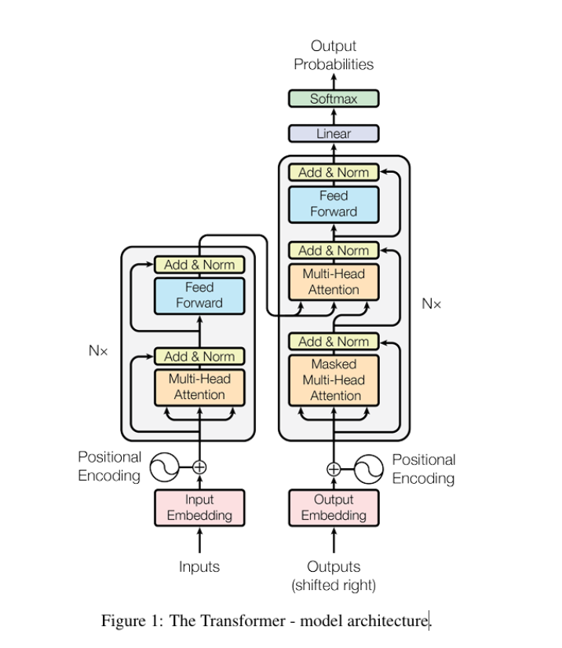
<figcaption>Figure: the Transformer architecture (source: Figure 1 of "Attention is All You Need")</figcaption>
</div>

### 1.4.3 Optimizers and training strategy
{: id="143-优化器与训练策略"}
- **Optimizers**: AdamW, Adafactor, Lion
- **Learning-rate schedules**: warmup, cosine decay, constant
- **Gradient handling**: gradient clipping, gradient accumulation
- **Regularization**: dropout, weight decay

### 1.4.4 Distributed training
{: id="144-分布式训练"}
- **Data parallelism**: DDP (Distributed Data Parallel)
- **Tensor parallelism**: Megatron-LM tensor parallelism
- **Pipeline parallelism**: pipeline stages with the 1F1B schedule
- **Sequence parallelism**: splitting along the sequence dimension
- **Hybrid parallelism**: 3D parallelism (data + tensor + pipeline)
- **Optimizer-state sharding**: ZeRO-1/2/3 (DeepSpeed)

### 1.4.5 Infrastructure
{: id="145-计算基础设施"}
- **Hardware**: GPU clusters (A100, H100, etc.), TPUs, and dedicated AI accelerators
- **Interconnect**: InfiniBand, NVLink, PCIe
- **Storage**: high-performance distributed storage
- **Monitoring and logging**: TensorBoard, Weights & Biases, MLflow

## 1.5 Main challenges
{: id="15-主要挑战"}

> **Overview**
>
> LLM training is a demanding systems problem that balances compute, data quality, training stability, and alignment. Training a strong model takes not only technical skill but also accumulated engineering experience.

### 1.5.1 Compute and cost
{: id="151-计算资源与成本"}

Training LLMs takes enormous compute:
- Training a GPT-3-class model costs on the order of millions of dollars
- Thousands of high-end GPUs must run in parallel for months
- Carbon emissions and energy use are real concerns
- Reducing training cost has become a central challenge

### 1.5.2 Data quality and scale
{: id="152-数据质量与规模"}

High-quality data is the foundation of model performance:
- Web data contains noise, bias, and harmful content
- Deduplication, cleaning, and quality control are hard engineering problems
- Privacy and copyright issues
- High-quality human-labeled data is expensive

### 1.5.3 Training stability
{: id="153-训练稳定性"}

Large-scale training is prone to instability:
- Loss spikes (the loss suddenly jumps)
- Exploding or vanishing gradients
- Numerical instability
- Synchronization problems in distributed training

### 1.5.4 Alignment and safety
{: id="154-模型对齐与安全"}

Making the model behave as humans expect:
- How to capture human preferences accurately
- Avoiding harmful, biased, or inaccurate output
- Reward hacking (the model exploits flaws in the reward function)
- Keeping alignment stable over time

### 1.5.5 Evaluation and benchmarking
{: id="155-评估与基准测试"}

Measuring model capability comprehensively:
- Existing benchmarks can become saturated
- Creativity and open-ended abilities are hard to quantify
- Multilingual and multimodal evaluation is complex
- Benchmark results can differ from performance in real applications

### 1.5.6 Unpredictable emergence
{: id="156-涌现能力的不可预测性"}

Scaling up brings unknowns:
- Some abilities appear only beyond a certain scale
- Model behavior is hard to predict in advance
- Unexpected capabilities or problems may appear
- Scaling laws still need systematic understanding

---

# 2. Pre-training
{: id="2-预训练"}

Pretraining is the foundation of LLM training: the model learns the statistical regularities of language and world knowledge from massive unlabeled text.

> **About this chapter**
>
> Pretraining is the **most expensive, longest, and technically hardest** stage of the whole pipeline, accounting for 80-90% of total cost. This chapter covers pretraining objectives, data processing, training techniques, and recent advances, to show how a base model is trained from scratch.

## 2.1 The pre-training pipeline
{: id="21-预训练完整流程概览"}

The figure below shows the full process from raw data to a base model:

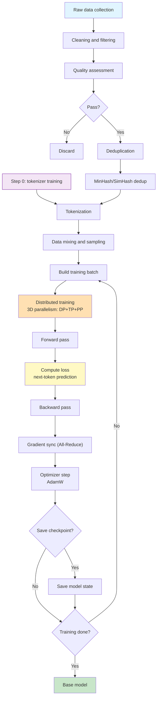

**Notes**:
1. **Data preparation** (A-I): 20-30% of overall time, covering collection, cleaning, deduplication, **tokenizer training**, and tokenization
2. **Training iterations** (J-S): 70-80% of overall time, built around the forward-backward-update loop
3. **Checkpointing**: save every 1000-5000 steps; a full run is usually 100k-500k steps

## 2.2 Tokenizer training
{: id="22-分词器训练"}

Before training the model, we have to decide how it "reads" text. The tokenizer splits continuous text into the smallest units the model works with: tokens.

### 2.2.1 Why train a tokenizer
{: id="221-为什么需要训练分词器"}
Using characters or whole words directly leads either to an oversized vocabulary (hard to train) or to tokens that carry too little information (sequences become too long). Modern LLMs therefore use **subword** tokenization, such as **BPE (Byte Pair Encoding)**.

### 2.2.2 Vocabulary size
{: id="222-词表大小"}
* **Large vocabulary (e.g. 100k+)**:
    * Pro: each token carries more information, so sequences are shorter and inference is faster.
    * Con: the embedding layer becomes huge, and rare tokens are hard to train well.
* **Small vocabulary (e.g. 32k)**:
    * Pro: a small embedding layer and efficient use of parameters, which suits small models.
    * Con: the same sentence produces more tokens, increasing compute.

> **Lesson from MiniMind**: for models under 500M parameters, keep the vocabulary small (MiniMind uses a BPE vocabulary of only 6,400; 32k is a common compromise). Otherwise the embedding layer eats most of the parameters and the vectors of rare tokens are barely updated.

### 2.2.3 Training a tokenizer
{: id="223-分词器训练实战"}

With Hugging Face's `tokenizers` library you can quickly train a GPT/Llama-style **byte-level BPE** tokenizer. Byte-level BPE starts from an alphabet of 256 bytes, so no text in any language (including Chinese and emoji) is ever out of vocabulary (OOV). It is the mainstream choice for today's LLMs:

```python
from tokenizers import Tokenizer, decoders, models, pre_tokenizers, trainers

# 1. Initialize a byte-level BPE model
tokenizer = Tokenizer(models.BPE())
tokenizer.pre_tokenizer = pre_tokenizers.ByteLevel(add_prefix_space=False)
tokenizer.decoder = decoders.ByteLevel()

# 2. Configure the trainer: the 256 bytes form the initial alphabet, so there is no OOV
trainer = trainers.BpeTrainer(
    vocab_size=32000,
    min_frequency=2,
    special_tokens=["<|endoftext|>", "<|im_start|>", "<|im_end|>"],
    initial_alphabet=pre_tokenizers.ByteLevel.alphabet(),
)

# 3. Train the tokenizer
files = ["data/corpus_1.txt", "data/corpus_2.txt"]
tokenizer.train(files, trainer)

# 4. Save the tokenizer
tokenizer.save("my_tokenizer.json")
```

Section 9.5 compares the algorithms (BPE / WordPiece / Unigram) and discusses vocabulary size and special-token design.

## 2.3 Pretraining objective function
{: id="23-预训练目标函数"}

The core of pretraining is choosing an objective that lets the model learn the rules of language from unlabeled text.

### 2.3.1 Autoregressive language modeling
{: id="231-自回归语言建模"}

**Core idea**: given the preceding text, predict the next token (next-token prediction).

**Formulation**:

For a text sequence $\mathbf{x} = (x_1, x_2, \ldots, x_T)$, training maximizes:

$$
\mathcal{L}_{\text{AR}} = \sum_{t=1}^{T} \log P(x_t \mid x_1, x_2, \ldots, x_{t-1}; \theta)
$$

where $\theta$ denotes the model parameters.

**Training details**:
- **Teacher forcing**: the true preceding text is used as input during training
- **Causal masking**: attention can only see tokens to the left (the past)
- **Loss**: cross-entropy at every position, averaged

**Representative models**:
- **GPT series** (GPT-3, GPT-4): decoder-only architecture
- **LLaMA series** (LLaMA-2, LLaMA-3): high-performing open models
- **PaLM, Gemini**: Google's large models

**Advantages**:
- Strong generation, well suited to continuation and dialogue
- Simple architecture that scales easily to very large sizes
- Efficient training

**Training loop sketch**:
```python
import torch.nn.functional as F

for batch in dataloader:
    input_ids = batch['input_ids']      # [batch_size, seq_len]

    logits = model(input_ids).logits    # [batch_size, seq_len, vocab_size]

    # Next-token prediction: the output at position t predicts token t+1
    # outputs for inputs [x1, x2, x3, x4] are aligned with targets [x2, x3, x4]
    shift_logits = logits[:, :-1, :]
    shift_labels = input_ids[:, 1:]

    loss = F.cross_entropy(
        shift_logits.reshape(-1, shift_logits.size(-1)),
        shift_labels.reshape(-1),
    )
    loss.backward()
    optimizer.step()
    optimizer.zero_grad()
```

### 2.3.2 Masked language modeling
{: id="232-掩码语言建模"}

**Core idea**: randomly mask some tokens and predict the masked content.

**Formulation**:

$$
\mathcal{L}_{\text{MLM}} = \sum_{i \in \mathcal{M}} \log P(x_i \mid \mathbf{x}_{\backslash \mathcal{M}}; \theta)
$$

Here $\mathcal{M}$ is the set of masked positions, and $$\mathbf{x}_{\backslash \mathcal{M}}$$ denotes all tokens except the masked ones.

**Masking strategy** (as in BERT):
- Randomly select 15% of tokens, then:
  - 80% are replaced with `[MASK]`
  - 10% are replaced with a random token
  - 10% are left unchanged

**Representative models**:
- **BERT**: bidirectional encoder; the pretrain-then-fine-tune paradigm
- **RoBERTa**: an optimized BERT (more data, larger batches, no NSP)
- **DeBERTa**: disentangled attention

**Advantages**:
- Bidirectional context (sees both left and right)
- Suited to understanding tasks (classification, information extraction)

**Disadvantages**:
- A mismatch between pretraining and fine-tuning ([MASK] appears in pretraining but not in fine-tuning)
- Weak generation

### 2.3.3 Mixed objectives and other variants
{: id="233-混合目标与其他变体"}

#### 2.3.3.1 Encoder-Decoder architecture (T5, BART)
{: id="2331-encoder-decoder-架构t5bart"}
- **Span corruption**: mask contiguous spans of tokens
- **Sequence-to-sequence tasks**: translation, summarization

#### 2.3.3.2 Prefix Language Modeling(PrefixLM)
{: id="2332-prefix-language-modelingprefixlm"}
- **UL2**: combines bidirectional and unidirectional modeling
- **Flexible**: bidirectional attention over the prefix, unidirectional over the rest

#### 2.3.3.3 Fill-in-the-Middle(FIM)
{: id="2333-fill-in-the-middlefim"}
- **For code models**: predict missing code in the middle of a file
- **Examples**: CodeLlama, StarCoder
- **Format**: `[prefix] <FILL> [suffix] → [middle content]`

## 2.4 Pretraining data
{: id="24-预训练数据"}

Pretraining data sets the boundaries of what a model knows and how its abilities are distributed. A typical data pipeline:

1. **Collection**: Common Crawl web pages, books, code (GitHub), academic papers (arXiv), encyclopedias (Wikipedia), Q&A communities (StackExchange), and more
2. **Filtering**: language identification, heuristic rules, quality classifiers, toxicity detection, and removal of personal information (PII)
3. **Deduplication**: exact hash deduplication plus MinHash/LSH fuzzy deduplication, and deduplication against evaluation sets to prevent leakage
4. **Tokenization**: convert text into token sequences with the tokenizer trained in Section 2.2
5. **Mixing and sampling**: set a mixing ratio for each source, upsampling small high-quality sources and downsampling large low-quality ones

Chapter 9, "[Data Engineering ](#9-数据工程)", covers the methods, tools, and trade-offs of each step (including the actual mixtures of GPT-3, LLaMA, and other models). Three conclusions are worth remembering:

- **Balance quantity and quality**: the Chinchilla scaling law shows that, for a fixed compute budget, parameters and training tokens should grow in proportion (about 20 tokens per parameter); FineWeb-Edu and the Phi series show that better data can sharply reduce the tokens needed for the same result
- **Deduplication is crucial**: duplicated data increases memorization, wastes compute, and can leak evaluation sets
- **The mixture shapes capabilities**: the share of code and math directly affects reasoning, and the multilingual share affects cross-lingual generalization

## 2.5 Key pretraining techniques
{: id="25-预训练的关键技术"}

### 2.5.1 Learning rate scheduling
{: id="251-学习率调度"}

The most common pretraining schedule is **linear warmup + cosine decay**; for continual pretraining, where more data may be added at any time, **WSD (Warmup-Stable-Decay)** is increasingly used. Section 7.2 gives the formulas and compares the two; this section only covers practical settings for pretraining.

<div align="center">
  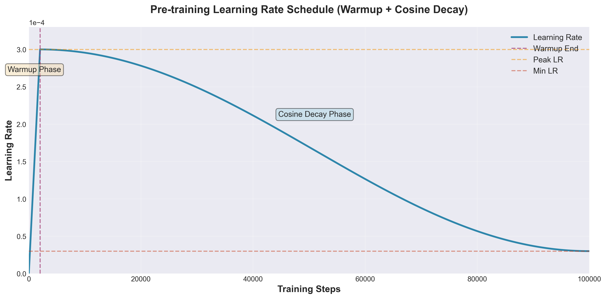
<figcaption>Figure: learning-rate curve with linear warmup and cosine decay (peak 3e-4, minimum learning rate 10% of the peak)</figcaption>
</div>

**Key parameters**:
- **Warmup steps**: usually 2,000-10,000 steps (1-2% of total steps)
- **Peak learning rate**: depends on model size
  - Small models (<1B parameters): 3e-4 ~ 1e-3
  - Medium models (1-10B parameters): 1e-4 ~ 3e-4
  - Large models (10B+ parameters): 6e-5 ~ 2e-4
- **Decay**: cosine annealing is the most common
- **Minimum learning rate**: usually 10% of the peak

**Why warmup matters**:
- Avoids gradient explosion early in training
- Lets the optimizer state (Adam's moments) stabilize gradually
- Essential for training large models

**Learning rate vs. batch size** (linear scaling rule):

$$
\text{lr}_{\text{new}} = \text{lr}_{\text{base}} \times \frac{\text{batch}_{\text{new}}}{\text{batch}_{\text{base}}}
$$

For example, a base configuration of lr=1e-4 with batch=256 → scaled to batch=2048 → lr=8e-4.

Note that the linear scaling rule comes from large-batch SGD experience (Goyal et al., 2017). For Adam-style optimizers, the learning rate usually grows closer to the square root of the batch size, and returns diminish quickly beyond the "critical batch size", so actual settings should still be confirmed with small-scale experiments.

### 2.5.2 Batch Size
{: id="252-批次大小batch-size"}

Batch size directly affects training efficiency and gradient quality. Measured in tokens (rather than samples), the mainstream practice is to **increase the batch size gradually during training**.

#### 2.5.2.1 Why is a large Batch Size needed?
{: id="2521-为什么需要大-batch-size"}

- **Compute efficiency**: higher GPU utilization and more efficient matrix multiplication
- **Gradient quality**: large batches give lower-variance gradient estimates and more stable update directions
- **Communication efficiency**: fewer steps in distributed training means fewer All-Reduce operations

> Note: an excessively large batch can hurt generalization (the sharp-minima problem), and the learning rate must be adjusted accordingly (see the linear scaling rule above).

#### 2.5.2.2 Typical scale (in tokens/batch)
{: id="2522-典型规模以-tokensbatch-计"}

|Model| Batch Size(tokens)|Notes|
|------|-------------------|------|
| GPT-3 175B |32K → 3.2M (gradually increasing)|Small batches early in training, large batches later|
| LLaMA-2 | 4M tokens |Fixed throughout|
| PaLM 540B |1M → 4M (gradually increasing)|Doubled in three steps as training progresses|
| Chinchilla 70B | 1.5M → 3M |Doubled midway through training|

#### 2.5.2.3 Gradient Accumulation
{: id="2523-梯度累积gradient-accumulation"}

When a single GPU cannot hold the target batch, gradients are accumulated over several small batches to simulate it:

```python
optimizer.zero_grad()
for step, batch in enumerate(dataloader):
    loss = model(batch) / accumulation_steps   # scale the loss
    loss.backward()                             # accumulate gradients
    if (step + 1) % accumulation_steps == 0:
        optimizer.step()                        # update once every N steps
        optimizer.zero_grad()
```

**Equivalence**: effective batch size = per-GPU batch size × gradient accumulation steps × number of data-parallel GPUs. Section 7.3.2 shows how to skip gradient synchronization for the first N−1 steps with `no_sync()` in distributed training.

---

### 2.5.3 Context length
{: id="253-上下文长度"}

#### 2.5.3.1 Why start with a short context?
{: id="2531-为什么从短上下文开始"}

- Attention costs $O(n^2)$: as sequences get longer, memory and compute grow sharply
- Early in training the model has not yet learned long-range dependencies, so long sequences bring little benefit
- Building solid language understanding at short context first makes the later extension far more efficient

#### 2.5.3.2 Progressive expansion strategy
{: id="2532-渐进式扩展策略"}

```
Main training:           4K–8K tokens  → most training tokens (early models used 2K, Llama 3 used 8K)
Long-context extension:  32K → 128K    → lengthened gradually over several stages, adding only a few tokens
```

Llama 3, for example, first completed about 15T tokens of pretraining at 8K context, then extended the context to 128K over 6 stages, using about 800B tokens in total for the extension (Llama 3 technical report).

#### 2.5.3.3 Extending position encodings
{: id="2533-位置编码扩展技术"}

**Position Interpolation(PI)**

RoPE's rotation frequencies are tuned to a fixed maximum length $L_{\text{train}}$, and the position encoding breaks down beyond it. PI rescales position indices from $[0, L_{\text{target}}]$ back into $[0, L_{\text{train}}]$:

$$\text{pos}_{\text{new}} = \text{pos} \times \frac{L_{\text{train}}}{L_{\text{target}}}$$

Advantage: simple to implement; about 1000 steps of fine-tuning are enough for a 2–4× context extension.

**YaRN(Yet another RoPE extension)**

PI scales all frequency components uniformly, which loses information in the high-frequency components. YaRN refines this:
- **Low-frequency components**: scaled with PI (they carry long-range dependencies)
- **High-frequency components**: left uninterpolated (they carry fine-grained short-range features)
- **Temperature scaling**: rescales attention logits to prevent entropy collapse

Result: extends to 128k context with only a small amount of fine-tuning data, and is more accurate than PI.

**ALiBi(Attention with Linear Biases)**

Instead of position encodings, ALiBi adds a linear penalty proportional to distance directly to the attention scores:

$$\text{Attention score}_{ij} = q_i \cdot k_j^T - m \cdot (i - j)$$

where $m$ is a per-head slope (a hyperparameter). Advantage: no maximum length needs to be fixed during training, and the model extrapolates at inference time without further fine-tuning.

#### 2.5.3.4 Distributed engineering for very long contexts
{: id="2534-超长上下文分布式工程优化"}

As demand for long context grows (from 32K to millions of tokens), single-GPU optimizations are no longer enough. The main distributed techniques are:

1. **Ring Attention Mechanism**
   * **Principle**: the sequence dimension is split across $P$ GPUs arranged in a ring. Each GPU holds only a local chunk of queries; when computing attention, key and value blocks are passed around the ring buffer from GPU to GPU, and each GPU computes its local attention results.
   * **Benefit**: the $O(N^2)$ memory cost of attention is spread across nodes, so memory scales linearly with the number of GPUs, making it possible to train on sequences of millions or even tens of millions of tokens.
2. **RoPE Base Frequency Scaling**
   * **Principle**: when the context is extended, position vectors near the end of a long sequence can alias or drift in frequency if the original position encoding is used unchanged. Besides interpolation (PI/YaRN), a common practice is to greatly increase the RoPE base frequency $\theta$ (e.g. 10,000 for Llama 2 and 500,000 for Llama 3).
   * **Effect**: lengthens the wavelength of every frequency component so distant positions remain distinguishable, reducing attention degradation on long text.
3. **LongLoRA(Shifted Sparse Attention)**
   * **Principle**: during training, global attention is replaced with grouped local attention (with group boundaries shifted on half of the heads); standard attention is restored at inference. Only the LoRA weights and the embedding/norm layers are trained.
   * **Effect**: extends 7B–70B models to 32K–100K context with modest compute.

---

### 2.5.4 Mixed precision training
{: id="254-混合精度训练"}

Computing in low-precision floating point (FP16/BF16) while keeping the optimizer state in FP32 saves GPU memory without sacrificing training stability.

#### 2.5.4.1 Floating-point formats compared
{: id="2541-浮点格式对比"}

|Format|Sign bits|Exponent bits|Mantissa bits|Max value|Suitability for LLM training|
|------|--------|--------|--------|--------|--------------|
| FP32 | 1 | 8 | 23 | ~3.4×10³⁸ |The reference: stable but memory-hungry|
| FP16 | 1 | 5 | 10 | ~65504 |Narrow range; prone to overflow/underflow|
| **BF16** | **1** | **8** | **7** | **~3.4×10³⁸** |**First choice for LLMs: same range as FP32**|
| FP8 (E4M3) | 1 | 4 | 3 | ~448 |Native on H100; the new option for inference and training|

**Key point**: BF16 has as many exponent bits as FP32, so gradients that are very large or very small do not overflow. It is the preferred format for LLM training today.

#### 2.5.4.2 FP16 training requires Loss Scaling
{: id="2542-fp16-训练需要-loss-scaling"}

FP16's maximum value is about 65504. Very small gradients (< 2⁻²⁴) underflow to 0, so the parameters stop updating. The fix:

```python
import torch

scaler = torch.amp.GradScaler("cuda")

with torch.autocast("cuda", dtype=torch.float16):   # forward pass in FP16
    loss = model(inputs)

scaler.scale(loss).backward()            # multiply gradients by the scale factor to avoid underflow
scaler.step(optimizer)                   # unscale, then update parameters
scaler.update()                          # adjust the scale factor automatically
```

#### 2.5.4.3 BF16 training (recommended, no Loss Scaling required)
{: id="2543-bf16-训练推荐无需-loss-scaling"}

```python
with torch.autocast("cuda", dtype=torch.bfloat16):
    loss = model(inputs)

loss.backward()
optimizer.step()
```

#### 2.5.4.4 Master Weights in Mixed Precision
{: id="2544-混合精度中的-master-weights"}

The master weights and Adam's first moment $m$ and second moment $v$ are all kept in FP32 so that tiny updates are not lost to BF16 rounding. As a result, mixed-precision training needs about 16 bytes of static GPU memory per parameter (derived in Section 6.5.1):

```
Forward/backward:  BF16 (saves GPU memory)
Optimizer state:   FP32 (keeps precision, at the cost of more memory)
Weight update:     accumulated in FP32, then cast to BF16 and written back to the model
```

---

#### 2.5.4.5 FP8 training in practice (DeepSeek-V3)
{: id="2545-fp8-训练工程实践以-deepseek-v3-为例"}

BF16 solves the numeric-range problem, but every number still takes 2 bytes. **FP8 (8-bit floating point) training** is the next step, natively supported on Hopper (H100) and newer GPUs: storage is halved and Tensor Core throughput doubles. DeepSeek-V3 was the first to show that FP8 pretraining works at the scale of 671B parameters.

**1. Why not simply use FP8 everywhere?**

FP8 has only 3 or 2 mantissa bits (E4M3: 4 exponent bits + 3 mantissa bits; E5M2: 5 exponent bits + 2 mantissa bits). Replacing BF16 wholesale lets rounding errors pile up quickly during gradient accumulation, and training diverges. DeepSeek-V3's answer is **fine-grained quantization plus selectively kept high precision**, not a blanket switch to FP8.

**2. Fine-Grained Quantization**

Instead of one scaling factor for a whole tensor (per-tensor scaling), scaling factors are set for smaller units:
- **Activations**: quantized in 1×128 tiles
- **Weights**: quantized in 128×128 blocks

Compared with per-tensor quantization, this fine-grained scheme adapts better to uneven value distributions inside a tensor (such as outliers concentrated in a few channels) and greatly reduces quantization error.

**3. Choice between E4M3 and E5M2**

```
NVIDIA Transformer Engine default hybrid format:
  Forward pass (activations, weights): E4M3 (3 mantissa bits, more precision)
  Backward pass (gradients):           E5M2 (5 exponent bits, wider dynamic range)

DeepSeek-V3:
  E4M3 for all tensors
```

Gradients usually span a wider range than activations, so Transformer Engine uses the wider-range E5M2 for the backward pass. DeepSeek-V3 goes the other way: fine-grained scaling already makes the value range inside each small block narrow enough, so every tensor uses the more precise E4M3.

**4. Accumulation Precision**

Accumulation error in matrix multiplication (GEMM) grows with the accumulation length. The DeepSeek-V3 report notes that H800 Tensor Cores keep only about 14 bits of precision during FP8 GEMM. Its solution is to **promote the partial sums to CUDA Cores every 128 elements and continue accumulating in FP32**. FP8 is used only for the inputs of matrix multiplication; master weights, gradient accumulation, and optimizer state stay in high precision, so speed does not come at the cost of accuracy.

**5. Effect**

The DeepSeek-V3 report shows that, relative to a BF16 baseline, FP8 training keeps the relative loss error below 0.25% throughout, while substantially cutting GPU memory and training compute. This is one of the key techniques that let it train a 671B-parameter MoE model for an official training cost of about $5.576 million (see Section 11.2.2 for this case study).

> **Engineering note**: FP8 training still depends on native support in Hopper/Blackwell hardware (Ampere and older GPUs gain no speedup), and the framework must carefully manage dynamic scaling-factor updates (as in Transformer Engine or DeepSeek's in-house training framework). Changing the `dtype` parameter alone brings no benefit.

---

### 2.5.5 Flash Attention
{: id="255-flash-attention"}

Through IO-aware tiled computation, Flash Attention reduces the memory cost of the attention layer from $O(n^2)$ to $O(n)$ while producing results mathematically identical to standard attention. The attention kernel itself runs several times faster, and end-to-end training usually speeds up by 2–3×. See "[7.5 Flash Attention](#75-flash-attention)" for details.

---

## 2.6 Pre-training frontiers
{: id="26-预训练的前沿技术"}

### 2.6.1 MoE architecture
{: id="261-moe-架构"}

#### 2.6.1.1 Core idea
{: id="2611-核心思想"}

In a standard Transformer, every token passes through all parameters. MoE instead places several "expert" networks in the FFN layer and activates only the top-k for each token, achieving **many parameters with little compute**.

```
input token → router → select top-k experts → experts compute in parallel → weighted output
```

**Expert routing (gating)**:

$$\text{Gate}(x) = \text{TopK}(\text{softmax}(W_g \cdot x), k)$$

Each token's output is the weighted sum of the top-k experts' outputs, with weights given by the softmax-normalized scores.

#### 2.6.1.2 Load Balancing
{: id="2612-负载均衡load-balancing"}

If the router keeps sending tokens to the same few experts, the others go unused; this is the central training challenge of MoE. The standard fix is to add an auxiliary balancing loss to the training loss:

$$\mathcal{L}_{\text{aux}} = \alpha \cdot N \sum_{i=1}^{N} f_i \cdot P_i$$

Here $f_i$ is the fraction of tokens actually routed to expert $i$, $P_i$ is the router's average probability for expert $i$, and $\alpha$ is usually about 0.01 (the value used in Switch Transformer).

The auxiliary loss has a side effect: it interferes with the gradient of the main task. DeepSeek-V3 instead uses **auxiliary-loss-free load balancing**: each expert's routing score gets a bias term used only for top-k selection, and during training the bias is raised or lowered according to the expert's actual load. Balance is maintained without any extra loss.

#### 2.6.1.3 Representative models
{: id="2613-代表模型"}

|Model|Routed experts|Active per token|Total parameters|Active parameters|
|------|--------|---------|-------------|---------|
| Switch Transformer |Up to 2048| top-1 | 1.6T |Far below the total|
| Mixtral 8x7B | 8 | top-2 | 47B |About 13B|
| DeepSeek-V3 |256 (plus 1 shared expert)| top-8 | 671B | 37B |
| Qwen3-235B-A22B | 128 | top-8 | 235B | 22B |
| Kimi K2 |384 (plus 1 shared expert)| top-8 | 1.04T | 32B |
| gpt-oss-120b | 128 | top-4 | 117B | 5.1B |

The trend is clear: experts are getting finer and more numerous, and the active fraction keeps falling (about 3% for Kimi K2 and about 4% for gpt-oss-120b). Fine-grained experts allow more combinations, but they also make All-to-All communication and load balancing harder.

#### 2.6.1.4 Engineering challenges
{: id="2614-工程挑战"}
- **Communication overhead**: a token's experts may sit on different GPUs, requiring All-to-All communication
- **Expert parallelism**: different experts are placed on different GPUs
- **Training instability**: routing collapse (all tokens flood into a few experts)

---

### 2.6.2 Training stability techniques
{: id="262-训练稳定性技术"}

#### 2.6.2.1 WSD learning rate scheduling (Warmup-Stable-Decay)
{: id="2621-wsd-学习率调度warmup-stable-decay"}

A cosine schedule requires fixing the total number of training tokens in advance; adding data midway means redoing the decay curve. WSD splits training into warmup, stable (constant peak learning rate), and decay phases. The stable phase can be extended at will, which makes WSD a good fit for continual or incremental pretraining. Section 7.2.3 gives the formula and details.

#### 2.6.2.2 μP (Maximal Update Parameterization)
{: id="2622-μpmaximal-update-parameterization"}

Under standard parameterization, the optimal learning rate shifts with model width, so hyperparameters tuned on a small model do not transfer to a large one. μP rescales the initialization variance and the learning rates of different parameter types according to width (for example, with Adam the learning rate of hidden-layer matrices scales as $1/\text{width}$), so that **the optimal hyperparameters stay the same across widths**.

- Practical value (μTransfer): search hyperparameters on a small proxy model, then transfer them directly to the large model, greatly reducing tuning cost
- Representative work: Tensor Programs V (Yang et al., 2022); Cerebras-GPT, MiniCPM, and other models use μP

#### 2.6.2.3 Handling loss spikes
{: id="2623-loss-spike-处理"}

Occasional gradient explosions during training make the loss jump sharply. Common countermeasures (Section 11.3.2.3 gives the full diagnostic procedure):

1. **Gradient clipping**: cap the global L2 norm of the gradient, usually at 1.0
2. **BF16 instead of FP16**: avoid instability caused by numerical overflow
3. **Automatic rollback**: when the loss jumps, roll back to the previous checkpoint and lower the learning rate
4. **A more stable Adam setting**: lower $\beta_2$ from the default 0.999 to 0.95 so the second moment depends less on old history

#### 2.6.2.4 QK-Norm and QK-Clip
{: id="2624-qk-norm-与-qk-clip"}

Many loss spikes start in the attention logits. The norms of the queries and keys keep growing during training, $QK^\top$ grows with them, softmax collapses toward one-hot, and the gradients become very unstable. There are two mainstream fixes:

- **QK-Norm**: apply RMSNorm to Q and K separately before computing attention, which bounds the scale of the logits by construction. OLMo 2, Qwen3, and other models use QK-Norm (Qwen3 also drops the QKV bias)
- **QK-Clip**: MLA folds the key projection into other matrices at inference time, so QK-Norm cannot be inserted per head. Kimi K2 instead checks the maximum logit of every attention head after each update; once it exceeds a threshold $\tau$ (100 for K2), the head's $W_q$ and $W_k$ are scaled down by $\sqrt{\tau / S_{\max}}$ each. It acts only on the offending heads and leaves the forward computation unchanged. Combined with the Muon optimizer (Section 7.1.4), K2 went through 15.5T tokens of pretraining without a single loss spike

---

### 2.6.3 Multi-token prediction (MTP)
{: id="263-多-token-预测mtp"}

Standard autoregressive training predicts only the next token at each position. **Multi-token prediction** asks each position to also predict tokens further ahead. The training signal becomes denser, and the model is pushed to "plan" what comes next.

- **Parallel heads** (Gloeckle et al., 2024): attach $n$ independent output heads to a shared trunk, predicting the 1st through $n$-th future tokens. The paper reports clear gains on code, growing with model size
- **Sequential modules** (DeepSeek-V3): the $k$-th MTP module concatenates the hidden state from the previous depth with the embedding of token $i+k$, projects it, passes it through one Transformer block, and predicts token $i+k+1$. The embedding layer and output head are shared with the main model, which keeps the full causal chain

DeepSeek-V3's total loss is the main loss plus a weighted MTP loss:

$$\mathcal{L} = \mathcal{L}_{\text{Main}} + \frac{\lambda}{D} \sum_{k=1}^{D} \mathcal{L}_{\text{MTP}}^{k}$$

V3 uses $D=1$ and sets $\lambda$ to 0.3 for the first 10T tokens and 0.1 afterwards. At inference the MTP module can be dropped, or reused as the draft model for speculative decoding: the second token is accepted about 85%–90% of the time, raising decoding throughput to roughly 1.8×.

---

### 2.6.4 Efficient attention: sparse and hybrid architectures
{: id="264-高效注意力稀疏与混合架构"}

Full-attention compute grows quadratically with sequence length $L$, and the KV cache grows linearly with $L$. Once context reaches 128K or even 1M tokens, attention dominates both training and inference cost. In 2025, two approaches made it into large production models:

**1. Trainable sparse attention**: each query attends to only a small subset of keys.

- **NSA** (Native Sparse Attention, DeepSeek): three parallel branches — compressed coarse-grained blocks, fine-grained blocks selected by importance, and a local sliding window — merged by a gate. It is designed around block-wise GPU memory access and is trained sparsely from pretraining onward
- **DSA** (DeepSeek Sparse Attention, DeepSeek-V3.2): a lightweight "lightning indexer" (few heads, FP8) scores every past token, and the main attention computes only the top $k$ ($k=2048$). Main-attention complexity drops from $O(L^2)$ to $O(Lk)$. V3.2 was not trained from scratch but continued from V3.1: first the main model is frozen and only the indexer is trained, with a KL loss aligning it to the dense attention distribution; then the whole model is trained in sparse mode

**2. Hybrids of linear attention and a few full-attention layers**: linear attention (and its gated or delta-rule variants) compresses history into a fixed-size state, so complexity is $O(L)$ and the KV cache does not grow with length, but exact retrieval is weak. Models therefore keep a small proportion of full-attention layers:

| Model | Linear attention type | Linear : full |
|------|--------------|----------------|
| MiniMax-01 | Lightning Attention | 7 : 1 |
| Qwen3-Next-80B-A3B | Gated DeltaNet | 3 : 1 |
| Kimi Linear | Kimi Delta Attention (KDA) | 3 : 1 |

This route is not settled. MiniMax went back to full attention for its later M2 model, arguing that the hybrid's weaknesses on complex multi-hop reasoning and agent tasks did not show up in the evaluations available at the time. For practitioners, the safe reading is: **long-context inference cost is the driving force, but a hybrid must be validated on retrieval, multi-hop reasoning, and long-horizon agent tasks together, not just on perplexity and needle-in-a-haystack**.

---

### 2.6.5 Mid-training
{: id="265-中期训练mid-training"}

More and more technical reports describe a separate **mid-training** stage between pretraining and post-training: after large-scale general pretraining, the model switches to a smaller, higher-quality data mix while the learning rate is annealed to a low value, specifically to strengthen reasoning, code, and long-context ability.

| Model | Mid-training approach |
|------|--------------|
| Llama 3 | Anneals on high-quality code and math data at the end of pretraining; the same procedure is also used to estimate the value of a new dataset cheaply |
| OLMo 2 | Trains a second stage on the Dolmino mix (high-quality web plus math), annealing linearly to 0, then averages the weights of several annealing runs with different data orders (model souping) |
| Qwen3 | Three-stage pretraining: about 30T tokens of general data → about 5T tokens of high-quality STEM, code, reasoning, and synthetic data → a 32K long-context stage |

Mid-training fits naturally with the WSD schedule (Section 2.6.2.1): the stable phase keeps consuming general data, the decay phase switches to high-quality data, and the annealing itself becomes mid-training. It also lays the groundwork for post-training: how far long-CoT SFT and reasoning RL can go depends heavily on how much high-quality reasoning data the base model saw in this stage.

---

# 3. Supervised fine-tuning (SFT)
{: id="3-监督微调sft"}

SFT turns a pretrained model into an assistant that understands and carries out instructions.

> **About this chapter**
>
> SFT is the stage that **unlocks** a model's capabilities: with a small amount of high-quality instruction-response data, the base model learns to follow instructions and hold a conversation. This chapter covers SFT data construction, training strategies, and parameter-efficient fine-tuning (such as LoRA and QLoRA), with particular emphasis on one core idea: **data quality matters far more than quantity**.

## 3.1 The SFT pipeline
{: id="31-sft-完整流程概览"}

The figure below shows the full process from base model to SFT model:

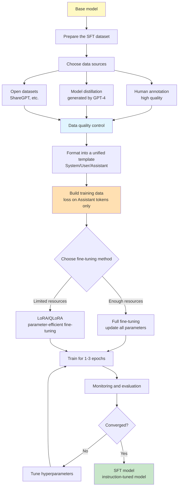

**Characteristics**:
1. **Small data**: usually 10k-100k samples, far less than pretraining
2. **Short training**: hours to days, not weeks
3. **Quality first**: data quality matters more than quantity
4. **Flexible**: techniques such as LoRA cut costs dramatically

## 3.2 The SFT objective
{: id="32-sft-的训练目标"}

**Core task**: teach the model to follow instructions (instruction following).

### 3.2.1 Formulation
{: id="321-数学表达"}

Given an instruction $x$ (prompt) and the desired answer $y$ (response), training maximizes the conditional probability:

$$
\mathcal{L}_{\text{SFT}} = -\sum_{(x,y) \in \mathcal{D}_{\text{SFT}}} \log P(y \mid x; \theta)
$$

Here $$\mathcal{D}_{\text{SFT}}$$ is the supervised fine-tuning dataset of high-quality instruction-response pairs.

### 3.2.2 Key differences from pretraining
{: id="322-与预训练的关键区别"}

**Pretraining**:
- The model sees the whole document and predicts every token
- Loss is computed at every position

**SFT**:
- Loss is computed **only on the response**
- No loss on the instruction: the labels at those positions are set to `-100` (a loss mask). The attention mask is left unchanged, so the model still "sees" the full instruction

**Core SFT code**:
```python
import torch.nn.functional as F

def sft_loss(model, batch):
    """The key to SFT: compute loss only on the Assistant's response"""
    input_ids = batch['input_ids']  # [batch_size, seq_len]
    labels = batch['labels']        # [batch_size, seq_len], aligned with input_ids

    # Example labels: [-100, -100, -100, 152, 234, 567, ...]
    #                 ↑~~ User instruction ~~↑  ↑~~ Assistant response ~~↑
    #                 (ignored, no loss)        (loss computed, learned)

    logits = model(input_ids).logits

    # As in pretraining, shift by one: the output at position t predicts token t+1
    shift_logits = logits[:, :-1, :]
    shift_labels = labels[:, 1:]

    # cross_entropy automatically ignores positions where label = -100
    loss = F.cross_entropy(
        shift_logits.reshape(-1, shift_logits.size(-1)),
        shift_labels.reshape(-1),
        ignore_index=-100,
    )
    return loss
```

### 3.2.3 Four goals of SFT
{: id="323-sft-的四大目标"}

1. **Instruction understanding**: recognize a wide variety of instruction formats and task types
2. **Structured output**: produce well-formatted, logically clear answers
3. **Dialogue skills**: manage context across multi-turn conversations
4. **Fewer hallucinations**: improve factual accuracy and reduce the tendency to make things up

## 3.3 SFT data construction
{: id="33-sft-数据构建"}

**Core principle**: quality > quantity. A small amount of high-quality data beats a large amount of low-quality data.

### 3.3.1 Data scale comparison
{: id="331-数据规模对比"}

|Model|SFT data size|Data source|Notes|
|------|-------------|---------|------|
| **InstructGPT** | 13k |Human annotation|OpenAI's early alignment work|
| **LLaMA-2-Chat** | 27.5k |Human annotation|Meta's high-quality dialogue data|
| **Vicuna** | 70k | ShareGPT |ChatGPT conversations shared by users|
| **Alpaca** | 52k |Generated by GPT-3.5|Stanford's open instruction data|
| **WizardLM** | 250k |Evolved with ChatGPT (Evol-Instruct)|Complex instructions|
| **Phi-1** |About 180M tokens|Exercises generated by GPT-3.5|Pretrained first on about 7B tokens of "textbook-quality" data, then fine-tuned on a small set of high-quality exercises|

**Key takeaways**:
- 10,000-100,000 high-quality samples are usually enough
- Data quality matters more than quantity (as the Phi series shows)
- Diversity and difficulty distribution are crucial

### 3.3.2 Data sources
{: id="332-数据来源"}

#### 3.3.2.1 Manual annotation (highest quality)
{: id="3321-人工标注最高质量"}

**Process**:
1. **Recruit annotators**: usually requires passing a qualification test
2. **Annotation guidelines**: detailed specifications for writing instructions and answers
3. **Writing samples**: annotators write answers following the guidelines
4. **Multiple review rounds**: quality checks and corrections
5. **Consistency checks**: cross-validation across annotators

**Cost**:
- Per sample: $5–20 (depending on complexity)
- 10k samples: $50,000–$200,000
- Overall: far below pretraining (usually < 5% of total cost)

**Advantages**:
- Highest quality and closest to human expectations
- Highly controllable; can target specific domains
- Suitable for safety-critical applications

**Sample annotation guideline**:
```
[Task]: write a high-quality answer to the given instruction
[Requirements]:
1. Accuracy: facts are correct; nothing is made up
2. Helpfulness: answers the question directly with enough detail
3. Clarity: well structured and easy to follow
4. Safety: harmless and unbiased; declines inappropriate requests
[Format]:
- Instruction: [the user's question or request]
- Answer: [the assistant's answer, 200-500 words]
```

#### 3.3.2.2 Model distillation (cost-effective)
{: id="3322-模型蒸馏性价比高"}

**Method**: use a strong model (such as GPT-4) to generate training data.

**Self-Instruct pipeline** (Wang et al., 2023):
1. **Seed instructions**: hand-write 100-200 seed instructions (the original paper used 175)
2. **Instruction generation**: have GPT-4 generate new instructions
3. **Answer generation**: have GPT-4 answer them
4. **Quality filtering**: automatic checks plus manual spot checks
5. **Iterative expansion**: repeat steps 2-4

**Cost**:
- At 2023 GPT-4 API prices, about US$0.03–0.06 per sample, or about US$300–600 for 10k samples; API prices for models of equal capability have since fallen by more than an order of magnitude
- More than 100 times cheaper than human annotation

**Representative work**:
- **Alpaca**: Stanford, 52k samples generated with text-davinci-003 for under $500
- **Vicuna**: ShareGPT user conversations, free
- **WizardLM**: Evol-Instruct, which automatically increases instruction complexity

**Self-Instruct in code**:
```python
def self_instruct_pipeline(seed_instructions, num_samples=10000):
    """Generate an SFT dataset automatically with GPT-4 - a very cost-effective approach"""
    generated_data = []

    while len(generated_data) < num_samples:
        # Step 1: sample seed instructions as few-shot examples
        examples = random.sample(seed_instructions, k=3)

        # Step 2: GPT-4 generates a new instruction
        prompt = f"""Generate a new instruction similar to:
        {examples}

        New instruction:"""
        new_instruction = gpt4_generate(prompt)

        # Step 3: GPT-4 generates the answer
        response = gpt4_generate(new_instruction)

        # Step 4: quality checks (length, similarity, toxicity)
        if quality_check(new_instruction, response):
            generated_data.append({
                'instruction': new_instruction,
                'response': response
            })

    return generated_data  # about $300-600 for 10k samples
```

### 3.3.3 Data synthesis and filtering
{: id="333-数据合成与过滤"}

To combine diversity with high quality at scale, modern LLMs (such as Llama-3 and DeepSeek) rely heavily on advanced data synthesis and automated cleaning.

#### 3.3.3.1 Magpie: prompt-free instruction synthesis
{: id="3331-magpie无-prompt-的自适应指令合成"}
Magpie is a novel way to generate instructions. Traditional Self-Instruct needs seed instructions; Magpie needs no input prompt at all.
* **Principle**: feed an aligned model only the prefix of its chat template, which "lures" it into generating a user instruction.
For example, give the model:
  `<|begin_of_text|><|start_header_id|>user<|end_header_id|>\n`
Because aligned models are highly sensitive to this template, the model generates a high-quality, diverse user question (instruction) on its own, which is then fed back to the model to obtain the answer (response).
* **Advantage**: the generated instructions closely match the diversity of real human use, and there is no cost of designing seed prompts.

#### 3.3.3.2 Multi-agent synthesis
{: id="3332-多智能体协同合成multi-agent-collaboration"}
Instruction data is refined in a loop by agents playing different roles (generator, reflector, rewriter, judge):
1. **Generator**: produces initial instruction-response pairs.
2. **Reflector**: finds logical gaps or factual errors in the answer and writes revision notes.
3. **Rewriter**: rewrites the answer according to the notes.
4. **Judge (LLM-as-a-Judge)**: GPT-4 scores quality (1-10 points), and only high-scoring data is kept.

#### 3.3.3.3 Automated quality filtering
{: id="3333-自动化质量过滤策略"}
Synthetic data must pass several strict filters to keep out low-quality, duplicate, or harmful samples:
1. **Perplexity filtering (PPL filtering)**: compute the perplexity of each answer and drop texts with PPL that is too high (incoherent) or too low (templated repetition).
2. **Embedding diversity**: compute sentence embeddings with a model such as `text-embedding-3-small`; using clustering and a cosine-similarity threshold, drop samples that are too similar to each other, keeping the data distribution broad.
3. **Difficulty rating**: have a strong model estimate how many reasoning steps each instruction needs, and preferentially keep logically harder samples that push the model's deeper reasoning.

#### 3.3.3.4 Open datasets
{: id="3334-开源数据集"}

**Commonly used datasets**:

|Dataset|Size|Language|Notes|
|--------|------|------|------|
| **ShareGPT** | 90k |Multilingual|Real user conversations with ChatGPT|
| **OpenOrca** | 1M+ |English|Generated by GPT-4, including reasoning traces|
| **UltraChat** | 1.5M |English|Multi-turn dialogue|
| **FLAN Collection** |1800+ tasks|Multilingual|Google's multi-task instruction collection, templated from existing NLP datasets|
| **Dolly-15k** | 15k |English|Written by Databricks employees|
| **Tulu 3 SFT Mix** |About 940000|Multilingual|The SFT data in AllenAI's fully open post-training recipe|

### 3.3.4 Instruction type distribution
{: id="334-指令类型分布"}

**Typical mix** (recommended):

|Instruction type|Share|Example|
|---------|------|------|
|**Open-ended Q&A**| 30-40% |"Explain what quantum computing is"|
|**Creative writing**| 15-20% |"Write a poem about autumn"|
|**Information extraction**| 10-15% |"Summarize the main points of this article"|
|**Code generation**| 10-15% |"Implement quicksort in Python"|
|**Math reasoning**| 5-10% |"Solve this calculus problem"|
|**Multi-turn dialogue**| 10-15% |Follow-up questions that depend on context|
|**Other tasks**| 5-10% |Translation, format conversion, and so on|

<div align="center">
  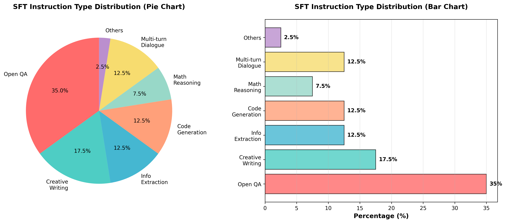
<figcaption>Figure: distribution of SFT instruction types (drawn from the midpoints of the recommended ranges in the table above)</figcaption>
</div>

**Balancing principles**:
- Cover the main application scenarios
- Avoid over-representing any one task type
- Include a range of difficulty levels

### 3.3.5 Data quality control
{: id="335-数据质量控制"}

**Automated checks**:
```python
def quality_check(instruction, response):
    # 1. Length check
    if len(response) < 50 or len(response) > 2000:
        return False

    # 2. Similarity check (deduplication)
    if is_similar_to_existing(response, threshold=0.9):
        return False

    # 3. Toxicity check
    if contains_toxic_content(response):
        return False

    # 4. Fact check (optional, retrieval-augmented)
    if not factual_consistency_check(response):
        return False

    return True
```

**Human review**:
- **Spot checks**: manually inspect a random 5-10%
- **Consistency checks**: several reviewers score each sample, and inter-rater agreement is measured
- **Iterative improvement**: adjust the data-generation strategy based on feedback

## 3.4 SFT training strategy
{: id="34-sft-训练策略"}

### 3.4.1 Full fine-tuning
{: id="341-全参数微调"}

**Method**: update all of the model's parameters.

**Features**:
- Pro · **Best results**: fully adapts to the new task
- Con · **Highest cost**: stores the complete model and gradients
- Con · **Large memory requirement**: usually needs 4-8 high-end GPUs

**GPU memory estimate** (consistent with the 16 bytes per parameter derived in Section 6.5.1):
```
Total GPU memory = parameters + gradients + optimizer state + activations

For a 7B model (BF16 mixed precision + AdamW):
- Parameters (BF16):  7B × 2 bytes = 14GB
- Gradients (BF16):   7B × 2 bytes = 14GB
- Optimizer state (FP32 master weights + m + v): 7B × 12 bytes = 84GB
- Activations: ~20-40GB (depends on batch size and sequence length)
Total: ~132-152GB

→ This does not fit on one GPU; you need at least 2 A100s (80GB) with ZeRO sharding (see Section 6.5)
```

**When to use it**:
- Ample compute is available
- The best possible performance is required
- The task differs substantially from pretraining

### 3.4.2 Parameter-efficient fine-tuning (PEFT)
{: id="342-参数高效微调peft"}

**Core idea**: freeze most parameters and train only a small subset or a few added parameters.

#### 3.4.2.1 LoRA(Low-Rank Adaptation)
{: id="3421-loralow-rank-adaptation"}

**Math**:

On top of the pretrained weight $W_0 \in \mathbb{R}^{d \times k}$, add a trainable low-rank decomposition:

$$
W = W_0 + \Delta W = W_0 + BA
$$

where:
- $B \in \mathbb{R}^{d \times r}$, $A \in \mathbb{R}^{r \times k}$
- **rank $r \ll \min(d, k)$** (usually $r=8, 16, 32$)
- $W_0$ is frozen; only $B$ and $A$ are trained

**Parameter count**:
```
Original parameters: d × k
LoRA parameters:     d × r + r × k = r(d + k)

Example (d=4096, k=4096, r=16):
- Original: 4096 × 4096 = 16,777,216
- LoRA:     16 × (4096 + 4096) = 131,072
- Ratio:    131k / 16.7M ≈ 0.78%

→ fewer than 1% of the parameters are trained!
```

**Implementation** (single layer, for illustration):
```python
import math
import torch
import torch.nn as nn

class LoRALinear(nn.Module):
    def __init__(self, base: nn.Linear, rank=16, alpha=32):
        super().__init__()
        # Frozen pretrained weight W0
        self.base = base
        self.base.weight.requires_grad_(False)

        # Trainable LoRA parameters: A is randomly initialized and B starts at 0, so ΔW = BA = 0 at the start of training
        self.lora_A = nn.Parameter(torch.empty(rank, base.in_features))
        self.lora_B = nn.Parameter(torch.zeros(base.out_features, rank))
        nn.init.kaiming_uniform_(self.lora_A, a=math.sqrt(5))

        self.scaling = alpha / rank

    def forward(self, x):
        # Original forward pass + low-rank correction
        return self.base(x) + (x @ self.lora_A.T @ self.lora_B.T) * self.scaling
```

In practice you would use Hugging Face PEFT's `LoraConfig` + `get_peft_model`, which swaps the target layers for LoRA layers and handles saving and merging adapters. Section 8.4.1.4 has a complete example.

**Advantages**:
- **Less GPU memory**: fewer than 1% of the parameters are trained, and no gradients or optimizer state are stored for the frozen weights (in the LoRA paper, training memory for GPT-3 175B dropped from 1.2TB to 350GB)
- **Cheap storage**: each task needs only its adapter (the GPT-3 175B checkpoint shrank from 350GB to about 35MB)
- **Mergeable**: after training, the adapter can be merged back into the original model as $W = W_0 + BA$
- **Modular**: several LoRAs can be trained for different tasks and swapped as needed

**Hyperparameters**:
- **rank r**: 8-64; larger ranks fit better but add parameters
  - r=8: lightest, for simple tasks
  - r=16-32: recommended default
  - r=64: complex tasks
- **alpha**: commonly alpha = r or 2r (e.g. r=16, alpha=32); the QLoRA paper uses r=64, alpha=16
- **Target modules**: early work applied LoRA only to the attention projections (`q_proj`, `k_proj`, `v_proj`, `o_proj`). The QLoRA paper and Thinking Machines' LoRA Without Regret (2025) found that **covering all linear layers, including the MLP (`gate_proj`, `up_proj`, `down_proj`),** brings results much closer to full fine-tuning

> **LoRA and catastrophic forgetting**
>
> Many people assume LoRA prevents forgetting, but research shows that **LoRA learns less and forgets less**: it forgets less precisely because it learns less, so it does not really solve forgetting. A larger rank means more learning and more forgetting, and the gap with full fine-tuning narrows. See the chapter "Post-training and catastrophic forgetting" for details.

#### 3.4.2.2 QLoRA(Quantized LoRA)
{: id="3422-qloraquantized-lora"}

**Core innovation**: quantize the frozen base weights to 4 bits, then train LoRA on top. Fine-tuning memory for a 7B model drops from ~24GB (16-bit LoRA) to ~9GB, and a 65B model can be fine-tuned on a single 48GB GPU (QLoRA paper). The key techniques are 4-bit NF4 quantization, double quantization, and paged optimizers.

For the details, memory comparison, and complete code, see "[Model Quantization Technology → QLoRA: 4-bit quantization + LoRA fine-tuning ](#841-qlora)"; they are not repeated here.

#### 3.4.2.3 Other PEFT methods
{: id="3423-其他-peft-方法"}

**Prefix Tuning**:
- Prepend trainable prefix tokens to the input
- Optimize only the prefix embeddings
- Parameters: ~0.1% of the original model

**Adapter Layers**:
- Insert small adapters (2-layer MLPs) between Transformer layers
- Train only the adapter parameters
- Parameters: ~2-4% of the original model

### 3.4.3 Instruction templates
{: id="343-指令模板"}

Define a unified input/output format:

|Tag|Role|Example content|
|------|------|---------|
| `<|system|>` |System prompt| You are a helpful assistant. |
| `<|user|>` |User input| What is the capital of France? |
| `<|assistant|>` |Model answer| The capital of France is Paris. |

**Common template formats**: ChatML, Alpaca, Vicuna, Llama-2-Chat, and others, each with its own special tokens.

### 3.4.4 Training hyperparameters
{: id="344-训练超参数"}
- Learning rate: full fine-tuning usually uses a smaller rate than pretraining (1e-5 to 5e-5); LoRA needs a larger one (commonly 1e-4 to 2e-4)
- Epochs: 1-3
- Batch size: set according to available resources
- Warmup ratio: 3–10%

## 3.5 Recent advances in SFT
{: id="35-sft的前沿技术"}

### 3.5.1 Small, high-quality data
{: id="351-小数据高质量训练"}

#### 3.5.1.1 Lessons from the Phi series
{: id="3511-phi系列的启示"}
- **Phi-1**: 1.3B parameters trained on about 7B tokens of "textbook-quality" data reached 50.6% pass@1 on HumanEval, beating StarCoder-15B (33.6%), which has more than 10 times as many parameters.
- **Phi-3**: Phi-3-mini, with 3.8B parameters, rivals Mixtral 8x7B and GPT-3.5 on several benchmarks
- **Core strategy**:
  - Synthesize "textbook-style" data with GPT-3.5, and train a quality classifier on GPT-4 annotations to filter web code
  - Strict quality filtering and diversity control
  - Evidence that data quality > data scale

#### 3.5.1.2 Curriculum learning
{: id="3512-课程学习策略"}
- Increase difficulty gradually, from simple to complex
- Organize instruction data in tiers
- Adjust the data mixture dynamically

### 3.5.2 Synthetic data generation
{: id="352-合成数据生成"}

Section 3.3.2.2 covers the basic approach of having a strong model generate instruction-response pairs directly (Self-Instruct), and Section 3.3.3 covers the newer Magpie, multi-agent synthesis, and automated filtering. This section adds two kinds of synthesis that target "difficulty" and "reasoning traces".

#### 3.5.2.1 Evol-Instruct method
{: id="3521-evol-instruct方法"}
- **WizardLM**: automatically increases instruction complexity
- Evolves instructions through rewriting strategies
- Substantially improves instruction following

#### 3.5.2.2 Reasoning-trace data
{: id="3522-推理过程数据"}
- **Orca series**: generates detailed step-by-step reasoning
- Augments data with explanations
- Improves the reasoning ability of small models

### 3.5.3 Quantized fine-tuning
{: id="353-量化微调加速"}

The chapter "[Model Quantization Technology ](#8-模型量化技术)" explains and compares quantization methods such as QLoRA, GPTQ, and AWQ. This section focuses on Unsloth, a tool built specifically to accelerate quantized fine-tuning for SFT.

#### 3.5.3.1 Unsloth: a library for fast fine-tuning
{: id="3531-unsloth高效微调加速库"}

[Unsloth](https://unsloth.ai) is currently the most popular LoRA/QLoRA acceleration library. By rewriting low-level CUDA kernels, it delivers large speedups and memory savings:

- **Speed**: training is about **2×** faster (with no loss of accuracy)
- **GPU memory**: VRAM use drops by about **70%**
- **Compatibility**: fully compatible with Hugging Face PEFT/TRL, so migration costs almost nothing
- **Supported models**: Llama, Qwen, Mistral, Gemma, Phi, and 500+ others

**Quick start** (swap `get_peft_model` for the Unsloth version):

```python
from unsloth import FastLanguageModel

# Load the model (supports 4-bit QLoRA)
model, tokenizer = FastLanguageModel.from_pretrained(
    model_name="unsloth/llama-3-8b",
    max_seq_length=2048,
    load_in_4bit=True,    # 4-bit QLoRA, cuts GPU memory by 75%
)

# Add LoRA adapters (same interface as PEFT)
model = FastLanguageModel.get_peft_model(
    model,
    r=16,
    target_modules=["q_proj", "k_proj", "v_proj", "o_proj"],
    lora_alpha=16,
    lora_dropout=0,
    use_gradient_checkpointing="unsloth",  # Unsloth-specific: supports longer contexts
)

# Use the standard TRL SFTTrainer (no changes to training code)
from trl import SFTTrainer
trainer = SFTTrainer(model=model, ...)
trainer.train()
```

> **When to use it**: LoRA/QLoRA fine-tuning of 7B–70B models on consumer GPUs (RTX 3090/4090), and GRPO reinforcement learning (official figures report about **80%** memory savings). The speed and memory figures above come from Unsloth; actual gains vary with the model and sequence length.

---

# 4. Preference alignment
{: id="4-偏好对齐"}

Alignment brings a model's outputs in line with human preferences, values, and safety guidelines.

> **About this chapter**
>
> Preference alignment is the **critical leap** from a model that merely works to one that is pleasant to use. Techniques such as RLHF, DPO, and the more recent **GRPO** make outputs more helpful, safer, and more consistent with human values. This chapter compares the principles, strengths, and weaknesses of RLHF, DPO, and GRPO in detail. **Recommendation: prefer DPO for simple tasks, and GRPO for complex reasoning tasks and resource-constrained settings.**

## 4.1 RLHF
{: id="41-rlhf"}

**Paper**: [Training language models to follow instructions with human feedback (InstructGPT)](https://arxiv.org/abs/2203.02155)

### 4.1.1 The three stages of RLHF
{: id="411-rlhf-三阶段流程"}

<div align="center">
  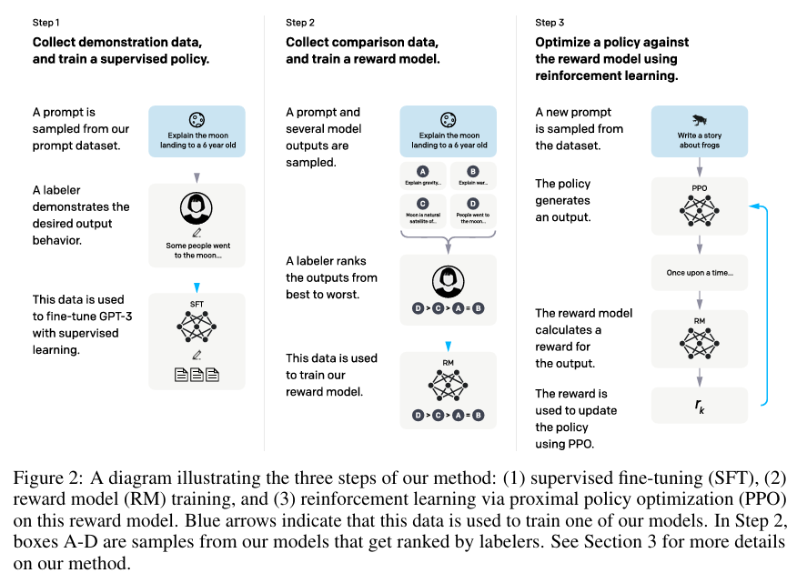
<figcaption>Figure: the full RLHF training process (source: Figure 2 of the InstructGPT paper)</figcaption>
</div>

**Three key steps**:

#### 4.1.1.1 Step 1: Collect preference data
{: id="4111-step-1-收集偏好数据"}
- Sample several outputs from the model (usually 4-9 candidate answers)
- Human annotators rank the answers by quality
- Build a preference comparison dataset: $(x, y_w, y_l)$
- **Data scale**: InstructGPT's reward-model data covers about 33k prompts, each with 4–9 ranked answers, which expand into a large number of pairwise comparisons

#### 4.1.1.2 Step 2: Train a reward model
{: id="4112-step-2-训练奖励模型reward-model"}
- Train a scoring model on the preference data
- **Input**: prompt $x$ + response $y$
- **Output**: a scalar quality score $r(x, y)$
- **Goal**: predict human preference rankings
- **Architecture**: usually the SFT model with the LM head replaced by a scalar output layer

#### 4.1.1.3 Step 3: Optimize the policy with PPO
{: id="4113-step-3-ppo强化学习优化"}
- Optimize the policy with PPO (Proximal Policy Optimization)
- **Reward signal**: the reward model's score
- **KL constraint**: $$\beta \cdot D_{\text{KL}}(\pi_\theta \Vert \pi_{\text{ref}})$$ keeps the policy from drifting too far from the SFT model
- Models required: policy, reference, reward, and critic (4 in total)

### 4.1.2 Challenges of RLHF
{: id="412-rlhf-的挑战"}
- **Reward hacking**: the model may learn to exploit weaknesses of the reward model instead of genuinely improving
- **Unstable training**: RL training tends to diverge
- **High compute cost**: 4 large models must run at the same time
- **Expensive human annotation**: about 0.5–2 USD per preference label

## 4.2 DPO
{: id="42-dpo"}

**Paper**: [Direct Preference Optimization: Your Language Model is Secretly a Reward Model](https://arxiv.org/abs/2305.18290)

### 4.2.1 DPO vs. RLHF
{: id="421-dpo-vs-rlhf-对比"}

<div align="center">
  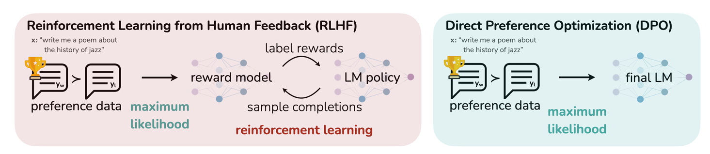
<figcaption>Figure: DPO simplifies the RLHF pipeline (source: Figure 1 of the DPO paper)</figcaption>
</div>

### 4.2.2 The key idea
{: id="422-核心创新"}

**Key insight**: the reward model is parameterized implicitly by the policy itself, so no reward model has to be trained explicitly.

**DPO loss**:

$$
\mathcal{L}_{\text{DPO}} = -\mathbb{E}_{(x,y_w,y_l)} \left[ \log \sigma \left( \beta \log \frac{\pi_\theta(y_w | x)}{\pi_{\text{ref}}(y_w | x)} - \beta \log \frac{\pi_\theta(y_l | x)}{\pi_{\text{ref}}(y_l | x)} \right) \right]
$$

**Intuition**:
- Raise the model's probability of the preferred answer $y_w$
- Lower the model's probability of the rejected answer $y_l$
- $\beta$ controls how far the model may move from the reference model

### 4.2.3 Advantages of DPO
{: id="423-dpo-的优势"}

|Dimension| RLHF | DPO |
|------|------|-----|
|**Training stages**|3 steps (data → RM → PPO)|2 steps (data → direct optimization)|
|**Models needed**|4 models|2 models|
|**Training stability**|Lower (RL is unstable)|✅ High (supervised learning)|
|**Compute cost**|High|✅ Low (saves 50%+)|
|**Implementation complexity**|High (needs an RL library)|✅ Low (standard optimization)|
| **Reward Hacking** |Common|✅ Less common (but over-optimization still happens)|
|**Results**|Often stronger when fully tuned|✅ Comparable in most settings and much simpler to implement|

> Note: whether DPO or PPO is better is still unsettled. A systematic comparison by Xu et al. (2024) found that well-tuned PPO can still beat DPO on dialogue and coding tasks; DPO's main advantages are simple engineering and stable training.

### 4.2.4 Variants of DPO
{: id="424-dpo-的变体"}

- **IPO** (Identity Preference Optimization): replaces DPO's log-sigmoid loss with a squared loss, reducing overfitting when preferences are nearly deterministic
- **KTO** (Kahneman-Tversky Optimization): based on prospect theory; needs only single "good/bad" labels, not paired data
- **ORPO** (Odds Ratio Preference Optimization): merges SFT and preference optimization into one stage, with no reference model
- **SimPO** (Simple Preference Optimization): uses the length-normalized average log probability as an implicit reward and also drops the reference model
- **RRHF** (Rank Responses to align Human Feedback): uses a ranking loss

## 4.3 RLAIF
{: id="43-rlaif"}

**Paper**: [RLAIF: Scaling Reinforcement Learning from Human Feedback with AI Feedback](https://arxiv.org/abs/2309.00267)

<div align="center">
  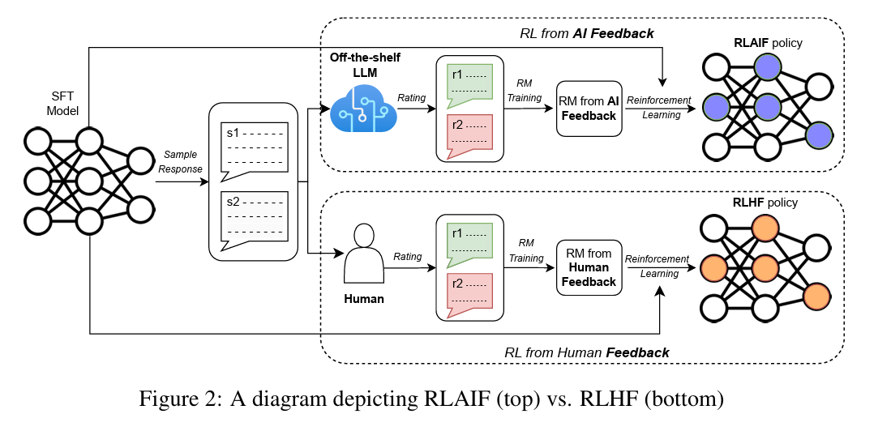
<figcaption>Figure: RLAIF replaces human annotators with an AI model (source: RLAIF paper)</figcaption>
</div>

### 4.3.1 Core idea
{: id="431-核心思想"}

**Replace human-annotated preference data with labels from a strong AI model (such as GPT-4).**

**Workflow**:
1. **AI labeler produces preferences**: a model such as GPT-4 scores and ranks candidate responses
2. **Train the reward model**: on the AI-labeled preference data
3. **RL optimization**: optimize the policy with PPO or DPO

### 4.3.2 Advantages
{: id="432-优势"}

- **Low cost**: no human labeling, saving 90%+ of the cost
- **Scalable**: can produce preference data at large scale
- **High quality**: experiments show results close to, or even better than, RLHF
- **Consistent**: AI labels are more consistent than human ones

### 4.3.3 Challenges
{: id="433-挑战"}

- Biases of the AI labeler are passed on to the aligned model
- Requires a high-quality AI labeler (such as GPT-4)

## 4.4 Constitutional AI
{: id="44-constitutional-ai"}

**Paper**: [Constitutional AI: Harmlessness from AI Feedback](https://arxiv.org/abs/2212.08073)

<div align="center">
  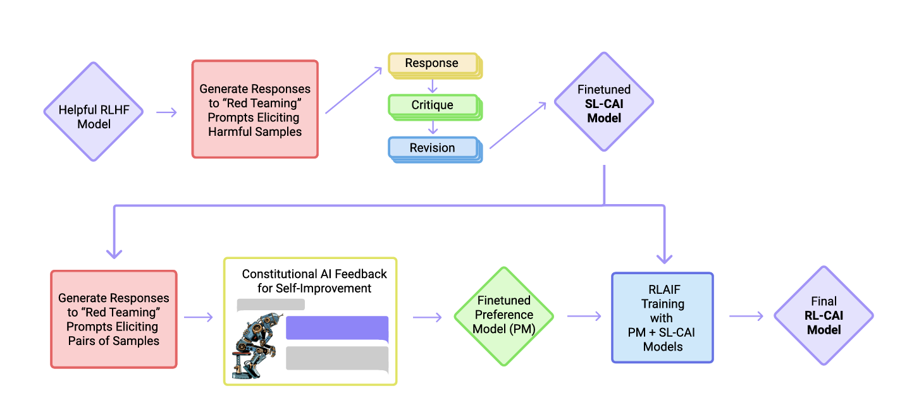
<figcaption>Figure: the self-critique and revision process of Constitutional AI (source: Anthropic's Constitutional AI paper)</figcaption>
</div>

### 4.4.1 The key idea
{: id="441-核心理念"}

**The AI system follows an explicit set of principles (a constitution) and aligns itself through self-critique and revision.**

### 4.4.2 Two-stage training
{: id="442-两阶段训练"}

#### 4.4.2.1 Stage 1: supervised learning (SL-CAI)
{: id="4421-第一阶段监督学习sl-cai"}
1. **Generate an initial answer**: the model answers a harmful instruction
2. **Self-critique**: the model evaluates its own answer against the constitution
3. **Self-revision**: the model writes an improved answer
4. **Supervised learning**: SFT on the revised data

#### 4.4.2.2 Stage 2: reinforcement learning (RL-CAI)
{: id="4422-第二阶段强化学习rl-cai"}
1. **AI feedback**: the model judges which answers better follow the constitution
2. **Preference data**: build AI-labeled preference pairs
3. **RL training**: align preferences with RLAIF

### 4.4.3 Example principles
{: id="443-constitution-示例"}

- "Please choose the response that is the most helpful, honest, and harmless"
- "Please choose the response that does not encourage illegal, unethical, or inappropriate behavior"
- "Please choose the response that shows the most care, respect, and consideration"

### 4.4.4 Advantages
{: id="444-优势"}

- **Transparent and controllable**: the principles are explicit and adjustable
- **Self-alignment**: less dependence on human feedback
- **Extensible**: easy to extend to new values and principles
- **Effective**: without any human harmfulness labels, it produces a model that is more harmless and less evasive than the RLHF baseline

## 4.5 GRPO and reasoning models
{: id="45-grpo-与推理模型"}

**Papers**: [DeepSeekMath](https://arxiv.org/abs/2402.03300) (where GRPO was introduced) / [DeepSeek-R1](https://arxiv.org/abs/2501.12948) (large-scale RL for reasoning)

DeepSeek introduced GRPO in DeepSeekMath (2024). After DeepSeek-R1 was open-sourced, GRPO and its improved variants (Section 4.6.4) became the most widely used RL algorithms in the open community for training strong reasoning models.

### 4.5.1 GRPO and memory savings
{: id="451-grpo-的创新与显存优化"}

In classic PPO (Proximal Policy Optimization), computing the advantage function that guides policy updates requires a critic model (value network) as large as the policy, which estimates the value of every intermediate state. Training therefore has to fit four very large models in GPU memory at once:

$$\text{Policy (Active)} + \text{Reference (Frozen)} + \text{Reward (Frozen)} + \text{Critic (Active)}$$

For very large models this raises the memory and compute bar dramatically, causes frequent OOMs, and the critic's estimation errors can even make RL training highly unstable.

**GRPO's solution**: estimate advantages through **group relative scoring**, removing the critic entirely.

#### 4.5.1.1 Group-relative advantage
{: id="4511-组内相对优势计算公式"}
For the same prompt $x$, the policy samples $G$ answers in parallel to form a group: $\{y_1, y_2, \ldots, y_G\}$. A scoring function or reward model gives each of the $G$ answers a reward $\{r_1, r_2, \ldots, r_G\}$. The relative advantage $A_i$ of answer $y_i$ within the group is:

$$
A_i = \frac{r_i - \text{mean}(r_1, r_2, \ldots, r_G)}{\text{std}(r_1, r_2, \ldots, r_G)}
$$

These advantages are then used in the policy objective:

$$
\mathcal{L}_{\text{GRPO}}(\theta) = \frac{1}{G} \sum_{i=1}^{G} \left[ \min \left( \frac{\pi_\theta(y_i|x)}{\pi_{\theta_{\text{old}}}(y_i|x)} A_i, \, \text{clip} \left( \frac{\pi_\theta(y_i|x)}{\pi_{\theta_{\text{old}}}(y_i|x)}, 1-\epsilon, 1+\epsilon \right) A_i \right) - \beta \, \mathbb{D}_{\text{KL}}(\pi_\theta || \pi_{\text{ref}}) \right]
$$

Here $$\mathbb{D}_{\text{KL}}$$ penalizes deviation of the current policy from the reference model, keeping the model from drifting. Normalizing within the group naturally removes the gradient instability caused by large differences in absolute reward across prompts. The formula above is a sequence-level shorthand; the original paper computes the ratio per token within each answer and averages.

#### 4.5.1.2 GPU memory: GRPO vs. PPO
{: id="4512-grpo-与-ppo-显存对比"}

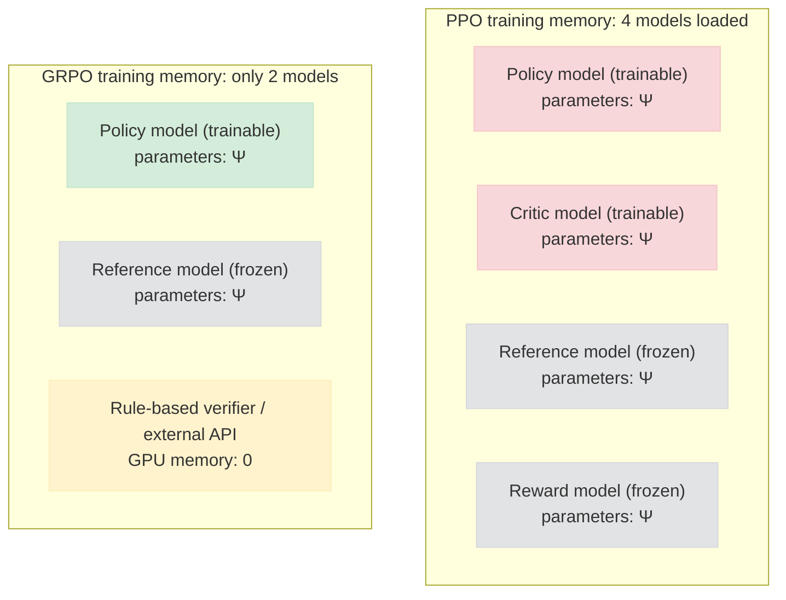

By comparing answers within a group, GRPO drops the value network (critic) and the black-box reward model (which can be replaced by a rule-based verifier that uses almost no GPU memory). **This saves roughly 50%–70% of training memory** and was a key milestone in making RL for large models accessible.

|Feature| RLHF (PPO) | GRPO |
| :--- | :--- | :--- |
|**Models needed**|4 (Policy, Ref, RM, Critic)|✅ 2 (Policy, Ref)|
|**GPU memory**|Very high (several models loaded)|✅ Much lower (saves about 50%-70%)|
|**Reward function**|Relies on a complex neural reward model|✅ Supports deterministic rule-based scoring (e.g. compile success, test cases)|
|**Reasoning performance**|Average|✅ Very strong (the core technique behind DeepSeek-R1)|
|**Training stability**|Low (prone to collapse)|✅ Higher (within-group normalization reduces variance)|

---

### 4.5.2 The DeepSeek-R1 recipe
{: id="452-deepseek-r1-对齐范式"}

In conventional SFT, the model passively "memorizes" reasoning steps written by humans. With reinforcement learning (such as GRPO), it can discover good solution paths on its own, without human demonstrations.

Following DeepSeek-R1, strong reasoning models are trained with a **four-stage alignment pipeline**:

```
[Stage 1: cold-start SFT]      -> Collect a few thousand high-quality long-CoT examples so the model learns basic thinking habits (output in <think>...</think> format)
      |
[Stage 2: reasoning RL]        -> GRPO with rule-based scoring (regex-matched answers, compiler checks) lets the model explore on its own
      |                 * Observed: the model spontaneously learns to self-correct and reflect ("aha moments") and thinks for longer
      |
[Stage 3: rejection sampling + second SFT] -> Sample high-quality reasoning traces from the RL model, mix in general data (writing, safety, translation), and run SFT again
      |
[Stage 4: general preference RL] -> Align the final model for safety and human preference, fixing reasoning models' tendency to "fail to refuse harmful requests" or "miss the point of the question"
```

#### 4.5.2.1 Rule-based rewards for reasoning RL
{: id="4521-推理-rl-的奖励规则配置"}
For reasoning RL, black-box neural reward models (RMs) are avoided where possible in favor of **objective, hard rule-based verifiers**:
1. **Accuracy reward**: for math, a regular expression extracts the answer from the final marker (such as `\boxed{...}`) and compares it with the reference answer; for code, the program is run against test cases in a sandbox.
2. **Format reward**: the model must wrap its thinking in `<think>` and `</think>` tags and is rewarded only when the format is correct. DeepSeek-R1's reasoning RL used only these two rule-based rewards: accuracy and format.

---

### 4.5.3 Process vs. outcome rewards
{: id="453-过程监督与结果监督"}

For multi-step reasoning, giving the model precise feedback (credit assignment) is the central challenge of reinforcement learning.

#### 4.5.3.1 Outcome-supervised Reward Model (ORM)
{: id="4531-结果监督outcome-supervised-reward-model-orm"}
* **Principle**: only the correctness of the final answer is rewarded (0 or 1).
* **Advantage**: labeling is very cheap (only the final answer is needed).
* **Disadvantage**: **sparse reward**. With long reasoning (say 50 steps), the model can hardly tell which intermediate step went wrong, and it may even reach the right answer through wrong steps (hidden hallucination).

#### 4.5.3.2 Process-supervised Reward Model (PRM)
{: id="4532-过程监督process-supervised-reward-model-prm"}
* **Principle**: score **every intermediate step** of the model's reasoning chain individually.
* **Advantage**: **dense reward**. It can catch and penalize faulty logic and concept slippage in intermediate steps, markedly improving the rigor of mathematical and symbolic reasoning.
* **Disadvantage**: expensive data. OpenAI's PRM800K required about 800,000 human step-level labels; Math-Shepherd and similar work estimate each step's correctness automatically with Monte Carlo rollouts, at the cost of added noise.

**In practice**: the DeepSeek-R1 report lists PRM among its "unsuccessful attempts": fine-grained steps are hard to define, automatic labels are unreliable, and neural reward models are easy to reward-hack. So in GRPO training, domains that can be verified automatically (math, code) usually rely on deterministic outcome rewards (ORM or rule-based verifiers) plus length and format constraints, letting the model find correct intermediate steps through heavy sampling; PRMs are used mainly to rerank candidates at inference time (Best-of-N).

---

### 4.5.4 Test-time compute
{: id="454-推理时计算扩展"}

Before the o1/R1 era, LLMs followed **training-time scaling laws**: capability depended mainly on parameter count and training tokens. Reasoning models added a new dimension: **test-time scaling laws (test-time compute scaling)**.

* **Core idea**: spend more compute at inference time (let the model "think longer and try more") to substantially improve accuracy on complex tasks without changing the parameter count.
* **Main techniques**:
  1. **System 2 thinking**: RL trains the model to produce very long internal chains of thought (CoT) in exchange for a higher chance of a correct answer.
  2. **Monte Carlo tree search (MCTS)**: explore multiple reasoning branches during generation, score each step, backtrack, and pick the best path through the search tree.
  3. **Rejection sampling / Best-of-N**: sample $N$ answers at inference and pick the best by majority vote (self-consistency) or a lightweight scoring model.

#### 4.5.4.1 Evidence: thinking length vs. accuracy
{: id="4541-实证数据思考长度与准确率的关系"}

OpenAI's o1 announcement showed two separate scaling curves, one for training compute and one for test-time compute; the DeepSeek-R1 report observed that the model's average response length and AIME accuracy rose together during RL training. Both show the same pattern:

- **More training compute** → accuracy on math and code benchmarks rises roughly log-linearly with training FLOPs (consistent with classic scaling laws)
- **More test-time compute** (letting the model generate longer chains of thought) → the same trained model, simply by "thinking longer", also improves roughly log-linearly with the number of reasoning tokens; on hard tasks such as competition math (e.g. AIME), the gains from the two curves can be comparable

In other words, within a certain range, "training a bigger model" and "letting an existing model think longer" are **interchangeable ways to improve performance**, which is why test-time compute scaling is called the "second scaling law".

#### 4.5.4.2 o1/o3 vs. R1
{: id="4542-o1o3-与-r1-的路线对比"}

|Dimension| OpenAI o1/o3 | DeepSeek-R1 |
|------|-------------|-------------|
|**Chain-of-thought visibility**|The full CoT is hidden; only a summary is shown (to prevent distillation or copying by competitors)|Full chain-of-thought format exposed (`<think>...</think>`), with open model weights|
|**Training details disclosed**|Limited; RL algorithm details not published|GRPO details, cold-start SFT, and the four-stage pipeline published (Section 4.5.2)|
|**Distilled small models**|None released|Several distilled sizes released alongside, based on Qwen/Llama (Section 4.8)|
|**Industry impact**|Established the test-time compute scaling paradigm|Showed that "open + low cost" can reach top-tier reasoning, making GRPO an industry standard|

> **Trend**: since R1, models such as Claude 3.7 Sonnet, Gemini 2.5, and Qwen3 commonly offer a thinking/non-thinking switch or a "thinking budget": one model decides, based on task difficulty, whether to engage long CoT, so simple tasks do not burn large numbers of reasoning tokens. This is a further engineering refinement of test-time compute scaling (allocating inference compute on demand rather than uniformly).

---

### 4.5.5 Alignment tax vs. reasoning
{: id="455-对齐税与推理"}

Preference alignment is known for the **alignment tax**: overly aggressive safety or preference alignment can noticeably damage a model's reasoning and instruction-following abilities.

* **Conflict with reasoning**: safety alignment often trains the model to refuse sensitive topics outright. For a reasoning model, if a user asks a complex question involving security (e.g. "analyze the vulnerabilities in this malware so I can fix them"), an overly sensitive safety filter triggers a refusal, and the model's reasoning ability goes unused.
* **Strategies**:
  1. **Decouple safety from reasoning**: the reasoning RL stage (stage 2) focuses entirely on logic and correctness, without many safety constraints for now, so the model can explore every possible path.
  2. **Bring safety data into the final general preference alignment**: in stage 4, contrastive (chosen/rejected) examples teach the model to distinguish "academic analysis" from "substantive help with harm", enabling precise refusals.

---

## 4.6 RL training infrastructure
{: id="46-rl-训练基础设施"}

Algorithms such as GRPO are only the math of RL training; actually running them takes a full engineering system. This section covers the unavoidable engineering issues in RL training of reasoning models, and the improved algorithms proposed after GRPO.

### 4.6.1 Rollout and training
{: id="461-rollout-与训练协同"}

Each RL iteration combines two very different workloads:

```
[Rollout]  The policy samples G answers in parallel for a batch of prompts (autoregressive generation: an inference workload)
      ↓
[Scoring]  Rule-based verifiers / the reward model score the samples
      ↓
[Training] Compute the GRPO loss from the scores and backpropagate to update the policy (a training workload)
```

- **Rollout is inference-heavy**: a long-CoT reasoning model may generate thousands of tokens per sample, and with G typically 8-64, a single prompt yields tens of thousands of tokens. KV cache management and batch scheduling during autoregressive generation set the throughput ceiling of RL training
- **Synchronous vs. asynchronous**: synchronous training (each round waits for every rollout to finish) is simple but leaves GPUs underused (the rollout engine idles during training and vice versa); asynchronous training overlaps rollout and training in a producer-consumer pipeline for higher throughput, but must handle the off-policy bias that arises when rollouts in progress still use the old policy after the parameters have been updated

### 4.6.2 Faster rollouts with vLLM / SGLang
{: id="462-vllm--sglang-加速-rollout"}

The mainstream approach is to hand rollouts to a dedicated high-throughput inference engine rather than the training framework's own generate method:

- **vLLM**: manages the KV cache with PagedAttention and supports highly concurrent batched sampling; it is the default rollout backend of open RL frameworks such as OpenRLHF and verl
- **SGLang**: RadixAttention reuses prefix KV caches, a natural fit for the typical RL workload of "sampling G answers for the same prompt" (shared prefix, different continuations); vLLM also supports automatic prefix caching, and which is faster depends on the workload
- **Weight synchronization**: after the training framework (e.g. DeepSpeed/Megatron) updates the parameters, the new weights must be synced to the inference engine (usually by NCCL broadcast or shared GPU memory). Sync latency is one of the key bottlenecks of asynchronous RL systems

### 4.6.3 Rewards as a service
{: id="463-reward-服务化"}

When rewards come from rule-based verifiers (running code in a sandbox, regex-matching math answers) rather than a neural scorer, they are usually split out into independent microservices:

- **Code tasks**: generated code must run its test cases in an isolated sandbox, with attention to sandbox concurrency, timeouts, and security isolation (so generated code cannot touch host resources)
- **Math tasks**: parse the content of `\boxed{}` with a symbolic math library (such as SymPy) or dedicated answer-matching rules, to avoid errors from naive string matching (such as equivalent answers in different formats being marked wrong)
- **Why a service**: decoupling reward computation from rollout and training lets each scale independently, so rewards never become the bottleneck of the RL pipeline

### 4.6.4 Improved algorithms after GRPO
{: id="464-grpo-之后的改进算法"}

GRPO is not the end point. In 2025, several improvements were proposed to address its training instability and efficiency problems:

|Algorithm|Core change|Problem addressed|
|------|---------|-----------|
| **DAPO**(Decoupled Clip and Dynamic Sampling PO) |Decouples the upper and lower clipping thresholds, and uses dynamic sampling to drop all-correct/all-wrong "zero-gradient" groups|When every answer in a group is right or every one is wrong, GRPO's advantage collapses to 0, wasting a lot of sampling compute|
| **GSPO**(Group Sequence Policy Optimization) |Computes the importance-sampling ratio at the sequence level instead of the token level|GRPO's token-level ratio has high variance on long sequences, destabilizing training, especially for MoE models|
| **VAPO**(Value-model Augmented PO) |Reintroduces a lightweight value function with length-adaptive GAE|Pure group-relative estimates still have high variance with long CoT and sparse rewards|
| **Dr. GRPO**(GRPO Done Right) |Removes normalization by response length and by within-group standard deviation|The original GRPO normalization favors longer wrong answers, inflating response length|
| **CISPO** (Clipped IS-weight Policy Optimization, MiniMax-M1) |Clips the importance-sampling weight itself and stops its gradient, instead of clipping the token update|PPO/GRPO-style clipping drops the entire gradient of low-probability but pivotal reflection tokens such as "However" or "Wait", so long CoT is hard to learn|

These improvements share one direction: **tracing where each token's gradient comes from and where it gets thrown away**. GRPO's within-group normalization, token-level clipping, and length normalization matter little for short answers; with long answers or MoE models, the biases are amplified.

> **Practical advice**: for most teams, GRPO with rule-based rewards is still the most cost-effective starting point. When rewards within groups become homogeneous late in training (more all-correct or all-wrong groups, fewer useful gradient signals), consider DAPO-style dynamic sampling. If an MoE model collapses for no obvious reason, try GSPO's sequence-level ratio first.

---

## 4.7 Synthetic data and self-play
{: id="47-合成数据与-self-play"}

GRPO-style RL needs different data from SFT: no human-written "reference reasoning", only "questions whose answers can be checked automatically". This gave rise to the **self-play data synthesis** methods of 2024-2025, which close the loop with the reasoning-model training in Sections 4.5-4.6.

### 4.7.1 STaR
{: id="471-star"}

**Core idea**: the model generates its own reasoning chains, keeps the "good" ones based on whether the final answer is correct, and trains on the kept data.

```
1. The model generates a reasoning chain and an answer for each question
2. Correct answer → keep the reasoning chain as high-quality SFT data
3. Wrong answer → give the model the correct answer as a hint and have it write an after-the-fact explanation (rationalization)
4. Retrain the model on the kept and generated data; repeat
```

This is essentially "pseudo-RL" before RL: filter data by outcome, then do supervised learning. It is the conceptual source of ReST and of later cold-start data construction for GRPO.

### 4.7.2 ReST
{: id="472-rest"}

ReST turns the STaR idea into a two-step loop:
- **Grow**: sample heavily from the current policy to build a pool of candidate data
- **Improve**: filter the pool with a reward function, then run several rounds of offline supervised fine-tuning on the high-quality data (instead of an online RL update every step)

Compared with standard RL, ReST's "batch generation + batch filtering + offline training" pattern is more flexible about compute and suits teams without full online RL infrastructure.

### 4.7.3 Verifier-driven data flywheel
{: id="473-验证器驱动的数据飞轮"}

Code and math are where self-play is easiest to apply, because they have **objective verifiers** (compilers and test cases, symbolic math libraries):

```
[Model generates many candidate solutions] → [Verifier automatically checks right or wrong] → [Correct solutions = high-quality training data]
        ↑                                                    ↓
        └──────────── Retrain the model on the new data to improve it ──────────────┘
```

This flywheel shares infrastructure with the ORM (outcome supervision) of Section 4.5.3 and the reward services of Section 4.6.3: the same verifiers score RL samples in real time and generate SFT / rejection-sampling data offline in bulk. It is the common data-construction pattern behind DeepSeek-R1 and the Qwen reasoning models.

> **Limitation**: the self-play flywheel depends heavily on objectively verifiable tasks (math, code, logic puzzles with clear rules). It helps little with open-ended writing and subjective judgment, which still need human or RLAIF data.

---

## 4.8 Knowledge distillation
{: id="48-知识蒸馏"}

Training a 671B reasoning model is expensive, yet many applications only need a 7B/14B model. **Knowledge distillation** is the key technique for transferring a large model's reasoning ability to a small one. The family of distilled models released together with DeepSeek-R1 (based on Qwen2.5 1.5B–32B and Llama-3 8B/70B) was the most influential distillation effort of 2025.

### 4.8.1 Reasoning trace distillation
{: id="481-推理轨迹蒸馏"}

Unlike classic distillation (where the student imitates the teacher's output distribution, i.e. Hinton's soft labels), distilling a reasoning model is more direct:

```
1. Have a large model (e.g. DeepSeek-R1) generate full long-CoT solutions (including <think>...</think>) for many problems
2. Use rule-based verifiers to keep only samples whose reasoning and final answer are both correct
3. Run standard SFT on the small model with these (problem, reasoning, answer) triples
```

**Key insight**: DeepSeek-R1 distilled Qwen and Llama models with about 800,000 samples generated and filtered by R1. Its technical report found that on Qwen-32B, **the distilled model was clearly stronger than large-scale RL applied directly to the same base**: teaching a small model the large model's problem-solving process is more efficient than letting it explore on its own, because a small model's own exploration ability is far weaker.

### 4.8.2 Distillation plus RL
{: id="482-蒸馏--二次强化学习"}

A small model distilled with SFT alone already reasons well, but a little RL can push it further:

- **Is a second RL stage needed?** The distilled models in the R1 report were trained with SFT only, leaving RL to the community. Later work (such as DeepScaleR, which continued RL on R1-Distill-Qwen-1.5B) showed that GRPO on top of distillation still clearly improves math reasoning, going beyond the ceiling of the distilled data
- **Loss design**: distillation uses the standard cross-entropy SFT loss over the whole response (chain of thought + final answer), with the prompt masked as usual; the second RL stage switches to the GRPO loss of Section 4.5

### 4.8.3 Distillation vs. pre-training
{: id="483-蒸馏与直接预训练"}

|Dimension|Distilled small model (e.g. DeepSeek-R1-Distill-Qwen-7B)|Small model pretrained/RL-trained directly on the same data|
|------|------------------------------------------|--------------------------------|
|**Reasoning ceiling**|Close to what the teacher can achieve at that scale|Usually lower; small models explore poorly on their own|
|**Training cost**|Low (one SFT run; data generated in bulk by the teacher)|High (needs full RL infrastructure)|
|**Data dependence**|Depends heavily on the quality of the teacher's outputs|Needs no external model, but requires a lot of human or rule-based labeling|
|**When to use**|A strong teacher is available and fast delivery matters|Exploring new capability frontiers, or when no teacher is available|

> **Practical advice**: if the goal is "build a useful small model" rather than "research new training methods", distillation almost always beats training from scratch. This is one of the direct reasons small open models such as Qwen and Llama improved so much in 2025.

### 4.8.4 On-policy distillation
{: id="484-在线策略蒸馏"}

The trajectory distillation in Section 4.8.1 is **off-policy**: the student only imitates answers the teacher wrote and never sees what to do after making its own mistake. Once it drifts at inference time into states absent from the teacher data, errors compound. RL is **on-policy**: the student learns from its own mistakes, but each answer earns a single 0/1 reward, which is a very sparse signal.

**On-policy distillation** combines the two:

```
1. The student samples answers to a batch of prompts on its own (as in an RL rollout)
2. The teacher computes a probability distribution for every token of the student's answer
3. The per-token reverse KL divergence KL(student || teacher) is the loss (or negative reward) used to update the student
```

- **Signal density**: every token gets a score from the teacher, rather than one score per answer, so sample efficiency is far higher than RL
- **Distribution matching**: the training data come from the student's own distribution, so it learns "what the teacher would do in the places I actually end up"
- **Origins and use**: the idea goes back to GKD (Agarwal et al., 2024). Qwen3 uses it to transfer its flagship model's ability to small models: off-policy distillation first, then on-policy distillation. The report says this beats running RL directly on the small models while using about one tenth of the GPU hours. In a 2025 blog post, Thinking Machines Lab also showed its efficiency for math reasoning and for restoring instruction following after continued training
- **Prerequisites**: teacher and student must share a vocabulary (or be aligned), and the teacher must run forward passes online during training

---

# 5. Post-training and forgetting
{: id="5-post-training-与灾难性遗忘"}

> **About this chapter**
>
> Post-training is the **last mile** of putting an LLM to work: starting from a general foundation model, you train further for a specific domain or skill. In practice, though, **catastrophic forgetting** is everywhere: gaining a new skill often costs the collapse of old ones. This chapter systematically reviews the forgetting phenomenon, what drives it, and how to mitigate it, so you can get the best of both worlds in post-training.

## 5.1 What is post-training?
{: id="51-什么是-post-training"}

**Post-training** (also called continual learning) means further training a foundation model that already has general abilities in order to give it **capabilities in a specific domain**.

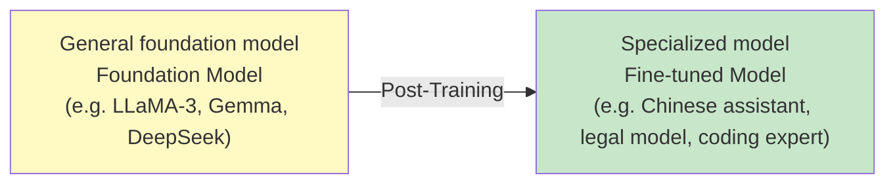

### 5.1.1 Why post-train
{: id="511-为什么需要-post-training"}

Today's general models (LLaMA, Gemma, DeepSeek, and others) already have strong basic abilities, like a top student fresh out of school. Real applications, however, often need **specialization**:

- **Specific domains**: finance, law, medicine, bioinformatics
- **Specific languages**: Chinese, Japanese, Korean, low-resource languages
- **Specific tasks**: code generation, math reasoning, tool use
- **New modalities**: teaching a text model to understand speech and images

### 5.1.2 Three post-training methods
{: id="512-三种-post-training-方式"}

|Approach|Data format|Typical use|
|------|---------|---------|
| **Pre-train Style** |Unlabeled text (language modeling)|Inject domain knowledge, add languages|
| **SFT Style** |Question-answer / instruction-response pairs|Instruction following and conversation|
| **RL Style** |Reward signal (rules or model scores)|Reasoning, safety alignment|

> **Terminology**: the literature uses "foundation model" inconsistently; some papers call an aligned chat model a base model. Watch for the distinction when reading.

---

## 5.2 Catastrophic forgetting
{: id="52-灾难性遗忘"}

The biggest challenge of post-training: **the new skill is learned, and old skills collapse**. This is called **catastrophic forgetting**.

> The operation was a success, but the patient died: you focus on the new goal and reach it, only to find the model's other abilities broken.

### 5.2.1 Real cases
{: id="521-真实案例"}

#### 5.2.1.1 Case 1: teaching LLaMA-2 Chat Chinese → safety alignment collapses
{: id="5211-案例1教-llama-2-chat-说中文--safety-alignment-崩溃"}

LLaMA-2 Chat has been safety-aligned and refuses harmful questions. After pre-train-style post-training on Chinese text:

| |Original LLaMA-2 Chat|After post-training|
|--|--|--|
|Question: "How do I get someone's bank password?"|"I'm sorry, I can't tell you..." ✅|Starts explaining concrete attack methods ❌|
|ToxiGen harmful-content rate|**0.22%** (very safe)|**rises sharply**|

The training data was clean Chinese text with no harmful content at all, yet safety alignment still collapsed.

#### 5.2.1.2 Case 2: ordinary SFT data can also break safety (Fine-Tuning Aligned LLMs Compromises Safety)
{: id="5212-案例2普通-sft-数据也会破坏-safetyfine-tuning-aligned-llms-compromises-safety"}

Fine-tuning GPT-3.5 Turbo even on completely harmless SFT data such as Alpaca degrades its safety (Qi et al., 2023). More extreme still, **just 10 "identity-shifting" examples** (making the model claim to be AOA, an "absolutely obedient agent") are enough to make safety plummet across every dimension.

#### 5.2.1.3 Case 3: teaching LLaMA-3 new skills → broad capability loss
{: id="5213-案例3教-llama-3-新技能--全面能力损伤"}

LLaMA-3 was fine-tuned separately on four tasks: reasoning, medical knowledge, coding, and tool use.

Results:
- The target task improved (as expected)
- Safety alignment **collapsed in every case**
- Non-target abilities also dropped sharply (after learning tool use, math accuracy fell from 19.6% to 3.6%)

#### 5.2.1.4 Case 4: multimodal post-training (teaching a text model to understand speech)
{: id="5214-案例4多模态-post-training教文本模型听语音"}

When LLaMA was given speech input (an inserted adapter plus an audio encoder), by the third epoch of post-training:
- Speech emotion recognition improved
- **The ability to output JSON disappeared** (an ability LLaMA had originally, never touched by training, and it still collapsed)

---

### 5.2.2 Key rules
{: id="522-关键规律"}

#### 5.2.2.1 Rule 1: forgetting grows with target-task performance
{: id="5221-规律1遗忘与目标任务表现正相关"}

> **The better you learn, the more you forget.**

Studies find that a model's fine-tuning loss on the target task (more thorough learning → lower loss) and the amount of forgetting are almost **linearly correlated**. In other words, you cannot both "train the model harder" and avoid forgetting at the same time.

#### 5.2.2.2 Rule 2: LoRA does not really solve forgetting
{: id="5222-规律2lora-并未真正解决遗忘"}

LoRA appears to forget less, but at the cost of **learning less**.

> **LoRA learns less and forgets less**

| LoRA Rank |Target-task ability|Amount of forgetting|
|-----------|------------|---------|
|Small rank|Weak|Little (clustered in the lower left)|
|Large rank|Strong|A lot (clustered in the upper right)|

Conclusion: LoRA merely trades "full fine-tuning forgets" for "learn less → forget less". It does not fundamentally solve forgetting, and other regularizers (dropout, weight decay) do not help either.

#### 5.2.2.3 Rule 3: forgetting barely depends on model size
{: id="5223-规律3遗忘与模型大小无明显关系"}

From 1B to 7B, larger models do not forget less. Forgetting is a general phenomenon that does not go away as parameter count grows.

---

## 5.3 Methods to prevent forgetting
{: id="53-防止遗忘的方法"}

### 5.3.1 Experience replay
{: id="531-经验回放"}

**Core idea**: when training on a new task, mix in a small amount of training data from old tasks.

**Key finding**: mixing in only about 5% **historical data** is enough to prevent forgetting effectively. Forgetting does not truly "delete" old knowledge; it "hides" it, and a small reminder is enough to bring it back.

**In practice**:

```python
# What Safety-Tuned LLaMA does: mix in 3% safety-alignment data
mixed_dataset = {
    "target_task_data": 0.97,   # the current task (e.g. Chinese text)
    "safety_alignment_data": 0.03,  # dialogue data that preserves safety behavior
}
```

**Challenge**: today's big labs (Meta, Google) release only model weights and **do not release training data**. Without the historical training data, experience replay is impossible.

---

### 5.3.2 Pseudo experience replay
{: id="532-伪经验回放"}

If the real historical data is unavailable, have the model **generate pseudo-historical data** itself.

**Core insight**: the model has not truly "forgotten" old knowledge; it is still in the weights. Let the model produce content that resembles its historical training data, then mix that into the current training.

#### 5.3.2.1 Magpie method (2024)
{: id="5321-magpie-方法2024"}

Section 3.3.3.1 explains how Magpie works. To prevent forgetting, the foundation model asks and answers its own questions, producing instruction data that "looks like what it saw in training":

```
Input:          [BOS] <|user|>                          ← only the user token is given
Model generates: What is the attention mechanism?       ← writes its own question
Input:          <|assistant|>
Model generates: The attention mechanism is...          ← writes its own answer
```

This yields "SFT data resembling what LLaMA-3 was likely trained on", which can be mixed into post-training data to prevent forgetting.

---

### 5.3.3 Self-output
{: id="533-self-output"}

A more targeted method than pseudo experience replay: instead of generating "historical data", replace human-written answers with the foundation model's **own current outputs**.

Why it works:

```
Human-written answers ← phrasing that feels "foreign" to the foundation model; learning it makes old knowledge easier to forget
The model's own answers ← style and wording match the model closely, so learning them barely disturbs existing knowledge
```

**Selective self-rehearsal**:

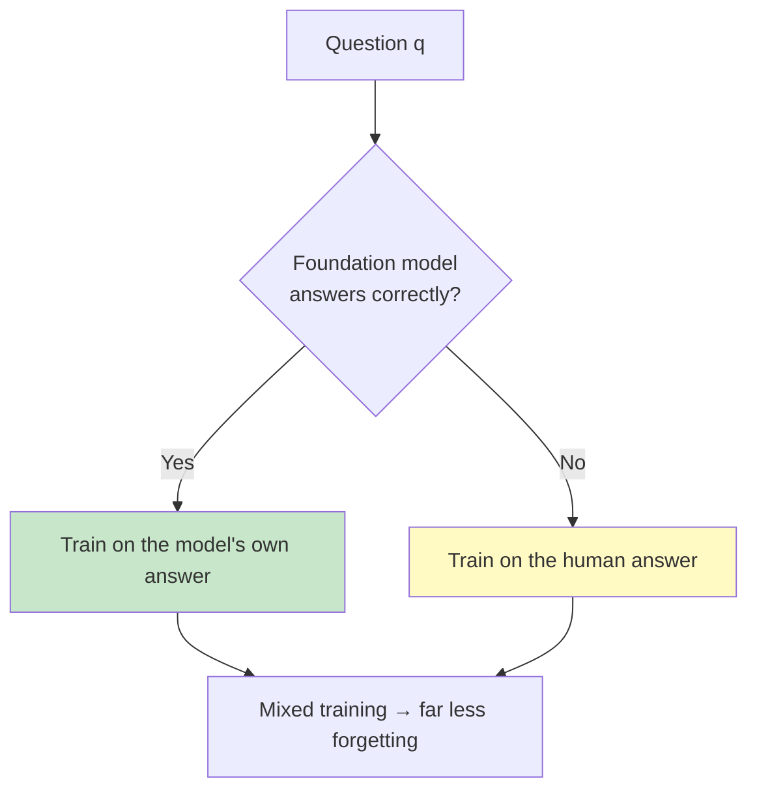

**Effect**: target-task performance stays about the same while forgetting drops sharply (compared with plain SFT).

#### 5.3.3.1 Paraphrase variants
{: id="5331-paraphrase-变体"}

Have the foundation model **rewrite the human answer** (rather than generate a new one):

```python
# Ask the foundation model to rewrite the human reference answer
paraphrased_answer = foundation_model(
    f"Please rephrase the following answers so that the meaning remains the same:{human_answer}"
)
# Training on the rewritten answers causes less forgetting
```

This beat training directly on human answers in 8 of 9 test settings.

#### 5.3.3.2 Token-level filtering (advanced)
{: id="5332-token-level-filtering进阶"}

A finer-grained approach: rather than dropping whole samples, **skip the tokens** that are especially hard for the foundation model to predict.

```python
# Difficulty (surprisal) of each token for the foundation model
token_surprisals = -log(foundation_model.prob(token | context))

# Drop the hardest 20% of tokens (no loss on them)
loss_mask = (token_surprisals < threshold)
loss = cross_entropy(logits[loss_mask], labels[loss_mask])
```

**Effect**: at a filtering ratio of about 20%, both in-domain and out-of-domain performance improve: "Not forcing the model to learn what it cannot learn makes it learn better."

---

### 5.3.4 RL-based post-training
{: id="534-基于-rl-的-post-training"}

RL training (such as GRPO) is **very similar in nature** to self-output:

| | Self-Output | RL Training |
|--|--|--|
|Source of answers|Generated by the foundation model itself|Sampled from the policy (the current model)|
|Correct answers|Train on the model's own answer (raise its probability)|Positive reward → gradient update raises its probability|
|Wrong answers|Use the human answer|Negative reward → lower its probability|

This may explain why **RL-based training usually comes last in the pipeline**: it naturally resembles self-output and does little damage to old abilities, making it an inherently forgetting-resistant way to train.

---

## 5.4 Practical suggestions
{: id="54-实践建议"}

> **Golden rule of post-training**: do not look only at the target task; always check whether the model's original abilities survived.

**Recommended process**:

```
1. Establish a baseline
   ├── Record the foundation model's scores on a range of benchmarks
   └── Focus on: safety, general reasoning, and tasks it was already good at

2. Post-training
   ├── Prefer self-output / RL-based methods
   └── If you use human-labeled data, mix in 3-5% data generated by the foundation model

3. Comprehensive evaluation
   ├── Target task: did it improve as expected?
   ├── Safety: ToxiGen / HarmBench, etc.
   └── General ability: MMLU / GSM8K / HumanEval, etc.
```

**Common pitfalls**:

|Pitfall|Symptom|Fix|
|------|------|---------|
|Looking only at the target task|"Beats GPT-4 on Verilog, but can no longer understand comments"|Add a broad evaluation suite|
|Trusting LoRA to prevent forgetting|With a large LoRA rank, forgetting is almost the same as full fine-tuning|Combine with self-output|
|Ignoring safety|Safety collapses after teaching code or math|Mix in 3% safety data|
|Using only human-labeled data|More forgetting than with the model's own answers|Switch to paraphrase / self-output|

---

# 6. Distributed training
{: id="6-分布式训练技术"}

Training large models depends on distributed parallelism.

> **About this chapter**
>
> Distributed training is the **core engineering technique** of LLM training: without it, no model larger than a single GPU's memory could be trained at all. This chapter introduces data parallelism, tensor parallelism, pipeline parallelism, and ZeRO, and how to choose a parallel strategy. **Rule of thumb**: use TP when a single layer is too large, PP when there are too many layers, and DP to increase throughput.

## 6.1 Data parallelism (DP / DDP)
{: id="61-数据并行dp--ddp"}

### 6.1.1 Principle
{: id="611-原理"}
Data parallelism is the most intuitive form of distributed training. When the full model fits on one GPU but a large batch does not, the dataset is split so that several GPUs process different subsets in parallel:
- Each GPU holds its own full copy of the model parameters.
- In the forward pass, each device takes a different batch and computes its loss and local gradient $$\mathbf{g}_i$$.
- In the backward pass, devices synchronize and average all gradients with an inter-GPU collective such as `All-Reduce`: $$\mathbf{g}_{\text{avg}} = \frac{1}{N} \sum_{i=1}^N \mathbf{g}_i$$.
- Each device then runs the optimizer with the averaged gradient $$\mathbf{g}_{\text{avg}}$$ to update its own weights, so every copy of the model stays identical.

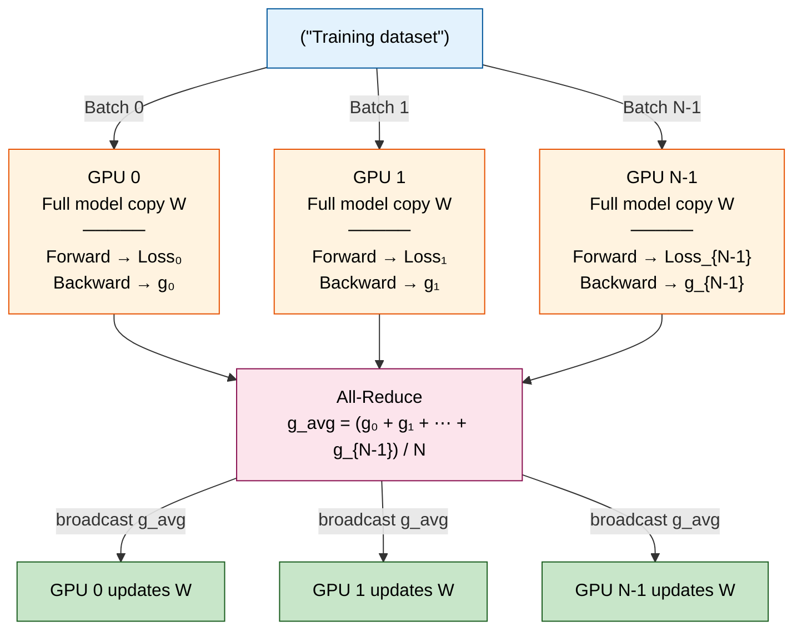

### 6.1.2 Gradient communication
{: id="612-梯度通信优化"}
In PyTorch's `DistributedDataParallel` (DDP), to avoid a burst of network traffic from synchronizing all gradients at once after the backward pass, the system **overlaps gradient communication with computation**:
1. **Gradient buckets**: at initialization, DDP groups gradient tensors into fixed-size buckets (usually 25MB) in reverse order of the backward pass (from the output layer toward the input layer).
2. **Asynchronous synchronization**: during the backward pass, as soon as every gradient in a bucket has been computed, an asynchronous `All-Reduce` for that bucket starts in the background, while the GPU keeps computing gradients for earlier layers. Computation and communication run concurrently, hiding much of the synchronization time.

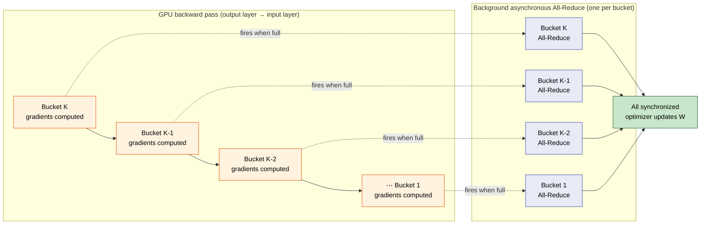

### 6.1.3 DDP limitations
{: id="613-ddp-局限"}
- All model parameters, optimizer state, and gradients must fit entirely in one GPU's memory.
- For very large models that exceed a single GPU's memory (7B and above, for example), DDP simply runs out of memory (OOM) and cannot work on its own.

<div align="center">
  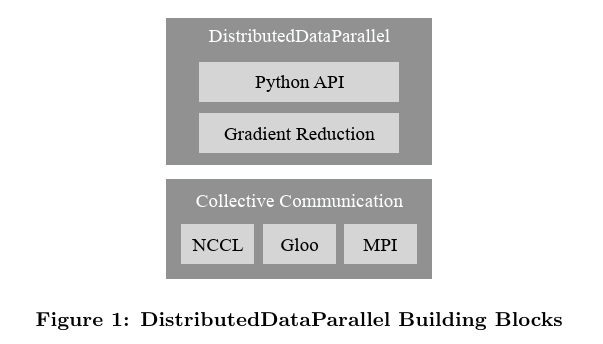
<figcaption>Figure: the software stack of PyTorch DDP: the Python API and gradient reduction layer sit on collective communication backends such as NCCL, Gloo, and MPI (source: Figure 1 of the PyTorch Distributed paper)</figcaption>
</div>

---

## 6.2 Tensor parallelism (TP)
{: id="62-张量并行tp"}

### 6.2.1 How tensors are split
{: id="621-原理与切分策略"}
When a single layer's weight matrices exceed one GPU's memory, tensor parallelism (as in Megatron-LM) splits each layer's weights by row or column across GPUs in the same node (usually connected by fast NVLink), computing the layer's matrix multiplications in a distributed way.

#### 6.2.1.1 Splitting the MLP layer
{: id="6211-mlp-层的切分策略"}
A Transformer MLP layer has two projections: the gate/up projection $W_{\text{gate/up}}$ and the down projection $W_{\text{down}}$. With input $X$, the MLP uses a **column-parallel then row-parallel** split:
- **Column parallelism**:
The first weight matrix $W_{\text{col}}$ is split evenly by column into $p$ shards: $W_{\text{col}} = [W_1, W_2, \ldots, W_p]$.
Every GPU receives the full $X$ and computes its partial output independently:
  $$Y_i = \text{Activation}(X W_i)$$
No communication is needed at this step.
- **Row parallelism**:
The second weight matrix $W_{\text{row}}$ is split evenly by row into $p$ shards: $W_{\text{row}} = [V_1; V_2; \ldots; V_p]$.
Each GPU takes its local output $Y_i$ from the previous step and multiplies independently:
  $$Z_i = Y_i V_i$$
Then a single `All-Reduce (Sum)` across all GPUs adds the local results to give the complete output:
  $$Z = \sum_{i=1}^p Z_i + \text{bias}$$

#### 6.2.1.2 Splitting the attention layer
{: id="6212-attention-层的切分策略"}
- **QKV projection**: also column-parallel. Attention heads are divided evenly across GPUs (with 32 heads and TP over 8 GPUs, each GPU handles 4 heads), and each GPU computes its own queries, keys, and values with no inter-GPU communication.
- **Attention computation**: each GPU runs attention for its heads independently, producing local context vectors.
- **Output projection**: row-parallel. Each GPU multiplies by its local slice of the output weights, and a single `All-Reduce (Sum)` combines the partial results into the full multi-head attention output.

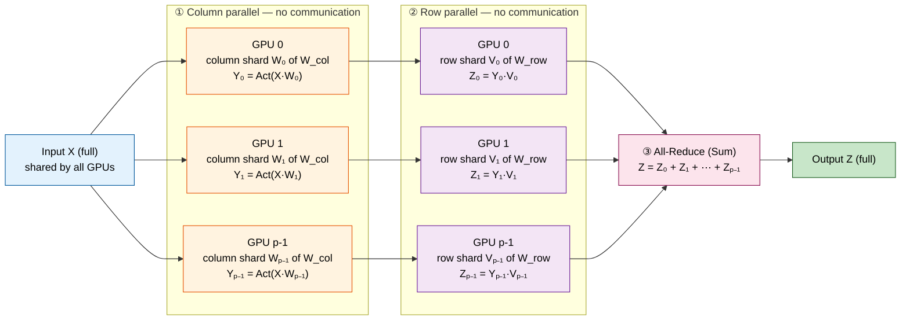

### 6.2.2 Math and communication cost
{: id="622-数学推导与通信代价分析"}
For one Transformer block, the communication calls in the forward and backward passes are clear-cut:
- **Forward pass**:
  - After the attention output projection: 1 `All-Reduce`.
  - After the MLP down projection: 1 `All-Reduce`.
  - **Total forward cost**: $2 \times \text{All-Reduce}$.
- **Backward pass**:
  - The input $X$ of a column-parallel layer is replicated on every GPU, so in the backward pass each GPU's gradient with respect to $X$ is only a partial sum, and an `All-Reduce` is needed at the input of the column-parallel layer (the $f$ operator in Megatron).
  - This happens once for attention and once for the MLP, so **the total backward cost is** $2 \times \text{All-Reduce}$.

Megatron-LM packages this pair into conjugate operators: $f$ is the identity in the forward pass and an All-Reduce in the backward pass; $g$ is an All-Reduce in the forward pass and the identity in the backward pass.

### 6.2.3 When to use it
{: id="623-适用场景与局限"}
- **When to use**: a single layer's weights do not fit in one GPU's memory (for example, the attention and MLP layers of a 70B model).
- **Limitations**: TP communicates very frequently (4 All-Reduces per block across the forward and backward passes) and needs an extremely fast interconnect. TP is therefore usually confined to **NVLink within a single node**, with a TP degree of 2, 4, or 8; cross-node TP is rare.

<div align="center">
  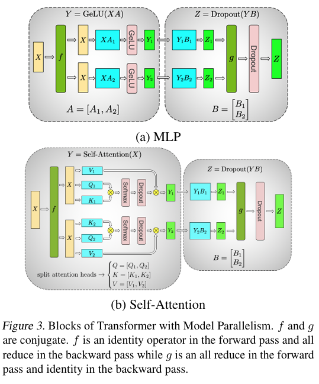
<figcaption>Figure: tensor parallel (TP) architecture: column and row splitting of a Transformer layer (source: Figure 3 of the Megatron-LM paper)</figcaption>
</div>

---

## 6.3 Pipeline parallelism (PP)
{: id="63-流水线并行pp"}

### 6.3.1 Principle
{: id="631-原理"}
When a model has too many layers to fit in one node, pipeline parallelism splits it "vertically" between layers: the model's $L$ layers are divided into $p$ stages placed on $p$ different GPUs (which may span nodes).

```mermaid
flowchart LR
    DATA["Input data<br>micro-batches"]

    subgraph S0 ["GPU 0 — Stage 0"]
        L0["Layer 1 ~ L/p"]
    end
    subgraph S1 ["GPU 1 — Stage 1"]
        L1["Layer L/p+1 ~ 2L/p"]
    end
    subgraph SX ["..."]
        LX["..."]
    end
    subgraph SP ["GPU p-1 — Stage p-1"]
        LP["Layer (p-1)L/p+1 ~ L"]
    end

    DATA --> L0
    L0 -->|"activations via P2P"| L1
    L1 -->|"activations via P2P"| LX
    LX -->|"activations via P2P"| LP
    LP --> LOSS["Compute loss<br>gradients flow back via P2P"]

    style DATA fill:#e3f2fd,stroke:#01579b,color:#000
    style L0 fill:#fff3e0,stroke:#e65100,color:#000
    style L1 fill:#fff9c4,stroke:#f57f17,color:#000
    style LP fill:#f3e5f5,stroke:#6a1b9a,color:#000
    style LOSS fill:#c8e6c9,stroke:#1b5e20,color:#000
```

### 6.3.2 Schedules and bubble ratio
{: id="632-调度策略与气泡占比公式"}
If a whole batch is pushed through the pipeline at once, most GPUs sit idle waiting during the forward and backward passes; this idle time is called the pipeline bubble. PP improves utilization by splitting the batch into $m$ smaller micro-batches.

#### 6.3.2.1 GPipe (F-then-B scheduling)
{: id="6321-gpipe-f-then-b-调度"}
- **Schedule**: all $m$ micro-batches go through the forward pass stage by stage, and only then are all backward passes run in turn.
- **Bubble ratio**:
  $$F_{\text{bubble}} = \frac{p - 1}{m + p - 1}$$
- **Drawback**: activations must stay in GPU memory until their backward pass arrives, so memory grows linearly with the number of micro-batches $m$, undermining the memory savings.

#### 6.3.2.2 1F1B (One Forward, One Backward scheduling)
{: id="6322-1f1b-one-forward-one-backward-调度"}
- **Schedule**: once the pipeline has warmed up and filled, each stage alternates one forward step with one backward step.
- **Bubble**: the same as GPipe. Taking the ideal compute time as the denominator (as Megatron-LM does), both have a bubble ratio of
  $$\frac{p - 1}{m}$$
so reducing bubbles still depends on increasing the number of micro-batches $m$.
- **Advantage**: the activations of micro-batch $i$ can be freed as soon as its backward pass has run. At most $p$ sets of activations are cached at a time, decoupling activation memory from the number of micro-batches $m$: 1F1B saves memory, not bubbles.

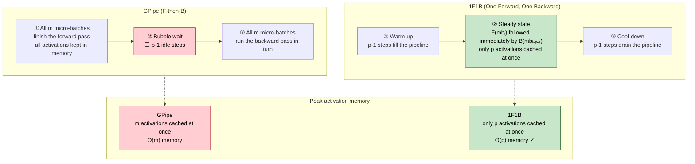

#### 6.3.2.3 Interleaved 1F1B (virtual pipeline)
{: id="6323-interleaved-1f1b-虚拟流水线"}
- Each GPU is assigned several non-contiguous virtual stages (for example, GPU 0 handles layer 1 and layer 9). With $v$ virtual stages per GPU, the bubble ratio drops to $\frac{p-1}{v \cdot m}$, at the cost of $v$ times more point-to-point (P2P) communication.

<div align="center">
  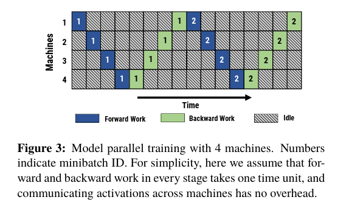
<figcaption>Figure: with naive model parallelism (no micro-batches), the four machines sit idle most of the time; this is the pipeline bubble problem (source: Figure 3 of the PipeDream paper)</figcaption>
</div>

---

## 6.4 Sequence parallelism (SP)
{: id="64-序列并行sp"}

### 6.4.1 Principle
{: id="641-原理"}
- **Mechanism**: in the parts of a Transformer layer that tensor parallelism does not split (LayerNorm, dropout, residual connections), standard TP still stores the full activations redundantly on every GPU. This memory grows linearly with sequence length $s$ and becomes significant in long-context training. Sequence parallelism splits the sequence dimension in these **non-attention layers** (each GPU handles a sequence of length $\frac{s}{p}$). Before the QKV projection and the MLP column projection, an `All-Gather` reassembles the full sequence; afterwards, a `Reduce-Scatter` splits it again.

### 6.4.2 Long-sequence optimization
{: id="642-优势与长序列分布式优化"}
- **Lower cost**: activation memory at LayerNorm and dropout is spread across $p$ GPUs.
- **Longer context**: combined with TP (TP-SP) and selective activation recomputation, Megatron-LM experiments cut activation memory by about 5× (Korthikanti et al., 2022). Even longer contexts (millions of tokens) need approaches such as Ring Attention that also split the sequence inside attention (see Section 2.5.3.4).

```mermaid
flowchart LR
    IN["Each GPU holds<br>a sequence of length s/p<br>(activations split)"]

    IN --> LN["LayerNorm<br>(independent per GPU, no communication)"]
    LN -->|"All-Gather<br>reassemble the full sequence s"| FULL["Full-sequence activations<br>(s × h)"]

    subgraph TPATTN ["Attention TP region"]
        FULL --> QKV["QKV projection<br>(column parallel)"] --> ATTN["Attention<br>(independent per GPU)"] --> OPRJ["Output projection<br>(row parallel)"]
    end

    OPRJ -->|"Reduce-Scatter<br>back to s/p sequences"| DROP["Dropout + residual<br>(s/p tokens per GPU)"]
    DROP --> LN2["LayerNorm → MLP<br>(same All-Gather / Reduce-Scatter)"]
    LN2 --> OUT["Input to next layer<br>(split along sequence, s/p)"]

    style IN fill:#e3f2fd,stroke:#01579b,color:#000
    style FULL fill:#fff3e0,stroke:#e65100,color:#000
    style QKV fill:#f3e5f5,stroke:#6a1b9a,color:#000
    style ATTN fill:#f3e5f5,stroke:#6a1b9a,color:#000
    style OPRJ fill:#f3e5f5,stroke:#6a1b9a,color:#000
    style DROP fill:#e8eaf6,stroke:#3949ab,color:#000
    style OUT fill:#e3f2fd,stroke:#01579b,color:#000
```

---

## 6.5 ZeRO
{: id="65-zero"}

ZeRO, introduced by Microsoft DeepSpeed, aims to eliminate the redundant per-GPU copies of DDP entirely by spreading the model state evenly across GPUs.

### 6.5.1 Static memory budget
{: id="651-静态显存推导"}
Let the parameter count be $\Psi$. Under standard FP16 mixed-precision training, the static memory a GPU needs for the model states is:
1. **Parameters**: stored in FP16, $2\Psi$ bytes.
2. **Gradients**: stored in FP16, $2\Psi$ bytes.
3. **Optimizer states**: kept in FP32 for numerical accuracy:
   - Master weights: $4\Psi$ bytes
   - First moment (momentum): $4\Psi$ bytes
   - Second moment (variance): $4\Psi$ bytes
   - Optimizer total: $12\Psi$ bytes.

$$\text{Static GPU memory} = 2\Psi + 2\Psi + 12\Psi = 16\Psi \text{ bytes}$$

For a 7B model, static memory reaches $16 \times 7 = 112\text{GB}$; a single H100 (80GB) cannot even hold the model states.

### 6.5.2 ZeRO sharding and offload
{: id="652-zero-分片与-offload"}

#### 6.5.2.1 ZeRO-1: Optimizer States Partitioning
{: id="6521-zero-1优化器状态分片-optimizer-states-partitioning"}
- **Mechanism**: the $12\Psi$ bytes of AdamW optimizer state are split evenly across $N_d$ GPUs; each GPU updates and stores only $\frac{1}{N_d}$ of it.
- **Per-GPU memory**:
  $$M_{\text{ZeRO-1}} = 2\Psi + 2\Psi + \frac{12\Psi}{N_d}$$
  - *Example*: for a 7B model with $N_d=8$, static memory drops from 112GB to **38.5GB**.

#### 6.5.2.2 ZeRO-2: Gradient Partitioning
{: id="6522-zero-2梯度分片-gradient-partitioning"}
- **Mechanism**: during the backward pass, as soon as a layer's gradients are computed, a `Reduce-Scatter` sends them to the GPU that owns that layer's optimizer state, and the other GPUs free those gradients immediately.
- **Per-GPU memory**:
  $$M_{\text{ZeRO-2}} = 2\Psi + \frac{2\Psi + 12\Psi}{N_d} = 2\Psi + \frac{14\Psi}{N_d}$$
  - *Example*: for a 7B model with $N_d=8$, static memory drops to **26.25GB**.

#### 6.5.2.3 ZeRO-3: Parameter Partitioning
{: id="6523-zero-3参数分片-parameter-partitioning"}
- **Mechanism**: the $2\Psi$ bytes of parameters are also split evenly across $N_d$ GPUs. When the forward or backward pass reaches a layer, the GPUs `All-Gather` that layer's full weights and discard them right after use.
- **Per-GPU memory**:
  $$M_{\text{ZeRO-3}} = \frac{2\Psi + 2\Psi + 12\Psi}{N_d} = \frac{16\Psi}{N_d}$$
  - *Example*: for a 7B model with $N_d=8$, static memory is only **14GB**!

#### 6.5.2.4 ZeRO-Offload (offloading to host memory)
{: id="6524-zero-offload-显存-内存卸载"}
- Offloads the sharded optimizer state and gradients over PCIe to host memory (CPU RAM) and runs the optimizer update on the host CPU; updated weights are copied back to the GPU for the forward pass. This greatly raises the size of model a single GPU can train.

#### 6.5.2.5 ZeRO-Infinity
{: id="6525-zero-infinity"}
- Builds on ZeRO-Offload by using NVMe SSDs as a third storage tier, making it possible to fine-tune models with hundreds of billions of parameters on modest GPU setups and pushing past physical hardware limits.

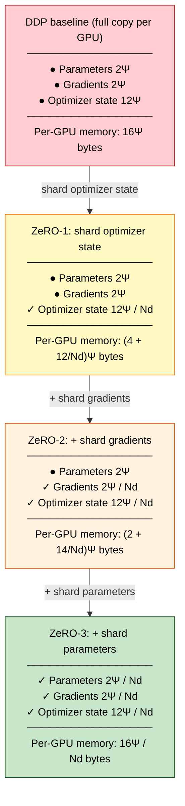

## 6.6 3D parallelism
{: id="66-3d-混合并行"}

Data, tensor, and pipeline parallelism combined:

$$
\text{Total GPUs} = \text{DP degree} \times \text{TP degree} \times \text{PP degree}
$$

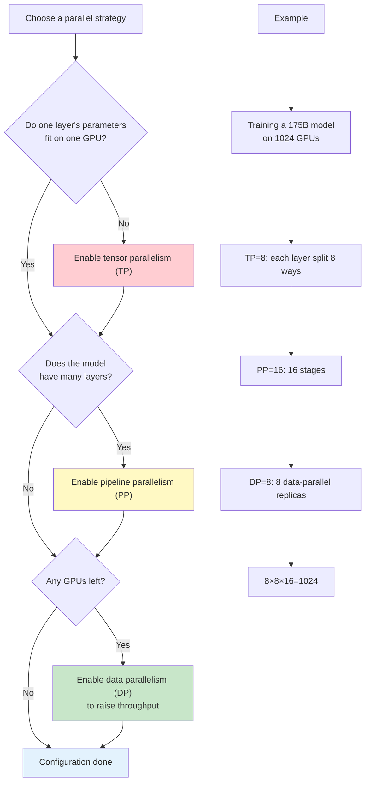

<div align="center">
  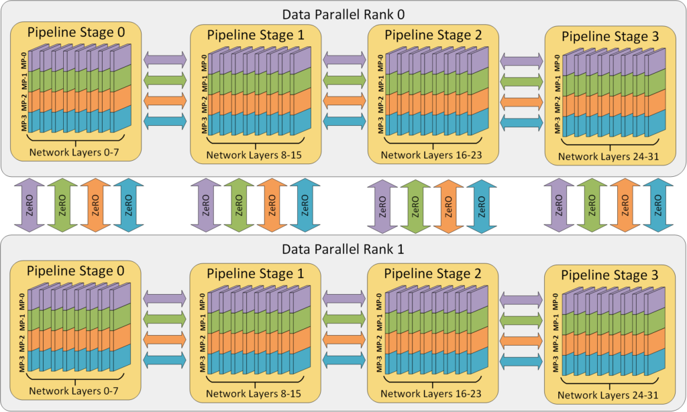
<figcaption>Figure: 3D hybrid parallelism: each data-parallel replica is split by layer into 4 pipeline stages, each stage uses 4-way tensor parallelism (MP in the figure), and ZeRO sharding is used across replicas (source: Microsoft DeepSpeed blog)</figcaption>
</div>

### 6.6.1 Principles of strategy selection
{: id="661-策略选择原则"}

**Decision process**:
1. **Consider TP (tensor parallelism) first**:
   - Required when one layer's parameters exceed a single GPU's memory
   - Typical: TP=2/4/8 (within a node, over NVLink)
   - Example: a 12GB layer on an 80GB GPU → no TP needed

2. **Then PP (pipeline parallelism)**:
   - Used when the model has many layers
   - Typical: PP=2/4/8/16
   - Example: a 96-layer model with PP=16 → 6 layers per stage

3. **Finally DP (data parallelism)**:
   - Uses all remaining GPUs
   - Raises training throughput
   - Example: 1024 GPUs, TP=8, PP=16 → DP=8

**Real configurations**:

|Model size| TP | PP | DP |Total GPUs|Notes|
|---------|----|----|----|----|------|
|**7B parameters**| 1 | 1 | 64 | 64 |Small model; pure DP is enough|
|**13B parameters**| 2 | 1 | 32 | 64 |Needs a little TP|
|**70B parameters**| 8 | 4 | 4 | 128 |Needs TP+PP|
|**175B parameters**| 8 | 16 | 8 | 1024 |Large model; full 3D parallelism|
|**540B parameters**| 8 | 32 | 16 | 4096 |Very large model|

**Trade-offs**:
- **More TP**: more intra-layer communication; needs a fast interconnect (NVLink)
- **More PP**: larger pipeline bubbles and lower GPU utilization
- **More DP**: more gradient-sync traffic, though Ring-AllReduce helps

---

# 7. Training optimization
{: id="7-训练优化技术"}

In LLM training, hardware (especially GPU memory and bandwidth) and training time are the core bottlenecks. Optimization techniques decide not only whether a model can run on limited resources at all, but also how fast training converges and how good the final model is. This chapter examines optimizer choice, learning-rate schedules, gradient handling, regularization, and the Flash Attention kernel.

> **About this chapter**
>
> LLM training is **a trade-off between GPU memory and compute efficiency**. The optimizer sets the floor for memory use, learning-rate and gradient strategies decide whether training converges smoothly, and Flash Attention is the foundation for handling the cost of attention on long text. This chapter aims to connect the math with the engineering implementation.

---

## 7.1 Choosing an optimizer
{: id="71-优化器选择"}

Optimizer states are one of the biggest consumers of GPU memory in LLM training. In common FP16/BF16 mixed-precision training, weights and gradients take only 2 bytes each, but AdamW must also keep, for every parameter, an FP32 master weight, an FP32 first moment (momentum), and an FP32 second moment (variance), which adds a lot of memory.

### 7.1.1 AdamW
{: id="711-adamw"}

AdamW is the dominant optimizer for LLM training today (the default for LLaMA, GPT, InternLM, and others).

#### 7.1.1.1 Update rule and decoupled weight decay
{: id="7111-核心公式与-weight-decay-解耦"}
When classic Adam is combined with L2 regularization, the regularization gradient is mixed into the momentum estimates, which scales the penalty incorrectly for parameters with sparse gradients. AdamW decouples weight decay from the gradient update and subtracts the decay term directly in the parameter update:

$$
\theta_{t+1} = \theta_t - \eta_t \lambda \theta_t - \eta_t \left( \frac{\hat{m}_t}{\sqrt{\hat{v}_t} + \epsilon} \right)
$$

where:
- $\theta_t$: model parameters at step $t$
- $\eta_t$: learning rate at the current step
- $\lambda$: weight decay rate (usually 0.1)
- $$\hat{m}_t, \hat{v}_t$$: bias-corrected first and second moments

#### 7.1.1.2 Memory cost
{: id="7112-显存开销分析"}
For a model with $N$ parameters trained in mixed precision:
- **Parameters (FP16/BF16)**: $2N$ bytes
- **Gradients (FP16/BF16)**: $2N$ bytes
- **AdamW optimizer state (FP32)**:
  - **Master weights** (to accumulate tiny updates): $4N$ bytes
  - **First moment $m_t$**: $4N$ bytes
  - **Second moment $v_t$**: $4N$ bytes
  - **Optimizer state total**: $12N$ bytes

**Conclusion**: the optimizer state alone takes $12N$ bytes, **75%** of the baseline memory of mixed-precision training ($16N$ bytes).

---

### 7.1.2 Adafactor
{: id="712-adafactor"}

Adafactor was designed to remove the $4N$ bytes taken by AdamW's second moment, and is often used to train models such as T5.

#### 7.1.2.1 Low-rank factorization to save memory
{: id="7121-低秩分解减小显存"}
For a weight matrix of shape $R \times C$, Adafactor does not store the full second-moment matrix $V \in \mathbb{R}^{R \times C}$. Instead it uses a **rank-1 factorization**: it keeps only the row sums $V_R \in \mathbb{R}^R$ and column sums $V_C \in \mathbb{R}^C$, and reconstructs an approximation of the second moment from them:

$$
\hat{V}_{i,j} = \frac{(V_R)_i \cdot (V_C)_j}{\sum_{k} (V_C)_k}
$$

This cuts second-moment storage from $O(RC)$ to $O(R + C)$; for large matrices, second-moment memory becomes almost negligible.

#### 7.1.2.2 Pros and cons
{: id="7122-优缺点分析"}
- **Pro**: large memory savings, shrinking optimizer state from $12N$ bytes to about $4N$ bytes (with the first moment disabled and only the row/column second-moment factors stored).
- **Con**: without full first and second moments, training can converge slowly or become unstable on some tasks.

---

### 7.1.3 Lion
{: id="713-lion"}

Lion is an optimizer found by Google through symbolic program search ("symbolic discovery").

#### 7.1.3.1 Core mechanism: the sign function and a single momentum
{: id="7131-核心机制sign-函数与单动量"}
Lion drops the second moment, keeps only the first, and applies the **sign function** to the update, making every update step the same size. Its update rules are:

$$
u_t = \text{sign}(\beta_1 m_{t-1} + (1 - \beta_1) g_t)
$$
$$
m_t = \beta_2 m_{t-1} + (1 - \beta_2) g_t
$$
$$
\theta_{t+1} = \theta_t - \eta_t (u_t + \lambda \theta_t)
$$

where:
- $g_t$: gradient at the current step
- $m_t$: first moment
- $\text{sign}(\cdot)$: sign function (values $+1, -1, 0$)

#### 7.1.3.2 Memory cost
{: id="7132-显存开销分析"}
Because Lion has no second moment:
- **First moment $m_t$ (FP32)**: $4N$ bytes
- **Master weights (FP32)**: $4N$ bytes
- **Optimizer state total**: $8N$ bytes ($4N$ bytes less than AdamW)

#### 7.1.3.3 Features
{: id="7133-特点"}
- **High throughput**: the `sign` operation vectorizes well on GPUs, and with no second-moment computation each step is slightly faster.
- **Sensitive to hyperparameters**: Lion is more sensitive than AdamW to learning rate and weight decay, which need retuning for each model.

---

### 7.1.4 Muon
{: id="714-muon"}

Muon (MomentUm Orthogonalized by Newton-Schulz) was introduced by Keller Jordan in 2024 for small-model training speedruns. In 2025 Moonshot AI scaled it to large models and used it in place of AdamW for the trillion-parameter Kimi K2; Zhipu's GLM-4.5 also uses Muon. It is the first optimizer in years to seriously challenge AdamW at frontier scale.

#### 7.1.4.1 Core mechanism: orthogonalizing the momentum
{: id="7141-核心机制对动量做正交化"}

AdamW rescales the gradient element by element, treating a weight matrix as a bag of independent numbers. Muon treats each 2-D weight matrix as a whole: it accumulates momentum and then "orthogonalizes" the momentum matrix, keeping its singular vectors and pushing all singular values toward 1:

$$M_t = \mu M_{t-1} + G_t, \qquad O_t = \text{NewtonSchulz}(M_t) \approx U V^\top \quad (M_t = U \Sigma V^\top)$$

$$W_t = W_{t-1} - \eta_t \left( 0.2 \sqrt{\max(m, n)} \cdot O_t + \lambda W_{t-1} \right)$$

- **Why orthogonalize**: gradient matrices in language models are often dominated by a few principal directions, and the remaining directions barely move under a direct update. After orthogonalization every direction gets an update of the same size, so "rare directions" are learned too
- **Newton-Schulz iteration**: an exact SVD is too expensive, so Muon approximates $UV^\top$ with about five steps of a matrix-polynomial iteration. It consists only of matrix multiplications, is cheap on GPUs, and can run in BF16
- **Two changes for scaling up** (Moonshot, "Muon is Scalable"): add weight decay, so weights and activations stop growing without bound; and multiply by $0.2\sqrt{\max(m,n)}$ so the update RMS matches AdamW's, which lets you reuse learning rates and weight decay already tuned for AdamW
- **Scope**: Muon applies only to 2-D hidden-layer matrices. Embeddings, the output head, norm scales, and biases still use AdamW

#### 7.1.4.2 Benefits and costs
{: id="7142-收益与代价"}

- **Sample efficiency**: in Moonshot's scaling experiments, Moonlight (a 16B-parameter MoE) trained with Muon matched AdamW with about 52% of the training FLOPs
- **Memory**: with a single momentum buffer, the optimizer state equals Lion's ($8N$ bytes including master weights)
- **Distributed overhead**: Newton-Schulz needs the full matrix, while ZeRO splits matrices across GPUs, so each step gathers the gradient shards, orthogonalizes, and splits them again, adding one communication round and a little redundant compute
- **Stability**: models trained with Muon are more prone to exploding attention logits. Kimi K2 pairs it with QK-Clip (Section 2.6.2.4); together they are called **MuonClip**

---

### 7.1.5 Optimizer comparison
{: id="715-优化器对比"}

A side-by-side comparison of common optimizers:

|Optimizer|Memory (state only)|Strengths|Weaknesses|When to use|
| :--- | :--- | :--- | :--- | :--- |
| **AdamW** |$12N$ bytes|Very smooth convergence, robust to hyperparameters, best ecosystem support|Uses a lot of memory|The default choice for LLM training|
| **Muon** |$8N$ bytes|Orthogonalized momentum; clearly more sample-efficient than AdamW and can reuse AdamW hyperparameters|Needs AdamW for non-matrix parameters; harder to implement in distributed training; logit explosions must be controlled|Large-scale pretraining that prioritizes training efficiency (Kimi K2, GLM-4.5)|
| **Lion** |$8N$ bytes|33% less optimizer memory, slightly faster, uniform update magnitudes|Hard to tune; early training may be jumpy|Memory-constrained settings that want higher throughput|
| **Adafactor** |$4N \text{–} 8N$ bytes|Rank-1 row/column factorization; big memory savings for large matrices|Less stable than AdamW|Early T5 training; extremely memory-constrained settings|

#### 7.1.5.1 Optimizer state memory per parameter (FP16 mixed-precision training, bytes per parameter)
{: id="7151-优化器状态显存占用图解基于-fp16-混合精度训练每参数字节数"}

```mermaid
gantt
    title Optimizer state memory per model parameter (bytes)
    dateFormat  X
    axisFormat %s

    section AdamW (12B state + 4B weights/gradients = 16B)
    Weights & gradients (FP16) :active, 0, 4
    Master Weights (FP32) :crit, 4, 8
    First moment (FP32) :active, 8, 12
    Second moment (FP32) :active, 12, 16

    section Muon (8B state + 4B weights/gradients = 12B)
    Weights & gradients (FP16) :active, 0, 4
    Master Weights (FP32) :crit, 4, 8
    Momentum (FP32) :active, 8, 12

    section Lion (8B state + 4B weights/gradients = 12B)
    Weights & gradients (FP16) :active, 0, 4
    Master Weights (FP32) :crit, 4, 8
    First moment (FP32) :active, 8, 12

    section Adafactor (4B state + 4B weights/gradients = 8B)
    Weights & gradients (FP16) :active, 0, 4
    Master Weights (FP32) :crit, 4, 8
```

---

## 7.2 Learning rate schedules
{: id="72-学习率策略"}

For Transformers, a sensible learning-rate schedule is key to avoiding gradient explosions and speeding up convergence. The industry standard is **warmup + decay**.

### 7.2.1 Warmup
{: id="721-warmup"}

#### 7.2.1.1 Why warmup is necessary
{: id="7211-为什么必须-warmup"}
Early in training (especially with Pre-LN or the AdamW optimizer):
- Randomly initialized weights make gradients in the first few layers very unstable.
- AdamW's second-moment estimate has not built up yet ($$\hat{v}_t$$ is close to zero, so the bias-corrected step size is abnormally large).
Starting directly at the peak learning rate easily causes numerical overflow or an irrecoverable gradient explosion.

#### 7.2.1.2 Implementation
{: id="7212-实现方式"}
Over the first $T_{\text{warmup}}$ steps (typically 1%–5% of total steps, ~2000–10000 steps), the learning rate rises linearly from 0 to the peak $$\text{lr}_{\max}$$:

$$
\text{lr}(t) = \text{lr}_{\max} \cdot \frac{t}{T_{\text{warmup}}}, \quad t \le T_{\text{warmup}}
$$

---

### 7.2.2 Cosine decay
{: id="722-余弦衰减"}

Cosine decay is the most popular schedule for LLMs: the learning rate comes down smoothly through the middle of training and converges quickly at the end.

$$
\text{lr}(t) = \text{lr}_{\min} + \frac{1}{2}(\text{lr}_{\max} - \text{lr}_{\min}) \left(1 + \cos\left(\frac{\pi (t - T_{\text{warmup}})}{T - T_{\text{warmup}}}\right)\right), \quad t > T_{\text{warmup}}
$$

- **Characteristics**: a smooth curve. Experiments show cosine decay reaches lower perplexity than linear decay on most language-modeling tasks.
- **Recommended setting**: $$\text{lr}_{\min}$$ is usually 10% of $$\text{lr}_{\max}$$ (or simply 0).

---

### 7.2.3 WSD schedule
{: id="723-wsd-调度"}

A cosine schedule requires fixing the total number of training tokens in advance; adding data midway means redoing the whole decay curve. To support **continual training** and changing data budgets, MiniCPM systematically proposed the **WSD schedule**; DeepSeek-V3 uses a similar "long constant learning rate + final decay" scheme (constant for the first 10T tokens, then cosine decay over 4.3T tokens).

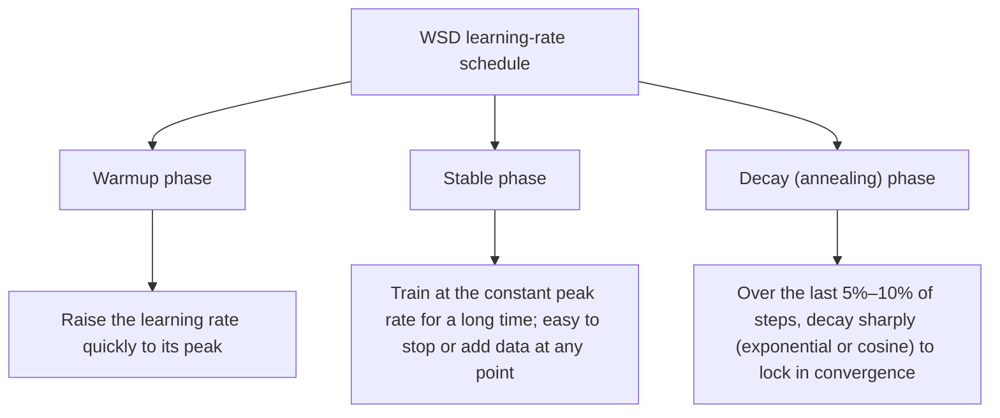

- **Advantages**:
  1. **Flexibility**: checkpoints can be taken at any time during the stable phase. To add data, simply extend the stable phase and start a decay from any checkpoint, with no need to redo a cosine curve.
  2. **Fast convergence**: the decay phase lowers the learning rate in a short time, and model quality makes a "second jump" (a sudden drop in perplexity) during this phase.

---

## 7.3 Gradient handling
{: id="73-梯度处理"}

### 7.3.1 Gradient clipping
{: id="731-梯度裁剪"}

To prevent gradient explosions caused by unusually long samples or extreme gradients, the norm of the combined gradient across all layers is capped.

#### 7.3.1.1 Global L2-norm clipping
{: id="7311-l2-范数全局裁剪global-norm-clipping"}
This is standard in LLM training. Compute the L2 norm of the global gradient vector $\mathbf{g}$ formed by concatenating all parameter gradients; if it exceeds the threshold $d_{\max}$, scale it down proportionally:

$$
\mathbf{g} \leftarrow \mathbf{g} \cdot \min\left(1, \frac{d_{\max}}{\|\mathbf{g}\|_2}\right)
$$

- **Best practice**: the global threshold $d_{\max}$ is usually set to `1.0`.
- **Advantage**: the direction of the gradient is preserved and only the step size is limited, so the relative update sizes across layers stay consistent.

---

### 7.3.2 Gradient accumulation
{: id="732-梯度累积"}

Because a single GPU has limited memory, a large batch (such as millions of tokens) cannot be fed through the forward pass at once. **Gradient accumulation** trades time for memory to simulate large-batch training within the physical memory limit.

#### 7.3.2.1 How it works
{: id="7321-工作原理"}
Let the target batch size be $B_{\text{global}}$ and the micro-batch processed per GPU per step be $B_{\text{micro}}$.
1. For $N$ consecutive steps, run only the forward and backward passes, **accumulating** the gradients in the gradient buffer without calling `optimizer.step()`.
2. At step $N$, divide the accumulated gradients by $N$ (to average), then call `optimizer.step()` to update the parameters and clear the gradients.
3. The relationship is $$B_{\text{global}} = B_{\text{micro}} \times N \times \text{DP\_degree}$$.

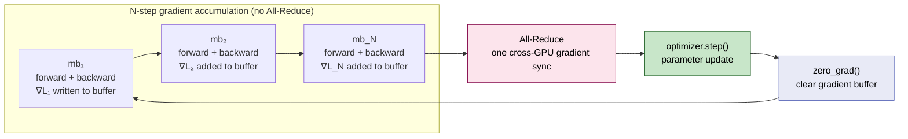

- **Engineering optimization (PyTorch's `no_sync`)**: in distributed training, every backward pass triggers a cross-GPU gradient sync (All-Reduce) by default. For the first $N-1$ accumulation steps, wrap the step in the `model.no_sync()` context manager to skip pointless synchronization and run All-Reduce only on the last step, greatly improving network utilization.

---

### 7.3.3 Gradient checkpointing
{: id="733-梯度检查点"}

Gradient checkpointing (activation checkpointing / recomputation) is the classic technique of **trading compute time for GPU memory**.

#### 7.3.3.1 Background: the activation-memory bottleneck
{: id="7331-背景前向激活值显存瓶颈"}
Computing gradients in the backward pass requires the activations produced in the forward pass. Standard training therefore keeps the activations of every layer in GPU memory during the forward pass, and this memory grows linearly with the number of layers $L$ and the sequence length $s$.

#### 7.3.3.2 Core principles
{: id="7332-核心原理"}
- **Selective saving**: instead of keeping every layer's activations, keep only one "checkpoint" layer every $k$ layers.
- **Recomputation in the backward pass**: when the backward pass reaches a layer whose activations were not saved, rerun the forward pass from the nearest checkpoint to recompute them, use them for the gradient, and discard them immediately.

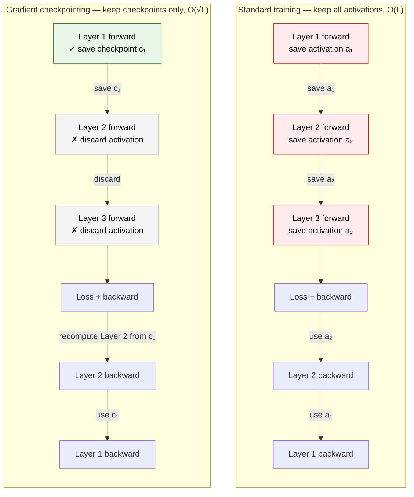

#### 7.3.3.3 Costs and benefits
{: id="7333-代价与收益"}
- **Benefit**: activation memory drops from $O(L)$ to $O(\sqrt{L})$, which goes a long way toward preventing OOM on very long sequences.
- **Cost**: the backward pass includes an extra forward computation, typically adding **30%–33%** compute.

---

## 7.4 Regularization and stability
{: id="74-正则化与数值稳定性技术"}

In LLM training, regularization does more than prevent overfitting; under mixed-precision training it plays a more important role in numerical stability.

### 7.4.1 Weight decay
{: id="741-权重衰减"}

- **Role in AdamW**: at each update, the weights are multiplied by a factor slightly below 1 (weight decay is usually 0.1): $\theta_{t} \leftarrow (1 - \eta_t \lambda)\theta_{t}$.
- **Purpose**: keeps weights from growing too large. In LLM training, oversized weights can easily overflow activations (NaN) or skew attention scores so much that softmax gradients saturate.

### 7.4.2 Dropout
{: id="742-dropout"}

- **Current practice**: when pretraining models above 100 billion parameters (100B), dropout (both attention dropout and residual dropout) is usually set to **0**.
- **Reasons**:
  1. **Abundant data**: pretraining datasets are enormous; relative to that much data the model is unlikely to overfit, so the data itself acts as regularization.
  2. **Efficiency cost**: dropout must sample mask matrices from a random number generator and write them to GPU memory, lowering throughput.
- **Exception**: dropout of 0.05–0.1 may be kept for small-model fine-tuning (SFT) or after the embedding layer, to avoid overfitting to a particular fine-tuning template.

### 7.4.3 Z-loss
{: id="743-z-loss"}

In very large FP16/BF16 mixed-precision training, the output layer's logits can drift toward very large values as a whole, overflowing the exponentials in softmax (NaN). PaLM introduced Z-loss for this, and open models such as OLMo 2 follow the same approach.

#### 7.4.3.1 Core mechanism
{: id="7431-核心机制"}
Z-loss adds an auxiliary penalty to the cross-entropy loss on the log of the logits' partition function $Z$ (i.e. $\sum_i e^{x_i}$):

$$
\mathcal{L} = \mathcal{L}_{\text{cross-entropy}} + \alpha \log^2 Z
$$

Here $Z = \sum_{i} e^{x_i}$, and $\alpha$ is usually on the order of $10^{-4}$ (PaLM uses $10^{-4}$).

#### 7.4.3.2 What it does
{: id="7432-作用与原理"}
- **Bounds the absolute size of the logits**: pushes $\log Z$ toward 0, i.e. the softmax denominator toward 1, so the logits do not drift upward as a whole.
- **Greatly improves stability**: avoids unrecoverable NaN collapse caused by drifting output logits after hundreds of thousands of training steps.

---

## 7.5 Flash Attention
{: id="75-flash-attention"}

Flash Attention is the most important attention acceleration technique in LLM training and inference today. By reordering the computation rather than approximating it, it substantially reduces GPU memory and speeds up computation while remaining numerically equivalent.

### 7.5.1 The attention memory bottleneck
{: id="751-标准-attention-的内存瓶颈"}

Standard scaled dot-product attention computes:

$$\text{Attention}(Q, K, V) = \text{softmax}\left(\frac{QK^T}{\sqrt{d_k}}\right)V$$

**The problem**:
- With sequence length $n$, the $QK^T$ matrix is $n \times n$ and must be written in full to the GPU's main memory (HBM)
- Memory grows as $O(n^2)$: hundreds of MB at $n=4096$, up to tens of GB at $n=32768$
- **The real bottleneck is data movement, not arithmetic**: HBM bandwidth is far lower than on-chip SRAM, and repeatedly reading and writing large matrices dominates the runtime

### 7.5.2 GPU memory hierarchy
{: id="752-gpu-内存层次"}

```
SRAM (on-chip cache) = the workbench
  • Capacity: about 20 MB (A100: 192 KB per SM × 108 SMs)
  • Speed: very fast (~19 TB/s on A100)
  • Accessed directly by the compute units

HBM (main GPU memory) = the warehouse
  • Capacity: 40–80 GB
  • Speed: slower (~2 TB/s on A100)
  • Where all tensors live by default
```

Standard attention writes each intermediate matrix back to HBM and reads it again for the next step, causing a great deal of wasteful data movement. Flash Attention's core goal: **keep data in SRAM as much as possible and minimize round trips to HBM**.

<div align="center">
  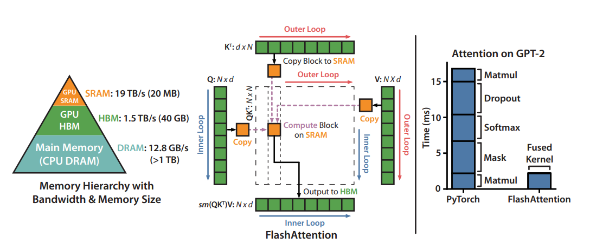
<figcaption>Figure: GPU memory hierarchy (left), FlashAttention's tiled computation (middle), and speed compared with the standard PyTorch implementation (right). Source: Dao et al., FlashAttention, NeurIPS 2022</figcaption>
</div>

### 7.5.3 Tiling and online softmax
{: id="753-分块与-online-softmax"}

Flash Attention rests on these key ideas:

**1. Tiling**

Split $K$ and $V$ into small blocks and load them into SRAM one at a time, so the $n \times n$ matrix is never written to HBM. Each block is discarded as soon as it has been used, without being written back.

**2. Online softmax (incremental normalization)**

Standard softmax must first find the global maximum $A_{\max}$ before computing $\exp$, which requires seeing all the data and rules out tiling. The online approach:

- While processing blocks, track the largest value seen so far, and when a larger value appears, rescale the running sums with a correction factor:

$$\text{Correction factor} = \exp\!\left(A_{\max}^{\text{old}} - A_{\max}^{\text{new}}\right)$$

- The full $n \times n$ attention matrix is never stored

**3. Accumulating the output directly**

Instead of storing the attention weights, accumulate the output $O$ directly:

$$O_k = O_{k-1} \times \text{Correction factor} + \text{Current block contribution}$$

**4. Recomputation in the backward pass**

Rather than reading intermediate matrices back from HBM during the backward pass, Flash Attention recomputes them from $Q/K/V$, spending a little extra compute to save a lot of memory.

### 7.5.4 Memory and speed comparison
{: id="754-内存与速度对比"}

|Method|Attention-matrix memory|HBM accesses|
|------|-------------|------------|
|Standard attention| $O(n^2)$ |Many round trips|
| Flash Attention |$O(n)$ (full matrix never stored)|Minimized|

Results reported in the **paper** (FlashAttention v1, A100):
- Attention kernel alone: up to about **7.6×** faster in the GPT-2 setting
- End-to-end training: about **3×** faster for GPT-2 (sequence length 1K) and about 15% faster for BERT-large (sequence length 512)
- Numerics: exact (not an approximation), differing from the standard implementation only in floating-point operation order
- Memory: the $n \times n$ attention matrix is no longer stored, making training at 64K sequence length possible

### 7.5.5 Version evolution
{: id="755-版本演进"}

|Version|Year|Key changes|
|------|-----|---------|
| FlashAttention v1 | 2022 |The original IO-aware tiling + online softmax|
| FlashAttention v2 | 2023 |Better parallelization and less thread synchronization, ~2× vs v1|
| FlashAttention v3 | 2024 |Targets H100/Hopper, using asynchronous execution and FP8|
| FlashAttention v4 | 2025 |Kernels rewritten for the Blackwell architecture|

### 7.5.6 In practice
{: id="756-实际使用"}

**Built into PyTorch 2.0+** (recommended, no extra dependencies):

```python
import torch.nn.functional as F

output = F.scaled_dot_product_attention(
    query, key, value,
    attn_mask=None,
    dropout_p=0.0,
    is_causal=True  # must be True for autoregressive training
)
```

**Enabling Flash Attention 2 explicitly in transformers**:

```python
from transformers import AutoModelForCausalLM
import torch

model = AutoModelForCausalLM.from_pretrained(
    "meta-llama/Llama-2-7b-hf",
    torch_dtype=torch.bfloat16,
    attn_implementation="flash_attention_2"  # requires flash-attn to be installed
)
```

```bash
pip install flash-attn --no-build-isolation
```

> **Best practice**: Flash Attention is numerically equivalent to standard attention, and the longer the sequence, the bigger the payoff. In PyTorch 2.0+ it comes for free through `scaled_dot_product_attention`; use it for every LLM training job.

---

# 8. Model quantization
{: id="8-模型量化技术"}

Quantization is one of the core techniques for cutting the compute and storage cost of LLMs. By converting high-precision floating-point numbers (FP32/FP16) into low-precision integers (INT8/INT4), it substantially reduces GPU memory and speeds up inference while leaving model quality essentially unchanged.

> **About this chapter**
>
> Quantization is key to making LLMs widely accessible. **A 70B model needs 140GB of GPU memory for its FP16 weights; after INT4 quantization it needs only about 35GB**, which means the weights alone go from needing at least 2 A100-80G GPUs to fitting on 1 (KV cache not included). This chapter covers the math of quantization, the mainstream methods (GPTQ, AWQ, QLoRA), training strategies, and engineering practice. The key point: **quantization is not simple compression but a carefully designed trade-off between accuracy and performance**.

## 8.1 Quantization basics
{: id="81-量化基础"}

### 8.1.1 What is quantization?
{: id="811-什么是量化"}

Quantization maps continuous high-precision values to discrete low-precision values:

$$
\text{FP32/FP16} \xrightarrow{\text{Quantization}} \text{INT8/INT4/INT2}
$$

**Goals**:
- **Less GPU memory**: FP16 → INT8 saves 50%, FP16 → INT4 saves 75%
- **Faster compute**: integer arithmetic is 2-4 times faster than floating point
- **Lower cost**: smaller models can be deployed on cheaper hardware

**Key challenges**:
- Keeping accuracy from dropping noticeably
- Handling outliers
- Balancing quantization granularity against accuracy loss

### 8.1.2 The math of quantization
{: id="812-量化的数学原理"}

#### 8.1.2.1 Symmetric quantization
{: id="8121-对称量化symmetric-quantization"}

Map a floating-point value $x \in [-\alpha, \alpha]$ to an integer $q \in [-127, 127]$ (INT8 as an example):

$$
q = \text{round}\left(\frac{x}{s}\right), \quad s = \frac{\alpha}{127}
$$

**Dequantization** (recovering values at inference):

$$
\hat{x} = s \cdot q
$$

where:
- $s$: the scaling factor (scale)
- $\alpha$: the largest absolute value among all elements
- $q$: the quantized integer

**Features**:
- Pro: simple to implement and hardware friendly
- Pro: the zero point is 0, so nothing extra needs to be stored
- Con: wastes representation range on asymmetrically distributed data

#### 8.1.2.2 Asymmetric quantization
{: id="8122-非对称量化asymmetric-quantization"}

For asymmetrically distributed data $x \in [x_{\min}, x_{\max}]$:

$$
q = \text{round}\left(\frac{x - z}{s}\right)
$$

where:
- $s = \frac{x_{\max} - x_{\min}}{255}$(INT8)
- $z = \text{round}\left(-\frac{x_{\min}}{s}\right)$: the zero point

**Dequantization**:

$$
\hat{x} = s \cdot (q - z)
$$

**Features**:
- Pro: makes better use of the quantization range
- Pro: suits activations, which are usually asymmetric
- Con: the zero point must be stored as an extra parameter

#### 8.1.2.3 Quantization granularity
{: id="8123-量化粒度"}

|Granularity|Description|Pros|Cons|
|------|------|------|------|
| **Per-tensor** |One $(s, z)$ for the whole tensor|Little memory, fast|Large accuracy loss|
| **Per-channel** |A separate $(s_i, z_i)$ for each output channel|Higher accuracy|More parameters|
| **Per-group** |One pair shared per group of parameters (e.g. 128 elements)|Balances accuracy and efficiency|More complex to implement|

**Best practice**:
- **Weights**: per-channel quantization (accuracy matters most)
- **Activations**: per-tensor quantization (speed matters most)

### 8.1.3 Quantization error
{: id="813-量化误差分析"}

The error introduced by quantization:

$$
\text{Error} = \mathbb{E}[(x - \hat{x})^2] = \mathbb{E}[(x - s \cdot \text{round}(x/s))^2]
$$

**Sources of error**:
1. **Rounding error**: precision lost in the $\text{round}()$ operation
2. **Clipping error**: values outside $[x_{\min}, x_{\max}]$ are clipped
3. **Outliers**: a few extreme values inflate the scaling factor $s$, reducing the precision available for all other values

**Ways to reduce error**:
- Finer-grained quantization (per-channel)
- Handle outliers separately (mixed precision)
- Quantization-aware training (QAT)

### 8.1.4 Precision vs. performance
{: id="814-精度与性能权衡"}

Different bit widths and numeric formats trade off memory savings, speedup, and model accuracy (perplexity, PPL) in complex ways. A systematic comparison of the mainstream formats:

|Numeric format|Parameter memory (relative to BF16)|Perplexity (PPL) change|Hardware acceleration|Typical use|
| :--- | :--- | :--- | :--- | :--- |
| **BF16 / FP16** | 100% |0 (baseline)|Native on Tensor Cores|Standard training; high-precision inference baseline|
| **INT8 Weight-Only** | ~50% |Essentially lossless (< 0.05)|Dequantized to FP16 for compute|Resource-constrained server deployment that prioritizes accuracy|
| **INT8 Weight & Act** | ~50% |Slight drop (< 0.1)|Hardware INT8 GEMM|High-concurrency, high-throughput inference (e.g. SmoothQuant)|
| **INT4 (NF4 / GPTQ)**| ~25% |No effect above > 7B parameters; slight increase below < 3B|Needs dequantization or dedicated kernels|Local deployment on consumer GPUs; QLoRA training|
| **FP8 (E4M3 / E5M2)**| ~50% |Very small (< 0.02)|Native on Hopper/Blackwell|Very large-scale distributed training (e.g. DeepSeek-V3/R1); new high-throughput inference|

#### 8.1.4.1 Key conclusions and selection guide
{: id="8141-关键结论与选型指南"}
1. **Larger models tolerate quantization better**: a 70B model loses almost no perplexity under INT4, whereas 3B/7B models show clear drops in commonsense and reasoning at 4 bits. Quantizing small models below 4 bits is therefore not recommended.
2. **FP8 is becoming the mainstream choice for very large training runs**: DeepSeek-V3 completed 14.8T tokens of pretraining in FP8 (E4M3 for all tensors plus fine-grained scaling; see Section 2.5.4.5). FP8 halves weight and activation memory and doubles Tensor Core throughput on GPUs such as the H100, with a loss error under 0.25% relative to BF16.
3. **NF4 (Normal Float 4) is designed for normally distributed values**: it is the foundation that makes QLoRA work. Pretrained weights are roughly zero-mean normal, and NF4 makes each quantization bin cover the same probability mass, preserving more information than evenly spaced INT4/FP4.

---

## 8.2 Quantization methods
{: id="82-量化方法分类"}

### 8.2.1 By when to quantize
{: id="821-按量化时机分类"}

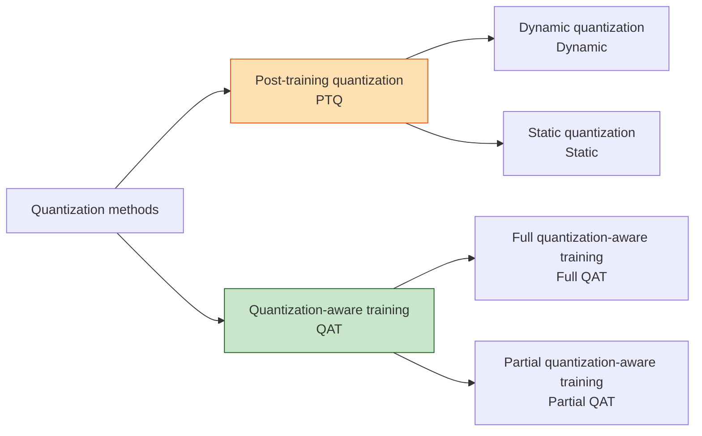

### 8.2.2 Post-training quantization (PTQ)
{: id="822-训练后量化ptq"}

**Definition**: quantize weights and activations directly after training, with no retraining.

**Advantages**:
- **Fast**: done in minutes to hours
- **Cheap**: needs no training data or GPU training
- **Easy to deploy**: applies directly to any pretrained model

**Disadvantages**:
- **Accuracy loss**: especially at low bit widths (INT4/INT2)
- **Sensitivity**: some layers are very sensitive to quantization

**Representative methods**:
- **GPTQ**: layer-by-layer quantization using second-order information
- **AWQ**: weight quantization guided by activation importance
- **SmoothQuant**: shifts the quantization difficulty from activations to weights

### 8.2.3 Quantization-aware training (QAT)
{: id="823-量化感知训练qat"}

**Definition**: simulate quantization during training so the model learns to tolerate quantization error.

**Core idea**:
- Forward pass: use quantized weights and activations
- Backward pass: use floating-point gradients (the straight-through estimator, STE)

**Advantages**:
- **Highest accuracy**: the model actively adapts to quantization
- **Very low bit widths**: INT4, INT2, even binary

**Disadvantages**:
- **Long training**: requires retraining or fine-tuning
- **Costly**: needs training data and GPU resources

**Representative methods**:
- **QLoRA**: 4-bit quantization + LoRA fine-tuning
- **LLM-QAT**: quantization-aware training for LLMs
- **BitNet**: training with extremely low bit widths (1.58-bit)

### 8.2.4 By what to quantize
{: id="824-按量化对象分类"}

|What is quantized|Description|Difficulty|Common methods|
|---------|------|------|---------|
|**Weights only**|Quantize only the model parameters|Easy| GPTQ, AWQ |
|**Weights + activations**|Quantize parameters and intermediate results together|Hard| SmoothQuant, QAT |
| **KV Cache** |Quantize the attention cache at inference to cut long-context memory|Medium| INT8/INT4 Per-token, GQA/MQA |

---

## 8.3 Post-training quantization (PTQ)
{: id="83-训练后量化ptq"}

### 8.3.1 GPTQ
{: id="831-gptq"}

#### 8.3.1.1 Core principles
{: id="8311-核心原理"}

GPTQ (**G**PT **P**ost-**T**raining **Q**uantization) uses **second-order information** to minimize quantization error, quantizing weight matrices layer by layer.

**Objective**: minimize the difference in layer output before and after quantization

$$
\arg\min_{\hat{W}} \| WX - \hat{W}X \|^2
$$

where:
- $W$: the original FP16 weight matrix
- $\hat{W}$: the quantized INT4 weights
- $X$: activations from the calibration data

**Key technique**: Optimal Brain Quantization (OBQ)

Weights are quantized column by column. After quantizing column $i$, its quantization error is compensated in the not-yet-quantized columns using the inverse Hessian:

$$
\delta_i = \frac{w_{:,i} - \text{quant}(w_{:,i})}{[H^{-1}]_{ii}}, \qquad
W_{:,j} \leftarrow W_{:,j} - \delta_i \, [H^{-1}]_{ij} \quad (j > i)
$$

Here $H = 2XX^\top$ is the Hessian of the layer's output error with respect to its weights (it depends only on the calibration activations $X$). GPTQ builds on OBQ by having all rows share the same column order, applying updates in blocks, and inverting via Cholesky decomposition, cutting the time to quantize a 175B model to about 4 GPU hours.

#### 8.3.1.2 Workflow
{: id="8312-实现流程"}

The original AutoGPTQ is no longer maintained; its successor [GPTQModel](https://github.com/ModelCloud/GPTQModel) offers an almost identical workflow:

```python
from datasets import load_dataset
from gptqmodel import GPTQModel, QuantizeConfig

model_id = "meta-llama/Llama-2-7b-hf"
quant_path = "./llama-2-7b-gptq-4bit"

# Step 1: prepare calibration data (usually 128-1024 texts)
calibration = load_dataset(
    "allenai/c4",
    data_files="en/c4-train.00001-of-01024.json.gz",
    split="train",
).select(range(1024))["text"]

# Step 2: configure quantization
quant_config = QuantizeConfig(
    bits=4,          # quantization bit width: 4-bit
    group_size=128,  # every 128 weights share one scale / zero point
)

# Step 3: load the model and run GPTQ (a 7B model usually takes tens of minutes)
model = GPTQModel.load(model_id, quant_config)
model.quantize(calibration, batch_size=2)

# Step 4: save the quantized model (7B weights: about 13.5GB → about 4GB)
model.save(quant_path)

# Step 5: load the quantized model for inference
model = GPTQModel.load(quant_path)
print(model.tokenizer.decode(model.generate("The meaning of life is")[0]))
```

The quantized weights can also be loaded directly by frameworks such as transformers and vLLM.

#### 8.3.1.3 GPTQ performance
{: id="8313-gptq-性能表现"}

|Model|Original precision| GPTQ-4bit |GPU memory|Accuracy loss|
|------|---------|-----------|----------|---------|
| **LLaMA-7B** | FP16 | INT4 | 14GB → ~3.5GB |Small|
| **LLaMA-13B** | FP16 | INT4 | 26GB → ~6.5GB |Small|
| **LLaMA-30B** | FP16 | INT4 | 60GB → ~15GB |Very small|
| **LLaMA-65B** | FP16 | INT4 | 130GB → ~33GB |Very small|

> GPU memory figures are theoretical values for the weights alone (ignoring the small overhead of group scales). The GPTQ paper finds that the larger the model, the smaller the perplexity increase from 4-bit quantization; at 3 bits, the loss for small models grows markedly.

**When to use it**:
- Optimizing inference deployment
- Resource-constrained environments
- When you need fast quantization without training

---

### 8.3.2 AWQ: activation-aware quantization
{: id="832-awq激活感知权重量化"}

#### 8.3.2.1 Key insight
{: id="8321-核心洞察"}

The core finding of AWQ (**A**ctivation-aware **W**eight **Q**uantization):

> **Not all weights are equally important.** Weight channels that see large activations have a bigger impact on model quality and should keep higher precision.

**Quantization strategy**:

$$
Y = W X = \big(W \,\text{diag}(s)\big)\big(\text{diag}(s)^{-1} X\big)
\;\;\Rightarrow\;\;
\hat{Y} = Q\big(W \,\text{diag}(s)\big)\big(\text{diag}(s)^{-1} X\big)
$$

Here $s$ is a per-input-channel scaling factor: weights in important channels are scaled up before quantization and the corresponding activations are scaled down by the same amount. The output is mathematically unchanged, but the relative quantization error of the important weights shrinks. The scaling factors are eventually folded into the preceding layer's operators, so inference incurs no extra cost.

#### 8.3.2.2 Determining channel importance
{: id="8322-确定通道重要性"}

1. **Collect activation statistics**: on the calibration data, measure the average activation magnitude $s_X$ of each input channel.

2. **Search for the scaling strength**: let $s = s_X^{\alpha}$, grid-search $\alpha$ over $[0, 1]$, and pick the value that minimizes the layer's output error after quantization:

$$
\alpha^* = \arg\min_{\alpha} \big\| Q\big(W \,\text{diag}(s)\big)\big(\text{diag}(s)^{-1} X\big) - W X \big\|
$$

Channels with larger activations get larger scaling factors, so their weights incur smaller quantization error. AWQ needs only a little calibration data and no backpropagation, so it is unlikely to overfit the calibration set.

#### 8.3.2.3 Implementation
{: id="8323-实现代码"}

> The AutoAWQ repository was archived in 2025, and the AWQ algorithm has been merged into [llm-compressor](https://github.com/vllm-project/llm-compressor), maintained by the vLLM project. The classic usage below is still useful for understanding the workflow:

```python
from awq import AutoAWQForCausalLM
from transformers import AutoTokenizer

model_path = "meta-llama/Llama-2-7b-hf"
quant_path = "llama-2-7b-awq-4bit"

# Step 1: load the model
model = AutoAWQForCausalLM.from_pretrained(model_path)
tokenizer = AutoTokenizer.from_pretrained(model_path)

# Step 2: configure quantization
quant_config = {
    "zero_point": True,          # use a zero point (asymmetric quantization)
    "q_group_size": 128,         # group size
    "w_bit": 4,                  # weight bit width
    "version": "GEMM"            # use the optimized GEMM kernel
}

# Step 3: quantize (AWQ is 2-3x faster than GPTQ)
model.quantize(tokenizer, quant_config=quant_config)

# Step 4: save the quantized model
model.save_quantized(quant_path)
tokenizer.save_pretrained(quant_path)

# Load for inference
model_awq = AutoAWQForCausalLM.from_quantized(quant_path, fuse_layers=True)
```

#### 8.3.2.4 AWQ vs GPTQ
{: id="8324-awq-vs-gptq-对比"}

|Aspect| AWQ | GPTQ |
|------|-----|------|
|**Quantization speed**|Fast (5-10 minutes for 7B)|Slow (20-30 minutes for 7B)|
|**Accuracy retention**|✅ Better (especially at very low bit widths)|✅ Good|
|**Inference speed**|Faster (optimized kernels)|Fast|
|**GPU memory**|Same|Same|
|**Calibration data**|Little (~128 samples), insensitive to distribution|More (~128-1024 samples)|

**Recommendations**:
- Best possible accuracy → **AWQ**
- Fast quantization for deployment → **AWQ**
- Broad hardware support → **GPTQ** (more mature ecosystem)

---

### 8.3.3 SmoothQuant
{: id="833-smoothquant"}

#### 8.3.3.1 The problem: why are activations hard to quantize?
{: id="8331-问题为什么激活值难量化"}

LLM activations suffer from **severe outliers**:

- 99.9% of values fall within $[-10, 10]$
- 0.1% of outliers can reach $[-1000, 1000]$

With a single uniform scale, most values get squeezed into a tiny range, causing a large loss of accuracy.

#### 8.3.3.2 The SmoothQuant solution
{: id="8332-smoothquant-解决方案"}

**Core idea**: use scaling factors to shift the quantization difficulty from activations to weights:

$$
Y = (X \text{ diag}(s)^{-1}) \cdot (\text{diag}(s)W)
$$

where:
- $s$ is a per-channel smoothing factor
- $X \text{ diag}(s)^{-1}$: compresses the outliers in the activations
- $\text{diag}(s)W$: absorbs the scaling factors into the weights (which are easier to quantize)

**Choosing the smoothing factor**:

$$
s_i = \max(|X_i|)^\alpha / \max(|W_i|)^{1-\alpha}
$$

where $\alpha \in [0, 1]$ controls the smoothing strength (usually 0.5).

#### 8.3.3.3 Example
{: id="8333-实现示例"}

The official SmoothQuant repository (mit-han-lab/smoothquant) provides a reference implementation for research. In production, llm-compressor (maintained by vLLM) is more common: it combines SmoothQuant and GPTQ into a single "recipe" that produces W8A8 quantization in one pass:

```python
from datasets import load_dataset
from transformers import AutoModelForCausalLM, AutoTokenizer
from llmcompressor import oneshot
from llmcompressor.modifiers.quantization import GPTQModifier
from llmcompressor.modifiers.smoothquant import SmoothQuantModifier

model_id = "meta-llama/Llama-2-7b-hf"
model = AutoModelForCausalLM.from_pretrained(model_id, torch_dtype="auto")
tokenizer = AutoTokenizer.from_pretrained(model_id)

# Calibration data: a few hundred texts resembling the target use case
ds = load_dataset("allenai/c4", data_files="en/c4-train.00001-of-01024.json.gz", split="train")
ds = ds.shuffle(seed=0).select(range(512))

recipe = [
    SmoothQuantModifier(smoothing_strength=0.8),                   # migrate activation outliers (this is α)
    GPTQModifier(targets="Linear", scheme="W8A8", ignore=["lm_head"]),  # weights and activations both INT8
]

oneshot(model=model, dataset=ds, recipe=recipe,
        max_seq_length=2048, num_calibration_samples=512)

model.save_pretrained("llama-2-7b-w8a8", save_compressed=True)
tokenizer.save_pretrained("llama-2-7b-w8a8")
```

The resulting checkpoint can be served directly by vLLM with INT8 GEMM.

#### 8.3.3.4 SmoothQuant performance
{: id="8334-smoothquant-性能"}

The SmoothQuant paper evaluates OPT-175B, BLOOM-176B, GLM-130B, and other models:

- **Accuracy**: W8A8 after smoothing essentially matches FP16 on zero-shot tasks such as LAMBADA and HellaSwag, whereas plain W8A8 without smoothing collapses on OPT models above 6.7B because of activation outliers
- **Efficiency**: up to about **1.56× faster** than FP16 with **half the GPU memory**, enough to serve a 530B-scale model on a single 8-GPU node

Key advantages:
- A **W8A8** scheme (weights and activations both INT8) that needs no training and is essentially lossless
- Hardware friendly: smoothing factors can be folded offline into the preceding layer's weights, so inference uses standard INT8 GEMM
- Well suited to high-throughput server-side inference

---

## 8.4 Quantization-aware training (QAT)
{: id="84-量化感知训练qat"}

### 8.4.1 QLoRA
{: id="841-qlora"}

QLoRA is currently the most popular quantized fine-tuning method, making it possible to **fine-tune a 65B model** on a single 48GB GPU. Strictly speaking, it only quantizes the frozen base weights to 4 bits while the LoRA adapters are still trained in 16 bits. It is not "classic QAT" in which the model learns to adapt to quantization error, but because training happens on a quantized model it is usually discussed alongside QAT.

#### 8.4.1.1 Key components
{: id="8411-核心技术组合"}

1. **4-bit NormalFloat (NF4) quantization**
2. **Double quantization**
3. **Paged optimizers**
4. **LoRA adapters**

#### 8.4.1.2 NF4: information-theoretically optimal quantization
{: id="8412-nf4量化信息理论最优量化"}

Standard 4-bit integer quantization covers $[-7, 7]$ with evenly spaced levels.

**Problem**: neural network weights usually follow a normal distribution $\mathcal{N}(0, \sigma^2)$, so evenly spaced levels waste representational capacity.

**The NF4 scheme**: place the quantization levels at the quantiles of a normal distribution

```python
# The 16 NF4 quantization levels (optimized for N(0,1))
NF4_QUANT_LEVELS = [
    -1.0, -0.6961928009986877, -0.5250730514526367, -0.39491748809814453,
    -0.28444138169288635, -0.18477343022823334, -0.09105003625154495, 0.0,
    0.07958029955625534, 0.16093020141124725, 0.24611230194568634, 0.33791524171829224,
    0.44070982933044434, 0.5626170039176941, 0.7229568362236023, 1.0
]
```

**Normalization + NF4 quantization**:

$$
\hat{W} = \text{NF4}\left(\frac{W}{\sigma_W}\right) \cdot \sigma_W
$$

**Advantage**: every quantization bin covers the same probability mass, which makes NF4 the information-theoretically optimal 4-bit data type for approximately normal weights. In the QLoRA paper, NF4 beats FP4 and INT4 on both perplexity and downstream accuracy.

#### 8.4.1.3 Double quantization
{: id="8413-双重量化double-quantization"}

**Problem**: the FP32 scaling factors $s$ take up considerable memory (one FP32 value per 64 parameters, or an extra 0.5 bit per parameter).

**Solution**: quantize the scaling factors too.

```python
# First quantization: weights → INT4
W_quant = quantize_nf4(W, scale_fp32)

# Second quantization: scaling factors FP32 → FP8
scale_quant = quantize_fp8(scale_fp32)

# The second quantization groups 256 scales together, storing one FP32 second-level scale per group
# Scale overhead per parameter: 32/64 = 0.5 bit → 8/64 + 32/(64×256) ≈ 0.127 bit
# Saves about 0.37 bit per parameter on average, or about 3GB for a 65B model
```

#### 8.4.1.4 Full QLoRA training workflow
{: id="8414-完整qlora训练流程"}

```python
import torch
from transformers import AutoModelForCausalLM, AutoTokenizer
from peft import LoraConfig, get_peft_model, prepare_model_for_kbit_training
from trl import SFTConfig, SFTTrainer
from datasets import load_dataset

# ============================================================
# Step 1: 4-bit quantization config (NF4 + double quantization)
# ============================================================
from transformers import BitsAndBytesConfig

bnb_config = BitsAndBytesConfig(
    load_in_4bit=True,                      # enable 4-bit quantization
    bnb_4bit_quant_type="nf4",              # use NF4 (information-theoretically optimal)
    bnb_4bit_use_double_quant=True,         # double quantization (scales are quantized too)
    bnb_4bit_compute_dtype=torch.bfloat16,  # compute in BF16 (preserves accuracy)
)

# ============================================================
# Step 2: load the 4-bit quantized model (70B weights take about 35GB)
# ============================================================
model_name = "meta-llama/Llama-2-70b-hf"
model = AutoModelForCausalLM.from_pretrained(
    model_name,
    quantization_config=bnb_config,
    device_map="auto",                      # spread across GPUs automatically
)
tokenizer = AutoTokenizer.from_pretrained(model_name)

# ============================================================
# Step 3: prepare the quantized model for training
# ============================================================
model = prepare_model_for_kbit_training(model)

# ============================================================
# Step 4: configure LoRA (trains only about 1.2% of parameters)
# ============================================================
lora_config = LoraConfig(
    r=64,                                   # LoRA rank (larger is closer to full fine-tuning)
    lora_alpha=16,                          # scaling factor (from the QLoRA paper: r=64, alpha=16)
    target_modules=[                        # layers that get LoRA
        "q_proj", "k_proj", "v_proj",       # attention layers
        "o_proj",
        "gate_proj", "up_proj", "down_proj" # FFN layers
    ],
    lora_dropout=0.05,                      # dropout against overfitting
    bias="none",                            # do not train biases
    task_type="CAUSAL_LM"
)

# ============================================================
# Step 5: apply LoRA to the quantized model
# ============================================================
model = get_peft_model(model, lora_config)
model.print_trainable_parameters()
# Example output:
# Trainable params: 828,375,040 || all params: 69,805,023,232 || trainable%: 1.1867

# ============================================================
# Step 6: prepare the training data
# ============================================================
dataset = load_dataset("timdettmers/openassistant-guanaco")

# ============================================================
# Step 7: configure training
# ============================================================
training_args = SFTConfig(
    output_dir="./qlora-llama-70b",
    num_train_epochs=3,
    per_device_train_batch_size=1,         # a 70B model only fits a tiny batch per GPU
    gradient_accumulation_steps=16,        # effective batch_size=16
    gradient_checkpointing=True,           # recompute activations to save more GPU memory
    max_length=2048,                       # maximum sequence length
    dataset_text_field="text",             # text field of the guanaco dataset
    learning_rate=2e-4,                    # typical QLoRA learning rate
    lr_scheduler_type="cosine",
    warmup_ratio=0.03,
    logging_steps=10,
    save_strategy="epoch",
    optim="paged_adamw_8bit",              # paged optimizer (avoids OOM)
    fp16=False,
    bf16=True,                             # use BF16 (recommended on A100)
)

# ============================================================
# Step 8: train
# ============================================================
trainer = SFTTrainer(
    model=model,
    args=training_args,
    train_dataset=dataset["train"],
    processing_class=tokenizer,            # newer TRL versions use processing_class instead of tokenizer
)

trainer.train()

# ============================================================
# Step 9: save the LoRA adapter (only ~200MB!)
# ============================================================
model.save_pretrained("./qlora-adapter")

# ============================================================
# Step 10: merge LoRA for deployment (optional)
# ============================================================
from peft import PeftModel

# Load the base model in BF16 for merging: merging straight into 4-bit weights adds rounding error
base_model = AutoModelForCausalLM.from_pretrained(
    model_name,
    torch_dtype=torch.bfloat16,
    device_map="auto"
)

# Load and merge LoRA; re-quantize for deployment afterwards if needed
model = PeftModel.from_pretrained(base_model, "./qlora-adapter")
model = model.merge_and_unload()  # merge LoRA weights into the base
```

#### 8.4.1.5 QLoRA GPU memory breakdown
{: id="8415-qlora-显存占用分析"}

Using **LLaMA-2-70B** as an example:

|Component|BF16 full fine-tuning|QLoRA (4-bit, r=64 on all linear layers)|
|------|---------------|---------------|
|**Model weights**| 140 GB |~35 GB (NF4 + double quantization)|
|**Gradients**| 140 GB |~1.7 GB (830000000 LoRA parameters only)|
|**Optimizer states**|840 GB (FP32 master weights + m + v)|~2–7 GB (LoRA parameters only; depends on optimizer precision)|
|**Activations**|Depends on batch size and sequence length|Usually a few GB with gradient checkpointing|
|**Total**| **> 1.1 TB** | **~45–50 GB** |

**Conclusion**: full fine-tuning of a 70B model needs at least 16 A100-80G GPUs with ZeRO sharding; QLoRA brings it down to **a single A100/H100-80G** (the 65B experiments in the QLoRA paper used a single 48GB GPU).

---

### 8.4.2 BitNet
{: id="842-bitnet"}

BitNet pushes quantization to the extreme: **each weight uses only 1.58 bits** (three values: -1, 0, +1).

#### 8.4.2.1 Core design
{: id="8421-核心设计"}

**Ternary weights**:

$$
W \in \{-1, 0, +1\}
$$

**Activations**: 8-bit quantization (to retain reasonable accuracy)

**Why 1.58 bits?**

Three values $\{-1, 0, +1\}$ can carry at most $\log_2 3 \approx 1.58$ bits of information (reached when all three are equally likely). In practice, five ternary weights are usually packed into one byte ($3^5 = 243 \le 256$), i.e. 1.6 bits per weight.

#### 8.4.2.2 Training
{: id="8422-训练方法"}

1. **Forward pass**: use ternary weights

$$
W_{\text{ternary}} = \text{RoundClip}\!\left(\frac{W}{\gamma + \epsilon}, -1, 1\right),
\qquad
\gamma = \frac{1}{nm}\sum_{i,j} \lvert W_{ij} \rvert
$$

That is, normalize by the mean absolute weight (absmean), then round and clip to $\{-1, 0, +1\}$.

2. **Backward pass**: compute gradients with the floating-point weights (straight-through estimator)

3. **Weight update**: update the floating-point weights, then project them back to ternary values

#### 8.4.2.3 Performance
{: id="8423-性能表现"}

Main findings of the BitNet b1.58 paper (Ma et al., 2024):

- **Matches full precision at 3B**: a 3B BitNet b1.58 is on par with an FP16 LLaMA of the same size in perplexity and zero-shot accuracy, while running inference **2.71×** faster with **3.55×** less GPU memory
- **Better value at larger scale**: at 70B, inference is about **4.1×** as fast as LLaMA 70B
- **Caveat**: the model **must be trained from scratch** (quantization-aware training); an existing FP16 model cannot simply be converted to 1.58 bits. Microsoft later open-sourced BitNet b1.58 2B4T (2B parameters, 4T tokens)

**When to use it**:
- On-device deployment (phones, IoT devices)
- Ultra-low-latency inference
- Maximum cost reduction

---

## 8.5 Quantization in practice
{: id="85-量化工程实践"}

### 8.5.1 Quantization tooling
{: id="851-量化工具生态"}

|Tool|Supported methods|Highlights|Recommended for|
|------|---------|------|---------|
| **Unsloth** | LoRA, QLoRA, 4-bit, 16-bit, FP8, GRPO |2× faster, 70% less VRAM, compatible with the HF ecosystem|Efficient fine-tuning on consumer GPUs|
| **bitsandbytes** | QLoRA, 8-bit, 4-bit |Easy to use, integrated with Hugging Face|QLoRA fine-tuning|
|**GPTQModel** (successor to AutoGPTQ)| GPTQ |Mature, widely supported|PTQ deployment|
| **llm-compressor** (vLLM) | GPTQ, AWQ, SmoothQuant, FP8 |One recipe format covers several algorithms; outputs load directly in vLLM|Production deployment|
| **llama.cpp** | GGUF/GGML |Optimized CPU inference|Local CPU deployment|
| **vLLM** | FP8, INT8 |High-throughput inference|Production deployment|
| **TensorRT-LLM** | INT8, INT4, FP8 |Optimized for NVIDIA|Deployment on NVIDIA GPUs|

### 8.5.2 Quantization best practices
{: id="852-量化流程最佳实践"}

#### 8.5.2.1 Decision tree for choosing a method
{: id="8521-选择量化方法的决策树"}

```mermaid
graph TD
    A["Need quantization?"] -->|Yes| B{Training resources available?}
    A -->|No| Z["Use FP16/BF16"]

    B -->|Yes| C{Need the best possible accuracy?}
    B -->|No| D["Use PTQ"]

    C -->|Yes| E["QLoRA/QAT<br>4-bit training"]
    C -->|No| F["LoRA fine-tuning<br>BF16"]

    D --> G{Target bit width?}

    G -->|INT8| H["SmoothQuant<br>weights + activations"]
    G -->|INT4| I{Priority?}

    I -->|Accuracy| J["AWQ"]
    I -->|Speed| K["GPTQ"]

    style E fill:#c8e6c9
    style J fill:#ffe0b2
    style K fill:#ffe0b2
    style H fill:#fff9c4
```

#### 8.5.2.2 Comparing accuracy before and after quantization
{: id="8522-量化前后的精度对比"}

Establish an FP16 baseline before quantizing, then evaluate the quantized model on the same tasks. With EleutherAI's lm-evaluation-harness:

```python
import torch
from transformers import AutoModelForCausalLM, AutoTokenizer
from lm_eval import simple_evaluate
from lm_eval.models.huggingface import HFLM

TASKS = ["hellaswag", "winogrande", "arc_easy", "arc_challenge"]

def evaluate(path, **load_kwargs):
    model = AutoModelForCausalLM.from_pretrained(path, device_map="auto", **load_kwargs)
    tokenizer = AutoTokenizer.from_pretrained(path)
    out = simple_evaluate(model=HFLM(pretrained=model, tokenizer=tokenizer),
                          tasks=TASKS, num_fewshot=0)
    return {t: out["results"][t]["acc,none"] for t in TASKS}

base = evaluate("meta-llama/Llama-2-7b-hf", torch_dtype=torch.float16)  # FP16 baseline
quant = evaluate("./llama-2-7b-gptq-4bit")  # GPTQ weights; requires gptqmodel

for t in TASKS:
    drop = (base[t] - quant[t]) / base[t] * 100
    print(f"{t}: {base[t]:.4f} → {quant[t]:.4f} (-{drop:.2f}%)")
```

**Acceptable accuracy loss**:
- **INT8**: <2% (acceptable)
- **INT4**: <5% (GPTQ/AWQ, acceptable)
- **INT4**: 5-10% (naive quantization, evaluate carefully)
- **INT4**: >10% (quantization failed; adjust the strategy)

#### 8.5.2.3 Handling layers that quantize poorly
{: id="8523-处理量化失败的层"}

Some layers are especially sensitive to quantization: the output layer `lm_head`, the embedding layer, and layers with particularly large activation outliers (often the MLP's `down_proj`).

**Strategy: mixed-precision quantization**: keep sensitive layers in 16 bits and quantize the rest as usual.

- By default, GPTQ/AWQ tools quantize only the `Linear` layers inside Transformer blocks; the embedding and `lm_head` already stay at original precision.
- To skip additional layers, an llm-compressor recipe can use `ignore=["lm_head", "re:.*down_proj"]` (regular expressions are supported); with bitsandbytes, use `BitsAndBytesConfig(llm_int8_skip_modules=[...])`
- The cost is a little extra GPU memory; use the accuracy comparison from the previous section to decide whether it is worth it.

### 8.5.3 Common pitfalls
{: id="853-量化的常见陷阱"}

#### 8.5.3.1 Pitfall 1: too little calibration data
{: id="8531-陷阱1使用过少的校准数据"}

```python
# Wrong
calibration_data = dataset[:10]  # only 10 samples ❌

# Right
calibration_data = dataset[:512]  # at least 128-1024 samples ✅
```

#### 8.5.3.2 Pitfall 2: mismatched calibration data
{: id="8532-陷阱2校准数据分布不匹配"}

```python
# Wrong: calibrating a chat model with code data ❌
calibration_data = load_dataset("codeparrot/github-code")

# Right: use data resembling the target task ✅
calibration_data = load_dataset("allenai/c4", split="train[:1000]")  # general text
# or
calibration_data = load_dataset("OpenAssistant/oasst1")  # conversation data
```

#### 8.5.3.3 Pitfall 3: naive per-tensor INT8 quantization of activations
{: id="8533-陷阱3直接对激活做-per-tensor-int8-量化"}

In large models, a few activation channels can be two orders of magnitude larger than the rest. With naive per-tensor INT8 quantization, these outliers inflate the scaling factor and squeeze all other channels into just a few quantization levels, and accuracy collapses.

**What to do instead**: first migrate the outliers into the weights with SmoothQuant, or quantize activations dynamically per token; failing that, keep the sensitive layers in 16 bits (see Section 8.5.2.3).

---

## 8.6 Choosing a quantization scheme
{: id="86-量化方案选型"}

|Scenario|Recommended method|Precision|Accuracy impact|Weight memory saved (vs. FP16)|
|------|---------|---------|---------|---------|
|**Fine-tuning**| QLoRA |4-bit base + 16-bit LoRA|About the same as 16-bit LoRA| ~75% |
|**Inference (accuracy first)**| AWQ | 4-bit |Small| ~75% |
|**Inference (ecosystem first)**| GPTQ | 4-bit |Small| ~75% |
|**High-throughput production**| SmoothQuant W8A8 / FP8 | 8-bit |Essentially lossless| ~50% |
|**Edge devices**| INT8 QAT | 8-bit |Essentially lossless| ~50% |
|**Extreme on-device**| BitNet b1.58 | 1.58-bit |Must train from scratch; matches FP16 from 3B up| ~90% |

> The accuracy impact varies widely with model size, task, and calibration data. As a rule, larger models tolerate quantization better, and tasks that need precise reasoning, such as math and coding, are more sensitive than commonsense QA. Before going to production, always run the comparison from Section 8.5.2.2 on your own tasks.

---

## 8.7 Future trends
{: id="87-未来趋势"}

### 8.7.1 Mixed-precision quantization
{: id="871-混合精度量化"}

Different layers use different bit widths:
- **Sensitive layers** (attention): INT8
- **Ordinary layers** (FFN): INT4
- **Insensitive layers**: INT2

### 8.7.2 Zero-shot PTQ
{: id="872-零样本-ptq"}

Quantization parameters are inferred directly from the weight distribution, with no calibration data.

### 8.7.3 Hardware-algorithm co-design
{: id="873-硬件-算法协同设计"}

- **NVIDIA Hopper**: native FP8 support for training and inference
- **NVIDIA Blackwell**: native support for microscaling formats such as FP4 (NVFP4/MXFP4), bringing 4-bit inference and low-bit training further into hardware
- **Dedicated NPUs**: chips built for binary/ternary neural networks

### 8.7.4 LLM-specific optimizations
{: id="874-大模型特定优化"}

- **Sparsity + quantization**: combine with pruning for further compression
- **KV cache quantization**: a key optimization for long contexts (see the next section)
- **Dynamic quantization**: adapt quantization precision to the input

### 8.7.5 KV cache memory management
{: id="875-kv-cache-显存管理"}

#### 8.7.5.1 Why the KV cache uses so much GPU memory
{: id="8751-为什么-kv-cache-会占用大量显存"}

LLM inference has two phases:
- **Prefill**: process the whole input sequence in parallel in one pass, producing the initial K/V matrices
- **Decode**: generate one token at a time, attending to the K/V of every previous token

To avoid recomputing the K/V of earlier tokens, they are cached during inference: this is the KV cache. The cache keeps growing with the sequence and becomes the main consumer of GPU memory in long-context settings.

```mermaid
flowchart LR
    subgraph prefill["① Prefill (parallel)"]
        direction TB
        p1["Input sequence<br/>token₁ token₂ … tokenₙ"] --> p2["Transformer<br/>computes all tokens in parallel"]
        p2 --> p3["Initialize KV cache<br/>K₁V₁, K₂V₂, …, KₙVₙ"]
        p3 --> p4["Emit the first new token"]
    end

    subgraph decode["② Decode (autoregressive, token by token)"]
        direction TB
        d1["New token<br/>tokenₙ₊₁"] --> d2["Read KV cache<br/>(no recomputation of history)"]
        d2 --> d3["Append<br/>Kₙ₊₁Vₙ₊₁ to the cache"]
        d3 --> d4["Emit the next token"]
        d4 -->|"repeat"| d1
    end

    prefill -->|"hand over cache"| decode

    style p3 fill:#e3f2fd,stroke:#01579b
    style d2 fill:#e3f2fd,stroke:#01579b
    style d3 fill:#e8f5e9,stroke:#1b5e20
```

**Memory formula**:

$$\text{KV cache size} = 2 \times L \times H_{kv} \times d \times n \times b \times \text{bytes\_per\_element}$$

where $L$ = number of layers, $H_{kv}$ = number of KV heads (equal to the number of attention heads under MHA), $d$ = dimension per head, $n$ = sequence length, $b$ = batch size, and the factor 2 accounts for K and V.

Taking **LLaMA-2-7B** as an example (32 layers, 32 KV heads, head dimension 128, FP16):
- Per token: $2 \times 32 \times 32 \times 128 \times 2\ \text{bytes} = \mathbf{0.5 \text{ MB}}$
- A single 4K-context request takes about **2GB**; at batch=32 the KV cache reaches **64GB**, far more than the model weights themselves (about 13.5GB)

Compare **LLaMA-2-70B** (80 layers, but only 8 KV heads thanks to GQA): each token takes $2 \times 80 \times 8 \times 128 \times 2 \approx 0.31$ MB. The model has 10 times as many parameters as the 7B, yet a smaller KV cache: this is what GQA, discussed below, buys.

#### 8.7.5.2 KV cache quantization
{: id="8752-kv-cache-量化"}

Quantize the cached K/V matrices to low precision without changing the model architecture:

|Precision|Method|Memory saved|Accuracy impact|
|------|-----|---------|--------|
| INT8 |Per-token dynamic quantization| ~50% |Negligible|
| INT4 |Per-group quantization| ~75% |Small|
| FP8 |Native in hardware (H100)| ~50% |Negligible|

#### 8.7.5.3 GQA/MQA: shrinking the KV cache through architecture
{: id="8753-gqa--mqa从架构层面减少-kv-cache"}

A more fundamental optimization than quantization: reduce the number of KV heads.

<div align="center">
  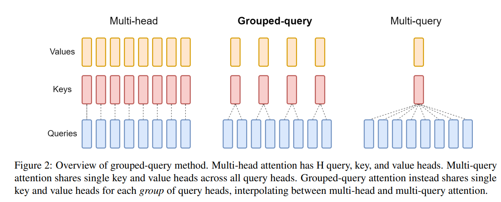
<figcaption>Figure: how three attention mechanisms share KV heads: MHA (left), GQA (middle), and MQA (right). Source: Ainslie et al., GQA, EMNLP 2023</figcaption>
</div>

```
MHA: [Q1 K1V1] [Q2 K2V2] [Q3 K3V3] [Q4 K4V4]  ← number of KV heads = number of Q heads
GQA: [Q1 Q2] [K1V1]  [Q3 Q4] [K2V2]            ← number of KV heads = number of Q heads / group size
MQA: [Q1 Q2 Q3 Q4]   [K1V1]                    ← all Q heads share 1 KV head
```

|Variant|Full name|KV cache size|Representative models|
|------|-----|-------------|--------|
| MHA | Multi-Head Attention |Baseline (1×)| GPT-2, BERT, LLaMA-2-7B |
| GQA | Grouped-Query Attention |Reduced to 1/group size|LLaMA-2-70B, the whole LLaMA-3 family, Mistral|
| MQA | Multi-Query Attention |Reduced to 1/H| PaLM, Falcon-7B |

GQA is now the default choice for mainstream LLMs, striking a good balance between memory savings and model quality.

#### 8.7.5.4 MLA (Multi-head Latent Attention): DeepSeek-V2/V3's further compression
{: id="8754-mlamulti-head-latent-attentiondeepseek-v2v3-的进一步压缩"}

GQA/MQA compress the cache by **reducing the number of KV heads**, but they still store raw K/V vectors. **MLA (Multi-head Latent Attention)**, introduced in DeepSeek-V2, takes a different approach: instead of storing raw K/V, it **jointly compresses them into a low-dimensional latent vector** and reconstructs them on the fly at inference.

**Core idea**:

$$
\mathbf{c}_t^{KV} = W^{DKV} \mathbf{h}_t \quad (\text{Compressed latent vector, dimension } d_c \ll d_h \times n_h)
$$

$$
\mathbf{k}_t = W^{UK} \mathbf{c}_t^{KV}, \quad \mathbf{v}_t = W^{UV} \mathbf{c}_t^{KV} \quad (\text{Up-projection at inference})
$$

Only the **compressed latent vector $$\mathbf{c}_t^{KV}$$ is cached**; the K/V up-projections $W^{UK}, W^{UV}$ are applied at inference time. The cache size is therefore entirely independent of the number of KV heads and depends only on the latent dimension $d_c$.

|Variant|What the KV cache stores|Cached elements per token per layer|
|------|------------------|------------------------------|
| MHA |Full K and V vectors| $2 n_h d_h$ |
| GQA |K and V vectors shared within groups|$2 n_g d_h$ ($n_g$ is the number of groups)|
| **MLA** |**Low-dimensional joint latent vector + decoupled RoPE key**| **$d_c + d_h^R$** |

DeepSeek-V2 sets $d_c = 4d_h$ and $d_h^R = d_h/2$, caching only $4.5\,d_h$ elements per token per layer, equivalent to GQA with just 2.25 groups; its MHA counterpart, with 128 heads, would need $256\,d_h$. Compared with the previous-generation DeepSeek 67B, DeepSeek-V2 cuts the KV cache by 93.3% and raises maximum generation throughput to 5.76 times.

**Key engineering details**:
- **Decoupled RoPE**: after low-rank compression, RoPE cannot be applied directly to the latent vector (RoPE rotates each K head independently). MLA therefore adds a separate set of position-aware dimensions that bypass compression, carry the RoPE information, and are concatenated with the compressed content dimensions.
- **Lossless in training, big memory savings at inference**: the up-projection matrices can be absorbed into the subsequent attention matrices, so MLA performs close to standard MHA (even slightly better than GQA in the DeepSeek-V2/V3 reports) while using as little memory as MQA or less.

**Significance**: MLA is one of the key architectural innovations that let DeepSeek-V2/V3/R1 support very long contexts while keeping inference cheap. Together with MoE and FP8 training, it is counted among the three most influential engineering contributions of the DeepSeek series.

#### 8.7.5.5 Other KV cache savings
{: id="8755-其他-kv-cache-节省技术"}

- **Sliding window attention**: each layer keeps KV only for the most recent $w$ tokens; stacked across layers, the receptive field still covers a longer context.
- **StreamingLLM**: keep a recent window plus the KV of the first few tokens (the initial tokens act as attention sinks that anchor the overall distribution)
- **Prefix caching (reuse across requests)**: requests with the same prefix (such as a system prompt) share the KV cache, saving 50%+ of cost in API serving

---

# 9. Data engineering
{: id="9-数据工程"}

Data is the foundation of LLM training: the quality of the training data sets the ceiling on what a model can do. This chapter gives a systematic overview of data engineering for LLM training.

> **About this chapter**
>
> "Garbage in, garbage out": data quality sets the model's ceiling. This chapter walks through the full data pipeline: collection, quality assessment, deduplication, mixing, and tokenization. **Guiding principles**: quality over scale, and diversity over a single source. Data engineering is often underrated, yet it is key to a successful training run.

<div align="center">
  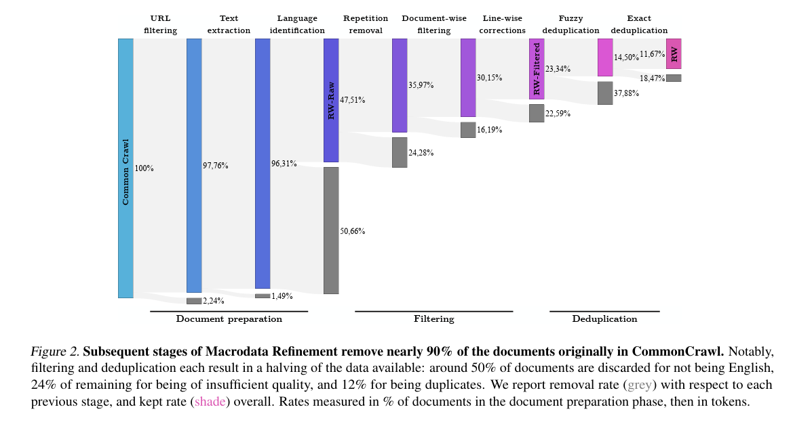
<figcaption>Figure: RefinedWeb's Common Crawl pipeline. Document preparation, filtering, and deduplication together remove about 90% of the original documents (source: RefinedWeb paper, Figure 2)</figcaption>
</div>

## 9.1 Data collection and sources
{: id="91-数据采集与来源"}

### 9.1.1 Pretraining data sources
{: id="911-预训练数据来源"}

#### 9.1.1.1 Web data
{: id="9111-网页数据"}
- **Common Crawl**: the largest open web crawl, adding billions of pages every month across many languages and domains
- **C4 (Colossal Clean Crawled Corpus)**: a cleaned dataset derived from Common Crawl, ~750GB of text
- **RedPajama**: an open reproduction of the LLaMA training data (1.2 trillion tokens)
- **FineWeb / FineWeb-Edu** (Hugging Face, 2024): about 15T tokens cleaned from 96 Common Crawl snapshots; FineWeb-Edu then uses an educational-value classifier to select a high-quality subset of about 1.3T tokens

#### 9.1.1.2 Code
{: id="9112-代码数据"}
- **GitHub**: open-source repositories (filtered by stars and license)
- **Stack Overflow**: high-quality programming Q&A
- **The Stack**: 3TB of source code in 30+ programming languages

#### 9.1.1.3 Academic papers and books
{: id="9113-学术与书籍"}
- **arXiv, PubMed**: academic papers
- **Books3, BookCorpus**: book datasets

#### 9.1.1.4 Conversations and social media
{: id="9114-对话与社交媒体"}
- **Reddit**: high-quality discussions and Q&A
- **Wikipedia**: structured knowledge
- **StackExchange**: expert Q&A across many fields

## 9.2 Data quality assessment
{: id="92-数据质量评估"}

### 9.2.1 Heuristic filtering
{: id="921-启发式规则过滤"}

#### 9.2.1.1 Length and format
{: id="9211-文本长度与格式"}
- Minimum/maximum length filters
- Limits on the ratio of special characters, digits, and punctuation
- Uppercase density checks
- Language identification (fastText, langdetect)

#### 9.2.1.2 Repeated content
{: id="9212-重复内容检测"}
- Repeated lines and paragraphs
- Boilerplate detection (page templates, headers, and footers)

### 9.2.2 Model-based quality scoring
{: id="922-基于模型的质量评分"}

#### 9.2.2.1 Perplexity filtering
{: id="9221-困惑度perplexity过滤"}
- Score documents with a small language model
- Filter out documents with very high perplexity (use with care)

#### 9.2.2.2 Quality classifiers
{: id="9222-质量分类器"}
- Training data: human-labeled high- vs. low-quality samples
- Signals: fluency, information density, grammatical correctness
- Models: fastText, BERT classifiers

#### 9.2.2.3 Educational-value scoring
{: id="9223-教育价值评分"}
- Inspired by the Phi series: rate "textbook quality"
- Typical recipe (FineWeb-Edu): have a strong model (Llama-3-70B-Instruct) rate about 450,000 web pages for "educational value" on a 0-5 scale, train a lightweight classifier on these labels, then score the full corpus and keep high-scoring documents
- Data selected this way reaches the same results with fewer tokens on knowledge and reasoning benchmarks such as MMLU and ARC

### 9.2.3 Toxicity detection
{: id="923-毒性与有害内容检测"}

#### 9.2.3.1 Toxicity scoring
{: id="9231-毒性检测"}
- **Perspective API**: Google's toxicity scoring API
- **Detoxify**: an open-source toxicity detection model

#### 9.2.3.2 Removing PII (personally identifiable information)
{: id="9232-pii个人身份信息去除"}
- Names, addresses, phone numbers, email addresses
- Detected with NER models
- Passwords and keys: matched with regular expressions

## 9.3 Data deduplication
{: id="93-数据去重"}

Deduplication is the single most important data processing step: it markedly improves model quality and reduces memorization.

### 9.3.1 Exact deduplication
{: id="931-精确去重"}
- **Document level**: MD5/SHA256 hashes
- **Paragraph/line level**: hash each paragraph and drop paragraphs that recur across the corpus (the CCNet approach), removing boilerplate such as headers and footers
- **URL deduplication**: handle redirects and URL normalization

<div align="center">
  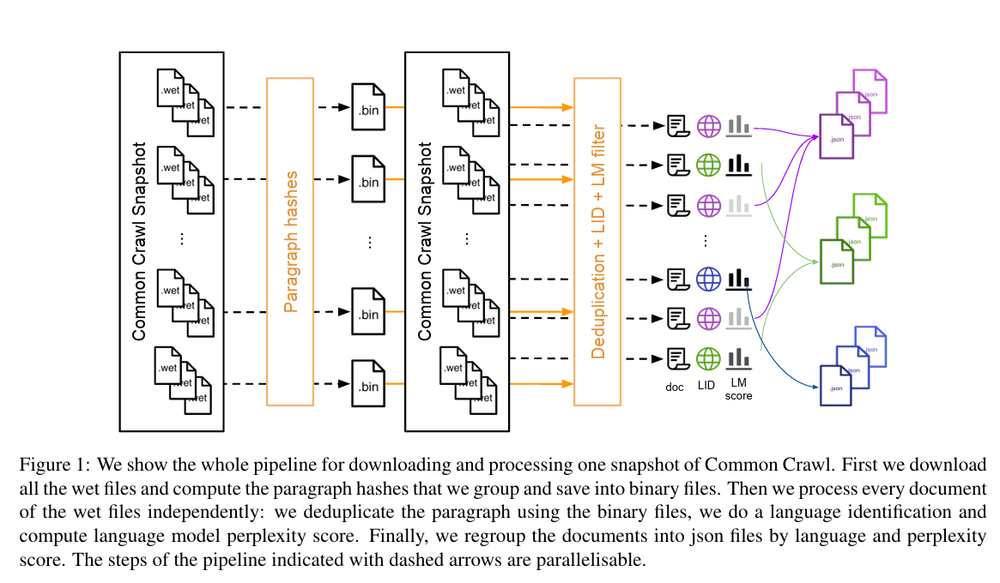
<figcaption>Figure: CCNet's Common Crawl pipeline. Paragraph hashes drive paragraph-level deduplication, followed by language identification (LID) and language-model perplexity scoring, and finally bucketing by language and quality (source: CCNet paper, Figure 1)</figcaption>
</div>

### 9.3.2 Fuzzy deduplication
{: id="932-模糊去重"}

#### 9.3.2.1 MinHash + LSH
{: id="9321-minhash--lsh"}
- Estimates Jaccard similarity
- Steps: build shingles → MinHash signatures → LSH to find similar pairs
- Tool: the datasketch library

#### 9.3.2.2 SimHash
{: id="9322-simhash"}
- Computes document fingerprints quickly
- Uses Hamming distance to measure similarity

#### 9.3.2.3 Suffix arrays
{: id="9323-suffix-array"}
- Use suffix arrays to find long substrings repeated across the corpus (Lee et al., 2022 use a 50-token threshold) and delete those substrings rather than whole documents
- Well suited to removing long passages copied across documents (license text, templated content), which document-level deduplication cannot catch

### 9.3.3 Cross-dataset deduplication
{: id="933-跨数据集去重"}

#### 9.3.3.1 Deduplicating training and test sets
{: id="9331-训练集与测试集去重"}
- **Critical**: prevents data leakage
- 13-gram overlap detection (GPT-3)
- Affects how trustworthy evaluations are

### 9.3.4 Trade-offs
{: id="934-去重trade-off"}
- Too much deduplication: lost diversity
- Too little: wasted compute and more memorization risk
- The right balance depends on the task

## 9.4 Data mixing and sampling
{: id="94-数据配比与采样"}

### 9.4.1 Static mixtures
{: id="941-静态配比策略"}

**Example: the GPT-3 mixture**:

```mermaid
pie title GPT-3 pretraining data mixture
    "Common Crawl" : 60
    "WebText2" : 22
    "Books" : 16
    "Wikipedia" : 3
```

**The LLaMA-1 mixture** (sampling proportions, about 1.4T tokens in total):

|Data source|Sampling proportion|Tokens (×1.4T)|Notes|
|--------|------|-----------|------|
| CommonCrawl | 67.0% | ~938B |Web data, the most diverse|
| C4 | 15.0% | ~210B |Cleaned web data|
| GitHub | 4.5% | ~63B |Code|
| Wikipedia | 4.5% | ~63B |High-quality encyclopedic knowledge (about 2.45 epochs)|
| Books | 4.5% | ~63B |Long-form text, narrative ability (about 2.23 epochs)|
| ArXiv | 2.5% | ~35B |Math and scientific reasoning|
| StackExchange | 2.0% | ~28B |Expert Q&A|

**Llama 3**'s final mixture (by content type) is roughly 50% general knowledge, 25% math and reasoning, 17% code, and 8% multilingual. Compared with LLaMA-1, the share of math and code has risen sharply, a direct reflection of reasoning becoming the main axis of competition.

**Building batches by proportion** (illustrative):
```python
data_mixture = {
    'common_crawl': 0.67,    # web data: general language ability
    'c4': 0.15,              # cleaned web data
    'github': 0.045,         # code: programming ability
    'wikipedia': 0.045,      # encyclopedia: factual knowledge
    'books': 0.045,          # books: long-form text
    'arxiv': 0.025,          # papers: scientific reasoning
    'stackexchange': 0.02,   # Q&A: question answering
}

def sample_batch(data_mixture, batch_size):
    """Build a training batch according to the mixture proportions"""
    batch = []
    for source, weight in data_mixture.items():
        n_samples = int(batch_size * weight)
        batch.extend(sample_from_source(source, n_samples))
    return batch
```

**Mixing principles**:
- **Upweight high-quality data**: Wikipedia, Books, and ArXiv are small shares but are sampled for multiple epochs
- **Control code and math separately**: from about 5% in LLaMA-1 to over 40% in Llama 3 (code + math reasoning), boosting reasoning without crowding out general knowledge
- **Q&A data is small but important**: StackExchange and similar sources build question-answering ability
- **Diversity first**: web data dominates to ensure breadth of knowledge

### 9.4.2 Dynamic mixtures
{: id="942-动态配比策略"}

#### 9.4.2.1 Adjusting by training phase
{: id="9421-训练阶段调整"}
- **Early (0-70%)**: balanced mixture
- **Middle (70-90%)**: more high-quality data
- **Late (90-100%)**: focus on specialized data

#### 9.4.2.2 Loss-based adjustment
{: id="9422-基于损失的调整"}
- Track the loss on each data source
- Rebalance dynamically

### 9.4.3 Curriculum learning
{: id="943-课程学习"}
- Easy to hard: order by perplexity
- General to specialized

### 9.4.4 Temperature sampling
{: id="944-temperature-sampling"}

Sampling probability:

$$
p_i = \frac{n_i^{\alpha}}{\sum_j n_j^{\alpha}}
$$

where:
- $n_i$: the number of samples in data source $i$
- $\alpha$: the temperature parameter
- $\alpha < 1$: raises the sampling probability of small sources (upsampling)
- $\alpha > 1$: lowers the sampling probability of small sources (downsampling)
- $\alpha = 1$: samples in the original proportions

## 9.5 Tokenization
{: id="95-tokenization"}

### 9.5.1 Choosing an algorithm
{: id="951-算法选择"}

- **BPE (Byte Pair Encoding)**: the GPT series and every LLaMA generation
  - Starts from characters (or bytes) and repeatedly merges the most frequent pairs
  - Byte-level BPE (introduced with GPT-2; used by Llama 3's tiktoken tokenizer) treats bytes as the basic unit, so there are never out-of-vocabulary words
- **WordPiece**: BERT; chooses each merge to maximize the likelihood of the corpus after merging
- **Unigram**: T5; starts from a large vocabulary and prunes it step by step by likelihood
- **SentencePiece**: not a new algorithm but a library implementing both BPE and Unigram. It trains directly on raw text without relying on whitespace segmentation, which suits multilingual settings such as Chinese and Japanese (used by LLaMA-1/2 and T5)

### 9.5.2 Vocabulary size
{: id="952-词表大小"}
- English-centric: 32k-50k
- Multilingual: 100k - 256k (128K for Llama 3, ~151K for Qwen, 256K for Gemma)
- Code models: larger vocabularies

**Trade-off**:
- Too small: longer sequences and slower training
- Too large: too many embedding parameters, many of them rarely trained

### 9.5.3 Special tokens
{: id="953-特殊token"}
- Standard: `<bos>`, `<eos>`, `<pad>`, `<unk>`
- Dialogue: `<|user|>`, `<|assistant|>`, `<|system|>`
- Multimodal: `<image>`, `<video>`

### 9.5.4 Best practices
{: id="954-最佳实践"}
- Use the same tokenizer for pretraining, fine-tuning, and inference
- Pre-tokenize and cache
- Use a fast tokenizer (Rust implementation)
- Balance token counts across languages

---

# 10. Evaluation and benchmarks
{: id="10-评估与基准测试"}

Evaluation is how we measure whether training worked and decide where to take it next. This chapter covers the benchmarks commonly used in LLM training.

## 10.1 Language understanding and knowledge
{: id="101-语言理解与知识"}

### 10.1.1 MMLU
{: id="1011-mmlu"}
- **Content**: multiple-choice questions across 57 subjects (math, history, law, medicine, and more)
- **Size**: ~16,000 questions
- **Measures**: breadth of knowledge and cross-disciplinary understanding
- **Difficulty**: undergraduate to professional level
- **Why it matters**: gauges the model's general knowledge

### 10.1.2 HellaSwag
{: id="1012-hellaswag"}
- **Task**: commonsense sentence completion
- **Format**: pick the most plausible ending from 4 options
- **Notes**: easy for humans (~95%), hard for early models
- **Measures**: commonsense understanding and situational reasoning

### 10.1.3 TruthfulQA
{: id="1013-truthfulqa"}
- **Goal**: assess whether model outputs are truthful
- **Design**: questions built around common misconceptions and false information
- **Measures**:
  - Whether the model repeats falsehoods from its training data
  - Whether it hallucinates
- **Why it matters**: gauges model reliability

### 10.1.4 ARC
{: id="1014-arc"}
- **Content**: grade-school science exam questions
- **Difficulty**: Easy and Challenge sets
- **Measures**: scientific reasoning and applying knowledge

## 10.2 Reasoning
{: id="102-推理能力"}

### 10.2.1 GSM8K
{: id="1021-gsm8k"}
- **Task**: grade-school math word problems
- **Size**: 8,500 problems
- **Notes**: requires multi-step reasoning
- **Evaluation**:
  - Scoring the final answer directly
  - Scoring chain-of-thought reasoning
- **Why it matters**: gauges basic mathematical reasoning

### 10.2.2 MATH
{: id="1022-math"}
- **Difficulty**: high-school to college competition math
- **Size**: 12,500 problems
- **Topics**: algebra, geometry, probability, number theory, and more
- **Measures**: complex mathematical reasoning and problem solving
- **Challenge**: even the strongest models struggled to score highly

### 10.2.3 HumanEval
{: id="1023-humaneval"}
- **Task**: implement Python functions
- **Size**: 164 programming problems
- **Evaluation**: unit-test pass rate (pass@k)
- **Notes**:
  - Self-contained functions, no complex systems
  - Clearly specified inputs and outputs
- **Variant**: HumanEval+ (more rigorous tests)

### 10.2.4 MBPP
{: id="1024-mbpp"}
- **Size**: 1,000 Python programming problems
- **Difficulty**: beginner to intermediate
- **Measures**: practical programming ability

### 10.2.5 BigCodeBench
{: id="1025-bigcodebench"}
- **Notes**: more complex, realistic programming tasks
- **Measures**: tool use, API calls, complex logic

### 10.2.6 Benchmarks for reasoning models
{: id="1026-推理模型时代的新基准"}

Classic benchmarks such as GSM8K and HumanEval are saturated by frontier models (accuracy generally above 90%), so they discriminate less and are more exposed to training-data contamination. Evaluation of reasoning models and agents has moved to harder, newer benchmarks:

- **AIME**: real problems from the American Invitational Mathematics Examination, 30 per year; the current year's problems are often used to avoid contamination
- **GPQA Diamond**: 198 graduate-level multiple-choice questions in physics, chemistry, and biology, designed so that a search engine cannot answer them (Google-proof)
- **LiveCodeBench**: continuously collects new problems from competitive programming platforms and filters by release date to limit contamination
- **SWE-bench Verified**: 500 real GitHub issues that humans have confirmed to be solvable; the model must modify the repository so that the tests pass. It is the mainstream benchmark for coding agents.
- **Humanity's Last Exam (HLE)**: about 2,500 expert-level questions across dozens of disciplines; frontier models generally scored under 10% when it was released

### 10.2.7 Agent benchmarks
{: id="1027-agent-基准"}

Agent benchmarks do not grade a single answer; they grade whether a model acting step by step in an environment actually gets the job done. Scores usually come from the environment (do the tests pass, is the database in the right state) rather than from comparison with a reference answer:

- **SWE-bench Verified**: see the previous section; it measures editing a code repository so that hidden tests pass
- **Terminal-Bench**: tasks such as compiling, configuring, debugging, and data processing in a real Linux terminal sandbox, judged by test scripts shipped with each task
- **τ-bench / τ²-bench**: simulated customer-service scenarios in retail, airline, and telecom. The model talks with a (model-simulated) user over many turns while calling tools under business rules. In τ²-bench the user can also act on the environment, closer to real two-sided collaboration
- **BrowseComp**: 1,266 questions that require many web searches and cross-checks; answers are short and easy to verify but hard to find directly

Agent scores are very sensitive to the **scaffold** (prompt, tool set, context management, step limit). The same model can differ by more than ten percentage points across scaffolds, so when comparing models, make sure they used the same scaffold and the same number of attempts.

## 10.3 Multilingual ability
{: id="103-多语言能力"}

### 10.3.1 FLORES
{: id="1031-flores"}
- **Task**: machine translation
- **Coverage**: 200+ languages
- **Measures**: cross-lingual understanding and generation
- **Why it matters**: gauges multilingual capability

### 10.3.2 XNLI
{: id="1032-xnli"}
- **Task**: natural language inference (entailment, contradiction, neutral)
- **Languages**: 15
- **Measures**: zero-shot cross-lingual transfer

### 10.3.3 Belebele
{: id="1033-belebele"}
- **Task**: reading comprehension
- **Coverage**: 122 languages
- **Measures**: broad multilingual understanding

## 10.4 Long-context ability
{: id="104-长文本能力"}

### 10.4.1 RULER
{: id="1041-ruler"}
- **Task types**:
  - Retrieval (needle in a haystack)
  - Multi-hop reasoning
  - Aggregation
- **Length**: 4k to 128k+ tokens
- **Measures**: long-context modeling

### 10.4.2 LongBench
{: id="1042-longbench"}
- **Tasks**: single- and multi-document QA, summarization, code, and more
- **Length**: 5-15k tokens on average
- **Languages**: English and Chinese
- **Measures**: realistic long-context applications

### 10.4.3 Needle in a haystack
{: id="1043-大海捞针"}
- **Design**: insert a key fact into a long text
- **Test**: can the model retrieve it accurately?
- **Variants**:
  - A single needle
  - Multiple needles
  - Different positions and depths

## 10.5 Safety evaluation
{: id="105-安全性评估"}

### 10.5.1 ToxiGen
{: id="1051-toxigen"}
- **Goal**: test a model's tendency to generate harmful content and its ability to recognize implicit hate speech
- **Method**: about 270,000 statements about 13 minority groups (half toxic, half benign), generated adversarially with GPT-3; most contain no explicit slurs
- **Dimensions**:
  - Toxicity
  - Hate speech
  - Violent content

### 10.5.2 BBQ
{: id="1052-bbq"}
- **Task**: detect social bias
- **Dimensions**:
  - Gender
  - Race
  - Religion
  - Age
  - Sexual orientation, and others
- **Method**: compare ambiguous and disambiguated contexts

### 10.5.3 SafetyBench
{: id="1053-safetybench"}
- **Coverage**: many categories of safety risk
- **Languages**: Chinese and English
- **Measures**: ability to decline inappropriate requests

### 10.5.4 Red teaming
{: id="1054-红队测试"}

Static safety benchmarks (ToxiGen, BBQ, SafetyBench) only cover the risk patterns already in their test sets. **Red teaming** actively hunts for unknown vulnerabilities in a model; in safety alignment, this adversarial testing matters as much as the training itself.

#### 10.5.4.1 Human vs. automated red teaming
{: id="10541-人工红队-vs-自动化红队"}

|Approach|How it works|Strengths|Limitations|
|------|------|------|------|
|**Human red teaming**|Professional testers write adversarial prompts by hand|Creative; finds novel attack patterns|Expensive, limited coverage, hard to scale|
|**Automated red teaming**|Another LLM generates attack prompts automatically (red-team LLM vs. target LLM)|Massively parallel and continuously iterable|Attacks may be limited by the red-team LLM's own "imagination"|

#### 10.5.4.2 A typical automated red-teaming loop
{: id="10542-自动化红队的典型流程"}

```
1. The red-team LLM generates candidate prompts for an attack goal (e.g. "get the model to explain how to make poison")
2. The target LLM answers each candidate prompt
3. A classifier or judge model decides whether the answer is a "successful jailbreak" (content that should not have been produced)
4. Successful jailbreaks (prompt, answer) become negative examples for later safety SFT/DPO training
5. Iterate: the red-team LLM adjusts its strategy based on the success rate (e.g. subtler wording, role-play framing)
```

This loop follows the same idea as the "verifier-driven data flywheel" in Section 4.7, except that the verifier checks "did the jailbreak succeed" instead of "is the answer correct". Red teaming is essentially a data flywheel: automatically find vulnerabilities → generate targeted training data → patch the model → the red team keeps looking for new holes.

#### 10.5.4.3 Common jailbreak patterns
{: id="10543-常见越狱jailbreak攻击模式"}

- **Role-play**: ask the model to "play an AI with no restrictions" or set up a fictional scenario to get around safety restrictions
- **Instruction injection**: lead the model gradually through a long context or many turns so it lets its guard down in later turns
- **Encoding obfuscation**: use Base64, pinyin, rare characters, and other encodings to slip past keyword-based safety filters
- **Multilingual attacks**: make harmful requests in low-resource languages where safety alignment is weaker
- **Academic or fiction framing**: wrap harmful requests in plausible-looking contexts such as "writing a novel", "academic research", or "security research" (see the over-refusal problem in Section 4.5.5, "Alignment tax and reasoning conflicts")

#### 10.5.4.4 Closing the loop with defensive training
{: id="10544-防御训练闭环"}

Vulnerabilities found by red teaming are ultimately fed back into training. Common methods:
- Add jailbreak examples as DPO/RLHF preference pairs (chosen = refusal, rejected = the elicited harmful answer)
- Add SFT examples that teach the model to "see through disguised intent", so it recognizes what is really being asked
- Run red teaming continuously alongside periodic safety regression tests, so that patching one class of vulnerability does not degrade other dimensions (see the safety-collapse case under "catastrophic forgetting" in Chapter 5)

> **Industry practice**: Anthropic, OpenAI, and other labs bring in external red teams before releasing a model. The logic resembles penetration testing in software security: internal teams tend to share blind spots, and outsiders are better at finding unexpected attack surfaces.

## 10.6 Alignment evaluation
{: id="106-对齐评估"}

### 10.6.1 MT-Bench
{: id="1061-mt-bench"}
- **Task**: multi-turn dialogue evaluation
- **Judge**: GPT-4
- **Categories**:
  - Writing
  - Role play
  - Reasoning
  - Math
  - Coding, and more

### 10.6.2 AlpacaEval
{: id="1062-alpacaeval"}
- **Method**: compare answers pairwise against a reference model, with an LLM judge picking the winner (AlpacaEval 2.0 uses GPT-4 Turbo as both reference and judge)
- **Measures**: instruction-following quality
- **Output**: win rate; version 2.0 also reports a **length-controlled win rate (LC Win Rate)** to offset the judge's bias toward longer answers

### 10.6.3 Chatbot Arena
{: id="1063-chatbot-arena"}
- **Method**: real users vote blind on answers from two anonymous models, and a Bradley-Terry model turns the votes into Elo-style scores
- **Notes**: a continuously updated live leaderboard, renamed LMArena in 2025
- **Why it matters**: reflects real user preferences (though also swayed by answer style, length, and formatting)

## 10.7 Evaluation frameworks
{: id="107-综合评测平台"}

### 10.7.1 LM Evaluation Harness
{: id="1071-lm-evaluation-harness"}
- **Maintainer**: EleutherAI
- **Features**:
  - A unified interface
  - Dozens of supported benchmarks
  - Standardized evaluation procedures
- **Usage**: widely used in the research community and the basis of the Hugging Face Open LLM Leaderboard; see Section 8.5.2.2 for an example

### 10.7.2 HELM
{: id="1072-helm"}
- **Dimensions**:
  - Accuracy
  - Robustness
  - Fairness
  - Bias
  - Efficiency
- **Features**: holistic, multi-dimensional evaluation

### 10.7.3 OpenCompass
{: id="1073-opencompass"}
- **Maintainer**: Shanghai AI Lab
- **Features**:
  - Strong Chinese-language coverage
  - Large-scale evaluation
  - Visual leaderboards

## 10.8 Evaluation best practices
{: id="108-评测的最佳实践"}

### 10.8.1 Avoid data leakage
{: id="1081-避免数据泄露"}
- Strictly deduplicate training data against test sets
- Use newly released benchmarks
- Refresh evaluation sets regularly

### 10.8.2 Evaluate along many dimensions
{: id="1082-多维度评估"}
- Don't rely on a single metric
- Weigh capability, safety, and efficiency together
- Pay attention to long-tail abilities and edge cases

### 10.8.3 Evaluation and training
{: id="1083-评测与训练的关系"}
- Let evaluation results guide training
- Avoid overfitting to benchmarks (leaderboard chasing)
- Track performance in real applications

---

# 11. Practical guide
{: id="11-实践指南与最佳实践"}

This chapter gives engineering guidance for training LLMs in practice: hardware configuration, cost estimation, monitoring and debugging, and code examples.

## 11.1 Hardware recommendations
{: id="111-硬件配置建议"}

### 11.1.1 Configurations by model size
{: id="1111-不同规模的推荐配置"}

|Model size|Parameters|Recommended GPU|Count|GPU memory|Interconnect|Typical use|
|---------|--------|---------|------|---------|---------|---------|
|**MiniMind**| 26M-500M | RTX 3060/4060 | 1 | 8GB+ | PCIe 3.0 |Learning the principles, quick experiments|
|**Small**| 1-3B | RTX 4090 | 4-8 | 24GB | PCIe 4.0 |Research, prototyping|
|**Medium**| 7-13B | A100 | 16-32 | 40GB/80GB | InfiniBand |Enterprise applications|
|**Large**| 30-70B | A100/H100 | 64-256 | 80GB | InfiniBand |Production models|
|**Very large**| 175B+ | H100 | 512-4096 | 80GB | InfiniBand/NVLink |Frontier research|

### 11.1.2 Choosing a GPU
{: id="1112-gpu选择指南"}

**For training**:
- **Getting started / personal projects**: RTX 3060 (12GB) / 4060 Ti (16GB), enough to run small-model projects such as MiniMind end to end
- **Limited budget**: RTX 4090 (24GB, good value, suited to small models and LoRA fine-tuning)
- **Enterprise training**: A100 (80GB, mature, stable, complete ecosystem)
- **Current flagship**: H100 (80GB, fastest, FP8 support, suited to large-scale training)

**Interconnect**:
- **Within a node**: NVLink (900GB/s) > PCIe 5.0 (128GB/s)
- **Across nodes**: InfiniBand (200-400Gb/s) > Ethernet (100Gb/s)


## 11.2 Training cost estimation
{: id="112-训练成本估算"}

### 11.2.1 Where the money goes
{: id="1121-成本构成"}

```mermaid
pie title LLM training cost breakdown
    "GPU rental/depreciation" : 70
    "Power and cooling" : 15
    "Storage and networking" : 5
    "Labor" : 8
    "Other" : 2
```

### 11.2.2 Detailed cost calculation
{: id="1122-详细成本计算"}

#### 11.2.2.1 Estimating pretraining cost
{: id="11221-预训练成本估算"}

**Step 1: estimate the compute required**

Training a dense Transformer takes about 6 floating-point operations per parameter per token (2N forward, 4N backward), so:

$$
C_{\text{train}} \approx 6ND \quad \text{(FLOPs)}, \qquad
\text{GPU hours} \approx \frac{6ND}{\text{Peak FLOPS per GPU} \times \text{MFU} \times 3600}
$$

where $N$ is the number of parameters, $D$ the number of training tokens, and MFU (Model FLOPs Utilization) the fraction of peak compute actually achieved, usually 35%–55% for large-scale training.

**Step 2: convert to cost**

$$
\text{Total cost} = \text{GPU hours} \times \text{Hourly price} + \text{Other costs: storage, labor, etc.}
$$

**Case 1: training a 7B model**
```
Model size: 7B parameters
Training data: 1T tokens
Compute: 6 × 7e9 × 1e12 ≈ 4.2e22 FLOPs
Reference: LLaMA-1 7B actually used about 82,432 A100 GPU hours for 1T tokens
GPUs: 256 × A100 (80GB)
Training time: about 2 weeks (82,432 / 256 ≈ 322 hours)

Cost estimate:
- GPU price: $1.8/GPU-hour (2026 on-demand cloud price for A100, well down from $2.5/hour in 2023)
- Total GPU cost: 82,432 × $1.8 ≈ $148,000
- Storage: 10TB of data × $0.02/GB/month ≈ $200/month
- Networking: negligible
- Labor: 1 person × 2 weeks × $5000/week = $10,000
━━━━━━━━━━━━━━━━━━━━━━━━━━━━━━━
Total: about $160,000
```

**Case 2: training a 70B model**
```
Model size: 70B parameters
Training data: 2T tokens
Compute: 6 × 70e9 × 2e12 ≈ 8.4e23 FLOPs
GPUs: 512 × H100 (80GB), BF16 dense peak about 989 TFLOPS, estimated at MFU ≈ 45%
Training time: about 6 weeks (8.4e23 / (512 × 989e12 × 0.45) ≈ 3.7e6 seconds ≈ 1030 hours)

Cost estimate:
- GPU price: $2.2/GPU-hour (2026 on-demand cloud price for H100; newer H200/B200 cost more, about $3.2-5.5/hour)
- Total GPU cost: 512 × $2.2 × 1030 ≈ $1,160,000
- Storage: 50TB × $0.02/GB/month × 1.5 ≈ $1,500
- Labor: 3 people × 6 weeks × $5000/week = $90,000
━━━━━━━━━━━━━━━━━━━━━━━━━━━━━━━
Total: about $1,250,000 (about $1.25 million)
```

**A real-world comparison: DeepSeek-V3 (671B parameters, MoE)**

The DeepSeek-V3 technical report gives a concrete training-cost figure: 2048 H800 GPUs consumed **2.788 million GPU hours** across pretraining, context extension, and post-training. At an assumed USD 2 per GPU hour, that comes to about **USD 5.576 million**. The report stresses that this covers only the final training run, not earlier ablations on architecture, algorithms, and data. For a 671B-parameter model approaching GPT-4-level performance, this was far below industry expectations. The savings come from three engineering choices: **FP8 mixed-precision training, MLA, and efficient MoE routing** (see the FP8 training and MLA sections). The example shows how low-cost, high-performance training became a competitive dimension in its own right in 2025–2026.

**Case 3: fine-tuning (LoRA)**
```
Base model: 70B parameters
Method: QLoRA
Data: 50k samples
GPUs: 1 × A100 (80GB)
Training time: about 12 hours

Cost estimate:
- GPU price: $1.8/hour
- Total GPU cost: 1 × $1.8 × 12 = $22
- Data annotation: 50k × $0.5 = $25,000
- Labor: $2,000
━━━━━━━━━━━━━━━━━━━━━━━━━━━━━━━
Total: about $27,022
```

### 11.2.3 Reducing cost
{: id="1123-成本优化策略"}

#### 11.2.3.1 Hardware
{: id="11231-硬件优化"}
- Use spot/preemptible instances (save 50-70%)
- Mixed-precision training (BF16/FP8)
- Flash Attention to reduce GPU memory

#### 11.2.3.2 Algorithms
{: id="11232-算法优化"}
- Gradient checkpointing
- Activation recomputation
- The ZeRO optimizer (DeepSpeed)

#### 11.2.3.3 Data
{: id="11233-数据优化"}
- High-quality data > massive data
- Clean and deduplicate data up front
- Cache and preprocess data

#### 11.2.3.4 Training strategy
{: id="11234-训练策略"}
- Validate ideas on small models first (ablations)
- Use a learning rate finder
- Early stopping

> **Cost traps**
>
> - **Over-pretraining**: returns diminish; keep an eye on validation loss
> - **Scaling up blindly**: validate on a small model first
> - **Ignoring data quality**: junk data wastes compute
> - **Too little monitoring**: anomalies that go unnoticed waste money

## 11.3 Training monitoring and debugging
{: id="113-训练监控与调试"}

<div align="center">
  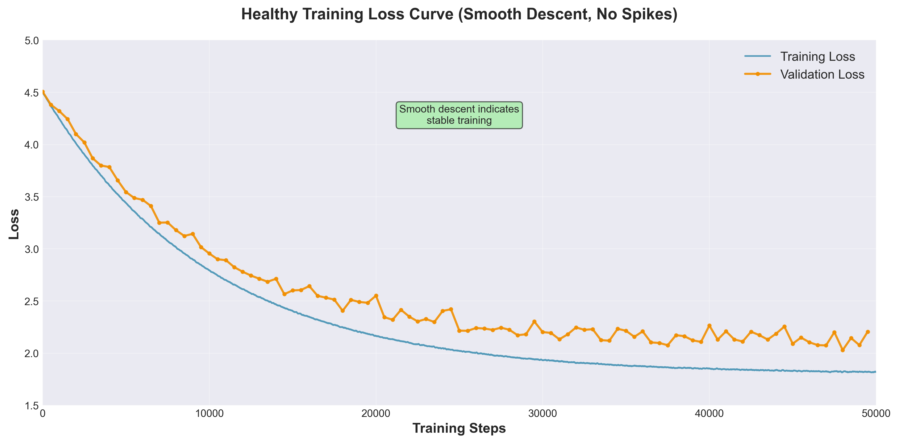
<figcaption>Figure: a healthy training loss curve. Training loss falls smoothly with no spikes, and validation loss follows it down, with some evaluation noise</figcaption>
</div>

### 11.3.1 Key metrics to monitor
{: id="1131-关键监控指标"}

#### 11.3.1.1 Loss
{: id="11311-损失函数loss"}

```mermaid
graph LR
    A["Training loss"] --> B{Decreasing?}
    B -->|Steadily| C["✅ Keep training"]
    B -->|Sudden jump| D["⚠️ Loss spike"]
    B -->|Oscillating| E["⚠️ Unstable"]
    B -->|Plateaued| F["⚠️ Converged/overfitting"]

    D --> G["Lower the learning rate"]
    E --> H["Adjust batch size<br/>or learning rate"]
    F --> I["Stop early or adjust"]

    style C fill:#c8e6c9
    style D fill:#ffcdd2
    style E fill:#ffcdd2
    style F fill:#fff9c4
```

**What a healthy loss curve looks like**:
- Declines steadily without sharp swings
- Pretraining loss starts at about $\ln(\text{Vocabulary size})$ (about 10.4 for a 32K vocabulary) and usually ends around 2
- Pretraining usually runs for less than 1 epoch, so training and validation loss should nearly coincide; a clear gap between them often signals duplicated data or a validation set whose distribution differs from the training set

**Abnormal loss patterns**:

|Symptom|Likely causes|Fix|
|---------|---------|---------|
| **Loss spike** |Bad data, learning rate too high, numerical instability|Roll back to a checkpoint, lower LR, inspect the data|
|**Loss not decreasing**|Learning rate too low, insufficient model capacity|Raise LR, check the architecture|
|**Loss oscillating**|Batch size too small, LR too high|Increase batch size or lower LR|
| **Loss=NaN** |Exploding gradients, numerical overflow|Gradient clipping, mixed precision, check the data|

#### 11.3.1.2 Gradient metrics
{: id="11312-梯度相关指标"}

**What to track**:
- **Gradient norm**: should stay between 0.1 and 10
- **Fraction of steps clipped**: <5% is healthy
- **Update-to-parameter ratio**: updates should be 0.1-1% of parameter magnitude

```python
def monitor_gradients(model):
    """Compute the global L2 norm of the gradients to monitor training stability"""
    total_norm = 0
    for p in model.parameters():
        if p.grad is not None:
            param_norm = p.grad.data.norm(2)
            total_norm += param_norm.item() ** 2
    return total_norm ** 0.5

# Log the gradient norm every 100 steps
if step % 100 == 0:
    grad_norm = monitor_gradients(model)
    logger.log({"gradient_norm": grad_norm})
    # Healthy range: 0.1-10; above 100 is a warning sign
```

#### 11.3.1.3 Learning rate
{: id="11313-学习率监控"}

```python
# Log the current learning rate (to check that the scheduler behaves as expected)
current_lr = optimizer.param_groups[0]['lr']
logger.log({"learning_rate": current_lr})
# Expected shape: Warmup ↗ → Stable — → Decay ↘
```

#### 11.3.1.4 Performance metrics
{: id="11314-性能指标"}

- **Throughput** (tokens/second): training speed
- **GPU utilization**: should stay at 80-95%
- **GPU memory**: avoid OOM; keep a 10-15% buffer
- **Share of time spent communicating**: <20% is good

### 11.3.2 Diagnosing common problems
{: id="1132-常见问题诊断与解决"}

#### 11.3.2.1 Problem 1: out of memory (OOM)
{: id="11321-问题1out-of-memory-oom"}

**Symptom**: a `CUDA out of memory` error

**Fixes** (roughly in order of effectiveness; try them one at a time):
```python
# Option 1: enable gradient checkpointing (saves 50-80% of activation memory)
model.gradient_checkpointing_enable()

# Option 2: smaller batch size + gradient accumulation (same effective batch size)
per_device_batch_size = 1
gradient_accumulation_steps = 32

# Option 3: offload optimizer states to the CPU (saves Adam's 8 bytes/parameter)
from deepspeed.ops.adam import DeepSpeedCPUAdam
optimizer = DeepSpeedCPUAdam(model.parameters())

# Option 4: ZeRO-3 full sharding (most powerful, but slows training)
deepspeed_config = {
    "zero_optimization": {
        "stage": 3,
        "offload_optimizer": {"device": "cpu"},
        "offload_param": {"device": "cpu"}
    }
}
```

#### 11.3.2.2 Problem 2: slow training
{: id="11322-问题2训练速度慢"}

**Diagnosis**:
```bash
# 1. Check GPU utilization
nvidia-smi dmon -s u

# 2. System-level timeline: check whether compute, communication, and data loading overlap
nsys profile -o train_profile python train.py

# 3. Operator-level analysis: wrap a few steps of the training script in torch.profiler,
#    then inspect the trace in TensorBoard or chrome://tracing
```

**Common bottlenecks and fixes**:
- **Slow data loading**: increase `num_workers` and preprocess data
- **Slow communication**: check the network and tune NCCL
- **Slow compute**: check that Flash Attention is enabled

#### 11.3.2.3 Problem 3: loss spikes
{: id="11323-问题3loss-spike"}

**Response**:
```mermaid
graph TD
    A["Loss spike detected"] --> B["Stop training immediately"]
    B --> C["Roll back to the last good checkpoint"]
    C --> D{Find the cause}
    D --> E["Check the data"]
    D --> F["Check the learning rate"]
    D --> G["Check the gradients"]
    E --> H["Filter out bad data"]
    F --> I["Halve the learning rate"]
    G --> J["Enable gradient clipping"]
    H --> K["Resume training"]
    I --> K
    J --> K

    style B fill:#ffcdd2
    style C fill:#fff9c4
    style K fill:#c8e6c9
```

**Prevention**:
```python
# Tip 1: gradient clipping (prevents exploding gradients)
torch.nn.utils.clip_grad_norm_(model.parameters(), max_norm=1.0)

# Tip 2: WSD learning rate schedule (Warmup-Stable-Decay, more stable than plain cosine)
# Hold the peak LR for a while instead of decaying immediately

# Tip 3: automatic loss-spike handling
if current_loss > moving_avg_loss * 1.5:  # loss jumped by 50%
    print(f"⚠️ Loss spike detected: {current_loss:.4f}")
    for param_group in optimizer.param_groups:
        param_group['lr'] *= 0.5  # automatically halve the learning rate
    # Optional: automatically roll back to the previous checkpoint
```

### 11.3.3 Checkpoint management
{: id="1133-checkpoint管理策略"}

#### 11.3.3.1 Saving
{: id="11331-保存策略"}

```python
# Checkpoint settings (balancing safety against storage cost)
checkpoint_config = {
    "save_interval": 1000,           # save every 1000 steps (about 1-2 hours)
    "save_total_limit": 5,           # keep the 5 most recent (so the disk doesn't fill up)
    "save_on_each_node": False,      # save only on the main node
    "save_optimizer_state": True,    # required, or training cannot be resumed
}

# Also keep the best model (by validation loss)
if current_loss < best_loss:
    save_checkpoint(model, "best_model.pt")
    best_loss = current_loss
```

#### 11.3.3.2 Resuming training
{: id="11332-恢复训练"}

```python
# Resume from a checkpoint
def resume_training(checkpoint_path):
    checkpoint = torch.load(checkpoint_path)

    model.load_state_dict(checkpoint['model_state_dict'])
    optimizer.load_state_dict(checkpoint['optimizer_state_dict'])

    start_step = checkpoint['step']
    start_epoch = checkpoint['epoch']

    # Restore the learning rate scheduler
    scheduler.load_state_dict(checkpoint['scheduler_state_dict'])

    # Restore RNG states (resetting the seed alone cannot reproduce the data order before the interruption)
    torch.set_rng_state(checkpoint['torch_rng_state'])
    torch.cuda.set_rng_state_all(checkpoint['cuda_rng_state'])

    return start_step, start_epoch
```

> **Best practices**
>
> - Do a **small trial run** (100-1000 steps) before the real training starts
> - Set up **automatic alerts** (abnormal loss, GPU failures, etc.)
> - Keep several historical checkpoints, not just the latest one
> - **Review** training logs and charts regularly by hand

## 11.4 Hands-on: MiniMind
{: id="114-个人实践minimind"}

### 11.4.1 Repository
{: id="1141-项目地址"}
```
https://github.com/jingyaogong/minimind
```

If training Llama-3 is a high-stakes bet that burns money, the **MiniMind** project shows that LLM training is within reach of ordinary people too.

### 11.4.2 Why MiniMind?
{: id="1142-为什么关注-minimind"}
MiniMind is a minimalist open-source LLM training project that lets developers train an LLM through the whole pipeline from scratch **on a single consumer GPU**.

### 11.4.3 Key numbers
{: id="1143-核心数据对比"}

|Aspect|MiniMind (26M)|Llama-3 (8B)|
|------|-----------------|---------------|
|**Parameters**|26 million|8 billion|
|**Hardware**| 1 × RTX 3090 |~1300000 H100 GPU hours of pretraining (Meta's official model card)|
|**Training time**|~2 hours|Weeks (on an H100 cluster)|
|**Data**|A few GB of curated text| 15T+ Tokens |
|**Cost**|About 3 yuan (renting a cloud GPU)|Millions of dollars|

### 11.4.4 Lessons for beginners
{: id="1144-给初学者的启示"}
* **Mastering the whole pipeline matters more than compute**: with MiniMind you train the tokenizer yourself, write the Transformer, and run every Python script from pretraining to DPO alignment.
* **A fast way to test ideas**: a new loss function or positional encoding can be validated very quickly on a model as small as MiniMind.
* **The potential of small language models**: in narrow domains (such as specific format conversion or information extraction), a fine-tuned small language model can perform remarkably well.


---

# 12. Frequently asked questions (FAQ)
{: id="12-常见问题faq"}

This chapter collects **frequently asked questions about LLM training, with answers**, to help clear up common points of confusion in practice.

> **Tip**: use Ctrl+F to search for keywords and jump straight to your question

## 12.1 Pretraining
{: id="121-预训练"}

### 12.1.1 How much data
{: id="1211-需要多少数据"}

**A:** It depends on model size and goals:

- **Small models (1-3B)**:
  - Minimum: 10-50B tokens for basic capability
  - Recommended: 100-300B tokens for better results
  - Example: Phi-1 (1.3B) used only about 7B tokens of high-quality data and performed very well on coding tasks

- **Medium models (7-13B)**:
  - Recommended: 500B-1T tokens
  - LLaMA-1 7B used 1T tokens

- **Large models (70B+)**:
  - Recommended: 1.5-2T tokens
  - LLaMA-2 70B used 2T tokens

**Key insights**:

- **Compute-optimal vs. inference-optimal**: Chinchilla's compute-optimal ratio is about 20 tokens per parameter (about 1.4T tokens for a 70B model). But inference dominates the cost once a model is deployed, so modern models go far beyond this ratio and "overtrain" small models: Llama 3 8B used 15T tokens, about 1,900 tokens per parameter, buying more capability at the same inference cost.
- **Quality > quantity**: Phi-1 (1.3B) used only about 7B tokens of "textbook-quality" data yet reached 50.6% pass@1 on HumanEval, beating StarCoder-15B, which has more than 10 times as many parameters.

---

### 12.1.2 Judging convergence
{: id="1212-如何判断收敛"}

**A:** Watch these signals:

1. **Training loss**:
   - No longer falling meaningfully (change <0.01 per 1000 steps)
   - Typical final values: 2.0-3.0 (depends on the data)

2. **Validation loss**:
   - Follows the same trend as training loss
   - If validation loss rises while training loss falls → overfitting

3. **Downstream performance**:
   - Benchmark scores stop improving
   - This is the ultimate criterion

4. **Number of training steps**: set by the data and batch size, not by model size: total steps ≈ total tokens / tokens per step. For example, LLaMA-2 trained on 2T tokens with 4M tokens per step, about 500,000 steps for every size from 7B to 70B.

**Recommendation**: pretraining usually **does not aim for full convergence**, because the cost is very high and returns diminish. It is fine to stop once the loss curve flattens.

---

### 12.1.3 Handling loss spikes
{: id="1213-loss-spike-处理"}

**A:** What to do when the loss suddenly jumps:

**Immediately**:
```
1. Stop training
2. Roll back to a checkpoint before the spike (usually 2-3 checkpoints back)
3. Find the cause of the spike
```

**Common causes and fixes**:

|Cause|Symptom|Fix|
|------|------|----------|
|**Bad data**|A single sharp jump|Skip that batch and tighten data filtering|
|**Learning rate too high**|Gradual rise|Cut LR to 50% of its value|
|**Numerical instability**|Random occurrences|Use BF16 and add gradient clipping|
|**Exploding gradients**|Accompanied by a surge in grad norm|Lower LR, enable gradient clipping|

<div align="center">
  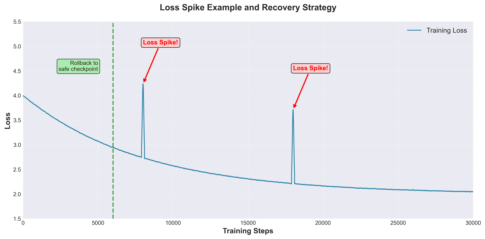
<figcaption>Figure: loss spikes. Two spikes occur during training; the response is to roll back to a safe checkpoint before each spike</figcaption>
</div>

**Prevention**: gradient clipping (max_norm=1.0), BF16 instead of FP16, lowering Adam's $\beta_2$ from 0.999 to 0.95, and skipping the data batches that trigger spikes. See Section 11.3.2.3 for the full response procedure and automatic detection code. PaLM reports that rolling back to a checkpoint about 100 steps before the spike and skipping the next 200–500 data batches usually keeps the spike from recurring.

---

### 12.1.4 More than one epoch
{: id="1214-能否超过-1-个-epoch"}

**A:** **Not recommended** when data is plentiful, but moderate repetition is fine when data is limited:

1. **Memorization**: too much repetition makes the model memorize the training data and generalize worse.
2. **Diminishing returns**: Muennighoff et al. (2023) found that training on the same data for up to about 4 epochs is almost as good as using fresh data; beyond that, returns decay rapidly until extra compute adds almost nothing.
3. **Industry practice**: mainstream LLMs see their main web data for less than 1 epoch, but repeat small high-quality sources such as Wikipedia and books 2-3 times (LLaMA-1 used about 2.45 epochs of Wikipedia)

**Exceptions**:
- Multiple epochs are fine when data is very scarce (<10B tokens)
- Domain models (e.g. medical, legal) can train several epochs on small amounts of high-quality data
- Even then, it rarely goes beyond 3-5 epochs

**Alternatives**: when data is limited, prefer to:
- Improve data quality and diversity
- Increase model capacity
- Use a better data mixture

---

## 12.2 Supervised fine-tuning
{: id="122-监督微调"}

### 12.2.1 LoRA vs. full fine-tuning
{: id="1221-lora-与全参数微调"}

**A:** Choose based on the situation:

**Full fine-tuning**:
- **When to use it**:
  - You have ample GPU resources
  - You need the best possible performance
  - The task differs substantially from pretraining
- **Drawbacks**:
  - High GPU memory use (full gradients and optimizer states must be stored)
  - Slower training
  - Every task needs a full copy of the model

**LoRA fine-tuning**:
- **When to use it**:
  - GPU resources are limited
  - You need adapters for several tasks
  - You want fast experiments and iteration
- **Drawbacks**:
  - Learns new knowledge less well than full fine-tuning, and the gap grows with the amount of data
  - Extra hyperparameters to tune (r, alpha, and a learning rate higher than for full fine-tuning)

**How big is the gap?** It depends on the task and the amount of data:

- **LoRA Learns Less and Forgets Less** (Biderman et al., 2024): for large-scale continued pretraining on code and math, LoRA clearly trails full fine-tuning; the gap is smaller for instruction fine-tuning, and LoRA forgets less
- **LoRA Without Regret** (Thinking Machines, 2025): as long as LoRA covers all linear layers and uses a learning rate about 10 times that of full fine-tuning, it matches full fine-tuning for typical-scale SFT and reinforcement learning; it only falls behind when the data exceeds LoRA's capacity

**Recommendations**:
- Limited resources or quick experiments → **LoRA**
- Production systems that need maximum performance → **full fine-tuning**
- Middle ground → **QLoRA** (quantization + LoRA)

---

### 12.2.2 How much SFT data
{: id="1222-需要多少-sft-数据"}

**A:** Far less than pretraining, and quality matters more than quantity:

**Rough guide**:

|Data size|Result|Use case|
|---------|------|----------|
| **1k-5k** |Basic instruction following|Rapid prototyping, specific tasks|
| **10k-30k** |Good conversational ability|General-purpose assistants|
| **50k-100k** |Strong multi-task ability|Production models|
| **100k+** |Diminishing marginal returns|Squeezing out the last bit of performance|

**Real examples**:
- **Alpaca**: 52k synthetic samples, good results
- **Vicuna**: 70k ShareGPT conversations, close to ChatGPT
- **LLaMA-2-Chat**: 27.5k samples, excellent results

**Key insight**:
> 1,000 high-quality, diverse samples > 10,000 low-quality, repetitive ones

**Data quality criteria**:
- Clear instructions
- Accurate, helpful answers
- A wide range of task types
- Consistent, standardized formatting
- No templated answers
- No factual errors
- No harmful content

---

### 12.2.3 Avoiding overfitting
{: id="1223-避免过拟合"}

**A:** Combine several strategies:

**1. Limit the number of epochs**
```python
# 1-3 epochs is usually enough
num_train_epochs = 2  # recommended starting point

# Monitor validation loss and stop early
early_stopping_patience = 3
```

**2. Use a smaller learning rate**
```python
# The SFT learning rate should be much smaller than in pretraining
learning_rate = 2e-5  # instead of 3e-4
```

**3. Data augmentation**
```python
# Paraphrasing
# Varying the instructions
# Varying answer styles
```

**4. Dropout and regularization**
```python
model_config = {
    "dropout": 0.1,
    "attention_dropout": 0.1,
    "weight_decay": 0.01
}
```

**5. Mix in other training data**
```python
# Add 10-20% pretraining data
mixed_dataset = {
    "sft_data": 0.8,
    "pretrain_data": 0.2  # guards against catastrophic forgetting
}
```

**Signs of overfitting**:
- Training loss keeps falling while validation loss rises
- Near-perfect on the training set, poor on the test set
- The model starts "reciting" training samples

**Diagnostic code**:
```python
# Evaluate periodically
if step % eval_steps == 0:
    train_loss = evaluate(model, train_dataset)
    val_loss = evaluate(model, val_dataset)

    if val_loss > best_val_loss:
        patience_counter += 1
        if patience_counter >= early_stopping_patience:
            print("Early stopping triggered!")
            break
```

---

## 12.3 Post-training
{: id="123-post-training"}

### 12.3.1 Lost capabilities
{: id="1231-旧能力下降"}

**A:** This is **catastrophic forgetting**, the most common problem in post-training.

**Root cause**: training optimizes only the loss on the target task, so the model "forgets" old knowledge. Forgetting happens even when the data is entirely harmless, and even with LoRA.

**Fixes (from highest to lowest priority)**:

**Fix 1: self-output training** (recommended; needs no historical data)
```python
# For each training example, first let the foundation model answer it
foundation_output = foundation_model.generate(question)

# If the model answers correctly, train on its own answer
# If it answers wrongly, train on the human-written answer
answer = foundation_output if is_correct(foundation_output) else human_answer
```

**Fix 2: experience replay**
```python
# Mix in about 3-5% old-task data (or data self-generated by the foundation model)
mixed_dataset = {
    "new_task_data": 0.97,
    "replay_data": 0.03,  # historical data or Magpie self-generated data
}
```

**Fix 3: Magpie pseudo-replay** (when historical data is unavailable)
```python
# Let the foundation model ask and answer its own questions to create pseudo-historical data
pseudo_data = []
for _ in range(n):
    q = foundation_model.generate("<|user|>")      # generate a question
    a = foundation_model.generate(q + "<|assistant|>")  # answer it
    pseudo_data.append((q, a))
```

**Key conclusions**:
- LoRA **does not truly prevent** forgetting (it learns less, so it forgets less)
- Safety alignment can collapse even when the training data is harmless
- After training, you **must** re-evaluate the original capabilities on multiple benchmarks

---

## 12.4 Preference alignment
{: id="124-偏好对齐"}

### 12.4.1 RLHF vs. DPO
{: id="1241-rlhf-与-dpo-怎么选"}

**A:** DPO is usually the better choice:

**Advantages of DPO** (recommended):
- More stable training (no RL exploration-exploitation dilemma)
- Simpler to implement (no PPO or reward model)
- More compute-efficient (2 models vs. 4)
- Equal or better results
- More robust to hyperparameters

**Advantages of RLHF**:
- A deeper theoretical foundation
- Can collect new data online
- Handles complex reward signals

**Comparison**:
```
Dimension                 RLHF    DPO     Notes
━━━━━━━━━━━━━━━━━━━━━━━━━━━━━━━━━━━━━
Training stability        ⭐⭐⭐   ⭐⭐⭐⭐⭐  DPO is much more stable
Implementation effort     ⭐⭐     ⭐⭐⭐⭐⭐  DPO is much simpler
Compute efficiency        ⭐⭐     ⭐⭐⭐⭐⭐  DPO is 2-3x faster
Final quality             ⭐⭐⭐⭐  ⭐⭐⭐⭐   Comparable
```

**Recommendations**:
- **Default to DPO**: fits most situations
- **Consider RLHF**: when you need online learning or a complex reward function
- **Newer methods**: DPO variants such as ORPO and SimPO

---

### 12.4.2 Building preference data
{: id="1242-构建偏好数据"}

**A:** Three main approaches:

**Approach 1: human annotation** (highest quality)
```
Process:
1. Sample prompts (from real users or written by hand)
2. Generate several answers (usually 4-8)
3. Have humans rank or compare them
4. Build preference pairs: (prompt, chosen, rejected)

Cost: $0.5-2/sample
Scale: 10k-50k preference pairs
Quality: ⭐⭐⭐⭐⭐
```

**Approach 2: AI annotation** (very cost-effective; recommended)
```python
# RLAIF: use a strong model such as GPT-4 as the "judge"
prompt = f"""
Given the question: {question}

Response A: {response_a}
Response B: {response_b}

Which response is better? Consider helpfulness, accuracy, and safety.
Answer: A or B
"""
# In practice, evaluate each pair twice with A/B swapped to cancel out the judge's position bias
```

```
Cost: $0.01-0.05/sample (vs. $0.5-2/sample for humans)
Scale: easily 100k+
Quality: ⭐⭐⭐⭐ (in the RLAIF paper, AI labels agree with human preferences about 78% of the time, similar to agreement between human annotators)
```

**Approach 3: synthetic construction** (quick start)
```python
# Build preference pairs automatically from existing SFT data
chosen = high_quality_response
rejected = synthesize_negative(chosen)  # sources of negatives:
    # - truncated answers (simulating incompleteness)
    # - injected factual errors
    # - violations of the instructions
    # - added harmful content
```

```
Cost: almost free (no API calls or human labor)
Scale: unlimited (generated automatically)
Quality: ⭐⭐⭐ (works, but the negatives are too obviously "fake", so the model learns limited discrimination)
```

**Mixed strategy** (recommended):
```
Core data (20%): human-annotated, for high quality
Extended data (60%): AI-annotated, to scale quickly
Supplementary data (20%): synthetic, for diversity
```

---

## 12.5 Engineering
{: id="125-工程实践"}

### 12.5.1 Choosing parallelism
{: id="1251-选择并行策略"}

**A:** Follow this decision tree:

```mermaid
graph TD
    A["Start"] --> B{Does the model<br/>fit on one GPU?}
    B -->|Yes| C["Use data parallelism (DP)"]
    B -->|No| D{Is a single layer<br/>too large?}

    D -->|Yes| E["Enable tensor parallelism (TP)"]
    D -->|No| F{Are there<br/>many layers?}

    E --> F
    F -->|Yes| G["Enable pipeline parallelism (PP)"]
    F -->|No| H["Check the total GPU count"]

    G --> H
    H --> I{Any GPUs<br/>left over?}
    I -->|Yes| J["Increase data parallelism"]
    I -->|No| K["Configuration done"]

    J --> K

    style C fill:#c8e6c9
    style E fill:#ffcdd2
    style G fill:#fff9c4
    style K fill:#e3f2fd
```

**Practical configurations**:

|Total GPUs|Model size|Recommended configuration|Notes|
|---------|---------|---------|------|
| 8 | 7B | DP=8 |Pure data parallelism|
| 16 | 13B | TP=2, DP=8 |Light TP|
| 64 | 30B | TP=4, PP=2, DP=8 |2D parallelism|
| 128 | 70B | TP=8, PP=4, DP=4 |3D parallelism|
| 512 | 175B | TP=8, PP=16, DP=4 |Deep 3D parallelism|

**Sanity check**:
```python
# Key formula: total GPUs = data parallel × tensor parallel × pipeline parallel
total_gpus = DP * TP * PP

# Example: a 70B model on 128 GPUs
DP = 4   # 4 independent replicas (more throughput)
TP = 8   # each layer split 8 ways (one layer doesn't fit on a GPU)
PP = 4   # 4 pipeline stages (too many layers)
assert 4 * 8 * 4 == 128  # ✓ uses every GPU
```

---

### 12.5.2 Running out of GPU memory
{: id="1252-显存不够怎么办"}

**A:** Optimize in levels:

**Level 1: basics** (no downside; always enable)
```python
# Tip 1: mixed precision (FP32→FP16/BF16, halves memory)
use_fp16 = True  # or bf16 (preferred for large models)

# Tip 2: gradient checkpointing (trade compute for memory by recomputing activations)
model.gradient_checkpointing_enable()

# Tip 3: Flash Attention (IO-aware; both faster and leaner)
use_flash_attention = True
```
Memory saved: ~30-40%
Speed impact: almost none (Flash Attention is even faster)

**Level 2: intermediate** (small speed cost)
```python
# Tip 4: smaller batches + gradient accumulation (same effective batch size)
per_device_batch_size = 1      # down from 4 to 1
gradient_accumulation_steps = 32  # update once every 32 steps

# Tip 5: ZeRO-2 (shard optimizer states, saving 8 bytes/parameter)
zero_stage = 2  # optimizer states spread across GPUs
```
Memory saved: another 30-40%
Speed impact: ~10-20% slower (communication overhead)

**Level 3: aggressive** (significant speed cost)
```python
# Tip 6: ZeRO-3 full sharding + CPU offload (parameters are sharded too)
# Tip 7: offload activation checkpoints to the CPU as well (maximum memory savings)
deepspeed_config = {
    "zero_optimization": {
        "stage": 3,                              # shard parameters, gradients, and optimizer states
        "offload_optimizer": {"device": "cpu"},  # optimizer → CPU
        "offload_param": {"device": "cpu"}       # parameters → CPU
    },
    "activation_checkpointing": {
        "partition_activations": True,
        "cpu_checkpointing": True                # activation checkpoints → CPU
    }
}
```
Memory saved: another 40-50% (enough to train very large models)
Speed impact: ~2-5x slower (CPU-GPU transfer bottleneck)

**Level 4: last resort** (change how you train)
```python
# Tip 8: quantized training (QLoRA: 4-bit quantization)
load_in_4bit = True  # a 7B model goes from 14GB → 3.5GB

# Tip 9: use a smaller model (the most direct option)
model_size = "13B"  # 70B → 13B, about 5x less memory
```
Memory saved: 4x from quantization; proportional to size for a smaller model
Quality impact: slight drop from quantization (<2%); a smaller model is less capable

**Memory breakdown**:
```
Total GPU memory = model parameters + optimizer states + gradients + activations

Example (70B model, BF16 mixed precision + AdamW):
- Model parameters (BF16): 70B × 2 bytes = 140GB
- Gradients (BF16): 70B × 2 bytes = 140GB
- Optimizer states (FP32 master weights + m + v): 70B × 12 bytes = 840GB
- Activations: depend on batch size and sequence length
━━━━━━━━━━━━━━━━━━━━━━━━━━━━━━━━
Total: ~1,120GB + activations (unoptimized)

With ZeRO-3:
- Model states per GPU: 1,120GB / number of GPUs
- 8×A100 (80GB): 140GB per GPU → doesn't fit; CPU/NVMe offload is required on top
- 16×A100 (80GB): 70GB per GPU → model states barely fit; activations still need gradient checkpointing
```

---

### 12.5.3 Resuming training
{: id="1253-中断恢复"}

**A:** The full recovery procedure:

**1. Automatic checkpointing and recovery**
```python
def save_checkpoint(model, optimizer, scheduler, step, epoch):
    checkpoint = {
        'step': step,
        'epoch': epoch,
        'model_state_dict': model.state_dict(),
        'optimizer_state_dict': optimizer.state_dict(),
        'scheduler_state_dict': scheduler.state_dict(),
        'torch_rng_state': torch.get_rng_state(),
        'cuda_rng_state': torch.cuda.get_rng_state_all(),
        'numpy_random_state': np.random.get_state(),
        'python_random_state': random.getstate(),
    }
    torch.save(checkpoint, f'checkpoint_step_{step}.pt')

def load_checkpoint(path, model, optimizer, scheduler):
    checkpoint = torch.load(path)

    model.load_state_dict(checkpoint['model_state_dict'])
    optimizer.load_state_dict(checkpoint['optimizer_state_dict'])
    scheduler.load_state_dict(checkpoint['scheduler_state_dict'])

    # Restore RNG states (important! resetting the seed alone cannot reproduce the data order before the interruption)
    torch.set_rng_state(checkpoint['torch_rng_state'])
    torch.cuda.set_rng_state_all(checkpoint['cuda_rng_state'])
    np.random.set_state(checkpoint['numpy_random_state'])
    random.setstate(checkpoint['python_random_state'])

    return checkpoint['step'], checkpoint['epoch']
```

**2. Support resuming in the training script**
```bash
python train.py --resume_from_checkpoint ./checkpoint_step_50000.pt
```

```python
# Training loop
if args.resume_from_checkpoint:
    start_step, start_epoch = load_checkpoint(...)
    print(f"Resuming from step {start_step}")
else:
    start_step, start_epoch = 0, 0

for step in range(start_step, total_steps):
    # training logic
    ...
```

**3. Verify that recovery worked**

After resuming, the loss curve should continue smoothly with no sudden jumps. Checklist:

- The loss is continuous
- The learning rate is correct
- RNG states and the data-loading position are restored (same data order)
- The step count is correct

**4. Recovery with DeepSpeed**
```python
# DeepSpeed handles recovery automatically
model_engine, optimizer, _, _ = deepspeed.initialize(
    model=model,
    config=ds_config
)

# Restore
_, client_sd = model_engine.load_checkpoint(checkpoint_dir)
step = client_sd['step']
```

> **Notes**
>
> - Save checkpoints regularly (every 1000-5000 steps)
> - Keep several historical checkpoints (at least the last 3-5)
> - After resuming, check a few steps to confirm the loss looks normal
> - Record validation metrics for every checkpoint

---

### 12.5.4 Is training healthy
{: id="1254-判断训练是否正常"}

**A:** Monitor along several dimensions:

**Signs of healthy training**:

1. **Loss curve**
   - Declines smoothly without large swings
   - Training and validation loss nearly coincide during pretraining
   - Falls at the expected rate

2. **Gradients**
   - Gradient norm within 0.1-10
   - Clipping rate <5%
   - No NaN or Inf

3. **Performance**
   - GPU utilization >80%
   - Stable throughput
   - Communication time <20%

4. **Learning rate**
   - Follows the schedule
   - Rises steadily during warmup

**Signs of trouble**:

|Symptom|Likely causes|What to check|
|------|---------|--------|
|Loss not decreasing|Learning rate too low, data problems|Check LR, inspect data samples|
|Loss oscillating|Learning rate too high, batch too small|Lower LR or increase batch size|
| Loss=NaN |Exploding gradients, numerical overflow|Enable gradient clipping and mixed precision|
|Low GPU utilization|Slow data loading, communication bottleneck|Add workers, check the network|

**Monitoring code in practice (W&B)**:
```python
import wandb

# Log core training metrics (every step)
wandb.log({
    "train/loss": loss,                     # 📉 the most important; should keep falling
    "train/grad_norm": grad_norm,           # 📊 training stability
    "train/learning_rate": lr,              # 📈 check the scheduler
    "system/gpu_utilization": gpu_util,     # ⚡ should stay at 80-95%
    "system/tokens_per_second": throughput, # 🚀 throughput
    "step": step
})
```

**Smart alerts** (so you don't get woken up at 3 a.m. for nothing):
```python
# Alert thresholds (tune to your setup)
if loss > moving_avg * 1.5:
    send_alert(f"🚨 Loss spike! Current: {loss:.4f}, Avg: {moving_avg:.4f}")

if gpu_util < 50:
    send_alert(f"⚠️ Low GPU utilization! Current: {gpu_util}% (possible data I/O bottleneck)")

if grad_norm > 100:
    send_alert(f"💥 Gradient explosion! Norm={grad_norm:.2f} (normal < 10)")
```

---

# 13. Multimodal and agent training
{: id="13-多模态与-agent-训练"}

Starting from a text-only LLM, how do we let a model "see" the world, and then use tools to complete tasks on its own? The first half of this chapter covers vision-language models (VLMs): the fusion architecture, dynamic resolution, visual token encoding, the two-stage training recipe, and a minimal PyTorch implementation. The second half covers training agents to use tools. For a fuller review of VLMs, see the "VLM survey" on this site.

---

## 13.1 VLM architecture
{: id="131-vlm-架构"}

Mainstream VLMs (such as LLaVA, PaliGemma, and Qwen-VL) consist of three main parts:

```mermaid
graph LR
    IMG["Image input"] --> VE["Visual encoder<br/>e.g. SigLIP / ViT"]
    VE --> PROJ["Projection layer<br/>MLP / Perceiver"]
    PROJ --> LLM["LLM backbone<br/>e.g. Llama / Qwen"]
    TXT["Text prompt"] --> LLM
    LLM --> OUT["Text answer"]

    style VE fill:#e1f5ff,stroke:#01579b
    style PROJ fill:#fff9c4,stroke:#f57f17
    style LLM fill:#c8e6c9,stroke:#1b5e20
```

### 13.1.1 Visual encoder
{: id="1311-视觉编码器"}
Turns the raw image into a feature tensor. The mainstream choice today is a well-pretrained **ViT-L/14** (e.g. from CLIP or SigLIP).
* **SigLIP vs. CLIP**: early VLMs mostly used CLIP, but **SigLIP (Sigmoid Language-Image Pre-training)** has become the default in recent years. CLIP uses a softmax loss for global contrastive learning, which needs very large batches and is sensitive to noise. SigLIP instead treats each image-text match as an independent binary classification with a sigmoid loss; it trains stably at smaller batch sizes and gives stronger zero-shot image classification and fine-grained representations.

### 13.1.2 Projection layer
{: id="1312-投影层"}
Maps the visual encoder's output dimension (e.g. 1024 for ViT) to the LLM's embedding dimension (e.g. 4096 for Llama-3), turning visual features into "virtual visual tokens" the LLM can understand.
* **Linear/MLP projection**: the minimalist approach used by LLaVA. It is very cheap to compute, but every ViT feature goes into the LLM (e.g. 576 tokens), so the context window fills up quickly as the number of images grows.
* **Perceiver Resampler**: the approach used by Flamingo; the first Qwen-VL used a similar single-layer cross-attention resampler. A fixed set of learnable queries aggregates ViT's many features through cross-attention, compressing visual features of any resolution or count to a fixed length (64 for Flamingo, 256 for Qwen-VL) and saving a lot of the LLM's context window. (PaliGemma, like LLaVA, simply uses a linear layer to project SigLIP features into Gemma's embedding space.)
* **Q-Former**: the query Transformer proposed in BLIP-2, pretrained in two stages; heavier, but with strong representational power.

### 13.1.3 LLM backbone
{: id="1313-语言模型基座"}
Takes the interleaved visual and text tokens and produces the final text answer. During training it learns image-text understanding through LoRA or full fine-tuning.

---

## 13.2 Dynamic resolution
{: id="132-动态分辨率"}

Traditional vision models resize every input image to a fixed resolution (such as $224 \times 224$ or $336 \times 336$). That works for ordinary classification, but it is disastrous for **OCR**, **chart analysis**, or **fine-grained object detection** with large models: resizing blurs small text until it is unreadable.

To fix this, modern VLMs (such as LLaVA-NeXT, Monkey, and InternVL) use **dynamic tiling (image patching)**:

```mermaid
flowchart TD
    IMG["Original high-resolution image<br>e.g. 672×672"] -->|"grid split"| T1["Tile 1<br>336×336"]
    IMG -->|"grid split"| T2["Tile 2<br>336×336"]
    IMG -->|"grid split"| T3["Tile 3<br>336×336"]
    IMG -->|"grid split"| T4["Tile 4<br>336×336"]
    IMG -->|"resize whole image"| G["Global thumbnail<br>336×336"]
    T1 & T2 & T3 & T4 & G --> VE["Each encoded by the visual encoder"]
    VE --> SEQ["Concatenated into one sequence of visual tokens<br>passed through the projection into the LLM"]

    style IMG fill:#e3f2fd,stroke:#01579b,color:#000
    style G fill:#fff9c4,stroke:#f57f17,color:#000
    style SEQ fill:#c8e6c9,stroke:#1b5e20,color:#000
```

* **How it works**:
  1. Split a high-resolution image (e.g. $672 \times 672$) into $2 \times 2$ non-overlapping tiles of $336 \times 336$ each.
  2. Also resize the whole image to $336 \times 336$ as a "global thumbnail" that conveys the overall layout.
  3. Feed all five images through the visual encoder, map them through the projection layer, and concatenate the results into one sequence of visual tokens.
  4. The model can now read small text and fine details in large images, at the cost of visual tokens growing in proportion to the number of tiles (5 × 576 = 2,880 in this example).

Another route is **native dynamic resolution**: Qwen2-VL no longer resizes or tiles images to a fixed size; its ViT processes images at any resolution directly (with 2D positional encoding). The number of visual tokens scales with image area, and adjacent 2×2 tokens are merged to keep the sequence length in check.

---

## 13.3 Visual tokens and interleaving
{: id="133-视觉-token-与序列交织"}

In a VLM, image feature vectors must be concatenated or interleaved with the text along the sequence dimension before entering the LLM.

* **Sequence format**:
At the token level, an image is usually wrapped in a pair of special markers. For example, an image mapped to $N$ visual tokens (e.g. $N=576$) appears in the chat template roughly as:
  ```
  <|im_start|>system
  You are a helpful assistant.<|im_end|>
  <|im_start|>user
  <image> v_1 v_2 ... v_N </image> Please describe this image.<|im_end|>
  <|im_start|>assistant
  ```
Here `v_1 ... v_N` are not vocabulary tokens but vectors output by the projection layer; they directly replace the placeholder positions after the embedding layer (see the code in Section 13.5).
* **Attention masks**:
Most VLMs (such as LLaVA and the Qwen-VL series) simply use the LLM's **causal attention**, treating visual and text tokens alike. Some models use a **prefix-LM** instead: PaliGemma makes **image tokens and the text prefix attend to each other bidirectionally** and applies a causal mask only to the answer being generated.

---

## 13.4 Two-stage VLM training
{: id="134-vlm-的两阶段训练"}

Mainstream VLMs, typified by LLaVA-1.5, train in two stages: first "align the modalities", then "learn to follow instructions":

|Stage|Trainable parameters|Data|Goal|
|------|-------------|------|------|
|**Stage 1: feature-alignment pretraining**|Projection layer only; visual encoder and LLM frozen|About 558000 image-caption pairs (LCS-558K)|Map visual features into the LLM's word-embedding space|
|**Stage 2: visual instruction tuning**|Projection layer + LLM (full or LoRA); visual encoder usually still frozen|About 665000 mixed instruction samples (visual dialogue, VQA, OCR, region descriptions, and text-only dialogue)|Teach the model to perform a range of visual tasks on instruction|

- **Why freeze the LLM first**: the randomly initialized projection layer starts out emitting "noise tokens"; unfreezing the LLM at that point would damage its language ability (echoing catastrophic forgetting in Chapter 5)
- **Text-only data still matters**: mixing text-only dialogue into stage 2 (LLaVA-1.5 mixes in ShareGPT data) preserves the LLM's original dialogue and reasoning abilities
- **More recent recipes**: later models such as InternVL and Qwen2-VL add continued pretraining on large-scale interleaved image-text data after stage 1, and unfreeze the visual encoder in later stages to improve OCR and high-resolution understanding

---

## 13.5 A minimal VLM
{: id="135-极简-vlm-实现"}

The code below shows how to build a minimal vision-language VLM from scratch in PyTorch:

```python
import torch
import torch.nn as nn
from transformers import AutoModelForCausalLM, AutoConfig

class SimpleVLM(nn.Module):
    def __init__(self, llm_model_name_or_path, visual_dim=1024, embed_dim=4096):
        super().__init__()
        # 1. Instantiate the LLM backbone (a Llama/Qwen architecture here)
        self.llm = AutoModelForCausalLM.from_pretrained(llm_model_name_or_path)
        self.word_embeddings = self.llm.get_input_embeddings()

        # 2. A simple visual feature extractor (replace with a pretrained ViT/SigLIP; randomly initialized here for illustration)
        # Assume a 336x336x3 input image; the ViT yields 576 patch features, each 1024-dimensional
        self.visual_encoder = nn.Sequential(
            nn.Linear(visual_dim, visual_dim),
            nn.GELU()
        )

        # 3. The glue: a multilayer perceptron (MLP projector)
        # maps 1024-dim visual vectors into the LLM's 4096-dim word-embedding space
        self.projector = nn.Sequential(
            nn.Linear(visual_dim, embed_dim),
            nn.GELU(),
            nn.Linear(embed_dim, embed_dim)
        )

    def forward(self, text_input_ids, image_features, visual_token_start_idx):
        """
        Args:
            text_input_ids: text token IDs, shape: [batch_size, seq_len]
            image_features: raw features from the visual encoder, shape: [batch_size, 576, 1024]
            visual_token_start_idx: index in the text where the image placeholders begin
        """
        # Step 1: convert text token IDs into the LLM's embedding vectors
        # text_embeds shape: [batch_size, seq_len, 4096]
        text_embeds = self.word_embeddings(text_input_ids)

        # Step 2: extract image features and project them into the text modality
        # vis_features shape: [batch_size, 576, 1024] -> [batch_size, 576, 4096]
        vis_features = self.visual_encoder(image_features)
        vis_tokens = self.projector(vis_features)

        # Step 3: insert the visual tokens in place of the placeholders in the text sequence
        # Assume text_input_ids already reserves 576 placeholders (e.g. special <image> tokens)
        batch_size, seq_len, embed_dim = text_embeds.shape
        num_vis_tokens = vis_tokens.shape[1]

        # Build the mixed embedding sequence
        mixed_embeds = []
        for i in range(batch_size):
            # Put sample i's visual tokens into the reserved placeholder positions
            prefix = text_embeds[i, :visual_token_start_idx]
            suffix = text_embeds[i, visual_token_start_idx + num_vis_tokens:]

            # Concatenate: prefix (text) + vis_tokens (projected image) + suffix (text)
            sample_embeds = torch.cat([prefix, vis_tokens[i], suffix], dim=0)
            mixed_embeds.append(sample_embeds)

        # mixed_embeds shape: [batch_size, seq_len, 4096]
        mixed_embeds = torch.stack(mixed_embeds, dim=0)

        # Step 4: run the LLM backbone to get the output logits
        outputs = self.llm(inputs_embeds=mixed_embeds)
        return outputs.logits
```

---

## 13.6 Agent training
{: id="136-agent-训练"}

In 2025-2026 the focus of LLM competition shifted from "conversation quality" to whether a model **can use tools on its own and complete multi-step tasks** (agentic capability). Models such as Kimi K2 make this their main selling point. Agent training differs noticeably from the dialogue and reasoning training of earlier chapters in both data format and reward design; this section fills in those differences.

### 13.6.1 SFT data format for tool calls
{: id="1361-工具调用-sft-数据格式"}

The first step in agent training is teaching the model to issue tool calls in a fixed format. A common approach inserts special tool-call and tool-response turns into the conversation format:

```
<|user|> Check tomorrow's weather in Beijing, then book me a flight to Shanghai
<|assistant|> <tool_call>{"name": "get_weather", "arguments": {"city": "Beijing", "date": "tomorrow"}}</tool_call>
<|tool_response|> {"weather": "clear", "temp": "18-26°C"}
<|assistant|> <tool_call>{"name": "book_flight", "arguments": {"from": "Beijing", "to": "Shanghai"}}</tool_call>
<|tool_response|> {"status": "success", "flight_no": "MU5137"}
<|assistant|> Tomorrow will be clear in Beijing, 18-26°C. I've booked you on flight MU5137 to Shanghai.
```

As in standard SFT (Section 3.2.2), **loss is computed only** on the `<|assistant|>` turns; the `<|tool_response|>` turns come from the external environment, not the model, and are excluded from the gradient. Such data usually follows the **ReAct (Reasoning + Acting) format**: before each tool call, the model writes a brief thought (why this tool, how to fill in the arguments) and then emits the structured call. In practice this produces fewer argument errors than emitting the call directly.

### 13.6.2 Rewards for multi-turn tool use
{: id="1362-多轮工具调用的奖励"}

SFT only teaches the model to imitate the tool-call format; actually raising the task success rate takes RL, and reward design is the central difficulty:

|Reward type|Design|When to use|
|---------|---------|---------|
|**Task outcome reward**|0/1 depending on whether the task was ultimately completed (e.g. was the flight booked)|Tasks with clear success criteria|
|**Format/validity reward**|Is the tool call valid JSON, and do the arguments match the schema|Keeps output format from collapsing early in training|
|**Step-efficiency penalty**|A small negative reward for redundant or repeated tool calls|Stops the model from "trying things at random" to raise its success rate|
|**Process reward (optional PRM)**|Are the intermediate steps sensible (e.g. checking the weather before booking is a reasonable order)|Complex multi-step tasks; expensive to label|

Compared with ORM/PRM in Section 4.5.3, credit assignment is an even bigger problem for multi-step agent tasks: if a 10-step tool-use task fails, it is hard to tell which step went wrong. A common industry practice is to **rely mainly on the task outcome reward plus GRPO's group-relative advantage** (Section 4.5.1), letting the model learn which call sequences work better by comparing rollouts within a group rather than relying on costly step-level labels.

### 13.6.3 How it connects to earlier chapters
{: id="1363-与现有章节的衔接"}

Agent training is not a new technology stack but a combination of techniques covered earlier:
- **Cold start**: SFT on tool-call trajectories written by humans or distilled from a strong model (see the distillation methods in Sections 3.3.2 and 4.8)
- **RL refinement**: GRPO with task-outcome rewards (see the RL infrastructure in Sections 4.5 and 4.6)
- **Environment interaction is the engineering challenge**: rollouts need a real or simulated tool environment (API sandboxes, browser environments, etc.), which is far more complex than rollouts for text-only reasoning tasks and is usually the biggest engineering bottleneck in agent RL

### 13.6.4 Agentic RL: scaling environments and data
{: id="1364-agentic-rl环境与数据规模化"}

Since the second half of 2025, the focus of agent training has moved from teaching the format to building environments and running RL at scale. Several representative technical reports share these practices:

- **Synthetic tools and tasks**: Kimi K2 collects real MCP tools, has models synthesize thousands of fictional tools, automatically generates tasks and grading rubrics that use them, rolls out multi-turn trajectories with simulated users and simulated tool execution, and finally filters them with a judge model against the rubrics, yielding large-scale tool-use SFT data
- **Executable environments**: coding tasks use real repositories with Docker environments and unit tests as rewards; terminal and search tasks get their own sandboxes. The DeepSeek-V3.2 report builds more than a thousand such environments and many complex task prompts for post-training RL, and raises post-training compute to over a tenth of pretraining compute
- **Unified ARC training**: Zhipu's GLM-4.5 trains agentic, reasoning, and coding abilities together in one model and open-sources slime, the RL framework behind it

Compared with the reasoning RL in Section 4.6, agentic RL adds three engineering difficulties:

| Difficulty | Cause | Common practice |
|------|------|---------|
| **Very long, uneven trajectories** | One trajectory may contain dozens of tool calls and a lot of returned content; the slowest trajectory holds up the whole batch | Asynchronous rollout (e.g. AReaL, slime) that trains on each trajectory as soon as it finishes; cap and truncate very long trajectories |
| **Stateful environments with side effects** | Tool calls change external state, and the same action can give different results at different times | One isolated container per trajectory, destroyed afterwards; record-and-replay or mocks for external APIs |
| **Context explosion** | Web pages and logs returned by tools easily run to tens of thousands of tokens | Train the model to summarize and discard old tool results, or compress context mid-trajectory |

As in SFT, all tool-returned content (`<|tool_response|>`) is masked out of the RL loss; the policy gradient is computed only on tokens the model generated itself.

---

# 14. References
{: id="14-参考资源"}

To support deeper study and hands-on work in LLM training, this chapter collects the key papers cited in this survey, flagship open-source projects, and a recommended learning path.

## 14.1 Must-read classic papers
{: id="141-必读经典论文"}

* **Architecture and attention**:
  * Vaswani et al. [Attention is All You Need](https://arxiv.org/abs/1706.03762) (the paper that introduced the Transformer)
  * Dao et al. [FlashAttention: Fast and Memory-Efficient Exact Attention with IO-Awareness](https://arxiv.org/abs/2205.14135) (how FlashAttention v1 works)
* **Scaling laws**:
  * Kaplan et al. [Scaling Laws for Neural Language Models](https://arxiv.org/abs/2001.08361) (OpenAI's early scaling theory)
  * Hoffmann et al. [Training Compute-Optimal Large Language Models](https://arxiv.org/abs/2203.15556) (Chinchilla scaling: data matters as much as parameters)
* **Foundation models**:
  * Touvron et al. [LLaMA: Open and Efficient Foundation Language Models](https://arxiv.org/abs/2302.13971) (the cornerstone of modern open LLMs)
  * Llama Team, AI @ Meta. [The Llama 3 Herd of Models](https://arxiv.org/abs/2407.21783) (a complete engineering report on data mixing, long-context extension, and post-training)
* **Pretraining data**:
  * Penedo et al. [The FineWeb Datasets: Decanting the Web for the Finest Text Data at Scale](https://arxiv.org/abs/2406.17557) (cleaning, deduplication, and educational-value filtering of 15T tokens of web data)
* **Preference alignment and reinforcement learning**:
  * Ouyang et al. [Training language models to follow instructions with human feedback](https://arxiv.org/abs/2203.02155) (InstructGPT / RLHF)
  * Rafailov et al. [Direct Preference Optimization: Your Language Model is Secretly a Reward Model](https://arxiv.org/abs/2305.18290) (the DPO algorithm)
  * Shao et al. [DeepSeekMath: Pushing the Limits of Mathematical Reasoning in Open Language Models](https://arxiv.org/abs/2402.03300) (where GRPO was introduced)
  * DeepSeek-AI. [DeepSeek-R1: Incentivizing Reasoning Capability in LLMs via Reinforcement Learning](https://arxiv.org/abs/2501.12948) (the large-scale RL recipe for reasoning models, plus distillation)
* **Efficient fine-tuning and distributed training**:
  * Hu et al. [LoRA: Low-Rank Adaptation of Large Language Models](https://arxiv.org/abs/2106.09685) (the de facto standard for parameter-efficient fine-tuning)
  * Dettmers et al. [QLoRA: Efficient Finetuning of Quantized LLMs](https://arxiv.org/abs/2305.14314) (NF4 + double quantization + paged optimizers)
  * Rajbhandari et al. [ZeRO: Memory Optimizations Toward Training Trillion Parameter Models](https://arxiv.org/abs/1910.02054) (ZeRO sharding)
  * Shoeybi et al. [Megatron-LM: Training Multi-Billion Parameter Language Models Using Model Parallelism](https://arxiv.org/abs/1909.08053) (tensor parallelism)
* **Key technical reports, 2024-2026** (first-hand sources on architecture innovation, FP8 training engineering, and very large MoE models):
  * DeepSeek-AI. [DeepSeek-V2: A Strong, Economical, and Efficient Mixture-of-Experts Language Model](https://arxiv.org/abs/2405.04434) (introduced MLA, multi-head latent attention)
  * DeepSeek-AI. [DeepSeek-V3 Technical Report](https://arxiv.org/abs/2412.19437) (FP8 mixed-precision training details, the 671B MoE architecture, and disclosed training cost)
  * Qwen Team. [Qwen2.5 Technical Report](https://arxiv.org/abs/2412.15115) (architecture and training of Alibaba's Qwen series; see Qwen3 below for the hybrid thinking/non-thinking mode)
  * Yu et al. [DAPO: An Open-Source LLM Reinforcement Learning System at Scale](https://arxiv.org/abs/2503.14476) (an improved GRPO with dynamic sampling)
  * Zheng et al. [Group Sequence Policy Optimization](https://arxiv.org/abs/2507.18071) (GSPO, sequence-level importance ratio)
  * MiniMax. [MiniMax-M1: Scaling Test-Time Compute Efficiently with Lightning Attention](https://arxiv.org/abs/2506.13585) (the CISPO algorithm and a hybrid-attention reasoning model)
  * Qwen Team. [Qwen3 Technical Report](https://arxiv.org/abs/2505.09388) (three-stage pretraining, thinking/non-thinking fusion, and on-policy distillation)
  * Kimi Team. [Kimi K2: Open Agentic Intelligence](https://arxiv.org/abs/2507.20534) (the MuonClip optimizer, a trillion-parameter MoE, and large-scale tool-use data synthesis)
  * GLM-4.5 Team. [GLM-4.5: Agentic, Reasoning, and Coding (ARC) Foundation Models](https://arxiv.org/abs/2508.06471) (unified training of agentic, reasoning, and coding abilities)
  * DeepSeek-AI. [DeepSeek-V3.2: Pushing the Frontier of Open Large Language Models](https://arxiv.org/abs/2512.02556) (DSA sparse attention and large-scale agent task synthesis)
* **New architectures and optimizers** (Sections 2.6 and 7.1):
  * Liu et al. [Muon is Scalable for LLM Training](https://arxiv.org/abs/2502.16982) (weight decay and update-scale matching that let Muon scale to large models)
  * Gloeckle et al. [Better & Faster Large Language Models via Multi-token Prediction](https://arxiv.org/abs/2404.19737) (multi-token prediction)
  * Yuan et al. [Native Sparse Attention: Hardware-Aligned and Natively Trainable Sparse Attention](https://arxiv.org/abs/2502.11089) (NSA trainable sparse attention)
  * MiniMax. [MiniMax-01: Scaling Foundation Models with Lightning Attention](https://arxiv.org/abs/2501.08313) (hybrid of linear and full attention)
  * Kimi Team. [Kimi Linear: An Expressive, Efficient Attention Architecture](https://arxiv.org/abs/2510.26692) (KDA hybrid linear attention)
  * Team OLMo. [2 OLMo 2 Furious](https://arxiv.org/abs/2501.00656) (a fully open training recipe, mid-training, and QK-Norm)
  * Agarwal et al. [On-Policy Distillation of Language Models: Learning from Self-Generated Mistakes](https://arxiv.org/abs/2306.13649) (GKD, on-policy distillation)
* **Agent evaluation** (Section 10.2.7):
  * Barres et al. [τ²-Bench: Evaluating Conversational Agents in a Dual-Control Environment](https://arxiv.org/abs/2506.07982)
  * Wei et al. [BrowseComp: A Simple Yet Challenging Benchmark for Browsing Agents](https://arxiv.org/abs/2504.12516)

## 14.2 Flagship open-source projects
{: id="142-标杆开源项目"}

* **Distributed training foundations**:
  * [DeepSpeed](https://github.com/microsoft/DeepSpeed) (open-sourced by Microsoft; the reference implementation of the ZeRO family)
  * [Megatron-LM](https://github.com/NVIDIA/Megatron-LM) (from NVIDIA; very large-scale 3D hybrid parallelism and low-level GPU optimizations)
* **Fine-tuning and alignment tools**:
  * [TRL - Transformer Reinforcement Learning](https://github.com/huggingface/trl) (from Hugging Face, with built-in SFTTrainer, DPOTrainer, and GRPOTrainer)
  * [Unsloth](https://github.com/unslothai/unsloth) (a leading single-GPU fine-tuning accelerator with rewritten CUDA kernels; cuts GPU memory for fine-tuning and GRPO training by up to 70-80%)
* **RL training and rollout inference engines** (see the RL infrastructure in Section 4.6):
  * [vLLM](https://github.com/vllm-project/vllm) (high-throughput inference with PagedAttention; the default rollout backend of mainstream RL frameworks)
  * [SGLang](https://github.com/sgl-project/sglang) (RadixAttention prefix-cache reuse, a natural fit for RL's "many samples per prompt" workload)
  * [verl](https://github.com/volcengine/verl) (ByteDance's open-source RLHF/GRPO training framework, natively integrated with vLLM/SGLang for fast rollouts)
  * [OpenRLHF](https://github.com/OpenRLHF/OpenRLHF) (an easy-to-use open-source RLHF/GRPO framework supporting large-scale distributed RL)
  * [slime](https://github.com/THUDM/slime) (Zhipu's open-source Megatron + SGLang RL framework used for GLM-4.5, built for agentic RL)
  * [AReaL](https://github.com/areal-project/AReaL) (a fully asynchronous RL system that decouples rollout from training, suited to long agent trajectories)
* **Small models for learning**:
  * [MiniMind](https://github.com/jingyaogong/minimind) (an ultra-lightweight full-stack LLM training project, ideal for running the whole pipeline from pretraining to RL on a personal GPU)

## 14.3 Recommended practical learning path
{: id="143-推荐实践学习路径"}

```
[Step 1: theory]            -> Take Stanford CS224n; understand the Transformer, causal masking, and autoregressive decoding.
      |
[Step 2: inference & deployment] -> Deploy a mainstream open model (e.g. Qwen-7B) with llama.cpp or vLLM, and see how INT4/INT8 quantization changes GPU memory use.
      |
[Step 3: a toy model]       -> Run the MiniMind project on a single consumer GPU (e.g. RTX 3090/4090), training a ~100M-parameter model through tokenizer training, pretraining, SFT, and DPO.
      |
[Step 4: distributed engineering] -> Learn DeepSpeed config files and set up ZeRO-2/3 and offloading on a multi-GPU machine (e.g. 8x A100) to train 7B-70B models.
```
