# 1. Introduction
{: id="1-引言"}

Machine learning (ML) studies how to learn patterns from data and apply them to unseen samples. Understanding it requires more than remembering model names: **What signals does a model learn from, what assumptions guide its predictions, and how can we establish that it generalizes to real-world settings?**

This survey starts from learning paradigms and the modeling workflow, and then covers traditional machine learning, deep neural networks, pretrained models, and generative models in turn. The methods are not simple substitutes for one another: linear models are easy to explain and diagnose, tree models suit many tabular tasks, and deep networks are good at learning complex representations; which to choose depends on the data, the evaluation metrics, and the deployment cost.

<figure class="survey-intro-figure">
  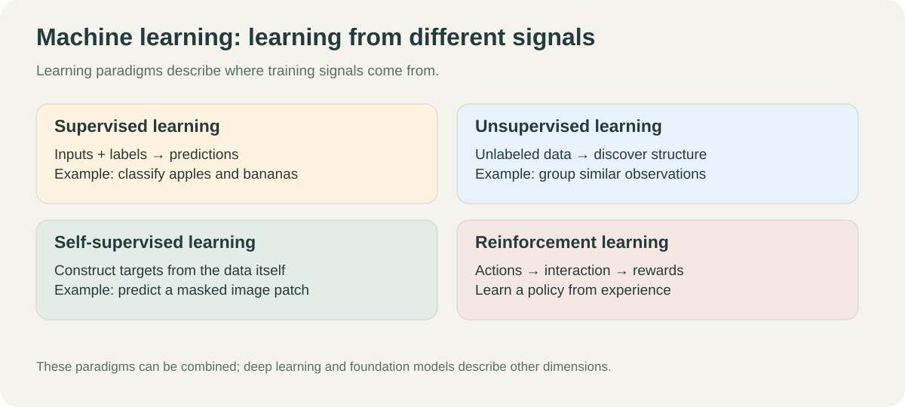
<figcaption>Figure: Supervised, unsupervised, self-supervised, and reinforcement learning, organized by learning signal. They are not strictly mutually exclusive; deep learning and foundation models belong to a different dimension of classification and can be combined with different training paradigms.</figcaption>
</figure>

<!-- more -->

## Reading guide
{: id="阅读指南"}

**Intended readers**: students, engineers, and researchers with basic knowledge of programming, linear algebra, and probability who want to build a framework of machine learning knowledge. This survey focuses on the connections between classic principles and methods and is not a ranking of the latest models.

|Reading goal|Suggested sections|Questions to take away|
|:---|:---|:---|
|Build an overall understanding|[§2 Fundamentals](#ml-basics)|How do learning signals, model assumptions, optimization, and generalization differ?|
|Start a modeling project|[§2.9 Experimental workflow](#ml-workflow)|How do I split the data, avoid leakage, and choose metrics?|
|Handle tabular and small-sample data|[§3.2–§3.11 Traditional methods](#ml-classical)|What assumptions do linear models, tree models, and distance-based methods rely on?|
|Understand deep learning|[§3.12–§3.15 Deep networks](#ml-deep)|How do the structural inductive biases of MLPs, CNNs, RNNs, and Transformers differ?|
|Understand language models|[§3.16 Pretraining and alignment](#ml-pretraining)|What problems do BERT, GPT, RLHF, and DPO each solve?|
|Understand generative models and robot policies|[§3.17–§3.20 Generative models](#ml-generation)|How do GANs, VAEs, diffusion, and autoregressive models model a distribution?|
|Choose a starting approach|[§4 Model selection and summary](#ml-selection)|How do I establish a baseline and then decide whether a complex model is needed?|

**How to read this survey**: each section first gives the key points and intuition, and then introduces the mechanism, formulas, and limits of applicability. The suggestions in the tables are starting points for experiments, not guarantees of algorithm performance. For robotics, read it together with [§2.2.3 Reinforcement learning](#ml-rl) and [§3.20.2 Diffusion Policy](#ml-policy).

# 2. Fundamentals of machine learning
{: id="2-机器学习基本概述"}

## 2.1 What is machine learning?
{: id="21-什么是机器学习"}

Machine learning is an interdisciplinary field drawing on probability theory, statistics, approximation theory, convex analysis, computational complexity, and more. Its core idea is: **to have computers analyze data with algorithms, learn patterns from it, and use those patterns to make predictions and decisions about unknown events in the real world.** A model adjusts its parameters through training; new data improves performance only if its quality, coverage, and the training method are appropriate. The model will not automatically become better simply because more data is added.

## 2.2 Learning paradigms
{: id="22-学习范式与分类体系"}

The following kinds of learning methods can be understood in terms of where the supervision signal comes from. They are not strictly mutually exclusive: the same system can be pretrained with self-supervision, then fine-tuned with supervision, and finally optimized for decision making with reinforcement learning. Deep learning describes the model and the representation-learning approach, and is not on the same classification axis as supervised or reinforcement learning.

### 2.2.1 Supervised learning
{: id="221-监督学习"}

Supervised learning is the most mature and widely used paradigm. Its training data consists of input features $\mathbf{x}$ and the corresponding labels (ground truth) $y$, and the goal is to learn a mapping function $f: \mathbf{x} \rightarrow y$.

- **Core tasks**: classification (labels are discrete categories) and regression (labels are continuous values).

- **Representative algorithms**: linear regression, logistic regression, SVMs, decision trees, and most deep neural networks.

### 2.2.2 Unsupervised learning
{: id="222-无监督学习"}

Unsupervised learning uses data **without labels**, and the model must discover the latent structure, patterns, or distribution in the data on its own.

- **Core tasks**: clustering, dimensionality reduction, and anomaly detection.

- **Representative algorithms**: K-Means, PCA, Autoencoder, Gaussian Mixture Model (GMM).

### 2.2.3 Reinforcement learning
{: id="223-强化学习"}

Reinforcement learning studies how an agent should act in an environment to maximize cumulative reward. It uses reward as feedback, which can be immediate or delayed; training can come from online interaction or, in offline learning, from existing interaction data.

- **Core concepts**: state, action, reward, policy, and value function.

- **Representative algorithms**: Q-Learning, DQN, PPO, SAC.

  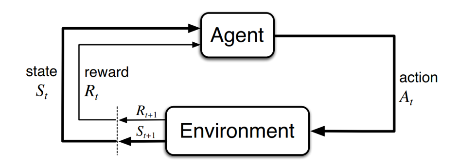
<figcaption>Figure: Schematic of a reinforcement learning algorithm</figcaption>

### 2.2.4 Semi-supervised and self-supervised learning
{: id="224-半监督与自监督学习"}

- **Semi-supervised learning**: trains on a small amount of labeled data together with a large amount of unlabeled data to reduce labeling cost.

- **Self-supervised learning**: constructs supervision signals from the data itself (such as predicting the next word or recovering masked image regions); it is an important training method for modern language models and many pretrained vision models.

## 2.3 Core components
{: id="23-核心要素与系统架构"}

A typical machine learning pipeline includes the following five core components:

1. **Data**: the basic resource a model learns from. Its quality, coverage, and annotation reliability directly set the performance ceiling; it usually also involves data cleaning and preprocessing.

2. **Feature engineering**: converting raw data into feature vectors the model can work with. Traditional ML relies heavily on it.

3. **Hypothesis space**: the set of functions the model can express, such as linear combinations, tree-based partitions, or neural network representations.

4. **Objective function**: defines what counts as "good" or "bad", and usually consists of a loss function and a regularization term.

5. **Optimization algorithm**: the procedure for finding the parameters that minimize (or maximize) the objective function, such as gradient descent or Adam.

## 2.4 Development history
{: id="24-发展历程"}

Several representative milestones are listed below. Symbolic reasoning and machine learning developed in parallel for a long time, and traditional methods have not lost their value with the rise of deep learning.

|Period|Representative milestones|Change in approach|
|:---|:---|:---|
|1950–1980|Perceptron, expert systems, and research on backpropagation|From hand-written rules to trainable parametric models, with several routes explored in parallel|
|1990–2000|SVMs, random forests, gradient boosting|Emphasis on statistical generalization, kernel methods, and ensemble learning|
|2010–2016| AlexNet, ResNet, DQN, AlphaGo |Multi-layer representation learning combined with large-scale data and compute|
|2017–2020| Transformer, BERT, GPT-3, DDPM |Self-attention, pretraining and transfer, and the development of denoising-based generation|
|2020s|Multimodal foundation models, generative policies, preference optimization|Research on cross-task transfer, generation capability, alignment, and deployment efficiency|

The main thread of development is the **coordinated change of representation, objective function, data, and compute**; this does not mean every task should switch to the latest architecture.

## 2.5 Main challenges
{: id="25-主要挑战"}

Despite its achievements, machine learning still faces many challenges in practice:

- **Overfitting and out-of-distribution generalization**: a model may perform well on the training set but fail on unseen data or after the distribution shifts.

- **Data quality and data leakage**: noise, bias, duplicate samples, and information leaking between the training and test sets distort the evaluation results.

- **High dimensionality and computational cost**: high-dimensional features bring sample sparsity and computational overhead; training and running large models also takes a large amount of GPU/TPU resources.

- **Interpretability and fairness**: the basis for a complex model's decisions is hard to trace, and bias in the data may amplify unfairness between groups.

- **Evaluation and safety**: offline metrics may not reflect real-world performance, and reliability, privacy, robustness, and alignment all require continued verification.

## 2.6 Directions and outlook
{: id="26-关键技术方向与未来展望"}

Machine learning continues to evolve at the frontiers of both methods and applications. The following directions center on representation, transfer, adaptation, and reliability, respectively, and none of them should be regarded as a solved problem:

- **Representation learning**: automatically learning effective feature representations from data, which reduces manual feature design but still requires appropriate data processing, input representations, and task design.

- **Transfer learning**: transferring knowledge learned in one domain or task to another related one, which greatly alleviates data scarcity.

- **Meta-learning**: also known as "learning to learn", it aims to give a model the ability to adapt quickly to new tasks (as in few-shot learning).

- **Cross-task generalization**: studying whether a model can transfer to new tasks, new environments, and new distributions. Artificial general intelligence (AGI) is a longer-term research goal, and progress toward it cannot be inferred from a single benchmark score.

- **Trustworthy and aligned AI**: ensuring that an AI system's goals are consistent with human values and that it is safe, fair, and transparent.

- **AI for science**: using machine learning to solve complex computational problems in fundamental sciences such as physics, chemistry, and biology (for example, AlphaFold).

## 2.7 Mainstream application scenarios
{: id="27-主流应用场景"}

Machine learning has now permeated nearly every aspect of the digital and physical worlds:

### 2.7.1 Computer Vision (CV)
{: id="271-计算机视觉-cv"}

- **Core tasks**: image classification, object detection (such as the YOLO series), semantic segmentation, and image generation.

- **Applications**: face recognition, medical image analysis, and industrial defect detection.

### 2.7.2 Natural Language Processing (NLP)
{: id="272-自然语言处理-nlp"}

- **Core tasks**: machine translation, text summarization, sentiment analysis, and dialogue systems.

- **Applications**: intelligent assistants such as ChatGPT, automated customer service, and automatic document review.

### 2.7.3 Recommendation and advertising
{: id="273-推荐系统与计算广告"}

- The monetization core of major internet companies. Techniques such as collaborative filtering and deep cross networks mine the probability that a user's past behavior matches an item, enabling accurate targeting.

### 2.7.4 Robotics and embodied AI
{: id="274-机器人与具身智能"}

- Combining reinforcement learning, vision, and large language models lets robots perceive, plan, navigate, and manipulate dexterously in complex physical environments. Such tasks must also contend with observation noise, action latency, physical constraints, and distribution shift during closed-loop execution.

## 2.8 Datasets, benchmarks and frameworks
{: id="28-数据集基准与框架"}

### 2.8.1 Classic datasets and benchmarks
{: id="281-经典数据集与基准"}

|Dataset|Domain|Characteristics and historical significance|
|:---|:---|:---|
| **ImageNet** |CV (classification)|The full dataset should be distinguished from the ILSVRC subset; the commonly used ImageNet-1K has about 1.28 million training images and 1,000 classes.|
| **COCO** |CV (detection and segmentation)|Released by Microsoft, it features rich multi-object annotation of complex scenes in context.|
| **MNIST** |CV (introductory)|A handwritten digit recognition set, known as the "Hello World" of machine learning.|
| **GLUE** | NLP |A comprehensive benchmark for evaluating natural language understanding models, which drove the BERT era.|

### 2.8.2 Tools and frameworks
{: id="282-主流工具与开源框架"}

- **Scikit-learn**: a traditional machine learning library for Python that provides unified interfaces for linear models, tree models, SVMs, clustering, preprocessing, and model evaluation.

- **XGBoost / LightGBM**: gradient-boosted tree frameworks commonly used for tabular data. Their speed and accuracy must be compared on the task at hand.

- **TensorFlow**: Google's open-source deep learning framework, with a complete ecosystem for industrial deployment.

- **PyTorch**: Meta's open-source deep learning framework, widely used in research and large-model training thanks to its dynamic computation graphs and ease of use, and with a mature deployment ecosystem.

- **Hugging Face**: provides model and dataset hosting as well as libraries such as `transformers`; when using pretrained weights, check the intended use, license, and restrictions in the model card.

## 2.9 Modeling and evaluation
{: id="29-建模与评估流程"}

Knowing an algorithm's name is not enough. For a reproducible modeling experiment, first define the task and the validation method, and only then optimize the model.

### 2.9.1 Fitting, optimization, and generalization
{: id="291-区分拟合优化与泛化"}

Taking supervised learning as an example, given $n$ training samples, a common objective is to minimize the empirical risk plus a regularization term:

$$
\hat{\theta} = \arg\min_{\theta}\left[\frac{1}{n}\sum_{i=1}^{n}\ell(f_{\theta}(\mathbf{x}_i),y_i)+\lambda\Omega(\theta)\right]
$$

Here $f_\theta$ is the model, $\ell$ measures the prediction error, $\Omega$ constrains the model complexity, and $\lambda$ controls the strength of the constraint. **Optimization** is about whether the training objective can be driven down, and **generalization** is about performance on unseen samples; a low training loss does not mean the model is reliable.

Parameters (such as linear weights) are learned during training; hyperparameters (such as tree depth, regularization strength, and learning rate) are usually chosen on the validation set. If both training and validation errors are high, the cause may be underfitting, insufficient features, or incomplete optimization; if the training error is low but the validation error is high, investigate overfitting and distribution differences.

### 2.9.2 Split first, then preprocess
{: id="292-先划分数据再预处理"}

1. **Define the prediction time point and target clearly**: the input may contain only information available at the time of the actual prediction. For example, when predicting whether a user will churn, fields generated after the churn cannot be used as features.
2. **Hold out a test set**: use the training set for fitting, the validation set for tuning and threshold selection, and the test set for the final evaluation once the approach is settled. Repeatedly changing the model based on test results makes the test set lose its independence.
3. **Make the split match the deployment scenario**: roughly i.i.d. classification samples can be split randomly with stratification; time series should be split by time; related samples from the same user, device, or robot trajectory should be split by group to avoid leakage across sets.
4. **Fit preprocessing on the training set only**: standardization, missing-value imputation, feature selection, and PCA must all be fitted on the training set first and then applied to the validation and test sets. In cross-validation, each fold must be refitted, which `Pipeline` can manage.
5. **Record the conditions needed for reproducibility**: save data versions, splits, random seeds, hyperparameters, and evaluation scripts; for small-sample or high-variance tasks, report multi-fold or multiple-run results.

Cross-validation is mainly used for model selection during development and does not mean the temporal or grouping structure can be ignored. If you also want to use cross-validation to estimate the generalization performance of the whole procedure after tuning, use nested cross-validation. See the [scikit-learn guide to data leakage](https://scikit-learn.org/stable/common_pitfalls.html) and the [cross-validation documentation](https://scikit-learn.org/stable/modules/cross_validation.html).

### 2.9.3 Metrics should match the cost of the task
{: id="293-指标必须对应任务代价"}

|Task|Common metrics|Interpretation notes|
|:---|:---|:---|
|Regression| MAE, RMSE, $R^2$ |RMSE is more sensitive to large errors; $R^2$ can be negative and cannot be used to rank models directly across different datasets|
|Classification|Precision, recall, F1, confusion matrix|First clarify the positive class, the threshold, and the costs of false negatives and false positives; when classes are imbalanced, do not look at accuracy alone|
|Ranking|ROC-AUC, PR curve, average precision (AP)|ROC-AUC measures ranking quality; when positives are rare, also look at PR/AP. AP is not exactly the same as PR-AUC computed by trapezoidal integration.|
|Probability prediction|Log loss, Brier score, calibration curve|Ranking correctly does not mean an output of "80% probability" matches the actual frequency|
|Clustering|Silhouette coefficient, stability, domain-expert inspection|Internal geometric metrics do not guarantee that clusters correspond to real business or semantic categories|
|Generation and robot control|Distribution metrics, human evaluation, success rate, latency|Realistic images do not mean correct facts; low offline action error does not mean the closed-loop task succeeds|

For example, when the positive class is only 1% of the data, predicting every sample as negative gives an accuracy of 99% but a recall of 0 for the positive class. The threshold should be chosen on the validation set according to the actual costs, not left at the default 0.5. For metric definitions, see the [scikit-learn model evaluation documentation](https://scikit-learn.org/stable/modules/model_evaluation.html).

### 2.9.4 Baselines and error analysis
{: id="294-基线与误差分析"}

First establish naive baselines such as the majority class and mean prediction, and then compare linear models, tree models, or pretrained representations. If a complex model improves little, also report its inference latency, memory, and maintenance costs. Examine which classes, time periods, or groups of people the model fails on, and then decide whether to add data, change the features, adjust the objective, or change the architecture.

After launch, keep monitoring the input distribution, prediction quality, and feedback latency. Offline testing only shows how the model performs under specific data and evaluation protocols and cannot replace monitoring after deployment.

# 3. Classic algorithms
{: id="3-经典算法与代表性模型"}

This chapter is organized by model structure and purpose. The same method may span several categories: for example, a Transformer can be used for supervised classification, self-supervised pretraining, or generative modeling; an autoencoder mainly learns representations and does not automatically define a distribution that can be sampled from.

## 3.1 Algorithm overview
{: id="31-核心算法分类概览"}

Before going into specific models, the following table organizes the classic algorithm categories in machine learning and their representative models:

|Category|Representative models/techniques|Main features|Application scenarios|
| :--- | :--- | :--- | :--- |
|**Linear models**|Linear regression, logistic regression|Simple and easy to understand, cheap to compute, highly interpretable|House price prediction, click-through rate (CTR) prediction|
|**Ensemble learning**|Random forest, XGBoost, LightGBM|Robust and performs very well on tabular data|Financial risk control, search ranking|
|**Traditional statistical / probabilistic methods**|SVM, KNN, naive Bayes, HMM|Rigorous theory; suited to small-sample tasks|Text classification, speech recognition, biometrics|
|**Clustering and dimensionality reduction**| K-Means, PCA, t-SNE |Unsupervised; discover the underlying structure of data|User profiling, data compression, visualization|
|**Deep neural networks**| CNN, RNN, LSTM, MLP |Powerful nonlinear fitting and feature extraction|Image recognition, natural language processing|
|**Foundations of large models**| Transformer, BERT, GPT |Good at modeling long-range dependencies and support large-scale pretraining|Text generation, question answering, multimodal understanding|
|**Generative models**| GAN, VAE, diffusion models |Learn the data distribution and generate high-quality new samples|AI image generation, video generation, molecular design|

---

> **Part A · Traditional machine learning (§3.2 – §3.11)**: from linear assumptions, tree partitioning, and local distances to probabilistic modeling; interpretability and computational cost vary by method.

## 3.2 Linear regression and regularization
{: id="32-线性回归与正则化"}

> **Key points**: fit the data with a line or hyperplane; L2 regularization (Ridge) guards against overfitting, and L1 regularization (Lasso) comes with built-in feature selection.

Linear regression is the most fundamental model in regression analysis; it assumes a linear relationship between the target variable and the features. The objective is usually to minimize the mean squared error (MSE).

> **Intuition**: it is like drawing a "best-fit line" on a scatter plot: the goal is to find the line that minimizes the sum of squared residuals of all points along the target-variable direction. Regularization adds another constraint on top of "fit well": do not let the weights grow too large.

  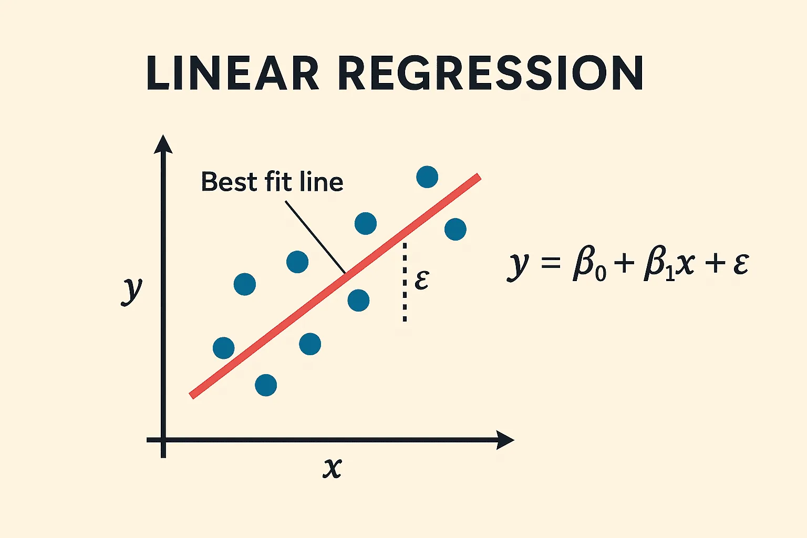
<figcaption>Figure: Schematic of linear regression</figcaption>

- **Mathematical form**: $y = \mathbf{w}^T \mathbf{x} + b$

Here $\mathbf{w}$ is the weight vector over the features (coefficient magnitudes are affected by feature scale and correlation and cannot be read directly as importance or causal effect), $\mathbf{x}$ is the input feature vector, and $b$ is the bias (intercept). The whole formula is a weighted sum plus a baseline.

- **Optimization**: it can be solved directly in closed form by least squares (the normal equations), or optimized iteratively with gradient descent.

- **Regularization**: to prevent overfitting when the feature dimension is high, a regularization penalty is often added to the loss function:

  - **Ridge regression (L2 regularization)**: adds the term $\lambda \|\mathbf{w}\|_2^2$, which limits the sum of squares of the parameters and shrinks the coefficients, easing the estimation instability caused by multicollinearity; features usually need to be put on a common scale before regularization.

  - **Lasso regression (L1 regularization)**: adds the term $\lambda \|\mathbf{w}\|_1$, which limits the sum of the absolute values of the parameters. The geometry of the L1 penalty readily produces sparse solutions (some weights are driven exactly to 0), so it performs feature selection as a by-product.

|Good first uses|Things to watch for|
|:---|:---|
|Features have a linear relationship with target variables|There is a complex nonlinear relationship between features and targets|
|Need for interpretable models|There are a lot of outliers in the data|
|Few features and sufficient samples|There is strong multicollinearity between features (use Ridge in this case)|

## 3.3 Logistic regression
{: id="33-逻辑回归"}

> **Key points**: the log-odds are a linear function of the features, and a sigmoid turns them into a binary class probability; the model is trained with a classification loss rather than by first fitting a linear regression.

Despite its name, logistic regression is mainly used for **classification**; here we describe the binary form, and multinomial logistic regression handles multiple classes. On top of linear regression, it introduces a nonlinear sigmoid function that maps the continuous linear output into the interval $(0, 1)$, giving it a probabilistic meaning.

> **Intuition**: logistic regression is a "squeezer" wrapped around linear regression: it squeezes any real-valued score into the range between 0 and 1 and then treats that value directly as the "probability of belonging to the positive class". The higher the score, the closer the probability is to 1; the lower the score, the closer it is to 0.

  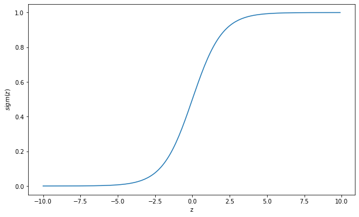
<figcaption>Figure: Schematic of logistic regression</figcaption>

- **Core function**:

$$P(y=1 \mid \mathbf{x}) = \sigma(\mathbf{w}^T \mathbf{x} + b) = \frac{1}{1 + e^{-(\mathbf{w}^T \mathbf{x} + b)}}$$

where $\mathbf{w}^T \mathbf{x} + b$ is the linear "raw score" and $\sigma(\cdot)$ is the sigmoid function (the "squeezer"). A score of 0 gives an output of 0.5; the larger the score, the closer the output is to 1, and the smaller the score, the closer it is to 0.

- **Loss function**: cross-entropy loss, derived from maximum likelihood estimation.

- **Characteristics**: cheap to compute and fast, with an output that has a clear probabilistic interpretation; often used in basic scenarios such as credit scorecards in financial risk control and ad click-through rate (CTR) estimation.

|Good first uses|Things to watch for|
|:---|:---|
|Two classification tasks require probability output|There is a strong nonlinear relationship between features|
|Sparse text features, need for fast classification baseline|Complex inputs such as raw images often require extracting a suitable representation first|

## 3.4 Decision trees
{: id="34-决策树-decision-tree"}

> **Key points**: the data is partitioned recursively by a series of if-then rules, which is naturally interpretable; however, a single tree has high variance and overfits easily, so it needs pruning or ensembling.

Decision trees imitate human rule-based reasoning and classify or regress data through a tree structure. Each internal node represents a test on a feature, each branch represents the outcome of the test, and each leaf node represents the final predicted class or value.

> **Intuition**: it is like the guessing game we played as children: "Is this fruit red? → Is it round? → Yes → An apple!" Each split asks the question that best separates the current data, narrowing the range layer by layer until a decision is made.

  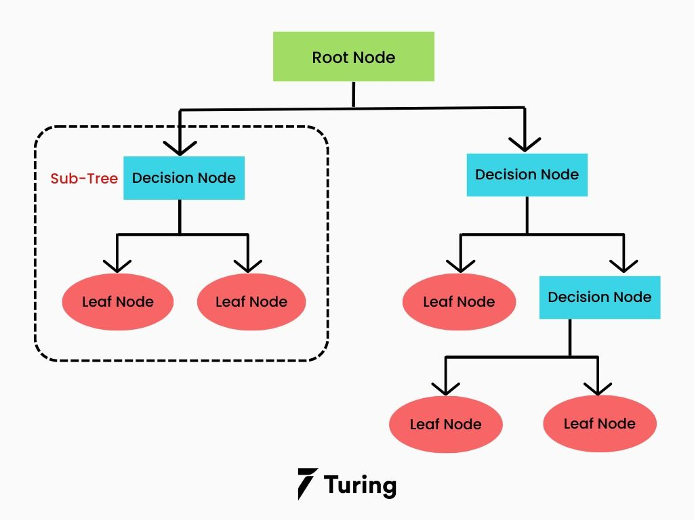
<figcaption>Figure: Structure of a decision tree</figcaption>

- **Splitting criteria**:

  - **ID3**: selects features by **information gain**, and tends to favor features with many values.

  - **C4.5**: improves on this with the **gain ratio**, which alleviates information gain's preference for high-cardinality features.

  - **CART**: classification trees use the **Gini impurity** and regression trees use squared error. CART builds binary trees and is the basis of many tree ensemble models.

- **Pros and cons**: shallow trees are easy to interpret and usually need no feature standardization; support for missing values and categorical features depends on the specific implementation and cannot be inferred from the name "decision tree". Deep trees overfit easily, and their complexity can be controlled through the maximum depth, the minimum number of samples per leaf, and pruning.

|Good first uses|Things to watch for|
|:---|:---|
|Requires clear rules and shallow decision paths|It is easy to overfitting when the tree is too deep and there are too few leaf node samples.|
|Non-linear tabular data, usually without standardization|Category features may need to be encoded; high-precision tasks can be compared with ensemble methods|

## 3.5 Random forests
{: id="35-随机森林-random-forest"}

> **Key points**: bagging trains multiple decision trees independently in parallel and combines them by voting or averaging; it reduces variance, is robust to noise, and can estimate feature importance.

**Bagging (bootstrap aggregating)** is a parallel ensemble learning paradigm: it samples the data with replacement, trains multiple base learners, and then aggregates their outputs to reduce variance. Random forest is a representative bagging method.

> **Intuition**: it is like convening an "expert committee": each expert (decision tree) sees only part of the data and some of the features, forms their own judgment, and then everyone votes. Individual experts may be biased, but the collective average opinion is usually more accurate and robust.

  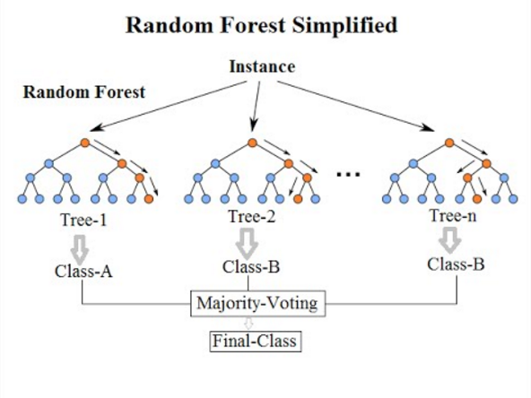
<figcaption>Figure: Schematic of the random forest algorithm</figcaption>

- **Core mechanism**: training samples are drawn at random with replacement (bootstrap) to build multiple independently trained decision trees (their predictions may still be correlated). In addition, when each node is split, the best splitting feature is chosen only from a random subset of the features.

- **Output**: for classification, the final result is decided by a vote among the trees; for regression, their predictions are averaged.

- **Characteristics**: it reduces the variance of the ensemble prediction by decorrelating the trees, but can still overfit. Feature importance based on node purity may be biased toward high-cardinality features and can be complemented by permutation importance on a validation set; neither represents causality.

|Good first uses|Things to watch for|
|:---|:---|
|Structured/tabular data, don’t want to adjust too many parameters|Very high-dimensional sparse data (such as text TF-IDF)|
|Nonlinear feature interaction requires a robust starting solution|Missing value support depends on implementation; the advantages and disadvantages of Boosting need to be verified|

## 3.6 Gradient-boosted trees
{: id="36-梯度提升树"}

> **Key points**: gradient boosting fits, round by round, the negative gradient of the current ensemble, which under squared loss is equivalent to fitting the residual. XGBoost and LightGBM provide efficient implementations.

**Boosting** is a sequential ensemble learning paradigm whose core idea is continual error correction. Each subsequent model focuses on the samples the previous models got wrong, and the models' outputs are weighted and accumulated.

> **Intuition**: it is like a student working through a workbook of problems they got wrong: after the first round, the second round concentrates on the problems missed in the first, the third on those missed in the second, and so on. Each round makes up for the weaknesses of the previous one, and in the end you have a model that is strong across the board.

  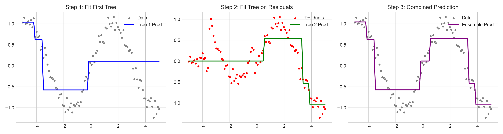
<figcaption>Figure: Gradient-boosted decision trees (GBDT)</figcaption>

- **GBDT (Gradient Boosting Decision Tree)**: uses regression trees as base learners (including for classification tasks); each iteration approaches the target more closely by fitting the **negative gradient** (the residual under squared loss) of the previous model.

- **XGBoost (eXtreme Gradient Boosting)**: a gradient boosting framework with a regularized objective and efficient tree construction. It brings second-order derivative information (a Taylor expansion) into the objective to speed up convergence and adds L1 and L2 regularization terms to control model complexity. It also handles missing values automatically and parallelizes over features, and has long been a strong baseline in Kaggle tabular-data competitions.

- **LightGBM**: a more efficient boosting framework from Microsoft. It improves training efficiency on some tasks through histogram-based decision tree learning, gradient-based one-side sampling (GOSS), and exclusive feature bundling (EFB); whether these techniques are enabled, and how much they help, depends on the configuration and the data.

|Good first uses|Things to watch for|
|:---|:---|
|Structured tabular data, pursuit of accuracy|Unstructured data such as images/text|
|Data contains missing values (XGBoost automatically handles)|Very few training samples, easy to overfitting|

## 3.7 K-nearest neighbors (KNN)
{: id="37-k近邻算法-knn"}

> **Key points**: lazy learning: there is no training, only memorization, and prediction votes or averages over the K nearest neighbors; simple and intuitive, but inference is slow, it is sensitive to feature scale, and it suffers from the curse of dimensionality.

KNN is a typical "lazy learning" algorithm. It does not fit an explicit parametric prediction function and mainly stores the training samples. In practice, a nearest-neighbor search index can also be built.

> **Intuition**: it is like asking for directions in an unfamiliar city: without any map (no training), you simply ask the $K$ nearest passers-by and go with the majority opinion. It relies entirely on the simple assumption that "birds of a feather flock together".

  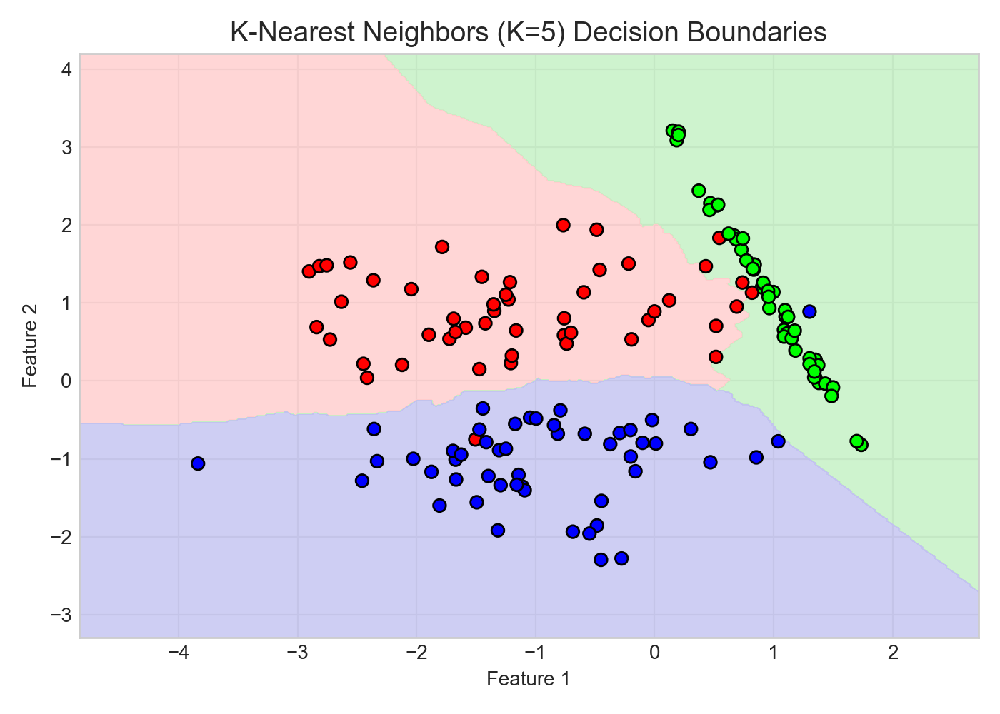
<figcaption>Figure: The K-nearest neighbors (KNN) algorithm</figcaption>

- **Prediction mechanism**: at prediction time, compute the distance (such as Euclidean or Manhattan distance) between the test sample and all training samples, and find the $K$ nearest samples in feature space.

- **Decision rule**: majority voting for classification and the mean for regression. Distance weighting can be introduced so that closer neighbors get larger weights.

- **Drawbacks**: brute-force search must compare against all training samples; tree-based indexes can speed up some low-dimensional tasks, but the benefit is limited in high dimensions. Distances are affected by feature scale, so features usually need to be standardized or a suitable metric designed.

|Good first uses|Things to watch for|
|:---|:---|
|Small data set, rapid prototyping|Large data sets (prediction speed decreases linearly with sample size)|
|Irregular data distribution and non-spherical category boundaries|High-dimensional data (seriously affected by the curse of dimensionality)|

## 3.8 Naive Bayes and HMMs
{: id="38-朴素贝叶斯与-hmm"}

> **Key points**: naive Bayes assumes the features are conditionally independent, trains fast, and works well for text classification; an HMM models a sequence as "hidden states plus observations", which suits explicitly describing how states transition and how observations are generated.

### Naive Bayes
{: id="朴素贝叶斯-naive-bayes"}

Naive Bayes is a classification algorithm based on Bayes' theorem that makes an extremely strong but very efficient "naive" assumption: **the features are conditionally independent of one another**.

> **Intuition**: it is like a judge weighing a case from several "independent clues": assuming the clues do not influence one another, multiply the support each one gives and pick the conclusion with the highest score. This independence assumption is rarely true in reality, but it is often good enough in practice.

  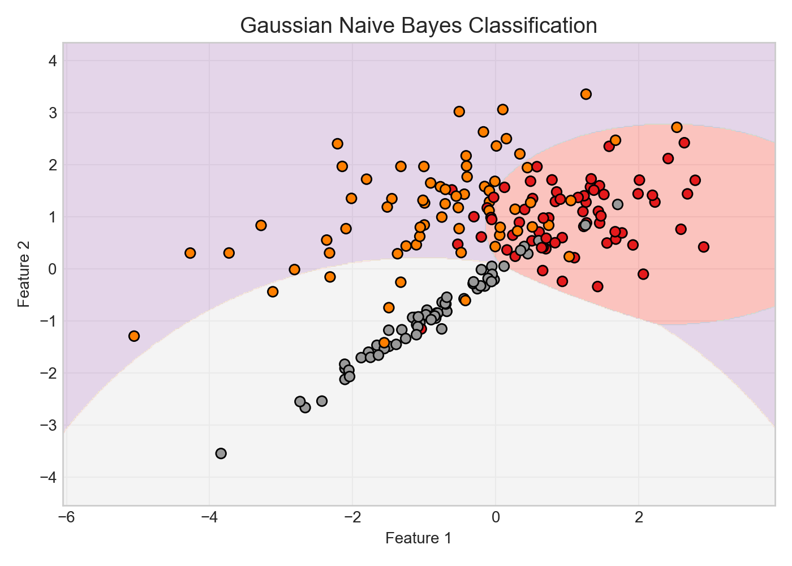
<figcaption>Figure: Schematic of the naive Bayes classifier</figcaption>

- **Bayes' theorem**: given the sample features $\mathbf{x} = (x_1, x_2, \dots, x_n)$, the posterior probability is:

$$ P(y \mid \mathbf{x}) = \frac{P(\mathbf{x} \mid y) \cdot P(y)}{P(\mathbf{x})} $$

**Reading the formula**: $P(y \mid \mathbf{x})$ is "the probability that the sample belongs to class $y$ after seeing the features $\mathbf{x}$" (the posterior); $P(\mathbf{x} \mid y)$ is the likelihood that a sample of class $y$ has this set of features; $P(y)$ is the prior probability of the class. The denominator $P(\mathbf{x})$ is the same for all classes and can be ignored when classifying.

- **Naive assumption**: assuming the features are conditionally independent given the class, the joint probability factorizes into a product of per-feature probabilities:

$$ P(\mathbf{x} \mid y) = \prod_{i=1}^n P(x_i \mid y) $$

- **Decision rule**: choose the class that maximizes the posterior probability, that is:

$$\hat{y} = \arg\max_y P(y) \prod_{i=1}^n P(x_i \mid y)$$

- **Characteristics**: although the conditional independence assumption is rarely strictly true, naive Bayes often achieves surprisingly good results in text classification (spam filtering, sentiment analysis), and training is extremely fast, which suits very large datasets.

|Good first uses|Things to watch for|
|:---|:---|
|Text classification (spam filtering, sentiment analysis)|There is a strong correlation between features|
|Fast baselines with very few samples|Requires precise probabilistic calibration|

### Hidden Markov models (HMMs)
{: id="隐马尔可夫模型-hmm"}

An HMM is a probabilistic graphical model for sequence data, consisting of an unobserved sequence of hidden states and an observed sequence of observations.

> **Intuition**: it is like a doctor inferring the underlying cause (a viral or bacterial infection, the invisible "hidden state") from observed symptoms (fever, cough, the visible "observations"). The cause itself cannot be seen, but the most likely sequence of causes can be deduced from the sequence of symptoms.

  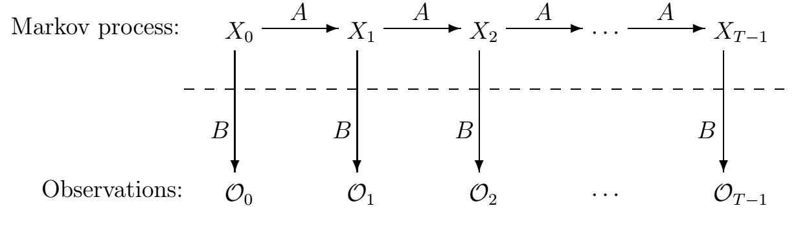
<figcaption>Figure: State transition diagram of a hidden Markov model (HMM)</figcaption>

- **Two core assumptions**:

  - **Markov assumption**: the current hidden state $s_t$ depends only on the previous hidden state $s_{t-1}$, that is, $P(s_t \mid s_1, \dots, s_{t-1}) = P(s_t \mid s_{t-1})$.

  - **Observation independence assumption**: the current observation $o_t$ depends only on the current hidden state $s_t$, that is, $P(o_t \mid s_1, \dots, s_t) = P(o_t \mid s_t)$.

- **Three basic problems**:

  1. **Evaluation problem**: given the model parameters, compute the probability of an observation sequence (forward-backward algorithm).

  2. **Decoding problem**: given an observation sequence, find the most likely hidden state sequence (Viterbi algorithm).

  3. **Learning problem**: estimate the model parameters from observed data (Baum-Welch/EM algorithm).

- **Applications**: early speech recognition, part-of-speech (POS) tagging, and gene sequence analysis. Although many speech and NLP tasks have moved to deep models, HMMs remain valuable for sequence problems that need interpretable states, have limited data, and have clear domain constraints.

## 3.9 Support vector machines (SVMs)
{: id="39-支持向量机-svm"}

> **Key points**: find the separating hyperplane with the largest margin; the kernel trick models nonlinear boundaries through an implicit feature mapping, but it does not guarantee that the data is separable, nor can it eliminate statistical problems caused by dimensionality.

Before deep learning became widespread, the support vector machine (SVM) was an important baseline for small-sample and high-dimensional classification tasks.

> **Intuition**: imagine two groups of points on a plane. An SVM draws a line between them so that both groups are as far from the line as possible, like digging the widest possible "moat" between two armies. The optimal boundary is determined by the support vectors and their coefficients; with a soft margin, some samples are also allowed to fall inside the margin or be misclassified.

  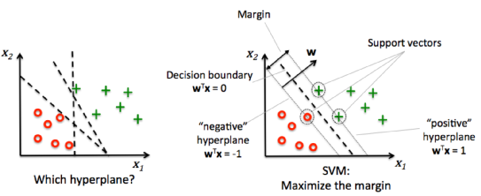
<figcaption>Figure: The separating surface and margin of a support vector machine (SVM)</figcaption>

-  **Core idea**: find a hyperplane in feature space that not only separates samples of different classes correctly but also **maximizes the geometric margin**. This pursuit of the maximum margin gives SVMs strong generalization ability.

- **Support vectors**: the training samples with nonzero coefficients in the dual problem are called support vectors. In a soft-margin SVM, support vectors may also fall inside the margin or even be misclassified.

-  **Kernel trick**: when the data is not linearly separable in the original space, an SVM uses a kernel function (such as the linear, polynomial, or Gaussian RBF kernel) to map low-dimensional features implicitly into a high-dimensional (even infinite-dimensional) space, thereby building a nonlinear decision boundary. The kernel trick avoids constructing the high-dimensional features explicitly, but kernel matrix computation still costs time and overfitting remains a risk.

|Good first uses|Things to watch for|
|:---|:---|
|Small sample, high-dimensional data (text, gene features)|Large-scale kernel SVM is computationally and storage expensive; linear SVM can use more scalable solvers|
|Feature Dimension >> Sample Number Scenario|Probability output is required (SVM itself does not output probabilities)|

## 3.10 K-Means clustering
{: id="310-k-means-聚类"}

> **Key points**: a classic baseline for unsupervised clustering that alternately updates the sample assignments and the centroid positions until convergence; it requires K to be set in advance, handles only roughly spherical clusters well, and is sensitive to initialization and outliers.

The most classic and widely used unsupervised clustering algorithm.

> **Intuition**: it is like choosing $K$ squad leaders: first pick leaders at random, and every student joins the nearest one; then take the center of each group as the new leader, and repeat until the leaders' positions stop changing.

  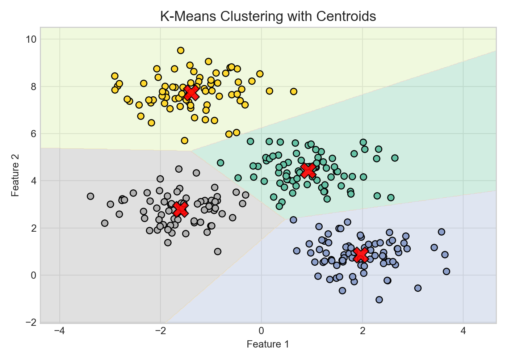
<figcaption>Figure: The K-Means clustering process</figcaption>

- **Algorithm**:

  1. Randomly initialize $K$ cluster centers (centroids).

  2. Go through all samples and assign each to its nearest cluster center.

  3. Recompute the centroid of each cluster (the mean of all its samples) from the current assignments and update the cluster centers.

  4. Repeat steps 2 and 3 until the cluster centers no longer change significantly (convergence) or the maximum number of iterations is reached.

- **Pros and cons**: the algorithm is simple and efficient. The time complexity of a typical Lloyd iteration is $O(nKdi)$ ($d$ is the feature dimension and $i$ the number of iterations); but it is sensitive to the choice of initial values and to outliers, $K$ must be specified in advance, it prefers roughly spherical clusters of similar scale, and it has difficulty with data on complex manifolds.

|Good first uses|Things to watch for|
|:---|:---|
|The data distribution is close to spherical and the sizes of each cluster are similar.|Cluster shapes are irregular (use DBSCAN instead)|
|Quickly obtain clustering results and user portrait grouping|Scenarios where the $K$ value is difficult to determine|

## 3.11 PCA and t-SNE
{: id="311-pca-与-t-sne"}

> **Key points**: PCA performs linear dimensionality reduction and preserves global variance; t-SNE performs nonlinear dimensionality reduction and preserves local manifold structure, making it a first choice for 2D/3D visualization.

- **Principal component analysis (PCA)**: a classic linear dimensionality reduction method. Its core idea is to project possibly correlated high-dimensional features into a new orthogonal coordinate system through an orthogonal transformation. The new axes (principal components) are ordered by the amount of variance of the data they capture. Keeping the first few principal components with the largest variance minimizes the squared reconstruction error for a given linear-subspace dimension; directions of high variance do not necessarily carry the information most useful for downstream prediction.

  > **Intuition**: it is like photographing a three-dimensional object: you choose the "camera angle" that preserves the most information, so that the projected 2D image carries the most information (maximum variance). PCA finds this optimal angle automatically.

  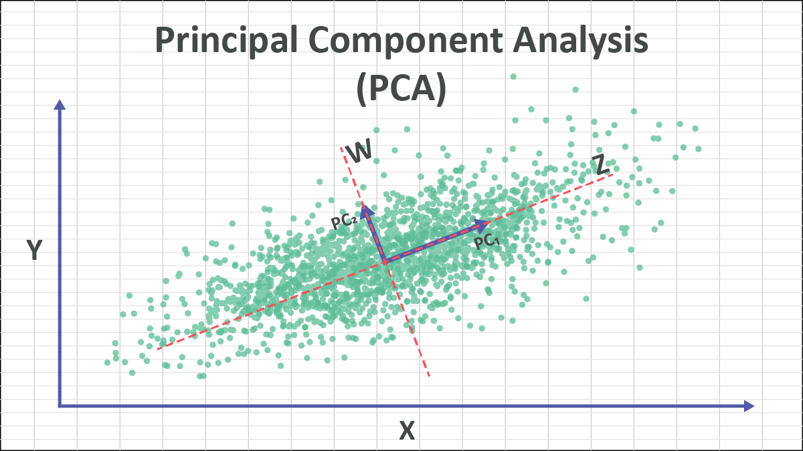
<figcaption>Figure: Dimensionality reduction with principal component analysis (PCA)</figcaption>

- **t-SNE (t-distributed stochastic neighbor embedding)**: a nonlinear dimensionality reduction algorithm used mainly to map high-dimensional data into 2D or 3D space for visualization. It expresses similarity by converting Euclidean distances between data points into conditional probabilities, and uses a t-distribution to alleviate the "crowding problem" when mapping from high-dimensional to low-dimensional space. It preserves the local manifold structure and the within-class clustering of the data very well.

  > **Intuition**: it is like flattening a ball of high-dimensional "plasticine" onto a table. Points that were close are kept close after flattening, while points that were far apart are under no strong constraint to stay that far apart. The distances between clusters, their areas, and the gaps in the plot therefore cannot be read directly as the real structure of the original space.

  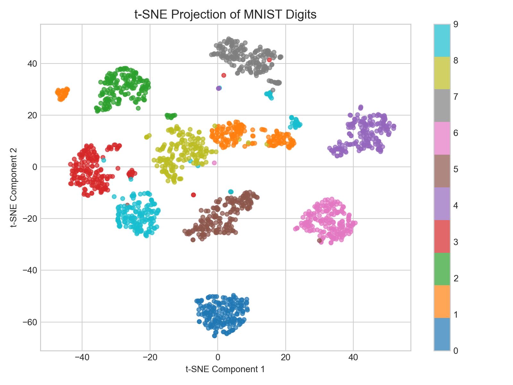
<figcaption>Figure: A t-SNE dimensionality reduction visualization</figcaption>

t-SNE is sensitive to hyperparameters such as the random initialization and perplexity, and clusters in the plot alone cannot prove a classification effect or reveal "real categories"; it is mainly an exploratory tool and should not directly replace a generalizable dimensionality reduction step in prediction tasks. See the [scikit-learn manifold learning documentation](https://scikit-learn.org/stable/modules/manifold.html#t-sne).

---

> **Part B · Deep learning basics (§3.12 – §3.15)**: learn representations through multi-layer nonlinear transformations, using backpropagation to compute gradients.
>
> This chapter only outlines the core ideas; for activation functions, optimizers, normalization, regularization, and training techniques, see: .

## 3.12 MLPs and backpropagation
{: id="312-mlp-与反向传播"}

> **Key points**: fully connected layers + nonlinear activations + backpropagation; under suitable conditions, strong expressive power; expressiveness, trainability, and generalization must be judged separately.

Deep learning (DL) extracts high-level features from data through multiple layers of nonlinear transformation. The multilayer perceptron (MLP) is the most basic feedforward neural network and the starting point for understanding all deep networks.

> **Intuition**: it is like an assembly line: the raw materials (input features) pass through several processing steps (hidden layers), and each step uses an activation function to introduce a "bend", so the line can produce any complex shape (function). The more layers, the more complex the "processing logic" it can express.

  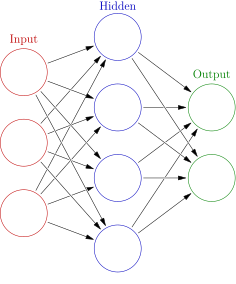
<figcaption>Figure: Structure of a typical deep neural network</figcaption>

- **Structure**: an input layer, one or more hidden layers, and an output layer, with full connections between layers. Each neuron receives a weighted sum of the previous layer's outputs and passes it through a nonlinear activation function. The computation of a single layer can be written as:

$$ \mathbf{h} = \sigma(\mathbf{W}\mathbf{x} + \mathbf{b}) $$

where $\mathbf{W}$ is the weight matrix of this layer (the strength of each connection), $\mathbf{x}$ is the output of the previous layer, $\mathbf{b}$ is the bias vector, and $\sigma$ is a nonlinear activation function. **Without it, a stack of linear transformations is equivalent to a single linear transformation, and the network loses the point of depth.**

- **Activation functions**: introducing nonlinearity is the key to deep networks; without an activation function, multiple linear layers are equivalent to a single layer. Common activation functions:

  - **Sigmoid**: $\sigma(x) = \frac{1}{1+e^{-x}}$, with output in $(0,1)$; gradients vanish easily.

  - **Tanh**: output in $(-1,1)$ and zero-centered, but it still suffers from vanishing gradients.

  - **ReLU**: $\text{ReLU}(x) = \max(0, x)$, which is cheap to compute and alleviates vanishing gradients, is one of the most commonly used activation functions. Its zero gradient on the negative side can leave neurons permanently inactive; Leaky ReLU, GELU, and others are other common choices.

- **Universal approximation theorem**: under conditions such as a suitable activation function, a sufficiently wide single-hidden-layer network can approximate any continuous function on a compact domain arbitrarily well. The theorem does not guarantee that the required width is acceptable, nor that the network can be trained from limited data or will generalize well; deep architectures represent certain functions more efficiently.

- **Backpropagation**: the cornerstone of neural network training.

  1. **Forward pass**: the input is propagated layer by layer to obtain the predicted output and the loss $\mathcal{L}$.

  2. **Backward pass**: using the **chain rule** of calculus, the gradient of the loss with respect to each parameter is computed layer by layer in reverse, starting from the output layer. For example, the gradient for weight $W_{ij}$: $\frac{\partial \mathcal{L}}{\partial W_{ij}} = \frac{\partial \mathcal{L}}{\partial \hat{y}} \cdot \frac{\partial \hat{y}}{\partial h} \cdot \frac{\partial h}{\partial W_{ij}}$.

  3. **Parameter update**: update the parameters with a gradient descent algorithm, for example SGD: $\mathbf{W} \leftarrow \mathbf{W} - \eta \frac{\partial \mathcal{L}}{\partial \mathbf{W}}$.

- **Common optimizers**:

  - **SGD + momentum**: accumulates past gradients to reduce oscillation in direction and speeds up convergence on some optimization problems.

  - **Adam**: an adaptive learning-rate optimizer that combines the advantages of momentum and RMSProp and suits many deep learning tasks; whether it beats SGD depends on the task and on tuning.

|Good first uses|Things to watch for|
|:---|:---|
|Getting started with deep learning for general tabular data|Image (using CNN), sequence (using RNN/Transformer)|
|Classification/regression tasks after feature engineering improvement|The amount of data is very small (large number of parameters, easy to overfitting)|

## 3.13 Convolutional neural networks (CNNs)
{: id="313-卷积神经网络-cnn"}

> **Key points**: local receptive fields + weight sharing + pooling, designed for grid-structured data such as images; ResNet's residual connections let networks be trained to hundreds of layers, making them a cornerstone of computer vision.

A CNN is a neural network architecture designed specifically for grid-structured data (such as the 2D pixel grid of an image) and is a cornerstone of computer vision.

> **Intuition**: a CNN's convolution kernel is like a sliding "magnifying glass" that scans the image region by region: shallow layers pick out edges and colors, middle layers textures and shapes, and deep layers combine them into high-level semantics such as "ears" and "eyes". Abstraction builds up layer by layer until the network recognizes "this is a cat".

  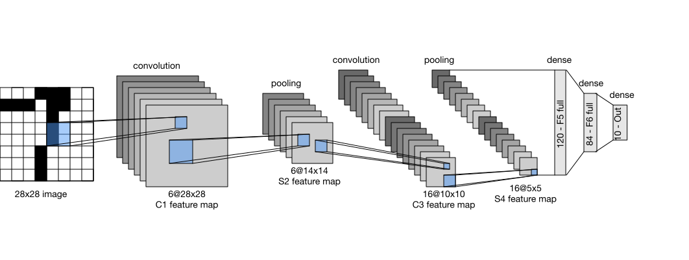
<figcaption>Figure: LeNet-5, a classic convolutional neural network architecture</figcaption>

- **Core mechanism**:

  - **Local receptive fields and convolution kernels**: small filters (convolution kernels) slide over the input feature map to extract local features (such as edges and textures), greatly reducing the number of parameters.

  - **Weight sharing**: the same convolution kernel is applied across the whole image, giving the model translation equivariance.

  - **Pooling layers**: such as max pooling, used for downsampling and local aggregation; they improve tolerance to small shifts but do not guarantee strict translation invariance. Strides and boundary handling also affect the network's equivariance properties.

- **Classic architectures**: LeNet-5 (early handwritten digit recognition), AlexNet (which set off the deep learning boom), VGG (stacked small convolution kernels), and ResNet (residual connections that solve the degradation problem of deep networks, allowing depths of hundreds of layers).

|Good first uses|Things to watch for|
|:---|:---|
|Grid data such as images and videos|Pure sequence/text data (use Transformer instead)|
|Requires translation invariance and local feature extraction|Very small amount of data (can be mitigated by transfer learning)|

## 3.14 RNNs, LSTMs, and GRUs
{: id="314-rnnlstm-与-gru"}

> **Key points**: the hidden state gives the network a memory over time; LSTMs and GRUs use gating to alleviate gradient problems when learning long-range dependencies, and were the workhorses of sequence modeling before the Transformer.

The recurrent neural network family evolved from **RNN to LSTM to GRU**. LSTM and GRU are two different gating structures, and the one proposed later is not necessarily better on every task.

### RNN: the basic recurrent structure
{: id="rnn--基础循环结构"}

RNNs are designed for variable-length sequence data such as text, speech, and time series. Unlike ordinary neural networks, an RNN keeps a "hidden state" at each time step and passes it to the next step, giving the network a memory over time.

> **Intuition**: it is like a reader who keeps a running memory while reading: at each step, "current input + memory from the previous step" is merged into a new memory and passed on to the next step.

  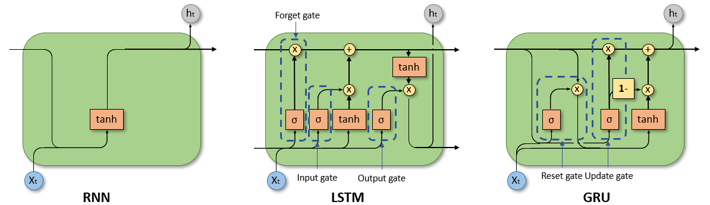
<figcaption>Figure: Structure comparison of RNN and LSTM/GRU</figcaption>

- **Hidden-state mechanism**: the computation at each time step is $h_t = \tanh(W_h h_{t-1} + W_x x_t + b)$, where $h_{t-1}$ is the hidden state of the previous step and $x_t$ is the current input.

- **Difficulty with long-range dependencies**: backpropagation through time (BPTT) multiplies many consecutive gradients, which is prone to vanishing or exploding gradients, so a basic RNN has difficulty learning distant dependencies stably.

### LSTM: gated memory
{: id="lstm--门控记忆"}

The long short-term memory (LSTM) network introduces a **cell state** and three gating mechanisms, which give gradients a more direct propagation path and ease the difficulty of learning long-term dependencies. It does not, however, guarantee that gradients will never vanish or explode.

> **Intuition**: an LSTM puts three switches on its memory: the **forget gate** decides "which old memories can be erased", the **input gate** decides "which new information is worth remembering", and the **output gate** decides "which part of the memory to expose now". The cell state is like a highway, and the gate values determine how much information is retained.

- **Forget gate**: $f_t = \sigma(W_f [h_{t-1}, x_t] + b_f)$; its output between 0 and 1 determines how much of the old cell state is kept (0 = forget completely, 1 = keep completely).

- **Input gate**: $i_t = \sigma(W_i [h_{t-1}, x_t] + b_i)$ determines which new information is written; the candidate content is $$\tilde{C}_t = \tanh(W_C [h_{t-1}, x_t] + b_C)$$.

- **Cell state update**: $$C_t = f_t \odot C_{t-1} + i_t \odot \tilde{C}_t$$, in which selected new information is added after the old memory has been selectively forgotten ($\odot$ is element-wise multiplication).

- **Output gate**: $o_t = \sigma(W_o [h_{t-1}, x_t] + b_o)$, and the final output is $h_t = o_t \odot \tanh(C_t)$, which determines what is exposed at the current step.

### GRU: a lightweight variant
{: id="gru--轻量化改进"}

The gated recurrent unit (GRU, Cho et al. 2014) is a simplification of the LSTM: the three gates are merged into two and the separate cell state is removed, so it usually has fewer parameters for the same input and hidden dimensions. Its actual speed and effectiveness still need to be measured.

> **Intuition**: a GRU merges the forget and input gates into a single **update gate** ("how much of the old to keep and how much of the new to bring in") and uses a **reset gate** to control the influence of past information. The structure is simpler and inference is faster.

- **Reset gate**: $r_t = \sigma(W_r [h_{t-1}, x_t])$ controls how much the previous hidden state influences the candidate state; when it is close to 0, it is effectively a "restart".

- **Update gate**: $z_t = \sigma(W_z [h_{t-1}, x_t])$ plays the roles of the forget gate and the input gate at once: $$h_t = (1-z_t) \odot h_{t-1} + z_t \odot \tilde{h}_t$$.

- **Practical advice**: when sequences are long or stronger memory is needed, try an LSTM; when training speed matters or resources are limited, try a GRU first. How well each works depends on the task and data, so compare them on a validation set.

|Good first uses|Things to watch for|
|:---|:---|
|Short to medium length sequences (time series prediction, speech frames)|Very long sequences (Transformer parallel processing is more efficient)|
|Resource constraints require lightweight real-time inference (GRU preferred)|Need to capture distant context in text|

## 3.15 The Transformer architecture
{: id="315-transformer-架构"}

> **Key points**: with self-attention at its core, it models global long-range dependencies in parallel; the Transformer has become the infrastructure of many language, multimodal, and generative models.

The Transformer (Vaswani et al., 2017, "Attention Is All You Need") is built around self-attention and feed-forward networks, removes the sequential dependence of recurrent structures, and has become an important architecture for many modern foundation models.

> **Intuition**: a Transformer is like a "global meeting room": each token can interact directly with every position the mask allows (self-attention), with no need to pass information along by "relaying messages" as an RNN does. It can therefore process in parallel and capture contextual dependencies at any distance efficiently.

  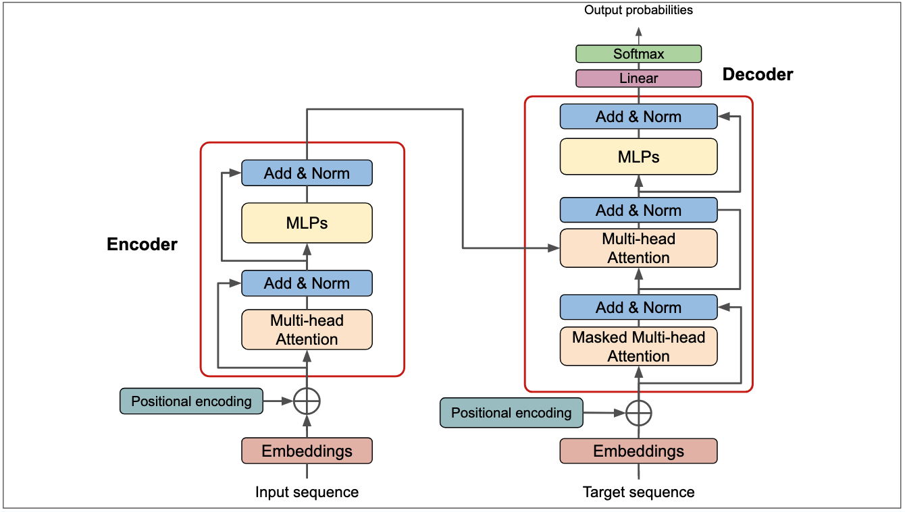
<figcaption>Figure: The Transformer architecture (source: Vaswani et al., 2017)</figcaption>

### Self-attention
{: id="自注意力"}

Self-attention without a causal restriction lets each element of the sequence attend to every other position; causal self-attention can attend only to the current and earlier positions. In both cases it computes association weights between positions, thereby capturing global long-range dependencies in parallel.

- The input sequence is passed through three linear transformations to produce the **query ($Q$)**, **key ($K$)**, and **value ($V$)** matrices.

- The attention weights are computed from the dot product of $Q$ and $K$, normalized with a softmax, and used to take a weighted sum of $V$:

$$ \text{Attention}(Q, K, V) = \text{softmax}\left(\frac{QK^T}{\sqrt{d_k}}\right)V $$

**Reading the formula**: $Q$ is "what I am looking for", $K$ is "what keywords I can offer", and $V$ is "my actual content". $Q \cdot K^T$ computes a relevance score for each pair of tokens, and dividing by $\sqrt{d_k}$ keeps overly large scores from making the softmax gradient vanish. Finally, $V$ is summed with these weights to give each token a new representation that incorporates context.

### Multi-head attention
{: id="多头注意力"}

$Q, K, V$ are split into $h$ independent "heads"; each head computes attention in a different subspace, and the results are concatenated:

$$ \text{MultiHead}(Q, K, V) = \text{Concat}(\text{head}_1, \dots, \text{head}_h)W^O $$

Different heads can attend to different kinds of relations (syntactic, semantic, positional, and so on) at the same time, which greatly improves expressive power.

### Structure of a Transformer block
{: id="transformer-block-结构"}

The basic encoder block and the common decoder-only block contain the following two kinds of sublayers, combined with **residual connections and LayerNorm** to improve training stability; the decoder of the original encoder-decoder model also includes cross-attention:

1. **Multi-head self-attention layer**: captures dependencies between tokens.
2. **Feed-forward network (FFN)**: two linear transformations with an activation function in between, applying a nonlinear transformation to each position independently: $\text{FFN}(x) = W_2 \cdot \text{ReLU}(W_1 x + b_1) + b_2$.

### Positional encoding
{: id="位置编码"}

Without positional encoding or an order-dependent mask, self-attention is **equivariant** to permutations: shuffling the input shuffles the output in the same way, rather than leaving the output completely unchanged. Positional information therefore usually has to be added to distinguish order. The original design used sine/cosine functions to encode absolute position; relative positional encoding schemes such as RoPE (rotary position embedding, adopted by the LLaMA series) and ALiBi were developed later.

### The encoder-decoder architecture
{: id="encoder-decoder-架构"}

- **Encoder**: $N$ stacked blocks in which the input tokens can attend to each other in both directions, suited to "understanding" tasks (such as encoding the source sentence in machine translation).
- **Decoder**: also $N$ stacked blocks, but the self-attention layer adds a **causal mask**, so each token can only see the content before it (autoregressive generation); a **cross-attention layer** is also added, with $Q$ coming from the decoder and $K, V$ from the encoder, to attend to the source sentence.

### Why Transformers replaced RNNs
{: id="transformer-为何取代-rnn"}

An RNN must process time steps serially ($O(n)$ sequential dependency) and cannot fully exploit GPU parallelism; self-attention computes the relations between all token pairs in parallel in one pass (training complexity $O(n^2 d)$), which makes parallel processing of sequences during training easy and shortens the information path between distant positions. Deep Transformers can still have optimization and gradient problems, however; standard autoregressive inference still proceeds step by step, and attention has quadratic computational cost. [Original paper ](https://arxiv.org/abs/1706.03762) discusses these architectural differences.

|Good first uses|Things to watch for|
|:---|:---|
|Long sequences that need global context (NLP, multimodal)|GPU memory use is large for very long sequences ($O(n^2)$; optimizations such as FlashAttention are needed)|
|Large-scale pretraining with plenty of data|Very small datasets (weak inductive bias; converges more slowly than a CNN)|

---

> **Part C · The pretrained large-model paradigm (§3.16)**: Transformers plus massive unlabeled corpora; the new "pretraining + fine-tuning / prompting" paradigm completely changed NLP and gave rise to the era of large models.

## 3.16 BERT and GPT
{: id="316-bert-与-gpt"}

> **Key points**: BERT uses a bidirectional encoder and is good at understanding tasks (classification, extraction); GPT uses an autoregressive decoder and is good at generation, and its interactive behavior can be improved with instruction fine-tuning and preference optimization.

Here we compare two representative pretraining approaches. They are not a strict dividing line between "understanding" and "generating": decoder-only models can also do classification, and encoder-decoder models (such as T5) offer another way to organize things.

> **Intuition**: BERT is like a fill-in-the-blank exercise: a few words are removed from the sentence at random and the model must guess them from the context, which forces it to understand the context in both directions. GPT is like continuing a story: given the first half, it continues word by word, learning the rules of language through a huge number of next-token predictions, and it can be adapted to tasks such as question answering and coding; these abilities must be evaluated specifically.

### BERT: the bidirectional encoder paradigm
{: id="bert--双向编码器范式"}

BERT (Bidirectional Encoder Representations from Transformers, Google, 2018) uses the **encoder** part of the Transformer. Its core innovation is modeling context in both directions.

- **Pretraining tasks**:

  - **Masked language model (MLM)**: 15% of the tokens are randomly selected as prediction targets; at these positions, 80% are replaced with `[MASK]`, 10% with a random token, and 10% are left unchanged. The model predicts the original token from the bidirectional context. The percentages refer to the selected positions, not the whole input. The [original BERT paper](https://arxiv.org/html/1810.04805v2) gives the exact procedure.

  - **Next sentence prediction (NSP)**: decide whether two sentences follow each other in context, which helps the model learn relations between sentences.

- **Usage paradigm, "pretraining + fine-tuning"**: first pretrain on a large unlabeled corpus, then fine-tune on a specific downstream task with a small amount of labeled data. BERT set records by a wide margin on benchmarks such as GLUE and SQuAD and defined the standard paradigm of the natural language understanding era.

- **Limitations**: the `[MASK]` token used by MLM does not exist at inference time, creating a distribution mismatch between pretraining and downstream use (the pretrain-finetune discrepancy); and the encoder architecture is not good at text generation.

- **Follow-up work**: further improvements include RoBERTa (dropping NSP, with more data and longer training), ALBERT (compression through parameter sharing), and DeBERTa (disentangled attention).

### GPT: the autoregressive decoder paradigm
{: id="gpt--自回归解码器范式"}

GPT (Generative Pre-trained Transformer, OpenAI) uses a **decoder-only** structure with causal self-attention (usually without the cross-attention to an encoder found in the original translation model) and generates text token by token autoregressively.

- **Pretraining task, next-token prediction**: given the preceding text $x_1, x_2, \dots, x_{t-1}$, predict the next token $x_t$. Training usually minimizes the negative log-likelihood, which is equivalent to maximizing the sequence log-likelihood:

$$ \mathcal{L}_{\mathrm{NLL}} = -\sum_{t=1}^{T} \log P(x_t \mid x_1, \dots, x_{t-1}; \theta) $$

A causal mask ensures that each position can only see earlier tokens, which enforces the autoregressive constraint.

- **Scaling laws and emergent abilities**: within a certain experimental range, language model loss follows an empirical scaling relationship with the number of parameters, the amount of data, and the amount of compute, but this does not guarantee that all task capabilities improve at the same time. "Emergence" is also affected by the evaluation metric: a discrete score can make a continuous improvement look like a sudden jump, so it should be interpreted together with the task, the model family, and the measurement method. See [Kaplan et al.](https://arxiv.org/abs/2001.08361) and [a study of emergence and measurement](https://arxiv.org/abs/2304.15004).

- **Representative historical models** (to illustrate how the methods evolved, not a complete product list):

|Model|Parameters|Key breakthrough|
|:---|:---|:---|
| GPT-1 |117 million|Verified the feasibility of "unsupervised pretraining + supervised fine-tuning"|
| GPT-2 |1.5 billion|Demonstrated zero-shot ability; the quality of its generated text raised social concerns|
| GPT-3 |175 billion|In-context learning: striking few-shot ability with no fine-tuning needed|
| GPT-4 |Undisclosed|Multimodality (text + image input), RLHF alignment, stronger reasoning|

- **Instruction fine-tuning and preference optimization**: supervised fine-tuning (SFT) learns from demonstration answers; the typical RLHF pipeline trains a reward model on preference data and then optimizes the policy with a method such as PPO. DPO optimizes the language model directly on preference pairs, without training a separate explicit reward model or running PPO during fine-tuning. Both depend on the quality of the feedback and cannot guarantee factual accuracy or eliminate all risks. See [InstructGPT](https://arxiv.org/abs/2203.02155) and [DPO](https://arxiv.org/abs/2305.18290).

### Comparing the two paradigms
{: id="两大范式对比"}

|Dimension| BERT (encoder) | GPT (decoder) |
|:---|:---|:---|
|Attention direction|Bidirectional (full context)|Unidirectional (earlier tokens only)|
|Pretraining task|Masked language modeling (fill in the blank)|Next-token prediction (continuation)|
|Strong at|Understanding tasks (classification, extraction, matching)|Generation tasks (dialogue, writing, reasoning)|
|Usage paradigm|Pretraining + fine-tuning|Pretraining + prompting / in-context learning|
|Selection considerations|Suited to fixed outputs, representation extraction, and task fine-tuning|Suited to open-ended outputs; cost, hallucination, and task performance still need to be evaluated|

---

> **Part D · Generative models (§3.17 – §3.20)**: from adversarial games (GANs) to probabilistic modeling (VAEs) to denoising diffusion, AI moves from "understanding data" to "creating data".

## 3.17 GANs
{: id="317-生成对抗网络-gan"}

> **Key points**: a generator and a discriminator play an adversarial game, with G trying to fool and D trying to catch it; sampling usually needs only one forward pass of the generator, but training can be unstable and mode collapse is a risk.

A GAN (generative adversarial network) learns a generative distribution through adversarial training of a generator and a discriminator.

> **Intuition**: it is like the contest between a counterfeiter (generator G) and a bank inspector (discriminator D): G keeps improving its forgeries while D keeps improving its detection. The two compete and improve together, with the aim of making the generated samples ever closer to the true distribution, though training does not guarantee an ideal equilibrium.

  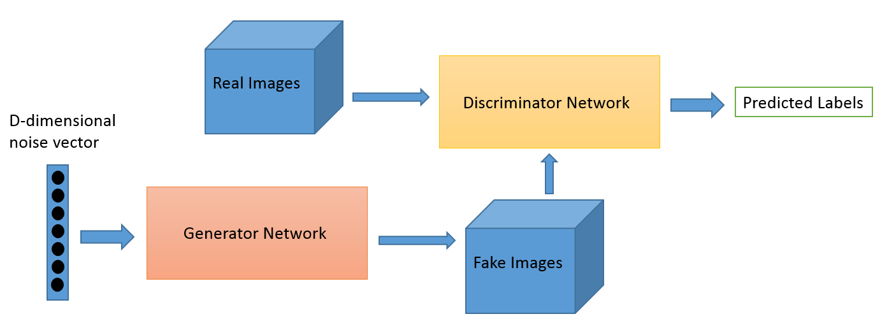
<figcaption>Figure: Architecture of a generative adversarial network (GAN)</figcaption>

- **Architecture**: two neural networks that oppose each other: a **generator (G)** and a **discriminator (D)**.

- **Core idea**: the generator starts from random noise $\mathbf{z} \sim p_z(z)$ and tries to produce realistic fake samples $G(\mathbf{z})$; the discriminator receives real samples $\mathbf{x}$ and generated samples $G(\mathbf{z})$ and outputs a probability $D(\cdot) \in [0,1]$ representing its confidence that "this sample is real". The two compete and improve together throughout training.

- **Objective (minimax game)**:

$$ \min_G \max_D \; \mathbb{E}_{\mathbf{x} \sim p_{data}}[\log D(\mathbf{x})] + \mathbb{E}_{\mathbf{z} \sim p_z}[\log(1 - D(G(\mathbf{z})))] $$

**Reading the formula**: $\mathbb{E}[\log D(\mathbf{x})]$ is D's score on real samples (the larger the better); $\mathbb{E}[\log(1-D(G(\mathbf{z})))]$ is D's judgment of fake samples: D wants it large (fake samples get low scores), while G wants it small (so that fake samples fool D). **Under theoretical conditions such as ideal capacity and global optimality**, the optimal discriminator outputs 0.5 when the generated distribution equals the true distribution. In actual training, an output near 0.5 may also mean the discriminator has not learned well, so it cannot be used by itself as evidence of generation quality.

- **Training procedure**:

  1. Fix G and train D for several steps: train a binary classifier on real samples (label 1) and generated samples (label 0).

  2. Fix D and train G for one step: generate fake samples, feed them to D, and update G with the gradient fed back from D so that the generated samples look more realistic.

  3. Alternate the two steps until convergence.

- **Common problems and improvements**:

  - **Mode collapse**: G learns to generate only a few types of samples and loses the diversity of the data.

  - **Training instability**: the strengths of G and D must be kept balanced, or gradients vanish or explode.

  - **Improved variants**: WGAN (replaces the JS divergence with the Wasserstein distance to ease training instability), StyleGAN (introduces style control to generate high-resolution faces), and CycleGAN (image style transfer without paired data).

- **Applications**: image generation, super-resolution (SRGAN), image inpainting, style transfer, and data augmentation.

|Good first uses|Things to watch for|
|:---|:---|
|Image style transfer, super-resolution|Needs training stability and generation diversity|
|Data augmentation (enlarging small datasets)|Needs accurate probabilistic modeling|

## 3.18 Autoencoders
{: id="318-自编码器-autoencoder"}

> **Key points**: an encoder-decoder with a bottleneck learns a compressed representation and can be viewed as a nonlinear PCA; it is good at denoising, dimensionality reduction, and anomaly detection, but its latent space is irregular and not suited to generating new samples directly.

An autoencoder (AE) is an unsupervised neural network whose core goal is to learn a compressed representation of the data.

> **Intuition**: it is like compressing a file and then decompressing it: a picture is compressed into a few dozen numbers (encoding), and then restored from those numbers (decoding). The bottleneck forces the network to cram the most essential information into a few numbers and thus to learn the essential characteristics of the data automatically.

  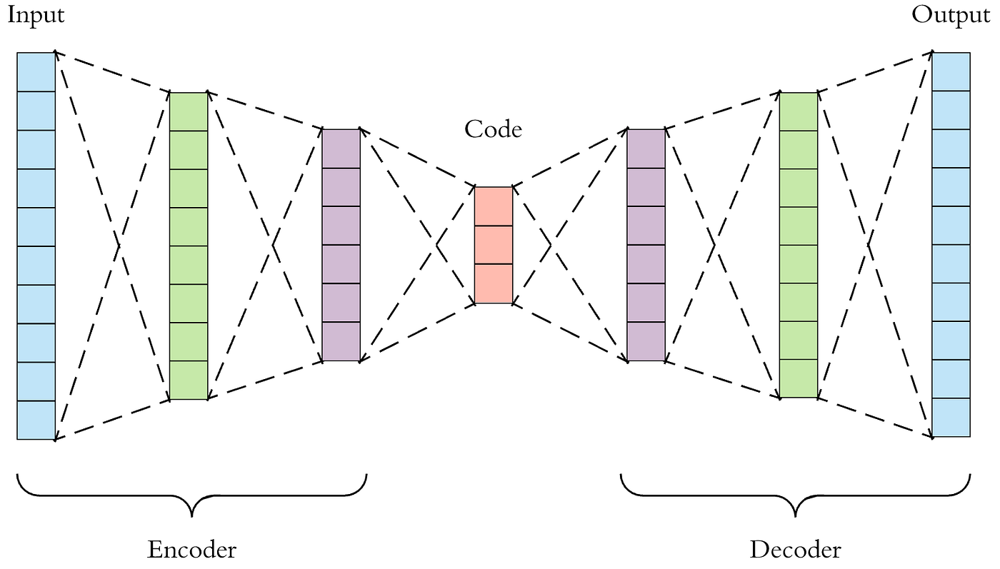
<figcaption>Figure: Architecture of an autoencoder (AE)</figcaption>

- **Architecture**: composed of two parts, an **encoder** $f_\theta$ and a **decoder** $g_\phi$. The encoder compresses the high-dimensional input $\mathbf{x} \in \mathbb{R}^n$ into a low-dimensional latent representation $\mathbf{z} = f_\theta(\mathbf{x}) \in \mathbb{R}^d$ (where $d \ll n$), and the decoder maps $\mathbf{z}$ back to the original space to produce the reconstruction $\hat{\mathbf{x}} = g_\phi(\mathbf{z})$.

- **Core idea**: the "bottleneck" structure (a low-dimensional hidden layer) forces the network to learn the most essential features of the data and discard redundant information. It can be compared to a nonlinear PCA.

- **Loss function**: minimize the reconstruction error, such as the mean squared error:

$$ \mathcal{L} = \|\mathbf{x} - \hat{\mathbf{x}}\|^2 = \|\mathbf{x} - g_\phi(f_\theta(\mathbf{x}))\|^2 $$

**Reading the formula**: $\mathbf{x}$ is the original input, $\hat{\mathbf{x}}$ is the reconstructed output, and the loss measures how distorted the reconstruction is. After training, the latent vector $\mathbf{z}$ extracted by the encoder $f_\theta$ is the compressed representation of the data ($d \ll n$).

- **Main variants**:

  - **Denoising autoencoder (DAE)**: the input is deliberately corrupted with noise to give $\tilde{\mathbf{x}}$, and the model is trained to recover the clean $\mathbf{x}$, forcing the network to learn more robust features.

  - **Sparse autoencoder**: applies a sparsity constraint (such as a KL-divergence penalty) to the hidden layer so that only a few neurons are active, giving more interpretable features.

  - **Contractive autoencoder**: adds a penalty on the Frobenius norm of the encoder's Jacobian to the loss, making the latent representation insensitive to small input perturbations.

- **Limitations**: an ordinary AE does not explicitly impose a sampleable prior; a randomly sampled latent vector may fall in a region rarely covered by the training encodings, so decoding quality cannot be guaranteed. This does not mean the encoder or decoder is mathematically discontinuous. An AE is therefore good at compression and reconstruction but **not suited to generating new samples directly**. This is exactly the problem the VAE sets out to solve.

- **Applications**: nonlinear dimensionality reduction and feature learning, image denoising, and anomaly detection (the reconstruction error serves as a candidate score, but anomalous samples may also be reconstructed well and must be verified separately).

|Good first uses|Things to watch for|
|:---|:---|
|Dimensionality reduction, feature learning, image denoising|Needs to generate entirely new samples (use a VAE or diffusion instead)|
|Anomaly detection (reconstruction error as the anomaly score)|Needs an interpretable, continuous latent space|

## 3.19 Variational autoencoders (VAEs)
{: id="319-变分自编码器-vae"}

> **Key points**: a VAE places a prior on the latent variables and approximates the posterior with the encoder; through variational inference, it learns a generative distribution that supports both reconstruction and sampling.

**Intuition**: an ordinary AE gives each input one deterministic code, whereas a VAE gives a probability distribution over possible codes. Training balances reconstruction quality against the prior constraint, and generation samples from the prior and decodes. This encourages a better-organized latent space but does not guarantee that every sampled point corresponds to a reasonable sample.

  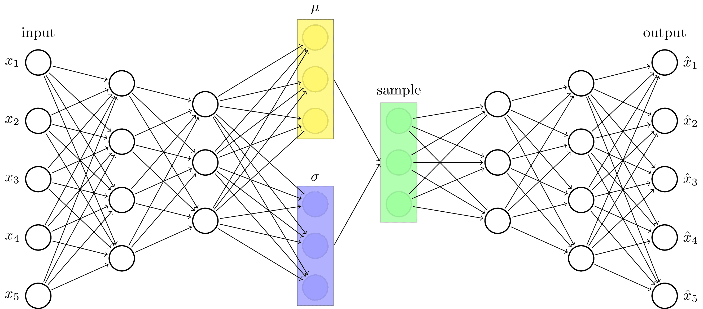
<figcaption>Figure: Architecture of a variational autoencoder (VAE)</figcaption>

The encoder gives an approximate posterior $q_\phi(\mathbf{z}\mid\mathbf{x})$, the decoder defines the observation distribution $p_\theta(\mathbf{x}\mid\mathbf{z})$, and a commonly used prior is $p(\mathbf{z})=\mathcal{N}(0,I)$. A VAE maximizes the evidence lower bound (ELBO):

$$
\log p_\theta(\mathbf{x}) \geq \mathcal{L}_{\mathrm{ELBO}} = \mathbb{E}_{q_\phi(\mathbf{z}\mid\mathbf{x})}[\log p_\theta(\mathbf{x}\mid\mathbf{z})] - D_{\mathrm{KL}}\big(q_\phi(\mathbf{z}\mid\mathbf{x})\,\|\,p(\mathbf{z})\big)
$$

Implementations typically **minimize the negative ELBO**. The first term encourages reconstruction, and the second constrains the difference between the approximate posterior and the prior. Under a Gaussian observation model with fixed variance, the negative log-likelihood can be written as a scaled squared reconstruction error plus a constant; "reconstruction MSE + KL" is therefore the form under specific assumptions, not a universally exact objective for all VAEs. The [original paper](https://arxiv.org/abs/1312.6114) gives the variational derivation.

For a diagonal Gaussian posterior, the encoder outputs the mean $\boldsymbol{\mu}$ and the log-variance $\log\boldsymbol{\sigma}^2$, and sampling uses the reparameterization trick:

$$
\mathbf{z}=\boldsymbol{\mu}+\boldsymbol{\sigma}\odot\boldsymbol{\epsilon},\qquad \boldsymbol{\epsilon}\sim\mathcal{N}(0,I)
$$

The randomness comes from independent noise, so gradients can be passed back to the encoder through the mean and standard deviation. At generation time, sample directly from the prior; no original sample needs to be input.

|Good first uses|Things to watch for|
|:---|:---|
|Latent-variable modeling, data compression, generation, and interpolation|Smooth interpolation does not guarantee reasonable semantics, and sample quality depends on the model and training|
|Provides the encoder/decoder for latent-space generative models|A simple Gaussian decoder may produce blurry results; too strong a KL term may cause posterior collapse|

AEs, VAEs, and diffusion models can also be combined: latent diffusion generates on the compressed representation and then restores the image through the decoder.

## 3.20 Diffusion models
{: id="320-扩散模型"}

> **Key points**: the generative process is built from learning objectives at different noise levels; taking DDPM as an example, the model is trained to predict noise and samples are updated iteratively during sampling.

Diffusion models model a data distribution by learning to reverse a noising process. The following takes [DDPM](https://arxiv.org/abs/2006.11239) as an example; [latent diffusion](https://arxiv.org/abs/2112.10752) performs a similar process on the compressed representation obtained from an encoder to reduce computational cost.

> **Intuition**: it is like a sculptor's creative process: rather than carving the finished piece directly, you start from a block of marble (pure noise) and carve it carefully, one pass at a time (one denoising step each), until a clear work emerges. Each step makes corrections based on the current sample and the generation conditions; the results still depend on model error and sampling settings.

  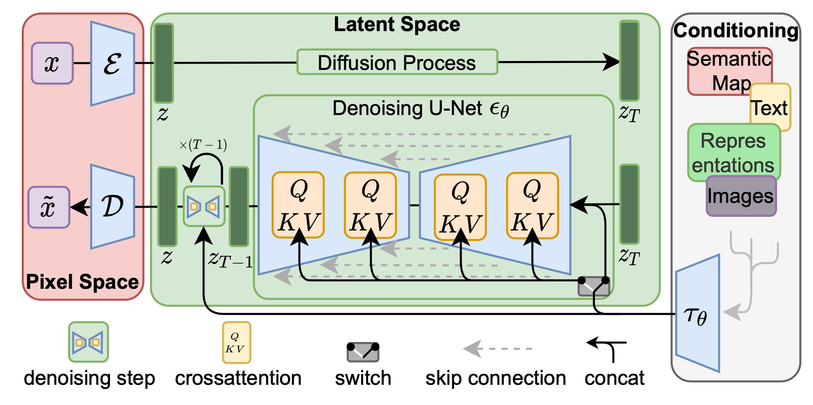
<figcaption>Figure: The forward and reverse processes of a diffusion model</figcaption>

-  **Core idea**: turn the "generation" problem into a "denoising" problem. The model does not learn to generate an image from noise in a single step; instead it learns how to **recover a clear image from pure noise step by step**.

- **Forward diffusion process (noising, fixed)**: given a real image $$\mathbf{x}_0$$, Gaussian noise is added gradually according to a predefined noise schedule $$\beta_1, \beta_2, \dots, \beta_T$$:

$$ q(\mathbf{x}_t | \mathbf{x}_{t-1}) = \mathcal{N}(\mathbf{x}_t; \sqrt{1-\beta_t}\,\mathbf{x}_{t-1}, \beta_t \mathbf{I}) $$

With a suitable noise schedule and enough steps (the original DDPM used $T=1000$), $$\mathbf{x}_T$$ becomes approximately pure Gaussian noise $$\mathcal{N}(0, \mathbf{I})$$. Using the cumulative product $$\bar{\alpha}_t = \prod_{s=1}^t (1-\beta_s)$$, one can jump directly from $$\mathbf{x}_0$$ to any time step:

$$\mathbf{x}_t = \sqrt{\bar{\alpha}_t}\,\mathbf{x}_0 + \sqrt{1-\bar{\alpha}_t}\,\boldsymbol{\epsilon}$$

- **Reverse denoising process (generation, learned)**: train a noise-prediction network $$\boldsymbol{\epsilon}_\theta(\mathbf{x}_t, t)$$ (a U-Net or Transformer can be used) to predict the noise $$\boldsymbol{\epsilon}$$ that was added at each time step $t$. A commonly used simplified noise-prediction loss is (it weights terms differently from the full variational objective):

$$ \mathcal{L} = \mathbb{E}_{t, \mathbf{x}_0, \boldsymbol{\epsilon}} \left[ \|\boldsymbol{\epsilon} - \boldsymbol{\epsilon}_\theta(\mathbf{x}_t, t)\|^2 \right] $$

**Reading the formula**: $$\boldsymbol{\epsilon}$$ is the noise actually added in the forward process, and $$\boldsymbol{\epsilon}_\theta(\mathbf{x}_t, t)$$ is the network's prediction of that noise at step $t$; the training objective is to minimize the mean squared error between the two. After training, generation starts from pure noise $$\mathbf{x}_T$$, repeatedly calls the network to predict and remove noise, and gradually recovers the clear image $$\mathbf{x}_0$$.

- **Conditional generation and guidance**:

  - **Classifier-free guidance**: the condition is randomly dropped during training so that the same network can give both conditional and unconditional predictions; at inference the two are combined, with the guidance strength $w$ adjustable. Stronger guidance can improve adherence to the condition but may also reduce diversity or produce artifacts. It is a key technique in text-to-image models such as Stable Diffusion.

  - **Text conditioning**: the text is converted into vectors by an encoder such as CLIP and injected into the U-Net's cross-attention layers, enabling "text description → image generation".

- **Comparison with GANs and VAEs**: the following table compares the mechanisms of typical implementations; it is not a quality ranking under a unified dataset and budget.

|Dimension| GAN | VAE |Diffusion model|
|:---|:---|:---|:---|
|Learning objective|Generator versus discriminator|Maximize the ELBO|Objectives such as denoising and score estimation|
|Typical sampling path|Noise passes once forward through the generator|A latent variable passes once forward through the decoder|Iterative updates starting from noise|
|Common difficulties|Imbalance in adversarial training and mode collapse|The reconstruction-versus-KL trade-off, posterior collapse|Multi-step inference cost, and the guidance-versus-diversity trade-off|
|Conditional control|Labels or other conditions can be added|A conditional VAE can be built|Conditional networks and guidance can be used|

- **Faster sampling**: DDIM, DPM-Solver, and similar methods can reduce the number of sampling steps; the number of noise time steps used in training is not the same as the number of network calls at inference. Few-step models can also be obtained by distillation, and speed and quality must be evaluated together.
- **Applications**: image generation and editing, audio synthesis, and action-sequence modeling. Whether it suits real-time tasks requires measuring the latency of the whole system and cannot be judged from the word "diffusion" alone.

> **Advanced reading**: the following separates three easily confused levels: which network is used (U-Net / Transformer), which variables are generated (images / actions), and how the generation process is organized (diffusion / autoregression).

### 3.20.1 U-Net vs. DiT
{: id="3201-u-net-与-dit"}

**Diffusion describes the generation and training method, while U-Net/Transformer describes the network structure; the two are not on the same axis.** Replacing the backbone does not necessarily change the objective function, and the same Transformer backbone can be used with different generation objectives.

|Dimension|U-Net backbone|Original DiT|
|:---|:---|:---|
|Structure|Multi-scale encoder/decoder with skip connections; attention can be added|Splits the noisy latent into patch tokens and processes them with a Transformer|
|Inductive bias|Locality and multi-scale feature reuse|Token interaction through attention, relying on positional and conditioning representations|
|Condition injection|Timestep embedding; text-conditioned models can add cross-attention|The original paper compares several schemes; the main model uses adaLN-Zero to inject time and class conditions|
|Compute considerations|Resolution, number of channels, attention-layer configuration|Number of tokens, hidden dimension, and number of layers; global attention has quadratic interaction cost|
|Representative models| DDPM, Stable Diffusion 1.x/2.x | DiT(Peebles & Xie, ICCV 2023) |

The [original DiT paper](https://arxiv.org/abs/2212.09748) observed, within the scope of its ImageNet experiments, that increasing model compute was associated with lower FID. This supports the scalability potential of the architecture but does not establish a law that it outperforms U-Net at any scale and on any data. A U-Net with attention can also model global relationships, so it cannot simply be described as having only local receptive fields.

**DiT versus flow matching**: DiT is an architectural choice, whereas flow matching generates samples by learning a velocity field along a continuous path. Stable Diffusion 3 uses rectified flow with a multimodal Transformer and cannot simply be equated with "the original DiT + the DDPM noise loss". The relevant mechanism is described in the [SD3 paper](https://arxiv.org/abs/2403.03206).

### 3.20.2 Diffusion Policy
{: id="3202-diffusion-policy"}

[Diffusion Policy](https://arxiv.org/abs/2303.04137) (Chi et al., 2023) is an **imitation learning** method: it learns an observation-conditioned action distribution from demonstration data. It is not in itself a reinforcement learning algorithm trained with rewards, nor does it necessarily include language input.

Let the observation condition be $$\mathbf{o}_t$$, the prediction horizon be $H$, and the action chunk be $$\mathbf{A}_t=(\mathbf{a}_t,\ldots,\mathbf{a}_{t+H-1})$$. During training, noise is added to the demonstrated actions and the model learns conditional noise prediction:

$$
\mathcal{L}_{\mathrm{policy}} = \mathbb{E}_{\mathbf{A}_t,\mathbf{o}_t,k,\boldsymbol{\epsilon}}\left[\left\|\boldsymbol{\epsilon}-\boldsymbol{\epsilon}_\theta(\mathbf{A}_t^{(k)},k,\mathbf{o}_t)\right\|^2\right]
$$

Here $t$ is the environment time and $k$ is the diffusion time step; the two must not be confused. At inference, an action chunk is generated from action noise, only part of it is executed, and the policy then replans from new observations, which is **receding-horizon control**.

- **Multimodal action distributions**: there may be two reasonable paths around an obstacle, one on the left and one on the right. Deterministic MSE regression may output the mean path; conditional diffusion can represent multiple modes, though other probabilistic policies can also model multimodal distributions.
- **Action chunks**: jointly predicting multiple time steps helps temporal consistency; the policy still has to cope with model error, environment changes, and closed-loop distribution shift, and error accumulation is not guaranteed to be eliminated.
- **Architecture and cost**: the original work studied two implementations, convolutional and Transformer-based (the Transformer variant was not introduced later). The control frequency is also affected by the number of denoising steps, the visual encoding, and the hardware.

Related work must be distinguished by its objective: RDT-1B uses diffusion for action modeling, while [π₀](https://arxiv.org/abs/2410.24164) uses flow matching combined with a pretrained vision-language model. Both generate continuous actions iteratively, but their training objectives should not be conflated with the same DDPM denoising loss. When comparing performance, the demonstration data, robot embodiment, and task protocols must also be aligned.

### 3.20.3 Diffusion vs. autoregressive
{: id="3203-扩散与自回归对比"}

Autoregressive (AR) models factorize the joint distribution into conditional probabilities; diffusion generates samples through a multi-step reverse process. Both can use Transformers, and both can express multimodal distributions.

|Dimension|Autoregressive|Diffusion (taking common continuous diffusion as an example)|
|:---|:---|:---|
|Probabilistic factorization| $$p(x)=\prod_i p(x_i\mid x_{<i})$$ |Refines the entire sample step by step, starting from noise|
|Training and inference|A standard Transformer can be trained in parallel with teacher forcing; samples are typically generated step by step|Training can sample noise time steps at random; at sampling time the time steps run sequentially, while positions within a step can be parallelized|
|Output length|Variable-length sequences are commonly generated with a terminator token|The shape or length is often preset; length conditioning and block-wise mechanisms can also be added|
|Sources of error|Error in the modeled conditional distributions, and differences between training and inference context|Denoising prediction error, sampling discretization error, and conditional distribution shift|
|Likelihood|If each conditional distribution can be evaluated, the sequence likelihood can be computed|DDPM often uses a variational bound; other formulations have different likelihood-estimation methods|
|Data type|Common for discrete tokens, but can also output continuous conditional distributions|Common for continuous signals, but discrete diffusion also exists|
|Cost factors|Output length, caching, per-step network cost, and decoding method|Number of denoising steps, output size, network cost, and sampler|

Therefore, **"autoregression only suits discrete data", "diffusion has no error accumulation", and "diffusion must be faster than autoregression" are not universal conclusions**. The choice should be based on comparing quality, coverage, controllability, and end-to-end latency under similar data and budgets.

For text diffusion, see [LLaDA](https://arxiv.org/abs/2502.09992); for hybrid modeling, see [Transfusion](https://arxiv.org/abs/2408.11039), which combines a text autoregressive objective and an image diffusion objective in one model. These works show that different generative approaches can be combined rather than necessarily replacing one another.

# 4. Summary
{: id="4-总结"}

## 4.1 How to choose a first model
{: id="41-如何选择第一个模型"}

First establish candidates based on the data format and task constraints, and then compare them using the same split and metrics. The following is a starting point, not a final ranking.

|Problem and constraints|Starting approach|What to check next|
|:---|:---|:---|
|Tabular regression or classification that must be easy to diagnose|Regularized linear/logistic regression, compared with random forests or gradient-boosted trees|Do nonlinear interactions matter, and are the gains from complex models stable?|
|High-dimensional sparse text classification|TF-IDF + logistic regression, linear SVM, or naive Bayes|Whether the errors come from insufficient semantics and context, and whether pretrained representations are needed|
|Image tasks with limited annotation|Features from, or fine-tuning of, a pretrained CNN or vision Transformer|Data augmentation, domain differences, input resolution, and latency|
|Time series or streaming signals|Seasonal/lag baselines, compared with tree models, RNNs, or other sequence networks|Is the temporal split reasonable? Is any future information leaking?|
|Structure exploration and visualization|PCA and K-Means after normalization, with t-SNE as a supplementary view|Is the distance metric reasonable, and does the structure change with the settings?|
|Open-ended language or multimodal generation|A pretrained generative model suited to the task|Task accuracy, adherence to conditions, computational cost, and output reliability|
|Robot learning from demonstrations|A simple behavior-cloning baseline, compared with action chunking or generative policies|Closed-loop success rate, recovery ability, control frequency, and data coverage|

## 4.2 Suggested order for reading and practice
{: id="42-阅读与实践顺序"}

1. **Master experimental method first**: starting from linear and logistic regression, understand losses, regularization, data splitting, and evaluation metrics.
2. **Then compare structural assumptions**: use the same task to compare trees, distance-based methods, and neural networks, and observe how each uses features and samples.
3. **Study pretraining and generation last**: understand representation transfer, probabilistic modeling, and conditional generation, and then go deeper into Transformers, VAEs, diffusion, and policy learning.

For the training details of deep networks, see ; for reward-driven sequential decision making, see .

To understand a method, you should at least be able to explain its **learning signal, structural assumptions, optimization objective, and failure conditions**. Model comparisons are meaningful only with a credible validation design, and only error analysis gives a clear direction for adding data or complexity.

# References
{: id="参考资料"}

1. Hastie, T., Tibshirani, R., & Friedman, J. (2009). *The Elements of Statistical Learning: Data Mining, Inference, and Prediction* (2nd ed.). Springer.
2. Bishop, C. M. (2006). *Pattern Recognition and Machine Learning*. Springer.
3. Goodfellow, I., Bengio, Y., & Courville, A. (2016). *Deep Learning*. MIT Press. [https://www.deeplearningbook.org/](https://www.deeplearningbook.org/)
4. Sutton, R. S., & Barto, A. G. (2018). *Reinforcement Learning: An Introduction* (2nd ed.). MIT Press.
5. Tibshirani, R. (1996). *Regression Shrinkage and Selection via the Lasso*. Journal of the Royal Statistical Society, Series B, 58(1), 267–288.
6. Quinlan, J. R. (1986). *Induction of Decision Trees*. Machine Learning, 1(1), 81–106. (ID3)
7. Quinlan, J. R. (1993). *C4.5: Programs for Machine Learning*. Morgan Kaufmann.
8. Breiman, L., Friedman, J., Olshen, R., & Stone, C. (1984). *Classification and Regression Trees*. Wadsworth. (CART)
9. Breiman, L. (2001). *Random Forests*. Machine Learning, 45(1), 5–32.
10. Friedman, J. H. (2001). *Greedy Function Approximation: A Gradient Boosting Machine*. The Annals of Statistics, 29(5), 1189–1232. (GBDT)
11. Chen, T., & Guestrin, C. (2016). *XGBoost: A Scalable Tree Boosting System*. KDD 2016. [arXiv:1603.02754](https://arxiv.org/abs/1603.02754)
12. Ke, G., et al. (2017). *LightGBM: A Highly Efficient Gradient Boosting Decision Tree*. NeurIPS 2017.
13. Cover, T., & Hart, P. (1967). *Nearest Neighbor Pattern Classification*. IEEE Transactions on Information Theory, 13(1), 21–27. (KNN)
14. Rabiner, L. R. (1989). *A Tutorial on Hidden Markov Models and Selected Applications in Speech Recognition*. Proceedings of the IEEE, 77(2), 257–286.
15. Cortes, C., & Vapnik, V. (1995). *Support-Vector Networks*. Machine Learning, 20(3), 273–297.
16. MacQueen, J. (1967). *Some Methods for Classification and Analysis of Multivariate Observations*. Proc. 5th Berkeley Symp. on Math. Statist. and Prob. (K-Means)
17. Pearson, K. (1901). *On Lines and Planes of Closest Fit to Systems of Points in Space*. Philosophical Magazine, 2(11), 559–572. (PCA)
18. van der Maaten, L., & Hinton, G. (2008). *Visualizing Data using t-SNE*. Journal of Machine Learning Research, 9, 2579–2605.
19. Rumelhart, D. E., Hinton, G. E., & Williams, R. J. (1986). *Learning Representations by Back-Propagating Errors*. Nature, 323(6088), 533–536.
20. Hornik, K., Stinchcombe, M., & White, H. (1989). *Multilayer Feedforward Networks are Universal Approximators*. Neural Networks, 2(5), 359–366.
21. Kingma, D. P., & Ba, J. (2015). *Adam: A Method for Stochastic Optimization*. ICLR 2015. [arXiv:1412.6980](https://arxiv.org/abs/1412.6980)
22. LeCun, Y., Bottou, L., Bengio, Y., & Haffner, P. (1998). *Gradient-Based Learning Applied to Document Recognition*. Proceedings of the IEEE, 86(11), 2278–2324. (LeNet-5)
23. Krizhevsky, A., Sutskever, I., & Hinton, G. E. (2012). *ImageNet Classification with Deep Convolutional Neural Networks*. NeurIPS 2012. (AlexNet)
24. Simonyan, K., & Zisserman, A. (2015). *Very Deep Convolutional Networks for Large-Scale Image Recognition*. ICLR 2015. [arXiv:1409.1556](https://arxiv.org/abs/1409.1556) (VGG)
25. He, K., Zhang, X., Ren, S., & Sun, J. (2016). *Deep Residual Learning for Image Recognition*. CVPR 2016. [arXiv:1512.03385](https://arxiv.org/abs/1512.03385) (ResNet)
26. Hochreiter, S., & Schmidhuber, J. (1997). *Long Short-Term Memory*. Neural Computation, 9(8), 1735–1780.
27. Cho, K., et al. (2014). *Learning Phrase Representations using RNN Encoder-Decoder for Statistical Machine Translation*. EMNLP 2014. [arXiv:1406.1078](https://arxiv.org/abs/1406.1078) (GRU)
28. Vaswani, A., et al. (2017). *Attention Is All You Need*. NeurIPS 2017. [arXiv:1706.03762](https://arxiv.org/abs/1706.03762)
29. Su, J., et al. (2021). *RoFormer: Enhanced Transformer with Rotary Position Embedding*. [arXiv:2104.09864](https://arxiv.org/abs/2104.09864) (RoPE)
30. Press, O., Smith, N. A., & Lewis, M. (2022). *Train Short, Test Long: Attention with Linear Biases Enables Input Length Extrapolation*. ICLR 2022. (ALiBi)
31. Devlin, J., Chang, M. W., Lee, K., & Toutanova, K. (2019). *BERT: Pre-training of Deep Bidirectional Transformers for Language Understanding*. NAACL 2019. [arXiv:1810.04805](https://arxiv.org/abs/1810.04805)
32. Liu, Y., et al. (2019). *RoBERTa: A Robustly Optimized BERT Pretraining Approach*. [arXiv:1907.11692](https://arxiv.org/abs/1907.11692)
33. Lan, Z., et al. (2020). *ALBERT: A Lite BERT for Self-supervised Learning of Language Representations*. ICLR 2020.
34. He, P., et al. (2021). *DeBERTa: Decoding-Enhanced BERT with Disentangled Attention*. ICLR 2021.
35. Radford, A., et al. (2018). *Improving Language Understanding by Generative Pre-Training*. OpenAI Tech Report. (GPT-1)
36. Radford, A., et al. (2019). *Language Models are Unsupervised Multitask Learners*. OpenAI Tech Report. (GPT-2)
37. Brown, T. B., et al. (2020). *Language Models are Few-Shot Learners*. NeurIPS 2020. [arXiv:2005.14165](https://arxiv.org/abs/2005.14165) (GPT-3)
38. OpenAI. (2023). *GPT-4 Technical Report*. [arXiv:2303.08774](https://arxiv.org/abs/2303.08774)
39. Kaplan, J., et al. (2020). *Scaling Laws for Neural Language Models*. [arXiv:2001.08361](https://arxiv.org/abs/2001.08361)
40. Wei, J., et al. (2022). *Emergent Abilities of Large Language Models*. TMLR 2022. [arXiv:2206.07682](https://arxiv.org/abs/2206.07682)
41. Wei, J., et al. (2022). *Chain-of-Thought Prompting Elicits Reasoning in Large Language Models*. NeurIPS 2022. [arXiv:2201.11903](https://arxiv.org/abs/2201.11903)
42. Ouyang, L., et al. (2022). *Training Language Models to Follow Instructions with Human Feedback*. NeurIPS 2022. [arXiv:2203.02155](https://arxiv.org/abs/2203.02155) (InstructGPT / RLHF)
43. Rafailov, R., et al. (2023). *Direct Preference Optimization: Your Language Model is Secretly a Reward Model*. NeurIPS 2023. [arXiv:2305.18290](https://arxiv.org/abs/2305.18290) (DPO)
44. Goodfellow, I., et al. (2014). *Generative Adversarial Nets*. NeurIPS 2014. [arXiv:1406.2661](https://arxiv.org/abs/1406.2661)
45. Arjovsky, M., Chintala, S., & Bottou, L. (2017). *Wasserstein GAN*. ICML 2017. [arXiv:1701.07875](https://arxiv.org/abs/1701.07875)
46. Karras, T., Laine, S., & Aila, T. (2019). *A Style-Based Generator Architecture for Generative Adversarial Networks*. CVPR 2019. (StyleGAN)
47. Zhu, J. Y., et al. (2017). *Unpaired Image-to-Image Translation using Cycle-Consistent Adversarial Networks*. ICCV 2017. (CycleGAN)
48. Vincent, P., et al. (2008). *Extracting and Composing Robust Features with Denoising Autoencoders*. ICML 2008.
49. Kingma, D. P., & Welling, M. (2014). *Auto-Encoding Variational Bayes*. ICLR 2014. [arXiv:1312.6114](https://arxiv.org/abs/1312.6114) (VAE)
50. Ho, J., Jain, A., & Abbeel, P. (2020). *Denoising Diffusion Probabilistic Models*. NeurIPS 2020. [arXiv:2006.11239](https://arxiv.org/abs/2006.11239) (DDPM)
51. Song, J., Meng, C., & Ermon, S. (2021). *Denoising Diffusion Implicit Models*. ICLR 2021. [arXiv:2010.02502](https://arxiv.org/abs/2010.02502) (DDIM)
52. Lu, C., et al. (2022). *DPM-Solver: A Fast ODE Solver for Diffusion Probabilistic Model Sampling*. NeurIPS 2022.
53. Ho, J., & Salimans, T. (2022). *Classifier-Free Diffusion Guidance*. [arXiv:2207.12598](https://arxiv.org/abs/2207.12598)
54. Rombach, R., et al. (2022). *High-Resolution Image Synthesis with Latent Diffusion Models*. CVPR 2022. [arXiv:2112.10752](https://arxiv.org/abs/2112.10752) (Stable Diffusion)
55. Ramesh, A., et al. (2022). *Hierarchical Text-Conditional Image Generation with CLIP Latents*. [arXiv:2204.06125](https://arxiv.org/abs/2204.06125) (DALL-E 2)
56. Peebles, W., & Xie, S. (2023). *Scalable Diffusion Models with Transformers*. ICCV 2023. [arXiv:2212.09748](https://arxiv.org/abs/2212.09748) (DiT)
57. Brooks, T., et al. (2024). *Video Generation Models as World Simulators*. OpenAI Tech Report. (Sora)
58. Chen, J., et al. (2024). *PixArt-α: Fast Training of Diffusion Transformer for Photorealistic Text-to-Image Synthesis*. ICLR 2024.
59. Esser, P., et al. (2024). *Scaling Rectified Flow Transformers for High-Resolution Image Synthesis*. ICML 2024. [arXiv:2403.03206](https://arxiv.org/abs/2403.03206) (Stable Diffusion 3)
60. Chi, C., et al. (2023). *Diffusion Policy: Visuomotor Policy Learning via Action Diffusion*. RSS 2023. [arXiv:2303.04137](https://arxiv.org/abs/2303.04137)
61. Ze, Y., et al. (2024). *3D Diffusion Policy*. RSS 2024.
62. Liu, S., et al. (2024). *RDT-1B: A Diffusion Foundation Model for Bimanual Manipulation*. [arXiv:2410.07864](https://arxiv.org/abs/2410.07864)
63. Black, K., et al. (2024). *π₀: A Vision-Language-Action Flow Model for General Robot Control*. Physical Intelligence. [arXiv:2410.24164](https://arxiv.org/abs/2410.24164)
64. Octo Model Team. (2024). *Octo: An Open-Source Generalist Robot Policy*. RSS 2024.
65. Kim, M. J., et al. (2024). *OpenVLA: An Open-Source Vision-Language-Action Model*. [arXiv:2406.09246](https://arxiv.org/abs/2406.09246)
66. Tian, K., et al. (2024). *Visual Autoregressive Modeling: Scalable Image Generation via Next-Scale Prediction*. NeurIPS 2024. (VAR)
67. Zhou, C., et al. (2024). *Transfusion: Predict the Next Token and Diffuse Images with One Multi-Modal Model*. [arXiv:2408.11039](https://arxiv.org/abs/2408.11039)
68. Nie, S., et al. (2025). *Large Language Diffusion Models*. [arXiv:2502.09992](https://arxiv.org/abs/2502.09992) (LLaDA)
69. Deng, J., et al. (2009). *ImageNet: A Large-Scale Hierarchical Image Database*. CVPR 2009.
70. Lin, T. Y., et al. (2014). *Microsoft COCO: Common Objects in Context*. ECCV 2014.
71. Wang, A., et al. (2019). *GLUE: A Multi-Task Benchmark and Analysis Platform for Natural Language Understanding*. ICLR 2019.
72. Pedregosa, F., et al. (2011). *Scikit-learn: Machine Learning in Python*. JMLR, 12, 2825–2830.
73. Abadi, M., et al. (2016). *TensorFlow: Large-Scale Machine Learning on Heterogeneous Distributed Systems*. [arXiv:1603.04467](https://arxiv.org/abs/1603.04467)
74. Paszke, A., et al. (2019). *PyTorch: An Imperative Style, High-Performance Deep Learning Library*. NeurIPS 2019.
75. Wolf, T., et al. (2020). *Transformers: State-of-the-Art Natural Language Processing*. EMNLP 2020 (System Demos). (HuggingFace)
76. Jumper, J., et al. (2021). *Highly Accurate Protein Structure Prediction with AlphaFold*. Nature, 596, 583–589.
77. Silver, D., et al. (2016). *Mastering the Game of Go with Deep Neural Networks and Tree Search*. Nature, 529, 484–489. (AlphaGo)
78. Mnih, V., et al. (2015). *Human-Level Control through Deep Reinforcement Learning*. Nature, 518, 529–533. (DQN)
79. Schulman, J., et al. (2017). *Proximal Policy Optimization Algorithms*. [arXiv:1707.06347](https://arxiv.org/abs/1707.06347) (PPO)
80. Haarnoja, T., et al. (2018). *Soft Actor-Critic: Off-Policy Maximum Entropy Deep Reinforcement Learning with a Stochastic Actor*. ICML 2018. (SAC)

81. Scikit-learn developers. [Common pitfalls and recommended practices](https://scikit-learn.org/stable/common_pitfalls.html); [Cross-validation](https://scikit-learn.org/stable/modules/cross_validation.html); [Metrics and scoring](https://scikit-learn.org/stable/modules/model_evaluation.html).
82. Schaeffer, R., Miranda, B., & Koyejo, S. (2023). *Are Emergent Abilities of Large Language Models a Mirage?* NeurIPS 2023. [arXiv:2304.15004](https://arxiv.org/abs/2304.15004)

**Reading tip**: the figures are provided to aid understanding; for precise algorithm definitions, training settings, and experimental conclusions, refer to the corresponding original papers.
