# Introduction
{: id="引言"}

Python engineering turns research code into a project that others can install, run, and maintain. This guide covers environments and dependencies, project organization, quality checks, and build delivery, with particular attention to platform and reproducibility boundaries in AI and robotics.

<figure class="survey-intro-figure">
  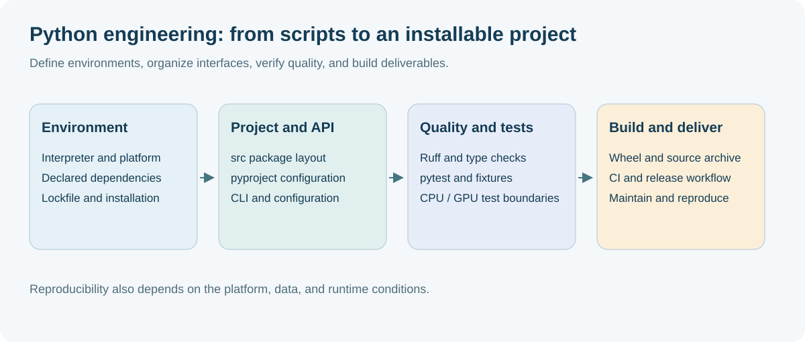
<figcaption>Figure: Turning a research script into an installable project means pinning down the environment and dependencies, organizing the code and its interfaces, establishing quality checks, and completing the build and delivery; reproducibility further depends on the platform, the data, and the operating conditions.</figcaption>
</figure>

# 1. From scripts to installable projects
{: id="一从研究脚本到可安装项目"}

## 1.1 What this guide covers
{: id="11-本文要解决的问题"}

Most AI and robotics projects begin with a single `train.py`. It runs well on your machine. Three months later, the situation often looks like this:

|Stage|Typical symptoms|Root cause layer|
| --- | --- | --- |
|Hand it to a colleague for reproduction|`ModuleNotFoundError`, or different accuracy after installing dependencies|Environment and dependency declarations|
|Change to a server with a GPU|`torch.cuda.is_available()` returns `False`|GPU dependency stack layering|
|Want it imported by another project|Can only rely on `sys.path.append("../..")`|Project structure and installation method|
|Add CI|Passes locally but fails in CI, or vice versa|Reproducibility boundaries|
|Come back to maintain it six months later|Afraid to upgrade any package|Missing lockfile and tests|

These symptoms have a common cause: the code was never organized as an installable project. It remained a collection of files that happened to run.

The goal is concrete: turn research scripts into a Python project that others can install, run, and maintain. This guide is neither a Python language tutorial nor a tool encyclopedia; it leaves out unrelated topics such as web frameworks, asynchronous programming, and metaprogramming.

## 1.2 Example projects throughout the text
{: id="12-贯穿全文的示例项目"}

To keep examples consistent, the guide uses one project throughout: `navkit`, a small waypoint navigation library. It deliberately includes the key elements of a real project:

- An importable package (the library side)
- A command-line entry point (the application side)
- A configuration file (which requires handling of paths and precedence)
- A test suite (which must distinguish tests that need a GPU from those that do not)
- An optional PyTorch feature (which must handle the CUDA dependency)

Each chapter adds a capability to `navkit`; Chapter 9 brings the complete workflow together.

The target is a repository that anyone can set up for development with three commands:

```bash
git clone https://github.com/example/navkit && cd navkit
uv sync                 # Create the environment and install exactly what the lockfile specifies
uv run pytest           # Run the tests
```

Notice that this requires no `conda create`, no `pip install -r requirements.txt`, no `export PYTHONPATH=`, and no instruction to install torch manually first. Every implicit setup convention removed reduces the chance of a failed reproduction.

## 1.3 Reading methods
{: id="13-阅读方式"}

The guide follows one organizing principle: give one default workflow in the main text, with alternatives explained briefly alongside it.

The technology options for the default path are:

```
Python 3.12+  ·  uv for environments and dependencies  ·  src layout  ·  hatchling for builds
Ruff for linting and formatting  ·  pytest for tests  ·  GitHub Actions for CI
```

This combination suits new projects whose dependencies are primarily Python packages. Projects that are already tied closely to conda, or that must run inside a ROS 2 workspace, need the boundary discussions in §4.9 and §8.4; migrating to uv alone does not resolve those constraints.

Every copy-ready configuration block in this guide states its applicable conditions at the beginning. Version baseline at the time of writing (September 2026): Python 3.14.7 and uv 0.11.x. Python 3.15 has since been released (2026-10-09), and uv has moved to the 0.13 series; for conclusions that depend on version-specific behavior, check the versions you actually use.

# 2. Environment and interpreter
{: id="二环境与解释器"}

Most cases of “installed but cannot import” have the same cause: **the interpreter used to install the package differs from the interpreter running the code**. This chapter explains which interpreter is running and where it searches for packages.

## 2.1 What an import does
{: id="21-一次导入到底发生了什么"}

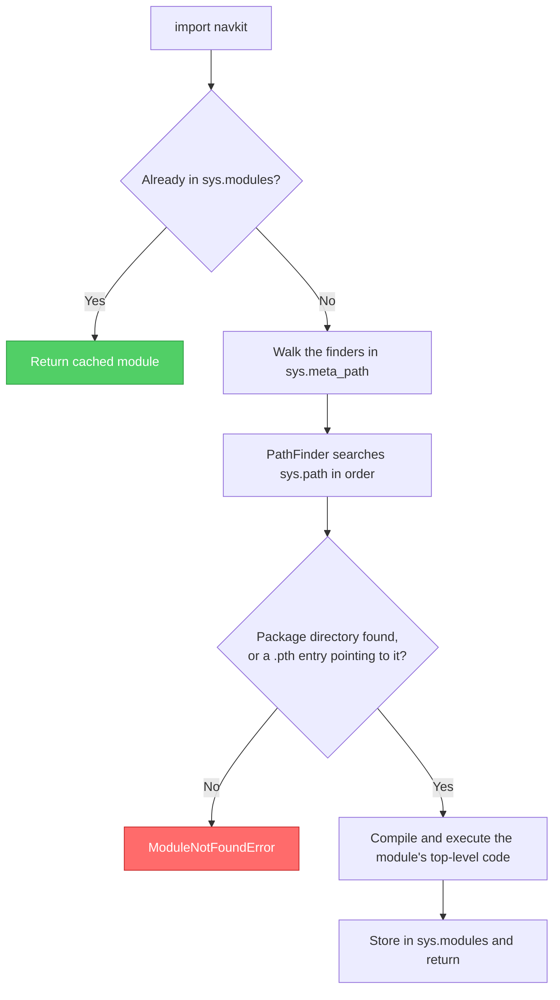

There are only two main points:

1. **`sys.path` is ordered: the first matching package wins.** An installed release can therefore be shadowed by a source copy with the same name in the current directory.
2. **`sys.path` is not fixed.** Its first entry depends on how Python starts, as the next section explains.

## 2.2 How sys.path is built
{: id="22-syspath-的组成"}

**There is no "universal sys.path order"**. The first entry depends on how you start Python, which is the source of many strange problems:

|Startup mode|First entry|Practical consequences|
| --- | --- | --- |
| `python script.py` |The script directory (not the current working directory)|A neighboring `.py` file with the same name can shadow an installed package|
| `python -m pkg.mod` |Current working directory|When run from the project root, the source tree is found first|
|`python -c "..."` / interactive|Current working directory|Same as above|
| `pytest` |Depends on rootdir and import-mode configuration; see §5.4|It is the easiest to end up "testing the source code instead of the installed artifact"|
|Jupyter kernel|The directory containing the notebook file|Often differs from your current directory in the terminal|

After the first entry, the remaining order is roughly:

```
First entry (see the table above; disabled by -P or PYTHONSAFEPATH=1)
  → entries from the PYTHONPATH environment variable
  → standard-library zip, standard-library directory, lib-dynload
  → site-packages, added by the site module
      └── .pth files can append further paths (this is where editable installs hide)
```

> **The `-P` switch of Python 3.11+ is worth remembering.** `python -P script.py` (or setting `PYTHONSAFEPATH=1`) prevents the script directory or the current directory from being added to `sys.path`. When you suspect that the wrong copy is being imported, run once with `-P` and the problem shows up immediately.

This single command is enough for troubleshooting:

```bash
python -c "import sys, navkit; print(sys.executable); print(navkit.__file__)"
```

The first output line identifies the running interpreter; the second identifies the imported code. Together, they expose most environment mismatches.

## 2.3 What venv does
{: id="23-venv-做了什么"}

A virtual environment is often regarded as some kind of magic container, but it is actually very simple:

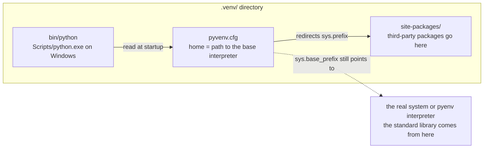

1. It places a `pyvenv.cfg` whose `home` entry points to the real base interpreter;
2. It provides a `python` executable that reads `pyvenv.cfg` at startup, points `sys.prefix` to the venv itself, and leaves `sys.base_prefix` pointing to the base interpreter (the standard library is shared, not copied);
3. As a result, `site-packages` resolves into the venv, and third-party packages are isolated.

A useful corollary: `activate` is not necessary. All the activation script does is put the venv's bin directory at the front of `PATH` and set `VIRTUAL_ENV`. Calling the interpreter by absolute path is exactly equivalent, and more reliable in scripts, cron, systemd, and CI:

```bash
.venv/bin/python -m pytest          # Linux / macOS
.venv\Scripts\python.exe -m pytest  # Windows
```

With uv, `uv run pytest` automatically selects the right interpreter, so even this step is unnecessary.

> **Always use `python -m pip install` rather than bare `pip install`.** Bare `pip` selects the first executable on `PATH`, which may belong to a different interpreter. `python -m pip` installs for the interpreter you explicitly selected.

## 2.4 The roles of pyenv, venv, conda, and uv
{: id="24-pyenv--venv--conda--uv-分工"}

These tools address different layers and are not mutually exclusive alternatives. The diagram shows their main responsibilities; their capabilities overlap.

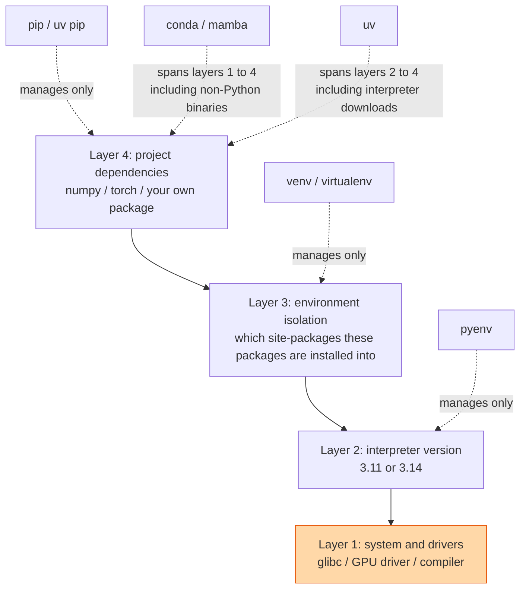

|Tools|Main responsibilities|Installs an interpreter?|Manages non-Python binaries?|
| --- | --- | --- | --- |
| `pip` |Installs Python packages|No|Only what has been packaged into the wheel|
|`venv` (standard library)|Isolate site-packages|No|No|
| `pyenv` |Install and switch interpreter versions|Yes (local compilation)|No|
| `conda` / `mamba` |Environment + packages + some system libraries|Yes|Yes (its own binary distribution system)|
| `uv` |Environment + packages + interpreter + project workflow|Yes (downloads prebuilt interpreters)|Only what has been packaged into the wheel|

**uv is the default workflow because it covers layers 2, 3, and 4.** A single `uv sync` ensures a suitable interpreter, creates a venv, and installs dependencies from the lockfile. That is why the three commands in §1.2 suffice.

The orange layer in the diagram remains outside that workflow: none of these Python tools manages layer 1, the system libraries and drivers. GPU drivers, glibc, and the system ROS 2 installation require separate handling in Chapter 8.

## 2.5 PEP 668 and system Python
{: id="25-pep-668-与系统-python"}

Running `pip install requests` on a recent Ubuntu, Debian, or Fedora produces:

```
error: externally-managed-environment
× This environment is externally managed
```

This is not a bug. [PEP 668](https://peps.python.org/pep-0668/) lets distributions place an `EXTERNALLY-MANAGED` marker file in the interpreter directory, declaring that this Python's site-packages is managed by the system package manager (apt/dnf) and that installers should not write into it.

The reason is very practical: a number of system tools (including some components of apt itself) depend on specific versions of Python libraries. Upgrading a shared dependency can crash those tools outright.

**Change the environment rather than bypass the marker.**

|Scenario|What to do|
| --- | --- |
|Developing a project|Create a virtual environment (`uv venv` / `uv sync`): the default answer|
|Installing a global command-line tool (ruff, httpie)|`uv tool install ruff`, which installs into an independent environment and exposes the commands|
|Running a tool temporarily|`uvx ruff check .` (leaves no trace)|
|You really must change the system environment|Use `apt install python3-xxx` instead of pip|

The name of the `--break-system-packages` flag comes from its documentation: it really does break system packages. Do not put it in any documentation or Dockerfile template.

## 2.6 Notebook, IDE and terminal
{: id="26-notebookide-与终端"}

This is one of the most frequent points of confusion: “I installed it in the terminal, but I can't import it in the notebook.”

The root cause is that the Jupyter kernel and front end are decoupled. The environment you activate in the terminal and the kernel the notebook is actually connected to are completely different things:

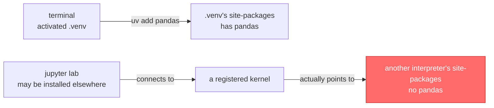

**Diagnosis**: run this in a notebook cell (not in the terminal):

```python
import sys
print(sys.executable)     # the interpreter the kernel actually uses
print(sys.prefix)         # which environment it believes it is in
```

Compare this output with that of `uv run python -c "import sys; print(sys.executable)"` in the terminal. A mismatch is the answer.

**Fix**: register the project environment as a kernel:

```bash
uv add --group dev ipykernel
uv run python -m ipykernel install --user --name navkit --display-name "Python (navkit)"
```

Then select `Python (navkit)` in the upper-right corner of the notebook.

> **A common mistake is running `!pip install pandas` in a notebook.** The `!` delegates to the system shell, which picks the `pip` found on `PATH`; that may differ from the kernel interpreter. If installing from inside the notebook is necessary, use `%pip install pandas`, which targets the current kernel.

VS Code is similar: it has an independent “Python interpreter” selection (`Ctrl+Shift+P` → *Python: Select Interpreter*), which is state separate from the environment you activate in the integrated terminal. The debugger uses the former and the terminal uses the latter.

## 2.7 Windows and WSL pitfalls
{: id="27-windows-与-wsl-的额外坑"}

On many Windows machines, the first result of `where python` is:

```
C:\Users\<user>\AppData\Local\Microsoft\WindowsApps\python.exe
```

This is not Python but the Microsoft Store's app execution alias: a stub that sends you to the Store page when Python is not installed. Its symptom is that `python --version` prints nothing or behaves inexplicably.

Solution: go to *Settings → Apps → Advanced app settings → App execution aliases* and turn off `python.exe` and `python3.exe`. If you use uv to manage the interpreter, this stub should not appear ahead of it on `PATH`.

A few remaining Windows/WSL differences:

|Difference| Linux / macOS | Windows |
| --- | --- | --- |
|venv executable| `.venv/bin/python` | `.venv\Scripts\python.exe` |
|Path separator| `:` | `;` |
|File name case|Case-sensitive|Case-insensitive: `import Navkit` may succeed on Windows but fail on Linux|
|Symbolic links|Available by default|Requires developer mode; otherwise uv falls back to copies or hard links|

> **Crossing the WSL boundary is a pure trap.** Do not build a venv under `/mnt/c/...`, and do not let Python in WSL use a `.venv` on the Windows side. The binary formats differ (ELF vs. PE), file system performance is an order of magnitude worse, and line endings and permission semantics are inconsistent. When **developing in WSL, keep the repository in its native filesystem** (such as `~/code/navkit`) and open it with VS Code's Remote-WSL.

# 3. Project structure
{: id="三项目结构与项目声明"}

The directory tree and `pyproject.toml` describe two sides of the same project: how files are arranged on disk, and which files the installer should place in site-packages.

## 3.1 Project types
{: id="31-项目分类"}

Before creating any directories, first answer one question: which of the three categories does this repository **belong to**? The answer determines almost all subsequent decisions.

|Dimension|Application / service|Publishable library|Experimental repository|
| --- | --- | --- | --- |
|Deliverable|A running environment|A package installed into someone else's environment|Reproducible experiment records|
|Dependency version strategy|Pinned (the more exact, the better)|Ranges (declare compatible versions)|Locked, with experiment metadata recorded|
|Commit the lockfile?|Yes|Yes, but only for development/CI|Yes|
|Version number|Usually dates or Git descriptions|Strict semantic versioning|Often unnecessary|
|Typical example|Robot host computer and inference service|`navkit`, referenced as a dependency|Code repository for a paper|

**The most common mistake: assuming your lockfile constrains downstream users.**

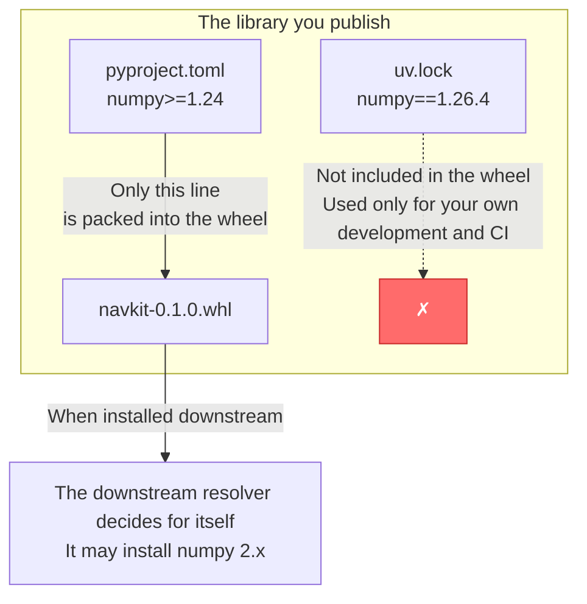

A library declares compatible version ranges in `pyproject.toml`, while an application records exact versions in its lockfile. Pinning a library dependency to `numpy==1.26.4` can create conflicts for downstream users; leaving an application unlocked gives up reproducibility.

`navkit` has both a library side and an application side, which is very common. The approach is to declare loose ranges in `pyproject.toml` (serving the library side) and commit `uv.lock` as well (serving development and CI). The two do not conflict.

## 3.2 Src layout vs flat layout
{: id="32-src-布局-vs-扁平布局"}

There is only one difference between the two layouts: whether the package directory sits directly in the repository root.

```
flat layout                          src Layout
navkit/                          navkit/
├── navkit/          ← package         ├── src/
│   └── __init__.py              │   └── navkit/      ← package
├── tests/                       │       └── __init__.py
└── pyproject.toml               ├── tests/
                                 └── pyproject.toml
```

The difference seems trivial, but the consequences are not. Recall §2.2: when you run `python -m ...` or `pytest` from the project root, the current directory becomes the first entry of `sys.path`.

- **Flat layout**: `navkit/` sits in the root directory, so `import navkit` hits the source tree rather than the package you just installed.
- **src layout**: the root contains only `src/`, so `import navkit` finds nothing in the root and can only resolve to site-packages.

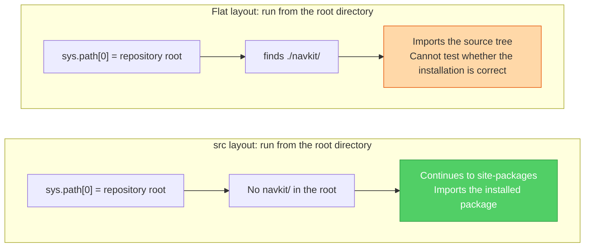

**Two claims, however, are commonly overstated:**

1. **The src layout does not guarantee that tests exercise the final wheel.** An editable install (§3.6) points back to `src/` through mechanisms such as `.pth`, so imports still read source code. The layout prevents accidental imports through the working directory; it does not eliminate differences between the source tree and the packaged artifact.
2. **To verify that the wheel is really complete**, the only reliable way is to build it and install it in a clean environment (see §7.3). If package data files (`.yaml`, `.pyi`) are missing, for example, this is the only way to catch it.

Use a src layout for new projects. It has negligible cost and eliminates a whole class of import problems.

## 3.3 Directory tree of navkit
{: id="33-navkit-的目录树"}

```
navkit/
├── src/
│   └── navkit/
│       ├── __init__.py          # Package API: controls what is exposed to the outside
│       ├── py.typed             # Empty file; declares that this package ships type annotations (PEP 561)
│       ├── cli.py               # Command-line entry point
│       ├── planner.py           # Core algorithm
│       ├── geometry.py
│       ├── models/              # Optional torch functionality
│       │   ├── __init__.py
│       │   └── policy.py
│       └── data/
│           └── default_params.yaml   # Package data file, distributed with the wheel
├── tests/
│   ├── conftest.py              # Shared fixtures
│   ├── test_planner.py
│   └── gpu/
│       └── test_policy.py       # Needs a GPU; skipped by default
├── configs/                     # Runtime configuration, not distributed with the package
│   └── default.yaml
├── scripts/                     # One-off scripts, not part of the package
│   └── convert_dataset.py
├── docs/
├── .github/workflows/ci.yml
├── .gitignore
├── .pre-commit-config.yaml
├── pyproject.toml               # Project metadata + tool configuration
├── uv.lock                      # Lockfile, committed to the repository
└── README.md
```

A few easily overlooked conventions:

- **`configs/` and `src/navkit/data/` are two different things.** The former holds runtime configuration that users can change and does not go into the wheel; the latter holds the defaults shipped with the package, which must be distributed in the wheel (§3.7 explains how to read them).
- **The contents of `scripts/` are not part of the package.** They are one-off tools; do not let code in `src/navkit/` import them.
- **`py.typed` is an empty file**, but without it, downstream type checkers will ignore all type annotations in your package.
- **Keep datasets and model weights out of Git.** Add `data/`, `*.ckpt`, `*.pth`, and `outputs/` to `.gitignore`; use the versioning approaches discussed in §8.6.

## 3.4 pyproject.toml explained
{: id="34-pyprojecttoml-详解"}

`pyproject.toml` is often called the “single source of truth,” but that is imprecise. It does not record the resolved lock state (`uv.lock`), system libraries or GPU drivers (§8.1), or runtime configuration.

It is better understood as the central declaration of a Python project and its tool configuration. Compare the complete `navkit` configuration below with its directory tree.

```toml
# Applies to: Python 3.12+ · uv 0.11.x · src layout · pure-Python package
# ---------- 1. Build system: what turns source code into a wheel ----------
[build-system]
requires = ["hatchling"]              # Dependencies needed only at build time (PEP 518)
build-backend = "hatchling.build"     # Build backend interface (PEP 517)

# ---------- 2. Project metadata: goes into the wheel, visible downstream ----------
[project]
name = "navkit"
version = "0.1.0"
description = "Waypoint navigation toolkit"
readme = "README.md"
requires-python = ">=3.12"            # Constrains the interpreter versions usable downstream
license = "MIT"
authors = [{ name = "Tingde Liu" }]

dependencies = [                      # Runtime dependencies, loose ranges (PEP 508 syntax)
    "numpy>=1.24",
    "pyyaml>=6.0",
    "typer>=0.12",
]

[project.optional-dependencies]       # Optional features; downstream installs them with navkit[torch]
torch = ["torch>=2.4"]

[project.scripts]                     # Command-line entry points generated at install time
navkit = "navkit.cli:app"

# ---------- 3. Development dependencies: not in the wheel, invisible downstream (PEP 735) ----------
[dependency-groups]
dev = ["ruff>=0.6", "mypy>=1.11", "pre-commit>=3.8"]
test = ["pytest>=8.0", "pytest-cov>=5.0"]

# ---------- 4. Tool configuration: unrelated to packaging; this file is just borrowed for storage ----------
[tool.hatch.build.targets.wheel]
packages = ["src/navkit"]             # Tells hatchling to package what is under src/

[tool.ruff]
line-length = 100
```

The four blocks **have completely different ownership, and confusing them is a common source of errors:**

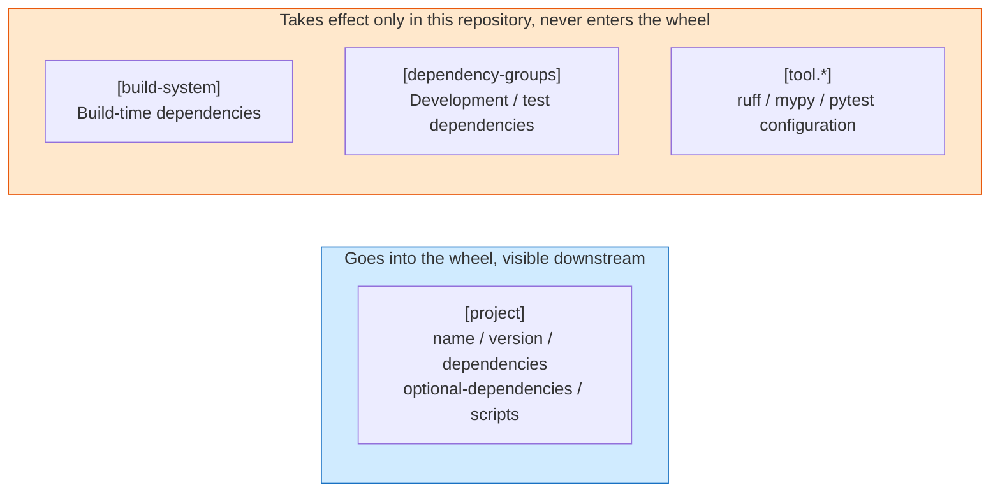

Each PEP covers a distinct responsibility:

| PEP |What problem it solves|Where it shows up in the configuration|
| --- | --- | --- |
| [PEP 517](https://peps.python.org/pep-0517/) |Defines the calling interface between frontend and backend| `build-backend` |
| [PEP 518](https://peps.python.org/pep-0518/) |Declares which dependencies are needed to build| `[build-system] requires` |
| [PEP 621](https://peps.python.org/pep-0621/) |Unifies the project metadata fields|The whole `[project]` block|
| [PEP 660](https://peps.python.org/pep-0660/) |Lets backends support editable installs|Backend behavior; no corresponding field (§3.6)|
| [PEP 735](https://peps.python.org/pep-0735/) |Standardizes how dependency groups are written| `[dependency-groups]` |
| [PEP 440](https://peps.python.org/pep-0440/) |The legal format and ordering rules of version numbers|The value of `version`|
| [PEP 508](https://peps.python.org/pep-0508/) |Syntax of dependency strings (including environment markers)|Each item in `dependencies`|
| [PEP 561](https://peps.python.org/pep-0561/) |Declares that a package contains type annotations|The `py.typed` file|

## 3.5 Build frontends and backends
{: id="35-构建前端与后端"}

This is the most confusing set of concepts for beginners, but the division of labor is actually very clear:

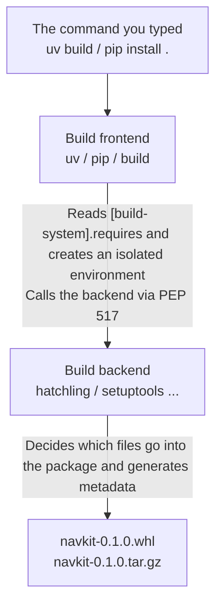

- **Frontend** (uv, pip, build): prepares the environment and calls the backend; it does not decide how the package is built.
- **Backend** (hatchling, setuptools, etc.): actually decides which files go into the package and how metadata is generated.

When choosing a backend, simply pick one that fits the project's actual needs:

|Backend|When to choose it|
| --- | --- |
| **hatchling** |The default choice for pure-Python packages: little configuration, and the src layout works out of the box|
| setuptools |Migrating old projects may require some legacy plugins|
| flit-core |Extremely simple pure-Python packages|
| maturin |Packages containing Rust extensions (PyO3)|
| scikit-build-core |Packages containing C/C++/CUDA extensions built via CMake|

`navkit` is pure Python and uses hatchling. Projects with native extensions need additional work (cross-compilation, ABI compatibility, manylinux build images). This guide covers only the artifact-level compatibility rules, in §7.2, and does not walk through the full extension build workflow.

## 3.6 Editable installs
{: id="36-可编辑安装原理与陷阱"}

When developing, you do not want to rebuild and reinstall after every code change. An editable install (`pip install -e .`, or what uv does automatically) solves this problem.

Its implementation is not mysterious: it inserts a `.pth` file (or a dynamic finder) into site-packages that adds the real path of `src/navkit` to `sys.path`:

```
.venv/lib/python3.12/site-packages/
├── __editable__.navkit-0.1.0.pth      →  points to /home/you/navkit/src
└── navkit-0.1.0.dist-info/            →  Metadata (version, dependencies, entry points)
```

So `import navkit` reads your source code directly, and changes take effect immediately.

**Three traps to know about:**

1. **Reinstall after changing `pyproject.toml`.** New dependencies, entry points, and file-inclusion rules do not automatically take effect: `.pth` connects paths, but installation metadata is recorded at install time. `uv sync` handles this in the uv workflow; otherwise, rerun `pip install -e .`.
2. **A newly added subpackage may not be recognized.** Different backends use different `.pth` strategies: some expose the entire `src/` directory (new subpackages become visible automatically), while others use precise mappings (which require reinstalling). If a newly created module cannot be imported, reinstall first.
3. **An editable install cannot verify packaging correctness.** It bypasses the decision about which files enter the wheel. The `default_params.yaml` in §3.3 may remain readable even if it is omitted from `[tool.hatch.build]`. This is why the clean-environment check in §7.3 is essential.

## 3.7 Imports, cwd and resource paths
{: id="37-导入工作目录与资源路径"}

**An iron rule: never read data files inside a package via relative paths.**

The following pattern is extremely common in research code and extremely fragile:

```python
# ✗ Wrong
with open("src/navkit/data/default_params.yaml") as f:   # Depends on the current working directory
    params = yaml.safe_load(f)

# ✗ Equally fragile: breaks when installed as a zip or loaded by a special loader
HERE = os.path.dirname(os.path.abspath(__file__))
with open(os.path.join(HERE, "data/default_params.yaml")) as f:
    ...
```

The first form works only when the program happens to be launched from the repository root: start it from an IDE, `cd` elsewhere, or install it on someone else's machine, and it breaks immediately.

**The correct approach** is the standard library's `importlib.resources`, which locates the file by package name regardless of the working directory or installation form:

```python
# ✓ Recommended: Python 3.9+
from importlib.resources import files
import yaml

def load_default_params() -> dict:
    resource = files("navkit.data").joinpath("default_params.yaml")
    return yaml.safe_load(resource.read_text(encoding="utf-8"))
```

Also confirm that the file is actually included in the packaging configuration (hatchling includes non-Python files under the directories listed in `packages` by default, but a subdirectory missing its `__init__.py` may not be treated as a package):

```toml
[tool.hatch.build.targets.wheel]
packages = ["src/navkit"]
```

**User-modifiable runtime configuration** (`configs/default.yaml`) does not belong to the package and is handled completely differently: pass its path in through command-line arguments or environment variables (see §6.1).

## 3.8 Circular imports
{: id="38-循环导入"}

```
navkit/planner.py  →  import navkit.geometry
navkit/geometry.py →  import navkit.planner     ← ImportError
```

Python starts executing `planner.py`, reaches `import geometry`, and executes `geometry.py`, which in turn hits `import planner`. At that point `planner` already exists in `sys.modules`, but its initialization is incomplete and the required name does not exist yet.

Three solutions, in descending order of preference:

|Option|Approach|When it applies|
| --- | --- | --- |
|1. Extract a shared layer (preferred)|Move the shared definitions into `navkit/types.py`; both modules depend on it|Usually the best option: circular imports often signal incorrect layering|
|**2. Import** only for type annotations|Wrap it in `if TYPE_CHECKING:` so it is not executed at runtime|Cycles created purely by type annotations|
|3. Defer the import into the function|Put the `import` inside the function body|A temporary workaround that may mask design problems|

How to write option 2:

```python
from __future__ import annotations
from typing import TYPE_CHECKING

if TYPE_CHECKING:                  # Only the type checker takes this branch
    from navkit.planner import Planner

def describe(planner: "Planner") -> str:   # The annotation is a string and is not evaluated at runtime
    return f"planner with {len(planner.waypoints)} waypoints"
```

> Option 3 can rescue you in an emergency, but it hides the fact that there is a cycle between modules. **If you find yourself reaching for option 3 over and over, option 1 is probably what you should be doing.**

# 4. Dependency management and uv workflow
{: id="四依赖管理与-uv-工作流"}

## 4.1 Tool landscape
{: id="41-工具全景"}

The progression `pip → pip-tools → Poetry/PDM → uv` makes it easy to mistake these tools for similar products that replaced one another in sequence. In fact their scopes of responsibility differ greatly, and coexistence is the norm:

|Tool|Which layer it solves|Cross-platform lockfile?|Suitable projects|Migration cost|
| --- | --- | --- | --- | --- |
| `pip` + `requirements.txt` |Installation only|No (a handwritten list is not a lockfile)|Minimal scripts| — |
| `pip-tools` |Locks dependencies for pip|Yes, but generated separately per platform|You already have a pip workflow and just want to add a lockfile|Low|
| `Poetry` |Environment + dependencies + packaging|Yes (`poetry.lock`)|Mature projects whose team is already familiar with it|Medium|
| `PDM` |Same as above, and tracks the standards closely|Yes|You want to use PEP-standard features|Medium|
| `conda` / `mamba` |Environment + Python and non-Python binaries|Yes (needs `environment.yml` exported)|Dependencies include many non-Python binaries|High|
| **`uv`** |Interpreter + environment + dependencies + packaging|Yes (`uv.lock`, cross-platform)|New projects that are primarily Python|Low to medium|

**The "cross-platform lockfile" column is the key difference.** The `requirements.txt` generated by `pip-tools` is bound to the platform and Python version of the machine that produced it: generated on Linux, it is unusable for Windows colleagues. `uv.lock` records the complete set of resolution results, including the branches for each Python version on each platform, so a single file works for the whole team.

## 4.2 Two uv workflows
{: id="42-uv-的两套工作流"}

This is the easiest pitfall in uv, so distinguish the two first. uv provides two sets of commands with completely different semantics:

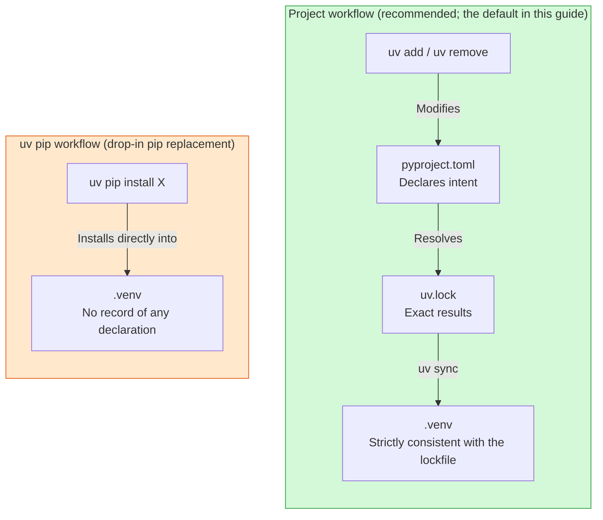

| |Project workflow|`uv pip` workflow|
| --- | --- | --- |
|Commands| `uv add` / `uv sync` / `uv run` | `uv pip install` / `uv pip compile` |
|Does it change `pyproject.toml`?|Yes|No|
|Will `uv.lock` be updated?|Yes|No|
|Positioning|Manages the project's declared dependencies|A "faster pip" that manages packages temporarily installed into the environment|
|When to use|The default choice|Transition periods during migration, one-off tools installed in CI, and old repositories that do not want to introduce a lockfile|

**Mixing workflows creates undeclared dependencies.** A package installed with `uv pip install some-pkg` can be used by your code without appearing in `pyproject.toml`. A colleague running `uv sync` cannot reproduce that environment, and your own next `uv sync` will remove the extra package.

> **Rule: use only one set of commands within a project.** The rest of this guide uses the project workflow.

## 4.3 Precise semantics of uv sync
{: id="43-uv-sync-的精确语义"}

This deserves its own subsection. The following is the official description from the uv 0.11.18 documentation:

> By default, an exact sync is performed: uv removes packages that are not declared as dependencies of the project. Use the `--inexact` flag to keep extraneous packages.

`uv sync` performs an exact synchronization by default, removing packages that the project has not declared.

This is a feature, not a bug: it ensures that the environment state equals the lockfile state and eliminates environment drift. But if you do not know this, you will be baffled by questions like “why does everything I install by hand disappear every time?”

Two exceptions are worth knowing:

- Add `--inexact` to keep extraneous packages;
- With `--no-build-isolation`, uv does not remove extraneous packages, to avoid deleting build dependencies.

|What you want to do|The right command|
| --- | --- |
|Make the environment strictly match the lockfile|`uv sync` (default)|
|Keep manually installed extra packages| `uv sync --inexact` |
|Make a package an official dependency of the project|`uv add <pkg>`; do not use `uv pip install`|

## 4.4 Everyday commands
{: id="44-日常任务对应命令"}

Rather than list the full set of commands (that is the job of the official documentation), we give only the mapping from tasks to commands:

```bash
# ---- Getting started ----
uv init --package navkit          # Create a new project skeleton (--package generates a src layout)
uv python install 3.12            # Download the interpreter on demand; no pyenv needed
uv sync                           # Build .venv and install from the lockfile (includes the dev group by default)

# ---- Changing dependencies ----
uv add "numpy>=1.24"              # Add a runtime dependency; pyproject and the lockfile are updated automatically
uv add --group test pytest        # Add to the test dependency group
uv add --optional torch "torch>=2.4"   # Add to the optional-feature extra
uv remove numpy

# ---- Running things (no need to activate the environment manually) ----
uv run pytest                     # Run in the project environment
uv run python -m navkit.cli
uv run --group test pytest        # Temporarily include a dependency group

# ---- Upgrading ----
uv lock --upgrade-package numpy   # Upgrade a single package (the usual choice)
uv lock --upgrade                 # Upgrade everything to the latest within the allowed ranges (use with caution)

# ---- CI and deployment ----
uv sync --locked                  # Assert that the lockfile is up to date; fail immediately if stale (preferred in CI)
uv sync --frozen                  # Install straight from the lockfile without checking consistency with pyproject
uv sync --no-dev                  # Production environment: skip development dependencies

# ---- Project-independent tools ----
uv tool install ruff              # Install a command-line tool globally
uvx ruff check .                  # Run once, temporarily, leaving no trace
```

**`--locked` and `--frozen` are different.** The following table describes their semantics in uv 0.11.18:

|Flag|Semantics|When to use|
| --- | --- | --- |
| `--locked` |Requires an up-to-date lockfile. If the lockfile is missing or needs updating, it errors out and exits.|Preferred in CI: catches "changed `pyproject` but forgot to re-lock"|
| `--frozen` |Does not check whether the lockfile is consistent with `pyproject`; installs straight from the lockfile.|Deployment images and offline environments|

Without either flag, uv automatically re-resolves dependencies when the project declaration and lockfile disagree. CI may then test different dependencies from your local environment. Use `--locked` to make that drift an explicit build failure.

## 4.5 Four kinds of dependencies
{: id="45-四种依赖的区别"}

Cramming everything into the `dependencies` list is a common problem in research code. The result is that users who only want to run inference are forced to install pytest, ruff, and a full documentation toolchain.

How to separate dependencies in `navkit`:

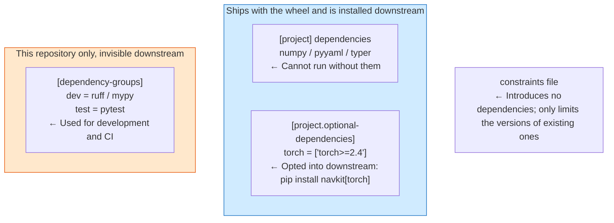

|Category|Where to declare it|Visible to downstream users|Criterion|
| --- | --- | --- | --- |
|Runtime dependency| `[project] dependencies` | ✅ |Without it, core functionality breaks|
|Optional feature| `[project.optional-dependencies]` | ✅ |Only some users need it (GPU, visualization)|
|Development dependency| `[dependency-groups]` | ❌ |Needed only by developers and CI|
|Constraint file| `constraints.txt` | ❌ |Adds no new dependencies; only sets version bounds on existing ones|

Extras are user-facing feature switches (`pip install navkit[torch]`); dependency groups are development toolkits, unavailable through downstream package installation. Ruff belongs in a development group, while optional torch functionality belongs in an extra.

## 4.6 What lockfiles guarantee
{: id="46-锁文件的边界"}

A lockfile alone does not guarantee reproducibility. Its guarantees apply to specific dimensions, so assigning a single overall “reproducibility level” is misleading:

|Dimension|`requirements.txt` (handwritten)|`pip-tools` output| `poetry.lock` | `uv.lock` |
| --- | --- | --- | --- | --- |
|Records exact versions of direct dependencies|Depends on how you write it| ✅ | ✅ | ✅ |
|Records exact versions of transitive dependencies|❌ Often omitted| ✅ | ✅ | ✅ |
|Records hashes (tamper-proof)|Must be added manually|Optional `--generate-hashes`| ✅ | ✅ |
|**Cross-platform universal**| ❌ |❌ One copy per platform| ✅ | ✅ |
|Universal across Python versions| ❌ | ❌ |Partial| ✅ |
|Records which index each dependency comes from| ❌ |Partial| ✅ | ✅ |

**No lockfile can pin the following. Document these limits explicitly for the team:**

A lockfile pins only package names, versions, hashes, and source indexes. Everything below lies outside that boundary:

- System libraries: glibc, libstdc++, and the CUDA driver;
- The compiler used for source builds: the same source can produce different artifacts with different compilers;
- Packages being deleted or replaced on the index;
- External services and data that are not Python packages.

Specifically for `uv.lock`, three conditions apply:

1. **The lockfile is bound by `requires-python`.** If the lock was resolved under `>=3.12`, it cannot be installed on a machine running Python 3.10.
2. **The platform branches in the lockfile depend on the assumptions made during resolution.** If a package has no wheel for aarch64, the lockfile will not change that for you: on such a machine you can only build from source, or the install fails outright.
3. **`uv.lock` is a uv-specific format.** Do not edit it by hand, and do not expect other tools to read it (unless you export it; see the next section).

## 4.7 PEP 751 lockfiles
{: id="47-pep-751-通用锁文件"}

The incompatibility among the various lockfile formats is being addressed by [PEP 751](https://peps.python.org/pep-0751/), which defines a tool-neutral `pylock.toml` format and has been accepted.

Implementation progress as of mid-2026:

|Tool|Export|Install|
| --- | --- | --- |
| uv | ✅ `uv export --format pylock.toml` |✅ Installable via `uv pip install`|
| pip |⚠️ `pip lock` (from 25.1, experimental)|⚠️ `pip install -r pylock.toml` (from 26.1, experimental)|
| PDM | ✅ | ✅ |

**For current use, take a conservative approach:**

- **`uv.lock` remains the primary lockfile** (it has stronger cross-platform support and is a first-class citizen of uv);
- When you need to hand dependencies to a downstream party that does not use uv (auditing, SBOMs, other build systems), use `uv export` to produce `pylock.toml` or `requirements.txt`;
- **Do not treat `pylock.toml` as the sole source of truth yet**: support on the pip side is still experimental, and extras and dependency groups are known to be unsupported.

## 4.8 Why is uv fast?
{: id="48-uv-为什么快"}

uv is faster, but attributing all of the improvement to Rust misses the point. Each of its four stages is optimized, and the gains are unevenly distributed:

| Stage | What happens | Main optimization | Gain |
| --- | --- | --- | --- |
| ① Resolve | Decide which versions to install | Fetch only the metadata it needs instead of downloading whole packages to read dependencies | Large |
| ② Download | Retrieve wheels | Highly concurrent downloads | Medium |
| ③ Cache | Store in the global cache | Shared globally, so unpacked results are reused across projects | Large |
| ④ Install | Place into `.venv` | Prefer hard links over copies | Large, but limited by the filesystem |

Boundaries to note:

- **Linking in step 4 depends on the platform and filesystem.** A hard link requires the cache directory to be on the same filesystem as `.venv`. Across disks, Docker layers, and the WSL boundary, uv falls back to copying and the speed advantage shrinks sharply. This is also the usual answer to “why isn't uv fast in Docker?”; see §7.5 for the fix.
- **Step 1 loses its advantage** when a package has no wheel and must be built from source, because the build actually has to run.
- Implementation details evolve with versions. Defer to the behavior of the version you actually use (this guide's benchmarks use uv 0.11.x).

## 4.9 Migrating from old projects
{: id="49-从旧项目迁移"}

Most readers do not start from an empty directory; they have a repository where conda, pip, and `sys.path` hacks are mixed together. The first step of migration is not to change commands but to understand the current situation.

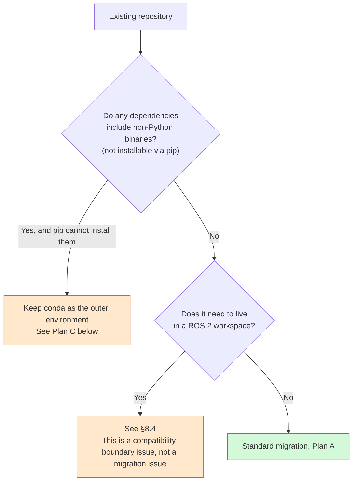

**Plan A: standard migration** (pure-Python dependencies)

```bash
# 1. First freeze the current state as a fallback baseline
python -m pip freeze > /tmp/before.txt

# 2. Generate the project skeleton (existing files are not overwritten)
uv init --package --no-workspace

# 3. Move the direct dependencies into pyproject. Note: direct dependencies, not the full pip freeze output
uv add numpy pyyaml typer
uv add --group test pytest

# 4. Resolve and build the environment
uv sync

# 5. Compare against the baseline
uv run python -m pip freeze > /tmp/after.txt
diff /tmp/before.txt /tmp/after.txt
```

**Step 3 is the critical point.** Do not copy the entire `pip freeze` output into `dependencies`: it includes transitive dependencies. Declare the packages your code actually imports and leave transitive resolution to the resolver. `uv pip compile` or `pipdeptree` can help inspect the dependency tree.

**Plan B: just want a faster pip** (no lockfile; for the transition period)

```bash
uv venv
uv pip install -r requirements.txt     # Same semantics as pip, just much faster
```

This has negligible migration cost and is easy to reverse, but it is only a transitional workflow and does not resolve reproducibility.

**Plan C: keep conda as the outer layer**

conda handles the non-Python binaries, while uv or pip handles the Python packages; see the next section.

## 4.10 Is there still a place for conda?
{: id="410-conda-还有没有位置"}

Yes, conda still has a role. However, the claim that “conda is irreplaceable for certain dependencies” is too absolute and is often supported with misleading examples.

A more accurate statement:

> **The value of conda lies in managing Python and non-Python binary dependencies in one place.** It is especially suitable for teams that already have conda environments, and for projects that depend on its binary ecosystem (conda-forge). Whether to adopt it depends on whether the required dependency is available on PyPI, on the target platform, and on the team's existing processes.

Several frequently misquoted examples are worth clarifying one by one:

|Dependency|Common claim|Actual situation|
| --- | --- | --- |
|The CUDA runtime required by PyTorch|"You must conda install cudatoolkit"|Not required. PyTorch's CUDA wheels already package the required runtime as `nvidia-*` dependencies, which pip/uv can install directly (§8.2)|
| Open3D |"Conda only"|There is an official wheel on PyPI|
| PCL |"Conda only"|It is essentially a C++ library. Availability of the Python bindings varies by platform and must be tested per platform|
|The complete CUDA Toolkit (including `nvcc`)|"conda can install it"|conda-forge does provide it, but you do not need it at all if you only run precompiled packages (§8.3)|

**To decide, ask yourself three questions in order:**

1. Is there a wheel on PyPI for what I need? If so, conda is unnecessary.
2. Can the required non-Python binaries be provided by the container image or the system package manager? If so, prefer those (the boundaries are clearer).
3. Does the team already use conda? If so, the migration cost alone is a valid reason to keep it.

**If you do want to mix them**, there is only one rule worth remembering:

> **Let conda manage the outer environment (the interpreter and non-Python binaries) and let pip/uv manage Python packages. Never have both manage the same package.**

```bash
conda create -n navkit python=3.12 <any binary packages only conda provides>
conda activate navkit
uv pip install -e .        # Note: use the uv pip workflow, not uv sync
```

You must use `uv pip` here: `uv sync` would create and take over its own `.venv`, bypassing the conda environment you just built. This is the practical meaning of the “two workflows” distinction in §4.2.

The opposite order (installing with pip first, then installing the same package with conda) makes the two sets of metadata overwrite each other and leaves the environment in an unrepairable state. **Rebuilding such an environment is faster than repairing it.**

# 5. Quality and testing
{: id="五质量与测试"}

**Local development and CI should run exactly the same checks.** Different commands or configurations eventually lead to the recurring “passes locally, fails in CI” problem.

The way to achieve this is to define the checks in `pyproject.toml` and `.pre-commit-config.yaml`, and invoke them the same way locally and in CI:

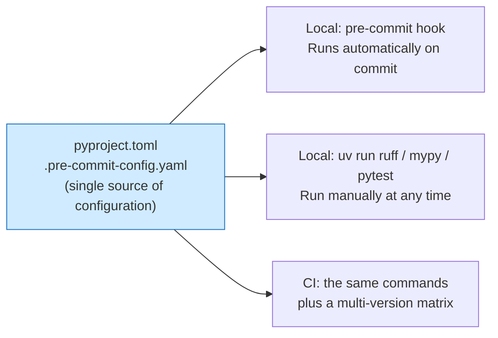

## 5.1 Ruff: linting and formatting
{: id="51-ruff检查与格式化"}

Ruff is implemented in Rust and is one to two orders of magnitude faster than traditional tools. One tool handles both linting and formatting, avoiding conflicts between a separate linter and formatter.

**The claim that “Ruff replaces flake8 + isort + black” needs to be stated accurately**: Ruff covers most of the common rules and formatting behaviors of these tools, but it is not a bit-for-bit replacement:

- Some flake8 plugin rules have no corresponding implementation yet;
- Formatting results differ from black's in a few edge cases;
- When migrating an old repository with many `# noqa` comments, you need to check that the rule codes still correspond.

**For new projects, use Ruff without hesitation.** For old projects, run it first to see how large the diff is before deciding.

```toml
# Applies to: Ruff 0.6+ · append to pyproject.toml
[tool.ruff]
line-length = 100
src = ["src", "tests"]        # Lets the isort rules correctly distinguish first-party from third-party packages

[tool.ruff.lint]
select = [
    "E", "W",    # pycodestyle
    "F",         # pyflakes: unused imports, undefined names
    "I",         # isort: import sorting
    "UP",        # pyupgrade: use modern syntax
    "B",         # flake8-bugbear: common pitfalls (mutable default arguments, etc.)
    "SIM",       # flake8-simplify
    "PTH",       # Prefer pathlib over os.path
    "RUF",       # Ruff's own rules
]
ignore = ["E501"]             # Line length is left to the formatter; don't report it again

[tool.ruff.lint.per-file-ignores]
"tests/*" = ["S101"]          # Allow assert in tests
```

Everyday usage:

```bash
uv run ruff check --fix .     # Lint and auto-fix
uv run ruff format .          # Format
```

> **The `B` rule set is the most valuable one for research code.** It catches mutable default arguments (`def f(x=[])`), closure capture in loops, and similar issues, which are the most insidious kinds of bugs in numerical code: they raise no errors and merely make the results quietly wrong.

## 5.2 Progressive typing
{: id="52-渐进式类型化"}

**Do not try to add type annotations to the entire repository at once.** That is a losing battle: the cost is concentrated up front, the benefits take a long time to appear, and the effort is usually abandoned when coverage reaches 30%.

The right strategy is layered defense:

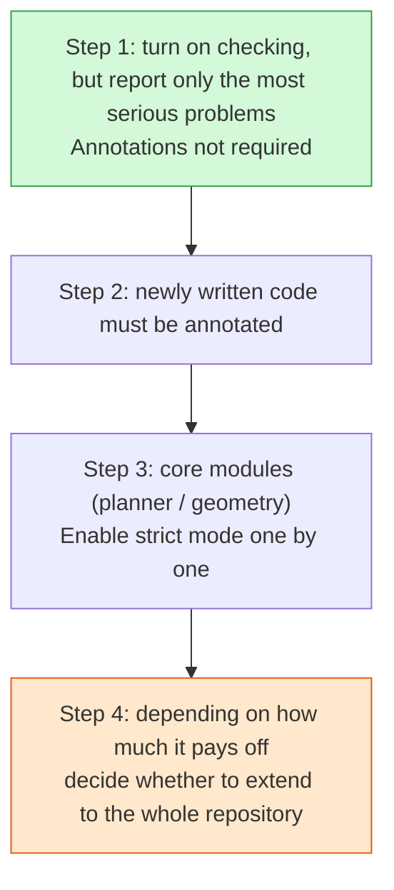

```toml
# Applies to: mypy 1.11+
[tool.mypy]
python_version = "3.12"
files = ["src", "tests"]
# Step 1: start gently
warn_unused_ignores = true
warn_redundant_casts = true
warn_return_any = true
ignore_missing_imports = true      # Don't error on third-party packages without type annotations

# Step 3: tighten modules that are already clean, one at a time
[[tool.mypy.overrides]]
module = ["navkit.planner", "navkit.geometry"]
disallow_untyped_defs = true
strict_equality = true
```

**mypy or pyright?** In short:

| | mypy | pyright / Pylance |
| --- | --- | --- |
|Positioning|Reference implementation that closely follows the typing PEPs|Fast, with a good built-in experience in VS Code|
|Recommendation|Use it in CI (stable, reproducible results)|Use it in the editor (real-time feedback)|

Using both is a reasonable combination: pyright supplies immediate editor feedback, while mypy performs the final check in CI.

> A practical reminder for numerical code: `numpy` and `torch` have limited type annotation coverage, and tensor shapes are something the type system cannot control. The benefit of type checking in this kind of code comes mainly from function boundaries (what types the inputs and outputs are), not from the inside of arrays. Do not expect it to catch shape mismatches.

## 5.3 pre-commit
{: id="53-pre-commit"}

```yaml
# .pre-commit-config.yaml
# The revs are examples; update them with `uv run pre-commit autoupdate`
repos:
  - repo: https://github.com/pre-commit/pre-commit-hooks
    rev: v4.6.0
    hooks:
      - id: trailing-whitespace
      - id: end-of-file-fixer
      - id: check-yaml
      - id: check-added-large-files       # Prevents model weights from being committed by mistake
        args: ["--maxkb=1024"]
      - id: check-merge-conflict

  - repo: https://github.com/astral-sh/ruff-pre-commit
    rev: v0.6.9
    hooks:
      - id: ruff
        args: ["--fix"]
      - id: ruff-format

  - repo: https://github.com/astral-sh/uv-pre-commit
    rev: 0.11.18                         # matches this guide's uv baseline
    hooks:
      - id: uv-lock                        # Automatically updates the lockfile when pyproject changes
```

```bash
uv run pre-commit install        # Install the hook; only needed once
uv run pre-commit run --all-files   # Run on everything the first time
```

> **`check-added-large-files` is particularly useful here.** Once a `.ckpt` is committed to Git history, the repository size grows permanently, and cleaning it up later requires rewriting history, which is extremely costly. This hook is one of the few “install it and never think about it again” wins.

## 5.4 pytest essentials
{: id="54-pytest-核心机制"}

pytest has many features, but for research projects, mastering the following three things covers 90% of scenarios.

### Configuration and import mode
{: id="配置与导入模式"}

```toml
# Applies to: pytest 8.0+
[tool.pytest.ini_options]
testpaths = ["tests"]
addopts = "-ra --strict-markers --import-mode=importlib"
markers = [
    "slow: tests that take a long time",
    "gpu: requires a CUDA device",
]
```

`--import-mode=importlib` deserves special mention: it makes pytest locate test modules through the standard import mechanism and stop inserting paths into `sys.path`. Combined with the src layout, this ensures that tests import the installed package. This is the test-side solution to the problem in §3.2.

`--strict-markers` makes misspelled markers raise errors instead of being silently ignored as unknown markers.

### Fixture scope
{: id="fixture-的作用域"}

Fixtures are pytest's central abstraction: declare what a test needs rather than constructing it by hand inside the test. Scope determines how often that setup is recreated:

|Scope|Created|Typical uses|
| --- | --- | --- |
|`function` (default)|For each test function|Temporary directories, mutable test data|
| `module` |For each test file|Small read-only datasets|
| `session` |Once per test session|Loading model weights, starting a simulator|

```python
# tests/conftest.py: fixtures defined here are visible to all tests in this directory and its subdirectories
import pytest
import numpy as np
from navkit.planner import Planner

@pytest.fixture(scope="session")
def heavy_model():
    """Load only once for the entire test run; scope matters a great deal in AI projects."""
    return load_pretrained("checkpoints/policy.pt")

@pytest.fixture
def planner() -> Planner:
    """Each test gets a fresh instance, so tests do not contaminate each other."""
    return Planner(waypoints=np.zeros((4, 2)))

@pytest.fixture
def tmp_config(tmp_path):
    """tmp_path is a built-in pytest fixture that creates and cleans up a temporary directory automatically."""
    cfg = tmp_path / "config.yaml"
    cfg.write_text("max_speed: 1.5\n", encoding="utf-8")
    return cfg
```

> **`conftest.py` is hierarchical.** Fixtures in `tests/conftest.py` are available to all tests; fixtures in `tests/gpu/conftest.py` are limited to that subtree. Keep GPU fixtures there so ordinary tests remain independent.

### Parameterization
{: id="参数化"}

```python
import pytest
from navkit.geometry import normalize_angle

@pytest.mark.parametrize(
    "raw, expected",
    [
        (0.0, 0.0),
        (3.5 * 3.14159, -0.5 * 3.14159),
        (-3.5 * 3.14159, 0.5 * 3.14159),
    ],
)
def test_normalize_angle(raw, expected):
    assert normalize_angle(raw) == pytest.approx(expected, abs=1e-5)
```

**Always use `pytest.approx`** for floating-point results; never use `==`. In numerical code this is not a matter of style but of correctness.

## 5.5 Test layers
{: id="55-测试分层"}

Tests in research projects often cannot run in CI because they “require a GPU, a dataset, or a simulator”, and they eventually degrade to the point where nobody runs them.

The **solution is to layer the tests** so that the expensive parts can be skipped individually:

```python
# tests/gpu/conftest.py
from pathlib import Path
import pytest

GPU_DIR = Path(__file__).parent

def pytest_collection_modifyitems(config, items):
    """Mark tests in this directory as gpu, and skip them when CUDA is unavailable."""
    # This hook receives every test in the session, so select this directory's tests by path
    gpu_items = [item for item in items if GPU_DIR in item.path.parents]
    for item in gpu_items:
        item.add_marker(pytest.mark.gpu)   # lets -m "not gpu" exclude them

    try:
        import torch
        has_cuda = torch.cuda.is_available()
    except ImportError:
        has_cuda = False
    if not has_cuda:
        skip = pytest.mark.skip(reason="requires a CUDA device")
        for item in gpu_items:
            item.add_marker(skip)
```

This yields three layers:

|Level|Command|Where to run|Target duration|
| --- | --- | --- | --- |
|Quick unit tests| `uv run pytest -m "not slow and not gpu"` |On every commit; full matrix in CI|< 30 seconds|
|Full CPU tests| `uv run pytest -m "not gpu"` |Before merging a PR|A few minutes|
|GPU integration tests| `uv run pytest tests/gpu` |Machines with GPUs / nightly jobs|No limit|

**The benefit:** CI can perform 90% of the verification without a GPU, instead of disabling the entire suite because a single `import torch` fails.

## 5.6 Coverage and multi-version matrix
{: id="56-覆盖率与多版本矩阵"}

```toml
[tool.coverage.run]
source = ["src/navkit"]
branch = true

[tool.coverage.report]
exclude_lines = [
    "pragma: no cover",
    "if TYPE_CHECKING:",          # This branch never executes at runtime
    "raise NotImplementedError",
]
```

```bash
uv run pytest --cov --cov-report=term-missing
```

> **Don't treat coverage as a KPI.** It can only tell you which code has never been executed, which is valuable information; it cannot tell you whether the executed code was actually verified. Focusing on the uncovered lines listed by `--cov-report=term-missing` is far more useful than staring at percentages.

**Testing against multiple Python versions** used to be the domain of tox and nox. With uv, local matrix testing becomes very simple:

```bash
for v in 3.12 3.13 3.14; do
  uv run --python $v --isolated pytest -m "not gpu"
done
```

`--isolated` gives each version its own independent environment so that they do not interfere with each other. The full test matrix is still left to CI (§7.6); this local loop is for a quick self-check before pushing.

# 6. Configuration, logging, and the command line
{: id="六配置日志与命令行"}

In research code, these three things usually look like this: configuration means editing constants in the source, logging means `print`, and the command line means `sys.argv[1]`. All three work, and all three collapse at the same time when the project grows.

## 6.1 Configuration precedence
{: id="61-配置先确定优先级链"}

Before choosing a tool, settle one thing: when the same parameter appears in several places, which one wins? This order should be fixed and documented:


**The closer a configuration source is to the point of use, the higher its priority.** This lets you override a parameter for one experiment without editing a file.

This is implemented with `pydantic-settings`, which provides environment-variable reading and type checking out of the box:

```python
# src/navkit/config.py
from pathlib import Path
from pydantic import Field
from pydantic_settings import BaseSettings, SettingsConfigDict

class NavConfig(BaseSettings):
    model_config = SettingsConfigDict(
        env_prefix="NAVKIT_",      # NAVKIT_MAX_SPEED=2.0 automatically overrides max_speed
        env_file=".env",
        extra="forbid",            # A misspelled field raises an error instead of being silently ignored
    )

    max_speed: float = Field(default=1.0, gt=0, description="Maximum speed in m/s")
    goal_tolerance: float = Field(default=0.25, gt=0)
    output_dir: Path = Field(default=Path("outputs"))
```

> **`extra="forbid"` is the most valuable line in this configuration.** Without it, `NAVKIT_MAXSPEED` (missing the underscore) would be silently ignored, and you would spend half an hour wondering whether something is wrong with the code. With it, an error is raised as soon as the program starts.

**pydantic-settings or Hydra?**

| | pydantic-settings | Hydra / OmegaConf |
| --- | --- | --- |
|Strengths|Type checking, environment variables, IDE completion|Configuration composition, multi-group experiment sweeps (multirun)|
|Suited for|General configuration of applications and libraries|Large-scale experiment management|
|Cost|Not good at composing configurations|A steep learning curve; it takes over `sys.argv`, and debugging is a bit troublesome|

**The deciding criterion is simple:** do you need to run 20 hyperparameter combinations with one command? If so, use Hydra; if not, use pydantic-settings. `navkit` belongs to the latter.

**For path handling**, the distinction from §3.7 applies again:

```python
# Package defaults: use importlib.resources, independent of the working directory
from importlib.resources import files
defaults = yaml.safe_load(files("navkit.data").joinpath("default_params.yaml").read_text())

# User configuration: the path is supplied by the user, and the code makes no assumptions about it
def load_user_config(path: Path | None) -> dict:
    if path is None:
        return {}
    return yaml.safe_load(path.read_text(encoding="utf-8"))
```

## 6.2 Logging: why not just use print?
{: id="62-日志为什么不能用-print"}

The problem with `print` is not that it is “unprofessional”, but that it cannot do three specific things:

1. **It has no severity levels.** Debug information and errors are mixed together, and a production environment cannot filter for the important ones.
2. **Callers cannot turn it off.** A `print` in a library pollutes the caller's output, and the caller has no way to intervene.
3. **It lacks diagnostic context.** There is no timestamp, module name, or line number, so problems cannot be located.

The logging responsibilities of a **library and an application are completely different**. This is the easiest point to get wrong:

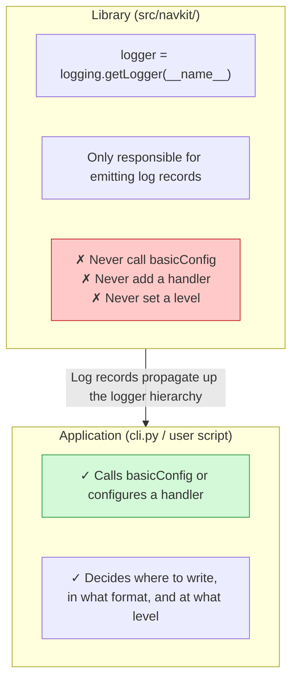

The reason is the propagation mechanism: records emitted by the `navkit.planner` logger propagate automatically up to `navkit` and then to the root logger, so configuring once at the root takes effect globally. If the library configures a handler itself, the caller sees duplicated output and cannot turn it off.

```python
# src/navkit/planner.py: the correct way to write a library
import logging

logger = logging.getLogger(__name__)      # The name is automatically "navkit.planner"

def plan(waypoints):
    logger.debug("Start planning, waypoint count %d", len(waypoints))   # Placeholder arguments are formatted lazily
    if len(waypoints) < 2:
        logger.warning("Fewer than 2 waypoints; cannot plan")
        return None
    ...
```

```python
# src/navkit/cli.py: the correct way to write an application
import logging

def setup_logging(verbose: bool) -> None:
    logging.basicConfig(
        level=logging.DEBUG if verbose else logging.INFO,
        format="%(asctime)s | %(levelname)-8s | %(name)s:%(lineno)d | %(message)s",
    )
    logging.getLogger("matplotlib").setLevel(logging.WARNING)   # Silence noisy third-party libraries
```

> **Use `logger.debug("x = %s", x)` rather than `logger.debug(f"x = {x}")`.** The first formats the string only when that log level is enabled, which can matter when logging every training step.

## 6.3 Command line: typer
{: id="63-命令行typer"}

```python
# src/navkit/cli.py
from pathlib import Path
from typing import Annotated
import typer
from navkit.config import NavConfig
from navkit.planner import Planner

app = typer.Typer(help="Waypoint navigation toolkit")

@app.command()
def plan(
    waypoints: Annotated[Path, typer.Argument(help="Path to the waypoint file")],
    max_speed: Annotated[float | None, typer.Option(help="Override the maximum speed in the configuration")] = None,
    verbose: Annotated[bool, typer.Option("--verbose", "-v")] = False,
) -> None:
    """Plan a trajectory from a waypoint file."""
    setup_logging(verbose)
    cfg = NavConfig()
    if max_speed is not None:          # The command line has the highest priority; see §6.1
        cfg.max_speed = max_speed
    Planner.from_file(waypoints, cfg).run()

if __name__ == "__main__":
    app()
```

Together with `[project.scripts]` from §3.4, the command `navkit plan ...` is available after installation.

|Tool|When to use|
| --- | --- |
|`argparse` (standard library)|You do not want to introduce a dependency, or have only one or two arguments|
| **`typer`** |The default choice: generates argument parsing and help text from type annotations|
| `click` |The layer beneath typer; use it directly when you need fine-grained control|

> **Entry-point functions should be thin.** `cli.py` only does “parse arguments → assemble configuration → call core logic”. The real algorithm stays in `planner.py`, so it can be called from the command line and imported by other Python code. This is exactly how the “library and application at the same time” design from §3.1 is implemented.

# 7. Build, delivery, and CI
{: id="七构建交付与-ci"}

## 7.1 Two artifacts: wheel and sdist
{: id="71-两种产物wheel-与-sdist"}

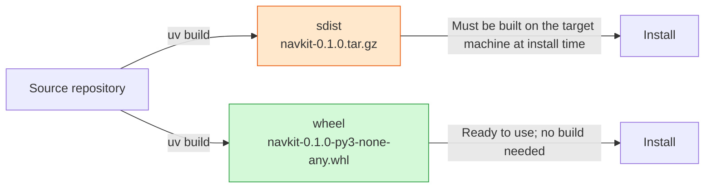

| |sdist (source distribution)|wheel (binary distribution)|
| --- | --- | --- |
|Essence|Packaged source code|Prebuilt installation artifact|
|At install time|Requires running a build on the target machine|Just unpack it|
|With native extensions|The target machine needs a compiler and headers|No build environment required|
|Role|Fallback, auditable, supports less common platforms|The actual source of everyday installs|

**Publish both.** The wheel covers common platforms, and the sdist ensures that less common platforms (or users who need to compile themselves) still have a path forward.

## 7.2 The three tags in the file name
{: id="72-文件名里的三段-tag"}

`navkit-0.1.0-py3-none-any.whl` is a machine-readable compatibility declaration. Its last three components identify:

```
navkit - 0.1.0 - py3      - none     - any
  package name   version    Python tag  ABI tag   platform tag
```

Each tag constrains a different dimension:

|Segment|Question it answers|Example values|
| --- | --- | --- |
| **Python tag** |Which kind and version of interpreter is needed?|`py3` (any Python 3), `cp312` (CPython 3.12)|
| **ABI tag** |Requirements on the interpreter's binary interface|`none` (no native extension), `cp312` (bound to this version's ABI), `abi3` (stable ABI)|
|**Platform tag**|Operating system and CPU architecture| `any`, `manylinux_2_28_x86_64`, `win_amd64`, `macosx_11_0_arm64` |

A pure-Python package is `py3-none-any`: it is independent of all three dimensions, so a single distribution serves every platform. A package with native extensions has tags like `cp312-cp312-manylinux_2_28_x86_64`, and one must be produced for each combination of Python version and platform.

**Two common misunderstandings need clearing up:**

> **Misunderstanding 1: `manylinux` means “works on all Linux”.**
> No. `manylinux_2_28` means “requires glibc ≥ 2.28”, which is a lower bound with a specific value. Systems older than that cannot install it, and Alpine, which uses musl, is completely different (it corresponds to `musllinux`). This is why everything pip installs in an Alpine image has to be compiled on the spot.
>
> **Also: `manylinux` constrains only the C runtime and promises nothing about GPU driver compatibility.** Whether the CUDA code in a manylinux wheel can run depends on the driver version of the target machine (§8.1) and has nothing to do with this tag.

> **Misunderstanding 2: `abi3` means “works on all Python”.**
> No. `abi3` means the extension uses only the stable-ABI subset of CPython, so it runs on the declared minimum CPython version and later ones. It is still tied to CPython (PyPy does not apply) and has a lower bound.

## 7.3 Verifying in a clean environment
{: id="73-构建并在干净环境里验证"}

This step is the homework left over from §3.6: an editable install cannot verify packaging correctness, and only this step can.

```bash
# 1. Build both artifacts
uv build                      # Artifacts land in dist/

# 2. Install the wheel into a fresh, isolated environment
uv venv /tmp/verify --python 3.12
uv pip install --python /tmp/verify dist/navkit-0.1.0-py3-none-any.whl

# 3. The key check: import from somewhere that is not the repository directory
cd /tmp
/tmp/verify/bin/python -c "import navkit; print(navkit.__file__)"
/tmp/verify/bin/python -c "from navkit.config import load_default_params; print(load_default_params())"
/tmp/verify/bin/navkit --help
```

**Do not omit the `cd /tmp` in step 3.** Checking from the repository root can put the source tree on `sys.path` (§2.2) and hide packaging problems.

Typical problems this step catches:

- A package data file (`default_params.yaml`) did not make it into the wheel;
- `py.typed` is missing;
- An entry in `[project.scripts]` is misspelled, so the command is not generated;
- A subpackage is missing `__init__.py` and is not recognized as a package by the backend.

> For a stricter check, run `twine check dist/*` to verify PyPI metadata requirements. Checking before upload is easier than bumping the version after a failed release.

## 7.4 Trusted publishing
{: id="74-发布优先用可信发布"}

The traditional approach is to generate a PyPI API token and store it in CI secrets. The problem is that the token is long-lived: once leaked, it stays usable until you revoke it manually.

**Trusted Publishing** takes a different approach: you register which GitHub repository and workflow may publish `navkit` on PyPI. CI exchanges a short-lived identity credential for a temporary token, so the repository stores no long-lived publishing key.

Two things need to be distinguished here (this is the easiest place to get confused):

| |Identity and permissions|Upload action|
| --- | --- | --- |
|Where to configure|PyPI project settings page + CI workflow `permissions: id-token: write`|A command in the workflow|
|Who decides whether to allow it|Registration rules on the PyPI side| — |
|Common misunderstanding|Thinking that changing the upload command is enough|`uv publish` only performs the upload; it does not establish the trust relationship|

```yaml
# .github/workflows/release.yml
name: release
on:
  release:
    types: [published]

jobs:
  publish:
    runs-on: ubuntu-latest
    environment: pypi           # Optional; matches environment protection rules
    permissions:
      id-token: write           # Required: lets the workflow obtain an OIDC credential
    steps:
      - uses: actions/checkout@v4
      - uses: astral-sh/setup-uv@v3
      - run: uv build
      - run: uv publish         # No token needed; the credential is supplied by the id-token permission above
```

> **Test the workflow on TestPyPI first.** A version number can be uploaded to PyPI only once and cannot be reused even after deletion. For a first release, it is better to probe with a pre-release such as `0.1.0rc1` than to burn the official version number.

## 7.5 Docker layer caching
{: id="75-docker-依赖缓存"}

The problem with the naive approach is that `COPY . /app` comes before the dependency installation, so changing a single line of code invalidates the cache for every dependency layer, and torch is reinstalled on every build.

The correct approach is to **split dependency installation and project installation into two layers**:

```dockerfile
# Applies to: uv 0.11.x · committed uv.lock · BuildKit (enabled by default since Docker 23)
FROM python:3.12-slim-bookworm

# Copy uv from the official image, pinning the version for reproducibility
COPY --from=ghcr.io/astral-sh/uv:0.11.18 /uv /uvx /bin/

# The cache mount is not on the same filesystem as the target environment, so hard links are unavailable; explicitly switch to copy,
# otherwise every build prints a screenful of warnings (see §4.8 for the reasoning)
ENV UV_LINK_MODE=copy \
    UV_COMPILE_BYTECODE=1

WORKDIR /app

# ---- Layer 1: install dependencies only ----
# Use bind mounts instead of COPY, so these two files do not enter the image layer;
# --no-install-project means navkit itself is not installed at this stage
RUN --mount=type=cache,target=/root/.cache/uv \
    --mount=type=bind,source=uv.lock,target=uv.lock \
    --mount=type=bind,source=pyproject.toml,target=pyproject.toml \
    uv sync --locked --no-install-project --no-dev

# ---- Layer 2: install the project itself ----
# Only this layer is invalidated by source changes; the dependency layer above stays cached.
COPY . /app
RUN --mount=type=cache,target=/root/.cache/uv \
    uv sync --locked --no-dev

ENV PATH="/app/.venv/bin:$PATH"
ENTRYPOINT ["navkit"]
```

Three key points, each corresponding to a real pitfall:

1. **`UV_LINK_MODE=copy`** addresses the point in §4.8 that hard links require the same filesystem. The cache mount is a separate filesystem, and without this variable you get a flood of warnings.
2. **`--no-install-project`** is the key to the layering. Without it, the two layers would be no different, and the dependency cache would be useless.
3. **`--locked`** is consistent with CI (§4.4). It fails the build when the lockfile is out of date instead of silently installing different versions.

> **A cache hit does not establish correctness.** A cached dependency layer only means that `uv.lock` and `pyproject.toml` have not changed. It does not verify that the environment is correct; that is the job of the clean-install check in §7.3, and the two cannot substitute for each other.

## 7.6 GitHub Actions
{: id="76-github-actions"}


```yaml
# .github/workflows/ci.yml
name: ci
on:
  push:
    branches: [main]
  pull_request:

jobs:
  lint:
    runs-on: ubuntu-latest
    steps:
      - uses: actions/checkout@v4
      - uses: astral-sh/setup-uv@v3
        with:
          enable-cache: true
      - run: uv sync --locked          # Fails when the lockfile is stale
      - run: uv run ruff check .
      - run: uv run ruff format --check .
      - run: uv run mypy

  test:
    runs-on: ${{ matrix.os }}
    strategy:
      fail-fast: false                 # If one combination fails, the others keep running
      matrix:
        os: [ubuntu-latest, windows-latest]
        python: ["3.12", "3.13", "3.14"]
    steps:
      - uses: actions/checkout@v4
      - uses: astral-sh/setup-uv@v3
        with:
          enable-cache: true
      - run: uv sync --locked --python ${{ matrix.python }}
      - run: uv run pytest -m "not gpu" --cov    # No GPU in CI; see §5.5

  build:
    runs-on: ubuntu-latest
    steps:
      - uses: actions/checkout@v4
      - uses: astral-sh/setup-uv@v3
      - run: uv build
      - run: uvx twine check dist/*
      - uses: actions/upload-artifact@v4
        with:
          name: dist
          path: dist/
```


Several deliberate design choices:

- **`lint` and `test` are separate jobs.** Formatting problems can be reported within seconds without waiting for the full matrix to finish.
- **`fail-fast: false`**: the default `true` kills the remaining jobs as soon as the first combination fails, so you see only “Windows fails” without knowing whether Linux fails too. For cross-platform matrices, this default is almost always wrong.
- **`-m "not gpu"`**: GitHub's standard runners have no GPU. GPU tests are offloaded to a self-hosted runner or a nightly job.

## 7.7 Versions and dependency security
{: id="77-版本号与依赖安全"}

For the **version number**, use different strategies depending on the classification in §3.1:

|Project type|Recommendation|
| --- | --- |
|Publishable library|Strict [semantic versioning](https://semver.org/lang/zh-CN/), maintained manually in `pyproject.toml`|
|Application / service|Date-based versions (`2026.9.1`) or a direct Git description|
|Experimental repository|No version number needed; identify runs by commit hash (§8.6)|

To avoid the chore of keeping code changes and version numbers in sync, you can derive the version number from the Git tag:

```toml
[build-system]
requires = ["hatchling", "hatch-vcs"]
build-backend = "hatchling.build"

[project]
dynamic = ["version"]        # Declares that the version is provided dynamically by the backend

[tool.hatch.version]
source = "vcs"               # Read from the git tag
```

**For dependency security**, add a routine check:

```bash
uvx pip-audit                       # Check current dependencies against known-vulnerability databases
```

```yaml
  audit:
    runs-on: ubuntu-latest
    steps:
      - uses: actions/checkout@v4
      - uses: astral-sh/setup-uv@v3
      - run: uv sync --locked
      - run: uvx pip-audit
```

> Academic projects often feel that vulnerability scanning is irrelevant. But once code is **deployed on a real robot or an external-facing service, security becomes directly relevant**, and that is usually discovered late in a project. The cost of running the check regularly is close to zero.

# 8. AI and robotics projects
{: id="八ai-与机器人项目"}

The first seven chapters apply to any Python project. This chapter deals with problems specific to this field, almost all of which occur in the orange region at the bottom of the diagram in §2.4: the system and driver layer that Python tools cannot manage.

## 8.1 The GPU dependency stack
{: id="81-gpu-依赖栈谁管哪一层"}

“`torch.cuda.is_available()` returns False” is hard to debug because the GPU dependency is a four-layer structure, and pip/uv can touch only one of the layers:

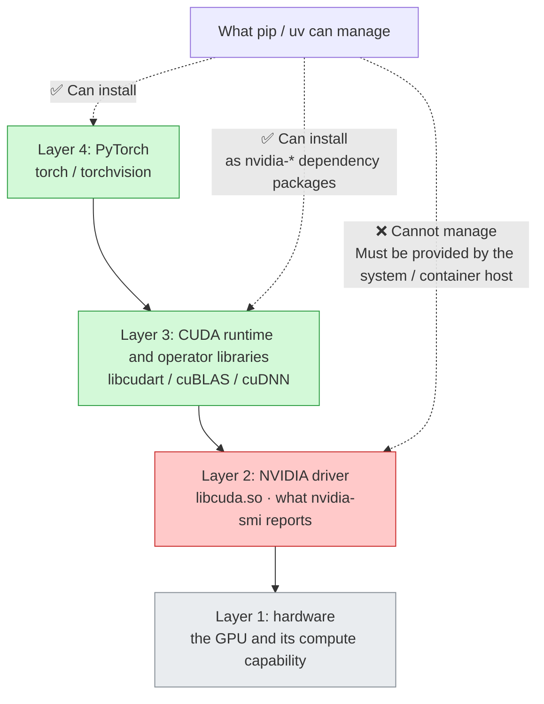

**This diagram clears up a widespread misunderstanding.** Modern PyTorch CUDA wheels already include layer 3: they pull it in automatically as dependencies such as `nvidia-cuda-runtime-cu12` and `nvidia-cudnn-cu12`. Therefore:

> **If you only want to run PyTorch, you do not need to install the CUDA Toolkit on the system, nor use conda to install `cudatoolkit`.** You only need a sufficiently new driver.

Driver backward compatibility: a newer driver can run an older CUDA runtime, but not vice versa. Upgrading the driver is therefore usually safe, and most “CUDA version mismatch” errors mean the driver is too old.

**A reading pitfall worth clarifying:**

```bash
nvidia-smi        # Shows "CUDA Version: 12.6" in the upper right corner
nvcc --version    # May show 12.1, or the command may not exist at all
```

The two numbers mean completely different things, and it is normal for them to disagree:

|Command|What it reports|
| --- | --- |
|`nvidia-smi` → `CUDA Version`|The highest CUDA runtime version the driver supports, not the installed runtime|
| `nvcc --version` |The version of the CUDA Toolkit on the system (matters only when compiling)|
| `torch.version.cuda` |The CUDA version PyTorch was built for; check this when troubleshooting|

Troubleshooting in three steps:

```bash
uv run python -c "import torch; print(torch.__version__, torch.version.cuda, torch.cuda.is_available())"
nvidia-smi --query-gpu=driver_version --format=csv
```

If `torch.version.cuda` prints `None`, you have installed the CPU build, which is the most common situation. See the next section for the fix.

## 8.2 Pinning torch with uv
{: id="82-用-uv-控制-torch-来源"}

The CPU and CUDA variants of torch share the same package name; they differ only in the source index. With no configuration, you get the default build from PyPI, which is usually the CUDA build on Linux but may be the CPU build on other platforms or under certain version combinations, and you have no control over which.

**Declare the index explicitly to make this deterministic.** The following TOML is based on the uv documentation:

```toml
# Applies to: uv 0.11.x · target CUDA 13.0 · CUDA on Linux and Windows, fall back to PyPI on macOS
[project]
dependencies = ["torch>=2.11.0", "torchvision>=0.26.0"]

[[tool.uv.index]]
name = "pytorch-cu130"
url = "https://download.pytorch.org/whl/cu130"
explicit = true       # Key: only explicitly named packages are fetched from here; everything else goes to PyPI as usual

[tool.uv.sources]
torch = [
  { index = "pytorch-cu130", marker = "sys_platform == 'linux' or sys_platform == 'win32'" },
]
torchvision = [
  { index = "pytorch-cu130", marker = "sys_platform == 'linux' or sys_platform == 'win32'" },
]
```

**The `explicit = true` line cannot be omitted.** Without it, uv treats this index as a candidate source for all packages. The PyTorch index hosts a batch of mirrored packages with the same names as PyPI ones, so your `numpy` and the like could be pulled from there, producing inexplicable resolution results.

Commonly used index URLs:

|Target|URL suffix|
| --- | --- |
| CUDA 11.8 | `/whl/cu118` |
| CUDA 12.6 | `/whl/cu126` |
| CUDA 12.8 | `/whl/cu128` |
| CUDA 13.0 | `/whl/cu130` |
| ROCm 7.2 | `/whl/rocm7.2` |
|CPU build| `/whl/cpu` |

**To support both CPU and GPU installs in one repository**, use mutually exclusive extras:

```toml
[project.optional-dependencies]
cpu  = ["torch>=2.11.0", "torchvision>=0.26.0"]
cu130 = ["torch>=2.11.0", "torchvision>=0.26.0"]

[tool.uv]
conflicts = [
  [{ extra = "cpu" }, { extra = "cu130" }],   # Declare the two mutually exclusive, so they cannot be installed together
]
```

```bash
uv sync --extra cpu      # Notebooks, CI
uv sync --extra cu130    # Training servers
```

> **After changing the index configuration, re-resolve the dependencies.** An index change may not trigger a lockfile update automatically; if necessary, delete `uv.lock` and run `uv sync`. This is a common reason why the configuration was changed but the old build is still installed.

## 8.3 Prebuilt wheels vs CUDA extensions
{: id="83-预编译包与-cuda-扩展"}

These are two completely different scenarios with very different requirements. Confusing them leads to a lot of wasted effort (such as installing the CUDA Toolkit just to run inference):

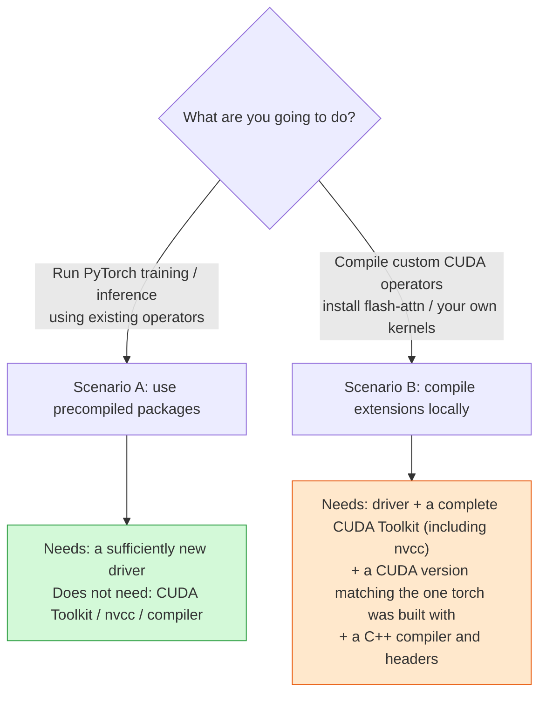

| |Scenario A: run precompiled packages|Scenario B: compile extensions locally|
| --- | --- | --- |
|Typical operation|Train directly after `uv sync`| `pip install flash-attn --no-build-isolation` |
|Requires `nvcc`| ❌ | ✅ |
|Requires the system CUDA Toolkit| ❌ | ✅ |
|CUDA version requirement|Only that the driver is new enough|The Toolkit version must match `torch.version.cuda` |
|Build / install time|A few minutes|Ten minutes to several hours|
|Recommendation|The default path|First try to find an official precompiled wheel|

**Scenario B has a pitfall** you must know about: packages like `flash-attn` need `import torch` at build time to obtain compilation parameters. By default, PEP 517 runs the build in an isolated build environment, which has no torch, so the build fails. That is why the installation instructions of such packages always include `--no-build-isolation`, which lets the build use the current environment (where torch is already installed).

The uv equivalent:

```toml
[tool.uv]
# Declare that these packages are not built in an isolated environment
no-build-isolation-package = ["flash-attn"]
```

> Recall §4.3: with `--no-build-isolation`, `uv sync` does not delete extraneous packages (so as not to remove build dependencies by accident). This means such a project's environment will gradually drift away from the strict state of the lockfile, so it is worth rebuilding the environment periodically.

## 8.4 ROS 2 and virtual environments
{: id="84-ros-2-与虚拟环境"}

“ROS 2's Python cannot be installed into a venv” lumps several different problems into one sentence, so troubleshooting cannot begin. There are three independent constraints, and the picture becomes clear once you take them apart one by one.

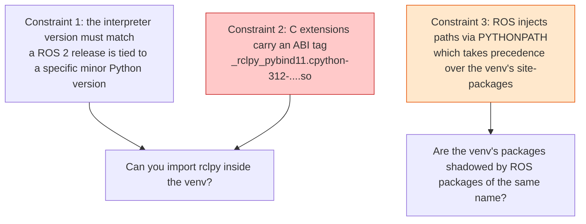

**Constraints 1 and 2: why `import rclpy` fails**

`rclpy` is not a pure-Python package; it ships with a C extension. This extension has an ABI tag embedded in its file name:

```
_rclpy_pybind11.cpython-312-x86_64-linux-gnu.so
                        ↑ loadable only by CPython 3.12
```

If your venv uses Python 3.13, this `.so` will not be recognized as a loadable module at all, and the error is the famous one:

```
ModuleNotFoundError: No module named 'rclpy._rclpy_pybind11'
```

**This error is misleading**: it looks like “the package is not installed”, but it actually means “the interpreter version is wrong”.

> **Corollary: the venv's Python version must match the one used by the ROS 2 distribution** (for example, Jazzy on Ubuntu 24.04 uses Python 3.12). This also means you should not let uv download a separate interpreter to create this venv; create it explicitly from the system interpreter.

**Constraint 3: `--system-site-packages` only addresses visibility**

One of the things `ros2 setup.bash` does is append the ROS site-packages directory to `PYTHONPATH`. Recall the order from §2.2:

```
sys.path[0] → PYTHONPATH → standard library → venv of site-packages
                  ↑                        ↑
            ROS packages are here           Your packages are here (further back)
```

**PYTHONPATH takes precedence over the venv's site-packages.** The consequence: if ROS ships its own `numpy` and you install a different version in the venv, the code actually imports the ROS one. This explains “I clearly installed a newer numpy, but at runtime it is still the old one.”

The `--system-site-packages` flag only lets the venv see the system interpreter's site-packages; it addresses visibility. It can neither resolve a version mismatch nor change the priority of PYTHONPATH.

**Workable approaches**, in order of recommendation:

|Option|Approach|When it applies|
| --- | --- | --- |
|**A. Skip the venv and use a container**|Put the entire ROS 2 workspace in a Docker image and pin dependencies in the image|Recommended: the clearest boundary and the best reproducibility|
|**B. A version-aligned venv**|Build the venv from the system interpreter so its version matches ROS, and add `--system-site-packages`|When you need to install a small number of pure-Python dependencies on the host|
|C. Complete separation|ROS nodes only communicate; the algorithm runs in an independent process or environment and talks via topics or IPC|When the algorithm's dependencies seriously conflict with ROS's|

Concrete commands for option B:

```bash
source /opt/ros/jazzy/setup.bash
# Use the system interpreter explicitly; do not let uv download its own
uv venv --python /usr/bin/python3 --system-site-packages .venv
uv pip install -e .        # Use the uv pip workflow (§4.2), not uv sync
```

`uv sync` is not appropriate here: it creates and takes over its own `.venv`, bypassing the one you just carefully configured. This is exactly the same as mixing in conda in §4.10.

> **Plan C deserves serious consideration.** When your algorithm uses torch 2.x with a new version of numpy while the ROS distribution is locked to older dependencies, it is better to accept that they should be two processes than to fight dependency resolution. This is also the layered-decoupling idea discussed in two other articles on this blog,  and .

## 8.5 Reproducible environment ≠ reproducible results
{: id="85-环境可复现--实验可复现"}

This is the most important thing to realize in research projects: even with locked dependencies and fixed seeds, you are still two layers away from a reproducible experiment.

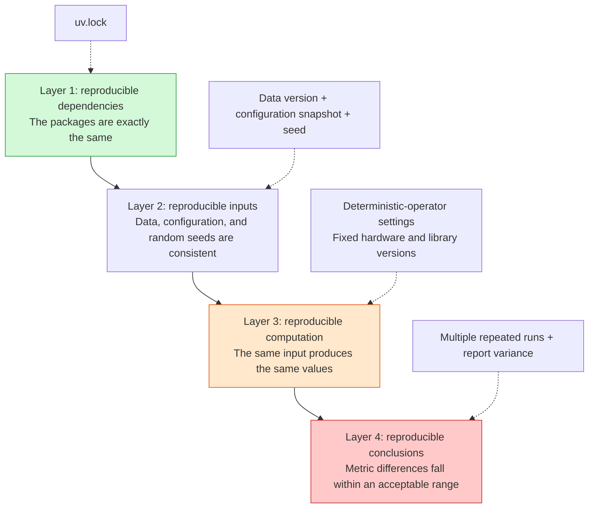

**Every layer has things it cannot pin down:**

|Layer|What tools can do|What tools cannot do|
| --- | --- | --- |
|1 Dependencies|Pin exact versions and hashes|System libraries, drivers, compilers (§4.6)|
|2 Inputs|Seeds, configuration snapshots|If the dataset itself is modified, the seed is meaningless|
|3 Computation|Enable deterministic operators|Results can change on a different GPU model|
|4 Conclusions|Statistics over repeated runs|Identical values from a single run|

**Layer 2: set all relevant seeds**

```python
import os, random
import numpy as np
import torch

def seed_everything(seed: int) -> None:
    os.environ["PYTHONHASHSEED"] = str(seed)   # Fully effective only if set before the interpreter starts
    random.seed(seed)
    np.random.seed(seed)
    torch.manual_seed(seed)
    torch.cuda.manual_seed_all(seed)
```

> **DataLoader's multi-process workers need separate handling.** Each worker is an independent process with its own random state. Seed each worker with `worker_init_fn` and pass an explicit `generator` to the DataLoader; otherwise the data order or augmentation results of multi-process loading are still not reproducible.

**Layer 3: the cost of deterministic computation**

```python
torch.use_deterministic_algorithms(True)     # Raises an error as soon as it meets an operator with no deterministic implementation
torch.backends.cudnn.benchmark = False       # Disable automatic algorithm selection (which varies from machine to machine)
# Some cuBLAS operations also need this set before the process starts:
# export CUBLAS_WORKSPACE_CONFIG=:4096:8
```

**Three costs and boundaries to know:**

1. **Execution becomes slower.** Turning off `cudnn.benchmark` and using deterministic operator implementations usually carries a performance penalty.
2. **Some operators have no deterministic implementation.** With determinism enabled, they raise an exception instead of silently degrading. This is by design, and you have to decide what to do.
3. **Cross-hardware reproducibility remains limited.** Different GPU architectures, cuDNN versions, and parallel reduction orders produce floating-point differences. “Reproducible on the same machine” and “reproducible on another machine” are goals of completely different difficulty, and the latter is essentially unattainable in deep learning.

There is one more easily overlooked factor: TF32. On newer NVIDIA GPUs, PyTorch may use TF32 for matrix multiplication by default, which is faster but less precise than FP32. This makes numerical results differ when you change machines. For strict alignment, you need to turn it off explicitly.

**Layer 4: report results honestly**

Metrics from a single run do not constitute a conclusion. Run 3–5 seeds and report the mean and standard deviation; if your improvement is smaller than the variance between seeds, it is not a conclusion.

## 8.6 Managing experiment artifacts
{: id="86-实验产物管理"}

Code and dependencies are only half of reproducibility. The other half is what was used and what was produced in each run.

Save metadata for every run:

```python
# src/navkit/provenance.py
import json, platform, subprocess, sys
from datetime import datetime, timezone
from pathlib import Path

def dump_provenance(out_dir: Path, config: dict) -> None:
    """Record the complete provenance of this run and store it alongside the results."""
    meta = {
        "timestamp": datetime.now(timezone.utc).isoformat(),
        "git_commit": _git("rev-parse", "HEAD"),
        "git_dirty": bool(_git("status", "--porcelain")),   # Uncommitted changes are a red flag
        "python": sys.version,
        "platform": platform.platform(),
        "config": config,
    }
    try:
        import torch
        meta["torch"] = {
            "version": torch.__version__,
            "cuda": torch.version.cuda,
            "gpu": torch.cuda.get_device_name(0) if torch.cuda.is_available() else None,
        }
    except ImportError:
        pass
    (out_dir / "provenance.json").write_text(
        json.dumps(meta, indent=2, ensure_ascii=False), encoding="utf-8"
    )

def _git(*args: str) -> str:
    try:
        return subprocess.check_output(["git", *args], text=True).strip()
    except Exception:
        return "unknown"
```

> **The `git_dirty` field is worth more than all the other fields combined.** It answers the question “does the code behind this result correspond to a commit in the repository?” Results from runs with uncommitted changes cannot be traced half a year later; with this flag, you at least know the result is not fully traceable.

Accompanying storage conventions:

|Artifact|Storage|Commit to Git?|
| --- | --- | --- |
|Code|Repository| ✅ |
|Dependency lock| `uv.lock` | ✅ |
|Configuration snapshot|Saved with the output directory|❌ (the original configuration template is committed, but not the snapshot)|
|Model weights|Object storage / Git LFS / dedicated tools| ❌ |
|Dataset|External storage, with a recorded version identifier| ❌ |
|Run metadata| `outputs/<run_id>/provenance.json` | ❌ |

## 8.7 Quick troubleshooting table
{: id="87-高频故障排查表"}

This table is indexed by symptom, not by tool. When you hit a problem, start here; it is faster than searching for error messages.

|Symptom|What to check first|Common cause and where to look|
| --- | --- | --- |
|`ModuleNotFoundError`, but the package is clearly installed| `python -c "import sys; print(sys.executable)"` |The interpreter used to install is not the one running (§2.2)|
|The import succeeds but behaves like an old version| `print(mod.__file__)` |A source copy or a same-named package on PYTHONPATH was imported (§2.2, §8.4)|
|Runs from the project root but fails elsewhere|Look for `sys.path.append` or relative paths|Flat layout and dependence on the current directory (§3.2, §3.7)|
|Changes to `pyproject.toml` do not take effect|Have you reinstalled?|An editable install's metadata is fixed at install time (§3.6)|
|A newly created submodule cannot be imported|Try reinstalling|Path-mapping strategy of editable installs (§3.6)|
| `externally-managed-environment` |Are you running the system Python?|PEP 668 protection (§2.5)|
|It cannot be imported in a notebook but can in the terminal|Print `sys.executable` in a cell|The kernel points to a different environment (§2.6)|
|Manually installed packages disappear after `uv sync`|Did you use `uv pip install`?|Exact synchronization is the default (§4.3)|
|CI and local installs get different versions|Did you add `--locked` in CI?|Lockfile drift hidden by automatic re-resolution (§4.4)|
|`.so` fails to load / `undefined symbol`|Expand the ABI tag in the file name|Interpreter version or ABI mismatch (§7.2, §8.4)|
|`torch.cuda.is_available()` is False|Is `torch.version.cuda` `None`?|The CPU build was installed (§8.2)|
|`torch.version.cuda` is fine but it is still False|Does `nvidia-smi` run?|The driver is missing or too old (§8.1)|
|The GPU is not visible in the container|Was it started with `--gpus all`?|The driver is provided by the host; the container only passes it through (§8.1)|
| `No module named 'rclpy._rclpy_pybind11'` |The venv's Python version|Does not match the ROS 2 distribution's version (§8.4)|
|Same seed, different results on two machines|GPU model, cuDNN version, TF32|Not reproducible across hardware (§8.5)|
|Docker build reinstalls dependencies every time|Is the dependency layer separate from the source layer?|Missing `--no-install-project` layer (§7.5)|

# 9. Checklists and decision tree
{: id="九落地清单与决策树"}

## 9.1 Choosing a path
{: id="91-决策树先确定你走哪条路"}

```mermaid
flowchart TB
    Q0{"Is this a new project<br/>or do you already have a repository?"}
    Q0 -->|"New project"| N1{"Will you publish it for others to use?"}
    Q0 -->|"Existing repository"| E1{"Can all current dependencies<br/>be obtained via pip?"}

    N1 -->|"Publish"| NA["Library: loose dependency ranges<br/>Strict semantic versioning<br/>§3.1 + §7.4"]
    N1 -->|"Personal use / service"| NB["Application: locked dependencies<br/>Date-based or Git version numbers"]
    NA --> P["Both go to the §9.2 starter checklist"]
    NB --> P

    E1 -->|"Yes"| M1["Plan A: standard migration<br/>§4.9"]
    E1 -->|"No, includes non-Python binaries"| M2{"Can they be handed to a<br/>container or system package manager?"}
    M2 -->|"Yes"| M1
    M2 -->|"No"| M3["Keep conda as the outer layer<br/>uv pip manages Python packages<br/>§4.10"]

    E1 -->|"Must live in a ROS 2 workspace"| M4["Not a migration issue<br/>It is a compatibility-boundary issue → §8.4"]

    style P fill:#d3f9d8,stroke:#2f9e44
    style M3 fill:#ffe8cc,stroke:#e8590c
    style M4 fill:#ffe8cc,stroke:#e8590c
```

## 9.2 A new project in ten minutes
{: id="92-从零新建十分钟清单"}

```bash
# 1. Skeleton (--package generates a src layout)
uv init --package navkit && cd navkit

# 2. Pin the interpreter version
uv python pin 3.12

# 3. Declare dependencies by category (§4.5)
uv add "numpy>=1.24" "pyyaml>=6.0" "typer>=0.12"
uv add --group dev ruff mypy pre-commit
uv add --group test pytest pytest-cov

# 4. Paste the [tool.*] configuration from §5.1 / §5.2 / §5.4 into pyproject.toml

# 5. Install the hook
uv run pre-commit install

# 6. Verify that the whole pipeline runs
uv run ruff check . && uv run mypy && uv run pytest

# 7. Build and verify in a clean environment (§7.3); do not skip this
uv build && uv venv /tmp/verify && \
  uv pip install --python /tmp/verify dist/*.whl && \
  cd /tmp && /tmp/verify/bin/python -c "import navkit; print(navkit.__file__)"
```

Commit to Git: `pyproject.toml`, `uv.lock`, `.pre-commit-config.yaml`, `.github/workflows/`, `src/`, `tests/`.
Do not commit: `.venv/`, `outputs/`, `data/`, `*.ckpt`, `__pycache__/`.

## 9.3 Migrating an old project
{: id="93-改造旧项目"}

Migration often fails because too many things change at once, making the cause hard to identify. Follow this sequence so each step can be verified and rolled back independently:

|Step|Action|Verification|Can you stop after this step?|
| --- | --- | --- | --- |
| 1 |Add `pyproject.toml` to declare direct dependencies| `uv sync`, then run the main workflow once | ✅ |
| 2 |Commit `uv.lock`|A colleague can reproduce the environment with `uv sync`|✅ The step with the biggest payoff|
| 3 |Switch to the src layout and delete every `sys.path.append`|It still runs after you change directories| ✅ |
| 4 |Adopt Ruff (start with `check` only, no `--fix`)|Check the size of the diff before deciding whether to format everything| ✅ |
| 5 |Add a minimal test set (cover the main workflow first)| `uv run pytest` | ✅ |
| 6 |Connect CI and add `--locked`|You can see the results on PRs| ✅ |
| 7 |Add type annotations (only for new code and core modules)| `uv run mypy` | ✅ |

> **If you can do only one step, do step 2.** Committing the lockfile offers the highest return for a single change: one command lets colleagues install the same dependency environment, addressing half the symptoms in the opening table.

## 9.4 Self-check list
{: id="94-自查清单"}

**Project structure**

- [ ] Uses the src layout, with packages under `src/<name>/`
- [ ] No `sys.path.append` appears in the code
- [ ] Reads package data files with `importlib.resources`, not relative paths
- [ ] Includes `py.typed` (if the package has type annotations)

**Dependencies**

- [ ] Runtime dependencies, optional features, and development dependencies are separated (§4.5)
- [ ] Libraries declare compatible ranges; applications lock dependencies (§3.1)
- [ ] `uv.lock` is committed
- [ ] Each project uses only one workflow; `uv add` and `uv pip install` are not mixed

**Quality**

- [ ] Local runs and CI run the same set of commands
- [ ] `--locked` is used in CI
- [ ] Tests are layered, so machines without a GPU can run most of them
- [ ] Floating-point assertions use `pytest.approx`

**Delivery**

- [ ] Installation is verified in a clean environment after building (§7.3)
- [ ] The dependency layer in the Dockerfile is separate from the source layer
- [ ] Publishing uses Trusted Publishing, with no long-lived token in the repository

**AI / robotics specifics**

- [ ] torch's index source is declared explicitly and does not rely on default behavior
- [ ] `provenance.json` is recorded (including `git_dirty`)
- [ ] You know which level of “environment reproducibility” you are at, and state it truthfully in your paper or report
- [ ] ROS 2 projects: match the venv's Python version to the distribution, or simply use a container

# Appendix A: Performance and concurrency
{: id="附录-a性能与并发简版"}

Performance optimization is a separate subject. This appendix covers only the parts directly connected to project engineering: integrating profilers and choosing a concurrency model.

## A.1 Measure first, then optimize
{: id="a1-先测量再优化"}

```bash
uv add --group dev py-spy memray

# Attach to a running process and sample it; no code changes or restart required
uv run py-spy top --pid <PID>
uv run py-spy record -o profile.svg --pid <PID>      # Generate a flame graph

# Memory profiling
uv run memray run -o out.bin scripts/train.py
uv run memray flamegraph out.bin
```

|Tool|Positioning|When to use|
| --- | --- | --- |
|`cProfile` (standard library)|Function-level runtime statistics|A quick look at hot spots|
| **`py-spy`** |Sampling profiler that can attach to a running process|Training is stuck, or an online process has slowed down; the most practical option|
| `scalene` |Separates CPU, GPU, and memory, and distinguishes Python time from native-code time|You want to know whether time is spent in Python or in the underlying libraries|
| `memray` |Memory allocation tracking|Problems such as continuously growing DataLoader memory|

> **`py-spy` is particularly valuable in this field**, because training jobs have often been running for hours and you cannot restart them just to add a profiler. It can attach directly to the process and sample it.

## A.2 Choosing a concurrency model
{: id="a2-并发模型选型"}

The widely circulated rule “CPU-bound work uses multiple processes, I/O-bound work uses async” is too coarse for AI projects and often leads to wrong conclusions.

Many AI computations execute outside Python. NumPy matrix operations, PyTorch operators, and image-decoding libraries release the GIL while running native code. Threads can therefore be effective for those workloads:

```mermaid
flowchart TB
    Q{"Where does this code<br/>spend most of its time?"}
    Q -->|"Pure-Python loops and object operations"| A["Multiple processes<br/>The GIL is a real bottleneck"]
    Q -->|"NumPy / torch / image decoding<br/>Work happens inside native libraries"| B["Multithreading is enough<br/>These libraries release the GIL"]
    Q -->|"Waiting on network or disk"| C["asyncio or a thread pool"]
    Q -->|"GPU computation"| D["Single process + asynchronous pipeline<br/>Multiple processes would instead compete for GPU memory"]
    style B fill:#d3f9d8,stroke:#2f9e44
    style D fill:#d3f9d8,stroke:#2f9e44
```

**Real bottlenecks** are more often not the ones in this diagram but the following engineering problems:

|Phenomenon|Real cause|What to do|
| --- | --- | --- |
|GPU utilization fluctuates|Data loading cannot keep up|Tune the DataLoader's `num_workers` and `prefetch_factor`|
|Increasing the worker count makes things slower|Nested thread pools: BLAS in every worker has started full-core thread counts|Limit `OMP_NUM_THREADS` in the workers|
|Multi-process startup hangs / GPU memory doubles|Interaction between the process start method (`fork` vs. `spawn`) and CUDA|Use `spawn` in CUDA scenarios, and note that child processes create their own CUDA contexts|
|Memory grows slowly during training|A worker copied a large object, or a cache was not released|Locate it with `memray`; consider `persistent_workers`|

**Nested thread pools are worth remembering.** Say you open 8 DataLoader workers, and NumPy in each worker by default starts BLAS threads equal to the number of physical cores. The actual thread count is the product, and the CPU spends all its time on context switching. The fix is to set an explicit upper limit:

```bash
export OMP_NUM_THREADS=1        # In a DataLoader worker scenario, this should usually be 1
```

## A.3 The GIL and free-threading
{: id="a3-gil-与-free-threading"}

This section changes quickly with versions, so defer to the Python version you actually use. Here is the status at the time of writing (September 2026):

- **Python 3.13** first provided a free-threaded build, labeled experimental.
- **[PEP 779](https://peps.python.org/pep-0779/) was accepted in June 2025**, removing the “experimental” label from free-threaded builds starting with Python 3.14. This corresponds to Phase 2 of the three-phase plan in [PEP 703](https://peps.python.org/pep-0703/): an officially supported but still optional build.
- The third phase, making it the default build, has not arrived and has no confirmed timetable.
- One of the hard conditions for accepting PEP 779 was that the single-threaded performance regression not exceed 15%; by 3.14 the gap has narrowed to 5–10%.

**So the accurate statement is:**

> ❌ "Python no longer has a GIL"
> ✅ "Python 3.14 and later provide an officially supported, optional free-threaded build; the default build still has the GIL"

Get the free-threaded interpreter with uv:

```bash
uv python install 3.14+freethreaded
uv venv --python 3.14+freethreaded
# NOTE: the executable of this variant carries a t suffix (python3t) to distinguish it from the regular build
```

**Should AI and robotics projects adopt it now?** A cautious trial is reasonable, for three reasons:

1. **C extensions must explicitly declare support.** An extension that does not declare it causes the interpreter to re-enable the GIL when loaded on a free-threaded interpreter, so you pay the single-threaded performance penalty without gaining the parallelism benefits.
2. **The level of support in this field's core dependencies (torch, numpy, and their whole native dependency chain) has to be measured** per version and cannot be assumed.
3. **As noted above, the heavy computation in these libraries already releases the GIL**, so the marginal benefit of free-threading for typical AI workloads is likely much smaller than for pure-Python services.

This is worth watching, but **do not rush to adopt it in production projects**.

# References
{: id="参考资料"}

**Standards (PEPs)**

- [PEP 440](https://peps.python.org/pep-0440/) — Version identification and dependency specification
- [PEP 508](https://peps.python.org/pep-0508/) — Dependency specification syntax
- [PEP 517](https://peps.python.org/pep-0517/) / [PEP 518](https://peps.python.org/pep-0518/) — Build backend interface and build dependencies
- [PEP 561](https://peps.python.org/pep-0561/) — Distributing type information
- [PEP 621](https://peps.python.org/pep-0621/) — `pyproject.toml` project metadata
- [PEP 660](https://peps.python.org/pep-0660/) — Editable installs
- [PEP 668](https://peps.python.org/pep-0668/) — Externally managed environment marker
- [PEP 703](https://peps.python.org/pep-0703/) / [PEP 779](https://peps.python.org/pep-0779/) — Optional GIL and free-threading support
- [PEP 735](https://peps.python.org/pep-0735/) — Dependency groups
- [PEP 751](https://peps.python.org/pep-0751/) — General lockfile format `pylock.toml`

**Tool documentation**

- [uv documentation ](https://docs.astral.sh/uv/) — especially the [PyTorch integration ](https://docs.astral.sh/uv/guides/integration/pytorch/) and [Docker integration ](https://docs.astral.sh/uv/guides/integration/docker/) pages
- [Ruff](https://docs.astral.sh/ruff/) · [pytest](https://docs.pytest.org/) · [mypy](https://mypy.readthedocs.io/)
- [Python Packaging User Guide](https://packaging.python.org/) — The authoritative entry point for packaging specifications
- [Python 3.14 release notes ](https://docs.python.org/3/whatsnew/3.14.html)
- [Python Free-Threading Guide](https://py-free-threading.github.io/) — Ecosystem support tracker

**Related on this site**

-  — Engineering practice on the ROS 2 side
-  — Distributed systems and layered decoupling

> The default path in this guide (uv + src layout + Ruff + pytest) suits newly created projects whose dependencies are primarily Python packages. If your project is deeply bound to conda (§4.10) or must live in a ROS 2 workspace (§8.4), prioritize the boundary discussions in those two sections: **they are not problems that “changing tools” can solve**.
>
> Version baseline at the time of writing: Python 3.14.7, uv 0.11.x. For conclusions about version-specific behavior, defer to the versions you actually use.
