# Introduction
{: id="引言"}

ROS 2 organizes functions such as sensing, planning, and control into cooperating nodes, and provides a foundation for communication, scheduling, and system integration. Understanding how nodes exchange data, and what the client, executor, and middleware are each responsible for, is the starting point for reading this architectural guide.

<figure class="survey-intro-figure">
  
  <figcaption>ROS 2 connects sensing, planning and control through a layered communication stack. Topics, services and actions are available across nodes; the illustration does not imply a fixed one-to-one mapping between communication types and modules.</figcaption>
</figure>

*Reading diagrams: scroll horizontally inside wide Mermaid diagrams to see all details at a readable size. Keyboard users can focus a diagram and use the arrow keys.*

# 1. From ROS 1 to ROS 2
{: id="一从-ros-1-到-ros-2"}

## 1.1 Why a rewrite
{: id="11-为什么要重构"}

**ROS (Robot Operating System)** was born in 2007 between the Stanford University Artificial Intelligence Laboratory (STAIR project) and Willow Garage. Its original intention was to provide an open source robot software rapid prototyping platform for the academic community. As robotics technology moves from the laboratory to industrial automation, commercial services, autonomous driving, and humanoid embodied intelligence, the design limitations of ROS 1 have become increasingly prominent:

1. **Centralized single point of failure (Single Point of Failure)**: ROS 1 strong dependency `roscore` (Master node) running on fixed IP/port. If the Master crashes or a network partition occurs, the node discovery and communication registration of the entire robot system will be completely paralyzed.
2. **lacks determinism and hard/soft real-time support**: The bottom layer of ROS 1 is based on standard TCP/UDP sockets. The operating system has no priority control for scheduling and cannot meet the microsecond/millisecond level deterministic real-time control requirements of industrial controllers and underlying motor drivers.
3. **Poor network adaptability and no native encryption security mechanism**: TCPROS/UDPROS has a high packet loss rate and fragile reconnection mechanism in wireless lossy networks (Wi-Fi, 4G/5G, cross-segment); the communication link is plain text transmission, and there is no identity authentication and access control mechanism.
4. **Multi-machine collaboration and multi-robot clusters are highly complex**: ROS 1 multi-machine communication requires strict configuration `ROS_MASTER_URI` and `ROS_IP`, and lacks flexible domain isolation and multi-machine discovery management solutions.
5. **embedded microcontroller isolation**: cannot run directly on microcontrollers (MCU/DSP/RTOS) with limited computing and memory, and can usually only be inefficiently bridged through fragile serial port protocols (such as `rosserial`).

To solve these problems, Open Robotics did not patch ROS 1; instead it redesigned **ROS 2** on top of the industrial standard **DDS (Data Distribution Service)**.

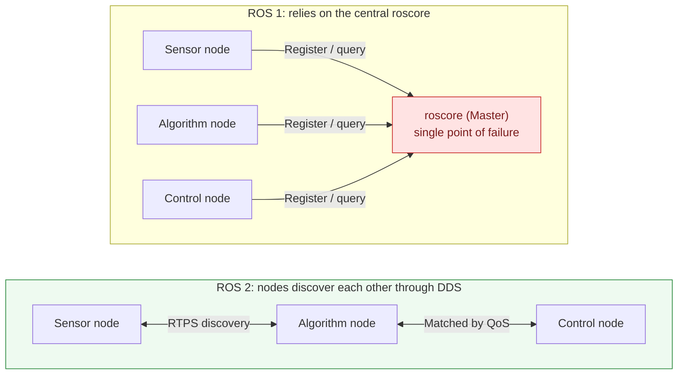

*Figure: In ROS 1, nodes must register with roscore before they can find each other; in ROS 2, nodes discover each other directly through DDS/RTPS, with no central node.*

## 1.2 ROS 1 vs. ROS 2
{: id="12-ros-1-与-ros-2-对比"}

|Dimensions| ROS 1 (Noetic / Melodic) | ROS 2 (Humble / Iron / Jazzy) |Core Values/Industrial Impact|
| :--- | :--- | :--- | :--- |
|**Network topology**|Centralized coordination based on Master (`roscore`)|Fully distributed decentralization based on DDS RTPS|Eliminate single points of failure and support large-scale cluster dynamic networking|
|**Underlying communication**|Custom TCPROS / UDPROS protocol|OMG industrial grade DDS standard (Fast DDS, Cyclone DDS, Connext, etc.)|Reuse military/aerospace grade mature data distribution base|
|**Quality of Service (QoS)**|Only supports simple TCP reliable transmission and UDP best-effort transmission|Complete QoS policy (Reliability, Durability, History, Deadline, etc.)|Precisely adapts to the requirements of high-frequency, low-latency sensors and high-reliability control|
|**Cross-process/intra-process communication**|Socket serialization copy; Nodelet intra-process sharing (API split)|Unified Component container; native support for borrowing pointers zero-copy (Zero-Copy IPC)|Greatly reduces the CPU usage of hundreds-of-megabytes high-resolution point-cloud and 4K image transmission|
|**node lifecycle**|Stateless black box; nodes are initialized out of order.|Native managed lifecycle node (Lifecycle Managed Nodes)|Ensure deterministic controlled startup sequence and fault degradation of sensor drivers, algorithms, and executors|
|**real-time support**|Linux general-purpose kernel; no real-time guarantees|Support hard real-time OS such as Linux PREEMPT_RT, QNX, VxWorks, etc., with zero memory dynamic allocation API|Meet microsecond-level closed-loop motion control requirements|
|**embedded support**|Only through `rosserial` serial port translation|micro-ROS natively supports STM32, ESP32, Zephyr, and FreeRTOS|MCU microcontroller seamlessly acts as a first-class ROS 2 node|
|**Safety mechanism**|No security verification, naked network|SROS2 Specification: DDS-Security Authentication, Access Control List (ACL), TLS/AES Encryption|Meet commercial robot security compliance and cyber attack resistance standards|
|**parameter system**|Globally unified Parameter Server|Node is a private and independent Parameter instance that supports runtime strong type constraints and event monitoring.|Avoid parameter namespace pollution and support dynamic reconfiguration interception|
|**Multi-platform build**|Strong dependency Ubuntu Linux / CMake (`catkin`)|Native support for Linux, Windows, macOS (`colcon` + `ament`)|Lowering the threshold for cross-platform industrial software migration|

## 1.3 Distributions and support
{: id="13-发行版与支持周期"}

ROS 2 releases a new distribution every May, aligned with Ubuntu: even-numbered years bring a long-term support (LTS) release supported for five years, and odd-numbered years bring a regular release supported for about a year and a half.

| Distribution | Released | Target platform | Type | Support status (as of 2026-10) |
| :--- | :--- | :--- | :--- | :--- |
| Foxy Fitzroy | 2020-05 | Ubuntu 20.04 | LTS | End of life |
| Galactic Geochelone | 2021-05 | Ubuntu 20.04 | Regular | End of life |
| Humble Hawksbill | 2022-05 | Ubuntu 22.04 | LTS | Supported until 2027-05; most widely deployed |
| Iron Irwini | 2023-05 | Ubuntu 22.04 | Regular | End of life |
| Jazzy Jalisco | 2024-05 | Ubuntu 24.04 | LTS | Supported until 2029-05 |
| Kilted Kaiju | 2025-05 | Ubuntu 24.04 | Regular | Nearing end of life |
| Lyrical Luth | 2026-05 | Ubuntu 26.04 | LTS | Supported until 2031-05; newest LTS |

> **Selection advice**
> - **Production deployment**: choose Humble (Ubuntu 22.04) or Jazzy (Ubuntu 24.04); ecosystem packages such as Nav2, MoveIt 2, and ros2_control support them most completely. New projects can evaluate Lyrical, but first confirm that the ecosystem packages they depend on have been released for it.
> - **Cutting-edge research and development**: use the newest LTS or Rolling to get new features such as executor performance improvements and Type Adaptation earlier.

# 2. Layered architecture and DDS
{: id="二分层架构与-dds"}

## 2.1 Software layers
{: id="21-软件分层"}

ROS 2 uses a layered design that decouples upper-layer algorithm code from the underlying transport middleware: switching middleware requires no change to application code.

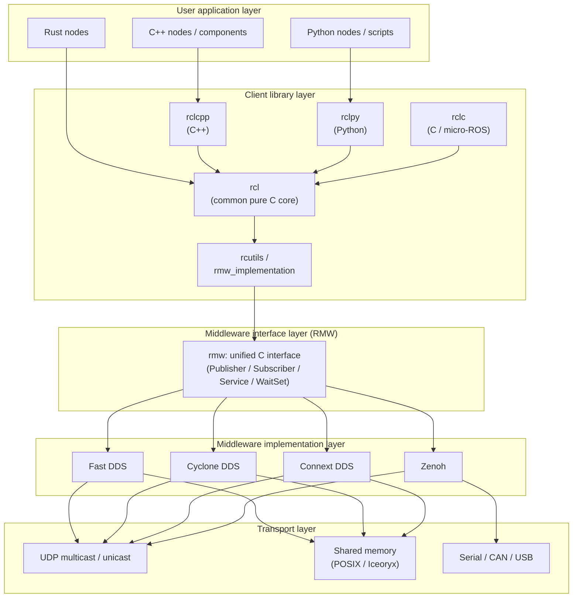

The middleware implementation layer in the diagram corresponds to the four packages `rmw_fastrtps_cpp`, `rmw_cyclonedds_cpp`, `rmw_connextdds`, and `rmw_zenoh_cpp`; Section 2.3 compares their trade-offs.

### Key component responsibilities
{: id="关键组件职责"}
- **`rcl` (ROS Client Library)**: a common logic layer written in pure C that handles language-independent functions such as parameter parsing, the node graph, logging, and clocks, so that client libraries for C++, Python, and other languages behave consistently.
- **`rmw` (ROS Middleware)**: a unified C interface that defines operations such as publishing, subscribing, wait sets, and QoS mapping; upper-layer code does not need to know which middleware is used underneath.
- **`rosidl`**: Interface Definition Language (IDL) generator, which automatically generates `.msg`, `.srv`, and `.action` into native structures and serialization/deserialization codes in C, C++, and Python.

## 2.2 How DDS works
{: id="22-dds-工作机制"}

DDS is the Object Management Organization ( **OMG** ), the core of which is **Data-Centric Publish-Subscribe Model (DCPS, Data-Centric Publish-Subscribe)** .

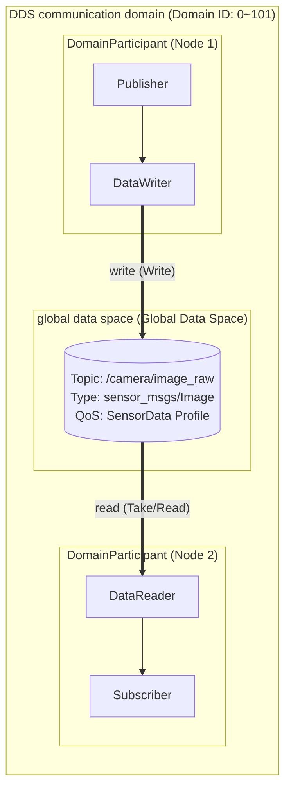

### RTPS discovery
{: id="rtps-自动发现"}
When DDS nodes are started in the LAN, they can automatically discover each other without Master coordination. It contains two Stages:
1. **SPDP (Simple Participant Discovery Protocol)**: After the node starts, it periodically sends multicast heartbeat packets to the predetermined port (the multicast address `239.255.0.1` calculated based on the Domain ID) to announce its Participant GUID, IP address and transmission port.
2. **SEDP (Simple Endpoint Discovery Protocol)**: When Participants discover each other, they establish a reliable unicast connection and exchange the DataWriter / DataReader details (Topic name, data type, QoS configuration) contained in each other. If the QoS matching is successful, a point-to-point data channel is established at the bottom layer.

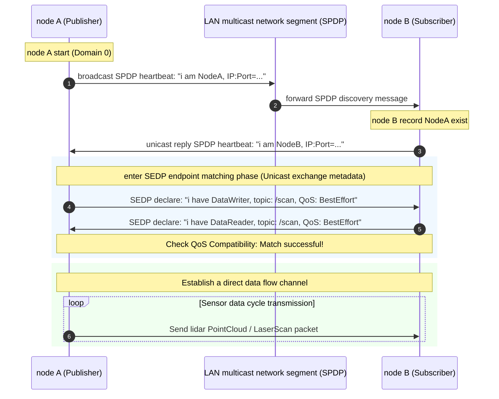

## 2.3 RMW implementations
{: id="23-rmw-实现对比与切换"}

|middleware (RMW)|Supplier/Licensing|Advantages and core features|Disadvantages/Notes|Recommended application scenarios|
| :--- | :--- | :--- | :--- | :--- |
| **Fast DDS** (`rmw_fastrtps_cpp`) | eProsima (Apache-2.0) |ROS 2 official default implementation; complete functions, built-in high-performance shared memory (SHM) transmission, and supports Discovery Server|Multicast packet loss in a weak Wi-Fi network environment can easily lead to slow discovery|Default general robot development, stand-alone simulation, high-performance stand-alone deployment|
| **Cyclone DDS** (`rmw_cyclonedds_cpp`) | Eclipse (EPL-2.0) |The architecture is lightweight and the code is refined; it is extremely robust to Wi-Fi jitter networks, has high throughput and extremely low latency.|Shared memory configuration is more complex (requires Iceoryx)|Autonomous driving, multi-machine distributed systems, wireless mobile robots|
| **Connext DDS** (`rmw_connextdds`) |RTI (commercial license)|Industrial/military grade certification, support for safety-critical systems (ISO 26262 ASIL-D, DO-178C), complete debugging toolset|Commercial charging closed source|Aerospace, medical surgical robots, automotive grade autonomous driving systems|
| **Zenoh** (`rmw_zenoh_cpp`) | ZettaScale (Apache-2.0) |Abandon complex RTPS and adopt a minimalist protocol; zero multicast storm, naturally supporting cross-public network/4G/5G/cloud-edge collaborative communication|Still evolving rapidly, the ecosystem tool chain is gradually maturing.|Cross-wide area network (WAN) vehicle-cloud interconnection and large-scale robot cluster management|

```bash
# Dynamic switching of environment variables RMW(No need to recompile code)
export RMW_IMPLEMENTATION=rmw_cyclonedds_cpp
ros2 run my_pkg my_node

# Verify currently using RMW realize
ros2 doctor --report | grep middleware
```

## 2.4 Multi-machine and Domain ID
{: id="24-多机通信与-domain-id"}

In order to isolate nodes of different robots or teams under the same LAN switch, ROS 2 provides `ROS_DOMAIN_ID`. Valid values are 0 to 232; use **0 to 101**, which avoids conflicts with the operating system's ephemeral ports on every platform.

```bash
# Set the domain ID for this robot in ~/.bashrc
export ROS_DOMAIN_ID=42

# Discovery range (Jazzy and later): SUBNET allows LAN communication, LOCALHOST restricts it to this machine
export ROS_AUTOMATIC_DISCOVERY_RANGE=SUBNET
# Humble and earlier use ROS_LOCALHOST_ONLY=0/1 for the same purpose (deprecated since Jazzy)
```

> **DDS port formula**
> Each Domain ID occupies a fixed range of UDP ports:
> $$\text{Port} = 7400 + 250 \times \text{DomainID} + \text{Offset}$$
> Devices on the same network segment with the same `ROS_DOMAIN_ID` discover each other's nodes automatically.

# 3. Communication primitives
{: id="三五种通信方式"}

ROS 2 abstracts all software decoupled interactions into five communication primitives. Choosing the correct communication method is the first principle of system architecture design.

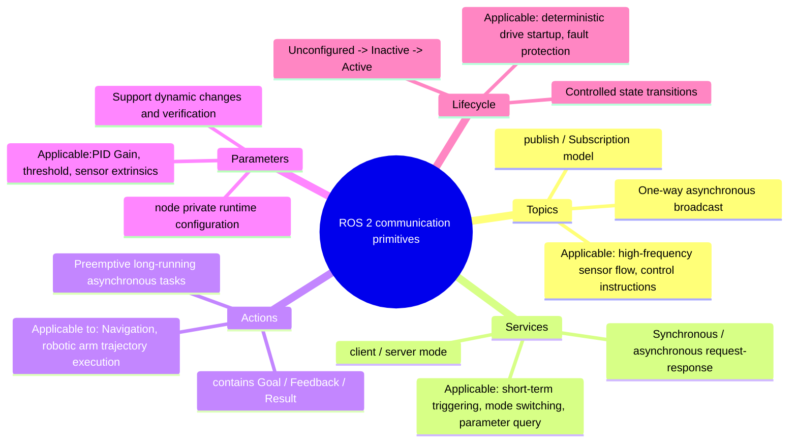

## 3.1 Choosing a primitive
{: id="31-如何选择"}

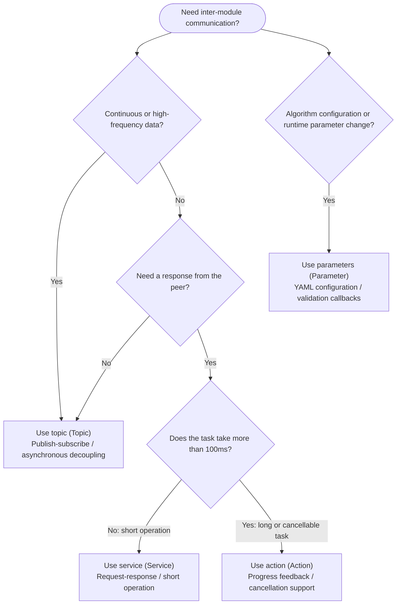

## 3.2 Topics
{: id="32-话题-topic"}

### Communication principles
{: id="通信原理"}
topic is a many-to-many publish-subscribe (Pub/Sub) channel. The publisher pushes the data to the DDS domain, and the subscriber receives the data according to the QoS policy. The two parties are completely decoupled in lifecycle and network topology.

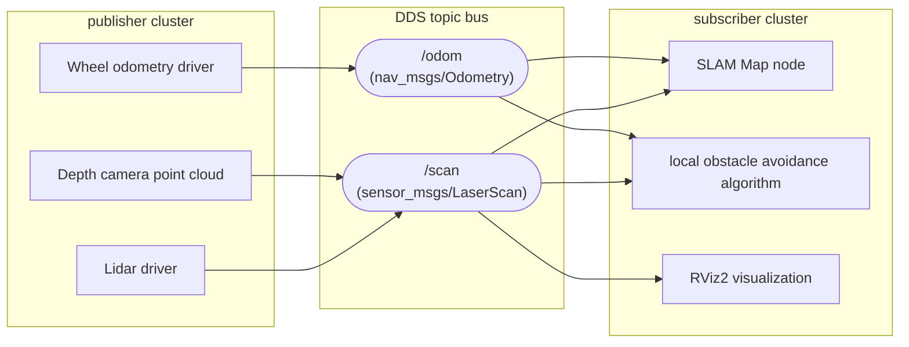

### C++ implementation (`rclcpp`)
{: id="c-实现rclcpp"}

```cpp
#include <chrono>
#include <memory>
#include <string>
#include "rclcpp/rclcpp.hpp"
#include "std_msgs/msg/string.hpp"

using namespace std::chrono_literals;

class RobustPublisher : public rclcpp::Node {
public:
    RobustPublisher() : Node("robust_publisher_node"), count_(0) {
        // Create sensor-specific BestEffort QoS
        rclcpp::QoS qos_profile(rclcpp::KeepLast(10));
        qos_profile.best_effort();
        qos_profile.durability_volatile();

        publisher_ = this->create_publisher<std_msgs::msg::String>("/telemetry_data", qos_profile);
        timer_ = this->create_wall_timer(100ms, std::bind(&RobustPublisher::timer_callback, this));
        
        RCLCPP_INFO(this->get_logger(), "High-frequency publisher node has been started (10Hz)...");
    }

private:
    void timer_callback() {
        auto message = std_msgs::msg::String();
        message.data = "Telemetry Frame #" + std::to_string(count_++);
        publisher_->publish(message);
    }

    rclcpp::TimerBase::SharedPtr timer_;
    rclcpp::Publisher<std_msgs::msg::String>::SharedPtr publisher_;
    size_t count_;
};

int main(int argc, char* argv[]) {
    rclcpp::init(argc, argv);
    rclcpp::spin(std::make_shared<RobustPublisher>());
    rclcpp::shutdown();
    return 0;
}
```

### Python implementation (`rclpy`)
{: id="python-实现rclpy"}

```python
#!/usr/bin/env python3
import rclpy
from rclpy.node import Node
from rclpy.qos import QoSProfile, ReliabilityPolicy, HistoryPolicy
from std_msgs.msg import String

class RobustSubscriber(Node):
    def __init__(self):
        super().__init__('robust_subscriber_node')
        
        # Definition matching publisher QoS Configuration
        qos = QoSProfile(
            history=HistoryPolicy.KEEP_LAST,
            depth=10,
            reliability=ReliabilityPolicy.BEST_EFFORT
        )
        
        self.subscription = self.create_subscription(
            String,
            '/telemetry_data',
            self.listener_callback,
            qos
        )
        self.get_logger().info('The subscribing node is ready, waiting for telemetry data...')

    def listener_callback(self, msg: String):
        self.get_logger().info(f'telemetry frame received: "{msg.data}"')

def main(args=None):
    rclpy.init(args=args)
    node = RobustSubscriber()
    try:
        rclpy.spin(node)
    except KeyboardInterrupt:
        pass
    finally:
        node.destroy_node()
        rclpy.shutdown()

if __name__ == '__main__':
    main()
```

## 3.3 Services
{: id="33-服务-service"}

### Communication principles
{: id="通信原理-1"}
The service is a point-to-point client-server (Client/Server) communication model. The client sends `Request`, and the server returns `Response` after calculation.

> **Caution**: Do not wait synchronously for a service result inside a callback run by a single-threaded executor (for example, calling `get()` on the future returned by `async_send_request()`, or `client.call()` in Python). The wait occupies the only thread, so the response callback never runs and the node deadlocks. Call the service asynchronously and handle the result in the future's completion callback.

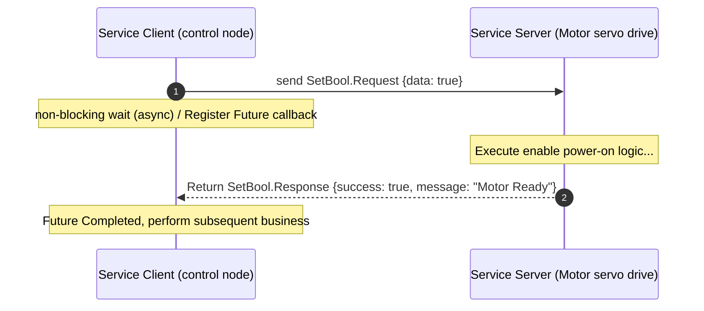

## 3.4 Actions
{: id="34-动作-action"}

### Communication principles
{: id="通信原理-2"}
Actions are for long-running asynchronous tasks, such as navigating a base from point A to point B or having a robot arm perform a grasp. Underneath, an Action consists of three services and two topics:

1. **Goal (service)**: The client sends a goal, and the server accepts or rejects it.
2. **Cancel (service)**: The client can request cancellation at any time, and the server safely interrupts the task.
3. **Result (service)**: Returns the final outcome (succeeded, aborted, or canceled) when the task ends.
4. **Feedback (topic)**: Streams progress during execution, such as the current pose or remaining distance.
5. **Status (topic)**: Broadcasts the current state of each goal.

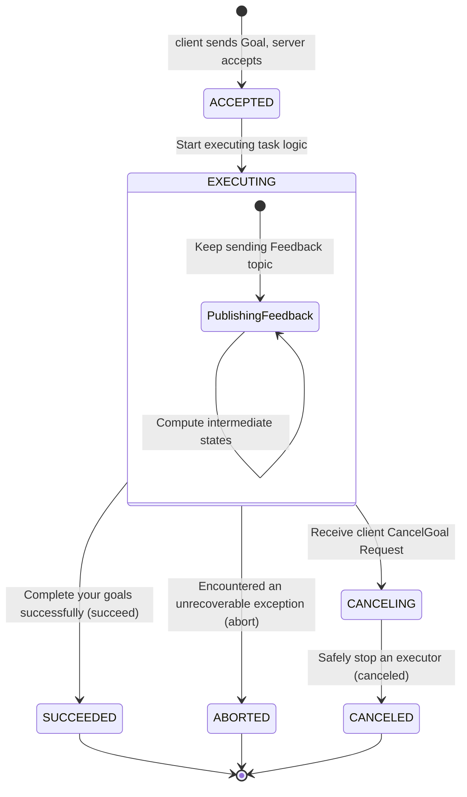

### Action interface definition
{: id="action-接口定义"}
```yaml
# 1. Target (Goal)
geometry_msgs/PoseStamped pose
string behavior_tree
---
# 2. Final result (Result)
std_msgs/Empty result
int16 error_code
---
# 3. Real time feedback (Feedback)
geometry_msgs/PoseStamped current_pose
builtin_interfaces/Duration navigation_time
builtin_interfaces/Duration estimated_time_remaining
int16 number_of_recoveries
float32 distance_remaining
```

## 3.5 Parameters
{: id="35-参数-parameter"}

In ROS 2, parameters are **private data items bound to a specific node instance**, supporting strong type verification, range constraints and dynamic modification callback interception.

```cpp
// C++ Declare parameters with descriptors and dynamic verification
rcl_interfaces::msg::ParameterDescriptor desc;
desc.description = "Robot maximum linear speed limit (m/s)";
desc.floating_point_range.resize(1);
desc.floating_point_range[0].from_value = 0.0;
desc.floating_point_range[0].to_value = 2.5;
desc.floating_point_range[0].step = 0.05;

this->declare_parameter("max_linear_velocity", 1.0, desc);

// Register dynamic parameter change interception callback (OnSetParametersCallback)
params_callback_handle_ = this->add_on_set_parameters_callback(
    [this](const std::vector<rclcpp::Parameter> &parameters) {
        rcl_interfaces::msg::SetParametersResult result;
        result.successful = true;
        for (const auto &param : parameters) {
            if (param.get_name() == "max_linear_velocity") {
                if (param.as_double() > 2.0) {
                    result.successful = false;
                    result.reason = "Safety protection trigger: the actual vehicle line speed cannot exceed 2.0 m/s";
                } else {
                    RCLCPP_INFO(this->get_logger(), "The speed cap is updated to: %.2f", param.as_double());
                }
            }
        }
        return result;
    }
);
```

# 4. Quality of Service (QoS)
{: id="四qos-服务质量"}

QoS (Quality of Service) is the most important communication improvement of ROS 2 over ROS 1: the underlying transport behavior can be configured separately according to the characteristics of each data flow.

## 4.1 Core policies
{: id="41-核心策略"}

| Policy | Values | Meaning |
| :--- | :--- | :--- |
| **Reliability** | `RELIABLE` / `BEST_EFFORT` | Retransmit after packet loss; or send on a best-effort basis and allow loss |
| **Durability** | `VOLATILE` / `TRANSIENT_LOCAL` | Keep no history; or keep the latest N messages for subscribers that join later |
| **History & Depth** | `KEEP_LAST(N)` / `KEEP_ALL` | Keep only the latest N messages; or keep all of them up to resource limits |
| **Liveliness & Lease** | `AUTOMATIC` / `MANUAL_BY_TOPIC` | The middleware reports liveliness automatically; or the publisher asserts it explicitly |
| **Deadline** | Duration | Maximum interval between consecutive messages; exceeding it triggers an event |
| **Lifespan** | Duration | Messages older than their lifespan are no longer delivered |

## 4.2 Compatibility rules
{: id="42-兼容性规则"}

> **Request vs. Offer principle**
>
> The QoS offered by the publisher must be **no weaker than** the QoS requested by the subscriber; otherwise the two ends do not connect. The program keeps running and the subscriber simply receives no data, leaving at most a QoS-incompatibility warning in the log; compare the QoS of both ends with `ros2 topic info -v` to diagnose it.

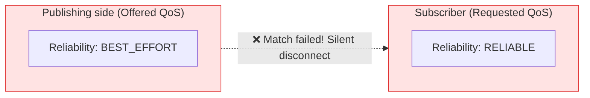

### Compatibility matrix
{: id="兼容矩阵"}

|publisher (Offered)|subscriber (Requested)|Match results|Description|
| :--- | :--- | :---: | :--- |
| **RELIABLE** | **RELIABLE** |✅ **Compatible**|Reliable transmission across the entire link (automatic retransmission of lost packets)|
| **RELIABLE** | **BEST_EFFORT** |✅ **Compatible**|The publisher can provide high guarantee, and the subscriber accepts a weaker guarantee|
| **BEST_EFFORT** | **BEST_EFFORT** |✅ **Compatible**|Best effort transmission, low latency, packet loss allowed|
| **BEST_EFFORT** | **RELIABLE** |❌ **Incompatible**|The subscriber requires reliability, but the publisher cannot guarantee it. **cannot communicate**|
| **TRANSIENT_LOCAL** | **VOLATILE** |✅ **Compatible**|The subscriber does not require historical data and can receive real-time data normally.|
| **VOLATILE** | **TRANSIENT_LOCAL** |❌ **Incompatible**|Subscriber requires historical map, but publisher is not cached, **cannot communicate**|

## 4.3 Common profiles
{: id="43-常用配置模板"}

|Scenario application| Reliability | Durability | History (Depth) |design considerations|
| :--- | :--- | :--- | :--- | :--- |
|**high frequency raw camera image / lidar** (`/image_raw`, `/scan`)| `BEST_EFFORT` | `VOLATILE` | `KEEP_LAST (1~5)` |Pursuing extremely low latency, discarding an old image has no impact and avoids queue backlog|
|**Chassis control command** (`/cmd_vel`)| `RELIABLE` | `VOLATILE` | `KEEP_LAST (10)` |Control instructions must be delivered accurately, and frame loss causing loss of control is prohibited.|
|**static map / parameter event** (`/map`, `/robot_description`)| `RELIABLE` | `TRANSIENT_LOCAL` | `KEEP_LAST (1)` |Similar to the Latch mechanism of ROS 1, the SLAM/Nav2 node started later can obtain the full map as soon as it goes online.|
|**high reliability status alarm** (`/emergency_stop`)| `RELIABLE` | `TRANSIENT_LOCAL` | `KEEP_ALL` |Emergency stop and failure events must never be lost|

# 5. Executors and zero-copy
{: id="五执行器与零拷贝"}

## 5.1 Executors
{: id="51-执行器"}

In ROS 2, callbacks (Timer, Subscription, Service, Action) do not run on background threads by themselves; an **Executor** takes ready events from the underlying WaitSet and schedules them.

| Executor | Scheduling | Advantages | Costs and caveats |
| :--- | :--- | :--- | :--- |
| `SingleThreadedExecutor` | One thread runs all ready callbacks in order | No concurrency contention; thread-safe by construction | Any long-running callback holds up every later event |
| `MultiThreadedExecutor` | A thread pool runs ready callbacks in parallel | Uses multiple cores to improve responsiveness and throughput | Concurrency must be controlled with callback groups (see Section 5.2) to avoid data races |
| `EventsExecutor` | Woken directly by middleware events instead of polling the WaitSet | Low idle CPU overhead; saves power under light load | Provided as an experimental feature since Iron; check support in the version you use |

## 5.2 Callback groups and deadlocks
{: id="52-回调组与死锁"}

In order to finely control concurrent permissions in `MultiThreadedExecutor`, ROS 2 provides two types of callback groups:

1. **`MutuallyExclusiveCallbackGroup` (mutually exclusive group, default)**: All callback functions in this group can only be executed by one thread at the same time.
2. **`ReentrantCallbackGroup` (reentrant group)**: Different callbacks within the group (even multiple triggers of the same callback) can be executed in parallel by multiple threads.

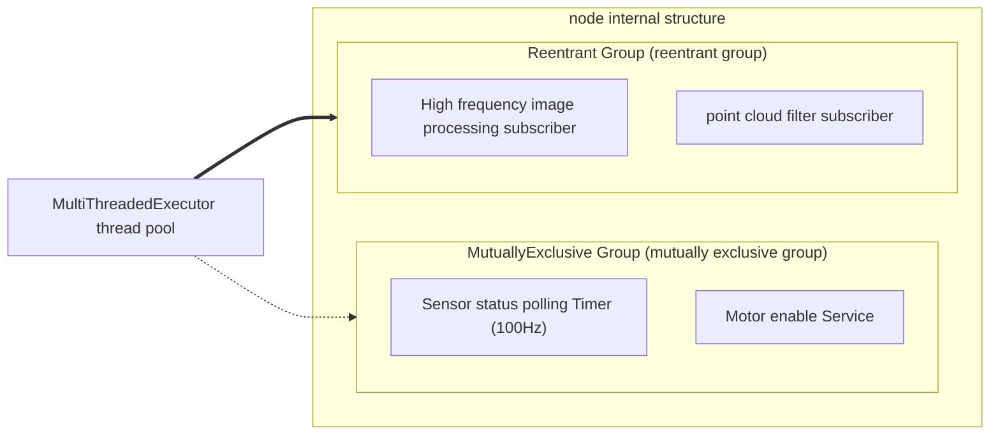

> **Classic deadlock scenario**
>
> A subscription callback synchronously waits for a service response, while the callback that handles the response belongs to the same default mutually exclusive callback group. The subscription callback holds execution while it waits, the response callback never gets a turn, and the node hangs.
>
> Solutions (use either one or both):
>
> 1. Put the waiting callback and the response-handling callback in different callback groups, and use `MultiThreadedExecutor`.
> 2. Do not block inside a callback; call the service asynchronously and handle the result in the future's completion callback.

## 5.3 Components and zero-copy IPC
{: id="53-组件与进程内零拷贝"}

Traditional multi-node systems use a multi-process model, so a message between nodes passes through **user-space memory → serialization → kernel socket → deserialization → destination user-space memory**. For data streams of hundreds of megabytes per second, such as 4K images or 3D lidar point clouds, the CPU and memory-bandwidth overhead is large.

ROS 2 **Components** compile multiple nodes into dynamic libraries (`.so` / `.dll`) that are loaded into the same `ComposableNodeContainer` process at runtime. With intra-process communication enabled, publishing a message as a `std::unique_ptr` transfers pointer ownership directly without copying the data (zero-copy IPC).

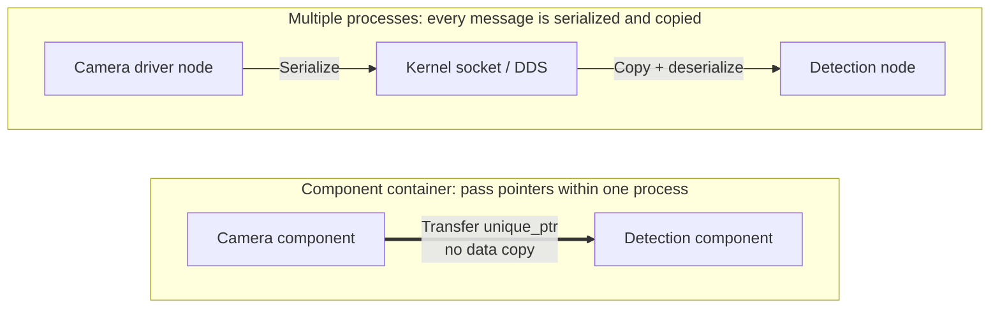

### C++ zero-copy publisher example
{: id="c-零拷贝发布示例"}

```cpp
#include "rclcpp/rclcpp.hpp"
#include "sensor_msgs/msg/point_cloud2.hpp"

using namespace std::chrono_literals;

class ZeroCopyPointCloudPublisher : public rclcpp::Node {
public:
    // Load the component with intra-process communication enabled: NodeOptions().use_intra_process_comms(true)
    explicit ZeroCopyPointCloudPublisher(const rclcpp::NodeOptions & options)
    : Node("zero_copy_publisher", options) {
        pub_ = this->create_publisher<sensor_msgs::msg::PointCloud2>("/points", 10);
        timer_ = this->create_wall_timer(33ms, std::bind(&ZeroCopyPointCloudPublisher::publish_cloud, this));
    }

private:
    void publish_cloud() {
        // Use unique_ptr Construct exclusive ownership message
        auto cloud_msg = std::make_unique<sensor_msgs::msg::PointCloud2>();
        
        // Populate large point cloud data buffer ...
        cloud_msg->header.stamp = this->now();
        cloud_msg->header.frame_id = "lidar_frame";
        cloud_msg->width = 1920;
        cloud_msg->height = 1080;
        cloud_msg->data.resize(cloud_msg->width * cloud_msg->height * 16);

        // Use std::move Transfer ownership, triggering direct exchange of underlying intra-process pointers
        pub_->publish(std::move(cloud_msg));
    }

    rclcpp::Publisher<sensor_msgs::msg::PointCloud2>::SharedPtr pub_;
    rclcpp::TimerBase::SharedPtr timer_;
};
```

# 6. Lifecycle nodes
{: id="六生命周期节点"}

On a real robot, an uncontrolled node startup order can cause accidents, for example the navigation algorithm publishing velocity commands before the lidar or base driver has finished validating its parameters. ROS 2 therefore provides the **Lifecycle Node (managed lifecycle node)**: a node starts up through an explicit state machine, and an external manager decides when to activate it.

## 6.1 State machine
{: id="61-状态机"}

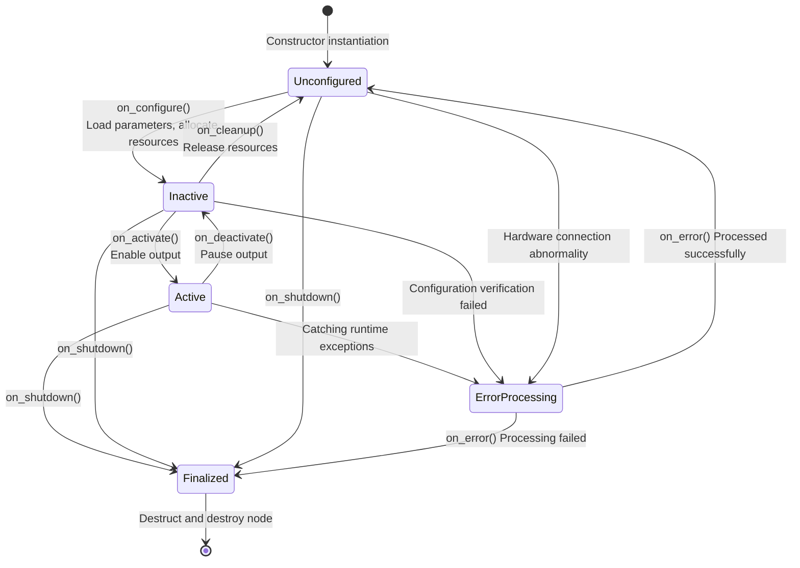

### State meanings
{: id="状态含义"}
- **`Unconfigured` (not configured)**: The node is loaded, but the parameters are not read and the hardware device is not connected.
- **`Inactive` (inactive)**: The configuration is loaded, the Publisher and Subscriber are established, but the Publisher is in a silent state (does not broadcast any messages to DDS), and the execution is suspended.
- **`Active` (active state)**: The system is operating normally, all callbacks are activated, and the main control loop is executed.
- **`Finalized` (terminal status)**: Resources are completely released and the process is ready to exit.

# 7. TF2 transforms
{: id="七tf2-坐标变换"}

There are a large number of geometric coordinate frames in the robot system (world, base, lidar, end-effector, and camera optical frames). **TF2 (Transform Library 2)** is responsible for maintaining the **space-time transformation tree (Transform Tree)** within the entire robot lifecycle.

## 7.1 Standard frames
{: id="71-标准坐标系"}

According to the official ROS specification **REP 105**, mobile robots must strictly follow the tree-like single-parent topology:

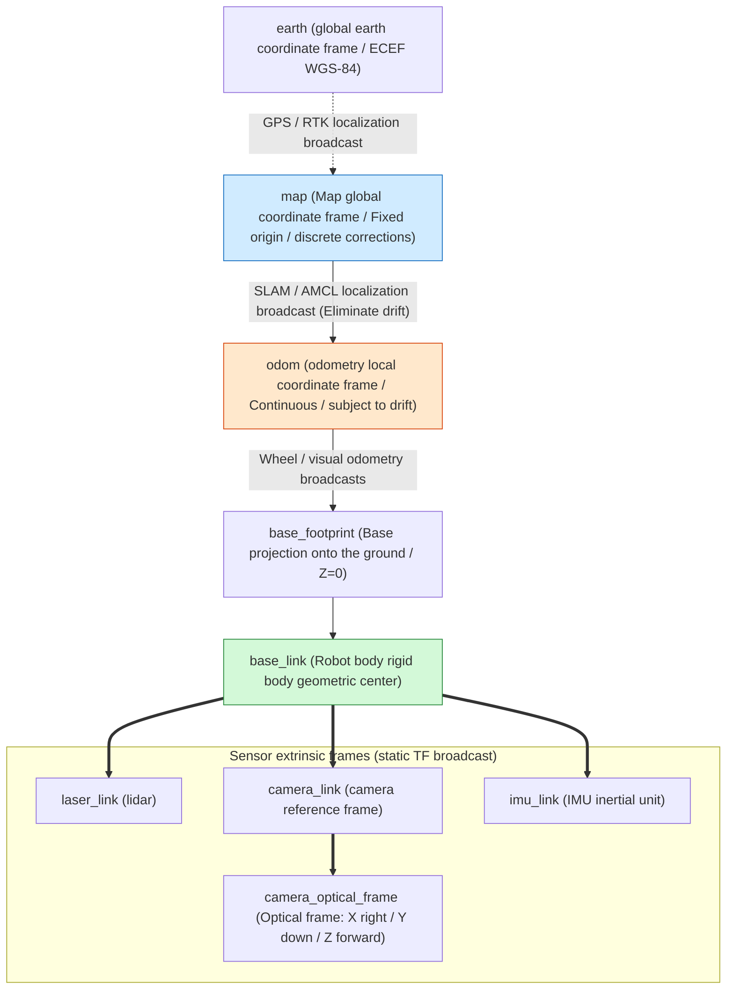

- **REP 103 Coordinate axis definition convention**:
  - Robot body: **FLU (Forward-Left-Up)**: $X$ axis is forward, $Y$ axis is to the left, $Z$ axis is upward.
  - Camera optical coordinate frame: **RDF (Right-Down-Forward)**: $X$ axis is to the right, $Y$ axis is downward, and $Z$ axis is forward (sight direction).

## 7.2 Dynamic vs. static TF
{: id="72-动态-tf-与静态-tf"}

- **`/tf` (dynamic transformation)**: Broadcast the changing relative pose (such as `odom -> base_link`) at a fixed frequency (such as 50Hz).
- **`/tf_static` (static extrinsics)**: only broadcast once when the system starts or the sensor extrinsic calibration is completed. It uses `TRANSIENT_LOCAL` QoS underneath, so nodes that start later still receive it without periodic rebroadcasting, which saves CPU and bandwidth.

```cpp
// C++ Monitor and query the transformation relationship between any two coordinate frames at a certain moment in history
#include "tf2_ros/buffer.h"
#include "tf2_ros/transform_listener.h"

auto tf_buffer = std::make_unique<tf2_ros::Buffer>(this->get_clock());
auto tf_listener = std::make_shared<tf2_ros::TransformListener>(*tf_buffer);

try {
    // Most blocked 100ms Query map Arrive laser_link latest transformation of
    geometry_msgs::msg::TransformStamped transform = tf_buffer->lookupTransform(
        "map", "laser_link",
        tf2::TimePointZero,
        std::chrono::milliseconds(100)
    );
    RCLCPP_INFO(this->get_logger(), "Radar global coordinates on the map: x=%.2f, y=%.2f",
                transform.transform.translation.x, transform.transform.translation.y);
} catch (const tf2::TransformException & ex) {
    RCLCPP_WARN(this->get_logger(), "TF Transform query failed: %s", ex.what());
}
```

# 8. URDF and Xacro
{: id="八urdf-与-xacro"}

## 8.1 Robot description system
{: id="81-机器人描述体系"}

- **URDF (Unified Robot Description Format)**: Use XML to describe the robot's links, joints, physical collision bodies and inertia tensors.
- **Xacro (XML Macros)**: Evolved from the defect that URDF does not support variables, macros, inclusions and mathematical operations, it is the standard way of modeling modern robots.

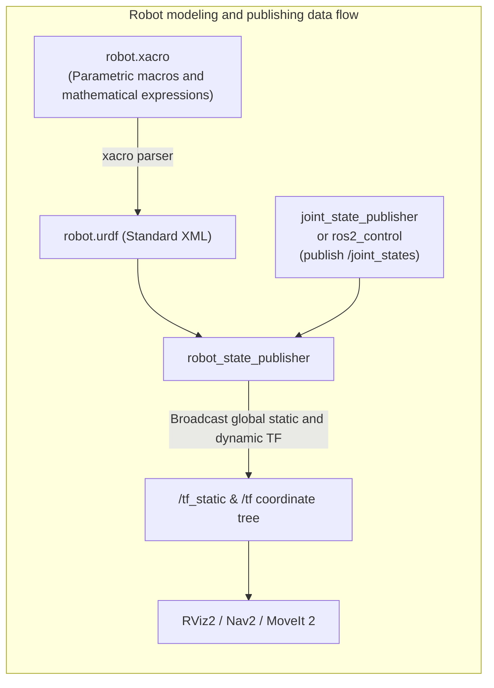

## 8.2 Xacro macro example
{: id="82-xacro-宏示例"}

```xml
<?xml version="1.0"?>
<robot xmlns:xacro="http://www.ros.org/wiki/xacro" name="industrial_diff_bot">

  <!-- constant definition -->
  <xacro:property name="wheel_radius" value="0.10" />
  <xacro:property name="wheel_width" value="0.05" />
  <xacro:property name="wheel_mass" value="2.5" />
  <xacro:property name="track_width" value="0.45" />

  <!-- Macro: Parameterized definition of power drive wheels -->
  <xacro:macro name="drive_wheel" params="prefix side_sign">
    <link name="${prefix}_wheel_link">
      <visual>
        <origin xyz="0 0 0" rpy="${pi/2} 0 0"/>
        <geometry>
          <cylinder radius="${wheel_radius}" length="${wheel_width}"/>
        </geometry>
        <material name="black"><color rgba="0.1 0.1 0.1 1.0"/></material>
      </visual>
      <collision>
        <origin xyz="0 0 0" rpy="${pi/2} 0 0"/>
        <geometry>
          <cylinder radius="${wheel_radius}" length="${wheel_width}"/>
        </geometry>
      </collision>
      <inertial>
        <mass value="${wheel_mass}"/>
        <inertia ixx="${(wheel_mass/12.0)*(3*wheel_radius*wheel_radius + wheel_width*wheel_width)}" 
                 iyy="${(wheel_mass/12.0)*(3*wheel_radius*wheel_radius + wheel_width*wheel_width)}" 
                 izz="${(wheel_mass/2.0)*(wheel_radius*wheel_radius)}" 
                 ixy="0.0" ixz="0.0" iyz="0.0"/>
      </inertial>
    </link>

    <joint name="${prefix}_wheel_joint" type="continuous">
      <parent link="base_link"/>
      <child link="${prefix}_wheel_link"/>
      <origin xyz="0 ${side_sign * track_width / 2.0} 0" rpy="0 0 0"/>
      <axis xyz="0 1 0"/>
    </joint>
  </xacro:macro>

  <!-- Instantiate left and right wheels -->
  <xacro:drive_wheel prefix="left" side_sign="1" />
  <xacro:drive_wheel prefix="right" side_sign="-1" />

</robot>
```

# 9. Simulation
{: id="九仿真平台"}

| Platform | Characteristics | Connection to ROS 2 |
| :--- | :--- | :--- |
| **Gazebo** (Gazebo Sim, e.g. Harmonic) | Officially recommended general physics simulator; cross-platform | `ros_gz_bridge` bridges topics in both directions between Gazebo and ROS 2 |
| **NVIDIA Isaac Sim / Isaac ROS** | Built on Omniverse with ray-traced rendering; suited to synthetic data generation | Isaac ROS provides GPU-accelerated nodes, and NITROS reduces GPU data copies |
| **Webots / MuJoCo** | Lightweight with fast physics; often used for reinforcement-learning training | Webots has an official ROS 2 interface; MuJoCo is usually connected through community bridges |

The simulation engine publishes virtual time on the `/clock` topic, and ROS 2 nodes follow that time once `use_sim_time: true` is set.

> **Mind simulation time**
>
> During simulation or rosbag playback, every algorithm node must set `use_sim_time: true`. Otherwise the node reads the host's system clock, which does not match the timestamps in the data, and TF lookups raise `ExtrapolationException`.

# 10. Core ecosystem
{: id="十核心生态"}

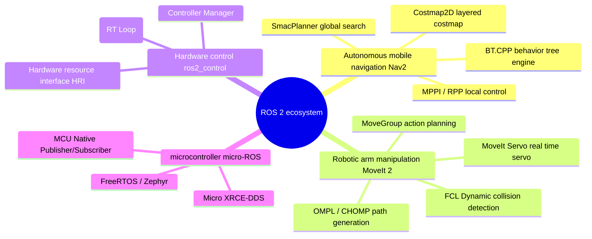

## 10.1 Nav2 navigation
{: id="101-nav2-导航"}

Nav2 is the second generation of autonomous mobile robot navigation system officially built by ROS 2. It reconstructs the overall architecture of ROS 1 navigation and is completely implemented based on **behavior tree (BehaviorTree.CPP)** and **lifecycle manager (LifecycleManager)**.

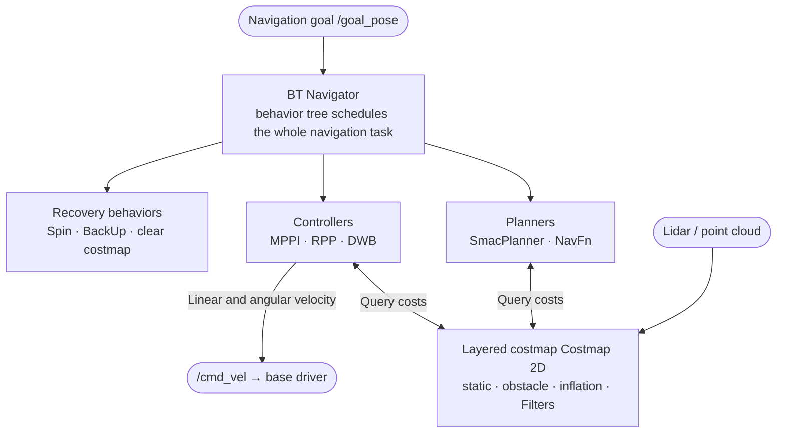

| Module | Common plugins | Role |
| :--- | :--- | :--- |
| Planners | SmacPlanner (2D / Hybrid-A* / State Lattice), NavFn (Dijkstra / A*) | Generate a path from the current position to the goal on the global costmap |
| Controllers | MPPI, Regulated Pure Pursuit (RPP), DWB | Track the path and output velocity commands in real time |
| Recovery behaviors | Spin, BackUp, ClearEntireCostmap | Try to get unstuck when the robot is trapped or planning fails |
| Costmaps | Static layer, obstacle / voxel layer, inflation layer, Costmap Filters (keepout zones, speed-limit zones) | Fuse map and sensor data and mark each cell with a traversal cost |

### Controller comparison
{: id="控制器对比"}
1. **MPPI (Model Predictive Path Integral)**: samples many candidate trajectories in parallel on the CPU and scores them with a cost function. It suits differential, omnidirectional, and Ackermann bases, avoids obstacles nimbly, and is one of the general-purpose controllers Nav2 currently recommends.
2. **Regulated Pure Pursuit (RPP)**: follows the reference path closely and slows down automatically according to path curvature and distance to obstacles. It behaves stably, is easy to tune, and is common on warehouse AGVs/AMRs.

## 10.2 MoveIt 2 motion planning
{: id="102-moveit-2-运动规划"}

MoveIt 2 is designed to provide kinematics solution, trajectory planning and real-time collision detection for multi-degree-of-freedom robotic arms (6-DOF / 7-DOF serial manipulators, dual-arm robots, humanoid robot upper bodies).

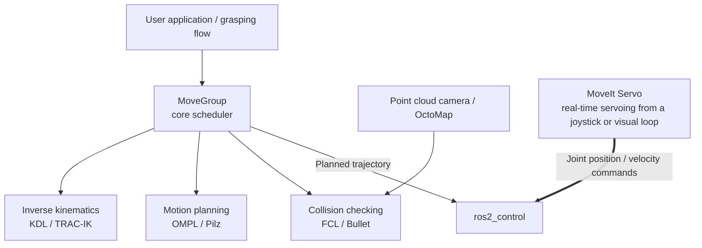

## 10.3 ros2_control
{: id="103-ros2_control-硬件控制"}

`ros2_control` provides a uniform way to write robot hardware drivers. It completely decouples the **real-time control loop (Hard Real-Time Loop, such as 1000Hz)** from **non-real-time asynchronous ROS communication**, so motor control does not lose control because of blocked ROS messages.

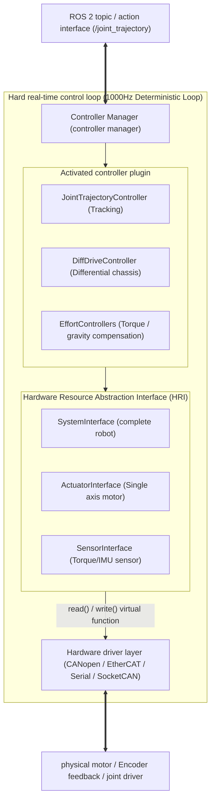

# 11. Build, launch and recording
{: id="十一构建启动与录包"}

## 11.1 Building with colcon
{: id="111-colcon-构建"}

```bash
# 1. Completely built foundation
colcon build --symlink-install

# 2. Common options for daily development:
#   --symlink-install   install via symlinks, so Python and config edits need no rebuild
#   --packages-select   build only the named packages
#   --cmake-args        passed to CMake; here, a Release build
#   --parallel-workers  limit how many packages build at once, to keep the machine responsive
colcon build \
  --symlink-install \
  --packages-select my_robot_control \
  --parallel-workers 8 \
  --cmake-args -DCMAKE_BUILD_TYPE=Release

# 3. Must be loaded after compilation overlay environment
source install/setup.bash
```

## 11.2 Launch files
{: id="112-launch-编排"}

The Launch file of ROS 2 is entirely written in Python and has powerful conditional branching, event monitoring and parameter forwarding capabilities.

```python
import os
from ament_index_python.packages import get_package_share_directory
from launch import LaunchDescription
from launch.actions import DeclareLaunchArgument, IncludeLaunchDescription, GroupAction
from launch.conditions import IfCondition
from launch.substitutions import LaunchConfiguration, PythonExpression
from launch_ros.actions import Node, PushRosNamespace

def generate_launch_description():
    pkg_bringup = get_package_share_directory('my_robot_bringup')
    
    # Declare startup parameters
    use_sim_time_arg = DeclareLaunchArgument('use_sim_time', default_value='false', description='Use simulation clock')
    enable_rviz_arg = DeclareLaunchArgument('use_rviz', default_value='true', description='Open RViz2')

    # Contains launch File
    nav2_launch = IncludeLaunchDescription(
        os.path.join(pkg_bringup, 'launch', 'navigation.launch.py'),
        launch_arguments={'use_sim_time': LaunchConfiguration('use_sim_time')}.items()
    )

    # Declaring conditions to start node
    rviz_node = Node(
        package='rviz2',
        executable='rviz2',
        name='rviz2',
        arguments=['-d', os.path.join(pkg_bringup, 'rviz', 'default.rviz')],
        parameters=[{'use_sim_time': LaunchConfiguration('use_sim_time')}],
        condition=IfCondition(LaunchConfiguration('use_rviz'))
    )

    return LaunchDescription([
        use_sim_time_arg,
        enable_rviz_arg,
        nav2_launch,
        rviz_node
    ])
```

## 11.3 rosbag2 record and replay
{: id="113-rosbag2-录制回放"}

```bash
# 1. Record the entire topic (excluding bulky uncompressed original images to save SSD bandwidth)
ros2 bag record -a -x "/camera/(.*)/image_raw" -s mcap -o my_experiment_bag

# 2. Query the recorded packet information (frame rate, packet loss rate, time span, total number of messages)
ros2 bag info my_experiment_bag.mcap

# 3. 0.5× slow playback (released with simulation clock, convenient for offline single-step debugging algorithm)
ros2 bag play my_experiment_bag.mcap --rate 0.5 --clock 50
```

# 12. Multi-machine deployment and security
{: id="十二多机部署与安全"}

## 12.1 Tuning DDS on lossy networks
{: id="121-弱网与-dds-调优"}

In large-scale robot fleet (Fleet Management) and multi-machine collaboration scenarios, Wi-Fi multicast is prone to storms or packet loss. The following tuning strategies are recommended:

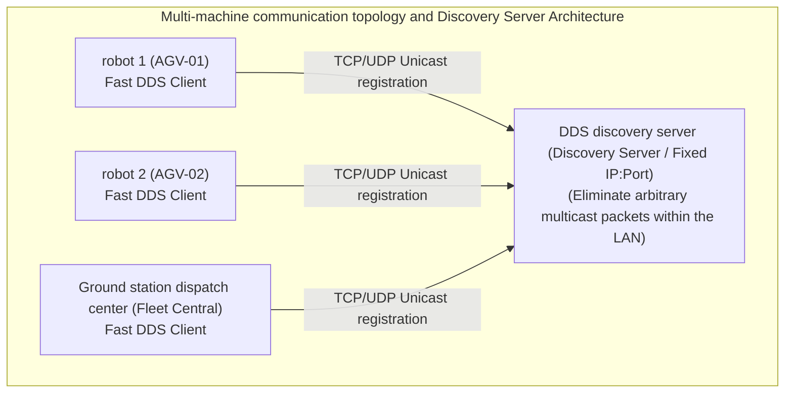

### 1. Enlarge kernel network buffers
{: id="1-扩大内核网络缓冲区"}
```bash
sudo sysctl -w net.core.rmem_max=2147483647
sudo sysctl -w net.core.wmem_max=2147483647
sudo sysctl -w net.ipv4.ipfrag_time=3
sudo sysctl -w net.ipv4.ipfrag_high_thresh=134217728
```

### 2. Fast DDS Discovery Server
{: id="2-fast-dds-发现服务器"}
```bash
# Start the discovery server on the dispatch server or host (ID: 0, port 11811)
fastdds discovery -i 0 -p 11811

# Configure unicast discovery environment variables on all robot endpoints (without any multicast support!)
export ROS_DISCOVERY_SERVER="192.168.1.100:11811"
```

## 12.2 SROS2 security
{: id="122-sros2-安全"}

Against threats such as network sniffing, unauthorized nodes joining, and forged control commands (such as a forged `/cmd_vel`), ROS 2 provides **SROS2**, a security toolset based on **DDS-Security** with three capabilities:

| Capability | Mechanism | Threat addressed |
| :--- | :--- | :--- |
| **Authentication** | Verifies each participant's identity with X.509 certificates (PKI) | Unauthorized nodes joining |
| **Access control** | Signed XML permission files specify which topics each node may publish or subscribe to | Publishing or subscribing beyond permissions |
| **Encryption** | AES-GCM encryption and message integrity checks | Eavesdropping and tampering |

```bash
# Generate a secure root certificate keystore (Keystore)
ros2 security create_keystore ~/sros2_keystore

# Generate an exclusive digital certificate and access policy for a specific node
ros2 security create_enclave ~/sros2_keystore /my_secure_controller

# Enable safe mode to run node
export ROS_SECURITY_ENABLE=true
export ROS_SECURITY_STRATEGY=Enforce
export ROS_SECURITY_KEYSTORE=~/sros2_keystore
ros2 run my_robot_pkg controller_node --ros-args --enclave /my_secure_controller
```

## 12.3 systemd and watchdog
{: id="123-systemd-部署与看门狗"}

Host the robot startup stack as a Linux system daemon service to realize **auto-start at boot, automatic restart after a crash and log rotation**:

```ini
# /etc/systemd/system/robot_bringup.service
[Unit]
Description=Autonomous Mobile Robot Auto Bringup Service
After=network.target network-online.target systemd-timesyncd.service
Wants=network-online.target

[Service]
Type=simple
User=robot
Group=robot
Environment="ROS_DOMAIN_ID=42"
Environment="RMW_IMPLEMENTATION=rmw_cyclonedds_cpp"
ExecStart=/bin/bash -c "source /opt/ros/humble/setup.bash && source /home/robot/ros2_ws/install/setup.bash && ros2 launch my_robot_bringup full_system.launch.py"
Restart=always
RestartSec=3
KillSignal=SIGINT
TimeoutStopSec=10

[Install]
WantedBy=multi-user.target
```

```bash
# Load and enable auto-start at boot
sudo systemctl daemon-reload
sudo systemctl enable robot_bringup.service
sudo systemctl start robot_bringup.service
```

# 13. CLI reference
{: id="十三cli-速查"}

```bash
# -------------------------------------------------------------
# 1. Node troubleshooting (Node)
# -------------------------------------------------------------
ros2 node list                                # List currently active nodes
ros2 node info /my_node                       # Print node's complete publications, subscriptions, services,Action interface

# -------------------------------------------------------------
# 2. Topic debugging (Topic)
# -------------------------------------------------------------
ros2 topic list -t                            # List topics and corresponding message types
ros2 topic echo /scan --no-arr                # Print topic content (truncate large arrays to prevent screen refresh)
ros2 topic hz /scan                           # Real-time measurement of topic publication frequency
ros2 topic bw /camera/image_raw               # Measure topic bandwidth consumption (MB/s)
ros2 topic delay /odom                        # Measuring message transmission latency (Need to include header.stamp)
ros2 topic info -v /cmd_vel                   # Print topic details QoS Strategy (troubleshooting QoS match failed)
ros2 topic pub /cmd_vel geometry_msgs/msg/Twist "{linear: {x: 0.2}}" -r 10 # 10Hz Send test command

# -------------------------------------------------------------
# 3. Service and action calls (Service & Action)
# -------------------------------------------------------------
ros2 service list -t                          # List services and types
ros2 service call /reset_odom std_srvs/srv/Empty {} # Trigger service
ros2 action send_goal /navigate_to_pose nav2_msgs/action/NavigateToPose \
  "{pose: {header: {frame_id: 'map'}, pose: {position: {x: 1.0, y: 2.0}}}}" --feedback

# -------------------------------------------------------------
# 4. Parameter hot update (Parameter)
# -------------------------------------------------------------
ros2 param list /planner_node                 # View the parameters of the specified node
ros2 param get /planner_node max_speed        # Read parameter value
ros2 param set /planner_node max_speed 1.5    # Dynamically modify parameter values at runtime
ros2 param dump /planner_node > params.yaml   # The export node parameters are YAML File

# -------------------------------------------------------------
# 5. TF2 Coordinate transformation diagnosis (TF2)
# -------------------------------------------------------------
ros2 run tf2_tools view_frames                # generate frames.pdf coordinate frame panoramic topology map
ros2 run tf2_ros tf2_echo map base_link       # Print the relative pose between two coordinate frames in real time
ros2 run tf2_ros tf2_monitor                  # Monitor the broadcast frequency and delay of all coordinate transformations

# -------------------------------------------------------------
# 6. System self-test and package management (System & Pkg)
# -------------------------------------------------------------
ros2 doctor --report                          # Scan network configuration,DDS Status and output physical examination report
rosdep install --from-paths src --ignore-src -r -y # Automatically install all system dependencies where the workspace source code is missing with one click
```

# 14. Summary and references
{: id="十四总结与参考资料"}

The design of ROS 2 centers on four points: data-centric, modular, reliable, and able to meet real-time requirements. Standardized DDS transport, managed lifecycle nodes, and componentized zero-copy communication, together with ecosystem stacks such as Nav2, MoveIt 2, and ros2_control, make it the mainstream infrastructure for robot software development today.

```mermaid
flowchart LR
    subgraph Mindset["Core ROS 2 concepts"]
        direction TB
        M1["DDS Bus decoupling underlying transmission"]
        M2["QoS Refined control of communication reliability"]
        M3["Component Containers enable high-performance zero-copy"]
        M4["Lifecycle node ensures that the system starts deterministically"]
        M5["Nav2 / MoveIt2 / ros2_control Support application logic"]
        M1 ==> M2 ==> M3 ==> M4 ==> M5
    end
```

**References and further reading**

1. ROS 2 design documents: [ROS 2 Design Documents (design.ros2.org)](https://design.ros2.org/)
2. ROS 2 official documentation: [ROS 2 Documentation (Humble / Jazzy)](https://docs.ros.org/en/humble/)
3. OMG DDS specification: [Object Management Group - Data Distribution Service v1.4](https://www.omg.org/spec/DDS/)
4. Nav2 documentation: [Navigation 2 Architecture & Guides](https://nav2.org/)
5. MoveIt 2 documentation: [MoveIt 2 Documentation](https://moveit.picknik.ai/)
6. ros2_control documentation: [ros2_control Framework Documentation](https://control.ros.org/)
7. Fast DDS manual: [eProsima Fast DDS User Manual](https://fast-dds.docs.eprosima.com/)
8. ROS Enhancement Proposals (REPs):
   - [REP 103: Standard Units of Measure & Coordinate Conventions](https://www.ros.org/reps/rep-0103.html)
   - [REP 105: Coordinate Frames for Mobile Robots](https://www.ros.org/reps/rep-0105.html)
   - [REP 2000: ROS 2 Releases and Target Platforms](https://www.ros.org/reps/rep-2000.html)
   - [REP 2007: Type Adaptation & Type Masquerading](https://www.ros.org/reps/rep-2007.html)
