# Introduction
{: id="引言"}

ROS 2 organizes functions such as sensing, planning, and control into cooperating nodes, and provides a foundation for communication, scheduling, and system integration. Understanding how nodes exchange data, and what the client, executor, and middleware are each responsible for, is the starting point for reading this architectural guide.

<figure class="survey-intro-figure">
  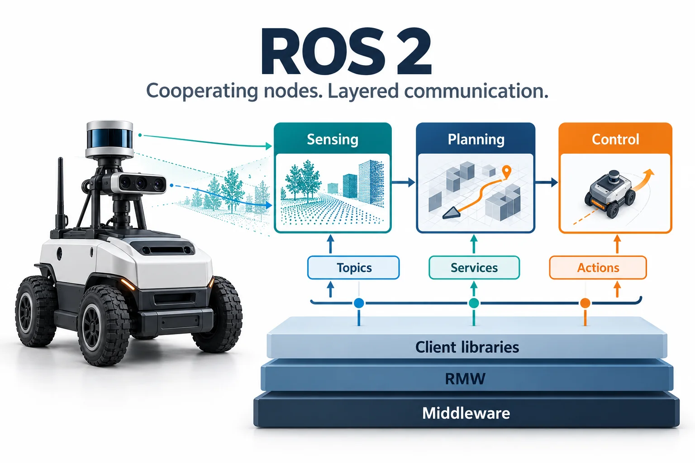
  <figcaption>ROS 2 connects sensing, planning and control through a layered communication stack. Topics, services and actions are available across nodes; the illustration does not imply a fixed one-to-one mapping between communication types and modules.</figcaption>
</figure>

*Reading diagrams: scroll horizontally inside wide Mermaid diagrams to see all details at a readable size. Keyboard users can focus a diagram and use the arrow keys.*

# 1. From ROS 1 to ROS 2
{: id="一从-ros-1-到-ros-2"}

## 1.1 Why a rewrite
{: id="11-为什么要重构"}

**ROS (Robot Operating System)** was born in 2007 from a collaboration between the Stanford Artificial Intelligence Laboratory (the STAIR project) and Willow Garage. It was originally meant to give the academic community an open-source platform for rapid robot-software prototyping. As robotics has moved from the lab into industrial automation, commercial services, autonomous driving, and humanoid embodied intelligence, the design limitations of ROS 1 have become increasingly apparent:

1. **Centralized single point of failure**: ROS 1 depends on `roscore` (the Master), which runs at a fixed IP and port. If the Master crashes or the network is partitioned, node discovery and communication registration for the entire robot system break down completely.
2. **No determinism or hard/soft real-time support**: ROS 1 is built on standard TCP/UDP sockets, and the operating system offers no priority control over scheduling. It cannot meet the microsecond- to millisecond-level deterministic real-time requirements of industrial controllers and low-level motor drivers.
3. **Poor network resilience and no native security**: TCPROS/UDPROS suffer high packet loss and fragile reconnection on lossy wireless networks (Wi-Fi, 4G/5G, cross-subnet links). Traffic is sent in plain text, with no authentication or access control.
4. **Multi-machine and multi-robot setups are complex**: ROS 1 multi-machine communication requires carefully configured `ROS_MASTER_URI` and `ROS_IP`, and there is no flexible mechanism for domain isolation or multi-machine discovery.
5. **Isolated from embedded microcontrollers**: ROS 1 cannot run directly on compute- and memory-constrained microcontrollers (MCU/DSP/RTOS). Bridging them is usually inefficient and brittle, relying on serial protocols such as `rosserial`.

To solve these problems, Open Robotics did not patch ROS 1. It redesigned the system as **ROS 2** on top of the industry-standard **DDS (Data Distribution Service)**.

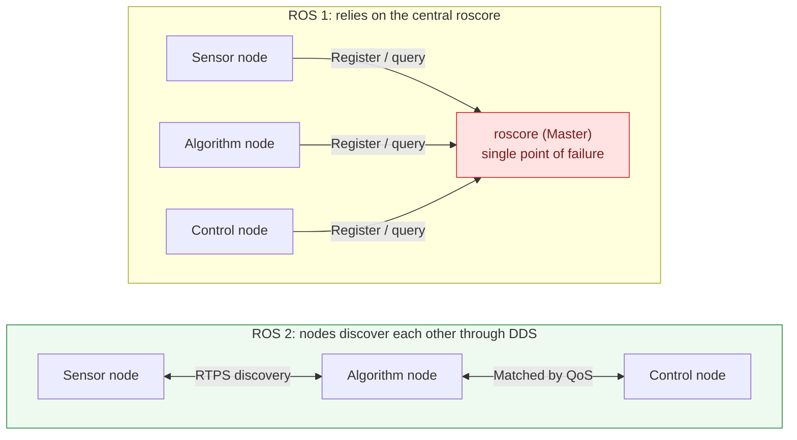

*Figure: In ROS 1, nodes must register with roscore before they can find each other; in ROS 2, nodes discover each other directly through DDS/RTPS, with no central node.*

## 1.2 ROS 1 vs. ROS 2
{: id="12-ros-1-与-ros-2-对比"}

| Dimension | ROS 1 (Noetic / Melodic) | ROS 2 (Humble / Iron / Jazzy) | Core value / industrial impact |
| :--- | :--- | :--- | :--- |
|**Network topology**|Centralized coordination through a Master (`roscore`)|Fully distributed, built on DDS RTPS|Eliminates the single point of failure and supports dynamic networking of large clusters|
|**Underlying communication**|Custom TCPROS / UDPROS protocols|Industrial-grade OMG DDS standard (Fast DDS, Cyclone DDS, Connext, etc.)|Reuses a data-distribution foundation proven in defense and aerospace|
|**Quality of Service (QoS)**|Only simple reliable (TCP) and best-effort (UDP) transport|Full QoS policies (Reliability, Durability, History, Deadline, etc.)|Precisely fits high-rate, low-latency sensors as well as high-reliability control|
|**Cross-process / intra-process communication**|Socket serialization and copying; Nodelet for intra-process sharing (separate API)|Unified component containers; native zero-copy IPC through pointer passing|Greatly reduces CPU load when transporting point clouds and 4K images at hundreds of MB/s|
|**Node lifecycle**|Stateless black boxes; nodes initialize in no particular order|Native managed lifecycle nodes|Guarantees a deterministic, controlled startup order and graceful fault degradation across sensor drivers, algorithms, and actuators|
|**Real-time support**|General-purpose Linux kernel; no real-time guarantees|Supports hard real-time operating systems such as Linux PREEMPT_RT, QNX, and VxWorks, with APIs that avoid dynamic memory allocation|Meets microsecond-level closed-loop motion control requirements|
|**Embedded support**|Only through `rosserial` serial translation|micro-ROS natively supports STM32, ESP32, Zephyr, and FreeRTOS|Microcontrollers act as first-class ROS 2 nodes|
|**Security**|No authentication; an open network|SROS2 specification: DDS-Security authentication, access control lists (ACL), TLS/AES encryption|Meets commercial robot security compliance and resists cyber attacks|
|**Parameter system**|A single global Parameter Server|Each node owns its parameters, with runtime type constraints and event monitoring|Avoids parameter namespace pollution and supports intercepting dynamic reconfiguration|
|**Multi-platform build**|Tied to Ubuntu Linux / CMake (`catkin`)|Native support for Linux, Windows, and macOS (`colcon` + `ament`)|Lowers the barrier to migrating industrial software across platforms|

## 1.3 Distributions and support
{: id="13-发行版与支持周期"}

ROS 2 releases a new distribution every May, aligned with Ubuntu: even-numbered years bring a long-term support (LTS) release supported for five years, and odd-numbered years bring a regular release supported for about a year and a half.

| Distribution | Released | Target platform | Type | Support status (as of 2026-10) |
| :--- | :--- | :--- | :--- | :--- |
| Foxy Fitzroy | 2020-05 | Ubuntu 20.04 | LTS | End of life |
| Galactic Geochelone | 2021-05 | Ubuntu 20.04 | Regular | End of life |
| Humble Hawksbill | 2022-05 | Ubuntu 22.04 | LTS | Supported until 2027-05; most widely deployed |
| Iron Irwini | 2023-05 | Ubuntu 22.04 | Regular | End of life |
| Jazzy Jalisco | 2024-05 | Ubuntu 24.04 | LTS | Supported until 2029-05 |
| Kilted Kaiju | 2025-05 | Ubuntu 24.04 | Regular | Nearing end of life |
| Lyrical Luth | 2026-05 | Ubuntu 26.04 | LTS | Supported until 2031-05; newest LTS |

> **Selection advice**
> - **Production deployment**: choose Humble (Ubuntu 22.04) or Jazzy (Ubuntu 24.04); ecosystem packages such as Nav2, MoveIt 2, and ros2_control support them most completely. New projects can evaluate Lyrical, but first confirm that the ecosystem packages they depend on have been released for it.
> - **Cutting-edge research and development**: use the newest LTS or Rolling to get new features such as executor performance improvements and Type Adaptation earlier.

# 2. Layered architecture and DDS
{: id="二分层架构与-dds"}

## 2.1 Software layers
{: id="21-软件分层"}

ROS 2 uses a layered design that decouples upper-layer algorithm code from the underlying transport middleware, so switching middleware requires no change to application code.

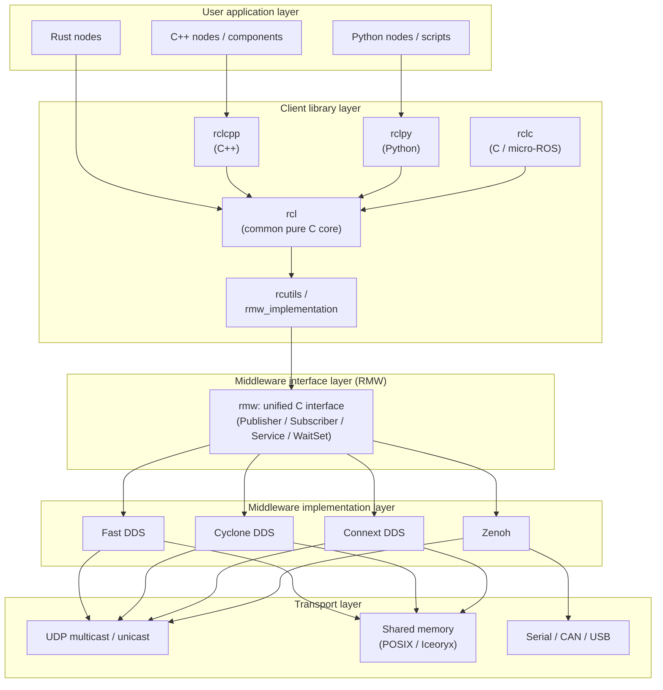

The middleware implementation layer in the diagram corresponds to the four packages `rmw_fastrtps_cpp`, `rmw_cyclonedds_cpp`, `rmw_connextdds`, and `rmw_zenoh_cpp`; Section 2.3 compares their trade-offs.

### Key component responsibilities
{: id="关键组件职责"}
- **`rcl` (ROS Client Library)**: a common logic layer written in pure C that handles language-independent functions such as parameter parsing, the node graph, logging, and clocks, so that client libraries for C++, Python, and other languages behave consistently.
- **`rmw` (ROS Middleware)**: a unified C interface that defines operations such as publishing, subscribing, wait sets, and QoS mapping; upper-layer code does not need to know which middleware is used underneath.
- **`rosidl`**: the Interface Definition Language (IDL) generator, which turns `.msg`, `.srv`, and `.action` files into native data structures and serialization/deserialization code in C, C++, and Python.

## 2.2 How DDS works
{: id="22-dds-工作机制"}

DDS is a standard from the Object Management Group (**OMG**). Its core is the **Data-Centric Publish-Subscribe (DCPS)** model.

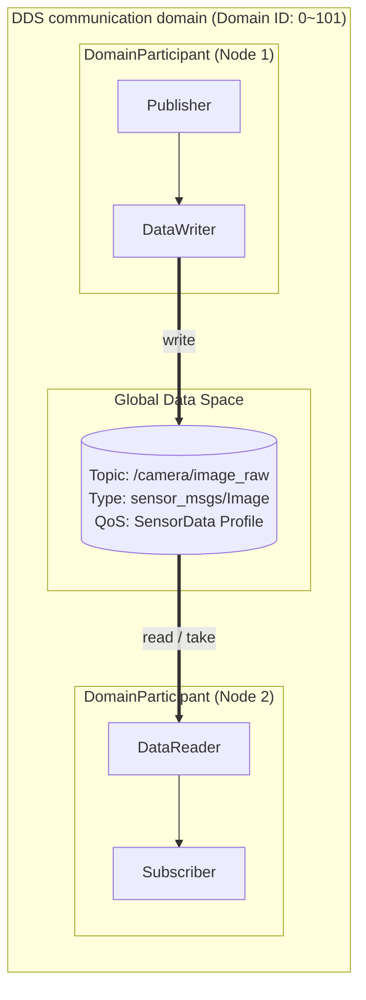

### RTPS discovery
{: id="rtps-自动发现"}
When DDS nodes start on a LAN, they discover each other automatically, with no Master to coordinate. Discovery has two stages:
1. **SPDP (Simple Participant Discovery Protocol)**: After a node starts, it periodically sends multicast heartbeat packets to a well-known port (the multicast address `239.255.0.1`, with the port computed from the Domain ID) to announce its Participant GUID, IP address, and transport port.
2. **SEDP (Simple Endpoint Discovery Protocol)**: Once Participants have discovered each other, they establish a reliable unicast connection and exchange the details of their DataWriters and DataReaders (topic name, data type, QoS settings). If the QoS settings match, a point-to-point data channel is established underneath.

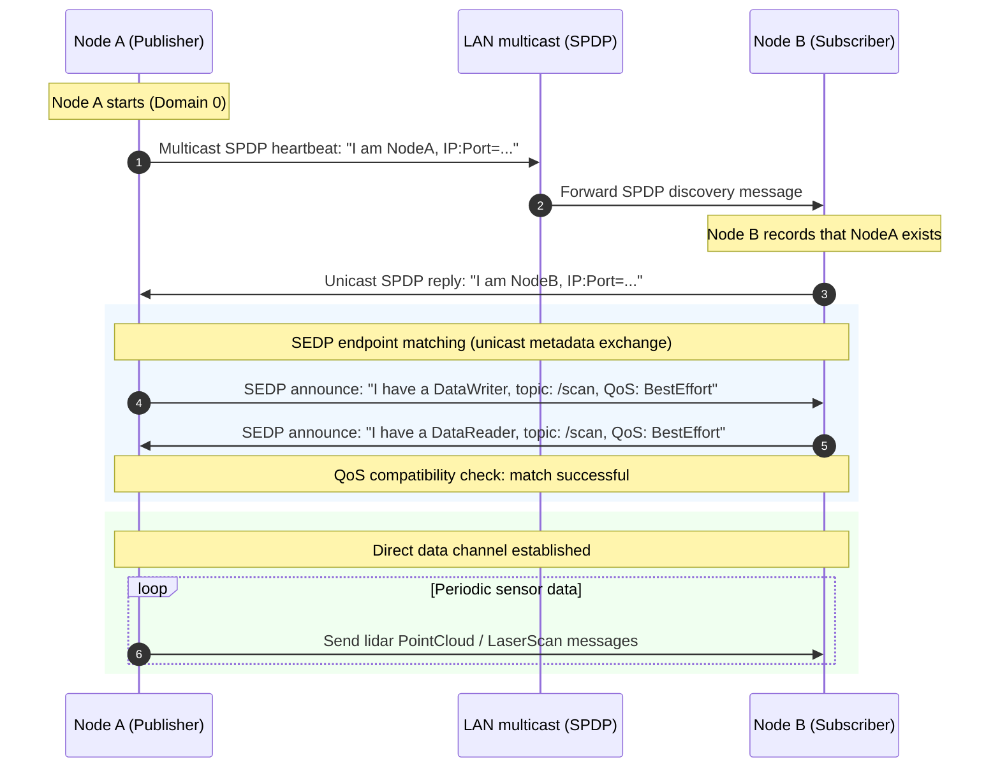

## 2.3 RMW implementations
{: id="23-rmw-实现对比与切换"}

| Middleware (RMW) | Vendor / license | Strengths and key features | Weaknesses / notes | Recommended scenarios |
| :--- | :--- | :--- | :--- | :--- |
| **Fast DDS** (`rmw_fastrtps_cpp`) | eProsima (Apache-2.0) |The default ROS 2 implementation; feature-complete, with built-in high-performance shared memory (SHM) transport and Discovery Server support|Multicast packet loss on weak Wi-Fi can make discovery slow|General robot development, single-machine simulation, high-performance single-machine deployment|
| **Cyclone DDS** (`rmw_cyclonedds_cpp`) | Eclipse (EPL-2.0) |Lightweight architecture and a polished codebase; very robust on jittery Wi-Fi, with high throughput and very low latency|Shared memory configuration is more complex (requires Iceoryx)|Autonomous driving, distributed multi-machine systems, wireless mobile robots|
| **Connext DDS** (`rmw_connextdds`) |RTI (commercial license)|Industrial and defense-grade certification, support for safety-critical systems (ISO 26262 ASIL-D, DO-178C), and a complete debugging toolset|Commercial, closed source|Aerospace, medical surgical robots, automotive-grade autonomous driving systems|
| **Zenoh** (`rmw_zenoh_cpp`) | ZettaScale (Apache-2.0) |Drops the complex RTPS in favor of a minimal protocol; no multicast storms, and natural support for communication across the public internet, 4G/5G, and cloud-edge setups|Still evolving rapidly; the ecosystem toolchain is maturing|Vehicle-to-cloud interconnection over wide-area networks (WAN) and large-scale robot fleet management|

```bash
# Switch RMW at runtime via an environment variable (no recompilation needed)
export RMW_IMPLEMENTATION=rmw_cyclonedds_cpp
ros2 run my_pkg my_node

# Verify which RMW implementation is in use
ros2 doctor --report | grep middleware
```

## 2.4 Multi-machine and Domain ID
{: id="24-多机通信与-domain-id"}

In order to isolate nodes of different robots or teams under the same LAN switch, ROS 2 provides `ROS_DOMAIN_ID`. Valid values are 0 to 232; use **0 to 101**, which avoids conflicts with the operating system's ephemeral ports on every platform.

```bash
# Set the domain ID for this robot in ~/.bashrc
export ROS_DOMAIN_ID=42

# Discovery range (Jazzy and later): SUBNET allows LAN communication, LOCALHOST restricts it to this machine
export ROS_AUTOMATIC_DISCOVERY_RANGE=SUBNET
# Humble and earlier use ROS_LOCALHOST_ONLY=0/1 for the same purpose (deprecated since Jazzy)
```

> **DDS port formula**
> Each Domain ID occupies a fixed range of UDP ports:
> $$\text{Port} = 7400 + 250 \times \text{DomainID} + \text{Offset}$$
> Devices on the same network segment with the same `ROS_DOMAIN_ID` discover each other's nodes automatically.

# 3. Communication primitives
{: id="三五种通信方式"}

ROS 2 abstracts every decoupled software interaction into five communication primitives. Choosing the right one is the first principle of system architecture design.

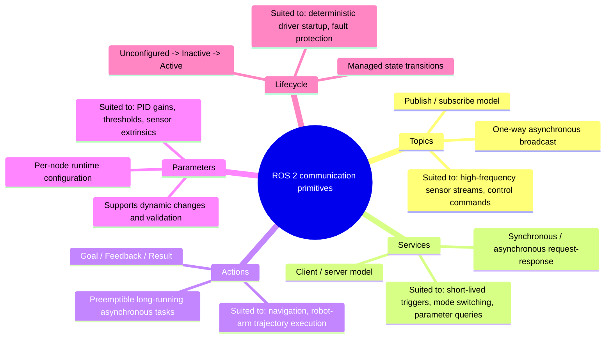

## 3.1 Choosing a primitive
{: id="31-如何选择"}

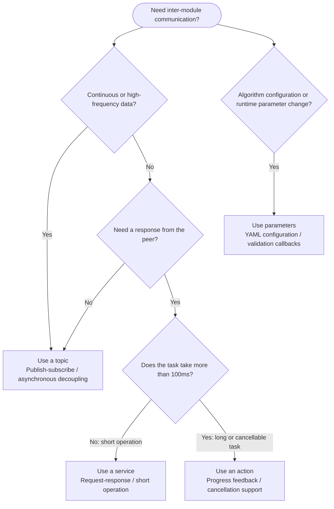

## 3.2 Topics
{: id="32-话题-topic"}

### Communication principles
{: id="通信原理"}
A topic is a many-to-many publish-subscribe (Pub/Sub) channel. Publishers push data into the DDS domain, and subscribers receive it according to their QoS policy. The two sides are fully decoupled in lifecycle and network topology.

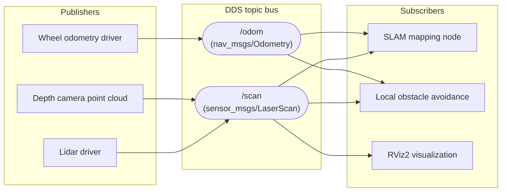

### C++ implementation (`rclcpp`)
{: id="c-实现rclcpp"}

```cpp
#include <chrono>
#include <memory>
#include <string>
#include "rclcpp/rclcpp.hpp"
#include "std_msgs/msg/string.hpp"

using namespace std::chrono_literals;

class RobustPublisher : public rclcpp::Node {
public:
    RobustPublisher() : Node("robust_publisher_node"), count_(0) {
        // Create sensor-specific BestEffort QoS
        rclcpp::QoS qos_profile(rclcpp::KeepLast(10));
        qos_profile.best_effort();
        qos_profile.durability_volatile();

        publisher_ = this->create_publisher<std_msgs::msg::String>("/telemetry_data", qos_profile);
        timer_ = this->create_wall_timer(100ms, std::bind(&RobustPublisher::timer_callback, this));
        
        RCLCPP_INFO(this->get_logger(), "High-frequency publisher node has been started (10Hz)...");
    }

private:
    void timer_callback() {
        auto message = std_msgs::msg::String();
        message.data = "Telemetry Frame #" + std::to_string(count_++);
        publisher_->publish(message);
    }

    rclcpp::TimerBase::SharedPtr timer_;
    rclcpp::Publisher<std_msgs::msg::String>::SharedPtr publisher_;
    size_t count_;
};

int main(int argc, char* argv[]) {
    rclcpp::init(argc, argv);
    rclcpp::spin(std::make_shared<RobustPublisher>());
    rclcpp::shutdown();
    return 0;
}
```

### Python implementation (`rclpy`)
{: id="python-实现rclpy"}

```python
#!/usr/bin/env python3
import rclpy
from rclpy.node import Node
from rclpy.qos import QoSProfile, ReliabilityPolicy, HistoryPolicy
from std_msgs.msg import String

class RobustSubscriber(Node):
    def __init__(self):
        super().__init__('robust_subscriber_node')
        
        # QoS configuration matching the publisher
        qos = QoSProfile(
            history=HistoryPolicy.KEEP_LAST,
            depth=10,
            reliability=ReliabilityPolicy.BEST_EFFORT
        )
        
        self.subscription = self.create_subscription(
            String,
            '/telemetry_data',
            self.listener_callback,
            qos
        )
        self.get_logger().info('Subscriber node is ready, waiting for telemetry data...')

    def listener_callback(self, msg: String):
        self.get_logger().info(f'Telemetry frame received: "{msg.data}"')

def main(args=None):
    rclpy.init(args=args)
    node = RobustSubscriber()
    try:
        rclpy.spin(node)
    except KeyboardInterrupt:
        pass
    finally:
        node.destroy_node()
        rclpy.shutdown()

if __name__ == '__main__':
    main()
```

## 3.3 Services
{: id="33-服务-service"}

### Communication principles
{: id="通信原理-1"}
A service is a point-to-point client-server communication model. The client sends a `Request`, and the server computes and returns a `Response`.

> **Caution**: Do not wait synchronously for a service result inside a callback run by a single-threaded executor (for example, calling `get()` on the future returned by `async_send_request()`, or `client.call()` in Python). The wait occupies the only thread, so the response callback never runs and the node deadlocks. Call the service asynchronously and handle the result in the future's completion callback.

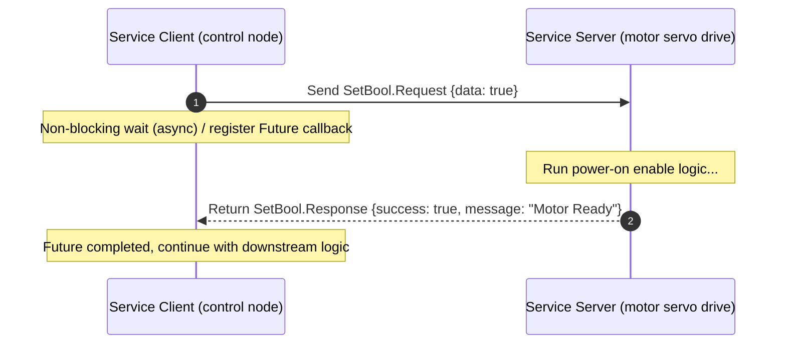

## 3.4 Actions
{: id="34-动作-action"}

### Communication principles
{: id="通信原理-2"}
Actions are for long-running asynchronous tasks, such as navigating a base from point A to point B or having a robot arm perform a grasp. Underneath, an Action consists of three services and two topics:

1. **Goal (service)**: The client sends a goal, and the server accepts or rejects it.
2. **Cancel (service)**: The client can request cancellation at any time, and the server safely interrupts the task.
3. **Result (service)**: Returns the final outcome (succeeded, aborted, or canceled) when the task ends.
4. **Feedback (topic)**: Streams progress during execution, such as the current pose or remaining distance.
5. **Status (topic)**: Broadcasts the current state of each goal.

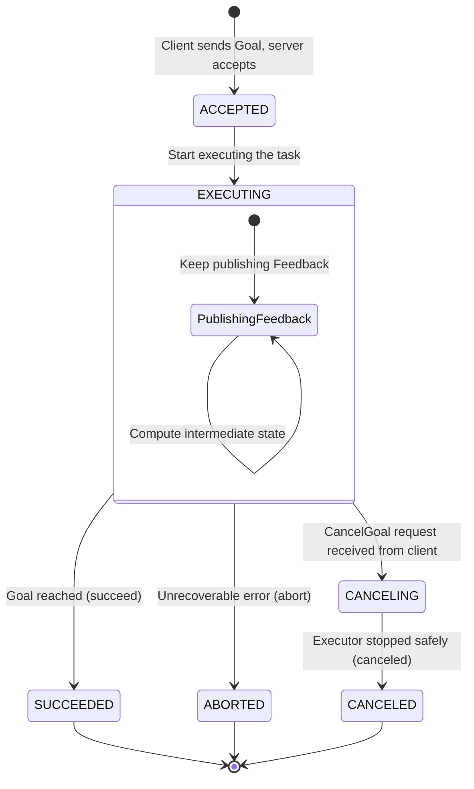

### Action interface definition
{: id="action-接口定义"}
```yaml
# 1. Goal
geometry_msgs/PoseStamped pose
string behavior_tree
---
# 2. Result
std_msgs/Empty result
int16 error_code
---
# 3. Feedback
geometry_msgs/PoseStamped current_pose
builtin_interfaces/Duration navigation_time
builtin_interfaces/Duration estimated_time_remaining
int16 number_of_recoveries
float32 distance_remaining
```

## 3.5 Parameters
{: id="35-参数-parameter"}

In ROS 2, parameters are **private data items bound to a specific node instance**. They support strong type checking, range constraints, and interception of dynamic changes through callbacks.

```cpp
// C++: declare a parameter with a descriptor and dynamic validation
rcl_interfaces::msg::ParameterDescriptor desc;
desc.description = "Robot maximum linear speed limit (m/s)";
desc.floating_point_range.resize(1);
desc.floating_point_range[0].from_value = 0.0;
desc.floating_point_range[0].to_value = 2.5;
desc.floating_point_range[0].step = 0.05;

this->declare_parameter("max_linear_velocity", 1.0, desc);

// Register a callback that intercepts dynamic parameter changes (OnSetParametersCallback)
params_callback_handle_ = this->add_on_set_parameters_callback(
    [this](const std::vector<rclcpp::Parameter> &parameters) {
        rcl_interfaces::msg::SetParametersResult result;
        result.successful = true;
        for (const auto &param : parameters) {
            if (param.get_name() == "max_linear_velocity") {
                if (param.as_double() > 2.0) {
                    result.successful = false;
                    result.reason = "Safety protection triggered: the vehicle's linear speed cannot exceed 2.0 m/s";
                } else {
                    RCLCPP_INFO(this->get_logger(), "Speed limit updated to: %.2f", param.as_double());
                }
            }
        }
        return result;
    }
);
```

# 4. Quality of Service (QoS)
{: id="四qos-服务质量"}

QoS (Quality of Service) is the most important communication improvement of ROS 2 over ROS 1: the underlying transport behavior can be configured separately for each data stream according to its characteristics.

## 4.1 Core policies
{: id="41-核心策略"}

| Policy | Values | Meaning |
| :--- | :--- | :--- |
| **Reliability** | `RELIABLE` / `BEST_EFFORT` | Retransmit after packet loss; or send on a best-effort basis and allow loss |
| **Durability** | `VOLATILE` / `TRANSIENT_LOCAL` | Keep no history; or keep the latest N messages for subscribers that join later |
| **History & Depth** | `KEEP_LAST(N)` / `KEEP_ALL` | Keep only the latest N messages; or keep all of them up to resource limits |
| **Liveliness & Lease** | `AUTOMATIC` / `MANUAL_BY_TOPIC` | The middleware reports liveliness automatically; or the publisher asserts it explicitly |
| **Deadline** | Duration | Maximum interval between consecutive messages; exceeding it triggers an event |
| **Lifespan** | Duration | Messages older than their lifespan are no longer delivered |

## 4.2 Compatibility rules
{: id="42-兼容性规则"}

> **Request vs. Offer principle**
>
> The QoS offered by the publisher must be **no weaker than** the QoS requested by the subscriber; otherwise the two ends do not connect. The program keeps running and the subscriber simply receives no data, leaving at most a QoS-incompatibility warning in the log; compare the QoS of both ends with `ros2 topic info -v` to diagnose it.

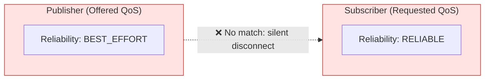

### Compatibility matrix
{: id="兼容矩阵"}

| Publisher (Offered) | Subscriber (Requested) | Match result | Description |
| :--- | :--- | :---: | :--- |
| **RELIABLE** | **RELIABLE** |✅ **Compatible**|Reliable end-to-end transmission (lost packets are retransmitted automatically)|
| **RELIABLE** | **BEST_EFFORT** |✅ **Compatible**|The publisher offers a stronger guarantee, and the subscriber accepts a weaker one|
| **BEST_EFFORT** | **BEST_EFFORT** |✅ **Compatible**|Best-effort transmission with low latency; packet loss is allowed|
| **BEST_EFFORT** | **RELIABLE** |❌ **Incompatible**|The subscriber requires reliability, but the publisher cannot guarantee it. **No communication**|
| **TRANSIENT_LOCAL** | **VOLATILE** |✅ **Compatible**|The subscriber does not need historical data and receives live data normally|
| **VOLATILE** | **TRANSIENT_LOCAL** |❌ **Incompatible**|The subscriber requires historical data (such as the map), but the publisher does not cache it. **No communication**|

## 4.3 Common profiles
{: id="43-常用配置模板"}

| Scenario | Reliability | Durability | History (Depth) | Design rationale |
| :--- | :--- | :--- | :--- | :--- |
|**High-rate raw camera images / lidar** (`/image_raw`, `/scan`)| `BEST_EFFORT` | `VOLATILE` | `KEEP_LAST (1~5)` |Prioritizes very low latency; dropping an old frame has no effect, and it avoids queue backlog|
|**Chassis control commands** (`/cmd_vel`)| `RELIABLE` | `VOLATILE` | `KEEP_LAST (10)` |Control commands must be delivered reliably; losing frames and thereby losing control is unacceptable|
|**Static map / parameter events** (`/map`, `/robot_description`)| `RELIABLE` | `TRANSIENT_LOCAL` | `KEEP_LAST (1)` |Similar to the latching mechanism of ROS 1: a SLAM/Nav2 node that starts later gets the full map as soon as it comes online|
|**High-reliability status alarms** (`/emergency_stop`)| `RELIABLE` | `TRANSIENT_LOCAL` | `KEEP_ALL` |Emergency stop and fault events must never be lost|

# 5. Executors and zero-copy
{: id="五执行器与零拷贝"}

## 5.1 Executors
{: id="51-执行器"}

In ROS 2, callbacks (timers, subscriptions, services, actions) do not run on background threads by themselves. An **Executor** takes ready events from the underlying WaitSet and schedules them.

| Executor | Scheduling | Advantages | Costs and caveats |
| :--- | :--- | :--- | :--- |
| `SingleThreadedExecutor` | One thread runs all ready callbacks in order | No concurrency contention; thread-safe by construction | Any long-running callback holds up every later event |
| `MultiThreadedExecutor` | A thread pool runs ready callbacks in parallel | Uses multiple cores to improve responsiveness and throughput | Concurrency must be controlled with callback groups (see Section 5.2) to avoid data races |
| `EventsExecutor` | Woken directly by middleware events instead of polling the WaitSet | Low idle CPU overhead; saves power under light load | Provided as an experimental feature since Iron; check support in the version you use |

## 5.2 Callback groups and deadlocks
{: id="52-回调组与死锁"}

To control concurrency in `MultiThreadedExecutor` at a fine granularity, ROS 2 provides two types of callback groups:

1. **`MutuallyExclusiveCallbackGroup` (default)**: Callbacks in this group run one at a time; only one thread may execute them at any moment.
2. **`ReentrantCallbackGroup`**: Different callbacks in the group (and even concurrent triggers of the same callback) can run in parallel on multiple threads.

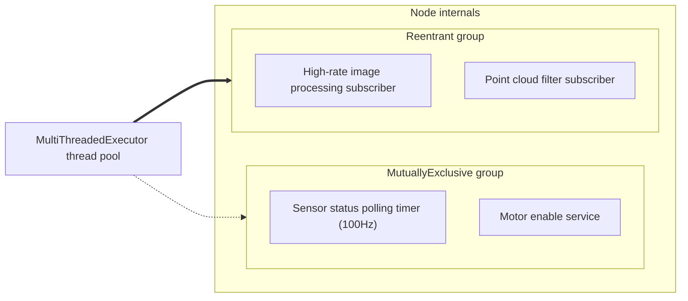

> **Classic deadlock scenario**
>
> A subscription callback synchronously waits for a service response, while the callback that handles the response belongs to the same default mutually exclusive callback group. The subscription callback holds execution while it waits, the response callback never gets a turn, and the node hangs.
>
> Solutions (use either one or both):
>
> 1. Put the waiting callback and the response-handling callback in different callback groups, and use `MultiThreadedExecutor`.
> 2. Do not block inside a callback; call the service asynchronously and handle the result in the future's completion callback.

## 5.3 Components and zero-copy IPC
{: id="53-组件与进程内零拷贝"}

In a traditional multi-process system, a message between nodes passes through **user-space memory → serialization → kernel socket → deserialization → destination user-space memory**. For data streams of hundreds of megabytes per second, such as 4K images or 3D lidar point clouds, the CPU and memory-bandwidth overhead is large.

ROS 2 **Components** compile multiple nodes into dynamic libraries (`.so` / `.dll`) that are loaded into the same `ComposableNodeContainer` process at runtime. With intra-process communication enabled, publishing a message as a `std::unique_ptr` transfers ownership of the pointer without copying the data (zero-copy IPC).

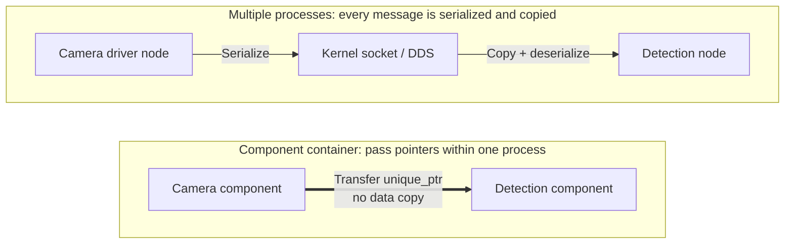

### C++ zero-copy publisher example
{: id="c-零拷贝发布示例"}

```cpp
#include "rclcpp/rclcpp.hpp"
#include "sensor_msgs/msg/point_cloud2.hpp"

using namespace std::chrono_literals;

class ZeroCopyPointCloudPublisher : public rclcpp::Node {
public:
    // Load the component with intra-process communication enabled: NodeOptions().use_intra_process_comms(true)
    explicit ZeroCopyPointCloudPublisher(const rclcpp::NodeOptions & options)
    : Node("zero_copy_publisher", options) {
        pub_ = this->create_publisher<sensor_msgs::msg::PointCloud2>("/points", 10);
        timer_ = this->create_wall_timer(33ms, std::bind(&ZeroCopyPointCloudPublisher::publish_cloud, this));
    }

private:
    void publish_cloud() {
        // Build the message with exclusive ownership via unique_ptr
        auto cloud_msg = std::make_unique<sensor_msgs::msg::PointCloud2>();
        
        // Fill the large point cloud buffer ...
        cloud_msg->header.stamp = this->now();
        cloud_msg->header.frame_id = "lidar_frame";
        cloud_msg->width = 1920;
        cloud_msg->height = 1080;
        cloud_msg->data.resize(cloud_msg->width * cloud_msg->height * 16);

        // Transfer ownership with std::move, so the intra-process pointer is handed over directly
        pub_->publish(std::move(cloud_msg));
    }

    rclcpp::Publisher<sensor_msgs::msg::PointCloud2>::SharedPtr pub_;
    rclcpp::TimerBase::SharedPtr timer_;
};
```

# 6. Lifecycle nodes
{: id="六生命周期节点"}

On a real robot, an uncontrolled node startup order can cause accidents, for example the navigation algorithm publishing velocity commands before the lidar or base driver has finished validating its parameters. ROS 2 therefore provides the **Lifecycle Node** (managed node): a node starts up through an explicit state machine, and an external manager decides when to activate it.

## 6.1 State machine
{: id="61-状态机"}

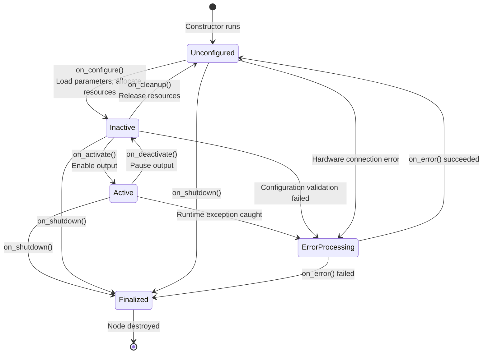

### State meanings
{: id="状态含义"}
- **`Unconfigured`**: The node is loaded, but parameters have not been read and hardware has not been connected.
- **`Inactive`**: The configuration is loaded and the Publishers and Subscribers exist, but the Publishers are silent (no messages reach DDS) and execution is suspended.
- **`Active`**: The system runs normally, all callbacks are enabled, and the main control loop executes.
- **`Finalized`** (terminal state): Resources are fully released and the process is ready to exit.

# 7. TF2 transforms
{: id="七tf2-坐标变换"}

A robot system contains many geometric coordinate frames (world, base, lidar, end-effector, and camera optical frames). **TF2 (Transform Library 2)** maintains the **transform tree** that relates them over the robot's whole lifetime, in both space and time.

## 7.1 Standard frames
{: id="71-标准坐标系"}

According to the official ROS specification **REP 105**, a mobile robot's frames must form a tree in which each frame has exactly one parent:

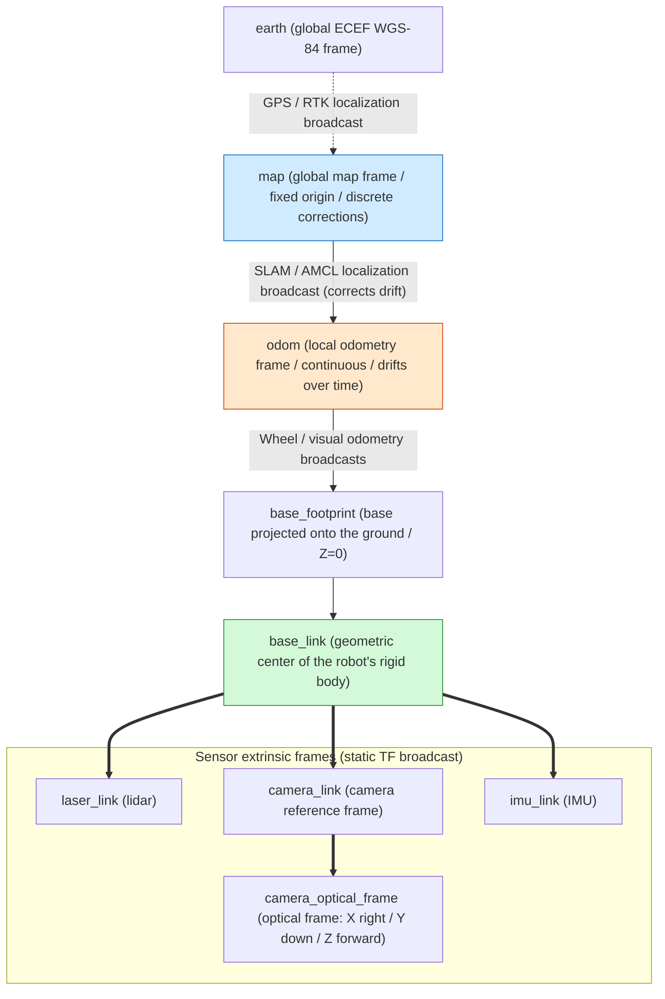

- **REP 103 axis conventions**:
  - Robot body: **FLU (Forward-Left-Up)**: the $X$ axis points forward, $Y$ left, and $Z$ up.
  - Camera optical frame: **RDF (Right-Down-Forward)**: the $X$ axis points right, $Y$ down, and $Z$ forward (the viewing direction).

## 7.2 Dynamic vs. static TF
{: id="72-动态-tf-与静态-tf"}

- **`/tf` (dynamic transforms)**: broadcasts changing relative poses (such as `odom -> base_link`) at a fixed rate (such as 50Hz).
- **`/tf_static` (static extrinsics)**: broadcast only once, when the system starts or after sensor extrinsic calibration completes. It uses `TRANSIENT_LOCAL` QoS underneath, so nodes that start later still receive it without periodic rebroadcasting, which saves CPU and bandwidth.

```cpp
// C++: look up the transform between any two frames at a given moment in history
#include "tf2_ros/buffer.h"
#include "tf2_ros/transform_listener.h"

auto tf_buffer = std::make_unique<tf2_ros::Buffer>(this->get_clock());
auto tf_listener = std::make_shared<tf2_ros::TransformListener>(*tf_buffer);

try {
    // Block for at most 100ms waiting for the latest map -> laser_link transform
    geometry_msgs::msg::TransformStamped transform = tf_buffer->lookupTransform(
        "map", "laser_link",
        tf2::TimePointZero,
        std::chrono::milliseconds(100)
    );
    RCLCPP_INFO(this->get_logger(), "Lidar position in the map frame: x=%.2f, y=%.2f",
                transform.transform.translation.x, transform.transform.translation.y);
} catch (const tf2::TransformException & ex) {
    RCLCPP_WARN(this->get_logger(), "TF lookup failed: %s", ex.what());
}
```

# 8. URDF and Xacro
{: id="八urdf-与-xacro"}

## 8.1 Robot description system
{: id="81-机器人描述体系"}

- **URDF (Unified Robot Description Format)**: uses XML to describe the robot's links, joints, collision geometry, and inertia tensors.
- **Xacro (XML Macros)**: developed to overcome URDF's lack of variables, macros, includes, and math expressions; it is the standard way to model modern robots.

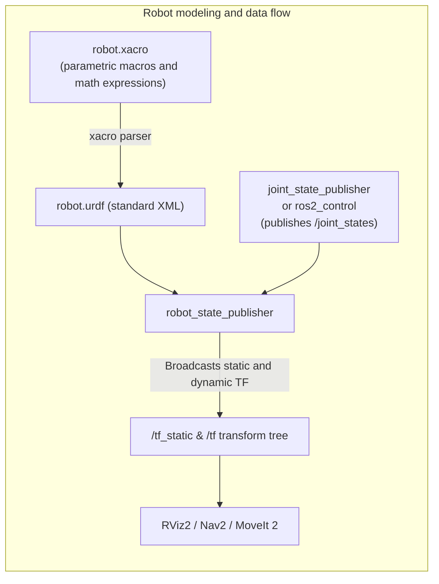

## 8.2 Xacro macro example
{: id="82-xacro-宏示例"}

```xml
<?xml version="1.0"?>
<robot xmlns:xacro="http://www.ros.org/wiki/xacro" name="industrial_diff_bot">

  <!-- Constants -->
  <xacro:property name="wheel_radius" value="0.10" />
  <xacro:property name="wheel_width" value="0.05" />
  <xacro:property name="wheel_mass" value="2.5" />
  <xacro:property name="track_width" value="0.45" />

  <!-- Macro: parameterized definition of a drive wheel -->
  <xacro:macro name="drive_wheel" params="prefix side_sign">
    <link name="${prefix}_wheel_link">
      <visual>
        <origin xyz="0 0 0" rpy="${pi/2} 0 0"/>
        <geometry>
          <cylinder radius="${wheel_radius}" length="${wheel_width}"/>
        </geometry>
        <material name="black"><color rgba="0.1 0.1 0.1 1.0"/></material>
      </visual>
      <collision>
        <origin xyz="0 0 0" rpy="${pi/2} 0 0"/>
        <geometry>
          <cylinder radius="${wheel_radius}" length="${wheel_width}"/>
        </geometry>
      </collision>
      <inertial>
        <mass value="${wheel_mass}"/>
        <inertia ixx="${(wheel_mass/12.0)*(3*wheel_radius*wheel_radius + wheel_width*wheel_width)}" 
                 iyy="${(wheel_mass/12.0)*(3*wheel_radius*wheel_radius + wheel_width*wheel_width)}" 
                 izz="${(wheel_mass/2.0)*(wheel_radius*wheel_radius)}" 
                 ixy="0.0" ixz="0.0" iyz="0.0"/>
      </inertial>
    </link>

    <joint name="${prefix}_wheel_joint" type="continuous">
      <parent link="base_link"/>
      <child link="${prefix}_wheel_link"/>
      <origin xyz="0 ${side_sign * track_width / 2.0} 0" rpy="0 0 0"/>
      <axis xyz="0 1 0"/>
    </joint>
  </xacro:macro>

  <!-- Instantiate the left and right wheels -->
  <xacro:drive_wheel prefix="left" side_sign="1" />
  <xacro:drive_wheel prefix="right" side_sign="-1" />

</robot>
```

# 9. Simulation
{: id="九仿真平台"}

| Platform | Characteristics | Connection to ROS 2 |
| :--- | :--- | :--- |
| **Gazebo** (Gazebo Sim, e.g. Harmonic) | Officially recommended general physics simulator; cross-platform | `ros_gz_bridge` bridges topics in both directions between Gazebo and ROS 2 |
| **NVIDIA Isaac Sim / Isaac ROS** | Built on Omniverse with ray-traced rendering; suited to synthetic data generation | Isaac ROS provides GPU-accelerated nodes, and NITROS reduces GPU data copies |
| **Webots / MuJoCo** | Lightweight with fast physics; often used for reinforcement-learning training | Webots has an official ROS 2 interface; MuJoCo is usually connected through community bridges |

The simulation engine publishes virtual time on the `/clock` topic, and ROS 2 nodes follow that time once `use_sim_time: true` is set.

> **Mind simulation time**
>
> During simulation or rosbag playback, every algorithm node must set `use_sim_time: true`. Otherwise the node reads the host's system clock, which does not match the timestamps in the data, and TF lookups raise `ExtrapolationException`.

# 10. Core ecosystem
{: id="十核心生态"}

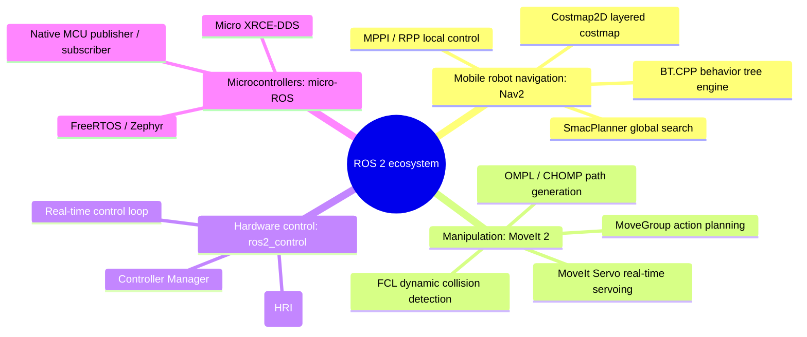

## 10.1 Nav2 navigation
{: id="101-nav2-导航"}

Nav2 is the official second-generation autonomous mobile robot navigation system for ROS 2. It rebuilds the overall architecture of the ROS 1 navigation stack and is implemented entirely on **behavior trees (BehaviorTree.CPP)** and a **lifecycle manager (LifecycleManager)**.

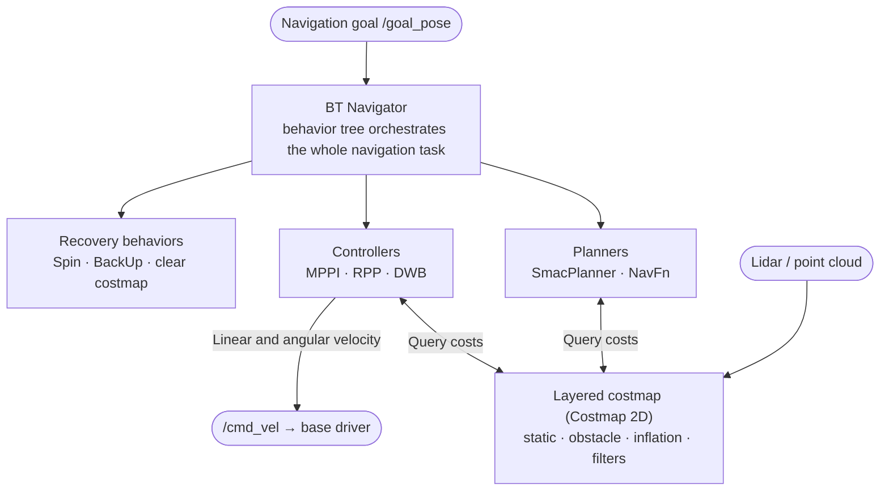

| Module | Common plugins | Role |
| :--- | :--- | :--- |
| Planners | SmacPlanner (2D / Hybrid-A* / State Lattice), NavFn (Dijkstra / A*) | Generate a path from the current position to the goal on the global costmap |
| Controllers | MPPI, Regulated Pure Pursuit (RPP), DWB | Track the path and output velocity commands in real time |
| Recovery behaviors | Spin, BackUp, ClearEntireCostmap | Try to get unstuck when the robot is trapped or planning fails |
| Costmaps | Static layer, obstacle / voxel layer, inflation layer, Costmap Filters (keepout zones, speed-limit zones) | Fuse map and sensor data and mark each cell with a traversal cost |

### Controller comparison
{: id="控制器对比"}
1. **MPPI (Model Predictive Path Integral)**: samples many candidate trajectories in parallel on the CPU and scores them with a cost function. It suits differential, omnidirectional, and Ackermann bases, avoids obstacles nimbly, and is one of the general-purpose controllers Nav2 currently recommends.
2. **Regulated Pure Pursuit (RPP)**: follows the reference path closely and slows down automatically according to path curvature and distance to obstacles. It behaves stably, is easy to tune, and is common on warehouse AGVs/AMRs.

## 10.2 MoveIt 2 motion planning
{: id="102-moveit-2-运动规划"}

MoveIt 2 provides kinematics solving, trajectory planning, and real-time collision checking for multi-DOF robot arms (6-DOF / 7-DOF serial manipulators, dual-arm robots, and humanoid upper bodies).

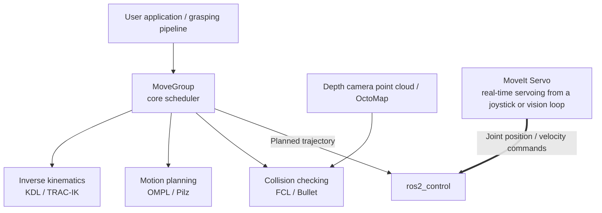

## 10.3 ros2_control
{: id="103-ros2_control-硬件控制"}

`ros2_control` provides a uniform way to write robot hardware drivers. It fully decouples the **hard real-time control loop (for example at 1000Hz)** from **non-real-time asynchronous ROS communication**, so motor control is not disrupted by blocked ROS messages.

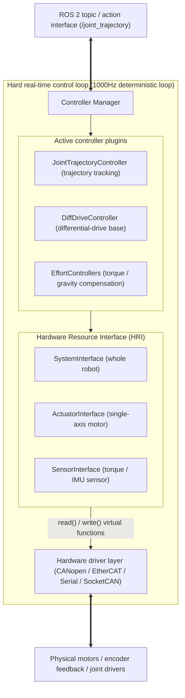

# 11. Build, launch and recording
{: id="十一构建启动与录包"}

## 11.1 Building with colcon
{: id="111-colcon-构建"}

```bash
# 1. Full build
colcon build --symlink-install

# 2. Common options for daily development:
#   --symlink-install   install via symlinks, so Python and config edits need no rebuild
#   --packages-select   build only the named packages
#   --cmake-args        passed to CMake; here, a Release build
#   --parallel-workers  limit how many packages build at once, to keep the machine responsive
colcon build \
  --symlink-install \
  --packages-select my_robot_control \
  --parallel-workers 8 \
  --cmake-args -DCMAKE_BUILD_TYPE=Release

# 3. After building, source the overlay environment
source install/setup.bash
```

## 11.2 Launch files
{: id="112-launch-编排"}

ROS 2 launch files are written entirely in Python and offer powerful conditional branching, event handling, and parameter forwarding.

```python
import os
from ament_index_python.packages import get_package_share_directory
from launch import LaunchDescription
from launch.actions import DeclareLaunchArgument, IncludeLaunchDescription, GroupAction
from launch.conditions import IfCondition
from launch.substitutions import LaunchConfiguration, PythonExpression
from launch_ros.actions import Node, PushRosNamespace

def generate_launch_description():
    pkg_bringup = get_package_share_directory('my_robot_bringup')
    
    # Declare launch arguments
    use_sim_time_arg = DeclareLaunchArgument('use_sim_time', default_value='false', description='Use simulation clock')
    enable_rviz_arg = DeclareLaunchArgument('use_rviz', default_value='true', description='Open RViz2')

    # Include another launch file
    nav2_launch = IncludeLaunchDescription(
        os.path.join(pkg_bringup, 'launch', 'navigation.launch.py'),
        launch_arguments={'use_sim_time': LaunchConfiguration('use_sim_time')}.items()
    )

    # Conditionally start the node
    rviz_node = Node(
        package='rviz2',
        executable='rviz2',
        name='rviz2',
        arguments=['-d', os.path.join(pkg_bringup, 'rviz', 'default.rviz')],
        parameters=[{'use_sim_time': LaunchConfiguration('use_sim_time')}],
        condition=IfCondition(LaunchConfiguration('use_rviz'))
    )

    return LaunchDescription([
        use_sim_time_arg,
        enable_rviz_arg,
        nav2_launch,
        rviz_node
    ])
```

## 11.3 rosbag2 record and replay
{: id="113-rosbag2-录制回放"}

```bash
# 1. Record all topics (excluding bulky uncompressed raw images, to save SSD bandwidth)
ros2 bag record -a -x "/camera/(.*)/image_raw" -s mcap -o my_experiment_bag

# 2. Inspect the recorded bag (message rate, drops, duration, total message count)
ros2 bag info my_experiment_bag.mcap

# 3. Play back at 0.5x speed while publishing the simulation clock (convenient for offline step-through debugging of algorithms)
ros2 bag play my_experiment_bag.mcap --rate 0.5 --clock 50
```

# 12. Multi-machine deployment and security
{: id="十二多机部署与安全"}

## 12.1 Tuning DDS on lossy networks
{: id="121-弱网与-dds-调优"}

In large robot fleets and multi-machine collaboration scenarios, Wi-Fi multicast is prone to packet storms and packet loss. The following tuning strategies are recommended:

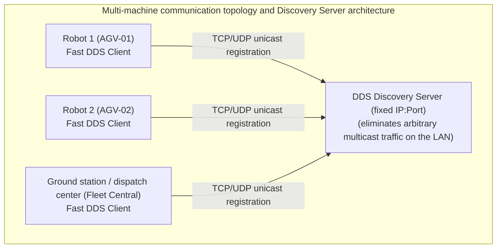

### 1. Enlarge the kernel network buffers
{: id="1-扩大内核网络缓冲区"}
```bash
sudo sysctl -w net.core.rmem_max=2147483647
sudo sysctl -w net.core.wmem_max=2147483647
sudo sysctl -w net.ipv4.ipfrag_time=3
sudo sysctl -w net.ipv4.ipfrag_high_thresh=134217728
```

### 2. Fast DDS Discovery Server
{: id="2-fast-dds-发现服务器"}
```bash
# Start the discovery server on the dispatch server or host (ID: 0, port 11811)
fastdds discovery -i 0 -p 11811

# On every robot, configure unicast discovery through an environment variable (no multicast needed)
export ROS_DISCOVERY_SERVER="192.168.1.100:11811"
```

## 12.2 SROS2 security
{: id="122-sros2-安全"}

To counter threats such as network sniffing, unauthorized nodes joining, and forged control commands (such as a forged `/cmd_vel`), ROS 2 provides **SROS2**, a security toolset built on **DDS-Security** with three capabilities:

| Capability | Mechanism | Threat addressed |
| :--- | :--- | :--- |
| **Authentication** | Verifies each participant's identity with X.509 certificates (PKI) | Unauthorized nodes joining |
| **Access control** | Signed XML permission files specify which topics each node may publish or subscribe to | Publishing or subscribing beyond permissions |
| **Encryption** | AES-GCM encryption and message integrity checks | Eavesdropping and tampering |

```bash
# Create a keystore holding the root certificates
ros2 security create_keystore ~/sros2_keystore

# Generate a dedicated certificate and access policy for a specific node
ros2 security create_enclave ~/sros2_keystore /my_secure_controller

# Enable security and run the node
export ROS_SECURITY_ENABLE=true
export ROS_SECURITY_STRATEGY=Enforce
export ROS_SECURITY_KEYSTORE=~/sros2_keystore
ros2 run my_robot_pkg controller_node --ros-args --enclave /my_secure_controller
```

## 12.3 systemd and watchdog
{: id="123-systemd-部署与看门狗"}

Run the robot startup stack as a Linux system daemon to get **auto-start at boot, automatic restart after a crash, and log rotation**:

```ini
# /etc/systemd/system/robot_bringup.service
[Unit]
Description=Autonomous Mobile Robot Bringup Service
After=network.target network-online.target systemd-timesyncd.service
Wants=network-online.target

[Service]
Type=simple
User=robot
Group=robot
Environment="ROS_DOMAIN_ID=42"
Environment="RMW_IMPLEMENTATION=rmw_cyclonedds_cpp"
ExecStart=/bin/bash -c "source /opt/ros/humble/setup.bash && source /home/robot/ros2_ws/install/setup.bash && ros2 launch my_robot_bringup full_system.launch.py"
Restart=always
RestartSec=3
KillSignal=SIGINT
TimeoutStopSec=10

[Install]
WantedBy=multi-user.target
```

```bash
# Reload systemd, then enable and start the service at boot
sudo systemctl daemon-reload
sudo systemctl enable robot_bringup.service
sudo systemctl start robot_bringup.service
```

# 13. CLI reference
{: id="十三cli-速查"}

```bash
# -------------------------------------------------------------
# 1. Node inspection (Node)
# -------------------------------------------------------------
ros2 node list                                # List active nodes
ros2 node info /my_node                       # Print the node's publications, subscriptions, services, and actions

# -------------------------------------------------------------
# 2. Topic debugging (Topic)
# -------------------------------------------------------------
ros2 topic list -t                            # List topics and their message types
ros2 topic echo /scan --no-arr                # Print topic contents (truncate large arrays so the screen does not flood)
ros2 topic hz /scan                           # Measure topic publishing rate
ros2 topic bw /camera/image_raw               # Measure topic bandwidth (MB/s)
ros2 topic delay /odom                        # Measure message latency (requires header.stamp)
ros2 topic info -v /cmd_vel                   # Print topic details including QoS (for diagnosing QoS mismatches)
ros2 topic pub /cmd_vel geometry_msgs/msg/Twist "{linear: {x: 0.2}}" -r 10 # Send a test command at 10Hz

# -------------------------------------------------------------
# 3. Service and action calls (Service & Action)
# -------------------------------------------------------------
ros2 service list -t                          # List services and their types
ros2 service call /reset_odom std_srvs/srv/Empty {} # Call a service
ros2 action send_goal /navigate_to_pose nav2_msgs/action/NavigateToPose \
  "{pose: {header: {frame_id: 'map'}, pose: {position: {x: 1.0, y: 2.0}}}}" --feedback

# -------------------------------------------------------------
# 4. Live parameter updates (Parameter)
# -------------------------------------------------------------
ros2 param list /planner_node                 # List a node's parameters
ros2 param get /planner_node max_speed        # Read a parameter value
ros2 param set /planner_node max_speed 1.5    # Change a parameter value at runtime
ros2 param dump /planner_node > params.yaml   # Export a node's parameters to a YAML file

# -------------------------------------------------------------
# 5. TF2 diagnostics (TF2)
# -------------------------------------------------------------
ros2 run tf2_tools view_frames                # Generate frames.pdf, a diagram of the whole frame tree
ros2 run tf2_ros tf2_echo map base_link       # Print the relative pose between two frames in real time
ros2 run tf2_ros tf2_monitor                  # Monitor the broadcast rate and delay of all transforms

# -------------------------------------------------------------
# 6. System checks and package management (System & Pkg)
# -------------------------------------------------------------
ros2 doctor --report                          # Check network configuration and DDS status, and print a health report
rosdep install --from-paths src --ignore-src -r -y # Install all system dependencies missing from the workspace sources
```

# 14. Summary and references
{: id="十四总结与参考资料"}

The design of ROS 2 centers on four points: data-centric, modular, reliable, and able to meet real-time requirements. Standardized DDS transport, managed lifecycle nodes, and componentized zero-copy communication, together with ecosystem stacks such as Nav2, MoveIt 2, and ros2_control, make it the mainstream infrastructure for robot software development today.

```mermaid
flowchart LR
    subgraph Mindset["Core ROS 2 concepts"]
        direction TB
        M1["DDS bus decouples the underlying transport"]
        M2["QoS gives fine-grained control over communication reliability"]
        M3["Component containers enable high-performance zero-copy"]
        M4["Lifecycle nodes make system startup deterministic"]
        M5["Nav2 / MoveIt2 / ros2_control support application logic"]
        M1 ==> M2 ==> M3 ==> M4 ==> M5
    end
```

**References and further reading**

1. ROS 2 design documents: [ROS 2 Design Documents (design.ros2.org)](https://design.ros2.org/)
2. ROS 2 official documentation: [ROS 2 Documentation (Humble / Jazzy)](https://docs.ros.org/en/humble/)
3. OMG DDS specification: [Object Management Group - Data Distribution Service v1.4](https://www.omg.org/spec/DDS/)
4. Nav2 documentation: [Navigation 2 Architecture & Guides](https://nav2.org/)
5. MoveIt 2 documentation: [MoveIt 2 Documentation](https://moveit.picknik.ai/)
6. ros2_control documentation: [ros2_control Framework Documentation](https://control.ros.org/)
7. Fast DDS manual: [eProsima Fast DDS User Manual](https://fast-dds.docs.eprosima.com/)
8. ROS Enhancement Proposals (REPs):
   - [REP 103: Standard Units of Measure & Coordinate Conventions](https://www.ros.org/reps/rep-0103.html)
   - [REP 105: Coordinate Frames for Mobile Robots](https://www.ros.org/reps/rep-0105.html)
   - [REP 2000: ROS 2 Releases and Target Platforms](https://www.ros.org/reps/rep-2000.html)
   - [REP 2007: Type Adaptation & Type Masquerading](https://www.ros.org/reps/rep-2007.html)
