# 1. Introduction
{: id="1-引言"}

On the road to AGI, **reinforcement learning (RL)** is the core engine that lets robots make autonomous decisions in the physical world. When RL meets **embodied AI**, it is no longer just processing digital signals and conquering Atari games, but driving an agent with a physical body to perceive, plan and complete tasks in complex three-dimensional space.

> **Core proposition**: Traditional RL focuses on "maximizing the score", whereas embodied RL must simultaneously account for **sample efficiency**, **action smoothness** and **physical safety**. This makes algorithm selection and engineering trade-offs far more complex than in game settings.

Reinforcement learning differs from supervised learning in several essential ways:

|Dimension|Supervised learning|Reinforcement learning|
| :--- | :--- | :--- |
|**Data source**|Manually labeled, independent and identically distributed data|Time-series data generated by the agent's interaction with the environment|
|**Feedback signal**|Immediate, correct labels|Delayed, sparse rewards|
|**Performance ceiling**|Human annotation level|Can surpass humans (e.g. AlphaGo)|
|**Core challenge**|Generalization|Exploration-exploitation trade-off, credit assignment|

<figure class="survey-intro-figure">
  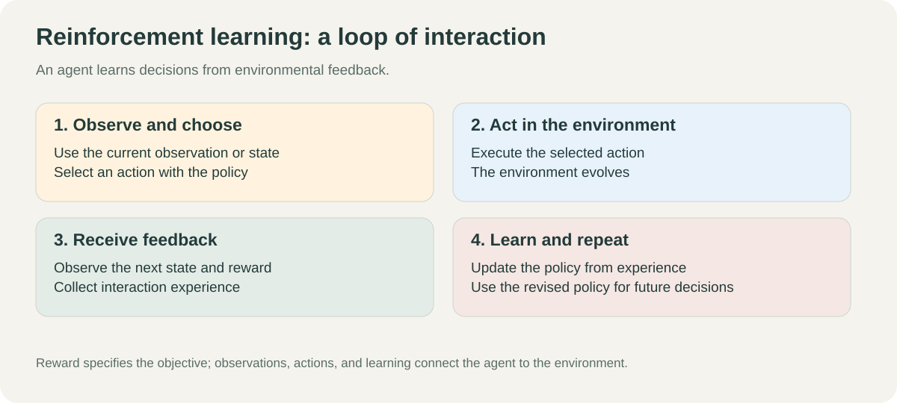
<figcaption>Figure: The agent affects the environment through actions, receives new observations and rewards, and uses this interactive experience to improve its policy. The optimization objective usually considers long-term return, and parameters may stop being updated during deployment.</figcaption>
</figure>

This article proceeds in the order "theoretical foundations → model-free control → world models → diffusion policies → sparse rewards and post-training → simulation and evaluation". Readers can first read Sections 2–7 to build the main line of the algorithms, and then jump to Sections 10–13 according to their task type; Section 14 gives a consistent analysis of representative papers for further study. Section 2 illustrates MDPs and the Bellman equations with a cleaning robot and a grid world; readers new to RL should start there.

<!-- more -->

---

# 2. Markov decision processes
{: id="2-马尔可夫决策过程"}

All RL algorithms are built on the unified framework of the **Markov Decision Process (MDP)**.

## 2.1 Defining an MDP
{: id="21-mdp-的定义"}

An MDP is defined by the quadruple $\langle S, A, P, R \rangle$:

- **State space $S$**: The set of all possible states, such as the robot's joint angles and positions.
- **Action space $A$**: The set of actions (discrete or continuous) the agent can perform.
- **Transition probability $P$**: The probability of moving to $s'$ after executing action $a$ in state $s$:

$$
P(s' | s, a) = p(s_{t+1} = s' \mid s_t = s, a_t = a)
$$

- **Reward function $R$**: The immediate reward received after taking action $a$ in state $s$:

$$
R(s, a) = \mathbb{E}[r_{t+1} \mid s_t = s, a_t = a]
$$

The **Markov property** says that the current state contains all the relevant history, i.e. $p(s_{t+1}\mid s_t, a_t) = p(s_{t+1}\mid s_0, a_0, \ldots, s_t, a_t)$.

Definitions alone make it hard to picture an MDP. The small two-state example below draws out the whole quadruple: a cleaning robot that only cares whether its battery is high (H) or low (L).

<div align="center">
  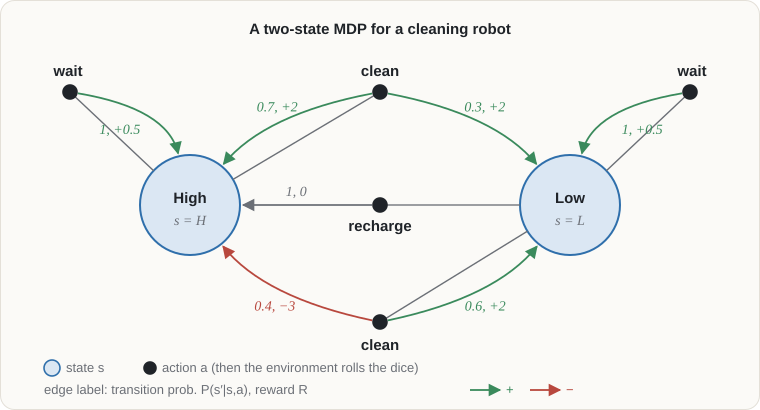
<figcaption>Figure: A complete MDP. Blue circles are states and black dots are actions; the agent only picks a black dot, and the environment then decides the next state with the probabilities on the arrows</figcaption>
</div>

Matching the figure to the definition:

- **$S$** = {high battery H, low battery L}; **$A$** = {clean, wait, recharge}, where recharge is only available on low battery.
- **$P$** is written on the arrows. Cleaning on high battery keeps the battery high with probability 0.7 and drops it to low with probability 0.3, i.e. $P(H\mid H,a)=0.7$ (with $a$ = clean).
- **$R$** is also on the arrows. Cleaning earns +2 (work gets done), waiting earns +0.5 and recharging earns 0. The risky move is **cleaning on a low battery**: with probability 0.4 the battery dies, someone has to carry the robot back, and it receives −3.

The figure also shows what makes RL hard. From low battery, the expected immediate reward of cleaning is $0.6\times 2 + 0.4\times(-3) = 0$, and recharging also yields 0. One step of lookahead cannot tell them apart; we have to look further ahead, which is exactly what value functions in the next section do.

## 2.2 Policies, values and Bellman equations
{: id="22-策略价值与-bellman-方程"}

A **policy** $\pi(a\mid s)$ is the probability distribution over actions $a$ given state $s$. The goal of RL is to find the optimal policy $\pi^*$ that maximizes the expected cumulative reward (the return).

The **discounted return** is defined as:

$$
G_t = r_{t+1} + \gamma r_{t+2} + \gamma^2 r_{t+3} + \cdots = \sum_{k=0}^{\infty} \gamma^k r_{t+k+1}
$$

Here $\gamma \in [0, 1)$ is the discount factor, which down-weights future rewards.

<div align="center">
  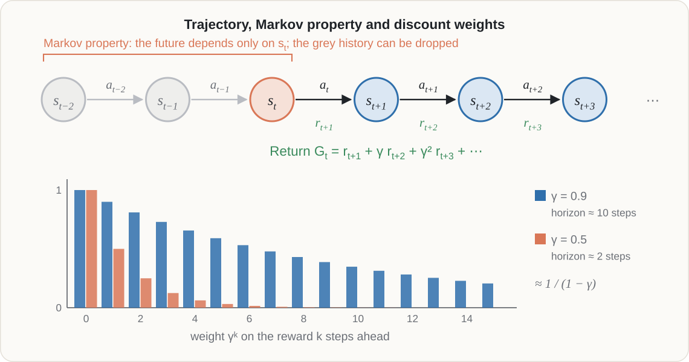
<figcaption>Figure: Top, a trajectory; the Markov property means the grey history does not affect the future. Bottom, discount weights; the smaller γ is, the more short-sighted the agent becomes</figcaption>
</div>

The discount factor sets how far the agent looks ahead: a reward $k$ steps in the future is multiplied by $\gamma^k$. With $\gamma=0.9$, a reward 10 steps away keeps only about a third of its weight; with $\gamma=0.5$, rewards beyond 4 steps are almost negligible. Roughly, the effective horizon is $1/(1-\gamma)$ steps. Robot control commonly uses 0.99 (about 100 steps), because grasping or walking often succeeds or fails on what happens a few seconds later.

The **state-value function** $V_\pi(s)$ is the expected return when starting from state $s$ and following policy $\pi$:

$$
V_\pi(s) = \mathbb{E}_\pi\left[G_t \mid s_t = s\right] = \mathbb{E}_\pi\left[\sum_{k=0}^{\infty} \gamma^k r_{t+k+1} \mid s_t = s\right]
$$

The **action-value function (Q-function)** $Q_\pi(s, a)$ is the expected return after taking action $a$ in state $s$ and then following policy $\pi$:

$$
Q_\pi(s, a) = \mathbb{E}_\pi\left[G_t \mid s_t = s, a_t = a\right]
$$

The two are related recursively through the **Bellman equation**:

$$
V_\pi(s) = \sum_a \pi(a|s) \sum_{s'} P(s'|s,a)\left[R(s,a) + \gamma V_\pi(s')\right]
$$

$$
Q_\pi(s, a) = \sum_{s'} P(s'|s,a)\left[R(s,a) + \gamma \sum_{a'} \pi(a'|s') Q_\pi(s', a')\right]
$$

The two sums look intimidating, but they become clear as a tree. Expand one step down from state $s$: the first level is the policy choosing an action, the second is the environment deciding which $s'$ we land in. Weight each leaf's "immediate reward + discounted value of the next state" by the probabilities at both levels and sum, and you get the value at the root. This picture is called a **backup diagram**; TD learning and Q-learning later in the article are different approximations on this same tree.

<div align="center">
  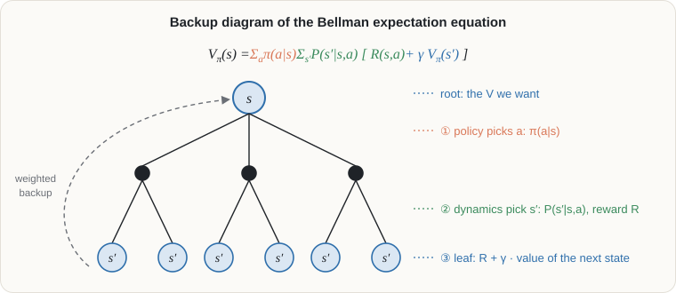
<figcaption>Figure: Backup diagram of the Bellman expectation equation; each summation in the formula corresponds to one level of the tree</figcaption>
</div>

**Working it out for the cleaning robot.** Take $\gamma=0.9$ and the policy $\pi$ "clean on high battery, recharge on low battery". Plugging into the Bellman equation gives:

$$
V_\pi(H) = 0.7\,[2 + 0.9\,V_\pi(H)] + 0.3\,[2 + 0.9\,V_\pi(L)], \qquad V_\pi(L) = 0 + 0.9\,V_\pi(H)
$$

Two unknowns and two equations give $V_\pi(H)\approx 15.75$ and $V_\pi(L)\approx 14.17$. Repeating the calculation for other policies gives:

| Choice on low battery | $V_\pi(H)$ | $V_\pi(L)$ |
| :--- | :---: | :---: |
| **Recharge** | **15.75** | **14.17** |
| Keep cleaning | 12.60 | 9.86 |
| Wait | 9.05 | 5.00 |

The previous section showed that cleaning and recharging on low battery both have an expected one-step reward of 0. Only once the value function accounts for what comes after does the difference appear: recharging earns nothing now, but it brings the robot back to the high-battery state where it can reliably collect +2. **A value function measures long-term consequences, not immediate gains**, and that is the fundamental difference between RL and greedy decision-making.

## 2.3 Optimal values: a grid world
{: id="23-最优价值一个网格世界"}

So far we asked "given a policy, how much is it worth". What RL actually wants is the **optimal policy**, described by the **Bellman optimality equation**, which replaces the weighted average over actions with a maximum:

$$
V^*(s) = \max_a \sum_{s'} P(s'|s,a)\left[R(s,a) + \gamma V^*(s')\right], \qquad \pi^*(s) = \arg\max_a Q^*(s,a)
$$

Applying this equation repeatedly, starting from all zeros, is **value iteration**. The figure below shows the actual result of value iteration on a 5×4 grid world: the top-right cell is the goal (+1), the cell below it is a pit (−1), every step costs 0.04, and the floor is slippery—an action does what was intended with probability 0.8 and slips to either side with probability 0.1 each.

<div align="center">
  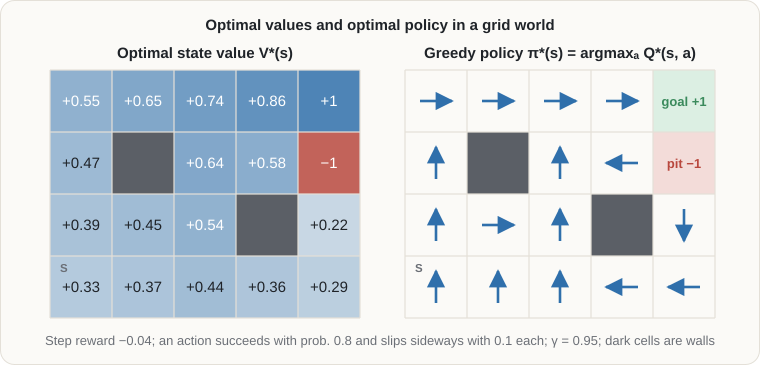
<figcaption>Figure: Left, the optimal value V* (bluer is better); right, the greedy policy derived from it. The numbers are computed by value iteration</figcaption>
</div>

Two cells deserve a closer look:

- **The cell left of the pit** (row 2, column 4) does not go up; it **steps back to the left**. Going up slips right into the pit with probability 0.1, while going left can only slip up or down, which is harmless.
- **The cell directly below the pit** (row 3, column 5) chooses to **go down and take the long way round** rather than rush up towards the goal, since going up means falling into the pit with probability 0.8.

Neither of these "counter-intuitive" moves is a hand-written rule; both fall out of the Bellman optimality equation once the slip probabilities are taken into account. That is the value of the MDP framework: once $\langle S, A, P, R \rangle$ is written down, "what is a good action" has a precise answer.

## 2.4 Model-based vs. model-free
{: id="24-有模型与免模型"}

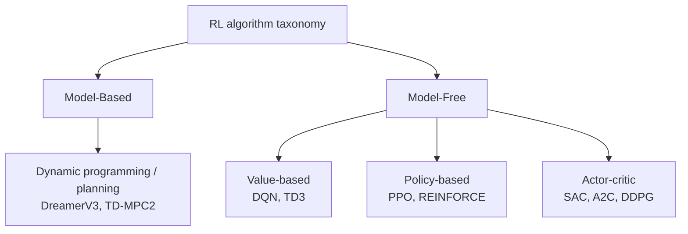

- **Model-based RL**: The agent learns a model of the environment's transition dynamics $$P(s'\mid s,a)$$ and then uses it for planning. This is usually more sample-efficient, but depends on model accuracy.
- **Model-free RL**: The agent learns a policy directly from interaction, without explicitly modeling the environment. It usually transfers more easily to complex tasks, but needs more interaction data.

---

# 3. Algorithm landscape
{: id="3-算法演进全景"}

Embodied RL has evolved through four generations:

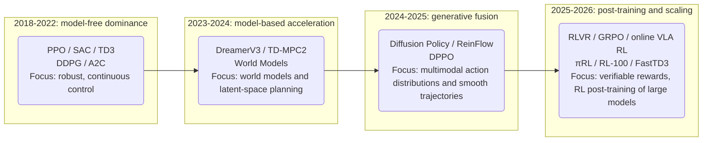

---

# 4. Policy gradients
{: id="4-策略梯度"}

## 4.1 Policy gradient theorem
{: id="41-策略梯度定理"}

All policy-based RL algorithms derive from the same core formula, the **policy gradient theorem**:

$$
\nabla \bar{R}_\theta = \mathbb{E}_{\tau \sim p_\theta(\tau)}\left[R(\tau) \nabla \log p_\theta(\tau)\right]
$$

Here $$\bar{R}_\theta = \mathbb{E}_{\tau \sim p_\theta(\tau)}[R(\tau)]$$ is the expected cumulative reward, and $\tau = (s_1, a_1, s_2, a_2, \ldots)$ is a trajectory.

**Intuition**: If a trajectory earns a high reward, increase its probability; otherwise, decrease it.

In practice, the gradient is decomposed over time steps:

$$
\nabla \bar{R}_\theta \approx \frac{1}{N} \sum_{n=1}^N \sum_{t=1}^{T_n} \left(\sum_{t'=t}^{T_n} \gamma^{t'-t} r_{t'}^n - b\right) \nabla \log p_\theta(a_t^n | s_t^n)
$$

Here $b$ is a baseline used to reduce the variance of the gradient estimate. A natural choice is the value function $V_\pi(s)$, which gives the **advantage function**:

$$
A(s_t, a_t) = Q_\pi(s_t, a_t) - V_\pi(s_t)
$$

The advantage function measures "how much better than average it is to take action $a_t$ in state $s_t$." In practice it is approximated by the TD residual:

$$
A(s_t, a_t) \approx r_t + \gamma V_\pi(s_{t+1}) - V_\pi(s_t)
$$

## 4.2 Exploration vs. exploitation
{: id="42-探索与利用"}

In embodied intelligence, the **exploration-exploitation dilemma** is particularly acute:

- **Exploration**: Trying unknown actions may yield larger rewards, but may also damage the robot.
- **Exploitation**: Executing the best known action is safe, but may get stuck in a local optimum.

Common exploration strategies:
- **$\varepsilon$-greedy**: Take a random action with probability $\varepsilon$ and the best action with probability $1-\varepsilon$.
- **Entropy regularization**: The core idea of SAC, which maximizes policy entropy to encourage exploration.
- **Parameter noise**: Add noise to the network parameters (TD3/DDPG instead use action noise).

---

# 5. Actor-critic
{: id="5-actor-critic-框架"}

**Actor-critic (A-C)** is the basic structure of modern embodied RL algorithms, combining a policy gradient (the actor) with value estimation (the critic).

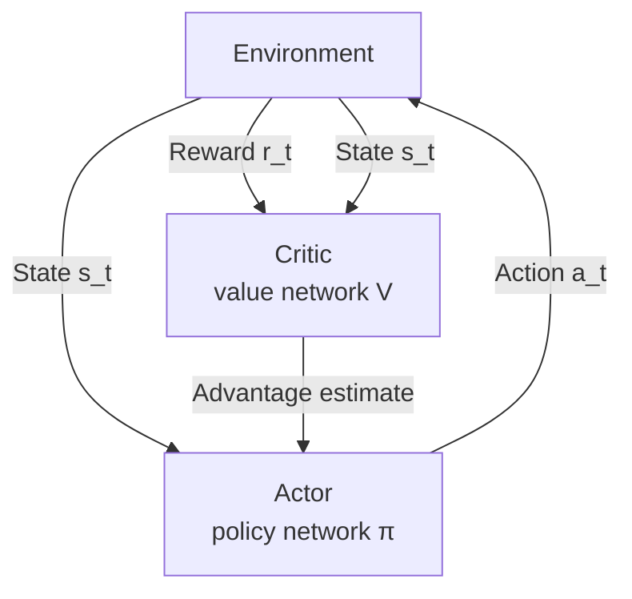

**Advantage actor-critic (A2C) gradient update**:

$$
\nabla_\theta J(\theta) \approx \frac{1}{N}\sum_{n=1}^N \sum_t \left(r_t^n + \gamma V_w(s_{t+1}^n) - V_w(s_t^n)\right) \nabla_\theta \log \pi_\theta(a_t^n | s_t^n)
$$

Critic loss function (mean squared error):

$$
\mathcal{L}(w) = \mathbb{E}\left[\left(r_t + \gamma V_w(s_{t+1}) - V_w(s_t)\right)^2\right]
$$

**A3C (Asynchronous Advantage Actor-Critic)** uses multiple parallel workers to update a global network asynchronously, significantly improving sample efficiency and training speed. The idea is analogous to Naruto using shadow clones to train in parallel.

---

# 6. PPO
{: id="6-ppo"}

**Proximal Policy Optimization (PPO)** is a policy optimization algorithm widely used in engineering practice, and a common baseline on embodied simulation platforms such as Isaac Lab. It is designed to improve sample efficiency and training stability while keeping policy updates stable.

## 6.1 Importance sampling
{: id="61-重要性采样"}

Policy gradient is an **on-policy** algorithm: data must be resampled after every parameter update, so sample efficiency is extremely low.

**Importance sampling** lets us train the new policy $\pi_\theta$ with data collected by an old policy $$\pi_{\theta'}$$:

$$
\mathbb{E}_{x \sim p}[f(x)] = \mathbb{E}_{x \sim q}\left[f(x)\frac{p(x)}{q(x)}\right]
$$

Applying this to policy optimization:

$$
J^{\theta'}(\theta) = \mathbb{E}_{(s_t, a_t) \sim \pi_{\theta'}}\left[\frac{p_\theta(a_t|s_t)}{p_{\theta'}(a_t|s_t)} A^{\theta'}(s_t, a_t)\right]
$$

Here $$\frac{p_\theta(a_t\mid s_t)}{p_{\theta'}(a_t\mid s_t)}$$ is the **importance weight**, which corrects for the difference between the two distributions.

> **Key constraint**: If $\pi_\theta$ and $$\pi_{\theta'}$$ differ too much, the variance of the importance weights explodes and the estimate becomes inaccurate. This is exactly the problem PPO is designed to solve.

## 6.2 TRPO
{: id="62-trpo"}

**Trust Region Policy Optimization (TRPO)** takes KL divergence as a hard constraint:

$$
\max_\theta \; J^{\theta'}(\theta), \quad \text{s.t.} \;\; \mathrm{KL}(\theta, \theta') < \delta
$$

TRPO theoretically guarantees policy improvement at every update, but solving the constrained optimization problem is computationally expensive.

## 6.3 PPO-Penalty
{: id="63-ppo-penalty"}

**PPO-Penalty** (PPO1) folds the constraint into the objective function:

$$
J_{\mathrm{PPO}}^{\theta^k}(\theta) = J^{\theta^k}(\theta) - \beta \cdot \mathrm{KL}(\theta, \theta^k)
$$

and uses an **adaptive $\beta$** to adjust the strength of the KL penalty dynamically:

- If $$\mathrm{KL}(\theta, \theta^k) > \mathrm{KL}_{\max}$$: increase $\beta$ (penalize overly large updates)
- If $$\mathrm{KL}(\theta, \theta^k) < \mathrm{KL}_{\min}$$: decrease $\beta$ (allow larger updates)

## 6.4 PPO-Clip
{: id="64-ppo-clip"}

**PPO-Clip** (PPO2) is simpler: it constrains the probability ratio directly by clipping:

$$
J_{\mathrm{PPO2}}^{\theta^k}(\theta) \approx \sum_{(s_t, a_t)} \min\left(r_t(\theta) A^{\theta^k}(s_t, a_t),\; \mathrm{clip}(r_t(\theta),\, 1-\varepsilon,\, 1+\varepsilon) A^{\theta^k}(s_t, a_t)\right)
$$

Here $$r_t(\theta) = \frac{p_\theta(a_t\mid s_t)}{p_{\theta^k}(a_t\mid s_t)}$$ is the probability ratio, and $\varepsilon$ is usually 0.1 or 0.2.

**Intuition behind clipping**: this becomes obvious when the per-sample objective is plotted as a function of $r$ (with $\varepsilon=0.2$).

<div align="center">
  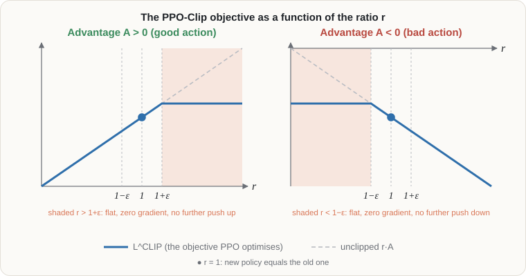
<figcaption>Figure: The PPO-Clip objective (blue) and the unclipped r·A (grey dashed); the gradient is 0 inside the shaded zone</figcaption>
</div>

- **Good action ($A>0$)**: raising its probability increases the objective, but once $r$ exceeds $1+\varepsilon$ the curve goes flat and the gradient is 0, so this batch of data stops pushing it further up—no overly large steps.
- **Bad action ($A<0$)**: lowering its probability increases the objective, but once $r$ falls below $1-\varepsilon$ the curve flattens as well—no overcorrection.
- The outer $\min$ always takes the more pessimistic line: gains in the favourable direction are capped, while losses in the unfavourable direction are counted in full (the parts with $r<1-\varepsilon$ on the left and $r>1+\varepsilon$ on the right are not flattened).

**Why is PPO suitable for embodied control?**

1. **High stability**: Clipping limits the size of each policy update, preventing the robot arm from suddenly making dangerous movements.
2. **Parallel-friendly**: Platforms such as Isaac Lab can run thousands of parallel simulation environments, which suits PPO's on-policy nature.
3. **Simple to implement**: Compared with TRPO, PPO is easier to implement and has fewer hyperparameters.

---

# 7. DDPG → TD3 → SAC
{: id="7-ddpg--td3--sac"}

Robot control usually involves a **continuous action space** (e.g. joint torque or velocity) that discrete methods such as DQN cannot handle directly, which gave rise to a family of continuous-control algorithms.

## 7.1 DDPG
{: id="71-ddpg"}

**Deep Deterministic Policy Gradient (DDPG)** pioneered the extension of DQN to continuous action spaces, and is the direct predecessor of TD3 and SAC.

**Core design**:

|Component|Name|Function|
| :--- | :--- | :--- |
|Actor $\mu_\theta(s)$|Policy network|Outputs a deterministic continuous action|
|Critic $Q_w(s, a)$|Q-network|Evaluates the value of the actor's output action|
|Target network|Slowly updated copy|Stabilizes the Q-target computation|
|Experience replay|Replay buffer|Breaks data correlation and enables off-policy training|

**Actor update** (maximize the Q-value):

$$
\nabla_\theta J \approx \nabla_a Q_w(s, a)\big|_{a=\mu_\theta(s)} \cdot \nabla_\theta \mu_\theta(s)
$$

**Critic update** (minimize the TD error):

$$
y = r + \gamma Q_{\bar{w}}(s', \mu_{\bar{\theta}}(s')), \quad \mathcal{L}(w) = \mathbb{E}\left[(Q_w(s,a) - y)^2\right]
$$

Here $$Q_{\bar{w}}, \mu_{\bar{\theta}}$$ are the parameters of the target networks, soft-updated every $C$ steps: $\bar{w} \leftarrow \tau w + (1-\tau)\bar{w}$.

To encourage exploration, noise (such as OU noise or Gaussian noise) is added to the actions during training.

**DDPG's problems**: the Q-value is easily overestimated, which corrupts the policy, and training is extremely sensitive to hyperparameters.

## 7.2 TD3's three fixes
{: id="72-td3-的三项改进"}

**Twin Delayed Deep Deterministic Policy Gradient (TD3)** systematically resolves DDPG's instability with three techniques:

### Clipped double Q-learning
{: id="截断双-q-学习"}

Learn two independent Q-networks $$Q_{\phi_1}, Q_{\phi_2}$$ and take the minimum of the two when computing the Q-target:

$$
y = r + \gamma (1-d) \min_{i=1,2} Q_{\phi_i,\mathrm{targ}}(s', a'_{\mathrm{TD3}})
$$

Taking the minimum instead of the maximum systematically suppresses Q overestimation.

### Delayed policy updates
{: id="延迟策略更新"}

The critic is updated twice for every actor update. Experiments show that letting the Q-network converge before updating the policy significantly improves stability.

### Target policy smoothing
{: id="目标策略平滑"}

Add clipped noise to the target action:

$$
a'_{\mathrm{TD3}}(s') = \mathrm{clip}\left(\mu_{\bar{\theta}}(s') + \mathrm{clip}(\epsilon, -c, c),\; a_{\mathrm{low}},\; a_{\mathrm{high}}\right), \quad \epsilon \sim \mathcal{N}(0, \sigma)
$$

This smooths the Q-function's response surface over actions and reduces the policy's sensitivity to Q errors.

 **TD3 performs well on dexterous manipulation tasks** and is a common baseline for fine control of robot arms.

## 7.3 SAC: maximum-entropy RL
{: id="73-sac最大熵-rl"}

**Soft Actor-Critic (SAC)** is currently one of the strongest model-free algorithms for continuous control. Its core is the **maximum-entropy RL** framework.

### Maximum entropy goal
{: id="最大熵目标"}

SAC maximizes not only the cumulative reward but also the policy's **entropy**:

$$
\pi^* = \arg\max_\pi \mathbb{E}\left[\sum_t \gamma^t \left(r_t + \alpha \mathcal{H}(\pi(\cdot|s_t))\right)\right]
$$

Here $\mathcal{H}(\pi(\cdot\mid s_t)) = -\mathbb{E}[\log \pi(a\mid s_t)]$ is the policy entropy, and $\alpha > 0$ is the temperature parameter that controls the degree of exploration.

**Benefits of entropy maximization**:
- **Encourages exploration**: The policy is more evenly spread, which avoids premature convergence to a local optimum.
- **Robust**: In environments with multimodal rewards, it can keep multiple feasible strategies.
- **Sample-efficient**: Off-policy training with experience replay.

### SAC actor and critic updates
{: id="sac-的演员更新"}

The actor's goal is to maximize the Q-value while maximizing entropy:

$$
\mathcal{L}(\phi) = \mathbb{E}_{s_t, \tilde{a}_t \sim \pi_\phi}\left[\alpha \log \pi_\phi(\tilde{a}_t | s_t) - \min_{i=1,2} Q_{\theta_i}(s_t, \tilde{a}_t)\right]
$$

Note that SAC takes the minimum over two Q-networks (as in TD3) to suppress overestimation effectively.

### Automatic temperature tuning
{: id="自动温度调节"}

SAC can tune the temperature parameter $\alpha$ automatically by minimizing:

$$
\mathcal{L}(\alpha) = \mathbb{E}_{\tilde{a}_t \sim \pi_t}\left[-\alpha \log \pi_t(\tilde{a}_t|s_t) - \alpha \bar{\mathcal{H}}\right]
$$

Here $\bar{\mathcal{H}}$ is the target entropy (usually set to $-\dim(A)$), so no manual tuning is needed.

### PPO vs. SAC vs. TD3
{: id="ppo-vs-sac-vs-td3-对比"}

|Feature| PPO | SAC | TD3 |
| :--- | :---: | :---: | :---: |
|**Policy type**|Stochastic|Stochastic|Deterministic|
|**On-policy/off-policy**|on-policy|off-policy|off-policy|
|**Continuous action**| ✓ | ✓ | ✓ |
|**Discrete action**| ✓ | △ | ✗ |
|**Sample efficiency**|Medium|High|High|
|**Hyperparameter sensitivity**|Low|Low|Medium|
|**Embodied applications**|Legged locomotion|Dexterous manipulation|Fine assembly|

---

# 8. Model-based RL
{: id="8-有模型-rl"}

Model-free RL needs repeated interaction with the real environment and has low sample efficiency. **Model-based RL** lets the agent learn an internal model of the environment and rehearse "in its head", greatly reducing the number of real-environment interactions.

## 8.1 World Models
{: id="81-world-models"}

David Ha and Jürgen Schmidhuber proposed the classic world-model framework at NeurIPS 2018. It consists of three modules:

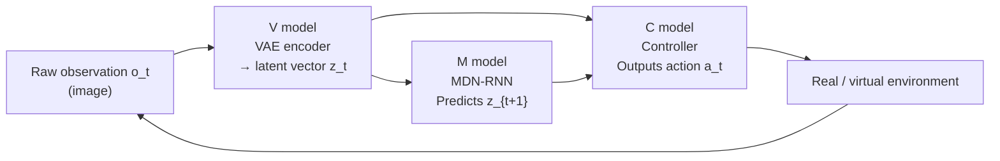

**V model (Variational Autoencoder)**: The visual perception module. It compresses high-dimensional images into low-dimensional latent vectors $z_t$, capturing the essential features of the environment.

**M model (MDN-RNN)**: The memory module. It predicts the probability distribution of the next latent vector from the current latent vector $z_t$, hidden state $h_t$ and action $a_t$:

$$
P(z_{t+1} | a_t, z_t, h_t)
$$

A mixture density network (MDN) outputs a multimodal distribution that captures the stochasticity of the environment.

**C model (Controller)**: The controller maps the concatenation of $z_t$ and $h_t$ directly to an action:

$$
a_t = W_c [z_t \; h_t] + b_c
$$

The controller has very few parameters (a single linear layer) and is optimized with an evolution strategy (CMA-ES), avoiding backpropagation through the whole world model.

**Workflow**:

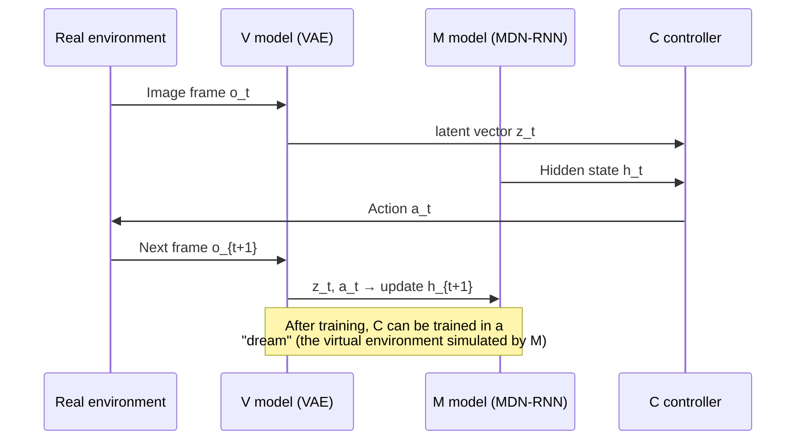

 **Key insight**: After training the world model, the C controller can be **trained entirely inside a virtual world built by the M model**, with no further interaction with the real environment, which greatly improves training efficiency.

> **A generative model is not necessarily a world model.** A world model must be able to **predict future states conditioned on actions**, i.e. given an action input it must predict the next state. A model that can only generate images does not meet this requirement.

## 8.2 DreamerV3
{: id="82-dreamerv3"}

**DreamerV3** is a representative world-model RL method that shows high sample efficiency and cross-task robustness on a wide range of control tasks.

**Core mechanisms**:

1. **RSSM (Recurrent State-Space Model)**: Decomposes the environment state into a deterministic part $h_t$ (the recurrent hidden state) and a stochastic part $z_t$ (a VAE latent vector):

$$
h_t = f_\phi(h_{t-1}, z_{t-1}, a_{t-1})
$$

2. **Dreaming**: Unrolls complete trajectories in latent space without interacting with the real environment:

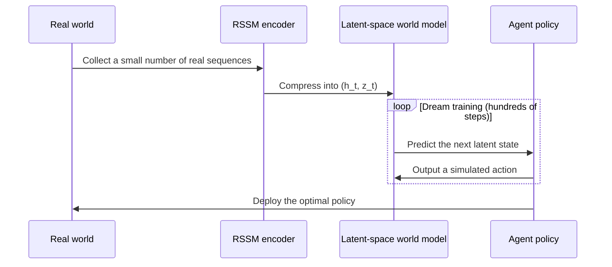

3. **Scale-free rewards (symlog)**: Rewards are transformed with $\mathrm{symlog}(x) = \mathrm{sign}(x) \cdot \ln(\lvert x\rvert+1)$, which supports cross-task transfer without task-specific hyperparameters.

**DreamerV3 achievements**:
- It is the first algorithm to reach SOTA across 7 domains, including Atari, DMC, Crafter and Minecraft, with a single fixed hyperparameter setting and no tuning.
- It is the first to learn to collect diamonds from scratch in Minecraft (requiring 14 consecutive decisions).

## 8.3 TD-MPC2
{: id="83-td-mpc2"}

**TD-MPC2** unifies **temporal-difference (TD) learning** and **model predictive control (MPC)** in latent space and is especially good at **long-horizon manipulation tasks**.

**Core idea**: plan over a short finite horizon in latent space and use TD learning to estimate long-term value, balancing planning depth against computational cost. Typical use case: multi-step robot manipulation, from grasping to assembly.

## 8.4 Dreamer 4: learning in imagination from offline data only
{: id="84-dreamer-4只用离线数据在想象中学会"}

**[Dreamer 4](https://arxiv.org/abs/2509.24527)** (2025) replaces the world model with a scalable transformer and uses a "shortcut forcing" objective so that it runs interactively in real time on a single GPU. It targets the weakness DreamerV3 left behind: inaccurate prediction of **object interactions** in complex environments.

Two changes stand out:

1. **Knowledge from unlabelled video**: action conditioning needs only a small amount of action-labelled data, and the world model takes most of its knowledge from large amounts of unlabelled video. This mirrors the situation in robotics, where internet video is plentiful and teleoperation data with actions is scarce.
2. **Purely offline**: the paper proposes the challenge of obtaining diamonds in Minecraft from offline data only, which requires more than 20,000 mouse and keyboard actions from raw pixels. Dreamer 4 is the first agent to solve it **without any environment interaction**, training purely in imagination.

For robotics the second point matters more: real-world interaction is slow and unsafe, and "offline data + world model + RL in imagination" is a route around trial and error on the real robot.

---

# 9. Diffusion policies
{: id="9-扩散策略"}

## 9.1 Diffusion Policy
{: id="91-diffusion-policy"}

**Diffusion Policy** transfers the core idea of image generation (Stable Diffusion) to robot action generation: the target action trajectory is treated as the result of "step-by-step denoising from Gaussian noise".

**Why do we need a diffusion policy?**

A traditional policy network outputs the mean of the action and cannot handle **multimodal action distributions**. For example:

- Two cups sit on the table, and the optimal policy is either "pick the left one" or "pick the right one". A mean-output policy hovers in the middle and reaches neither.
- A diffusion model can represent multimodal distributions naturally and commits decisively to one mode.

<div align="center">
  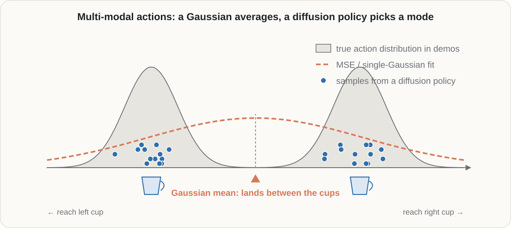
<figcaption>Figure: In the demonstrations both "grab the left cup" and "grab the right cup" are correct, giving two peaks; a single-Gaussian policy trained with mean squared error averages them and lands in the gap, while samples from a diffusion policy fall on the peaks</figcaption>
</div>

**Forward process (adding noise)**:

$$
q(x_k | x_{k-1}) = \mathcal{N}(x_k;\; \sqrt{1 - \beta_k}\, x_{k-1},\; \beta_k I)
$$

**Reverse process (denoising, the learning target)**:

$$
p_\theta(x_{k-1} | x_k) = \mathcal{N}(x_{k-1};\; \mu_\theta(x_k, k),\; \Sigma_\theta(x_k, k))
$$

During training, the network learns to predict the noise $$\epsilon_\theta$$ at each step. At inference time, it starts from random noise and denoises iteratively to obtain a smooth action trajectory.

Advantages of the **diffusion policy**:

|Dimension|Traditional policy network|Diffusion policy|
| :--- | :--- | :--- |
|**Distribution expressiveness**|Unimodal Gaussian|Arbitrary number of modes|
|**Trajectory smoothness**|Average|Very high (denoising is naturally smooth)|
|**Inference speed**|Fast (single forward pass)|Slow (requires K iterations)|
|**Suitable scenarios**|Simple manipulation|Complex grasping, bimanual coordination|

## 9.2 ReinFlow
{: id="92-reinflow"}

**[ReinFlow](https://arxiv.org/abs/2505.22094)** (2025) targets **flow matching policies**, the "straight-line" relatives of diffusion policies. Their denoising path is a deterministic ODE, so the log-likelihood of an action cannot be computed and policy gradients do not apply directly. ReinFlow **injects learnable noise** into that deterministic path, turning the whole denoising chain into a discrete-time Markov process whose likelihood can be computed exactly step by step, which makes PPO-style updates possible:

- First train the flow matching policy on expert demonstrations (imitation learning stage);
- Then fine-tune it with online RL, where the injected noise also drives exploration (reinforcement learning stage).

The paper reports that it can fine-tune Rectified Flow and Shortcut Model policies with very few or even 1 denoising step, saving about 82.63% of wall-clock training time compared with DPPO on legged locomotion. This "imitate first, reinforce later" two-stage recipe mirrors the SFT → RL paradigm of LLMs and is now the mainstream way to post-train robot policies.

## 9.3 DPPO
{: id="93-dppo"}

**DPPO (Diffusion Policy Policy Optimization)** embeds PPO's clipped importance weighting directly into the diffusion policy's step-by-step denoising process, which solves the training instability of diffusion policies in online RL.

**Core idea**: Treat the $K$-step denoising chain as a $K$-step MDP. The output of each denoising step is regarded as a "sub-action", and a PPO-Clip constraint is applied to the policy update at every step to prevent excessive distribution drift during iterative updates.

**Differences from ReinFlow**:

|Dimension| ReinFlow | DPPO |
| :--- | :--- | :--- |
|**Training paradigm**|BC pre-training → RL fine-tuning (two stages)|Online RL directly inside the diffusion chain (end-to-end)|
|**Constraint granularity**|Whole-policy level|Per-denoising-step level|
|**Suitable scenarios**|Sufficient demonstration data is available|Demonstrations are limited and exploration must be purely online|

## 9.4 Flow-policy RL without likelihoods
{: id="94-不算似然的流策略-rl"}

ReinFlow and DPPO both reshape the denoising chain into an MDP with a computable likelihood, at the cost of tying training to a particular sampler. In 2025 another line of work appeared: **sidestep exact likelihoods**.

- **[FPO (Flow Policy Optimization)](https://arxiv.org/abs/2507.21053)**: replaces the log-likelihood ratio with the change in the conditional flow matching loss, forming an "advantage-weighted ratio" that plugs straight into PPO-Clip. Neither training nor inference is tied to a particular integrator, it can train diffusion-style policies from scratch, and it beats Gaussian policies on under-conditioned tasks (several reasonable actions for the same observation).
- **[Flow Q-Learning (FQL)](https://arxiv.org/abs/2502.02538)**: aimed at offline RL. A multi-step flow policy only imitates the data distribution, while a separate **one-step** policy maximises Q and is distilled towards the flow policy, avoiding backpropagation through the whole denoising chain.
- **[Flow-GRPO](https://arxiv.org/abs/2505.05470)**: rewrites ODE sampling as an SDE with the same marginals to obtain stochasticity, then trains flow matching models with the GRPO of Section 11.1. It was first used for text-to-image generation, and the same "ODE→SDE for exploration" trick shows up in RL fine-tuning of VLAs (see Flow-SDE in πRL, Section 11.3).

---

# 10. Sparse rewards
{: id="10-稀疏奖励"}

Designing rewards for embodied intelligence is far harder than for game environments. The robot receives no reward most of the time (for example, in a screw-tightening task only the final tightening earns +1), so gradients vanish and training stalls.

## 10.1 Reward shaping
{: id="101-奖励塑形"}

Manually designing **auxiliary rewards** to guide the agent's behavior is the most common approach, but it requires domain knowledge:

|Auxiliary reward type|Example|Effect|
| :--- | :--- | :--- |
|**Proximity reward**|The closer the end effector is to the target, the larger the reward|Fast start, but may get stuck in local optima|
|**Contact-force reward**|Reward contact forces within the correct range|Suited to delicate manipulation|
|**Pose-correctness reward**|Reward the object when its orientation meets the requirement|Prevents odd configurations|
|**Survival reward**|+0.001 for each step survived|Encourages the robot to keep exploring|

> **Warning**: Poorly designed rewards can lead to "reward hacking", where the agent finds unintended shortcuts to maximize reward instead of actually completing the task.

## 10.2 Curiosity module (ICM)
{: id="102-好奇心模块icm"}

**Curiosity-driven reward** is a task-independent intrinsic reward that encourages the agent to explore "unpredictable" new states:

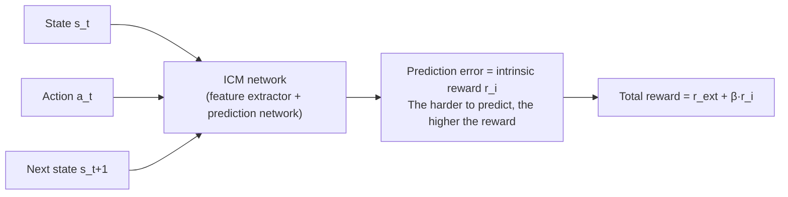

ICM consists of two subnetworks:
1. **Forward model**: Given $(s_t, a_t)$, it predicts $$\hat{s}_{t+1}$$, and the prediction error serves as the intrinsic reward.
2. **Inverse model**: Given $(s_t, s_{t+1})$, it predicts the action $$\hat{a}_t$$. This trains the feature extractor and filters out noise irrelevant to the agent (such as leaves fluttering in the background).

## 10.3 Curriculum learning
{: id="103-课程学习"}

Arrange tasks from easy to hard so that the agent gradually masters complex skills:

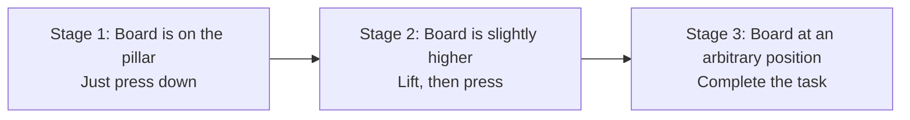

**Reverse curriculum generation** is an automated method: starting from the goal state, it gradually samples initial states "$k$ steps away from the goal", automatically building a curriculum of increasing difficulty.

## 10.4 HER
{: id="104-her"}

**Hindsight Experience Replay (HER)** is a classic technique for sparse rewards: even if a task fails (e.g. the robot arm does not reach the specified position), the position the arm actually reached can be used as a hypothetical goal, so the failed trajectory still yields a learning signal.

> **Key insight**: Failed experience is not useless. Once the goal is relabeled with what was actually achieved, the failed trajectory becomes a "successful experience", which effectively alleviates reward sparsity.

---

# 11. 2026 frontiers
{: id="11-2026-前沿方向"}

## 11.1 RLVR
{: id="111-rlvr"}

The name **RLVR (Reinforcement Learning from Verifiable Rewards)** comes from [Tülu 3](https://arxiv.org/abs/2411.15124) (2024): the reward is no longer scored by a learned reward model but **checked automatically by a program**—does the answer to a maths problem equal the reference answer, does the code pass its unit tests. A checking rule cannot be flattered, which addresses reward hacking at the root. [DeepSeek-R1](https://arxiv.org/abs/2501.12948) (2025) showed that large-scale RL on such right-or-wrong signals alone (R1-Zero even skipped supervised fine-tuning) lets a model spontaneously learn longer reasoning chains and self-checking.

### GRPO: group comparison instead of a critic
{: id="grpo用组内比较代替-critic"}

The algorithm most commonly behind RLVR is **GRPO (Group Relative Policy Optimization)**, introduced in [DeepSeekMath](https://arxiv.org/abs/2402.03300) (2024). Its motivation is practical: PPO needs a value network as large as the policy to estimate advantages, which doubles memory and training cost for large models. GRPO drops the critic altogether—it samples a group of $G$ answers to the same question and uses the group's average score as the baseline:

<div align="center">
  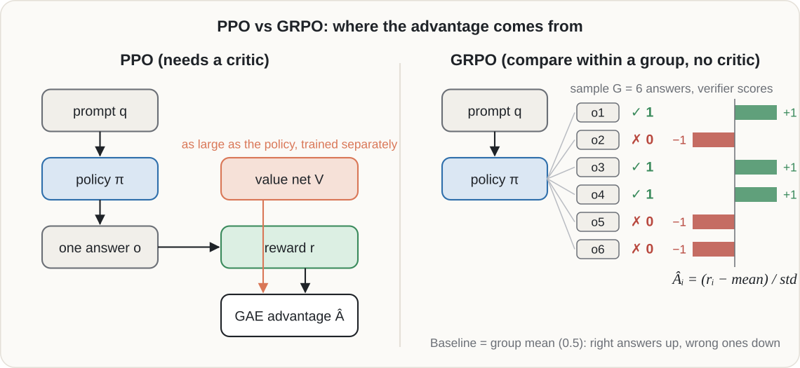
<figcaption>Figure: 6 answers sampled for the same question, 3 right and 3 wrong; the group mean 0.5 is the baseline, and after normalisation right answers get advantage +1 and wrong ones −1</figcaption>
</div>

$$
\hat{A}_i = \frac{r_i - \mathrm{mean}(r_1, \ldots, r_G)}{\mathrm{std}(r_1, \ldots, r_G)}
$$

The advantage $$\hat{A}_i$$ is then assigned to every token of answer $o_i$, the PPO-Clip objective of Section 6.4 is reused, and a KL term keeps the policy close to a reference model. This group baseline is the same thing as the baseline $b$ in the policy gradient of Section 4.1; "learning a $V(s)$" is simply replaced by "sampling a few more times on the spot and averaging".

Once GRPO was public, the community quickly found several flaws and proposed corrected versions:

| Method | Change | Problem addressed |
| :--- | :--- | :--- |
| [DAPO](https://arxiv.org/abs/2503.14476) (2025) | Decoupled clipping bounds (looser upper bound), dynamic sampling (drop groups that are all right or all wrong, whose advantages are all 0), token-level loss, reward shaping for overlong answers | Entropy collapse, wasted samples, long answers being diluted; reaches 50 points on AIME 2024 from the Qwen2.5-32B base model |
| [Dr. GRPO](https://arxiv.org/abs/2503.20783) (2025) | Removes normalisation by answer length and by standard deviation | The original objective makes **wrong answers grow longer and longer**, producing a spurious "length increase" |
| [GSPO](https://arxiv.org/abs/2507.18071) (2025) | Importance ratio, clipping and optimisation all at the **whole-sequence** level | Token-level ratios are noisy and MoE training is unstable; used to train Qwen3 |

### From language to embodiment
{: id="从语言到具身"}

The most direct verifiable reward in embodied tasks is **whether the task succeeded**: in simulation, "is the object in the drawer" can be read off the simulator state. SimpleVLA-RL in Section 11.3 uses exactly this kind of 0/1 success signal to bring GRPO-style training to VLAs.

Going further, **physical constraints** can be written as automatically checkable items that give a denser signal than final success. For example:

- Traditional reward: "complete the grasping task" → sparse, delayed
- Constraint check: "is the cup currently upright (angle error < 5°)" → verifiable instantly, dense

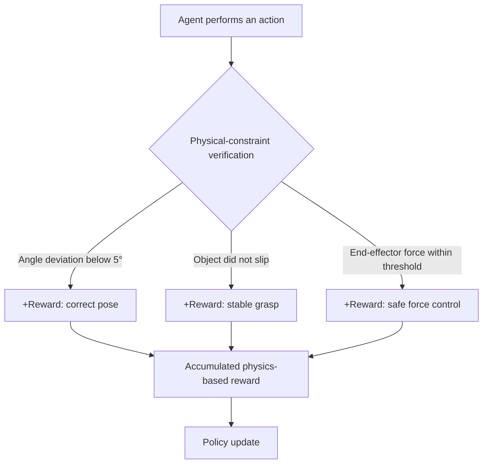

A caveat: such fine-grained physical checks still lack systematic validation on real robots. Sensor noise erodes how "verifiable" they are, and poorly designed checks invite reward hacking just the same. What has actually been deployed at scale in embodied RL so far is mainly the task-success signal in simulation.

## 11.2 Residual-VLA
{: id="112-residual-vla"}

**Residual VLA (Residual Vision-Language-Action)** addresses the problem of efficiently adapting a general-purpose VLA model to a specific robot.

**Background**:
- Large VLA models (such as RT-2 and π0) have strong common sense and generalization, but lack motion precision.
- Full fine-tuning is expensive and may destroy pretrained knowledge.

**Residual architecture design**:

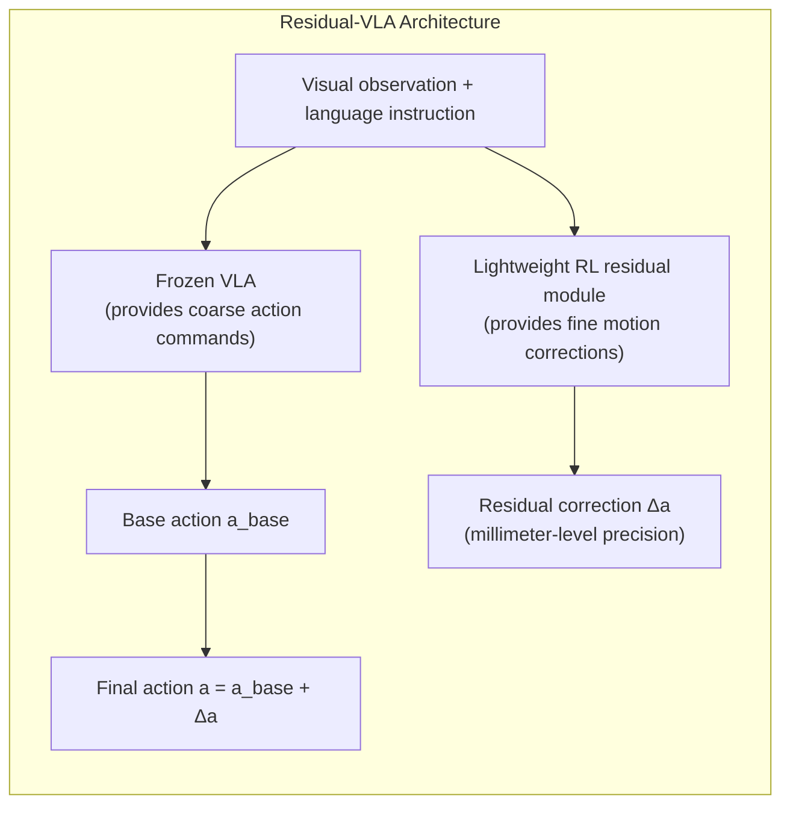

- **VLA model (frozen)**: Provides task understanding and coarse action planning, analogous to the cerebral cortex.
- **RL residual module (trainable)**: Applies real-time fine corrections to the actions output by the large model, analogous to the cerebellum.

**Core advantages**:
1. Only a small residual network (with far fewer parameters than the VLA) is trained, so it **adapts to new scenarios extremely quickly** (hours vs. days).
2. **Preserves pretrained knowledge**: Freezing the large model avoids catastrophic forgetting.
3. **Highly versatile**: The same VLA backbone can be paired with different residual modules to adapt to different robot platforms.

## 11.3 Online RL post-training of VLAs
{: id="113-vla-的在线-rl-后训练"}

Residual schemes train only a small module. Since 2025, more work **fine-tunes the entire VLA with RL**: a VLA obtained by imitation has only seen the states covered by demonstrations and fails easily once it drifts outside that distribution, whereas RL lets it keep learning from its own mistakes. This is the same "SFT → RL" post-training recipe used for LLMs.

| Work | Policy being fine-tuned | Key idea | Reported results |
| :--- | :--- | :--- | :--- |
| [VLA-RL](https://arxiv.org/abs/2505.18719) (2025) | Autoregressive VLA (OpenVLA-7B) | Trajectory-level PPO that models a manipulation trajectory as a multi-turn conversation; a fine-tuned VLM serves as a process reward model to ease sparse rewards | Beats the strongest fine-tuned baseline by 4.5% on 40 LIBERO tasks, on par with π0-FAST |
| [SimpleVLA-RL](https://arxiv.org/abs/2509.09674) (2025) | Autoregressive VLA (OpenVLA-OFT) | Parallel sampling and multi-environment rendering on veRL, 0/1 success reward, GRPO-style group advantages, exploration-enhancing strategies | SOTA on LIBERO, beats π0 on RoboTwin 1.0/2.0; new action patterns absent from demonstrations emerge during training ("pushcut") |
| [πRL](https://arxiv.org/abs/2510.25889) (2025) | Flow matching VLA (π0, π0.5) | Flow-Noise: a learnable noise network makes the denoising chain's likelihood exact; Flow-SDE: ODE-to-SDE conversion giving a two-layer "denoising × environment" MDP | Significant gains both in and out of distribution |
| [π\*₀.₆](https://arxiv.org/abs/2511.14759) (2025) | Flow matching VLA | Autonomous experience + expert interventions, advantage-conditioned offline RL (Recap) | Long real-world tasks, see Section 14.11 |
| [RL-100](https://arxiv.org/abs/2510.14830) (2025) | Diffusion visuomotor policy | A single PPO-Clip objective inside the denoising process, improving step by step from offline to online; consistency distillation into a one-step controller for real-time control | 1000/1000 successes over 8 real tasks; served customers in a shopping mall for about 7 hours without failure |
| [HIL-SERL](https://arxiv.org/abs/2410.21845) (2024) | Vision RL policy (not a VLA) | Demonstrations + human corrections + efficient off-policy RL, trained directly on the real robot | Close to 100% success after 1–2.5 hours of training; average success rate 2× that of imitation and other baselines |

By 2026 the focus has shifted to **exploration efficiency and generalisation of real-robot RL**:

- **Digital-twin guidance**: [TwinRL](https://arxiv.org/abs/2602.09023) reconstructs a digital twin of the scene from a smartphone scan, first runs parallel RL in the twin to fill the replay buffer and find failure-prone configurations, and then trains on the real robot. The paper reports near-100% success both in and out of distribution on four tasks, with about 20 minutes of on-robot interaction and over 30% faster convergence than earlier real-robot RL methods. One observation is especially telling: what real-robot RL can explore is largely boxed in by the trajectory distribution from the SFT stage.
- **Generative 3D worlds**: [Choi et al.](https://arxiv.org/abs/2603.18532) combine a 3D world generative model with a language-driven scene designer to generate 100 diverse interactive scenes automatically, RL fine-tune a VLA in simulation and transfer it to the real robot, raising real-world success from 21.7% to 75%. It targets another hazard of real-robot RL: a policy trained in a single scene overfits and loses the generality that pretraining provided.
- **Off-policy value estimation**: [ALOE](https://arxiv.org/abs/2602.12691) points out that a replay buffer mixes data from past policies, demonstrations and human interventions, so "progress-style" value signals misjudge the current policy. It instead evaluates the current policy off-policy with chunked TD bootstrapping and conservative value aggregation, outperforming other VLA post-training methods on four real tasks including laundry folding and phone assembly.

## 11.4 Scaling RL
{: id="114-rl-的规模化"}

The lesson from LLMs is "bigger models and more data are better", yet RL has long stayed with small 2–5 layer networks. Two threads from 2025 suggest this is changing:

- **Parallel simulation + off-policy learning**: [FastTD3](https://arxiv.org/abs/2505.22642) adds massively parallel simulation, large-batch updates and a distributional critic to TD3, solving a range of HumanoidBench tasks in under 3 hours on a single A100. "Parallel simulation with PPO" used to be the default (Section 6); work like this shows that off-policy algorithms can also profit from parallelism, with better sample efficiency.
- **Deeper networks**: [1000 Layer Networks for Self-Supervised RL](https://arxiv.org/abs/2503.14858) (NeurIPS 2025 Best Paper) deepens contrastive RL networks to 1024 layers in a goal-conditioned setting with no rewards or demonstrations, improving performance by 2–50× and producing qualitatively new behaviours as depth grows. RL can scale after all; the key is finding objectives and architectures that benefit from scale.

---

# 12. Simulators and benchmarks
{: id="12-仿真环境与基准"}

Training and evaluating embodied RL algorithms depends heavily on simulation platforms, which differ in their emphasis on **physics-engine accuracy**, **parallel efficiency** and **task type**. Choosing the right platform gets you twice the result with half the effort.

## 12.1 Continuous control
{: id="121-连续控制基准"}

### MuJoCo / DM Control
{: id="mujoco--dm-control"}

|Property|Details|
| :--- | :--- |
|**Physics engine**|MuJoCo (accurate contact forces, suited to delicate manipulation)|
|**Main tasks**|Classic continuous control such as HalfCheetah, Ant, Humanoid and Hopper|
|**Suitable algorithms**|SAC, TD3 (off-policy); PPO (on-policy)|
|**Features**|The gold standard for comparing algorithms in academia|

**DeepMind Control Suite (DMControl)** extends MuJoCo with tasks such as Cartpole, Walker and Cheetah, and supports a **pixel-observation mode**. It is the main evaluation setting for world-model algorithms such as DreamerV3.

**Gymnasium** (formerly OpenAI Gym) is currently the most common standard interface for RL environments; almost all mainstream RL libraries (Stable-Baselines3, CleanRL) are built on its `Env` interface.

## 12.2 Massively parallel simulation
{: id="122-大规模并行仿真"}

### Isaac Lab / Isaac Gym
{: id="isaac-lab--isaac-gym"}

|Property|Details|
| :--- | :--- |
|**Physics engine**|PhysX (GPU-accelerated)|
|**Parallel scale**|A single GPU can run **4096+ parallel environments**|
|**Main tasks**|Quadruped walking, biped running, dexterous hand manipulation (Shadow Hand, Allegro)|
|**Suitable algorithms**|PPO (its on-policy nature suits large-scale parallelism)|
|**Features**|The standard academic and industrial platform for embodied RL, part of the NVIDIA Omniverse ecosystem|

Isaac Lab is the next-generation successor to Isaac Gym. Built on the USD scene format, it supports more realistic rendering and sensor simulation, and is currently the mainstream choice for training quadruped and biped robot policies.

## 12.3 Manipulation environments
{: id="123-操作任务环境"}

### RoboSuite / robomimic
{: id="robosuite--robomimic"}

**RoboSuite** is a robot manipulation simulation framework from Stanford University. Built on MuJoCo, it provides a variety of robot arm models (Franka, UR5, Sawyer) and manipulation tasks (lifting, assembly, bottle-cap screwing). On top of it, **robomimic** provides large-scale demonstration datasets and a standard evaluation pipeline for joint "imitation learning + RL" training. It is the main evaluation benchmark for manipulation algorithms such as Diffusion Policy and ReinFlow.

### MetaWorld
{: id="metaworld"}

|Property|Details|
| :--- | :--- |
|**Number of tasks**|**50** robot manipulation tasks|
|**Design goal**|Evaluating multi-task learning and zero-shot transfer|
|**Suitable algorithms**|SAC, MT-SAC (multi-task SAC)|
|**Features**|A unified task interface supports zero-shot cross-task evaluation|

## 12.4 Evaluation metrics
{: id="124-评测指标"}

|Metric|Meaning|Main use cases|
| :--- | :--- | :--- |
|**Success rate**|Fraction of episodes in which the task is completed|Manipulation and navigation tasks|
|**Normalized return**|Score relative to the expert policy|MuJoCo continuous control|
|**Sample efficiency**|Number of environment interaction steps needed to reach a target performance|Head-to-head algorithm comparison|
|**Real-time factor**|Ratio of simulation speed to real time|Assessing training throughput|

---

# 13. Choosing an algorithm
{: id="13-算法选择指南"}

When developing an embodied intelligence project, you can choose an algorithm along the following dimensions:

|Task type|Recommended algorithm|Core rationale|Difficulty|
| :--- | :--- | :--- | :---: |
|**Quadruped / biped walking**| **PPO** |Most stable and unfazed by motor limits; native support in Isaac Lab| ⭐⭐ |
|**Precision assembly with a robot arm**| **SAC / TD3** |Off-policy with high sample efficiency; SAC's automatic temperature tuning is more convenient| ⭐⭐⭐ |
|**Dexterous hand grasping**| **SAC** |Entropy regularization encourages diverse actions and copes with multimodal action distributions| ⭐⭐⭐⭐ |
|**Long-horizon navigation and manipulation**| **TD-MPC2** |Latent-space planning suits multi-step sequential decisions| ⭐⭐⭐⭐ |
|**Multi-task / generalizable manipulation**| **Diffusion Policy + ReinFlow** |Natural, smooth action trajectories that can handle conflicting goals| ⭐⭐⭐⭐⭐ |
|**Fine-tuning large VLA models**| **Residual-RL** |Preserves pretrained knowledge while adapting quickly to a specific scenario| ⭐⭐⭐⭐ |
| **Full RL post-training of VLAs** | **GRPO / PPO (SimpleVLA-RL, πRL)** | Task success in simulation as a verifiable reward, going beyond the demonstration distribution | ⭐⭐⭐⭐⭐ |
|**Sparse-reward environments**| **SAC + ICM / HER** |Intrinsic rewards plus experience reuse alleviate reward sparsity| ⭐⭐⭐⭐⭐ |

**Algorithm selection decision tree**:

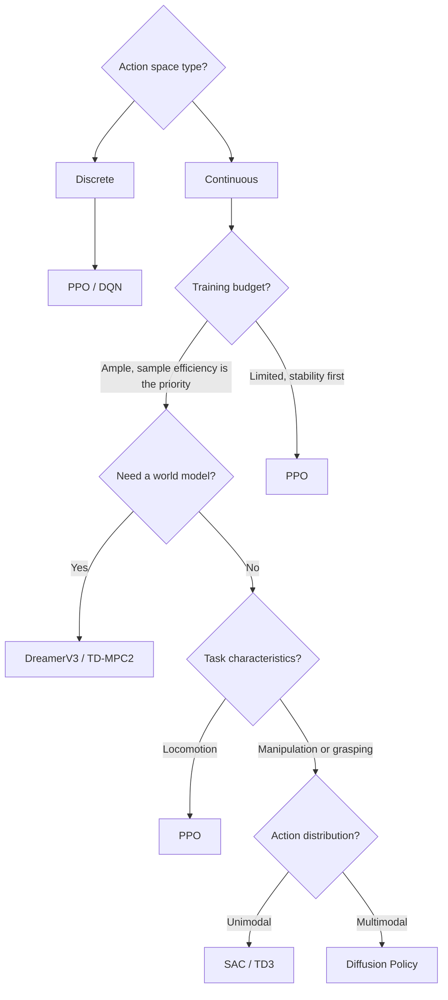

---

# 14. Classic papers
{: id="14-经典论文解析"}

To help readers systematically follow the evolution of reinforcement learning from classic theory to the frontier of embodied intelligence, this chapter selects **12 milestone classics and cutting-edge papers** for in-depth analysis. Each paper follows a standard structure: [Key takeaways], [Background and problem], [Method and innovations], [Results and findings] and [Limitations].

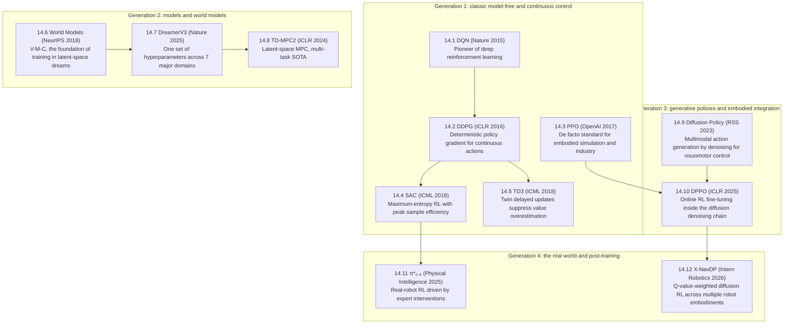

---

## 14.1 DQN (2015)
{: id="141-dqn-2015"}
——Human-level control: the pioneering work of deep reinforcement learning

📄 **Paper**: [Nature 2015 (Vol 518, pp 529–533)](https://www.nature.com/articles/nature14236)  
💻 **Code**: [DeepMind / DQN](https://github.com/deepmind/dqn)

### Key takeaways
{: id="精华"}
1. **Historic breakthrough**: It showed for the first time that a deep neural network can learn policies end-to-end directly from raw high-dimensional pixels, matching or even surpassing human experts on 49 Atari 2600 games without hand-designed features.
2. **Experience replay**: It maintains a circular replay buffer to break the strong autocorrelation between sequential samples, turning non-i.i.d. time-series data into stationary random mini-batches.
3. **Target Q-network**: It decouples the weights used for action evaluation from those used for target estimation by periodically freezing the target parameters $\theta^-$, eliminating at the root the training oscillation and divergence caused by bootstrapping.
4. **A unified architecture that generalizes**: One CNN architecture and one set of hyperparameters handle all the Atari games, despite their different rules and visual appearances.
5. **Establishing the modern deep-RL paradigm**: It tightly integrated deep representation learning with reinforcement learning, ushering in a golden decade of deep RL.

---

### 1. Background and problem
{: id="1-研究背景问题"}

Before 2015, classical reinforcement learning was mostly limited to low-dimensional hand-crafted state spaces (such as positions, velocities, or linear basis functions from feature engineering). On complex control tasks with raw video frames as input, combining traditional nonlinear function approximators (such as shallow neural networks) with Q-learning tends to diverge or be unstable. The main pain points were:
- **Overly strong data correlation**: Transitions $(s_t, a_t, r_t, s_{t+1})$ collected at consecutive time steps are highly correlated in time, violating the i.i.d. assumption of SGD.
- **The non-stationary target trap**: When computing the TD target $y = r + \gamma \max_{a'} Q(s', a'; \theta)$, the target depends directly on the parameters $\theta$ being updated. Training is like "shooting at a moving bullseye" and easily falls into positive-feedback divergence.

---

<div align="center">
  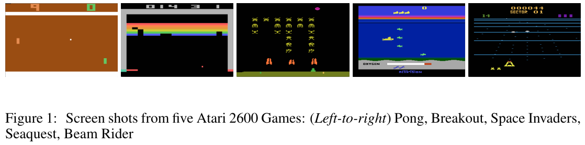
<figcaption>Figure 14.1: Classic Atari 2600 game screenshots (Pong, Breakout, Space Invaders, Beam Rider, Seaquest) evaluated by DQN</figcaption>
</div>

### 2. Method and innovations
{: id="2-主要方法创新点"}

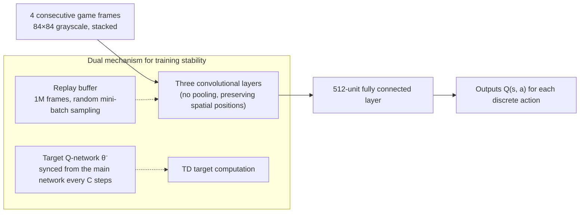

#### ① State representation and preprocessing
{: id="-状态表征与预处理"}
- To capture the dynamics in video, the 4 most recent grayscale frames are stacked into an $84 \times 84 \times 4$ tensor as the state input $s_t$. This effectively resolves the loss of the Markov property, since the ball's speed and direction cannot be inferred from a single frame.

#### ② Experience replay
{: id="-经验回放机制experience-replay"}
- An experience pool $\mathcal{D} = \{e_1, e_2, \ldots, e_N\}$ with capacity $N = 10^6$ is maintained, where each transition is $e_t = (s_t, a_t, r_t, s_{t+1})$.
- At each parameter update, a mini-batch is sampled uniformly at random from $\mathcal{D}$ for gradient descent, which fully breaks temporal correlation and greatly improves data reuse.

#### ③ Target network and loss function
{: id="-目标网络与损失函数"}
- A target network with delayed-update parameters $\theta^-$ is introduced, and the loss function is defined as:

$$
\mathcal{L}_i(\theta_i) = \mathbb{E}_{(s, a, r, s') \sim U(\mathcal{D})}\left[ \left( r + \gamma \max_{a'} Q(s', a'; \theta_i^-) - Q(s, a; \theta_i) \right)^2 \right]
$$

- The target network parameters are copied directly from the current network every fixed number of steps $C$ (e.g. 10,000 steps): $\theta_i^- \leftarrow \theta_i$.

---

### 3. Results and findings
{: id="3-核心结果发现"}

- Across 49 Atari games, DQN outperformed professional human testers on **more than half (29 games)**. It showed superhuman reflexes and tactics in games such as Breakout, Pong and Space Invaders, including digging a tunnel through the bricks in Breakout so the ball keeps bouncing above them.
- Ablation experiments showed that removing experience replay makes performance drop off a cliff on most games or even fail to converge, and removing the target network causes severe divergence of the Q-value estimates.

---

### 4. Limitations
{: id="4-局限性"}

1. **Only applicable to low-dimensional discrete actions**: Selecting an action via $\max_{a'} Q(s', a')$ has a computational cost that grows exponentially with the action dimension, so it cannot be applied directly to continuous joint-angle control of robot arms.
2. **Systematic Q-value overestimation (overestimation bias)**: The $\max$ operator accumulates noise in the positive direction, which motivated the later Double DQN.
3. **Low sample efficiency**: It usually needs tens of millions of frames of environment interaction to learn one game, making it hard to deploy directly on real robots whose hardware suffers heavy wear.

---

## 14.2 DDPG (2016)
{: id="142-ddpg-2016"}
——The cornerstone of continuous control: deep deterministic policy gradient

📄 **Paper**: [ICLR 2016](https://arxiv.org/abs/1509.02971)  
💻 **Code**: [OpenAI Baselines / DDPG](https://github.com/openai/baselines)

### Key takeaways
{: id="精华-1"}
1. **A breakthrough for continuous actions**: It was the first to extend DQN's deep representations and its experience replay / target network mechanisms successfully to **high-dimensional continuous action spaces**.
2. **An implementation of the deterministic policy gradient (DPG)**: The actor directly outputs a deterministic action vector $\mu(s\mid\theta^\mu)$, avoiding the high variance of integral sampling in high-dimensional continuous action spaces.
3. **Soft target updates (Polyak averaging)**: It proposed $\theta' \leftarrow \tau \theta + (1-\tau)\theta'$ ($\tau \ll 1$), a slow, smooth update of the target network that greatly improves training stability in continuous control.
4. **Exploration noise injection**: Temporally correlated Ornstein-Uhlenbeck (OU) noise is added to the deterministic actions, enabling smooth exploration in continuous physical systems.
5. **A milestone for embodied control**: It demonstrated strong end-to-end torque control in MuJoCo physical simulation (robot arm manipulation, bipedal walking, car driving).

---

### 1. Background and problem
{: id="1-研究背景问题-1"}

Although DQN achieved great success on discrete games, real-world physical tasks such as robot manipulation and multi-legged gait control all involve high-dimensional continuous action spaces (e.g. the real-time torques or angles of $N$ motors). Discretizing the continuous action space runs into the **curse of dimensionality** (for example, splitting each joint of a 7-DoF arm into 10 bins gives $10^7$ discrete actions). What was needed was a deep off-policy RL algorithm that optimizes end-to-end directly in continuous action space with high sample efficiency.

---

<div align="center">
  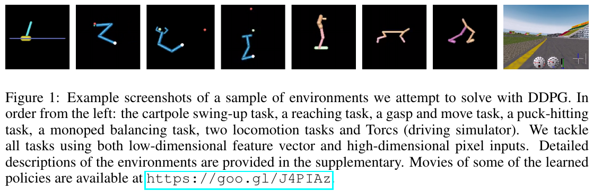
<figcaption>Figure 14.2: Examples of MuJoCo and physical-simulation continuous-control environments solved by DDPG (robot grasping, bipedal walking, car driving, etc.)</figcaption>
</div>

### 2. Method and innovations
{: id="2-主要方法创新点-1"}

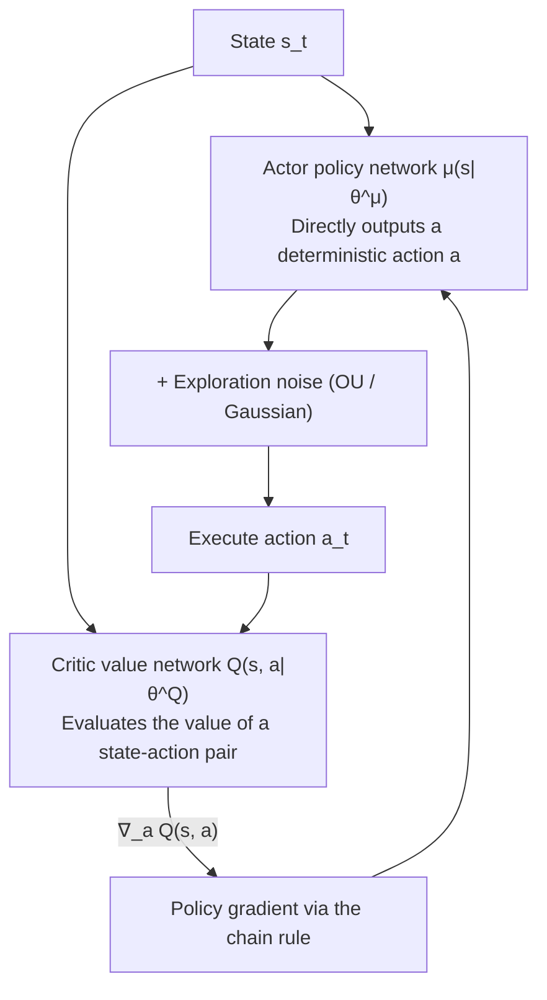

#### ① Actor-critic architecture and deterministic update
{: id="-actor-critic-架构与确定性更新"}
- **Actor update**: Maximize the action value estimated by the critic, using the chain rule:

$$
\nabla_{\theta^\mu} J \approx \frac{1}{N} \sum_i \nabla_a Q(s, a; \theta^Q)\Big|_{s=s_i, a=\mu(s_i;\theta^\mu)} \cdot \nabla_{\theta^\mu} \mu(s; \theta^\mu)\Big|_{s=s_i}
$$

- **Critic update**: Minimize the mean squared Bellman residual:

$$
y_i = r_i + \gamma Q'\left(s_{i+1}, \mu'(s_{i+1}; \theta^{\mu'}); \theta^{Q'}\right), \quad \mathcal{L}(\theta^Q) = \frac{1}{N} \sum_i \left( Q(s_i, a_i; \theta^Q) - y_i \right)^2
$$

#### ② Polyak soft update
{: id="-polyak-软更新"}
- Instead of DQN's periodic hard copies, DDPG uses incremental soft updates:

$$
\theta^{Q'} \leftarrow \tau \theta^Q + (1-\tau)\theta^{Q'}, \quad \theta^{\mu'} \leftarrow \tau \theta^\mu + (1-\tau)\theta^{\mu'} \quad (\tau = 0.001)
$$

---

### 3. Results and findings
{: id="3-核心结果发现-1"}

- On more than 20 continuous-control benchmarks in the MuJoCo dynamics environment (Cartpole, Reacher, Cheetah, Humanoid, etc.), DDPG learned stable control with exactly the same hyperparameters and network architecture.
- Control from pixel input also works: given raw RGB frames, DDPG can still learn to control a robot arm to complete grasp alignment.

---

### 4. Limitations
{: id="4-局限性-1"}

1. **Extreme sensitivity to hyperparameters**: Slight deviations in the learning rate or noise scale easily lead to policy collapse.
2. **Severe Q-value overestimation**: With a single critic, the continually updated deterministic policy over-exploits local maxima, which easily makes the Q-network diverge (this motivated TD3).

---

## 14.3 PPO (2017)
{: id="143-ppo-2017"}
——The de facto standard for embodied control: proximal policy optimization

📄 **Paper**: [arXiv:1707.06347 (OpenAI)](https://arxiv.org/abs/1707.06347)  
💻 **Code**: [OpenAI Baselines / PPO](https://github.com/openai/baselines)

### Key takeaways
{: id="精华-2"}
1. **A balance of engineering and theory**: Building on TRPO's rigorous trust-region theory, it proposes the **clipped surrogate objective**, which avoids second-order conjugate-gradient and Hessian computations and is highly stable under a first-order optimizer.
2. **Limiting destructive policy updates**: By restricting the probability ratio $r_t(\theta)$ to the interval $[1-\epsilon, 1+\epsilon]$, it fundamentally eliminates the disaster in which a single bad batch with an overly large gradient irreversibly "collapses" the policy.
3. **Multi-epoch data reuse**: Unlike traditional on-policy methods that take one gradient step per sample, it safely runs multiple epochs of mini-batch SGD on the same batch of rollouts.
4. **Broad applicability**: From discrete Atari games and MuJoCo continuous control to quadruped gaits (ANYmal / Unitree), humanoid robots and even RLHF alignment of LLMs, it has become the default industry baseline.
5. **Naturally compatible with large-scale GPU parallelism**: With the vectorized simulation environments of physics engines such as Isaac Lab, it enables extremely fast end-to-end policy training across thousands of parallel environments.

---

### 1. Background and problem
{: id="1-研究背景问题-2"}

Policy gradient algorithms (such as REINFORCE and A2C) commonly suffer from two major problems: **sample inefficiency** and **training that is prone to collapse**:
- **The on-policy bottleneck**: Once the policy is updated, previously collected data immediately becomes invalid and must be discarded and resampled.
- **Extreme step-size sensitivity**: In the standard policy gradient, a slightly too large parameter update can push the policy into a region of very poor performance (a "blind zone"). The samples the new policy collects are of extremely low quality, so later gradients can never recover and training fails completely.
Although TRPO solves the stability problem with a second-order KL-divergence constraint, computing the inverse of the Fisher information matrix is extremely expensive and hard to scale.

---

<div align="center">
  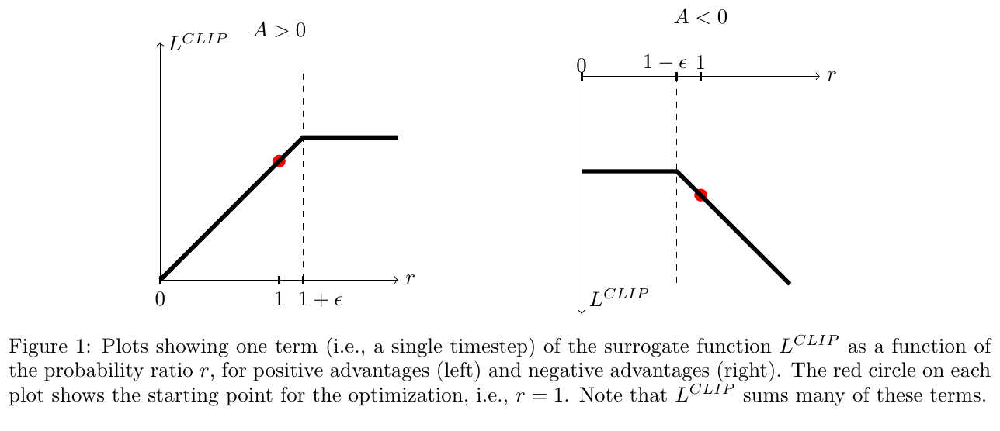
<figcaption>Figure 14.3: Schematic of PPO's clipped surrogate objective L^CLIP: updates are curbed by clipping when the advantage is positive (left) and negative (right)</figcaption>
</div>

### 2. Method and innovations
{: id="2-主要方法创新点-2"}

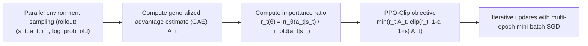

#### ① Clipped Surrogate Objective
{: id="-裁剪代理目标函数clipped-surrogate-objective"}
The core loss function of PPO-Clip is simple and elegant:

$$
L^{\mathrm{CLIP}}(\theta) = \hat{\mathbb{E}}_t \left[ \min\left( r_t(\theta)\hat{A}_t,\; \mathrm{clip}(r_t(\theta), 1-\epsilon, 1+\epsilon)\hat{A}_t \right) \right]
$$

Here $r_t(\theta) = \frac{\pi_\theta(a_t\mid s_t)}{\pi_{\theta_{\mathrm{old}}}(a_t\mid s_t)}$. The clipping logic is as follows:
- When the advantage is $$\hat{A}_t > 0$$ (the action is better than average): the objective increases with $r_t$ but is clipped once $r_t > 1+\epsilon$, preventing the policy from becoming too greedy because of a single good sample.
- When the advantage is $$\hat{A}_t < 0$$ (the action is worse than average): the objective decreases as $r_t$ grows but is clipped once $r_t < 1-\epsilon$, preventing gradient overcorrection.

#### ② Joint objective and GAE (generalized advantage estimation)
{: id="-联合目标与-gae广义优势估计"}
In practical embodied control, the policy loss, the critic's value loss and a policy-entropy regularizer are usually optimized jointly:

$$
L_t^{\mathrm{CLIP+VF+S}}(\theta) = \hat{\mathbb{E}}_t \left[ L_t^{\mathrm{CLIP}}(\theta) - c_1 \left( V_\theta(s_t) - V_t^{\mathrm{targ}} \right)^2 + c_2 \mathcal{H}(\pi_\theta(\cdot|s_t)) \right]
$$

---

### 3. Results and findings
{: id="3-核心结果发现-2"}

- On MuJoCo continuous-control benchmarks, PPO outperforms A2C, TRPO and CEM on almost all tasks (HalfCheetah, Hopper, Walker2d, Ant) with an order of magnitude less code.
- It became the core algorithm behind OpenAI's training of complex embodied systems (such as the OpenAI Five Dota 2 agent and the Shadow Dactyl robot that solved the Rubik's Cube).

---

### 4. Limitations
{: id="4-局限性-2"}

1. **Sample efficiency remains lower than that of off-policy algorithms**: PPO permits limited reuse across a few epochs but remains on-policy. It cannot reuse millions of historical transitions from a replay buffer as SAC or TD3 can.
2. **The hyperparameter $\epsilon$ and the learning-rate schedule still need tuning**: On some long-horizon fine-manipulation tasks it may settle into a poor, overly conservative policy.

---

## 14.4 SAC (2018)
{: id="144-sac-2018"}
———The pinnacle of maximum-entropy RL: the soft actor-critic algorithm

📄 **Paper**: [ICML 2018](https://arxiv.org/abs/1801.01290)  
💻 **Code**: [rail-berkeley / softlearning](https://github.com/rail-berkeley/softlearning)

### Key takeaways
{: id="精华-3"}
1. **Maximum-entropy reinforcement learning**: The policy entropy $\mathcal{H}(\pi(\cdot\mid s))$ is introduced explicitly into the optimization objective, driving the agent to keep its action distribution as diverse as possible while maximizing cumulative return.
2. **Excellent exploration and robustness**: Facing multimodal rewards and physical disturbances, a maximum-entropy policy retains all action branches of similar value and avoids premature convergence to a local suboptimum.
3. **Off-policy learning with high sample efficiency**: Combining a replay buffer, double Q-learning and soft policy iteration, it improves sample efficiency over PPO by several times to tens of times.
4. **Automatic temperature tuning**: A later version introduced a Lagrange multiplier to adapt the temperature coefficient $\alpha$, completely eliminating the tedious manual tuning of the entropy weight.
5. **A first choice for embodied robot arms and dexterous hands**: One of the most popular and robust algorithms for real-world arm assembly, object rotation and contact-rich physical tasks.

---

### 1. Background and problem
{: id="1-研究背景问题-3"}

Traditional reinforcement learning pursues a deterministic optimal policy $\pi^* = \arg\max \mathbb{E}[R]$. In the complex physical world, however, deterministic policies have notable weaknesses:
- **Easily trapped in local optima**: Once exploration stops too early, the robot can never discover a better behavior.
- **Poor disturbance rejection**: Small physical changes in the environment (such as friction changes or collision disturbances) can make the policy fail.
- **Unstable off-policy continuous-control algorithms**: DDPG often suffers Q-value collapse when its hyperparameters are poorly chosen.

---

<div align="center">
  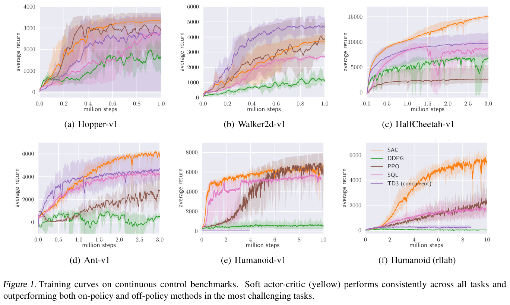
<figcaption>Figure 14.4: Training convergence curves of SAC on MuJoCo continuous-control benchmarks (HalfCheetah, Hopper, Walker2d, Ant, Humanoid)</figcaption>
</div>

### 2. Method and innovations
{: id="2-主要方法创新点-3"}

```mermaid
graph TD
    A["Maximum-entropy objective: E["∑ γ^t (r_t + α H(π))"]"] --> B["Actor policy network: outputs Gaussian mean μ and variance σ"]
    B --> C["Reparameterized action sampling: a = tanh(μ + σ ⊙ ε)"]
    C --> D["Twin critics Q1, Q2 evaluate"]
    D --> E["Take the minimum min(Q1, Q2) to prevent overestimation"]
    E --> F["Adaptively update temperature α (to meet target entropy H_target)"]
```

#### ① Maximum-entropy objective
{: id="-最大熵目标函数"}
$$
J(\pi) = \sum_{t=0}^T \mathbb{E}_{(s_t, a_t) \sim \rho_\pi} \left[ r(s_t, a_t) + \alpha \mathcal{H}(\pi(\cdot|s_t)) \right]
$$

#### ② Soft Bellman equation and soft value iteration
{: id="-软-bellman-方程与软价值迭代"}
- **Soft Q-function target**:

$$
y = r + \gamma \mathbb{E}_{s' \sim p, a' \sim \pi}\left[ \min_{j=1,2} Q_{\bar{\theta}_j}(s', a') - \alpha \log \pi_\phi(a'|s') \right]
$$

- **Actor objective** (using the reparameterization trick $a_\phi(s, \epsilon) = \tanh(\mu_\phi(s) + \sigma_\phi(s) \odot \epsilon)$, $\epsilon \sim \mathcal{N}(0, I)$):

$$
J_\pi(\phi) = \mathbb{E}_{s \sim \mathcal{D}, \epsilon \sim \mathcal{N}}\left[ \alpha \log \pi_\phi(a_\phi(s, \epsilon)|s) - \min_{j=1,2} Q_{\theta_j}(s, a_\phi(s, \epsilon)) \right]
$$

#### ③ Automatic temperature tuning of $\alpha$
{: id="-自动调节温度系数-alpha"}
Posing this as a constrained optimization problem, $\alpha$ is adjusted dynamically so that the policy entropy stays no lower than the target entropy $\bar{\mathcal{H}} = -\dim(\mathcal{A})$:

$$
J(\alpha) = \mathbb{E}_{s \sim \mathcal{D}, a \sim \pi}\left[ -\alpha \log \pi(a|s) - \alpha \bar{\mathcal{H}} \right]
$$

---

### 3. Results and findings
{: id="3-核心结果发现-3"}

- In the MuJoCo continuous control benchmarks (Humanoid, Ant, HalfCheetah), SAC significantly surpasses DDPG, PPO and TD3 in terms of convergence speed and final performance.
- **Zero-shot robustness on a real robot**: In a real Minitaur quadruped walking experiment, SAC learned a stable gait from scratch in only **2 hours** of interaction and resisted disturbances such as external kicks.

---

### 4. Limitations
{: id="4-局限性-3"}

1. **Relatively high computational cost**: Each step requires multiple samples and forward and backward passes through two critics plus the target critics.
2. **Limited multimodal expressiveness**: Although better than a single Gaussian policy, the output is a squashed Gaussian and still cannot perfectly cover complex, disjoint multi-goal distributions (such as passing an obstacle on either the left or the right).

---

## 14.5 TD3 (2018)
{: id="145-td3-2018"}
——Twin delayed deterministic policy gradient: taming value-function approximation error

📄 **Paper**: [ICML 2018](https://arxiv.org/abs/1802.09477)  
💻 **Code**: [sfujim / TD3](https://github.com/sfujim/TD3)

### Key takeaways
{: id="精华-4"}
1. **Revealing the overestimation mechanism in continuous control**: It was the first systematic proof that in actor-critic algorithms for continuous action spaces, value-function approximation error causes severe cumulative overestimation, which drives the actor into suboptimal regions.
2. **Clipped double Q-learning**: Two Q-networks are trained independently and the smaller of the two is used in the TD target, eliminating harmful overestimation at the cost of a slight underestimation bias.
3. **Delayed policy updates**: The actor and target networks are updated less often (one actor update for every 2 critic updates), so the critic is more stable and accurate before the policy is updated.
4. **Target policy smoothing regularization**: Clipped random Gaussian noise is injected into the target action when computing the target value, which enforces smoothness of the Q-function along the action dimension.
5. **A clean and robust baseline**: It set a high-precision industrial benchmark for deterministic-policy continuous control.

---

### 1. Background and problem
{: id="1-研究背景问题-4"}

In discrete Q-learning, the maximization $\max_a Q(s, a)$ introduces a positive estimation bias (as shown by Double DQN). In DDPG for continuous control, the critic keeps giving high Q estimates because gradient ascent is used to search for the maximizing action. These overestimation errors propagate and accumulate through temporal-difference bootstrapping, so the actor blindly chases spurious high-value action peaks and training eventually oscillates and collapses.

---

<div align="center">
  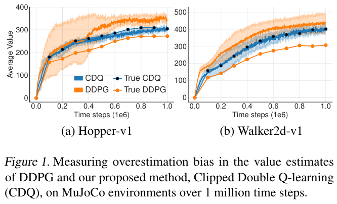
<figcaption>Figure 14.5: During training, DDPG's Q-value (red line) deviates badly from the true cumulative return and is viciously overestimated, whereas TD3's value estimate (blue line) stays close to the true return throughout</figcaption>
</div>

### 2. Method and innovations
{: id="2-主要方法创新点-4"}

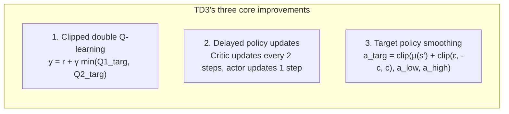

#### ① Clipped double Q-learning
{: id="-截断双-q-学习机制"}
Train two independent critics with parameters $\theta_1, \theta_2$:

$$
y = r + \gamma \min_{i=1,2} Q_{\theta_i'}\left(s',\; \tilde{a}'\right)
$$

Taking the minimum of the two keeps the Q-function from diverging towards positive infinity even in the presence of approximation error.

#### ② Target policy smoothing
{: id="-目标策略平滑"}
Clipped Gaussian noise is injected when computing the action for the next state:

$$
\tilde{a}' = \mathrm{clip}\left( \mu_{\phi'}(s') + \mathrm{clip}(\epsilon, -c, c),\; a_{\mathrm{low}},\; a_{\mathrm{high}} \right), \quad \epsilon \sim \mathcal{N}(0, \sigma)
$$

This rests on a physical intuition: similar actions should yield similar values, which prevents the actor from exploiting narrow, sharp, spuriously high-value peaks on the critic's surface.

---

### 3. Results and findings
{: id="3-核心结果发现-4"}

- On 7 classic MuJoCo continuous-control benchmarks, TD3's stability and final return clearly surpassed DDPG and matched SAC on most metrics.
- Q-value tracking experiments show that after tens of thousands of steps DDPG's estimated Q-value is quickly 2 to 5 times higher than the true cumulative return, whereas TD3's estimate stays highly consistent with the true return.

---

### 4. Limitations
{: id="4-局限性-4"}

1. **A deterministic policy has no intrinsic exploration mechanism**: Exploration relies entirely on external action-space noise (such as Gaussian noise) and is easily blocked in long-horizon sparse-reward environments.
2. **Hyperparameters still need tuning**: The number of delay steps and the noise clipping range must be set according to the system's physical characteristics.

---

## 14.6 World Models (2018)
{: id="146-world-models-2018"}
——Dreaming ahead in latent space: the V-M-C architecture and the foundation of model-based RL

📄 **Paper**: [NeurIPS 2018](https://arxiv.org/abs/1803.10122)  
💻 **Code**: [worldmodels.github.io](https://worldmodels.github.io/)

### Key takeaways
{: id="精华-5"}
1. **A cognitive-science-inspired architecture (the V-M-C paradigm)**: A trinity consisting of a **visual encoder (V)**, **memory dynamics (M)** and a **lightweight controller (C)**, which for the first time trained a policy entirely inside a "dream" generated by a neural network.
2. **Visual dimensionality reduction (V model)**: A variational autoencoder (VAE) compresses complex raw image frames into low-dimensional continuous latent variables $z_t$, filtering out background redundancy.
3. **Temporal dynamics prediction (M model)**: An MDN-RNN (mixture density recurrent network) autoregressively models the action-conditioned latent transition distribution $P(z_{t+1} \mid z_t, a_t, h_t)$, capturing the stochasticity of the physical environment.
4. **A minimalist controller (C model)**: The controller is just a single-layer linear mapping (only a few thousand parameters), optimized quickly in the dream world with an evolution strategy (CMA-ES), which avoids long-range backpropagation through the world model altogether.
5. **Opening a new era of world models**: It laid the theoretical and architectural foundation for the later Dreamer series, MuZero and embodied physical world models.

---

### 1. Background and problem
{: id="1-研究背景问题-5"}

Traditional model-free RL (such as DQN and PPO) treats the environment as an unknowable black box and needs millions of steps of interaction with the physical world or a high-fidelity simulator, so **sample efficiency is extremely low**. The human brain has a powerful internal world model: it can "rehearse" possible futures in the mind and make decisions based on past experience. The core question is: **can a compact generative neural network be trained to simulate the spatiotemporal evolution of the environment, so that the agent can improve its policy entirely within a dream in latent space?**

---

<div align="center">
  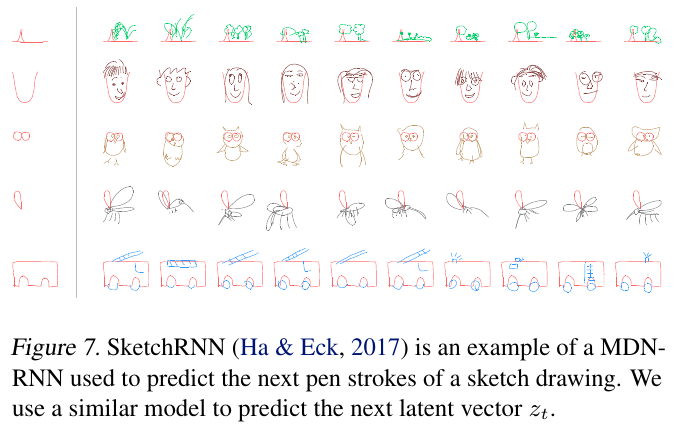
<figcaption>Figure 14.6: The complete data flow of World Models: V compresses the image into a latent vector z_t, which is concatenated with the recurrent hidden state h_t of the M model and fed to the C controller to produce the action a_t</figcaption>
</div>

### 2. Method and innovations
{: id="2-主要方法创新点-5"}

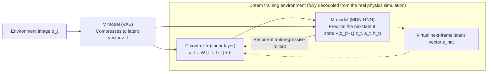

#### ① V model: spatial compression (Vision)
{: id="-v-模型空间压缩vision"}
- A VAE encoder $q_\phi(z_t\mid o_t)$ and decoder $p_\psi(o_t\mid z_t)$ are trained to compress a $64 \times 64 \times 3$ image into a 32-dimensional Gaussian latent vector $z_t$.

#### ② M model: temporal prediction (Memory)
{: id="-m-模型时间预测memory"}
- An RNN with a mixture-of-Gaussians output layer (a mixture density network) models the environment transitions:

$$
P(z_{t+1} \mid z_t, a_t, h_t) = \sum_{k=1}^K \pi_k(h_t) \mathcal{N}\left(z_{t+1};\; \mu_k(h_t), \Sigma_k(h_t)\right)
$$

- A temperature parameter $\tau$ is introduced to control the randomness and uncertainty of the dream environment.

#### ③ C model: policy control (Controller)
{: id="-c-模型策略控制controller"}
- The controller has only hundreds to thousands of weights and takes only the current $z_t$ and the RNN hidden state $h_t$ as input to output the action $a_t$. The cumulative dream score is optimized directly with CMA-ES (Covariance Matrix Adaptation Evolution Strategy).

---

### 3. Results and findings
{: id="3-核心结果发现-5"}

- **CarRacing-v0**: A controller trained entirely inside the MDN-RNN dream and deployed directly on the real track scored **906 ± 21**, which solved the benchmark and outperformed all previous model-free RL methods.
- **VizDoom**: In a complex first-person shooter, the agent learned to dodge fireball attacks nimbly inside a "fictional dream scenario".

---

### 4. Limitations
{: id="4-局限性-5"}

1. **Stage-wise decoupled training lacks end-to-end coordination**: V, M and C are trained independently. The VAE features ignore downstream reward relevance and may miss small but key objects.
2. **Dream illusion (adversarial exploitation)**: The controller easily finds unrealistic loopholes in the M model's latent dynamics, obtaining false high scores in the dream but failing on the real robot.

---

## 14.7 DreamerV3 (2023/2025)
{: id="147-dreamerv3-20232025"}
——A milestone in universal world models: mastering control across domains and scales

📄 **Paper**: [Nature 2025 / arXiv:2301.04104 (Google DeepMind)](https://arxiv.org/abs/2301.04104)  
💻 **Code**: [danijar / dreamerv3](https://github.com/danijar/dreamerv3)

### Key takeaways
{: id="精华-6"}
1. **The first universal world model with fixed hyperparameters across domains**: With completely fixed hyperparameters, the same algorithm handles 7 heterogeneous domains (Atari, DMC continuous control, Crafter 2D survival, Minecraft 3D sandbox, BSuite, memory tasks, etc.).
2. **Symlog transformation and scale invariance**: The symmetric logarithmic transformation $\mathrm{symlog}(x) = \mathrm{sign}(x)\ln(\lvert x\rvert+1)$ is applied to input features, the value network and the loss function, completely resolving the problem of reward gradients whose scales span many orders of magnitude across tasks.
3. **RSSM with discrete latent variables (Recurrent State-Space Model)**: The stochastic latent state of the world model is represented as groups of discrete categorical vectors, which effectively prevents information collapse and improves the expressiveness of nonlinear, abrupt dynamics.
4. **Mining diamonds in Minecraft without expert demonstrations**: With no human demonstrations, relying entirely on sparse rewards and exploration in the latent-space world model, it learns from scratch to collect wood, craft a workbench, mine iron ore and obtain diamonds (a deep dependency chain of 14 steps).
5. **A general simulation foundation for embodied intelligence**: It demonstrates the great potential of world models as general embodied planners.

---

### 1. Background and problem
{: id="1-研究背景问题-6"}

Traditional model-based RL performs well on specific tasks (such as low-dimensional physical control), but on highly heterogeneous tasks with complex, varied visuals and reward scales from 0.001 to 100,000, it easily fails because of hyperparameter sensitivity, exploding gradients or representation collapse. The core challenge is: **is there a robust world-model learning mechanism that can represent multimodal physical dynamics and support long-horizon decisions in general, without tuning hyperparameters or network architecture for each environment?**

---

<div align="center">
  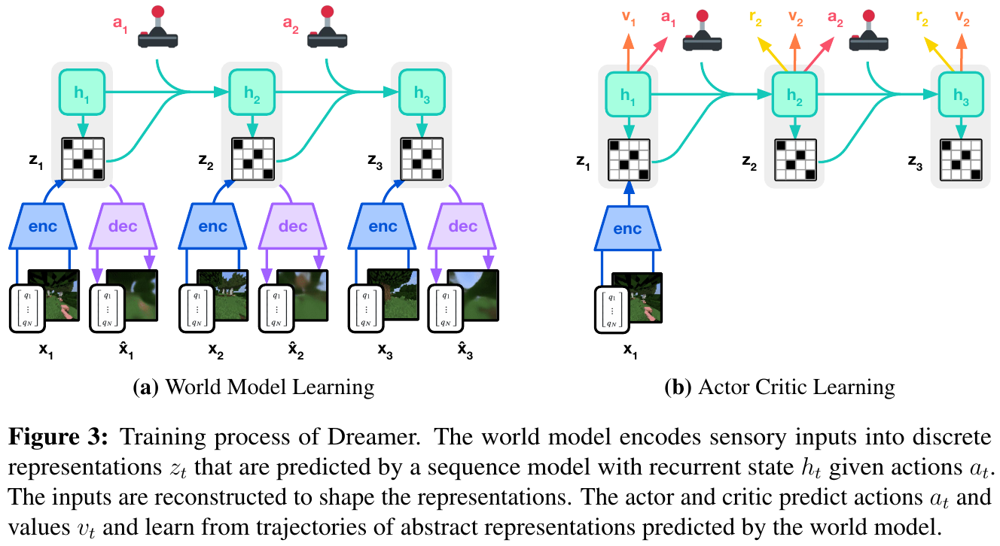
<figcaption>Figure 14.7: DreamerV3 training pipeline: (a) learning the RSSM world model from real experience; (b) unrolling trajectories in latent space; (c) optimizing the actor-critic policy in imagination</figcaption>
</div>

### 2. Method and innovations
{: id="2-主要方法创新点-6"}

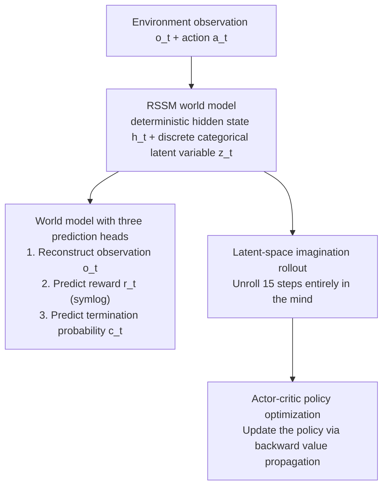

#### ① Robust representation learning and RSSM
{: id="-稳健的表征学习与-rssm"}
The RSSM combines a deterministic path through a recurrent neural network with a stochastic path sampled from discrete latent variables:
- Deterministic hidden state: $h_t = f_\phi(h_{t-1}, z_{t-1}, a_{t-1})$;
- Discrete stochastic latent variable: $z_t \sim q_\phi(z_t \mid h_t, o_t)$, consisting of 32 categorical distributions with 32 classes each (trained with the straight-through gradient estimator).

#### ② Symlog transformation and scale-invariant loss
{: id="-symlog-变换与两步缩放损失"}
To remove the large differences in reward magnitude, DreamerV3 applies the $\mathrm{symlog}$ transformation to all regression targets and uses adaptive normalization based on the percentile of an exponential moving average in value updates:

$$
\mathrm{symlog}(x) = \mathrm{sign}(x) \ln(|x| + 1)
$$

---

### 3. Results and findings
{: id="3-核心结果发现-6"}

- **Strong results across 7 domains**: With a single hyperparameter setting, it set new SOTA on benchmarks including 50 Atari games, DMC Proprio / DMC Visual, Crafter and Minecraft.
- **Minecraft diamond milestone**: It mined diamonds within 100 million environment steps without human intervention (collect wood $\to$ wooden pickaxe $\to$ stone $\to$ stone pickaxe $\to$ iron ore $\to$ smelting $\to$ iron pickaxe $\to$ diamond), a milestone in the history of reinforcement learning.

---

### 4. Limitations
{: id="4-局限性-6"}

1. **Computational overhead remains considerable**: Unrolling the RSSM loop and image-level autoregressive reconstruction require substantial GPU memory and compute.
2. **Insufficient modeling of fine local physical contact**: For fine-grained force-control tasks such as millimeter-level contact assembly, the latent-space visual generation still suffers from smooth, blurry predictions.

---

## 14.8 TD-MPC2 (2024)
{: id="148-td-mpc2-2024"}
——Latent-space model predictive control: SOTA for long-horizon, multi-task embodied decision-making

📄 **Paper**: [ICLR 2024](https://arxiv.org/abs/2310.16828)  
💻 **Code**: [nicklashansen / tdmpc2](https://github.com/nicklashansen/tdmpc2)

### Key takeaways
{: id="精华-7"}
1. **A unified framework of TD learning and MPC**: In latent space it tightly unifies **model predictive control (MPC, local short-horizon planning)** with **temporal-difference (TD) learning (long-term value estimation)**, combining the accuracy of online local optimization with long-horizon global foresight.
2. **An efficient latent world model without pixel-level reconstruction**: It drops the expensive pixel-by-pixel decoding and reconstruction loss and trains end-to-end directly in latent space through self-supervised temporal prediction plus multi-task reward / termination / Q-value heads, greatly saving compute and GPU memory.
3. **A single policy mastering hundreds of embodied skills**: With a single Transformer/MLP architecture and fixed hyperparameters, it trains one network jointly on **104 tasks (DMControl, MetaWorld, ManiSkill, MyoSuite)** covering robot arm manipulation, bipedal and multi-legged locomotion and dexterous hand control.
4. **Model scaling laws**: It is the first systematic study of how embodied model-based RL scales with parameter count (from 1M to 300M+ parameters), showing that generalization and multi-task transfer improve steadily as the model grows.
5. **Extremely fast online planning**: MPPI (Model Predictive Path Integral) samples and evaluates thousands of trajectories in parallel in latent space and outputs high-quality control commands within milliseconds.

---

### 1. Background and problem
{: id="1-研究背景问题-7"}

Traditional model-based RL (such as World Models and Dreamer) mostly relies on explicit image reconstruction or full latent-space rollouts, which are computationally expensive and easily distracted by background visual details. Classic purely model-free algorithms lack online real-time planning for unseen environments. The core pain point is: **how can we design a high-performance latent-space control algorithm that needs no image reconstruction, plans online, incorporates long-term value estimates, and lets a single model master hundreds of heterogeneous embodied robot tasks?**

---

<div align="center">
  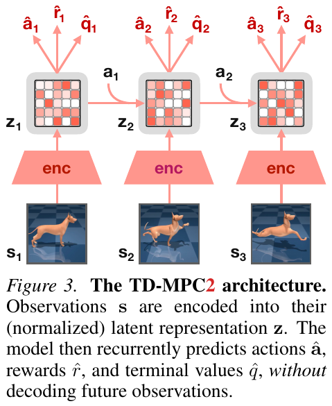
<figcaption>Figure 14.8: TD-MPC2 architecture: an encoder, a latent dynamics model, reward prediction, double Q-value heads and a policy prior, supporting joint multi-task training and online MPPI rollouts in latent space</figcaption>
</div>

### 2. Method and innovations
{: id="2-主要方法创新点-7"}

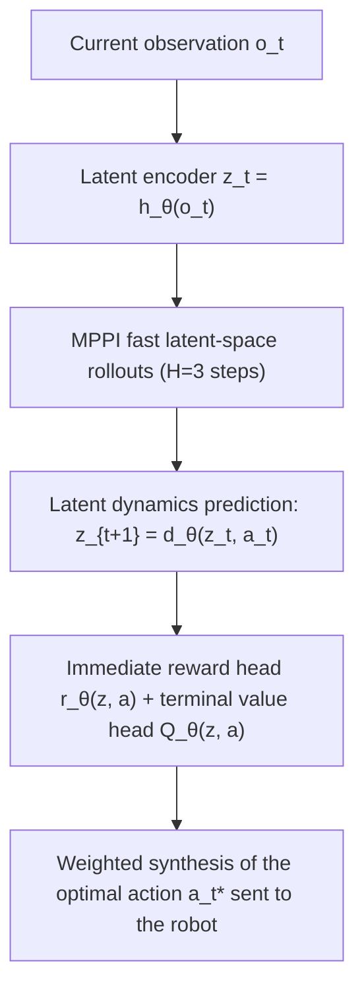

#### ① Compact implicit world model
{: id="-紧凑的隐式世界模型"}
The model consists of an encoder $h_\theta$, a latent dynamics model $d_\theta$, an immediate-reward head $R_\theta$, a Q-value head $Q_\theta$ and a prior policy head $\pi_\theta$. The loss function is driven entirely by task-relevant signals:

$$
\mathcal{L}_{\mathrm{total}}(\theta) = \sum_{t=0}^H \lambda^t \left( \mathcal{L}_R(s_t, a_t) + \mathcal{L}_Q(s_t, a_t) + \mathcal{L}_{\mathrm{dyn}}(s_{t+1}, d_\theta(s_t, a_t)) \right)
$$

#### ② Model predictive path integral (MPPI) in latent space
{: id="-潜空间模型预测路径积分mppi"}
At inference time, starting from the current latent state $z_t$ and using the prior policy $\pi_\theta$, the algorithm samples $N$ candidate action sequences of length $H$ and evaluates their expected return:

$$
G(\tau) = \sum_{k=0}^{H-1} \gamma^k \hat{R}(z_k, a_k) + \gamma^H \min_{j=1,2} \hat{Q}_j(z_H, a_H)
$$

The candidate sequences are then iteratively reweighted with a softmax over their returns, and the first action $a_t^*$ of the optimal sequence is output.

---

### 3. Results and findings
{: id="3-核心结果发现-7"}

- **Unifying 100+ tasks**: On a benchmark of 104 tasks, a single TD-MPC2 model achieved higher average success rate and sample efficiency than earlier task-specific baselines.
- **Scalability**: As the parameters grow from 1M to 317M, multi-task interference drops markedly and the model shows clear positive transfer.

---

### 4. Limitations
{: id="4-局限性-7"}

1. **Short-horizon planning relies on critic accuracy**: If the terminal Q-head has a local bias, short-horizon MPC planning is easily misled.
2. **Sensitive to local abrupt changes in the environment**: With large out-of-distribution observations, unseen latent features may cause drift in the dynamics rollouts.

---

## 14.9 Diffusion Policy (2023)
{: id="149-diffusion-policy-2023"}
————A paradigm shift in action generation: diffusion-based visuomotor policies

📄 **Paper**: [RSS 2023 / arXiv:2303.04137](https://diffusion-policy.cs.columbia.edu/)  
💻 **Code**: [columbia-ai-robotics / diffusion_policy](https://github.com/real-stanford/diffusion_policy)

### Key takeaways
{: id="精华-8"}
1. **Breaking the unimodal action assumption**: It was the first to introduce the conditional denoising diffusion probabilistic model (DDPM) into robot visuomotor policies, solving the fundamental problem that traditional policy networks cannot express multimodal action distributions.
2. **Action chunking and temporal consistency**: The policy predicts a temporally consistent action chunk spanning the next $T_a$ steps, which naturally ensures smooth and physically feasible joint motion.
3. **Annealed denoising ensures high accuracy**: The denoising process resembles gradient-field optimization and gradually removes action uncertainty, performing well in millimeter-precision assembly and long-horizon contact-rich tasks.
4. **Supporting two main backbones**: It provides two conditional denoising backbones, a **CNN-based (U-Net)** one and a **temporal Transformer**, to suit different compute budgets and temporal-dependency needs.
5. **Reshaping robot policy learning**: Since 2023 it has been the dominant paradigm in robot manipulation and in imitation learning / RL fine-tuning.

---

### 1. Background and problem
{: id="1-研究背景问题-8"}

When demonstrating robot manipulation tasks, humans often have several equally valid but mutually exclusive options (e.g. grasping the handle or the body of a cup, bypassing an obstacle on the left or on the right). Given such multimodal expert data, a traditional MLP policy trained with MSE loss is forced to output the "mathematical average" of all possible actions, so the robot ends up freezing or colliding. A GMM (Gaussian mixture model) can partially alleviate this, but is prone to numerical instability and mode collapse in high-dimensional continuous action spaces.

---

<div align="center">
  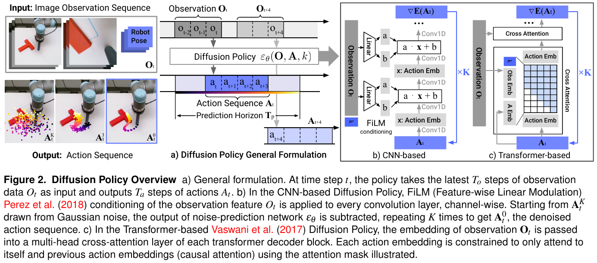
<figcaption>Figure 14.9: Overall architecture of Diffusion Policy: it takes an observation horizon T_o, predicts a temporal action chunk of length T_p, executes the first T_a steps, and then rolls forward with closed-loop updates</figcaption>
</div>

### 2. Method and innovations
{: id="2-主要方法创新点-8"}

```mermaid
graph LR
    A["Visual observation sequence O_t (current + history frames)"] --> C["Conditioning injection (FiLM / cross-attention)"]
    B["Standard Gaussian noise A_k ~ N(0, I)"] --> D["Conditional U-Net / Transformer denoising network"]
    C --> D
    D -->|K-step reverse iterative denoising| E["Smooth, collision-free action chunk A_0 = [a_t, a_{t+1}, ..., a_{t+Ta}]"]
```

#### ① Conditional diffusion process and loss function
{: id="-条件扩散过程与损失函数"}
- The goal is to turn a random Gaussian noise sequence $A^K \sim \mathcal{N}(0, I)$ into an action-trajectory chunk $A^0 \in \mathbb{R}^{T_a \times D_a}$ that matches the expert distribution.
- The training loss is a simple mean squared denoising error:

$$
\mathcal{L}_{\mathrm{Diffusion}}(\theta) = \mathbb{E}_{k, A^0, \epsilon, O_t}\left[ \left\lVert \epsilon - \epsilon_\theta(A^k, k, O_t) \right\rVert^2 \right]
$$

Here $$A^k = \sqrt{\bar{\alpha}_k} A^0 + \sqrt{1 - \bar{\alpha}_k} \epsilon$$.

#### ② Receding-horizon control
{: id="-滚动时域控制receding-horizon-planning"}
Each time, $T_p$ future actions are predicted, but only the first $T_a$ steps ($T_a < T_p$) are actually sent to the low-level controller. In the next control cycle, closed-loop denoising is performed again from the latest observation, which balances long-horizon foresight with real-time disturbance correction.

---

### 3. Results and findings
{: id="3-核心结果发现-8"}

- On 11 challenging manipulation tasks in real-robot and simulated settings (RoboMimic, Push-T, Kitchen), Diffusion Policy improved the average success rate by **46.9%** over earlier LSTM-GMM, IBC (implicit behavioral cloning) and BET baselines.
- In multimodal branching experiments, Diffusion Policy decisively picks a reasonable branch 100% of the time, completely eliminating the erratic wandering of a mean-output policy at the fork.

---

### 4. Limitations
{: id="4-局限性-8"}

1. **High inference latency**: A standard DDPM needs 16 to 100 network forward passes to generate one trajectory. Deployment on low-compute edge devices requires acceleration and compression with DDIM or consistency models.
2. **Pure imitation learning cannot self-correct out of distribution**: Once the policy leaves the training-trajectory distribution, it still needs to be combined with reinforcement learning for online exploration and fine-tuning.

---

## 14.10 DPPO (2025)
{: id="1410-dppo-2025"}
———Reinforcement fine-tuning of diffusion policies: online policy optimization inside the denoising chain

📄 **Paper**: [ICLR 2025](https://arxiv.org/abs/2409.00588)  
💻 **Code**: [jannerm / dppo](https://github.com/jannerm/dppo)

### Key takeaways
{: id="精华-9"}
1. **Connecting diffusion policies with online RL**: It was the first to treat the multi-step diffusion denoising process as a multi-step Markov decision process (MDP) and apply PPO-Clip constraints directly inside the denoising chain, enabling an end-to-end transition of diffusion policies from expert imitation to online RL.
2. **Solving the likelihood problem**: It avoids the exploding or vanishing gradients caused by backpropagating through the long diffusion denoising chain, and directly computes the log-probability $\log p_\theta(x_{k-1}\mid x_k)$ of each Gaussian transition in the reverse denoising explicitly.
3. **Retaining multimodality while continuing to improve**: Unlike traditional RL algorithms, whose policies quickly collapse to a single mode after fine-tuning, DPPO preserves the diffusion model's inherent multimodal exploration and finds solutions that go beyond the demonstrations under hard reward settings.
4. **Well suited to offline pre-training followed by online fine-tuning**: It supports initialization by BC pre-training on expert data, followed by RL alignment through online interaction.
5. **A reference algorithm**: It provides a solid theoretical and algorithmic reference for later embodied foundation policies based on flow matching / diffusion (such as π0 and GRPO for diffusion).

---

### 1. Background and problem
{: id="1-研究背景问题-9"}

Diffusion Policy is remarkably effective in imitation learning, but it relies entirely on human demonstration data. When demonstration quality is uneven or the robot meets complex, unseen environments, **online trial-and-error with reinforcement learning** is needed to raise the performance ceiling further. However, applying traditional RL to diffusion policies hits theoretical obstacles:
- Action generation in a diffusion model is a multi-step stochastic differential / difference equation, so the explicit single-step action log-probability $\log \pi(a\mid s)$ cannot be output directly.
- If the final output $a_0$ is treated as a black box and updated with the standard policy gradient, backpropagating through $K$ steps causes severe numerical instability.

---

<div align="center">
  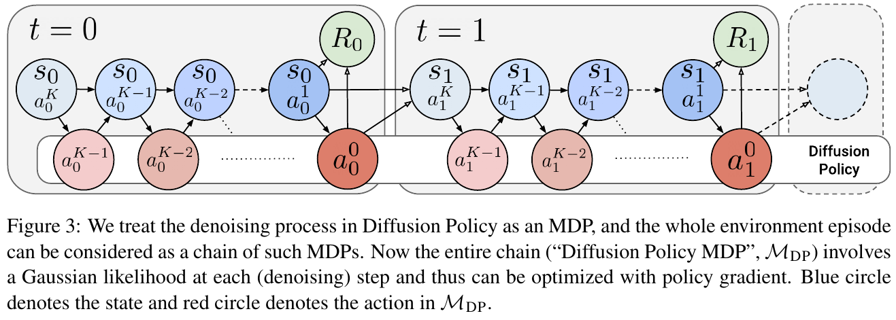
<figcaption>Figure 14.10: DPPO models the diffusion denoising chain as an inner MDP of sub-decision steps, while the outer layer advances the real environment time step and receives external rewards</figcaption>
</div>

### 2. Method and innovations
{: id="2-主要方法创新点-9"}

```mermaid
graph TD
    A["State observation s"] --> B["Diffusion denoising chain: x_K → x_{K-1} → ... → x_0 (Action)"]
    B --> C["Treat each denoising step as a sub-step MDP decision"]
    C --> D["Compute the local Gaussian probability ratio r_k(θ) at each step"]
    D --> E["Apply PPO-Clip constraints inside the chain"]
    E --> F["Combine with the advantage to update the denoising network weights"]
```

#### ① MDP formulation of the denoising chain
{: id="-去噪链的-mdp-映射"}
DPPO models a generation process containing $K$ denoising steps as an augmented MDP. At each denoising step $k$, the transition probability follows an isotropic Gaussian distribution:

$$
p_\theta(x_{k-1} \mid x_k, s) = \mathcal{N}\left(x_{k-1};\; \mu_\theta(x_k, k, s), \sigma_k^2 I\right)
$$

Since each transition step has an analytical form, the local importance weight before and after a parameter update can be computed directly:

$$
r_k(\theta) = \frac{p_\theta(x_{k-1} \mid x_k, s)}{p_{\theta_{\mathrm{old}}}(x_{k-1} \mid x_k, s)}
$$

#### ② In-chain PPO-Clip objective
{: id="-链内-ppo-clip-目标"}
The global advantage estimate $\hat{A}(s, a)$ is assigned to the denoising chain, and the denoising loss at each step is optimized jointly with the backbone network, avoiding the non-differentiability problem of backpropagating end-to-end through the entire computation graph.

---

### 3. Results and findings
{: id="3-核心结果发现-9"}

- On the RoboMimic and Gym-MuJoCo benchmarks, the DPPO-fine-tuned policy improved the task success rate by **20%~40%** over a pure-BC diffusion policy.
- With suboptimal demonstrations, DPPO broke through the ceiling set by the demonstration data and learned new manipulation behaviors that are faster and take shorter paths.

---

### 4. Limitations
{: id="4-局限性-9"}

1. **High training-time overhead**: Each online rollout requires forward and backward gradient tracking through the complete multi-step denoising chain.
2. **Sensitive to the design of the reward function**: A reasonable dense or sparse reward is still needed to guide exploration.

---

## 14.11 Π*₀.₆ (2025)
{: id="1411-π-2025"}
——— Evolving from expert interventions: reinforcement learning for real-robot policies

📄 **Paper**: [Physical Intelligence (2025)](https://www.physicalintelligence.company/blog/pistar06)  
💻 **Project**: [Physical Intelligence Research](https://www.physicalintelligence.company/)

### Key takeaways
{: id="精华-10"}
1. **Reinforcement learning from expert interventions**: Autonomous exploration of the real physical world easily crashes the hardware or leaves the safe range. To address this, it builds a post-training system that deeply couples real-time human expert intervention with autonomous reinforcement learning.
2. **Eliminating the distribution shift of behavior cloning**: Traditional DAgger only fits the intervention trajectories by supervised learning, whereas $\pi^*_{0.6}$ uses an RL value function that treats "being intervened on" as a negative-feedback penalty and "completing the task autonomously" as a positive reward, proactively correcting the policy's bad precursor behaviors.
3. **Large-scale online closed-loop learning in the real world**: It ran dozens of hours of continuous online RL post-training on multiple physical robots, on tasks including bimanual clothes folding, cleaning a messy desktop and precision assembly.
4. **An embodied alignment paradigm for large VLA models**: It verifies that going from large-scale offline pre-training ($\pi_0$) to expert-in-the-loop RL fine-tuning ($\pi^*_{0.6}$) is the necessary path to industrial-grade reliability (99%+ success rate).
5. **Hardware and software safety boundaries**: Torque limits and emergency-stop safety layers make intensive physical trial and error practical in real environments.

---

### 1. Background and problem
{: id="1-研究背景问题-10"}

Applying RL to real physical robots has always faced three natural barriers:
- **Safety and hardware wear**: Unconstrained random exploration can cause violent arm collisions that damage the equipment or the environment.
- **High reset cost**: Objects dropped after a failed attempt cannot recover without human help.
- **Demonstrations rarely cover long-tail edge cases**: Pure imitation learning easily stalls or breaks down on unseen, complex cases such as tangled clothes or scattered objects.

---

<div align="center">
  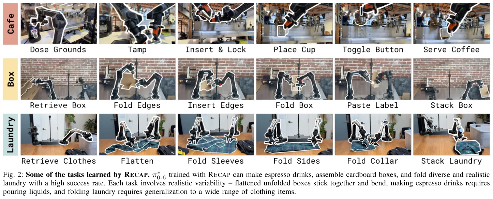
<figcaption>Figure 14.11: Overview of the π*₀.₆ training system combining expert interventions with reinforcement learning</figcaption>
</div>

### 2. Method and innovations
{: id="2-主要方法创新点-10"}

```mermaid
graph LR
    A["Robot autonomously executes the VLA policy"] --> B{"Real-time monitoring by a human expert"}
    B -->|Safe / normal| C["Robot continues autonomously<br/>(+ accumulate positive reward for autonomous execution)"]
    B -->|About to collide / stuck| D["Expert takes over via joystick intervention"]
    D --> E["Record the intervention entry point and correction trajectory<br/>(- intervention penalty + correction samples)"]
    C --> F["Off-policy RL: hybrid policy update with a critic value network"]
    E --> F
```

#### ① Intervention-aware Markov modeling
{: id="-干预感知马尔可夫建模"}
- When the human does not take over, the action is generated autonomously by the robot, $a_t \sim \pi_\theta$; when the human steps on the pedal or pushes the joystick to take over, the action is the expert command $a_t = a_t^E$.
- **Reward design**: A large positive reward is given for completing the task independently, and an intervention penalty $r_{\mathrm{int}} < 0$ is applied each time a human intervention is triggered. This incentivizes the policy to minimize dependence on human takeover while still making task progress.

#### ② Mixed policy optimization
{: id="-混合策略优化机制"}
The state-transition data from before and after interventions is also used to update the critic, so the critic learns to anticipate which potentially dangerous postures will lead to human intervention, and the policy spontaneously avoids dangerous actions.

---

### 3. Results and findings
{: id="3-核心结果发现-10"}

- On the extremely challenging tasks of **folding clothes of varied materials** and **cleaning up and packing**, after several days of intervention-based RL post-training the rate of consecutive failure-free success of $\pi^*_{0.6}$ rose from **65% to above 98%** for the pretrained model.
- **Self-recovery under disturbance**: When a human deliberately messes up the folded clothes, the policy senses the regression of the state and autonomously re-executes the earlier unfolding actions, showing strong closed-loop resilience.

---

### 4. Limitations
{: id="4-局限性-10"}

1. **Reliance on intensive human-in-the-loop expert supervision**: Training requires professional operators on standby to take over, so labor costs remain high.
2. **Complicated multi-robot generalization**: Differences in takeover style across operators may introduce noisy labels.

---

## 14.12 X-NavDP (2026)
{: id="1412-x-navdp-2026"}
——Universal visual navigation for multi-embodiment robots: an intra-group Q-weighted diffusion RL framework

📄 **Paper**: [arXiv:2607.28560 (Intern Robotics 2026)](https://arxiv.org/abs/2607.28560)  
💻 **Code**: [InternRobotics / NavDP](https://github.com/InternRobotics/NavDP)

### Key takeaways
{: id="精华-11"}
1. **Breaking the RL fine-tuning bottleneck of diffusion navigation policies**: Under global minibatch normalization, the gradients of low-return states are swamped when fine-tuning conventional diffusion policies. To solve this, it proposes **Group Q-Score Reweighted Matching (GQRM)** for efficient and robust RL post-training of diffusion policies.
2. **Self-bootstrapped perturbation**: Combining the model's goal-free branch with coordinate flipping, it generates high-value exploratory actions such as sidestepping, reversing and detouring while retaining the trajectory prior and temporal smoothness, enabling zero-shot self-rescue in dead ends.
3. **Lightweight embodiment FiLM modulation**: By injecting a robot-embodiment embedding into the Transformer decoder, a single set of network weights **simultaneously controls three heterogeneous robots with very different dynamics: wheeled, quadruped and humanoid (Dingo / Go2 / G1)**.
4. **Closed-loop receding-horizon guidance (RTC guidance)**: A temporal-smoothness gradient from the preceding chunk is introduced into the denoising steps at deployment, completely eliminating waypoint jitter during continuous rolling rollouts.
5. **A leap in self-rescue rate in complex unseen environments**: In IsaacLab simulation and real-robot dead-end self-rescue experiments, the success rate rose from 10% to 65% with only 12 hours of parallel RL training.

---

### 1. Background and problem
{: id="1-研究背景问题-11"}

Diffusion-based visual navigation policies trained by imitation learning (such as NavDP and NoMaD) are excellent at pathfinding in open scenes. However, because the expert data comes from a globally optimal planner, they have two core flaws:
- **No local self-rescue ability**: In trapping scenes such as long obstacles and dead ends, a robot with only a partial field of view easily gets stuck or keeps colliding, because "reversing and going around" never appears in the expert data.
- **Embodiment-blind**: They cannot adapt to the different physical constraints of wheeled robots (no lateral motion), quadrupeds (omnidirectional motion) and humanoids (center-of-mass sway and turning radius).

---

<div align="center">
  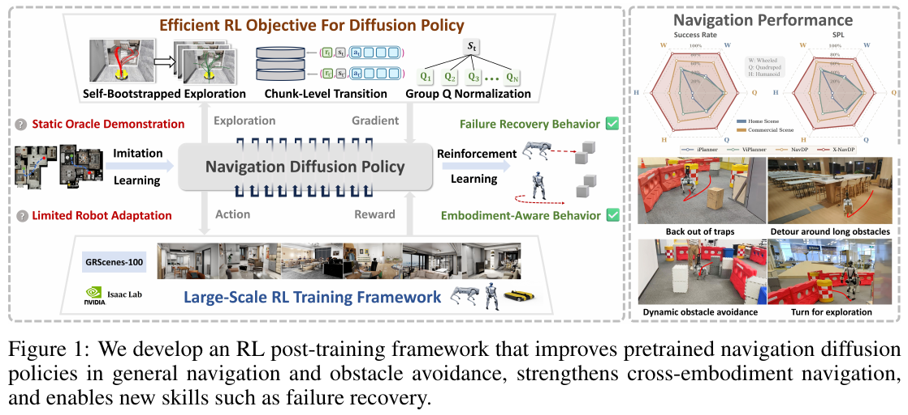
<figcaption>Figure 14.12: Overall X-NavDP framework: self-guided perturbation and intra-group Q-value-reweighted RL training for multi-embodiment robots</figcaption>
</div>

### 2. Method and innovations
{: id="2-主要方法创新点-11"}

```mermaid
graph TD
    A["Local RGB-D + PointGoal + robot ID"] --> B["Embodiment FiLM module injects the robot embedding"]
    B --> C["Self-guided perturbation policy samples a candidate group G(s) from the same state"]
    C --> D["Twin critics evaluate Q(s, a) of the candidate trajectories"]
    D --> E["Normalize advantages within the same-state group, Q_tilde_G"]
    E --> F["Keep top-k positive-advantage actions for reweighted optimization"]
    F --> G["Optimize the diffusion denoising network + closed-loop RTC-guided execution"]
```

#### ① Intra-group Q-value reweighting (GQRM)
{: id="-组内-q-值重加权gqrm"}
For the candidate action group $G(s)$ sampled from the same state, the mean and standard deviation are computed within the group:

$$
\bar{Q}_G(s) = \mathbb{E}_{a_0 \sim \pi_{\mathrm{old}}}[Q(s, a_0)], \quad \sigma_G(s) = \sqrt{\mathbb{E}[(Q(s, a_0) - \bar{Q}_G(s))^2]}
$$

$$
\tilde{Q}_G(s, a_0) = \mathrm{clip}\left( \frac{c (Q(s, a_0) - \bar{Q}_G(s))}{\sigma_G(s) + \varepsilon},\; -h,\; h \right)
$$

**Advantage**: Even in an extremely hard state such as a dead end, where all actions have negative absolute return, GQRM can still pick out the "relatively good" reversing escape trajectory and assign it a very large gradient weight.

#### ② Self-guided perturbation exploration
{: id="-自引导扰动探索机制"}
The model's own goal-agnostic prediction is combined with a Bernoulli sign vector $\mathbf{s} = ((-1)^{B_1}, (-1)^{B_2})$ to synthesize actions by extrapolation:

$$
\tau_{\mathrm{mixed}} = \mathbf{s} \odot (\tilde{\tau}_{\mathrm{pointgoal}} + \lambda \tilde{\tau}_{\mathrm{nogoal}})
$$

---

### 3. Results and findings
{: id="3-核心结果发现-11"}

- **Large gains in simulation and on real robots**: On 40 unseen test scenarios in IsaacLab, the average success rate rose from **61.20% to 84.28%**. On the Unitree G1 humanoid, the success rate rose from **50.70% to 84.50%**.
- **Escaping real dead ends**: In real physical dead-end tests, the non-fine-tuned model was trapped and collided 100% of the time, while X-NavDP showed smooth reverse-steering self-recovery with an escape success rate of up to **65%**.

---

### 4. Limitations
{: id="4-局限性-11"}

1. **Dependence on high-quality twin-critic value estimates**: If the collision and distance reward shaping in simulation is not precise enough, the judgment of the best reversing trajectory may suffer.
2. **High-frequency on-device compute requirements**: Multi-embodiment FiLM modulation and RTC denoising guidance place certain demands on the inference throughput of edge computing chips.

---

# 15. Conclusion
{: id="15-结语"}

The evolution of reinforcement learning in embodied intelligence mirrors the trajectory of AI as a whole:

- **Model-free era (DQN / PPO / SAC / TD3)**: It laid the mathematical foundation for deep policy learning in discrete and continuous action spaces and overcame the problems of policy variance and value overestimation.
- **World-model era (World Models / DreamerV3 / TD-MPC2)**: It broke the absolute dependence on massive real-world sampling and enabled self-supervised learning of physical dynamics and long-horizon planning in latent space.
- **Generative era (Diffusion Policy / DPPO / X-NavDP)**: It fundamentally reshaped how action-space distributions are represented, using the diffusion denoising mechanism to reconcile multimodal continuous control with temporal smoothness.
- **Real-world and post-training era (π\*₀.₆ / RLVR / GRPO / Residual-VLA)**: Algorithms such as GRPO first proved "verifiable rewards + large-scale RL" on LLM reasoning and were then carried over to VLAs; SimpleVLA-RL, πRL, RL-100 and others moved RL from training small policies to fine-tuning large models, and from simulation to real robots.

Each generation of algorithms builds on its predecessors to overcome new theoretical and engineering bottlenecks. As physical-world perception, multimodal foundation models and high-fidelity parallel simulation integrate further, reinforcement learning is driving embodied robots to accelerate from "pattern reproduction" to "autonomous cognition and general-purpose action in the physical world".

---

*This article was compiled and written by Tingde Liu, with reference to [EasyRL (Datawhale)](https://github.com/datawhalechina/easy-rl), OpenAI Spinning Up, Berkeley Deep RL and the milestone papers above. It focuses on the panoramic and frontier evolution of RL algorithms for embodied intelligence.*
