# 1. Introduction
{: id="1-引言"}

## 1.1 Why autonomous navigation
{: id="11-为什么需要自主导航"}

Imagine a warehouse robot moving between shelves, picking up goods precisely, and avoiding forklifts and pedestrians that suddenly appear. Or consider a self-driving car traveling safely for hundreds of kilometers in complex traffic. Both depend on a carefully designed **autonomous navigation system**.
<figure class="survey-intro-figure">
  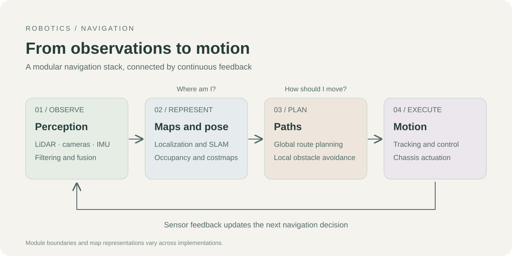
<figcaption>Figure: Traditional navigation revolves around the goal position. It combines sensing and localization, map-based planning, and local control, and corrects motion through sensor feedback. Actual systems may divide the modules and represent the map differently.</figcaption>
</figure>
The core problems that autonomous navigation solves can be summarized in three questions:

1. **Where am I?** (Localization)
2. **What is around me?** (Perception and mapping)
3. **How should I move?** (Planning and control)

These three problems are intertwined, and together they form a complete robot navigation loop.

## 1.2 Overview of the navigation algorithm stack
{: id="12-导航算法栈概览"}

In a complete robot navigation system, sensor data passes through successive processing layers before it drives the actuators. The following diagram shows the overall data flow of the navigation stack:

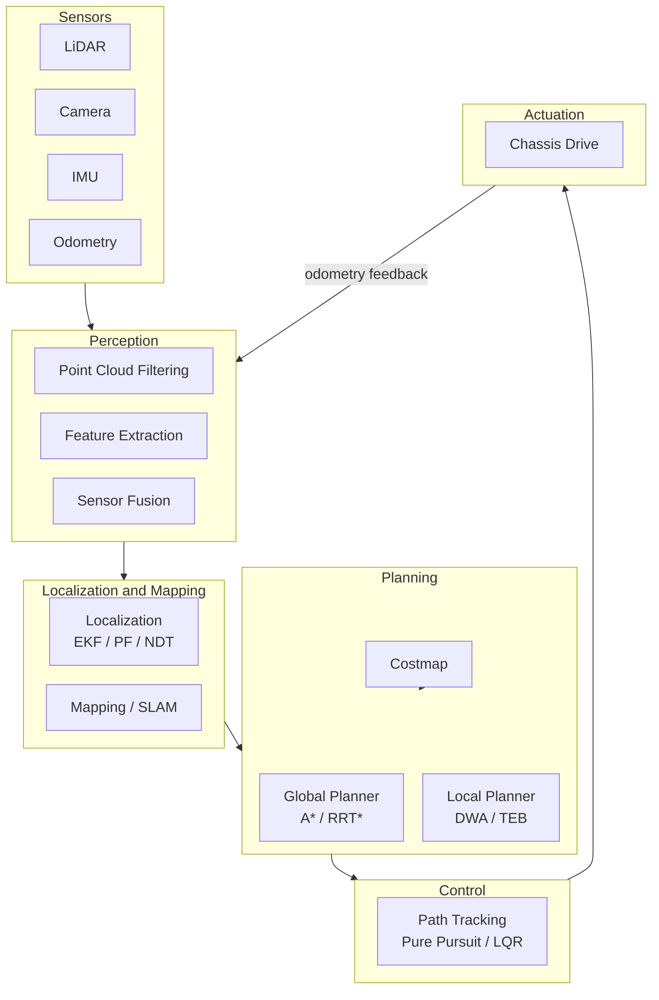

<div align="center">
  
<figcaption>Figure: Traditional robot navigation pipeline: mapping and localization (SLAM) from sensor data, then automatic navigation (planning + control) in the constructed environment map</figcaption>
</div>


## 1.3 Classical vs. learned navigation
{: id="13-传统导航-vs-学习型导航"}

Before the rise of deep learning, robot navigation relied mainly on **modular, interpretable classical algorithm stacks**. Each module has clear responsibilities and can be debugged and optimized independently. This article systematically introduces the core components of this stack.

| Dimension | Classical navigation | End-to-end deep learning navigation |
|------|---------|-----------------|
| Interpretability | ✅ Strong, each module can be analyzed | ❌ Weak, black-box decisions |
| Generalization | ❌ Weak, relies on a prior map | ✅ Strong, transfers to new scenarios |
| Language understanding | ❌ Does not support natural-language instructions | ✅ Supported (VLN/VLA) |
| Debugging difficulty | ✅ Low, modules can be debugged independently | ❌ High, end-to-end failures are hard to trace |
| Computing requirements | ✅ Low, can run on embedded hardware | ❌ High, requires a GPU |
| Safety and reliability | ✅ Predictable behavior | ❌ Risk of out-of-distribution failures |
| Dynamic obstacle handling | The local planning module can handle it | Depends on training data coverage |

> **This article focuses on the classical algorithm stack.** For end-to-end learned navigation (VLN/VLA), see this site's [VLN Survey](/en/VLN-Survey/) series.

---

# 2. Perception
{: id="2-感知perception"}

Perception is the "eyes" of the navigation system. Sensors collect raw data, and processing turns it into reliable input for localization, mapping, and planning.

## 2.1 Sensor types and characteristics
{: id="21-传感器类型与特性对比"}

| Sensor | Output data | Accuracy | Robustness to lighting | Cost | Typical rate | Typical application |
|--------|---------|------|--------|------|---------|---------|
| **2D LiDAR** | Polar-coordinate point set | High (cm level) | ✅ Strong | Medium | 10–40 Hz | Indoor mobile robots |
| **3D LiDAR** | Point Cloud (xyz+intensity) | High | ✅ Strong | High | 10–20 Hz | Autonomous driving |
| **RGB-D camera** | Color image + depth image | Medium (cm–dm level) | ❌ Weak (outdoors) | Low | 30–90 Hz | Short-range indoor use |
| **Monocular camera** | RGB image | Low (requires calibration) | ❌ Weak | Very low | 30–120 Hz | Visual odometry |
| **Stereo camera** | Left and right RGB images | Medium | ❌ Weak | Low–medium | 30–60 Hz | Visual SLAM |
| **IMU** | Angular velocity + linear acceleration | High in the short term | ✅ Strong | Extremely low | 100–1000 Hz | Pose estimation, fusion |
| **Wheel odometry** | Encoder pulses | Medium (errors accumulate easily) | ✅ Strong | Very low | 50–200 Hz | Short-term displacement estimation |
| **GPS/RTK** | Latitude/longitude coordinates | Standard 1–5 m, RTK cm level | ✅ Strong | Medium–high | 1–10 Hz | Outdoor global localization |

### LiDAR
{: id="激光雷达lidar"}

LiDAR measures distance by emitting laser pulses **and timing their return** (Time of Flight, ToF). It works under any lighting condition and outputs an accurate spatial point cloud.

**2D LiDAR** (such as Hokuyo UTM-30LX and SICK TiM) outputs a set of polar-coordinate points on a single plane per scan, which suits flat indoor environments. **3D LiDAR** (such as Velodyne VLP-16 and Ouster OS1) outputs a complete three-dimensional point cloud through multi-beam rotating scans, and is the core sensor for autonomous driving perception.

### Depth camera (RGB-D)
{: id="深度相机rgb-d"}

RGB-D cameras (such as Intel RealSense D435 and Microsoft Kinect) acquire a color image and the depth of each pixel at the same time, using **structured light** or **time-of-flight (ToF)**. The main limitations are that strong outdoor light interferes with structured light, and the sensing range is limited (usually 0.3–6m).

<div align="center">
  <video src="/images/robotics_navigation/Depth_Camera.mp4" data-autoplay preload="none" loop muted playsinline width="70%" style="aspect-ratio:740/330"></video>
<figcaption>Figure: Visualization of a depth map captured by a depth camera</figcaption>
</div>

### IMU and wheel odometry
{: id="imu-与轮式里程计"}

**An IMU (inertial measurement unit)** combines a gyroscope, which measures angular velocity, and an accelerometer, which measures linear acceleration. Its output rate is high (100–1000 Hz), but errors **accumulate through integration** over time and cause drift.

<div align="center">
  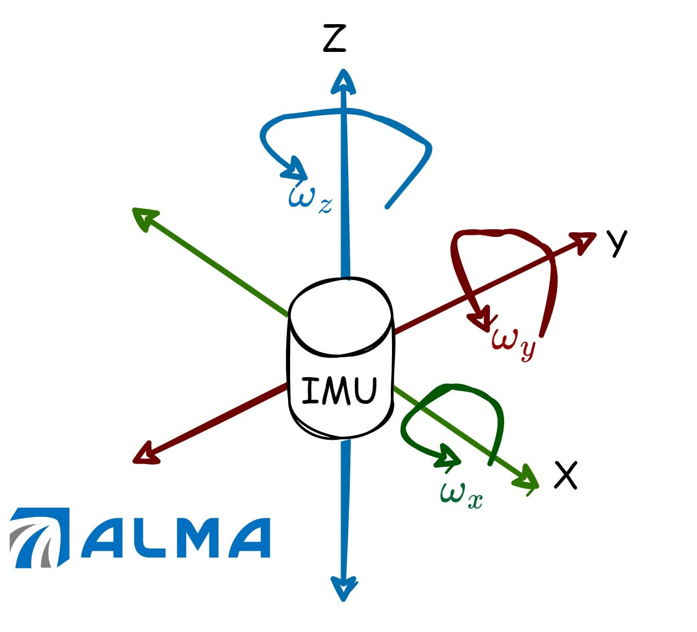
<figcaption>Figure: IMU</figcaption>
</div>

**Wheel odometry** computes displacement from wheel encoders. It is accurate on flat ground but accumulates **cumulative errors** on slippery or uneven surfaces.

What the two have in common is high short-term accuracy; over the long term they must be fused with, and corrected by, other sensors.


## 2.2 Perception data processing
{: id="22-感知数据处理"}

### Point cloud filtering
{: id="点云滤波"}

Raw point clouds usually contain noise and irrelevant points, so they need preprocessing:

**Voxel Grid Filter**: Divide the point cloud space into small regular cubes (voxels) and replace the points in each voxel with their centroid. This preserves the overall shape of the point cloud while greatly reducing its density, which speeds up later processing.

<div align="center">
  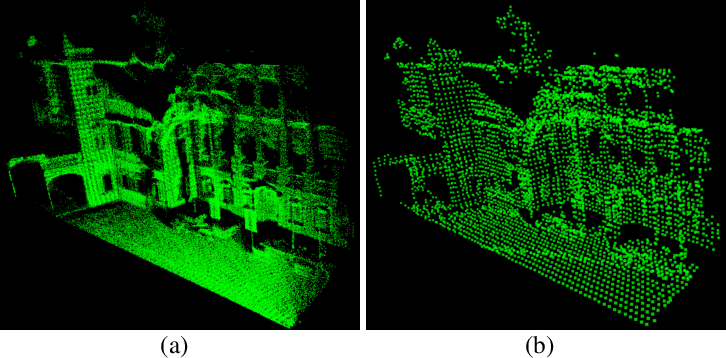
<figcaption>Figure: Effect of voxel filtering: the original dense point cloud (left) is downsampled into a uniform, sparse point cloud (right)</figcaption>
</div>

**Radius Outlier Removal**: For each point, count the neighbors within radius r. If the count is below a threshold, the point is treated as noise and removed. This is well suited to removing isolated noise points.

<div align="center">
  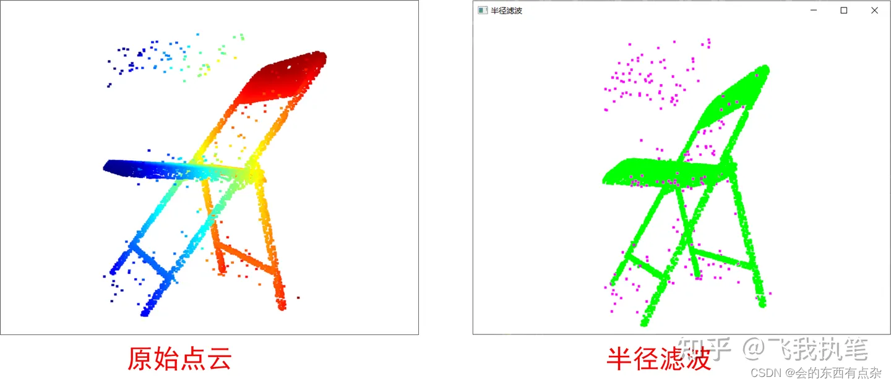
<figcaption>Figure: Effect of radius filtering: isolated points (red) with too few neighbors are identified as noise and removed</figcaption>
</div>

**Pass Through Filter**: Directly crop the point cloud to a region of interest, for example keeping only points between 0.1m and 2m above the ground.

### Rectangle fitting
{: id="矩形拟合检测"}

**LiDAR-based obstacle bounding-box estimation**: Fit a minimum bounding rectangle to each clustered obstacle point cloud to estimate the obstacle's length, width, orientation, and center position. This is a classic obstacle perception method in autonomous driving and is often used for vehicle detection.

<div align="center">
  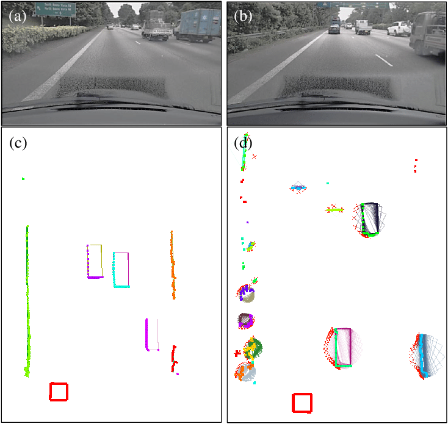
  <video src="/images/robotics_navigation/point_cloud_rectangle_fitting.mp4" data-autoplay preload="none" loop muted playsinline width="38%" style="aspect-ratio:800/800; margin:4px"></video>
<figcaption>Figure: Rectangle fitting on a point cloud: the clustered point cloud (left) is fitted with a minimum bounding rectangle (right, animated)</figcaption>
</div>

### Feature extraction
{: id="特征提取"}

Feature extraction is crucial in visual SLAM and camera calibration:

- **Corner features**: such as **FAST** (extremely fast) and **Harris** (classic)
- **Descriptors**: such as **ORB** (rotation-invariant, binary, fast) and **SIFT** (scale- and rotation-invariant, accurate but slow)
- **Line features**: for structured indoor environments (corridors, walls)

<div align="center">
  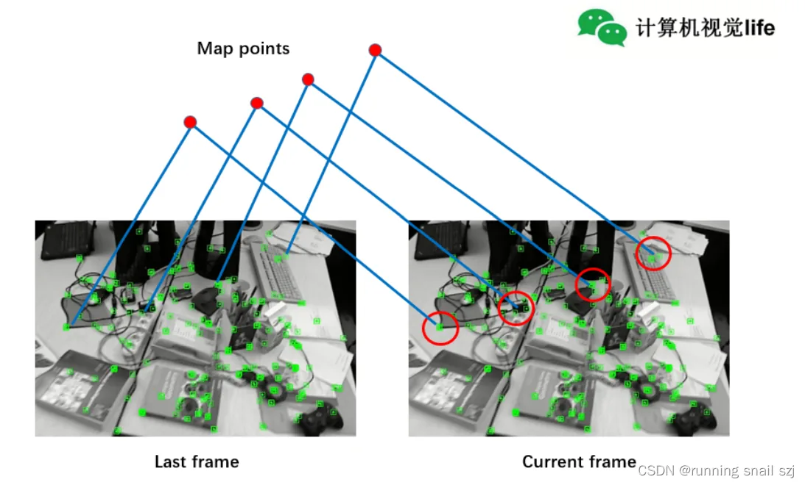
<figcaption>Figure: Corner feature detection: corner points in the image are the key elements matched in visual SLAM</figcaption>
</div>

## 2.3 Sensor extrinsic calibration
{: id="23-传感器外参标定"}

When a system uses multiple sensors, it must know their **relative poses** (extrinsic parameters) in order to convert data from different sensors into the same coordinate frame.

**UKF-based extrinsic estimation**: Estimate the extrinsic parameters online with an **unscented Kalman filter (UKF)**. Unlike offline calibration with a calibration target, this method can estimate and correct the extrinsics dynamically while the robot moves, which suits settings where a sensor's mounting position may shift slightly.

<div align="center">
  <video src="/images/robotics_navigation/sensor_auto_calibration.mp4" data-autoplay preload="none" loop muted playsinline width="75%" style="aspect-ratio:800/800"></video>
<figcaption>Figure: Online automatic sensor calibration: the extrinsic parameters between sensors are estimated and corrected dynamically while the robot moves</figcaption>
</div>

### Sensor time synchronization
{: id="传感器时间同步"}

Besides spatial calibration (extrinsics) between sensor frames, **time synchronization** is equally important. If the timestamps of different sensors are not aligned, the data will be "out of sync". For example, using the IMU attitude from 0.1 seconds ago to process the current frame's laser point cloud produces an error that cannot be ignored when the robot moves at high speed.

<div align="center">
  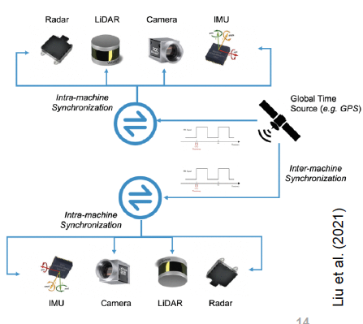
<figcaption>Figure: Time synchronization</figcaption>
</div>

**Hardware trigger synchronization**: All sensors sample at the same instant, driven by an electrical signal. For example, the PPS (pulse-per-second) signal from GPS can act as a master clock that triggers the camera shutters and LiDAR scans. This is the most accurate method, with time errors down to microseconds, but it needs dedicated hardware circuitry.

**Software timestamp interpolation**: When hardware triggering is not feasible, stamp each sensor packet with a high-precision system clock (such as NTP/PTP), then align the data by timestamp in software. A common practice is to linearly interpolate the IMU data to the time of the nearest laser frame.

**Impact of misaligned timestamps on SLAM**: The robot keeps moving during a single laser scan (about 100 ms). If the IMU timestamps are not used for **motion distortion correction**, the scanned point cloud is **distorted**: the first and second halves of the scan are misaligned, which seriously degrades scan-matching accuracy. Tightly coupled systems such as LIO-SAM solve this with IMU pre-integration.

## 2.4 Sensor fusion
{: id="24-传感器融合"}

A single sensor often has limitations, and fusing several sensors lets them compensate for each other's weaknesses.

**EKF (Extended Kalman Filter) fusion**: Fuses sensor data with different rates and error characteristics in one framework (for example high-rate IMU attitude, low-rate GPS position, and odometry displacement). The EKF alternates between a **prediction step** (propagating the state with the motion model) and an **update step** (correcting the prediction with sensor observations).

**UKF (Unscented Kalman Filter) fusion**: The EKF approximates a nonlinear system by first-order linearization, whereas the UKF uses **sigma-point sampling** to approximate the mean and covariance of the nonlinear transformation more accurately, giving higher accuracy in strongly nonlinear scenarios.

**EKF sensor fusion data flow** (using a multi-sensor robot as an example):

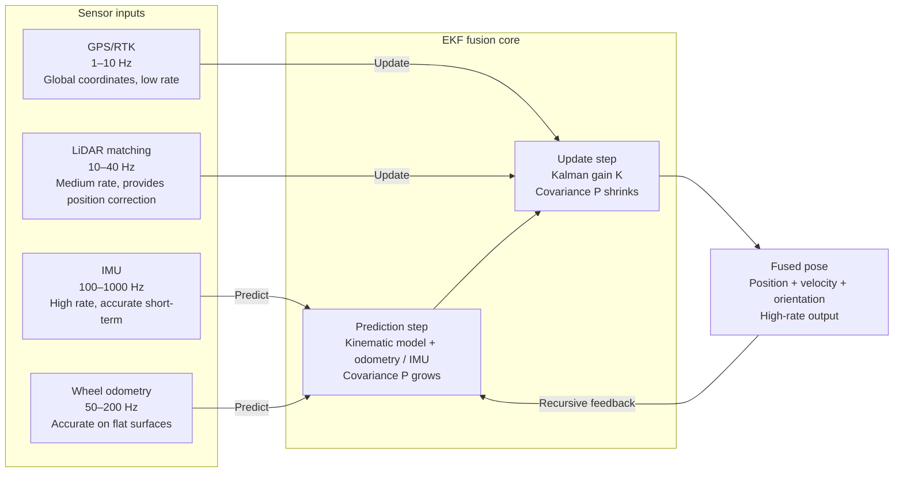

---

# 3. Localization
{: id="3-定位localization"}

Localization solves the problem of "where am I": given a map, the robot must estimate its position and orientation in that map in real time (its **pose = position + orientation**).

## 3.1 Problem definition
{: id="31-问题定义"}

Localization problems fall into three categories:

- **Global localization**: The robot does not know its initial position and must determine its pose from scratch. This is the hardest case, and particle filters handle it well.
- **Pose tracking**: The approximate initial pose is known and is continuously corrected during motion. EKF/UKF specialize in this case.
- **Kidnapped robot problem**: The robot is suddenly moved to an unfamiliar location during operation and must relocalize.

## 3.2 EKF Localization
{: id="32-ekf-定位"}

**Intuition**: Imagine walking blindfolded and estimating your position from your step count and turning angle (this is "prediction"). Each time you lift the blindfold and glance at a landmark on the map, you use the landmark's position to correct your estimate (this is "update"). The EKF (Extended Kalman Filter) is the mathematical version of this process.

**State vector**: $\mathbf{x} = [x, y, \theta]^T$ (position + orientation)

**Two steps**:

1. **Prediction step**: Use the motion model (for example odometry data) to predict the pose at the next time step. The error covariance grows (uncertainty increases):

$$\hat{\mathbf{x}}_{t|t-1} = f(\mathbf{x}_{t-1}, \mathbf{u}_t)$$

2. **Update step**: Use sensor observations (for example LiDAR sightings of landmarks) to correct the prediction. The error covariance shrinks (uncertainty decreases):

$$\mathbf{x}_t = \hat{\mathbf{x}}_{t|t-1} + \mathbf{K}_t (\mathbf{z}_t - h(\hat{\mathbf{x}}_{t|t-1}))$$

Here, $$\mathbf{K}_t$$ is the **Kalman gain**, which determines whether to trust the prediction or the observation.

**Intuition for the Kalman gain K**: Suppose a friend tells you "you are now at the library entrance", but your step count says you are inside the library. Whom should you trust? The size of K decides this trade-off:

- **K → 1 (trust the observation)**: When sensor noise is low and prediction uncertainty is large, the observation gets a large correction weight
- **K → 0 (trust the prediction)**: When sensor noise is high, the correction is small and the filter relies mainly on the motion model

$$\mathbf{K}_t = \mathbf{P}_{t|t-1} \mathbf{H}^T (\mathbf{H} \mathbf{P}_{t|t-1} \mathbf{H}^T + \mathbf{R})^{-1}$$

Here, $\mathbf{P}$ is the prediction uncertainty (larger P gives larger K, so the sensor is trusted more) and $\mathbf{R}$ is the sensor noise (larger R gives smaller K, so the prediction is trusted more). The figure below shows how the uncertainty ellipse changes through the predict-then-update process:

<div align="center">
  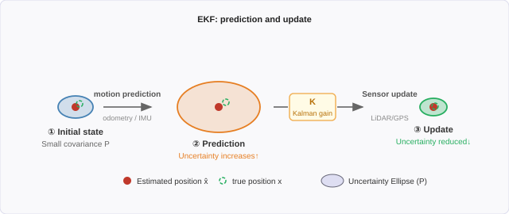
<figcaption>Figure: Change of the EKF uncertainty ellipse: the ellipse grows after the prediction step (uncertainty increases) and shrinks after the update step (sensor correction)</figcaption>
</div>

**Suitable scenarios**: Known map, known initial position, and a weakly nonlinear system. It is computationally efficient and suitable for real-time operation.

<div align="center">
  <video src="/images/robotics_navigation/extended_kalman_filter_localization.mp4" data-autoplay preload="none" loop muted playsinline width="75%" style="aspect-ratio:800/800"></video>
<figcaption>Figure: EKF localization simulation: the robot (blue) moves along its trajectory, the green ellipse is the estimated uncertainty, and red is the EKF localization result</figcaption>
</div>

## 3.3 UKF localization
{: id="33-ukf-定位"}

**Difference from the EKF**: The EKF linearizes nonlinear functions to first order with a Taylor expansion, which causes larger errors in strongly nonlinear systems. The UKF (Unscented Kalman Filter) instead approximates the probability distribution after the nonlinear transformation with a carefully chosen **set of sigma points**. It needs no derivatives and is more accurate.

**Sigma-point sampling**: Draw $2n+1$ sigma points from the current mean and covariance, propagate them through the nonlinear function, and recompute the mean and covariance.

✅ Higher accuracy than the EKF, especially for motion models with strong nonlinearity
❌ Slightly higher computational cost than the EKF (about 2–3 times)

<div align="center">
  <video src="/images/robotics_navigation/ekf_vs_ukf_comparison.mp4" data-autoplay preload="none" loop muted playsinline width="80%" style="aspect-ratio:800/800"></video>
<figcaption>Figure: EKF vs. UKF simulation: the UKF's pose estimate (right) converges more accurately in strongly nonlinear scenarios</figcaption>
</div>

## 3.4 Particle filter localization
{: id="34-粒子滤波定位"}

**Intuition**: Use thousands of "particles" (each one a hypothesis about the pose) to represent the probability distribution of the robot's position. Each particle moves according to the motion model (with added random noise), and then receives a score (weight) based on the sensor observation: the closer a particle is to what is actually observed, the higher its weight. Finally, **resampling** discards low-weight particles and duplicates high-weight ones.

<div align="center">
  <video src="/images/robotics_navigation/particle_filter_localization.mp4" data-autoplay preload="none" loop muted playsinline width="75%" style="aspect-ratio:800/800"></video>
<figcaption>Figure: Particle filter localization simulation: the initial particles are uniformly distributed (global localization) and gradually converge to the true position as the robot moves and observes</figcaption>
</div>

**AMCL (Adaptive Monte Carlo Localization)**: The widely used particle-filter localization package in ROS. It adapts the number of particles, reducing it once localization has converged to save computation.

The following figure shows the three core stages of the MCL algorithm:

<div align="center">
  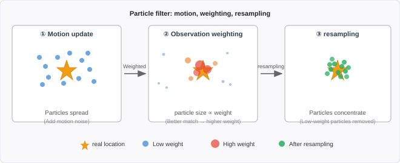
<figcaption>Figure: Three stages of particle filtering (MCL): (1) particles spread out after the motion update, (2) observation weighting (larger particles = higher weight), (3) after resampling, the particles concentrate near the true position</figcaption>
</div>

**MCL algorithm flow**:

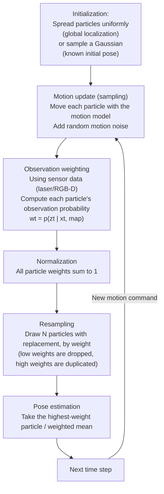

**Resampling details**: Naive random resampling causes **loss of particle diversity** (the same particle is copied many times). **Systematic resampling** avoids this: it picks a random starting point in $[0, 1/N]$ and then samples N times at equal intervals, so each interval is sampled exactly once. This effectively prevents diversity loss, and the computational complexity remains $O(N)$.

**AMCL's adaptive particle count (KLD sampling)**: A fixed particle count wastes computation (once localization has converged, so many particles are unnecessary) and is unsafe (too few particles at initialization may miss the true position). **KLD sampling** computes the required number of particles dynamically from the volume of state space covered by the current particle set: the more thoroughly the state space is explored (the more grid cells are covered), the fewer particles are needed. A typical AMCL range is 100–5000 particles.

✅ Supports **global localization** (parallel multi-hypothesis tracking, so it can handle the kidnapped robot problem)
✅ Handles nonlinear systems well, with no linearization needed
❌ High computational cost when the particle count is large
❌ Efficiency drops in high-dimensional state spaces (curse of dimensionality)


## 3.5 Scan-matching localization
{: id="35-基于扫描匹配的定位"}

Scan matching is another approach to localization: directly align the current LiDAR scan with a reference map (or with the previous scan) to solve for the pose transformation.

### NDT registration
{: id="ndt-配准"}

**Idea**: Divide the reference point cloud space into a regular grid and represent the points in each cell with a **normal distribution** (mean + covariance). The probability of the current scan's points under these distributions is the matching score, and the pose is optimized to maximize it.

✅ Robust to changes in point cloud density
✅ Computationally efficient (especially in 3D scenes)
✅ One of the mainstream methods for autonomous-driving localization (HD-map-based localization)

<div align="center">
  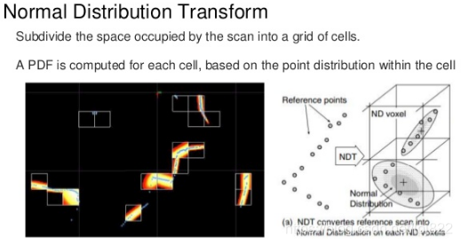
<figcaption>Figure: NDT matching principle: alignment of the reference map (grid + normal distributions) with the current scan</figcaption>
</div>

### ICP registration
{: id="icp-配准"}

**Idea**: Pair each point in the current point cloud with its nearest point in the target point cloud, compute the rigid transformation (rotation + translation) that minimizes the distance between the matched pairs, and iterate until convergence.

✅ Simple and intuitive, with high accuracy (after convergence)
❌ Sensitive to the initial pose and prone to local optima
❌ High computational cost, and real-time performance depends on point cloud density
❌ Prone to degeneracy in repetitive structures such as corridors

<div align="center">
  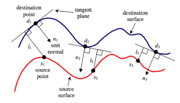
<figcaption>Figure: ICP iterations: the green current-frame point cloud is gradually aligned with the red reference point cloud, and the distance between nearest-point pairs shrinks with each iteration</figcaption>
</div>

## 3.6 Comparison of localization methods
{: id="36-定位方法对比汇总"}

| Method | Suitable scenarios | Global localization | Computational cost | Nonlinearity handling | ROS support |
|------|---------|---------|---------|-----------|---------|
| **EKF** | Known initial pose, weak nonlinearity | ❌ | Low | First-order approximation | `robot_localization` |
| **UKF** | Known initial pose, moderate to strong nonlinearity | ❌ | Medium | Sigma-point approximation | `robot_localization` |
| **Particle filter / AMCL** | Global localization, unknown initial pose | ✅ | Medium–high | No approximation | `amcl` |
| **NDT** | Autonomous driving, high-precision map localization | Requires initialization | Medium | — | `ndt_cpu` |
| **ICP** | Fine registration, short-range matching | ❌ | Medium–high | — | `pcl_ros` |

<div align="center">
  <video src="/images/robotics_navigation/ekf_ukf_pf_comparison.mp4" data-autoplay preload="none" loop muted playsinline width="85%" style="aspect-ratio:800/800"></video>
<figcaption>Figure: Comparative simulation of EKF, UKF, and particle filter localization: accuracy and convergence speed in the same scenario</figcaption>
</div>

---

# 4. Mapping & SLAM
{: id="4-建图mapping--slam"}

**SLAM (Simultaneous Localization and Mapping)** solves a chicken-and-egg problem: localization requires a map, and mapping requires knowing the location. The goal of SLAM is to perform localization and mapping together when **no prior map is available**.

## 4.1 Map representations
{: id="41-地图表示形式"}

Different scenarios call for different map representations:

### Binary occupancy grid
{: id="二值占据栅格"}

Divide the environment into equal-sized cells (usually 5–20 cm per cell) and store a probability value in each cell indicating whether it is occupied (occupied = 1, free = 0, unexplored = 0.5). This is the most commonly used map format in indoor robot navigation and is directly supported by the ROS `map_server`.

<div align="center">
  <video src="/images/robotics_navigation/binary_grid_map_construction.mp4" data-autoplay preload="none" loop muted playsinline width="60%" style="aspect-ratio:800/800; margin:4px"></video>
<figcaption>Figure: Construction of a binary occupancy grid map</figcaption>
</div>

<div align="center">
  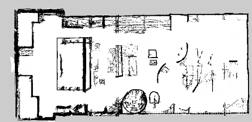
<figcaption>Figure: Finished map: white = free, black = obstacle, gray = unexplored</figcaption>
</div>

### Costmap
{: id="代价地图costmap"}

On top of the occupancy grid, **inflation** around obstacles creates a cost layer: the closer to an obstacle, the higher the cost. The robot then keeps a safe distance from obstacles during path planning without extra collision checks. The ROS Navigation Stack's `costmap_2d` supports multi-layer costmaps (static layer + obstacle layer + inflation layer).

<div align="center">
  <video src="/images/robotics_navigation/cost_grid_map_construction.mp4" data-autoplay preload="none" loop muted playsinline width="55%" style="aspect-ratio:800/800; margin:4px"></video>
<figcaption>Figure: Costmap construction</figcaption>
</div>

<div align="center">
  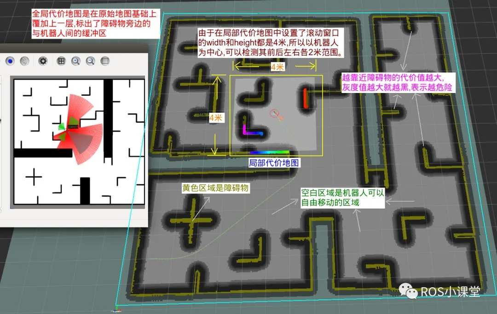
<figcaption>Figure: Finished costmap: blue = low cost, red = high cost (near obstacles)</figcaption>
</div>

### Potential field map
{: id="势场地图"}

The goal is treated as the "lowest point of potential energy" and obstacles as "sources of repulsion", so the whole space forms a potential field. The robot finds a path by moving in the direction of gradient descent, much like a ball rolling down a slope to its lowest point. Its main drawback is that it easily gets trapped in local minima.

<div align="center">
  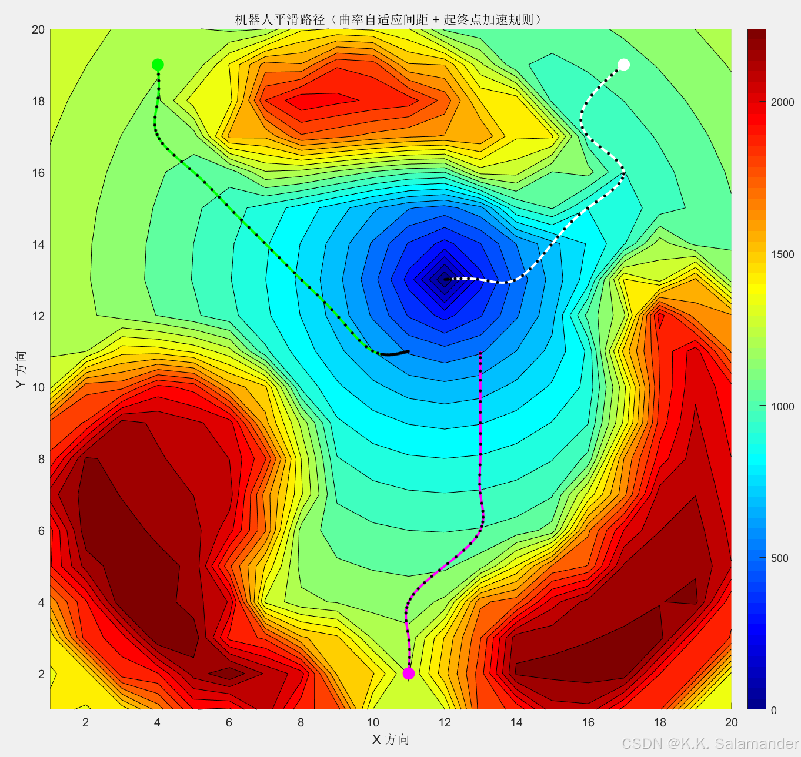
<figcaption>Figure: Potential field map: the goal (blue trough) produces attraction, obstacles (red peaks) produce repulsion, and the gradient direction points along the robot's direction of motion</figcaption>
</div>

### NDT Map
{: id="ndt-地图ndt-map"}

The normal distributions transform (NDT) map mentioned above suits high-precision autonomous driving scenarios. Each grid cell stores the statistical distribution of its points instead of the raw points, which compresses storage substantially while preserving localization accuracy.

<div align="center">
  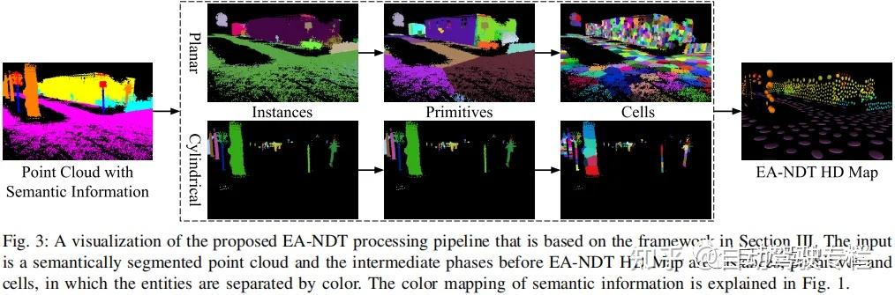
<figcaption>Figure: EA-NDT processing pipeline: intermediate stages from the semantically segmented point cloud to the H-Map.</figcaption>
</div>

<div align="center">
  <video src="/images/robotics_navigation/ndt_map_construction.mp4" data-autoplay preload="none" loop muted playsinline width="65%" style="aspect-ratio:800/800"></video>
<figcaption>Figure: NDT map construction</figcaption>
</div>

### OctoMap (octree 3D map)
{: id="octomap八叉树三维地图"}

**OctoMap** is the de facto standard for 3D robot mapping and is directly supported by the `octomap_server` package in ROS. The core idea is to recursively subdivide 3D space with an **octree**. Each leaf node represents a voxel and stores the voxel's **occupancy probability**.

**Spatial subdivision principle**:

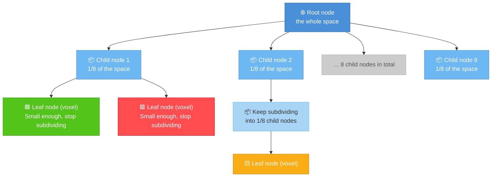

> 🟩 Free voxels  🟥 Occupied voxels  🟨 Unknown voxels  Dark nodes = can still be subdivided

The voxel size (resolution) is typically set to 5–20 cm and can be adjusted as needed.

**Occupancy probability update** (Bayesian update): Each time a laser or depth-sensor ray passes through a voxel, the voxel's log-odds of occupancy are updated:

$$L(n) = L(n-1) + \log\frac{P(\text{occ}|\text{hit})}{1 - P(\text{occ}|\text{hit})}$$

After accumulating multiple observations, each voxel is classified as **occupied**, **free**, or **unknown**.

**Memory efficiency**: OctoMap stores only occupied and free nodes; unknown space takes no memory. A large indoor scene (200m², 10cm resolution) usually needs only tens of MB, far better than storing a dense 3D occupancy grid.

| Property | OctoMap | Raw point cloud |
|------|---------|---------|
| Memory | Low (sparse octree) | High (12–24 bytes per point) |
| Probabilistic update | ✅ | ❌ |
| Unknown-space representation | ✅ | ❌ |
| Multi-resolution queries | ✅ | ❌ |
| ROS support | `octomap_server` | `sensor_msgs/PointCloud2` |

✅ 3D obstacle perception (drone obstacle avoidance, robot-arm grasp planning)
✅ Supports dynamic updates (probability decays after an obstacle is removed)
❌ Does not retain color/semantic information (needs extensions such as ColorOctoMap / SemanticOctoMap)

### Topological Map
{: id="拓扑地图topological-map"}

All of the maps above (occupancy grid, NDT, OctoMap) are **metric maps**, which record the exact geometry of the space. A **topological map** is entirely different: it abstracts the environment into a graph of **nodes (places) and edges (connections)** and ignores precise geometry.

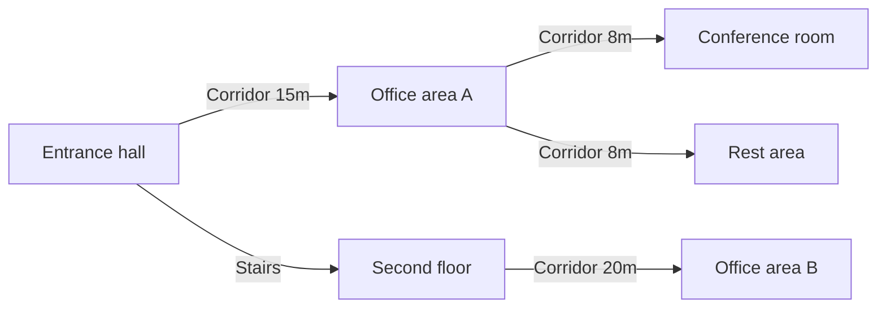

A **node** usually corresponds to a semantic place (a room, doorway, or corridor intersection), and an **edge** records the reachability between adjacent nodes (sometimes with distance or direction information).

| Dimension | Metric map | Topological map |
|---------|---------|---------|
| Representation granularity | Centimeter-level precise coordinates | Nodes/edges (semantic) |
| Storage cost | Large (grows linearly with area) | Extremely small |
| Path planning | Grid search (A*) | Graph search (Dijkstra) |
| Suitable scale | Small indoor scenes (<100m) | Buildings, multi-floor sites, campuses |
| Localization accuracy | High | Low (localizes only to node granularity) |

**Hybrid schemes in practice**: Most real systems use a **hybrid topological-metric map**. The topological layer does high-level planning across rooms (choosing which nodes to pass through), and the metric layer handles fine-grained local navigation and obstacle avoidance near each node. A typical implementation is the ROS `topological_navigation` package.

## 4.2 SLAM problem overview
{: id="42-slam-问题概述"}

The input to SLAM is a stream of sensor data (a sequence of laser scans or images, plus odometry), and the output is:

1. **Trajectory**: the robot's historical motion path
2. **Map**: a spatial representation of the environment

A SLAM system is usually divided into a **front-end** and a **back-end**:

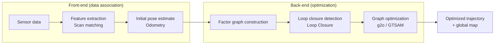

> **SLAM vs. pure localization**: SLAM means "localizing while building a map" and is suited to the first exploration of an **unknown environment**. Once the map has been built and saved, later deployments only need **pure localization** on the known map: the input is sensor data and the output is the robot's position in the known map, with no map maintenance or updating. Pure localization is much cheaper than SLAM: laser-based solutions use **AMCL** (adaptive Monte Carlo localization, a particle filter) or **NDT-based localization**, and vision-based solutions use **relocalization**. In real product deployments, the vast majority of robots run in "pure localization mode", and SLAM is started only during the mapping phase or when the environment changes substantially.

## 4.3 LiDAR SLAM
{: id="43-激光-slam"}

### Cartographer (Google)
{: id="cartographergoogle"}

[Project homepage](https://github.com/cartographer-project/cartographer)

Google's open-source LiDAR SLAM system, which supports 2D and 3D mapping. Core ideas:

- **Submaps**: Scan data are inserted in segments into local submaps, and each submap maintains its own consistency
- **Scan matching**: When a new scan arrives, CSM (correlative scan matching) first provides an initial pose, and the Ceres Solver then refines it
- **Loop closure detection**: When the robot returns to a previously explored area, loop closures are detected by brute-force search matching, which removes the accumulated error

✅ Supports real-time 2D/3D mapping
✅ Works very well in large-scale indoor scenes
✅ Well supported in ROS 2 (`cartographer_ros`)

<div align="center">
  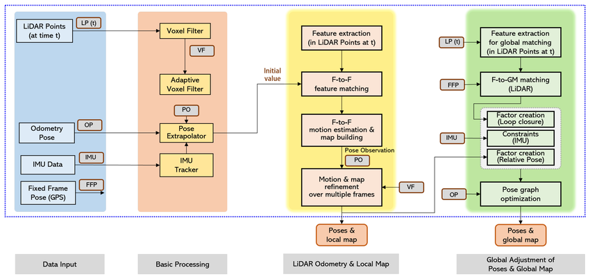
<figcaption>Figure: Cartographer mapping pipeline</figcaption>
</div>

### GMapping
{: id="gmapping"}

[Project home page](https://github.com/ros-perception/slam_gmapping)

A 2D LiDAR SLAM method based on particle filtering, in which each particle maintains its own grid map and pose estimate. It uses a **Rao-Blackwellized particle filter** to decompose the SLAM problem into conditionally independent localization and mapping parts.

✅ Simple to implement, suitable for small indoor scenes
✅ Good real-time performance
❌ Large scenes need many particles and a lot of memory
❌ Does not support 3D mapping

<div align="center">
  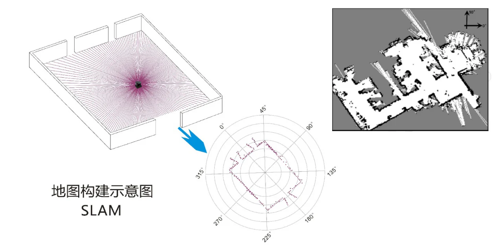
<figcaption>Figure: GMapping map construction</figcaption>
</div>


### LOAM
{: id="loam"}

Proposed by Ji Zhang et al. in 2014, LOAM is a milestone in 3D LiDAR SLAM. Core ideas:

- Extract **edge features** and **planar features** from the point cloud
- Use these two types of features for **scan matching** to estimate the pose between frames
- Run two threads in parallel: high-rate odometry and low-rate mapping

<div align="center">
  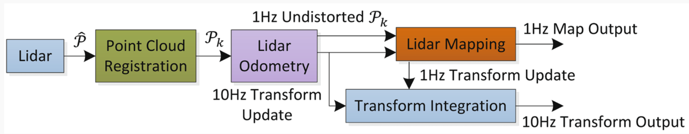
<figcaption>Figure: The LOAM software system</figcaption>
</div>

[Author project homepage](https://leijiezhang001.github.io/LOAM/)


### LeGO-LOAM
{: id="lego-loam"}

[Project homepage](https://github.com/RobustFieldAutonomyLab/LeGO-LOAM)

A lightweight version of LOAM optimized specifically for **ground mobile robots**. It uses ground segmentation and extracts features separately from ground and non-ground points, which greatly reduces computation and allows real-time operation on embedded platforms (such as Jetson).

<div align="center">
  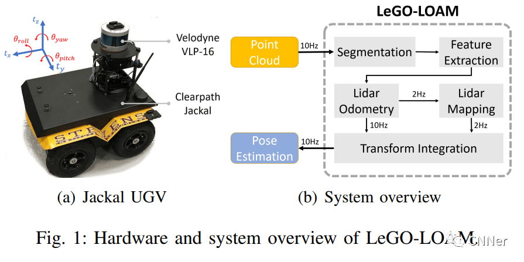
<figcaption>Figure: The LeGO-LOAM system</figcaption>
</div>

### LIO-SAM
{: id="lio-sam"}

[Project homepage](https://github.com/TixiaoShan/LIO-SAM)

**Tightly coupled** LiDAR-inertial odometry that jointly optimizes LiDAR and IMU data in a **factor graph** framework. IMU pre-integration provides point cloud deskewing and an initial pose estimate, and LiDAR matching then corrects it. Accuracy and robustness are better than loosely coupled schemes.

<div align="center">
  
<figcaption>Figure: The LIO-SAM system</figcaption>
</div>

**LIO-SAM tightly coupled architecture** (IMU pre-integration + LiDAR factor graph):

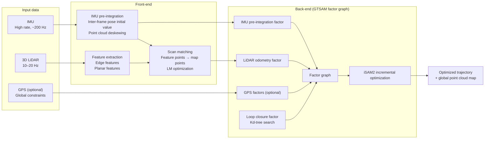

## 4.4 Visual SLAM
{: id="44-视觉-slam"}

Visual SLAM uses cameras instead of LiDAR. It is cheaper but more sensitive to lighting.

### ORB-SLAM3
{: id="orb-slam3"}

One of the most mature visual SLAM systems today, supporting **monocular / stereo / RGB-D / fisheye cameras + IMU**.

[Project homepage](https://github.com/UZ-SLAMLab/ORB_SLAM3)

**Key techniques**:
- Feature extraction: **ORB (Oriented FAST and Rotated BRIEF)** descriptors, which are fast and rotation-invariant
- Tracking: match the current frame against map points and solve for the pose with PnP
- Local mapping: maintain a local map and optimize it with Bundle Adjustment
- Loop closure detection: appearance-similarity detection based on a **Bag of Words (BoW)** model

**ORB-SLAM3 three-thread architecture**:

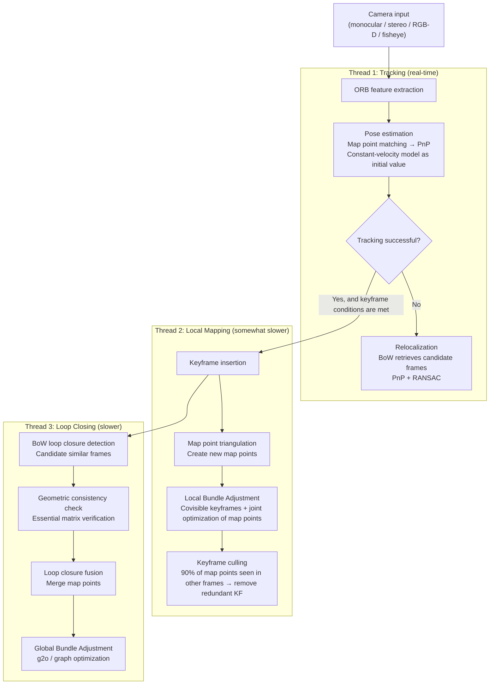

**Keyframe selection strategy**: ORB-SLAM3 does not insert a keyframe at every frame. A keyframe is triggered by the following conditions: (1) the time since the previous keyframe exceeds a threshold; (2) the number of map points observed in the current frame drops below a threshold (tracking is getting weak); (3) the local map does not have too many keyframes waiting to be processed (to avoid a backlog). This strategy keeps keyframes evenly distributed in space and time and avoids redundancy.

**Map point management**: Each map point records which keyframes observed it and the ORB descriptor in each of those frames (the mean serves as the representative descriptor). Map points are divided into **local map points** (seen in recent keyframes) and **global map points** (the full history). During tracking, only local map points are used for matching (fast), and during BA only covisible keyframes are optimized (local BA).

**Relocalization after tracking loss**: When tracking fails over consecutive frames, the system enters **relocalization mode**: (1) use the current frame's BoW vector to retrieve similar frames from the keyframe database; (2) verify geometric consistency of the candidate frames with PnP + RANSAC; (3) once a matching frame is found, recover the pose and reinitialize tracking. BoW retrieval is extremely fast (O(1) order) and completes within milliseconds.

✅ High accuracy, and supports multiple camera types
✅ Strong loop closure detection in large-scale scenes
❌ Pure vision easily loses tracking in low light or fast motion

### VINS-Mono / VINS-Fusion
{: id="vins-mono--vins-fusion"}

[VINS-Mono](https://github.com/HKUST-Aerial-Robotics/VINS-Mono) | [VINS-Fusion](https://github.com/HKUST-Aerial-Robotics/VINS-Fusion)

A **visual-inertial SLAM** system open-sourced by the Hong Kong University of Science and Technology. It tightly couples the camera and the IMU and estimates the pose jointly through **nonlinear optimization (sliding-window BA)**. VINS-Fusion further supports stereo and GPS fusion, and is a common solution in autonomous driving and drones.

✅ Tightly coupled, high precision
✅ More robust to pure camera rotation and weakly textured scenes
✅ Supports online extrinsic calibration

<div align="center">
  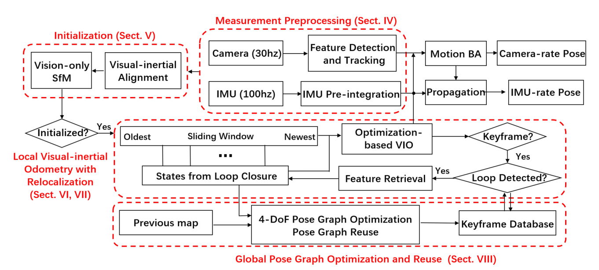
<figcaption>Figure: Visual-inertial system (VINS) with stereo vision</figcaption>
</div>


### DSO (direct sparse odometry)
{: id="dso直接稀疏里程计"}

[Project homepage](https://github.com/JakobEngel/dso)

A representative **direct method**, which minimizes the **photometric error** of image pixel intensities directly, without extracting feature points.

Comparison with **feature-based methods** (ORB-SLAM3):

| Dimension | Feature-based method (ORB-SLAM3) | Direct method (DSO) |
|---------|---------------|-----------|
| Texture dependence | Requires corner features | Any image gradient |
| Weakly textured scenes | ❌ Fails easily | ✅ Relatively better |
| Motion blur | ❌ Feature extraction becomes difficult | ❌ Also degrades |
| Computational cost | Medium | High |
| Map density | Sparse point cloud | Semi-dense point cloud |

### RTAB-Map
{: id="rtab-map"}

[Project homepage](https://github.com/introlab/rtabmap)

Open-sourced by IntRoLab, it is currently the most widely used **multi-modal graph-optimization SLAM** system in the ROS ecosystem. It supports RGB-D cameras, stereo cameras, and 3D LiDAR input, and outputs occupancy grid maps and dense point cloud maps.

**Core design: appearance-based memory management**

The most distinctive feature of RTAB-Map is its **online memory management mechanism**: the system divides keyframes into "Working Memory (WM)" and "Long-Term Memory (LTM)". When the number of nodes in WM exceeds its limit, the node that has gone unaccessed for the longest time is moved to LTM (similar to memory paging in an operating system). During loop closure detection, only WM is searched, which preserves real-time performance; after a loop closure is detected, the relevant nodes are woken up from LTM to take part in optimization. This mechanism lets RTAB-Map run in real time (>1 Hz) during large-scale, long-term mapping.

**Key technical modules**:

- **Appearance-based loop closure detection**: Extract SURF/ORB features from keyframes, compute inter-frame similarity with a Bag of Words (BoW) model, and trigger geometric verification (PnP + RANSAC) when a threshold is exceeded
- **Graph optimization back-end**: Globally optimize the pose graph with g2o/GTSAM to remove accumulated drift
- **Multi-sensor front-end**:
  - RGB-D mode: ICP point cloud matching + visual odometry (VO)
  - LiDAR mode: ICP/NDT scan matching
  - Stereo mode: disparity-based depth estimation + VO
- **Output maps**: 2D occupancy grid map (directly usable in the ROS Navigation Stack) + 3D colored point cloud

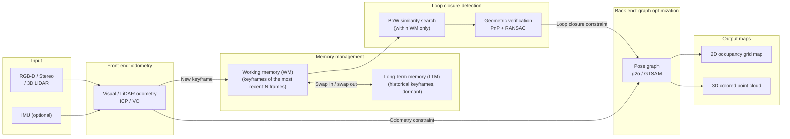

✅ Multi-sensor support: RGB-D, stereo, and LiDAR can be used in one system
✅ Outputs standard occupancy grid maps that plug directly into the ROS Navigation Stack
✅ Online memory management, suited to long-term, large-scale mapping
✅ Built-in 3D point cloud maps, usable for downstream tasks such as grasping and 3D reconstruction
❌ The default parameters use a lot of memory in large scenes, so parameters such as `Mem/STMSize` need tuning
❌ Reliability drops in pure-vision mode in weakly textured or low-light environments

### Dense visual mapping
{: id="稠密视觉建图"}

ORB-SLAM3 and DSO output **sparse / semi-dense point clouds**, which cannot be used directly for downstream tasks such as grasp planning or 3D reconstruction. Dense mapping systems output complete 3D surface models, at the cost of more computation.

#### TSDF map representation
{: id="tsdf-地图表示"}

The **Truncated Signed Distance Function (TSDF)** is the core map representation of dense mapping. Space is divided into a voxel grid, and each voxel stores:

- **SDF value**: the signed distance from the voxel to the nearest surface (positive = outside the surface, negative = inside, zero = on the surface)
- **Weight**: the confidence accumulated over observations

$$\text{TSDF}(v) = \text{clip}\left(\frac{d(v)}{\delta},\ -1,\ 1\right)$$

Here, $\delta$ is the truncation distance, and $d(v)$ is the distance from the voxel center to the nearest surface. After multiple depth frames are fused, the **Marching Cubes algorithm** extracts a triangle mesh at TSDF=0, which is the reconstructed 3D surface.

#### KinectFusion
{: id="kinectfusion"}

Introduced by Microsoft Research in 2011, KinectFusion was the first system for **real-time dense reconstruction with an RGB-D camera**, and it runs entirely on the GPU.

**Pipeline**:

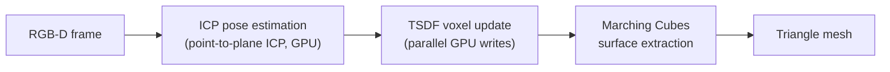

- **Front-end**: Estimates the camera pose in real time with **GPU point-to-plane ICP** (no feature extraction; it aligns the depth-map point clouds directly)
- **Mapping**: Projects the depth map along the ray direction and updates the TSDF voxels (GPU-parallel, extremely fast)
- **Limitations**: The map resolution is fixed, and the scene size is limited by GPU memory (usually within 3m³). There is no loop closure detection, so long-term drift is noticeable

#### ElasticFusion
{: id="elasticfusion"}

ICCV 2015. Built on KinectFusion, it adds an **elastic deformation** mechanism, replaces the voxel map with **surfels (oriented surface elements)**, and supports non-rigid global optimization:

- **Surfel map**: Each surfel stores position, normal vector, color, radius, and confidence
- **Elastic loop closure**: After a loop closure is detected, instead of rigidly translating the map, a non-rigid elastic deformation is applied so that historical frames align smoothly
- **Effect**: Suited to medium-scale indoor scenes (a single room), with much better reconstruction quality than KinectFusion

#### Dense visual mapping comparison
{: id="稠密视觉建图对比"}

| System | Map representation | Loop closure | Scene scale | Suitable scenes |
|------|---------|------|---------|---------|
| KinectFusion | TSDF voxels | ❌ | Small (3m³) | Desktop-scale reconstruction |
| ElasticFusion | Surfels | ✅ (elastic) | Medium (single room) | Fine indoor reconstruction |
| RTAB-Map | Point cloud + occupancy grid | ✅ | Large (multiple rooms) | Navigation + coarse reconstruction |
| ORB-SLAM3 | Sparse point cloud | ✅ | Large | Mainly for localization |

### Neural implicit SLAM
{: id="神经隐式-slam"}

Since 2021, NeRF and 3D Gaussian Splatting have entered SLAM, bringing a new paradigm for map representation: instead of discrete voxels or point clouds, **neural networks implicitly encode the scene's geometry and appearance**.

#### NeRF basics review
{: id="nerf-基础回顾"}

A **Neural Radiance Field (NeRF)** uses an MLP to map spatial coordinates and viewing direction to color and volume density:

$$(\mathbf{c}, \sigma) = F_\theta(\mathbf{x}, \mathbf{d})$$

Pixel colors are obtained by volume rendering integration, the photometric loss is computed against the real image, and the network weights are optimized by backpropagation. The optimized network serves as an "implicit map" of the scene from which new views can be rendered at any viewpoint.

#### IMAP(2021)
{: id="imap2021"}

The first system to use NeRF for real-time SLAM. A single MLP jointly optimizes the camera pose and the scene representation:

- **Tracking**: Fix the network weights and optimize the current frame's pose (minimizing rendering error)
- **Mapping**: Fix the poses and optimize the network weights (updating the implicit map from historical keyframes)
- **Limitations**: A single MLP has limited capacity and loses detail in large scenes; it is also slow and cannot run in real time

#### NICE-SLAM(2022)
{: id="nice-slam2022"}

Introduces a **multi-resolution feature grid** in place of a single MLP, removing iMAP's capacity bottleneck:

- Three feature grids (coarse, medium, and fine) capture geometry at different scales
- Local updates: only the currently observed grid region is updated, which avoids global forgetting
- Faster than iMAP, and suited to medium-sized indoor scenes (TUM and Replica datasets)

#### 3D Gaussian Splatting SLAM(2023-2024)
{: id="3d-gaussian-splatting-slam2023-2024"}

**3DGS-SLAM** uses **3D Gaussian ellipsoids** in place of NeRF's volume density field. Rendering is more than 100 times faster (real-time rendering at >30 fps), and it has spawned a number of real-time SLAM systems:

| System | Map representation | Real-time | Features |
|------|---------|-------|------|
| **MonoGS** (2024) | 3D Gaussian | ✅ | Monocular camera, geometry-aware tracking |
| **SplaTAM** (2024) | 3D Gaussian | ✅ | RGB-D, explicit density control |
| **Gaussian-SLAM** | 3D Gaussian + submap | ✅ | Large scene submap stitching |

Comparison of **NeRF/3DGS SLAM and traditional SLAM**:

| Dimension | Traditional SLAM (ORB-SLAM3) | NeRF-SLAM | 3DGS-SLAM |
|------|----------------------|-----------|-----------|
| Map representation | Sparse point cloud | Implicit MLP | 3D Gaussian ellipsoids |
| Novel-view rendering | ❌ | ✅ (slow) | ✅ (real time) |
| Localization accuracy | High | Medium | Medium |
| Mapping speed | Real time | Slow (offline) | Near real time |
| Memory | Low | Medium | High (large number of Gaussians) |
| Downstream tasks | Navigation | View synthesis, simulation | View synthesis, simulation |

> **Outlook**: Neural implicit SLAM currently lags behind traditional SLAM in localization accuracy and real-time performance. However, the high-quality, renderable maps it produces have unique value for visual perception and simulation data generation in embodied AI, and it is a current research hotspot.

## 4.5 SLAM backend optimization
{: id="45-slam-后端优化"}

The SLAM front-end provides an initial pose estimate for each frame, but noise accumulates and the error grows over a long run. The goal of back-end optimization is global consistency.

### Bundle adjustment
{: id="bundle-adjustment"}

**Bundle Adjustment** is the core of visual SLAM back-end optimization. The goal is to **adjust the camera poses and the 3D map point positions simultaneously** so that the **reprojection error of all map points across all camera frames is minimized**.


<div align="center">
  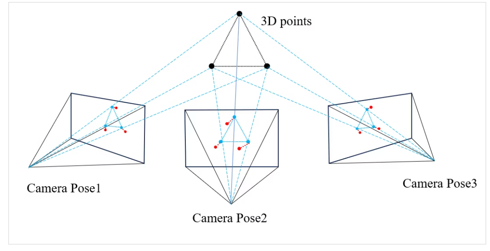
<figcaption>Figure: Bundle adjustment</figcaption>
</div>

**Intuitive analogy**: Imagine several photos of the same scene taken from different angles, plus initial (noisy) 3D coordinates of the landmarks in the scene. BA simultaneously fine-tunes each photo's camera position and orientation as well as each landmark's 3D coordinates, so that the sum of deviations between the "landmark projections computed from the camera parameters" and the "feature positions actually seen in the photos" is minimized.

$$\min_{\{P_i\}, \{X_j\}} \sum_{i,j} \| u_{ij} - \pi(P_i, X_j) \|^2$$

Here, $P_i$ is the camera pose, $X_j$ is the 3D coordinate of the map point, $u_{ij}$ is the observed image coordinate, and $\pi(\cdot)$ is the projection function.

**Local BA vs. Global BA trade-offs**:
- **Local BA** (ORB-SLAM3's real-time optimization): Optimizes only the latest covisible keyframes and the map points they observe. The computational cost is small and it runs in real time (millisecond level). Drawback: local BA cannot remove global drift.
- **Global BA** (triggered after a loop closure): Optimizes all keyframes and map points of the entire map, giving good global consistency. Drawback: the computation grows with map size, and large scenes may take seconds or even minutes, so it can only run offline or once after a loop closure is detected.

### Factor graphs
{: id="因子图与图优化"}

Model the SLAM problem as a **factor graph**: nodes (variables) represent robot poses and map points, and edges (factors) represent sensor constraints (such as relative poses between adjacent frames and loop closure constraints). Solving it means finding the variable estimates that minimize the sum of all constraint errors.

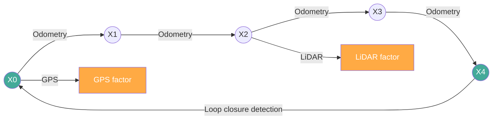

### Loop closure
{: id="回环检测"}

The task of loop closure detection is to determine whether the robot has returned to a place it has visited before, so that a loop closure constraint can be added to remove accumulated error. The process has two stages: **appearance retrieval** (quickly recalling candidate frames) and **geometric verification** (eliminating false recalls).

<div align="center">
  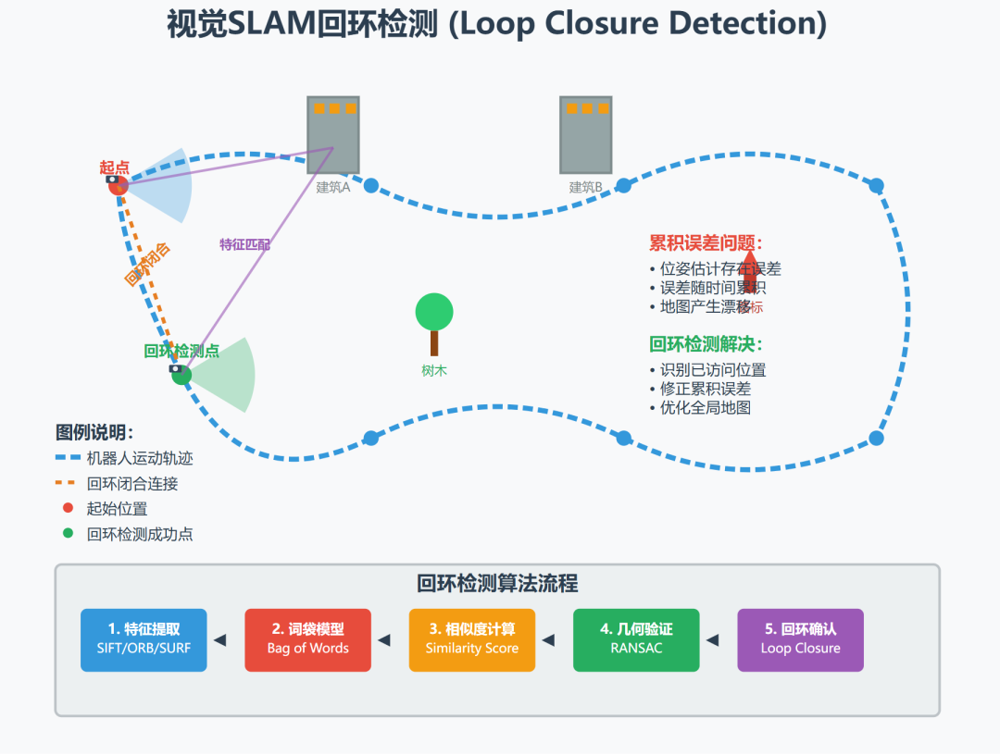
<figcaption>Figure: The two-stage loop closure detection pipeline</figcaption>
</div>

<div align="center">
  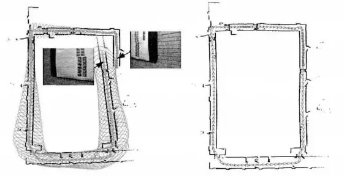
<figcaption>Figure: Loop closure detection result</figcaption>
</div>

#### Stage 1: Appearance retrieval with a Bag of Words model
{: id="阶段一外观检索--词袋模型bag-of-words"}

The most mainstream loop closure retrieval scheme in visual SLAM is implemented by the **DBoW2 / DBoW3** library (the ORB-SLAM series and RTAB-Map are both built on it).

**(1) Offline: build a visual dictionary**

Extract ORB / BRIEF descriptors from a large number of images and use **k-means clustering** (usually a hierarchical k-ary tree) to quantize the high-dimensional descriptor space into $K$ "visual words". The dictionary is fixed once training is complete and does not need to be updated at runtime.

```
Original descriptor space (128-dimensional float or 256-bit binary)
        ↓  Hierarchical k-means
Visual dictionary (tree structure, leaf nodes = visual words)
```

**(2) Online: image → BoW vector**

Extract ORB descriptors for each keyframe, **quantize** each descriptor to its nearest visual word, count the word frequencies, and apply weighting to obtain a sparse vector:

$$
v_i = \left[ \text{tf-idf}(w_1),\ \text{tf-idf}(w_2),\ \ldots,\ \text{tf-idf}(w_K) \right]$$

Here, the TF-IDF weight is $= \text{tf}(w, f) \times \log\frac{N}{n_w}$, where $N$ is the total number of frames in the database and $n_w$ is the number of frames containing the word $w$. Common words (such as edges and corners) get low weights, and rare words (such as distinctive textures) get high weights.

**(3) Candidate frame retrieval**

When a new keyframe arrives, its BoW vector is compared by **cosine similarity** with all frames in the database, and the Top-K frames are selected as loop closure candidates. Because the vectors are sparse and dictionary lookup is $O(1)$, retrieval is extremely fast (on the order of milliseconds).

> **Key limitation**: BoW is a purely appearance-based method, and similar lighting or scenes produce **false positives**, so its results must be verified geometrically.

---

#### Stage 2: Geometric consistency verification with RANSAC
{: id="阶段二几何一致性验证--ransac"}

For each candidate frame recalled by BoW, verify whether the **3D geometry between the current frame and the candidate frame is self-consistent**.

**(1) Feature point matching**

Between the current frame and the candidate frame, perform **brute-force matching** on the ORB descriptors to obtain a set of corresponding point pairs $\{(p_i, p_i')\}$.

**(2) Estimate the essential or homography matrix with RANSAC**

The matched pairs contain many **outliers** (mismatches caused by occlusion and repeated textures), so solving directly with all points yields a wrong geometric relationship. The RANSAC approach:

```
Repeat N times:
  1. Randomly sample a minimal set of points (5 for the essential matrix, 4 for the homography)
  2. Solve for the E or H matrix from the minimal set
  3. Count the inliers consistent with E/H
Return the solution with the most inliers
```

The **essential matrix $E$** (general rotation + translation, no planar assumption) satisfies the epipolar constraint:

$$p'^T E\, p = 0, \quad E = t^\wedge R$$

Here, $R$ is the rotation matrix and $t^\wedge$ is the skew-symmetric matrix of the translation vector.

**(3) Inlier threshold test**

- Number of inliers $\geq$ threshold (such as 30) → **loop closure confirmed**: compute the relative pose $T_{loop}$ of the current frame with respect to the candidate frame and add it to the pose graph as a constraint
- Too few inliers → **candidate rejected**, and no loop closure is produced this time

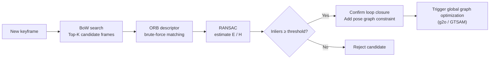

---

#### Loop closure detection for LiDAR SLAM
{: id="激光-slam-的回环检测"}

LiDAR SLAM has no images and cannot use BoW. The following approaches are commonly used:

| Method | Principle | Representative system |
|------|------|----------|
| **ICP brute-force search** | Traverse historical submaps and verify matches with ICP | Cartographer |
| **Kd-tree distance search** | Restrict the search range with GPS/odometry priors, then verify with ICP | LIO-SAM |
| **Scan Context** | Encode the point cloud as a 2D descriptor (top-down polar histogram); fast retrieval and rotation invariance | SC-LIO-SAM |

**Scan Context** is the mainstream approach to LiDAR loop closure detection in recent years. It projects the 3D point cloud onto a top-down polar grid, records the maximum height in each cell, and produces a fixed-size 2D matrix as a "fingerprint" of the point cloud. The similarity between two frames is made rotation-invariant by a column-shift search, and retrieval is much faster than frame-by-frame ICP.

### Main back-end optimization libraries
{: id="主要后端优化库"}

- **g2o (General Graph Optimization)**: a general graph optimization library, used by ORB-SLAM2/3
- **GTSAM (Georgia Tech Smoothing and Mapping)**: a factor graph optimization library, used by LIO-SAM
- **iSAM2 (Incremental Smoothing and Mapping 2)**: the incremental optimization algorithm in GTSAM, which supports real-time updates without re-optimizing the whole graph each time

## 4.6 LiDAR vs. visual SLAM comparison
{: id="46-激光-vs-视觉-slam-对比"}

| Dimension | LiDAR SLAM | Visual SLAM |
|---------|---------|---------|
| Sensor cost | High (hundreds to tens of thousands of yuan) | Low |
| Accuracy | High (cm level) | Medium (scene-dependent) |
| Lighting dependence | None | Yes (struggles in low light / overexposure) |
| Map type | Point cloud / occupancy grid | Sparse / semi-dense point cloud |
| Dynamic obstacle handling | Average | Difficult |
| Corridor degeneracy | Prone (lacks geometric constraints) | Depends on texture |
| Representative algorithms | Cartographer, LIO-SAM | ORB-SLAM3, VINS-Mono |
| Typical applications | Indoor robots, autonomous driving | Drones, handheld devices |

> **RTAB-Map** spans both columns: it accepts both LiDAR and visual input, and its accuracy and suitable scenarios fall between the two. It is the most comprehensive out-of-the-box solution in the ROS ecosystem.

## 4.7 SLAM degeneracy and deployment
{: id="47-slam-退化与部署挑战"}

SLAM systems often perform well in laboratory environments but meet various degenerate scenarios in real deployments, causing localization failures or map errors. Understanding these scenarios and choosing algorithms accordingly is the key to engineering practice.

<div align="center">
  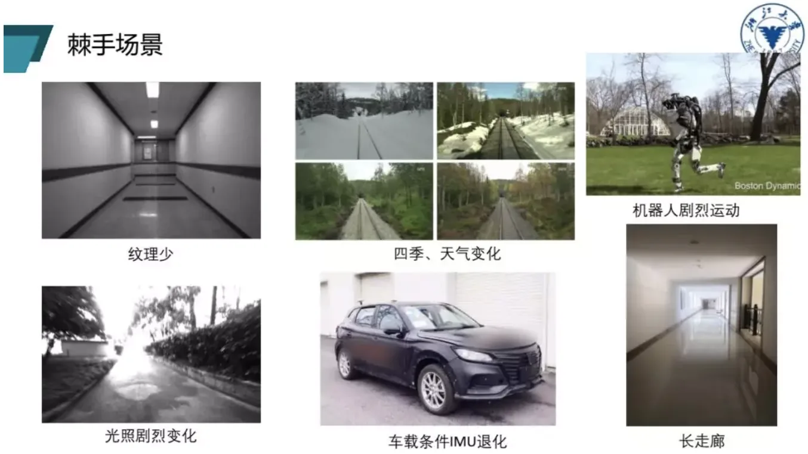
<figcaption>Figure: Challenging scenes</figcaption>
</div>

### 4.7.1 Geometric degeneracy
{: id="471-几何退化"}

**Corridor degeneracy**: LiDAR SLAM faces severe challenges in long corridors. The walls on both sides are highly symmetrical, and the laser point cloud looks almost identical along the corridor direction, so displacement **along the corridor cannot be constrained** (scan matching lacks constraints along that direction). The symptom is drift along the corridor while lateral localization remains good.

**Countermeasures**:
- Combine with an IMU or wheel odometry to constrain motion along the corridor
- Use 3D LiDAR to add constraints from ceiling and floor structures
- LIO-SAM's IMU pre-integration provides constraints in the degenerate direction

**Open outdoor degeneracy**: In environments lacking 3D structure, such as large parking lots and fields, the laser point cloud is sparse and NDT/ICP struggle to converge. **Countermeasure**: fuse global GPS constraints.

### 4.7.2 Dynamic environment challenges
{: id="472-动态环境挑战"}

SLAM assumes a static environment, but in reality pedestrians, vehicles, and moving furniture cause dynamic interference:

- **Ghost map points**: Dynamic obstacles are wrongly built into the static map
- **Tracking failure**: A large number of dynamic objects makes scan matching fail
- **False loop closures**: BoW recalls the wrong keyframes after the scene layout changes

**Countermeasures**:
- Dynamic object filtering on point clouds (based on motion consistency detection)
- Semantic segmentation to filter dynamic categories (pedestrians, vehicles) from point clouds
- Motion segmentation in visual SLAM

### 4.7.3 Lighting and weather
{: id="473-光照与天气"}

Visual SLAM is extremely sensitive to lighting:

| Scenario | Impact on feature-based methods | Impact on direct methods |
|------|------------|------------|
| Low light (night) | ORB feature extraction fails | Photometric error computation becomes unstable |
| Overexposure (backlight) | Feature descriptors become unstable | Gradients in saturated regions are zero |
| Fast motion | Motion blur, blurred features | Violates the brightness-constancy assumption |
| Rain/fog | Features are obscured | Reduced visibility |

**Countermeasures**:
- Visual-inertial SLAM (VINS-Mono / ORB-SLAM3 IMU mode): the IMU maintains short-term localization when feature tracking fails
- HDR cameras or active illumination (structured light) to adapt to lighting changes
- Event cameras are immune to motion blur and are a current research hotspot

### 4.7.4 Long-term map maintenance
{: id="474-长期地图维护与场景变化"}

Long-term deployment faces map aging: seasonal changes (falling leaves, snow), renovations, and moved furniture can invalidate the original map.

**Mitigation strategies**:
- **Incremental map update**: When sensor observations disagree with the existing map beyond a threshold, trigger a local map update
- **Multi-map management** (supported by ORB-SLAM3): Create a new submap when the scene changes or tracking is lost, and merge after recovery
- **Semantic maps**: Replace raw points with semantic labels (door / wall / column); semantic features are more stable than geometric ones

### 4.7.5 Embedded compute limits
{: id="475-嵌入式平台计算约束"}

Robots are often equipped with embedded platforms (Jetson Nano / Xavier / Orin) with limited computing power, while a complete SLAM system demands considerable compute:

| Component | CPU compute requirement | GPU acceleration feasibility |
|------|-----------|------------|
| ORB feature extraction | Medium (SIMD can accelerate) | ✅ (CUDA ORB) |
| LiDAR scan matching (NDT/ICP) | High | Partial (PCL GPU) |
| Bundle Adjustment | Extremely High | ✅ (g2o CUDA) |
| Loop closure detection (BoW search) | Low | Unnecessary |
| Particle filter (AMCL, 500 particles) | Low | Unnecessary |

**Practical suggestions**:
- Prefer lightweight systems: LeGO-LOAM (embedded-friendly) and AMCL (low-compute localization)
- Accelerate the front-end (feature extraction, scan matching) on the GPU wherever possible
- Run back-end optimization at a reduced rate (10 Hz front-end + 1–2 Hz back-end BA)
- Use iSAM2 incremental optimization to avoid re-optimizing the full graph

> **Note**: More details on real-world deployment of visual SLAM (scenario adaptability research related to TITS 2026) will be added later.

## 4.8 Summary of commonly used datasets
{: id="48-常用数据集汇总"}

| Dataset | Sensors | Scenario | Main purpose | URL |
|--------|-------|------|---------|------|
| **KITTI** | LiDAR + stereo + GPS/IMU | Outdoor roads | Visual/LiDAR odometry, 3D object detection | kitti.is.tue.mpg.de |
| **TUM** | RGB-D | Indoor | RGB-D SLAM evaluation | vision.in.tum.de |
| **EuRoC** | Stereo + IMU | Indoor drone | VIO evaluation | rpg.ifi.uzh.ch |
| **nuScenes** | 6 cameras + LiDAR + radar + GPS/IMU | Outdoor roads | Autonomous driving perception | nuscenes.org |
| **Newer College** | 3D LiDAR + IMU | Outdoor campus | 3D LiDAR SLAM | ori.ox.ac.uk |
| **Hilti SLAM** | Multiple LiDARs + cameras + IMU | Construction sites | Multi-sensor SLAM evaluation | hilti-challenge.com |

---

# 5. Path planning
{: id="5-路径规划path-planning"}

Path planning solves the problem of "how should I get there": finding a collision-free path from the start to the goal in a known (or locally known) map.

## 5.1 Global path planning: search methods
{: id="51-全局路径规划搜索类"}

Search algorithms look for the optimal path on a **discretized grid map**.

### Dijkstra's algorithm
{: id="dijkstra-算法"}

**Idea**: Starting from the start node, explore all reachable nodes in order of **increasing cost**, like ripples spreading outward, until the goal is found. It is guaranteed to find the lowest-cost path (optimality).

✅ Guaranteed optimal solution
❌ No directionality: many nodes are expanded on a large map, so it is inefficient
❌ Time complexity $O(V \log V + E)$, where $V$ is the number of nodes and $E$ is the number of edges

<div align="center">
  <video src="/images/robotics_navigation/dijkstra_search.mp4" data-autoplay preload="none" loop muted playsinline width="46%" style="aspect-ratio:1000/800; margin:4px"></video>
  <video src="/images/robotics_navigation/dijkstra_navigate.mp4" data-autoplay preload="none" loop muted playsinline width="46%" style="aspect-ratio:800/800; margin:4px"></video>
<figcaption>Figure: Dijkstra search process (left) and navigation result (right): the expanded nodes spread in concentric circles with no directionality</figcaption>
</div>

### A* (A-Star) algorithm
{: id="aa-star算法"}

**Idea**: On top of Dijkstra, add a **heuristic function h(n)** (an estimate of the cost from the current node to the goal, usually the Euclidean or Manhattan distance). This gives the search a clear direction and explores nodes that "look closer to the goal" first.

$$f(n) = g(n) + h(n)$$

Here, $g(n)$ is the actual cost from the start to node $n$, and $h(n)$ is the heuristic estimate.

✅ Guaranteed optimal solution (when $h(n)$ does not overestimate the actual cost)
✅ Much faster than Dijkstra (directional search)
❌ Still computationally heavy in high-dimensional spaces (such as 3D)

**Choosing the heuristic function h(n)**: Different heuristics suit different movement constraints:

| Heuristic function | Formula | Suitable scenario | Properties |
|---------|------|---------|------|
| **Manhattan distance** | $\|dx\| + \|dy\|$ | Only 4-directional movement (up, down, left, right) | Admissible for 4-connected movement |
| **Euclidean distance** | $\sqrt{dx^2 + dy^2}$ | Movement in any direction | Admissible for movement in any direction |
| **Octile distance** | $\max(\|dx\|,\|dy\|) + (\sqrt{2}-1)\min(\|dx\|,\|dy\|)$ | 8-directional movement (including diagonals) | Tighter than Euclidean in 8 directions (faster search) |

> **Admissibility**: $h(n)$ must never overestimate the true cost, which ensures that A* finds the optimal solution. If $h(n) = 0$, A* reduces to Dijkstra (slowest, but optimal). The larger $h(n)$ is, the faster the search, but it may overestimate the cost and lose optimality.

The following figure shows A*'s search process on a 10×10 grid:

<div align="center">
  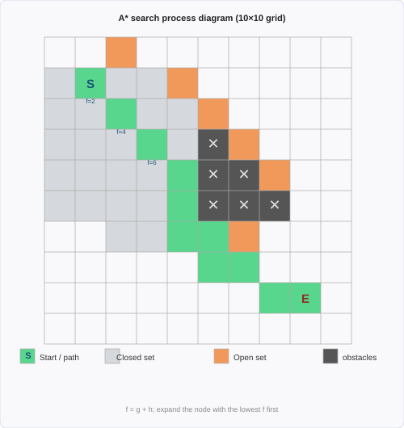
<figcaption>Figure: A* search illustration: gray = evaluated (closed set), orange = to be evaluated (open set), green = optimal path; obstacles (dark) are bypassed</figcaption>
</div>

<div align="center">
  <video src="/images/robotics_navigation/astar_search.mp4" data-autoplay preload="none" loop muted playsinline width="46%" style="aspect-ratio:1000/800; margin:4px"></video>
  <video src="/images/robotics_navigation/astar_navigate.mp4" data-autoplay preload="none" loop muted playsinline width="46%" style="aspect-ratio:800/800; margin:4px"></video>
<figcaption>Figure: A* search process (left) and navigation result (right): the search is directional, and the expanded nodes concentrate toward the goal</figcaption>
</div>

### Bidirectional A*
{: id="双向-abidirectional-a"}

Search from the start and the goal simultaneously, and stop when the two search fronts meet. The average number of nodes searched is about half that of one-way A*, which suits cases where the start and goal are far apart.

<div align="center">
  <video src="/images/robotics_navigation/astar_bidirectional_search.mp4" data-autoplay preload="none" loop muted playsinline width="46%" style="aspect-ratio:1000/800; margin:4px"></video>
  <video src="/images/robotics_navigation/astar_bidirectional_navigate.mp4" data-autoplay preload="none" loop muted playsinline width="46%" style="aspect-ratio:800/800; margin:4px"></video>
<figcaption>Figure: Bidirectional A* search (left, expanding from both ends at once) and navigation result (right)</figcaption>
</div>

### Hybrid A*
{: id="hybrid-a混合-a"}

**Problem with standard A***: It searches on a grid and ignores the vehicle's kinematic constraints. A car cannot move sideways and has a minimum turning radius.

**Hybrid A*** improves on this by discretizing the vehicle's continuous state space ($x, y, \theta$) and considering executable steering actions (such as arcs of different curvatures) when expanding each node, so the generated path is **actually feasible** for vehicles with nonholonomic constraints (differential-drive or Ackermann).

✅ Generates kinematically feasible paths
✅ Suited to parking scenarios and narrow passages
❌ Higher computational cost than standard A*
❌ Needs post-processing such as Reeds-Shepp curves for smoothing

<div align="center">
  <video src="/images/robotics_navigation/astar_hybrid_search.mp4" data-autoplay preload="none" loop muted playsinline width="46%" style="aspect-ratio:1000/800; margin:4px"></video>
  <video src="/images/robotics_navigation/astar_hybrid_navigate.mp4" data-autoplay preload="none" loop muted playsinline width="46%" style="aspect-ratio:800/800; margin:4px"></video>
<figcaption>Figure: Hybrid A* search (left) and navigation result (right): a smooth, feasible path that respects the vehicle's kinematic constraints</figcaption>
</div>

### Engineering optimizations for A*
{: id="a-算法工程优化"}

In real engineering applications (such as autonomous driving or mobile robots), paths generated by plain A* often have redundant nodes and sharp corners. Mainstream optimization strategies include:

1. **Adaptive heuristic weight**:
Introduce a dynamic weight coefficient $\lambda$ so that the heuristic weight varies with position:
   $$f(n) = g(n) + (1 + \lambda \cdot \frac{d_{to\_end}}{d_{total}})h(n)$$
Increase the weight near the start to speed up the search (similar to greedy search), and decrease it near the goal to preserve path optimality.

2. **Path simplification (Douglas-Peucker algorithm)**:
The raw paths produced by A* often contain many redundant collinear nodes. The **Douglas-Peucker (DP)** algorithm removes unnecessary intermediate points while preserving the path's topology, which greatly simplifies the path description and makes the subsequent trajectory smoothing more efficient.

3. **Smoothing (B-spline curves)**:
Fit the simplified key points with a **B-spline** or a fifth-order polynomial. This turns A*'s polyline path into a continuous, higher-order differentiable smooth curve that respects the chassis dynamics constraints (such as a centripetal acceleration limit).

<div align="center">
  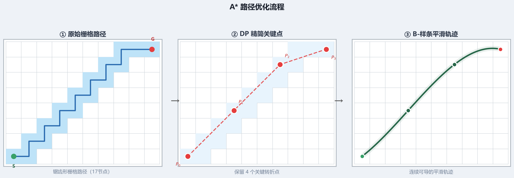
<figcaption>Figure: A* path optimization pipeline: original grid path (left) → DP-simplified key points (middle) → B-spline smoothed trajectory (right)</figcaption>
</div>


<div align="center">
  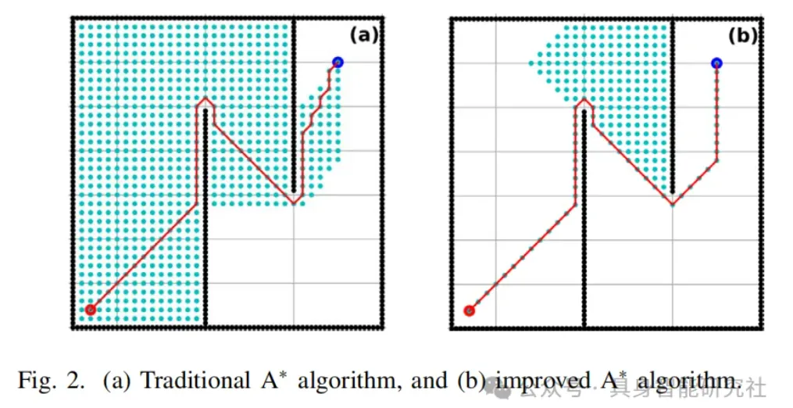
<figcaption>Figure: Before optimization, A* has dense search points (Fig. 2a) and many turning points on the path. After optimization, the number of search points drops sharply (Fig. 2b) and the path is simpler and smoother, improving both search efficiency and path quality.</figcaption>
</div>

### Fast Marching Method (FMM)
{: id="快速行进法fmm"}

**Idea**: FMM was proposed by J.A. Sethian in 1996 and models path planning as a **wavefront propagation** problem. A "time wavefront" propagates outward from the goal, and the shortest arrival time $T(\mathbf{x})$ at each grid cell is recorded, building a global **arrival time field**. For planning, gradient descent along $-\nabla T$ from the start yields the globally optimal path.

<div align="center">
  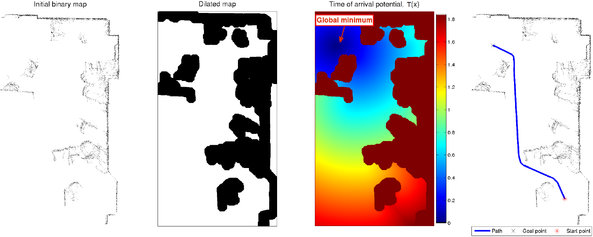
<figcaption>Figure: FMM planning process: speed field W(x) (left, low speed near obstacles) → arrival time field T(x) (middle, low cost in blue regions) → gradient descent path (right)</figcaption>
</div>

**Eikonal Equation**:

$$|\nabla T(\mathbf{x})| = \frac{1}{F(\mathbf{x})}$$

Here, $T(\mathbf{x})$ is the minimum time (path cost) for the wave to reach the point $\mathbf{x}$ from the goal, and $F(\mathbf{x}) > 0$ is the **propagation speed at that point**: $F=1$ in free space and $F \to 0$ near obstacle edges. Assigning it through the costmap's distance transform naturally incorporates terrain costs.

**Core algorithm steps (narrow-band propagation, Dijkstra-like)**:

1. **Initialize**: goal $T_{goal}=0$, all other nodes $T=\infty$; push the goal onto a min-heap
2. **Pop the heap top** (the node with the smallest current $T$) and mark it as "determined"
3. For each undetermined neighbor, compute a candidate arrival time with the **Eikonal update formula**:

Let $T_h = \min(T_{left}, T_{right})$ and $T_v = \min(T_{up}, T_{down})$ (the smallest determined value in each pair of opposite directions). Then:

   $$T_{new} = \begin{cases} \dfrac{T_h + T_v + \sqrt{2/F^2 - (T_h - T_v)^2}}{2} & \text{if } |T_h - T_v| < 1/F \\ \min(T_h, T_v) + \dfrac{1}{F} & \text{otherwise (one-sided update)} \end{cases}$$

4. If $T_{new}$ is smaller than the current value, insert (or update) the neighbor in the min-heap
5. Repeat steps 2–4 until the heap is empty

**Path extraction**: Starting from the start, perform gradient descent along $-\nabla T$. Because the Eikonal equation guarantees that the $T$ field **is monotonic with no local minima**, gradient descent always converges to the goal and yields the globally optimal path.

✅ **Naturally smooth** paths: the wavefront propagates continuously, with no grid aliasing
✅ **Build once, query from anywhere**: after the $T$ field is built, gradient descent can start from any point, which suits repeated queries to the same goal
✅ Naturally incorporates **non-uniform terrain cost** through $F(\mathbf{x})$ (slope, ground type, etc.)
✅ **Globally optimal** (in the continuous sense), with none of the local-minimum problems of the classical potential field method
❌ Cannot be accelerated with a heuristic and **must traverse the entire map**, $O(N \log N)$ ($N$ is the total number of grid cells)
❌ Not suited to **single-query** planning on very large maps (A* is faster)
❌ At low resolution the gradient descent path is still slightly jagged and needs post-processing smoothing

**Comparison with other algorithms**:

| Dimension | FMM | Dijkstra | A* |
|---------|-----|----------|----|
| Core model | Continuous Eikonal equation | Discrete graph search | Discrete graph + heuristic |
| Path smoothness | Naturally smooth | Jagged | Jagged (needs post-processing) |
| Single-query speed | Slow (full map) | Slow (full map) | Fast (directional) |
| Multi-query | ✅ (build once) | Must be rerun each time | Must be rerun each time |
| Non-uniform cost | ✅ ($F$ field) | ✅ (edge weights) | ✅ (edge weights) |

**Typical applications**: terrain path planning (rovers on non-uniform ground), full-grid potential field construction in ROS `navfn`, image distance transforms and skeleton extraction, and geodesic distance computation in computer graphics.


### Fast Marching Square(FM²)
{: id="fast-marching-squarefm"}

FM² was proposed by Garrido et al. (2006) as an extension of FMM. Its core idea is to **run FMM twice in series**. By constructing a speed field proportional to the distance to obstacles, the wavefront automatically "bypasses" dangerous regions, producing a natural, safe, and smooth path.

<div align="center">
  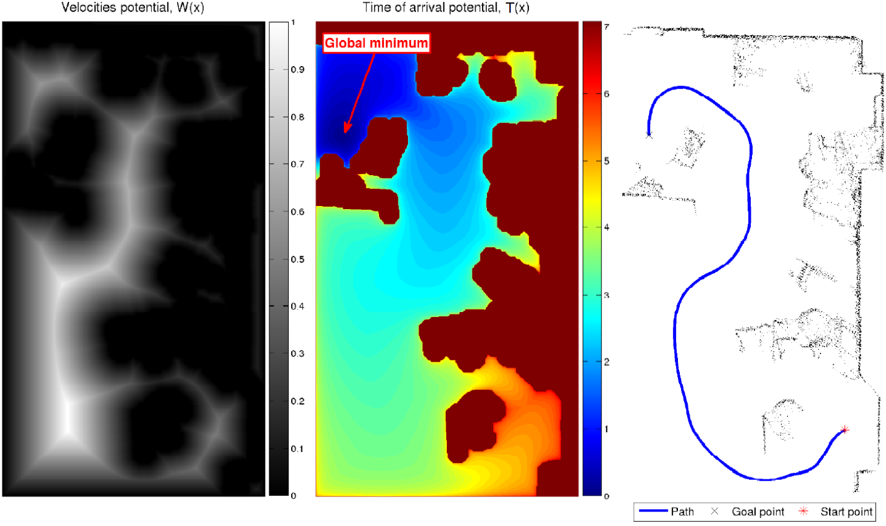
<figcaption>Figure: FM² planning process: original binary map (far left) → dilated map (second from left) → arrival time field T(x) (second from right) → safe path (far right). The path naturally stays away from obstacle edges</figcaption>
</div>

**Two-stage algorithm**:

1. **Stage 1: construct the speed field $W(\mathbf{x})$**: Run FMM with all **obstacle cells** as sources ($T=0$) to obtain the **arrival-time distance field** from every point in the map to the nearest obstacle, then normalize it into a speed field:

   $$W(\mathbf{x}) = f\!\left(d_{\text{obs}}(\mathbf{x})\right), \quad W \in (0,\,1]$$

The closer to an obstacle, the smaller $W(\mathbf{x})$ is (the lower the speed); $W \to 1$ at the center of free space.

2. **Stage 2: path planning**: Run FMM again with the goal as the source and $W(\mathbf{x})$ as the propagation speed to compute the arrival time field $T(\mathbf{x})$; the path is obtained by descending along $-\nabla T$ from the start.

**Why the path is naturally safe**: Near obstacles $W$ is low, so the wave propagates slowly and $T$ is high. Gradient descent therefore detours automatically into "high-speed zones" where $W$ is large (away from obstacles), keeping a safety margin without any post-processing.

✅ The speed field **inherently encodes path safety**, so there is no need to inflate obstacles or set a safety radius parameter
✅ Both FMM passes guarantee global optimality and smooth paths
✅ Applicable to spaces of any dimension (including high-dimensional robot-arm planning)
❌ Two full-map FMM passes, twice the computation of standard FMM
❌ The speed field may suppress speed too much in narrow passages, giving an overly conservative path

**Main variants**:

| Variant | Improvement |
|------|-------|
| **FM²\*** | Adds a goal heuristic in the second stage so that the wavefront propagates directionally, avoiding unnecessary full-map expansion and improving speed |
| **FMDirectional** | Fixes FM²'s overly large safety margin in open spaces, making the path hug the traversable side of obstacles more closely |
| **Fast Marching Learning (FML)** | Uses past path experience to modify the speed field, enabling trajectory reuse and faster planning |


## 5.2 Global planning: sampling-based methods
{: id="52-全局路径规划采样类"}

Sampling-based algorithms construct a path by **random sampling**. They do not need an explicit grid map and suit high-dimensional spaces and scenarios with complex geometric constraints.

### RRT
{: id="rrt"}

**Idea**: Grow a tree from the start. Each time, pick a random point, find the nearest node on the tree, extend a small step toward the random point, and add the new node to the tree if there is no collision. A path is found when some tree node comes close enough to the goal.

**Core steps**:

1. Initialization: a tree $\mathcal{T}$ containing only the start $x_{start}$
2. **Random sampling** $x_{rand} \sim \mathcal{U}(\mathcal{X})$ (sometimes the goal is sampled directly with probability $p_{goal} \approx 5\%$ to speed up convergence)
3. **Nearest neighbor** $x_{near} = \arg\min_{x \in \mathcal{T}} \|x - x_{rand}\|$
4. **Steering** $x_{new} = x_{near} + \delta \cdot \frac{x_{rand} - x_{near}}{\|x_{rand} - x_{near}\|}$, where $\delta$ is the step size (`step_size`)
5. **Collision check**: If $x_{near} \to x_{new}$ is obstacle-free, add $x_{new}$ to the tree with edge weight $\delta$
6. Repeat until $\|x_{new} - x_{goal}\| < \epsilon$

Key parameter `step_size`: if it is too large, the tree cannot get past obstacles; if it is too small, convergence is extremely slow. It is usually set to 1%–5% of the map diagonal.

✅ Handles high-dimensional spaces naturally (robot-arm planning)
✅ No rasterization required
❌ **No optimality guarantee** (the path found is usually quite winding)
❌ The final path needs extra smoothing (B-spline or shortcut smoothing is commonly used)

<div align="center">
  <video src="/images/robotics_navigation/rrt_search.mp4" data-autoplay preload="none" loop muted playsinline width="46%" style="aspect-ratio:1000/800; margin:4px"></video>
  <video src="/images/robotics_navigation/rrt_navigate.mp4" data-autoplay preload="none" loop muted playsinline width="46%" style="aspect-ratio:800/800; margin:4px"></video>
<figcaption>Figure: RRT random tree expansion (left) and planned path (right): the path is winding and not optimal</figcaption>
</div>

### RRT*
{: id="rrt-1"}

An improved version of RRT that adds two key steps to the standard algorithm: **Choose Parent** and **Rewiring**.

**Choose Parent**: Rather than simply taking the nearest neighbor, consider the nodes in the radius-$r$ neighborhood $$\mathcal{X}_{near}$$ and choose the parent with the **lowest cost from the start**:

$$x_{parent} = \arg\min_{x \in \mathcal{X}_{near}} \left[ \text{cost}(x) + d(x, x_{new}) \right]$$

**Rewiring**: After adding $x_{new}$, check every node $x_{near}$ in $$\mathcal{X}_{near}$$. If routing through $x_{new}$ lowers the cost of reaching $x_{near}$, remove $x_{near}$'s old parent edge and make $x_{new}$ its new parent.

The search radius $r$ shrinks as the number of samples $n$ grows: $r(n) = \gamma \left(\frac{\log n}{n}\right)^{1/d}$ ($d$ is the spatial dimension), which ensures asymptotic optimality while keeping the computation under control.

✅ Asymptotic optimality (the more samples, the better the path)
✅ Shares RRT's sampling framework and is easy to implement
❌ Each new node requires traversing its neighbor set; the per-step time complexity $O(\log n)$ is higher than RRT's $O(1)$
❌ Slow convergence, and there may not be enough sampling time in real-time planning

<div align="center">
  <video src="/images/robotics_navigation/rrt_star_search.mp4" data-autoplay preload="none" loop muted playsinline width="46%" style="aspect-ratio:1000/800; margin:4px"></video>
  <video src="/images/robotics_navigation/rrt_star_navigate.mp4" data-autoplay preload="none" loop muted playsinline width="46%" style="aspect-ratio:800/800; margin:4px"></video>
<figcaption>Figure: RRT* search process (left, the path keeps improving after rewiring) and planned path (right): smoother than RRT</figcaption>
</div>

### Bidirectional RRT*
{: id="双向-rrt"}

Grow an RRT* tree ($$\mathcal{T}_a$$, $$\mathcal{T}_b$$) from each of the start $x_{start}$ and the goal $x_{goal}$. Each iteration alternately expands the two trees:

1. Perform one RRT* expansion step on $$\mathcal{T}_a$$ to obtain a new node $x_{new}$
2. Try to connect $x_{new}$ to its nearest node $x_{b,near}$ in $$\mathcal{T}_b$$ with a collision-free path
3. If the connection succeeds, merge the two sub-paths into a candidate complete path, and keep the complete path with the lowest cost
4. Swap the roles of the two trees ($$\mathcal{T}_a \leftrightarrow \mathcal{T}_b$$) and continue iterating

The advantage is that the two trees "grow toward each other", which effectively avoids the blind diffusion of a one-way tree in a wide space. The search volume drops from $O(r^d)$ to $O(2 \cdot (r/2)^d)$, and convergence is about an order of magnitude faster than one-way RRT*.

<div align="center">
  <video src="/images/robotics_navigation/rrt_star_bidirectional_search.mp4" data-autoplay preload="none" loop muted playsinline width="46%" style="aspect-ratio:1000/800; margin:4px"></video>
  <video src="/images/robotics_navigation/rrt_star_bidirectional_navigate.mp4" data-autoplay preload="none" loop muted playsinline width="46%" style="aspect-ratio:800/800; margin:4px"></video>
<figcaption>Figure: Bidirectional RRT* search (left, the red and blue trees meet) and planned path (right)</figcaption>
</div>

### Informed RRT*
{: id="informed-rrt"}

A further improvement: once an initial solution $c_{best}$ is found, sampling is restricted to an **ellipsoidal region**. The two foci of the ellipse are $x_{start}$ and $x_{goal}$, the semi-major axis is $a = c_{best}/2$, and the semi-minor axis is:

$$b = \frac{1}{2}\sqrt{c_{best}^2 - \|x_{goal} - x_{start}\|^2}$$

**Intuition**: Only points inside the ellipse can yield a path cost lower than $c_{best}$ (the ellipse is defined precisely as the set of points whose summed distance to the two foci is $\leq c_{best}$). As the path keeps improving, $c_{best}$ decreases and the ellipse keeps shrinking, so sampling becomes more and more focused and no samples are wasted in irrelevant regions.

When sampling, a uniform random point $x_{ball} \sim \mathcal{U}(\mathcal{B}^d)$ in the unit ball is mapped into the ellipsoid's coordinate frame by an affine transformation: $x_{rand} = C \cdot L \cdot x_{ball} + x_{center}$, where $C$ is the rotation matrix (aligning the ellipsoid's major axis with the $x_{start} \to x_{goal}$ direction) and $L = \text{diag}(a, b, \ldots, b)$.

<div align="center">
  <video src="/images/robotics_navigation/informed_rrt_star_search.mp4" data-autoplay preload="none" loop muted playsinline width="46%" style="aspect-ratio:1000/800; margin:4px"></video>
  <video src="/images/robotics_navigation/informed_rrt_star_navigate.mp4" data-autoplay preload="none" loop muted playsinline width="46%" style="aspect-ratio:800/800; margin:4px"></video>
<figcaption>Figure: Informed RRT* search (left, the elliptical sampling region shrinks as the path improves) and planned path (right)</figcaption>
</div>

## 5.3 Local planning and obstacle avoidance
{: id="53-局部路径规划动态避障"}

Global planning assumes a static map, but real environments contain dynamic obstacles (pedestrians, other robots). Local planning replans in real time while the robot moves, to handle dynamic obstacles.

### DWA
{: id="dwa"}

**Idea**: Sample velocity commands $(v, \omega)$ within the **reachable velocity window** (limited by acceleration) around the robot's current velocity, predict each resulting trajectory with the motion model, score it on **goal heading + speed + obstacle distance**, and execute the best command.

**Constructing the dynamic window**: The velocity space $(v, \omega)$ must satisfy three constraints at once, so take their intersection:

- **Velocity limits**: $v \in [v_{min}, v_{max}]$, $\omega \in [\omega_{min}, \omega_{max}]$
- **Dynamic window** (acceleration limits): $$v \in [v_c - \dot{v}_{max} \cdot \Delta t,\ v_c + \dot{v}_{max} \cdot \Delta t]$$, and similarly for $\omega$
- **Admissibility constraint**: The distance to the nearest obstacle along the trajectory is $> 0$ (and the robot can brake before reaching the obstacle)

**Scoring function**:

$$G(v, \omega) = \sigma\bigl(\alpha \cdot \text{heading}(v,\omega) + \beta \cdot \text{dist}(v,\omega) + \gamma \cdot \text{velocity}(v,\omega)\bigr)$$

The three components mean:
- $\text{heading}$: the angle between the trajectory's end direction and the direction to the goal (smaller is better; encourages turning toward the goal)
- $\text{dist}$: the distance to the nearest obstacle along the trajectory (larger is better; encourages staying away from obstacles)
- $\text{velocity}$: the forward speed $v$ itself (larger is better; encourages moving fast)
- $\sigma(\cdot)$ is a normalization function, and $\alpha, \beta, \gamma$ are weights

✅ Fast computation (millisecond level), suited to real-time obstacle avoidance
✅ ROS `dwa_local_planner` works out of the box
❌ The velocity search space is limited, so it easily fails in narrow passages
❌ Considers only short-horizon trajectories (about 1–3 s) and cannot handle obstacles that require a "detour"

**Improved variant: Fuzzy DWA**
The scoring weights of traditional DWA ($\alpha, \beta, \gamma$) are fixed, which makes it hard to balance "high-speed driving" against "obstacle avoidance in tight spaces". **Fuzzy DWA** introduces a fuzzy inference engine that takes the **goal distance** and the **nearest obstacle distance** as inputs and adjusts the weights dynamically. For example, when an obstacle is very close, it greatly increases $\beta$ (the obstacle avoidance weight) and reduces $\gamma$ (the speed weight), making avoidance smoother and less abrupt.

<div align="center">
  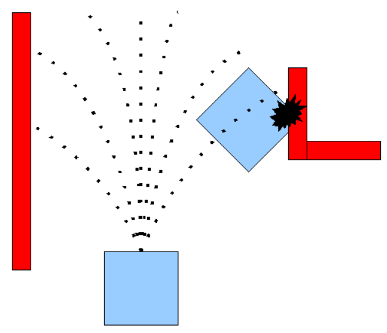
<figcaption>Figure: The dynamic window approach</figcaption>
</div>

### TEB
{: id="teb"}

**Idea**: Treat the path as a "rubber band" and add the time dimension to make it a "timed elastic band". TEB models local planning as a **sparse nonlinear least-squares optimization**:

**State representation**: The path is represented by a sequence of timestamped poses $$\mathcal{B} = \{x_i, \Delta T_i\}_{i=1}^{n}$$, where $x_i = (p_x, p_y, \theta)$ and $\Delta T_i$ is the time interval between adjacent waypoints.

**Optimization objective** (a weighted sum of multiple constraints):

$$\min_{\mathcal{B}} \sum_k \gamma_k f_k(\mathcal{B})$$

The meaning of each constraint term:

| Constraint term | Meaning |
|--------|------|
| $f_{short}$ | Shortest path length (smallest sum of waypoint distances) |
| $f_{obs}$ | Obstacle distance constraint (all waypoints stay away from obstacles by $> d_{min}$) |
| $f_{kin}$ | Kinematic feasibility (nonholonomic constraints: curvature $\leq \kappa_{max}$, minimum turning radius) |
| $f_{vel}$ | Velocity constraints ($v \leq v_{max}$, $\omega \leq \omega_{max}$) |
| $f_{acc}$ | Acceleration constraints ($\|\dot{v}\| \leq a_{max}$, $\|\dot{\omega}\| \leq \alpha_{max}$) |

The optimization uses the **g2o sparse graph optimization framework**: each waypoint is a node and each constraint is an edge, and Levenberg–Marquardt or Gauss-Newton iterations solve the problem. It usually converges within 10–30 iterations.

✅ Generates smooth, kinematically feasible trajectories
✅ Supports dynamic obstacles (obstacles are also modeled as nodes in the graph)
✅ Supports reversing (allows $v < 0$)
❌ Higher computational cost than DWA, about 50–200 ms
❌ Complicated parameter tuning (the constraint weights $\gamma_k$ interact with each other)
❌ Sensitive to the quality of the initial path; when the global plan is poor, the local optimization may fall into a local optimum

<div align="center">
  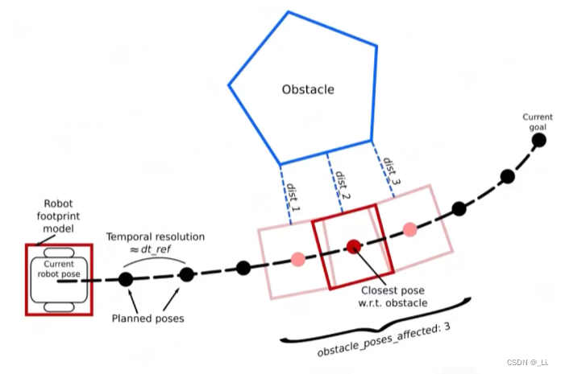
<figcaption>Figure: Timed Elastic Band</figcaption>
</div>

### Potential field method
{: id="势场法"}

The simplest and most intuitive local obstacle avoidance method: the goal generates an **attractive force field** and obstacles generate a **repulsive force field**, and the robot moves down the gradient of the potential field.

**Attractive potential** (parabolic: the farther from the goal, the stronger the attraction):

$$U_{att}(q) = \frac{1}{2} k_{att} \cdot d^2(q, q_{goal})$$

**Repulsive potential** (active when the distance to an obstacle satisfies $d(q, O) < Q^*$):

$$U_{rep}(q) = \begin{cases} \dfrac{1}{2} k_{rep} \left(\dfrac{1}{d(q,O)} - \dfrac{1}{Q^*}\right)^2 & \text{if } d(q,O) \leq Q^* \\ 0 & \text{otherwise} \end{cases}$$

The resultant force on the robot is the negative gradient: $F(q) = -\nabla U_{att}(q) - \nabla U_{rep}(q)$, and the robot moves in the direction of the resultant force.

**Cause of local minima**: In an obstacle-dense region, at some point the attractive force can be exactly equal and opposite to the repulsive force. The gradient is then zero and the robot is trapped at a "false goal".

**Mitigations**: random perturbation (random walk), increasing the potential weight of the global goal, leading the way with global planning, and so on.

✅ Simple to implement and extremely fast to compute (O(number of obstacles))
✅ Produces continuous force commands, suitable for direct coupling with a controller
❌ **Local minimum problem** (the robot may get stuck at an equilibrium between attraction and repulsion)
❌ In a narrow passage the repulsive forces from both sides add up, the resultant force points perpendicular to the passage, and the robot cannot get through
❌ Near the goal the attraction approaches zero, so if repulsion is still present the robot may fail to reach the goal

<div align="center">
  <video src="/images/robotics_navigation/potential_field_demo.mp4" data-autoplay preload="none" loop muted playsinline width="65%" style="aspect-ratio:800/800"></video>
<figcaption>Figure: Potential field obstacle avoidance demo: the robot moves under attractive and repulsive forces and may stall at a local minimum</figcaption>
</div>

### MPPI (Model Predictive Path Integral)
{: id="mppi模型预测路径积分"}

**Idea of Model Predictive Path Integral**: MPPI is a stochastic variant of **model predictive control (MPC)**. At the current time step it samples **a large number of random control sequences** forward (in parallel on the GPU), simulates the future states of each trajectory with the motion model, computes an **information-theoretic weighted average** of the sequences according to trajectory cost as the current control output, and then repeats in a receding-horizon fashion.

<div align="center">
  <video src="/images/robotics_navigation/mppi_path_tracking.mp4" data-autoplay preload="none" loop muted playsinline width="75%" style="aspect-ratio:800/800"></video>
<figcaption>Figure: MPPI path tracking simulation: a large number of trajectories are sampled in parallel on the GPU (translucent lines), and their weighted average gives the optimal control</figcaption>
</div>

**Algorithm flow**:

1. Take the current control sequence $U = \{u_0, u_1, \ldots, u_{T-1}\}$ and sample $K$ disturbance sequences $\epsilon^{(k)} \sim \mathcal{N}(0, \Sigma)$
2. For each trajectory $k$, simulate $T$ steps forward in parallel and compute its cost:
   $$S^{(k)} = \sum_{t=0}^{T-1} \left[ c(x_t^{(k)}) + \lambda \, u_t^\top \Sigma^{-1} \epsilon_t^{(k)} \right] + \phi(x_T^{(k)})$$
Here, $c(x_t)$ is the state cost (collision penalty, path deviation, etc.), $\phi$ is the terminal cost, and $\lambda$ is the temperature parameter.
3. Compute the **exponential weight** of each trajectory (the lower the cost, the larger the weight):
   $$w^{(k)} = \frac{\exp\!\left(-\frac{1}{\lambda} S^{(k)}\right)}{\sum_{j=1}^K \exp\!\left(-\frac{1}{\lambda} S^{(j)}\right)}$$
4. Update the control sequence with the weighted average: $u_t \leftarrow u_t + \sum_k w^{(k)} \epsilon_t^{(k)}$
5. Execute $u_0$, shift the sliding window forward one step, and repeat

The **temperature parameter $\lambda$** controls the exploration-exploitation trade-off: as $\lambda \to 0$, almost only the lowest-cost trajectory is used (greedy); as $\lambda \to \infty$, all trajectories are weighted equally (purely random).

✅ No need to solve an optimal control problem (only forward simulation, no gradients)
✅ Naturally supports nonlinear systems and non-convex cost functions (such as step costs for collisions)
✅ GPU-parallel sampling ($K$ up to $10^3 \text{–} 10^4$) can handle complex obstacle distributions
❌ Requires a fairly accurate motion model (accumulated simulation error causes trajectory deviation)
❌ Computationally heavy; a GPU is usually needed to reach a real-time control rate ($\geq 10$ Hz)

**Parameter tuning guide**:

The core parameters of MPPI fall into three groups: **sampling scale**, **exploration intensity**, and **cost design**.

**① Sampling scale: $K$ (number of trajectories) × $T$ (number of prediction steps) × $dt$ (step size)**

These three jointly determine the computational cost and planning quality, and should be fixed first.

| Parameter | Nav2 default | Physical meaning | Tuning direction |
|------|-----------|---------|---------|
| $K$ (`batch_size`) | 2000 | Total number of trajectories per parallel sampling | When GPU compute is sufficient, try increasing it (4000–8000) for better trajectory diversity |
| $T$ (`time_steps`) | 56 | Number of forward prediction steps per trajectory | Increase for complex scenes (narrow passages, sharp turns) and for high-speed scenes |
| $dt$ (`model_dt`) | 0.05 s | Time interval per step | Total prediction window $= T \times dt$, usually kept at 2–5 s |

> **Rule of thumb**: First fix $dt = 0.05$ s, set $T \times dt$ to 1.5 times the time the robot needs to traverse the longest obstacle corridor at maximum speed, and then choose $K$ according to the GPU's computing power.

**② Exploration intensity: $\lambda$ (temperature) and $\Sigma$ (noise covariance)**

$\Sigma$ determines the amplitude of the trajectory perturbations, and $\lambda$ determines how strongly high-cost trajectories are suppressed.

| Parameter | Nav2 default | Problem if too small | Problem if too large |
|------|-----------|------------|------------|
| $\lambda$ (`temperature`) | 0.3 | Trusts only a handful of low-cost trajectories; poor robustness to noise | All trajectories get nearly equal weights, so the control output jitters randomly |
| $\sigma_v$ (`vx_std`) | 0.5 m/s | Trajectories cluster near the current speed and detours cannot be explored | Too many high-speed / reversing trajectories, so control is not smooth |
| $\sigma_\omega$ (`wz_std`) | 0.5 rad/s | Insufficient steering exploration, so avoidance in narrow spaces fails easily | Trajectories scatter and the output control turns sharply and often |

> **Tuning approach**: First set $\sigma_v, \sigma_\omega$ to 30%–50% of the speed upper limit, then check the coverage of the trajectory bundle in simulation. If the trajectories are all piled together, increase the noise; if they diverge wildly, reduce it. Tune $\lambda$ between 0.1 and 1.0: use a small value (more conservative) in scenes with dense obstacles and a large value (smoother) in open scenes.

**③ Critics (cost evaluators): the cost plugin system of Nav2 MPPI**

Nav2's `nav2_mppi_controller` splits the cost function $c(x_t)$ into a set of **pluggable critic plugins**. Each critic computes its own score, and the final cost is the weighted sum:

$$c(x_t) = \sum_i w_i \cdot \text{Critic}_i(x_t)$$

Each critic can be switched on or off individually with `enabled: true/false`, and `weight` controls its share of the total cost. Nav2's built-in critics are listed below:

| Critic | Default weight | Scoring criterion | Typical tuning scenario |
|--------|---------|---------|------------|
| **ObstaclesCritic** | 10.0 | Penalizes entering obstacle regions according to the costmap value (LETHAL/INSCRIBED incur an extremely high penalty) | Increase when obstacle avoidance is weak; reduce appropriately in open scenes |
| **CostCritic** | 3.81 | Scores by the **continuous gradient** of the costmap, "softer" than ObstaclesCritic | Use together with ObstaclesCritic to provide smooth repulsion |
| **GoalCritic** | 5.0 | Penalizes the distance between the predicted trajectory's endpoint and the navigation goal | Dominates behavior when approaching the goal; can be reduced when far from it |
| **GoalAngleCritic** | 3.0 | Penalizes deviation between the robot's heading and the goal heading | Increase when precise alignment is needed after reaching the goal |
| **PathAlignCritic** | 14.0 | Penalizes the trajectory's (lateral) deviation from the global path | Increase when accurate path following is needed; reduce in dynamic obstacle avoidance scenarios |
| **PathFollowCritic** | 4.0 | Encourages the trajectory to advance along the global path (forward progress) | Increase when the robot repeatedly spins in place |
| **PathAngleCritic** | 2.0 | Penalizes the angle difference between the robot's heading and the path tangent | Increase when the robot moves sideways or understeers |
| **PreferForwardCritic** | 5.0 | Penalizes reverse motion ($v_x < 0$) | Can be disabled or set to 0 in scenes that allow reversing (parking) |
| **TwirlingCritic** | 10.0 | Penalizes continuous rotation in place (oversteering) | Increase this weight when the robot keeps spinning in front of obstacles |

**Relative weighting**: The summed weight of the obstacle critics (ObstaclesCritic + CostCritic) should usually be **greater than** that of the path-tracking critics (PathAlignCritic + PathFollowCritic); otherwise the robot will run into dynamic obstacles in order to follow the path.

**Recommended tuning sequence**:

1. **Keep only ObstaclesCritic + CostCritic** and tune until the robot goes around obstacles without colliding.
2. **Add PathAlignCritic + PathFollowCritic** and tune until the robot follows the global path.
3. **Add GoalCritic + GoalAngleCritic** to ensure the correct pose on arrival at the goal.
4. **Add TwirlingCritic / PreferForwardCritic** as needed to fix specific motion defects.
5. **Do not change several weights at once.** Change one at a time and observe the change in behavior before continuing.

**Example YAML configuration**:
```yaml
FollowPath:
  plugin: "nav2_mppi_controller::MPPIController"
  batch_size: 2000
  time_steps: 56
  model_dt: 0.05
  vx_std: 0.5
  wz_std: 0.5
  temperature: 0.3
  critics:
    - plugin: "nav2_mppi_controller::ObstaclesCritic"
      enabled: true
      weight: 10.0
    - plugin: "nav2_mppi_controller::PathAlignCritic"
      enabled: true
      weight: 14.0
    - plugin: "nav2_mppi_controller::GoalCritic"
      enabled: true
      weight: 5.0
    - plugin: "nav2_mppi_controller::TwirlingCritic"
      enabled: true
      weight: 10.0
```


### Whole-body collision checking
{: id="全身碰撞检测"}

The DWA / TEB / potential field / MPPI methods above all approximate the robot as a point **or a circle** and then inflate obstacles by a fixed radius. That approximation is accurate for circular chassis (sweepers, circular AGVs), but for **quadruped robots, forklifts, and long, narrow AGVs**, any single inflation radius is wrong:

| How the inflation radius is chosen | Collision model footprint | 0.50 m wide door | Consequence |
|---|---|---|---|
| ① By **width**, $r = 0.16$ m | Diameter 0.31 m | Passage allowed | Once the robot turns inside the doorway, its actual lateral extent becomes 0.70 m → **missed detection, hits the wall** |
| ② By **length**, $r = 0.35$ m | Diameter 0.70 m | Passage rejected | The robot could clearly pass by going straight → **too conservative, takes the long way around** |
| ③ **Orientation-aware double cylinder** | Heading straight 0.31 m / turned sideways 0.70 m | Passes when going straight, rejected when turned | Neither misses collisions nor is overly conservative |

(The example body is 0.70 m × 0.31 m, close to the body size of the Unitree Go2)

**Idea**: Cover the robot body with a small number of geometric primitives so that the collision region changes with orientation. A common practice for quadruped robots is **double-cylinder coverage**: place two vertical cylinders along the body's longitudinal axis and pre-inflate **the occupancy map by the cylinder radius and the upper and lower clearances**, so that whole-body collision checking **reduces to querying the voxels** at the two circle centers. Two point queries cost almost the same as the point model, while the accuracy approaches that of the rectangular model.

<div align="center">
  
<figcaption>Figure: Orientation-aware double-cylinder footprint. (a) The robot body is covered by two vertical cylinders, parameterized by longitudinal offset and clearances; (b) Along the B-spline control points, collision checking reduces to querying the transformed circle centers in the inflated occupancy map</figcaption>
</div>

**Key parameters**:

| Parameter | Meaning | Choice of value |
|---|---|---|
| $d_{off}$ | Longitudinal offset of each cylinder center from the body center | The two cylinders must cover the front and rear ends of the body, usually 1/4 of the body length |
| $d_{xy}$ | Horizontal clearance (cylinder radius) | Slightly larger than half the body width, leaving a margin for localization error |
| $d_{up}$ | Upward clearance | Covers the maximum vertical height of the body and overhead sensors, plus a safety margin; used to distinguish **overhead obstacles that truly block the way** from **tabletops/shelves with enough clearance** |
| $d_{down}$ | Downward clearance | The body's nominal center height minus $d_{step}$ |
| $d_{step}$ | Maximum step height that can be crossed | Determined by the robot's locomotion ability; obstacles lower than this are excluded from the inflation zone |

The pair $d_{up}$ and $d_{down}$ gives something a 2.5D elevation map cannot: an elevation map flattens a tabletop into "terrain" and cannot express whether the robot can pass under the table, whereas the upper and lower clearances clearly distinguish "something is above your head but high enough" from "something is under your feet but low enough".

**Where does the orientation come from?** Making yaw an optimization variable increases the state dimension and solver complexity. A cheaper approach is to **derive the orientation** from the local tangent of the position trajectory:

$$\psi_i = \mathrm{atan2}\!\left(\mathbf e_y^\top (Q_{i+1} - Q_{i-1}),\; \mathbf e_x^\top (Q_{i+1} - Q_{i-1})\right)$$

Here, $Q_i$ is a B-spline control point, and $Q_{i+1} - Q_{i-1}$ is a finite-difference approximation of the local direction of motion.

> **Why this works**: A quadruped's heading can be decoupled from its direction of motion, but aligning the body with the direction of motion exactly minimizes the lateral projection in a narrow passage. This is not only the most natural behavior at execution time (the controller can simply track the trajectory tangent), it also keeps collision checking consistent with actual execution, with no extra yaw control variables.

**3D planning for ground robots: suppressing the z gradient**

Directly optimizing a ground robot as a "flying 3D rigid body" leads to an absurd result: the planner finds that **jumping over the obstacle** gives the shortest path and lifts the trajectory upward. That is fine for drones, but entirely infeasible for ground robots, which must stay in contact with the ground.

The correct approach is to let obstacle avoidance **happen mainly in the horizontal direction**, while the vertical direction only follows the terrain trend:

1. **Height-regularized initialization**: First generate an initial path with a polynomial, then redistribute the height linearly between the start and the local goal according to **cumulative horizontal arc length**. The $xy$ projection stays unchanged and $z$ becomes a linear profile along the horizontal travel distance, which serves as a stable vertical baseline before optimization.
2. **Projected A\* guidance**: After a colliding segment is detected, the detour is not searched in the full 3D grid but restricted to a **tilted search surface** interpolated from the heights of the two endpoints. Each search node is represented only by "horizontal grid coordinates + interpolated height", which reduces the search space from 3D to 2.5D and fits the terrain slope naturally.
3. **z-gradient suppression**: Suppress the vertical component during optimization updates, and convert all repulsion into lateral deformation.

<div align="center">
  
<figcaption>Figure: Projected rebound deformation on staircase terrain. Blue is the height-regularized polynomial initialization, which provides a nominal vertical profile; green is the optimized B-spline, which avoids obstacles through horizontal deformation guided by the red rebound gradient and avoids unnecessary vertical oscillation</figcaption>
</div>

Without this step, the 3D planner would produce a short path that "flies over the obstacle" in the staircase scene; with it, the trajectory keeps the climbing tendency induced by the stairs while avoiding the obstacle laterally.

**Local map boundaries and dead-end recovery**

During long-distance navigation, the robot maintains only a **robot-centered sliding occupancy map** (a fixed-size circular buffer: when the map shifts, only the cells being replaced are overwritten and the overlapping region is kept, achieving zero copy). This brings back an old problem that DWA/TEB also encounter: **the local planner gets stuck when a subgoal falls behind a newly observed obstacle, or simply outside the map boundary.**

The boundary fallback strategy converts "planning failure" into "bounded recovery actions":

1. Temporarily add a **one-cell-wide virtual free layer** outside the rolling map boundary, used only to generate hypothetical paths and not treated as executable free space;
2. If the goal is unreachable within the map, A\* search is allowed to enter the virtual layer;
3. Take the boundary voxel **where the hypothetical path leaves the rolling map** as the fallback target, replacing the original local goal;
4. Generate the final path within the actual rolling map using whole-body collision checking.

<div align="center">
  
<figcaption>Figure: Projected A* guidance and boundary fallback. (a) When the goal is reachable within the rolling map, the final path goes around the occupied voxels; (b) In a dead end, hypothetical paths are allowed to enter the virtual free layer outside the map boundary, and the voxel where the path leaves the boundary is chosen as the fallback target, forming a bounded recovery motion</figcaption>
</div>

The effect is that the robot does not jitter in place in a dead end. Instead it walks toward the map edge to bring new area into view, and the next replanning round naturally gets it out of trouble.

✅ Collision accuracy close to rectangular/polygon models at a cost close to the point model (only 2 voxels are checked per query point)
✅ The upper and lower clearances clearly distinguish overhead obstacles from low obstacles that can be stepped over, which a 2.5D elevation map cannot do
✅ Orientation is induced by the trajectory tangent and adds no optimization variables
✅ Sliding map + boundary fallback: bounded memory, and the robot can escape from dead ends during long-distance navigation
❌ The double cylinder is still a conservative cover and is not accurate enough for more irregular bodies (such as a mobile platform with a robot arm)
❌ Relies on dense point clouds and high-rate odometry (typically 3D LiDAR + LIO); pure 2D LiDAR platforms cannot use it
❌ Compared with the pure 2D costmaps of DWA/TEB, the memory and update costs of the 3D occupancy grid are significantly higher

> **When is it needed?** When the robot's aspect ratio is > 2 and the working environment contains **narrow passages comparable to the body size** or **overhanging structures** (tables, shelves, pipes). A round chassis running in an open room needs only isotropic inflation, and adding this machinery would only increase cost.

**Representative implementation**: SCAN-Planner ([arXiv:2606.19555](https://arxiv.org/abs/2606.19555), [code](https://github.com/wuyi2121/SCAN-Planner)) was validated on a Unitree Go2 with a Livox Mid-360 and FAST-LIO2, with all modules running in real time on a Jetson Orin NX. Simulation comparisons used MARSIM (40 m × 20 m, 100–500 random obstacles, 50 trials per group):

| Method | Success Rate ↑ | Collision Rate ↓ | SPL ↑ |
|---|---|---|---|
| EGO-Planner-2D | 0.96 | 0.04 | 0.88 |
| EGO-Planner-3D | 0.76 | 0.24 | 0.75 |
| CMU-Planner | 0.92 | 0.08 | 0.86 |
| ART-Planner | 0.44 | 0.56 | 0.31 |
| **SCAN-Planner** | **1.00** | **0.00** | **0.95** |

The long-range real-robot tests include cross-floor inspection of a three-story office building (149 m / 251 s) and campus-scale last-mile delivery (367 m / 589 s), where global routing is supplied by a commercial navigation map and local planning is handled by this method.

## 5.4 Costmap layers
{: id="54-代价地图层次"}

> **ROS 1 vs. ROS 2**: The `costmap_2d` plugin architecture is the same in both versions (layered overlay, layer plugins with the same names); only the namespace conventions in the YAML configuration differ slightly. Nav2 adds two new layers, `VoxelLayer` (3D voxel obstacles) and `SpeedLimitLayer` (regional speed limits); all other concepts are identical.

`costmap_2d` uses a **layered overlay** architecture: the layers are merged in order, and the final value of each grid cell is the **maximum cost** across layers:

| Layer | Function | Typical update rate |
|------|------|------------|
| **Static layer** (StaticLayer) | Reads the occupancy grid map produced by SLAM and initializes the impassable regions | Extremely low (loaded once at startup) |
| **Obstacle layer** (ObstacleLayer) | Subscribes to laser / point cloud data and marks or clears obstacle cells by ray casting | High (in step with the sensor frame rate, about 10–20 Hz) |
| **Voxel layer** (VoxelLayer, Nav2) | 3D voxel-aware; filters floor/ceiling and projects to 2D | High |
| **Inflation layer** (InflationLayer) | The cost gradient spreading outward from LETHAL cells decays from 253 to 0 | Updated together with the obstacle layer |
| **Custom layer** | Keep-out zones, semantic annotations, speed-limit zones, etc. | Custom |

<div align="center">
  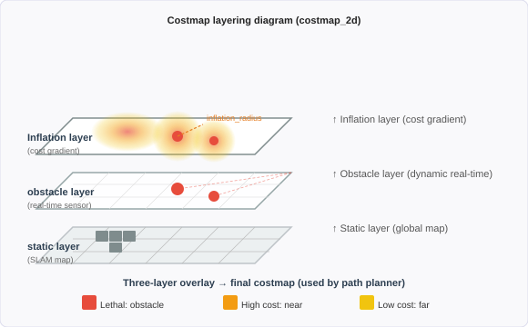
<figcaption>Figure: Costmap layer structure: the static, obstacle, and inflation layers are overlaid, and the maximum across layers gives the final costmap</figcaption>
</div>

### Cost values
{: id="代价值定义"}

Each grid cell stores a uint8 (0–255) cost value, with the following meanings:

| Cost value | Symbolic constant | Meaning |
|--------|---------|------|
| **0** | FREE | Free space, traversable |
| **1–252** | — | Inflation gradient (higher closer to obstacles); the planner tries to avoid high-cost areas |
| **253** | INSCRIBED | When the robot center is here, its footprint **must** touch an obstacle (equivalent to the inscribed circle just touching the edge) |
| **254** | LETHAL | The obstacle itself (or the direct projection of an obstacle cell) |
| **255** | UNKNOWN | Unknown area not yet observed by sensors |

### Footprint (robot footprint)
{: id="footprint机器人轮廓"}

The footprint is the robot's 2D polygon outline in the XY plane and is the basis on which the costmap computes dangerous areas. Two radii are derived from it:

- **Inscribed circle radius** $r_{ins}$: the radius of the largest circle that fits inside the footprint. When the distance from the robot center to an obstacle is $\leq r_{ins}$, a collision **is certain**, corresponding to the INSCRIBED (253) cost
- **Circumscribed circle radius** $r_{circ}$: the radius of the smallest circle that covers the footprint. When the distance from the robot center to an obstacle lies in $(r_{ins}, r_{circ}]$, a collision **is possible** (depending on orientation)

Configuration example:
```yaml
# Circular robot (simple)
robot_radius: 0.22

# Non-circular robot (polygonal footprint)
footprint: [[-0.25, -0.20], [-0.25, 0.20], [0.25, 0.20], [0.25, -0.20]]
```

### Inflation layer cost formula
{: id="膨胀层代价公式"}

$$\text{cost}(d) = \begin{cases} 254 & d \leq 0 \text{ (obstacle cell)} \\ 253 & 0 < d \leq r_{ins} \text{ (inside inscribed radius: collision)} \\ 253 \cdot e^{-k(d - r_{ins})} & r_{ins} < d \leq r_{inf} \text{ (inflation gradient)} \\ 0 & d > r_{inf} \end{cases}$$

Here, $d$ is the distance to the nearest obstacle, $r_{inf}$ is `inflation_radius`, and $k$ is `cost_scaling_factor`.

**Parameter intuition**:
- The larger `inflation_radius` is, the wider the obstacle's "range of influence": narrow passages become harder to traverse, but paths are safer
- The larger `cost_scaling_factor` is, the steeper the cost decay: the penalty near an obstacle is high but drops quickly with distance
- **Recommended value**: `inflation_radius` = $r_{ins}$ + 0.1–0.3 m (the safety margin depends on localization accuracy and speed)

### Global costmap vs. local costmap
{: id="全局代价地图-vs-局部代价地图"}

The two costmaps are configured independently and serve different planners:

| Item | Global costmap | Local costmap |
|--------|------------|------------|
| **Range** | The entire map (or a large area) | A small window around the robot (such as 4 m × 4 m) |
| **Follows the robot** | No (fixed in the `map` frame) | Yes (rolling window, always centered on the robot) |
| **Layers included** | Static layer + obstacle layer (optional) + inflation layer | Obstacle layer + inflation layer (no static layer needed) |
| **Update rate** | Low (the static layer barely changes) | High (driven by real-time sensor data) |
| **Consumer** | Global planner (A*, Navfn) | Local planner (DWA, TEB, MPPI) |
| **Main role** | Provides a collision-free skeleton of the global path | Avoids dynamic obstacles in real time and executes smoothly |

> **Key difference**: The local costmap does not load the static layer, because the static layer is a large, globally consistent map, and loading it into a small window would miss "known obstacles" outside the window. The local map trusts only real-time data within the current sensor field of view.

## 5.5 Comparison of planning algorithms
{: id="55-规划算法对比汇总"}

| Algorithm | Type | Optimality | Completeness | Speed | Suitable scenarios |
|------|------|--------|--------|---------|---------|
| **Dijkstra** | Search (global) | ✅ Optimal | ✅ | Slow | Small-scale grid maps |
| **A*** | Search (global) | ✅ Optimal | ✅ | Medium | Indoor navigation, autonomous driving |
| **Hybrid A*** | Search (global) | Approximate | ✅ | Medium | Vehicles with nonholonomic constraints (autonomous parking) |
| **FMM** | Search (global) | ✅ Optimal (continuous) | ✅ | Slow (full grid) | Non-uniform terrain, multi-query planning, smooth-path requirements |
| **RRT** | Sampling (global) | ❌ | Probabilistically complete | Fast | High-dimensional spaces, robot arms |
| **RRT*** | Sampling (global) | Asymptotically optimal | Probabilistically complete | Medium | High-dimensional spaces |
| **DWA** | Local | Locally optimal | ❌ | Extremely fast | Real-time obstacle avoidance for indoor mobile robots |
| **TEB** | Local | Locally optimal | ❌ | Medium | Complex local environments that need smooth trajectories |
| **Potential field** | Local | ❌ | ❌ | Extremely fast | Simple scenes, assisted guidance |
| **MPPI** | Sampling (local) | Asymptotically optimal | Probabilistically complete | Medium (GPU-accelerated) | Nonlinear dynamics, off-road unmanned vehicles, dynamic obstacle avoidance |

---

# 6. Path tracking
{: id="6-路径跟踪path-tracking"}

Path planning provides an ideal path, and the job of the **path tracking controller** is to make the robot actually follow it. Because of noise, model errors, and external disturbances in the real world, the controller must compute corrections in real time.

## 6.1 Pure Pursuit control
{: id="61-纯追踪控制"}

**Intuition** for Pure Pursuit control: Imagine you are driving, fixing your eyes on a target point a set distance ahead (the **lookahead distance $L_d$**) and constantly steering toward it. That is the idea behind Pure Pursuit.

**Core formula**:

$$\delta = \arctan\left(\frac{2L\sin\alpha}{L_d}\right)$$

Here:
- $\delta$ = front wheel steering angle (the control output)
- $L$ = wheelbase
- $\alpha$ = the angle between the direction to the target point and the vehicle heading
- $L_d$ = lookahead distance (usually 1–2 times the distance traveled at the current speed)

<div align="center">
  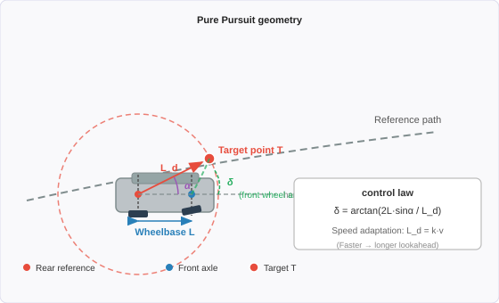
<figcaption>Figure: Pure Pursuit geometry: the rear axle center is the reference point; a circle of radius $L_d$ (the lookahead distance) around it intersects the reference path at the target point T, and the angle α determines the front wheel steering angle δ</figcaption>
</div>

✅ Extremely simple to implement
✅ Robust to path noise (a natural smoothing effect)
❌ The lookahead distance must be tuned by hand
❌ Large tracking error at high speed (purely geometric control that ignores dynamics)

**Practical suggestions for tuning the lookahead distance $L_d$**:

$L_d$ is the only key parameter that must be tuned in Pure Pursuit, and it has a large effect on performance:

| $L_d$ setting | Behavior | Suitable scenarios |
|-----------|---------|---------|
| **Too small** (< 0.5m @ 1m/s) | Steering is too aggressive and oscillates frequently | — |
| **Moderate** | Smooth tracking with slight path error | General navigation |
| **Too large** (> 3m @ 1m/s) | Cuts corners in "big arcs"; good on straights but large error in turns | High-speed straight driving |

**Speed-adaptive parameter** (Adaptive Pure Pursuit): Use $L_d = k \cdot v$, where typical values of $k$ are:
- Indoor robots (up to 1 m/s): $k \approx 1.5 \text{–} 2.0$
- Warehouse AGVs (up to 2 m/s): $k \approx 1.0 \text{–} 1.5$
- Autonomous driving (up to 30 km/h): $k \approx 0.5 \text{–} 1.0$

Another practical tip: set a **minimum value** for $L_d$ (such as 0.3 m) to avoid the oscillation caused by the lookahead distance approaching zero at low speed.

<div align="center">
  <video src="/images/robotics_navigation/pure_pursuit_path_tracking.mp4" data-autoplay preload="none" loop muted playsinline width="75%" style="aspect-ratio:800/800"></video>
<figcaption>Figure: Pure Pursuit path tracking simulation: the vehicle looks ahead to the lookahead point and smoothly tracks the reference path</figcaption>
</div>

## 6.2 Adaptive tracking control
{: id="62-自适应追踪控制"}

Adaptive Pure Pursuit **dynamically couples** the lookahead distance $L_d$ to the speed:

$$L_d = k \cdot v$$

Here, $k$ is a proportional coefficient and $v$ is the current speed. At high speed the lookahead is longer (more stable), and at low speed it is shorter (more accurate). This solves the problem that a fixed lookahead distance performs very differently at different speeds.

<div align="center">
  <video src="/images/robotics_navigation/adaptive_pure_pursuit_path_tracking.mp4" data-autoplay preload="none" loop muted playsinline width="75%" style="aspect-ratio:800/800"></video>
<figcaption>Figure: Adaptive Pure Pursuit path tracking: the lookahead distance is adjusted dynamically with speed, giving stable performance across speed ranges</figcaption>
</div>

## 6.3 Rear wheel feedback control
{: id="63-后轮反馈控制"}

Rear wheel feedback uses the **center of the vehicle's rear axle** as the tracking reference point (rather than the front axle or the center of gravity) and directly eliminates the rear wheel's lateral and heading errors relative to the reference path. It has stronger mathematical convergence guarantees than Pure Pursuit.

<div align="center">
  <video src="/images/robotics_navigation/rear_wheel_feedback_tracking.mp4" data-autoplay preload="none" loop muted playsinline width="75%" style="aspect-ratio:800/800"></video>
<figcaption>Figure: Rear wheel feedback path tracking simulation: with the rear axle as the reference point, the lateral error converges faster</figcaption>
</div>

## 6.4 Stanley controller
{: id="64-stanley-控制器"}

The control law proposed by the Stanford autonomous driving team (for the DARPA Challenge), based on the **midpoint of the front axle**:

$$\delta = \psi_e + \arctan\left(\frac{k \cdot e}{v}\right)$$

Here:
- $\psi_e$ = heading error
- $e$ = lateral deviation of the front axle from the path
- $k$ = gain coefficient
- $v$ = current speed

The first term corrects the heading error, and the second corrects the lateral deviation. The faster the vehicle moves, the smaller the lateral correction (to avoid sharp turns at high speed).

✅ More accurate than Pure Pursuit
✅ Good accuracy at low speed (parking)
❌ At extremely low speed, the $\arctan(k \cdot e / v)$ term saturates and must be handled specially
❌ Does not explicitly consider path curvature

<div align="center">
  <video src="/images/robotics_navigation/stanley_path_tracking.mp4" data-autoplay preload="none" loop muted playsinline width="75%" style="aspect-ratio:800/800"></video>
<figcaption>Figure: Stanley controller path tracking simulation: heading error and lateral deviation are corrected simultaneously, with higher accuracy in turns</figcaption>
</div>

## 6.5 LQR path tracking
{: id="65-lqr-路径跟踪"}

The **Linear Quadratic Regulator (LQR)** formulates path tracking as an **optimal control problem**. Under a linearized vehicle model, LQR solves for the optimal control law that minimizes the following cost function:

$$J = \sum_{t=0}^{\infty} \left( \mathbf{e}_t^T \mathbf{Q} \mathbf{e}_t + u_t^T \mathbf{R} u_t \right)$$

Here, $$\mathbf{e}_t$$ is the tracking error (lateral deviation and heading error), $u_t$ is the control input (steering angle), and $\mathbf{Q}$ and $\mathbf{R}$ are weight matrices. A larger $\mathbf{Q}$ prioritizes reducing tracking error; a larger $\mathbf{R}$ prioritizes smoother control.

✅ Theoretically optimal and highly accurate
✅ Smooth system response
❌ Depends on an accurate linearized model
❌ Tuning the $\mathbf{Q}$ and $\mathbf{R}$ matrices requires experience

<div align="center">
  <video src="/images/robotics_navigation/lqr_path_tracking.mp4" data-autoplay preload="none" loop muted playsinline width="75%" style="aspect-ratio:800/800"></video>
<figcaption>Figure: LQR path tracking simulation: the optimal control law minimizes tracking error, and the response is smooth and stable</figcaption>
</div>

## 6.6 Path tracking comparison
{: id="66-路径跟踪算法对比汇总"}

| Controller | Tracking accuracy | Computational cost | Number of parameters | Suitable speed | Typical application |
|--------|---------|--------|---------|---------|---------|
| **Pure Pursuit** | Low–medium | Very low | 1 ($L_d$) | Low–medium | Simple indoor robots |
| **Adaptive Pure Pursuit** | Medium | Very low | 1 ($k$) | Full speed range | General mobile robots |
| **Stanley** | Medium–high | Low | 1 ($k$) | Low–high | Autonomous driving |
| **Rear wheel feedback** | Medium–high | Low | Few | Full speed range | Differential-drive robots |
| **LQR** | High | Medium | 2 ($\mathbf{Q}$, $\mathbf{R}$) | Low–high | Autonomous driving, high-precision robots |

---

# 7. Kinematic models
{: id="7-运动学模型"}

Every path planning and motion control algorithm builds on a specific kinematic model, which determines its velocity constraints, trajectory curvature, and control variables. Different chassis structures have entirely different state equations, which directly determine which planning and tracking algorithms are usable and how constraints are modeled. This chapter systematically covers three mainstream models.

---

## 7.1 Differential drive
{: id="71-差分驱动"}

### Mechanical configuration
{: id="机构特征"}

A differential-drive chassis consists of two independently driven wheels (left wheel $\omega_L$, right wheel $\omega_R$) and a number of passive caster wheels. Steering is achieved through the speed difference between the two wheels. Typical platforms: TurtleBot, Husky, indoor mobile robots.

<div align="center">
  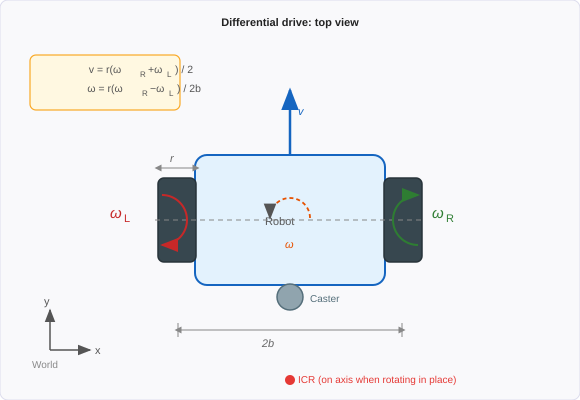
<figcaption>Differential-drive chassis structure: the left and right wheels are driven independently, $r$ is the wheel radius, and $2b$ is the track width</figcaption>
</div>

### Kinematic equations
{: id="运动学方程"}

Let the wheel radius be $r$ and the track width (the distance between wheel centers) be $2b$. Then:

$$v = \frac{r(\omega_R + \omega_L)}{2}, \quad \omega = \frac{r(\omega_R - \omega_L)}{2b}$$

The robot's state $\mathbf{q} = [x, y, \theta]^\top$ in the world frame satisfies:

$$\dot{x} = v\cos\theta, \quad \dot{y} = v\sin\theta, \quad \dot{\theta} = \omega$$

In matrix form:

$$\dot{\mathbf{q}} = \begin{bmatrix} \cos\theta & 0 \\ \sin\theta & 0 \\ 0 & 1 \end{bmatrix} \begin{bmatrix} v \\ \omega \end{bmatrix}$$

The control inputs are the linear velocity $v$ and the angular velocity $\omega$. Each wheel's rotation speed follows from the inverse kinematics:

$$\omega_R = \frac{v + b\omega}{r}, \quad \omega_L = \frac{v - b\omega}{r}$$

### Constraints and properties
{: id="约束与特性"}

| Property | Description |
|------|------|
| **Degrees of freedom** | 2 ($v$, $\omega$), nonholonomic constraint (cannot translate sideways) |
| **Turning radius** | $R = v / \omega$, can be $0$ (rotate in place) |
| **Instantaneous center of rotation** | Lies on the line through the two wheels; $\omega_L = -\omega_R$ rotates in place about the axle center |
| **Velocity constraints** | $\vert v \vert \le v_{\max}$, $\vert\omega\vert \le \omega_{\max}$, and each wheel speed stays within the hardware limit |

### Impact on planning algorithms
{: id="对规划算法的影响"}

- **DWA**: The velocity sampling space is the two-dimensional rectangle in $(v, \omega)$. Rotation in place is supported, with no minimum turning radius constraint.
- **TEB**: Can directly constrain $v$, $\omega$, and their derivatives (accelerations); the differential model leaves a lot of freedom in the optimization.
- **Pure Pursuit / LQR**: $\omega$ is usually used as the control output, directly controlling the angular velocity.

---

## 7.2 Ackermann steering
{: id="72-阿克曼转向"}

### Mechanical configuration
{: id="机构特征-1"}

The Ackermann chassis follows the steering geometry of a car: rear-wheel drive and front-wheel steering, with the two front wheels turning about their own steering knuckles. Ideally the instantaneous centers of rotation of the four wheels are collinear, which eliminates tire sideslip. Typical platforms: autonomous passenger cars, AgileX Scout, Jackal (a small 4WD/Ackermann hybrid).

<div align="center">
  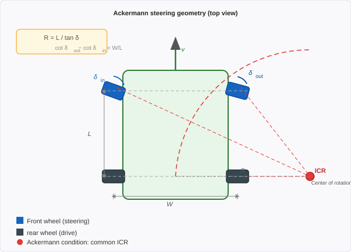
<figcaption>Ackermann steering geometry: the instantaneous centers of rotation of the four wheels are collinear, and the inner and outer wheels turn through different angles to eliminate sideslip</figcaption>
</div>

### Geometric relations
{: id="几何关系"}

Let the wheelbase (distance between the front and rear axles) be $L$ and the equivalent front wheel steering angle be $\delta$. The turning radius is then:

$$R = \frac{L}{\tan\delta}$$

The actual inner and outer front wheel angles satisfy (the full Ackermann condition):

$$\cot\delta_{out} - \cot\delta_{in} = \frac{W}{L}$$

Here, $W$ is the track width. In practice a single equivalent front-wheel steering angle $\delta$ is commonly used.

### Kinematics (bicycle model)
{: id="运动学方程自行车模型近似"}

Merging the front and rear wheels into a single wheel gives the classic **bicycle model**:

<div align="center">
  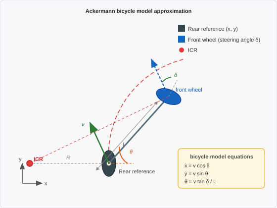
<figcaption>Simplified bicycle model: wheelbase $L$, front wheel angle $\delta$, with the rear wheel as the reference point</figcaption>
</div>

$$\dot{x} = v\cos\theta, \quad \dot{y} = v\sin\theta, \quad \dot{\theta} = \frac{v\tan\delta}{L}$$

The control inputs are the longitudinal speed $v$ and the front wheel angle $\delta$, and the curvature is $\kappa = \tan\delta / L$.

Discretization (forward Euler, step $\Delta t$):

$$\begin{aligned}
x_{k+1} &= x_k + v_k \cos\theta_k \cdot \Delta t \\
y_{k+1} &= y_k + v_k \sin\theta_k \cdot \Delta t \\
\theta_{k+1} &= \theta_k + \frac{v_k \tan\delta_k}{L} \cdot \Delta t
\end{aligned}$$

### Constraints and properties
{: id="约束与特性-1"}

| Property | Description |
|------|------|
| **Degrees of freedom** | 2 ($v$, $\delta$), nonholonomic constraint |
| **Minimum turning radius** | $R_{\min} = L / \tan\delta_{\max}$; cannot rotate in place |
| **Curvature continuity** | The steering rate is limited by the steering actuator, so the path must have continuous curvature ($C^1$) |
| **High-speed stability** | The tire slip angle cannot be ignored at high speed, so a dynamic model is needed instead |

### Impact on planning algorithms
{: id="对规划算法的影响-1"}

- **Hybrid A\***: With $(x, y, \theta)$ as the state, nodes are expanded with the Ackermann equations of motion, producing a continuous, curvature-bearing path that can be tracked directly.
- **TEB**: Ackermann mode must be enabled to constrain $\lvert\delta\rvert \le \delta_{\max}$ and $\dot{\delta}$, which bounds the trajectory's minimum curvature radius.
- **Pure Pursuit / Stanley**: These output the front wheel angle $\delta$ and are tracking control laws derived specifically for Ackermann vehicles.
- **MPC**: Uses the bicycle model as the prediction model and constrains $\delta$ and $\dot{\delta}$; suited to high-speed, accurate tracking.

---

## 7.3 Omnidirectional drive
{: id="73-全向轮"}

### Mechanical configuration
{: id="机构特征-2"}

An omnidirectional chassis uses special wheels (Mecanum wheels or omni wheels) to translate independently in any direction within the plane without rotating the robot body. Typical structures:

| Configuration | Number of wheels | Features |
|------|------|------|
| **Three-wheel omnidirectional** | 3 | The wheels are spaced 120° apart; simple structure and good adaptability to the ground |
| **Four-wheel Mecanum** | 4 | Rollers at 45° to the axles; the most common choice in industrial warehousing |
| **Four-wheel omnidirectional (90° rollers)** | 4 | Rollers perpendicular to the axles; weaker steering torque than Mecanum |

Typical platforms: warehouse AMRs (Amazon Kiva class) and laboratory mobile manipulators (HSR, TIAGo).

<div align="center">
  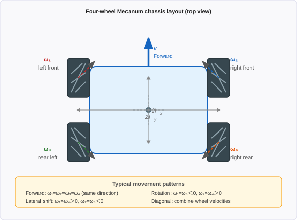
<figcaption>Four-wheel Mecanum chassis layout: the rollers are at 45° to the axles; the front-left and rear-right rollers share one orientation, and the front-right and rear-left rollers the opposite one</figcaption>
</div>

### Four-wheel Mecanum kinematic equations
{: id="四轮-mecanum-运动学方程"}

Assume the four wheels form a rectangle with half wheelbases $l_x$ (longitudinal) and $l_y$ (lateral), wheel radius $r$, and rollers at $45°$ to the wheel axle. The inverse kinematics (robot velocity → wheel speeds) is then:

$$\begin{bmatrix} \omega_1 \\ \omega_2 \\ \omega_3 \\ \omega_4 \end{bmatrix} = \frac{1}{r} \begin{bmatrix} 1 & -1 & -(l_x+l_y) \\ 1 & 1 & (l_x+l_y) \\ 1 & 1 & -(l_x+l_y) \\ 1 & -1 & (l_x+l_y) \end{bmatrix} \begin{bmatrix} v_x \\ v_y \\ \omega_z \end{bmatrix}$$

Wheel numbering convention: $\omega_1$ = front left, $\omega_2$ = front right, $\omega_3$ = rear left, $\omega_4$ = rear right.

For forward kinematics (wheel speeds → robot velocity), take the pseudo-inverse of the matrix above (at full rank, $\frac{1}{4}$ times its transpose):

$$\begin{bmatrix} v_x \\ v_y \\ \omega_z \end{bmatrix} = \frac{r}{4} \begin{bmatrix} 1 & 1 & 1 & 1 \\ -1 & 1 & 1 & -1 \\ -\frac{1}{l_x+l_y} & \frac{1}{l_x+l_y} & -\frac{1}{l_x+l_y} & \frac{1}{l_x+l_y} \end{bmatrix} \begin{bmatrix} \omega_1 \\ \omega_2 \\ \omega_3 \\ \omega_4 \end{bmatrix}$$

State equation in the world frame (including heading angle $\theta$):

$$\dot{\mathbf{q}} = \begin{bmatrix} \cos\theta & -\sin\theta & 0 \\ \sin\theta & \cos\theta & 0 \\ 0 & 0 & 1 \end{bmatrix} \begin{bmatrix} v_x \\ v_y \\ \omega_z \end{bmatrix}$$

### Three-wheel omni kinematics
{: id="三轮全向运动学方程"}

<div align="center">
  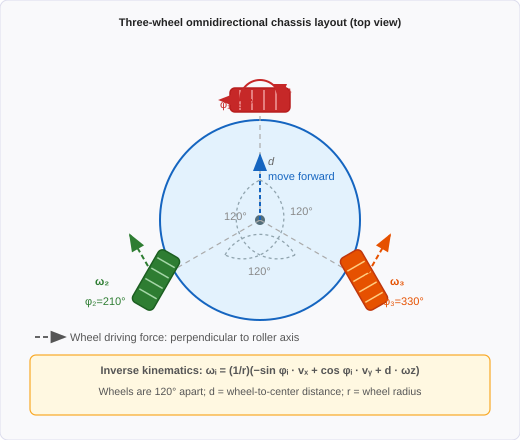
<figcaption>Three-wheel omnidirectional chassis: the three wheels are evenly spaced at 120°, and $d$ is the distance from each wheel center to the chassis center</figcaption>
</div>

The three wheels are spaced $120°$ apart. Let the mounting angle of wheel $i$ be $\phi_i = 120°(i-1)$:

$$\omega_i = \frac{1}{r}\left(-\sin\phi_i \cdot v_x + \cos\phi_i \cdot v_y + d \cdot \omega_z\right), \quad i=1,2,3$$

Here, $d$ is the distance from each wheel to the chassis center. The inverse solution is:

$$\begin{bmatrix} v_x \\ v_y \\ \omega_z \end{bmatrix} = \frac{2r}{3} \begin{bmatrix} -\sin\phi_1 & -\sin\phi_2 & -\sin\phi_3 \\ \cos\phi_1 & \cos\phi_2 & \cos\phi_3 \\ \frac{1}{2d} & \frac{1}{2d} & \frac{1}{2d} \end{bmatrix} \begin{bmatrix} \omega_1 \\ \omega_2 \\ \omega_3 \end{bmatrix}$$

### Constraints and properties
{: id="约束与特性-2"}

| Property | Description |
|------|------|
| **Degrees of freedom** | 3 ($v_x$, $v_y$, $\omega_z$), holonomic motion |
| **Lateral translation** | Can move freely in any direction with no lateral constraint, giving the most freedom in path planning |
| **Terrain adaptability** | Mecanum rollers contact the ground at small patches; slip is severe on uneven ground |
| **Odometry accuracy** | Roller slip causes large errors in wheel odometry, so IMU/LiDAR fusion is required |
| **Load capacity** | Weaker than differential/Ackermann because of stress concentration at the roller contacts |

### Impact on planning algorithms
{: id="对规划算法的影响-2"}

- **Global planning**: Standard A\* / Dijkstra can plan directly on the grid map. The path has no curvature constraint, and the robot can move in any direction.
- **DWA**: The velocity space expands to the three dimensions $(v_x, v_y, \omega_z)$ (or equivalently $(v, \theta_{vel}, \omega_z)$), giving a larger sampling space.
- **Path tracking**: No complex tracking control law is needed. Simple PID controllers can control the $x$, $y$, and $\theta$ channels independently, since they are decoupled.
- **MPC**: The prediction model is linear (ignoring slip) and the constraints are per-wheel speed limits, so the design is simpler than for Ackermann.

---

## 7.4 Comparison of the three models
{: id="74-三类模型综合对比"}

| Dimension | Differential drive | Ackermann steering | Omnidirectional wheels (Mecanum) |
|----------|----------|------------|-------------------|
| **Constraint type** | Nonholonomic (2-DoF) | Nonholonomic (2-DoF) | Holonomic (3-DoF) |
| **Rotate in place** | Supported | Not supported | Supported |
| **Lateral translation** | Not supported | Not supported | Supported |
| **Minimum turning radius** | 0 | $L/\tan\delta_{\max}$ | 0 |
| **Path curvature requirement** | Low | Requires continuous curvature | Unconstrained |
| **High-speed stability** | Medium | High (mature automotive solution) | Low (slip) |
| **Odometry accuracy** | High | Medium (tire slip) | Low (roller slip) |
| **Compatible planning algorithms** | DWA, TEB, Pure Pursuit | Hybrid A\*, TEB (Ackermann), Stanley, MPC | A\*, DWA (3D), decoupled PID |
| **Typical application scenarios** | Indoor service robots | Autonomous driving, outdoor vehicles | Warehouse AMRs, mobile manipulation |

> **Engineering selection principles**: Prefer differential drive for narrow indoor passages (flexible turning, low cost); prefer Ackermann for high-speed outdoor use (good stability, mature tire models); use omnidirectional wheels for warehouse and manipulation scenarios that need lateral movement (high efficiency, but slip must be compensated).

---

# 8. Motion control
{: id="8-运动控制"}

Path tracking (Chapter 6) solves the geometric problem of "which way to go", while **motion control** solves the dynamic problem of "how to execute these commands accurately", which requires accounting for the system model, physical constraints, disturbance rejection, and optimality. This chapter introduces the model-based control methods commonly used in robot navigation.

## 8.1 PID control
{: id="81-pid-控制"}

PID (Proportional-Integral-Derivative) is the most widely used controller in engineering and the foundation for understanding more complex control algorithms.

**Control law**:

$$u(t) = K_p e(t) + K_i \int_0^t e(\tau)\,d\tau + K_d \frac{de(t)}{dt}$$

Here, $e(t)$ is the error (such as lateral deviation or heading error), and the three terms are:
- **P (proportional)**: The larger the current error, the larger the correction; the response is fast but may overshoot.
- **I (integral)**: Eliminates steady-state error (accumulated past error); too large an integral gain can cause oscillation
- **D (derivative)**: Anticipates the error trend and suppresses overshoot; sensitive to noise

**Discrete form** (used in actual code):

$$u_k = K_p e_k + K_i \sum_{j=0}^{k} e_j \Delta t + K_d \frac{e_k - e_{k-1}}{\Delta t}$$

<div align="center">
  
<figcaption>Figure: PID controller structure: the P, I, and D terms are computed in parallel and summed into the control output u(t); the output y(t) is fed back and compared with the setpoint r(t) to obtain the error e(t)</figcaption>
</div>

✅ Simple to implement, with intuitive parameter tuning
✅ No system model required (purely empirical tuning)
❌ Fixed parameters make it hard to adapt to nonlinear and time-varying systems
❌ Cannot handle constraints explicitly (such as maximum speed or maximum steering angle)

## 8.2 Fuzzy PID
{: id="82-模糊-pid"}

Fuzzy PID is a direct evolution of PID: it keeps PID's feedback loop structure and introduces a **fuzzy inference system** that **self-tunes the three gains $K_p, K_i, K_d$ online**, so the controller adapts automatically to different operating conditions.

### System structure
{: id="系统结构"}


### Fuzzification
{: id="模糊化fuzzification"}

Map the continuous error $e$ and error rate $\dot{e}$ to 7 linguistic variables (fuzzy sets):

| Symbol | Meaning |
|------|------|
| **NB** | Negative Big |
| **NM** | Negative Medium |
| **NS** | Negative Small |
| **ZO** | Zero |
| **PS** | Positive Small |
| **PM** | Positive Medium |
| **PB** | Positive Big |

Each linguistic variable corresponds to a **membership function** (usually triangular or trapezoidal). Evaluating the membership function on a continuous input gives the "degree of membership" in each linguistic variable.

### Fuzzy rules (rule base)
{: id="模糊规则rule-base"}

Rules take the form **IF** $e$ is A **AND** $\dot{e}$ is B **THEN** $\Delta K_p$ is C. Taking $\Delta K_p$ as an example, the typical rule table (7 × 7) is:

| $e$ \ $\dot{e}$ | NB | NM | NS | ZO | PS | PM | PB |
|---------|----|----|----|----|----|----|-----|
| **NB** | PB | PB | PM | PM | PS | ZO | ZO |
| **NM** | PB | PB | PM | PS | PS | ZO | NS |
| **NS** | PM | PM | PM | PS | ZO | NS | NS |
| **ZO** | PM | PM | PS | ZO | NS | NM | NM |
| **PS** | PS | PS | ZO | NS | NS | NM | NM |
| **PM** | PS | ZO | NS | NM | NM | NM | NB |
| **PB** | ZO | ZO | NM | NM | NM | NB | NB |

**Rule intuition**: When the error is large (NB/PB), the proportional gain should be increased ($\Delta K_p$ takes PB) to pull the error back quickly; when the error approaches zero (ZO), the proportional gain should be reduced and the derivative gain increased to prevent overshoot. The rule tables for $\Delta K_i$ and $\Delta K_d$ follow similar logic but serve different goals.

### Defuzzification
{: id="去模糊化defuzzification"}

The most commonly used method is the **centroid (center of gravity) method**:

$$\Delta K_p = \frac{\sum_j \mu_j \cdot c_j}{\sum_j \mu_j}$$

Here, $\mu_j$ is the activation strength of rule $j$ and $c_j$ is the center value of the corresponding output fuzzy set. This gives crisp increments $\Delta K_p$, $\Delta K_i$, and $\Delta K_d$, which are added to the base values:

$$K_p = K_{p0} + \Delta K_p, \quad K_i = K_{i0} + \Delta K_i, \quad K_d = K_{d0} + \Delta K_d$$

### Core differences from fixed-gain PID
{: id="与固定-pid-的核心差异"}

| Scenario | Fixed PID | Fuzzy PID |
|------|---------|---------|
| Large-error startup phase | Gains are fixed and may overshoot | Automatically increases $K_p$ to close the gap quickly |
| Approaching the goal | Integral saturation causes oscillation | Automatically decreases $K_i$ and increases $K_d$, braking smoothly |
| Sudden load change / nonlinear disturbance | Gains must be retuned manually | Fuzzy rules compensate automatically |

✅ **No accurate model required**: driven purely by empirical rules, suited to nonlinear systems that are hard to model
✅ **Computationally efficient**: a fuzzy inference needs only table lookup and interpolation (microsecond level), suitable for embedded platforms
✅ **Robust**: better suppression of parameter perturbations and external disturbances than fixed-gain PID
❌ The rule table requires domain experience to design, and the number of rules grows exponentially with the input dimension (7×7=49 entries per gain)
❌ No rigorous optimality or stability proofs (compare LQR/MPC)

## 8.3 Model predictive control (MPC)
{: id="83-模型预测控制mpc"}

MPC is currently one of the most popular methods in autonomous driving and high-precision robot control. **Core idea**: In each control cycle, solve a **finite-horizon optimization problem** based on the current state and the system model, output an optimal control sequence, execute only its first step, and solve again in the next cycle. This is "**receding-horizon optimization with feedback correction**".

<div align="center">
  
<figcaption>Figure: MPC receding horizon: at the current time k, predict N steps ahead to obtain the optimal control sequence; execute only the first step u_k, then re-optimize from the new state in the next cycle, which gives rolling feedback</figcaption>
</div>

**Form of the optimization problem**:

$$\min_{u_0, \ldots, u_{N-1}} \sum_{k=0}^{N-1} \left( \mathbf{x}_k^T \mathbf{Q} \mathbf{x}_k + u_k^T \mathbf{R} u_k \right) + \mathbf{x}_N^T \mathbf{P} \mathbf{x}_N$$

$$\text{s.t.} \quad \mathbf{x}_{k+1} = f(\mathbf{x}_k, u_k), \quad \mathbf{x}_k \in \mathcal{X}, \quad u_k \in \mathcal{U}$$

Here:
- $N$ = prediction horizon, typically 10–30 steps
- $\mathbf{Q}, \mathbf{R}$ = weight matrices for state error and control effort (large $\mathbf{Q}$ prioritizes reducing tracking error; large $\mathbf{R}$ prioritizes reducing control magnitude)
- $\mathcal{X}, \mathcal{U}$ = state and control constraints (such as maximum speed and maximum steering angle)
- $\mathbf{P}$ = terminal cost matrix (to ensure closed-loop stability)

✅ **Handles constraints explicitly**: physical limits such as the speed upper bound and acceleration limits are written directly into the optimization constraints
✅ **Multi-step look-ahead**: predicts the next $N$ steps, so it slows down before a bend instead of reacting only after the curvature increases
✅ **Unified framework**: path tracking, speed planning, and soft obstacle avoidance can be handled in the same optimization problem
❌ Computationally heavy, requiring an efficient QP/NLP solver (OSQP, CasADi+IPOPT)
❌ Depends on an accurate system model; model mismatch degrades performance
❌ Complex tuning ($N$, $\mathbf{Q}$, $\mathbf{R}$, constraint bounds, terminal sets)

**Linear MPC vs. Nonlinear MPC (NMPC)**:

| Type | Model | Solver | Computational cost | Typical scenario |
|------|------|--------|--------|---------|
| **Linear MPC** | Linear kinematic model | QP (OSQP) | Medium | Low-speed AGVs, mobile robots |
| **Nonlinear MPC** | Full nonlinear model | NLP (CasADi+IPOPT) | High | High-speed autonomous driving, UAVs |

## 8.4 Comparison of controllers
{: id="84-控制器对比汇总"}

| Controller | Needs a model | Handles constraints | Computational cost | Accuracy | Typical application |
|--------|---------|---------|--------|------|---------|
| **PID** | No | No | Very low | Medium | Embedded chassis, simple scenes |
| **Fuzzy PID** | No | No | Low | Medium–high | Nonlinear disturbances, embedded platforms |
| **LQR** | Yes (linear) | No (soft constraints) | Medium | High | High-precision path tracking |
| **Linear MPC** | Yes (linear) | Yes | Medium–high | High | Low-speed robots, AGVs |
| **Nonlinear MPC** | Yes (nonlinear) | Yes | High | Extremely high | High-speed autonomous driving, drones |

---

# 9. Full navigation stack integration
{: id="9-完整导航栈集成"}

## 9.1 Coordinate frames and the TF tree
{: id="91-坐标系与-tf-树"}

Exchanging data between the modules of the navigation stack (sensing, localization, planning, control) requires being clear about which coordinate frame each pose or point is expressed in. ROS uses the **TF2** library to manage this transform tree in a unified way.

### Four core coordinate frames
{: id="四个核心坐标系"}

| Frame | ROS frame name | Semantics | Publisher |
|--------|----------|------|---------|
| World/map frame | `map` | Globally consistent fixed frame; the origin is usually the starting point of mapping | SLAM / AMCL localization node |
| Odometry frame | `odom` | Origin at the start; obtained by integrating odometry, **continuous but drifting** | Wheel odometry / IMU fusion node |
| Robot body frame | `base_link` | Fixed at the chassis center | Robot driver / URDF |
| Sensor frame | `lidar_link`, etc. | Rigidly attached to each sensor's mounting position | URDF static TF |

**How the TF tree relates to each module**:


<div align="center">
  
<figcaption>Figure: XYZ axes of the three core coordinate frames: map (blue point) is fixed at the global origin, odom (orange point) drifts with the odometry, and base_link (green point) moves with the robot and has a yaw angle θ; the Z axis points out of the page (right-handed frame)</figcaption>
</div>

### Why are `map` and `odom` separated?
{: id="为什么-map-和-odom-要分开"}

- **`odom` ensures continuity**: odometry integration does not jump, so the controller can track smoothly
- **`map` ensures global consistency**: SLAM loop closures or AMCL corrections update `map→odom` without affecting the continuity of `odom→base_link`
- If the two were merged into one frame, every localization correction would make the pose jump instantaneously and destabilize the controller.

The `map→odom` transform is exactly the **output of the localization node**, which corrects the accumulated odometry drift in real time.

### Homogeneous transformation matrix
{: id="齐次变换矩阵"}

Transforms between coordinate frames are represented by $4\times4$ homogeneous matrices (elements of $SE(3)$):

$$T_{A}^{B} = \begin{bmatrix} R_{3\times3} & t_{3\times1} \\ \mathbf{0}^T & 1 \end{bmatrix}, \quad p^B = T_A^B \cdot p^A$$

**Chaining transforms**: $T_{map}^{base} = T_{map}^{odom} \cdot T_{odom}^{base}$

**Inverse transform**: $T_B^A = \left(T_A^B\right)^{-1} = \begin{bmatrix} R^T & -R^T t \\ \mathbf{0}^T & 1 \end{bmatrix}$

Planar navigation reduces to $SE(2)$, and the pose $(x, y, \theta)$ corresponds to:

$$T = \begin{bmatrix} \cos\theta & -\sin\theta & x \\ \sin\theta & \cos\theta & y \\ 0 & 0 & 1 \end{bmatrix}$$

**Debugging tips**: `ros2 run tf2_tools view_frames` exports the current TF tree as a PDF; `ros2 run tf2_ros tf2_echo map base_link` prints the transform between two frames in real time.

## 9.2 The ROS 1 navigation stack
{: id="92-ros1-导航栈"}

ROS 1's `move_base` provides a classic integrated navigation stack:


### The move_base state machine
{: id="move_base-状态机"}

`move_base` has an internal state machine with four states:


- **PLANNING**: Calls the global planner to generate a global path from the current position to the goal (low frequency; by default triggered only when a new goal or a local planning request arrives)
- **CONTROLLING**: Calls the local planner to continuously generate `cmd_vel` at about 10–20 Hz and track the global path
- **CLEARING**: Entered when global or local planning fails; runs the list of recovery behaviors in order, then returns to PLANNING to try again

### Recovery behaviors
{: id="恢复行为链"}

By default, `move_base` executes the `recovery_behaviors` in order:

| Step | Behavior | Action | Trigger reason |
|------|------|------|---------|
| ① | `conservative_reset` | Clear local costmap obstacles outside a 3 m radius | Sensor noise mislabels distant free space |
| ② | `rotate_recovery` | Rotate in place by 360° and rebuild the costmap from new sensor data | The costmap is stale or the robot's pose estimate is wrong |
| ③ | `aggressive_reset` | Clear all local costmap obstacles **outside the footprint** | No path can be found even after conservative clearing |
| ④ | `rotate_recovery` | Rotate by 360° again | Re-perceive the environment after aggressive clearing |

After all of them fail, `move_base` publishes an `aborted` result and stops.

**Typical topic interface**:

| Topic | Direction | Description |
|------|------|------|
| `/move_base/goal` | Input | Navigation goal pose (ActionLib) |
| `/map` | Input | Static map |
| `/scan` | Input | LiDAR data |
| `/odom` | Input | Odometry |
| `/amcl_pose` | Input | Localization result |
| `/cmd_vel` | Output | Velocity command (linear + angular velocity) |
| `/move_base/result` | Output | Navigation result (succeeded / aborted / preempted) |

**Update-rate difference between the two costmaps**: The global costmap is updated slowly (only when the static layer changes), while the local costmap is updated frequently (in step with the sensor frame rate, about 5–20 Hz). This keeps obstacle avoidance real-time without wasting compute.

## 9.3 Nav2 (ROS 2) architecture
{: id="93-nav2ros-2架构"}

Nav2 is the navigation stack of ROS 2. Compared with `move_base`, its core change is replacing the hard-coded state machine with a **behavior tree**, which moves the navigation logic out of code and into a configurable XML file.

### The five major servers
{: id="五大服务器架构"}


Each server is an independent ROS 2 node that communicates through the Action interface. Plugins can be replaced independently without affecting other modules.

### Lifecycle nodes
{: id="生命周期节点"}

All Nav2 nodes implement the ROS 2 lifecycle interface, with the following state transitions:

```
Unconfigured → Inactive → Active → Deactivating → Inactive → Finalized
```

- **Unconfigured → Inactive** (`configure`): Load parameters and initialize plugins, without receiving data
- **Inactive → Active** (`activate`): Start subscribing to topics and publishing data, and enter normal operation
- **Active → Inactive** (`deactivate`): Stop processing but keep resources (can be reactivated quickly)
- The startup order is managed centrally by `nav2_lifecycle_manager`, avoiding race conditions caused by nodes initializing out of order.

### Default BT navigation flow
{: id="行为树bt默认导航流程"}

Simplified logic of Nav2's default BT (`navigate_w_replanning_and_recovery.xml`):


### The recovery chain
{: id="失败恢复链详解"}

| Recovery behavior | Parameters (default) | Principle | Suitable scenarios |
|---------|-------------|------|---------|
| **ClearEntireCostmap** | Clearing range is configurable | Sends a clear request to the costmap service to erase all marks on the obstacle layer, forcing the next sensor scan to rebuild them | False sensor detections; a dynamic obstacle has left but was not cleared from the costmap |
| **Spin** | `target_yaw: 1.57 rad` (adjustable) | Rotates in place to the target angle at the maximum allowed angular speed, continuously updating the costmap to eliminate blind spots in the field of view | The robot is in a local blind spot and the costmap is contaminated by old data |
| **Wait** | `duration: 5.0 s` | Stops publishing `cmd_vel`, waits for the specified time, then plans again | Dynamic obstacles (pedestrians) temporarily block the way and will leave on their own |
| **Backup** | `backup_dist: 0.30 m`, `backup_speed: 0.025 m/s` | Publishes a negative linear velocity to reverse slowly by the specified distance (the area behind must be clear of obstacles) | The front of the robot is trapped by an obstacle and it must make room before replanning |

Design logic of the **execution order**:
- `ClearEntireCostmap` first (the lightest: it only changes data and does not move the robot)
- Then `Spin` (re-perceive the surroundings)
- Then `Wait` (give way to dynamic obstacles)
- `Backup` last (a physical escape, the riskiest, so it goes at the end)

After each recovery step, global planning is triggered again. As soon as one step succeeds, the recovery chain is exited and navigation continues. If all fail, the BT returns `FAILURE` and the Action Server publishes an `aborted` result.

**Custom recovery behaviors**: Implement the `nav2_core::Recovery` interface, register it in the `recovery_server.plugins` list of `nav2_params.yaml`, and then add the corresponding node to the BT XML.

### When recovery triggers
{: id="常见恢复触发时机实机经验"}

The triggers of the recovery chain fall into the following four categories, each corresponding to a different root cause and remedy:

**① The local map is temporarily infeasible**

Sensor noise or momentary occlusion "blocks" the local costmap, so `FollowPath` cannot find a valid velocity (`follow_path_error`) and recovery is triggered directly:

| Root cause | Typical symptom | Recommended remedy |
|------|---------|---------|
| Glass/mirror reflection | The laser produces a false obstacle point cloud in front of the glass, and "ghost obstacles" appear on the local map | First run `ClearEntireCostmap` to clear the false detections and rebuild the map, or filter out glass reflection points |
| A stream of people or carts momentarily blocks the way | Pedestrians walk into the sensor's field of view and part of the path is suddenly blocked | Use `Wait` for the dynamic obstacle to leave; if this triggers often, increase `controller_patience` |
| Bursts of point cloud noise | Noise points in a single frame mark cells that should be free | Lower `obstacle_range` or enable point cloud filtering (`min_obstacle_height` filters ground reflections) |

**② Progress check failed (robot stuck)**

The robot jitters slightly in place, but its cumulative displacement does not exceed the threshold (Nav2 default: displacement < 0.5 m within 10 s). The BT's `GoalReached` or progress-check node judges the robot to be stuck and triggers recovery:

| Root cause | Typical symptom | Recommended remedy |
|------|---------|---------|
| Narrow doorway / close to a wall | The robot is near a wall, the inflation cost keeps it from moving forward, yet path planning still returns a path hugging the wall | Increase `inflation_radius` so global planning keeps away from walls automatically, or increase `min_obstacle_dist` (TEB) |
| Local optimum in a corner | The robot is boxed in by obstacles on three sides, costs are high in front, behind, left, and right, and it oscillates and jitters | Use `Backup` to make room; if this happens often, check whether `enable_homotopy_class_planning` is turned on |
| Progress threshold too strict | The robot is decelerating normally but is misjudged as stuck | Relax `progress_checker_distance` (Nav2) or `oscillation_distance` (move_base) appropriately |

**③ TF / timing problems**

The `map→odom→base_link` transform is temporarily unavailable (TF timeout) or the timestamps are inconsistent. The controller cannot obtain a consistent state estimate, and recovery is triggered after repeated planning failures:

| Root cause | Typical symptom | Recommended remedy |
|------|---------|---------|
| AMCL localization lost | The particle filter diverges, and the `map→odom` transform jumps or stops being published | Check the laser data quality; increase `max_particles`; provide a better initial pose |
| Odometry delay | The `odom→base_link` timestamp lags behind what the controller expects, and TF lookups time out | Check the chassis driver's publishing rate (recommended $\geq$ 50 Hz); check the `transform_tolerance` configuration |
| Node startup race | SLAM / AMCL is not ready yet, but the navigation stack has already received a goal | Use `nav2_lifecycle_manager` to ensure all dependent nodes are Active before accepting a goal |

**④ The global path is feasible but locally infeasible given the dynamics**

The path from global planning (A\* / Smac) is geometrically collision-free, but the local planner (DWA / MPPI), constrained by velocity, acceleration, and obstacles, cannot produce a safe, constraint-satisfying control sequence in the short term:

| Root cause | Typical symptom | Recommended remedy |
|------|---------|---------|
| Global path too tight | The global path cuts corners through the edge of the inflation zone, and all DWA sampled velocities hit the inflation layer | Increase the global costmap's `inflation_radius` to push the global path toward the center, or increase `path_distance_bias` |
| Corner too sharp | Smac/Navfn produces a 90° sharp turn that `minimum_turning_radius` does not allow | Increase `minimum_turning_radius`, or switch to Smac Hybrid A\*, which supports kinematic constraints |
| Difficulty converging near the goal | Obstacle penalties, pose constraints, and noise conflict near the goal, so the controller stops and starts, eventually times out, and enters recovery | Increase `goal_dist_tol` (Nav2 Controller) to relax the arrival check; check whether the goal lies in the inflation zone |
| MPPI critic weight conflict | `ObstaclesCritic` and `GoalCritic` have similar weights, causing oscillation near obstacles | Reduce the weight of `GoalCritic` or increase that of `ObstaclesCritic`; enable `TwirlingCritic` to suppress rotation |

## 9.4 Key points in parameter tuning
{: id="94-参数调优要点"}

Tuning a navigation stack means **coordinating its modules**: an upstream parameter error can appear as a downstream failure. Tune in the order costmap → global planner → local planner → recovery behaviors.

### Costmap
{: id="代价地图costmap-1"}

| Parameter | Scope | Typical value | Symptom if too small | Symptom if too large |
|------|------|--------|-----------|-----------|
| `inflation_radius` | Global & local | Robot radius + 0.1–0.3 m | Path hugs walls, collision risk | Narrow passages are blocked and no path exists |
| `cost_scaling_factor` | Global & local | 3.0–5.0 | Gentle cost gradient that does not repel from obstacles | The robot gets completely stuck inside the inflation zone |
| `obstacle_range` | Local obstacle layer | 2.5–4.0 m | Nearby obstacles are ignored | Distant false obstacles pollute the costmap |
| `raytrace_range` | Local obstacle layer | 3.0–5.0 m | Costs are not cleared after a dynamic obstacle leaves | The clearing range is too large and valid obstacles are cleared by mistake |
| `update_frequency` | Local | 5–10 Hz | Costmap updates lag and obstacle avoidance is slow | CPU usage too high |
| `publish_frequency` | Local | Same as update | RViz visualization lags, making debugging difficult | — |

> **Core principle**: `inflation_radius` $\geq$ the robot's inscribed circle radius. Otherwise the LETHAL region does not cover the robot's footprint, and the path planner will treat unreachable points as traversable.

### Global planner
{: id="全局规划器global-planner"}

**Navfn (A\* / Dijkstra)**:

| Parameter | Typical value | Description |
|------|--------|------|
| `use_astar` | `true` | Enables A* (about 2–5 × faster than Dijkstra); recommended |
| `allow_unknown` | `false` | Whether paths may pass through unknown areas; set to `true` for open exploration scenes |
| `default_tolerance` | 0.0–0.5 m | Allowed deviation when the goal lies on an obstacle; too large makes the robot "arrive early" |
| `planner_frequency` | 0.0 (on demand) or 1–2 Hz | 0.0 = replan only when a new goal arrives or local planning fails, which saves CPU |

**Smac Planner (Nav2 Hybrid A\*)**:

| Parameter | Typical value | Description |
|------|--------|------|
| `minimum_turning_radius` | 0.2–0.5 m | Minimum turning radius, matched to the robot's kinematics |
| `angle_quantization_bins` | 72 | Angular discretization (72 = 5° resolution); larger values give smoother paths but use more memory |
| `analytic_expansion_ratio` | 3.5 | Frequency of analytic expansion; larger values reach the goal faster but give slightly worse path quality |
| `max_iterations` | 1000000 | Prevents endless planning in complex scenes; planning failure is reported once it is hit |

### Local planner
{: id="局部规划器"}

**DWA (`dwa_local_planner` / Nav2 DWB)**:

| Parameter | Typical value | Symptom if too small | Symptom if too large |
|------|--------|-----------|-----------|
| `max_vel_x` | 0.3–1.0 m/s | The robot is too slow | Braking distance is insufficient, causing collisions |
| `min_vel_x` | 0.0–0.1 m/s | — | The robot cannot stop |
| `max_rot_vel` | 0.5–1.5 rad/s | Slow steering and poor corner tracking | Spins in place and becomes disoriented |
| `acc_lim_x` | 1.0–2.5 m/s² | Slow start and braking | Abrupt acceleration and deceleration, wheel slip that corrupts odometry |
| `sim_time` | 1.5–3.0 s | Short-sighted, cannot go around obstacles | Heavy computation and a reduced control rate |
| `path_distance_bias` | 32.0 | Does not follow the path and wanders freely | So eager to follow the path that it cannot avoid dynamic obstacles |
| `goal_distance_bias` | 20.0 | Does not stop when nearly at the goal | So eager to reach the goal that it ignores the path along the way |
| `occdist_scale` | 0.02 | Drives along walls | Gets completely stuck near obstacles |

**TEB (`teb_local_planner`)**:

| Parameter | Typical value | Description |
|------|--------|------|
| `max_vel_x` / `max_vel_theta` | Same as DWA | Velocity limits |
| `min_obstacle_dist` | 0.2–0.4 m | Minimum distance between a path point and an obstacle; anything below it violates the constraint |
| `inflation_dist` | 0.5–0.8 m | Soft-constraint zone in which the cost rises sharply beyond the limit; set it to 1.2–1.5× `inflation_radius` |
| `dt_ref` | 0.3–0.4 s | Reference time step of the Timed Elastic Band; smaller values give denser, more accurate path points but slower computation |
| `max_samples` | 500 | Maximum number of g2o iterations; if too small, the optimization does not converge |
| `enable_homotopy_class_planning` | `true` | Enables multi-topology path search (go around an obstacle and pick the better of the two sides); strongly recommended in complex environments |

### Recovery behaviors
{: id="恢复行为"}

| Parameter | Package | Typical value | Description |
|------|------|--------|------|
| `conservative_reset_dist` | move_base | 3.0 m | Radius of the conservative clearing; too small clears too little, too large wipes a big area by mistake |
| `clearing_rotation_allowed` | move_base | `true` | Allows rotation-based recovery; robots that can only move straight (AGVs) need `false` |
| `oscillation_timeout` | move_base | 10.0 s | Timeout for judging that the robot is oscillating in place; CLEARING is entered once it triggers |
| `oscillation_distance` | move_base | 0.2 m | If the displacement is below this value for longer than the timeout, the robot is judged to be oscillating |

### Nav2 core global parameters
{: id="nav2-核心全局参数"}

| Parameter | File | Typical value | Description |
|------|------|--------|------|
| `controller_frequency` | nav2_params.yaml | 20 Hz | Rate at which the local controller publishes cmd_vel |
| `planner_patience` | — | 5.0 s | Enter recovery after global planning times out |
| `controller_patience` | — | 15.0 s | Enter recovery after local control times out |
| `recovery_behavior_enabled` | — | `true` | If disabled, the robot reports failure immediately when it gets stuck; suited to safety-first scenarios |

### Suggested tuning sequence
{: id="调优顺序建议"}

```
① Costmap: tune inflation_radius first and confirm there are no collisions
       ↓
② Global planning: confirm a path can be found from A to B
       ↓
③ Local planning: tune the speed limits first, then sim_time, and finally the bias weights
       ↓
④ Recovery behaviors: after recovery triggers, check whether the robot gets out of trouble, and tune the timeout / distance thresholds
       ↓
⑤ Full-system tuning: run the complete navigation in real or simulated scenes and watch for lag, oscillation, excessive detours, and similar problems
```

---

# 10. Classical vs. end-to-end navigation
{: id="10-传统导航与端到端导航"}

| Dimension | Classical navigation stack (SLAM+A*+DWA) | End-to-end deep learning (VLN/VLA) |
|---------|----------------------|----------------------|
| **Map dependence** | Requires a pre-built map (or real-time SLAM) | No prior map required |
| **Command form** | Coordinate goal (x, y, θ) | Natural language ("Go to the kitchen") |
| **Generalization** | Weak (the map must be rebuilt when the environment changes) | Strong (generalizes across scenarios) |
| **Interpretability** | ✅ Strong (each module is traceable) | ❌ Weak (black-box network) |
| **Computing resources** | Runs on a CPU | Requires a GPU |
| **Dynamic scenes** | Handled by local planning (DWA/TEB) | Learned implicitly (depends on training data) |
| **Safety guarantees** | ✅ Collision checking is explicit and controllable | ❌ Safety boundaries are hard to guarantee |
| **Commonsense reasoning** | ❌ None (pure geometry) | ✅ Supported (such as LLM reasoning) |
| **Development and debugging** | Modules are debugged independently | End-to-end training makes problems hard to localize |
| **Long-term stability** | ✅ Highly deterministic behavior | ❌ May fail in out-of-distribution scenarios |
| **Typical representatives** | ROS Nav Stack, Nav2 | VLN-BERT, NavGPT, VoxPoser |

**Practical suggestions**:
- Factories, warehouses, hospitals, and similar **structured scenarios with high safety requirements** → classical navigation stack
- Home service, guided tours, and similar **unstructured scenarios that require understanding natural language** → learned navigation
- **Hybrid architectures** are becoming a trend: use the classical navigation stack for low-level safety and precise control, and use a VLM/LLM for high-level semantic understanding and task decomposition

---

# 11. Open-source tools
{: id="11-常用开源工具与框架汇总"}

### Sensor drivers and processing
{: id="传感器驱动与处理"}

| Tool | Function | Link |
|------|------|------|
| **PCL (Point Cloud Library)** | Point cloud processing library (filtering, segmentation, registration, features) | pcl.org |
| **Open3D** | Point cloud and 3D data processing, Python-friendly | open3d.org |
| **OpenCV** | Image processing and feature extraction | opencv.org |

### Localization
{: id="定位"}

| Tool | Function | ROS package |
|------|------|--------|
| **robot_localization** | EKF/UKF multi-sensor fusion | `robot_localization` |
| **AMCL** | Adaptive Monte Carlo localization (particle filter) | `amcl` |
| **NDT_CPU** | NDT scan matching | `ndt_cpu` |

### SLAM
{: id="slam"}

| Tool | Type | Features |
|------|------|------|
| **Cartographer** | 2D/3D LiDAR | From Google, production-ready |
| **GMapping** | 2D LiDAR | Lightweight, suited to indoor use |
| **LIO-SAM** | LiDAR + IMU | High precision, GTSAM back-end |
| **LOAM / LeGO-LOAM** | 3D LiDAR | Classic, with a ground-robot-optimized version |
| **ORB-SLAM3** | Visual + IMU | Supports multiple camera types, high accuracy |
| **VINS-Mono/Fusion** | Visual + IMU | Drones / mobile navigation |
| **RTAB-Map** | RGB-D / stereo / LiDAR | Multi-modal, out of the box in ROS, built-in memory management |
| **hdl_graph_slam** | 3D LiDAR | Graph optimization, supports NDT/ICP |

### Path planning
{: id="路径规划"}

| Tool | Function |
|------|------|
| **OMPL (Open Motion Planning Library)** | Library of sampling-based planning algorithms (RRT*, PRM*, etc.) |
| **MoveIt!** | Robot arm motion planning (integrates OMPL) |
| **NavFn / GlobalPlanner** | ROS global planning (Dijkstra/A*) |
| **DWA Local Planner** | ROS dynamic window local planner |
| **TEB Local Planner** | ROS timed elastic band local planner |
| **Smac Planner** | Nav2's built-in Hybrid A* planner |

### Simulation
{: id="仿真"}

| Tool | Function |
|------|------|
| **Gazebo** | The default ROS physics simulator, with sensor simulation |
| **Isaac Sim (NVIDIA)** | GPU-accelerated ray-traced simulation, synthetic data generation |
| **CARLA** | Dedicated autonomous driving simulator with urban scenes |
| **Webots** | Cross-platform open-source robot simulation |

---

# 12. Summary and outlook
{: id="12-小结与展望"}

## What this survey covers
{: id="本文回顾"}

This article systematically reviews the five core modules of the classical robot navigation algorithm stack:

1. **Perception**: LiDAR, cameras, and IMUs each have their own strengths and weaknesses, and sensor fusion (EKF/UKF) is the key to better robustness
2. **Localization**: EKF/UKF suit real-time pose tracking, particle filtering (AMCL) supports global localization, and NDT/ICP provide accurate scan matching
3. **Mapping / SLAM**: LiDAR SLAM (Cartographer, LIO-SAM) is accurate and works around the clock; visual SLAM (ORB-SLAM3, VINS-Mono) is low-cost but sensitive to lighting; RTAB-Map spans multiple modalities and works out of the box; factor-graph back-end optimization is currently the mainstream
4. **Path planning**: A*/Hybrid A* for global planning, DWA/TEB for local dynamic obstacle avoidance, with the costmap as the "common language" of both
5. **Path tracking**: Pure Pursuit / Stanley are geometric methods that are simple to implement and suit low-speed scenarios
6. **Motion control**: PID is the foundation, LQR provides optimal linear control, MPC can handle constraints and multi-step look-ahead explicitly, and fuzzy PID is more robust under nonlinear disturbances

## Outlook
{: id="展望"}

The classical navigation algorithm stack has matured over decades of development, but it still faces challenges:

- **Corridor degeneracy, dynamic scenes, and unstructured terrain**: these demand greater SLAM robustness
- **Multi-robot collaborative SLAM**: the trade-off between distributed mapping and communication efficiency
- **Lack of semantic understanding**: classical algorithms lack semantic concepts such as "this is the kitchen", which limits their use in everyday service scenarios

The current research trend is a **hybrid architecture of "classical navigation + large models"**: retain the safety and reliability of the classical navigation stack, and introduce LLMs/VLMs at the task planning and semantic understanding layers, to build next-generation robot systems that can understand human intent and act autonomously in complex real-world settings.

> For vision-language navigation (VLN) and VLA foundation models, see the [VLN Survey](/en/VLN-Survey/) and [VLA Survey (Chinese)](/VLA-Survey/) series.

---

*References: Thrun et al. "Probabilistic Robotics" (2005); LaValle "Planning Algorithms" (2006); ROS Navigation Wiki; Cartographer Paper (ICRA 2016); LIO-SAM (IROS 2020); ORB-SLAM3 (T-RO 2021); VINS-Mono (T-RO 2018); Hybrid A* (IJRR 2010); TEB Local Planner (IROS 2013)*; http://www.autolabor.cn/usedoc/m1/navigationKit/development/slamintro; https://github.com/ShisatoYano/AutonomousVehicleControlBeginnersGuide;Embodied Intelligence Research Community;
