> This collection accompanies . The survey covers the technical lineage, datasets, and evaluation; this page reads representative papers one by one: problem, method, experiments, and limitations.

The collection contains 26 readings in five groups, ordered roughly by technical lineage within each group. Each reading gives key takeaways, background, method, results, limitations, and references.

- **Neural rendering and language fields**: [NeRF](#nerf), [3DGS](#3dgs), [SplatTalk](#splattalk), [LangSplatV2](#langsplatv2), [4D LangSplat](#4d-langsplat), [OpenGaussian](#opengaussian), [GaussianVLM](#gaussianvlm)
- **Feed-forward geometry and visual representation models**: [VGGT](#vggt), [MapAnything](#mapanything), [Depth Anything 3](#depth-anything-3), [MuM](#mum), [MDM](#mdm), [GenCeption](#genception)
- **3D scene language models**: [3D-LLM](#3d-llm), [PointLLM-V2](#pointllm-v2), [LLaVA-3D](#llava-3d), [ROSS3D](#ross3d), [Stream3D-VLM](#stream3d-vlm), [Qwen-3D](#qwen-3d)
- **Spatial reasoning VLMs**: [HiSpatial](#hispatial), [VLM³](#vlm3), [DepthLM](#depthlm), [G2VLM](#g2vlm), [S-Agent](#s-agent)
- **Embodied manipulation and driving**: [RoboRefer](#roborefer), [SparseOccVLA](#sparseoccvla)

LLaVA-Video is general video understanding, so it now lives in .

# I. Neural rendering and language fields
{: id="group-rendering"}

From NeRF's implicit radiance fields to explicit 3DGS primitives, and then to language Gaussian splatting, which "paints" language features onto Gaussians. This group asks how a 3D scene is represented, rendered, and made queryable by language.

**SplatTalk, LangSplatV2, 4D LangSplat, GaussianVLM** together opened up the emerging direction of **language Gaussian splatting**: embedding semantic features into 3DGS Gaussians through multi-view rendering and distillation, so that a 3D scene is both geometrically accurate and queryable by language. In essence, this transfers the PointPainting idea to 3DGS: language features are attached to the Gaussians, then rendered and distilled. Here 3DGS acts as **spatial memory**, aggregating multi-view information and supporting downstream language reasoning, rather than serving only for novel view synthesis.

## 1. NeRF (2020)
{: id="nerf"}
Representing Scenes as Neural Radiance Fields for View Synthesis

📄 **Paper**: [https://arxiv.org/abs/2003.08934](https://arxiv.org/abs/2003.08934)

### Key takeaways
{: id="nerf-精华"}

NeRF is a pioneering work in neural rendering. Its core contributions and takeaways are:
1. **Implicit scene representation**: Instead of explicit point clouds or grids, the 3D scene is encoded in the weights of an MLP, giving a continuous, highly accurate scene representation.
2. **5D radiance field function**: Taking a spatial coordinate $(x, y, z)$ and a viewing direction $(\theta, \phi)$ as input, the network outputs color and volume density, capturing view-dependent appearance such as specular highlights.
3. **Positional encoding**: NeRF identified and addressed the tendency of deep networks to learn only low-frequency signals; mapping coordinates to a high-dimensional space with Fourier features recovers fine texture detail.
4. **Hierarchical volume sampling**: A coarse-to-fine sampling strategy trains two MLPs jointly and concentrates computation on the regions of the scene that actually contain content, which greatly improves rendering efficiency and quality.
5. **End-to-end differentiable volume rendering**: Combined with the classical volume rendering equation, the whole pipeline trains end to end from posed 2D images alone.

---

### 1. Background and problem
{: id="nerf-1-研究背景问题"}

View synthesis is a long-standing problem in computer graphics. Traditional representations (discrete voxels, multi-plane images, or meshes) tend to have high storage costs or render unnaturally at complex geometric edges and on non-Lambertian reflective materials. NeRF aims to reconstruct photorealistic 3D scenes and synthesize novel views from only sparse 2D images, using a continuous neural field representation.

---

### 2. Methods and innovations
{: id="nerf-2-主要方法创新点"}

<div align="center">
  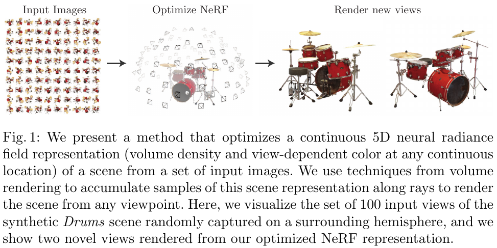
<figcaption>
NeRF overview: a continuous 5D neural radiance field is optimized from a sparse set of 2D images, and images are rendered from novel viewpoints.
</figcaption>
</div>

NeRF's core pipeline includes the following key technologies:

1. **5D neural scene representation**:
<div align="center">
  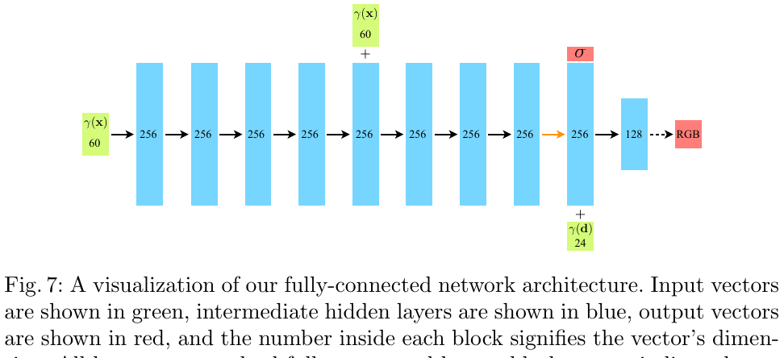
<figcaption>
NeRF network architecture: the spatial position $x$ first passes through 8 MLP layers to produce the volume density $\sigma$ and a feature vector; this is then combined with the viewing direction $d$ and passed through one additional layer to output the view-dependent RGB color.
</figcaption>
</div>
Because volume density depends only on position while color depends on both position and viewing direction, the model keeps the geometry consistent across views while still capturing view-dependent lighting and shading.

2. **Differentiable rendering pipeline**:
<div align="center">
  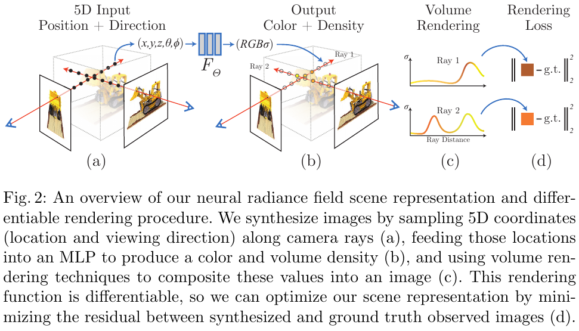
<figcaption>
NeRF training pipeline: sample along rays, query the MLP, composite pixels by volume rendering, compute the loss against the ground truth, and backpropagate.
</figcaption>
</div>
The volume rendering equation is approximated by numerical integration, which makes each pixel color a differentiable function of the network weights.

3. **Capturing high-frequency detail**:
A positional encoding $\gamma(p)$ maps the raw coordinates to a series of sine and cosine functions:
$$\gamma(p) = \left( \sin(2^0\pi p), \cos(2^0\pi p), \dots, \sin(2^{L-1}\pi p), \cos(2^{L-1}\pi p) \right)$$
This lets the MLP fit high-frequency variations in color and geometry and avoids over-smoothed renderings.

---

### 3. Results and findings
{: id="nerf-3-核心结果发现"}

- **Better quantitatively and qualitatively**: On synthetic datasets (such as Lego and Drums) and real scenes, NeRF's PSNR and SSIM far exceed the state of the art at the time (such as LLFF and SRN).
<div align="center">
  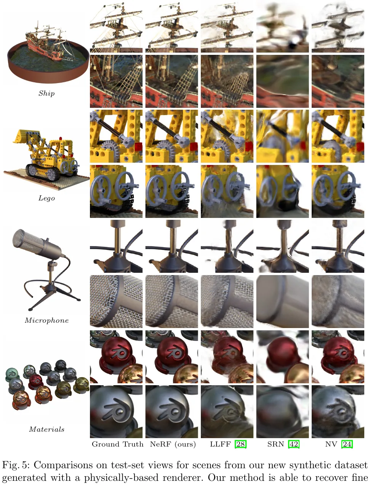
<figcaption>
Comparison: NeRF shows clear advantages in recovering complex geometry (such as the interior of the Lego model and the microscope mesh) and non-Lambertian reflections.
</figcaption>
</div>

- **Storage advantage**: Voxel-based methods need several GB of storage, whereas a complex NeRF scene needs only about 5 MB of network weights.

---

### 4. Limitations
{: id="nerf-4-局限性"}

NeRF's main limitation is that training and inference are extremely slow: a single scene takes a day or two to train, and rendering one image takes tens of seconds. In addition, the original NeRF handles only static scenes and cannot cope with dynamic objects or lighting changes.

### Reference
{: id="nerf-参考"}

- Paper: [NeRF: Representing Scenes as Neural Radiance Fields for View Synthesis](https://arxiv.org/abs/2003.08934) (ECCV 2020)

---

## 2. 3DGS (2023)
{: id="3dgs"}
Real-Time Radiance Field Rendering via Differentiable Gaussian Primitives

📄 **Paper**: https://repo-sam.inria.fr/fungraph/3d-gaussian-splatting/

### Key takeaways
{: id="3dgs-精华"}

3DGS shows that an explicit, discontinuous scene representation (no neural network) can also reach state-of-the-art novel view synthesis quality, overturning the belief that NeRF-style implicit continuous representations are necessary for high-quality rendering. Anisotropic covariance (factored into a rotation matrix R and a scaling matrix S as $\Sigma = RSS^T R^T$) lets each Gaussian adaptively fit geometry of any shape in the scene, which is the key to a compact, high-quality representation. The clone (under-reconstruction) and split (over-reconstruction) rules of adaptive density control give a simple, effective way to grow geometry, and they transfer to other point cloud optimization settings. The tile-based GPU radix sort plus $\alpha$-blending rendering pipeline is fully differentiable and passes gradients through without limit, which is what makes real-time rendering possible without sacrificing training quality.

---

### 1. Background and problem
{: id="3dgs-1-研究背景问题"}

Neural Radiance Fields (NeRF) achieve high-quality novel view synthesis through volumetric ray casting, but this needs a large number of sampling queries, so rendering is extremely slow (only 0.07 fps on Mip-NeRF360) and training takes up to 48 hours. Existing fast methods (InstantNGP, Plenoxels) improve speed at the cost of quality, and cannot reach true real-time rendering (30 fps or more) at 1080p.

---

### 2. Methods and innovations
{: id="3dgs-2-主要方法创新点"}

<div align="center">
  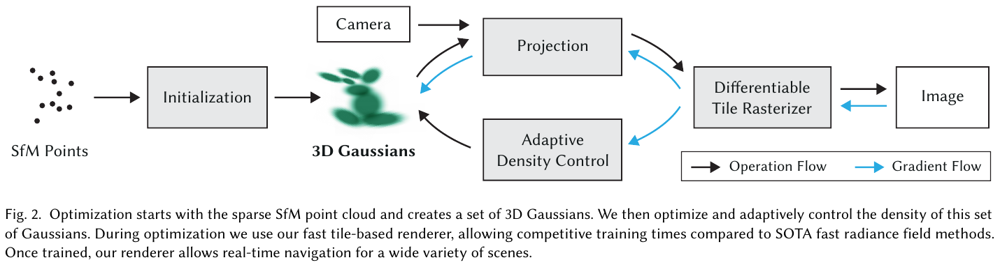
<figcaption>
3DGS pipeline: 3D Gaussians are initialized from the sparse SfM point cloud, the image is rendered through projection and a differentiable tile rasterizer, and after gradients are backpropagated, adaptive density control adjusts the number of Gaussians.
</figcaption>
</div>

**3D Gaussian representation**

The scene is represented by a set of 3D Gaussian primitives, each described by the following parameters:
- **Position (mean)** $\mu \in \mathbb{R}^3$
- **Anisotropic covariance** $\Sigma = RSS^T R^T$, where R is a rotation matrix (parameterized by a quaternion q) and S is a scaling matrix (parameterized by a vector s)
- **Opacity** $\alpha \in [0,1]$ (sigmoid activation)
- **Spherical harmonic (SH) coefficients** encode view-dependent color (4 bands, 48 coefficients in total)

The 3D Gaussian function is defined as:

$$G(x) = e^{-\frac{1}{2}x^T \Sigma^{-1} x}$$

**Projecting 3D to 2D**

At render time, each 3D Gaussian is projected onto the image plane. The 2D covariance in camera coordinates is computed as $\Sigma' = JW\Sigma W^T J^T$ using the Jacobian J of the affine approximation (a 2×2 matrix after dropping the third row and column), which supports efficient anisotropic splatting.

**Differentiable tile-based rasterizer**

<div align="center">
  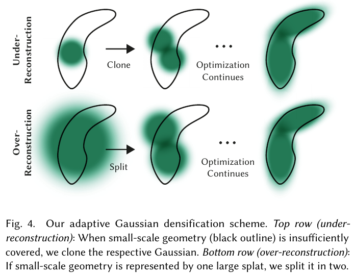
<figcaption>
Adaptive Gaussian density control: in under-reconstructed regions (top), small Gaussians are cloned to fill in detail; in over-reconstructed regions (bottom), one large Gaussian is split into two smaller ones
</figcaption>
</div>

The renderer divides the image into 16×16 tiles, counts the tiles each Gaussian covers, and assigns it a 64-bit key (the lower 32 bits hold the depth and the upper 32 bits the tile ID). After a single global GPU radix sort, it performs front-to-back $\alpha$-blending:

$$C = \sum_{i \in \mathcal{N}} c_i \alpha_i \prod_{j=1}^{i-1}(1 - \alpha_j)$$

In the backward pass, the intermediate $\alpha$ values are reconstructed by traversing back to front from the last point that affected the pixel, so no per-pixel blending list needs to be stored explicitly and the memory overhead stays constant.

**Adaptive density control**

Density control runs every 100 iterations:
- **Under-reconstructed** (position gradient $\lVert \nabla_p L \rVert > \tau_{pos} = 0.0002$, and small Gaussian size) → **clone**: copy the Gaussian and move it along the direction of the position gradient
- **Over-reconstructed** (large position gradient and large Gaussian volume) → **split**: replace it with 2 sub-Gaussians that are $\phi=1.6$ times smaller
- Gaussians with $\alpha < \epsilon_\alpha$ are pruned every N=3000 iterations

The training loss combines $$\mathcal{L}_1$$ and D-SSIM:

$$\mathcal{L} = (1-\lambda)\mathcal{L}_1 + \lambda \mathcal{L}_\text{D-SSIM}, \quad \lambda=0.2$$

---

### 3. Results and findings
{: id="3dgs-3-核心结果发现"}

<div align="center">
  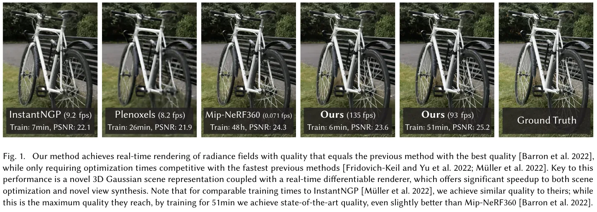
<figcaption>
Speed-quality comparison between 3DGS and the main baselines: 6 minutes of training matches InstantNGP, 51 minutes of training exceeds Mip-NeRF360 (48 h of training), and the rendering frame rate reaches 93-135 fps.
</figcaption>
</div>

<div align="center">
  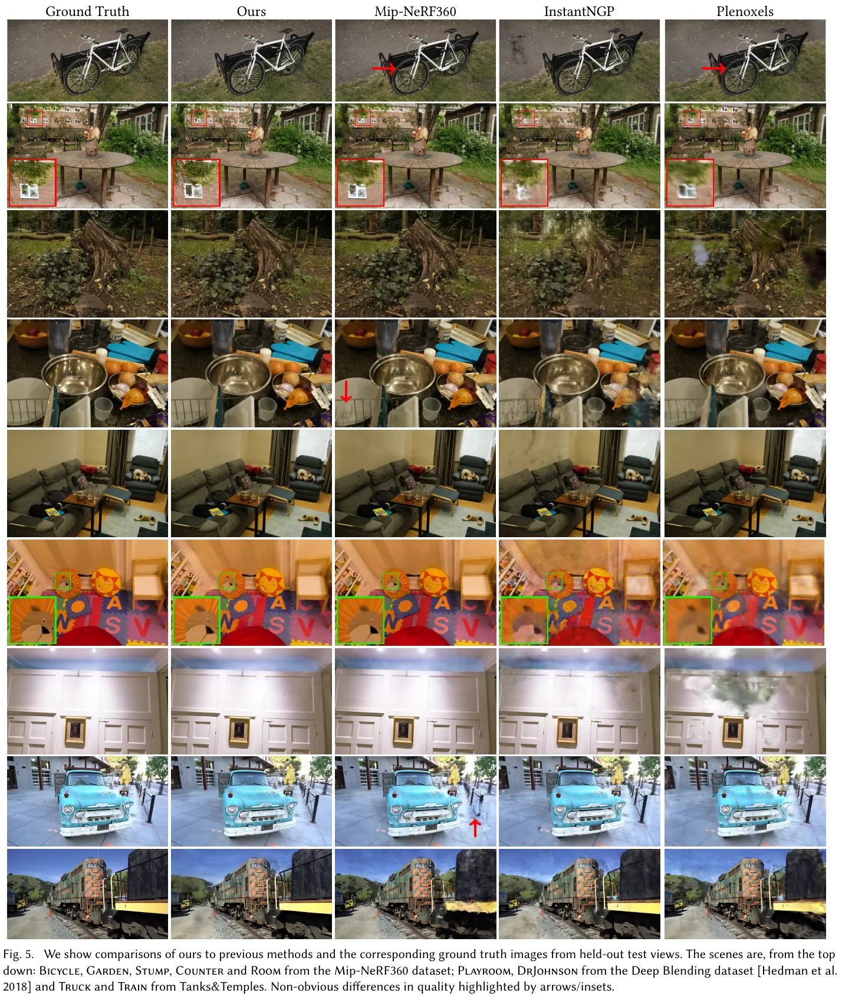
<figcaption>
Visual quality comparison on datasets including Mip-NeRF360, Tanks&Temples, and Deep Blending. 3DGS preserves detail well and reduces artifacts.
</figcaption>
</div>

- **Real-time rendering**: 93-135 fps at 1080p, far above Mip-NeRF360 (0.07 fps)
- **Training efficiency**: 7K iterations (~6 min) are comparable to InstantNGP, and 30K iterations (~35-45 min) surpass Mip-NeRF360 (48 h)
- **Mip-NeRF360 dataset** (30K iters): PSNR 27.21, SSIM 0.815, LPIPS 0.214
- **Tanks&Temples**(30K iters): PSNR 23.14, SSIM 0.841, LPIPS 0.183
- **Ablation**: Anisotropic covariance, the clone and split densification strategies, and the SH representation all contribute significantly to the final PSNR (see Table 3)
- **Model size**: 1-5M Gaussians represent a complete scene, using 200-500 MB of memory

---

### 4. Limitations
{: id="3dgs-4-局限性"}

In regions that are poorly observed (such as blind spots of the training views and strongly reflective or glossy surfaces), elongated, splotchy Gaussian artifacts and popping caused by depth-order flips can appear. The optimization currently has no regularization against this, and very large scenes (such as city scale) may need a lower learning rate to converge.

### Reference
{: id="3dgs-参考"}

- Paper: [3D Gaussian Splatting for Real-Time Radiance Field Rendering](https://arxiv.org/abs/2308.04079) (SIGGRAPH 2023)

---

## 3. SplatTalk (2025)
{: id="splattalk"}
Zero-Shot 3D Visual Question Answering with 3D Gaussian Splatting

📄 **Paper**: [arXiv:2503.06271](https://arxiv.org/abs/2503.06271)

---

### Key takeaways
{: id="splattalk-精华"}

Embedding language features into a 3D Gaussian representation bypasses explicit 3D inputs such as point clouds and depth maps, so 3D spatial reasoning can be done from multi-view RGB images alone. Using the visual tokens after the LLaVA-OV projector (rather than raw image features) as pseudo ground truth makes the Gaussian semantic features naturally aligned with the LLM latent space. Because LLM features are high-dimensional and sparse, a single shared autoencoder is first trained to compress them onto a compact 256-dimensional hypersphere, and RGB and semantic rendering are then optimized jointly while preserving generalization. At inference, language features are read directly from the 3D Gaussian means, and entropy-adaptive sampling selects the most informative set of tokens, improving performance without extra training. Compared with the 2D LMM baseline (LLaVA-OV), the method improves CIDEr by 23% on ScanQA and is competitive with 3D LMMs that require point cloud input.

---

### 1. Background and problem
{: id="splattalk-1-研究背景问题"}

3D VQA requires a model to understand the positions and relationships of objects in a scene. Existing 3D LMMs rely on expensive 3D inputs such as point clouds and depth maps, while pure 2D LMMs lack an explicit 3D representation and struggle with questions about spatial relations across objects (such as "What is next to the table?"). The core problem this paper addresses is how to build, from multi-view RGB images alone, a 3D language field that an LLM can query directly.

---

### 2. Methods and innovations
{: id="splattalk-2-主要方法创新点"}

The SplatTalk pipeline has three stages: feature autoencoder training, self-supervised 3D-language Gaussian splatting training, and 3D VQA inference.

<div align="center">
  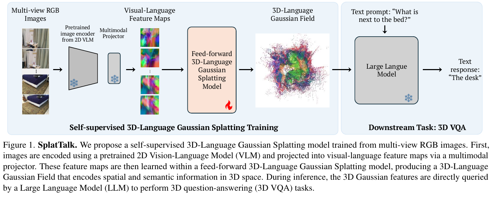
<figcaption>Figure 1: SplatTalk overall pipeline. Multi-view RGB images are encoded by a pretrained 2D VLM into visual-language feature maps, and a feed-forward 3D Gaussian splatting model then builds a 3D-language Gaussian field; at inference, the Gaussian language features are fed directly to the LLM to complete 3D VQA.</figcaption>
</div>

<div align="center">
  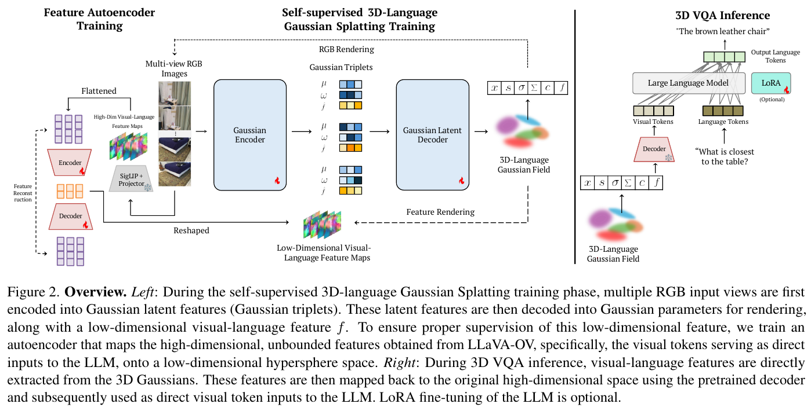
<figcaption>Figure 2: Detailed SplatTalk architecture. Left: the feature autoencoder is trained to compress LLaVA-OV's high-dimensional visual tokens onto a compact 256-dimensional hypersphere. Middle: RGB rendering and language feature rendering are trained jointly (with shared Gaussian parameters). Right: at inference, language features are extracted from the 3D Gaussians, sampled, and fed to the LLM.</figcaption>
</div>

**Visual tokens as pseudo-ground-truth features**: Visual tokens are extracted from LLaVA-OV's multimodal projector rather than from the raw image encoder output. The features are therefore aligned with the LLM latent space, and the semantic features the Gaussians learn can be interpreted by the LLM directly.

**Feature dimensionality reduction**: A single global autoencoder compresses the 3584-dimensional sparse LLM features onto a 256-dimensional hypersphere (with a normalization constraint). This is significantly better than the lossy 3-16 dimensional compression used in prior work, and it avoids the instability of high-dimensional features in CUDA differentiable rendering. The encoder and decoder are multi-layer linear + BatchNorm + GeLU.

**Joint training of RGB and language**: Built on the FreeSplat feed-forward framework, the Gaussian decoder adds a semantic feature prediction head that is optimized together with the RGB rendering parameters. The training loss is the sum of a photometric loss (MSE + LPIPS) and a semantic loss (MSE + cosine distance): $\mathcal{L} = \lVert I - \hat{I} \rVert^2 + 0.05 \cdot \text{LPIPS} + \lVert F - \hat{F} \rVert^2 + 1 - \cos(F, \hat{F})$

**Mean feature extraction (the EM view)**: At inference, the semantic feature $f_i^*$ of each Gaussian is defined as the weighted average of its contributions to the renderings of all views. This corresponds to the E-step of the EM algorithm and ensures that scene semantics are captured globally rather than at isolated points.

**Entropy-adaptive sampling**: The language feature entropy of each Gaussian is computed, and the top-k Gaussians with the highest entropy (the most informative) are fed to the LLM first. This improves spatial reasoning without extra training, and beats random sampling, point-density sampling, and FPS.

---

### 3. Results and findings
{: id="splattalk-3-核心结果发现"}

<div align="center">
  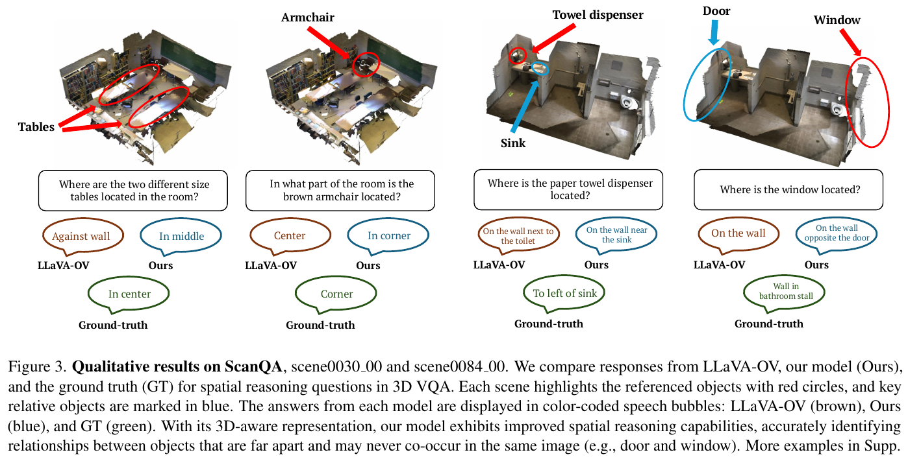
<figcaption>Figure 3: ScanQA qualitative comparison (SplatTalk vs LLaVA-OV vs ground truth). SplatTalk correctly identifies spatial relationships between objects that are far apart (such as the relative positions of a door and a window), while LLaVA-OV frequently gets such questions wrong.</figcaption>
</div>

**ScanQA (3D indoor QA)**: SplatTalk reaches a zero-shot CIDEr of 61.7 (vs 50.0 for LLaVA-OV). After fine-tuning, SplatTalk-3DVQA-FT reaches 77.5 CIDEr / EM@1 22.4 / EM@1-R 38.3, surpassing all specialist and generalist 3D LMM baselines (including point-cloud-based ones such as LEO and Chat-Scene).

**SQA3D (embodied situated question answering)**: zero-shot EM@1-R is 32.2, and after fine-tuning SplatTalk-3DVQA-FT reaches 41.3, matching the best 2D LMMs and approaching point-cloud 3D LMMs.

**MSR3D (Multimodal Situational Reasoning)**: zero-shot Overall score of 41.8, about 1.7 times that of LLaVA-OV (24.0); on spatial questions it scores 35.8 (vs 19.5 for LLaVA-OV), leading overall.

**Ablation**: Entropy sampling beats random, FPS, and point-density sampling on every metric. Increasing the visual context (from 729 to 32,076 tokens) almost doubles EM@1 on MSR3D, showing that spatial reasoning benefits substantially from more scene context.

---

### 4. Limitations
{: id="splattalk-4-局限性"}

The method relies on FreeSplat's multi-view feed-forward inference, so it places requirements on the number and coverage of views and does not apply to single-view settings. Counting remains a weak spot, possibly limited by the object granularity the Gaussians represent and by the LLM's own counting ability.

### Reference
{: id="splattalk-参考"}

- Paper: [SplatTalk: 3D VQA with Gaussian Splatting](https://arxiv.org/abs/2503.06271) (ICCV 2025)

---

## 4. LangSplatV2 (2025)
{: id="langsplatv2"}
Dropping the Decoder Entirely: An Ultra-Fast 3D Language Field Based on a Sparse Coefficient Field

📄 **Paper**: [arXiv:2507.07136](https://arxiv.org/abs/2507.07136)

### Key takeaways
{: id="langsplatv2-精华"}
LangSplatV2 tackles the core pain point of slow inference in 3D language fields at high resolution. The key breakthrough is to represent each 3D Gaussian as a "sparse combination of coefficients" over a "global codebook", which removes the heavy MLP decoder altogether. Together with a CUDA-optimized sparse splatting kernel, this reaches 450+ FPS on an A100 (about 42 times faster than LangSplat) while also improving 3D localization and semantic segmentation accuracy, making real-time open-vocabulary querying possible at very high resolution.

---

### 1. Background and problem
{: id="langsplatv2-1-研究背景问题"}
Although LangSplat is much faster than earlier NeRF-based methods, its inference speed on high-resolution images is only 8.2 FPS (A100), far from real time. The analysis shows that the bottleneck is the heavyweight **MLP decoder** needed to restore the rendered low-dimensional latents to high-dimensional CLIP features. Rendering the high-dimensional features directly runs out of memory and sharply reduces rendering efficiency. This accuracy-versus-speed conflict limits the use of 3D language fields in real-time robot interaction.

<div align="center">
  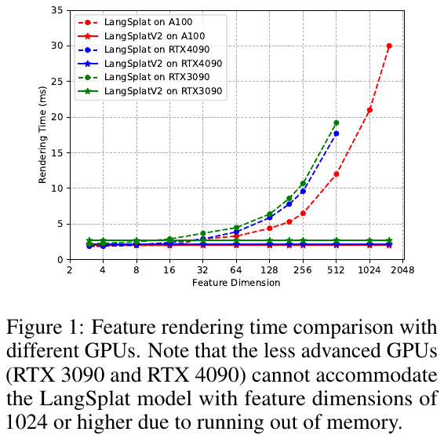
<figcaption>LangSplat's rendering time increases sharply as the feature dimension grows, and low-end GPUs cannot bear the memory overhead of high-dimensional features</figcaption>
</div>

---

### 2. Methods and innovations
{: id="langsplatv2-2-主要方法创新点"}
The core idea of LangSplatV2 is to exploit the **sparsity** of the semantic distribution (a scene contains far fewer distinct semantics than Gaussians).

* **3D sparse coefficient field**: Instead of learning a full high-dimensional feature for every Gaussian, the method learns a shared **global codebook** and **sparse coefficients**. Each Gaussian is just a linear combination of $K$ basis vectors from the codebook ($K=4, L=64$ in the experiments), which bypasses the MLP decoder entirely.
* **Efficient sparse splatting**: A dedicated CUDA kernel exploits the sparsity of the coefficients and performs alpha blending only on the non-zero channels. Rendering a 1536-dimensional feature map then costs about as much as rendering very low-dimensional features, which greatly reduces computational complexity.

<div align="center">
  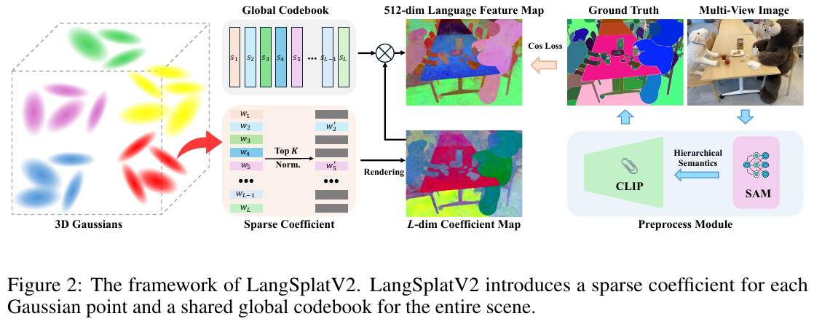
<figcaption>LangSplatV2 architecture: by learning sparse coefficients and a global codebook, high-dimensional feature rendering becomes low-dimensional coefficient rendering plus a matrix multiplication</figcaption>
</div>

<div align="center">
  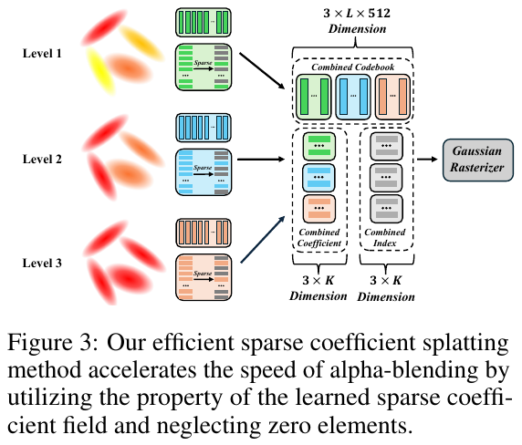
<figcaption>Principle of efficient sparse splatting: blending is computed only over the Top-K non-zero coefficients</figcaption>
</div>

```
============================== Stage 1: Offline preprocessing (Data Prep) ==============================

[ Input image I] ----> ( SAM segmentation ) ----> [ Masks ]
(H, W, 3)                                (H, W, 1) x M objects
                                            |
                                            v
[ Input image I] ----> ( CLIP encoding ) ----> [ Semantic features F_gt]
                                         (H, W, D)  <-- D=512 (ground-truth "target")

============================== Stage 2: 3D spatial modeling (Modeling) ==============================

1. Global resources:
   [ Codebook B] Dimensions: (L, D)  <-- "Semantic dictionary" shared across the scene, L=512, D=512

2. Parameters stored per 3D Gaussian i (point-wise):
   [ Query vector q_i] Dimensions: (1, d)  <-- used to look up indices, d is usually small (e.g. 32)
   [ Other parameters]     Dimensions: (1, 11) <-- Position, rotation, scale, opacity

============================== Stage 3: Training loop (Training Loop) ==============================

Step A: Index and weight generation (Sparse Coding)
--------------------------------------
[ q_i (1,d)] x [ B (d,L)]  -->  [ Score S (1,L)]  (correlation between this point and each basis vector in the dictionary)
                                      |
                                      v (take Top-K, commonly K=3)
[ Index Idx (1,K)] <----------- [ Top-K operation] -----------> [ Raw weights W (1,K)]
(indices of the K selected basis vectors)                                        | (Softmax normalization)
                                                            v
                                                     [ Probability P (1,K)] (sums to 1)

Step B: Feature composition (Feature Composition)
--------------------------------------
[ P_i (1,K)] ⊙ [ B[Idx_i] (K,D) ]  -->  [ Composed feature F_i (1,D)]
(probabilities weight the corresponding basis vectors)                     (final semantic feature of 3D Gaussian i)

Step C: Differentiable rendering (Differentiable Rendering)
------------------------------------------
[ All F_i (N,D)] + [ Geometric parameters] --(3DGS renderer)--> [ Rendered semantic map S_render (H,W,D)]

Step D: Loss computation and backpropagation (Loss & Backprop)
---------------------------------------
Compute the error: Loss = || S_render - S_gt ||
    |
    v (gradient backpropagation)
1. Update codebook B  ------> optimizes the "vocabulary" of the dictionary
2. Update query vector q_i ------> changes which basis vectors the point tends to choose (i.e. updates the indices)
3. Update other geometric parameters ------> optimizes object shape and position

============================== Stage 4: Inference query (Inference) ==============================

User input: "red chair" --> CLIP encoding --> [ Text feature T (1,D)]
                                            |
[ S_render (H,W,D)] <---(similarity computation)--- [ T (1,D)]
          |
          v
[ Semantic heat map (H,W,1)] --> Locate the target object instantly!

```
---

### 3. Results and findings
{: id="langsplatv2-3-核心结果发现"}
* **Speed breakthrough**: On the LERF dataset, feature rendering reaches 476.2 FPS and open-vocabulary text querying reaches 384.6 FPS, which is **42 times** and **47 times** faster than LangSplat, respectively.
* **Higher accuracy**: Because the method models directly in CLIP space with no encoding and decoding loss, 3D object localization accuracy on LERF rises to 84.1% and semantic segmentation IoU to 59.9%, clearly better than baselines such as LangSplat and LEGaussian.
* **Memory friendly**: High-dimensional 3D language fields run successfully on consumer GPUs such as the RTX 3090/4090.

<div align="center">
  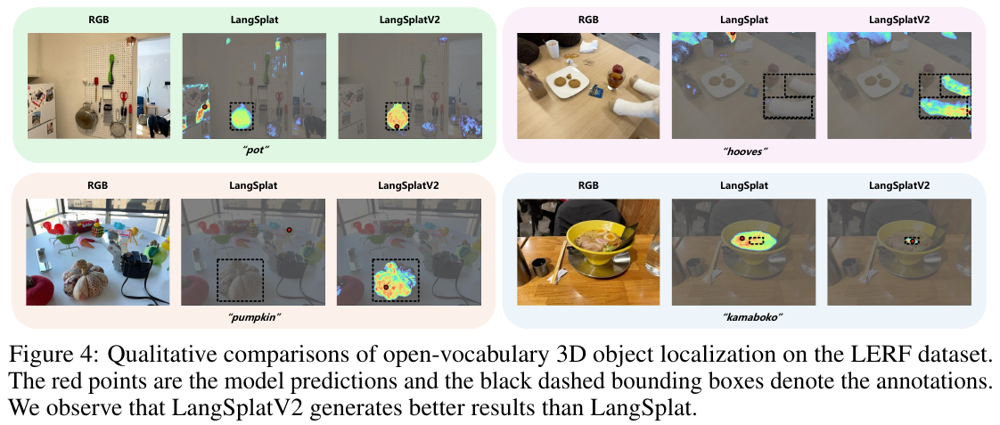
<figcaption>Comparison of 3D object localization on the LERF dataset: LangSplatV2's predicted points are more accurate and the boundaries are clearer</figcaption>
</div>

<div align="center">
  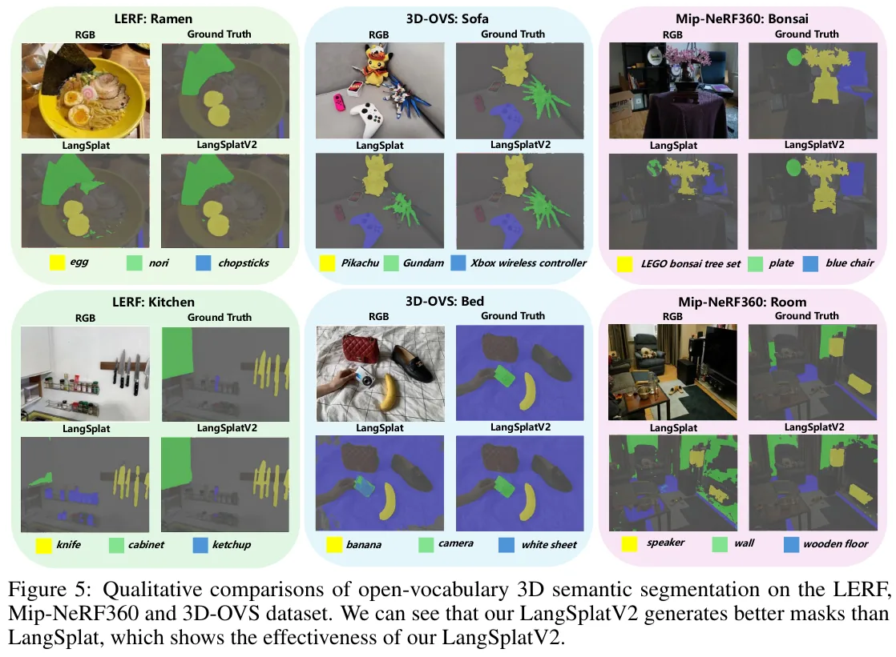
<figcaption>Qualitative comparison of semantic segmentation: the masks generated by LangSplatV2 are less noisy and the object contours more accurate</figcaption>
</div>

---

### 4. Limitations
{: id="langsplatv2-4-局限性"}
* **Training cost**: Inference is extremely fast, but building and optimizing the sparse semantic field makes training time (about 3 hours) and training GPU memory (about 21.2 GB) slightly higher than the original LangSplat.
* **Semantic source**: The performance ceiling is still set by the representational power and inherent biases of the pretrained CLIP model.

### Reference
{: id="langsplatv2-参考"}

- Paper: [LangSplatV2: High-dimensional 3D Language Gaussian Splatting with 450+ FPS](https://arxiv.org/abs/2507.07136) (NeurIPS 2025)

---

## 5. 4D LangSplat (2025)
{: id="4d-langsplat"}
4D Language Gaussian Splatting via Multimodal Large Language Models

📄 **Paper**: https://arxiv.org/abs/2503.10437

---

### Key takeaways
{: id="4d-langsplat-精华"}

1. Use an MLLM (Qwen2-VL) to generate per-frame, per-object text descriptions, bypassing CLIP's limits in understanding dynamic semantics. "Describing visual change in language" is more robust than "modeling change with a vision model", and it is the key shift for handling temporal semantics.
2. The Status Deformable Network constrains semantic features to linear combinations of $K$ state prototypes, forcing semantics to transition smoothly among a finite set of states and avoiding the temporal inconsistency of unconstrained deformation fields. Replacing arbitrary deformation with projection onto a state space is the core insight of the design.
3. The method maintains two semantic fields at once, time-invariant and time-varying, which decouples "what is this" from "what state is it in now" and serves different kinds of open-vocabulary queries.
4. The three-part visual prompt (contour highlighting + background graying + blurring) effectively guides the MLLM to focus on the target object, and using the global motion description $\mathcal D_i$ as temporal context improves the consistency of per-frame captions. This prompt design also transfers to other multimodal video understanding tasks.
5. A time-invariant field first determines the spatial location ("which object"), and a time-varying field then determines the temporal location ("which frame"). This two-field decoupled query strategy makes time-sensitive query accuracy clearly better than pure CLIP methods.

---

### 1. Background and problem
{: id="4d-langsplat-1-研究背景问题"}

LangSplat splats CLIP features onto 3D Gaussians and so supports accurate open-vocabulary queries of static scenes, but it cannot handle objects whose state changes over time in dynamic scenes (such as a "running dog" vs a "stationary dog"). CLIP was designed to match static images and text and struggles to capture temporal semantic changes in video. Extending 4D-GS directly into a semantic field raises the difficulty of how to obtain pixel-aligned, object-level temporal features: existing vision models mainly extract global video-level features, and cropped features carry background noise, which is not enough for accurate spatiotemporal queries.

---

### 2. Methods and innovations
{: id="4d-langsplat-2-主要方法创新点"}

<div align="center">
  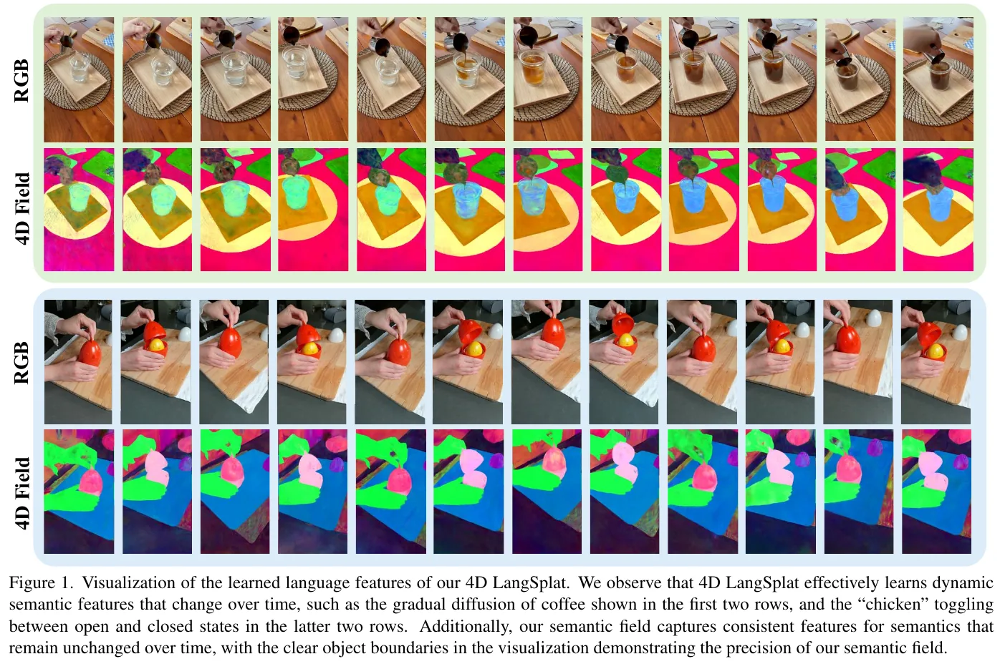
<figcaption>Figure 1: Visualization of the time-varying semantic field learned by 4D LangSplat. The upper half shows coffee gradually diffusing (its color changes over time), the lower half shows a chicken box switching between open and closed, and the colors of time-invariant objects (the tabletop and cup) stay stable throughout.</figcaption>
</div>

<div align="center">
  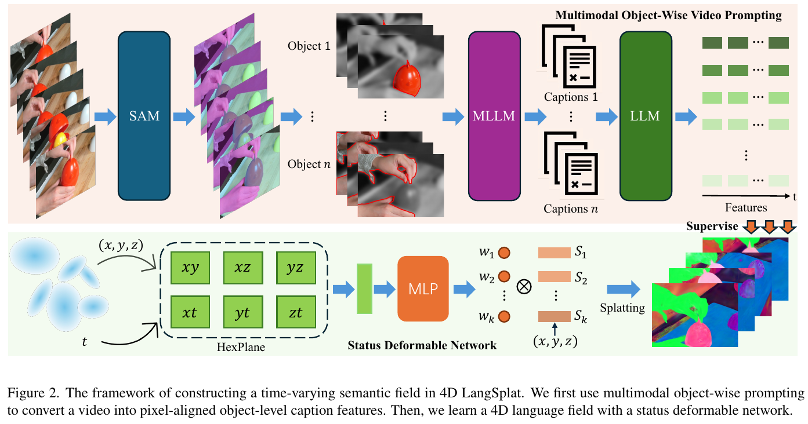
<figcaption>Figure 2: Overall framework of 4D LangSplat. Top: the multimodal object-wise video prompting process (SAM segmentation → MLLM generates captions → LLM extracts embeddings as 2D supervision). Bottom: the Status Deformable Network (HexPlane spatiotemporal features → MLP predicts state weights → linear combination of state prototypes → splatting supervision).</figcaption>
</div>

**① Overall framework**

4D LangSplat has three core modules. The **Multimodal Object-Wise Video Prompting** module extracts pixel-aligned, object-wise language features from video. The **time-invariant semantic field** (inheriting LangSplat's three-level CLIP semantics) captures semantics that do not change over time. The **Status Deformable Network** models the time-varying semantic field. Together they support two kinds of open-vocabulary queries: time-agnostic and time-sensitive.

**② Module-by-module explanation**

**Multimodal Object-Wise Video Prompting**

- **Input**: video frame sequence $V = \{I_1, \ldots, I_T\}$
- **Processing**: ① SAM + DEVA tracking yields consistent segmentation masks $\{M_1, \ldots, M_n\}$ for $n$ objects in each frame; ② a visual prompt is built:

$$\mathcal P_{i,t} = \text{Contour}(M_{i,t}) \cup \text{Gray}(M_{i,t}) \cup \text{Blur}(M_{i,t})$$

A red outline highlights the target, non-target regions are grayed out, and background pixels are blurred, keeping a background reference while focusing on the target; ③ the MLLM is first prompted to generate a global motion description $\mathcal D_i$ of object $i$, which is then used as temporal context to generate captions frame by frame.

$$C_{i,t} = \text{MLLM}(\mathcal D_i, \mathcal P_{i,t}, \mathcal T_{frame}, V_t)$$

④ A fine-tuned e5-mistral-7b extracts sentence embeddings, which serve as the per-pixel 2D supervision signal $\mathbf F_{x,y,t} = \mathbf e_{i,t}$

- **Output**: Pixel-aligned, temporally consistent object-level language embeddings, used as training labels for the time-varying semantic field
- **Motivation**: CLIP cannot distinguish dynamic semantic states, whereas an MLLM naturally understands actions, object conditions, and temporal change; text features capture dynamic semantics such as "liquid darkening" and "container opening/closing" better than visual features do

**Status Deformable Network**

- **Input**: HexPlane-encoded spatiotemporal features (from $(x, y, z, t)$) and $K$ learnable state prototypes $\{\mathbf S_{i,1}, \ldots, \mathbf S_{i,K}\}$
- **Processing**: An MLP decoder $\phi$ predicts the weight coefficients $w_{i,t,k}$ of each Gaussian $i$ at time $t$ (satisfying $\sum_{k=1}^K w_{i,t,k} = 1$), and the semantic feature is

$$\mathbf f_{i,t} = \sum_{k=1}^{K} w_{i,t,k} \mathbf S_{i,k}$$

The MLP is trained jointly with the state prototypes, using the spatial and temporal dimensions of HexPlane so that the weights adapt to spatiotemporal context.

- **Output**: Time-varying semantic features that transition smoothly within a finite state space, used for splatting-based rendering of the semantic field
- **Motivation**: Learning an unconstrained semantic deformation field $\Delta \mathbf f$ directly leads to exploding complexity and temporal inconsistency. Constraining semantics to $K$ prototypes and modeling a "state-machine-like" smooth transition both eases learning and improves temporal consistency.

**③ End-to-end data flow**

Video input → SAM+DEVA segmentation and tracking → visual prompt construction → Qwen2-VL-7B generates per-frame, per-object captions → e5-mistral-7b extracts embeddings as 2D supervision → 4D-GS pretrains RGB reconstruction (frozen) → the time-invariant field (three-level CLIP semantics) and the Status Deformable Network (time-varying semantic field) are trained jointly on the deformable Gaussians.

**④ Training objectives**

- Time-invariant semantic field: L2 loss between rendered features and CLIP features (the three semantic granularities are independent)
- Time-varying semantic field: L2 loss between rendered features and e5-mistral-7b caption embeddings
- CLIP features and text features are compressed to 3 and 6 dimensions, respectively, by an autoencoder to reduce GPU memory overhead.

**⑤ Inference and querying**

- **Time-agnostic query**: only the time-invariant semantic field is used; after rendering the feature map, relevance scores against the text query are computed, and per-frame segmentation masks are obtained with LangSplat's post-processing strategy
- **Time-sensitive query**: ① the time-invariant field first generates a candidate spatial mask for the whole frame (deciding "which object"); ② within the mask region, the cosine similarity between the time-varying features and the query is computed frame by frame; ③ frame segments whose mean similarity exceeds the video-wide mean threshold are taken as the relevant time interval, and the time-invariant mask is used as the final spatial segmentation result

---

### 3. Results and findings
{: id="4d-langsplat-3-核心结果发现"}

<div align="center">
  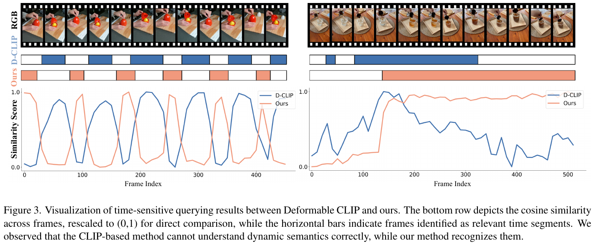
<figcaption>Figure 3: Frame-level similarity curves for time-sensitive queries. 4D LangSplat (orange) accurately identifies the moment the state switches, whereas the similarity curve of Deformable CLIP (blue) is flat or even misaligned, so it cannot reliably locate the relevant frame segments.</figcaption>
</div>

<div align="center">
  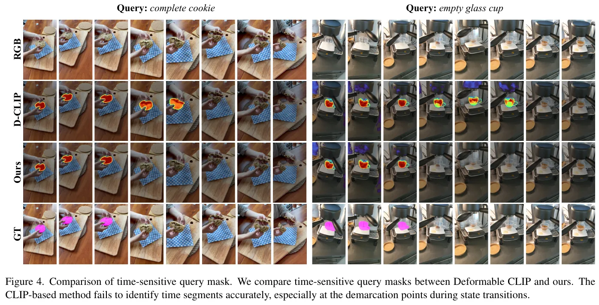
<figcaption>Figure 4: Mask comparison for time-sensitive queries. For the queries "complete cookie" and "empty glass cup", Deformable CLIP makes many errors at state-transition frames (especially at boundaries), while the 4D LangSplat masks agree closely with the ground truth.</figcaption>
</div>

**Time-sensitive querying** (HyperNeRF dataset):

| Method | Acc (%) | vIoU (%) |
|------|---------|----------|
| LangSplat | 54.01 | 22.65 |
| Deformable CLIP | 61.80 | 44.72 |
| Non-Status Field | 87.58 | 68.57 |
| **4D LangSplat (Ours)** | **90.83** | **72.26** |

**Time-agnostic querying** (HyperNeRF / Neu3D):

| Method | HyperNeRF mIoU | HyperNeRF mAcc | Neu3D mIoU | Neu3D mAcc |
|------|----------------|----------------|------------|------------|
| Feature-3DGS | 36.63 | 74.02 | 34.96 | 87.12 |
| Gaussian Grouping | 50.49 | 80.92 | 49.93 | 95.05 |
| LangSplat | 74.92 | 97.72 | 61.49 | 91.89 |
| **4D LangSplat (Ours)** | **82.48** | **98.01** | **85.11** | **98.32** |

**Key ablation findings**: $\Delta_{sim}=3.32$ is highest when all three visual prompts are used; adding the video-level motion description $\mathcal D_i$ improves $\Delta_{sim}$ by 0.87 over image-only prompts; the number of states $K=3$ is optimal, and values that are larger or smaller degrade performance.

---

### 4. Limitations
{: id="4d-langsplat-4-局限性"}

The method depends on the object tracking quality of SAM+DEVA. When tracking fails, the caption features become temporally misaligned, which hurts the accuracy of the time-varying semantic field. Video inference with Qwen2-VL-7B and embedding extraction with e5-mistral-7b add substantial preprocessing overhead, so the overall computational cost is higher than that of purely visual feature methods.

### Reference
{: id="4d-langsplat-参考"}

- Paper: [4D LangSplat: 4D Language Gaussian Splatting via Multimodal Large Language Models](https://arxiv.org/abs/2503.10437) (CVPR 2025)

---

## 6. OpenGaussian (2024)
{: id="opengaussian"}
Towards Point-Cloud-Level Open-Vocabulary Understanding of 3D Gaussians

📄 **Paper**: [arXiv:2406.02058](https://arxiv.org/abs/2406.02058)

### Key takeaways
{: id="opengaussian-精华"}
1. **Point-cloud-level understanding**: Unlike earlier methods that render 3D features to 2D pixels for understanding, OpenGaussian achieves genuine 3D point-cloud-level open-vocabulary understanding.
2. **3D-consistent feature learning**: With view-independent SAM masks as supervision, instance features that are consistent in 3D space are trained through an intra-mask smoothing loss and an inter-mask contrastive loss.
3. **Two-level quantization codebook**: A coarse-to-fine two-level codebook is introduced. The coarse level combines position information to resolve feature conflicts between distant objects, and the fine level refines the features, significantly improving feature discriminability.
4. **Association without depth testing**: A 3D-2D association method based on IoU and feature similarity links 2D CLIP features to 3D Gaussian points losslessly, with no depth test.
5. **Efficient and lossless**: No extra feature dimensionality reduction or distillation network is needed, which preserves the strong generalization of the original CLIP features.

---

### 1. Background and problem
{: id="opengaussian-1-研究背景问题"}
Existing open-vocabulary methods based on 3D Gaussian splatting (3DGS), such as LangSplat and LEGaussians, mainly work at the **2D pixel level**: they render feature maps and match in 2D space. This has the following limitations on 3D point-cloud-level tasks (such as object localization and interaction):
1. **Weakly expressive features**: Because of GPU memory and speed limits, high-dimensional language features usually have to be reduced in dimension or quantized, which lowers their discriminability.
2. **Inaccurate 2D-3D mapping**: Alpha-blending accumulates the values of many points, so no accurate one-to-one mapping between 3D points and 2D pixels can be established.
3. **Occlusion cannot be handled**: Occluded object parts are hard to identify from 2D rendering alone.

---

### 2. Methods and innovations
{: id="opengaussian-2-主要方法创新点"}

<div align="center">
  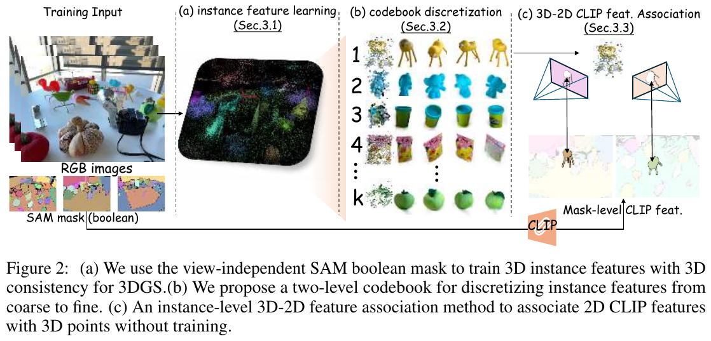
<figcaption>OpenGaussian pipeline: (a) instance feature learning, (b) two-level codebook discretization, (c) 3D-2D feature association</figcaption>
</div>

#### ① Overall framework
{: id="opengaussian--整体框架概述"}
OpenGaussian gives up training high-dimensional CLIP features directly in 3D space. It first trains low-dimensional, 3D-consistent **instance features**, then discretizes them with a **two-level codebook**, and finally uses a novel **association mechanism** to map 2D CLIP features onto the 3D instances, enabling point-cloud-level open-vocabulary queries.

#### ② 3D consistent instance feature learning (Sec 3.1)
{: id="opengaussian--3d-一致性实例特征学习-sec-31"}
To make 3D points show consistent object properties across viewpoints, the authors add a low-dimensional feature $f \in \mathbb{R}^6$ to each Gaussian.
- **Input**: an RGB image and the view-independent Boolean masks generated by SAM.
- **Processing**: The 3D features are rendered into a 2D feature map $M$, and each mask $B_i$ is used to compute two losses:
  - **Intra-mask smoothing loss ($L_s$)**: pulls the pixel features within a mask toward their mean, ensuring internal consistency of the object.
  - **Inter-mask contrastive loss ($L_c$)**: pushes apart the mean features of different masks, ensuring discriminability between objects.
- **Output**: continuous instance features that are 3D-consistent and discriminative.

#### ③ Two-level discretization codebook (Sec 3.2)
{: id="opengaussian--两级离散化码本-sec-32"}
In large scenes, continuous features are prone to noise and can overlap with the features of distant objects.
- **Coarse level**: The feature $F$ is concatenated with the 3D coordinate $X$ before clustering. Including position information ensures that objects far apart in space are assigned to different clusters even when their features are similar.
- **Fine level**: Within each coarse cluster, clustering is refined further using features only.
- **Effect**: Gaussians within the same instance share **identical** (not merely similar) features, which greatly improves the robustness of interactive segmentation and localization.

#### ④ Instance-level 3D-2D feature association (Sec 3.3)
{: id="opengaussian--实例级-3d-2d-特征关联-sec-33"}

<div align="center">
  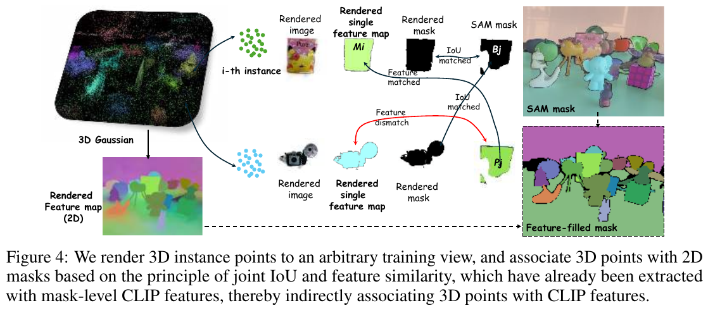
<figcaption>3D-2D association mechanism based on IoU and feature similarity</figcaption>
</div>

To assign CLIP features to 3D points, the authors propose an association method that needs no depth test:
1. **Render a single instance map**: The points of one 3D instance $i$ are rendered alone into the current view to obtain $M_i$.
2. **Compute the matching score $S_{ij}$**: It combines the **IoU** between the rendered mask and the original SAM mask $B_j$ with the **distance** between the 3D features and the pre-extracted 2D mask features.
3. **Multi-view aggregation**: The 2D CLIP feature with the highest matching score is associated with the 3D instance. This avoids complex occlusion handling and transfers features losslessly.

---

### 3. Results and findings
{: id="opengaussian-3-核心结果发现"}

<div align="center">
  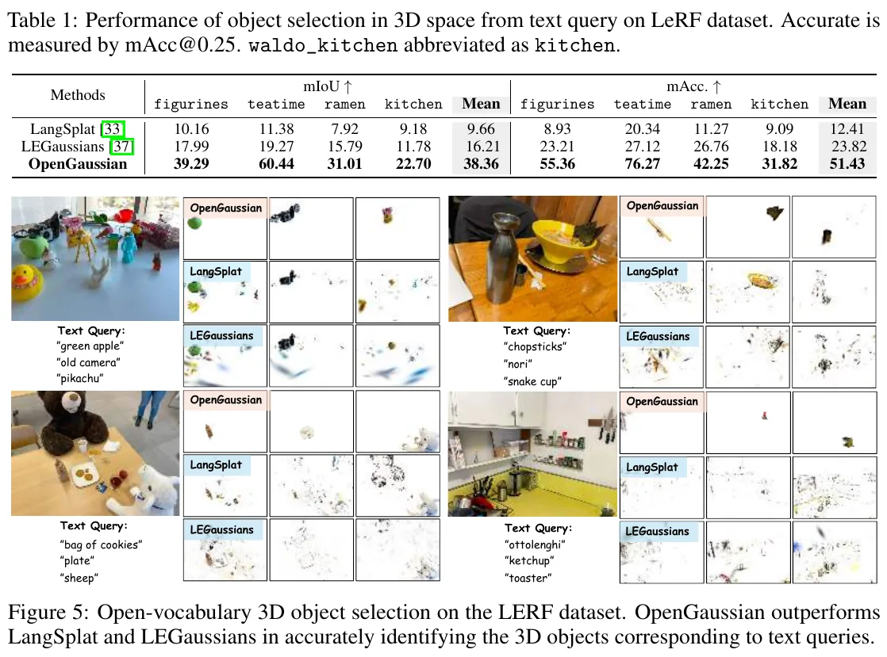
<figcaption>Qualitative comparison on the LERF dataset. OpenGaussian selects objects in 3D space far more accurately than LangSplat and LEGaussians</figcaption>
</div>

1. **State-of-the-art performance**: On LERF, mIoU reaches 38.36% and mAcc reaches 51.43%, a qualitative leap over LangSplat (9.66% / 12.41%).
2. **Feature discriminability**: Visualizations show that OpenGaussian's 3D features have very sharp boundaries and consistent semantics, and can accurately distinguish small objects.

<div align="center">
  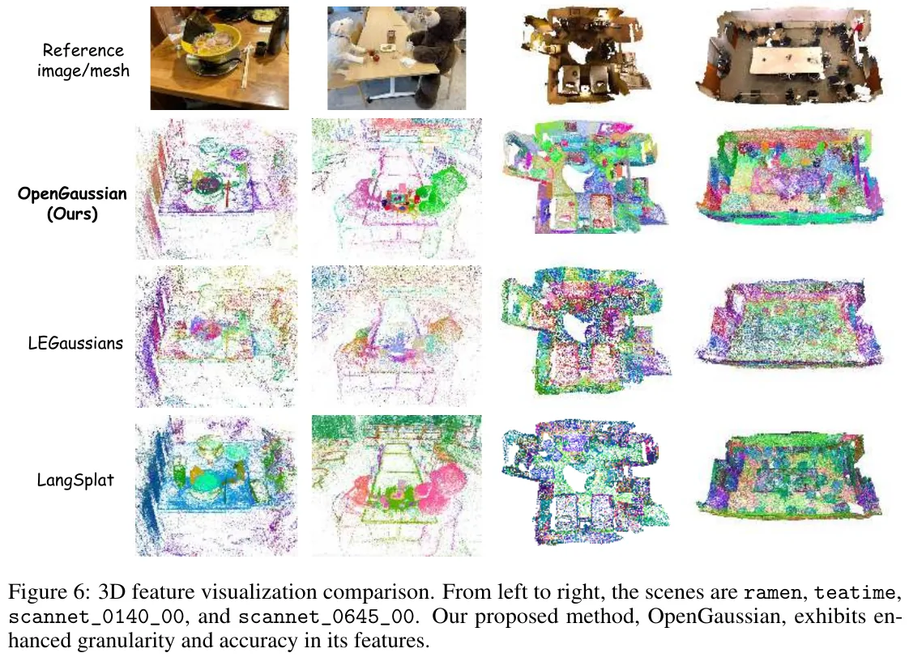
<figcaption>3D feature visualization comparison: OpenGaussian's features are finer-grained and more discriminative</figcaption>
</div>

---

### 4. Limitations
{: id="opengaussian-4-局限性"}
1. **Fixed geometry**: Feature learning currently leaves the geometric properties of the Gaussians (position, scale, etc.) unchanged; joint optimization is a possible future direction.
2. **Codebook hyperparameter**: The number of clusters $k$ still has to be set empirically and is not adaptive.
3. **Dynamic scenes**: 4D dynamics are not yet considered; combining with 4DGS is a future direction.

### Reference
{: id="opengaussian-参考"}

- Paper: [OpenGaussian: Towards Point-Level 3D Gaussian-based Open Vocabulary Understanding](https://arxiv.org/abs/2406.02058) (NeurIPS 2024)

---

## 7. GaussianVLM (2025)
{: id="gaussianvlm"}
Scene-centric 3D VLM using Language-aligned Gaussian Splats for Embodied Reasoning

📄 **Paper**: https://arxiv.org/abs/2507.00886

---

### Key takeaways
{: id="gaussianvlm-精华"}

- Embedding language features directly into each 3D Gaussian primitive (instead of detecting objects first and then encoding them) enables early modality alignment and removes the dependence on object detectors entirely.
- The dual sparsifier compresses 40k dense tokens into 128 task-aware scene tokens plus 4 ROI tokens, so a frozen LLM can handle the dense 3D representation efficiently.
- The core value of the scene-centric design: preserving global spatial context lets the model clearly outperform object-centric approaches on embodied tasks (dialogue, planning) that require multi-object reasoning.
- Gaussian splats naturally combine geometry and appearance (color, texture), giving the model the ability to recognize fine-grained visual attributes, which point clouds lack.
- The RGB-driven 3DGS pipeline opens a path from easily obtained data to 3D VLMs. In the out-of-domain ScanNet++ setting, accuracy improves by **474%** over the point-cloud method LL3DA.

---

### 1. Background and problem
{: id="gaussianvlm-1-研究背景问题"}

Mainstream 3D VLMs rely on object detectors to extract object-centric tokens. This creates a detection bottleneck, limits open-vocabulary generalization, and ignores global spatial context and multi-object relationships, which are exactly what embodied reasoning (situated QA, planning, multi-turn dialogue) requires. In addition, the Gaussian splat of each scene contains tens of thousands of primitives, so feeding all the dense language features to the LLM is computationally prohibitive and calls for an efficient, task-aware compression mechanism.

---

### 2. Methods and innovations
{: id="gaussianvlm-2-主要方法创新点"}

<div align="center">
  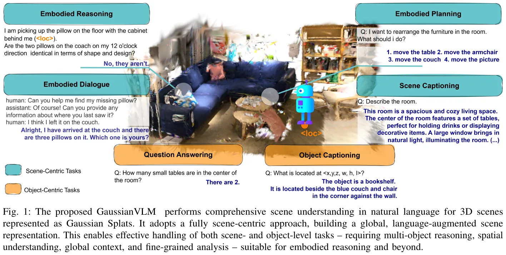
<figcaption>GaussianVLM supports six tasks: embodied reasoning, embodied planning, embodied dialogue, scene captioning, question answering, and object captioning, covering both scene-level and object-level understanding.</figcaption>
</div>

**① Overall framework**

GaussianVLM has three core modules. **(A) Language-aligned Gaussian backbone** (SceneSplat) encodes the 3D scene into 40k dense language features. **(B) Dual sparsifier** (position-guided + task-guided) compresses the dense representation into sparse tokens. **(C) LLM** (OPT-1.3B + LoRA) receives the sparse tokens and the task text and generates the response.

<div align="center">
  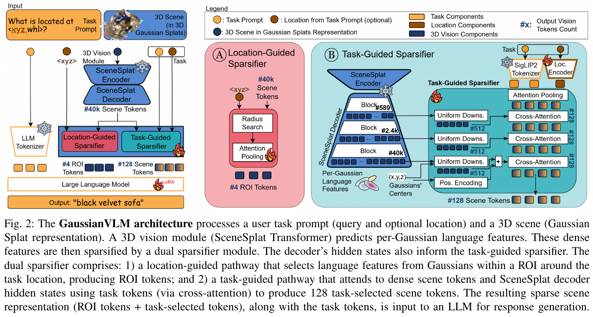
<figcaption>Full GaussianVLM architecture: the left shows the overall data flow (3D scene → SceneSplat → dual sparsifier → LLM), and the right shows the internals of position-guided sparsification (A) and task-guided sparsification (B).</figcaption>
</div>

**② Module-by-module explanation**

**SceneSplat backbone (3D vision module)**
- **Input**: 40k Gaussian splats randomly sampled from the scene (with attributes such as position, color, opacity, and covariance)
- **Processing**: Transformer encoder + decoder; the hidden states of different decoder blocks carry features from coarse-grained (589 tokens) to fine-grained (40k tokens).
- **Output**: each Gaussian gets a language feature vector in SigLIP2 space, giving a dense feature sequence of length 40k
- **Motivation**: Language features are predicted directly on a joint geometry-appearance representation, aligning language and 3D structure early without a detector as an intermediary

**Position-guided sparsifier (Figure A)**
- **Input**: 40k dense language features + the position coordinates `<xyz>` extracted from the task prompt
- **Processing**: A radius search is run around `<xyz>` (initially 15 cm; if empty, the radius grows by 15 cm until it is not), and attention pooling is applied to the language features of the selected Gaussians
- **Output**: 4 ROI tokens that aggregate local-region information
- **Motivation**: Provides local fine-grained information for object-level tasks (captioning, grounding), complementing the global scene tokens; position-sensitive features are extracted without an explicit detector

**Task-guided sparsifier (Figure B)**
- **Input**: per-Gaussian features from each SceneSplat decoder layer (589 / 2.4k / 40k tokens) + a task token (the user prompt encoded by the SigLIP2 tokenizer and attention-pooled)
- **Processing**:
  1. **Uniform downsampling**: The features of each layer are uniformly downsampled to 512 tokens
  2. **Depth-wise cross-attention**: For each downsampled decoder layer, the task token serves as the query for cross-attention over the visual tokens, focusing on the task-relevant regions in turn.
  3. **Position encoding injection**: At the final layer, the center coordinates of the 512 Gaussians are encoded with learnable Fourier embeddings and added to the tokens, making them position-aware.
- **Output**: 128 task-aware scene tokens (dynamically distilled from the three decoder layers' features)
- **Motivation**: Fixed-granularity region-based tokenization cannot dynamically focus on task-relevant regions; depth-wise cross-attention lets semantics at different levels (global layout vs instance detail) take part in the sparsification

**LLM (OPT-1.3B + LoRA)**
- **Input**: 4 ROI tokens + 128 scene tokens (linearly projected into the LLM space) + task text tokens
- **Processing**: autoregressive generation with LoRA fine-tuning; all other parameters are frozen
- **Output**: a natural language reply (caption, answer, plan, etc.)

**③ End-to-end data flow**

Given a task prompt (such as "What is at <x,y,z>?") and a 40k-Gaussian scene: the SceneSplat encoder extracts per-Gaussian language features → the decoder refines them layer by layer (589 → 2.4k → 40k tokens) → position-guided sparsification extracts 4 ROI tokens around `<xyz>` → task-guided sparsification cross-attends over the outputs of three decoder layers and compresses them layer by layer into 128 scene tokens → the two token sets and the task tokens are concatenated and fed to the LLM → the LLM generates the reply autoregressively.

**④ Training objectives and loss functions**

The main training objective is prefix language modeling (the task prompt and visual tokens form the prefix, and the reply sequence is predicted autoregressively):

$$\mathcal{L}(\theta, \mathcal{B}) = -\sum_{\{s_\text{prefix},\, s_p\} \in B} \sum_{t=1}^{|s_\mu|} \log p_\theta\!\left(s_\text{gt}^{(t)} \mid s_\text{gt}^{(<t)},\, s_\text{prefix}\right)$$

Training has two stages. The **alignment stage** freezes the 3D backbone and the LLM tokenizer and trains the sparsifier and transformer to achieve cross-modal alignment; the **fine-tuning stage** adapts the LLM with LoRA and trains jointly on multi-task data.

The task-guided sparsifier is pretrained with a contrastive loss that encourages the sparsifier output $s_i$ to match the SigLIP2 embedding of the corresponding label $l_i$:

$$\mathcal{L}_\text{contrast} = -\log \frac{\exp(s_i^\top l_i / \tau)}{\sum_{j=1}^{N} \exp(s_i^\top l_j / \tau)}$$

Here the temperature hyperparameter is $\tau = 0.07$.

---

### 3. Results and findings
{: id="gaussianvlm-3-核心结果发现"}

**Scene-level tasks (LL3DA protocol, ScanNet)**

| Task | GaussianVLM | LL3DA | Gain |
|---|---|---|---|
| Embodied Dialogue CIDEr | **270.1** | 145.9 | +124.2 |
| Embodied Planning CIDEr | **220.4** | 65.1 | +155.3 |
| Scene Captioning CIDEr | 65.8 | **66.4** | On par |

**Scene-level tasks (LEO protocol, SQA3D)**

| Method | EM1 | CIDEr |
|---|---|---|
| LEO | 47.0 | 124.7 |
| **GaussianVLM** | **49.4** | **129.6** |

**Object-level tasks (LL3DA protocol)**: ScanRefer Sim 59.1 (LL3DA: 55.9), Nr3D METEOR 20.8 (LL3DA: 5.8). Even without a detector, GaussianVLM is competitive on object-level tasks.

**Out-of-domain generalization (ScanNet++, 3DGS generated from RGB images)**: GaussianVLM reaches 24.1% accuracy vs 4.2% for LL3DA, an **improvement of 474%**, confirming the generalization advantage of Gaussian splats over point clouds in real-world scenes.

The ablations show that removing the task-guided sparsifier (switching to learnable queries without text guidance) or removing depth-wise cross-attention (using only the final decoder output) causes a significant performance drop, showing that these two designs are the main source of the gains.

<div align="center">
  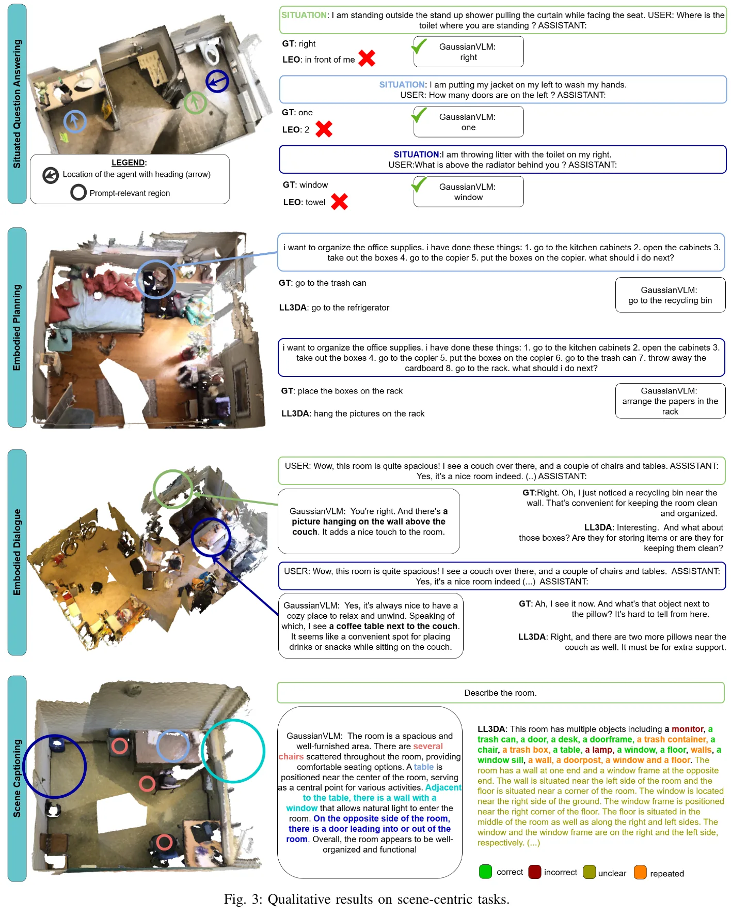
<figcaption>Qualitative comparison on scene-level tasks: GaussianVLM (left) vs the LEO/LL3DA baselines (right). GaussianVLM gives more accurate and semantically richer responses on all four tasks (situated QA, embodied planning, dialogue, and scene captioning), reflecting the advantage of scene-centric global context understanding.</figcaption>
</div>

---

### 4. Limitations
{: id="gaussianvlm-4-局限性"}

GaussianVLM relies on a 3DGS pipeline to reconstruct the scene. Under uneven lighting or on reflective materials, Gaussian quality can degrade, which hurts the accuracy of the language features. For tasks that need precise position queries (the "Where" questions in SQA3D), it is also weaker than LL3DA, which has a built-in object detector; this is a limitation of the radius search in position-guided sparsification.


---

**Comparison of the four tasks**:

| Paper | Core task | Key innovation | How it handles the dense-to-sparse problem |
|:-----|:--------|:--------|:----------------|
| SplatTalk | 3D VQA (static) | Lifts 2D VLM features to 3DGS | Feature autoencoder |
| LangSplatV2 | Real-time language query (static) | Removes the inference speed bottleneck | Sparse coding + global codebook |
| 4D LangSplat | Dynamic scene query (4D) | MLLM generates temporal text supervision | Dual language fields + state deformable network |
| GaussianVLM | Scene-centric VQA (static) | Removes the dependence on detectors | Dual-path sparsifier (task- and position-guided) |

### Reference
{: id="gaussianvlm-参考"}

- Paper: [GaussianVLM: Scene-centric 3D Vision-Language Models using Language-aligned Gaussian Splats for Embodied Reasoning and Beyond](https://arxiv.org/abs/2507.00886) (arXiv 2025)

---

# II. Feed-forward geometry and visual representation models
{: id="group-geometry"}

Geometry foundation models that output cameras, depth, and point maps in one forward pass, together with self-supervised representations built for 3D tasks: multi-view masked modeling, masked depth modeling, and video-generation pretraining.

## 8. VGGT (2025)
{: id="vggt"}
Outputting Cameras, Depth, Point Maps, and Point Tracks in a Single Feed-Forward Pass

📄 **Paper**: [arXiv:2503.11651 (Visual Geometry Grounded Transformer, CVPR 2025 Best Paper)](https://arxiv.org/abs/2503.11651)

---

### Key takeaways
{: id="vggt-精华"}

1. **Neural first, no geometric inductive bias**: Rather than designing special structures for 3D tasks, VGGT uses a near-standard large Transformer plus massive 3D-annotated data, replicating the "universal backbone" paradigm of GPT, DINO, and CLIP. It rewrites traditional 3D reconstruction, which needs iterative optimization (SfM / BA / global alignment), as feed-forward inference.
2. **Alternating attention**: Frame-wise self-attention and global self-attention are stacked alternately, balancing cross-image information fusion against per-frame activation normalization without any cross-attention; ablations show it beats both the global-attention-only and cross-attention variants.
3. **Over-complete multi-task supervision**: Although cameras, depth, and point maps are mutually dependent, they are still predicted explicitly at the same time; joint multi-task training actually improves overall accuracy.
4. **A counter-intuitive finding at inference**: The point cloud obtained by back-projecting depth with the cameras is more accurate than the dedicated point map head; decomposing a complex task into simpler sub-problems pays off.
5. **Transferable features**: Pretrained VGGT features can be plugged into downstream tasks such as dynamic point tracking and feed-forward novel view synthesis, confirming its value as the backbone of a "3D foundation model".

---

### 1. Background and problem
{: id="vggt-1-研究背景问题"}

3D reconstruction has long been dominated by "visual geometry + iterative optimization": the classic SfM/MVS pipelines (COLMAP and others) rely on feature matching, triangulation, and bundle adjustment, which are complex and computationally expensive. More recently, DUSt3R / MASt3R use feed-forward networks to regress and align point maps directly, a step away from optimization, but they can process only **two images** at a time; multiple images must be fused through pairwise reconstruction plus global alignment, which still needs costly test-time optimization. The core question of this paper is: **can a network be powerful enough to predict all the 3D attributes of a set of images in one shot, almost entirely dispensing with geometric post-processing?**

<div align="center">
  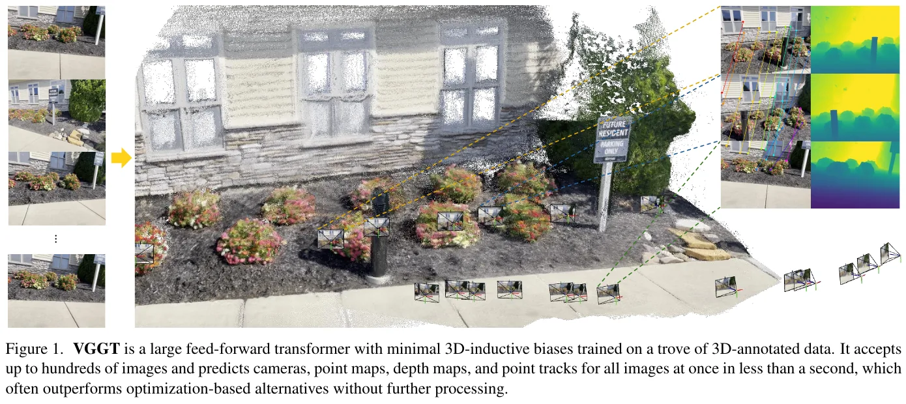
<figcaption>In a single feed-forward pass, VGGT predicts cameras, point maps, depth maps, and point tracks from up to hundreds of images in under 1 second, often outperforming methods that require post-processing optimization.</figcaption>
</div>

---

### 2. Methods and innovations
{: id="vggt-2-主要方法创新点"}

#### ① Overall framework
{: id="vggt--整体框架概述"}

VGGT (about **1.2B parameters**) consists of a **shared backbone (alternating-attention Transformer)** plus four lightweight prediction heads. DINOv2 first patchifies each frame into visual tokens, and the backbone fuses multi-view information with two alternating kinds of self-attention ("frame-wise" and "global"). The **camera head** then outputs camera intrinsics and extrinsics, the **DPT head** outputs dense depth maps, point maps, and tracking features, and the **tracking head** regresses 2D point tracks from the tracking features. Formally, the network is a mapping

$$f\,(I_i)_{i=1}^{N} = (g_i, D_i, P_i, T_i)_{i=1}^{N}$$

that maps N RGB images to the camera parameters $g_i$, depth map $D_i$, point map $P_i$, and tracking features $T_i$ of each frame.

<div align="center">
  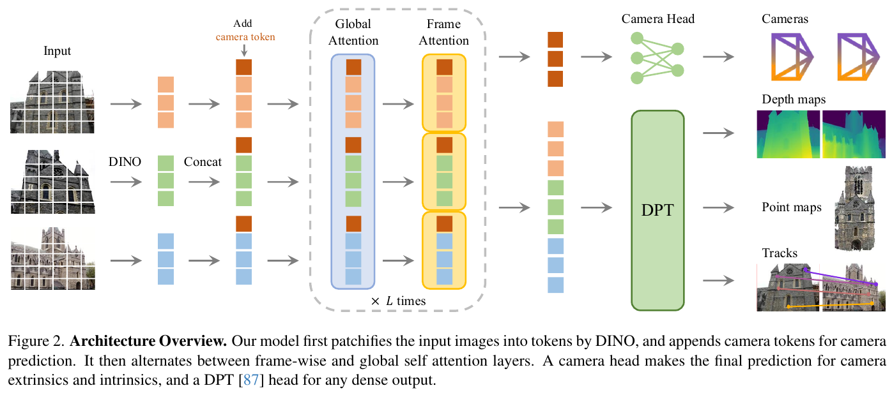
<figcaption>VGGT architecture overview (Fig. 2): DINO patchifies each frame into visual tokens and a camera token is attached; the backbone alternately stacks global self-attention and frame-wise self-attention L times; the camera head outputs camera intrinsics and extrinsics, and the DPT head outputs per-frame depth maps, dense point maps, and tracking features. All geometric quantities are produced in parallel in one feed-forward pass.</figcaption>
</div>

#### ② Module-by-module explanation
{: id="vggt--逐模块讲解"}

**(a) DINOv2 Image Tokenizer**
- **Input**: each image $I \in \mathbb{R}^{3\times H\times W}$.
- **Processing**: Pretrained DINOv2 patchifies the image into K tokens (K varies with resolution), and position encodings are added. The paper's experiments show that DINOv2 outperforms a 14×14 convolution, and that training (especially early on) is more stable and less sensitive to learning rate and momentum.
- **Output**: the set of image tokens $t^I = \bigcup_{i=1}^{N}\{t^I_i\}$ for all frames.
- **Motivation**: A self-supervised vision foundation model supplies strong semantic priors, so low-level features need not be learned from scratch.

**(b) Camera token and register token augmentation**
- **Input**: the image tokens $t^I_i$ of each frame.
- **Processing**: One learnable camera token and 4 register tokens are appended to each frame. The key design is that the **first frame uses a separate set of learnable tokens** (different from the other frames), which lets the model distinguish the reference frame (the origin of the world coordinate system) from the others.
- **Output**: the concatenated token sequence, which is fed to the backbone.
- **Motivation**: All cameras, point maps, and depth maps are defined in the **first frame's camera coordinate system** (the first frame's extrinsics are fixed to identity rotation $q_1=[0,0,0,1]$ and zero translation). Apart from the first frame, the architecture is **permutation equivariant** with respect to the input order.

**(c) Alternating-Attention (AA) backbone**
- **Input**: the tokens of all frames (image + camera + register).
- **Processing**: Two kinds of self-attention alternate: **frame-wise self-attention** attends only among the tokens within a single frame, while **global self-attention** attends jointly over the tokens of all frames. By default, **L=24** layers are stacked alternately (2L attention layers in total) with **no cross-attention** at all. Each layer uses QKNorm and LayerScale to stabilize training.
- **Output**: refined image, camera, and register output tokens (the register tokens are discarded after use).
- **Motivation**: Global attention handles cross-view information fusion (implicitly performing multi-view triangulation reasoning), while frame-wise attention normalizes token activations within a single frame; alternating the two balances fusion against stability. Ablations show that AA clearly outperforms both the global-attention-only and cross-attention variants.

**(d) Camera Head**
- **Input**: the camera output token $\hat{t}^g_i$ of each frame.
- **Processing**: 4 extra self-attention layers + 1 linear layer.
- **Output**: camera parameters $g=[q,t,f]$, i.e. rotation quaternion $q\in\mathbb{R}^4$, translation $t\in\mathbb{R}^3$, and field of view $f\in\mathbb{R}^2$ (assuming the principal point is at the image center).
- **Motivation**: Intrinsics and extrinsics are regressed directly, eliminating PnP/BA.

**(e) DPT dense prediction head**
- **Input**: the output token $\hat{t}^I_i$ of each frame's image (taking backbone features from layers 4/11/17/23).
- **Processing**: DPT upsamples them into dense feature maps, which are then mapped separately through 3×3 convolutions.
- **Output**: depth map $D_i$, point map $P_i$, and tracking features $T_i$, plus **aleatoric uncertainty** maps $\Sigma^D_i$ and $\Sigma^P_i$ (proportional to the model's confidence after training). As in DUSt3R, the point map is **viewpoint-invariant**: all 3D points are expressed in the first frame's coordinate system.
- **Motivation**: Output "geometric quantities" and "confidence" together. The confidence is used to weight the loss and can also be used for downstream filtering.

**(f) Tracking Head**
- **Input**: the dense tracking features $T_i$ output by DPT, together with a query point $y_q$.
- **Processing**: Uses the **CoTracker2** architecture: the features of the query point are bilinearly sampled on the query image's feature map $T_q$ and correlated with the feature maps of the other frames. The resulting correlation maps are passed through self-attention to regress the 2D corresponding point in each frame.
- **Output**: the 2D trajectory of the query point across all frames. It does not assume any temporal order of the input frames, so it works with arbitrary unordered image sets.

#### ③ End-to-end data flow
{: id="vggt--端到端数据流"}

Data flow for one sample: N images → (DINOv2) visual tokens → (concatenate camera/register tokens, with special tokens for the first frame) → (L rounds of alternating frame-wise/global self-attention) refined tokens → split into the camera head (outputs intrinsics and extrinsics) and the DPT head (outputs depth, point maps, tracking features, and uncertainty) → the tracking head combines tracking features with query points to produce 2D trajectories. Everything is completed in **one feed-forward pass**.

#### ④ Training objective and loss function
{: id="vggt--训练目标--损失函数"}

Multi-task joint loss:

$$L = L_{camera} + L_{depth} + L_{pmap} + \lambda L_{track}$$

- **Camera loss** $L_{camera}$: Huber loss between predicted and ground-truth camera parameters.
- **Depth loss** $L_{depth}$: Follows DUSt3R's aleatoric-uncertainty-weighted loss and adds the **gradient term** commonly used for monocular depth; the predicted uncertainty $\Sigma^D_i$ weights both the depth residual and the gradient residual.
- **Point map loss** $L_{pmap}$: Same form as the depth loss, weighted by the point map uncertainty $\Sigma^P_i$.
- **Tracking loss** $L_{track}$: The distance between each query point's prediction and its ground-truth 2D correspondence, plus a binary visibility loss (BCE) following CoTracker2; weight $\lambda=0.05$. The camera, depth, and point map losses have similar magnitudes, so they need no relative weighting.

**Ground-truth coordinate normalization (a key trick)**: All quantities are first expressed in the first frame's coordinate system, and the "average Euclidean distance of all 3D points to the origin" is then used as the scale to normalize translations, point maps, and depth. Unlike DUSt3R, VGGT **normalizes only the ground truth and not the network predictions**, forcing the model to learn this normalization from the data; this converges without loss of accuracy and avoids extra training instability.

**Training configuration**: DINOv2/ViT-L backbone (feature dimension 1024, 16 heads), about 1.2B parameters; AdamW, peak LR 2e-4, cosine schedule, 8K warmup steps, 160K steps in total; each batch randomly samples 2-24 frames with a fixed total of 48 frames; the longest image side is 518 px with a random aspect ratio; trained for 9 days on 64 A100s; bfloat16 + gradient checkpointing + gradient clipping. The training data comprises 17+ indoor, outdoor, synthetic, and real datasets, including Co3Dv2, BlendMVS, DL3DV, MegaDepth, ScanNet, HyperSim, Habitat, and Aria.

#### ⑤ Inference characteristics: over-complete prediction
{: id="vggt--推理特性过完备预测"}

Camera, depth, and point map are not independent (the point map can be derived from depth + camera in closed form, and the camera can be recovered from the point map by PnP). Even so, explicitly predicting all of them during training brings significant gains. At inference, a counter-intuitive finding is that the point cloud obtained by **back-projecting the depth map with the camera parameters is more accurate than the one from the dedicated point map head**: decomposing a complex task (point maps) into simpler sub-problems (depth + camera) pays off. If bundle adjustment is added, VGGT's directly predicted point/depth maps serve as a high-quality initialization, eliminating triangulation and iterative refinement, so VGGT+BA still takes only about 2 seconds.

---

### 3. Results and findings
{: id="vggt-3-核心结果发现"}

- **Camera pose estimation** (RealEstate10K / CO3Dv2, 10 frames): The feed-forward version reaches AUC@30 of **85.3 / 88.2** within 0.2 seconds, exceeding DUSt3R, MASt3R, VGGSfM, and other methods that need 7-10 seconds of post-processing; with BA this rises to **93.5 / 91.8**. The advantage is larger on Re10K, which was never seen in training, confirming generalization.
- **Multi-view depth estimation** (DTU): The overall Chamfer error drops sharply from 1.741 for DUSt3R to **0.382**, approaching MVS methods that are given ground-truth cameras.
- **Point map estimation** (ETH3D): The "depth + camera" version reaches an overall error of **0.677** at only 0.2 seconds per scene, clearly better than DUSt3R/MASt3R, which spend about 10 seconds on global alignment.
- **Two-view matching** (ScanNet-1500): Although not specifically trained for two views, it still surpasses Roma, the state-of-the-art matching method.
- **IMC Phototourism**: VGGT+BA achieves the state of the art (AUC@10 84.91), surpassing VGGSfMv2, the CVPR'24 IMC winner.
- **Downstream transfer**: (1) Feed-forward novel view synthesis (GSO): without camera parameters as input and with only 20% of the training data, PSNR 30.41 is comparable to LVSM, which requires known cameras; (2) dynamic point tracking (TAP-Vid): replacing the CoTracker backbone with pretrained VGGT features improves multiple metrics across the board.
- **Efficiency**: Processing 1 to 200 frames, the feature backbone grows from 0.04 s / 1.88 GB to 8.75 s / 40.63 GB; the camera head accounts for only about 5% of runtime and 2% of GPU memory.

<div align="center">
  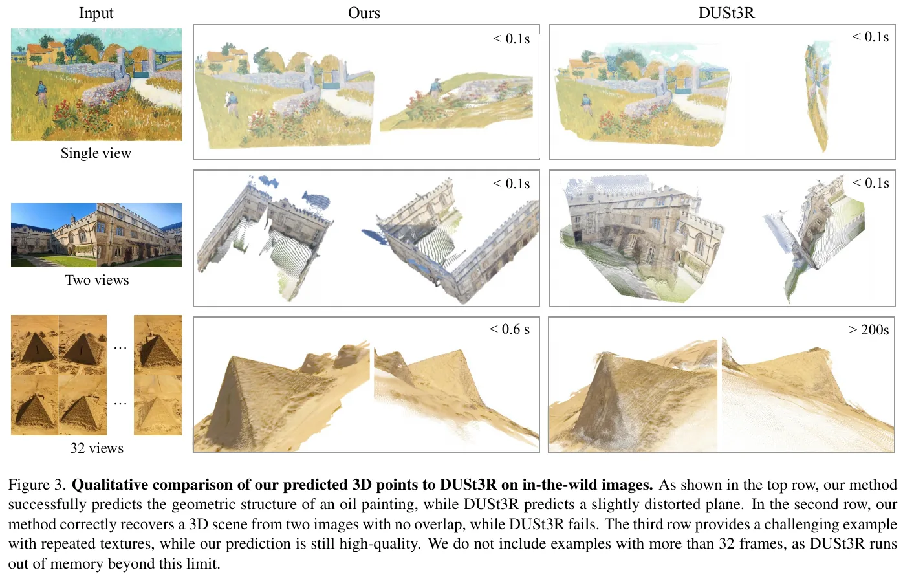
<figcaption>Qualitative comparison with DUSt3R on in-the-wild images: VGGT correctly reconstructs oil paintings (DUSt3R gives slightly distorted planes), two-view scenes with zero overlap (DUSt3R fails), and scenes with repeated textures; DUSt3R runs out of GPU memory beyond 32 frames, while VGGT is two to three orders of magnitude faster.</figcaption>
</div>

---

### 4. Limitations
{: id="vggt-4-局限性"}

Fisheye and panoramic images are not supported; reconstruction quality drops under **extreme input rotation**; only slight non-rigid motion can be handled, and scenes with **large non-rigid deformation** fail. The authors note that these can be alleviated by fine-tuning on target data with almost no change to the architecture, which is an advantage over approaches that require heavy test-time optimization.

---

### Reference
{: id="vggt-参考"}

- Paper: [VGGT: Visual Geometry Grounded Transformer](https://arxiv.org/abs/2503.11651)
- Code: [github.com/facebookresearch/vggt](https://github.com/facebookresearch/vggt)

---

## 9. MapAnything (2026)
{: id="mapanything"}
A Feed-Forward Backbone That Unifies 12+ Metric 3D Reconstruction Tasks in a Single Inference

📄 **Paper**: [arXiv:2509.13414](https://arxiv.org/abs/2509.13414)

---

### Key takeaways
{: id="mapanything-精华"}

1. **Factored scene representation**: Instead of regressing a pointmap directly, multi-view geometry is split into four decoupled components: per-pixel ray direction, depth along the ray, global pose per view, and a single metric scale factor for the whole scene. These are then combined to recover a 3D-consistent global metric reconstruction.
2. **Factorization unifies inputs and outputs**: Any available geometric prior (intrinsics, pose, depth) can be fed to the model using the same factored representation, so a single model supports 12+ tasks and 64 input combinations, including SfM, MVS, monocular depth, camera localization, and depth completion.
3. **Scale decoupling is the key to universal metric inference**: A learnable scale token predicts the metric scale factor separately through an MLP, so the model can be trained on datasets with only up-to-scale annotations yet still output accurate scale when a metric prior is given.
4. **Input-probability training**: Each geometric modality is randomly provided with a certain probability during training. A single general model can match or even exceed expert models trained for individual tasks, at lower training compute.
5. **Takeaway for transfer**: When a family of tasks shares the same underlying physical quantities but differs in input conditions, "factorizing the representation + randomly dropping input modalities" is an effective paradigm for covering the whole family with one feed-forward model.

---

### 1. Background and problem
{: id="mapanything-1-研究背景问题"}

Traditional image-based 3D reconstruction is split into a series of independent subtasks, such as feature matching, two-view pose, camera calibration, BA, MVS, and monocular depth, which are solved in series. Recent feed-forward methods (DUSt3R, MASt3R, VGGT, π³, etc.) unify some subtasks in one transformer, but they still have three major limitations: **(a)** they consume only images and cannot use the intrinsics/pose priors common in robotics; **(b)** the coupled multi-prediction pointmaps need expensive post-processing to recover cameras and geometry, and often have redundant branches; **(c)** they handle a limited number of views, model only simple pinhole cameras, and mostly cannot output metric scale. The core question of this paper is: **can a single feed-forward backbone directly output metric 3D reconstruction and cameras from any number of views and any subset of geometric priors?**

<div align="center">
  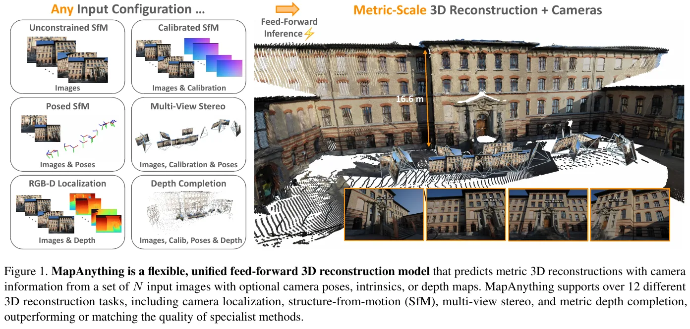
<figcaption>MapAnything takes N images, optionally together with geometric inputs such as camera pose, intrinsics, and depth, and outputs a metric 3D reconstruction with camera information in a single feed-forward pass, uniformly covering 12+ tasks such as camera localization, SfM, MVS, and metric depth completion.</figcaption>
</div>

---

### 2. Methods and innovations
{: id="mapanything-2-主要方法创新点"}

<div align="center">
  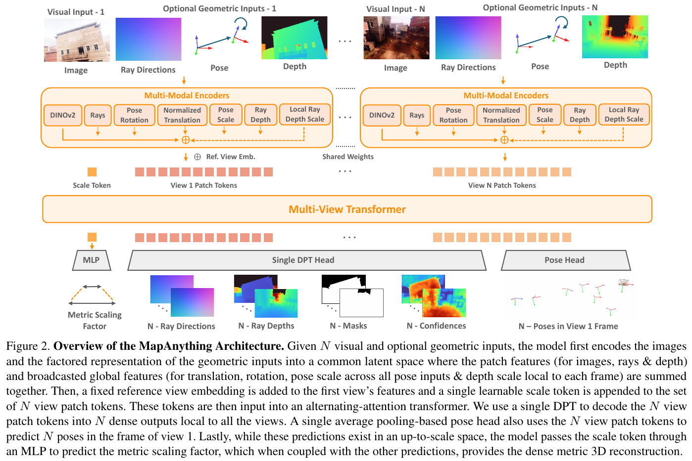
<figcaption>MapAnything architecture overview. N images and optional geometric inputs are first encoded into a shared latent space and added per view, combined with a learnable scale token, and fed to the alternating-attention transformer. A single DPT head decodes the dense quantities of each view, a pose head predicts each view's pose, and an MLP on the scale token gives the metric scale factor of the whole scene.</figcaption>
</div>

#### ① Overall framework
{: id="mapanything--整体框架概述"}

MapAnything has three parts: a **multimodal encoder** that encodes images and geometric priors into the same latent space, a **multi-view alternating-attention transformer** that propagates information among all views, and **several lightweight prediction heads plus a scale token** that decode the factored metric 3D output. The design motivation is to use one "factored representation" for both the optional inputs and the final outputs, so the model can use arbitrary geometric priors and degrade gracefully to pure image-based reconstruction when priors are missing.

#### ② Factored representation (the cornerstone of the method)
{: id="mapanything--因子化表示方法基石"}

The model does not predict the pointmap directly. Instead, it splits the geometry of each view $i$ into four components: the local ray direction $R_i$ (equivalent to camera calibration), the up-to-scale depth along the ray $$\tilde{D}_i$$, the pose of the view in the first frame's coordinate system $$\tilde{P}_i$$ (quaternion $Q_i$ + up-to-scale translation $$\tilde{T}_i$$), and a single **scene-wide** metric scale factor $m$. These factors can be recovered step by step: the local point map $$\tilde{L}_i = R_i \cdot \tilde{D}_i$$, the up-to-scale world-frame point map $$\tilde{X}_i = O_i \cdot \tilde{L}_i + \tilde{T}_i$$ ($O_i$ is the rotation matrix corresponding to $Q_i$), and finally the metric 3D points $$X_i^{\text{metric}} = m \cdot \tilde{X}_i$$. **Motivation**: Making "calibration" (ray direction) and "depth along the ray" per-view tasks lets a single dense head predict them; extracting the scale into an independent scalar lets the model learn from datasets with only up-to-scale annotations.

#### ③ Multimodal encoder (input → processing → output)
{: id="mapanything--多模态编码器输入--处理--输出"}

- **Image branch**: Uses the normalized patch features of layer 24 of DINOv2 ViT-G, $F_I \in \mathbb{R}^{1536 \times H/14 \times W/14}$. After comparing CroCov2, the DUSt3R encoder, RADIO, and others, the authors found DINOv2 best in downstream performance, convergence speed, and generalization.
- **Dense geometry branch (ray direction, normalized ray depth)**: A shallow convolutional encoder + pixel-unshuffle (stride 14) projects them to the same space and hidden dimension as DINOv2.
- **Global non-pixel quantities (rotation, translation direction, depth scale, pose scale)**: A 4-layer GeLU-MLP projects them to $\mathbb{R}^{1536}$, and they are then **broadcast** to all patches.
- **Key decoupling**: Rotation and translation are encoded separately (compatible with cases where only IMU/GPS priors are available individually); depth and pose normalization are also separated (the two are not assumed to be always given together). Since the scale can be extremely large and vary dramatically across scenes, a log transform is applied before encoding. Scale information is used only if the given pose/depth is itself metric.
- **Output**: All encoded quantities go through LayerNorm → sum → LayerNorm to give the per-view token $F_E \in \mathbb{R}^{1536 \times (HW/256)}$.

#### ④ Multi-view alternating-attention transformer
{: id="mapanything--多视角交替注意力-transformer"}

The patch tokens of the N views are concatenated with a **single learnable scale token** and fed to a 16-layer alternating-attention transformer (24 heads, latent dimension 1536, MLP ratio 4), initialized from the last 16 layers of DINOv2 ViT-G. The first view's tokens receive a fixed reference-view embedding to mark the reference frame. The authors found that DINOv2's own patch position encoding is sufficient and **deliberately did not use RoPE** (which they thought would introduce unnecessary bias).

#### ⑤ Factored output heads
{: id="mapanything--因子化输出预测头"}

- **A single DPT head** decodes the patch tokens of the N views and outputs dense per-view quantities: ray direction $R_i$ (normalized to unit length), up-to-scale ray depth $$\tilde{D}_i$$, a mask $M_i$ for non-ambiguous depth classes, and the point map confidence $C_i$.
- **An average-pooling convolutional pose head** uses the N view tokens to predict each view's unit quaternion $Q_i$ in the first frame's system and its up-to-scale translation $$\tilde{T}_i$$.
- **The scale token** predicts a scalar through a 2-layer ReLU-MLP, which is then exponentiated to give the metric scale factor $m$. The ablation (Table 5a) shows that this **decoupled scale prediction** is the key to universal metric feed-forward inference.

#### ⑥ End-to-end data flow
{: id="mapanything--端到端数据流"}

Data flow for one sample: N images (and optional geometric priors) → each modality is encoded and added per view → scale token appended → the alternating-attention transformer fuses cross-view information → the DPT head outputs per-view ray/depth/mask/confidence, the pose head outputs per-view poses, and the scale token yields $m$ → the factor formulas are combined to recover the global metric 3D point cloud and cameras.

#### ⑦ Training objectives
{: id="mapanything--训练目标"}

Ray directions and quaternions do not depend on scale and are regressed directly (for the quaternion, the loss is $$\min(\lVert \hat{Q}_i - Q_i \rVert,\ \lVert -\hat{Q}_i - Q_i \rVert)$$ to handle the double cover). For up-to-scale depth, translation, and point maps, DUSt3R's scale normalization provides scale-invariant supervision, and the **log-space loss** $f_{\log}: x \mapsto (x/\lVert x \rVert)\cdot \log(1+\lVert x \rVert)$ is applied to depth, point maps, and scale. To keep the scale gradient from contaminating the geometry, a stop-gradient is used when forming the metric quantities: $z^{\text{metric}} = m \cdot \text{sg}(\tilde{z})$. The total loss (up-weighting the global point map, down-weighting the mask) is:

$$\mathcal{L} = 10\,\mathcal{L}_{\text{pointmap}} + \mathcal{L}_{\text{rays}} + \mathcal{L}_{\text{rot}} + \mathcal{L}_{\text{translation}} + \mathcal{L}_{\text{depth}} + \mathcal{L}_{\text{lpm}} + \mathcal{L}_{\text{scale}} + \mathcal{L}_{\text{normal}} + \mathcal{L}_{\text{GM}} + 0.1\,\mathcal{L}_{\text{mask}}$$

Here, the normal loss and the multi-scale gradient matching loss $$\mathcal{L}_{\text{GM}}$$ are applied only to synthetic datasets (real-data geometry is rough). All regression terms use an adaptive robust loss ($c=0.05,\ \alpha=0.5$).

#### ⑧ Input-probability training (one model for a whole family of tasks)
{: id="mapanything--输入概率训练让一个模型吃下整族任务"}

During training, geometric priors are provided with a total probability of 0.9, within which ray direction, ray depth, and pose are each independently provided with probability 0.5; when depth is selected, half the time it is dense and half the time it is 90% randomly sparsified; each view has a 0.95 probability of carrying geometric information; for metric datasets, the metric scale is withheld with probability 0.05. This **random dropping of input modalities** lets a single model naturally support 64 input combinations. The model is trained in a two-stage curriculum (64×H200, ~420K steps) on 13 high-quality datasets (~72K scenes, including MPSD, covering indoor, outdoor, and in-the-wild data). Two sets of weights are open-sourced: an Apache 2.0 version trained on 6 datasets and a CC BY-NC version trained on an additional 7 datasets.

---

### 3. Results and findings
{: id="mapanything-3-核心结果发现"}

- **Multi-view dense reconstruction (2-100 views)**: With images only, it achieves the state of the art on ETH3D / ScanNet++ v2 / TartanAirV2-WB, exceeding VGGT; after adding priors such as intrinsics, pose, and sparse depth, the pointmap, pose, depth, and ray errors drop further.
- **Two-view reconstruction**: With images only it is state of the art; with priors added it greatly exceeds Pow3R (including its BA variant), the only comparable two-view method that uses priors. Given full priors (image + intrinsics + pose + depth), the point map rel is as low as 0.01.
- **Single-view calibration**: Although not specifically trained for single images, the average angular error is 1.06°, better than VGGT (4.00), MoGe-2 (1.95), and AnyCalib (2.01).
- **Metric depth estimation (Robust-MVD)**: Multi-view images alone already exceed MASt3R-BA and MUST3R; with intrinsics and pose added, it is on par with expert models.
- **Key ablations**: ① The factored RDP & scale representation is the key to strong reconstruction performance (better than a direct local pointmap, and better than the π³-style decoupled design); ② **a generalist matches the experts**: a single model that covers 12+ tasks, trained with the same compute as two dedicated models, performs comparably to or better than three separately customized bespoke models, indicating that multi-task training is efficient; ③ log-scale encoding and alternating attention are crucial for extrapolating to 50 views.
- **Speed and GPU memory**: Compared with concurrent models such as VGGT and Depth-Anything-3, MapAnything has the best speed and peak GPU memory from 2 to 500 views; the memory-efficient variant runs the dense heads over small batches of views, substantially reducing GPU memory without losing speed.

<div align="center">
  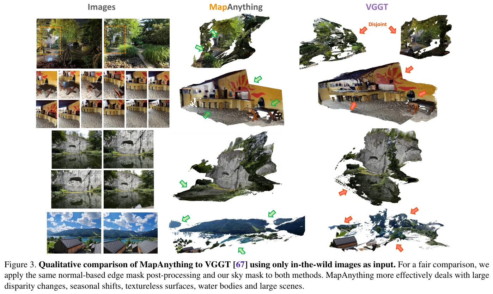
<figcaption>Qualitative comparison of MapAnything and VGGT on in-the-wild image-only input (both use the same normal edge mask and sky mask). MapAnything is much more robust to large parallax changes, seasonal differences, textureless surfaces, water bodies, and large scenes.</figcaption>
</div>

---

### 4. Limitations
{: id="mapanything-4-局限性"}

The model does not explicitly model noise or uncertainty in the geometric inputs; the current architecture does not yet support views without images (such as a target view that has only a camera in novel view synthesis); the one-to-one mapping between input pixels and the output scene representation limits scalability to very large scenes (which would need a more memory-efficient representation and on-demand decoding); and the current parameterization does not model dynamic motion or scene flow.

---

### Reference
{: id="mapanything-参考"}

- Paper: [MapAnything: Universal Feed-Forward Metric 3D Reconstruction](https://arxiv.org/abs/2509.13414)
- Project Page: [map-anything.github.io](https://map-anything.github.io)

---

## 10. Depth Anything 3 (2025)
{: id="depth-anything-3"}
Recovering Consistent 3D Geometry from Arbitrary Views

📄 **Paper**: [arXiv:2511.10647](https://arxiv.org/abs/2511.10647)

---

### Key takeaways
{: id="depth-anything-3-精华"}

1. **Minimalist modeling without specialized architecture**: DA3 shows that no complex multi-stage or multi-branch pipeline or specialized network is needed; a single plain Transformer (DINOv2) with dual DPT heads suffices for end-to-end joint estimation of pose and depth from arbitrary views.
2. **Minimalist depth-ray representation**: Camera extrinsics are modeled implicitly as per-pixel 3D ray directions and origins. This minimal representation fuses scene geometry and camera motion neatly and greatly reduces the optimization difficulty of multi-task learning.
3. **Teacher-student distillation**: To cope with the noise and gaps common in data captured by real-world 3D sensors, a monocular relative-depth teacher (DA3-Teacher) is first trained on large-scale synthetic datasets to generate high-quality pseudo depth labels. RANSAC scale-and-shift alignment is then used to supervise the student model, which greatly improves its recovery of 3D detail.
4. **Metric-level, consistent reconstruction**: DA3 outperforms VGGT and Pi3 in pose estimation and geometric reconstruction. In addition, a fine-tuned feed-forward 3D Gaussian splatting (FF-NVS) head directly produces high-fidelity novel view renderings, showing its strength as a 3D geometry backbone.

---

### 1. Background and problem
{: id="depth-anything-3-1-研究背景问题"}

Traditional 3D geometric reconstruction tasks (monocular depth estimation, multi-view stereo (MVS), structure from motion (SfM), visual SLAM, etc.) usually rely on highly specialized, independent models or complex cascaded architectures. Some work attempts to unify multiple tasks, but these architectures tend to have redundant branches and optimization conflicts, and are hard to build directly on large pretrained vision foundation models (such as DINOv2). This paper asks:
1. Is there a **minimal set of geometric prediction targets** that captures 3D scene structure and relative camera motion at the same time, without complex interleaved targets?
2. Is a **plain transformer backbone** with no architectural customization sufficient for this general any-view geometry recovery task?
DA3 answers both questions affirmatively by introducing the "depth-ray" representation and an input-adaptive self-attention mechanism.

---

### 2. Methods and innovations
{: id="depth-anything-3-2-主要方法创新点"}

<div align="center">
  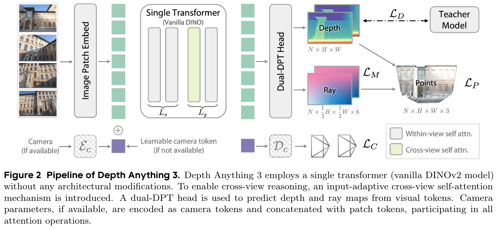
<figcaption>Overall architecture of Depth Anything 3: built on a plain Transformer backbone (such as DINOv2), it accepts camera pose as conditioning input, performs intra-view and cross-view interaction through input-adaptive cross-view attention, and uses dual DPT heads to jointly predict consistent depth and ray maps.</figcaption>
</div>

#### ① Overall framework
{: id="depth-anything-3--整体框架概述"}
DA3 has three main parts: a single DINOv2 Vision Transformer backbone, a camera-conditioning encoder, and a dual-DPT head that jointly outputs depth maps and ray maps. Given images from arbitrary views, the network directly produces pixel-aligned depth maps and ray directions/origins in a feed-forward pass. A globally consistent metric 3D point cloud is then recovered by simple per-pixel computation. The whole pipeline is minimalist and computationally efficient.

#### ② Depth-ray implicit pose representation
{: id="depth-anything-3--深度-射线depth-ray隐式位姿表征"}
To avoid regressing a rotation matrix $R_i$ under strict orthogonality constraints, DA3 expresses the camera pose implicitly with a novel per-pixel ray map $M_i \in \mathbb{R}^{H \times W \times 6}$. The ray of each pixel is defined as $r = (t, d)$, where the origin $t \in \mathbb{R}^3$ and the direction $d \in \mathbb{R}^3$ are both 3D vectors, and the norm of the unnormalized direction vector itself also encodes the projection scale. Combined with the corresponding depth $D(u, v)$, the 3D point is computed directly by:
$$P = t + D(u, v) \cdot d$$
At inference, if the camera parameters need to be recovered explicitly, the camera center $t_c$ is estimated as the mean of the ray origins, and the homography $H = KR$ is set up with the unit camera rays. It is solved with the direct linear transform (DLT) and RQ decomposition is applied to separate the intrinsics $K$ and the rotation matrix $R$ efficiently.

#### ③ View-adaptive alternating self-attention
{: id="depth-anything-3--视图自适应交替自注意力"}
To handle inputs ranging from a single image (monocular) to dozens of views, DA3 uses an input-adaptive token arrangement. The network is divided into $L_s$ within-view attention layers (which capture single-image detail) and $L_g$ alternating-attention layers (which alternately run cross-view attention among the tokens of all views). Cross-view information exchange is implemented simply by swapping tensor axes. If the input is a single image, the cross-view module automatically degrades to a no-op with no extra overhead.

#### ④ Dual-DPT head with shared features
{: id="depth-anything-3--共享特征的双-dpt-头dual-dpt-head"}

<div align="center">
  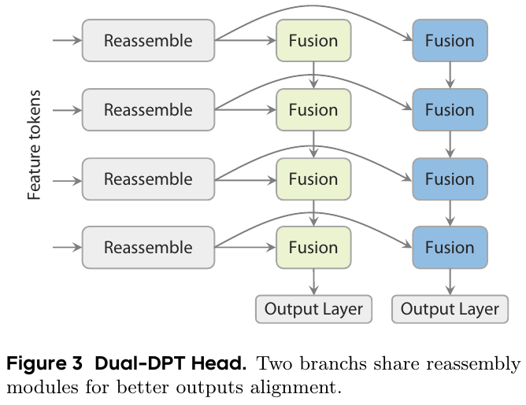
<figcaption>Dual-DPT head structure: the depth and ray estimation tasks share the high-level feature reassembly module (Reassemble) and diverge only at the final fusion output stage, improving the efficiency and consistency of joint estimation.</figcaption>
</div>

The dual-DPT head contains a shared Reassemble module with two independent fusion-and-decoding branches. The shared feature path promotes strong geometric coupling and mutual constraints between depth and ray estimation, while avoiding the redundant computation and inconsistency of using two complete DPT heads separately.

#### ⑤ Teacher-student distillation and RANSAC alignment
{: id="depth-anything-3--教师-学生蒸馏与-ransac-对齐"}
Real-world data (such as LiDAR and COLMAP point clouds) often contains noise and holes. DA3 first trains a monocular relative-depth teacher (DA3-Teacher) on purely synthetic data (20 high-quality datasets, including Hypersim and TartanAir) to predict dense relative-depth pseudo-labels for all real multi-view sequences. A RANSAC least-squares fit then estimates the scale $s$ and shift $t$ that align them to the real sparse/noisy depth:
$$(s^*, t^*) = \arg\min_{s > 0, t} \sum_{p \in \Omega} m_p \left\lvert s \tilde{D}_p + t - D_p \right\rvert^2$$
Finally, the aligned dense label $D_{T \to M}$ supervises the student network, so the student both inherits the accuracy of the real poses and obtains very sharp depth edge detail.

<div align="center">
  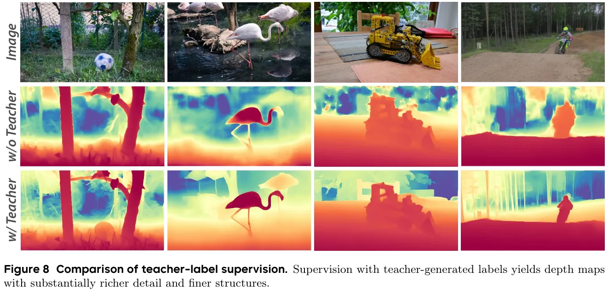
<figcaption>Ablation on teacher supervision: compared with no teacher supervision, the model trained with teacher pseudo-labels captures richer 3D microstructure and edge detail.</figcaption>
</div>

#### ⑥ Joint training objectives
{: id="depth-anything-3--联合训练目标"}
DA3 is optimized with a weighted joint loss over multiple branches:
$$L = L_D(\hat{D}, D) + L_M(\hat{R}, M) + L_P(\hat{D} \odot d + t, P) + \beta L_C(\hat{c}, v) + \alpha L_{\mathrm{grad}}(\hat{D}, D)$$
To smooth depth edges, a depth gradient loss is introduced:
$$L_{\mathrm{grad}}(\hat{D}, D) = \lVert \nabla_x \hat{D} - \nabla_x D \rVert_1 + \lVert \nabla_y \hat{D} - \nabla_y D \rVert_1$$

---

### 3. Results and findings
{: id="depth-anything-3-3-核心结果发现"}

<div align="center">
  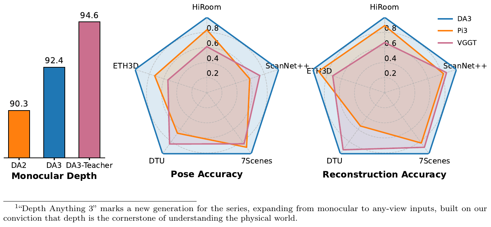
<figcaption>Depth Anything 3 teaser: given arbitrary views (with or without poses), the model reconstructs consistent, high-precision geometry and renders high-fidelity 3D Gaussian splats.</figcaption>
</div>

- **Stronger camera pose estimation**: On five benchmarks (HiRoom, ETH3D, DTU, 7Scenes, and ScanNet++), DA3-Giant's pose AUC clearly surpasses baselines such as DUSt3R, MapAnything, Pi3, and VGGT. On indoor ScanNet++, its Auc3 leads VGGT by about 35.7%.
- **Excellent reconstruction quality and efficiency**: DA3 achieves the state-of-the-art reconstruction F1 score with or without camera pose input. DA3-Large, with only 0.36B parameters, beats VGGT (1.19B parameters) on several benchmarks, and its inference throughput (78 FPS on an A100 vs 34 FPS for VGGT) is more than 2 times higher.
- **Strong generalization to downstream 3DGS**: On the large-scale feed-forward pixel-aligned 3D Gaussian prediction (FF-NVS) task on DL3DV, Tanks and Temples, and MegaDepth, a GS-DPT head fine-tuned with DA3 as the backbone prior beats specially designed end-to-end novel view synthesis models across the board in PSNR/SSIM and rendering quality.

<div align="center">
  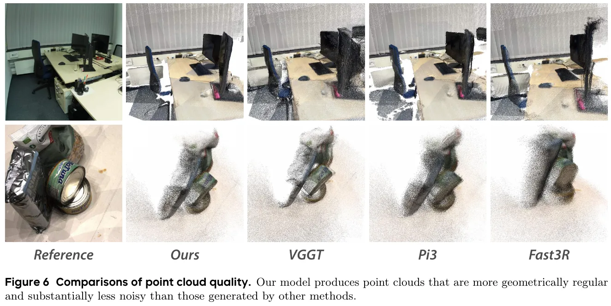
<figcaption>Quality comparison of reconstructed point clouds: the point clouds produced by DA3 are highly regular with almost no background noise, and are more accurate and complete than those of comparable methods.</figcaption>
</div>

<div align="center">
  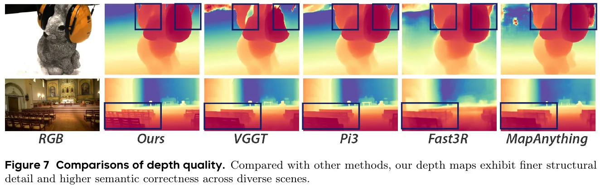
<figcaption>Depth map quality comparison with other methods (VGGT, Pi3, Fast3R): the depth maps predicted by DA3 have sharp details and clean semantic boundaries, showing strong geometric fidelity.</figcaption>
</div>

---

### 4. Limitations
{: id="depth-anything-3-4-局限性"}

For scenes with severe non-rigid deformation or large-area dynamic motion, temporal consistency of the pixel rays is hard to guarantee. In addition, because the model focuses purely on physical geometry, perception of higher-level cross-modal semantics and of control laws still has to be coupled in through additional external networks.

---

### Reference
{: id="depth-anything-3-参考"}

- Paper: [Depth Anything 3: Recovering the Visual Space from Any Views](https://arxiv.org/abs/2511.10647)
- Code: [depth-anything-3.github.io](https://depth-anything-3.github.io)

---

## 11. MuM (2025)
{: id="mum"}
Multi-View Masked Image Modeling: A Self-Supervised Multi-View Geometric Representation Built for 3D Vision Tasks

📄 **Paper**: [arXiv:2511.17309](https://arxiv.org/abs/2511.17309)

---

### Key takeaways
{: id="mum-精华"}

1. MuM (Multi-View Masked Image Modeling) directly extends the single-view masked autoencoder (MAE) to **arbitrary multi-view image sequences** of the same scene. It is a self-supervised visual representation model designed specifically for geometric tasks such as 3D matching, depth estimation, and 3D reconstruction.
2. Unlike the binocular CroCo model, which depends on an unmasked reference image, MuM applies a uniform random mask (75%) to every view in the sequence and reconstructs the missing pixels with a lightweight decoder that alternates intra-frame attention and cross-frame global attention. The architecture is concise, symmetric, and does not explicitly anchor a reference frame.
3. Mixing multi-view and single-view training cleverly avoids CroCo's strict dependence on co-visibility and true 3D geometry in data sampling, making pretraining more robust and easier to scale.
4. Experiments show that MuM surpasses DINOv3 and CroCo v2 across 3D vision downstream tasks such as feed-forward 3D reconstruction, dense feature matching, and relative pose estimation, while its pretraining needs only 1/30 of DINOv3's compute (4,608 A100 hours vs 161,440 H100 hours).
5. The key takeaway is that for 3D vision, which needs high-precision geometric spatial features, a simple pixel-level mask reconstruction target is still more efficient and learns better geometric features than complex semantic self-supervision (such as the contrastive learning and self-distillation of the DINO series).

---

### 1. Background and problem
{: id="mum-1-研究背景问题"}

Self-supervised learning (SSL) has been very successful for visual representations (such as the DINO series), but the objectives of most existing models favor high-level semantic understanding, struggle to retain pixel-level geometric structure, and perform poorly on dense feature matching and 3D reconstruction. To introduce 3D awareness, the earlier CroCo proposed a "cross-view completion" prediction strategy, but it is strictly limited to two views and faces a demanding field-of-view overlap sampling bottleneck. Building a 3D self-supervised representation model that is simple, efficient, and naturally extends to any number of views has become a key challenge for making downstream tasks such as feed-forward 3D reconstruction general.

---

### 2. Methods and innovations
{: id="mum-2-主要方法创新点"}

<div align="center">
  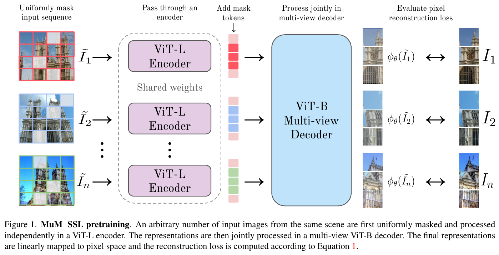
<figcaption>MuM SSL pretraining pipeline: multiple input images of the same scene are masked uniformly and encoded independently by a ViT-L encoder; a lightweight alternating-self-attention ViT-B decoder then processes them jointly and reconstructs the pixels.</figcaption>
</div>

#### ① Overall framework
{: id="mum--整体框架概述"}
MuM directly generalizes the classic single-image masked autoencoder (MAE) to image sequences with any number of views. In pretraining, $n$ images of the same scene are independently and symmetrically masked at random (75%). The remaining visible tokens pass through a parameter-shared ViT-L encoder, and the masked and visible tokens of all views are then fed together to a lightweight ViT-B multi-view decoder. By alternating "intra-frame self-attention" and "cross-frame global self-attention", it fuses information and jointly reconstructs the pixels of all views.

#### ② Module-by-module explanation
{: id="mum--逐模块讲解"}
- **Uniform masking and the ViT-L encoder**:
For an input sequence of $n$ images $I = \{I_1, I_2, \dots, I_n\}$ of the same 3D scene, each image is divided into $N$ non-overlapping patches. With mask ratio $\gamma = 0.75$ (i.e. 25% of tokens stay visible), all views are masked independently and only the visible tokens are fed to the ViT-L encoder (24 layers, width 1024). All views are processed independently in the encoder with **exactly the same shared weights**, and no information is exchanged across views at this stage.

- **Multi-view ViT-B decoder**:
Before entering the decoder, the visible-token features and the learnable mask tokens for the missing positions are reassembled in the original spatial order, and a modern 2D axial rotary position encoding (Axial RoPE) is added. The decoder is a lightweight ViT-B (6 layers, width 768). Its core is the **alternating attention mechanism**: in each alternating-attention block, the model first performs **frame-wise self-attention** (self-attention only among tokens within a single view, which keeps cross-frame information from being mixed up indiscriminately and helps preserve single-frame detail), then **global self-attention** (all tokens of all views in the sequence attend to each other jointly, propagating cross-view geometric constraints and enabling multi-view correspondence computation). This symmetric attention avoids explicitly specifying or anchoring a "reference frame" as CroCo does, and the model is permutation equivariant with respect to the order of the input frames.

- **Linear prediction head and reconstruction target**:
At the last decoder layer, all tokens are fed to a simple linear prediction head that regresses the normalized RGB pixel values of each patch. Unlike unnormalized pixels, the reconstruction target is normalized with each patch's local mean and variance, which makes reconstruction more robust to local illumination changes and pushes the model to focus on recovering geometric and texture structure.

#### ③ End-to-end data flow
{: id="mum--端到端数据流"}
During training, each batch randomly samples a sequence length $n \in [2, 24]$ (with a 10% chance of falling back to ordinary single-view $n=1$ ImageNet-1K data). After the sequence is compressed by the encoder, alternating self-attention in the decoder "broadcasts" the unmasked patch information of each view to the masked regions of the other views, and cross-view similarity and disparity cues are used to fill in the missing texture. Finally, the prediction head outputs the reconstructed images and the loss is computed.

<div align="center">
  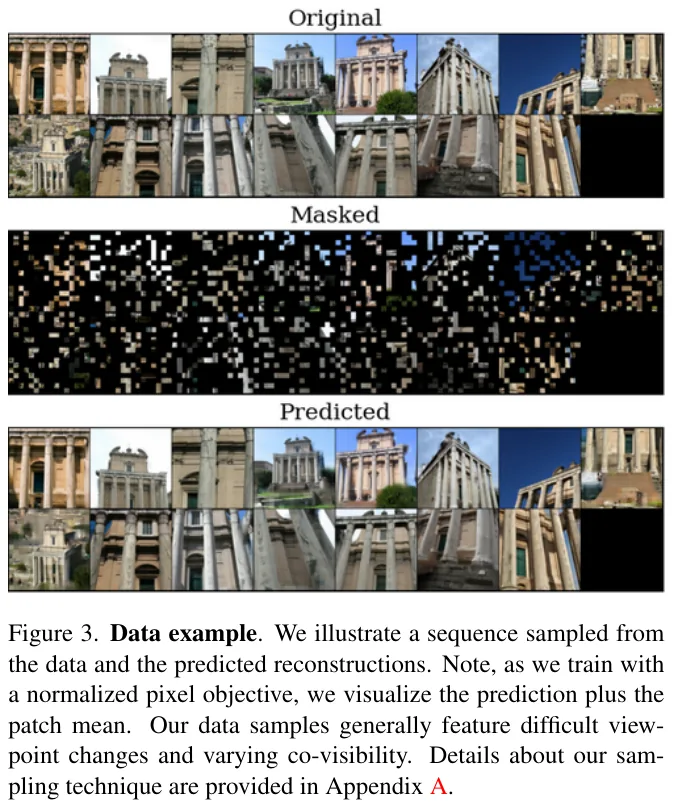
<figcaption>Visualization of data samples and reconstruction results: even with severe viewpoint drift and very low co-visibility overlap, MuM still produces consistent, sharp pixel-level reconstructions.</figcaption>
</div>

#### ④ Training objective and loss function
{: id="mum--训练目标与损失函数"}
MuM's self-supervised pretraining loss is an L2 pixel reconstruction loss defined on the masked regions of each view. Formally, for the $i$-th image, with mask vector $M^i$ (1 on masked regions and 0 on visible regions), the loss is:
$$L(\theta) = \sum_{i=1}^{n} \lVert M^i \odot (\phi_\theta(\tilde{I}^i) - f(I^i)) \rVert^2$$
Here, $\tilde{I}^i$ denotes the visible patches of the $i$-th image, $\phi_\theta$ is the MuM model, and $f(I^i)$ is the normalized ground-truth patch target.
In distillation fine-tuning for downstream tasks, the model learns by supervising the 3D world point coordinates $P$, camera parameters $C$, and depth maps $D$ output by VGGT, with the loss defined as:
$$L_{\text{distill}}(\theta) = \sum_{i=1}^{n} ( \lVert P_i^t - P_i^s \rVert^2 + \lVert C_i^t - C_i^s \rVert^2 + \lVert D_i^t - D_i^s \rVert^2 )$$
The superscripts $t$ and $s$ denote the teacher model (VGGT) and the student model (MuM-distilled), respectively.

#### ⑤ Inference
{: id="mum--推理流程"}
For downstream tasks such as feature matching (e.g. the RoMa framework) or relative pose estimation, we usually **keep only the pretrained ViT-L encoder** as a frozen geometric feature extractor and discard the decoder. High-resolution images are fed directly to the encoder to extract local dense features, which can be plugged into lightweight downstream prediction heads (such as matching decoders or pose solvers).

<div align="center">
  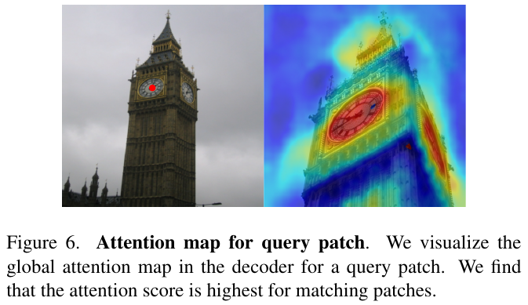
<figcaption>Visualization of the decoder's global attention map for a query patch: in cross-frame global attention, the highest attention weights fall accurately on the corresponding co-visible feature point in the other view, verifying that the model implicitly learns multi-view geometric correspondence.</figcaption>
</div>

---

### 3. Results and findings
{: id="mum-3-核心结果发现"}

1. **Feed-forward 3D reconstruction**:
   - Frozen-encoder evaluation: MuM performs well as a frozen encoder on several datasets, including CO3Dv2, Re10K, and MegaDepth. Camera pose AUC@30 on Re10K reaches **50.8%**, far exceeding CroCo v2 (27.7%) and DINOv3 (36.7%), and it reaches **73.0%** on MegaDepth (DINOv3 gets only 59.3% and CroCo v2 60.7%).
   - Distillation fine-tuning: MuM shows excellent accuracy and completeness on the DTU and ETH3D point cloud estimation tasks.
2. **Two-view dense matching**:
   - In the MegaDepth-1500 dense matching evaluation (with a linear probe), MuM's end-point error (EPE) drops sharply to **10.2** (DINOv3 gets 19.0 and CroCo v2 27.3), and matching robustness reaches **94.2%**.
   - On ScanNet-1500, EPE reaches **27.9**, better than DINOv3 (28.7) and CroCo v2 (39.0).
   - When trained as a full model within the RoMa framework, MuM as the coarse feature encoder achieves a 100-PCK@3px of **4.0** on MegaDepth-1500, also surpassing the classic DINOv2 (4.6) and DINOv3 (5.2).
3. **Relative pose estimation**:
   - Although the evaluation framework is slightly biased toward CroCo v2 and its two-view pretraining prior, MuM's AUC@5°/10°/20° on MegaDepth, Re10K, and BlendedMVS are all better than DINOv3's, and better than or equal to CroCo v2's on most metrics (for example, MegaDepth AUC@5°/10°/20° is **26.7% / 47.0% / 65.0%**, while CroCo v2 gets only 13.9% / 30.0% / 48.0%).
4. **Single-view tasks (monocular depth / normal estimation / classification)**:
   - On monocular depth estimation (NYUd/KITTI) and surface normal estimation (NYUv2), MuM exceeds CroCo v2 and MAE but lags behind DINOv3, which has strong semantic priors (for example, NYUd depth RMSE: MuM 0.41 vs DINOv3 0.34). This shows that a pixel reconstruction target helps geometric correspondence, while high-level semantic classification tasks (such as ImageNet classification) are still dominated by the semantically distilled model (ImageNet accuracy: DINOv3 86.9% vs MuM 70.8%).

<div align="center">
  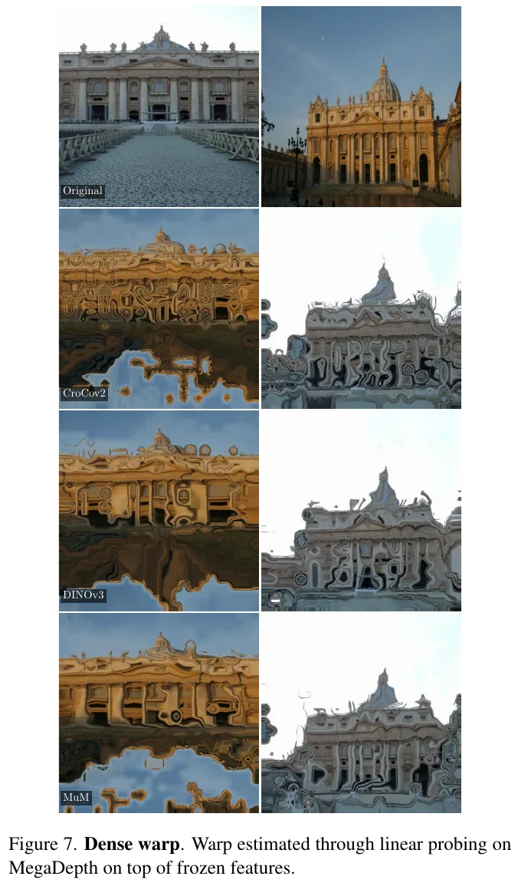
<figcaption>Comparison of warp results from linear-probe dense matching on frozen features: the transformation field estimated by MuM is smoother and more continuous than those of CroCo v2 and DINOv3, with markedly better detail alignment.</figcaption>
</div>

---

### 4. Limitations
{: id="mum-4-局限性"}

1. MuM's current pixel-level reconstruction loss is still weak at describing semantic features. Combining it with a feature self-distillation objective like DINOv3's is a promising direction for improving monocular semantic understanding.
2. Because of limited compute, this work has not yet scaled up the pretraining data and network size, and has not fully replicated the feed-forward reconstruction training scale of VGGT or MapAnything.

---

### Reference
{: id="mum-参考"}

- Paper: [MuM: Multi-View Masked Image Modeling for 3D Vision](https://arxiv.org/abs/2511.17309)
- Code: [github.com/davnords/mum](https://github.com/davnords/mum)

---

## 12. MDM (2026)
{: id="mdm"}
A Universal 3D Geometry Perception Foundation Based on Masked Depth Modeling and Massive RGB-D Data

📄 **Paper**: [arXiv:2601.17895](https://arxiv.org/abs/2601.17895) · [Project Page](https://technology.robbyant.com/lingbot-depth) · [Code](https://github.com/robbyant/lingbot-depth)

---

### Key takeaways
{: id="mdm-精华"}

1. **Masked Depth Modeling (MDM)**: The geometric and appearance ambiguities common to commercial depth cameras (such as depth loss caused by specular reflection, low texture, and complex lighting) are treated as a natural masking signal and used to build a self-supervised pretraining task, instead of being discarded as noise.
2. **A universal geometric representation foundation**: By unifying monocular depth estimation and depth completion on a ViT-Large backbone, it achieves very strong cross-modal (RGB and depth) geometric representation alignment and outputs consistent metric depth predictions across both tasks on the test set.
3. **A massive multimodal dataset**: A multimodal RGB-D training set was built with 2 million real-world captures and 1 million simulated renderings. The real data uses multi-camera infrared (IR) stereo matching to generate pseudo-depth supervision, and is combined with 7 public datasets into a 10-million-scale pretraining corpus.
4. **A plug-and-play perception prior**: It shows excellent zero-shot video depth completion consistency without explicit temporal supervision, and can be plugged into 3D point tracking (SpatialTrackerV2) and dexterous manipulation policies (DP3) as a strong geometry-aware prior.
5. **Outperforming the hardware**: On multiple benchmarks for depth completion and metric monocular reconstruction, LingBot-Depth beats existing commercial RGB-D cameras (the algorithms built into hardware such as Orbbec and RealSense) and classic large depth estimation models in both depth accuracy and pixel coverage.

---

### 1. Background and problem
{: id="mdm-1-研究背景问题"}

Precise geometric perception of the 3D world (absolute metric scale, pixel-aligned dense geometry, real-time acquisition) is the cornerstone of embodied intelligence and robot control, and RGB-D cameras are the most practical low-cost way to achieve it. In real scenes, however, hardware limits, surface materials (such as transparent or strongly reflective mirror surfaces), or low texture often cause the sensor to miss large parts of the depth data (i.e. "holes" in the depth map). Previous work either discarded these missing regions as noise, or relied on time-consuming test-time iterative optimization or feed-forward alignment of single image pairs. This paper proposes a paradigm shift: **the regions missing because of natural sensor failure are interpreted as the "natural mask"** of masked modeling. This forces the model to infer and reconstruct the missing metric depth in a self-supervised way using the complete RGB context, and to learn a robust spatial geometric representation.

---

### 2. Methods and innovations
{: id="mdm-2-主要方法创新点"}

<div align="center">
  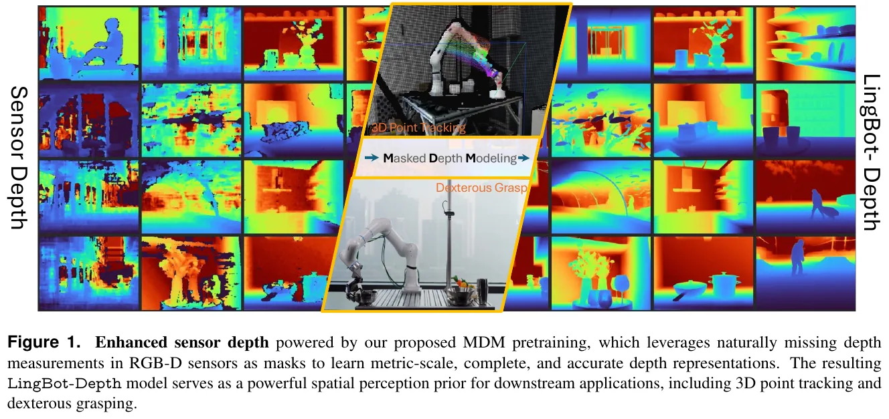
<figcaption>Figure 1: Pretrained with masked depth modeling (MDM), LingBot-Depth repairs the depth loss that commercial RGB-D sensors suffer on highly reflective, transparent, or textureless surfaces, providing high-quality spatial geometry priors for downstream 3D trajectory tracking and dexterous grasping.</figcaption>
</div>

#### ① Overall framework
{: id="mdm--整体框架概述"}

The MDM (Masked Depth Modeling) framework uses an encoder-decoder structure, with a Vision Transformer (ViT-Large) as the backbone encoder and a hierarchical convolutional decoder (ConvStack) for dense geometry prediction. The core process is to extract patch tokens from the RGB image and from the sensor depth (which has missing values), mix them, and feed them to the ViT encoder to learn joint cross-modal features. In the decoding stage the depth latent tokens are discarded, and only the RGB tokens and global context are used to recover a complete, dense, absolute metric depth map.

<div align="center">
  
<figcaption>Figure 2: Architecture of the masked depth modeling (MDM) framework. The input RGB image and the sensor depth with missing values are each projected into tokens, with spatial and modality position encodings added. The ViT encoder extracts a joint representation; the depth latent tokens are then discarded, and only the RGB-related context tokens are fed to the hierarchical convolutional decoder (ConvStack) to reconstruct a dense, complete metric depth map.</figcaption>
</div>

#### ② Module-by-module explanation
{: id="mdm--逐模块讲解"}

**(a) Separate patch embedding**
- **Input**: a 3-channel RGB image $I \in \mathbb{R}^{3\times H\times W}$ and a single-channel raw depth map $D_{raw} \in \mathbb{R}^{1\times H\times W}$.
- **Processing**: Two independent patch embedding layers downsample and project the two modalities, with patch size 14 (following DINOv2). Both the RGB image and the depth map are projected into $N = HW/14^2$ spatially aligned tokens.
- **Output**: an RGB token sequence $c_i \in \mathbb{R}^n$ and a depth token sequence $d_i \in \mathbb{R}^n$, where $n$ is the token embedding dimension (1024 for ViT-L).
- **Motivation**: Separate patch embedding layers let the self-attention layers learn directly, across modalities and at the grid level, the interplay between RGB appearance context and the local geometry of depth, integrating geometric cues such as near-far relations, coplanarity, and spatial continuity.

**(b) Mixed positional embeddings**
- **Processing**: Since the input consists of two spatially corresponding modalities, RGB and depth, the model uses a dual position encoding:
  1. **Spatial position encoding**: RGB and depth share one set of learnable 2D spatial position encodings tied to the image coordinate system;
  2. **Modality embedding**: identifies the input source, adding 1 to RGB tokens and 2 to depth tokens.
- **Output**: The final input token is the sum of the raw projection, the spatial position encoding, and the modality encoding, and is then fed to the attention blocks.
- **Motivation**: Helps the Transformer implicitly perceive pixel positions and clearly distinguish appearance representations from measured raw depth.

**(c) Masking strategy induced by natural failure**
- **Processing**: A high-ratio mask (60%-90%) is applied to the depth tokens before they enter the ViT, while the RGB tokens remain 100% visible. The masking strategy has three parts:
  1. **Fully missing regions**: Patches with no measured values in the depth map are masked 100%;
  2. **Partially measured regions**: If a patch contains some invalid values, it is masked with a higher probability (set to 0.75 during training);
  3. **Random mask supplement**: If the failure-induced masks fall short of the target masking ratio, fully valid depth tokens are randomly selected for masking so that the total mask ratio stays within 60%-90%.
- **Motivation**: Natural sensor failure regions are often directly tied to hard 3D appearances (strong reflection, no texture) and carry a strong inductive bias. This non-random "natural mask" forces the network to reconstruct depth from complex RGB context cues, which significantly improves its reasoning on geometrically degraded regions.

**(d) ViT-Large encoder**
- **Input**: the concatenated sequence of unmasked depth tokens and all RGB tokens, plus 1 global `[cls]` token.
- **Processing**: A ViT-Large encoder with 24 self-attention blocks.
- **Output**: Only the latent tokens from the final encoder layer are kept for the subsequent prediction, with no mixing of intermediate-layer features (unlike the multi-layer fusion of DepthAnythingV2), which greatly simplifies the network design.

**(e) ConvStack decoder**
- **Input**: the encoded latent image tokens and the `[cls]` token, broadcast globally and added. The key operation is to **discard all depth latent tokens** before decoding and reconstruct depth using only the context tokens associated with RGB.
- **Processing**: A hierarchical convolutional decoder (ConvStack) based on MoGe progressively upsamples the feature map from low resolution to $16\times$ resolution through residual blocks and transposed convolutions (kernel size 2, stride 2). At each scale, a UV position encoding based on a circular map of the image coordinates is injected to preserve scale and layout.
- **Output**: Bilinear interpolation restores the dense depth prediction $D^{pred}$ to the original resolution.
- **Motivation**: The shallow Transformer decoder used in vanilla MAE tends to produce blurry boundaries and artifacts in dense geometry reconstruction, whereas the stacked convolutional ConvStack is better at predicting high-fidelity local detail and continuous boundaries, which greatly improves reconstruction smoothness.

#### ③ Training objective and loss function
{: id="mdm--训练目标与损失函数"}

During training, the L1 loss is computed only on the valid pixels of the ground-truth depth map, so that uncalibrated or missing background pixels do not interfere with optimization:

$$L_{depth} = \frac{1}{\sum_i M^{gt}_i} \sum_i M^{gt}_i \lvert d^{pred}_i - d^{gt}_i \rvert$$

Here, $$d^{pred}_i$$ and $$d^{gt}_i$$ are the predicted and ground-truth depth values of the $i$-th pixel, and $$M^{gt}_i \in \{0, 1\}$$ is a binary mask indicating whether the ground-truth depth is valid at the $i$-th pixel.

---

### 3. Results and findings
{: id="mdm-3-核心结果发现"}

- **Depth Completion**:
  - On the Protocol 1 benchmark (block masking and simulated noise), LingBot-Depth shows very strong noise robustness: RMSE on iBims, NYUv2, and DIODE is reduced by **more than 40%** compared with the best method at the time (PromptDA) (for example, RMSE on the extreme-difficulty iBims setting is 0.345 vs 0.607 for PromptDA).
  - In Protocol 2 (sparse SfM input, ETH3D dataset), without complete boundary conditions, RMSE is reduced by **47%** indoors and **38%** outdoors, confirming its strong reconstruction ability under sparse geometric input.

- **Monocular Depth Estimation**:
  - In the MoGe-2 architecture, the DINOv2 initialization was replaced with ViT weights pretrained with MDM. Without changing the decoder, all 10 cross-domain benchmark metrics improved. This shows that an encoder trained with masked depth modeling has absorbed a metric geometry prior into its semantic tokens, which clearly raises the ceiling of spatial perception from pure monocular RGB.

<div align="center">
  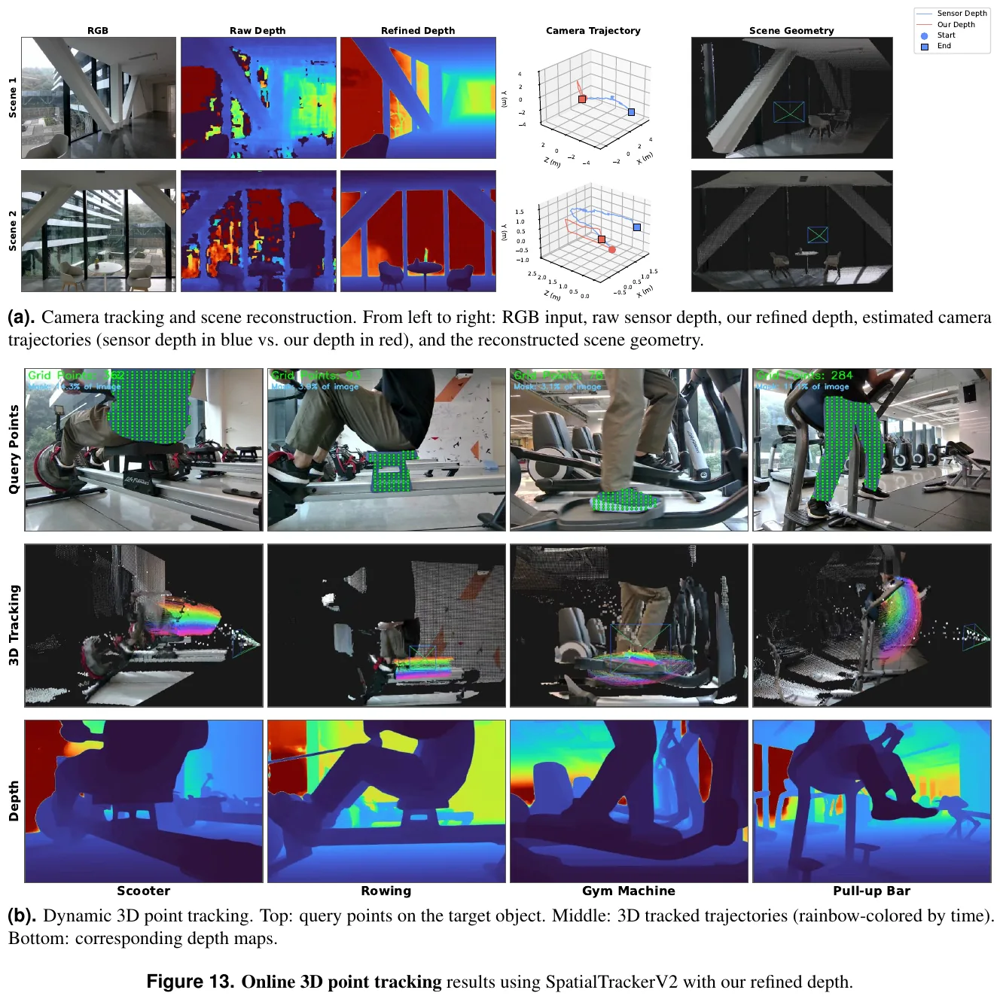
<figcaption>Figure 3: Video depth completion and 3D point tracking: (a) a stable camera trajectory and 3D reconstruction geometry are estimated in an indoor scene with a large glass curtain wall; (b) together with SpatialTrackerV2, robust 3D point trajectory tracking of dynamic objects (a scooter, a rowing machine, fitness equipment, pull-ups).</figcaption>
</div>

- **Downstream application 1: video depth completion and 3D point tracking**:
  - Although MDM is trained only on static images, it shows excellent temporal consistency on video sequences. Embedded as a drop-in depth estimation module in SpatialTrackerV2 (replacing the traditional VGGT front end), it gives very smooth and accurate depth in scenes with strong interference such as glass surfaces, significantly reducing trajectory drift and improving 2D/3D trajectory prediction.

- **Downstream application 2: embodied dexterous-hand grasping**:
  - LingBot-Depth is combined with a 3D diffusion policy taking point cloud input (the DP3 architecture) to grasp objects with a 6-DoF Rokae XMate-SR5 robot arm and a dexterous hand (X Hand-1). On four kinds of challenging, highly reflective or transparent objects (a stainless steel cup, a transparent glass, a transparent storage box, and a toy car), using the dense point cloud from LingBot-Depth clearly raises the grasp success rate compared with the raw sensor depth (for example, for the transparent storage box no point cloud can be built from the raw sensor depth, so the result is N/A, a failure, while with LingBot-Depth the grasp success rate reaches 50%).

<div align="center">
  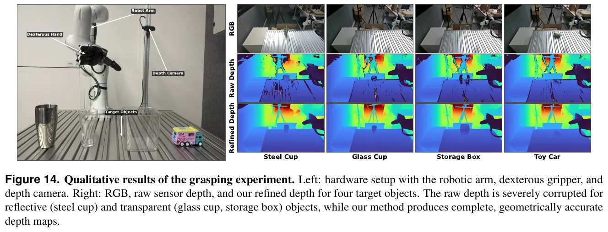
<figcaption>Figure 4: Qualitative comparison of grasping experiments. The right side shows four kinds of objects (a stainless steel cup, a glass, a storage box, and a toy car) under RGB, raw sensor depth, and LingBot-Depth reconstructed depth. LingBot-Depth clearly fills the large missing depth regions on highly translucent or reflective surfaces and smooths the structural features.</figcaption>
</div>

<div align="center">
  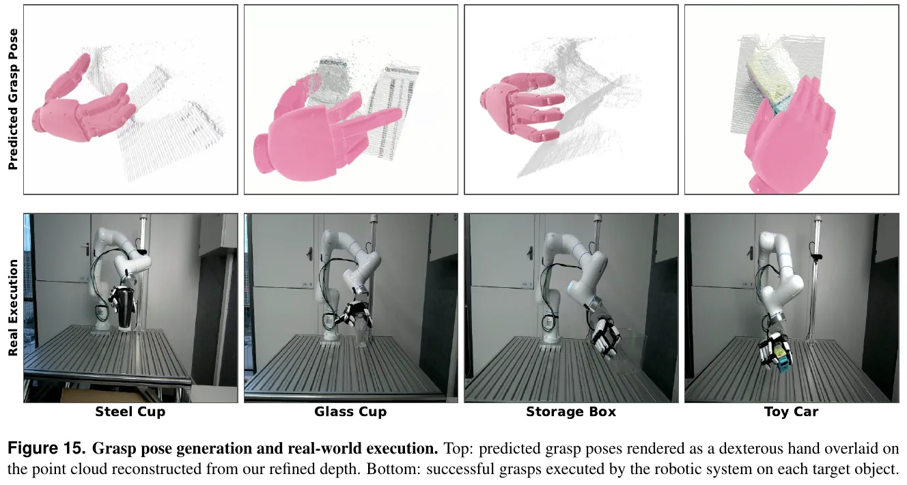
<figcaption>Figure 5: Dexterous-hand grasp pose generation on a predicted 3D point cloud (top row), and physical execution by the robot arm in a real environment (bottom row).</figcaption>
</div>

---

### 4. Limitations
{: id="mdm-4-局限性"}

1. **Artifacts on extremely transparent surfaces**: Although the grasp success rate doubles, LingBot-Depth's reconstructed depth can still show slight geometric shrinkage and edge degradation on very thin, large, purely transparent media (such as the edge of a glass at certain angles).
2. **High compute and latency**: Forward inference relies mainly on the large ViT-L encoder. Deployed on current embedded robot platforms (such as Jetson Orin) without TensorRT quantization and pruning, its frame rate cannot directly meet the demands of highly dynamic obstacle avoidance.

### Reference
{: id="mdm-参考"}

- Paper: [Masked Depth Modeling for Spatial Perception](https://arxiv.org/abs/2601.17895) (arXiv 2026)

---

## 13. GenCeption (2026)
{: id="genception"}
Video Generation Models Are General-Purpose Vision Learners

📄 **Paper**: https://arxiv.org/abs/2607.09024

### Key takeaways
{: id="genception-精华"}
1. This paper proposes **GenCeption**, showing that a **large-scale text-to-video generation model can serve as a general visual representation learner**: generative pretraining (analogous to next-token prediction in NLP) endows perception tasks with strong spatiotemporal priors and image-text alignment.
2. GenCeption turns the multi-step iterative denoising diffusion model into an **efficient single-step feed-forward perception model**, avoiding the extreme slowness of conventional generative inference.
3. It proposes **unifying multiple dense perception tasks (depth, normals, segmentation, camera ray maps, etc.) in a continuous pixel space (RGB channels)**: the task description is encoded directly in the text prompt and in the data representation, giving a minimalist design with no task-specific heads or loss functions.
4. For sparse coordinate regression tasks (2D/3D face and body keypoints), a plug-in mechanism with **learnable tokens and 3D rotary position encoding (3D RoPE)** is designed to keep temporal positions aligned without disrupting the pretrained attention structure.
5. Fine-tuned on synthetic data only, GenCeption shows striking **sim-to-real cross-domain generalization and data efficiency**. With only a few samples, it matches or even surpasses highly specialized domain models such as DepthAnything 3 and SAM 3.

---

### 1. Background and problem
{: id="genception-1-研究背景问题"}
- **Core problem**: Natural language processing has moved to the era of unified general-purpose large models through large-scale autoregressive pretraining. Computer vision, however, is still at the "specialist model" stage (such as Depth Anything for geometry and SAM for segmentation), where each task needs a customized network structure, decoding head, and loss function. It lacks a universal, plug-and-play foundation that can unify thousands of visual perception tasks.
- **Core motivation**: The authors argue that the key to a general vision foundation model is to find a pretraining task like next-token prediction. Large-scale text-to-video generation meets three gold standards: (1) **spatiotemporal evolution**: the model must internalize physical laws and 4D geometry; (2) **native vision-language alignment**: it can follow instructions from the start; (3) **massive scalability**: video data needs no labels, has great commercial value, and is easy to scale.

---

### 2. Methods and innovations
{: id="genception-2-主要方法创新点"}

<div align="center">
  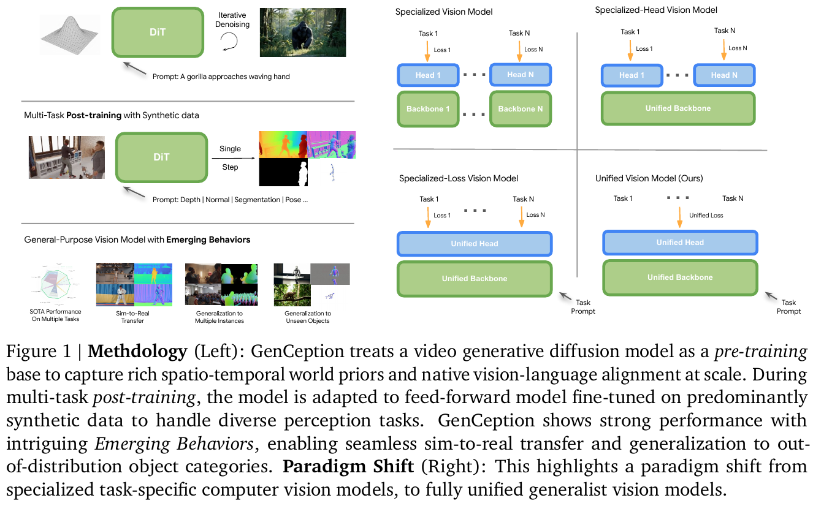
<figcaption>GenCeption versus traditional dedicated perception models. GenCeption achieves a paradigm shift from "task-specific design" to "a unified backbone, decoding head, and loss function, guided only by a text prompt".</figcaption>
</div>

#### ① Overall framework
{: id="genception--整体框架概述"}
GenCeption's core design is extremely streamlined. It reuses the pretrained weights of a text-to-video generation model (WAN 2.1), including the VAE encoder-decoder, the text encoder, and the Transformer-based latent diffusion model (DiT). The original multi-step reverse denoising process is reformulated as a **single forward pass**, and different perception tasks are mapped directly into a unified 3-channel continuous pixel space (RGB), yielding an all-purpose visual perception model that shares one backbone, decoder, and loss function.

<div align="center">
  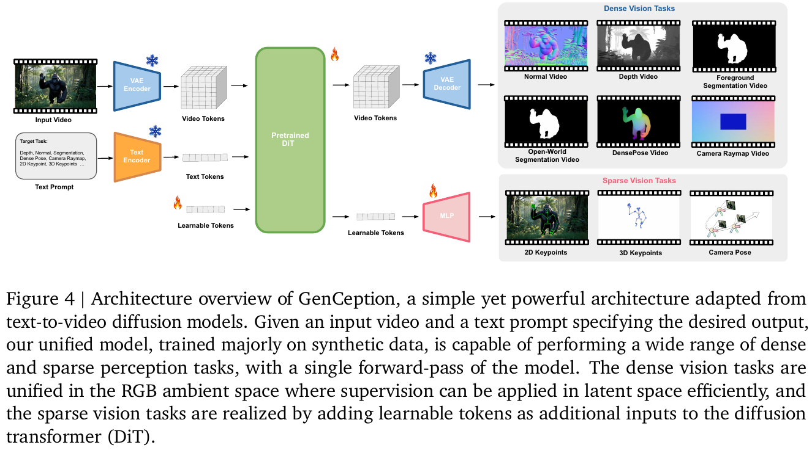
<figcaption>GenCeption overall architecture. The left shows the input video and the task prompt; through a single forward pass of the pretrained DiT, various dense and sparse perception results are predicted via the unified VAE decoder or the sparse perception tokens.</figcaption>
</div>

#### ② Module-by-module explanation
{: id="genception--逐模块讲解"}

* **Single-step feed-forward perception**
  * **Input**: the clean latent representation of the video $x_0$ (extracted from the RGB video by the VAE encoder) and the text embedding of the task prompt (e.g. `"output: depth"`).
  * **Processing**: In a conventional video diffusion model, the input is Gaussian noise that is denoised over multiple iterations. GenCeption fixes the denoising timestep at $t = 0$ (the end of denoising) and runs only a single DiT forward pass. Since WAN 2.1 is pretrained with a rectified-flow objective, the DiT output is the predicted velocity $v = \epsilon - x_0$.
  * **Output**: The DiT output at the last layer of the network is negated directly, giving $-v = x_0 - \epsilon$. Empirically, this negation moves the predicted latent much closer to the target perception video.
  * **Motivation**: This removes the slow iterative sampling process entirely and turns the generative model into a deterministic feed-forward feature extractor at low cost, without modifying any intermediate layer of the backbone, which preserves the integrity of its extraction ability.

* **Unified pixel-space representation for dense tasks**
  * **Input**: text prompts that specify the task (such as `"Depth"`, `"Normal"`, `"Segmentation"`, `"DensePose"`).
  * **Processing**: All dense perception results are mapped into a unified 3-channel RGB space with values in $[0, 1]$. For one-dimensional dense tasks (depth estimation, video segmentation), the content of the three RGB channels is simply copied; for three-dimensional dense tasks (surface normals, DensePose maps), each channel corresponds to a different physical dimension.
  * **Output**: the perception result as a video in RGB image space.
  * **Motivation**: Just as large language models format all kinds of heterogeneous data as plain text, GenCeption converts different high-dimensional, multi-task geometric and semantic perception into a continuous pixel space. This removes the need to fine-tune task-specific decoder structures and reuses the visual priors of the pretrained model to the fullest.

* **"Rothko" encoding of the camera ray map (Rothko Raymap for camera pose)**
  * **Input**: 6-channel camera ray data (3-channel ray origins + 3-channel ray directions).
  * **Processing**: The "Rothko" encoding is a spatially partitioned collage (see the figure below): the ray origin map is placed in the center of the image and the ray direction map is tiled around it, packing the 6-channel ray data into 3-channel RGB.
  * **Output**: a 3-channel Rothko ray map video, from which the camera's continuous pose and trajectory are computed analytically.
  * **Motivation**: Turns the highly abstract problem of matrix and pose estimation into spatially continuous image-like perception, keeping the decoder consistent.

<div align="center">
  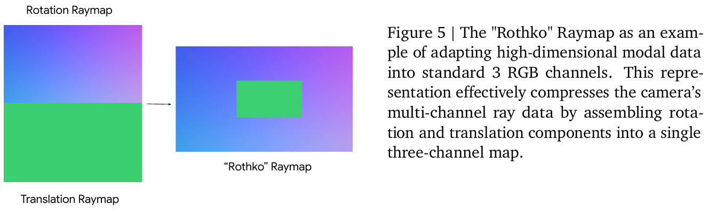
<figcaption>The "Rothko" ray map encoding scheme. The 6-channel camera rays (origins and directions) are collaged by spatial layout and compressed into the 3-channel continuous RGB pixel space, so they are compatible with the unified VAE decoder.</figcaption>
</div>

* **Sparse perception with learnable tokens**
  * **Input**: In addition to the original video latents, $T$ learnable query tokens (one per video frame).
  * **Processing**: To stay compatible with the 3D rotary position encoding (3D RoPE) native to the pretrained DiT, 3D RoPE is applied to the $T$ added tokens. Their spatial positions are initialized as learnable variables, and for the temporal position, position interpolation rescales the frame index into the temporal range seen in DiT pretraining.
  * **Output**: After extraction by the DiT, a lightweight MLP head decodes the $K$-dimensional sparse feature coordinates (such as face or body keypoints) of each frame.
  * **Motivation**: Plug-in query tokens preserve the stability of the pretrained attention mechanism better than introducing new cross-attention modules, and thus avoid feature distortion.

#### ③ End-to-end data flow
{: id="genception--端到端数据流"}
The input RGB video is encoded by the VAE $\rightarrow$ concatenated with the task-control text embedding $\rightarrow$ fed to the DiT for a single forward pass $\rightarrow$ for dense tasks, the features are negated ($-v$) and passed through the unified VAE decoder to generate the target perception video; for sparse tasks, the plug-in tokens go through a lightweight MLP to output 2D/3D coordinates.

#### ④ Training objective and loss function
{: id="genception--训练目标与损失函数"}
GenCeption uses the standard $L_2$ loss throughout. At the data level, data such as depth maps are normalized by their median scale and mapped nonlinearly:
$$d' = \text{clip}(\alpha \log(d+1), 0, 1)$$
This removes the scale ambiguity of geometric perception at its source.
- **Dense tasks** compute the $L_2$ loss directly in the VAE latent space:
  $$L_{\text{dense}} = \lVert \mathbf{z}_{\text{pred}} - \mathbf{z}_{\text{gt}} \rVert_2^2$$
- **Sparse tasks** compute the $L_2$ loss in the decoded output coordinate space:
  $$L_{\text{sparse}} = \lVert \mathbf{p}_{\text{pred}} - \mathbf{p}_{\text{gt}} \rVert_2^2$$

---

### 3. Results and findings
{: id="genception-3-核心结果发现"}

<div align="center">
  
<figcaption>GenCeption performance and data efficiency. Left: it matches or surpasses existing dedicated state-of-the-art models on multiple visual perception tasks. Right: in depth estimation fine-tuning it clearly outperforms self-supervised pretraining methods such as V-JEPA and VideoMAE V2, with data efficiency several to hundreds of times higher.</figcaption>
</div>

* **Surpassing dedicated state-of-the-art models**: On normal estimation, depth estimation, camera pose, and 3D human keypoint prediction, even without supervised training on the training sets of the corresponding benchmarks, GenCeption's accuracy still beats Lotus-2 (FLUX 12B) and NormalCrafter (SVD 1.5B) across the board, and surpasses or matches DepthAnything 3 and D4RT.
* **Far outperforming self-supervised video foundation models**: With the number of fine-tuning samples held fixed (7.5k videos), GenCeption (1.3B/14B) is clearly better than VideoMAE V2 (1B) and V-JEPA (0.6B) at geometry and depth prediction.
* **Very high data efficiency**: On depth estimation, GenCeption is multi-task fine-tuned on only 7.5k synthetic videos, yet performs comparably to D4RT and VGGT-Ω, which are trained on millions to hundreds of millions of real multi-source samples, reducing the required training data by $7\times \text{–} 500\times$.
* **Zero-shot generalization and cross-domain ability**: By inheriting the vast world-physics knowledge in the pretrained video generation model, GenCeption shows outstanding sim-to-real and out-of-distribution (OOD) generalization:
  1. **Instance generalization**: Although fine-tuning uses only **single-person synthetic videos**, it can be applied directly to complex real-world videos **with multiple instances**.
  2. **Category generalization**: It generalizes directly and accurately to categories that never appear in the training data, such as animals, dinosaurs, and humanoid robots.

<div align="center">
  
<figcaption>Zero-shot cross-domain and out-of-distribution generalization. Although the model is trained entirely on single-person synthetic videos (Synthetic Humans), it generalizes to real scenes with multiple instances (Real Videos) and across categories to animals, robots, and so on (Unseen Objects).</figcaption>
</div>

---

### 4. Limitations
{: id="genception-4-局限性"}
* **Conflict between dense and sparse tasks**: Experiments found that when dense pixel tasks and sparse coordinate tasks are fine-tuned together, performance on the sparse tasks drops markedly and the related dense perception tasks also degrade slightly. The analysis suggests that plug-in learnable tokens disturb DiT's original attention weights when there is not enough multi-task fine-tuning data, and conflict to some degree with continuous pixel-space reconstruction at the level of geometric representation. Fine-tuning should take more care to keep the network backbone "zero-intrusion".

### Reference
{: id="genception-参考"}

- Paper: [Video Generation Models are General-Purpose Vision Learners](https://arxiv.org/abs/2607.09024) (ECCV 2026)

---

# III. 3D scene language models
{: id="group-3d-llm"}

Models that connect point clouds, multi-view images, or video frames to a large language model for 3D question answering, captioning, and grounding. The trend is from point-cloud input toward "video frames + poses" and online streaming input.

## 14. 3D-LLM (2023)
{: id="3d-llm"}
Injecting the 3D Physical World into Large Language Models

📄 **Paper**: [https://vis-www.cs.umass.edu/3dllm/](https://vis-www.cs.umass.edu/3dllm/)

### Key takeaways
{: id="3d-llm-精华"}
3D-LLM proposes a complete paradigm for injecting the 3D world into large language models (LLMs). Its core is to use the strong understanding of 2D pretrained VLMs and obtain 3D spatial perception through 2D-3D feature alignment and position encoding. Three automatic data generation pipelines were designed to build a 3D-language dataset of 300k+ samples, enabling the model to handle diverse tasks from 3D captioning to embodied navigation.

---

### 1. Background and problem
{: id="3d-llm-1-研究背景问题"}
Although existing LLMs and 2D VLMs have strong commonsense reasoning, they lack direct modeling of the 3D physical world and so struggle to understand complex 3D spatial relationships (such as orientation and distance), the physical properties of objects, and environment layout. This limits their use in embodied robot intelligence and realistic 3D interaction.

---

### 2. Methods and innovations
{: id="3d-llm-2-主要方法创新点"}

The core idea of 3D-LLM is not to train a 3D model from scratch, but to map 3D features into the aligned feature space of a pretrained 2D VLM and to introduce a 3D localization mechanism.

#### ① 3D-language data generation pipeline
{: id="3d-llm--3d-语言数据生成管线"}
To address the scarcity of 3D-language data, the authors designed three GPT-based data generation methods:
- **Box-demonstration-instruction based prompting**: The AABB boxes of objects in a room and their semantic information are given as input, and GPT generates task decompositions and dialogues.
- **ChatCaptioner based prompting**: Multi-view ] is used to ask and answer questions about the 3D scene, and GPT produces a detailed description after aggregating the information.
- **Revision based prompting**: Existing rough 3D descriptions are rewritten and refined to improve semantic richness.

<div align="center">
  
<figcaption>Figure 1: The three 3D-language data generation pipelines</figcaption>
</div>

#### ② 3D feature extraction and alignment
{: id="3d-llm--3d-特征提取与对齐"}
The system first renders multi-view images of a 3D scene and extracts features with a pretrained 2D encoder such as CLIP. The 2D features are then mapped back to 3D space in three ways:
- **Direct reconstruction**: features are mapped directly onto a point cloud using the camera parameters.
- **Feature fusion**: features are fused into a 3D map with tools such as gradSLAM.
- **Neural field**: a compact 3D representation is built with a neural voxel field-style approach.

#### ③ 3D-LLM architecture
{: id="3d-llm--3d-llm-架构设计"}
- **Base model**: A mature 2D VLM such as Flamingo or BLIP-2, with its visual encoder and LLM frozen.
- **Feature aggregation**: A Perceiver Resampler maps variable-length 3D features to a fixed number of visual tokens.
- **3D localization mechanism**:
  - **Position encoding**: sin/cos position encodings are added to the 3D feature points.
  - **Position tokens**: Several discrete position tokens (such as `<loc123>`) are added to the vocabulary to represent AABB box coordinates. The LLM performs object grounding by outputting these tokens.

<div align="center">
  
<figcaption>Figure 2: Overall architecture of 3D-LLM, including feature extraction and alignment process</figcaption>
</div>

#### ④ Multi-task capabilities
{: id="3d-llm--多任务能力展示"}
The 300k+ generated samples cover 3D captioning, grounding, QA, task decomposition, 3D-assisted dialogue, navigation, and more.

<div align="center">
  
<figcaption>Figure 3: Data generated for 3D-LLM covers diverse 3D-related tasks</figcaption>
</div>

---

### 3. Results and findings
{: id="3d-llm-3-核心结果发现"}
- **ScanQA performance**: On the ScanQA benchmark, 3D-LLM clearly outperforms methods that use only 2D views or explicit object representations (BLEU-1 improves by about 9% on the validation set).
- **Multi-task generalization**: The model performs well on unseen 3D captioning and task decomposition tasks, showing the effectiveness of 3D feature alignment.
- **Qualitative analysis**: Given a 3D scene, the model can suggest reasonable navigation paths and task execution steps, showing early potential for embodied intelligence.

<div align="center">
  
<figcaption>Figure 4: Qualitative predictions of 3D-LLM on 3D question answering and scene captioning</figcaption>
</div>

---

### 4. Limitations
{: id="3d-llm-4-局限性"}
- **Computational overhead**: The 3D feature extractor relies on multi-view rendering, which puts a heavy computational burden on training.
- **Feature fusion bottleneck**: When existing feature mapping methods handle very large or very finely partitioned 3D scenes, the compactness and completeness of the features still need improvement.

### Reference
{: id="3d-llm-参考"}

- Paper: [3D-LLM: Injecting the 3D World into Large Language Models](https://arxiv.org/abs/2307.12981) (NeurIPS 2023)

---

## 15. PointLLM-V2 (2025)
{: id="pointllm-v2"}
Empowering Large Language Models to Better Understand Point Clouds

📄 **Paper**: [https://github.com/OpenRobotLab/PointLLM](https://github.com/OpenRobotLab/PointLLM) (TPAMI 2025)

### Key takeaways
{: id="pointllm-v2-精华"}
PointLLM-V2 addresses the shortage of instruction data in 3D by introducing the first automated pipeline for generating point cloud instruction-tuning data. It uses multi-view projection and the strong visual ability of GPT-4o to generate about 1.8M high-quality point cloud-text pairs covering object attributes, geometric features, and fine-grained local coordinate perception. The model follows a simple tokenizer-projector-LLM paradigm; it clearly surpasses existing 2D and 3D baselines on object classification and captioning, and even exceeds human annotators on captioning.

---

### 1. Background and problem
{: id="pointllm-v2-1-研究背景问题"}
Although large language models (LLMs) have achieved great success on text and images, they are still in their infancy in 3D point cloud understanding. The core bottlenecks are: 1) a lack of large-scale, high-quality point cloud-instruction alignment data; 2) a lack of benchmarks that can evaluate the generative ability of 3D multimodal models. Existing 3D foundation models mostly rely on text descriptions of synthetic data, which makes it hard to capture the rich geometric and appearance detail in point clouds.

---

### 2. Methods and innovations
{: id="pointllm-v2-2-主要方法创新点"}

#### ① Overview
{: id="pointllm-v2--整体概览"}
PointLLM-V2 is a multimodal large language model that understands colored point clouds. It has a strong grasp of object categories, geometric shapes, and appearance features, and supports fine-grained local coordinate perception.

<div align="center">
  
<figcaption>Figure 1: Overview of PointLLM-V2's capabilities</figcaption>
</div>

#### ② Automated data generation pipeline
{: id="pointllm-v2--自动化数据生成流水线data-generation-pipeline"}
The authors propose an innovative data generation process that converts 3D point clouds into instruction data an LLM can understand.

<div align="center">
  
<figcaption>Figure 2: Flow chart of the automated data generation pipeline</figcaption>
</div>

**Process details:**
- **Multi-view projection**: Each 3D object is projected from 20 different viewpoints to generate renderings.
- **Anchor-view sampling and annotation**: SAM (Segment Anything Model) generates masks, and representative points are selected as anchors.
- **Point propagation**: The anchor points are projected back into 3D space using the camera parameters and then propagated to all 20 views, giving accurate correspondence between 3D coordinates and multi-view pixels.
- **GPT-4o question generation and filtering**: The rendered images are fed to GPT-4o, together with the local descriptions corresponding to the point cloud, to generate question-answer pairs. A dedicated filtering mechanism removes hallucinated content and ensures data quality.

#### ③ Architecture
{: id="pointllm-v2--模型架构architecture"}
PointLLM-V2 uses a typical end-to-end trained architecture.

<div align="center">
  
<figcaption>Figure 3: PointLLM-V2 overall architecture</figcaption>
</div>

- **Input**: a colored point cloud $P \in \mathbb{R}^{N \times 6}$ with $N$ points.
- **Point encoder**: A pretrained point cloud encoder (such as Point-BERT) converts the point cloud into feature vectors.
- **Projector**: A simple MLP that maps point cloud features into the LLM feature space.
- **LLM backbone**: Llama-3-8B-Instruct is the core reasoning engine; it receives point cloud tokens and user instruction tokens and outputs a text response.

#### ④ Training strategy
{: id="pointllm-v2--训练策略"}
Training has two stages:
1. **Feature alignment stage**: The point cloud encoder and the LLM are frozen and only the projector is trained, so the model learns to align point cloud features with the language space.
2. **Instruction fine-tuning stage**: The projector and the LLM are fine-tuned jointly so that they can interact by following complex human instructions.

---

### 3. Results and findings
{: id="pointllm-v2-3-核心结果发现"}

<div align="center">
  
<figcaption>Figure 4: Overview of the evaluation framework</figcaption>
</div>

- **Performance leap**: PointLLM-V2 achieves state-of-the-art results on the two newly proposed benchmarks, generative 3D object classification and 3D object captioning.
- **Surpassing human annotation**: On object captioning, GPT-4o evaluation shows that PointLLM-V2's descriptions are better than the human annotations on more than 50% of the samples.
- **Reduced hallucination**: Thanks to high-quality data and filtering, the model hallucinates far less in its descriptions, and its hallucination score is better than that of competitors such as 3D-LLM.

---

### 4. Limitations
{: id="pointllm-v2-4-局限性"}
1. **Limited scene understanding**: The training data is currently concentrated on object-level point clouds, so understanding of complex indoor and outdoor scenes (scene level) still has room to improve.
2. **Computational efficiency**: As the point cloud grows (for example beyond 8192 points), the computational cost and memory usage rise sharply.

### Reference
{: id="pointllm-v2-参考"}

- Paper: [PointLLM: Empowering Large Language Models to Understand Point Clouds](https://arxiv.org/abs/2308.16911) (ECCV 2024)

---

## 16. LLaVA-3D (2024)
{: id="llava-3d"}
Giving Large Multimodal Models 3D Spatial Perception, Simply and Efficiently

📄 **Paper**: [arXiv:2409.18125](https://arxiv.org/abs/2409.18125)

### Key takeaways
{: id="llava-3d-精华"}
- It shows that strong 3D scene understanding can be achieved efficiently by adding 3D position encodings to a mature 2D large multimodal model (such as the  series] and fine-tuning jointly, without training a 3D encoder from scratch.
- Using RGB-D depth maps and the camera intrinsics and extrinsics, the 2D visual features ( patches) are added to absolute 3D coordinates to form a minimalist "3D patch" representation.
- It verifies the natural affinity of video-pretrained large multimodal models (such as LLaVA-Video) for multi-view 3D representation, which gives excellent convergence speed and 3D question answering performance.
- A lightweight grounding decoder decouples high-level semantic reasoning from low-level geometric box prediction, successfully avoiding the problem that LLMs are poor at generating precise coordinate text.
- Joint fine-tuning on 2D and 3D data significantly improves 3D spatial intelligence while fully retaining the original model's strong 2D understanding and dialogue abilities.

---

### 1. Background and problem
{: id="llava-3d-1-研究背景问题"}
- **Core problem**: The development of 3D large multimodal models (3D LMMs) is limited by the scarcity of large-scale 3D vision-language datasets and by the lack of a powerful, general 3D point cloud pretrained encoder like 2D CLIP.
- **Motivation**: Real-world embodied agents mainly observe through multi-view (egocentric) images, but existing 3D LMMs usually rely on complex offline 3D instance segmentation to extract object features, a cumbersome process that is hard to apply end to end. The authors aim to exploit the strong semantic priors of 2D LMMs to give the model 3D spatial intelligence in a minimalist and efficient way.

---

### 2. Methods and innovations
{: id="llava-3d-2-主要方法创新点"}

<div align="center">
  
<figcaption>LLaVA-3D framework overview, achieving efficient 3D scene understanding with faster convergence and higher inference efficiency</figcaption>
</div>

<div align="center">
  
<figcaption>LLaVA-3D architecture, including 3D patch construction, pooling, 3D coordinate encoding and decoding, and the grounding decoder</figcaption>
</div>

**① Overall framework**
LLaVA-3D is built by modifying LLaVA-Video. It consists of a CLIP image encoder, a 2D-to-3D projection with a learnable 3D position encoding layer, a training-free token compression pooling layer, an LLM backbone, and a dedicated grounding decoder. By fusing multi-view features with 3D coordinate encodings, the 2D visual tokens are upgraded into 3D patches. While the LLM performs semantic reasoning, the grounding decoder decodes high-precision 3D bounding boxes.

**② Module-by-module explanation**
- **3D patch construction**:
  - **Input**: multi-view RGB-D images and camera intrinsics and extrinsics.
  - **Processing**: The base model (LLaVA-Video) extracts the 2D patch features of each frame/view with the CLIP visual encoder and projects them into the LLM embedding space with a linear layer. Meanwhile, each 2D patch is projected into 3D space using the corresponding depth map and camera parameters to obtain its 3D world coordinates $P \in \mathbb{R}^{V \times 3 \times w \times h}$. A learnable 3D position encoding layer made of a two-layer MLP then converts the 3D coordinates into a 3D position embedding $P' \in \mathbb{R}^{V \times d \times w \times h}$. Finally, the 3D position embedding and the projected 2D visual tokens are added directly to output the 3D patches $X'_{3D} = X'_p + P'$.
  - **Motivation**: It keeps the strong visual-semantic alignment of 2D CLIP while giving it explicit 3D spatial geometry, avoiding the overhead of building a heavy 3D point cloud or voxel grid.
- **3D patch pooling**:
  - **Input**: the high-density 3D patches generated from the multi-view images (their number grows linearly with the number of views).
  - **Processing**: To reduce the number of tokens fed to the LLM, two training-free pooling strategies are introduced:
    1. **Voxelization pooling**: The 3D space is discretized into a 3D grid, the 3D patches that fall in the same occupied voxel are mean-pooled, and only the tokens of occupied voxels are kept.
    2. **Farthest point sampling (FPS) pooling**: Farthest point sampling uniformly samples a fixed number (such as $N$) of representative tokens from all 3D patches.
  - **Motivation**: This effectively shortens the LLM context and keeps computation efficient, while the 3D spatial distribution preserves the scene's geometry and spatial structure as much as possible.
- **3D coordinate encoding and decoding**:
  - **Input**: 3D coordinates contained in user instructions (such as in dense object captioning tasks), or the hidden states the LLM uses to guide prediction.
  - **Processing**:
    - **Encoding side**: The 3D coordinates in the user instruction are converted into 3D coordinate tokens by the 3D position encoding layer and fed to the LLM together with text tokens and 3D patch tokens, assisting spatially sensitive text generation.
    - **Decoding side (grounding decoder)**: Having the LLM output 3D bounding box coordinates as text is extremely difficult, so LLaVA-3D designs a grounding decoder. A set of instance queries is first sampled from the 3D patches by FPS. In each decoder layer, the instance queries cross-attend to the 3D patch features, with multi-scale 3D k-NN attention and relative position encoding modeling local geometry. The updated queries are then concatenated with the location tokens extracted from the LLM, distance-adaptive self-attention captures relative positions, and a grounding head finally predicts the 3D bounding box.
  - **Motivation**: Decoupling high-level semantic understanding from low-level bounding box prediction lets the LLM focus on text reasoning and the decoder on 3D geometric prediction, solving the low accuracy of having the LLM predict coordinates directly.

**③ End-to-end data flow**
The input multi-view RGB frames and their depth maps first go to the vision module, which extracts the corresponding 3D patches using the camera projection geometry. 3D patch pooling is then applied as needed to compress the sequence length. The compressed 3D visual tokens are concatenated with the text tokens and fed to the LLM for autoregressive language reasoning. If the current task requires 3D grounding output, the hidden state at specific positions output by the LLM is sent to the grounding decoder together with the 3D patches, and the 3D bounding box is finally decoded.

**④ Training objectives and loss function**
- Training has two phases:
  - **Stage 1: multi-task instruction tuning**: 3D data such as 3D QA and 3D captioning (LLaVA-3D-Instruct-86K) is mixed with the original 2D video fine-tuning data of LLaVA-Video. The overall loss contains the autoregressive text loss $$\mathcal{L}_{text}$$ and the 3D bounding box prediction loss (the sum of the GIoU loss and the $L_1$ box regression loss, $$\mathcal{L}_{box}$$):
    $$\mathcal{L} = \mathcal{L}_{text} + \lambda \mathcal{L}_{box}$$
  - **Stage 2: decoder-only fine-tuning**: The LLM and the position encoding layers are frozen, and only the grounding decoder continues to be trained on 3D visual grounding data for several epochs, to speed up convergence of the bounding box prediction part.

**⑤ Inference**
Besides standard text and image question answering, the model supports interactive understanding at inference time. Users can click specific pixels in a 2D image or video frame; the click position is projected into 3D space through the camera geometry to produce a 3D coordinate token, which guides the model to generate a 3D bounding box and a detailed description for a specific object.

<div align="center">
  
<figcaption>Data distribution and details of the LLaVA-3D-Instruct-86K mixed 3D corpus</figcaption>
</div>

<div align="center">
  
<figcaption>Example of click-based 3D question answering and captioning interaction supported by LLaVA-3D</figcaption>
</div>

---

### 3. Results and findings
{: id="llava-3d-3-核心结果发现"}
- **Very fast training convergence**: Compared with 3D LMMs that train a 3D encoder from scratch and then align it, LLaVA-3D converges **3.5 times** faster on 3D datasets thanks to the strong prior of the 2D large model.
- **Clearly surpassing the state of the art** on various 3D tasks:
  - On 3D QA, **ScanQA** (103.1 CIDEr) and **SQA3D** (60.1 EM@1) both set new records, clearly better than LEO (101.4/50.0) and LL3DA (76.8/-).
  - On 3D dense captioning, **Scan2Cap** (84.1 C@0.5) and **MMScan Captioning** (78.8 Overall) reach state-of-the-art levels; description accuracy on the color and design dimensions improves by 49.5% and 43.3%, respectively.
  - On 3D visual grounding, the single-stage model performs very well on **ScanRefer** (50.1 Acc@0.25) and **Multi3DRefer** (49.8 Acc@0.25), approaching complex two-stage models.
- **Retains the original 2D understanding**: Thanks to joint training, the model is almost on par with LLaVA-Video on the 2D video benchmarks MVBench (58.1 vs 58.6) and VideoMME (62.8 vs 63.3), effectively avoiding severe forgetting.

---

### 4. Limitations
{: id="llava-3d-4-局限性"}
- It depends heavily on high-quality RGB-D depth maps and accurate camera calibration. In complex, unknown real-world scenes, accumulated depth estimation errors or rough calibration shift the 3D coordinate mapping and thus affect the accuracy of 3D patch construction.
- The grounding decoder cannot be made to converge perfectly in single-epoch stage-1 training, so a separate fine-tuning stage is currently needed.

### Reference
{: id="llava-3d-参考"}

- Paper: [LLaVA-3D: A Simple yet Effective Pathway to Empowering LMMs with 3D-awareness](https://arxiv.org/abs/2409.18125) (arXiv 2024)

---

## 17. ROSS3D (2025)
{: id="ross3d"}
Replacing "Piled-Up 3D Input" with "Reconstruction Visual Signals" to Instill a True 3D Spatial Sense in 2D LMMs

📄 **Paper**: [arXiv:2504.01901](https://arxiv.org/abs/2504.01901)

---

### Key takeaways
{: id="ross3d-精华"}

1. The bottleneck of 3D LMMs is not how much 3D information is stuffed into the input, but the lack of training signals that let the model truly learn 3D spatial relationships. This is the paper's most important argument.
2. The solution is to bring "visual output" into the supervision: a lightweight denoising network lets the LMM's visual tokens learn to reconstruct occluded views (cross-view) and a top-down view (global-view), instead of only predicting text.
3. The two reconstruction tasks contribute different abilities: cross-view reconstruction strengthens fine-grained cross-view alignment (good for visual grounding), and global-view reconstruction strengthens understanding of global layout (good for QA); their effects stack.
4. This visual supervision signal needs no text annotation, so it can be used directly for semi-supervised training on unlabeled 3D video data, and the result can exceed the ceiling of full text supervision, which suggests a low-cost way to scale up 3D data.
5. The idea of "reconstructive supervision" is general: by taking the objective of Reconstructive Visual Instruction Tuning (ROSS, ICLR 2025) from 2D and redesigning the input/output transformations to suit the task, it can be transferred to a new modality (3D scenes).

---

### 1. Background and problem
{: id="ross3d-1-研究背景问题"}

3D LMMs aim to let 2D vision-language models understand 3D scenes, but high-quality 3D vision-language paired data is extremely scarce, and there is no pretrained 3D point cloud encoder as strong as CLIP. Existing methods (point cloud feature fusion, 3D patch pooling, multi-view video processing) design 3D perception only at the **input level**. In essence, the visual outputs are still supervised only by text cross-entropy, which makes it hard to correct the model's inductive bias from 2D data, so its understanding of 3D space remains insufficient.

---

### 2. Methods and innovations
{: id="ross3d-2-主要方法创新点"}

**① Overall framework**

ROSS3D has three parts: a video encoder $\mathcal E_\phi$ (extracts features of multi-view video frames), a large language model $\mathcal P_\theta$ (processes visual tokens and text instructions and outputs autoregressively), and a denoiser $\mathcal J_\pi$ (a lightweight DiT-based denoising network that "translates" the LMM's visual outputs back into the image latent space, thereby supervising the visual outputs). They work together as follows: the video encoder generates visual prefix tokens that are fed to the LLM; while generating text, the LLM also outputs "visual tokens"; the denoiser uses these visual tokens as conditions to denoise and reconstruct the specified target image (an occluded view or a BEV image).

<div align="center">
  
<figcaption>Comparison with existing 3D LMM paradigms. (a), (b), and (c) are input-level 3D perception designs (point cloud feature fusion, 3D patch pooling, multi-view video processing). (d) is the core idea of ROSS3D: two visual reconstruction tasks, cross-view reconstruction (left) and global-view reconstruction (right), inject 3D perception signals into the supervision of the visual outputs.</figcaption>
</div>

**② Module-by-module explanation**

- **Cross-view reconstruction (fine-grained cross-view modeling)**
  - **Input**: A fraction $\gamma$ (25% by default) of the multi-view video frames $I \in \mathbb R^{M\times H\times W\times 3}$ is randomly masked out, and the masked view features are replaced with learnable mask tokens.
  - **Processing**: The LLM processes all visual tokens (including the mask token positions) autoregressively as usual; conditioned on the visual outputs at the masked positions, the denoiser denoises and recovers the VAE latent encodings of the original images of those views.
  - **Output**: the reconstructed latent representations of the masked views, supervised with the diffusion loss $\mathcal L_{3D}^{cross}$.
  - **Motivation**: Forces the model to learn to infer the content of one view from the overlapping information of other views, which corresponds directly to tasks such as 3D visual grounding that need precise cross-view alignment.

- **Global-view reconstruction (global layout understanding)**
  - **Input**: The same cross-view-masked video frames are used as input (the same as $\mathcal T_i$).
  - **Processing**: 3D reconstruction (combining camera extrinsics, intrinsics, and depth) aggregates the visual information from all views and renders a top-down BEV image as the reconstruction target. The denoiser likewise denoises and reconstructs this BEV image conditioned on the LLM's visual outputs (the black blank regions produced by sparse point cloud rendering are filtered out and excluded from the loss).
  - **Output**: the reconstructed latent representation of the BEV image, supervised with the diffusion loss $\mathcal L_{3D}^{global}$.
  - **Motivation**: The BEV map naturally gathers the spatial layout of the whole scene, which strengthens the model's understanding of the overall scene structure and is most effective for tasks that need comprehensive scene information, such as 3D QA.

- **Denoiser $\mathcal J_\pi$ (shared architecture, DiT-based)**
  - **Input**: the noisy token $z_t$, the visual condition output by the LLM $x_{i\le N}$, and the timestep $t$.
  - **Processing**: A learnable query $q$ is fused with the visual output $x_{i\le N}$ and the timestep embedding through cross-attention to obtain the condition $c$, which then passes through N DiT blocks, LayerNorm, and a linear layer to predict the noise $\epsilon_t$.
  - **Output**: the predicted noise, used to compute the MSE against the true noise, so that gradients are backpropagated to optimize the LLM's visual outputs.

<div align="center">
  
<figcaption>(a) ROSS3D overall pipeline: video frames are masked and fed to the LLM, and the denoiser reconstructs the masked views and the BEV image from the visual outputs. (b) Internal structure of the DiT-based denoiser, which fuses the query, the visual outputs, and the timestep information through cross-attention.</figcaption>
</div>

**③ End-to-end data flow**

A 32-frame video of a 3D scene is first randomly masked, with 25% of the views hidden; together with depth maps it is encoded into position-aware visual tokens, which go through the video encoder and projector and are given to the LLM as a prefix. The LLM generates autoregressively (some positions correspond to the text answer to the instruction, and others to visual outputs). The visual output positions are taken every $\Delta t=4$ steps and sent to denoisers with shared weights: one reconstructs the original masked views, and the other reconstructs the BEV top view of the whole scene. The text output positions are supervised by ordinary cross-entropy. Three losses (text cross-entropy + cross-view reconstruction + global-view reconstruction) jointly train the same set of LLM parameters.

**④ Training objectives and loss functions**

$\mathcal L_{text} = -\frac{1}{T-N}\sum_{i=N+1}^{T} \log p_\Theta(x_i \vert x_{<i}, v)$ is the standard text cross-entropy, supervising only the text tokens.

$\mathcal L_{3D}^{cross} = \frac{1}{\gamma M}\sum_{j=1}^{M}(1-M_j)\cdot \mathcal D(\mathcal J_\pi \circ \mathcal P_\theta(v), \mathcal F(I_j))$ computes the reconstruction loss only on the masked views.

$\mathcal L_{3D}^{global} = \mathcal D(\mathcal J_\pi \circ \mathcal P_\theta(v), \mathcal F(I_{BEV}))$ computes the loss on the BEV reconstruction target.

The distance metric $\mathcal D$ uses the diffusion denoising process by default: $\mathcal D = \mathbb E_{t,\epsilon}\left[\Vert \mathcal J_\pi(z_t \vert \mathcal P_\theta(v), t) - \epsilon \Vert^2\right]$, where $z_t = \sqrt{\bar\alpha_t} z_0 + \sqrt{1-\bar\alpha_t}\,\epsilon$ and $z_0$ comes from the continuous (KL-regularized) VAE encoding provided by FLUX. The 3D visual grounding task additionally uses an InfoNCE grounding loss (based on the similarity between object-level features and the `<ground>` token).

**⑤ Inference**

No masking or reconstruction is performed at inference, and the denoiser is not involved. The LLM generates the text answer autoregressively from the complete multi-view video input (greedy decoding for QA and captioning; for grounding, candidate boxes are selected and ranked by the similarity between the hidden state of the `<ground>` token and the candidate object features).

---

### 3. Results and findings
{: id="ross3d-3-核心结果发现"}

Fine-tuned from LLaVA-Video-7B, ROSS3D surpasses the previous state of the art, Video-3D-LLM, on five ScanNet-based 3D benchmarks: SQA3D reaches 63.0 EM (+4.4), ScanQA 107.0 CIDEr (+4.9), Scan2Cap 66.9 ROUGE (+4.6), ScanRefer 61.1 Acc@0.25 (+3.0), and Multi3DRefer 59.6 F1@0.25 (+1.6). Ablations confirm that "vanilla reconstruction" without 3D awareness brings almost no benefit, while cross-view and global-view reconstruction are both effective and their gains stack. Both also transfer to different input representations (point cloud features in 3D-LLM, video features in Video-3D-LLM) and remain effective. The extra training cost is small (only 1.12× slower and 1.02× more GPU memory). More importantly, the semi-supervised experiment shows that when $\mathcal L_{3D}$ is applied on 50% text-labeled data plus 50% unlabeled data, the result exceeds the baseline trained with 100% text supervision (103.2 vs 102.1 CIDEr on ScanQA), proving that the visual supervision signal can learn effectively from unlabeled 3D visual data.

---

### 4. Limitations
{: id="ross3d-4-局限性"}

The paper has no dedicated limitations section, but from the design one can note: (1) global-view reconstruction relies on an additional 3D reconstruction and rendering process (generating BEV maps requires depth, extrinsics, intrinsics, and point cloud rendering), which makes data preprocessing more complex; (2) the masking mechanism creates a train/test inconsistency, which is mitigated with a small mask ratio (25%) and a larger reconstruction interval (every 4 steps), and the sensitivity to these hyperparameters still has to be weighed.

---

### Reference
{: id="ross3d-参考"}

- Paper: [ROSS3D: Reconstructive Visual Instruction Tuning with 3D-Awareness](https://arxiv.org/abs/2504.01901)
- Project Page: [haochen-wang409.github.io/ross3d](https://haochen-wang409.github.io/ross3d)

---

## 18. Stream3D-VLM (2026)
{: id="stream3d-vlm"}
An Online 3D Spatial Understanding Multimodal Large Model Based on Incremental Geometry Priors

📄 **Paper**: [arXiv:2606.06891](https://arxiv.org/abs/2606.06891) · [Project Page](https://stream3d-vlm.github.io/)

### Key takeaways
{: id="stream3d-vlm-精华"}
1. **The first online 3D multimodal large model**: It breaks the offline limitation of traditional 3D MLLMs, which need a complete scene or a pre-edited video as input, and achieves real-time 3D spatial understanding and dynamic interaction directly on a live video stream.
2. **Autoregressive streaming decision control**: "When to respond" and "when to stay silent" are modeled as a next-token prediction task of the large model (by introducing `<SEP>` and `<END>` tokens), with no need to re-encode historical frames, which greatly reduces computational latency.
3. **Lightweight geometric prior injection**: A monocular-video 3D reconstruction model (StreamVGGT) incrementally extracts camera parameters and latent 3D geometric features, which are integrated into the 2D visual stream through cross-attention, removing the dependence on expensive 3D point cloud sensors.
4. **Geometry-adaptive voxel compression (GAVC)**: To handle the visual token redundancy of long streaming videos, 3D back-projection and 3D K-Means clustering adaptively compress redundant voxels, reducing the KV cache burden while preserving structural integrity.
5. **A million-scale streaming 3D QA dataset and benchmark**: The Stream3D-1M dataset with 1 million question-answer pairs and the Stream3D-Bench benchmark covering 29 tasks were built, providing the first systematic evaluation platform for streaming 3D understanding.

---

### 1. Background and problem
{: id="stream3d-vlm-1-研究背景问题"}
Existing 3D multimodal large models (3D LMMs) mainly run in **offline mode**. Before they can interact with the user, they must receive a complete 3D scene observation (such as a 3D point cloud or mesh) or a pre-edited static video. This "read first, answer later" paradigm cannot meet practical applications such as embodied intelligence and AR/VR smart glasses that require **real-time streaming interaction**; for example, a robot needs to identify and avoid obstacles in real time while moving, estimate the physical size of objects, or proactively issue a reminder when a target object appears.

Some streaming video large models exist for 2D video understanding (such as VideoLLM-online), but they do not model the physical geometry of the 3D world (such as 3D distances between objects, physical sizes, and the true 3D trajectory of the camera). Even when such a 2D streaming model is fine-tuned on large-scale 3D data, its 3D spatial reasoning remains weak. A general 3D multimodal large model that combines **real-time streaming decisions** with **3D spatial geometric modeling** is therefore urgently needed.

---

### 2. Methods and innovations
{: id="stream3d-vlm-2-主要方法创新点"}

<div align="center">
  
<figcaption>Figure 1. Overall framework of Stream3D-VLM, with three core modules: autoregressive streaming decisions, VSFI geometric prior fusion, and GAVC visual token compression.</figcaption>
</div>

#### ① Overall framework
{: id="stream3d-vlm--整体框架概述"}
Stream3D-VLM takes streaming video as a temporally ordered frame sequence. Building on the autoregressive nature of the large model, it unifies the streaming decision (keep waiting or respond immediately) and ordinary language generation as a next-token prediction task. A lightweight visual-spatial feature integration (VSFI) module injects the online geometry and camera features output by the 3D reconstruction model (StreamVGGT) into the 2D visual features. At inference, a geometry-adaptive voxel compression (GAVC) module dynamically clusters 3D voxels spatially to compress the visual tokens without loss, which ensures real-time deployment.

#### ② Module-by-module explanation
{: id="stream3d-vlm--逐模块讲解"}

* **Autoregressive streaming control modeling**
    * **Input**: the current frame image, the historical context, and the user query.
    * **Processing**: Two special decision-control tokens are added to the large model's vocabulary: `<SEP>` (streaming continuation: the model stays silent and continues to read the next frame) and `<END>` (response trigger: the model stops reading new frames and starts outputting a text answer).
    * **Output**: the decision token (`<SEP>` or `<END>`) and the text response.
    * **Motivation**: It avoids the high latency of offline models, which re-infer the whole history for every new input frame, so the model can think while watching like a human: staying silent and waiting when information is insufficient, and responding immediately when it is sufficient.

* **Visual-spatial feature integration (VSFI)**
    * **Input**: the raw RGB frame $I_t$.
    * **Processing**:
        1. The large model's native 2D visual encoder extracts the 2D visual features $$H^{2D}_t$$.
        2. The streaming 3D reconstruction network StreamVGGT runs in parallel to extract the 3D geometric features $G_t$ and the global camera token $c_t$ of the current frame.
        3. A 2-layer MLP projects the 3D features into the large model's embedding space to align feature dimensions:
        $$H^{3D}_t = \text{MLP}([c_t; G_t])$$
        4. Taking the 2D visual features $$H^{2D}_t$$ as the query (Q) and the projected 3D geometric features $$H^{3D}_t$$ as the key (K) and value (V), they are fused through stacked cross-attention blocks, with residual connections retaining the 2D semantic information:
        $$H^f_t = \text{softmax}\left(\frac{(W_Q H^{2D}_t)(W_K H^{3D}_t)^\top}{\sqrt{d_k}}\right) (W_V H^{3D}_t) + H^{2D}_t$$
    * **Output**: the geometry-enhanced visual features $H^f_t$.
    * **Motivation**: The implicit 3D structural prior of the 3D reconstruction model is injected dynamically into the 2D image features, so that the model achieves accurate 3D ranging and spatial perception from monocular video alone, without real 3D radar or point cloud input.

* **Geometry-adaptive voxel compression (GAVC)**
    * **Input**: the geometry-enhanced visual features $H^f_t$, the depth map $D_t$, and the camera intrinsics and extrinsics $(K_t, E_t)$.
    * **Processing**:
        1. **3D voxel construction**: The coordinates $(u_j, v_j)$ of each 2D image patch are projected into 3D space using the depth $D_t(u_j, v_j)$ and the camera parameters, giving its 3D position $p_{t,j}$. This is fused with the features through a sinusoidal position encoding to build voxels with 3D coordinates: $v_{t,j} = H^f_{t,j} + \text{PE}(p_{t,j})$.
        2. **Dynamic spatial clustering**: Parallel spatial K-Means clustering of the 3D point coordinates is run on the GPU, dividing the $N$ voxels into $K$ spatially adjacent clusters.
        3. **Dual-attention aggregation**: Within each cluster, a weight $w_j$ is computed from feature similarity (cosine similarity) and spatial proximity (Gaussian radial basis function distance), and the voxels in the cluster are aggregated by weighted summation into a compressed visual token that represents the cluster.
    * **Output**: spatially compressed, high-fidelity 3D voxel tokens.
    * **Motivation**: In streaming inference, visual tokens grow linearly as frames accumulate. Traditional 2D compression ignores the spatial correlations of 3D scenes (for example, several local image patches of one table are spatially connected). GAVC fuses spatially clustered patches into single voxels using 3D geometric proximity, which protects the 3D structure while greatly reducing the latency and GPU memory of long-video inference.

#### ③ End-to-end data flow
{: id="stream3d-vlm--端到端数据流"}
While the system runs, input video frames are streamed at a default 1 FPS. Each frame first obtains its depth and camera parameters from the 3D reconstruction module; the 2D image features and 3D geometric features of the current frame are cross-fused and fed to the GAVC module for adaptive 3D spatial compression, and then appended to the large model's KV cache. At each frame's timestep, the model autoregressively predicts the next control token: if it predicts `<SEP>`, it waits and reads the next frame; if it predicts `<END>`, it starts text generation to output the answer to the user query.

#### ④ Training objective and loss function
{: id="stream3d-vlm--训练目标--损失函数"}
To let the model learn both "when to respond" and "how to respond", a hybrid training loss is used. During training, the control tokens and the text tokens are supervised jointly:
$$L = \lambda L_{stream} + L_{LM}$$
Here, $L_{stream}$ is the mean cross-entropy loss over the decision-control tokens (`<SEP>` and `<END>`), $L_{LM}$ is the standard autoregressive text generation cross-entropy loss of the large model, and the scaling factor $\lambda$ is empirically set to 2.0.

---

### 3. Results and findings
{: id="stream3d-vlm-3-核心结果发现"}

<div align="center">
  
<figcaption>Figure 2. Data generation pipeline: Stream3D-1M and Stream3D-Bench are built from the metadata of ScanNet, ScanNet++, and ARKitScenes with GPT-5 verification.</figcaption>
</div>

* **Leading online spatial understanding**: On Stream3D-Bench, Stream3D-VLM 8B reaches an average score of 58.8%, clearly surpassing not only existing open-source 2D streaming large models (Qwen2.5-VL-7B reaches only 47.8% after fine-tuning) but also commercial closed-source multimodal models such as GPT-4o (28.0%) and GPT-5 (35.0%).
* **Excellent response timing and very low latency**: Thanks to GAVC voxel compression and streaming autoregressive decisions, Stream3D-VLM 8B reaches **86.7%** response timing accuracy (ATA). Its time to first token (TTFT) is only **62 ms**, its end-to-end latency is as low as **0.39 s**, and its GPU memory use is 20%-60% lower than other open-source baseline models. It is well suited to real-time online deployment on machines with limited compute.
* **Strong offline reasoning and downstream generalization**: Even on the traditional static offline 3D reasoning benchmark (VSI-Bench) and downstream tasks such as ScanQA (question answering), ScanRefer (object grounding), and Scan2Cap (dense captioning), Stream3D-VLM still surpasses most offline-trained 3D large models that use explicit point clouds or meshes (such as 3D-LLM and LEO), without any real point cloud input.

---

### 4. Limitations
{: id="stream3d-vlm-4-局限性"}
1. **Dependence on the depth reconstruction front end**: The model's spatial geometry perception depends on the estimation accuracy of the StreamVGGT front end. With extreme motion blur, severe camera shake, or large textureless regions in the video, the geometric features can be distorted, which hurts ranging and spatial localization accuracy.
2. **No decision backtracking for multi-turn dialogue**: Streaming decisions are currently made autoregressively in one direction. Once the model predicts `<SEP>` (stay silent) at some frame and misses the best moment to answer, it cannot go back and decide again. A soft streaming-confidence backtracking mechanism needs to be introduced in the future.

### Reference
{: id="stream3d-vlm-参考"}

- Paper: [Stream3D-VLM: Online 3D Spatial Understanding with Incremental Geometry Priors](https://arxiv.org/abs/2606.06891) (arXiv 2026)

---

## 19. Qwen-3D (2026)
{: id="qwen-3d"}
A Universal 3D Vision-Language Large Multimodal Model That Unifies 2D/3D Spatial Grounding and Reasoning with World-Coordinate Self-Attention and Bottleneck-Free Query Mask Decoding

📄 **Paper**: [arXiv:2608.02980](https://arxiv.org/abs/2608.02980) · [Project Page](https://qwen-3d.github.io/)

### Key takeaways
{: id="qwen-3d-精华"}
1. **Breaking the 3D grounding information bottleneck**: It overturns the backward practice of traditional 3D-LLMs, which restrict spatial grounding to text coordinate generation or a single `<REF>` special token. It is the first to connect the dense multimodal features output by the VLM backbone losslessly to a Mask2Former query mask decoder.
2. **World-coordinate voxel feature pooling**: Camera pose and depth are used to back-project multi-view image features into a unified 3D world coordinate system, and 5 cm voxel pooling merges cross-view redundancy, supporting end-to-end ingestion of real-sensor RGB-D video streams of 90+ frames per scene.
3. **Frequency-aligned 3D RoPE**: The 2D multimodal rotary position encoding is extended to a 3D RoPE with uniform frequency distribution across the three spatial axes, which gives self-attention native metric perception, and full bidirectional attention removes the ambiguity of point cloud ordering.
4. **2D/3D joint training preserves versatility**: With only about 50M trainable parameters (LoRA fine-tuning of the attention layers + training the mask decoder), it greatly advances the state of the art in 3D grounding and segmentation while fully retaining Qwen2.5-VL's strong 2D multimodal question answering and grounding abilities.

---

### 1. Background and problem
{: id="qwen-3d-1-研究背景问题"}
Large multimodal models (LMMs) have made breakthroughs in single-image and short-video understanding, but face serious challenges on long multi-view video streams: on the one hand they are limited by the quadratic complexity of attention and by finite context windows; on the other hand, the 2D pixel-plane representation of images lacks spatial metric consistency across views.

Introducing 3D geometry (depth and camera pose) naturally compresses multi-view observations into a persistent 3D world coordinate system. However, existing 3D-LLMs still lag behind dedicated 3D perception models on 3D visual grounding and instance segmentation. The fundamental bottleneck is the information loss in the decoding mechanism: traditional methods either predict discrete coordinates in text space (lacking continuous geometric awareness and prone to ambiguity), rely on external detectors to generate proposals (limited by detector recall), or pass information through a single `<REF>` token (creating a severe feature bottleneck). Building a general 3D vision-language model that combines long-horizon geometric compression, native 3D spatial reasoning, and lossless dense mask prediction is a core pain point for embodied and spatial intelligence today.

---

### 2. Methods and innovations
{: id="qwen-3d-2-主要方法创新点"}

<div align="center">
  
<figcaption>Figure 1: Paradigm comparison between Qwen-3D and traditional 2D VLMs, and a radar chart of its all-round 2D/3D multi-task capability</figcaption>
</div>

#### ① Overall framework
{: id="qwen-3d--整体框架概述"}
Qwen-3D is built on the Qwen2.5-VL base model and has three core modules: **geometry-aware scene representation**, **world-coordinate vision-language attention**, and a **multi-task dual-branch decoder**:
- **Geometric representation module**: back-projects multi-view 2D image features and depth/pose into a unified world coordinate system and removes view redundancy through voxel pooling;
- **3D RoPE attention module**: uses 3D rotary position encoding with uniform frequency distribution and full bidirectional attention to reason jointly over the point cloud and text in world space;
- **Dual-branch decoding module**: the text branch handles autoregressive open-ended question answering, while the mask decoding branch guides learnable object queries directly with full-context features and outputs 2D/3D segmentation masks associated with text spans.

<div align="center">
  
<figcaption>Figure 2: Overall network architecture and end-to-end data flow of Qwen-3D</figcaption>
</div>

#### ② Module-by-module explanation
{: id="qwen-3d--逐模块细化讲解"}

**1. Geometry-aware scene representation and voxel compression**
- **Input**: a multi-view RGB image sequence with the corresponding depth maps and camera intrinsics and extrinsics.
- **Processing**: The 2D feature map of each view is first extracted by the frozen Qwen2.5-VL visual encoder (ViT); depth and camera pose are then used to back-project (unproject) the pixel features into the unified world coordinate system, giving feature-3D coordinate pairs:
  $$FC = \{ (f_i, p_i) \}_{i=1}^M \quad (f_i \in \mathbb{R}^D, \; p_i \in \mathbb{R}^3)$$
To eliminate repeated sampling of the same physical surface from multiple views, the algorithm divides the 3D space into a 5 cm voxel grid and mean-pools the feature vectors and coordinates that fall in the same voxel.
- **Output**: a compact, unordered set of 3D point features that preserves spatial geometry:
  $$FC' = \{ (f_j, p_j) \}_{j=1}^{M'} \quad (M' \ll M)$$
- **Motivation**: Feeding multi-view pixels directly into the Transformer would blow up GPU memory; voxel pooling compresses multi-view redundancy into a persistent geometric structure, so that up to 90 frames of RGB-D input can be processed at once at inference.

> **Example (voxel pooling arithmetic)**:
> Suppose an indoor scene has 90 input frames, each producing about 1,000 valid depth pixels, so naive concatenation gives 90,000 visual tokens. The attention matrix would then need up to $90,000^2 \approx 8.1$ billion operations, directly causing GPU out-of-memory (OOM);
> After 5 cm voxel pooling, overlapping points from different views are merged into a single physical point, the number of tokens is compressed to about 4,000-8,000 (a compression ratio of 10 to 20 times), and the attention computation drops to less than $\frac{1}{100}$ of the original, so end-to-end inference on long video streams finishes within 2 seconds.

**2. 3D rotary position encoding and full bidirectional attention (geometry-aware vision-language attention)**
- **Input**: the voxelized 3D visual feature sequence $FC'$ and the token sequence of the user's natural language prompt:
  $$T = \{ t_k \}_{k=1}^L \quad (t_k \in \mathbb{R}^D)$$
- **Processing**:
  - **3D RoPE construction**: Qwen's multimodal RoPE is extended to encode four position components:
    $$PE_{3D}(p) = [PE(t); PE(x); PE(y); PE(z)]$$
Text tokens increment along the sequence timeline $t$ (degenerating to standard 1D RoPE), while point cloud tokens share a fixed time ID and use their actual 3D world coordinates $(x, y, z)$ as spatial position IDs. For channel frequency allocation, high and low frequency bands are distributed evenly across the $x, y, z$ axes, which avoids the distortion of 3D axial spatial resolution that occurs in traditional multimodal position encodings where the time axis monopolizes the high frequencies.
  - **Full bidirectional attention replacement**: The 2D VLM's native causal mask is replaced with a **full bidirectional attention mask**, so that all visual and text tokens can interact with each other in a single forward pass.
- **Output**: contextual visual and language representations that integrate 3D spatial geometry and semantic understanding:
  $$V = \{ v_i \}_{i=1}^{M'}, \quad T = \{ t_j \}_{j=1}^L$$
- **Motivation**: A 3D point cloud is essentially an unordered set, and the pseudo-temporal order imposed by a causal mask forcibly breaks its spatial symmetry; full bidirectional attention combined with 3D RoPE gives the model accurate distance perception in world coordinates.

**3. Bottleneck-free geometry-aware decoding**
- **Input**: the visual features $V$, the text features $T$, and $N$ learnable 3D object query vectors output by the backbone:
  $$Q = \{ q_n \}_{n=1}^N$$
- **Processing**:
  - Mask2Former decoder layers alternate between self-attention among the query vectors and cross-attention over the visual and text features.
  - After decoding, each object query predicts a **3D/2D segmentation mask** through a dot product with the updated visual tokens, and computes a **language grounding score** for text spans through a dot product with the text tokens.
  - The text generation branch follows the Qwen language head and performs autoregressive next-token prediction from the contextual representations.
- **Output**: the 3D point cloud segmentation mask of the target object, the corresponding bounding box (derived from the extreme points of the mask), and an open-ended natural language answer.
- **Motivation**: It abandons the traditional bottleneck design that compresses grounding into a single `<REF>` token or text coordinates, so dense prediction tasks can directly use the high-dimensional contextual visual semantics extracted by the backbone.


<div align="center">
  
<figcaption>Figure 3: Structural comparison of four decoding paradigms for object information in 3D LMMs</figcaption>
</div>

#### ③ Comparison of decoding paradigms
{: id="qwen-3d--解码机制范式对比"}

| Decoding paradigm | Representation | How it works | Core weaknesses / strengths |
|---|---|---|---|
|**Text-space decoding**| 3D-LLM |Autoregressively generates bounding box coordinate strings as text|3D scenes lack a standardized coordinate system, and text generation has large discrete numerical errors and serious ambiguity.|
|**Two-stage proposal selection**| Video-3D-LLM, LEO, Chat-Scene |A 3D detector first generates candidate boxes, and the LLM then scores and matches them.|Localization is bounded by the recall of the external detector and the quality of its boxes, so missed objects cannot be recovered.|
|**Special `<REF>` token decoding**| LLaVA-3D, Grounded-3D-LLM, Reason3D |The LLM generates a single special `<REF>` token, which is fed separately to the decoding head|A single token is a very narrow information bottleneck, and much of the backbone's fine-grained geometric and visual detail is lost.|
|**Qwen-3D full-feature mask decoding (ours)**| **Qwen-3D** |The backbone's full vision-language context features connect directly to a Mask2Former query decoder|**No information bottleneck**; supports dense prediction of multiple objects and unified end-to-end 2D/3D segmentation and grounding.|

#### ④ Training objectives and implementation details
{: id="qwen-3d--训练目标与实现细节"}
The model is supervised by a joint loss over three tasks:
$$L = \alpha_{mask} L_{mask} + \alpha_{textground} L_{textground} + \alpha_{gen} L_{gen}$$
1. **Mask loss $L_{mask}$**: The predicted masks are matched one-to-one with the ground-truth object instances by bipartite matching (the Hungarian algorithm), and the matched masks are supervised with binary cross-entropy (BCE) and Dice loss;
2. **Text span grounding loss $L_{textground}$**: BCE supervises the correspondence between each matched query vector and the corresponding phrase tokens in the text description, and unmatched queries are suppressed to low probability;
3. **Text generation loss $L_{gen}$**: Token-level cross-entropy is computed only for open-ended question answering and captioning tasks.

**Parameter-efficient fine-tuning strategy**: The full model introduces only about **50M** trainable parameters. The visual encoder (ViT) is completely frozen, the multimodal attention layers are fine-tuned efficiently with LoRA, and the mask decoder is initialized from scratch. Mixed 2D data (RefCOCO, COCO, LLaVA-Instruct, Alpaca) and 3D data (SR3D, NR3D, ScanRefer, ScanNet200, ScanQA, SQA3D) are trained jointly for 200k steps (~3 days) on 8 48 GB L40S GPUs. To strengthen cross-modal alignment, training also uses monocular reconstruction models such as MoGE to lift 2D images to pseudo-3D on the fly with probability $p$.

---

### 3. Results and findings
{: id="qwen-3d-3-核心结果发现"}

1. **New records in 3D referential grounding**:
In evaluation on raw real-sensor RGB-D point clouds (not artificially cleaned meshes), Qwen-3D (3B) reaches 53.5% Top-1@0.25 on ScanRefer, clearly ahead of earlier general multimodal models (LLaVA-3D, Grounded-3D-LLM) on SR3D/NR3D, and beats specialized 3D grounding expert models (UniVLG, BUTD-DETR).
2. **A leap in 3D instance segmentation**:
On the challenging ScanNet200 instance segmentation benchmark, Qwen-3D achieves 25.3% mAP and 41.5% mAP25. Compared with Grounded-3D-LLM (12.1% mAP), the only 3D LMM baseline previously evaluated on this task, Qwen-3D more than doubles the result. For the first time, a general large model approaches the dense 3D segmentation ability of expert models (ODIN, UniVLG).
3. **3D question answering and scene reasoning (3D VQA)**:
On the ScanQA and SQA3D leaderboards, Qwen-3D-3B completely surpasses the expert model UniVLG, and the 7B variant pushes the metrics further to the best in the field.
4. **Zero degradation of basic 2D multimodal ability**:
Thanks to the 2D/3D joint training strategy, Qwen-3D scores 88.1% / 82.7% / 84.0% on RefCOCO/+/g 2D grounding and 60.4% on the RealWorldQA real-world evaluation, almost identical to the original Qwen2.5-VL-3B (89.1% / 82.4% / 85.2% / 62.6%), fully overcoming catastrophic forgetting.
5. **Key ablation conclusions**:
   - **Full features vs the `<REF>` token**: Degenerating the interface to a single `<REF>` token drops accuracy from 53.5% to 39.7% (-13.8%), showing the decisive role of dense full features in 3D geometric decoding;
   - **Full bidirectional attention vs causal mask**: Full bidirectional attention reaches 53.5% accuracy while the causal mask gets only 36.4% (-17.1%), confirming the serious drawback of causal masking on unordered point clouds;
   - **Frequency-aligned 3D RoPE**: The aligned 3D RoPE (53.5%) is clearly better than the unaligned vanilla 3D RoPE (49.9%) and 2D RoPE (53.2%);
   - **Backbone fine-tuning**: Completely freezing the VLM backbone makes accuracy plummet to 37.0%, confirming the necessity of LoRA adaptation of cross-modal spatial attention.

---

### 4. Limitations
{: id="qwen-3d-4-局限性"}
1. **Static scene assumption**: The model is built on a single static global coordinate system and cannot directly handle dynamic, complex 4D scenes that involve non-rigid deformation, moving interactions, and topological changes.
2. **Single-step grounding**: The evaluation tasks are mostly limited to single-step grounding and question answering; the model does not yet handle multi-step spatiotemporal dependencies or long-horizon, multi-turn interactive embodied reasoning and planning.
3. **Dependence on external geometry quality**: The 3D spatial representation is built entirely on externally estimated depth maps and camera poses. Pose drift and depth artifacts propagate directly and limit the final downstream grounding accuracy.

### Reference
{: id="qwen-3d-参考"}

- Paper: [Qwen-3D: A Generalist 3D Vision-Language Model for Spatial Understanding](https://arxiv.org/abs/2608.02980) (arXiv 2026)

---

# IV. Spatial reasoning VLMs
{: id="group-reasoning"}

Giving general vision-language models metric spatial reasoning. Hierarchical data, text-only SFT, geometry-expert fusion, and spatial tool use are four different entry points.

## 20. HiSpatial (2026)
{: id="hispatial"}
Taming Hierarchical 3D Spatial Understanding in Vision-Language Models

📄 **Paper**: [arXiv:2603.25411](https://arxiv.org/abs/2603.25411) ｜ **Code**: [github.com/microsoft/HiSpatial](https://github.com/microsoft/HiSpatial)(CVPR 2026)

### Key takeaways
{: id="hispatial-精华"}

1. **Turning "spatial intelligence" into a testable hierarchy of abilities**: 3D spatial understanding is broken into four levels: Level 0 (geometric perception) → Level 1 (object level) → Level 2 (relationships between objects) → Level 3 (abstract reasoning). Ablations show "hierarchical dependence": removing the low-level tasks causes the largest drop, **14.51%**, on the highest-level tasks. This gives a structural answer to why general VLMs cannot do quantitative spatial reasoning: what is missing is not parameters, but the underlying geometric and metric foundation.
2. **Metric-scale point map as an auxiliary modality**: Unlike earlier work that uses only relative depth, HiSpatial injects a metric-scale point map (XYZ at real scale) into the VLM, so the model obtains 3D information "in meters" directly instead of relying solely on implicit inference from RGB.
3. **A scalable data flywheel**: A fully automatic pipeline with no manual annotation generates **2 billion+** spatial VQA samples from about 5 million images and 45 million objects, and a 1.2-million-image subset is open-sourced, freeing spatial SFT from the manual annotation bottleneck.
4. **Small model vs large models**: With only 3B parameters, it surpasses GPT-5 and Gemini-2.5-Pro on several spatial benchmarks, confirming that spatial reasoning is more a matter of data and training paradigm than of parameter scale.

<div align="center">
  
<figcaption>Figure 1 (paper Fig. 1): HiSpatial overview. The left shows the four-level spatial abilities from Level 0 to Level 3 (geometric perception / object level / relationships between objects / abstract reasoning) from top to bottom, with real-scene question-answering examples. The upper right is a radar chart over multiple benchmarks (HiSpatial-3B clearly extends beyond Gemini-2.5-Pro and GPT-5), and the lower right is the "level dependency" ablation: removing low-level training tasks significantly lowers Level 2/3 performance.</figcaption>
</div>

---

### 1. Background and problem
{: id="hispatial-1-研究背景问题"}

General VLMs (GPT-4V/5, Gemini) are systematically weak at **quantitative and egocentric spatial reasoning**, such as "How far is object A from B?" and "Viewed from the door, is the refrigerator on the left or the right?". Most existing improvements (SpatialVLM, SpatialRGPT, RoboRefer) follow the recipe of "automatically generate spatial QA → fine-tune a VLM", but they generally **mix and train directly at the same difficulty level** tasks such as "judging orientation" and "solving multi-step spatial problems", so the model fails to connect simple perception with complex reasoning. HiSpatial starts from the view that spatial cognition is inherently **hierarchical**: one should first lay a solid foundation in geometry and measurement, then build up relational understanding and abstract reasoning step by step.

---

### 2. Methods and innovations
{: id="hispatial-2-主要方法创新点"}

**(1) Four-level capability system**: HiSpatial explicitly organizes spatial understanding into four levels, from easy to hard, with dependencies between levels, and each level is subdivided into several atomic tasks:


**(2) Fully automated data engine**: Without manual annotation, the engine synthesizes **over 2 billion spatial VQA examples** from approximately **5 million images and over 45 million objects** (KosMos-2, Objects365, and CA-1M). It covers free-form questions, multiple-choice questions, and true/false questions; Level 3 questions are solved using GPT rather than templates. The pipeline has three steps. First, MoGe-2 estimates per-pixel point maps; RAM/GroundingDINO/SAM detect and segment objects; OrientAnything-v2 estimates orientation; and Perspective Fields establishes a gravity-aligned world coordinate system to produce structured spatial information. Second, Describe Anything and Qwen2.5/3-VL generate textual referring expressions with VLM verification. Finally, task templates synthesize question–answer pairs at each level:

<div align="center">
  
<figcaption>Figure 2 (paper Fig. 2): Left: the spatial VQA construction pipeline, which automatically estimates spatial information from existing 3D-annotated data, generates textual references, and synthesizes massive amounts of QA. Right: the hierarchical task system for 3D spatial understanding, with representative QA examples for Level 0 (point query / depth ordering), Level 1 (localization / orientation / size), Level 2 (relative direction / distance / comparison), and Level 3 (viewpoint transformation / spatial counting / problem solving).</figcaption>
</div>

**(3) RGB-D VLM with metric point map injection**: PaliGemma-2 (SigLIP vision encoder + Gemma-2, ~3B parameters) is used as the base. Besides RGB, a **metric-scale 3D point map** is added as input ($H\times W\times4$: XYZ coordinates + a validity mask, estimated by MoGe-2 or provided by a depth sensor). After a sinusoidal position encoding and a learnable Conv2D patchify, features aligned with the image patches are obtained, concatenated with the RGB tokens, and projected into fused tokens that are fed to the LLM. The key difference is the use of **metric scale** instead of relative depth, which provides dimensional information such as absolute distances and real object sizes.

<div align="center">
  
<figcaption>Figure 3 (paper Fig. 3): RGB-D VLM architecture. The metric-scale point map (estimated or ground truth) is encoded by a sinusoidal position encoding and patch embedding, and the RGB image by the visual encoder. The two feature streams are concatenated and sent to the language model through a linear projection. On this basis, the model answers spatial questions that need absolute 3D information, such as "Which is closer to the camera, the TV or the door?"</figcaption>
</div>

---

### 3. Results and findings
{: id="hispatial-3-核心结果发现"}

With only 3B parameters, HiSpatial leads large closed-source systems on multiple spatial understanding and reasoning benchmarks:

| Benchmark | Task level | HiSpatial-3B | Gemini-2.5-Pro | GPT-5 |
|:-----|:--------|:------------:|:--------------:|:-----:|
| SpatialRGPT |L1–L2 (quantitative)| **79.28%** | 26.57% | 40.47% |
| QSpatial |L1–L2 (quantitative)| **85.16%** | — | 68.45% |
| EmbSpatial | L1–L3 | **80.71%** | 76.67% | — |
| RoboSpatial | L1–L3 | **86.18%** | 77.24% | — |
| CV-Bench-3D | L1–L2 | **97.58%** | 90.80% | — |
| 3DSRBench | L1–L3 | **63.81%** | 48.47% | — |

- **Hierarchical dependence is demonstrated**: After removing the low-level (Level 0-2) training tasks, performance on high-level tasks drops by as much as **14.51%**; without a geometric and metric foundation, abstract reasoning (Level 3) is almost impossible to learn. This is the most valuable conclusion of the paper, turning "hierarchy" from a narrative into a testable hypothesis.
- **General ability is not sacrificed**: It rises rather than falls on general VQA such as MMBench (69.67% vs 49.86% for the base PaliGemma-2), indicating that spatial-specific training does not harm the base model's general multimodal ability.
- **Larger advantage on hard tasks**: It reaches 47.44% on multi-step spatial problem solving (vs 26.92% for RoboRefer), with the biggest improvement at the abstract reasoning level.

---

### 4. Limitations
{: id="hispatial-4-局限性"}

1. **Reliance on monocular geometry estimation**: The whole pipeline is built on the quality of MoGe-2 point maps. Errors in geometric and metric estimation propagate upward into relational understanding and abstract reasoning; the paper discusses this only briefly.
2. **Static images, no temporal modeling**: It processes only single-frame image input and does not cover video or 4D dynamic spatial reasoning (such as trajectories and collision prediction of moving objects).
3. **Home-field advantage of the benchmarks**: Most evaluation formats share their origin with the data engine, which is not entirely fair to closed-source models (GPT-5, Gemini) that were not aligned to such formats. The gap of 79% vs 27% should be discounted.
4. **Incremental engineering in methodology**: The core is a "hierarchical data system + metric point map + large-scale SFT". None of the pieces is the first of its kind, so it is more a win of scaling and systems engineering than a paradigm-level breakthrough, but it does provide a reproducible, scalable blueprint for how to systematically train spatial intelligence in VLMs.

### Reference
{: id="hispatial-参考"}

- Paper: [HiSpatial: Taming Hierarchical 3D Spatial Understanding in Vision-Language Models](https://arxiv.org/abs/2603.25411) (CVPR 2026)

---

## 21. VLM³ (2026)
{: id="vlm3"}
The First Minimalist Framework That Gives VLMs High-Precision Monocular/Multi-View 3D Spatial Understanding with Only Standard Text SFT

📄 **Paper**: [arXiv:2605.30561](https://arxiv.org/abs/2605.30561)

---

### Key takeaways
{: id="vlm3-精华"}
1. **3D without specialized design**: It shows that a standard VLM (such as ) can become a highly competitive 3D learner with plain text SFT alone, with no architectural changes, auxiliary encoders, heavy data augmentation, or regression losses.
2. **Focal length unification**: Unifying the image focal length at the input (rescaling to a focal length equivalent to 1000 pixels) neatly resolves the camera ambiguity of traditional monocular 3D understanding.
3. **Efficient text-based pixel references**: Pixel coordinates are normalized to the `[0, 2000)` space, avoiding the visual prompting (rendered marks) overhead of DepthLM and allowing multi-point and multi-region queries to be packed into a single inference.
4. **Data mixing and ratios**: It points out that before scaling up the model, a well-weighted mixture of datasets is crucial for multi-task 3D VLMs. Simple datasets that are too small easily cause the model to overfit during naive scaling.

---

### 1. Background and problem
{: id="vlm3-1-研究背景问题"}
Current 3D spatial understanding (such as monocular depth estimation, pixel matching, and camera pose estimation) still relies mainly on expert vision models. These experts often use complex, task-specific network architectures (such as multi-branch decoders and 3D Gaussian processes), heavy image geometry augmentation, and complex balanced multi-task losses (such as confidence-weighted L1/MSE regression losses). DepthLM first showed the potential of VLMs to learn pixel-level metric depth estimation, but it still renders visual marks on the image (visual prompting), which is computationally expensive and hard to extend to multi-pixel queries and multi-view spatial geometry tasks (such as corresponding point matching).

This paper asks: **can a standard VLM match or even surpass expert 3D vision models through text SFT and a unified input/output interface, without any specialized architecture, without changing the loss function, and without complex geometric data augmentation?** The study shows that once camera intrinsics ambiguity and an efficient pixel reference mechanism are resolved, and a reasonable data mixing ratio is used, a standard VLM can become a native, highly scalable 3D learner.

---

### 2. Methods and innovations
{: id="vlm3-2-主要方法创新点"}

<div align="center">
  
<figcaption>Figure 1: The minimalist VLM³ framework compared with previous 3D spatial understanding approaches</figcaption>
</div>

#### ① Overall framework
{: id="vlm3--整体框架概述"}
VLM³ is a minimalist, highly scalable 3D spatial understanding framework. The whole system leaves the model structure and prediction head of a standard VLM (such as Qwen3-VL-4B) unchanged, and unifies all single-view and multi-view 3D spatial tasks through three core designs: **focal length unification**, **text-based pixel/region references**, and **multi-task data mixing and weighting**. All fine-grained and coarse-grained 3D spatial tasks are solved end to end by autoregressive text generation (next-token prediction).

#### ② Module-by-module explanation
{: id="vlm3--逐模块讲解"}

**A. Focal length unification module**
* **Input**: a 2D image, with or without camera intrinsics. If the source image comes from the internet and its intrinsics are unknown, they are first estimated with the pretrained single-image camera self-calibration model AnyCalib.
* **Processing**: The image is resized by bilinear interpolation so that the equivalent focal length of the rescaled image is exactly 1000 pixels.
* **Output**: the image after focal length normalization, which is fed to the VLM's ViT encoder.
* **Motivation**: Monocular 3D tasks (such as metric depth estimation) have inherent scale ambiguity: the same picture taken with different camera focal lengths corresponds to completely different physical scales. Since the vision encoder of a standard VLM cannot perceive intrinsics directly, mixing in multi-source training data from different cameras would seriously confuse the model. Unifying the focal length normalizes all intrinsics, eliminates the intrinsics ambiguity entirely, and makes training on mixed multi-source datasets feasible.

**B. Text-based pixel/region reference module**
* **Input**: The pixel or region to query is specified in the text prompt, such as "How far is the pixel at (x, y) from the camera?".
* **Processing**: The image resolution is independently normalized to an integer coordinate space of `[0, 2000)` along both the horizontal and vertical axes. Both the input pixel $(x, y)$ and the target matching pixel $(x_2, y_2)$ are written directly as textual number tokens in this space.
* **Output**: Point coordinates or target boxes are written directly in the text prompt, or the model generates the corresponding coordinate tokens directly.
* **Motivation**: The earlier DepthLM draws marks on the image (visual prompting), so asking about the depth of two different pixels requires several copies of the same image, each with a different mark, which makes training on 16M samples extremely expensive. VLM³ instead writes coordinates as text in the normalized `[0, 2000)` pixel space. This removes visual mark rendering, allows dozens of questions to be packed into one prompt (such as asking for the depth of 10 pixels at once), and cuts the image encoding cost by orders of magnitude, so it scales easily to multi-pixel, multi-task large-scale SFT.

**C. Multi-task data mixing and weighting strategy**
* **Input**: multi-dimensional datasets covering monocular metric depth estimation, 3D object spatial relationships, two-view/multi-view pixel matching, two-view camera pose estimation, and more.
* **Processing**: The study found that when the training data is scaled from 8M to 32M/80M, mixing the datasets with uniform weights makes the model severely overfit the smaller, simpler datasets, so overall performance saturates or even regresses. VLM³ introduces a dataset-size-based weighting baseline and a manually tuned weighting ratio (VLM³ weighting), assigning smaller weights to datasets that are prone to overfitting.
* **Output**: a high-quality, multi-task balanced training data stream.
* **Motivation**: VLM³ relies neither on traditional complex data augmentation (such as random cropping, brightness and gamma transforms) nor on architectural specialization; it finds that **data ratios and mixed scaling** are the decisive factors for improving general 3D ability.

#### ③ Task branches and end-to-end data flow
{: id="vlm3--任务分支与端到端数据流"}

<div align="center">
  
<figcaption>Figure 2: The four major 3D understanding tasks covered by VLM³ (3D object recognition, metric depth estimation, pixel matching, camera pose estimation)</figcaption>
</div>

1. **Single-view metric depth estimation**:
    * **Input**: a single image + queries for 10 normalized coordinate points.
    * **Processing**: In a single forward pass, the model sequentially generates the metric depths of the 10 pixels (in meters, as text).
2. **3D object spatial geometry understanding**:
    * **Input**: an image + the object's 2D bounding box coordinates `[xMin, yMin, xMax, yMax]` as a text reference.
    * **Processing**: Inference outputs the object's relative orientation (such as front, back, left, right), absolute height, center 3D distance, and so on.
3. **Multi-view pixel correspondence**:
    * **Input**: a left image and a right image + a query pixel coordinate $(x_1, y_1)$ in the left image.
    * **Processing**: The model directly generates the corresponding normalized matching pixel coordinates $(x_2, y_2)$ in the right image as text.
4. **Camera pose estimation**:
    * **Input**: two images with similar viewpoints.
    * **Processing**: A packaged prediction outputs: ① the translation distance (meters); ② the translation direction (a 3D unit vector $[x, y, z]$); ③ the rotation (Roll, Pitch, and Yaw angles, bottom-up, written directly as text tokens).

#### ④ Training objective and loss function
{: id="vlm3--训练目标--损失函数"}
A notable feature of VLM³ is that it **completely abandons the continuous-value regression losses such as L1 and MSE that are common in 3D prediction**, and uses no task-specific multi-loss balancing weights either. Training uses only the standard autoregressive text cross-entropy loss:

$$L_{\text{SFT}} = -\sum_{i=1}^M \log P(t_i \mid t_{<i}, I)$$

Here, $t_i$ is the $i$-th generated text token and $I$ is the normalized input image. All continuous 3D values (such as depth, 3D vectors, and angles) are represented as digit characters at the text level. The model fits a high-precision continuous 3D structure entirely through discrete text generation, opening a new paradigm of autoregressive prediction of 3D information.

#### ⑤ Inference
{: id="vlm3--推理流程"}
Inference needs no iterative reprojection optimization, multi-level warp matching, or multi-pass encoding of visual marks. You only need to feed the normalized image and the question text to the VLM in the prompt format of the corresponding task, and the 3D spatial prediction comes directly out of autoregressive decoding in one step.

---

### 3. Results and findings
{: id="vlm3-3-核心结果发现"}

<div align="center">
  
<figcaption>Figure 3: Qualitative analysis of the VLM³ model on various 3D understanding tasks (point cloud reconstruction and multi-view estimation)</figcaption>
</div>

1. **Monocular depth estimation comparable to expert models**:
On 9 cross-domain datasets including NuScenes, ETH3D, and SUNRGBD, VLM³-4B reaches an average $\delta_1$ accuracy of **0.904**, a large jump over the previous strongest DepthLM-7B (0.838). It surpasses or matches heavily optimized expert depth estimation models such as MoGe-2 and UniDepthV2 on datasets such as NuScenes and iBims1, with a smaller model size (only 4B).
2. **Striking pixel correspondence performance**:
The average end-point error (EPE) of VLM³-4B is reduced by more than 10 times relative to the Qwen3-VL-4B baseline (from **153.28 to 15.37**), clearly better than the traditional expert models DKM (41.30) and RoMa (21.88).
3. **State-of-the-art camera pose estimation**:
AUC30° on ETH3D and ScanNet++ jumps from 5.4% for the baseline VLM to **94.0%**. While keeping the standard text generation interface, its performance is close to that of the specially designed camera pose expert DA3-Giant (94.7%), and clearly ahead of VGGT (88.0%) and DUSt3R (30.6%).
4. Interesting findings on **model and data scale**:
    * **Text coordinates do not lose to visual prompts**: In a controlled comparison with 8M samples, depth estimation accuracy with normalized text pixel references (0.853) is even slightly higher than with marks rendered on the image (0.849), and it is far more efficient.
    * **The small model is very cost-effective**: With the same amount of training, the 4B model (0.904) is stronger than the 8B (0.880) and 32B (0.873) models, indicating that at the current data scale larger VLMs tend to overfit on 3D features, and a smaller, lighter VLM is enough to serve as a native 3D learner.

---

### 4. Limitations
{: id="vlm3-4-局限性"}
1. **High sensitivity to the data mixing ratio**: Because it uses no specialized geometric loss constraints, VLM³ relies heavily on carefully weighted data mixing ratios. If the data volume is scaled up uniformly, the model easily overfits and performance can degrade catastrophically.
2. **Multi-view consistency still needs improvement**: For extremely complex or weakly textured large-scale scenes, the model lacks traditional explicit 3D geometric projection (such as the multi-view reprojection error constraints in 3D reconstruction) or the strong geometric constraint of a 3D point matching loss, so there is still a slight gap in strict physical consistency compared with specialized multi-view expert reconstruction models (such as UFM) (EPE on TA-WB is 20.21, worse than UFM's 12.56).

---

### Reference
{: id="vlm3-参考"}

- Paper: [VLM³: Vision Language Models Are Native 3D Learners](https://arxiv.org/abs/2605.30561)
- Code: [github.com/facebookresearch/VLM3](https://github.com/facebookresearch/VLM3)

---

## 22. DepthLM (2025)
{: id="depthlm"}
The First Vision-Language 3D Depth Estimation Model as Accurate as Expert-Level Pure Vision Models

📄 **Paper**: [arXiv:2509.25413](https://arxiv.org/abs/2509.25413)

---

### Key takeaways
{: id="depthlm-精华"}
1. **Breaking the fixation on dense prediction heads and complex losses**: It shows that a vision-language model (VLM) can reach expert-level absolute depth estimation accuracy with only standard autoregressive text generation and very sparse annotations, with no dense prediction head and no complex depth regression or regularization losses.
2. **Visual prompting solves pixel alignment**: Instead of aligning through text coordinates, pixel-level visual markers (such as tiny arrows) are rendered directly on the image, which greatly improves the VLM's ability to locate specific pixels and reason accurately about their depth.
3. **Focal length resampling (intrinsics-conditioned augmentation) removes camera ambiguity**: Scaling images to a unified focal length ($f_{uni} = 1000$) resolves the absolute-scale ambiguity caused by inconsistent camera intrinsics across datasets, giving strong zero-shot generalization.
4. **The efficiency of very sparse supervised fine-tuning (SFT)**: VLMs turn out to need very little annotation density. Even with only 1 annotated pixel per training image (16M samples), the learned 3D understanding accuracy already rivals pure vision models, indicating that image diversity matters more than annotation density.
5. **Naturally free of boundary over-smoothing**: Because each pixel is predicted independently with no smoothing regularization, DepthLM's point clouds naturally avoid the flying points and object adhesion common in pure vision models, and object boundaries are very sharp.

---

### 1. Background and problem
{: id="depthlm-1-研究背景问题"}
- Although current vision-language models (VLMs) perform well at high-level semantic understanding, even the most advanced ones (such as GPT-5 and Gemini-2.5-Pro) still face a serious bottleneck in understanding the absolute 3D depth of 2D images, with accuracy $\delta_1$ often below 0.400, far behind pure vision expert models (such as DepthPro and Metric3Dv2).
- Previous 3D VLM research often needed extra regression heads or depth prediction branches, or distilled from other pure vision models, which makes the design complex and prone to error accumulation. The authors ask: can a VLM be trained into a state-of-the-art absolute depth estimator **with no change to the VLM infrastructure and no change to the standard text generation loss**?

---

### 2. Methods and innovations
{: id="depthlm-2-主要方法创新点"}

<div align="center">
  
<figcaption>Figure 1: Comparison of point cloud and depth estimation accuracy between DepthLM, large models such as GPT-5, and pure vision models</figcaption>
</div>

#### ① Overall framework
{: id="depthlm--整体框架概述"}
DepthLM adopts the standard VLM architecture and autoregressive text generation paradigm. The core idea is to remove the multi-camera ambiguity of absolute 3D scale through **camera focal length normalization** at the input, guide the model to focus on specific pixels through **visual prompt rendering** in image space, and train the model to output distance values autoregressively through **very sparse text SFT**.

<div align="center">
  
<figcaption>Figure 2: DepthLM pipeline: image rescaling to a unified camera focal length, visual mark rendering, and standard autoregressive text SFT training</figcaption>
</div>

#### ② Module-by-module explanation
{: id="depthlm--逐模块讲解"}
- **Camera focal length resampling (intrinsics-conditioned augmentation)**:
  - **Input**: the original input image $I$ and its camera focal length intrinsics $f_x$, $f_y$.
  - **Processing**: To resolve the 3D scale blur caused by different camera lenses, the model rescales and resamples the image according to a preset unified focal length $f_{uni} = 1000$ pixels. The rescaled width and height are:
    $$W' = \frac{f_{uni}}{f_x} W$$
    $$H' = \frac{f_{uni}}{f_y} H$$
During training, the rescaled images are also randomly cropped (width $1000 \sim 1400$ pixels, height $700 \sim 1200$ pixels) to prevent overfitting to image size. No cropping is needed at evaluation.
  - **Output**: the image $I'$ normalized in focal length space.
  - **Motivation**: Writing the camera parameter values directly into the text prompt, or having the model predict camera rays first, is hard to converge effectively under the VLM's attention mechanism. Unifying the focal length at the input image level forces the VLM to implicitly learn a unified absolute 3D world scale.

- **Visual prompting**:
  - **Input**: the normalized image $I'$ and the pixel coordinates of the depth point to be queried.
  - **Processing**: At the target pixel position in the image, a tiny marker pointing at it is rendered (usually a 5-pixel-wide orange or red arrow). It is paired with the question in the text prompt: "How many meters is this point from the camera?".
  - **Output**: the input image with a visual indicator arrow.
  - **Motivation**: A VLM has no preset dense pixel-grid output space like traditional detection or segmentation tasks. Asking with text coordinates `(X, Y)` directly makes it extremely hard for the model to localize at the pixel level, so the depth inference drifts to adjacent objects. Rendering a visual mark reduces the difficult cross-modal "pixel-to-language" alignment to pure "in-image mark perception".

#### ③ Training objective and loss function
{: id="depthlm--训练目标--损失函数"}
- Training uses standard autoregressive language fine-tuning (SFT). The answer template is fixed: "The point is around X meters away from the camera.", where the value X is rounded to two decimal places.
- **Loss function**: Only the standard cross-entropy language loss is used, computed on the answer tokens:
  $$\mathcal{L}_{SFT} = -\sum_{i} \log P(t_i \mid t_{<i})$$
Experiments show that the complex GRPO reinforcement learning algorithm, using the negative $L_1$ error as the reward, achieves similar accuracy, but its computational cost per sample is 8 to 16 times that of SFT, so SFT is the best choice for large-scale training.

#### ④ Inference and multi-task extension
{: id="depthlm--推理与多任务扩展"}
- **Single-point and point cloud inference**: At inference, you only need to rescale the image, render the target point arrow, and send it to the VLM for single-point depth inference. To generate a point cloud, 10K pixels can be sampled evenly across the image, their depths inferred independently in parallel, and the results back-projected with the intrinsics.
- **Multi-task joint prediction**: Since no depth branch is bound to the model, DepthLM can jointly train and perform tasks such as principal-axis distance prediction, absolute distance prediction between two points, time-to-arrival prediction, arrival speed prediction, and camera translation (pose) estimation between two frames, all within the same VLM framework.

<div align="center">
  
<figcaption>Figure 3: Examples of the various 3D tasks extended under DepthLM's unified architecture and their predictions</figcaption>
</div>

---

### 3. Results and findings
{: id="depthlm-3-核心结果发现"}
- **Absolute accuracy comparable to pure vision models**: On 8 cross-dataset evaluations (Argoverse2, SUN RGB-D, iBims-1, NYUv2, etc.), DepthLM based on small 3B and 7B VLMs achieves the best average $\delta_1$ (the proportion of predictions with error within 25%) of **0.824** and **0.838**, beating DepthPro (0.823) and Metric3Dv2 (0.684) and reaching accuracy comparable to the state-of-the-art UniDepth, while GPT-5 and Gemini-2.5-Pro both score below 0.400 on this task.
- **Very sparse annotation requirements**: The study found that when the training data is reduced from multiple points per image to **only 1 point** (while keeping the diversity of 16M images), model performance is almost unchanged. This shows that a VLM's 3D spatial sense relies more on scene diversity than on the annotation density of a single image.
- **Sharp 3D object boundaries**: Qualitative point cloud reconstruction analysis shows that DepthLM's point clouds do not suffer from the "blurred boundaries" and "flying points" caused by smoothing regularization (such as a smoothness loss) in pure vision expert models. Object edges are very sharp (such as thin street light poles and the transition between foreground and background), which is critical for robot obstacle avoidance and navigation.
- **Multi-task generalization**: The jointly trained 7B model achieves an average $\delta_1$ of **0.804** across 6 different 3D tasks, while the untrained Qwen2.5-VL reaches only 0.09 and GPT-5 0.210.

---

### 4. Limitations
{: id="depthlm-4-局限性"}
- This paper focuses on the feasibility and basic design (visual prompts and focal length normalization) of a minimalist VLM architecture for 3D understanding. Future directions include building better automatic data cleaning and filtering pipelines to bring in larger-scale data, and improving generalization further by adding more complementary 3D auxiliary tasks to multi-task pretraining.

---

### Reference
{: id="depthlm-参考"}

- Paper: [DepthLM: Metric Depth From Vision Language Models](https://arxiv.org/abs/2509.25413)
- Code: [github.com/facebookresearch/DepthLM_Official](https://github.com/facebookresearch/DepthLM_Official)

---

## 23. G2VLM (2025)
{: id="g2vlm"}
A Large Multimodal Model That Integrates 3D Geometric Reconstruction and Spatial Semantic Reasoning

📄 **Paper**: [arXiv:2511.21688](https://arxiv.org/abs/2511.21688)

---

### Key takeaways
{: id="g2vlm-精华"}
* **Bridging 3D reconstruction and spatial semantics**: G2VLM is the first to deeply combine low-level 3D geometric reconstruction with high-level spatial semantic reasoning in a single unified multimodal large model.
* **Decoupled dual-pathway design**: Drawing on the "dual-pathway hypothesis" of human vision, a Mixture-of-Transformer-Experts (MoT) architecture decouples and designs independently a geometry perception expert (DINOv2 + a 3D geometry decoding head) and a semantic perception expert (Qwen2-VL).
* **Bidirectional interaction at the representation level**: A shared self-attention mechanism enables bidirectional retrieval and deep alignment between low-level geometric representations and high-level semantic features inside the Transformer block.
* **Strong generalization and scalability**: In the second stage of joint fine-tuning for spatial reasoning, even when the geometry expert is frozen (only the semantic expert is optimized, using cheap video and reasoning data), the model still performs excellently on downstream high-level spatial reasoning tasks, showing very good generalization prospects.

---

### 1. Background and problem
{: id="g2vlm-1-研究背景问题"}
Existing large multimodal models (VLMs) show serious shortcomings in perceiving the 3D physical world and in spatial geometric reasoning. Earlier large models mostly "flatten" multiple images or video frames into a 1D sequence, and traditional methods also lack an explicit 3D geometric learning process that can "lift" 2D features into a coherent 3D representation. Specialized 3D-VLM architectures depend heavily on expensive, hard-to-obtain 3D real-scene scan annotations, so their training cannot scale as effectively as that of general VLMs. How to combine efficient low-level 3D reconstruction priors with the semantic representations of general VLMs while keeping excellent scalability is a key threshold for spatial intelligence to move toward general embodied AI.

---

### 2. Methods and innovations
{: id="g2vlm-2-主要方法创新点"}

<div align="center">
  
<figcaption>Figure 1: Tasks supported by G2VLM: interleaved spatial reasoning, monocular depth prediction, 3D point cloud reconstruction, and camera pose estimation</figcaption>
</div>

<div align="center">
  
<figcaption>Figure 2: G2VLM overall architecture and expert division: based on a mixture-of-experts (MoT) design, geometric features and semantic representations are integrated through shared self-attention</figcaption>
</div>


**① Overall framework**
G2VLM uses a Mixture-of-Transformer-Experts (MoT) architecture inspired by the neuroscientific dual-stream hypothesis. Its **Geometric Perception Expert** handles 3D geometric reconstruction (the “where” pathway), while its **Semantic Perception Expert** handles multimodal text interaction (the “what” pathway). Shared self-attention at every layer enables information exchange between the two experts.

**② Module-by-module explanation**
* **Geometric Perception Expert (GP)**:
  - **Input**: Receives $N$ RGB frames and uses DINOv2 as the low-level spatial geometry feature encoder.
  - **Processing**: The features are first converted into the hidden states $h_i$ and then fed into the geometry heads (local point cloud head, global point cloud head, and camera pose head), which are built from lightweight Transformers.
  - **Output**: a 3D point cloud $X_i \in \mathbb{R}^{H \times W \times 3}$ with absolute metric scale and the 6-DoF relative camera pose $T_i \in SE(3)$.
  - **Motivation**: It exploits the spatial continuity prior that DINOv2 naturally preserves in boundary and texture-transition layers to speed up convergence of low-level reconstruction.
* **Semantic Perception Expert (SP)**:
  - **Input**: the user's text question and features from the pretrained Qwen2-VL semantic image encoder.
  - **Processing**: The lightweight Qwen2-VL-2B is the base, supporting multimodal rotary position encoding (M-RoPE) and dynamic-resolution cropping of input frames.
  - **Output**: a text answer to the spatial question.
  - **Motivation**: It directly reuses a strong semantic foundation, which gives it the commonsense to answer complex positional instructions and to reason over long contexts.
* **Shared self-attention mechanism**:
  - **What the mechanism does**: In a traditional MoE architecture, the experts are usually independent at the feed-forward network (FFN) layer, and each input token is dispatched by a router to a single expert FFN. G2VLM's **Mixture-of-Transformer-Experts (MoT)** architecture instead uses **shared self-attention + decoupled FFN experts**. In essence, in every Transformer block, the geometry tokens $X_{GP}$ from the geometric perception expert (GP) and the semantic/text tokens $X_{SP}$ from the semantic perception expert (SP) are concatenated into one sequence for global self-attention.
  - **Token interaction**: **Tokens from different experts fully interact across experts** during self-attention. Tokens in the GP stream can attend to the semantic and textual information of the SP stream, and vice versa. This lets the model cross the expert boundary when computing $Q, K, V$:
    - **The GP expert obtains high-level semantics** (geometry token $\to$ semantic token): When reconstructing a specific 3D geometric structure, the network can use high-level semantic labels (such as "desktop", "wall", "reflector") as prior guidance, improving the smoothness of depth and point cloud predictions.
    - **The SP expert retrieves low-level 3D geometry** (semantic token $\to$ geometry token): When doing spatial commonsense reasoning (such as answering "Which is closer to the camera, the cup or the monitor?"), the large language model can directly retrieve and read, across streams, the hidden states of the absolute metric 3D coordinates generated by the geometry expert, and thus perform **interleaved reasoning** that is consistent with physical facts.
  - Architecture comparison of **MoT and traditional MoE**:

| Dimension | Traditional MoE (mixture of experts) | MoT (shared self-attention) in G2VLM |
| :--- | :--- | :--- |
|**Expert granularity**|Usually only at the FFN (feed-forward network) layer|Extended to the whole Transformer block, as separate channels (decoupled FFN experts)|
|**Token routing**|Dynamically assigned by a **router (gated routing)**; each token goes to only 1-2 FFN experts|**Static parallel routing into two channels**: geometry tokens go to the GP channel and text tokens to the SP channel|
|**Self-attention**|Globally shared self-attention, regardless of channel type|**Shared self-attention**, but after the computation the tokens are **routed to independent expert FFNs**|
|**Design goal**|Increase the parameter count and capacity of large models while saving computation|Integrate heterogeneous features and promote bidirectional alignment between low-level 3D geometry and high-level spatial semantics|

**③ Training objectives and loss functions**
G2VLM uses a **two-stage decoupled training strategy**: it protects the accuracy of the underlying 3D physical reconstruction while using the strong generalization of the large language model (LLM) to fit high-level spatial semantics.

* Detailed comparison of the **two training stages**:

| Training stage | Objective | Parameters trained | Parameters frozen | Training loss | Main datasets |
| :--- | :--- | :--- | :--- | :--- | :--- |
|**Stage 1: geometry pretraining** (GP pretraining)|Train the geometric perception expert (GP) for low-level 3D geometry perception|The geometric perception expert (GP) feature network and 3D geometry decoding heads, trained from scratch|The semantic perception expert (SP, based on Qwen2-VL-2B) stays frozen|Visual geometry loss $L_{VG}$ (point cloud loss + pose loss + normal loss)|Large-scale 3D annotated datasets such as ScanNet, Co3Dv2, and MegaDepth|
|**Stage 2: joint training for spatial reasoning** (SP joint training)|Optimize the semantic perception expert's (SP) 3D scene question answering and reasoning|The semantic perception expert (SP); GP is frozen by default (optionally fine-tuned)|The geometric perception expert (GP) (frozen under the default *CE loss only* policy)|Cross-entropy loss $L_{CE}$ (language modeling loss)|Spatial reasoning and QA datasets such as SPAR-7M, OmniSpatial, and MindCube|

* **Two-stage training flow chart**:


* **Mathematical form of the loss functions**:
  - **Stage 1 geometry loss**: When optimizing the geometric perception expert (GP), the visual geometry loss $L_{VG}$ is defined as a weighted sum of the point cloud reconstruction, camera pose, and normal losses:
$$L_{VG} = L_{points} + \lambda_{cam} L_{cam} + \lambda_{normal} L_{normal}$$
Here, the scale-invariant point cloud reconstruction loss $L_{points}$ is computed as follows:
$$L_{points} = \frac{1}{3NHW} \sum_{i=1}^N \sum_{j=1}^{H \times W} \frac{1}{z_{i,j}} \lVert s^* \hat{x}_{i,j} - x_{i,j} \rVert_1$$
$$s^* = \arg\min_s \sum_{i=1}^N \sum_{j=1}^{H \times W} \frac{1}{z_{i,j}} \lVert s \hat{x}_{i,j} - x_{i,j} \rVert_1$$
The camera loss $L_{cam}$ is a Huber loss that balances the geodesic rotation error and the translation error:
$$L_{cam} = \frac{1}{N(N-1)} \sum_{i \neq j} (L_{rot}(i, j) + \lambda_{trans} L_{trans}(i, j))$$
$$L_{rot}(i, j) = \arccos\left(\frac{\text{Tr}(R_{i\leftarrow j}^\top \hat{R}_{i\leftarrow j}) - 1}{2}\right)$$
The surface normal loss $L_{normal}$ ensures local smoothness and consistency of the geometry:
$$L_{normal} = \sum_{i=1}^N \sum_{j=1}^{H \times W} \arccos(\hat{n}_{i,j} \cdot n_{i,j})$$
  - **Stage 2 joint training strategy**: In this stage the semantic expert is unfrozen for joint training. The authors compare three fine-tuning strategies:
    1. *CE loss only* (default): Only the SP expert is fine-tuned with the cross-entropy (CE) loss, and the GP expert is completely frozen. This strategy fully retains the 3D perception learned by GP in stage 1, and can be trained on massive video and dialogue data without 3D annotations, so it scales very well.
    2. *CE + CE loss* (G2VLM-SR): Both experts are optimized with cross-entropy at the same time, which forces GP to be fine-tuned for spatial reasoning. Overall high-level spatial reasoning performance is best, but low-level geometric reconstruction accuracy declines.
    3. *VG + CE loss*: Both the geometric supervision $L_{VG}$ and the semantic supervision $L_{CE}$ are used. The resulting model is the most well-rounded, but it is very hard to scale because the joint training stage needs a complex mixed dataset with both 3D labels and semantic question answering.

---

### 3. Results and findings
{: id="g2vlm-3-核心结果发现"}

<div align="center">
  
<figcaption>Figure 3: Qualitative visualization of G2VLM's monocular and multi-view 3D scene reconstruction</figcaption>
</div>

<div align="center">
  
<figcaption>Figure 4: Key ablations of G2VLM: (a) score comparison of single and dual encoders on geometry and spatial reasoning; (b) loss convergence speed of the GP expert under different self-attention mask designs</figcaption>
</div>

* **3D reconstruction approaching dedicated models**: Without a special camera token and with simpler global self-attention, G2VLM reaches accuracy comparable to state-of-the-art dedicated reconstruction algorithms (such as VGGT and $\pi^3$) on several geometric tasks such as monocular depth; its Abs Rel on Sintel drops to 0.297 (better than VGGT's 0.335).
* **Spatial reasoning clearly surpassing closed-source models**:
  * G2VLM-SR-2B makes striking breakthroughs on mainstream advanced 3D reasoning benchmarks. Its average accuracy on **SPAR-Bench** reaches **54.87**, which not only far exceeds the base model Qwen2-VL-2B (24.60) but also beats the larger commercial closed-source models GPT-4o (36.39) and Claude-3.7-Sonnet (21.77).
  * It also achieves the best performance among open-source models of the same size on MindCube and OmniSpatial.
* **Interaction between low-level geometry and high-level semantics**: Ablations show that as the reconstruction accuracy of the geometry expert in pretraining (i.e. its $L_{VG}$ performance) improves, the spatial reasoning score of the semantic expert after joint fine-tuning rises with a strong positive correlation, revealing the positive effect of low-level 3D geometric features on the emergence of high-level spatial intelligence.

---

### 4. Limitations
{: id="g2vlm-4-局限性"}
* **Stability of joint training for large models**: In very large VLM frameworks such as 7B or 72B, fine-tuning the low-level visual expert and the LLM at the same time suffers from unstable convergence, which places higher engineering demands on tuning the learning rate schedule and the mixing ratio of the 3D reconstruction datasets.

### Reference
{: id="g2vlm-参考"}

- Paper: [G²VLM: Geometry Grounded Vision Language Model with Unified 3D Reconstruction and Spatial Reasoning](https://arxiv.org/abs/2511.21688) (arXiv 2025)

---

## 24. S-Agent (2026)
{: id="s-agent"}
Spatial Tool Invocation Inspires Embodied Spatial Intelligence Reasoning

📄 **Paper**: [arXiv:2606.20515](https://arxiv.org/abs/2606.20515) · [Project Page](https://ropedia.github.io/S-Agent/)

### Key takeaways
{: id="s-agent-精华"}

1. **A new paradigm of evidence accumulation**: Continuous multi-view and video spatial reasoning is recast as an active, interactive process of "spatiotemporal evidence accumulation", escaping the limitation of traditional VLMs that rely on static single images for stateless inference.
2. **A hierarchical spatial tool system**: Spatial tools and experts are organized in three levels, from low to high (2D visual perception $\rightarrow$ 2D-to-3D geometric lifting $\rightarrow$ spatial knowledge aggregation experts), completely decoupling complex 3D spatial computation from language model prediction.
3. **Persistent spatiotemporal dual memory**: A scene memory tracks cross-frame entity identity and integrates geometric attributes, while an agent memory records reasoning trajectories and tool-failure feedback, enabling self-consistent continuous reasoning and self-correction.
4. **High-quality trajectory distillation**: The GPT-5.4 teacher model automatically generates and filters 51.5K high-quality reasoning trajectories, from which the S-300K dataset of 292K samples is derived in decoupled form, and the strong spatial tool-calling and reasoning abilities are successfully distilled into a lightweight 8B model (S-Agent-8B).

---

### 1. Background and problem
{: id="s-agent-1-研究背景问题"}

- **Core problem**: Embodied spatial intelligence in the real physical world requires agents to understand and reason about geometry in continuously evolving, multi-view 3D environments. However, existing vision-language models (VLMs) and tool-augmented agents are mostly limited to stateless reasoning over static single images and cannot persist object states across views and over time.
- **Key gap**: VLMs are good at qualitative semantic reasoning but lack high-fidelity 3D geometric representations and easily rely on text priors rather than solid geometric evidence; at the same time, feeding dense 3D geometry (such as depth maps, point clouds, and camera poses) directly to a VLM tends to cause redundant interference and numerical noise that the model cannot interpret directly.

---

### 2. Methods and innovations
{: id="s-agent-2-主要方法创新点"}

<div align="center">
  
<figcaption>Overview comparing the S-Agent spatial tool-calling paradigm with traditional static VLMs and spatial agents</figcaption>
</div>

#### ① Overall framework
{: id="s-agent--整体框架概述"}

S-Agent is a spatiotemporal reasoning framework coordinated by a VLM. The VLM plays the role of **semantic planner** ($\pi_{\theta}$), while spatial computation and perception tasks are handed to **hierarchical spatial tools and experts**, and evidence is accumulated across reasoning steps and video frames through **persistent spatiotemporal memory**.

Given a question $q$ and a set of continuous observation images $\mathcal{F}$, S-Agent maintains two memory states at each reasoning step $t$: a scene memory $$\mathcal{S}_t$$ that stores physical facts and an agent memory $$\mathcal{H}_t$$ that stores the reasoning history. The planner generates an evidence request:
$$r_t = \pi_{\theta}(q, \mathcal{F}, \mathcal{S}_t, \mathcal{H}_t)$$
A tool or expert executes $r_t$ and returns an observation $o_t$, which updates the memory states:
$$(\mathcal{S}_{t+1}, \mathcal{H}_{t+1}) = \text{Update}(\mathcal{S}_t, \mathcal{H}_t, r_t, o_t)$$

<div align="center">
  
<figcaption>S-Agent system pipeline: hierarchical spatial evidence extraction and the information flow of the persistent dual-memory system</figcaption>
</div>

#### ② Module-by-module explanation
{: id="s-agent--逐模块讲解"}

**1. Level 1: 2D visual evidence acquisition**
- **Input**: the raw video frames or multi-view images $\mathcal{F}$, and the planner's request for a target entity.
- **Processing**: Includes keyframe extraction (`TStarKeyframeSearchTool`), VLM target grounding with visibility voting (`vlm_ground_objects`), GroundingDINO open-vocabulary detection (`detect_objects_tool`), and lightweight monocular depth estimation (`depth_estimation_tool`).
- **Output**: the 2D bounding boxes of the target object, confidence scores, and the filtered keyframes.

**2. Level 2: 2D-to-3D geometric lifting**
- **Input**: the 2D target regions obtained at Level 1 and the multi-view images.
- **Processing**: The 3D metric geometry tool `metric_depth3d_tool`, based on Depth-Anything-3, is called to reconstruct metric depth, 3D point cloud coordinates, camera poses, and a bird's-eye-view (BEV) representation from multiple views.
- **Output**: spatial geometry unified in a shared 3D metric coordinate system, which resolves visual illusions and scale uncertainty.

**3. Level 3: spatial knowledge aggregation experts**
- **Input**: the 2D observations from Level 1 and the 3D reconstructed geometry from Level 2.
- **Processing and division of labor among experts**:
  - **Metric measurement expert**: deterministically computes the distance from the camera to an object, the absolute distance between objects, and physical sizes.
  - **Counting expert**: matches candidate detection boxes across frames, removes duplicates with NMS, and performs counting under conditional constraints.
  - **Visual orientation expert**: analyzes visual cues such as surfaces, screens, and openings to determine a self-consistent orientation and pose of the object.
  - **Relative position expert**: reasons about relative directions (such as left/right and front/back) in the 3D coordinate system, using an object, the camera, or an azimuth as the reference frame.
  - **Object-centric view expert**: evaluates the spatial distribution of surrounding objects in the local coordinate system of a specific object.
- **Output**: high-level structured spatial knowledge that the VLM planner can read directly (such as "The distance is 1.0 m" or "The count is 3").

**4. Persistent spatial memory**
- **Scene memory $$\mathcal{S}_t$$**: Binds multiple observations of the same entity across views and frames, and maintains an object registry, geometric priors, spatial relations, and frame-level evidence, to avoid repeated computation and conflicting entity identification.
- **Agent memory $$\mathcal{H}_t$$**: Records the planner's intermediate thoughts, issued tool requests, tool success/failure feedback, and staged conclusions, supporting self-correction and strategy adjustment.

<div align="center">
  
<figcaption>Composition of the S-300K dataset and statistical distribution of tool calls</figcaption>
</div>

#### ③ Training-time distillation and S-300K
{: id="s-agent--训练期轨迹蒸馏training-time-distillation--s-300k"}

To transfer strong spatial reasoning to lightweight open-source models, S-Agent proposes a trajectory distillation pipeline:
1. **Data generation**: Qwen3-VL-8B is used to pre-screen the SenseNova-SI-800K dataset, selecting 100K hard questions on which the student model is unstable; a GPT-5.4-driven S-Agent then generates a complete tool-call trajectory for each.
2. **Quality filtering**: 51,596 high-quality trajectories are retained according to question type (strict option matching for multiple-choice questions, MRA $\ge$ 0.6 for numerical questions, and format-conforming matching for text questions).
3. **Trajectory decomposition**: They are decomposed into 51,596 final-answer trajectories, 154,590 turn-level planning trajectories, and 86,205 expert tool-call trajectories, synthesizing 292,391 SFT samples that make up the **S-300K** dataset.
4. **Model fine-tuning**: LLaMA-Factory is used to run SFT on Qwen3-VL-8B-Instruct on 8$\times$B200 GPUs, producing the lightweight spatial agent **S-Agent-8B**.

---

### 3. Results and findings
{: id="s-agent-3-核心结果发现"}

<div align="center">
  
<figcaption>Qualitative example of tool-guided 3D relative position reasoning by S-Agent in an occluded first-person video scenario</figcaption>
</div>

- **Multi-image spatial reasoning (MMSI-Bench)**: Zero-shot S-Agent achieves the highest average accuracy of **46.4%**, surpassing the top closed-source models Gemini 3 Pro (45.2%) and GPT-5.4 (41.9%). It is especially strong on camera motion (46.0%), object motion (48.7%), and multi-step reasoning (44.4%). The distilled S-Agent-8B reaches **41.6%**, a **10.5%** improvement over the Qwen3-VL-8B baseline (31.1%).
- **ViewSpatial-Bench**: Zero-shot S-Agent obtains an average accuracy of **60.0%**, exceeding GPT-5.4 by **14.4%**. It is clearly ahead on both camera relative direction (C-RD, 62.5%) and person relative direction (P-RD, 81.1%). S-Agent-8B reaches **46.8%**.
- **Video 3D spatial reasoning (ReVSI leaderboard)**: S-Agent reaches an average score of **58.8%**, ranking second on the leaderboard (behind only Gemini 3 Pro's 60.9%), and tops the leaderboard on multiple-choice tasks such as relative direction (66.4%) and path planning (66.1%). S-Agent-8B reaches **52.8%**, surpassing many larger models, including InternVL3.5-38B's 54.1% and its 8B variant.
- **Ablation (ViewSpatial)**:
  - The pure VLM baseline is 45.6%;
  - Adding only Level-1 2D visual evidence improves it to 49.0%;
  - Directly introducing dense Level-2 3D geometry raises it only slightly, to 49.8% (dense point clouds and depth values easily interfere with the VLM planner);
  - Adding Level-3 spatial experts raises it significantly, to 56.7%;
  - Further enabling scene memory (58.2%) and agent memory gives the full version at **60.0%**. This confirms the central role of the hierarchical experts and the dual memory mechanism in retrieving spatial evidence.

---

### 4. Limitations
{: id="s-agent-4-局限性"}

1. **Dependence on the reliability of the underlying visual perception tools**: If Level-1 detection or Level-2 3D reconstruction (such as Depth-Anything-3) deviates badly under severe occlusion, low illumination, or extreme scale changes, the expert modules may produce wrong spatial results.
2. **Latency overhead of multi-round calls**: Because of the multi-round VLM planning and the coordinated 2D/3D tool computation involved, the system has higher inference latency than single-shot prediction, and is currently better suited to non-real-time complex spatial decision-making and analysis.

### Reference
{: id="s-agent-参考"}

- Paper: [S-Agent: Spatial Tool-Use Elicits Reasoning for Spatial Intelligence](https://arxiv.org/abs/2606.20515) (arXiv 2026)

---

# V. Embodied manipulation and driving
{: id="group-embodied"}

Spatial understanding put into action: spatial referring for robot manipulation, and driving planning that fuses 3D semantic occupancy with a VLM.

## 25. RoboRefer (2025)
{: id="roborefer"}
The First 3D-Aware Reasoning VLM for Robot Multi-Step Spatial Reasoning

📄 **Paper**: [arXiv:2506.04308](https://arxiv.org/abs/2506.04308)

---

### Key takeaways
{: id="roborefer-精华"}
1. **RoboRefer** is proposed as the first 3D-aware reasoning vision-language model (VLM) for multi-step spatial referring in robotics. It can explicitly parse complex spatial instructions step by step and accurately locate the target point.
2. Architecturally, it uses a **decoupled dual-branch design** with a dedicated depth encoder and projector for the depth modality. This avoids the modal interference of a shared encoder and significantly improves the model's perception of 3D spatial cues such as distance and near-far relationships.
3. A two-stage training strategy of **SFT + RFT (reinforcement fine-tuning)** is proposed. The SFT stage introduces depth alignment and spatial enhancement, while the RFT stage uses the GRPO algorithm with metric-sensitive **process reward functions**, which give accurate, rule-based guidance to the intermediate reasoning steps without needing a large model to score them.
4. The **RefSpatial** dataset is built, with 2.5 million samples and 20 million question-answer pairs, covering 31 spatial relations and supporting up to 5 steps of complex spatial reasoning; the **RefSpatial-Bench** benchmark is also released to evaluate complex multi-step spatial referring.
5. It has been deployed successfully in a closed-loop simulation environment (Open6DOR V2) and on real robot platforms (a UR5 robot arm and a Unitree G1 humanoid robot), showing excellent generalization and dynamic adaptability in navigation and manipulation tasks.

---

### 1. Background and problem
{: id="roborefer-1-研究背景问题"}
With the support of pretrained VLMs, current embodied robots have basic semantic understanding, but they still face the following core limitations when performing tasks in the complex 3D physical world:
- **Insufficient spatial perception accuracy**: Traditional 2D VLMs lack direct 3D depth perception, and existing 3D fusion methods either rely on costly 3D reconstruction or feed depth maps, treated like RGB images, into a shared image encoder, which easily causes modal interference and weakens the encoder's representation ability.
- **Lack of multi-step spatial reasoning**: Existing spatial grounding methods mainly target single-step spatial relations (such as "locate the red cup"), but in real scenes human instructions often contain multi-step chained constraints (such as "put the object between the pen holder and the keyboard, and align it with the cup's logo"). Current VLMs lack explicit chain-of-thought (CoT) reasoning to parse such long-range, multi-step relative localization.

To fill this gap, this paper proposes RoboRefer, which tackles both accurate 3D spatial perception and explicit multi-step reasoning through a decoupled 3D architecture and reinforcement learning with process rewards.

---

### 2. Methods and innovations
{: id="roborefer-2-主要方法创新点"}

<div align="center">
  
<figcaption>RoboRefer's multi-step spatial reasoning tasks and real-robot deployment</figcaption>
</div>

#### ① Overall framework
{: id="roborefer--整体框架概述"}
RoboRefer takes sensor observations containing RGB(D) and a text instruction with multiple spatial constraints. It first outputs its logical reasoning steps explicitly during autoregressive decoding (such as locating each spatial reference anchor and computing relative directions), and then outputs the final target 3D/2D coordinate point. The whole system reasons in a chain-of-thought-like format, reasoning first and then predicting the action point.

<div align="center">
  
<figcaption>Overview of the RoboRefer architecture and the SFT + RFT two-stage training process</figcaption>
</div>

#### ② Module-by-module explanation
{: id="roborefer--逐模块讲解"}

**Decoupled dual-branch RGB-D encoder**
- **Input**: an RGB image $I_{\mathrm{RGB}}$ and the corresponding depth map $I_{\mathrm{Depth}}$.
- **Processing**:
  - **RGB branch**: A pretrained visual encoder (such as the SigLIP backbone in NVILA) extracts 2D visual semantic tokens. To keep general VQA ability from degrading, the RGB encoder's parameters stay frozen during depth alignment training.
  - **Depth branch**: An **independent, dedicated** depth encoder (structurally a mirror of the RGB encoder and initialized from its parameters) extracts depth image features separately. The depth features are then aligned through a dedicated depth projector.
- **Output**: RGB feature tokens and depth feature tokens aligned to the text space are generated separately. They are concatenated and fed to the language model together.
- **Motivation**: It avoids the channel interference and performance degradation caused by forcing depth data through the RGB encoder. It keeps the VLM's original commonsense question-answering ability while significantly improving the representation accuracy of spatial depth information.

**LLM backbone**
- **Input**: the concatenated multimodal feature tokens (RGB + depth) and the encoded spatial instruction text.
- **Processing**: Autoregressive inference with a Qwen2 large model backbone, which supports conventional VQA and is also fine-tuned specifically to output explicit reasoning steps and grounding results.
- **Output**: In the RFT stage, the output is normalized into a unified format containing a reasoning chain `<think> ... </think>` and the final coordinate prediction `<answer> (x, y) </answer>`.

#### ③ Two-stage training strategy and objectives
{: id="roborefer--两阶段训练策略与训练目标"}

**Stage 1: supervised fine-tuning (SFT)**
The SFT stage has two steps:
1. **Depth alignment**: On the RefSpatial image-depth data, only the depth projector is updated, mapping and aligning the depth feature space to the text semantic space of the large model.
2. **Spatial understanding enhancement**: Full-parameter fine-tuning is unlocked, and the model is trained jointly on the RefSpatial dataset, instruction-tuning datasets (LLaVA 1.5, etc.), and general referring datasets, so that it first builds "cold-start" abilities in 3D depth perception and multi-step reasoning. The loss function is:
$$\mathcal{L}_{\mathrm{SFT}} = -\mathbb{E}_{(\mathcal{O}, \mathcal{Q}, \mathcal{A}) \sim \mathcal{D}} \sum_{t=1}^T \log \pi_\theta(y_t \mid \mathcal{O}, \mathcal{Q}, y_{<t})$$

**Stage 2: reinforcement fine-tuning (RFT)**
SFT models tend to "memorize" reasoning trajectories rather than truly generalize spatial rules. To address this, the RFT stage is based on the **GRPO (Group Relative Policy Optimization)** algorithm and trains with explicit reasoning data.

For an input $s = (\mathcal{O}, \mathcal{Q})$, the model samples a group of responses $\{a_1, a_2, ..., a_N\}$. The composite reward of each response $a_i$ is:
$$r_i = R_{\mathrm{OF}}(a_i) + R_P(a_i) + \alpha R_{\mathrm{PF}}(a_i) + \alpha R_{\mathrm{Acc}}(a_i)$$

Here:
- **Format reward $R_{\mathrm{OF}}$**: 1 if the model strictly follows the structure `<think> ... </think> <answer> ... </answer>`, otherwise 0.
- **Localization reward $R_P$**: The final predicted point is compared with the ground-truth coordinates; the reward is 1 if the L1 distance is within 50 pixels, otherwise 0.
- **Process format reward $R_{\mathrm{PF}}$**: Forces the perception steps in the reasoning to follow the format `[Perception Type] [Target Object] : [Value]` (where the perception type is Position, Orientation, or Size, and the value is a normalized coordinate or orientation vector).
- **Step accuracy reward $R_{\mathrm{Acc}}$**: Rule-based matching directly measures how accurately each anchor coordinate is localized in the intermediate reasoning steps (for example, whether the position L1 distance is within 50 pixels), giving fine-grained step-level supervision.

The relative advantage is computed by normalizing the rewards within the group:
$$A_i = \frac{r_i - \mathrm{mean}(\{r_j\})}{\mathrm{std}(\{r_j\})}$$
This updates the policy network and provides rule-based step-level reward guidance without a process reward model (PRM) for scoring.

---

### 3. Results and findings
{: id="roborefer-3-核心结果发现"}

<div align="center">
  
<figcaption>Composition of the RefSpatial dataset, its three data pipelines, and the statistical distribution of spatial relations</figcaption>
</div>

#### ① Benchmark results
{: id="roborefer--基准评测结果"}
On single-step spatial understanding benchmarks (CV-Bench, BLINK, etc.), RoboRefer-2B-SFT achieves an average success rate of **89.6%**.
On **RefSpatial-Bench**, which contains multi-step complex reasoning:
- The SFT-trained RoboRefer clearly outperforms all open-source baselines.
- With RFT (GRPO with process rewards), RoboRefer-2B-RFT shows very strong logical generalization. Compared with the SFT version, it improves by **9.1%** on the unseen test set (unseen combinations of spatial relations), and its average accuracy even exceeds **Gemini-2.5-Pro** by up to **17.4%**.

#### ② Ablations and analysis
{: id="roborefer--消融实验与分析"}
- **The necessity of a decoupled depth branch**: Ablations show that, compared with sharing the visual encoder, an independent depth encoder brings a **5%** improvement in spatial understanding accuracy and avoids degradation of VQA commonsense ability.
- **Three-source data fusion**: As the figure above shows, the RefSpatial dataset combines 2D web data (enriching perceptual commonsense), 3D embodied video (refining indoor depth understanding), and simulation-generated data (annotated with multi-step CoT reasoning trajectories). Ablations show that removing any of these parts causes a significant performance drop in certain scenarios (such as outdoor scenes or multi-step reasoning).

<div align="center">
  
<figcaption>Qualitative demonstration of closed-loop manipulation and navigation by the UR5 robot arm and the G1 humanoid robot in the real world</figcaption>
</div>

#### ③ Real-world deployment
{: id="roborefer--真实世界部署"}
In real-world deployment, RoboRefer integrates seamlessly into the robot's control logic (for example, combined with SAM2 for target segmentation and with AnyGrasp to predict grasp poses):
- **Dynamic obstacle avoidance and replanning**: Running at 2.5 Hz, when faced with random human interference (such as the target cup being suddenly removed), RoboRefer can quickly update its predicted points and guide the robot arm to replan and grasp in a closed loop.
- **Humanoid biped collaboration**: Deployed on the Unitree G1 biped robot, RoboRefer unifies relative localization for navigation and manipulation (as shown in the figure below), guiding the robot to walk to the table on its own, locate objects, and complete picking and placing.

---

### 4. Limitations
{: id="roborefer-4-局限性"}
1. **Accumulated depth alignment error**: Since the model predicts 2D pixel coordinates, final execution in 3D space depends heavily on external camera intrinsics and monocular depth estimation models (such as DepthAnything V2). When the camera lens is distorted or the depth estimates are noisy, 3D localization accuracy can drift.
2. **Computational latency of multi-step reasoning**: The CoT steps trained with GRPO (the content inside the `<think>` tags) are often long. In millisecond-level control scenarios that need high-frequency closed-loop feedback, autoregressive text generation introduces significant response delay (the running frequency is about 2.5 Hz).

---

### Reference
{: id="roborefer-参考"}

- Paper: [RoboRefer: Towards Spatial Referring with Reasoning in Vision-Language Models for Robotics](https://arxiv.org/abs/2506.04308)
- Code: [github.com/zhoues/RoboRefer](https://github.com/zhoues/RoboRefer)

---

## 26. SparseOccVLA (2026)
{: id="sparseoccvla"}
The First Embodied Autonomous Driving Planning Model That Natively Integrates 3D Semantic Occupancy and a Vision-Language Model (VLM)

📄 **Paper**: https://arxiv.org/abs/2601.06474v2

### Key takeaways
{: id="sparseoccvla-精华"}

- It achieves, for the first time, an efficient integration of 3D semantic occupancy representations and vision-language models (VLMs). It drops the dependence on dense visual tokens or BEV features entirely and uses only sparse occupancy queries as the bridge between vision and language.
- A lightweight sparse occupancy encoder is proposed. It uses a SparseBEV structure for cross-frame multi-scale feature sampling, predicts 3D coordinates layer by layer from coarse to fine, and is supervised with Chamfer distance and focal loss. An MLP projection aligns the result into information-dense occupancy tokens.
- A feature-level distillation loss is introduced: a pretrained CLIP visual encoder extracts single-frame multi-scale features, and the cosine similarity is computed after independent LayerNorm normalization. This narrows the gap between the sparse, unordered point cloud and the language space, and effectively solves the slow convergence or collapse in the early phase of LLM training.
- An LLM-guided anchor-diffusion planner is proposed, which decouples classification scoring of trajectory anchors from denoising regression. The LLM scores K-means-clustered anchors based on semantic understanding, and this serves as the condition guiding the diffusion stage to generate more reasonable control trajectories.
- It reaches state-of-the-art results on three benchmarks, OmniDrive-nuScenes (CIDEr +7%), Occ3D-nuScenes (mIoU +0.51), and nuScenes open-loop trajectory planning, while greatly reducing the number of visual tokens (only 300 or 600 tokens) and balancing geometric perception with high-level semantic reasoning.

---

### 1. Background and problem
{: id="sparseoccvla-1-研究背景问题"}

In end-to-end autonomous driving planning, vision-language models (VLMs) are good at high-level logical reasoning but are limited by token explosion and weak spatiotemporal 3D perception. Semantic occupancy, on the other hand, gives a fine-grained, explicit geometric spatial representation, but its data is too dense to integrate directly with a VLM. Most existing methods compress features through BEV encoders or Q-Formers, which easily loses fine-grained geometry and 3D spatiotemporal continuity. How to design an embodied driving planning framework that keeps 3D geometric and semantic detail, maintains a low token overhead, and integrates natively and deeply with a VLM is therefore an important question in the field, and SparseOccVLA is designed for it.

---

### 2. Methods and innovations
{: id="sparseoccvla-2-主要方法创新点"}

<div align="center">
  
<!-- RENAME: figure_01.png -> SparseOccVLA-overview.png -->
<figcaption>Overall architecture of SparseOccVLA: a sparse occupancy encoder, an LLM backbone, and an LLM-guided anchor-diffusion planner, using only sparse occupancy queries as the bridge between vision and language</figcaption>
</div>

**① Overall framework**

SparseOccVLA has three core components: a **sparse occupancy encoder**, a **unified large language model**, and an **LLM-guided anchor-diffusion planner**. It abandons traditional dense visual tokens or BEV features and builds the only bridge between vision and language from sparse occupancy queries.

**② Module-by-module explanation**

- **Sparse occupancy encoder**:
  - **Input**: a multi-view, multi-frame RGB image sequence $I$.
  - **Processing**: ResNet-50 extracts image features, and a SparseBEV-like $L$-layer encoder (feature sampling, adaptive mixing, spatial-aware MHSA, FFN) updates $N$ randomly initialized 3D occupancy queries $Q_0$ and their 3D coordinate positions $P_0$. The number of predicted 3D points grows layer by layer, and at each layer a Chamfer distance (CD loss) and a semantic focal loss are computed between the predicted point set and the ground-truth sparse occupied point set $G$ for deep supervision.

  <div align="center">
    
  <!-- RENAME: figure_02.png -> SparseOccVLA-occupancy-encoder.png -->
<figcaption>Structure of the sparse occupancy encoder. A feature-level distillation branch aligns CLIP features during training and is removed at inference</figcaption></div>

  - **Output**: high-dimensional **occupancy tokens** $T_o = \text{MLP}(Q_L + \text{PE}(P_L))$, produced by a lightweight MLP alignment connector.
  - **Feature-level distillation**: To bridge the large alignment gap between the unordered sparse point cloud and the language space and to avoid collapse early in training, a pretrained CLIP-336 visual encoder extracts single-frame features during training. The occupancy tokens $T_o$ are projected and interpolated by their 3D coordinates to obtain the teacher features $$\hat{T}_o$$. After each is normalized by an independent LayerNorm (which relaxes the alignment strength constraint), the distillation loss is computed with cosine similarity:
    $$L_{\mathrm{distill}} = 1 - \mathrm{cosine}(\mathrm{Norm}_1(T_o), \mathrm{Norm}_2(\hat{T}_o))$$

- **Unified large language model**:
  - **Input**: the sparse occupancy tokens $T_o$, the global scene tokens $T_g$ generated through cross-attention, and the text tokens $T_t$.
  - **Processing**: The input token sequence is concatenated and fed to the large language model (Vicuna-7B) for causal autoregressive inference. During inference, the model derives spatial topology from the 3D position encodings of the occupancy tokens.
  - **Task implementation**: For **scene understanding**, answers are generated autoregressively with an MLE loss. For **occupancy forecasting**, the occupancy tokens $T'_o$ after LLM inference are fused residually with the original occupancy queries $Q_L$ through a linear layer: $$\hat{Q}_o = \text{MLP}([T'_o, Q_L])$$, together with the ego vehicle state and spatiotemporal position encodings. The forecaster predicts the 3D occupancy grid frame by frame for the next 3 seconds.

- **LLM-guided anchor-diffusion planner**:
  - **Input**: $K=18$ trajectory anchors $a_k$ learned by K-means clustering.

  <div align="center">
    
  <!-- RENAME: figure_03.png -> SparseOccVLA-diffusion-decoder.png -->
<figcaption>The hierarchical cross-attention structure of the diffusion decoder successively aligns the 3D occupancy queries, the ego vehicle state, and the decision tokens from the LLM</figcaption></div>

  - **Processing**: Planning scoring and denoising regression are decoupled. First, a scorer scores the trajectory anchors based on the vehicle state and the reasoning decision tokens $T_r$ generated by the LLM, supervised with a BCE loss (the anchor closest to the ground truth is the positive sample and the rest are negatives). Gaussian noise is then added to all anchors:
    $$\tau_k^i = \sqrt{\bar{\alpha}_i} a_k + \sqrt{1 - \bar{\alpha}_i} \epsilon, \quad \epsilon \sim \mathcal{N}(0, I)$$
and the noisy anchors are sent to the diffusion decoder for denoising. The diffusion decoder stacks several layers of hierarchical cross-attention that successively align the 3D occupancy queries $Q_0$, the ego vehicle state, and the LLM's reasoning decision tokens, achieving end-to-end denoised trajectory generation. During training, the whole planning network computes the $L_1$ trajectory loss only for positive samples.
  - **Output**: At inference, DDIM (2 steps) iteratively denoises, and the denoised result of the anchor with the highest LLM score is selected as the final output trajectory.

---

### 3. Results and findings
{: id="sparseoccvla-3-核心结果发现"}

- **Scene understanding**: On the OmniDrive-nuScenes benchmark, SparseOccVLA clearly surpasses earlier dense BEV/image methods with a lightweight overhead of only 300 occupancy tokens; CIDEr improves by 7% over HERMES (0.762 vs 0.741, and 0.796 with 600 tokens), showing the very high semantic and geometric information density of sparse 3D occupancy.
- **Occupancy forecasting**: On the Occ3D-nuScenes task of predicting mIoU over the next 3 seconds, compared with SparseWorld, which uses the same sparse representation, mIoU improves by 0.51 on average (13.71 vs 13.20), confirming that the LLM's global high-level semantics and temporal commonsense greatly improve the evolution of future perception.
- **Open-loop planning**: In nuScenes open-loop trajectory planning evaluations, SparseOccVLA achieves a mean L2 error of **0.23 m** and a collision rate of **0.19%**. It substantially outperforms UniAD (0.46 m / 0.37%), VAD (0.37 m / 0.33%), and VLA baselines such as OpenDriveVLA (0.33 m / 0.25%), reaching state-of-the-art results in the reported evaluation.
- **Ablation study**: Removing the feature-level distillation constraint significantly lowers understanding performance (CIDEr drops by 0.8). When the LLM's trajectory scoring guidance is removed and the planner alone makes decisions, planning performance (L2 and collision rate) degrades severely, showing the effectiveness of decoupling scoring from denoising.

---

### 4. Limitations
{: id="sparseoccvla-4-局限性"}

- It depends heavily on dense, high-quality ground-truth 3D semantic occupancy, and obtaining and generating such supervision labels carries extremely high annotation cost;
- Verification has only been completed on open-loop planning benchmarks such as nuScenes; its planning and control stability in closed-loop simulation remains to be explored in future work.

### Reference
{: id="sparseoccvla-参考"}

- Paper: [SparseOccVLA: Bridging Occupancy and Vision-Language Models via Sparse Queries for Unified 4D Scene Understanding and Planning](https://arxiv.org/abs/2601.06474) (arXiv 2026)

