# 1. Introduction
{: id="1-引言"}

<figure class="survey-intro-figure">
  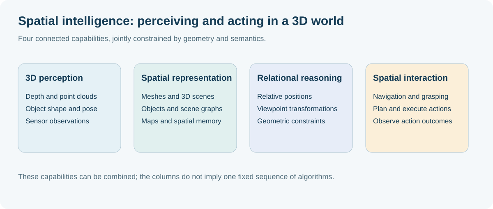
<figcaption> Figure: Spatial intelligence connects three-dimensional perception, spatial representation, relational reasoning and action. The four blocks are interrelated capability divisions. Algorithms can be used in combination and do not represent a single technology evolution path.</figcaption>
</figure>

Spatial intelligence is the ability of AI systems to perceive, understand, reason about, and interact with the three-dimensional physical world. Like the spatial cognition that humans develop from infancy, it encompasses object shapes, scene layouts, spatial relationships, and dynamic changes. As a foundation of embodied AI, the field has advanced rapidly with deep learning, neural rendering, and large multimodal models.

From the perspective of application value, spatial intelligence Across multiple high-value fields: in **autonomous driving**, accurate three-dimensional perception and dynamic object detection are the prerequisites for safe driving; in **robot control**, six degrees of freedom The spatial understanding determines the grasping success rate of the robotic arm; in the **augmented reality and virtual reality (AR/VR)**, real-time high-quality three-dimensional reconstruction and spatial anchoring are the keys to the immersive experience; in the **embodied In the AI agent**, spatial memory and three-dimensional scene graph are the basis for task planning and navigation.

The core challenges facing spatial intelligence research come from the inherent complexity of 3D data: the scarcity and expense of 3D annotated data, the diversity of representations between point clouds/voxels/implicit expressions, the time variability of real-world dynamic scenes, and the cross-modal fusion problem of 3D geometry and semantic understanding. In recent years, from NeRF to 3D Gaussian Splatting (3DGS), from PointNet to Point Transformer, from monocular depth estimation to spatial reasoning VLM, the field of spatial intelligence is experiencing rapid iteration of technology paradigms.

This article aims to systematically review the research progress of spatial intelligence and provide a reference for learning and researching spatial intelligence.

> 💡 **knowledge system and related reading**:
> This article focuses on **three-dimensional geometric perception, neural three-dimensional reconstruction (NeRF/3DGS) and spatial reasoning (3D-LLM / Spatial VLM / embodied perception)**.
> If you are interested in the **universal multimodal large model base (ViT encoder evolution, cross-modal Projector/Q-Former alignment, multimodal pretraining and post-training full process)**, please read the review of the base: .
> Paper-by-paper readings are in the companion page  (26 papers in five groups).

# 2. Spatial intelligence basic overview
{: id="2-空间智能基本概述"}

## 2.1 What is spatial intelligence?
{: id="21-什么是空间智能"}

Spatial intelligence is a multi-level capability system, from low-level geometric perception to high-level spatial reasoning, which can be divided into the following four levels:

1. **Spatial Perception (Spatial Perception)**: Obtain three-dimensional geometric information, including depth estimation, point cloud acquisition and processing, and three-dimensional shape reconstruction.
2. **Spatial Reconstruction**: Establish a three-dimensional model of the scene from multi-view images or sensor data, including SLAM, MVS, NeRF, 3DGS and other technologies.
3. **Spatial Understanding**: Semantic analysis of 3D scenes, including 3D object detection, 3D instance segmentation, scene graph generation and visual grounding.
4. **spatial reasoning (Spatial Reasoning)**: High-order cognition in three-dimensional space, including spatial relationship judgment (Is object A to the left of B?), perspective transformation reasoning, and language-guided three-dimensional interaction.

These four levels constitute the complete capability stack of spatial intelligence: perception provides raw data for reconstruction, reconstruction provides a geometric basis for understanding, and understanding provides semantic context for reasoning.

## 2.2 Perceptual hardware basics
{: id="22-感知硬件基础"}

The source of spatial intelligence is a variety of sensors, and hardware characteristics directly determine the selection of algorithms and the upper limit of perception:

|Sensor type|Principle|Advantages|limitations|Application scenarios|
|:-----------|:-----|:-----|:-----|:---------|
|**Lidar (LiDAR)**|Laser Time of Flight (ToF)|Extremely high precision, immune to light interference, direct 3D|High cost, sparse point cloud, no color|Autonomous driving, terrain mapping|
|**RGB-D camera**|Structured light/local ToF|Pixel-level alignment, high indoor accuracy|Outdoors are susceptible to interference and have limited range.|Robot navigation, AR/VR|
|**Stereo vision (Stereo)**|Binocular disparity calculation|Low cost, suitable for indoor and outdoor use|Depends on texture, poor low light performance|Industrial vision, obstacle avoidance|
|**Monocular camera**|perspective projection|Extremely cheap and easy to deploy|There is scale ambiguity and a priori needs to be learned.|Consumer electronics, wide area surveillance|
|**event camera**|Pixel-level brightness changes|Extremely high dynamic range, low latency|Low spatial resolution and heterogeneous output|High-speed motion capture, drones|

## 2.3 Core elements and technical system
{: id="23-核心要素与技术体系"}

The technical system of spatial intelligence revolves around **three-dimensional representation**. The mainstream forms are compared as follows:

|Representation|Features|Hardware adaptation|Represent technology|
|:---------|:-----|:---------|:---------|
|point cloud (Point Cloud)|Sparse, unordered, direct collection| LiDAR, RGB-D | PointNet, Point Transformer |
|Voxel Grid|Regular, dense, and memory intensive|global modeling| VoxNet, OccNet |
|Mesh|Patch representation, suitable for rendering|3D scanning| Marching Cubes |
|Implicit Field|Continuous, differentiable, memory efficient|multi-view images| NeRF, SDF |
|3D Gaussian|Explicit, fast rendering, optimizable|multi-view images| 3DGS |
|Depth Map|Pixel-aligned, computationally friendly|Monocular/Binocular| Monocular Depth Estimation |

## 2.4 Evaluation Index Cheat Sheet
{: id="24-评价指标速查表"}

|Dimensions|indicator|meaning|Applicable tasks|
|:-----|:-----|:-----|:---------|
|**Geometric accuracy**| CD (Chamfer Distance) |average euclidean distance between point sets|point cloud registration, shape reconstruction|
| | EMD (Earth Mover's Distance) |Bulldozer distance between two distributions|Shape generation, point cloud generation|
| | AbsRel / RMSE |Absolute error and root mean square error of depth prediction|Depth estimation|
|**Understanding accuracy**| mIoU (Mean IoU) |The average intersection ratio between the prediction area and the true value area|Semantic/instance segmentation, occupancy prediction|
| | mAP (Mean Average Precision) |Average precision mean (recall/precision at multiple thresholds)|3D object detection|
|**Reasoning/Dialogue**| CIDEr / BLEU-4 |Co-occurrence similarity between generated text and reference answers| 3D Captioning / 3D VQA |
| | EM (Exact Match) |The proportion of answers that match exactly|3D Visual Q&A|
|**Reconstruction quality**| PSNR / SSIM |Peak signal-to-noise ratio and structural similarity of rendered images|Perspective synthesis (NeRF/3DGS)|

## 2.5 Trends and convergence
{: id="25-研究趋势与汇聚路径"}

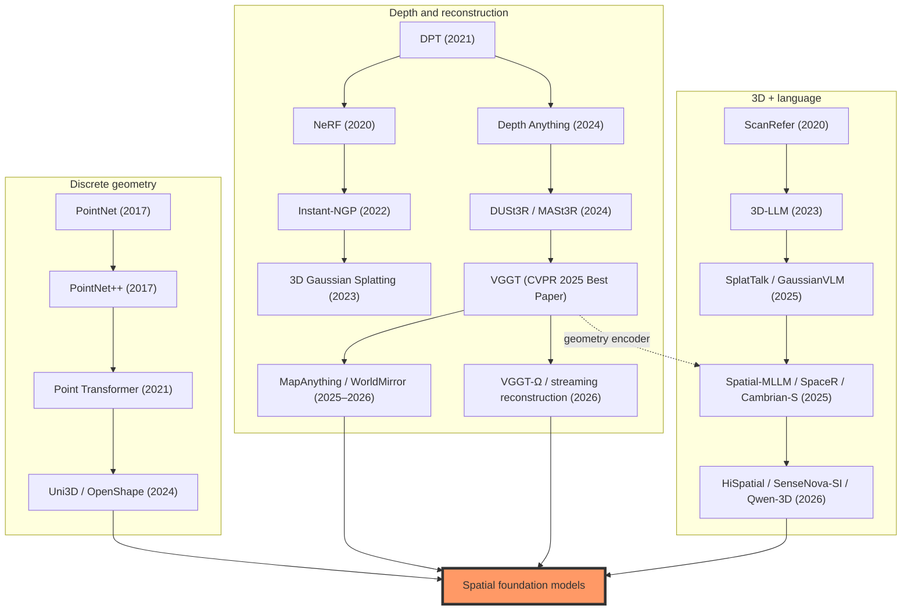

**Key milestones**:
- **2015–2017**: PointNet lays the foundation for deep learning directly on unordered point clouds and opens the era of 3D deep learning.
- **2018–2020**: VoxelNet, SECOND, and PointPillars bring LiDAR perception into commercial autonomous driving; NeRF changes the paradigm of 3D reconstruction.
- **2021–2022**: Transformers enter 3D perception (Point Transformer, DETR3D, BEVFormer) with large gains; Instant-NGP cuts NeRF training to seconds.
- **2023**: 3D Gaussian Splatting achieves real-time, high-quality rendering; 3D-LLM and EmbodiedScan connect language models with 3D scene understanding.
- **2024**: Depth Anything, SpatialVLM, DUSt3R, and Uni3D shape the first spatial perception foundation models; VSI-Bench is the first systematic test of whether MLLMs can "remember space" from video.
- **2025**: VGGT (CVPR 2025 Best Paper) outputs camera parameters, depth, point maps, and point tracks in a single forward pass, and the field enters the stage of feed-forward 3D foundation models; π³ removes the fixed reference view, and StreamVGGT makes feed-forward reconstruction streaming. Spatial-MLLM and VLM-3R connect geometry encoders to VLMs, while SpaceR and SpatialLadder train spatial reasoning with verifiable-reward reinforcement learning. Late in the year, Cambrian-S proposes "spatial supersensing" and the VSI-SUPER benchmark, SAM 3D brings single-image 3D reconstruction to real scenes, and World Labs releases Marble, which generates 3D worlds.
- **2026**: Feed-forward reconstruction starts to show scaling laws. VGGT-Ω (CVPR 2026 Oral) uses register attention to cut training memory to about 30% of its predecessor; MapAnything and WorldMirror accept arbitrary geometric priors; streaming models such as LingBot-Map handle more than ten thousand frames. On reasoning, HiSpatial (CVPR 2026) builds hierarchical spatial cognition, SenseNova-SI pushes VSI-Bench to 68.8% with eight million samples, VLM³ shows that text-only SFT can teach precise 3D geometry, and Qwen-3D and SparseOccVLA connect 3D grounding and occupancy prediction to decision making. New benchmarks such as MMSI-Bench and OVO-S-Bench expose clear weaknesses in multi-view and streaming settings.

## 2.6 Camera models and projection
{: id="26-相机模型与投影几何基础"}

One of the mathematical foundations of spatial intelligence is the **pinhole camera model (Pinhole Camera Model)**, which accurately describes how points in the three-dimensional world are projected onto the two-dimensional image plane through the center of the lens. Understanding camera projection is a necessary prerequisite for understanding SfM, stereo vision, NeRF pose input, and VGGT camera parameter output.

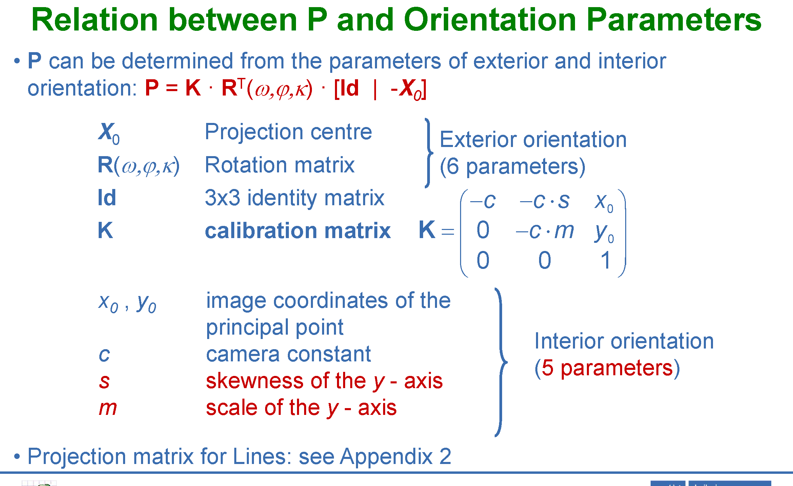<figcaption> Figure: Decomposition of camera projection matrix P = K · RT · [Id | -X₀], combine the external parameters (rotation R, projection center X₀) with the internal parameter matrix K Explicit separation. (Source: Author LUH Photogrammetric Computer Vision courseware)</figcaption>

### Pinhole camera projection
{: id="针孔相机投影"}

Given a homogeneous point $$\widetilde{\mathbf{X}}_w = (X, Y, Z, 1)^T$$ in the world coordinate system, its image homogeneous coordinate $\widetilde{\mathbf{x}} = (u, v, 1)^T$ is given by the complete projection matrix $P \in \mathbb{R}^{3\times4}$:

$$\lambda \begin{pmatrix} u \\ v \\ 1 \end{pmatrix} = P \, \widetilde{\mathbf{X}}_w = K [R \mid \mathbf{t}] \begin{pmatrix} X \\ Y \\ Z \\ 1 \end{pmatrix}$$

Here, $\lambda$ is the scale factor (depth), $K$ is the internal parameter matrix, and $[R \mid \mathbf{t}]$ is the external parameter (rotation + translation).

**Intrinsic Matrix** $K$ describes the optical and geometric characteristics of the camera:

$$K = \begin{pmatrix} f_x & s & c_x \\ 0 & f_y & c_y \\ 0 & 0 & 1 \end{pmatrix}$$

- $f_x, f_y$: Horizontal/vertical focal length in pixels, for square pixels $f_x = f_y = f$
- $(c_x, c_y)$: principal point, that is, the intersection of the optical axis and the image plane
- $s$: pixel tilt coefficient (usually zero for modern cameras)

**external parameters (Extrinsic Parameters)** $[R \mid \mathbf{t}]$: rotation matrix $R \in SO(3)$ and translation vector $\mathbf{t} \in \mathbb{R}^3$ describe the pose of the camera coordinate system relative to the world coordinate system.

### Lens distortion model
{: id="镜头畸变模型"}

Real lenses have non-linear distortion and need to be corrected after projection. The most commonly used **radial distortion (Radial Distortion)**:

$$\begin{cases} x_d = x(1 + k_1 r^2 + k_2 r^4 + k_3 r^6) \\ y_d = y(1 + k_1 r^2 + k_2 r^4 + k_3 r^6) \end{cases}, \quad r^2 = x^2 + y^2$$

Here, $(x, y)$ is the normalized camera coordinate, and $k_1, k_2, k_3$ is the radial distortion coefficient (negative values produce barrel distortion, and positive values produce pincushion distortion). **tangential distortion** is caused by lens installation eccentricity, and an additional parameter $p_1, p_2$ is introduced.

### Camera calibration
{: id="相机标定"}

The goal of **camera calibration** is to estimate $K$ and distortion parameters from known three-dimensional to two-dimensional corresponding points.

- **direct linear transformation (DLT)**: linearize $P\widetilde{\mathbf{X}} = \lambda\widetilde{\mathbf{x}}$ to $A\mathbf{p} = 0$, and solve the 11 degrees of freedom of $P$ through SVD. At least 6 point pairs are required, which is the most basic calibration method.
- **Zhang calibration method** (Zhang, TPAMI 2000): Using a multi-pose plane checkerboard, first estimate the homography matrix $H$ under each posture, then use multiple $H$ constraints to decompose the internal reference $K$, and finally use Levenberg-Marquardt Nonlinear optimization jointly refines the internal and external participation distortion coefficients. It has been integrated into OpenCV `calibrateCamera()` and is currently the most mainstream practical calibration method.

---

## 2.7 Rotation representation
{: id="27-旋转表示"}

Three-dimensional rotation is the core mathematical tool of spatial intelligence. From the camera pose of NeRF/3DGS to the orientation of the robot's end effector, rotation is everywhere. **Lie group $SO(3)$** (Special Orthogonal Group) is an algebraic structure of rotation, and different parameterization methods have their own trade-offs:

|express|Number of parameters|degrees of freedom|Advantages|limitations|
|:-----|:------|:------|:-----|:-----|
|Rotation matrix $R \in SO(3)$| 9 | 3 |The operation is straightforward and the combination is simple|Need to satisfy orthogonal constraint $RR^T=I,\det R=1$; redundant|
|Euler angle $(\phi,\theta,\psi)$| 3 | 3 |Intuitive and easy to set manually|**Gimbal Lock** problem, unstable interpolation|
|Shaft angle $(\mathbf{n}, \theta)$| 4 | 3 |The physical meaning is clear (rotation around an axis)|Not suitable for gradient optimization; $\theta$ is strange when close to 0|
|Quaternion $\mathbf{q}=(w,x,y,z)$| 4 | 3 |Smooth interpolation (SLERP), no singularity, numerical stability|There is double coverage ($\mathbf{q}$ and $-\mathbf{q}$ represent the same rotation)|

**universal joint lock**: Euler angle In a specific configuration (such as pitch angle $\theta=\pm 90°$), the two rotation axes coincide, resulting in the loss of one degree of freedom. This is the main reason why Euler angle interpolation must be avoided in 3D animation and robot control.

**unit quaternion rotation**: The quaternion $\mathbf{q} = w + x\mathbf{i} + y\mathbf{j} + z\mathbf{k}$ of $\|\mathbf{q}\|=1$ corresponds to the unique rotation, rotation point $\mathbf{p}$:
$$\mathbf{p}' = \mathbf{q} \otimes \mathbf{p} \otimes \mathbf{q}^{-1}$$

The orientation of each Gaussian ellipsoid in 3DGS is parameterized with quaternions (to ensure the continuity of gradient optimization on rotating manifolds), and the camera extrinsic parameters output by VGGT are also represented using quaternions. **Rodrigues The formula** provides a conversion bridge between the rotation matrix and the axis angle, and is a commonly used differential tool in SfM and Bundle Adjustment:
$$R = I + \sin\theta [\mathbf{n}]_\times + (1-\cos\theta) [\mathbf{n}]_\times^2$$

Here, $$[\mathbf{n}]_\times$$ is the antisymmetric matrix of the rotation axis $\mathbf{n}$.

---

# 3. Task classification system
{: id="3-任务分类体系"}

**1. Geometry perception class**: with the core of obtaining and processing three-dimensional geometric information. Typical tasks include monocular/binocular **depth estimation**, **point cloud registration** (ICP, RANSAC), **normal vector estimation**, etc.

**2. Three-dimensional reconstruction class**: Recover the three-dimensional structure of the scene from image sequences or sensor data. Includes **SfM**, **MVS**, **SLAM**, **Neural Implicit Reconstruction (NeRF, 3DGS)**, etc.

**3. Three-dimensional detection and recognition class**: Locate and classify objects in three-dimensional space. Including **3D object detection**, **3D instance/semantic segmentation**, **3D scene graph generation**.

**4. Spatial understanding and reasoning category**: Establishing high-level understanding at the three-dimensional semantic level. Including **three-dimensional visual grounding**, **three-dimensional visual question answering**, **spatial relationship reasoning**.

**5. Embodied spatial navigation class**: using spatial intelligence in the context of active exploration by agents. Including **goal-driven navigation**, **three-dimensional semantic map construction**, **spatial memory network**.

---

# 4. How the field evolved
{: id="4-空间智能技术演进范式"}

## 4.1 Point clouds and discrete geometry
{: id="41-离散几何表示与点云处理"}

### PointNet
{: id="pointnet"}
**PointNet** (Qi et al., CVPR 2017) is the first deep neural network to learn end-to-end directly on an unordered 3D point cloud, completely changing the research paradigm of 3D deep learning. Its core design idea is to maintain **substitution invariance** for any arrangement of point sets, and learn the input alignment transformation through T-Net, thereby improving the robustness to rigid body transformation.

**core design**:
- A shared MLP is applied independently to each point to map the point coordinates into a high-dimensional feature space.
- Use **symmetry function (max pooling)** to aggregate global features and naturally solve the disorder problem.
- T-Net (Transformer Network) learns the alignment transformation ($3\times3$) and feature alignment transformation ($64\times64$) of the input point cloud to improve rotation robustness.

**Core Features**:
- No voxelization is required, the original point cloud is processed directly, and the calculation is efficient.
- It can be used for three types of tasks: classification, part segmentation, and semantic segmentation.
- It established the basic paradigm of point cloud deep learning "point independent processing + symmetric aggregation".

  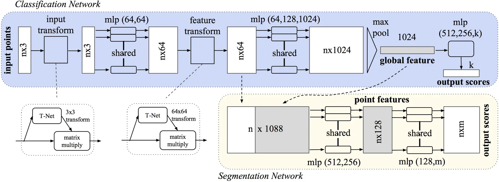
<figcaption>PointNet network architecture: Apply shared MLP to each point independently to extract features, obtain global feature vectors through Max Pooling symmetric aggregation, and T-Net learns alignment transformations for input point coordinates (3×3) and feature space (64×64) respectively.</figcaption>

---

### PointNet++
{: id="pointnet-1"}
**PointNet++** (Qi et al., NeurIPS 2017) aims at the defect that PointNet cannot capture local geometric structures and introduces a hierarchical local feature learning mechanism.

**Core design**:
- **Farthest Point Sampling (FPS)**: Recursively select the point farthest from the selected point set to obtain a spatially uniformly distributed sampling subset.
- **Ball Query Grouping**: Taking the sampling point as the center, collect local point sets in the spherical neighborhood.
- **Hierarchical PointNet**: Apply PointNet on local point sets to extract local features, and then aggregate them again on higher-level local areas, analogous to the receptive field of CNN expanding layer by layer.
- **Multi-scale grouping (MSG)**: Aggregates features in spherical domains of different radii to enhance the robustness to point cloud density changes.

**core features**:
- It solves the problem of PointNet's insufficient perception of local geometric information.
- Adaptively handle non-uniform point cloud density.
- It established the point cloud learning standard paradigm of "sampling + grouping + aggregation", and subsequent work (DGCNN, Point Transformer, etc.) was expanded under this framework.

  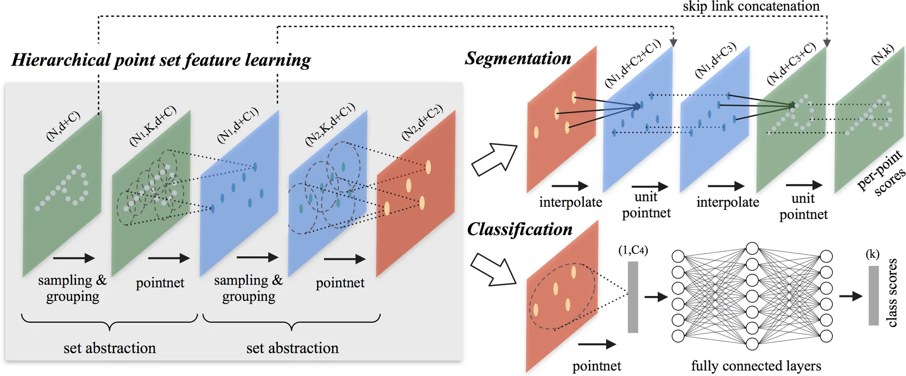
<figcaption>PointNet++ Hierarchical feature learning: through repeated stacking of FPS sampling → Ball Query grouping → PointNet local feature extraction, the receptive field is expanded layer by layer; the segmentation task additionally uses interpolation upsampling to transfer features back to the original point set.</figcaption>

---

### DGCNN
{: id="dgcnn"}
**DGCNN** (Dynamic Graph CNN, Wang et al., TOG 2019) introduces graph neural network (GNN) into point cloud processing. Different from constructing a fixed k-nearest neighbor graph in Euclidean space, DGCNN dynamically updates the k-NN graph in the **feature space** to capture point pair relationships that are semantically similar but not necessarily spatially adjacent.

The **EdgeConv** operation computes edge features between each point and its k nearest neighbors:
$$e_{ij} = h_\Theta(x_i,\ x_j - x_i)$$
Obtain new node features by aggregating edge features. After each layer of EdgeConv, the graph structure is recomputed (dynamically updated) in the feature space, allowing the network to retain both local and non-local geometric information.

**core features**:
- Dynamic graph structures capture semantic associations rather than relying solely on spatial proximity.
- EdgeConv operates simply and efficiently, and is easy to integrate into various point cloud architectures.

  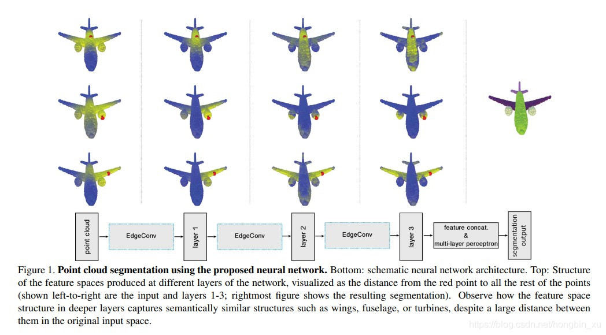
<figcaption>DGCNN architecture and EdgeConv operation: dynamically construct a k-NN graph in the feature space (recalculated at each layer), calculate the edge features of the center point and neighbors and then aggregate them; multi-layer EdgeConv stacking followed by Max Pooling to obtain the global descriptor.</figcaption>

---

### Point Transformer
{: id="point-transformer"}
**Point Transformer v1** (Zhao et al., ICCV 2021) introduces self-attention mechanism into point cloud processing. Its **vector self-attention** assigns independent attention weights to each feature dimension (different from scalar attention), and introduces position encoding to capture local geometric relationships:
$$y_i = \sum_{x_j \in \mathcal{N}(x_i)} \rho\!\left(\gamma\!\left(\phi(x_i) - \psi(x_j) + \delta\right)\right) \odot \left(\alpha(x_j) + \delta\right)$$
Here, $\delta$ is the point position encoding, $\rho$ is the softmax normalization, and $\gamma$ is the relationship network. **Point Transformer v2** (Wu et al., NeurIPS 2022) introduces grouped vector attention and multi-head mechanisms, achieving the best performance at the time on benchmarks such as ScanNet semantic segmentation.

**core features**:
- Transformer-based local self-attention captures fine-grained local geometric features.
- The position encoding design makes the network explicitly aware of the point cloud geometry.
- The standard architecture of point cloud Transformer has been established, and the subsequent Point Transformer v3 (2024) will further pretrain on large-scale data.

  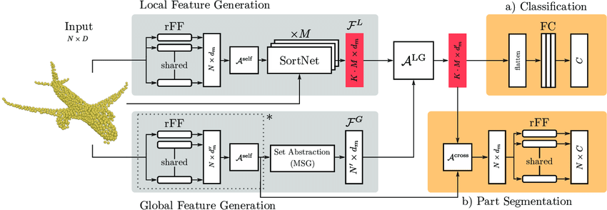
<figcaption>Point Transformer Vector self-attention: assign independent attention weights to each feature dimension (different from scalar attention), position encoding δ is based on neighbor point coordinate difference learning, while injecting attention weights and value vectors to capture local geometric relationships.</figcaption>

---

### 3D perception foundation models
{: id="三维感知基础模型"}
**Uni3D** (Zhou et al., ICLR 2024) is the first large-scale unified 3D perception base model. Through comparative pretraining on more than 10 million 3D objects, Uni3D has learned universal 3D point cloud features across categories and data sets, and has made breakthrough progress in tasks such as zero-shot 3D understanding and cross-modal retrieval (point cloud ↔ image ↔ text).

**OpenShape** (Liu et al., NeurIPS 2023) uses text-3D shape pairs for large-scale multimodal contrastive learning, transfers CLIP's open vocabulary understanding capabilities to the 3D field, and supports zero-shot 3D classification (about 85% top-1 accuracy on ModelNet40, no 3D training data required).

**Point-BERT** (Yu et al., CVPR 2022) and **Point-MAE** (Pang et al., ECCV 2022) introduce BERT/MAE self-supervised pretraining into the point cloud field to promote the formation of three-dimensional perception base models.

---

## 4.2 Dense geometry and depth
{: id="42-密集几何感知与深度估计"}

### DPT
{: id="dpt"}
**DPT** (Dense Prediction Transformer, Ranftl et al., ICCV 2021) introduces the visual Transformer (ViT) into the dense prediction task (depth estimation and semantic segmentation), and integrates the patch token feature maps of each layer of ViT into the decoder to achieve high-resolution dense output.

DPT training uses **scale-invariant loss (Scale-Invariant Loss)**:
$$\mathcal{L}_{si} = \frac{1}{n}\sum_i d_i^2 - \frac{\lambda}{n^2}\left(\sum_i d_i\right)^2$$
Here, $$d_i = \log \hat{y}_i - \log y_i$$ is the difference between the logarithm of the predicted value and the true value, and $\lambda$ controls the weight of the global scale penalty term. This loss is insensitive to absolute scale and adapts to the inherent scale ambiguity of monocular depth estimation.

**Core Features**:
- For the first time, pure ViT feature extraction is used in depth estimation, taking advantage of large receptive fields to capture global scene structure.
- Multi-scale feature fusion captures different levels of depth information from coarse to fine.
- Strong cross-dataset generalization in relatively deep zero-shot transfer.

  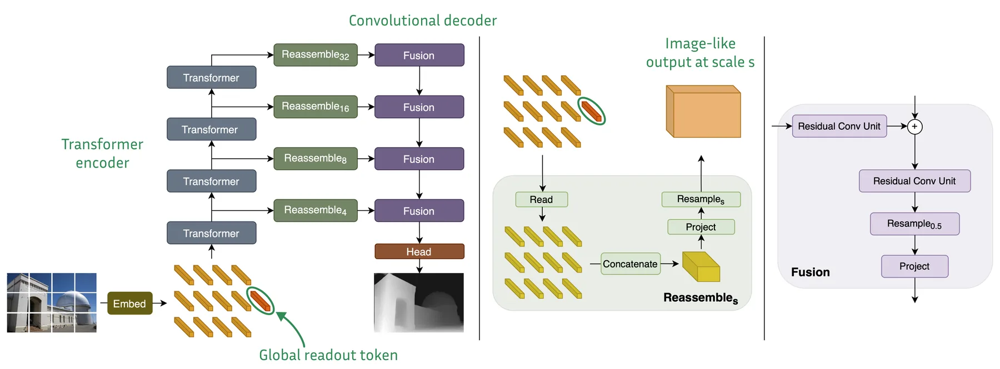
<figcaption>DPT architecture: Use ViT as the backbone to extract multi-layer patch tokens, restore the spatial resolution through the Reassemble operation to obtain multi-scale feature maps, and then gradually upsample and fuse them through the Fusion decoder to output high-resolution dense depth predictions.</figcaption>

---

### Depth Anything Series
{: id="depth-anything-系列"}
**Depth Anything** (Yang et al., CVPR 2024) is the most representative base model for monocular depth estimation so far. Its core innovation lies in the large-scale **semi-supervised data engine**: using 1.5 million annotated images as seeds, using the teacher model to generate pseudo labels for 62 million unlabeled images, and then using strong data enhancement to perform forced generalization training on the student model, breaking through the bottleneck of annotated data.

**Depth Anything V2** (NeurIPS 2024) further introduces high-quality synthetic data (Hypersim, Virtual KITTI) to improve fine-grained depth prediction, and provides an absolute scale (Metric Depth) version, which is suitable for application scenarios that require real depth values such as robot navigation.

**Core Features**:
- DINOv2 serves as the backbone network to provide powerful semantic priors.
- The zero-sample generalization ability is significantly better than the previous generation model, and the performance is stable in unseen scenes.
- Detail quality (edge sharpness, thin structures) is significantly improved in the V2 version.

  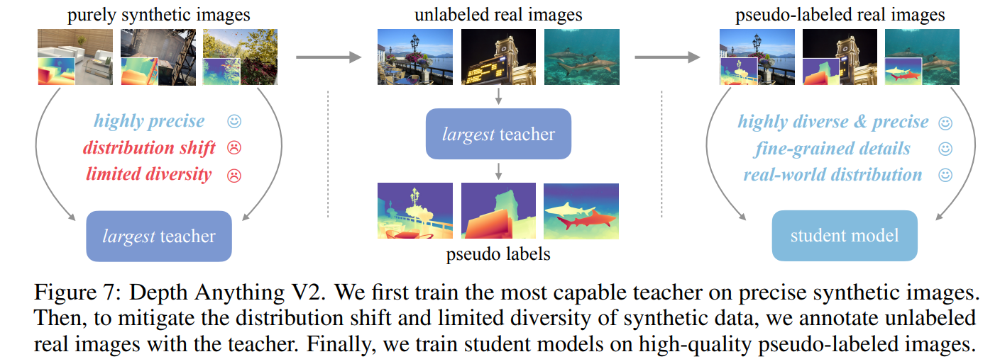
<figcaption>Depth Anything semi-supervised data engine: train the teacher model with 1.5 million labeled images, generate pseudo labels for 62 million unlabeled images, and then train the student model with strong data enhancement (color distortion, CutMix, etc.) to force it to learn a more robust depth prior.</figcaption>

---

### Marigold
{: id="marigold"}
**Marigold** (Ke et al., CVPR 2024) introduces the diffusion model into depth estimation, using the image prior contained in Stable Diffusion to achieve powerful zero-sample depth estimation by fine-tuning on a small amount of real depth data. The core insight is: Pretraining: Rich scene geometry priors are encoded in the diffusion model, which can be efficiently transferred to the depth estimation task without large-scale retraining.

**core features**:
- A generative depth estimation framework based on diffusion models to generate depth maps through multi-step denoising.
- SOTA performance can be achieved with only fine-tuning on a small amount of labeled data.
- The generated depth map has rich details and clear boundaries, especially in weak/repeated texture areas.

  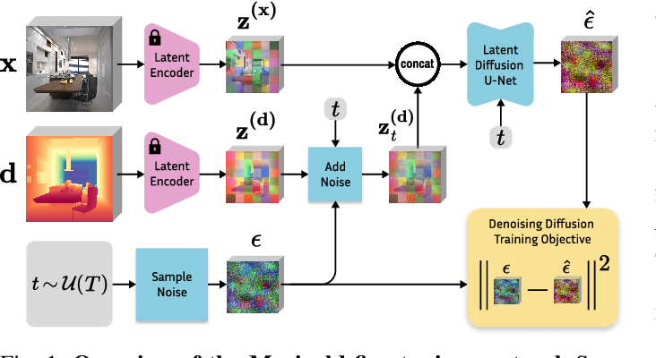
<figcaption>Marigold inference process: Encode RGB images into Stable Diffusion latent space, generate depth map latent variables through iterative denoising steps, and finally decode into relative depth maps.</figcaption>

---

### Classic stereo vision and dense matching
{: id="经典立体视觉与密集匹配"}

Before the emergence of deep learning methods, **stereo vision (Stereo Vision)** was the mainstream method for recovering depth from images. Understanding its principles will help you grasp which classic pain points are solved by methods such as Depth Anything and Marigold.

### Epipolar geometry
{: id="对极几何"}

**Epipolar Geometry** describes the geometric constraint relationship of the same scene in two images, which is the theoretical basis of stereo matching. Given the corresponding points $$\mathbf{x}_1$$ and $$\mathbf{x}_2$$ (homogeneous coordinates) in two images, they satisfy:

$$\mathbf{x}_2^T F \mathbf{x}_1 = 0$$

Here, $F \in \mathbb{R}^{3 \times 3}$ (rank 2) is the **fundamental matrix (Fundamental Matrix)**, which contains the relative pose and internal reference information of the two cameras. If the internal parameters of the two cameras $K_1, K_2$ are known, the corresponding essential matrix (Essential Matrix) **is**:

$$E = K_2^T F K_1 = [\mathbf{t}]_\times R$$

$E$ only encodes the extrinsic rotation $R$ and the (normalized) translation direction $\mathbf{t}$, and the relative pose can be recovered through SVD decomposition. Epipolar constraints reduce the two-dimensional search space to one-dimensional search on the **epipolar line (Epipolar Line)**, which is the core acceleration method of all stereo matching algorithms.

 
  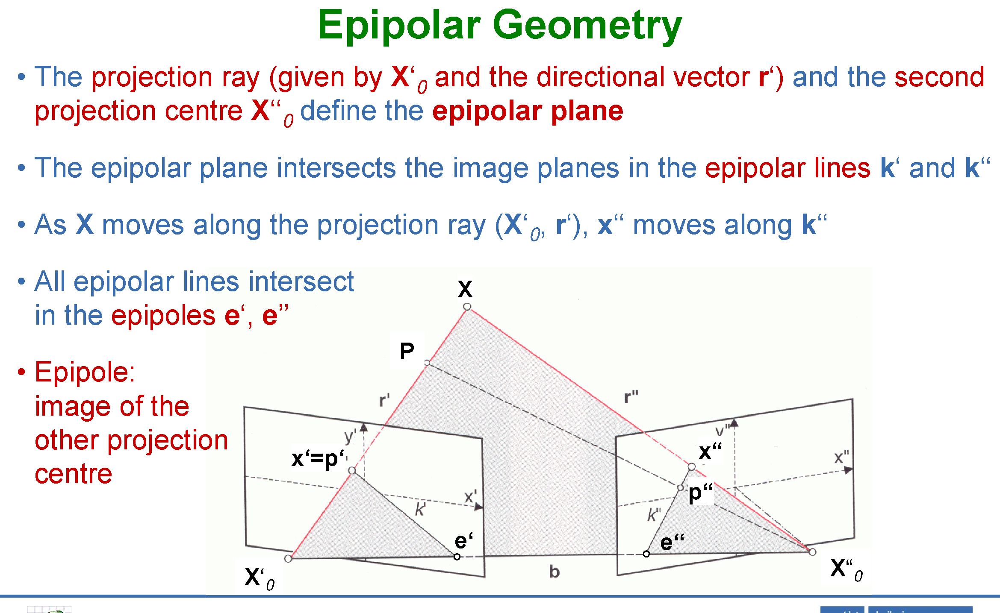<figcaption> Figure: Epipolar geometry. The projection centers X₀′, X₀″ and the object point</figcaption>

### Stereo Correction and Parallax Depth
{: id="立体纠正与视差深度"}

After **stereo correction (Stereo Rectification)** is performed on the image pair, the optical axes of the two cameras are parallel, the epipolar line becomes a horizontal scan line, and the corresponding point is only displaced in the horizontal direction - **Parallax (Disparity)** $d = u_L - u_R$. From similar triangles:

$$Z = \frac{f \cdot B}{d}$$

in $f$ is the focal length, $B$ for **Baseline** (Binocular distance), $Z$ for depth. The greater the parallax, the closer the distance; the parallax tends to zero, and the depth tends to infinity - this is the existence of monocular depth estimation. **scale ambiguity** geometric nature.

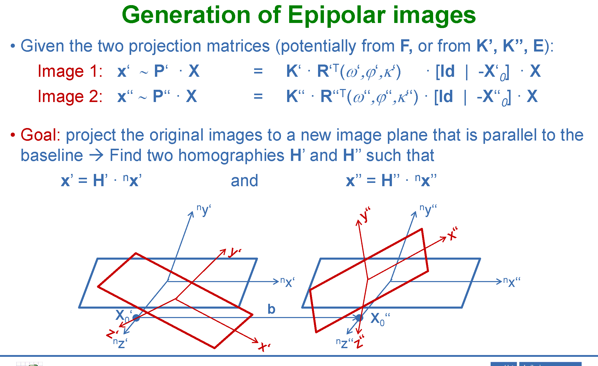<figcaption> picture: epipolar image generation (stereoscopic correction). The original image plane is reprojected to a common plane parallel to the baseline through two homography transformations H′, H″, so that the epipolar lines are aligned as horizontal scan lines. (Source: Author LUH Photogrammetric Computer Vision courseware)</figcaption>

### Semi-global matching (SGM)
{: id="半全局匹配sgm"}

**SGM** (Semi-Global Matching, Hirschmüller, TPAMI 2008) is a representative algorithm of classic dense disparity estimation and is still the industrial baseline in the fields of autonomous driving and aerial survey. The core idea is to approximate the pixel-by-pixel cost minimization problem as a one-dimensional path integral along multiple directions, and integrate the local matching cost and global smoothness constraints:

$$E(D) = \sum_{\mathbf{p}} \left( C(\mathbf{p}, D_\mathbf{p}) + \sum_{\mathbf{q} \in N_\mathbf{p}} P_1 T[|D_\mathbf{p} - D_\mathbf{q}| = 1] + P_2 T[|D_\mathbf{p} - D_\mathbf{q}| > 1] \right)$$

Here, $C(\mathbf{p}, d)$ is the matching cost of pixel $\mathbf{p}$ under the parallax $d$, and $P_1, P_2$ is the penalty term for small/large parallax jump respectively. SGM approaches global energy minimization with a linear complexity close to $O(WH)$ through path accumulation in 8 directions (Left/Right/Top/Bottom and diagonal).

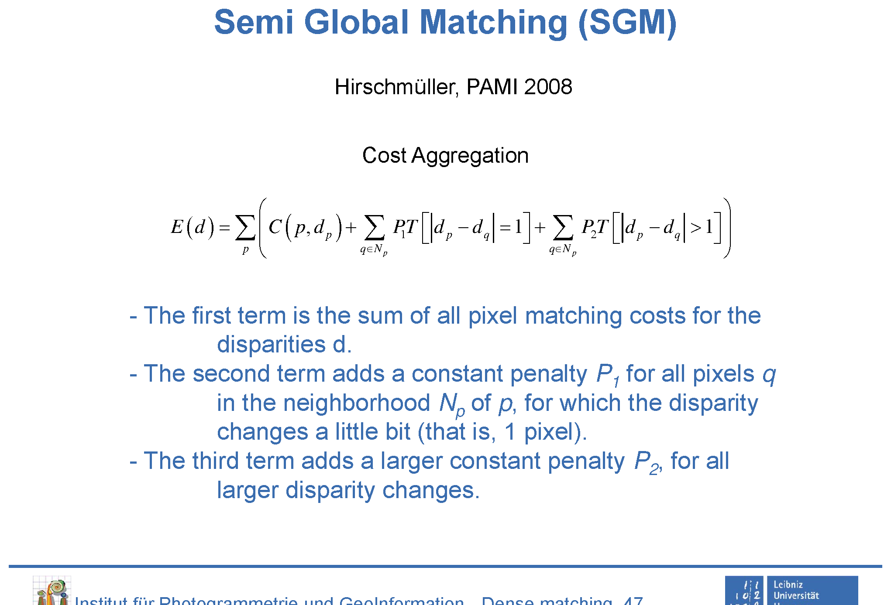<figcaption> plot: SGM cost aggregation energy function (Hirschmüller, PAMI 2008). The first item is the pixel-by-pixel matching cost, and the second and third items impose penalties P₁ and P₂ respectively on small (1 pixel) and large parallax jumps to achieve local smoothing constraints. (Source: Author LUH Photogrammetric Computer Vision courseware)</figcaption>

**Census transformation** is a commonly used matching cost for SGM. It encodes the size relationship between each position in the pixel neighborhood and the center pixel as a binary string, and then uses the Hamming distance to measure the similarity. It is naturally robust to illumination changes and avoids the defect of being sensitive to absolute brightness when directly using pixel grayscale difference (SAD/SSD).

Limitations of **SGM** is what drives the rise of deep learning methods (such as Depth Anything, Marigold):
- The matching cost in textureless areas (white walls, uniform floors) degrades, resulting in large "holes";
- Transparent/reflective objects violate the Lambertian assumption and the classical cost function fails;
- The parameter ($P_1, P_2$) needs to be manually adjusted according to the scene, and the generalization is weak;
- The stereo method must rely on calibrated binocular cameras and cannot be used in monocular scenes.

---

## 4.3 Neural 3D reconstruction
{: id="43-神经三维重建"}

### Classic SfM/MVS pipeline
{: id="经典-sfmmvs-管线"}

Before neural rendering came along, **Structure from Motion (SfM)** It is a standard framework for reconstructing 3D scenes from unconstrained image sets. Understanding the classic pipeline is the prerequisite for understanding the "revolutionary" end-to-end feedforward methods such as DUSt3R and VGGT.

**Classic SfM Process**:

1. **feature extraction**: **SIFT** (Scale-Invariant Feature Transform, Lowe, IJCV 2004) detects scale space extreme points through difference of Gaussians (DoG) and extracts 128 The dimensional Histogram of Oriented Gradients (HOG) descriptor achieves scale, rotation and illumination invariance and is the most robust image matching feature in the past two decades.
2. **feature matching + RANSAC**: Perform descriptor nearest neighbor matching on image pairs, use **RANSAC (Random Sample Consensus)** robust estimation basic matrix $F$, and automatically eliminate mismatches (outliers) by iterative random sampling.
3. **Relative pose estimation**: Recover the rotation $R$ and translation direction $\mathbf{t}$ between the two cameras from the essential matrix $$E = [\mathbf{t}]_\times R$$ through SVD decomposition (4 candidate solutions, the unique solution is determined through the positive depth constraint).
4. **Triangulation (Triangulation)**: After the poses of the two cameras are known, linear least squares (DLT) is used to restore the 3D point coordinates $\mathbf{X}$ for the matching point pairs, and solve the system of equations $$\mathbf{x}_i \times (P_i \mathbf{X}) = 0$$.
5. **Incremental reconstruction**: Using the best matching image pair as a seed, new images are registered into the reconstructed point cloud through PnP+RANSAC, and the sparse 3D structure is continuously expanded.
6. **Bundle Adjustment (BA)**: Jointly optimize all camera poses $$\{R_i, \mathbf{t}_i\}$$ and 3D point coordinates $\{X_j\}$, minimizing **reprojection error**:
$$\min_{\{R_i,\mathbf{t}_i\},\{X_j\}} \sum_{i,j} \rho\!\left(\left\|\mathbf{x}_{ij} - \pi(R_i X_j + \mathbf{t}_i)\right\|^2\right)$$
Here, $\pi(\cdot)$ is the perspective projection, and $\rho(\cdot)$ is the robust kernel function (Huber). BA is the core of SfM accuracy and is usually implemented with Ceres Solver.
7. **dense reconstruction (MVS)**: Based on the sparse SfM pose, the dense depth map is restored pixel by pixel through algorithms such as **PatchMatch MVS**, and then fused into a dense point cloud or voxel.

**COLMAP** (Schönberger & Frahm, CVPR 2016) is currently the most mainstream open source SfM+MVS system. It integrates the entire process mentioned above. Works such as DUST3R and VGGT all use COLMAP reconstruction results as the pose accuracy evaluation benchmark (AUC@5°/10°/20°).

**Classic The core limitations of SfM** are the fundamental driving forces behind the neural rendering revolution:
- **is extremely slow**: BA for large scenes takes hours or even days;
- **sparse output**: The final point cloud is sparse, and you need to run MVS again to get the dense result;
- **Weak texture failure**: SIFT features are sparsely matched in low texture areas (white walls, sky);
- **has no semantics**: pure geometric pipeline, unable to perceive object categories and semantic relationships;
- **scene independent**: cannot be generalized across scenes, and the complete pipeline needs to be re-run for each new scene.

---

### NeRF
{: id="nerf"}
**NeRF** (Neural Radiance Fields, Mildenhall et al., ECCV 2020) is one of the most influential works in the field of 3D vision in recent years. NeRF uses a fully connected network $F_\Theta: (\mathbf{x}, \mathbf{d}) \to (\mathbf{c}, \sigma)$ to map the three-dimensional coordinates $\mathbf{x}$ and viewing direction $\mathbf{d}$ into color $\mathbf{c}$ and volume density $\sigma$, and synthesizes the image through a differentiable volume rendering equation:
$$\hat{C}(\mathbf{r}) = \int_{t_n}^{t_f} T(t)\,\sigma\!\left(\mathbf{r}(t)\right)\mathbf{c}\!\left(\mathbf{r}(t),\mathbf{d}\right)\mathrm{d}t$$
Where $T(t) = \exp\!\bigl(-\int_{t_n}^{t}\sigma(\mathbf{r}(s))\,\mathrm{d}s\bigr)$ is the cumulative transmittance along the ray. Supervised network training with photometric loss of reconstructed images versus real images (MSE/SSIM).

**Core Features**:
- Fully implicit continuous representation, memory efficient, capable of rendering at any resolution.
- Differentiable rendering enables end-to-end optimization without explicit 3D supervision.
- High-quality new perspective synthesis, good at detailed textures and specular reflections.
- Limitations: slow training (several hours/scene), only representing static scenes, and no generalization between different scenes.

  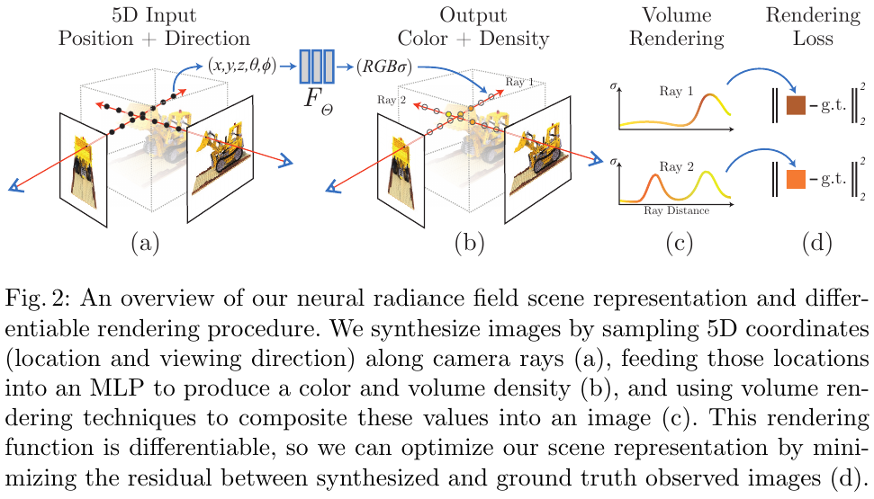
<figcaption>NeRF rendering principle: Use Coarse MLP to estimate the density distribution after uniform sampling along the camera ray, then sample the importance of high-density areas and send it to Fine MLP. Finally, the pixel color is obtained by integrating the volume rendering equation, and the luminosity loss of the real image is back-propagated to optimize the network weight.</figcaption>

**Important extensions**: Mip-NeRF (processing aliasing), Mip-NeRF 360 (unbounded scenes), Instant-NGP (hash encoding, accelerated to second level), Block-NeRF (large-scale urban scenes).

---

### 3D Gaussian Splatting
{: id="3d-gaussian-splatting"}
**3D Gaussian Splatting** (Kerbl et al., SIGGRAPH 2023) is the most important breakthrough in the field of 3D reconstruction in 2023. **real-time high-quality** rendering has completely changed the field of neural rendering.

3DGS explicitly represents the scene as a set of anisotropic three-dimensional Gaussians, each Gaussian is described by the following parameters:
- Position (mean) $\mu \in \mathbb{R}^3$
- Covariance matrix, decomposed by rotation matrix $R$ and scaling vector $s$: $\Sigma = RSS^TR^T$
- Opacity $\alpha$
- Spherical harmonic (SH) coefficients, describing view-dependent appearance

During rendering, the three-dimensional Gaussian is projected onto the image plane (Splatting), sorted by depth and then $\alpha$-blended to obtain the final pixel color. The adaptive density control mechanism automatically clones or deletes Gaussian elements based on gradient information to achieve automatic calibration of geometric details.

**core features**:
- Explicit representation avoids NeRF's volumetric rendering overhead and enables real-time rendering (>30 FPS @ 1080p).
- Differentiable and supports end-to-end gradient optimization.
- The training speed is much faster than NeRF (minutes) and the rendering quality is higher.
- Limitations: The number of Gaussian primitives is huge (millions) and the storage overhead is large; the modeling of textureless smooth areas is weak.

  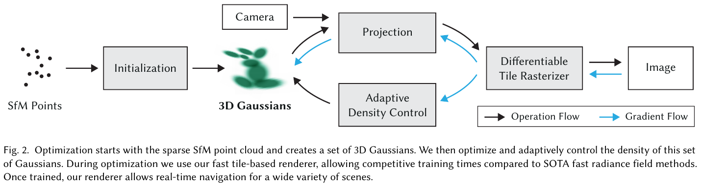
<figcaption>3D Gaussian Splatting Overview: Initialize Gaussian primitives from SfM sparse point cloud, project three-dimensional Gaussians to the image plane and then sort by depth for alpha-blended rendering, gradient-driven adaptive density control (Clone/Split) to automatically propagate or prune Gaussians.</figcaption>

---

### End-to-end dense reconstruction
{: id="端到端稠密重建"}

**DUSt3R** (Wang et al., CVPR 2024) proposes a new paradigm of end-to-end dense 3D reconstruction, which unifies the traditional SfM pipeline (feature matching → pose estimation → dense reconstruction) into a single Transformer network: input any image pair (without known camera parameters), directly predict dense point maps (Pointmap), and then fuse multiple maps through global optimization. DUSt3R breaks through the traditional method's reliance on high-overlapping image pairs and remains robust under extreme viewing angle changes.

**MASt3R** (Leroy et al., 2024) adds local feature matching capabilities based on DUSt3R, further improving the robustness and accuracy of multi-view 3D reconstruction, while supporting sparse matching tasks. Together, they represent an important transition from 3D reconstruction to "feedforward base models".

---

### VGGT and MapAnything: unified feed-forward reconstruction
{: id="vggt-与-mapanything统一前馈"}

**VGGT** (Visual Geometry Grounded Transformer, Wang et al., **CVPR 2025 Best Paper**, arXiv:2503.11651) consolidates the DUSt3R/MASt3R line. A single Transformer that alternates frame-wise and global self-attention outputs, in one forward pass, the intrinsics and extrinsics, depth maps, point maps, and point tracks for a set of images (from one to hundreds), with no global alignment or bundle adjustment. The number of stages in 3D reconstruction keeps shrinking across the three paradigms:

**MapAnything** (Keetha et al., Meta Reality Labs & CMU, arXiv:2509.13414) closes two gaps in VGGT: it optionally accepts geometric priors such as intrinsics, poses, and depth, and it outputs metric-scale 3D directly. It factors each view's geometry into ray directions, depth, pose, and a single scene-wide scale factor; the same representation serves as both input and output, so one model covers uncalibrated SfM, calibrated MVS, depth completion, and more than 12 tasks in total.

The architectures, training objectives, and full experiments are in the paper readings:  and . In the same group,  uses a single Transformer and a depth-ray representation to predict consistent geometry from any number of views.

---

### Feed-forward reconstruction in 2026
{: id="前馈重建的-2026-进展"}

After VGGT, feed-forward reconstruction has advanced along three lines.

**Scale and architecture.** **VGGT-Ω** (Wang et al., CVPR 2026 Oral, arXiv:2605.15195) observes that VGGT's global attention maps are highly sparse. It aggregates scene information into registers, replaces part of global attention with register attention that exchanges information only among the frames' registers, and removes the expensive high-resolution convolutional layers. Training memory drops to about 30% of its predecessor, which allows 15 times more labeled data plus large amounts of unlabeled video for self-supervision; camera estimation on Sintel improves by 77% over the previous best. The paper also finds that the learned registers improve VLA models and can be aligned with language, suggesting that reconstruction itself is a scalable proxy task for spatial understanding. **π³** (Wang et al., 2025, arXiv:2507.13347) removes the fixed reference view: a fully permutation-equivariant architecture predicts affine-invariant camera poses and scale-invariant local point maps, so it is robust to input order by construction.

**Streaming and long sequences.** Offline batch processing does not suit online robotics and AR. **StreamVGGT** (arXiv:2507.11539) turns VGGT into temporally causal attention, uses cached historical keys and values as implicit memory, and distills from bidirectional VGGT; **InfiniteVGGT** (arXiv:2601.02281) adds bounded rolling pruning to the KV cache to support unbounded input and introduces Long3D, a benchmark of about ten thousand frames; **LingBot-Map** (arXiv:2604.14141) borrows from SLAM, building an anchor context, a pose-reference window, and a trajectory memory into its attention design, and runs stably at about 20 FPS on sequences longer than ten thousand frames. , discussed in Section 4.5, uses StreamVGGT as its geometry encoder.

**Arbitrary priors and many outputs.** **WorldMirror** (Tencent Hunyuan, ICML 2026, arXiv:2510.10726) follows a similar idea to MapAnything: it optionally takes poses, intrinsics, and depth, and jointly outputs dense point clouds, multi-view depth, camera parameters, surface normals, and 3D Gaussians. The paper reports that injecting priors helps every task, and that input flexibility and multi-task prediction reinforce each other.

> **Summary**: The question for feed-forward reconstruction is shifting from "can geometry be obtained in one step" to "can it scale": larger models and data (VGGT-Ω), longer inputs (streaming methods), and more kinds of inputs and outputs (MapAnything, WorldMirror).

---

### 3D generation and single-image reconstruction
{: id="三维生成与单图重建"}

**Zero-1-to-3** (Liu et al., ICCV 2023) uses a diffusion model to generate novel views of a single RGB image from any viewpoint, opening a new route to single-image 3D reconstruction. **Zero123++** (Shi et al., 2023) and **One-2-3-45** (Liu et al., 2024) further improve multi-view consistency and generation speed.

**LRM** (Large Reconstruction Model, Hong et al., ICLR 2024) is a large Transformer that reconstructs a 3D NeRF from a single image in seconds, marking the shift of 3D reconstruction from optimization to **feed-forward inference**. **CAT3D** (Google DeepMind, 2024) uses a diffusion model to generate multi-view-consistent 3D scenes from very few input images (1–3), further relaxing the input requirement.

**SAM 3D** (Meta, arXiv:2511.16624) brings single-image 3D reconstruction to natural images with heavy occlusion and clutter: from one image it predicts an object's geometry, texture, and layout in the scene. A human- and model-in-the-loop annotation pipeline provides visually grounded 3D data at unprecedented scale, followed by multi-stage training that combines synthetic pretraining with real-world alignment; in human preference tests on real objects and scenes it wins against recent methods at a rate of at least 5:1.

Generated, explorable 3D worlds are also becoming products. In October 2025 World Labs released a research preview of **RTFM**, a real-time frame-generation model that uses posed frames as spatial memory; in November it launched **Marble**, a commercial world model that generates persistent, downloadable, and editable 3D environments from text, images, panoramas, or 3D models. For how this work relates to world models, see .

---

### Dynamic scene modeling (4D)
{: id="动态场景建模-4d"}

Static 3DGS has limitations in modeling dynamic scenes. **Dynamic 3D Gaussians** (Luiten et al., 3DV 2024) introduces time trajectories for each Gaussian to track the dynamic movement of particles in multi-frame scenes; **4D Gaussian Splatting** (Wu et al., CVPR 2024) realizes real-time rendering of dynamic scenes through the Gaussian deformation field in the time dimension; **Deformable 3D Gaussians** (Yang et al., CVPR 2024) focuses on non-rigid body deformation modeling, opening a new direction for dynamic modeling of robot interaction scenes.

---

## 4.4 3D detection and scene understanding
{: id="44-三维目标检测与场景理解"}

### VoxelNet / SECOND / PointPillars
{: id="voxelnet--second--pointpillars"}
**VoxelNet** (Zhou & Tuzel, CVPR 2018) is the first end-to-end framework to learn 3D object detection directly from lidar point cloud. It voxels the point cloud, uses a VFE (Voxel Feature Encoding) layer to extract local features in each non-empty voxel, and then completes detection through a three-dimensional convolutional backbone network and RPN, eliminating artificial feature engineering. However, due to the use of conventional dense three-dimensional convolution, its calculation and GPU memory overhead are extremely high, which limits its real-time performance.

  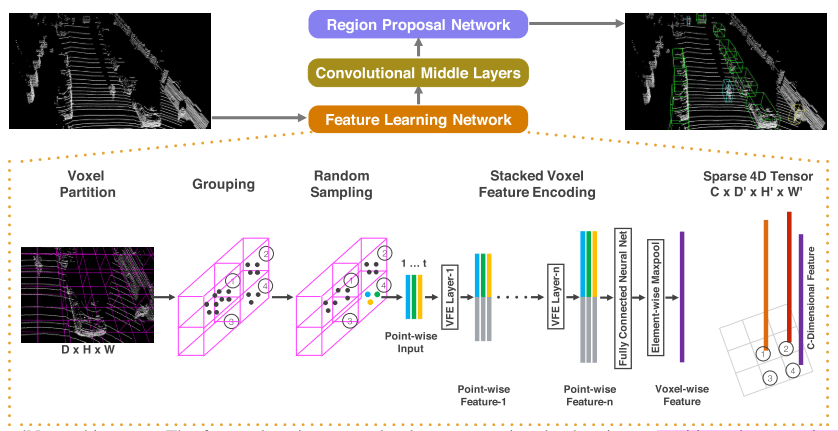
<figcaption>VoxelNet Architecture</figcaption>

**SECOND** (Sparsely Embedded Convolutional Detection, Yan et al., Sensors 2018) Aiming at the high cost of conventional three-dimensional convolution in VoxelNet, **sparse convolution (Sparse Convolution)** and manifold sparse convolution (Submanifold Sparse Convolution), the convolution calculation is only performed on non-empty voxels, which greatly improves the training and inference speed, and improves the angle regression loss function, making the voxel-based method truly of practical value.

  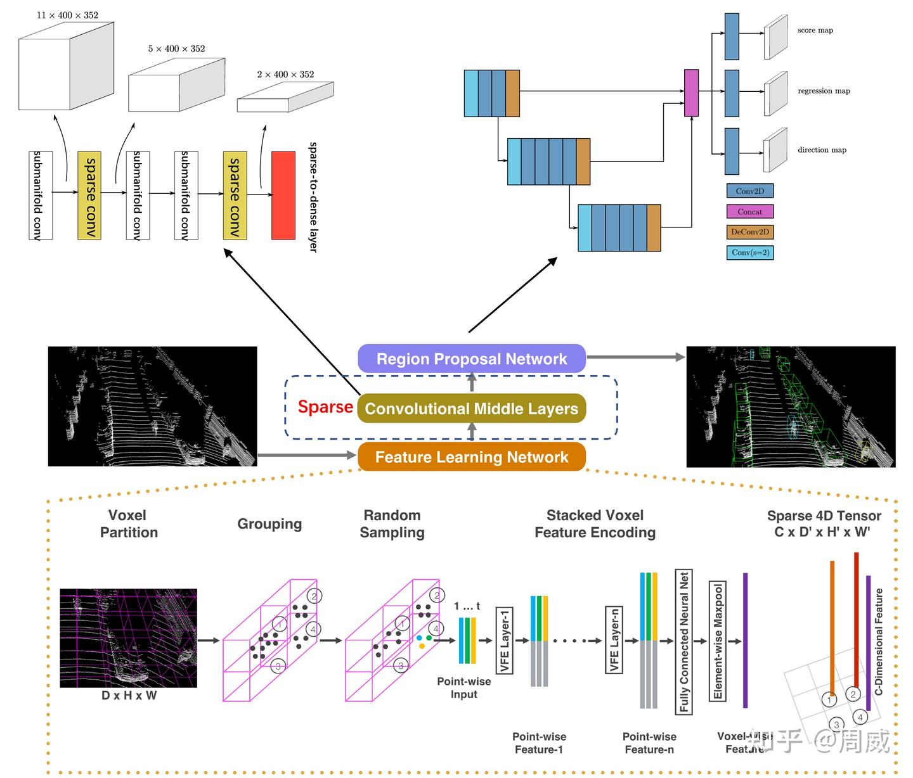
<figcaption>SECOND Architecture</figcaption>

**PointPillars** (Lang et al., CVPR 2019) goes a step further and simplifies voxelization to "Pillar" encoding - compressing the point cloud into a two-dimensional pseudo image along the height direction, thereby replacing 3D convolution (whether dense or sparse) with an efficient 2D CNN, and the inference speed is increased to 62 FPS(GPU). PointPillars achieves an excellent engineering balance between speed and accuracy, becoming the classic industry baseline in autonomous driving LiDAR perception.

**core features**:
- Voxel/columnar encoding converts unordered point clouds into regular feature maps and is compatible with mature 2D/3D CNN frameworks.
- PointPillars drives real-time deployment of 3D inspection systems on embedded hardware.

  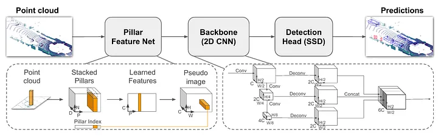
<figcaption>PointPillars architecture: compress the point cloud into a columnar (Pillar) pseudo-image along the height direction, extract the columnar features through PointNet and scatter them back to the 2D BEV feature map, and then output the three-dimensional bounding box through the 2D CNN backbone network and SSD detection head.</figcaption>

---

### BEVFormer
{: id="bevformer"}
**BEVFormer** (Li et al., ECCV 2022) is a milestone work in purely visual (no LiDAR) 3D perception. The core idea is to query multi-camera image features into a unified **bird's eye view (BEV)** space through **deformable attention (Deformable Attention)**, and introduce **timing BEV Feature fusion** captures motion information.

**core design**:
- Query is preset on the BEV plane to sample features from multi-view images through spatial cross-attention (avoiding the computational overhead of dense feature transformation).
- Temporal self-attention aligns historical BEV features with the current frame, implicitly encoding speed and motion information.
- It significantly surpassed the previous generation of purely visual methods on the nuScenes data set, triggering a research boom in "pure visual autonomous driving perception".

**Core Features**:
- No need for expensive LiDAR, just a camera to achieve 3D perception close to LiDAR level.
- BEV unified representation supports multi-task joint training such as detection, tracking, and map segmentation.

  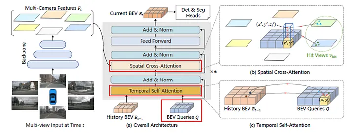
<figcaption>BEVFormer architecture: Preset grid Query in the BEV plane, project sampling features from multi-camera images to BEV space through spatial cross-attention, and then use temporal self-attention to fuse historical BEV frames to implicitly encode motion information, and finally send it to the detection/segmentation head.</figcaption>

---

### Semantic occupancy prediction
{: id="语义占用预测与表示演进"}
**Semantic Occupancy Prediction** has received widespread attention in autonomous driving in recent years. Unlike 3D object detection, which outputs a limited number of bounding boxes, occupancy prediction assigns semantic labels to each area (voxel) in the scene, and can more naturally handle arbitrarily shaped special-shaped obstacles and long-tail targets (such as fallen cartons, construction guardrails, hanging cables), and is therefore regarded as the key path to "universal obstacle perception". However, dense voxel representation naturally faces the memory and computing explosion problem of $O(N^3)$. The technological evolution of the entire field is essentially an optimization trajectory that continuously approaches the triangular constraint of "high resolution × low computing power × consistent timing":

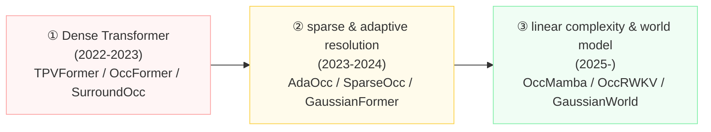

**1) Dense Transformer Paradigm (2022–2023)**: **TPVFormer** (Huang et al., CVPR 2023) Extends BEV to Tri-Perspective View, TPV), which approximates 3D space with three orthogonal planes instead of a complete voxel grid, striking a balance between computational efficiency and perceptual integrity; **OccFormer**, **SurroundOcc** further improves the reconstruction quality through 3D/dual attention. This stage established the end-to-end paradigm of "surround image → 3D voxel semantics", but the GPU memory and latency overhead caused by dense attention have become the main bottleneck for real-time deployment on the car side.

**2) Sparse and adaptive resolution representation (2023–2024)**: The core idea is that "good steel is used on the blade", and all voxels are no longer calculated equally. **AdaOcc** (Adaptive-Resolution Occupancy Prediction) introduces an adaptive resolution mechanism - using high resolution in safety-critical regions of interest (ROI) such as near and complex obstacles, and using low resolution in distant open areas to break the trade-off of efficiency and accuracy; **SparseOcc / Fully Sparse Occupancy** pushes sparsity to the extreme, only calculating non-empty areas in the entire pipeline, significantly compressing delays; there is even a work (**Occupancy as Set of Points**) that completely abandons the regular voxel grid and uses point sets to flexibly represent occupancy, which can better characterize thin structures and edges. Inspired by 3DGS, **GaussianFormer** (Wang et al., ECCV 2024)/**GaussianFormer-2** (CVPR 2025) uses a set of 3D Gaussians replace dense voxels and model occupancy with "probabilistic superposition", significantly compressing memory while preserving fine-grained geometry.

**3) Linear Complexity Architecture and Sequential World Model (2025–)**: The quadratic complexity of Transformer becomes an Achilles heel in high-resolution 3D space, and a new generation of work turns to the linear complexity backbone. **OccMamba** (CVPR 2025) is the first network to introduce the state space model (SSM/Mamba) into occupancy prediction. It maintains spatial locality through 3D-to-1D expansion such as Hilbert curve, and cooperates with the hierarchical Mamba module to implement $O(N)$ Complexity; **OccRWKV** uses a linear RNN architecture to explore real-time deployment on the end side. At the same time, occupancy prediction is moving from "single frame perception" to "sequential world model": **GaussianWorld** (CVPR 2025) not only predicts the current occupancy status in streaming input, but also predicts future 3D occupancy evolution, emphasizing timing consistency; facing the occlusion problem, **Collaborative Semantic Occupancy Prediction** uses vehicle-to-vehicle collaboration (V2V) to integrate multi-view features to "see through" occlusion, significantly improving IoU.

> Summary of the evolution of : Occupancy prediction evolves step by step along the lines of "dense computing → adaptive/sparse representation → linear complexity → temporal world model". Behind it is the same main line - pushing the perceptual resolution, computing efficiency and timing prediction capabilities to the new Pareto frontier under the limited computing power of the vehicle.

**3D Scene Graph** organizes spatial semantics from another perspective: representing the scene as a graph structure, nodes representing object instances, and edges representing spatial relationships (above/below, left/right, support, etc.), supporting language query and logical reasoning. **3DSSG** (Wald et al., CVPR 2020) is a representative dataset and baseline work in this direction. Occupancy prediction provides "dense geometry + semantics", and scene graphs provide "sparse structure + relationships". The two often complement each other in embodied navigation and task planning.

---

## 4.5 Spatial-aware language model
{: id="45-空间感知语言模型"}

> 💡 **Architecture background tip**: Spatial-aware language model (3D MLLM / Spatial VLM) is usually extended based on the 2D general multimodal large model (for example, by introducing a 3D geometry encoder, point cloud Tokenizer or spatial position Prompt). For the core mechanism of general multimodal fusion (linear projection/cross-attention/Q-Former) and the complete training tuning pipeline, please refer to the front-end base article:  and .

### ScanRefer & ScanQA
{: id="scanrefer--scanqa"}
**ScanRefer** (Chen et al., ECCV 2020) proposed the **three-dimensional visual grounding (3D Visual Grounding)** task: given a natural language description (such as "the brown chair near the door"), in the three-dimensional point cloud Locate the target object in the scene (output a 3D bounding box). The ScanRefer dataset contains 51,583 verbal descriptions of objects in ScanNet scans and is a core benchmark for 3D verbal localization directions. After ScanRefer, **Nr3D/Sr3D** (Achlioptas et al., 2020) and **ScanQA** (Azuma et al., CVPR 2022) further expanded the evaluation dimensions of three-dimensional language understanding.

  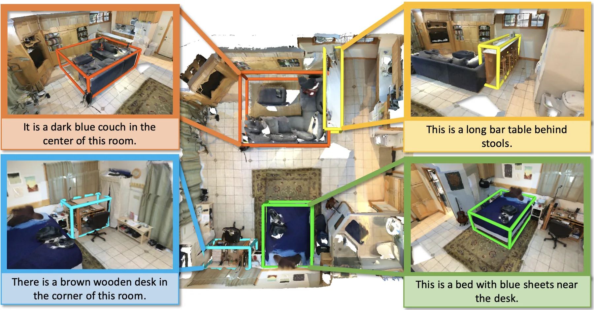
<figcaption>ScanRefer 3D visual grounding example: Given a natural language description (such as "brown chair near the door"), the model locates the target in the 3D point cloudscene and outputs the 3D bounding box. It needs to simultaneously understand the spatial relationship clues in the language and resolve ambiguities in the point cloud.</figcaption>

---

### 3D-LLM
{: id="3d-llm"}
**3D-LLM** (Hong et al., NeurIPS 2023) extends large language models (LLM) to three-dimensional perception tasks for the first time. By injecting 3D point cloud features into the context of LLM (using a 3D feature extractor based on the diffusion model to map the point cloud into a token sequence), 3D-LLM supports multiple types of tasks such as 3D scene question answering, 3D visual grounding, and 3D dialogue, without the need to design dedicated modules for each task.

**Core Features**:
- Migrate the open language understanding capabilities of LLM to three-dimensional scene perception, giving the model three-dimensional perception capabilities.
- Support diverse 3D-language tasks and demonstrate the feasibility of a unified framework.
- Laying the foundation for subsequent three-dimensional multimodal large model (3D MLLM).

  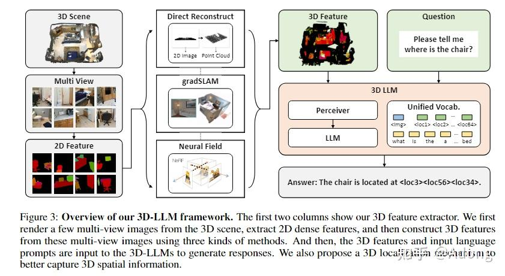
<figcaption>3D-LLM framework: Utilizes a 3D feature extractor based on the diffusion model to map the point cloudscene into a token sequence, injects it into the context window of LLM, and supports tasks such as scene question and answer, visual grounding and multi-round dialogue.</figcaption>

---

### SpatialVLM
{: id="spatialvlm"}
**SpatialVLM** (Chen et al., CVPR 2024) is specifically designed to address the spatial reasoning shortcomings of the vision-language model (VLM). Existing VLMs (such as GPT-4V) perform poorly on quantitative spatial reasoning problems such as "How far is object A from object B?" SpatialVLM performs special fine-tuning of spatial reasoning on VLM by building a large-scale **spatial reasoning question and answer data set** - which uses three-dimensional sensors to automatically generate quantitatively labeled question and answer pairs covering distance estimation, orientation judgment, size comparison and other types.

**Core Features**:
- The first work to systematically improve the quantitative spatial reasoning capabilities of VLM.
- Automated data generation pipelines scale to large scale and do not rely on manual annotation.
- Dramatically improve performance in spatial reasoning-intensive downstream tasks such as robot manipulation.

  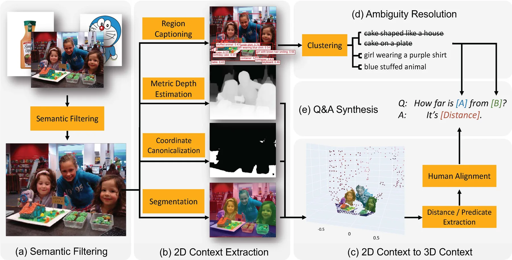
<figcaption>SpatialVLM data generation pipeline: Use three-dimensional sensor data to automatically generate quantitative spatial reasoning question and answer pairs such as distance estimation, orientation judgment, size comparison, etc., and perform special spatial reasoning fine-tuning on VLM to significantly improve the accuracy of the model on quantitative spatial problems.</figcaption>

---

### EmbodiedScan
{: id="embodiedscan"}
 **EmbodiedScan** (Wang et al., CVPR 2024) proposed a comprehensive embodied 3D scene understanding benchmark, covering multiple tasks such as 3D object detection, 3D visual grounding, and 3D question answering, emphasizing the understanding of the agent from the perspective of the agent. **Actively explore perspectives** Understand 3D scenes (first-person RGB-D stream input) rather than offline full point cloudscans. EmbodiedScan contains 5000+ scenes and 1.46 million+ instance annotations, making it one of the largest embodied 3D scene understanding datasets currently.

**core features**:
- A unified multi-task embodied 3D understanding framework that is close to the perception mode of real robot deployment.
- Emphasis on real-time, incremental 3D scene understanding rather than offline processing of complete point cloud.
- Introducing multi-granularity spatial language alignment to support fine-grained object-level and scene-level descriptions.

  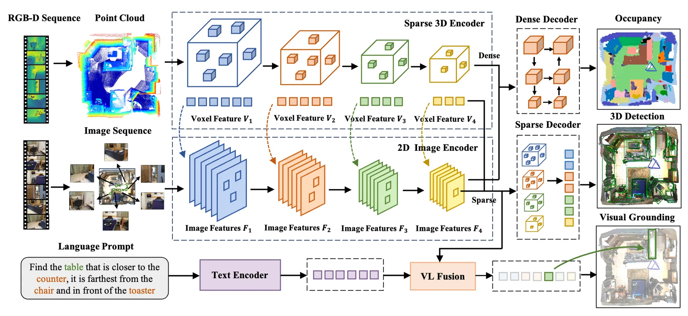
<figcaption>EmbodiedScan framework overview: Taking the first-person RGB-D perspective stream actively explored by the agent as input, it uniformly supports multi-task evaluation such as 3D object detection, 3D visual grounding and scene question and answer.</figcaption>

---

### Spatial intelligence models
{: id="空间智能大模型进展"}

In 2024, **SpatialBot** (Cai et al., which adds depth maps to RGB to strengthen spatial understanding for robots), **RoboSpatial** (a spatial-understanding dataset and model for robot manipulation), and **Chat-3D v2** (object-aware 3D feature injection for multi-turn 3D dialogue) together showed that general VLMs have systematic weaknesses in quantitative spatial reasoning such as metric distance, direction, and volume comparison, and that targeted data can close part of the gap. Work in 2025–2026 has advanced along four lines.

**1) Geometry encoders inside VLMs.** The idea is to reuse the 3D structural priors learned by feed-forward reconstruction models rather than relying only on CLIP-style encoders designed for semantics. **Spatial-MLLM** (arXiv:2505.23747) uses dual encoders: a 2D visual encoder extracts semantics, a spatial encoder initialized from the VGGT backbone extracts structure, and at inference it selects the frames that carry the most spatial information; **VG-LLM** (arXiv:2505.24625) fuses geometry-encoder features with visual tokens before the MLLM, and its 4B model surpasses Gemini-1.5-Pro on VSI-Bench; **VLM-3R** (arXiv:2505.20279) derives implicit 3D tokens from monocular video and pairs them with more than 200K reconstruction-style instruction samples. **SpatialStack** (CVPR 2026, arXiv:2603.27437) notes that these methods mostly fuse only the deepest features, and instead aligns multi-level geometry features with the language backbone layer by layer, keeping both local geometric precision and global semantics.

**2) Scaling spatial data.** **SenseNova-SI** (CVPR 2026, arXiv:2511.13719) curates eight million training samples (SenseNova-SI-8M) under a taxonomy of spatial capabilities and trains on bases such as Qwen3-VL and InternVL3, reaching 68.8% on VSI-Bench and 85.7% on MindCube with little loss of general ability; the paper also discusses early signs of generalization from data scaling, along with the risks of overfitting and language shortcuts.  also takes the data route, but builds its data hierarchically: geometry → objects → relations → abstract reasoning.

**3) Training spatial reasoning with reinforcement learning.** **SpaceR** (arXiv:2504.01805) adds "map imagination" to GRPO so the model infers the spatial layout while thinking, and beats GPT-4o on VSI-Bench by 11.6 percentage points; **SpatialLadder** (arXiv:2510.08531) trains a 3B model in three stages: object localization → multi-dimensional spatial understanding → verifiable-reward reinforcement learning; **Spatial-SSRL** (arXiv:2510.27606) needs no human or model annotation, building five automatically verifiable tasks such as shuffled-patch reordering, regional depth ordering, and relative 3D position prediction directly from ordinary RGB / RGB-D images. All three depend on rewards that can be verified automatically.

**4) Streaming and long-horizon spatial memory.** **Cambrian-S** (ICLR 2026, arXiv:2511.04670) proposes "spatial supersensing" with four levels: semantic perception, streaming event cognition, implicit 3D spatial cognition, and predictive world modeling. After training on 590K samples (VSI-590K) it gains about 30 percentage points on VSI-Bench, yet stays weak on the new VSI-SUPER benchmark (long-horizon spatial recall and continual counting), showing that scaling data and context is not enough. The authors propose "predictive sensing": the prediction error (surprise) of a next-latent-frame predictor drives memory writes and event segmentation.

The four lines are not exclusive:  lets a geometry expert and a semantic expert share self-attention,  shows that text-only SFT can teach metric geometry, and  has the model call spatial tools instead of storing geometry in its parameters.

---

### Multi-view 3D scene MLLMs
{: id="多视角-3d-场景-mllm"}

 and  take **point clouds** as input, while  and  build on **3DGS**; both kinds depend on extra 3D reconstruction or scan preprocessing. A route closer to real deployment **reuses a large multimodal model (LMM) designed for 2D content and takes only posed multi-view images or video frames as input**, injecting 3D perception as an implicit capability without explicit point clouds. **LLaVA-3D** (2024) "lifts" 2D patch features into 3D patches using camera poses, and **Video-3D LLM** (2025) binds video frames to 3D position encodings; both show that "video frames + poses" are enough for 3D question answering such as ScanQA and SQA3D.

**Ross3D** (Reconstructive Visual Instruction Tuning with 3D-Awareness, Wang et al., 2025, arXiv:2504.01901) brings a **self-supervised perspective** to this route. It argues that the main obstacle to adapting 2D LMMs to 3D scenes is the scarcity of large-scale 3D vision-language data, so instead of piling up 3D annotations it adds **two 3D-aware reconstruction objectives** during instruction tuning:

- **Cross-view reconstruction**: randomly mask some views and force the model to recover them by aggregating information from overlapping views, so it learns cross-frame geometric correspondence;
- **Global-view reconstruction**: aggregate all available views to reconstruct a bird's-eye view (BEV) of the scene, forcing a globally consistent representation of the spatial layout.

Both reconstruction heads are trained jointly with text supervision, so the model gains 3D perception without changing its input format (still video frames + instructions). Ross3D reached the state of the art at the time on several 3D scene understanding benchmarks; its **semi-supervised experiments** show that large amounts of "purely visual, language-free" 3D data can substantially improve performance, a scalable way around the 3D vision-language data bottleneck in the same spirit as Depth Anything (§4.2), which drives foundation models with massive unlabeled data.

  
<figcaption>Ross3D’s two 3D-aware reconstruction objectives (source: the official Ross3D repository Haochen-Wang409/ross3d). Left: cross-view reconstruction, in which the LLM recovers masked video frames by aggregating overlapping views; right: global-view reconstruction, which aggregates all views to reconstruct the scene's bird's-eye view (BEV). Both are trained jointly with text supervision, implicitly injecting 3D perception into a multimodal model designed for 2D content.</figcaption>

For online use,  uses a streaming geometry encoder to supply incremental geometry priors for each newly arriving frame, while  performs self-attention in world coordinates to unify 2D/3D spatial grounding and reasoning.

---

### HiSpatial (CVPR 2026)
{: id="hispatial-cvpr-2026"}

**HiSpatial** (Microsoft, **CVPR 2026**, arXiv:2603.25411) is one of the more systematic works on spatial reasoning in VLMs. Its central claim is that 3D spatial understanding must be **built level by level**, as in human cognitive development: without a geometric and metric foundation, high-level abstract reasoning is almost impossible to learn. It therefore decomposes spatial understanding into four dependent levels, Level 0 (basic geometric perception) → Level 1 (object-level understanding) → Level 2 (relations between objects) → Level 3 (abstract reasoning), combined with an annotation-free data engine (about 5 million images / 2 billion QA pairs) and an RGB-D VLM that injects **metric-scale point maps**. With only 3B parameters it surpasses Gemini-2.5-Pro and GPT-5 on SpatialRGPT, QSpatial, RoboSpatial, and other benchmarks. **The full reading is in the **.

---

### Language Gaussian Splatting
{: id="语言高斯溅射"}

Language Gaussian splatting "paints" semantic features onto 3DGS primitives and distills them through multi-view rendering, so the 3D scene is both geometrically precise and semantically queryable. Here 3DGS acts as a spatial memory that aggregates multi-view information for downstream language reasoning, not only as a tool for novel view synthesis. Readings of the representative works , , , , and  are in the first group of the paper readings.

---

# 5. Datasets and benchmarks
{: id="5-主流数据集与评测基准"}

This section first organizes common datasets by task, then lists the spatial reasoning benchmarks that have appeared over the past two years, and ends with metrics and selection advice.

## 5.1 Datasets by task
{: id="51-按任务分类的数据集"}

| Task area | Representative datasets | Use and caveats |
|:---|:---|:---|
| Shapes and synthetic 3D | ShapeNet, ModelNet10 / ModelNet40 | CAD model libraries (ShapeNet has about 55 categories) with clean, noise-free samples, used for shape reconstruction, generation, and point-cloud classification baselines; there is a domain gap to real sensor data |
| Indoor scans and semantics | ScanNet v2, Matterport3D / HM3D, S3DIS | Real RGB-D scans with per-frame RGB, depth, poses, point clouds, and semantic / instance labels; suited to semantic segmentation, scene reconstruction, and language-alignment tasks such as ScanRefer |
| Depth and dense geometry | NYU Depth V2, KITTI Depth (Eigen split), DTU, Tanks and Temples, BlendedMVS, Mip-NeRF 360 | Standard benchmarks for monocular / stereo depth, multi-view reconstruction, and novel view synthesis; the first two cover indoor and driving scenes respectively |
| Autonomous driving and outdoor perception | KITTI 3D / Odometry, nuScenes, Waymo Open, Argoverse, Lyft Level 5 | Multi-sensor data (LiDAR + multiple cameras + radar) for detection, tracking, BEV, occupancy, and trajectory prediction; Waymo has denser labels and more long-tail categories |
| Embodied simulation and navigation | Gibson, Habitat, Replica, Habitat-Matterport | 3D environments aligned with real scenes plus physical interaction interfaces, used to train and evaluate visual navigation, VLN, and goal-driven exploration |
| 3D vision and language | ScanRefer, Nr3D / Sr3D, ScanQA, SQA3D, MSR3D | 3D visual grounding (outputting 3D boxes), 3D question answering, and situated question answering; Nr3D uses natural language and Sr3D templated language |
| Spatial reasoning and embodied QA | SpatialRGPT / QSpatial, RoboSpatial / RoboRefer, EmbodiedScan | Quantitative spatial reasoning (absolute / relative distance, direction, size), spatial referring in robot manipulation, and multi-task embodied understanding from first-person RGB-D streams |
| Novel view synthesis | Synthetic-NeRF (Blender), Tanks and Temples, DTU | Rendering-quality evaluation on synthetic and real scenes, reported as PSNR / SSIM / LPIPS |

## 5.2 Spatial reasoning benchmarks
{: id="52-空间推理评测基准"}

Since late 2024, spatial reasoning benchmarks for MLLMs have multiplied, extending from single-image relations to multi-view correspondence, mental rotation, long-horizon memory, and streaming input.

| Benchmark | Input | Focus | Scale |
|:---|:---|:---|:---|
| [VSI-Bench](https://arxiv.org/abs/2412.14171) | Indoor video | Remembering and recalling space from video: counting, distance, size, relative direction, route planning, appearance order | 5,000+ QA pairs |
| [VSI-SUPER](https://arxiv.org/abs/2511.04670) | Arbitrarily long video | Long-horizon spatial recall (VSR) and continual counting (VSC), which context expansion alone cannot solve | VSR + VSC |
| [MMSI-Bench](https://arxiv.org/abs/2505.23764) | Multiple images | Multi-image spatial reasoning; humans 97%, GPT-5 about 40%, best open-source model about 30% | 1,000 multiple-choice questions |
| [MindCube](https://arxiv.org/abs/2506.21458) | A few views | Building mental maps from limited views: position, orientation, and "what if I move" | 21,154 questions / 3,268 images |
| [OmniSpatial](https://arxiv.org/abs/2506.03135) | Images | 4 categories and 50 subcategories: dynamic reasoning, complex spatial logic, spatial interaction, perspective taking | 8.4K QA pairs |
| [SITE](https://arxiv.org/abs/2505.05456) | Single image / multi-image / video | Unifies 31 existing datasets under cognitive-science taxonomies and adds view-taking and dynamic-scene tasks | Multiple choice |
| [SpatialScore](https://arxiv.org/abs/2505.17012) | Many visual inputs | Holistic evaluation over 30 tasks, with the SpatialCorpus training set and the tool-using SpatialAgent | About 5K samples |
| [Spatial4D-Bench](https://arxiv.org/abs/2601.00092) | Video | 4D spatiotemporal reasoning: objects, scenes, spatiotemporal relations, route planning, physical plausibility | About 40,000 QA pairs / 18 tasks |
| [OVO-S-Bench](https://arxiv.org/abs/2606.03890) | Streaming egocentric video | Sees only the prefix before each query, with 4 levels of abstraction; Gemini-3.1-Pro 59.2, humans 92.2 | 1,680 questions / 348 videos |

These benchmarks point to several shared problems:
- **Multi-view correspondence and perspective taking are the weakest skills.** Errors on MMSI-Bench, MindCube, OmniSpatial, and SITE concentrate on cross-image correspondence, perspective taking, and mental rotation; the MindCube authors find that generating a cognitive map before reasoning (map-then-reason) works far better than a plain language chain of thought.
- **Performance collapses in long-horizon and streaming settings.** On VSI-SUPER, videos longer than 60 minutes fail almost entirely; on OVO-S-Bench, streaming or spatially fine-tuned models underperform their own backbones, and chains of thought not grounded in the observed stream amplify spatial errors.
- **Early benchmarks are close to saturation.** Specialized models have pushed VSI-Bench to 60%–70%, and SenseNova-SI warns about language shortcuts and overlap between training and test distributions.

## 5.3 Metrics by task
{: id="53-常用评测指标按任务"}

- Shape reconstruction / generation: Chamfer Distance (CD), Earth Mover's Distance (EMD)
- Point cloud / semantic segmentation: mean IoU (mIoU), per-class IoU, mAcc
- 3D object detection: mAP (IoU thresholds), Average Translation Error, BEV mAP
- Depth estimation and reconstruction: AbsRel, RMSE, SILog (scale-invariant error), PSNR/SSIM/LPIPS (view synthesis)
- Text generation and question answering: CIDEr, BLEU, ROUGE, Exact Match (EM)
- Spatial reasoning QA: multiple-choice accuracy; numeric questions often use mean relative accuracy (MRA)
- Embodied navigation: Success Rate (SR), Success weighted by Path Length (SPL), Coverage

## 5.4 Selection advice and recommended combinations
{: id="54-选型建议与推荐组合"}

**Common pitfalls**:
- Domain match: synthetic CAD data (ShapeNet / ModelNet) suits algorithm design and fast iteration but differs greatly from real sensor noise and occlusion; to study real perception, prefer real scan sets such as ScanNet / Matterport3D / HM3D.
- Annotation consistency: datasets may differ in category definitions, coordinate systems, and units (for example, the scale of metric depth), so coordinate transforms, resolution, and semantic class mapping must be unified strictly before experiments.
- Train/test leakage: with large pretrained (3D/2D) models, scenes or objects shared across datasets can inflate results, so use strict scene-level splits. Most spatial reasoning benchmarks are built from a few scene sources such as ScanNet and ARKitScenes, which raises the risk of overlap with training data.

**Recommended combinations**:
- Prototyping (quickly testing algorithm ideas): ModelNet / ShapeNet (small, synthetic, fast to train)
- Indoor 3D perception and semantics: ScanNet v2 + S3DIS + ScanRefer (semantics + grounding)
- Novel view synthesis and neural rendering: DTU + Tanks and Temples + Mip-NeRF 360 (synthetic and real scenes)
- Autonomous driving: nuScenes + Waymo (multiple sensors, diverse scenes, long tail)
- Embodied AI and navigation: Habitat / Gibson + Matterport3D (closer to real deployment)
- Spatial reasoning VLMs: VSI-Bench + MMSI-Bench + MindCube or OmniSpatial; for online robotics or AR settings, add VSI-SUPER or OVO-S-Bench

## 5.5 Dataset trends
{: id="55-数据集发展趋势"}

3D datasets are evolving from isolated task benchmarks toward comprehensive **multi-task, cross-modal, embodied** benchmarks (such as EmbodiedScan and HM3D extensions), and evaluation is shifting from complete offline input to streaming, long-horizon settings. Priority directions include:
- Richer annotation (finer object attributes, physical states, and relations);
- Dynamic scenes and temporal labels (4D datasets, action / state annotation);
- Open-vocabulary and long-tail coverage (weakly supervised expansion with automatic annotation pipelines built on large models);
- Annotation interoperability (shared coordinate systems, semantic vocabularies, and evaluation suites) for repeatable, comparable evaluation across papers.

---

# 6. Paper readings
{: id="6-论文精读"}

The 26 paper readings for this survey now live in a separate page, , in five groups:

- **Neural rendering and language fields**: , , , , , , 
- **Feed-forward geometry and visual representation models**: , , , , , 
- **3D scene language models**: , , , , , 
- **Spatial reasoning VLMs**: , , , , 
- **Embodied manipulation and driving**: , 

LLaVA-Video is general video understanding, so it has moved to .

---

# 7. Summary and Outlook
{: id="7-总结与展望"}

Spatial intelligence is one of the core capabilities on the path to embodied general AI. This survey has traced the field from discrete geometric learning to spatial reasoning driven by large models; three changes stand out in 2025–2026:

- **Geometric perception has become foundation-model territory.** VGGT, MapAnything, and VGGT-Ω produce cameras, depth, and point maps in one forward pass and are starting to show predictable scaling; intermediate representations of geometry models (registers, geometry tokens) are becoming inputs to VLMs and VLAs.
- **Spatial reasoning is moving from "more data" to changes in training and architecture.** Geometry encoders, spatial datasets of millions of samples, and verifiable-reward reinforcement learning are advancing together, and early benchmarks such as VSI-Bench have reached 60%–70%.
- **Evaluation is moving to harder settings.** Multi-image correspondence, perspective taking, long-horizon memory, and streaming input are the new weak points; on MMSI-Bench and OVO-S-Bench, models still trail humans by more than 30 percentage points.

### Spatial intelligence and world models
{: id="空间智能与世界模型"}

Spatial intelligence is becoming the geometric skeleton of **physical world models**. Cambrian-S places predictive world modeling at the top of spatial supersensing, while SAM 3D and Marble approach the problem from the generative side with editable, explorable 3D worlds. The real difficulty remains **physical reasoning**:
- **Causal prediction**: understanding physical constraints between objects (for example, if the bottom block is removed, how will the blocks above collapse?).
- **Embodied common sense**: understanding an object's material, mass, and friction during interaction.

### Future trends
{: id="未来趋势"}

1. **Unified spatial foundation models**: reconstruction, understanding, and generation share one 3D representation, with geometric priors and language flowing both ways inside the same model.
2. **Streaming and long-horizon spatial memory**: moving from offline batches to online operation, keeping a consistent, drift-free spatial memory over hours of first-person input.
3. **Closed-loop embodied interaction**: spatial reasoning that directly serves action, judged by task success rather than question-answering accuracy alone.
