# 1. Introduction
{: id="1-引言"}

<figure class="survey-intro-figure">
  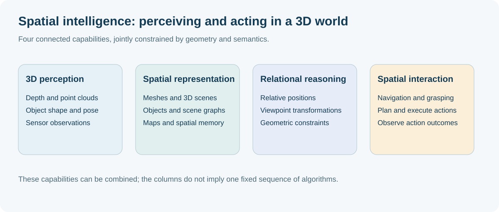
<figcaption>Figure: Spatial intelligence connects three-dimensional perception, spatial representation, relational reasoning, and action. The four blocks are interrelated divisions of capability; algorithms can be combined across them, and the blocks do not represent a single line of technological evolution.</figcaption>
</figure>

Spatial intelligence is the ability of AI systems to perceive, understand, reason about, and interact with the three-dimensional physical world. Like the spatial cognition that humans develop from infancy, it encompasses object shapes, scene layouts, spatial relationships, and dynamic changes. As a foundation of embodied AI, the field has advanced rapidly with deep learning, neural rendering, and large multimodal models.

In terms of application value, spatial intelligence cuts across several high-value fields. In **autonomous driving**, accurate three-dimensional perception and dynamic object detection are prerequisites for safe driving. In **robot control**, six-degree-of-freedom spatial understanding determines the grasp success rate of a robotic arm. In **augmented and virtual reality (AR/VR)**, real-time, high-quality three-dimensional reconstruction and spatial anchoring are the key to an immersive experience. In **embodied AI agents**, spatial memory and three-dimensional scene graphs underpin task planning and navigation.

The core challenges of spatial intelligence research stem from the inherent complexity of 3D data: 3D annotations are scarce and expensive; point clouds, voxels, and implicit representations are very diverse; real-world dynamic scenes change over time; and 3D geometry must be fused with semantic understanding across modalities. In recent years, from NeRF to 3D Gaussian Splatting (3DGS), from PointNet to Point Transformer, and from monocular depth estimation to spatial-reasoning VLMs, the technical paradigms of the field have been iterating rapidly.

This survey systematically reviews research progress in spatial intelligence and serves as a reference for learning and research in the field.

> 💡 **Knowledge map and related reading**:
> This survey focuses on **three-dimensional geometric perception, neural 3D reconstruction (NeRF/3DGS), and spatial reasoning (3D-LLMs, spatial VLMs, embodied perception)**.
> If you are interested in the **general multimodal foundation model stack (the evolution of ViT encoders, cross-modal alignment with projectors and Q-Formers, and the full pipeline of multimodal pretraining and post-training)**, read the foundational survey: .
> Paper-by-paper readings are in the companion page  (26 papers in five groups).

# 2. Fundamentals of spatial intelligence
{: id="2-空间智能基本概述"}

## 2.1 What is spatial intelligence?
{: id="21-什么是空间智能"}

Spatial intelligence is a multi-level capability system, ranging from low-level geometric perception to high-level spatial reasoning, and can be divided into four levels:

1. **Spatial perception**: obtaining three-dimensional geometric information, including depth estimation, point cloud acquisition and processing, and 3D shape reconstruction.
2. **Spatial reconstruction**: building a three-dimensional model of a scene from multi-view images or sensor data, using techniques such as SLAM, MVS, NeRF, and 3DGS.
3. **Spatial understanding**: semantic analysis of 3D scenes, including 3D object detection, 3D instance segmentation, scene graph generation, and visual grounding.
4. **Spatial reasoning**: higher-order cognition in three-dimensional space, including judging spatial relations (is object A to the left of B?), reasoning about viewpoint changes, and language-guided 3D interaction.

Together these four levels form the complete capability stack of spatial intelligence: perception supplies raw data for reconstruction, reconstruction provides the geometric basis for understanding, and understanding provides the semantic context for reasoning.

## 2.2 Sensing hardware basics
{: id="22-感知硬件基础"}

Spatial intelligence draws its input from a variety of sensors, and the hardware characteristics directly determine the choice of algorithms and the upper limit of perception:

|Sensor type|Principle|Advantages|Limitations|Application scenarios|
|:-----------|:-----|:-----|:-----|:---------|
|**LiDAR**|Laser time of flight (ToF)|Extremely high precision, immune to ambient light, direct 3D measurement|High cost, sparse point clouds, no color|Autonomous driving, terrain mapping|
|**RGB-D camera**|Structured light / local ToF|Pixel-level alignment, high indoor accuracy|Susceptible to interference outdoors and limited in range|Robot navigation, AR/VR|
|**Stereo vision**|Binocular disparity computation|Low cost, usable indoors and outdoors|Depends on texture, performs poorly in low light|Industrial vision, obstacle avoidance|
|**Monocular camera**|Perspective projection|Extremely cheap and easy to deploy|Scale ambiguity; priors must be learned|Consumer electronics, wide-area surveillance|
|**Event camera**|Per-pixel brightness changes|Extremely high dynamic range, low latency|Low spatial resolution and a heterogeneous output format|High-speed motion capture, drones|

## 2.3 Core elements and technical landscape
{: id="23-核心要素与技术体系"}

The technical landscape of spatial intelligence is organized around **three-dimensional representations**. The mainstream forms compare as follows:

|Representation|Characteristics|Hardware fit|Representative techniques|
|:---------|:-----|:---------|:---------|
|Point cloud|Sparse, unordered, directly acquired| LiDAR, RGB-D | PointNet, Point Transformer |
|Voxel grid|Regular, dense, memory-intensive|Global modeling| VoxNet, OccNet |
|Mesh|Surface-patch representation, suited to rendering|3D scanning| Marching Cubes |
|Implicit field|Continuous, differentiable, memory-efficient|Multi-view images| NeRF, SDF |
|3D Gaussians|Explicit, fast rendering, optimizable|Multi-view images| 3DGS |
|Depth map|Pixel-aligned, computationally friendly|Monocular / stereo cameras| Monocular depth estimation |

## 2.4 Evaluation metrics cheat sheet
{: id="24-评价指标速查表"}

|Dimension|Metric|Meaning|Applicable tasks|
|:-----|:-----|:-----|:---------|
|**Geometric accuracy**| CD (Chamfer Distance) |Average Euclidean distance between point sets|Point cloud registration, shape reconstruction|
| | EMD (Earth Mover's Distance) |Earth mover's distance between two distributions|Shape generation, point cloud generation|
| | AbsRel / RMSE |Absolute relative error and root mean square error of depth prediction|Depth estimation|
|**Understanding accuracy**| mIoU (Mean IoU) |Average intersection over union between predicted and ground-truth regions|Semantic/instance segmentation, occupancy prediction|
| | mAP (Mean Average Precision) |Mean of average precision (recall/precision at multiple thresholds)|3D object detection|
|**Reasoning / dialogue**| CIDEr / BLEU-4 |Co-occurrence similarity between generated text and reference answers| 3D captioning / 3D VQA |
| | EM (Exact Match) |Proportion of answers that match exactly|3D visual question answering|
|**Reconstruction quality**| PSNR / SSIM |Peak signal-to-noise ratio and structural similarity of rendered images|Novel view synthesis (NeRF/3DGS)|

## 2.5 Trends and convergence
{: id="25-研究趋势与汇聚路径"}

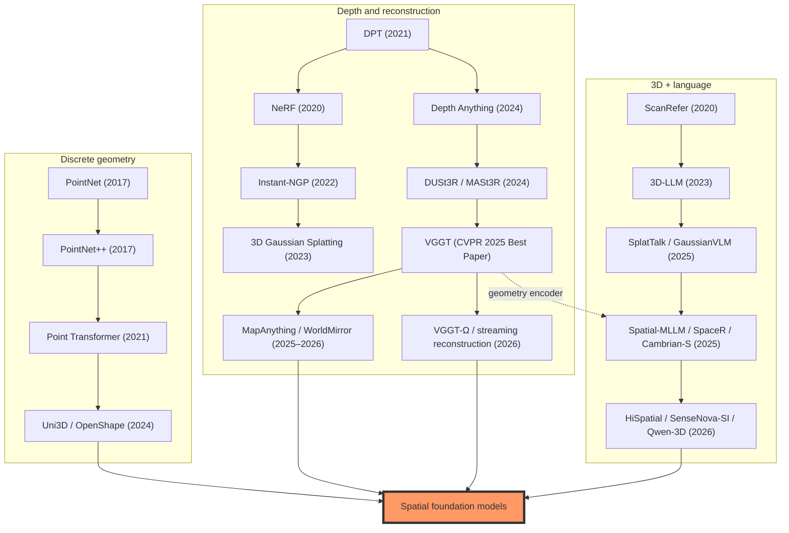

**Key milestones**:
- **2015–2017**: PointNet lays the foundation for deep learning directly on unordered point clouds and opens the era of 3D deep learning.
- **2018–2020**: VoxelNet, SECOND, and PointPillars bring LiDAR perception into commercial autonomous driving; NeRF changes the paradigm of 3D reconstruction.
- **2021–2022**: Transformers enter 3D perception (Point Transformer, DETR3D, BEVFormer) with large gains; Instant-NGP cuts NeRF training to seconds.
- **2023**: 3D Gaussian Splatting achieves real-time, high-quality rendering; 3D-LLM and EmbodiedScan connect language models with 3D scene understanding.
- **2024**: Depth Anything, SpatialVLM, DUSt3R, and Uni3D shape the first spatial perception foundation models; VSI-Bench is the first systematic test of whether MLLMs can "remember space" from video.
- **2025**: VGGT (CVPR 2025 Best Paper) outputs camera parameters, depth, point maps, and point tracks in a single forward pass, and the field enters the stage of feed-forward 3D foundation models; π³ removes the fixed reference view, and StreamVGGT makes feed-forward reconstruction streaming. Spatial-MLLM and VLM-3R connect geometry encoders to VLMs, while SpaceR and SpatialLadder train spatial reasoning with verifiable-reward reinforcement learning. Late in the year, Cambrian-S proposes "spatial supersensing" and the VSI-SUPER benchmark, SAM 3D brings single-image 3D reconstruction to real scenes, and World Labs releases Marble, which generates 3D worlds.
- **2026**: Feed-forward reconstruction starts to show scaling laws. VGGT-Ω (CVPR 2026 Oral) uses register attention to cut training memory to about 30% of its predecessor; MapAnything and WorldMirror accept arbitrary geometric priors; streaming models such as LingBot-Map handle more than ten thousand frames. On reasoning, HiSpatial (CVPR 2026) builds hierarchical spatial cognition, SenseNova-SI pushes VSI-Bench to 68.8% with eight million samples, VLM³ shows that text-only SFT can teach precise 3D geometry, and Qwen-3D and SparseOccVLA connect 3D grounding and occupancy prediction to decision making. New benchmarks such as MMSI-Bench and OVO-S-Bench expose clear weaknesses in multi-view and streaming settings.

## 2.6 Camera models and projection
{: id="26-相机模型与投影几何基础"}

One of the mathematical foundations of spatial intelligence is the **pinhole camera model**, which describes precisely how points in the three-dimensional world are projected onto the two-dimensional image plane through the lens center. Understanding camera projection is a prerequisite for understanding SfM, stereo vision, NeRF pose inputs, and VGGT's camera parameter outputs.

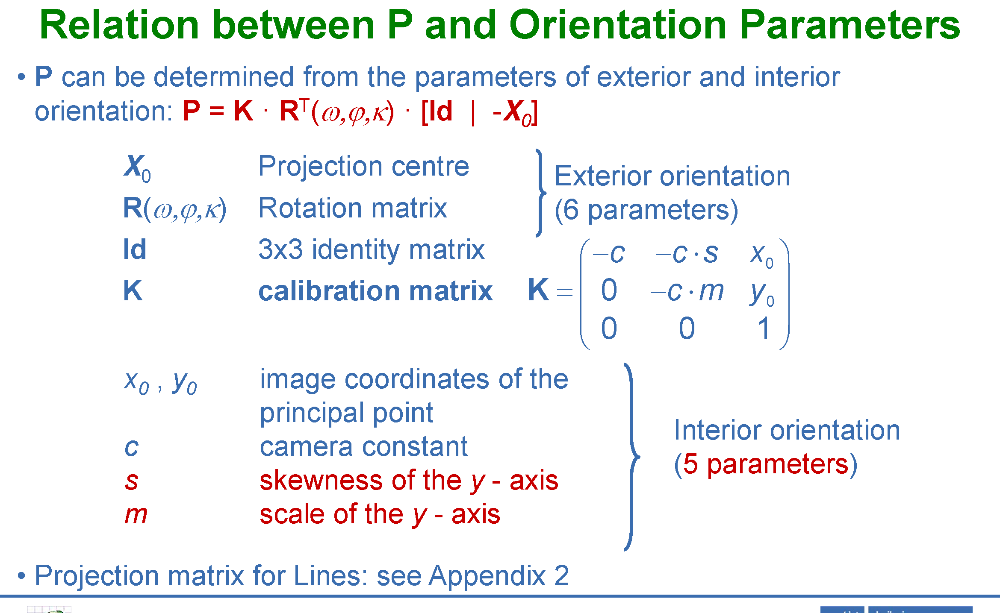<figcaption> Figure: Decomposition of the camera projection matrix P = K · RT · [Id | -X₀], explicitly separating the extrinsic parameters (rotation R, projection center X₀) from the intrinsic matrix K. (Source: LUH Photogrammetric Computer Vision course slides)</figcaption>

### Pinhole camera projection
{: id="针孔相机投影"}

Given a homogeneous point $$\widetilde{\mathbf{X}}_w = (X, Y, Z, 1)^T$$ in the world coordinate system, its image homogeneous coordinate $\widetilde{\mathbf{x}} = (u, v, 1)^T$ is given by the complete projection matrix $P \in \mathbb{R}^{3\times4}$:

$$\lambda \begin{pmatrix} u \\ v \\ 1 \end{pmatrix} = P \, \widetilde{\mathbf{X}}_w = K [R \mid \mathbf{t}] \begin{pmatrix} X \\ Y \\ Z \\ 1 \end{pmatrix}$$

Here, $\lambda$ is the scale factor (depth), $K$ is the intrinsic matrix, and $[R \mid \mathbf{t}]$ holds the extrinsic parameters (rotation + translation).

**Intrinsic matrix** $K$ describes the optical and geometric characteristics of the camera:

$$K = \begin{pmatrix} f_x & s & c_x \\ 0 & f_y & c_y \\ 0 & 0 & 1 \end{pmatrix}$$

- $f_x, f_y$: horizontal and vertical focal lengths in pixels; for square pixels, $f_x = f_y = f$
- $(c_x, c_y)$: the principal point, i.e., where the optical axis meets the image plane
- $s$: pixel skew coefficient (usually zero for modern cameras)

**Extrinsic parameters** $[R \mid \mathbf{t}]$: the rotation matrix $R \in SO(3)$ and translation vector $\mathbf{t} \in \mathbb{R}^3$ describe the pose of the camera coordinate system relative to the world coordinate system.

### Lens distortion model
{: id="镜头畸变模型"}

Real lenses exhibit nonlinear distortion, which must be corrected after projection. The most common model is **radial distortion**:

$$\begin{cases} x_d = x(1 + k_1 r^2 + k_2 r^4 + k_3 r^6) \\ y_d = y(1 + k_1 r^2 + k_2 r^4 + k_3 r^6) \end{cases}, \quad r^2 = x^2 + y^2$$

Here, $(x, y)$ are the normalized camera coordinates, and $k_1, k_2, k_3$ are the radial distortion coefficients (negative values produce barrel distortion, positive values produce pincushion distortion). **Tangential distortion** arises from decentering in lens mounting and introduces two additional parameters $p_1, p_2$.

### Camera calibration
{: id="相机标定"}

The goal of **camera calibration** is to estimate $K$ and the distortion parameters from known 3D-to-2D correspondences.

- **Direct linear transformation (DLT)**: linearize $P\widetilde{\mathbf{X}} = \lambda\widetilde{\mathbf{x}}$ into $A\mathbf{p} = 0$ and solve for the 11 degrees of freedom of $P$ via SVD. At least 6 point pairs are required; this is the most basic calibration method.
- **Zhang's calibration method** (Zhang, TPAMI 2000): using a planar checkerboard in multiple poses, first estimate the homography $H$ for each pose, then use the constraints from multiple $H$ to decompose out the intrinsics $K$, and finally refine the intrinsics, extrinsics, and distortion coefficients jointly with Levenberg-Marquardt nonlinear optimization. It is integrated into OpenCV's `calibrateCamera()` and is currently the most widely used practical calibration method.

---

## 2.7 Rotation representations
{: id="27-旋转表示"}

Three-dimensional rotation is a core mathematical tool of spatial intelligence. From NeRF/3DGS camera poses to the orientation of a robot end effector, rotation is everywhere. The **Lie group $SO(3)$** (the special orthogonal group) is the algebraic structure of rotations, and different parameterizations each have their own trade-offs:

|Representation|Parameters|Degrees of freedom|Advantages|Limitations|
|:-----|:------|:------|:-----|:-----|
|Rotation matrix $R \in SO(3)$| 9 | 3 |Direct to apply and simple to compose|Must satisfy the orthogonality constraint $RR^T=I,\det R=1$; redundant|
|Euler angles $(\phi,\theta,\psi)$| 3 | 3 |Intuitive and easy to set by hand|**Gimbal lock**; unstable interpolation|
|Axis-angle $(\mathbf{n}, \theta)$| 4 | 3 |Clear physical meaning (rotation about an axis)|Poorly suited to gradient optimization; $\theta$ is singular near 0|
|Quaternion $\mathbf{q}=(w,x,y,z)$| 4 | 3 |Smooth interpolation (SLERP), no singularities, numerically stable|Double cover ($\mathbf{q}$ and $-\mathbf{q}$ represent the same rotation)|

**Gimbal lock**: in certain configurations of Euler angles (such as pitch $\theta=\pm 90°$), two rotation axes coincide and one degree of freedom is lost. This is the main reason Euler-angle interpolation must be avoided in 3D animation and robot control.

**Unit quaternion rotation**: a quaternion $\mathbf{q} = w + x\mathbf{i} + y\mathbf{j} + z\mathbf{k}$ with $\|\mathbf{q}\|=1$ corresponds to a unique rotation, which rotates a point $\mathbf{p}$ as:
$$\mathbf{p}' = \mathbf{q} \otimes \mathbf{p} \otimes \mathbf{q}^{-1}$$

The orientation of each Gaussian ellipsoid in 3DGS is parameterized with a quaternion (which keeps gradient-based optimization continuous on the rotation manifold), and the camera extrinsics output by VGGT are also expressed as quaternions. The **Rodrigues formula** provides the bridge between rotation matrices and axis-angle representations, and is a commonly used differentiable tool in SfM and bundle adjustment:
$$R = I + \sin\theta [\mathbf{n}]_\times + (1-\cos\theta) [\mathbf{n}]_\times^2$$

Here, $$[\mathbf{n}]_\times$$ is the skew-symmetric matrix of the rotation axis $\mathbf{n}$.

---

# 3. Task taxonomy
{: id="3-任务分类体系"}

**1. Geometric perception**: centered on acquiring and processing three-dimensional geometric information. Typical tasks include monocular/stereo **depth estimation**, **point cloud registration** (ICP, RANSAC), and **surface normal estimation**.

**2. Three-dimensional reconstruction**: recovering the 3D structure of a scene from image sequences or sensor data. This includes **SfM**, **MVS**, **SLAM**, and **neural implicit reconstruction (NeRF, 3DGS)**.

**3. Three-dimensional detection and recognition**: locating and classifying objects in three-dimensional space. This includes **3D object detection**, **3D instance/semantic segmentation**, and **3D scene graph generation**.

**4. Spatial understanding and reasoning**: building high-level understanding at the 3D semantic level. This includes **3D visual grounding**, **3D visual question answering**, and **spatial relation reasoning**.

**5. Embodied spatial navigation**: applying spatial intelligence in settings where an agent actively explores. This includes **goal-driven navigation**, **3D semantic map construction**, and **spatial memory networks**.

---

# 4. How the field evolved
{: id="4-空间智能技术演进范式"}

## 4.1 Point clouds and discrete geometry
{: id="41-离散几何表示与点云处理"}

### PointNet
{: id="pointnet"}
**PointNet** (Qi et al., CVPR 2017) is the first deep neural network to learn end to end directly on unordered 3D point clouds, and it completely changed the research paradigm of 3D deep learning. Its core design idea is to maintain **permutation invariance** to any ordering of the point set, and to learn an input alignment transform through T-Net, which improves robustness to rigid transformations.

**Core design**:
- A shared MLP is applied independently to each point, mapping point coordinates into a high-dimensional feature space.
- A **symmetric function (max pooling)** aggregates global features, which naturally resolves the ordering problem.
- T-Net (Transformer Network) learns an alignment transform for the input point cloud ($3\times3$) and one for the features ($64\times64$), improving robustness to rotation.

**Key characteristics**:
- No voxelization is needed: the raw point cloud is processed directly, which is computationally efficient.
- It supports three types of tasks: classification, part segmentation, and semantic segmentation.
- It established the basic paradigm of point cloud deep learning: independent per-point processing plus symmetric aggregation.

  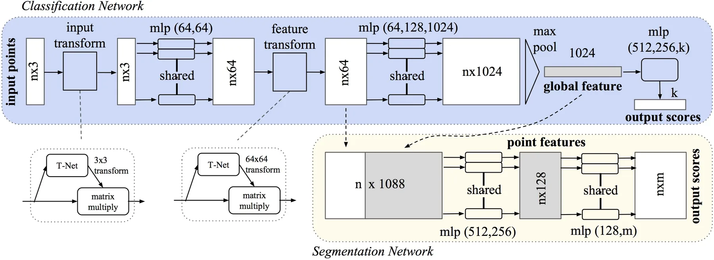
<figcaption>PointNet architecture: a shared MLP is applied to each point independently to extract features, max pooling aggregates them symmetrically into a global feature vector, and T-Net learns alignment transforms for the input point coordinates (3×3) and the feature space (64×64).</figcaption>

---

### PointNet++
{: id="pointnet-1"}
**PointNet++** (Qi et al., NeurIPS 2017) addresses PointNet's inability to capture local geometric structure by introducing a hierarchical local feature learning mechanism.

**Core design**:
- **Farthest point sampling (FPS)**: recursively selects the point farthest from the already selected set, yielding a spatially uniform subset.
- **Ball query grouping**: takes each sampled point as a center and gathers the local point set within a spherical neighborhood.
- **Hierarchical PointNet**: applies PointNet to local point sets to extract local features, then aggregates again over larger local regions, analogous to a CNN's receptive field expanding layer by layer.
- **Multi-scale grouping (MSG)**: aggregates features over spherical neighborhoods of different radii, making the network more robust to changes in point density.

**Key characteristics**:
- It remedies PointNet's weak perception of local geometry.
- It handles non-uniform point density adaptively.
- It established the standard paradigm of sampling, grouping, and aggregation for point cloud learning, within which later work (DGCNN, Point Transformer, etc.) developed.

  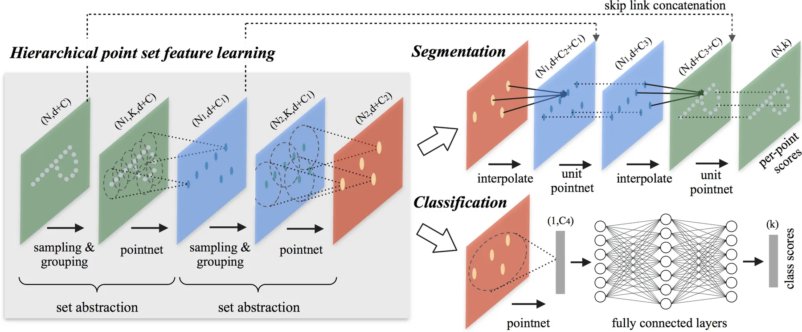
<figcaption>PointNet++ hierarchical feature learning: FPS sampling, ball-query grouping, and PointNet local feature extraction are stacked repeatedly so that the receptive field expands layer by layer; for segmentation, interpolation-based upsampling additionally propagates features back to the original point set.</figcaption>

---

### DGCNN
{: id="dgcnn"}
**DGCNN** (Dynamic Graph CNN, Wang et al., TOG 2019) brings graph neural networks (GNNs) into point cloud processing. Rather than building a fixed k-nearest-neighbor graph in Euclidean space, DGCNN dynamically updates the k-NN graph in **feature space**, capturing relations between points that are semantically similar but not necessarily spatially adjacent.

The **EdgeConv** operation computes edge features between each point and its k nearest neighbors:
$$e_{ij} = h_\Theta(x_i,\ x_j - x_i)$$
New node features are obtained by aggregating the edge features. After each EdgeConv layer, the graph structure is recomputed (dynamically updated) in feature space, allowing the network to retain both local and non-local geometric information.

**Key characteristics**:
- The dynamic graph structure captures semantic associations rather than relying on spatial proximity alone.
- EdgeConv is simple and efficient, and easy to integrate into various point cloud architectures.

  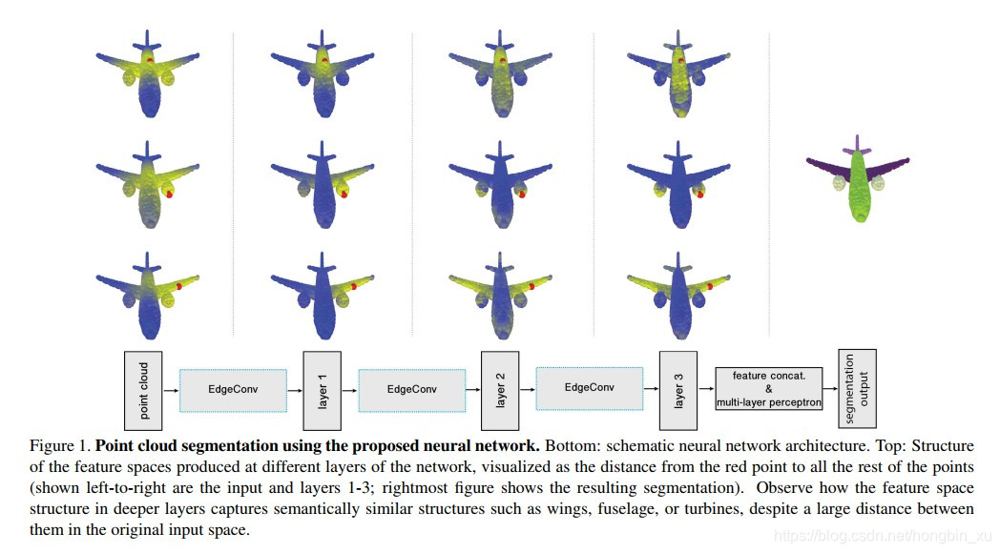
<figcaption>DGCNN architecture and the EdgeConv operation: a k-NN graph is built dynamically in feature space (recomputed at every layer), edge features between each center point and its neighbors are computed and aggregated; after stacked EdgeConv layers, max pooling produces the global descriptor.</figcaption>

---

### Point Transformer
{: id="point-transformer"}
**Point Transformer v1** (Zhao et al., ICCV 2021) introduces the self-attention mechanism into point cloud processing. Its **vector self-attention** assigns an independent attention weight to each feature dimension (unlike scalar attention) and introduces positional encoding to capture local geometric relations:
$$y_i = \sum_{x_j \in \mathcal{N}(x_i)} \rho\!\left(\gamma\!\left(\phi(x_i) - \psi(x_j) + \delta\right)\right) \odot \left(\alpha(x_j) + \delta\right)$$
Here, $\delta$ is the point positional encoding, $\rho$ is softmax normalization, and $\gamma$ is the relation network. **Point Transformer v2** (Wu et al., NeurIPS 2022) introduces grouped vector attention and a multi-head mechanism, achieving the best performance at the time on benchmarks such as ScanNet semantic segmentation.

**Key characteristics**:
- Transformer-based local self-attention captures fine-grained local geometric features.
- The positional encoding design makes the network explicitly aware of point cloud geometry.
- It established the standard architecture of the point cloud Transformer, and the subsequent Point Transformer v3 (2024) further pretrains on large-scale data.

  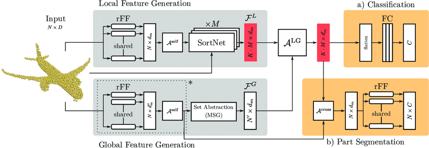
<figcaption>Point Transformer vector self-attention: an independent attention weight is assigned to each feature dimension (unlike scalar attention); the positional encoding δ is learned from neighboring point coordinate differences and is injected into both the attention weights and the value vectors to capture local geometric relations.</figcaption>

---

### 3D perception foundation models
{: id="三维感知基础模型"}
**Uni3D** (Zhou et al., ICLR 2024) is the first large-scale unified 3D perception foundation model. Through contrastive pretraining on more than 10 million 3D objects, Uni3D learns general 3D point cloud features that transfer across categories and datasets, and it makes breakthrough progress on tasks such as zero-shot 3D understanding and cross-modal retrieval (point cloud ↔ image ↔ text).

**OpenShape** (Liu et al., NeurIPS 2023) performs large-scale multimodal contrastive learning with text-3D shape pairs, transferring CLIP's open-vocabulary understanding to the 3D domain and supporting zero-shot 3D classification (about 85% top-1 accuracy on ModelNet40 without any 3D training data).

**Point-BERT** (Yu et al., CVPR 2022) and **Point-MAE** (Pang et al., ECCV 2022) bring BERT/MAE-style self-supervised pretraining to point clouds, helping foundation models for 3D perception take shape.

---

## 4.2 Dense geometry and depth
{: id="42-密集几何感知与深度估计"}

### DPT
{: id="dpt"}
**DPT** (Dense Prediction Transformer, Ranftl et al., ICCV 2021) introduces the vision Transformer (ViT) to dense prediction tasks (depth estimation and semantic segmentation), fusing the patch-token feature maps from each ViT layer into the decoder to produce high-resolution dense outputs.

DPT is trained with a **scale-invariant loss**:
$$\mathcal{L}_{si} = \frac{1}{n}\sum_i d_i^2 - \frac{\lambda}{n^2}\left(\sum_i d_i\right)^2$$
Here, $$d_i = \log \hat{y}_i - \log y_i$$ is the difference between the logarithms of the prediction and the ground truth, and $\lambda$ controls the weight of the global scale penalty term. This loss is insensitive to absolute scale, which suits the inherent scale ambiguity of monocular depth estimation.

**Key characteristics**:
- It is the first to use pure ViT features for depth estimation, exploiting the large receptive field to capture global scene structure.
- Multi-scale feature fusion captures depth information at different levels, from coarse to fine.
- It generalizes strongly across datasets in zero-shot relative-depth transfer.

  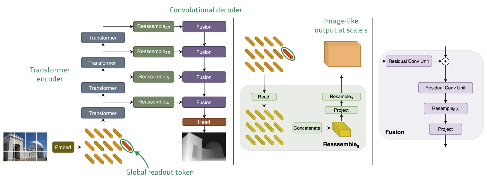
<figcaption>DPT architecture: a ViT backbone extracts multi-layer patch tokens, a Reassemble operation restores spatial resolution to obtain multi-scale feature maps, and a Fusion decoder progressively upsamples and fuses them to output a high-resolution dense depth prediction.</figcaption>

---

### Depth Anything Series
{: id="depth-anything-系列"}
**Depth Anything** (Yang et al., CVPR 2024) is so far the most representative foundation model for monocular depth estimation. Its core innovation is a large-scale **semi-supervised data engine**: 1.5 million labeled images serve as seeds, a teacher model generates pseudo-labels for 62 million unlabeled images, and a student model is then trained on them under strong data augmentation, forcing it to generalize and breaking through the labeled-data bottleneck.

**Depth Anything V2** (NeurIPS 2024) further introduces high-quality synthetic data (Hypersim, Virtual KITTI) to improve fine-grained depth prediction, and provides a metric depth version suited to applications that need real depth values, such as robot navigation.

**Key characteristics**:
- DINOv2 serves as the backbone, providing strong semantic priors.
- Zero-shot generalization is significantly better than the previous generation of models, with stable performance on unseen scenes.
- Detail quality (edge sharpness, thin structures) is significantly improved in V2.

  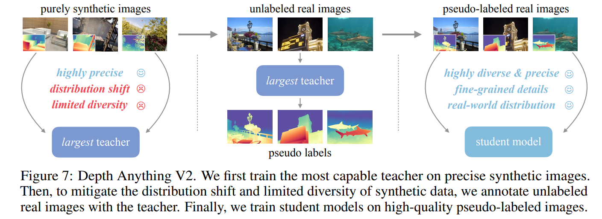
<figcaption>Depth Anything semi-supervised data engine: a teacher model is trained on 1.5 million labeled images and generates pseudo-labels for 62 million unlabeled images; a student model is then trained with strong data augmentation (color distortion, CutMix, etc.), forcing it to learn a more robust depth prior.</figcaption>

---

### Marigold
{: id="marigold"}
**Marigold** (Ke et al., CVPR 2024) introduces diffusion models to depth estimation, using the image prior contained in Stable Diffusion and fine-tuning on a small amount of real depth data to achieve strong zero-shot depth estimation. The core insight is that a pretrained diffusion model encodes rich scene geometry priors, which can be transferred efficiently to depth estimation without large-scale retraining.

**Key characteristics**:
- A generative depth estimation framework based on diffusion models, producing depth maps through multi-step denoising.
- State-of-the-art performance is achieved with fine-tuning on only a small amount of labeled data.
- The generated depth maps are rich in detail with sharp boundaries, especially in textureless or repetitive-texture regions.

  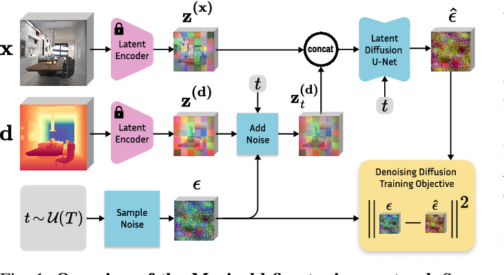
<figcaption>Marigold inference process: the RGB image is encoded into Stable Diffusion's latent space, the depth latent is generated through iterative denoising steps, and it is finally decoded into a relative depth map.</figcaption>

---

### Classic stereo vision and dense matching
{: id="经典立体视觉与密集匹配"}

Before deep learning methods emerged, **stereo vision** was the mainstream way to recover depth from images. Understanding its principles helps clarify which classic pain points methods such as Depth Anything and Marigold address.

### Epipolar geometry
{: id="对极几何"}

**Epipolar geometry** describes the geometric constraint between two images of the same scene and is the theoretical basis of stereo matching. Given corresponding points $$\mathbf{x}_1$$ and $$\mathbf{x}_2$$ (in homogeneous coordinates) in two images, they satisfy:

$$\mathbf{x}_2^T F \mathbf{x}_1 = 0$$

Here, $F \in \mathbb{R}^{3 \times 3}$ (rank 2) is the **fundamental matrix**, which encodes the relative pose and the intrinsics of the two cameras. If the intrinsics $K_1, K_2$ of the two cameras are known, the corresponding **essential matrix** is:

$$E = K_2^T F K_1 = [\mathbf{t}]_\times R$$

$E$ encodes only the extrinsic rotation $R$ and the (normalized) translation direction $\mathbf{t}$, and the relative pose can be recovered through SVD decomposition. The epipolar constraint reduces a two-dimensional search to a one-dimensional search along the **epipolar line**, which is the core speedup of all stereo matching algorithms.

 
  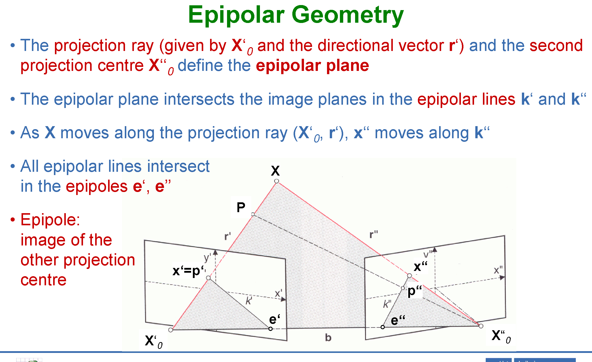<figcaption> Figure: Epipolar geometry. The projection centers X₀′, X₀″ and the object point</figcaption>

### Stereo rectification and disparity-based depth
{: id="立体纠正与视差深度"}

After **stereo rectification** of an image pair, the optical axes of the two cameras become parallel, the epipolar lines become horizontal scan lines, and corresponding points are displaced only horizontally; this displacement is the **disparity** $d = u_L - u_R$. From similar triangles:

$$Z = \frac{f \cdot B}{d}$$

where $f$ is the focal length, $B$ is the **baseline** (the distance between the two cameras), and $Z$ is the depth. The larger the disparity, the closer the point; as disparity tends to zero, depth tends to infinity. This is the geometric root of the **scale ambiguity** in monocular depth estimation.

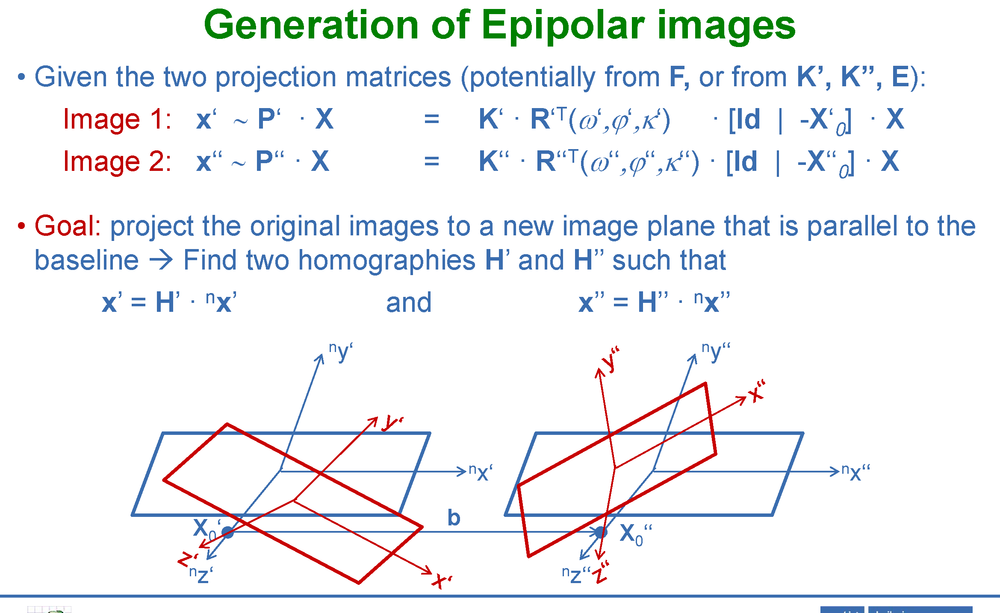<figcaption> Figure: Epipolar image generation (stereo rectification). The original image planes are reprojected onto a common plane parallel to the baseline through two homographies H′ and H″, so that the epipolar lines become aligned horizontal scan lines. (Source: LUH Photogrammetric Computer Vision course slides)</figcaption>

### Semi-global matching (SGM)
{: id="半全局匹配sgm"}

**SGM** (Semi-Global Matching, Hirschmüller, TPAMI 2008) is a representative algorithm for classic dense disparity estimation and remains an industrial baseline in autonomous driving and aerial surveying. Its core idea is to approximate the pixel-wise cost minimization problem with one-dimensional path-wise aggregation along multiple directions, combining the local matching cost with a global smoothness constraint:

$$E(D) = \sum_{\mathbf{p}} \left( C(\mathbf{p}, D_\mathbf{p}) + \sum_{\mathbf{q} \in N_\mathbf{p}} P_1 T[|D_\mathbf{p} - D_\mathbf{q}| = 1] + P_2 T[|D_\mathbf{p} - D_\mathbf{q}| > 1] \right)$$

Here, $C(\mathbf{p}, d)$ is the matching cost of pixel $\mathbf{p}$ at disparity $d$, and $P_1, P_2$ are the penalty terms for small and large disparity jumps, respectively. By aggregating paths in 8 directions (left/right/up/down and diagonals), SGM approximates global energy minimization with near-linear $O(WH)$ complexity.

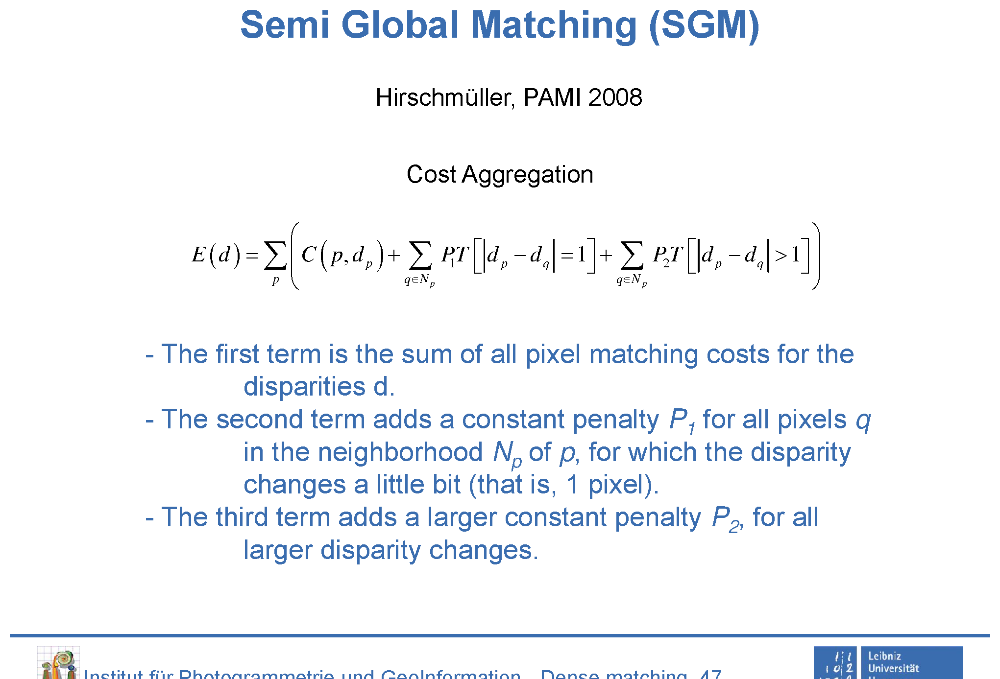<figcaption> Figure: SGM cost aggregation energy function (Hirschmüller, PAMI 2008). The first term is the pixel-wise matching cost; the second and third terms impose penalties P₁ and P₂ on small (1 pixel) and large disparity jumps, respectively, enforcing a local smoothness constraint. (Source: LUH Photogrammetric Computer Vision course slides)</figcaption>

The **Census transform** is a commonly used matching cost for SGM. It encodes the relation between each position in a pixel's neighborhood and the center pixel as a binary string, and then measures similarity with the Hamming distance. It is naturally robust to illumination changes and avoids the sensitivity to absolute brightness of directly using pixel intensity differences (SAD/SSD).

The limitations of **SGM** are what drove the rise of deep learning methods (such as Depth Anything and Marigold):
- In textureless regions (white walls, uniform floors) the matching cost degrades, leaving large "holes";
- Transparent and reflective objects violate the Lambertian assumption, so the classic cost function fails;
- The parameters ($P_1, P_2$) must be tuned by hand for each scene, and generalization is weak;
- Stereo methods depend on a calibrated binocular camera and cannot be used in monocular settings.

---

## 4.3 Neural 3D reconstruction
{: id="43-神经三维重建"}

### Classic SfM/MVS pipeline
{: id="经典-sfmmvs-管线"}

Before neural rendering, **Structure from Motion (SfM)** was the standard framework for reconstructing 3D scenes from unconstrained image sets. Understanding the classic pipeline is a prerequisite for understanding the "revolutionary" end-to-end feed-forward methods such as DUSt3R and VGGT.

**Classic SfM pipeline**:

1. **Feature extraction**: **SIFT** (Scale-Invariant Feature Transform, Lowe, IJCV 2004) detects scale-space extrema with the difference of Gaussians (DoG) and extracts 128-dimensional histogram-of-oriented-gradients descriptors, achieving invariance to scale, rotation, and illumination; it has been the most robust image matching feature for the past two decades.
2. **Feature matching + RANSAC**: descriptors are matched by nearest neighbor across image pairs, and **RANSAC (Random Sample Consensus)** robustly estimates the fundamental matrix $F$, automatically rejecting mismatches (outliers) through iterative random sampling.
3. **Relative pose estimation**: the rotation $R$ and translation direction $\mathbf{t}$ between the two cameras are recovered from the essential matrix $$E = [\mathbf{t}]_\times R$$ via SVD decomposition (4 candidate solutions; the unique solution is chosen using the positive-depth constraint).
4. **Triangulation**: once the two camera poses are known, linear least squares (DLT) recovers the 3D coordinates $\mathbf{X}$ of matched point pairs by solving the system $$\mathbf{x}_i \times (P_i \mathbf{X}) = 0$$.
5. **Incremental reconstruction**: starting from the best-matching image pair as a seed, new images are registered into the reconstructed point cloud via PnP+RANSAC, continuously extending the sparse 3D structure.
6. **Bundle adjustment (BA)**: all camera poses $$\{R_i, \mathbf{t}_i\}$$ and 3D point coordinates $\{X_j\}$ are jointly optimized to minimize the **reprojection error**:
$$\min_{\{R_i,\mathbf{t}_i\},\{X_j\}} \sum_{i,j} \rho\!\left(\left\|\mathbf{x}_{ij} - \pi(R_i X_j + \mathbf{t}_i)\right\|^2\right)$$
Here, $\pi(\cdot)$ is the perspective projection and $\rho(\cdot)$ is a robust kernel function (Huber). BA is the core of SfM accuracy and is usually implemented with Ceres Solver.
7. **Dense reconstruction (MVS)**: starting from the sparse SfM poses, algorithms such as **PatchMatch MVS** recover dense depth maps pixel by pixel, which are then fused into a dense point cloud or voxels.

**COLMAP** (Schönberger & Frahm, CVPR 2016) is currently the most widely used open-source SfM+MVS system and integrates the entire pipeline above. Works such as DUSt3R and VGGT all use COLMAP reconstructions as the benchmark for pose accuracy evaluation (AUC@5°/10°/20°).

**The core limitations of classic SfM** are the fundamental driving forces behind the neural rendering revolution:
- **Extremely slow**: BA on large scenes takes hours or even days;
- **Sparse output**: the final point cloud is sparse, and MVS must be run again to obtain a dense result;
- **Failure on weak texture**: SIFT features match sparsely in low-texture regions (white walls, sky);
- **No semantics**: it is a purely geometric pipeline and cannot perceive object categories or semantic relations;
- **Scene-specific**: it does not generalize across scenes, and the whole pipeline must be re-run for every new scene.

---

### NeRF
{: id="nerf"}
**NeRF** (Neural Radiance Fields, Mildenhall et al., ECCV 2020) is one of the most influential works in 3D vision in recent years. NeRF uses a fully connected network $F_\Theta: (\mathbf{x}, \mathbf{d}) \to (\mathbf{c}, \sigma)$ to map a three-dimensional coordinate $\mathbf{x}$ and viewing direction $\mathbf{d}$ to a color $\mathbf{c}$ and a volume density $\sigma$, and synthesizes images through a differentiable volume rendering equation:
$$\hat{C}(\mathbf{r}) = \int_{t_n}^{t_f} T(t)\,\sigma\!\left(\mathbf{r}(t)\right)\mathbf{c}\!\left(\mathbf{r}(t),\mathbf{d}\right)\mathrm{d}t$$
where $T(t) = \exp\!\bigl(-\int_{t_n}^{t}\sigma(\mathbf{r}(s))\,\mathrm{d}s\bigr)$ is the accumulated transmittance along the ray. The network is trained with a photometric loss (MSE/SSIM) between reconstructed and real images.

**Key characteristics**:
- A fully implicit, continuous representation that is memory-efficient and can render at any resolution.
- Differentiable rendering enables end-to-end optimization without explicit 3D supervision.
- High-quality novel view synthesis, good at fine textures and specular reflections.
- Limitations: slow training (several hours per scene), represents only static scenes, and does not generalize across scenes.

  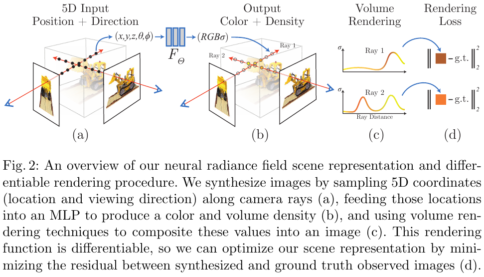
<figcaption>NeRF rendering principle: a coarse MLP estimates the density distribution after uniform sampling along each camera ray; importance sampling is then applied to high-density regions and the samples are fed to a fine MLP. The pixel color is obtained by integrating the volume rendering equation, and the photometric loss against the real image is backpropagated to optimize the network weights.</figcaption>

**Important extensions**: Mip-NeRF (anti-aliasing), Mip-NeRF 360 (unbounded scenes), Instant-NGP (hash encoding, speeding training up to seconds), and Block-NeRF (large-scale urban scenes).

---

### 3D Gaussian Splatting
{: id="3d-gaussian-splatting"}
**3D Gaussian Splatting** (Kerbl et al., SIGGRAPH 2023) is the most important breakthrough in 3D reconstruction in 2023. Its **real-time, high-quality** rendering has completely changed the field of neural rendering.

3DGS represents a scene explicitly as a set of anisotropic 3D Gaussians, each described by the following parameters:
- Position (mean) $\mu \in \mathbb{R}^3$
- Covariance matrix, factored into a rotation matrix $R$ and a scaling vector $s$: $\Sigma = RSS^TR^T$
- Opacity $\alpha$
- Spherical harmonic (SH) coefficients, describing view-dependent appearance

During rendering, the 3D Gaussians are projected onto the image plane (splatting), sorted by depth, and then $\alpha$-blended to obtain the final pixel color. An adaptive density control mechanism automatically clones or removes Gaussians based on gradient information, refining geometric detail automatically.

**Key characteristics**:
- The explicit representation avoids NeRF's volume rendering overhead and enables real-time rendering (>30 FPS at 1080p).
- It is differentiable and supports end-to-end gradient optimization.
- Training is much faster than NeRF (minutes) and rendering quality is higher.
- Limitations: the number of Gaussian primitives is huge (millions), so storage overhead is large; modeling of textureless smooth regions is weak.

  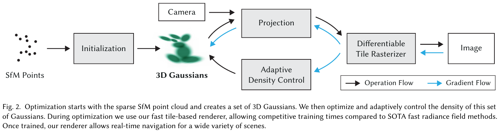
<figcaption>3D Gaussian Splatting overview: Gaussian primitives are initialized from the sparse SfM point cloud, projected onto the image plane, and sorted by depth for alpha-blended rendering; gradient-driven adaptive density control (clone/split) automatically densifies or prunes the Gaussians.</figcaption>

---

### End-to-end dense reconstruction
{: id="端到端稠密重建"}

**DUSt3R** (Wang et al., CVPR 2024) proposes a new paradigm of end-to-end dense 3D reconstruction that folds the traditional SfM pipeline (feature matching → pose estimation → dense reconstruction) into a single Transformer network: given any image pair (with no known camera parameters), it directly predicts dense pointmaps, and multiple pairs are then fused by global alignment. DUSt3R removes the traditional methods' reliance on highly overlapping image pairs and remains robust under extreme viewpoint changes.

**MASt3R** (Leroy et al., 2024) adds local feature matching on top of DUSt3R, further improving the robustness and accuracy of multi-view 3D reconstruction while also supporting sparse matching tasks. Together they mark an important transition from 3D reconstruction to feed-forward foundation models.

---

### VGGT and MapAnything: unified feed-forward reconstruction
{: id="vggt-与-mapanything统一前馈"}

**VGGT** (Visual Geometry Grounded Transformer, Wang et al., **CVPR 2025 Best Paper**, arXiv:2503.11651) consolidates the DUSt3R/MASt3R line. A single Transformer that alternates frame-wise and global self-attention outputs, in one forward pass, the intrinsics and extrinsics, depth maps, point maps, and point tracks for a set of images (from one to hundreds), with no global alignment or bundle adjustment. The number of stages in 3D reconstruction keeps shrinking across the three paradigms:

**MapAnything** (Keetha et al., Meta Reality Labs & CMU, arXiv:2509.13414) closes two gaps in VGGT: it optionally accepts geometric priors such as intrinsics, poses, and depth, and it outputs metric-scale 3D directly. It factors each view's geometry into ray directions, depth, pose, and a single scene-wide scale factor; the same representation serves as both input and output, so one model covers uncalibrated SfM, calibrated MVS, depth completion, and more than 12 tasks in total.

The architectures, training objectives, and full experiments are in the paper readings:  and . In the same group,  uses a single Transformer and a depth-ray representation to predict consistent geometry from any number of views.

---

### Feed-forward reconstruction in 2026
{: id="前馈重建的-2026-进展"}

After VGGT, feed-forward reconstruction has advanced along three lines.

**Scale and architecture.** **VGGT-Ω** (Wang et al., CVPR 2026 Oral, arXiv:2605.15195) observes that VGGT's global attention maps are highly sparse. It aggregates scene information into registers, replaces part of global attention with register attention that exchanges information only among the frames' registers, and removes the expensive high-resolution convolutional layers. Training memory drops to about 30% of its predecessor, which allows 15 times more labeled data plus large amounts of unlabeled video for self-supervision; camera estimation on Sintel improves by 77% over the previous best. The paper also finds that the learned registers improve VLA models and can be aligned with language, suggesting that reconstruction itself is a scalable proxy task for spatial understanding. **π³** (Wang et al., 2025, arXiv:2507.13347) removes the fixed reference view: a fully permutation-equivariant architecture predicts affine-invariant camera poses and scale-invariant local point maps, so it is robust to input order by construction.

**Streaming and long sequences.** Offline batch processing does not suit online robotics and AR. **StreamVGGT** (arXiv:2507.11539) turns VGGT into temporally causal attention, uses cached historical keys and values as implicit memory, and distills from bidirectional VGGT; **InfiniteVGGT** (arXiv:2601.02281) adds bounded rolling pruning to the KV cache to support unbounded input and introduces Long3D, a benchmark of about ten thousand frames; **LingBot-Map** (arXiv:2604.14141) borrows from SLAM, building an anchor context, a pose-reference window, and a trajectory memory into its attention design, and runs stably at about 20 FPS on sequences longer than ten thousand frames. , discussed in Section 4.5, uses StreamVGGT as its geometry encoder.

**Arbitrary priors and many outputs.** **WorldMirror** (Tencent Hunyuan, ICML 2026, arXiv:2510.10726) follows a similar idea to MapAnything: it optionally takes poses, intrinsics, and depth, and jointly outputs dense point clouds, multi-view depth, camera parameters, surface normals, and 3D Gaussians. The paper reports that injecting priors helps every task, and that input flexibility and multi-task prediction reinforce each other.

> **Summary**: The question for feed-forward reconstruction is shifting from "can geometry be obtained in one step" to "can it scale": larger models and data (VGGT-Ω), longer inputs (streaming methods), and more kinds of inputs and outputs (MapAnything, WorldMirror).

---

### 3D generation and single-image reconstruction
{: id="三维生成与单图重建"}

**Zero-1-to-3** (Liu et al., ICCV 2023) uses a diffusion model to generate novel views of a single RGB image from any viewpoint, opening a new route to single-image 3D reconstruction. **Zero123++** (Shi et al., 2023) and **One-2-3-45** (Liu et al., 2024) further improve multi-view consistency and generation speed.

**LRM** (Large Reconstruction Model, Hong et al., ICLR 2024) is a large Transformer that reconstructs a 3D NeRF from a single image in seconds, marking the shift of 3D reconstruction from optimization to **feed-forward inference**. **CAT3D** (Google DeepMind, 2024) uses a diffusion model to generate multi-view-consistent 3D scenes from very few input images (1–3), further relaxing the input requirement.

**SAM 3D** (Meta, arXiv:2511.16624) brings single-image 3D reconstruction to natural images with heavy occlusion and clutter: from one image it predicts an object's geometry, texture, and layout in the scene. A human- and model-in-the-loop annotation pipeline provides visually grounded 3D data at unprecedented scale, followed by multi-stage training that combines synthetic pretraining with real-world alignment; in human preference tests on real objects and scenes it wins against recent methods at a rate of at least 5:1.

Generated, explorable 3D worlds are also becoming products. In October 2025 World Labs released a research preview of **RTFM**, a real-time frame-generation model that uses posed frames as spatial memory; in November it launched **Marble**, a commercial world model that generates persistent, downloadable, and editable 3D environments from text, images, panoramas, or 3D models. For how this work relates to world models, see .

---

### Dynamic scene modeling (4D)
{: id="动态场景建模-4d"}

Static 3DGS is limited in modeling dynamic scenes. **Dynamic 3D Gaussians** (Luiten et al., 3DV 2024) assigns each Gaussian a temporal trajectory to track the motion of particles across multi-frame scenes; **4D Gaussian Splatting** (Wu et al., CVPR 2024) renders dynamic scenes in real time through a Gaussian deformation field over the time dimension; **Deformable 3D Gaussians** (Yang et al., CVPR 2024) focuses on modeling non-rigid deformation, opening a new direction for modeling dynamic robot interaction scenes.

---

## 4.4 3D detection and scene understanding
{: id="44-三维目标检测与场景理解"}

### VoxelNet / SECOND / PointPillars
{: id="voxelnet--second--pointpillars"}
**VoxelNet** (Zhou & Tuzel, CVPR 2018) is the first end-to-end framework to learn 3D object detection directly from LiDAR point clouds. It voxelizes the point cloud, uses VFE (Voxel Feature Encoding) layers to extract local features within each non-empty voxel, and then completes detection with a 3D convolutional backbone and an RPN, eliminating hand-crafted feature engineering. However, because it uses conventional dense 3D convolution, its computation and GPU memory costs are extremely high, which limits real-time performance.

  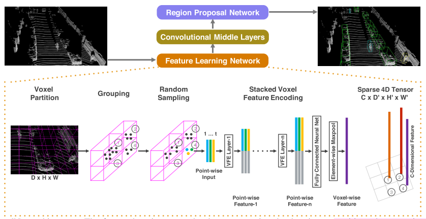
<figcaption>VoxelNet Architecture</figcaption>

**SECOND** (Sparsely Embedded Convolutional Detection, Yan et al., Sensors 2018) addresses the high cost of VoxelNet's conventional 3D convolution by introducing **sparse convolution** and submanifold sparse convolution, which perform computation only on non-empty voxels. This greatly speeds up training and inference, and together with an improved angle regression loss makes voxel-based methods genuinely practical.

  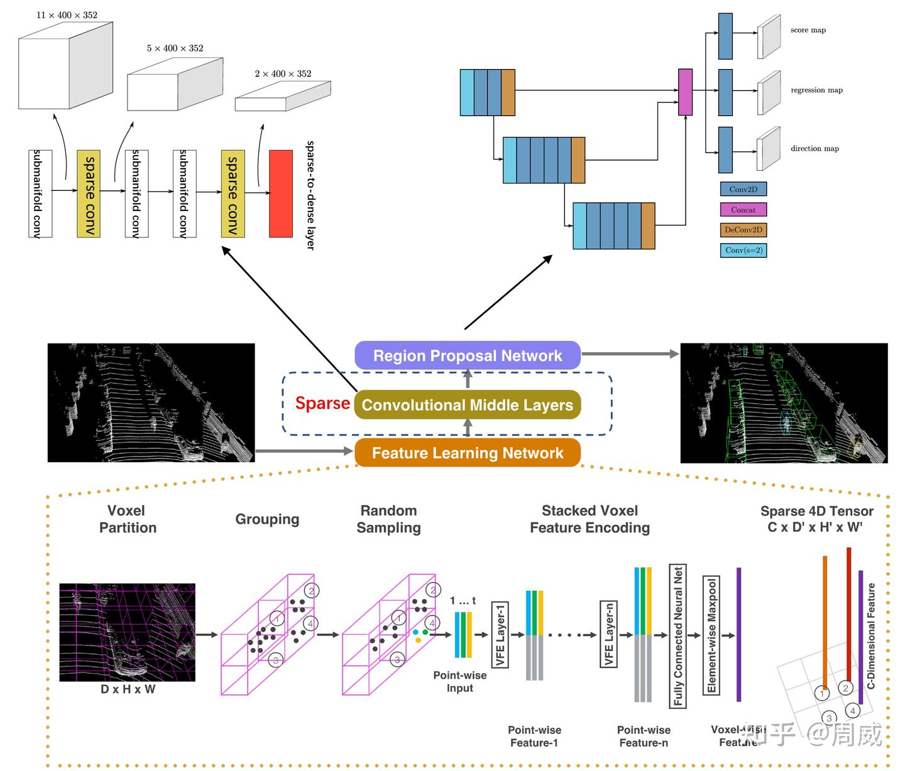
<figcaption>SECOND Architecture</figcaption>

**PointPillars** (Lang et al., CVPR 2019) goes a step further and simplifies voxelization into a "pillar" encoding: the point cloud is compressed along the height direction into a 2D pseudo-image, so that an efficient 2D CNN replaces 3D convolution (dense or sparse), and inference speed rises to 62 FPS (GPU). PointPillars strikes an excellent engineering balance between speed and accuracy and became the classic industry baseline for LiDAR perception in autonomous driving.

**Key characteristics**:
- Voxel/pillar encoding turns unordered point clouds into regular feature maps compatible with mature 2D/3D CNN frameworks.
- PointPillars enabled real-time deployment of 3D detection systems on embedded hardware.

  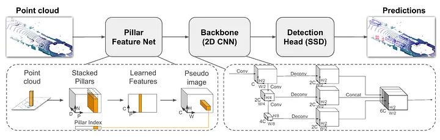
<figcaption>PointPillars architecture: the point cloud is compressed along the height direction into a pillar-based pseudo-image; PointNet extracts pillar features, which are scattered back onto a 2D BEV feature map; a 2D CNN backbone and an SSD detection head then output 3D bounding boxes.</figcaption>

---

### BEVFormer
{: id="bevformer"}
**BEVFormer** (Li et al., ECCV 2022) is a milestone in purely vision-based (LiDAR-free) 3D perception. Its core idea is to query multi-camera image features into a unified **bird's-eye-view (BEV)** space via **deformable attention**, and to introduce **temporal BEV feature fusion** to capture motion information.

**Core design**:
- Queries are preset on the BEV plane and sample features from multi-view images through spatial cross-attention (avoiding the computational overhead of dense feature transformation).
- Temporal self-attention aligns historical BEV features with the current frame, implicitly encoding velocity and motion information.
- It significantly surpassed the previous generation of vision-only methods on nuScenes, triggering a research boom in vision-only autonomous driving perception.

**Key characteristics**:
- No expensive LiDAR is needed: cameras alone achieve 3D perception close to LiDAR level.
- The unified BEV representation supports joint multi-task training such as detection, tracking, and map segmentation.

  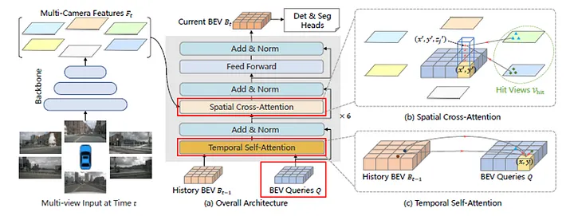
<figcaption>BEVFormer architecture: a grid of queries is preset on the BEV plane, features are projected and sampled from the multi-camera images into BEV space through spatial cross-attention, and temporal self-attention then fuses historical BEV frames to implicitly encode motion; the result is fed to the detection/segmentation heads.</figcaption>

---

### Semantic occupancy prediction
{: id="语义占用预测与表示演进"}
**Semantic occupancy prediction** has received widespread attention in autonomous driving in recent years. Unlike 3D object detection, which outputs a limited number of bounding boxes, occupancy prediction assigns a semantic label to every region (voxel) of the scene. It can therefore handle arbitrarily shaped obstacles and long-tail objects (such as fallen cartons, construction barriers, and hanging cables) more naturally, and is regarded as a key path to "universal obstacle perception". Dense voxel representations, however, inherently face an $O(N^3)$ explosion in memory and computation. The technical evolution of the whole field is essentially an optimization trajectory that keeps approaching the triangular constraint of high resolution, low compute, and temporal consistency:

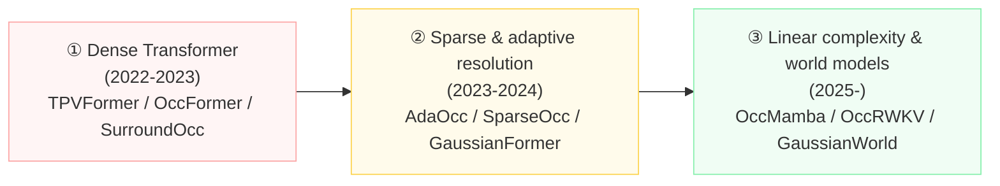

**1) Dense Transformer paradigm (2022–2023)**: **TPVFormer** (Huang et al., CVPR 2023) extends BEV to the Tri-Perspective View (TPV), approximating 3D space with three orthogonal planes instead of a full voxel grid, which balances computational efficiency and perceptual completeness; **OccFormer** and **SurroundOcc** further improve reconstruction quality through 3D/dual attention. This stage established the end-to-end paradigm of "surround-view images → 3D voxel semantics", but the GPU memory and latency costs of dense attention became the main bottleneck for real-time on-vehicle deployment.

**2) Sparse and adaptive-resolution representations (2023–2024)**: the core idea is to spend effort where it counts, rather than computing all voxels equally. **AdaOcc** (Adaptive-Resolution Occupancy Prediction) introduces an adaptive resolution mechanism that uses high resolution in safety-critical regions of interest (ROIs) such as nearby and complex obstacles and low resolution in distant open areas, breaking the trade-off between efficiency and accuracy; **SparseOcc / Fully Sparse Occupancy** pushes sparsity to the extreme, computing only non-empty regions throughout the pipeline and significantly reducing latency; one line of work (**Occupancy as Set of Points**) abandons the regular voxel grid altogether and represents occupancy flexibly with point sets, better capturing thin structures and edges. Inspired by 3DGS, **GaussianFormer** (Wang et al., ECCV 2024) and **GaussianFormer-2** (CVPR 2025) replace dense voxels with a set of 3D Gaussians and model occupancy as a probabilistic superposition, significantly reducing memory while preserving fine-grained geometry.

**3) Linear-complexity architectures and temporal world models (2025–)**: the quadratic complexity of Transformers becomes an Achilles' heel in high-resolution 3D space, and a new generation of work turns to linear-complexity backbones. **OccMamba** (CVPR 2025) is the first network to introduce a state space model (SSM/Mamba) into occupancy prediction. It preserves spatial locality through 3D-to-1D unfolding such as the Hilbert curve and, together with hierarchical Mamba modules, achieves $O(N)$ complexity; **OccRWKV** uses a linear RNN architecture to explore real-time on-device deployment. At the same time, occupancy prediction is moving from single-frame perception to temporal world models: **GaussianWorld** (CVPR 2025) predicts not only the current occupancy state on streaming input but also the future evolution of 3D occupancy, emphasizing temporal consistency; to deal with occlusion, **Collaborative Semantic Occupancy Prediction** uses vehicle-to-vehicle (V2V) collaboration to fuse multi-view features and "see through" occluders, significantly improving IoU.

> **Summary of the evolution**: occupancy prediction progresses step by step along the line of dense computation → adaptive/sparse representations → linear complexity → temporal world models. Behind it is one main thread: pushing perceptual resolution, computational efficiency, and temporal prediction to a new Pareto frontier under the limited compute available on a vehicle.

**3D scene graphs** organize spatial semantics from another perspective: a scene is represented as a graph whose nodes are object instances and whose edges are spatial relations (above/below, left/right, support, etc.), supporting language queries and logical reasoning. **3DSSG** (Wald et al., CVPR 2020) is a representative dataset and baseline in this direction. Occupancy prediction provides dense geometry plus semantics, while scene graphs provide sparse structure plus relations; the two often complement each other in embodied navigation and task planning.

---

## 4.5 Spatially aware language models
{: id="45-空间感知语言模型"}

> 💡 **Architecture background**: spatially aware language models (3D MLLMs / spatial VLMs) are usually extended from general 2D multimodal large models (for example, by introducing a 3D geometry encoder, a point cloud tokenizer, or spatial positional prompts). For the core mechanisms of general multimodal fusion (linear projection, cross-attention, Q-Former) and the complete training and tuning pipeline, see the foundational survey:  and .

### ScanRefer & ScanQA
{: id="scanrefer--scanqa"}
**ScanRefer** (Chen et al., ECCV 2020) proposed the task of **3D visual grounding**: given a natural language description (such as "the brown chair near the door"), locate the target object in a 3D point cloud scene (outputting a 3D bounding box). The ScanRefer dataset contains 51,583 language descriptions of objects in ScanNet scans and is a core benchmark for 3D language grounding. After ScanRefer, **Nr3D/Sr3D** (Achlioptas et al., 2020) and **ScanQA** (Azuma et al., CVPR 2022) further broadened the evaluation dimensions of 3D language understanding.

  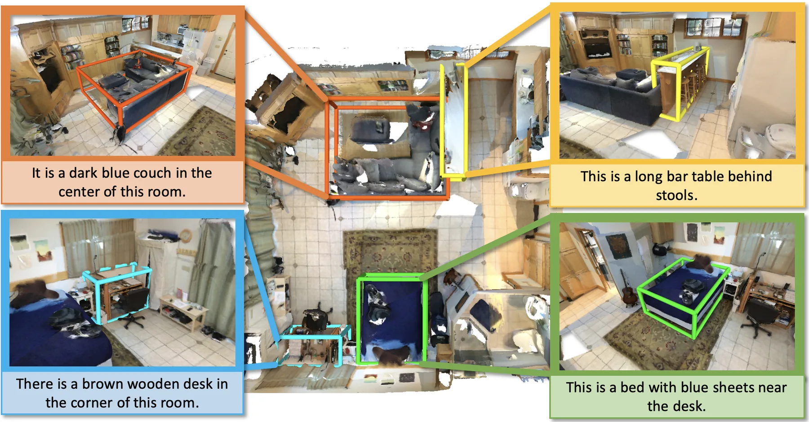
<figcaption>ScanRefer 3D visual grounding example: given a natural language description (such as "brown chair near the door"), the model locates the target in the 3D point cloud scene and outputs a 3D bounding box. It must understand the spatial-relation cues in the language and resolve ambiguities in the point cloud at the same time.</figcaption>

---

### 3D-LLM
{: id="3d-llm"}
**3D-LLM** (Hong et al., NeurIPS 2023) is the first to extend large language models (LLMs) to 3D perception tasks. By injecting 3D point cloud features into the LLM's context (using a diffusion-model-based 3D feature extractor to map the point cloud into a token sequence), 3D-LLM supports many task types, such as 3D scene question answering, 3D visual grounding, and 3D dialogue, without designing a dedicated module for each task.

**Key characteristics**:
- It transfers the open-ended language understanding of LLMs to 3D scene perception, giving the model 3D perception capabilities.
- It supports diverse 3D-language tasks and demonstrates the feasibility of a unified framework.
- It lays the foundation for subsequent 3D multimodal large models (3D MLLMs).

  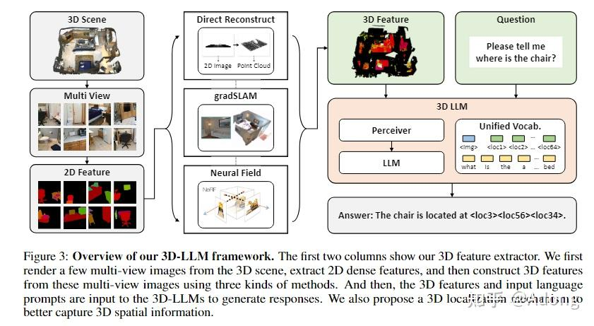
<figcaption>3D-LLM framework: a diffusion-model-based 3D feature extractor maps the point cloud scene into a token sequence, which is injected into the LLM's context window to support tasks such as scene question answering, visual grounding, and multi-turn dialogue.</figcaption>

---

### SpatialVLM
{: id="spatialvlm"}
**SpatialVLM** (Chen et al., CVPR 2024) is designed specifically to address the weak spatial reasoning of vision-language models (VLMs). Existing VLMs (such as GPT-4V) perform poorly on quantitative spatial reasoning questions such as "How far is object A from object B?" SpatialVLM fine-tunes a VLM specifically for spatial reasoning by building a large-scale **spatial reasoning question-answering dataset**, which uses 3D sensing to automatically generate quantitatively labeled question-answer pairs covering distance estimation, orientation judgment, size comparison, and other types.

**Key characteristics**:
- The first work to systematically improve the quantitative spatial reasoning of VLMs.
- The automated data generation pipeline scales up without relying on manual annotation.
- It substantially improves performance on downstream tasks that depend heavily on spatial reasoning, such as robot manipulation.

  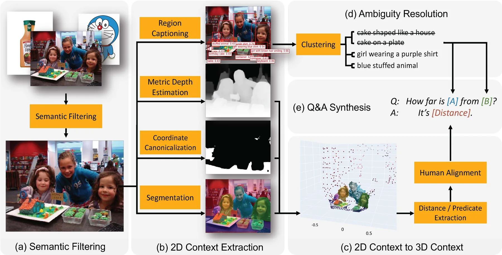
<figcaption>SpatialVLM data generation pipeline: 3D sensor data is used to automatically generate quantitative spatial reasoning question-answer pairs such as distance estimation, orientation judgment, and size comparison, and the VLM is fine-tuned on them for spatial reasoning, significantly improving its accuracy on quantitative spatial questions.</figcaption>

---

### EmbodiedScan
{: id="embodiedscan"}
**EmbodiedScan** (Wang et al., CVPR 2024) proposed a comprehensive embodied 3D scene understanding benchmark covering tasks such as 3D object detection, 3D visual grounding, and 3D question answering, and emphasizing understanding from the agent's own perspective. It requires the agent to **actively explore viewpoints** to understand the 3D scene (taking a first-person RGB-D stream as input) rather than working from offline, complete point cloud scans. EmbodiedScan contains 5,000+ scenes and 1.46 million+ instance annotations, making it one of the largest embodied 3D scene understanding datasets to date.

**Key characteristics**:
- A unified multi-task framework for embodied 3D understanding that is close to how real robots perceive when deployed.
- It emphasizes real-time, incremental 3D scene understanding rather than offline processing of complete point clouds.
- It introduces multi-granularity spatial-language alignment, supporting fine-grained object-level and scene-level descriptions.

  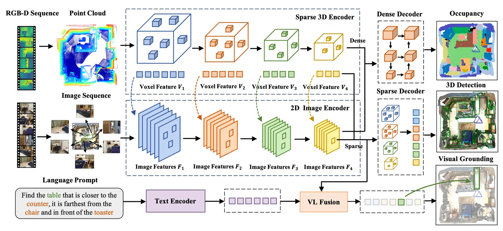
<figcaption>EmbodiedScan framework overview: taking the first-person RGB-D stream from the agent's active exploration as input, it uniformly supports multi-task evaluation such as 3D object detection, 3D visual grounding, and scene question answering.</figcaption>

---

### Spatial intelligence models
{: id="空间智能大模型进展"}

In 2024, **SpatialBot** (Cai et al., which adds depth maps to RGB to strengthen spatial understanding for robots), **RoboSpatial** (a spatial-understanding dataset and model for robot manipulation), and **Chat-3D v2** (object-aware 3D feature injection for multi-turn 3D dialogue) together showed that general VLMs have systematic weaknesses in quantitative spatial reasoning such as metric distance, direction, and volume comparison, and that targeted data can close part of the gap. Work in 2025–2026 has advanced along four lines.

**1) Geometry encoders inside VLMs.** The idea is to reuse the 3D structural priors learned by feed-forward reconstruction models rather than relying only on CLIP-style encoders designed for semantics. **Spatial-MLLM** (arXiv:2505.23747) uses dual encoders: a 2D visual encoder extracts semantics, a spatial encoder initialized from the VGGT backbone extracts structure, and at inference it selects the frames that carry the most spatial information; **VG-LLM** (arXiv:2505.24625) fuses geometry-encoder features with visual tokens before the MLLM, and its 4B model surpasses Gemini-1.5-Pro on VSI-Bench; **VLM-3R** (arXiv:2505.20279) derives implicit 3D tokens from monocular video and pairs them with more than 200K reconstruction-style instruction samples. **SpatialStack** (CVPR 2026, arXiv:2603.27437) notes that these methods mostly fuse only the deepest features, and instead aligns multi-level geometry features with the language backbone layer by layer, keeping both local geometric precision and global semantics.

**2) Scaling spatial data.** **SenseNova-SI** (CVPR 2026, arXiv:2511.13719) curates eight million training samples (SenseNova-SI-8M) under a taxonomy of spatial capabilities and trains on bases such as Qwen3-VL and InternVL3, reaching 68.8% on VSI-Bench and 85.7% on MindCube with little loss of general ability; the paper also discusses early signs of generalization from data scaling, along with the risks of overfitting and language shortcuts.  also takes the data route, but builds its data hierarchically: geometry → objects → relations → abstract reasoning.

**3) Training spatial reasoning with reinforcement learning.** **SpaceR** (arXiv:2504.01805) adds "map imagination" to GRPO so the model infers the spatial layout while thinking, and beats GPT-4o on VSI-Bench by 11.6 percentage points; **SpatialLadder** (arXiv:2510.08531) trains a 3B model in three stages: object localization → multi-dimensional spatial understanding → verifiable-reward reinforcement learning; **Spatial-SSRL** (arXiv:2510.27606) needs no human or model annotation, building five automatically verifiable tasks such as shuffled-patch reordering, regional depth ordering, and relative 3D position prediction directly from ordinary RGB / RGB-D images. All three depend on rewards that can be verified automatically.

**4) Streaming and long-horizon spatial memory.** **Cambrian-S** (ICLR 2026, arXiv:2511.04670) proposes "spatial supersensing" with four levels: semantic perception, streaming event cognition, implicit 3D spatial cognition, and predictive world modeling. After training on 590K samples (VSI-590K) it gains about 30 percentage points on VSI-Bench, yet stays weak on the new VSI-SUPER benchmark (long-horizon spatial recall and continual counting), showing that scaling data and context is not enough. The authors propose "predictive sensing": the prediction error (surprise) of a next-latent-frame predictor drives memory writes and event segmentation.

The four lines are not exclusive:  lets a geometry expert and a semantic expert share self-attention,  shows that text-only SFT can teach metric geometry, and  has the model call spatial tools instead of storing geometry in its parameters.

---

### Multi-view 3D scene MLLMs
{: id="多视角-3d-场景-mllm"}

 and  take **point clouds** as input, while  and  build on **3DGS**; both kinds depend on extra 3D reconstruction or scan preprocessing. A route closer to real deployment **reuses a large multimodal model (LMM) designed for 2D content and takes only posed multi-view images or video frames as input**, injecting 3D perception as an implicit capability without explicit point clouds. **LLaVA-3D** (2024) "lifts" 2D patch features into 3D patches using camera poses, and **Video-3D LLM** (2025) binds video frames to 3D position encodings; both show that "video frames + poses" are enough for 3D question answering such as ScanQA and SQA3D.

**Ross3D** (Reconstructive Visual Instruction Tuning with 3D-Awareness, Wang et al., 2025, arXiv:2504.01901) brings a **self-supervised perspective** to this route. It argues that the main obstacle to adapting 2D LMMs to 3D scenes is the scarcity of large-scale 3D vision-language data, so instead of piling up 3D annotations it adds **two 3D-aware reconstruction objectives** during instruction tuning:

- **Cross-view reconstruction**: randomly mask some views and force the model to recover them by aggregating information from overlapping views, so it learns cross-frame geometric correspondence;
- **Global-view reconstruction**: aggregate all available views to reconstruct a bird's-eye view (BEV) of the scene, forcing a globally consistent representation of the spatial layout.

Both reconstruction heads are trained jointly with text supervision, so the model gains 3D perception without changing its input format (still video frames + instructions). Ross3D reached the state of the art at the time on several 3D scene understanding benchmarks; its **semi-supervised experiments** show that large amounts of "purely visual, language-free" 3D data can substantially improve performance, a scalable way around the 3D vision-language data bottleneck in the same spirit as Depth Anything (§4.2), which drives foundation models with massive unlabeled data.

  
<figcaption>Ross3D’s two 3D-aware reconstruction objectives (source: the official Ross3D repository Haochen-Wang409/ross3d). Left: cross-view reconstruction, in which the LLM recovers masked video frames by aggregating overlapping views; right: global-view reconstruction, which aggregates all views to reconstruct the scene's bird's-eye view (BEV). Both are trained jointly with text supervision, implicitly injecting 3D perception into a multimodal model designed for 2D content.</figcaption>

For online use,  uses a streaming geometry encoder to supply incremental geometry priors for each newly arriving frame, while  performs self-attention in world coordinates to unify 2D/3D spatial grounding and reasoning.

---

### HiSpatial (CVPR 2026)
{: id="hispatial-cvpr-2026"}

**HiSpatial** (Microsoft, **CVPR 2026**, arXiv:2603.25411) is one of the more systematic works on spatial reasoning in VLMs. Its central claim is that 3D spatial understanding must be **built level by level**, as in human cognitive development: without a geometric and metric foundation, high-level abstract reasoning is almost impossible to learn. It therefore decomposes spatial understanding into four dependent levels, Level 0 (basic geometric perception) → Level 1 (object-level understanding) → Level 2 (relations between objects) → Level 3 (abstract reasoning), combined with an annotation-free data engine (about 5 million images / 2 billion QA pairs) and an RGB-D VLM that injects **metric-scale point maps**. With only 3B parameters it surpasses Gemini-2.5-Pro and GPT-5 on SpatialRGPT, QSpatial, RoboSpatial, and other benchmarks. **The full reading is in the **.

---

### Language Gaussian Splatting
{: id="语言高斯溅射"}

Language Gaussian splatting "paints" semantic features onto 3DGS primitives and distills them through multi-view rendering, so the 3D scene is both geometrically precise and semantically queryable. Here 3DGS acts as a spatial memory that aggregates multi-view information for downstream language reasoning, not only as a tool for novel view synthesis. Readings of the representative works , , , , and  are in the first group of the paper readings.

---

# 5. Datasets and benchmarks
{: id="5-主流数据集与评测基准"}

This section first organizes common datasets by task, then lists the spatial reasoning benchmarks that have appeared over the past two years, and ends with metrics and selection advice.

## 5.1 Datasets by task
{: id="51-按任务分类的数据集"}

| Task area | Representative datasets | Use and caveats |
|:---|:---|:---|
| Shapes and synthetic 3D | ShapeNet, ModelNet10 / ModelNet40 | CAD model libraries (ShapeNet has about 55 categories) with clean, noise-free samples, used for shape reconstruction, generation, and point-cloud classification baselines; there is a domain gap to real sensor data |
| Indoor scans and semantics | ScanNet v2, Matterport3D / HM3D, S3DIS | Real RGB-D scans with per-frame RGB, depth, poses, point clouds, and semantic / instance labels; suited to semantic segmentation, scene reconstruction, and language-alignment tasks such as ScanRefer |
| Depth and dense geometry | NYU Depth V2, KITTI Depth (Eigen split), DTU, Tanks and Temples, BlendedMVS, Mip-NeRF 360 | Standard benchmarks for monocular / stereo depth, multi-view reconstruction, and novel view synthesis; the first two cover indoor and driving scenes respectively |
| Autonomous driving and outdoor perception | KITTI 3D / Odometry, nuScenes, Waymo Open, Argoverse, Lyft Level 5 | Multi-sensor data (LiDAR + multiple cameras + radar) for detection, tracking, BEV, occupancy, and trajectory prediction; Waymo has denser labels and more long-tail categories |
| Embodied simulation and navigation | Gibson, Habitat, Replica, Habitat-Matterport | 3D environments aligned with real scenes plus physical interaction interfaces, used to train and evaluate visual navigation, VLN, and goal-driven exploration |
| 3D vision and language | ScanRefer, Nr3D / Sr3D, ScanQA, SQA3D, MSR3D | 3D visual grounding (outputting 3D boxes), 3D question answering, and situated question answering; Nr3D uses natural language and Sr3D templated language |
| Spatial reasoning and embodied QA | SpatialRGPT / QSpatial, RoboSpatial / RoboRefer, EmbodiedScan | Quantitative spatial reasoning (absolute / relative distance, direction, size), spatial referring in robot manipulation, and multi-task embodied understanding from first-person RGB-D streams |
| Novel view synthesis | Synthetic-NeRF (Blender), Tanks and Temples, DTU | Rendering-quality evaluation on synthetic and real scenes, reported as PSNR / SSIM / LPIPS |

## 5.2 Spatial reasoning benchmarks
{: id="52-空间推理评测基准"}

Since late 2024, spatial reasoning benchmarks for MLLMs have multiplied, extending from single-image relations to multi-view correspondence, mental rotation, long-horizon memory, and streaming input.

| Benchmark | Input | Focus | Scale |
|:---|:---|:---|:---|
| [VSI-Bench](https://arxiv.org/abs/2412.14171) | Indoor video | Remembering and recalling space from video: counting, distance, size, relative direction, route planning, appearance order | 5,000+ QA pairs |
| [VSI-SUPER](https://arxiv.org/abs/2511.04670) | Arbitrarily long video | Long-horizon spatial recall (VSR) and continual counting (VSC), which context expansion alone cannot solve | VSR + VSC |
| [MMSI-Bench](https://arxiv.org/abs/2505.23764) | Multiple images | Multi-image spatial reasoning; humans 97%, GPT-5 about 40%, best open-source model about 30% | 1,000 multiple-choice questions |
| [MindCube](https://arxiv.org/abs/2506.21458) | A few views | Building mental maps from limited views: position, orientation, and "what if I move" | 21,154 questions / 3,268 images |
| [OmniSpatial](https://arxiv.org/abs/2506.03135) | Images | 4 categories and 50 subcategories: dynamic reasoning, complex spatial logic, spatial interaction, perspective taking | 8.4K QA pairs |
| [SITE](https://arxiv.org/abs/2505.05456) | Single image / multi-image / video | Unifies 31 existing datasets under cognitive-science taxonomies and adds view-taking and dynamic-scene tasks | Multiple choice |
| [SpatialScore](https://arxiv.org/abs/2505.17012) | Many visual inputs | Holistic evaluation over 30 tasks, with the SpatialCorpus training set and the tool-using SpatialAgent | About 5K samples |
| [Spatial4D-Bench](https://arxiv.org/abs/2601.00092) | Video | 4D spatiotemporal reasoning: objects, scenes, spatiotemporal relations, route planning, physical plausibility | About 40,000 QA pairs / 18 tasks |
| [OVO-S-Bench](https://arxiv.org/abs/2606.03890) | Streaming egocentric video | Sees only the prefix before each query, with 4 levels of abstraction; Gemini-3.1-Pro 59.2, humans 92.2 | 1,680 questions / 348 videos |

These benchmarks point to several shared problems:
- **Multi-view correspondence and perspective taking are the weakest skills.** Errors on MMSI-Bench, MindCube, OmniSpatial, and SITE concentrate on cross-image correspondence, perspective taking, and mental rotation; the MindCube authors find that generating a cognitive map before reasoning (map-then-reason) works far better than a plain language chain of thought.
- **Performance collapses in long-horizon and streaming settings.** On VSI-SUPER, videos longer than 60 minutes fail almost entirely; on OVO-S-Bench, streaming or spatially fine-tuned models underperform their own backbones, and chains of thought not grounded in the observed stream amplify spatial errors.
- **Early benchmarks are close to saturation.** Specialized models have pushed VSI-Bench to 60%–70%, and SenseNova-SI warns about language shortcuts and overlap between training and test distributions.

## 5.3 Metrics by task
{: id="53-常用评测指标按任务"}

- Shape reconstruction / generation: Chamfer Distance (CD), Earth Mover's Distance (EMD)
- Point cloud / semantic segmentation: mean IoU (mIoU), per-class IoU, mAcc
- 3D object detection: mAP (IoU thresholds), Average Translation Error, BEV mAP
- Depth estimation and reconstruction: AbsRel, RMSE, SILog (scale-invariant error), PSNR/SSIM/LPIPS (view synthesis)
- Text generation and question answering: CIDEr, BLEU, ROUGE, Exact Match (EM)
- Spatial reasoning QA: multiple-choice accuracy; numeric questions often use mean relative accuracy (MRA)
- Embodied navigation: Success Rate (SR), Success weighted by Path Length (SPL), Coverage

## 5.4 Selection advice and recommended combinations
{: id="54-选型建议与推荐组合"}

**Common pitfalls**:
- Domain match: synthetic CAD data (ShapeNet / ModelNet) suits algorithm design and fast iteration but differs greatly from real sensor noise and occlusion; to study real perception, prefer real scan sets such as ScanNet / Matterport3D / HM3D.
- Annotation consistency: datasets may differ in category definitions, coordinate systems, and units (for example, the scale of metric depth), so coordinate transforms, resolution, and semantic class mapping must be unified strictly before experiments.
- Train/test leakage: with large pretrained (3D/2D) models, scenes or objects shared across datasets can inflate results, so use strict scene-level splits. Most spatial reasoning benchmarks are built from a few scene sources such as ScanNet and ARKitScenes, which raises the risk of overlap with training data.

**Recommended combinations**:
- Prototyping (quickly testing algorithm ideas): ModelNet / ShapeNet (small, synthetic, fast to train)
- Indoor 3D perception and semantics: ScanNet v2 + S3DIS + ScanRefer (semantics + grounding)
- Novel view synthesis and neural rendering: DTU + Tanks and Temples + Mip-NeRF 360 (synthetic and real scenes)
- Autonomous driving: nuScenes + Waymo (multiple sensors, diverse scenes, long tail)
- Embodied AI and navigation: Habitat / Gibson + Matterport3D (closer to real deployment)
- Spatial reasoning VLMs: VSI-Bench + MMSI-Bench + MindCube or OmniSpatial; for online robotics or AR settings, add VSI-SUPER or OVO-S-Bench

## 5.5 Dataset trends
{: id="55-数据集发展趋势"}

3D datasets are evolving from isolated task benchmarks toward comprehensive **multi-task, cross-modal, embodied** benchmarks (such as EmbodiedScan and HM3D extensions), and evaluation is shifting from complete offline input to streaming, long-horizon settings. Priority directions include:
- Richer annotation (finer object attributes, physical states, and relations);
- Dynamic scenes and temporal labels (4D datasets, action / state annotation);
- Open-vocabulary and long-tail coverage (weakly supervised expansion with automatic annotation pipelines built on large models);
- Annotation interoperability (shared coordinate systems, semantic vocabularies, and evaluation suites) for repeatable, comparable evaluation across papers.

---

# 6. Paper readings
{: id="6-论文精读"}

The 26 paper readings for this survey now live in a separate page, , in five groups:

- **Neural rendering and language fields**: , , , , , , 
- **Feed-forward geometry and visual representation models**: , , , , , 
- **3D scene language models**: , , , , , 
- **Spatial reasoning VLMs**: , , , , 
- **Embodied manipulation and driving**: , 

LLaVA-Video is general video understanding, so it has moved to .

---

# 7. Summary and Outlook
{: id="7-总结与展望"}

Spatial intelligence is one of the core capabilities on the path to embodied general AI. This survey has traced the field from discrete geometric learning to spatial reasoning driven by large models; three changes stand out in 2025–2026:

- **Geometric perception has become foundation-model territory.** VGGT, MapAnything, and VGGT-Ω produce cameras, depth, and point maps in one forward pass and are starting to show predictable scaling; intermediate representations of geometry models (registers, geometry tokens) are becoming inputs to VLMs and VLAs.
- **Spatial reasoning is moving from "more data" to changes in training and architecture.** Geometry encoders, spatial datasets of millions of samples, and verifiable-reward reinforcement learning are advancing together, and early benchmarks such as VSI-Bench have reached 60%–70%.
- **Evaluation is moving to harder settings.** Multi-image correspondence, perspective taking, long-horizon memory, and streaming input are the new weak points; on MMSI-Bench and OVO-S-Bench, models still trail humans by more than 30 percentage points.

### Spatial intelligence and world models
{: id="空间智能与世界模型"}

Spatial intelligence is becoming the geometric skeleton of **physical world models**. Cambrian-S places predictive world modeling at the top of spatial supersensing, while SAM 3D and Marble approach the problem from the generative side with editable, explorable 3D worlds. The real difficulty remains **physical reasoning**:
- **Causal prediction**: understanding physical constraints between objects (for example, if the bottom block is removed, how will the blocks above collapse?).
- **Embodied common sense**: understanding an object's material, mass, and friction during interaction.

### Future trends
{: id="未来趋势"}

1. **Unified spatial foundation models**: reconstruction, understanding, and generation share one 3D representation, with geometric priors and language flowing both ways inside the same model.
2. **Streaming and long-horizon spatial memory**: moving from offline batches to online operation, keeping a consistent, drift-free spatial memory over hours of first-person input.
3. **Closed-loop embodied interaction**: spatial reasoning that directly serves action, judged by task success rather than question-answering accuracy alone.
