> This article provides the companion paper readings for . The survey covers the methodological framework, datasets, and evaluation; this collection presents each paper's research question, method, evidence, and limitations.

Papers are numbered in the order they were added; old section anchors still work, so links from the survey land on the right paper. The official RoboDojo leaderboard below compares models under a common evaluation protocol. Each paper's own matched-setting comparison table sits in the Experiments and evidence part of its reading; scores from the two kinds of evaluation must not be combined into one ranking.

<span id="vla-leaderboard" class="vla-anchor-alias" aria-hidden="true"></span>

<span id="性能排行榜" class="vla-anchor-alias" aria-hidden="true"></span>

# Official RoboDojo leaderboard
{: id="vla-ranking-robodojo"}

[RoboDojo](https://robodojo-benchmark.com/leaderboard) compares policies under a unified protocol with **42 simulation tasks and 18 real-robot tasks**. The simulation tasks cover five capabilities: generalization, memory, fine manipulation, long-horizon tasks and open instructions; its [paper](https://arxiv.org/abs/2607.04434) states that each simulation task is evaluated 50 times. **Score** credits partial task progress, while **SR** counts only complete task success. The table lists the top 10 of the official simulation leaderboard (excluding the Agent track) by Score, out of 61 evaluated models. It is a **static snapshot accessed on 2026-10-24** (official data updated 2026-10-23); see the [live official leaderboard](https://robodojo-benchmark.com/leaderboard) for current rankings and real-robot results.

<p class="vla-table-hint">Swipe the table sideways to see every metric →</p>

| Simulation model (Score rank) | Type | Score ↑ | SR ↑ |
|---|---|---:|---:|
| **1** · VPP2 (RobotEra) | WAM | <span class="vla-score-meter" style="--vla-meter:100%"><strong>39.26</strong></span> | **32.26%** |
| **2** · Awomo-0.5 (Awomo) | WAM | <span class="vla-score-meter" style="--vla-meter:90%">35.34</span> | 29.64% |
| **3** · Simate-beta (Simate) | VLA | <span class="vla-score-meter" style="--vla-meter:86%">33.95</span> | 27.96% |
| **4** · Rex-M1 Preview (FT Lab & VisIncept) | VLA | <span class="vla-score-meter" style="--vla-meter:86%">33.79</span> | 27.44% |
| **5** · VPP2-Preview (RobotEra) | WAM | <span class="vla-score-meter" style="--vla-meter:80%">31.40</span> | 25.62% |
| **6** · InternW0-Δ (Shanghai AI Lab) | WAM | <span class="vla-score-meter" style="--vla-meter:78%">30.77</span> | 23.91% |
| **7** · Liber-0 Preview (LiberAI) | VLM + WAM | <span class="vla-score-meter" style="--vla-meter:78%">30.74</span> | 25.52% |
| **8** · Liber-0 Lite (LiberAI) | WAM | <span class="vla-score-meter" style="--vla-meter:74%">29.24</span> | 24.23% |
| **9** · DM0.5 (Dexmal) | VLA | <span class="vla-score-meter" style="--vla-meter:63%">24.90</span> | 19.34% |
| **10** · ME-Brain-1.0 (Li Auto) | VLA + WAM | <span class="vla-score-meter" style="--vla-meter:55%">21.67</span> | 15.99% |
{: .vla-leaderboard-table .vla-official-table }

**Reading the table**: the light-blue bar is scaled to the highest Score in the table and only helps compare gaps. Ranks follow Score, and SR does not always follow the same order; for example, 7th-place Liber-0 Preview has a higher SR than 6th-place InternW0-Δ. "Type" follows the official labels: WAM means a world action model that predicts future frames and actions together (see [DreamZero](#38-dreamzero-2026)), and 6 of the top 8 are WAMs or include one. The official site also runs an **Agent track** (entries typed AGENT, including general-purpose large models such as GPT-6-Astra); these entries are shown but not ranked, and the highest at the time of checking was HexaShell-Preview (Score 53.18 / SR 46.85%). Simulation scores do not represent real-robot performance; the five-capability breakdown and the real-robot leaderboard are on the [official page](https://robodojo-benchmark.com/leaderboard).

---

<span id="vla-papers" class="vla-anchor-alias" aria-hidden="true"></span>

# Paper readings
{: id="5-论文精读"}

This article covers 39 representative works, including VLA models, action policies, data-acquisition methods, and world models. Together they trace the technical lineage of VLA, but not all of them are VLA models, and the list is not an exhaustive ranking. Use the search box above or the side table of contents to jump to a paper.

|Topic|Suggested papers to read together|Main questions|
|---|---|---|
|Formation of VLA| RT-1 → RT-2 → RT-X → OpenVLA |What do scale, semantic transfer and cross-robot data contribute?|
|Actions and demonstrations| ACT, Diffusion Policy, UMI, DP3, π₀ |How action chunking, generative action distributions, and sensing interfaces affect control|
|Generalization and learning from experience| π₀.5, π*₀.₆, π₀.7 |How to combine environment transfer, execution feedback, and behavioral guidance|
|Reasoning and memory| ACoT-VLA, ZR-0, RoboTTT, S²-VLA |What is the value of intermediate supervision, historical states and task stages?|
|Data and systems| UniSim, InternData-A1, RoboGen, GR00T |How data generation and system components support policy learning|
|Recent developments| LingBot-VLA 2.0, τ₀-VLA, ActionPiece, Real-Time EXPO-FT, Bee |How large-scale generalization, search, action encoding, and online learning fit into a closed loop|

Each section is organized by research question, core method, experimental results, and limitations. Numbers apply only to the experimental conditions of the cited paper; when comparing, also check the training data, robot platform, and evaluation protocol. The year in each title follows the paper or conference version; the dates of the first preprint and official publication may differ, so refer to the bibliographic information in the link.

---

<span id="51-rt-1-2022-5-1-rt-1-2022" class="vla-anchor-alias" aria-hidden="true"></span>

## 1. RT-1 (2022)
{: id="5-1-rt-1-2022"}
Robotics Transformer for Real-World Control at Scale

📄 **Paper**: https://arxiv.org/abs/2212.06817

<div align="center">
  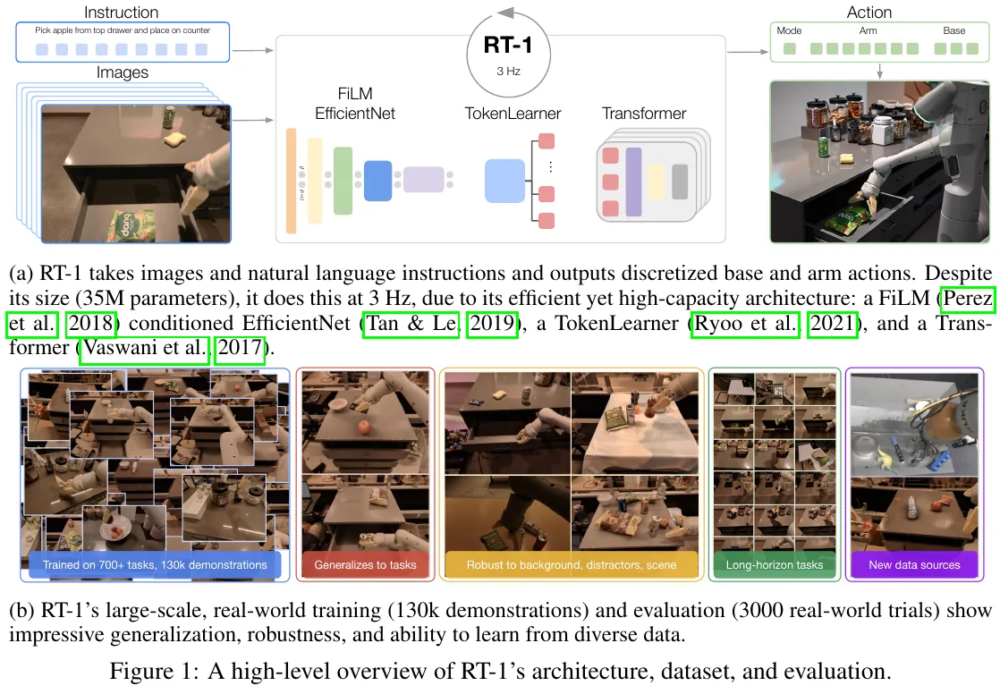
<figcaption>
RT-1 architecture: a Transformer policy built on an EfficientNet visual encoder and TokenLearner (Source: RT-1 Project)
</figcaption>
</div>

**Key takeaways**

RT-1 investigates whether transferable robot policies can be trained on large-scale multi-task data. It adds language conditioning to visual encoding, compresses visual tokens, and predicts discrete actions. TokenLearner compresses 81 spatial tokens per frame into 8; 512 is the feature channel dimension. It offers experience in scaling visuomotor policies, but it is not equivalent to RT-2, which comes from fine-tuning a large pretrained VLM.

---

**Background and problem**

Robot control methods before 2022 generally relied on dedicated networks trained on small-scale data, which generalize poorly to new tasks and scenes. Transformers have proven effective on large-scale data in language and vision, but it was unclear whether the same paradigm transfers to real-world robot control. Core question: **can a single Transformer trained on large-scale multi-task real-robot data achieve high success rates on hundreds of tasks and generalize to unseen ones?**

---

**Methods and innovations**

**Architecture**:

|Module|Design|Function|
|------|------|------|
|**Visual encoding**| EfficientNet-B3 + Token Learner |Compresses the image into 8 visual tokens and efficiently extracts semantic features|
|**Language encoding**| Universal Sentence Encoder (USE) |Maps task instructions to fixed-length embeddings|
|**Backbone**|Transformer (8 layers, 19M parameters)|Processes the language-conditioned visual history to predict action tokens|
|**Action modeling**|Discretization (256 bins/dimension)|11-dimensional action interface: 6-D end-effector pose, 1-D gripper, 3-D base, 1-D control mode|

**Data scale**: 130k real trajectories were collected on Everyday Robots platforms over 17 months of human teleoperation, covering 700+ tasks and a variety of objects and scenes.

**Inference efficiency**: The system runs at about 3 Hz, with visual token compression used to reduce computation. The main model does not generate actions autoregressively dimension by dimension; autoregressive action prediction is an ablation setting in the paper. See [RT-1 §5.1 and Table 13](https://arxiv.org/html/2212.06817v2).

---

**Results and findings**

**Seen tasks (training distribution)**:
- Average task success rate of **97.0%**, significantly above BC-Z (66.0%) and SayCan (65.8%)
- Stable high performance across 700+ distinct tasks, confirming the effectiveness of large-scale multi-task training

**Unseen tasks (zero-shot generalization)**:
- Success rate on unseen tasks of **76.0%**, far above the 20-40% of earlier methods
- Shows that a Transformer can learn transferable low-level skills from multi-task training

**Scope of the results**: The success rates above apply to the task distribution defined by the authors. More data helps in this study, but returns to scale are not fixed across tasks, data quality, and robots.

---

**Limitations**

- Language conditioning supports task discrimination and compositional generalization, but semantic reasoning ability needs separate evaluation
- Data collection is expensive (specialized operators and specific robot hardware) and hard to reproduce
- The visual encoder uses a fixed resolution and is poorly suited to fine-grained manipulation
- Action quantization costs precision, and performance drops markedly on fine contact-rich tasks
- Training and evaluation focus mainly on the Everyday Robots platform; the limited cross-robot experiments do not show transfer to arbitrary embodiments

---

<span id="52-rt-2-2023-5-2-rt-2-2023" class="vla-anchor-alias" aria-hidden="true"></span>

## 2. RT-2 (2023)
{: id="5-2-rt-2-2023"}
Vision-Language-Action Models Transfer Web Knowledge to Robotic Control

📄 **Paper**: https://arxiv.org/abs/2307.15818

<div align="center">
  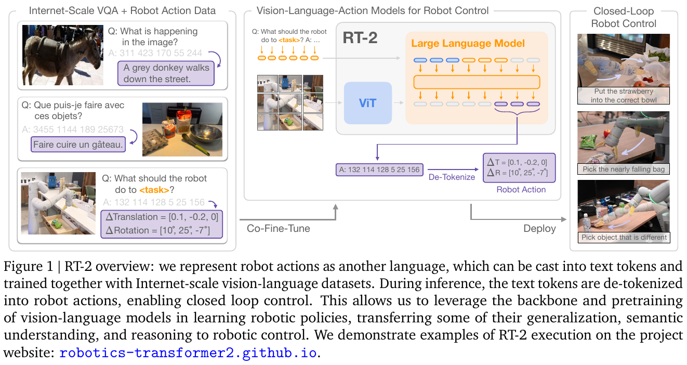
<figcaption>
RT-2 overview: a pretrained VLM is fine-tuned directly to output action tokens (Source: RT-2 Project)
</figcaption>
</div>

**Key takeaways**

RT-2 is a genuine paradigm shift for VLA: by representing robot actions as language tokens, it extends the VLM's next-token prediction to action generation without changing the model architecture. The most important finding is "emergent capabilities": RT-2 can perform new kinds of reasoning tasks that never appear in the robot data (such as "pick up the object that can put out a fire"), which come directly from the VLM's web knowledge. This redefines what is possible in robot learning.

---

**Background and problem**

Large vision-language models (VLMs) perform well at cross-modal understanding and commonsense reasoning, but these abilities cannot be used directly for robot control. The traditional approach uses a VLM for high-level planning and a low-level controller to execute actions, which introduces information loss and alignment errors between modules. Core question: **can a VLM be fine-tuned directly into a VLA model that executes physical actions while retaining the semantic understanding and reasoning learned in pretraining?**

---

**Methods and innovations**

**Core innovation: actions as language tokens**

```
Traditional: Vision + Language → VLM → text plan → low-level controller → action
RT-2: Vision + Language → VLA → action token sequence (direct control)
```

**Architecture**:
- Base models: PaLI-X (5B, 55B) and PaLM-E (12B) variants
- End-effector pose, gripper, and termination flag are encoded as discrete tokens; each continuous action dimension is quantized into 256 bins
- Co-fine-tuning with vision-language data: training alternates between robot demonstrations and web VL data to prevent catastrophic forgetting

**Key design decisions**:
- Robot demonstrations and vision-language tasks are fine-tuned jointly, preserving both motor learning and the original vision-language abilities
- Action tokens are inserted directly into the language vocabulary, and action sequences are generated by autoregressive decoding
- Supports chain-of-thought reasoning: reasoning text is generated before the action

---

**Results and findings**

The [official RT-2 experiments](https://robotics-transformer2.github.io/) evaluate seen tasks, new objects, background changes, and semantic reasoning separately. According to the authors, pretraining the VLM brings knowledge that helps with selecting objects, understanding symbols, and completing operations semantically. The CoT variant shows that generating intermediate reasoning before actions is possible.

These results indicate that semantic knowledge can influence action selection, but they do not prove that the robot has learned new motor skills beyond the training data. RT-2 and the cross-robot RT-2-X should also be discussed separately; the latter is covered in the next section.

---

**Limitations**

- The 55B model is extremely expensive to run and cannot be deployed on edge devices; inference speed is only about 1-3 Hz
- Fully closed source (internal to Google), so external researchers cannot reproduce or fine-tune it, which motivated later open-source work (OpenVLA)
- Action tokenization loses precision, making fine manipulation that needs sub-millimeter accuracy difficult
- Co-fine-tuning is sensitive to the data mixing ratio, which makes debugging complex
- Cross-embodiment transfer to new robot platforms remains limited

---

<span id="53-rt-x--open-x-embodiment-dataset-2023-5-3-rt-x-2023" class="vla-anchor-alias" aria-hidden="true"></span>

## 3. RT-X / Open X-Embodiment Dataset (2023)
{: id="5-3-rt-x-2023"}
Open X-Embodiment: Robotic Learning Datasets and RT-X Models

📄 **Paper**: https://arxiv.org/abs/2310.08864

<div align="center">
  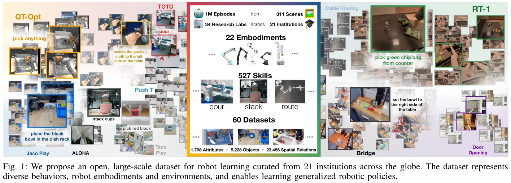
<figcaption>
Open X-Embodiment dataset: the original project pools diverse data from 22 robots (Source: RT-X Project)
</figcaption>
</div>

**Key takeaways**

OXE and RT-X together verify an important hypothesis: **data from different robots can benefit one another in some settings**. This positive transfer depends on model capacity, data mix, and action interface, and negative transfer is not ruled out. It provides key evidence for robot learning moving from "lab islands" to a "shared data ecosystem" and is the rationale for later large-scale datasets such as AgiBot World and InternData-A1.

---

**Background and problem**

Robot learning data is highly fragmented: each lab collects its own data with different robots, task definitions, and storage formats, so data cannot be shared or reused. Even a lab with enough data can only train a specialist model for its own robot. Core question: **can data from 22 robots across labs worldwide be integrated, and can a jointly trained model outperform models trained on a single robot's data?**

---

**Methods and innovations**

**Open X-Embodiment dataset**:
- **Scale**: The original OXE project pools millions of trajectories covering 22 robot types from 21 institutions; RT-X uses a selected data mixture from it
- **Unified format**: Heterogeneous data is standardized in RLDS (Reinforcement Learning Datasets) format, including RGB images, language instructions, and robot joint angles / end-effector actions
- **Coverage**: From 7-DoF tabletop arms (WidowX, Franka) to mobile robots (Hello Stretch), covering skills such as grasping, pushing and pulling, and flipping

**RT-X training strategy**:
- RT-1 backbone (RT-1-X) and RT-2 backbone (RT-2-X) are trained separately on OXE data
- Cross-embodiment co-training: at inference the model infers the task from language instructions and visual observations, without needing the robot type
- A weighted mixture sampling strategy balances differences in dataset size

---

**Results and findings**

The RT-1-X and RT-2-X experiments show that cross-robot training can produce positive transfer on several target platforms and semantic tasks. This conclusion depends on the chosen dataset, model capacity, and training settings; OXE is the dataset and RT-X the policy trained on a subset of it, so the two should not be equated.

RLDS specifies how trajectories are organized; action normalization and data sampling are still handled by the training pipeline. Per-robot experiments and results are in the [official RT-X project](https://robotics-transformer-x.github.io/).

---

**Limitations**

- Data volume is severely imbalanced across the 22 robot platforms, and gains for long-tail robots are limited
- Raw data quality is uneven (collection standards differ between labs), which introduces noise
- Emerging embodiments such as bimanual arms and full-body humanoids are not included, so coverage is still limited
- A given training pipeline may use only some sensing modalities; this differs from the range of fields the RLDS format itself can hold
- Evaluation protocols are not unified, so performance comparisons across labs are biased

---

<span id="54-act-2023-5-4-act-2023" class="vla-anchor-alias" aria-hidden="true"></span>

## 4. ACT (2023)
{: id="5-4-act-2023"}
———Learning Fine-Grained Bimanual Manipulation with Low-Cost Hardware

📄 **Paper**: [https://arxiv.org/abs/2304.13705](https://arxiv.org/abs/2304.13705)

### Key takeaways
{: id="精华"}

This paper shows how to achieve high-precision bimanual manipulation with low-cost hardware. Highlights:
- **Low-cost system**: A high-performance bimanual teleoperation and autonomous learning platform built from off-the-shelf robots and 3D-printed parts for under $20,000.
- **ACT algorithm**: Action Chunking with Transformers predicts action sequences rather than single steps, which reduces compounding errors and improves temporal consistency.
- **Temporal ensembling**: Weighted averaging of overlapping action chunks yields very smooth and precise motion.
- **Efficient learning**: Only about 10 minutes of demonstrations (around 50 demos) suffice for 80-90% success on difficult, precise tasks such as opening cans and inserting batteries.

---

### 1. Background and problem
{: id="1-研究背景问题"}

Delicate bimanual manipulation (such as threading a needle or plugging and unplugging a battery) usually requires expensive, high-precision robots and complex sensing. Conventional imitation learning (e.g., behavioral cloning) struggles here: **compounding errors** push the motion away from the target, and non-stationarity in human demonstrations (such as pauses) is hard to model. This paper asks whether learning can let cheap, imprecise hardware perform these delicate tasks.

---

### 2. Methods and innovations
{: id="2-主要方法创新点"}

<div align="center">
  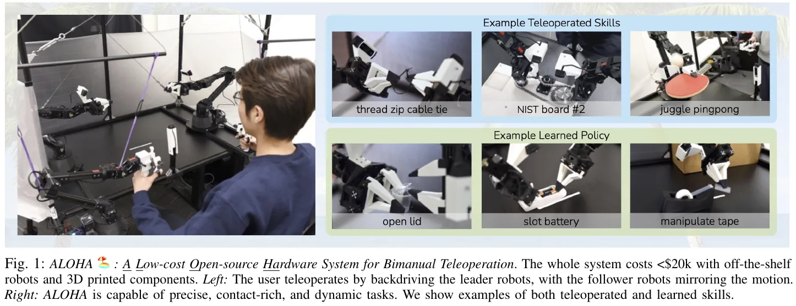
<figcaption>
ALOHA system overview: low-cost bimanual teleoperation and demonstrations of fine manipulation skills
</figcaption>
</div>

#### ALOHA hardware system
{: id="aloha-硬件系统"}
The paper presents **ALOHA**, a low-cost, open-source bimanual system.

<div align="center">
  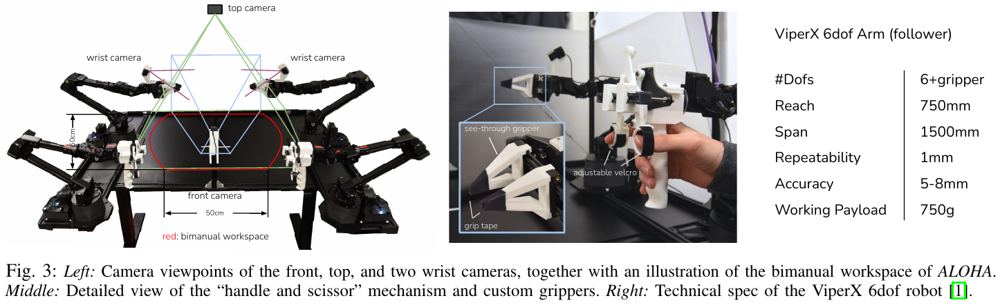
<figcaption>
ALOHA hardware details: multi-view camera layout, 3D-printed teleoperation mechanism, and robot specifications
</figcaption>
</div>

1. **Structure**: Two 6-DoF ViperX arms (as the follower arms that execute actions) and two smaller WidowX arms (as the leader arms used for teleoperation).
2. **Teleoperation**: The user drives the follower arms in real time by moving the smaller leader arms. To improve fine manipulation, a 3D-printed "handle and scissors" mechanism supports continuous gripper control.
3. **Perception**: The system carries 4 ordinary webcams (two fixed in front of and above the workspace, and two mounted on the wrists of the follower arms), providing multi-view visual feedback.

#### ACT learning algorithm
{: id="act-学习算法"}
To address error accumulation in imitation learning, the paper proposes **Action Chunking with Transformers (ACT)**.

<div align="center">
  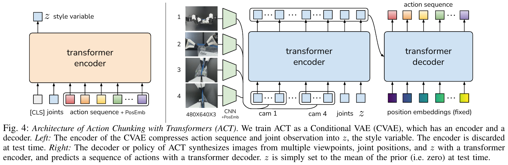
<figcaption>
ACT architecture: action sequence prediction based on a CVAE and a Transformer
</figcaption>
</div>

1. **Action chunking**: Unlike traditional methods that predict a single-step action $a_t$, ACT predicts the sequence of the next $k$ actions $a_{t:t+k}$ at each observation $s_t$. This shortens the effective horizon of the task by a factor of $k$, mitigating compounding errors.

<div align="center">
  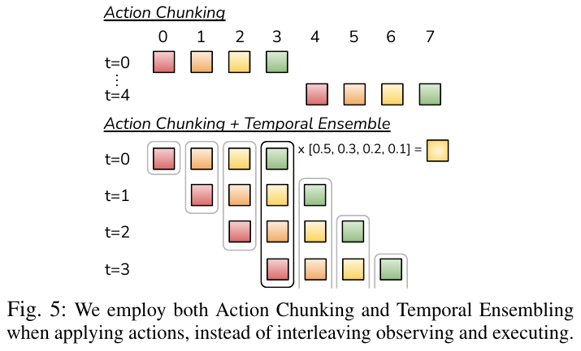
<figcaption>
Temporal ensembling: smoothing robot motion with overlapping action chunks
</figcaption>
</div>

2. **CVAE modeling**: A conditional variational autoencoder (CVAE) handles the multimodality of human demonstrations (that is, the same scene admits several valid paths).

<div align="center">
  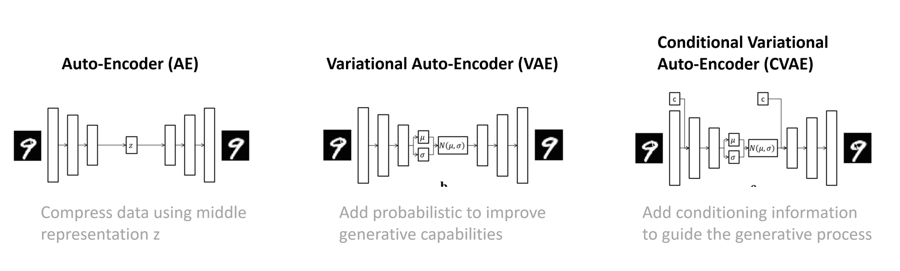
<figcaption>
CVAE architecture: well suited to trajectory generation
</figcaption>
</div>

3. **Transformer architecture**: A Transformer encoder-decoder fuses multi-view images and joint positions and generates coherent action chunks.

4. **Temporal ensembling**: At inference time the policy predicts at every frame and takes a weighted average over the overlapping action chunks. This makes predictions more robust and removes the jerkiness when switching between action chunks.

<div align="center">
  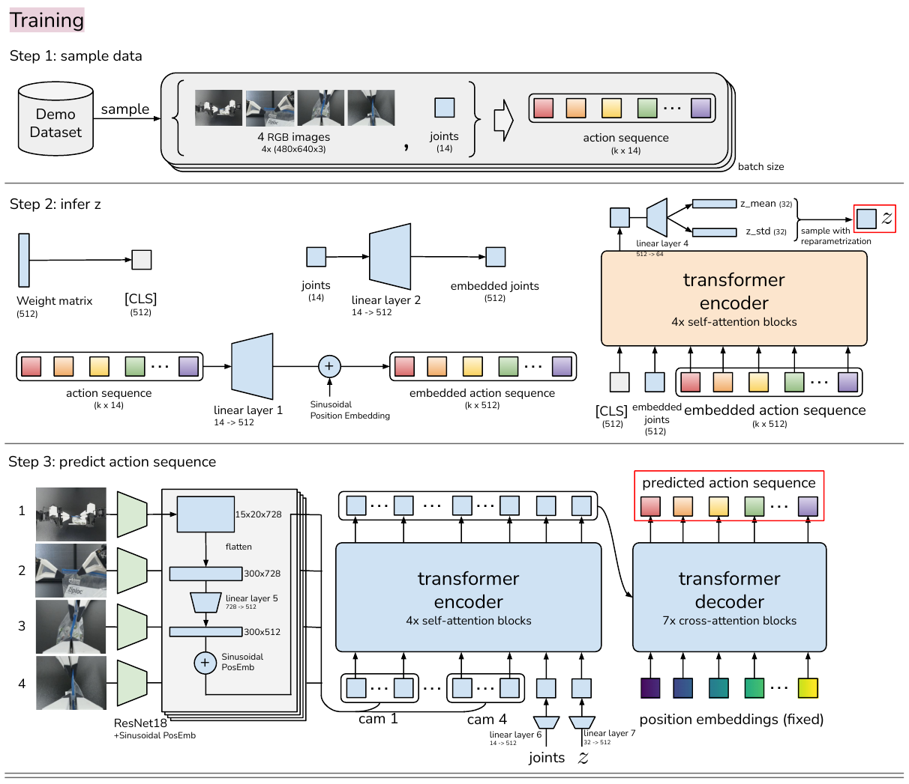
<figcaption>
ACT training procedure
</figcaption>
</div>

<div align="center">
  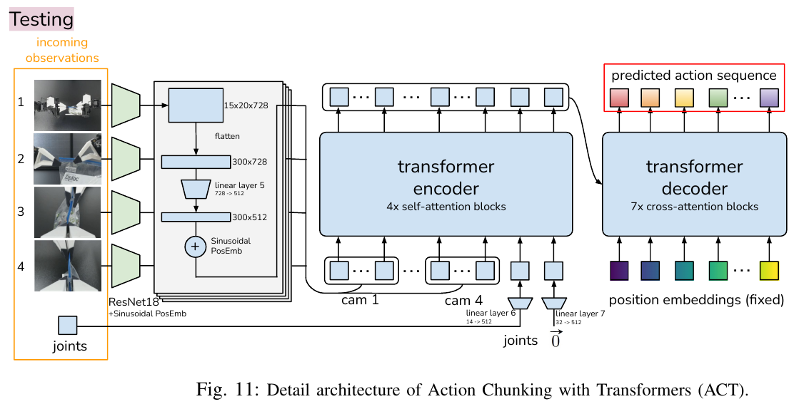
<figcaption>
ACT inference procedure
</figcaption>
</div>

---

### 3. Results and findings
{: id="3-核心结果发现"}

- **Strong performance**: On several complex bimanual tasks, ACT clearly outperforms earlier SOTA methods (such as BC-ConvMLP, BeT, and RT-1). For example, on the "battery insertion" task ACT reaches a 96% success rate, while the baselines almost never complete it.
- **Data-efficient**: With only 50 human demonstrations per task (about 10 minutes of data), the model learns to make closed-loop corrections in dynamic, stochastic environments.
- **High control frequency matters**: Experiments show that a 50 Hz control frequency is crucial for fine manipulation; reducing it to 5 Hz increases task completion time by more than 62%.
- **Closed-loop robustness**: Thanks to multi-view visual feedback and the ACT architecture, the robot can correct small deviations from the demonstrations in real time and adapt to slight changes in object position.

---

### 4. Limitations
{: id="4-局限性"}

- **Hardware limits**: Because of the torque limits of the low-cost motors, ALOHA struggles with tasks that need large forces (such as tightening a bottle cap or lifting heavy objects).
- **Missing sensing**: The current system relies on vision alone and has no force feedback, which remains a challenge for extremely complex contacts (such as unwrapping intricate candy packaging).

---

<span id="55-diffusion-policy-2023-5-5-diffusion-policy-2023" class="vla-anchor-alias" aria-hidden="true"></span>

## 5. Diffusion Policy (2023)
{: id="5-5-diffusion-policy-2023"}
Visuomotor Policy Learning via Action Diffusion

📄 **Paper**: https://arxiv.org/abs/2303.04137

<div align="center">
  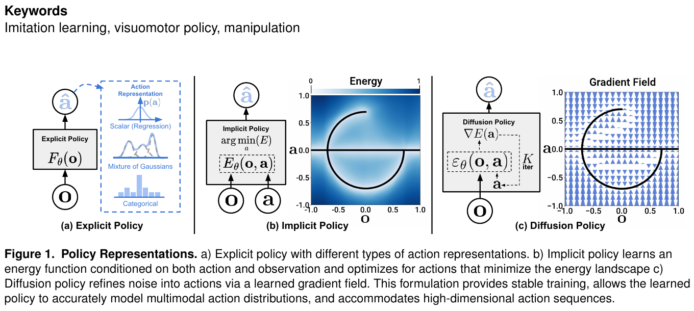
<figcaption>
Diffusion Policy: multimodal action modeling based on a diffusion process (Source: Columbia University)
</figcaption>
</div>

**Key takeaways**

The core insight of Diffusion Policy is that the distribution of robot actions is inherently **multimodal** (there are several reasonable ways to perform the same task), and the traditional mean-squared-error loss averages these modes into an "average action" that resembles no reasonable action. Diffusion models naturally express multimodal distributions, and action chunking (predicting several actions at once) further improves smoothness on long-horizon tasks. These two designs have become the common basis for action decoding in later VLAs (flow matching in π₀, action reasoning in ACoT-VLA).

---

**Background and problem**

Imitation learning methods (such as BC-RNN and IBC) behave unstably on fine manipulation tasks. The core problem is that robot demonstration data is inherently **multimodal**: for the same task, an expert may grasp from the left or from the right, and both trajectories are correct. A traditional regression loss (MSE) averages the two modes, so the policy outputs a "blurry intermediate" action and fails. Core question: **how can multimodal, high-dimensional action distributions be modeled for robot policy learning so that the policy reliably performs complex manipulation that requires fine contact?**

---

**Methods and innovations**

**Diffusion model as policy**:

```
Traditional policy: π(o_t) → a_t  (deterministic mapping)
Diffusion policy: a_t ~ p_θ(·|o_t)  (sampling from a conditional distribution)
          Iterative denoising: a^K → a^(K-1) → ... → a^0
```

**Two architecture variants**:

|Architecture|Visual backbone|Denoising network|Inference speed|
|------|---------|---------|---------|
| **CNN-Diffusion** |ResNet-18 (stacked sequentially)| 1D-UNet |Fast (~20 Hz)|
| **Transformer-Diffusion** |ViT + positional encoding| Transformer |More stable but slower|

**Key designs**:
- **Action chunking**: Predicts an action sequence of $T_p=16$ steps at once (rather than a single step) to alleviate compounding errors and improve smoothness on long-horizon tasks
- **Accelerated inference with DDIM**: DDIM compresses the original 100-step DDPM to 10 steps to meet real-time control requirements
- **Receding-horizon execution**: Only the first $T_a=8$ steps of the predicted action sequence are executed each time, preserving closed-loop feedback

**Training objective**:
$$\mathcal{L} = \mathbb{E}_{t, a_0, \epsilon}\left[\|\epsilon - \epsilon_\theta(a_t, t, o_t)\|^2\right]$$

---

**Results and findings**

**Simulation benchmarks** (compared with BC-RNN and IBC):

|Task| Diffusion Policy(CNN) | Diffusion Policy(Trans) | BC-RNN |
|------|----------------------|------------------------|--------|
|Push-T (trajectory accuracy)| 91.5% | **95.0%** | 82.5% |
| Block Pushing | **99.0%** | 98.0% | 78.0% |
|Kitchen (multi-step sequence)| 79.7% | **86.0%** | 66.1% |

**Real-robot experiments (Franka arm)**:
- Average success rate of **76.3%** on 6 precision manipulation tasks (placing tableware, opening a can, plugging in a connector, etc.)
- Significantly better than BC-RNN (56.2%) and IBC (51.0%)

**Multimodality check**: On the "cup placement" task, Diffusion Policy stably generates two different reasonable trajectories (placing from the front or from the side), while BC-RNN can only produce failing "intermediate" actions.

---

**Limitations**

- Diffusion inference needs multiple iterations (10 steps even with DDIM), so latency is higher than direct prediction, which limits very-high-frequency control (>50 Hz)
- Uses only visual and proprioceptive input, cannot follow language instructions, and cannot handle multi-task settings
- Does not improve semantic scene understanding or task generalization (it is designed for low-level action modeling)
- Sensitive to demonstration quality: noisy or inconsistent demonstrations degrade the quality of the learned distribution
- Lacks an explicit task-reasoning mechanism, so it is not suited to complex multi-step tasks that require long-horizon planning

---

---

<span id="56-umi-2024-5-6-umi-2024" class="vla-anchor-alias" aria-hidden="true"></span>

## 6. UMI (2024)
{: id="5-6-umi-2024"}
———Universal Manipulation Interface: In-The-Wild Robot Teaching Without In-The-Wild Robots

📄 **Paper**: [https://arxiv.org/abs/2402.10329](https://arxiv.org/abs/2402.10329)
💻 **Project**: [https://umi-gripper.github.io](https://umi-gripper.github.io)

### Key takeaways
{: id="精华-1"}

UMI is an extremely low-cost, efficient robot learning framework proposed jointly by Stanford, Columbia, and Toyota Research Institute (TRI). Highlights:
- **Portable collection hardware**: With just a handheld gripper carrying a GoPro (BOM about $370), data can be collected in any real scene (such as cafes, kitchens, and parks) without a real robot taking part in the collection.
- **Clever sensor design**: The GoPro's fisheye lens gives an ultra-wide field of view, and side mirrors provide implicit stereo vision for depth perception.
- **Hardware-independent policy interface**: It introduces an action representation based on **relative trajectories** and **latency matching** at inference time, so data collected anywhere and the trained model can be deployed seamlessly on robots of different brands and degrees of freedom.
- **Strong generalization**: Trained on diverse in-the-wild data, the robot shows strong zero-shot generalization to never-before-seen environments, lighting, and objects.

---

### 1. Background and problem
{: id="1-研究背景问题-1"}

Traditional robot imitation learning faces two major problems:
1. **Teleoperation is costly**: It requires expensive hardware and skilled operators, and is usually confined to laboratories.
2. **Human videos have an embodiment gap**: Learning directly from videos of bare human hands is hard to convert into robot joint or gripper control.
UMI adopts the hand-held gripper as an intermediate form, which retains the flexibility of human operation while being closely aligned with the robot in both vision and motion.

---

### 2. Methods and innovations
{: id="2-主要方法创新点-1"}

<div align="center">
  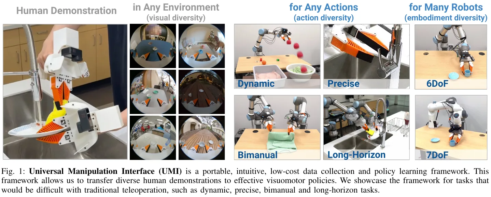
<figcaption>
UMI framework: zero-shot transfer from in-the-wild demonstrations to robot policies
</figcaption>
</div>

#### Hardware design: an informative demonstration interface
{: id="硬件设计信息丰富的演示接口"}
1. **Fisheye lens**: A 155-degree ultra-wide view that provides rich context while avoiding occlusion during close-range manipulation.
2. **Side mirrors**: Two mirrors at the edges of the image act as two virtual cameras and supply key depth information.
3. **IMU tracking**: Combining the GoPro's IMU data with SLAM keeps 6-DoF pose tracking accurate even during fast motion or when visual features are missing.
4. **Continuous gripper control**: Gripper opening and closing are tracked through visual markers, allowing finer force and timing control than binary open/close (for example, throwing objects).

#### Algorithm design: a cross-platform policy interface
{: id="算法设计跨平台的策略接口"}
1. **Latency matching**: Camera capture, inference, and execution delays are measured and compensated so that actions stay synchronized, which is critical for dynamic tasks such as throwing.
2. **Relative trajectory representation**: Actions are defined relative to the current gripper pose rather than in global coordinates. This removes the need for complex robot calibration and keeps the policy working even when the robot base moves.
3. **Diffusion Policy**: A diffusion model captures the complex multimodal distributions in human demonstrations (for example, going left or right around an obstacle).

---

### 3. Core experimental results
{: id="3-核心实验结果"}

<div align="center">
  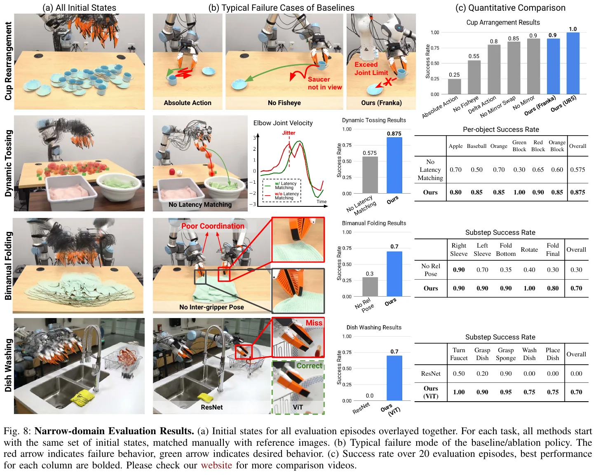
<figcaption>
UMI challenge tasks: arranging coffee cups, dynamic throwing, bimanual cloth folding, and dishwashing
</figcaption>
</div>

1. **Complex task capability**:
   - **Dynamic tossing**: Successfully throws objects into a basket beyond the robot's reach, with a success rate of 87.5%.
   - **Bimanual folding**: The two arms cooperate to fold cloth, which shows the importance of the relative pose representation.
   - **Long-horizon dishwashing**: Involves 7 steps such as turning the faucet on and off, applying dish soap, scrubbing, and rinsing, and is highly robust to disturbances (such as food being added suddenly or the base being moved).
2. **Zero-shot generalization**:
   - In new in-the-wild scenes such as cafes and fountains, the UMI policy achieves a **71.7%** success rate on never-before-seen cups, whereas a model trained only on narrow-domain (lab) data achieves 0%.
3. **Cross-platform deployment**:
   - The same trained model runs directly on UR5 and Franka robots with a success rate of around 90%.

---

### 4. Summary and significance
{: id="4-总结与意义"}

UMI shows that **data diversity beats model fine-tuning**. Rather than laboriously optimizing a model in a single environment, exploit UMI's extreme portability to collect data from a huge range of real-world scenes within hours. This "surround the cities from the countryside" strategy points the way to a truly universal robot manipulation policy.

---

<span id="57-dp3-2024-5-7-dp3-2024" class="vla-anchor-alias" aria-hidden="true"></span>

## 7. DP3 (2024)
{: id="5-7-dp3-2024"}
———3D Diffusion Policy: Generalizable Visuomotor Policy Learning via Simple 3D Representations

📄 **Paper**: [https://arxiv.org/abs/2403.03954](https://arxiv.org/abs/2403.03954)
💻 **Project**: [https://3d-diffusion-policy.github.io](https://3d-diffusion-policy.github.io)

### Key takeaways
{: id="精华-2"}

DP3 is a collaboration between the Shanghai Qi Zhi Institute, Tsinghua University, Shanghai Jiao Tong University, and other institutions. Its core contribution is to demonstrate the great value of 3D spatial understanding for robot policy learning:
- **Highly data-efficient**: Across 72 simulation tasks, **10 human demonstrations** are enough for most tasks, a relative improvement of 24.2% over baselines such as 2D Diffusion Policy.
- **3D visual representation**: Instead of complex 2D image processing, DP3 uses **sparse point clouds** extracted from a single-view depth map, and a lightweight MLP encoder yields compact yet powerful 3D features.
- **Excellent generalization**: Thanks to the intrinsic properties of the 3D modality, DP3 generalizes naturally across **spatial position, viewpoint, object appearance, and object instances**.
- **Safe and reliable deployment**: In real-robot experiments, DP3 rarely issued abnormal commands that exceeded safety limits, in sharp contrast to the frequent abnormal behavior of 2D baselines.

---

### 1. Background and problem
{: id="1-研究背景问题-2"}

Although visual imitation learning lets robots acquire a wide range of skills, it usually needs a great deal of data (for example, 2D Diffusion Policy typically needs 100-200 demonstrations).
The core bottlenecks are:
1. **Limits of 2D information**: 2D images provide little accurate depth or spatial-topology information, so the model needs more data to "fill in" spatial relationships.
2. **Hard to generalize**: 2D policies are easily thrown off by changes in viewpoint, lighting, and background.
DP3 aims to reduce data requirements and improve generalization by introducing a 3D visual representation, so that the model "innately" understands three-dimensional space.

---

### 2. Methods and innovations
{: id="2-主要方法创新点-2"}

<div align="center">
  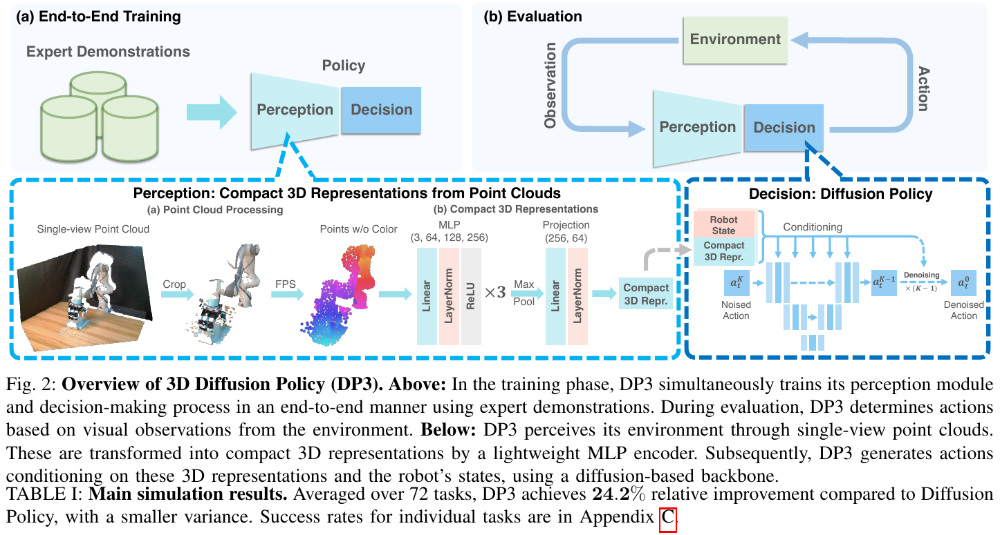
<figcaption>
DP3 architecture overview: from a single-view point cloud to a 3D representation to diffusion-based decision making
</figcaption>
</div>

#### Perception: a compact 3D representation
{: id="感知-perception紧凑的-3d-表征"}
1. **Point cloud processing**: A depth map from a single-view depth camera is converted into a point cloud. To remove background interference, the point cloud is cropped and then downsampled to 512 or 1024 points with **farthest point sampling (FPS)**.
2. **No color**: Experiments found that **discarding the color channel** actually improves generalization to object appearance (such as cups of different colors).
3. **Lightweight encoder**: A simple three-layer MLP with max pooling extracts 64-dimensional features. This "small but refined" design outperforms large pretrained point-cloud models on robot control tasks.

#### Decision: a diffusion policy conditioned on 3D features
{: id="决策-decision3d-条件下的扩散策略"}
1. **Conditional action generation**: The diffusion model takes the extracted 3D features and the robot's joint pose (q) as conditions and converts Gaussian noise into a coherent action sequence through iterative denoising.
2. **Spatiotemporal understanding**: The diffusion model captures the complex multimodal distribution of actions, while the 3D features provide accurate spatial position references.

---

### 3. Core experimental results
{: id="3-核心实验结果-1"}

<div align="center">
  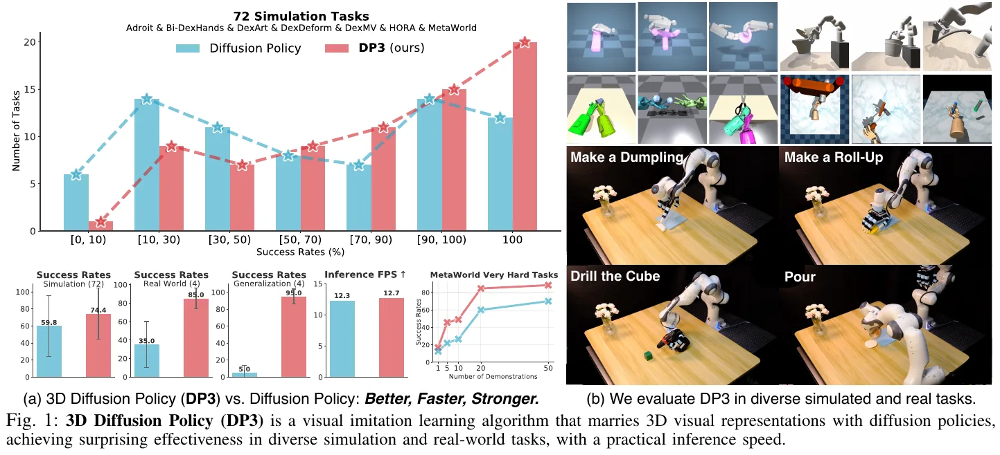
<figcaption>
Performance of DP3 on simulation tasks and real-world dexterous-hand tasks
</figcaption>
</div>

1. **Few-shot learning**:
   - In simulation, with only 10 demonstrations, DP3's average success rate is far ahead.
   - In the real world (dexterous-hand tasks such as making dumplings, rolling dough, and drilling), only 40 demonstrations are needed to reach a success rate of **85%**.
2. **Broad generalization**:
   - **Spatial generalization**: DP3 still operates accurately in 3D positions outside the training range.
   - **Appearance generalization**: It handles new objects with completely different colors and textures.
3. **Inference efficiency**:
   - Although 3D processing is introduced, the minimalist encoder keeps inference fast on an NVIDIA 2080 Ti, meeting real-time control requirements.

---

### 4. Summary and significance
{: id="4-总结与意义-1"}

DP3's success once again underlines the importance of **visual representation** in robot learning. By combining a 3D representation with a powerful diffusion policy, DP3 offers an efficient, concise, and highly generalizable route to the "data hunger" problem in embodied intelligence.

---

<span id="58-unisim-2024-5-8-unisim-2024" class="vla-anchor-alias" aria-hidden="true"></span>

## 8. UniSim (2024)
{: id="5-8-unisim-2024"}
———Learning Interactive Real-World Simulators

📄 **Paper**: [https://arxiv.org/abs/2310.06114](https://arxiv.org/abs/2310.06114)
💻 **Project**: [https://universal-simulator.github.io](https://universal-simulator.github.io)

### Key takeaways
{: id="精华-3"}

UniSim, proposed by Google DeepMind at ICLR 2024, aims to build a general simulator of real-world interaction:
- **Unified interface**: Proposes a unified "action-in, video-out" framework that maps actions of different modalities (language, robot control, camera paths) into a single action space.
- **Fusing massive heterogeneous data**: Integrates web image-text data, robot manipulation data, human activity videos, and 3D scans, using the complementary strengths of each source (such as the rich scenes of web data and the high-frequency actions of robot data) to build the simulator's abilities.
- **Autoregressive long-horizon simulation**: With a video diffusion model at its core, UniSim achieves temporally coherent long-horizon simulation through conditional observation prediction.
- **Closed-loop applications**: High-level vision-language policies (VLMs) and low-level reinforcement learning (RL) policies trained in UniSim can be deployed to real robots without modification (zero-shot sim-to-real).

---

### 1. Background and problem
{: id="1-研究背景问题-3"}

The biggest obstacle to building a real-world simulator is **dataset heterogeneity**. Web data (LAION) has rich objects and scenes but no actions; robot data has precise actions but few scenes and small scale; human activity data has complex interactions but ambiguous action labels. The core idea of UniSim is: **can these complementary "rich" dimensions of data be stitched together by one unified model to build an all-encompassing simulator?**

---

### 2. Methods and innovations
{: id="2-主要方法创新点-3"}

<div align="center">
  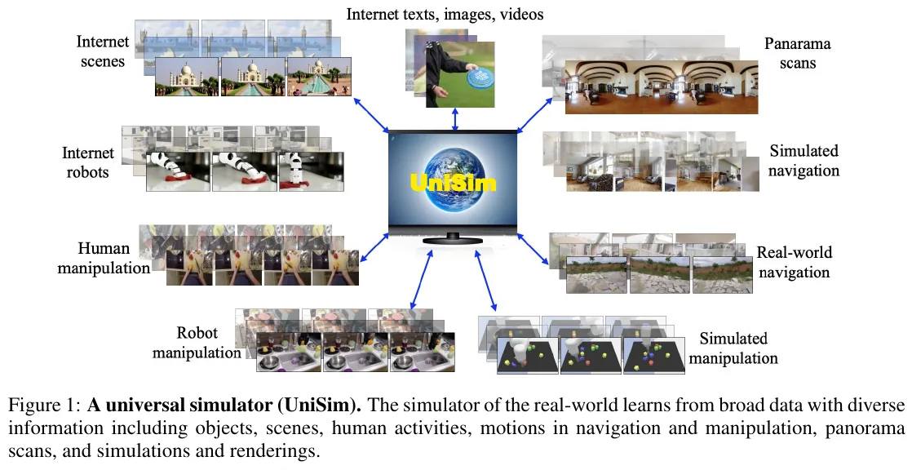
<figcaption>
UniSim overview: integrating web scenes, robot manipulation, human activities, navigation, panoramic scans, and simulation-rendered data
</figcaption>
</div>

#### Data orchestration
{: id="数据编排-data-orchestration"}
To handle heterogeneous data from different sources, UniSim adopts the following strategies:
1. **Unified action space**: All actions are converted into continuous representations. Language instructions are encoded with T5 embeddings, and low-level controls (e.g., Δx, Δy) are discretized and concatenated with the language embeddings.
2. **Multimodal alignment**: For static images, captions are treated as actions; for 3D scans, camera pose differences are used to construct actions; for videos, action labels or predicted motion trajectories are used.

#### Core architecture: observation prediction with video diffusion
{: id="核心架构基于视频扩散的观察预测"}
UniSim is modeled as a conditional probability model $p(o_t \mid h_{t-1}, a_{t-1})$: given the history of observations $h_{t-1}$ and the current action $a_{t-1}$, predict the next observation frame $o_t$.

<div align="center">
  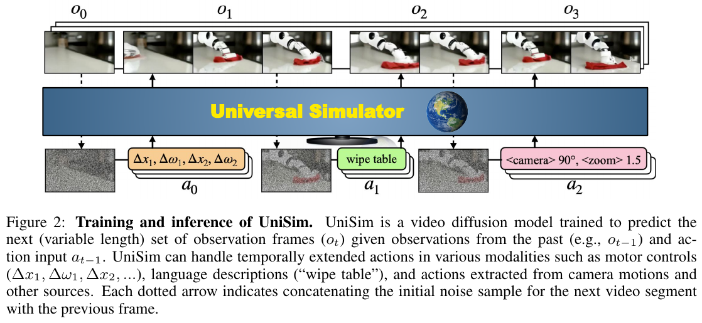
<figcaption>
UniSim training and inference: based on a conditional video diffusion model, supporting action inputs of multiple modalities
</figcaption>
</div>

- **Video U-Net**: A video U-Net with 5.6 billion parameters, with interleaved temporal and spatial attention layers to ensure video quality and coherence.
- **Autoregressive generation**: By conditioning each segment on the last frame generated in the previous one (history conditioning), UniSim can generate coherent interaction sequences of dozens of steps.

---

### 3. Application scenario display
{: id="3-应用场景展示"}

#### Action-rich, long-horizon simulation
{: id="动作丰富且长程的模拟"}
UniSim can simulate not only simple motions but also complex interactions driven by language instructions.

<div align="center">
  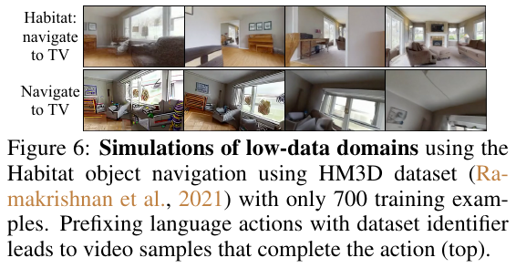
<figcaption>
UniSim's action richness: simulating different tasks such as "washing hands", "cutting carrots", and "navigation" from the same initial frame
</figcaption>
</div>

<div align="center">
  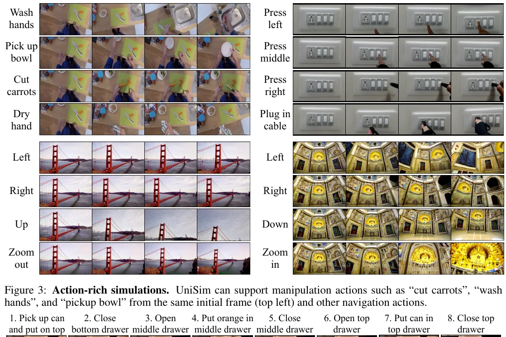
<figcaption>
Long-horizon simulation: autoregressive simulation of an 8-step interaction, in which the model keeps object states consistent (for example, the orange is still there after being put into the drawer)
</figcaption>
</div>

#### Policy training and zero-shot transfer
{: id="策略训练与-zero-shot-迁移"}
UniSim's greatest strength is that it can serve as a "training ground":
- **VLM policy**: Generating long-horizon data with hindsight relabeling in the simulator significantly improves the vision-language model's ability to handle complex tasks.
- **RL training**: A low-level RL agent can perform millions of closed-loop interactions in UniSim. Because the simulator is visually very close to the real world, the trained policy can run directly on a real robot.

---

### 4. Core experimental results
{: id="4-核心实验结果"}

1. **Sim-to-real performance**: On the Language Table robot task, the real-environment goal-reaching rate (RDG) of the VLM policy trained with UniSim improves by 3-4 times.
2. **Better low-level control**: By optimizing with REINFORCE in the simulator, the success rate of the VLA policy on tasks that lack expert demonstrations, such as "pointing at objects", rises from 12% to 71%.
3. **Data augmentation**: PaLI-X fine-tuned only on video data generated by UniSim reaches about 84% of the video captioning performance obtained with real data, and generalizes better.

---

### 5. Limitations and discussion
{: id="5-局限性与思考"}

Although UniSim is an important step forward, it still faces the following challenges:
- **Hallucination**: Given unrealistic instructions (such as asking to "wash hands" on a tabletop), the model hallucinates dramatic changes in the background.
- **Limited long-horizon memory**: Conditioning covers only a limited number of past frames, so very long-horizon memory (such as object consistency after many rounds of interaction) still needs improvement.
- **Physical fidelity**: The current simulation focuses on the visual level and lacks non-visual physical feedback such as mechanics and touch.

---

<span id="59-openvla-2024-5-9-openvla-2024" class="vla-anchor-alias" aria-hidden="true"></span>

## 9. OpenVLA (2024)
{: id="5-9-openvla-2024"}
——An Open-Source Vision-Language-Action Model

📄 **Paper**: https://arxiv.org/abs/2406.09246v3

**Key takeaways**

This paper shows how to build an open-source, large-scale robot control model. The core ideas worth learning are:
1. Starting from a pretrained vision-language model and treating robot actions as language tokens enables end-to-end training.
2. Training on a large, diverse robot dataset (970,000 trajectories) significantly improves generalization.
3. Fusing two visual encoders (SigLIP + DINOv2) captures both semantic and spatial information and improves robot control.
4. Parameter-efficient fine-tuning (LoRA) and quantization allow the 7B model to be deployed and fine-tuned on consumer-grade GPUs.
5. Fully open-sourcing the model, code, and training recipe provides important infrastructure for community research.

**Background and problem**

Existing robot manipulation policies struggle to generalize to objects, scenes, and tasks beyond their training data. Although vision-language foundation models have shown strong generalization on web-scale data, existing vision-language-action (VLA) models are either closed-source or lack methods for efficient fine-tuning to new robot setups, which hinders the broad adoption of VLAs in robotics.

**Methods and innovations**

OpenVLA is a 7B-parameter open-source vision-language-action model trained on 970,000 robot demonstration trajectories from the Open X-Embodiment dataset. The architecture has three key components:

1. **Fused visual encoder (complementary backbones)**: A multi-backbone visual encoding strategy in which each backbone contributes a different kind of visual feature:
   - **DINOv2**: Provides strong geometric and spatial features (understanding "where"; good at object localization and depth perception).
   - **SigLIP**: Provides strong semantic understanding (understanding "what"; good at aligning with natural-language instructions).
   - **CLIP / others**: Provide complementary visual features.
This combination lets the 7B model beat a much larger 55B model that uses a single encoder, in terms of how efficiently it processes information.

2. **Projector**: A 2-layer MLP projects the visual features into the input space of the language model.

3. **Language model backbone (the "brain")**: Built on Llama 2 7B, it acts as a unified decision-making center that integrates spatial and semantic information for instruction reasoning.

<div align="center">
  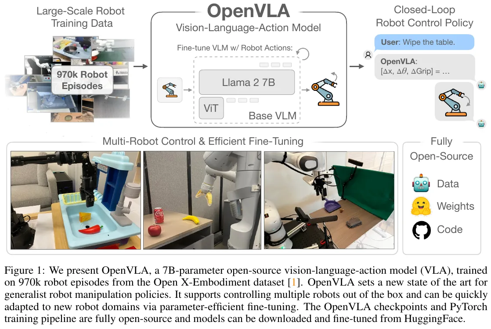
<figcaption>
OpenVLA architecture: the end-to-end pipeline from image observations and language instructions to 7-dimensional robot actions (Source: <a href="https://arxiv.org/abs/2406.09246">OpenVLA arXiv</a>)
</figcaption>
</div>

**Training strategy**:
- Action discretization: each dimension of the continuous action is quantized into 256 bins, using the 1st-99th percentile range as the quantization range
- The 256 least-used tokens in the Llama tokenizer are used to represent the discretized actions
- All parameters (including the visual encoder) are fine-tuned end to end, training on 64 A100 GPUs for 14 days
- Training runs for 27 epochs, until action token accuracy exceeds 95%

**Data processing**:
- Select datasets from Open X-Embodiment that have a third-person camera and single-arm end-effector control
- Use Octo's data mixture weights to upsample highly diverse datasets
- Filter out all-zero actions in the Bridge dataset to improve model performance

**OpenVLA training process**: A pretrained VLM (Llama-2 7B) is fine-tuned on 970k robot trajectories (the Open X-Embodiment dataset) to predict robot actions, with action tokenization enabling end-to-end learning. See [paper Figure 2](https://arxiv.org/abs/2406.09246) for details.

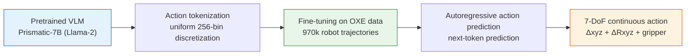

**Fine-tuning and deployment optimizations**:
- **LoRA fine-tuning**: LoRA with rank 32 matches full-parameter fine-tuning performance. It trains only 1.4% of the parameters and can be completed on a single A100 GPU.
- **Quantized inference**: 4-bit quantization cuts GPU memory requirements from 16.8 GB to 7.0 GB without significant performance degradation
- **Inference speed**: Runs at 6 Hz on an RTX 4090 (bfloat16); the speed after quantization depends on the hardware and operator implementation and cannot be inferred directly from the reduction in bit width

**Results and findings**

1. **Multi-task, multi-robot evaluation**:
   - The paper reports an average success rate 16.5 percentage points higher than RT-2-X across 29 tasks and multiple robot setups.
   - This result corresponds to the authors' task set and data conditions and cannot be attributed solely to the dual visual encoder.
   - When comparing visual, motor, physical, and semantic generalization, the task groups should be examined separately; a better overall average does not mean every group is better.

2. **Source of evidence**: Model and data settings are given in the [OpenVLA paper](https://arxiv.org/abs/2406.09246) and the [official project page](https://openvla.github.io/).

3. **Data-efficient adaptation**:
   - On 7 Franka robot tasks (10-150 demonstrations), the average success rate after fine-tuning OpenVLA is 63.8%
   - On single-instruction tasks, Diffusion Policy performs better (66.7% vs 53.5%)
   - On multi-instruction tasks, OpenVLA is far better than Diffusion Policy (91.7% vs 19.4%)
   - OpenVLA is the only method to reach a success rate of at least 50% on all tasks

**Data-efficient adaptation experiments**: OpenVLA performs best on highly diverse multi-instruction tasks. It needs only a few demonstrations (10-50) to reach a high success rate on new tasks, significantly better than training from scratch and other pretrained VLA models. See [paper Figure 4](https://arxiv.org/abs/2406.09246) for details.

4. **Computational efficiency**:
   - LoRA fine-tuning (rank 32) matches full-parameter fine-tuning, reducing GPU memory requirements from 163.3 GB to 59.7 GB
   - 4-bit quantized inference performance stays essentially unchanged (71.9% vs 71.3%) while memory usage is halved
   - Can be deployed and fine-tuned on consumer GPUs

5. **Open-source impact**:
   - Weights, training code, and fine-tuning code are released, providing a basis for reproduction and adaptation.
   - Supports HuggingFace integration and provides fine-tuning notebooks
   - Provides critical infrastructure for community research on VLAs

**Developer quick start (OpenVLA usage example):**

```python
import torch
from PIL import Image
from transformers import AutoModelForVision2Seq, AutoProcessor

# Load the pretrained model
model_id = "openvla/openvla-7b"
processor = AutoProcessor.from_pretrained(model_id, trust_remote_code=True)
model = AutoModelForVision2Seq.from_pretrained(
    model_id, torch_dtype=torch.bfloat16, low_cpu_mem_usage=True, trust_remote_code=True
).to("cuda")

# Prepare the current RGB camera image; action prediction is demonstrated only once here
image = Image.open("observation.png").convert("RGB")
prompt = "In: What action should the robot take to pick up the red bowl?\nOut:"
inputs = processor(images=image, text=prompt, return_tensors="pt").to("cuda", dtype=torch.bfloat16)

# Generate the action
action = model.predict_action(**inputs, unnorm_key="bridge_orig")
print(f"Predicted Action: {action}")
```

This example requires `observation.png` to be prepared first. `bridge_orig` uses the action normalization statistics of its training data; when adapting to your own robot, you must switch to matching dataset statistics and check the action coordinate frame, units, and controller interface. It is not a complete real-robot control loop. Dependency versions follow the [official OpenVLA repository](https://github.com/openvla/openvla).

**Limitations**

The original version of OpenVLA supports only single-image observations and does not handle multiple camera views, proprioceptive information, or observation history. Its inference speed (6 Hz) is still too slow for high-frequency control tasks (such as ALOHA at 50 Hz). Although it generalizes better than existing policies, its success rate on test tasks is usually below 90%, so reliability still has room for improvement. Because of limited compute, many VLA design questions (such as the scale of the base VLM, co-training strategies, and optimal visual features) remain unexplored.

---

<span id="510-π-2024-5-10-pi0-2024" class="vla-anchor-alias" aria-hidden="true"></span>

## 10. π₀ (2024)
{: id="5-10-pi0-2024"}
A Vision-Language-Action Flow Model for General Robot Control

📄 **Paper**: [π₀ original paper](https://arxiv.org/abs/2410.24164) · **Code**: [openpi](https://github.com/Physical-Intelligence/openpi)

<div align="center">
  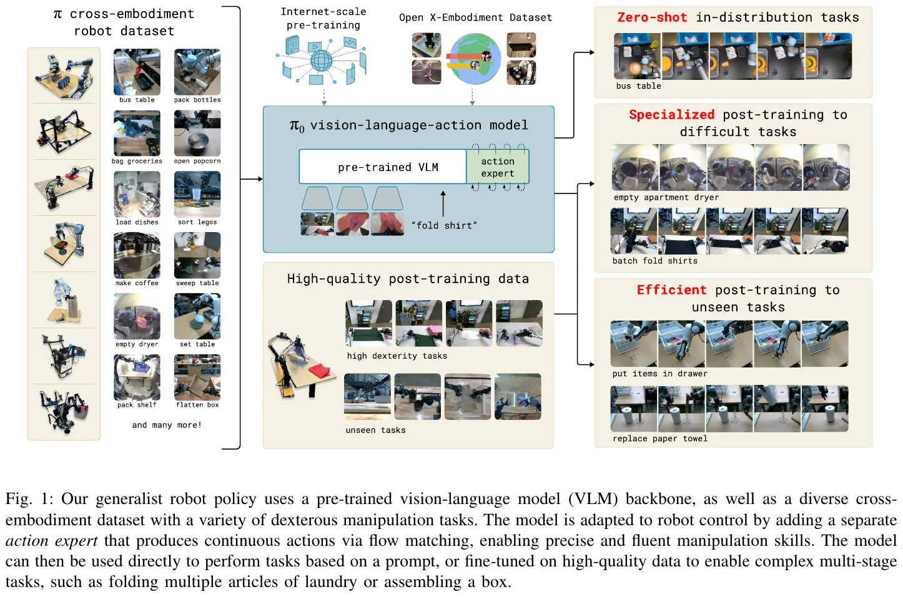
<figcaption>π₀ combines vision-language pretraining with continuous action chunk generation. Source: Physical Intelligence.</figcaption>
</div>

### Key takeaways
{: id="精华-4"}

The core design of π₀ is to let a pretrained VLM provide semantic and visual conditioning, with a dedicated action expert generating continuous action chunks. It combines language knowledge transfer with dexterous control, but the effect depends on the robot data, model structure, and execution configuration.

### 1. Research question and architecture
{: id="1-研究问题与架构"}

The original model adds an action expert of about 300M parameters to the roughly 3B-parameter PaliGemma, for a total of about **3.3B**. Inputs include images, language, and robot state; the action expert uses flow matching to learn the conditional action distribution. Attention masks control the flow of information among the vision-language prefix, the state, and the noisy actions; this is a specific design of π₀, not a form of attention that every VLA must adopt.

### 2. How flow matching generates actions
{: id="2-flow-matching-如何生成动作"}

To illustrate the training objective, the following uses the "noise to data" time direction. Let $z$ be Gaussian noise, $A$ the demonstration action chunk, and $c$ the observation and task conditions:

$$
x_\tau=(1-\tau)z+\tau A,\qquad
\mathcal{L}=\mathbb{E}\left[\|v_\theta(x_\tau,\tau,c)-(A-z)\|^2\right].
$$

The model learns the conditional velocity field at different noise levels; at inference time, it starts from noise and generates actions by numerical integration. The training interpolation path is a straight line, which does not mean the learned sampling trajectory must be the shortest path, nor does it guarantee high accuracy in just 1-3 steps. The original paper deploys **10-step integration and 50-step action chunks**.

### 3. High-frequency execution and closed-loop latency
{: id="3-高频执行与闭环延迟"}

The original paper reports a single inference time of about **73 ms** on an RTX 4090. For a 50 Hz robot, inference is repeated after every 25 executed steps (about 0.5 seconds). Thus 50 Hz is the action execution frequency, not the closed-loop inference frequency of the full VLM. When comparing against diffusion or discrete policies, the hardware, number of sampling steps, action length, and execution protocol must be aligned. The configuration above is given in the [π₀ appendix](https://arxiv.org/html/2410.24164v1) of the original paper.

### 4. How to interpret the experimental results
{: id="4-实验结果应如何理解"}

The paper studies task execution, language instruction following, and fine-tuning for new skills after pretraining, covering tasks such as folding clothes, cleaning a table, bagging, and assembling cartons. The results support the conclusion that large-scale multi-robot training can be combined with continuous-motion expertise.

One must distinguish between tasks covered by pretraining, unseen instances, and specialized fine-tuning tasks. The paper's zero-shot setting does not mean the model has never seen the relevant motor skills, and a long-horizon task demonstration cannot directly replace continuous-run statistics that include resets, failures, and human intervention.

### 5. π₀-FAST versus the flow-matching version
{: id="5-π-fast-与流匹配版本的区别"}

[FAST](https://arxiv.org/abs/2501.09747) uses the discrete cosine transform and BPE to compress action sequences, allowing autoregressive models to learn high-frequency actions effectively. π₀-FAST is a related model that adopts this token representation; it should not be described as a general inference-accelerated version of the flow-matching decoder.

The authors report that the training compute needed to reach similar performance is reduced by up to about **5 times**; in the paper's RTX 4090 comparison, π₀-FAST inference takes about **750 ms** per action chunk, versus under **100 ms** for flow-matching π₀. Faster training convergence and faster online inference are two different things. Source: [FAST §VI-E, §VI-F](https://arxiv.org/html/2501.09747v1).

### 6. Limitations
{: id="6-局限性"}

Data coverage, robot interfaces, and observation distributions still limit transfer. Long action chunks reduce how often the model is called, but also increase the response delay to disturbances during execution. In real deployment, the choice of action chunk length, replanning interval, and controller configuration should be combined, and contact errors, failure recovery, and task throughput should then be checked.

---

<span id="511-π5-2025-5-11-pi05-2025" class="vla-anchor-alias" aria-hidden="true"></span>

## 11. π₀.5 (2025)
{: id="5-11-pi05-2025"}
———a Vision-Language-Action Model with Open-World Generalization

📄 **Paper**: [https://arxiv.org/abs/2504.16054](https://arxiv.org/abs/2504.16054)
💻 **Project**: [https://pi.website/blog/pi05](https://pi.website/blog/pi05)

### Key takeaways
{: id="精华-5"}

This is the latest breakthrough from the Physical Intelligence team on **open-world generalization**. π0.5 is a new VLA model built on π0:
- **Co-training on heterogeneous data**: Only a small part of the data (2.4% in the first training stage) comes from real mobile manipulation robots. The remaining 97.6% comes from other stationary robots, high-level semantic predictions, verbal human instructions, and web multimodal data (such as image captioning, question answering, and object detection).
- **Hierarchical reasoning architecture**: At execution time, the model first predicts a "high-level semantic subtask" (such as "pick up the plate") and then predicts the low-level robot action chunk conditioned on that subtask.
- **Environment generalization experiments**: The paper shows that an end-to-end learned robot system can perform long-horizon, multi-stage dexterous tasks (such as cleaning a kitchen or bedroom) for 10 to 15 minutes in real homes **not covered by** the training data.

---

### 1. Background and problem
{: id="1-研究背景问题-4"}

If robots are to be truly useful, they must leave the laboratory and cope with the varied, unforeseen situations of the real world. Although recent VLA models have achieved impressive end-to-end control results, **how far their generalization can go in "in-the-wild" environments remains an open question**.

If a mobile robot is asked to clean a kitchen it has never seen, it needs several levels of generalization:
1. Simple grasping skills must generalize to new objects.
2. Existing skills must be composed into new sequences.
3. The robot must understand the semantics of the scene (for example, which is a drawer and which might be a dish rack).

The traditional approach of covering every household scenario by brute-force data piling is unrealistic. The core idea of π0.5 is that, like humans, it **draws on knowledge from other sources (books, other people's experience, etc.) and achieves generalization through multimodal co-training.**

---

### 2. Methods and innovations
{: id="2-主要方法创新点-4"}

<div align="center">
  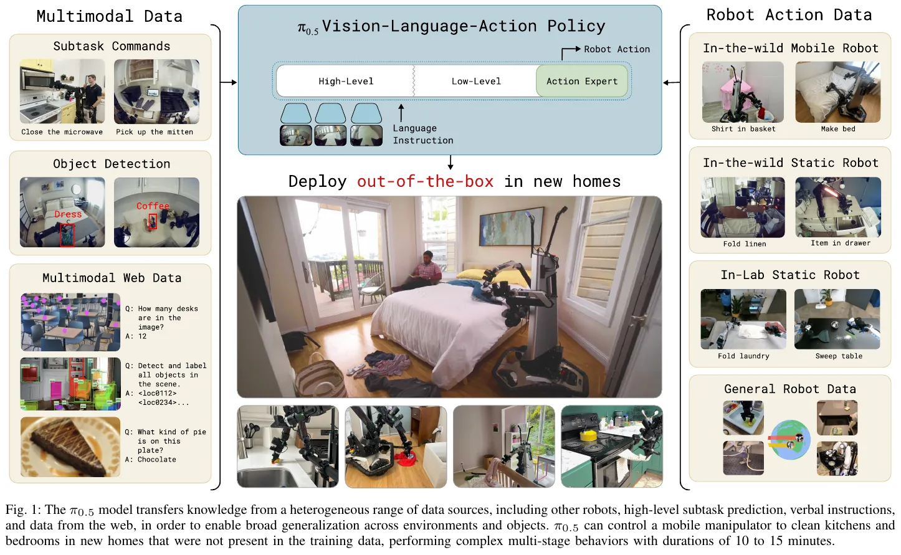
<figcaption>
π0.5 architecture and training data sources: web multimodal data, object detection, high-level subtask instructions, and various robot action data are integrated so the model can be deployed in new homes out of the box
</figcaption>
</div>

#### Heterogeneous knowledge sources
{: id="多样化异构的知识来源-heterogeneous-knowledge-sources"}
The training data for π0.5 is more than "videos of robots in action". It integrates:
1. **Multimodal web data**: Web-scale image question answering, object localization, and similar tasks give the model prior scene understanding.
2. **High-level semantic prediction and language instructions**: Verbal human guidance that contains long-horizon task structure is introduced into training.
3. **Other robot data**: Data from stationary arms and other platforms in the lab enriches the library of low-level motor skills.

#### Hierarchical architecture
{: id="层次化的架构设计-hierarchical-architecture"}
The model's design is quite straightforward: it is pretrained on a mixture of web data and multi-robot data, and then fine-tuned on data containing low-level actions and high-level semantic labels.
At inference time:
1. **High-level reasoning**: The model first infers the most appropriate "semantic subtask" for the moment, such as "pick up the cutting board".
2. **Low-level execution**: The model then outputs the corresponding low-level robot control actions conditioned on the subtask label.
Breaking complex tasks down this way lets low-level actions benefit from data of other, simpler robots, while high-level reasoning benefits from web text and image data.

---

### 3. Core experimental results
{: id="3-核心实验结果-2"}

<div align="center">
  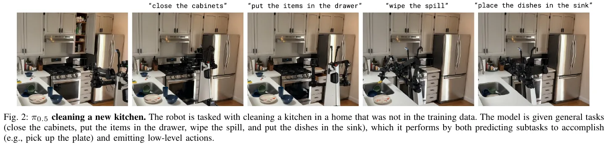
<figcaption>
π0.5 cleaning a kitchen it has never seen, executing complex commands such as "close the cabinet door", "put the items in the drawer", and "wipe up the spill"
</figcaption>
</div>

- **Breakthrough on long-horizon tasks**: Experiments show that π0.5 can continuously control a mobile manipulation robot for 10 to 15 minutes from a single high-level prompt, completing very complex household chores such as cleaning a kitchen, making a bed, and hanging towels.
- **Environment transfer**: All evaluation tasks are performed in new homes that **do not appear at all** in the training data, showing that the system has strong open-world generalization.
- **The necessity of co-training**: Ablation experiments show that without co-training on heterogeneous data, the model cannot complete complex long-horizon tasks in these unfamiliar real environments.

---

### 4. Summary and significance
{: id="4-总结与意义-2"}

π0.5 shows that **mixing heterogeneous data sources** (rather than simply scaling up training data on the target robot) lets an end-to-end robot system develop strong generalization. Combining web-scale semantic knowledge with the robot's low-level motor skills through "hierarchical reasoning" offers a highly practical technical paradigm for deploying general-purpose household robots at scale.

---

<span id="512-π6-2025-5-12-pi06-2025" class="vla-anchor-alias" aria-hidden="true"></span>

## 12. π*₀.₆ / RECAP (2025)
{: id="5-12-pi06-2025"}
———a VLA That Learns From Experience

📄 **Paper**: [https://arxiv.org/abs/2511.14759](https://arxiv.org/abs/2511.14759)
💻 **Project**: [https://pi.website/blog/pistar06](https://pi.website/blog/pistar06)

### Key takeaways
{: id="精华-6"}

This is another major breakthrough from the Physical Intelligence team in embodied intelligence. It addresses how a large vision-language-action (VLA) model can keep improving itself in the real world through **reinforcement learning (RL)**:
- **RECAP framework**: A general method called RECAP (RL with Experience and Corrections via Advantage-conditioned Policies) is proposed. It lets a VLA model integrate very diverse data sources: expert demonstrations, autonomous execution data, and real-time human teleoperated interventions when the robot makes mistakes.
- **Advantage conditioning**: Unlike traditional policy gradients (PPO, etc.), which are hard to apply to large flow-matching models, RECAP lets the model learn directly "which action is better" by adding a simple "advantage indicator" to its input.
- **Performance leap**: On the hardest tasks, RECAP more than doubles the robot's **throughput (successes per unit time)** while cutting the task failure rate by about 50%.
- **Engineering feat**: The trained π*0.6 model can make espresso for 13 hours without interruption, or fold a variety of complex garments for two hours in a completely unfamiliar home.

---

### 1. Background and problem
{: id="1-研究背景问题-5"}

"Practice makes perfect" is at the core of human learning. Although existing VLA models can master skills through imitation learning (BC), they struggle to surpass the human demonstrators and cannot correct themselves after deployment.

Applying reinforcement learning to large VLA models poses three major challenges:
1. **Algorithm stability**: Traditional RL algorithms are often highly unstable on large models.
2. **Data heterogeneity**: How can one exploit both "perfect demonstrations" and "autonomous attempts that contain errors but also corrections"?
3. **Real-world feedback**: How can reward signals be obtained efficiently without a simulation environment?

---

### 2. Methods and innovations
{: id="2-主要方法创新点-5"}

<div align="center">
  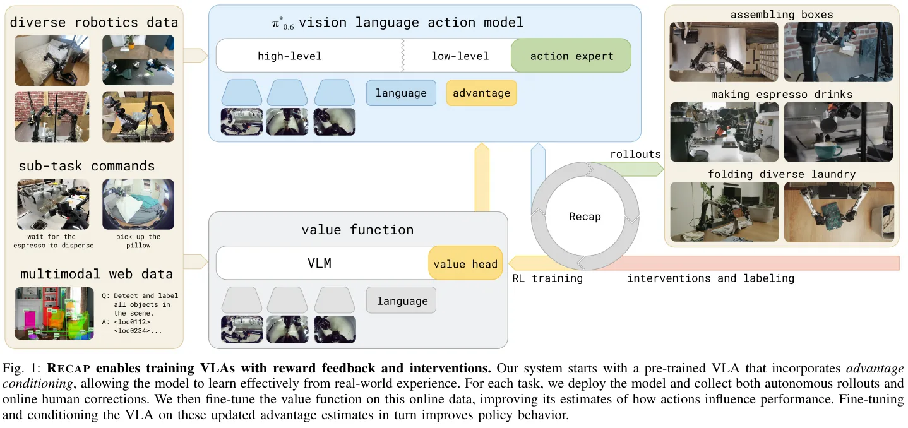
<figcaption>
RECAP workflow: starting from a pretrained VLA, collect autonomous trajectories and human corrections through deployment, update the value function, and train the policy with advantage conditioning
</figcaption>
</div>

#### RECAP training loop
{: id="recap-训练循环"}
1. **Data collection**: Let the robot attempt tasks on its own. If something goes wrong, a human can step in to correct it.
2. **Value function training**: Train a multi-task distributional value function that estimates, from the current observation, the number of steps remaining until success.
3. **Advantage-conditioned training**: Label each action as having a "positive" or "negative" advantage according to the value function's estimate. During training, the model learns to predict actions conditioned on this label.

#### Core model: π*0.6
{: id="核心模型π06"}
π*0.6 is the RL version of the π0.6 model. Its backbone is the 4-billion-parameter Gemma 3 VLM plus an 860-million-parameter flow-matching action expert.
- **Advantage conditioning**: "Advantage: positive/negative" is added to the model's prompt as input, so that at inference time the model can elicit the best action by setting a positive advantage.
- **Knowledge insulation**: Ensures that action generation and high-level reasoning do not interfere with each other, improving system stability.

---

### 3. Core experimental results
{: id="3-核心实验结果-3"}

<div align="center">
  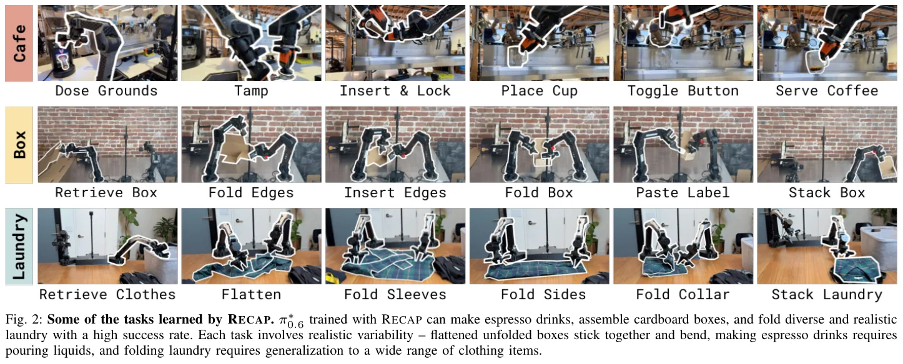
<figcaption>
π*0.6 challenge tasks: folding clothes of various materials, assembling industrial cartons, and making double espresso with a professional coffee machine
</figcaption>
</div>

- **Extremely robust**:
  - **Making coffee**: Involves a series of fine movements such as grinding, tamping, locking the portafilter, brewing, and holding the cup, and supports continuous operation for up to 13 hours.
  - **Carton assembly**: In a real factory setting, cardboard that sticks together and deforms is handled, and throughput rises from an initial 5 per hour to more than 10 per hour.
- **Significant improvements in metrics**:
  - On the complex laundry-folding task, the success rate rises from 70% to over 90%.
  - Experiments show that RECAP's advantage conditioning far outperforms traditional AWR (advantage-weighted regression) and PPO.

---

### 4. Summary and significance
{: id="4-总结与意义-3"}

π*0.6 and RECAP mark robot learning's leap from "static imitation" to "dynamic evolution". They show that, even without a simulator, a large VLA model can quickly master extremely delicate, long-horizon, and uncertain industrial and household skills through autonomous attempts in the real world and a small amount of human guidance.

---

## 13. π₀.7: a Steerable Generalist Robotic Foundation Model (2026)
{: id="513-π7-a-steerable-generalist-robotic-foundation-model-2026"}
——A steerable generalist robot foundation model with zero-shot cross-embodiment transfer and compositional task abilities

📄 **Paper**: [arXiv:2604.15483](https://arxiv.org/abs/2604.15483)

### Key takeaways
{: id="精华-7"}
1. Proposes π0.7, a 5B-parameter general vision-language-action (VLA) model that achieves strong out-of-the-box capabilities by introducing multimodal context (subtask instructions, subgoal images, and training metadata).
2. The core innovation is "steerability": by randomly dropping and injecting detailed execution information (such as motion quality, speed, and whether errors occur) during training, the model can, at inference time, be steered through prompts to perform difficult dexterous tasks with high quality.
3. Remarkable zero-shot cross-embodiment transfer: the model can directly transfer dexterous skills learned on lightweight platforms (such as laundry folding) to industrial arms with higher payloads (such as the UR5e).
4. Compositional generalization through language "coaching": users can guide the model step by step with instructions to complete never-before-seen long-horizon tasks of up to 5 minutes.
5. Successfully integrates heterogeneous datasets, including robot demonstrations, failure data from autonomous operation, human videos, and web multimodal data, and shows that multimodal prompts can resolve the ambiguity caused by differences in data quality.

---

### 1. Background and problem
{: id="1-研究背景问题-6"}
Although current robot foundation models (VLAs) have progressed in scale and generalization, they still face several core challenges:
- **Difficulty with complex tasks**: Even after large-scale pretraining, models often still need targeted fine-tuning for never-before-seen dexterous or long-horizon tasks.
- **Data heterogeneity**: Large-scale data (such as human videos and autonomous failure data) often mixes different execution strategies and quality levels. Naive training leads the model to learn the "average" and yields suboptimal performance.
- **Poor cross-embodiment generalization**: Skills are hard to transfer seamlessly between robots with different morphologies and dynamics.

---

### 2. Methods and innovations
{: id="2-主要方法创新点-6"}

<div align="center">
  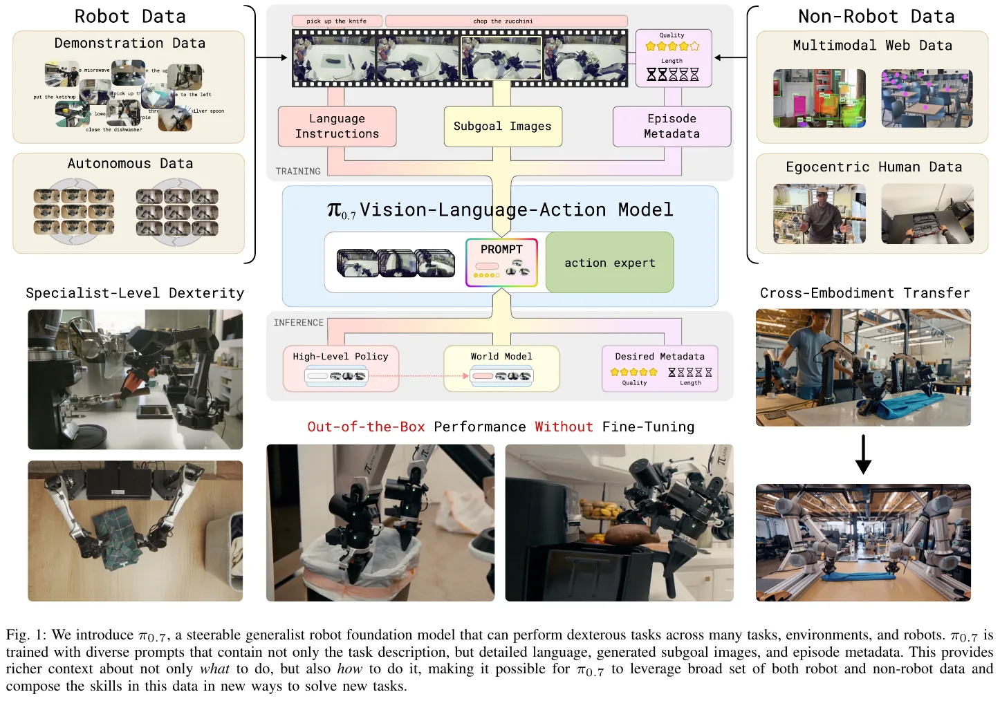
<figcaption>π0.7 overall framework: trained on robot demonstrations, autonomous data, human videos, and web multimodal data, with detailed prompts (instructions, subgoals, metadata) used to steer actions precisely.</figcaption>
</div>

#### ① Overall framework
{: id="-整体框架概述"}
π0.7 is a 5-billion-parameter VLA model whose core architecture consists of a 4B-parameter vision-language model (VLM) backbone, a MEM-style video history encoder (400M parameters), and a lightweight action expert module (860M parameters). Given the current visual observation, historical information, and a set of rich contextual information (prompts), the system directly generates continuous action chunks.

<div align="center">
  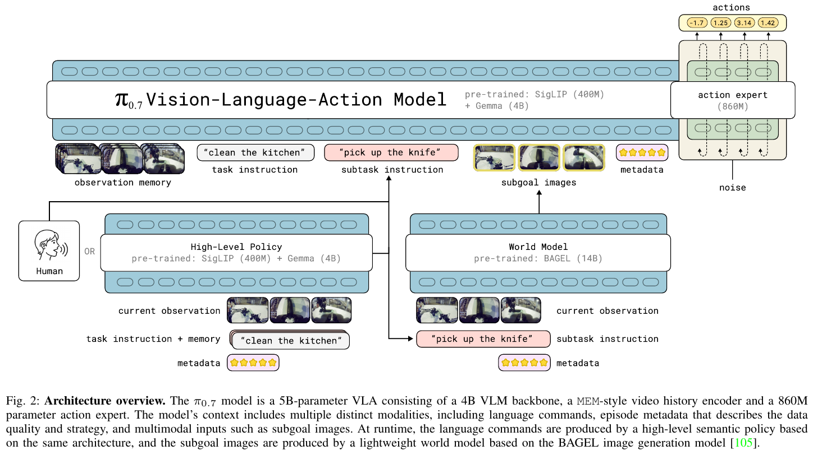
<figcaption>π0.7 network architecture: a Gemma3 VLM backbone, a video history encoder, and a flow-matching action expert.</figcaption>
</div>

#### ② Core modules
{: id="-核心模块讲解"}

**Multimodal context for steering (steerable prompting):**
This is the heart of π0.7. To handle heterogeneous data and achieve precise control, the model receives the following context during training:
- **Subtask instructions**: Given the overall task (such as "clean the kitchen"), a semantic instruction for the current step (such as "pick up the knife").
- **Subgoal images**: Generated by a 14B-parameter BAGEL world model, they depict the near-future state the robot should reach and give the model visual cues for spatial grounding.
- **Episode metadata**: Explicitly marks data quality (scored 1-5), speed (number of execution steps), and whether errors occurred. This lets the model learn from failed data (marked as "with errors") and, at inference time, elicit optimal actions by setting "high quality, error-free".

<div align="center">
  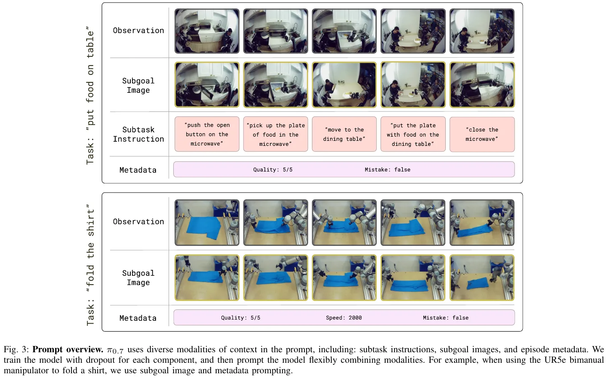
<figcaption>Multimodal prompt schematic: subtasks, visual subgoals, and metadata work together to disambiguate large-scale heterogeneous datasets.</figcaption>
</div>

**Action expert and flow matching:**
Unlike traditional discrete token prediction, π0.7 trains its action expert with a flow-matching objective. This module is a small Transformer that attends to the activations of the VLM backbone and generates 50-step continuous action chunks. This design captures the multimodal distribution of actions and also enables fast inference (as low as 38 ms on an H100).

#### ③ End-to-end data flow
{: id="-端到端数据流"}
1. **Input**: Up to 4 camera images (front, wrist, etc.) and 6 historical frames.
2. **Feature encoding**: The video encoder compresses the historical observations and feeds them into the Gemma3 VLM together with the current observations.
3. **Context fusion**: The subtask text, the generated subgoal image, and the desired metadata (such as speed and high quality) are concatenated as tokens.
4. **Action generation**: Based on the latent representation output by the VLM, the action expert generates 50 actions through 5 denoising steps.

---

### 3. Results and findings
{: id="3-核心结果发现-1"}

<div align="center">
  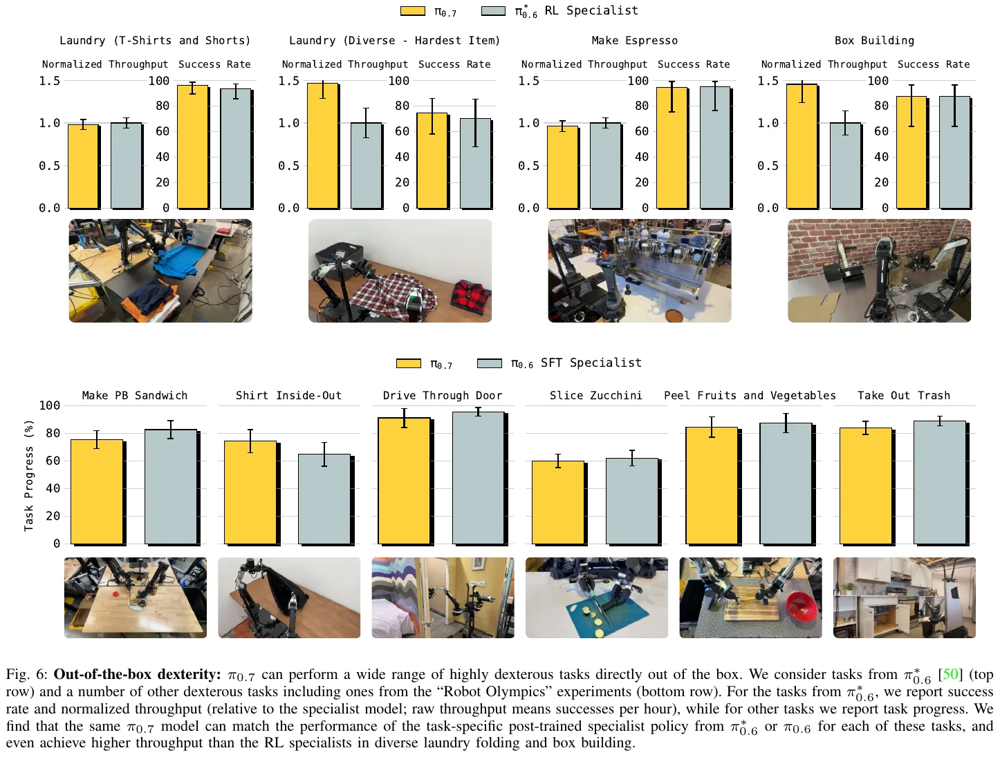
<figcaption>π0.7's out-of-the-box dexterity performance: on tasks such as folding clothes, making coffee, and assembling boxes, it matches or even exceeds expert models specifically fine-tuned with reinforcement learning.</figcaption>
</div>

- **Strong out-of-the-box performance**: Without any task-specific post-training, π0.7 can complete challenging dexterous tasks, such as slicing a cucumber, peeling, and operating a coffee machine.
- **Excellent cross-embodiment generalization**: With no UR5e laundry-folding data at all, the model successfully transferred skills learned on the source robot arm to the UR5e, with performance approaching that of an experienced human teleoperator.

<div align="center">
  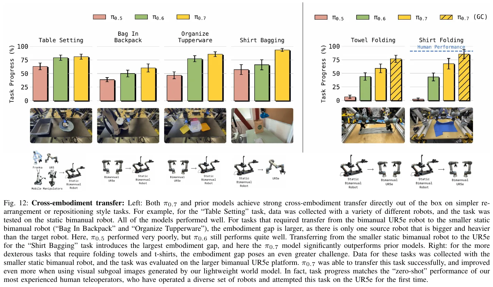
<figcaption>Cross-embodiment transfer results: even when morphology and dynamics differ greatly, π0.7 can generate new policies adapted to the target robot (for example, going from bimanual cooperation to single-arm operation).</figcaption>
</div>

- **Executing new composed tasks**: Through a language "coach", users can teach the robot on the spot to complete entirely new tasks, such as using an air fryer it has never seen.

<div align="center">
  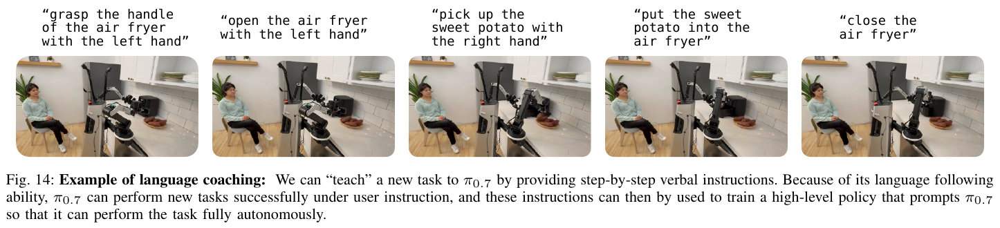
<figcaption>Language coaching example: teaching the robot the "load the air fryer" task through step-by-step language instructions.</figcaption>
</div>

---

### 4. Limitations
{: id="4-局限性-1"}
1. **A gap remains in zero-shot success rate**: Although it performs impressively on dexterous tasks, its success rate on never-seen task/embodiment combinations (60-80%) is still lower than on known tasks (>90%).
2. **Dependence on the world model**: Generating visual subgoals demands a very high-quality world model, and a failed generation directly affects the VLA's decisions.
3. **"Never seen" is hard to define**: Given the scale and complexity of the training set, it is hard to prove strictly that a task has no related examples in the dataset.

---

<span id="514-acot-vla-2026-5-13-acot-vla-2026" class="vla-anchor-alias" aria-hidden="true"></span>

## 14. ACoT-VLA (2026)
{: id="5-13-acot-vla-2026"}
**Subtitle**: Action Chain-of-Thought for Vision-Language-Action Models
**Translated title**: A vision-language-action model that reasons in action space

📄 **Paper**: [arXiv:2601.11404](https://arxiv.org/abs/2601.11404)

<div align="center">
  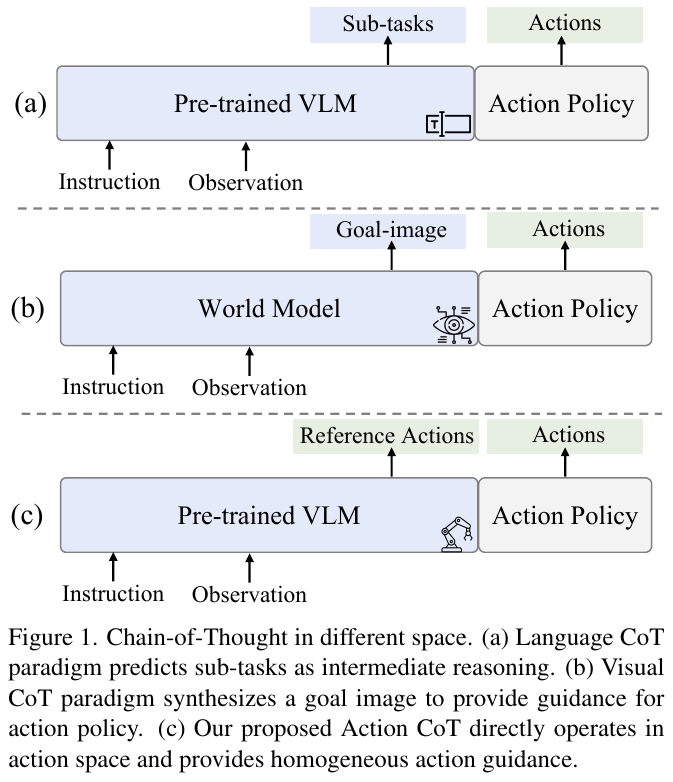
<figcaption>
ACoT-VLA: reasoning chains carried out directly in action space, generating a coarse reference trajectory to guide the final denoised action (Source: ACoT-VLA Project)
</figcaption>
</div>

**Key takeaways**
The core innovation of this paper is to move the reasoning process from language/visual space into action space. Points worth borrowing: (1) reasoning directly in action space provides homogeneous motion guidance and bridges the gap between semantics and kinematics; (2) the complementary designs of the Explicit Action Reasoner (EAR) and the Implicit Action Reasoner (IAR) provide trajectory-level and semantic-level guidance, respectively; (3) a teacher-forcing training strategy stabilizes training and prevents the reasoning module from interfering with the optimization of the action head; (4) action-level guidance greatly improves robustness and resistance to error accumulation on long-horizon tasks.
**Comparison of different CoT paradigms**:

|Paradigm|Intermediate representation|Advantages|Limitations|
|------|---------|------|------|
|**(a) Language CoT**|Subtask description|Strong interpretability|Large semantic-action gap|
|**(b) Vision CoT**|Goal image|Visually intuitive|Missing kinematic information|
|**(c) Action CoT** (this paper)|Coarse action trajectory|Homogeneous guidance, directly executable|Requires extra inference modules|

See [ACoT-VLA paper Figure 1](https://arxiv.org/abs/2601.11404) for details.

**Background and problem**
Existing VLA models mainly reason in vision-language space (for example, language CoT predicts subtasks and visual CoT synthesizes goal images), but this kind of reasoning guides action execution only indirectly and suboptimally. VLM pretraining focuses on semantic understanding rather than physical dynamics. World models can predict future visual states, but remain confined to visual representations. Both suffer from a semantic-kinematic gap and struggle to provide enough fine-grained guidance for accurate low-level action generation.

**Methods and innovations**

This paper proposes the **Action Chain-of-Thought (ACoT)** paradigm, which recasts the reasoning process as a structured sequence of action intentions and deliberates directly in action space. The ACoT-VLA framework has three core components:

**ACoT-VLA overall architecture** (three core modules):

```
VLM features ───┬─→ EAR (Explicit Action Reasoner)
            │    ↓ coarse reference trajectory Z^ex
            │
noisy action├─→ IAR (Implicit Action Reasoner)
            │    ↓ implicit action prior Z^im
            │
            └─→ AGP (Action-Guided Prediction)
                 ↓ fuse explicit + implicit guidance
              final action prediction
```

For the detailed architecture diagram, see [ACoT-VLA paper Figure 2](https://arxiv.org/abs/2601.11404)

**1. Explicit Action Reasoner (EAR)**
- A lightweight Transformer that takes a noisy action sequence as input
- Captures temporal dependencies through self-attention, and injects multimodal context from the VLM's key-value cache through cross-attention
- Trained with flow matching to independently generate a coarse reference trajectory $$a^{ref}_{t:t+H^{ref}-1}$$
- The reference trajectory is encoded to form explicit action-space guidance $Z^{ex}$

**2. Implicit Action Reasoner (IAR)**
- Operates directly on the VLM's key-value cache to extract implicit motion cues
- For each layer of VLM features, a learnable query matrix $Q_i$ extracts action-related information through cross-attention
- A downsampling strategy reduces computational overhead: the KV cache dimension is reduced to $d' \ll d$
- After cross-layer aggregation, this forms the implicit action guidance $Z^{im}$, capturing visual affordances and action semantics

**3. Action-Guided Prediction (AGP)**
- The noisy action embedding serves as the query $Q_{action}$ and attends to both $Z^{ex}$ and $Z^{im}$ through dual cross-attention
- Explicit and implicit guidance are fused through self-attention: $\bar{h} = \text{Self-Attn}([S^{ex}; S^{im}])$
- The final action head $$\pi^{head}_\theta$$ predicts the denoised action sequence from the aggregated representation

**Training strategy**:
- A flow-matching loss optimizes the EAR and the action head jointly
- Teacher forcing for stabilization: during training, $Z^{ex}$ is computed directly from the ground-truth trajectory; at inference, it switches to self-conditioning

**Results and findings**

**Simulation experiments**:
- LIBERO: 98.5% average success rate (SOTA), 1.6% above π0.5, with the largest gain on LIBERO-Long (long-horizon) (96.0% vs 92.4%)
- LIBERO-Plus: 84.1%, significantly ahead in robustness tests, especially under camera viewpoint changes (+11.6%), robot initial-state perturbations (+16.3%), and sensor noise (+12.5%)
- VLABench: Intention Score 63.5% and Progress Score 47.4%, with significant gains of +12.6% IS and +7.2% PS on the unseen-texture track

**Real-world deployment**:

- Average success rate on the AgiBot G1 robot is 66.7% (vs. 61.0% for π0.5 and 33.8% for π0)
- Cross-embodiment validation: equally effective on the AgileX platform, showing the generality of the method

**Real-world experiments**: Evaluation of three manipulation tasks on the AgiBot G1 robot

|Task|Description| ACoT-VLA | π₀.5 | π₀ |
|------|------|----------|------|-----|
|**Wipe stains**|Detect and wipe off stains on the tabletop| 70.0% | 65.0% | 38.0% |
|**Pour water**|Grasp the water bottle and pour it into the cup| 66.7% | 60.0% | 32.0% |
|**Open-set grasping**|Grasp unseen objects according to instructions| 63.3% | 58.0% | 31.5% |
|**Average success rate**| - | **66.7%** | 61.0% | 33.8% |

**Key findings**: ACoT-VLA performs well across embodiments (AgiBot G1, AgileX), showing the generality of action-space reasoning.

See [ACoT-VLA paper Tables 3-4](https://arxiv.org/abs/2601.11404) for details.

**Key ablation findings**:
- EAR alone improves performance by 1.4% (LIBERO), and IAR alone by 1.2%
- Using EAR and IAR together gives the best results, showing that explicit and implicit guidance are complementary.
- A reference action horizon of 15-30 works best; too long or too short is worse.
- Performance is best with a 300M-parameter EAR; over-parameterization leads to overfitting.
- Inference latency increases by only about 20 ms (91 ms → 112 ms), an excellent performance-efficiency trade-off

**Limitations**
This approach requires extra inference modules; although their computational overhead is relatively small, they may pose challenges on resource-constrained platforms. In addition, the current action representation still uses action chunks (joint angles / end-effector poses) and lacks explicit geometric structure. In the future, the action representation could be extended to a geometrically interpretable 3D space to further unlock the reasoning potential of ACoT.

---
---
<span id="515-vlm4vla-2026-5-14-vlm4vla-2026" class="vla-anchor-alias" aria-hidden="true"></span>

## 15. VLM4VLA (2026)
{: id="5-14-vlm4vla-2026"}
**Subtitle**: Revisiting Vision-Language Models in Vision-Language-Action Models
**Translated title**: Re-examining the vision-language model in vision-language-action models

📄 **Paper**: [arXiv:2601.03309](https://arxiv.org/abs/2601.03309)

<div align="center">
  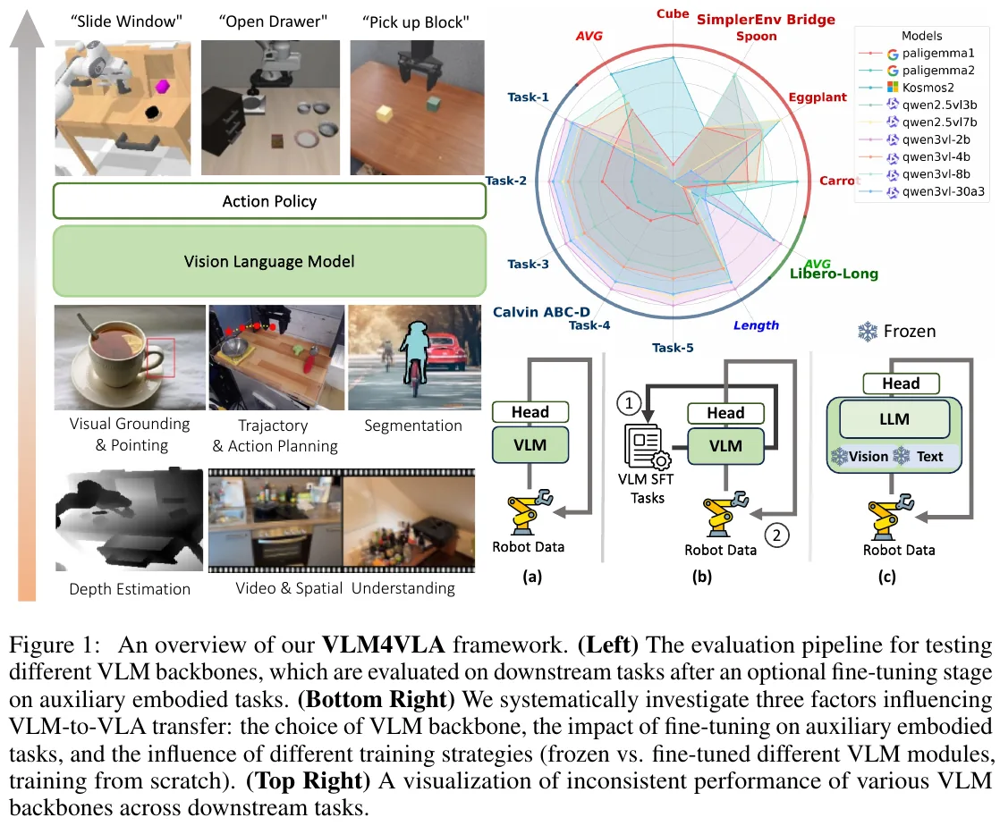
<figcaption>
VLM4VLA minimal adaptation architecture: a learnable action query token is introduced to extract embodied knowledge from a frozen VLM (Source: VLM4VLA Project)
</figcaption>
</div>

**Key takeaways**

The core ideas worth learning from this paper: it minimizes the adaptation pipeline to evaluate fairly how different VLMs affect downstream performance; it finds that a VLM's general capabilities are not strongly correlated with embodied control performance, challenging a common assumption; it identifies the visual encoder (rather than the language component) as the performance bottleneck, revealing a domain gap between VLM pretraining objectives and the requirements of embodied action planning; and it proposes a strategy for steady performance gains by injecting control-related supervision signals into the visual encoder.

**Background and problem**

Current research on vision-language-action (VLA) models focuses mainly on improving network architectures, training paradigms, and action decoding schemes, and rarely studies a core question systematically: how does the choice and capability of the underlying vision-language model (VLM) affect VLA policy performance? Existing work lacks a fair experimental framework for evaluating how much different VLMs contribute to downstream robot task performance.

**Methods and innovations**

The paper proposes the **VLM4VLA** framework, a minimal adaptation pipeline that converts a general VLM into a VLA policy by introducing less than 1% new parameters, enabling a fair and efficient comparison.

**VLM4VLA framework overview**: A minimal adaptation pipeline for fairly evaluating how different VLMs affect VLA performance

**Evaluation pipeline**:
1. VLM backbone selection (9 models, including Qwen2.5VL, Paligemma, and Kosmos-2)
2. Optional fine-tuning on auxiliary embodied tasks (visual pointing, depth estimation, etc.)
3. Evaluation on downstream control tasks (Calvin, SimplerEnv, Libero)
4. Systematic analysis (correlation with general ability, modality-level ablation, impact of training strategy)

See [VLM4VLA paper Figure 1](https://arxiv.org/abs/2601.03309) for details.

**Core architecture design**:

**VLM4VLA network architecture**:

```
Image + language instruction
    ↓
[VLM Encoder] (frozen or fine-tuned)
    ↓
Action Query Token (learnable, <1% of parameters)
    ↓
[MLP Policy Head] (L1/L2 loss, no diffusion)
    ↓
Action chunk output
```

**Design principles**: Minimize new parameters (<1%) and use a simple MLP instead of diffusion to ensure a fair comparison.

See [VLM4VLA paper Figure 2](https://arxiv.org/abs/2601.03309) for details.

- A learnable **action query token** extracts embodiment-relevant knowledge from the VLM
- A simple **MLP policy head** decodes the actions, avoiding the randomness introduced by diffusion/flow matching
- An **L1/L2 loss** replaces the diffusion loss to improve inference stability and evaluation robustness
- All VLM parameters (vision encoder, LLM, word embeddings) are trained when fine-tuning on downstream tasks

**Three-axis experimental design**:

1. **General capability evaluation**: Compare 9 open-source VLMs (1B-30B parameters) as VLA backbones, including the Qwen2.5VL/Qwen3VL series, the Paligemma series, and Kosmos-2
2. **Embodiment-specific capability evaluation**: Fine-tune the VLM on 7 auxiliary embodied tasks (visual grounding, depth estimation, trajectory prediction, etc.) and test the effect on downstream control tasks
3. **Modality-level ablation**: Freeze or fine-tune the vision and language encoders independently, and test the effect of injecting control-related information (the FAST tokenizer) into the vision encoder

**Evaluation benchmarks**: Tested in three simulated environments
- **Calvin ABC-D**: trained on scenes A, B, and C and tested on scene D (cross-scene generalization)
- **SimplerEnv-Bridge**: trained on real BridgeV2 data and tested in a simulated environment
- **Libero-Long**: 10 long-horizon manipulation tasks

**Core findings**:

**Core finding: correlation between VLM general capability and VLA performance**

|Benchmark|Correlation of VLM capability with VLA performance|Conclusion|
|---------|----------------|------|
| **Calvin ABC-D** |r = 0.839 (strong positive correlation)|A VLM's general capabilities help cross-scene generalization|
| **SimplerEnv-Bridge** |r ≈ 0 (no correlation)|A VLM's general capabilities fail to predict control performance|
| **Libero-Long** |r ≈ 0 (no correlation)|A VLM's general capabilities fail to predict control performance|

**Takeaway**: VLM pretraining is necessary but not sufficient; general VQA ability is not equivalent to embodied control ability.

See [VLM4VLA paper Figure 3](https://arxiv.org/abs/2601.03309) for details.

1. **A VLM's general capabilities are necessary but not sufficient**: VLM initialization gives consistent gains over training from scratch, but a VLM's general VQA ability does not predict its performance on embodied control tasks
2. **Fine-tuning on auxiliary embodied tasks has limited effect**: Fine-tuning the VLM on tasks such as visual pointing, spatial understanding, and embodied VQA did not improve downstream control performance, and even lowered it slightly.

**Effect of fine-tuning on auxiliary embodied tasks**: a surprising finding

|Auxiliary task|Expected effect|Actual effect|
|---------|---------|---------|
| Visual pointing |✅ Spatial understanding should improve|❌ Performance slightly degraded|
| Depth estimation |✅ 3D perception should improve|❌ Performance slightly degraded|
| Trajectory prediction |✅ Action planning should improve|❌ Performance slightly degraded|
| Embodied VQA |✅ Embodied understanding should improve|❌ Performance slightly degraded|

**Conclusion**: Fine-tuning on auxiliary embodied tasks failed to improve downstream control performance and even had a slight negative effect. This challenges the common assumption that embodied pretraining is beneficial.

See [VLM4VLA paper Figure 4](https://arxiv.org/abs/2601.03309) for details.

3. **The vision encoder is the key bottleneck**: Freezing the vision encoder causes a significant performance drop (1.0-3.0 points on Calvin), while freezing the word embeddings has almost no effect
4. **A semantic gap separates vision-language understanding from low-level control**: Injecting an action-token prediction task into the vision encoder yields a +18.1% improvement even when the encoder is frozen, showing a fundamental misalignment between VLM visual features and control requirements

**VLM and VLA training trajectories differ**:

```
Parameter space

VLM-task optimum ←──────┐
                      │ divergence point
       common starting point ──→ ○ ────┘
                      │
VLA-task optimum ←──────┘
```

**Key insights**:
- VLM and VLA learn in the same direction early in training (shared vision-language understanding)
- At some point, however, they diverge and move toward different optima.
- This explains why freezing the vision encoder degrades performance
- Vision-language understanding is fundamentally different from low-level control

See [VLM4VLA paper Figure 5](https://arxiv.org/abs/2601.03309) for details.

**Results and findings**

- **Calvin ABC-D**: Qwen3VL-2B achieves the best performance (an average of 4.142 tasks completed), close to SOTA VLAs (pi0: 3.509)
- **SimplerEnv-Bridge**: The smallest model, Kosmos-2 (1.7B), achieves the highest success rate (60.4%), surpassing larger Qwen models
- **Libero-Long**: Qwen3VL-2B and Kosmos-2 both reach success rates above 55%, better than the other VLMs
- **Training from scratch**: Without VLM pretraining, performance drops by 60-70%, showing that VLM pretraining is crucial for VLA generalization
- **The real-to-sim gap is not the main cause**: After fine-tuning the VLM on action prediction with real images, freezing the vision encoder still degrades performance, indicating that the problem stems from the essential difference between vision-language tasks and low-level control tasks
- **Vision encoder fine-tuning is necessary**: On SimplerEnv-Bridge, unfreezing the vision encoder and injecting control information raises performance from 27.6% to 45.7% (+18.1%)

**Limitations**

The study ran no experiments on physical robots, mainly for reasons of fairness and repeatability. Although the analysis suggests that the VLM-VLA gap stems from task heterogeneity rather than a simple sim-to-real gap, real-world deployment remains the ultimate goal. The paper's comprehensive simulation benchmark results can serve as a valuable reference for future research.

---
<span id="516-twinbrainvla-2026-5-15-twinbrain-vla-2026" class="vla-anchor-alias" aria-hidden="true"></span>

## 16. TwinBrainVLA (2026)
{: id="5-15-twinbrain-vla-2026"}
**Subtitle**: Unleashing VLM Potential in Embodied Tasks via Asymmetric Dual-Transformer Mixture
**Translated title**: Unleashing the potential of general-purpose VLMs in embodied tasks through an asymmetric dual-Transformer mixture

📄 **Paper**: [arXiv:2601.14133](https://arxiv.org/abs/2601.14133)

<div align="center">
  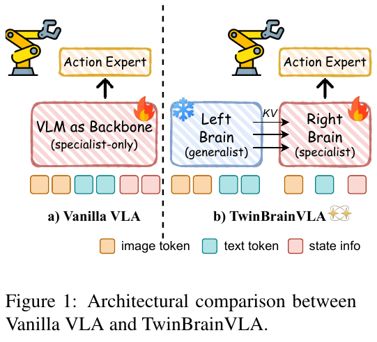
<figcaption>
TwinBrainVLA: an asymmetric dual-stream architecture that mimics the division of labor between the left and right brain. The Left Brain provides semantic anchoring and the Right Brain handles action reasoning (Source: TwinBrainVLA Project)
</figcaption>
</div>

**Key takeaways**

This paper shows how to solve catastrophic forgetting in VLA models through structured decoupling. The core ideas worth learning: a dual-stream architecture separates high-level semantic understanding from low-level motor control; the "generalist" branch is frozen to retain pretrained knowledge while the "specialist" branch learns embodied skills; an asymmetric attention mechanism transfers knowledge without destroying the original abilities; and flow matching generates continuous actions instead of discrete tokenization. This "left brain / right brain" design philosophy offers a new paradigm for building general-purpose robots with both cognitive ability and physical dexterity.

**Background and problem**

Current vision-language-action (VLA) models usually fine-tune a pretrained vision-language model (VLM) directly for robot control. However, this approach has a fundamental conflict between maintaining high-level semantic understanding and learning low-level fine motor skills, leading to "catastrophic forgetting": the model sacrifices its original open-world language and visual reasoning abilities to adapt to robot manipulation.

**Methods and innovations**

**Comparison of a vanilla VLA and TwinBrainVLA architectures**:

|Architecture|VLM usage|Catastrophic forgetting|Proprioception|Performance|
|------|---------|-----------|---------|------|
| **Vanilla VLA** |Single VLM, fine-tuned|✅ Severe|❌ Limited|⚠️ Medium|
| **TwinBrainVLA** |Dual VLM (frozen + trainable)|❌ Avoided|✅ Dedicated encoding|✅ Excellent|

The paper proposes TwinBrainVLA, a dual-stream VLA architecture inspired by hemispheric lateralization, which coordinates a "generalist VLM" and an "embodied specialist VLM" for joint robot control:

**1. Asymmetric dual-VLM backbone**

- **Left Brain (generalist)**: A frozen pretrained VLM that retains open-world knowledge and instruction-following ability. Its input contains only visual and language tokens: `H⁰_L = [V(I); T(T)]`

- **Right Brain**: A trainable VLM dedicated to embodied motor control. Its input fuses visual, language, and proprioceptive state information: `H⁰_R = [V(I); T(T); φ(s)]`, where φ is a lightweight MLP state encoder that projects the robot state s (joint angles, end-effector pose, etc.) into the VLM embedding space

**2. The AsyMoT mechanism (Asymmetric Mixture-of-Transformers)**

**TwinBrainVLA framework and AsyMoT mechanism**:

```
Left Brain (frozen generalist VLM)          Right Brain (trainable specialist VLM)
  [V; T]                           [V; T; φ(s)]
     ↓ independent self-attention              ↓ AsyMoT
  H_L (semantic features) ─────sg───→ [K_L; K_R] ← Q_R
                              [V_L; V_R]
                                   ↓
                            Fused features H_R
                                   ↓
                          Flow-Matching Action Expert
                                   ↓
                              Continuous action output
```

**Core AsyMoT mechanism**:
1. The Left Brain runs independently and retains its pretrained capabilities
2. The Right Brain's queries attend to the keys and values of both branches (via stop-gradient)
3. Knowledge is transferred without destroying the original semantic anchor

See [TwinBrainVLA paper Figure 2](https://arxiv.org/abs/2601.14133) for details.

The core innovation is the way the two streams interact:

- **Left Brain**: Kept frozen; it runs self-attention independently to retain its pretrained capabilities
  ```
  H^(l+1)_L = Attn(Q^l_L, K^l_L, V^l_L) + FFN(H^l_L)
  ```

- **Right Brain**: Trainable, using asymmetric joint attention: queries come from the Right Brain, while keys and values are formed by concatenating the two branches:
  ```
  K_joint = [sg(K^l_L); K^l_R]
  V_joint = [sg(V^l_L); V^l_R]
  H^(l+1)_R = Softmax(Q^l_R(K_joint)^T / √d_k) V_joint + FFN(H^l_R)
  ```

Here, sg(·) denotes the stop-gradient operation, which ensures the Left Brain acts as a stable "semantic anchor" supplying high-level reasoning features, while the Right Brain dynamically integrates these semantics with fine-grained proprioceptive cues to reason about spatial actions.

**3. Flow-matching action expert**

- Adopts a Diffusion Transformer (DiT) architecture and generates high-precision continuous control signals through a flow-matching training strategy, going beyond the discrete tokenization paradigm

- The key difference is the source of the condition: the spatially rich representation H_R of the trainable Right Brain is injected into the DiT through cross-attention

- Flow-matching loss function:
  ```
  L_FM(ψ) = E_{t,a₀,a₁}[||v_ψ(a_t, t, H_R) - (a₁ - a₀)||²]
  ```

**4. Asymmetric training strategy**

- Training objective: `L_total = L_FM(θ_R, ψ, φ; D_robot)`, using only the robot action loss, without mixing in general vision-language datasets

- Parameter update policy: The Left Brain parameters are strictly frozen (`∇θ_L = 0`); gradients propagate only through the Right Brain (θ_R), the action expert (ψ), and the state encoder (φ)

- In the AsyMoT fusion layers, the gradient flow from the Left Brain is explicitly blocked by stop-gradient, so that it remains a stable semantic anchor undisturbed by the high-variance gradients of the robot control task.

Main innovations:
- The first VLA architecture to explicitly decouple general semantic understanding from embodied perception through an asymmetric dual-stream design
- The AsyMoT mechanism enables information exchange and joint training between two isomorphic VLM pathways.
- Structural immunity to catastrophic forgetting: the Right Brain focuses on control dynamics, while the Left Brain implicitly protects language and semantic priors

**Results and findings**

**SimplerEnv Benchmark** (WidowX Robot):
- TwinBrainVLA + Qwen3-VL-4B-Instruct reaches an average success rate of **62.0%**, surpassing the strongest baseline Isaac-GR00T-N1.6 (57.1%) by **4.9 percentage points**
- TwinBrainVLA + Qwen2.5-VL-3B-Instruct reaches **58.4%**, also surpassing all baseline methods
- Achieves 83.3% on the "Put Eggplant in Yellow Basket" task, demonstrating strong object manipulation ability

**RoboCasa benchmark** (GR1 robot tabletop manipulation, 24 tasks):
- TwinBrainVLA + Qwen3-VL-4B-Instruct reaches an average success rate of **54.6%**, significantly exceeding:
  - Isaac-GR00T-N1.6 (47.6%) **+7.0%**
  - QwenGR00T (47.8%) **+6.8%**
  - QwenPI (43.9%) **+10.7%**
- Shows excellent fine manipulation in complex tabletop scenes and validates the effectiveness of decoupling semantic understanding from embodied perception

**Key findings**:
- Even without large-scale robot action pretraining, TwinBrainVLA achieves SOTA performance on both benchmarks
- The dual-brain architecture generalizes well across different VLM families (Qwen2.5-VL and Qwen3-VL)
- Explicitly retains the broad visual understanding of the pretrained VLM while achieving superior manipulation performance

**Limitations**

The current implementation requires the Left Brain and Right Brain to share the same architecture so that their hidden-state dimensions are compatible. Future directions include: exploring more decoupled architectures (such as supporting heterogeneous backbones through learnable projection layers), initializing the Right Brain from specialized embodied VLM checkpoints, extending training to the full OXE dataset to make full use of the dual-stream architecture's capacity, and evaluating on a wider range of benchmarks and real-robot scenarios.

---

<span id="517-internvla-a1-2026-5-16-internvla-a1-2026" class="vla-anchor-alias" aria-hidden="true"></span>

## 17. InternVLA-A1 (2026)
{: id="5-16-internvla-a1-2026"}
——Unifying Understanding, Generation and Action for Robotic Manipulation

📄 **Paper**: https://arxiv.org/abs/2601.02456

<div align="center">
  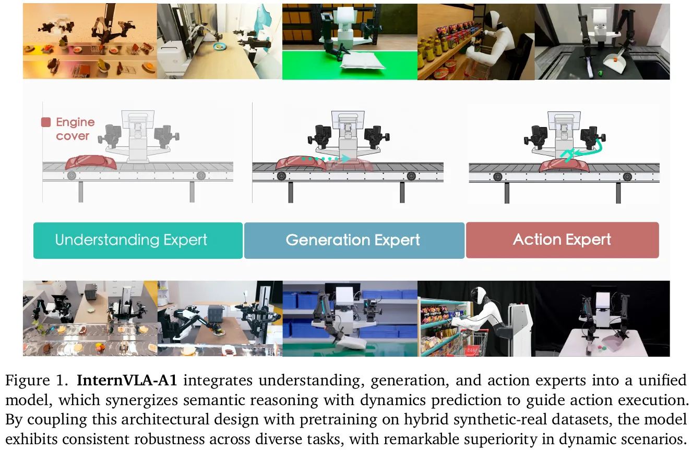
<figcaption>
InternVLA-A1 architecture: a unified understanding, generation, and action architecture based on MoT (Source: InternVLA-A1 Project)
</figcaption>
</div>

**Key takeaways**

The core innovation of InternVLA-A1 is to unify semantic understanding, visual foresight, and action execution in a single Mixture-of-Transformers (MoT) framework, using "imagining the future" to guide current actions, which is especially suited to dynamic scenes. Its hierarchical data pyramid (mixed pretraining on synthetic simulation data and real data) effectively bridges the sim-to-real gap and is worth learning from for VLA researchers. The Generation Expert lets the model internalize the causal relationship between actions and environment dynamics by jointly training the visual prediction and action prediction objectives, a key design for dynamic robustness. As the action decoder, flow matching both preserves the MLLM's semantic understanding and gives a fine-grained model of the multimodal action distribution.

---

**Background and problem**

Mainstream VLA models (such as π₀ and GR00T N1.5) are built on MLLMs and have strong semantic understanding, but essentially lack the ability to reason about the dynamics of the physical world: they perform reactive perception-to-action mapping rather than predicting how the state will evolve. Existing methods that bring in world models through video prediction (such as VPP and Genie Envisioner) can predict future observations, but their semantic grounding is weak and they are sensitive to prediction errors. This paper aims to build a unified architecture that tightly couples semantic understanding with dynamics prediction.

---

**Methods and innovations**

InternVLA-A1 uses a **Mixture-of-Transformers (MoT)** architecture to coordinate three expert modules:

**(1) Understanding Expert**
Reuses an existing MLLM architecture directly (InternVL3-1B or Qwen3-VL-2.13B): a ViT visual encoder processes the multi-view observations `o_t`, a text tokenizer processes the language instruction `l`, and the two are concatenated into prefix tokens `h_und` that provide semantic context for the downstream experts.

**(2) Generation Expert**
Inspired by Janus Pro, it uses a **decoupled visual encoding** strategy: the ViT (high-level semantics) is used for understanding and a VAE (pixel-level fidelity) for generation. Specifically, a Cosmos CI8×8 continuous VAE tokenizer encodes the input image into latent features `z_t`, and a convolutional layer then compresses the spatial dimensions to 4×4 (only 16 tokens per frame). After alignment to the Transformer latent dimension, these are sent to the generation expert. Conditioned on `h_und`, the generation expert predicts the latent `ẑ_{t+m}` of the future frame from the historical frame `z_{t-m}` and the current frame `z_t`, and the predicted image is finally reconstructed through deconvolution and the Cosmos decoder.

<div align="center">
  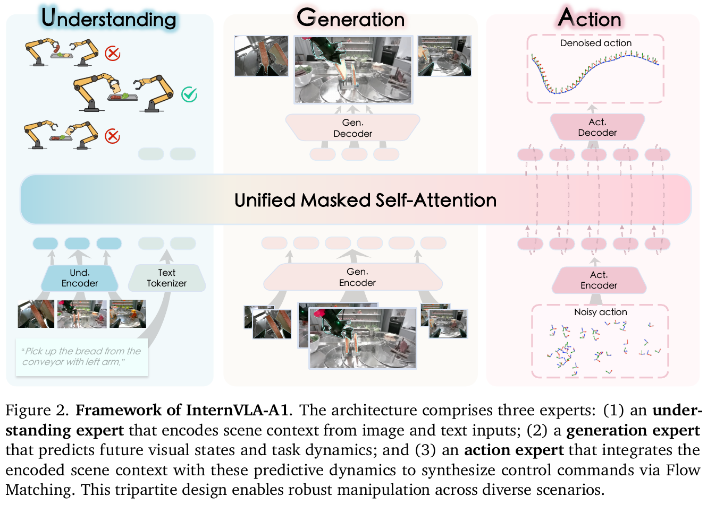
<figcaption>
InternVLA-A1 architecture details: the three experts interact through unified masked self-attention. The understanding expert outputs semantic context, the generation expert predicts future visual states, and the action expert generates control commands based on both.
</figcaption>
</div>

**(3) Action Expert**
Conditioned on the language goal `l`, the current observation (via `h_und`), the proprioceptive state `q_t`, and the latent `ẑ_{t+m}` predicted by the generation expert, the action expert predicts the target action chunk `â_{t:t+k}` with **flow matching**. Sampling starts from Gaussian noise, and the target actions are obtained by solving the ODE with Euler iteration.

**(4) Unified masked self-attention**
Block attention masks govern information flow among the three experts: cumulative segment masks ensure one-way flow (understanding → generation → action); the prefix block (vision + language) is fully bidirectional; the generation block is fully bidirectional and receives only Cosmos latent tokens; the action chunk is split into state tokens (which attend only to themselves and earlier blocks) and action tokens (which attend to one another).

**(5) Optimization objective**
Jointly optimize two goals:

- **Visual foresight generation**:

$$\mathcal{L}_{\text{gen}} = \mathbb{E}\left[\|f_{\text{gen}}(z_{t-m}, z_t; h_{\text{und}}) - \text{sg}[z_{t+m}]\|^2\right]$$

- **Flow-matching action prediction**:

$$\mathcal{L}_{\text{action}} = \mathbb{E}\left[\|v_\theta(l, \{o_i\}_{i=t-m}^t, q_t, a_{t:t+k}^\tau) - (a_{t:t+k} - \epsilon)\|^2\right]$$

- **Total loss** (with $\lambda = 0.01$):

$$\mathcal{L}_{\text{total}} = \lambda \cdot \mathcal{L}_{\text{gen}} + \mathcal{L}_{\text{action}}$$

**(6) Hierarchical data pyramid**

<div align="center">
  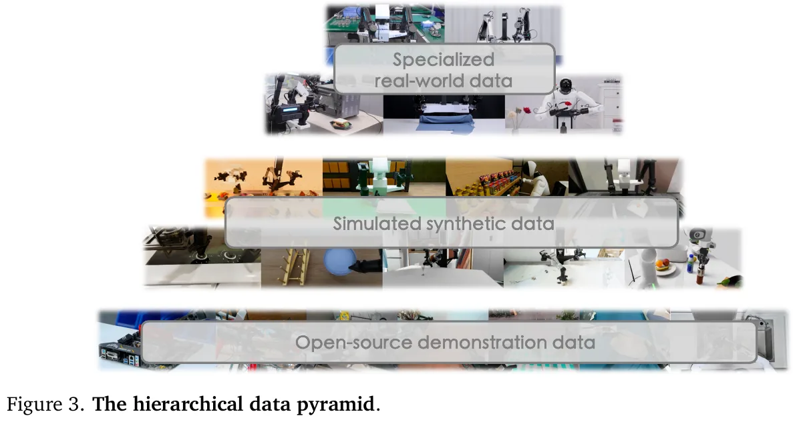
<figcaption>
Hierarchical data pyramid: the bottom layer is large-scale open-source demonstration data (AgiBot-World), the middle layer is synthetic simulation data (InternData-A1), and the top layer is specialized real-world data
</figcaption>
</div>

Pretraining data mixture (533M+ frames in total):
- InternData-A1 (ARX Lift-2): 96M frames (18%)
- InternData-A1 (AgileX): 122.5M frames (23%)
- InternData-A1 (Franka): 90.5M frames (17%)
- InternData-A1 (Genie-1): 16M frames (3%)
- AgiBot-World (Beta): 208M frames (39%)

After pretraining, a small amount of specialized real data is used for post-training fine-tuning to adapt to the target deployment environment.

**(7) Model scale**
- InternVLA-A1 (2B): Understanding = InternVL3 (0.94B) + Gen/Act = Qwen2.5 (0.36B each), 1.8B in total
- InternVLA-A1 (3B): Understanding = Qwen3-VL (2.13B) + Gen/Act = Qwen3 (0.44B each), 3.2B in total
- Inference speed: about 13 Hz for both (NVIDIA RTX 4090)

---

**Results and findings**

**General tasks (10 real-world tasks, Table 4)**:
- InternVLA-A1 (3B) reaches an average success rate of **75.1%**, **14.5%** higher than π₀ (3.3B) at 60.6%
- InternVLA-A1 (2B) reaches 64.7% and surpasses the larger π₀ (3.3B), highlighting the advantages of architecture and data quality
- Performance is especially strong on fine manipulation tasks (Make Sandwich: 93.3% vs 66.7%; Operate Oven: 86.7% vs 73.3%)

**Dynamic-scene tasks (Figure 6)**:

<div align="center">
  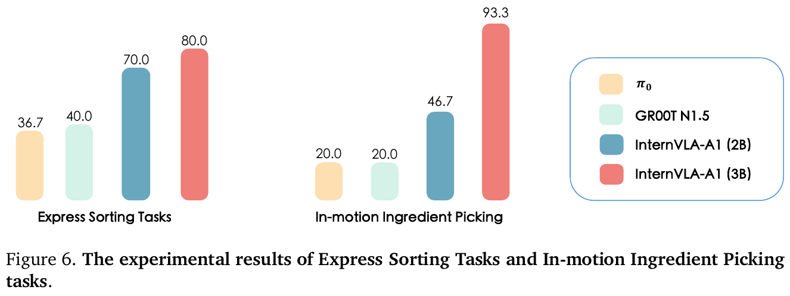
<figcaption>
Success rates on the Express Sorting and In-motion Ingredient Picking tasks: InternVLA-A1 (3B) leads the baselines by a wide margin with 80% and 93.3%
</figcaption>
</div>

- Express Sorting: π₀ only 36.7%, GR00T N1.5 only 40.0%, InternVLA-A1 (3B) up to **80.0%** (+40% or more)
- In-motion Ingredient Picking: the baseline reaches only 20.0%, while InternVLA-A1 (3B) reaches **93.3%** (+73.3%)

**Simulation benchmark (RoboTwin 2.0, 50 tasks)**: InternVLA-A1 (3B) scores 65.0% / 25.4% on Easy / Hard, exceeding π₀'s 54.5% / 19.8% (+10.5% / +5.6%)

**Ablation experiments**:
- Without pretraining: average success rate drops from 77.0% to 25.4% (↓51.6%)
- Without the Generation Expert: average success rate drops from 77.0% to 57.6% (↓19.4%), with 11 of 12 tasks degraded

---

**Limitations**

The Understanding Expert lacks joint training with multimodal VQA datasets, which degrades general semantic reasoning and complex instruction following; the visual foresight module sacrifices image prediction fidelity to keep inference real-time, so the granularity of the generated future frames is limited.

---

<span id="518-internvla-a15-2026-5-18-internvla-a15-2026" class="vla-anchor-alias" aria-hidden="true"></span>

## 18. InternVLA-A1.5 (2026)
{: id="5-18-internvla-a1.5-2026"}
——Unifying Understanding, Latent Foresight, and Action for Compositional Generalization

📄 **Paper**: https://arxiv.org/abs/2607.04988v1

**Key takeaways**

1. Proposes InternVLA-A1.5, a Mixture-of-Transformers (MoT) robot control architecture that unifies vision-language understanding, physical-world dynamics prediction (latent prediction), and continuous action generation.
2. A "latent querying" mechanism turns future prediction into lightweight foresight queries in latent space; the physical-world dynamics prior is absorbed by supervising a frozen pretrained video generation model (WAN2.2), so no pixel-level image generation is needed at inference time, which preserves real-time closed-loop control (0.1 s latency).
3. Builds a multi-stage training pipeline: the first stage unifies robot demonstrations and VQA tasks into chat-template discrete-token autoregression, preserving the semantics and instruction following of the backbone VLM; the second stage jointly trains continuous action generation and foresight latent encoding.
4. Achieves state-of-the-art performance on 6 simulation benchmarks (LIBERO, RoboTwin, DOMINO, EBench, SimplerEnv, LIBERO-Plus) and on real-world tasks, with excellent generalization and execution stability on unseen action compositions and long-horizon chemistry experiment tasks (MOF reactions).

---

**Background and problem**

Current VLA (vision-language-action) models face the following bottlenecks in dexterous manipulation and dynamic interaction:
- **Semantic drift and instruction decay**: Once continuous action generation and heavy generation tasks are introduced, traditional VLA training often drops large-scale VQA or language modeling data, so the base VLM's original semantic understanding and instruction following gradually degrade.
- **Interference among heterogeneous objectives**: Jointly optimizing losses of different forms and scales, such as future image reconstruction, action regression, and language prediction, easily causes conflicts in joint training.
- **Training video prediction from scratch is expensive**: Existing physical world models tend to train future-pixel reconstruction from scratch, failing to exploit the rich spatiotemporal dynamics priors in web-scale pretrained video generation models (such as WAN2.2 and Sora).

---

**Methods and innovations**

<div align="center">
  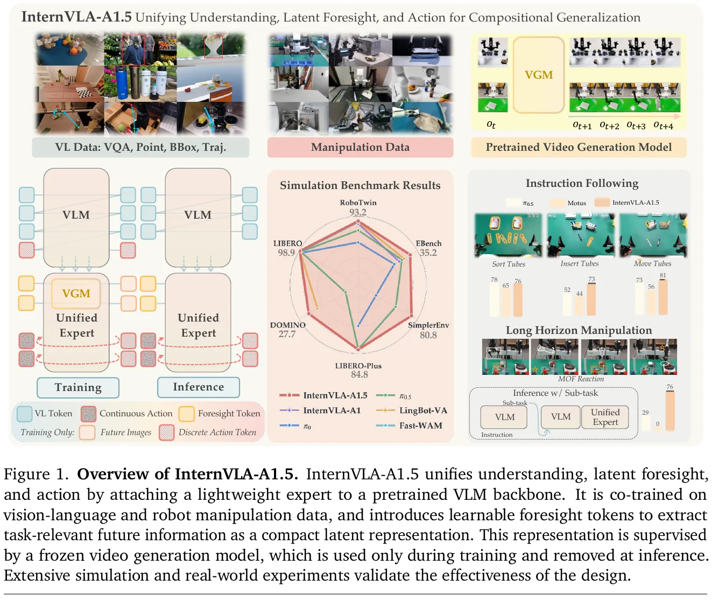
<figcaption>InternVLA-A1.5 overall architecture: a lightweight action/prediction expert module attached to a pretrained VLM backbone unifies understanding, latent prediction, and action generation.</figcaption>
</div>

**(1) Overall framework**
InternVLA-A1.5 adopts a Mixture-of-Transformers (MoT) architecture with two core parts:
1. A pretrained VLM backbone (Qwen-3.5 2B) responsible for multimodal perception and high-level planning and reasoning.
2. A lightweight unified expert module (460M parameters) responsible for flow-matching prediction of continuous actions and for latent prediction queries (Foresight Tokens).
The two share some of the full-attention layers, achieving deep coupling of semantic priors and fine-grained physical manipulation.

**(2) Pretrained VLM backbone**
- **Input**: Robot camera images $o_t$ from $K$ viewpoints, a natural-language instruction $\ell$, a control mode $m$ (such as joint control `<joint>`, end-effector control `<end_effector>`, or Q&A `<vqa>`), and the robot's proprioceptive state $q_t$, uniformly discretized into bins.
- **Processing**: The VLM uses the standard Qwen3.5 visual and text encoders to convert the concatenated multi-view images and text into token embeddings, and processes them through the backbone's Transformer blocks (alternating 3 Gated DeltaNet linear-attention layers with 1 standard full-attention layer).
- **Output**: In the first stage of multi-stage training, the VLM outputs a text subtask description $\hat{\ell}$ and discrete action tokens encoded by the FAST discretization tokenizer; in the second stage, it provides the unified expert with the global semantic context latent features $H_t$.
- **Motivation**: Preserve the base VLM's strong semantic generalization on complex instructions and scene question answering, and prevent semantic drift when the robot undergoes large-scale motion-policy training.

**(3) Unified expert and action prediction**
- **Input**: The semantic latent features $H_t$ from the VLM backbone, a set of learnable latent prediction queries (Foresight Tokens) $Q_f$, and the noisy action chunk $\epsilon$ injected during flow-matching denoising.
- **Processing**: The expert module uses the same structure as Qwen-3.5-Text but with a smaller hidden channel dimension (460M parameters). It keeps its own independent Gated DeltaNet linear-attention layers to handle action details, and fuses features across modules with $H_t$ through the shared VLM full-attention layers. In this module the learnable Foresight Tokens act as future query slots, while action prediction uses flow matching to predict the velocity field $v_{\theta}^{\text{act}}$.
- **Output**: A continuous control trajectory, the action chunk $$\mathbf{a}_{t:t+H}$$ from the current moment to $H$ steps ahead.
- **Motivation**: Compared with discrete token prediction, flow-matching generation by a low-dimensional continuous control expert is better suited to low-latency (0.1 s closed-loop feedback), high-precision real-robot arm control.

**(4) Latent foresight mechanism**
- **Input**: The Foresight Tokens $Z_f^t$ output by the unified expert, projected into a conditioning encoding $C_f^t$, and the video latent $x_1$ obtained by concatenating the current frame and the next $N$ frames.
- **Processing**: A pretrained video generation model, WAN2.2-5B, with fully frozen parameters serves as the world model. The foresight latent encoding $C_f^t$ is injected into WAN's cross-attention. By applying a flow-matching supervised loss in the video generation model's latent space, backpropagation updates the Foresight Tokens $Q_f$ and the unified expert, while WAN's own parameters are not updated.
- **Output**: Optimized foresight latent embeddings during training; at inference the video generation model is discarded entirely, adding no computational overhead.
- **Motivation**: The generative details of "how the physical world evolves" are fully delegated to a large video model that already generalizes strongly. The robot policy only needs to learn "what to imagine" rather than "how to draw", which removes the heavy computational cost of real-robot inference while retaining the world model's dynamics prior.

<div align="center">
  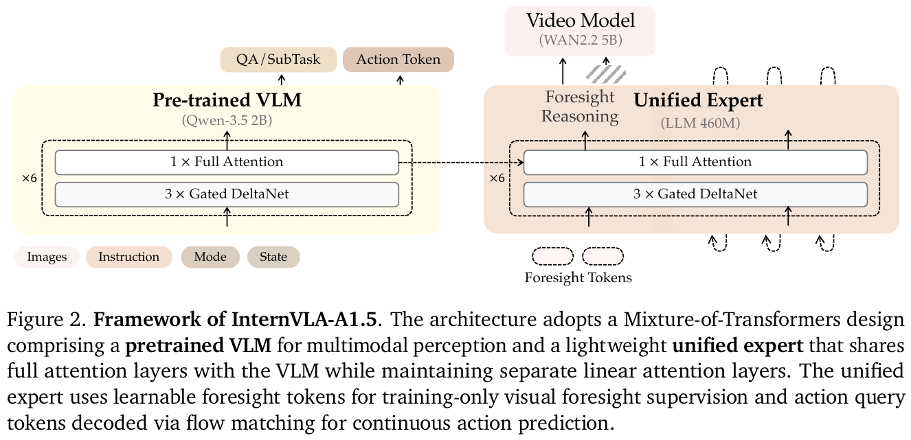
<figcaption>The MoT architecture of InternVLA-A1.5, showing how the pretrained VLM backbone and the unified expert fuse through attention, and the flow of Foresight Tokens and continuous action generation.</figcaption>
</div>

**(5) End-to-end data flow**
1. **Multi-view multimodal input**: The $K$ camera-image tokens, task description text, control mode, and discretized state are concatenated.
2. **Multimodal alignment and perception**: The input passes through the VLM backbone, which extracts the context representation $H_t$ and predicts the semantic description $\hat{\ell}$ of the next subtask.
3. **Spatiotemporal prediction and embedding fusion**: The learnable $Q_f$ is injected into the unified expert and interacts with $H_t$ through attention to produce features $Z_f^t$ carrying future-trend information. During training, this latent encoding guides the frozen WAN2.2 video generation; during inference, it is used directly in the next step.
4. **Action denoising**: Taking the noise $\epsilon$ as input, the action expert conditioned on $H_t$ and $Q_f$ iteratively denoises the flow-matching velocity field via Euler integration and finally outputs the continuous action chunk $$\mathbf{a}_{t:t+H}$$.

**(6) Training objectives and loss functions**
The multi-stage training of InternVLA-A1.5 relies on the following core losses.

- **Stage 1: VLM transfer (semantic transfer)**
In this stage, VQA data and discretized robot control data are mixed for autoregressive prediction, and only the forward cross-entropy loss on the label part (the subtask description $\hat{\ell}$ and FAST discrete action tokens $a$) is computed:
  $$L_{\text{stage1}} = -\mathbb{E}_{(\mathbf{o}_t, \ell, \mathbf{y}) \sim \mathcal{D}} \left[ \sum_{i=1}^{M+N} \log p_{\theta}(y_i \mid \mathbf{o}_t, \ell, \mathbf{y}_{<i}) \right]$$
Where $$\mathbf{y} = (\hat{\ell}_1, \dots, \hat{\ell}_M, a_1, \dots, a_N)$$ is the concatenated sequence of subtask and action tokens.

- **Stage 2: joint foresight and action training**
This stage introduces the video latent prediction loss $L_{\text{video}}$ and the action flow-matching loss $L_{\text{action}}$.
  - **Latent video prediction loss**:
    $$L_{\text{video}} = \mathbb{E}_{x_0, x_1, C_f^t, s} \left[ \lVert u(x_s, C_f^t, s) - v_s \rVert_2^2 \right]$$
Lets the Foresight Tokens draw dynamics representations from WAN.
  - **Action prediction loss**:
    $$L_{\text{action}} = \mathbb{E}_{\mathbf{a}_{t:t+H}, \epsilon, \tau} \left[ \lVert v_{\theta}^{\text{act}}(\mathbf{a}_{t:t+H}^{\tau}, H_t, Q_f) - (\mathbf{a}_{t:t+H} - \epsilon) \rVert_2^2 \right]$$
Predicts the velocity field of the continuous action interpolation trajectory.
  - **Total joint loss**:
    $$L_{\text{stage2}} = L_{\text{stage1}} + \alpha L_{\text{video}} + \beta L_{\text{action}}$$
In practice, the weights are set to $\alpha = 1, \beta = 10$.

<div align="center">
  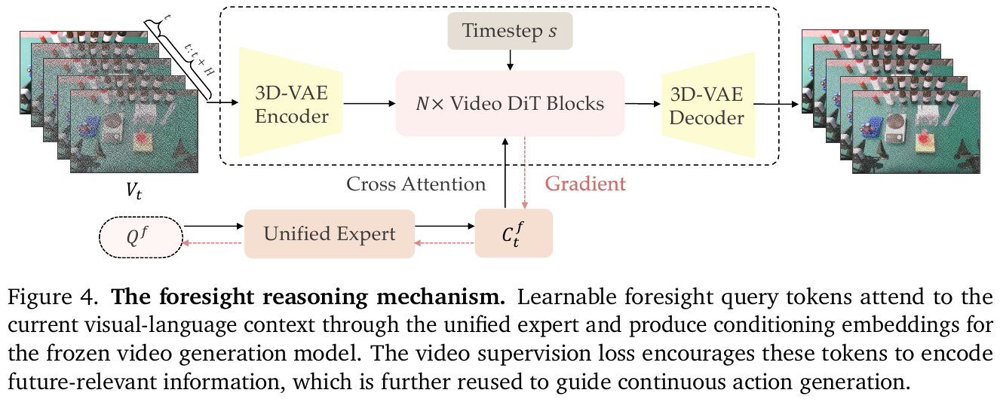
<figcaption>Foresight prediction data flow: spatiotemporal regression is computed on the video diffusion model (WAN) through the foresight latent encoding, and gradients are propagated back to optimize the expert's representations.</figcaption>
</div>

**(7) Inference procedure**
At inference (real-robot deployment), the procedure is modified as follows to ensure real-time closed-loop control:
1. **Discard the video branch**: At inference, the WAN2.2-5B video model and its VAE and DiT layers are discarded entirely, and no pixel-level video decoding is needed.
2. **KV cache reuse**: The key-value cache of the VLM backbone from extracting the context latent features $H_t$ is reused in the action denoising computation. In the multi-step reverse denoising of Euler integration (for example, 5 steps), the action expert only updates the denoising computation of the action itself, ensuring a high frame rate and low latency for control outputs (about 0.1 s/step on an RTX 5090).

---

**Results and findings**

<div align="center">
  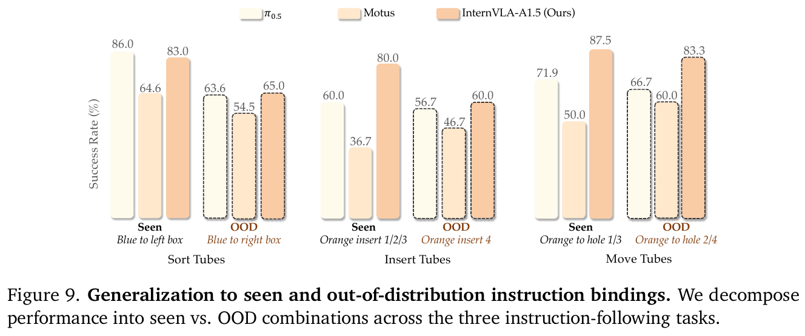
<figcaption>Real-world manipulation performance: InternVLA-A1.5 achieves leading results on the three instruction-following tasks Sort Tubes, Insert Tubes, and Move Tubes and on the long-horizon MOF chemical synthesis task, especially in precise insertion and long-horizon control.</figcaption>
</div>

<div align="center">
  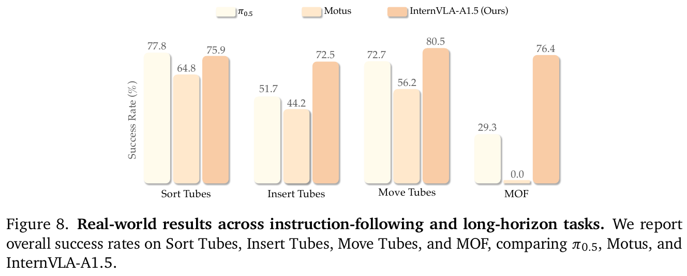
<figcaption>Ablation comparison on instruction-binding tasks with seen and held-out (unseen compositional generalization) instructions. InternVLA-A1.5 generalizes most robustly on the OOD tasks.</figcaption>
</div>

- **Clearly surpasses mainstream VLA policies**: On SimplerEnv simulation, the average success rate reaches **80.8%** (23.7 percentage points ahead of $\pi_{0.5}$), and on RoboTwin it reaches **93.2%**.
- **Strong compositional and extrapolative generalization (OOD generalization)**: InternVLA-A1.5 keeps a very high success rate on the held-out-combination real-robot tasks (that is, untrained combinations of tube color and target box/hole). This confirms that VQA co-training in the first stage successfully preserves the VLM backbone's semantic understanding.
- **Advantages on long-horizon tasks**: In a 13-step chemistry experiment (MOF) where the environment undergoes non-physical-contact changes (such as pouring liquids and inserting and removing funnels and stoppers), InternVLA-A1.5 reaches a success rate of **76.4%** versus only 29.3% for $\pi_{0.5}$, while Motus fails completely. This is due to two factors: first, explicit subtask text planning (the policy always knows what it is doing); second, spatiotemporal latent prediction learns physical cause and effect such as liquid-level changes.
- **Ablation analysis**: As shown in Table 8, removing the latent video loss (w/o video loss) or removing the Foresight Tokens directly causes the policy's success rate to drop markedly under zero-shot settings (such as LIBERO-Plus and DOMINO), showing that distilling a physical-world prior into the latent space is key to robustness.

---

**Limitations**

1. **Limited to short-horizon action-space supervision**: Foresight's prediction window covers only the time span of the current action chunk. Although the model gains physical intuition about the current pose and short-term trajectory, it does not yet support long-term future trajectory imagination or explicit long-horizon planning.
2. **Upper bound set by the world model's dynamics**: Because the WAN video generation model is completely frozen during training, the prior InternVLA-A1.5 obtains depends entirely on how well WAN's own pretraining dataset covers embodied scenes. In extreme or non-everyday industrial scenes, its physical commonsense may fail.

---

<span id="519-interndata-a1-2025-5-17-interndata-a1-2025" class="vla-anchor-alias" aria-hidden="true"></span>

## 19. InternData-A1 (2025)
{: id="5-17-interndata-a1-2025"}
**Subtitle**: Pioneering High-Fidelity Synthetic Data for Pre-training Generalist Policy

📄 **Paper**: https://arxiv.org/abs/2511.16651

<div align="center">
  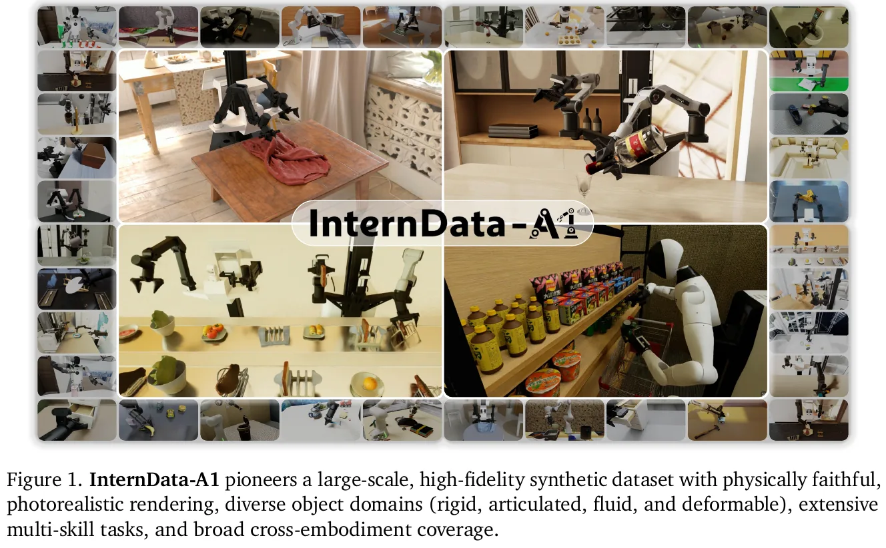
<figcaption>
InternData-A1: a large-scale, high-fidelity synthetic data generation pipeline (Source: InternData-A1 Project)
</figcaption>
</div>

**Key takeaways**

In the downstream evaluations set by the authors, this paper compares pretraining on synthetic data versus real data; the synthetic-data approach achieves competitive results. This supports further research on synthetic data, but it cannot be inferred that synthetic data can replace real data on all tasks. The data synthesis pipeline is fully decoupled (environment construction, skill sets, domain randomization, and trajectory generation are independent modules), which greatly reduces labor cost (under $0.003 per episode). Ablations reveal that **trajectory diversity** (articulated objects plus long-horizon tasks), rather than scale alone, is the core driver of effective VLA pretraining, which has important implications for data collection strategy. Large-scale domain randomization shrinks the sim-to-real visual gap to roughly a 1:8 sim-to-real data equivalence ratio, underscoring the importance of rendering fidelity and randomization. The open-sourced dataset and generation pipeline give the embodied AI community reproducible, large-scale data infrastructure.

---

**Background and problem**

Existing VLA models have proven the effectiveness of pretraining on large-scale real robot data, but whether synthetic data alone can achieve the same effect has not been systematically verified. Collecting real data is expensive: it requires professional teleoperators, specialized hardware, and a great deal of labor, and is hard to reproduce at most research institutions. Existing simulated datasets cover a narrow set of skills (mainly pick-and-place), involve only rigid objects, and have not been validated in large-scale VLA pretraining.

---

**Methods and innovations**

InternData-A1 is a large-scale, high-fidelity synthetic dataset containing 630k trajectories and 7,433 hours, covering 4 robot embodiments (AgiBot Genie-1, Franka Emika Panda, AgileX Split Aloha, ARX Lift-2), 18 skills, 70 tasks, and 227 indoor scenes.

<div align="center">
  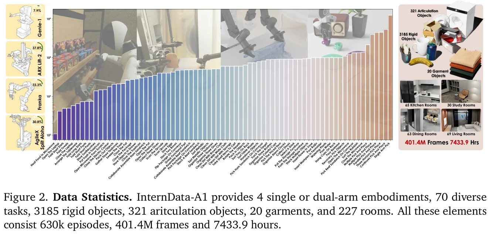
<figcaption>
InternData-A1 data statistics: 4 embodiments, 70 tasks, 3185 rigid objects, 321 articulated objects, 20 garments, 630k episodes in total, 401.4M frames, 7433.9 hours
</figcaption>
</div>

### Data synthesis pipeline (4 stages, fully automatic)
{: id="数据合成-pipeline4-阶段全自动"}

<div align="center">
  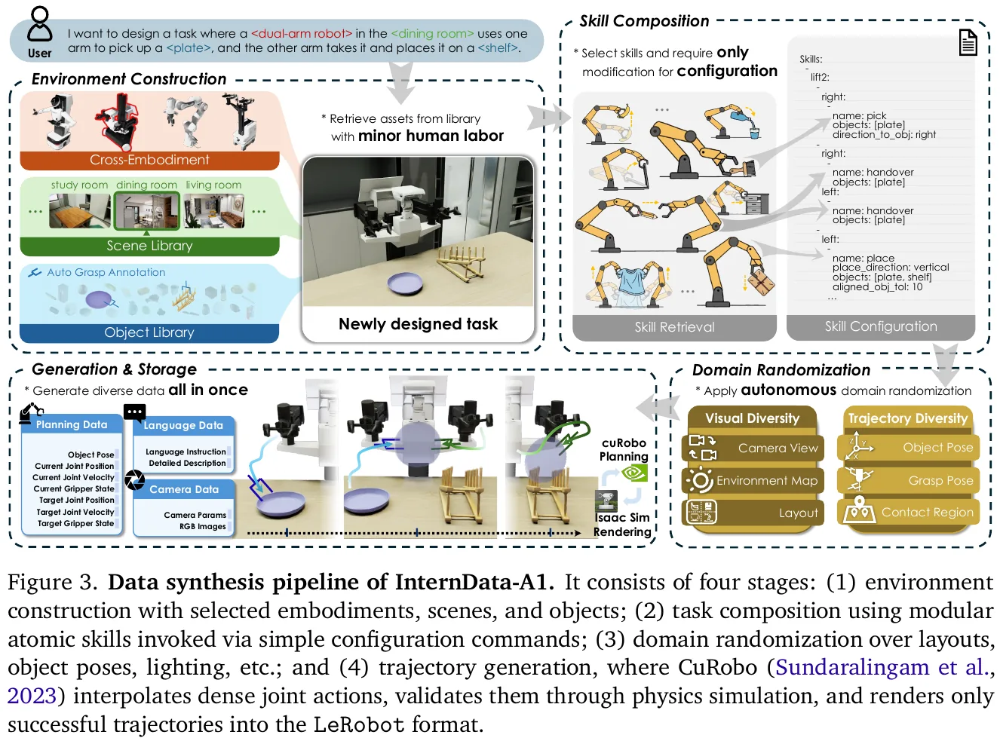
<figcaption>
InternData-A1 data synthesis pipeline, with four stages: environment construction, skill composition, domain randomization, and trajectory generation and storage
</figcaption>
</div>

**1. Environment construction**
- **Embodiment**: Supports 4 robot embodiments, all defined in USD format and verified with collision dynamics
- **Scene library**: 227 indoor scenes (kitchen, study, dining room, living room) from GRScenes-100, each annotated with detailed metadata on operable regions
- **Object library**: Covers four types of objects: rigid (3185, with automatic grasp pose annotation), articulated (321, with joint axes and physical parameters), deformable (20 real scanned garments, simulated with Vertex Block Descent), and fluid (particle system + isosurface rendering)

**2. Skill composition**
- Each skill is a modular scripted policy; input: object state, robot state, and user constraints; output: a waypoint sequence (6D end-effector poses)
- Includes 18 atomic skills such as Pick, Place, and Push, which can be composed into complete tasks through simple configuration files
- Supports parallel and sequential execution of both arms, and can be extended to new objects, scenes, and embodiments without additional code
- 18 long-horizon tasks (each involving at least 3 consecutive skills), 124,789 trajectories in total

**3. Domain randomization**
- **Visual diversity**: Camera viewpoint with ±5° rotation and ±5 cm translation; 174 environment light maps (random color temperature and intensity); target objects can be swapped for similar assets
- **Trajectory diversity**: Object poses are sampled randomly within a task-specific spatial range; AnyGrasp generates millions of grasp candidates, from which one of the top 40 is chosen at random; the contact regions of articulated and deformable objects are expanded into neighborhoods

**4. Generation and storage**
- The **CuRobo** motion planner interpolates dense joint-space actions between waypoints
- Only successfully completed trajectories are stored (verified by Isaac Sim physics) and converted to **LeRobot** format
- Records: object metadata, language instructions, multi-view RGB, camera parameters, robot proprioceptive state, and action labels

**5. Framework optimization**
- **Stage decoupling**: Trajectory planning (CPU-bound) and visual rendering (GPU-bound) are decoupled into a pipeline architecture, so a planning failure does not trigger redundant rendering
- **Dynamic resource scheduling**: Both the planner and the renderer use parallel batch processing with a dynamic scheduling algorithm
- **Stacked rendering**: Stacked rendering further improves GPU utilization
- **Cluster stability**: A balancer module for load balancing and a supervisor module for monitoring raise overall throughput by **2-3×**, with production cost below **$0.003/episode**

---

**Results and findings**

**Comparison with the π-dataset (49 simulation tasks)**
- π₀ (InternData-A1) vs official π₀: Easy mode **60.0% vs 55.0%** (+5%), Hard mode **26.5% vs 20.0%** (+6.5%)
- The gains in Hard mode show that the robustness provided by InternData-A1's large-scale domain randomization carries over to downstream fine-tuning

**Comparison with the π-dataset (9 real-world tasks)**
<div align="center">
  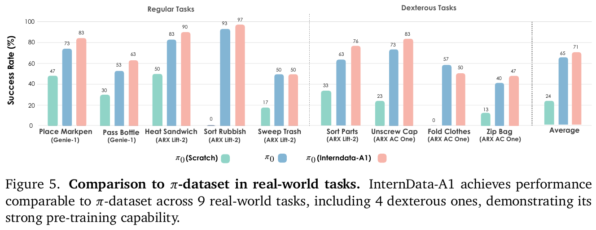
<figcaption>
Performance of InternData-A1 on 9 real-world tasks (5 regular tasks and 4 dexterous tasks), outperforming the π-dataset by 6.2% on average
</figcaption>
</div>

- Outperforms the π-dataset by **6.2%** on average on 5 common tasks (Place Markpen, Pass Bottle, Heat Sandwich, Sort Rubbish, Sweep Trash)
- Performance comparable to the π-dataset on 4 dexterous tasks (Sort Parts, Unscrew Cap, Fold Clothes, Zip Bag), using a new embodiment, ARX AC One, not seen in the training data

**Comparison with open-source datasets (49 simulation tasks + 2 real-world tasks)**
- InternData-A1 leads clearly: Easy **60.0%** vs OXE 32.5% / AgiBot World 52.5% / RoboCasa 50.0%
- Real-world task Sort Rubbish: **90.0%** vs OXE 40.0%; Pass Bottle: **60.0%** vs RoboCasa 13.3%

**Sim-to-real transfer**
<div align="center">
  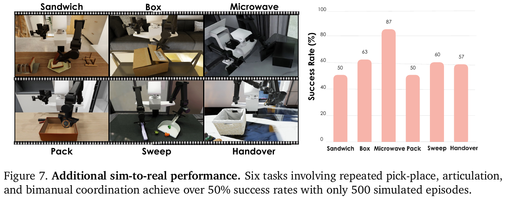
<figcaption>
Six sim-to-real tasks reach over 50% success rate using only 500 simulation episodes
</figcaption>
</div>

- Direct zero-shot transfer exceeds 50% success on 10 tasks; only 500 simulated episodes are needed to reach a high success rate
- For basic skill tasks (Sort Rubbish, Wipe Stain), 200 simulated episodes ≈ 200 real episodes
- For complex tasks (Flip Package, Instructional Pick), the sim-to-real equivalence ratio is about **8:1**

**Ablation experiments (data composition analysis)**
- Removing the Base or Long-horizon tasks degrades performance more than removing the PnP tasks, showing that task variety matters more than the scale of any single task
- Removing the articulation tasks (only 11.67% of the data) causes a significant drop, showing that articulated manipulation widens the diversity of the action space
- Core conclusion: **trajectory diversity is the core driver of effective pretraining**

<span id="520-isaac-gr00t-2025-2026-5-18-gr00t-2025" class="vla-anchor-alias" aria-hidden="true"></span>

## 20. Isaac GR00T (2025-2026)
{: id="5-18-gr00t-2025"}
Generalist Robot 00 Technology

📄 **Paper**: [GR00T N1: An Open Foundation Model for Generalist Humanoid Robots](https://arxiv.org/abs/2503.14734) · **Code**: [Isaac-GR00T](https://github.com/NVIDIA/Isaac-GR00T)

### Key takeaways
{: id="精华-8"}

GR00T combines vision-language representations with an action expert, accompanied by robot adaptation and data tools. The architecture below is based on the original **N1** paper. For later versions, consult the model cards separately; parameters and results of different versions cannot be mixed.

### Methods and execution
{: id="方法与执行方式"}

The vision-language module of N1 extracts conditioning representations, and the action module generates action sequences through flow matching. System 2 / System 1 describes the division of labor between the two parts and should not be equated with an explicit long-horizon planner plus a low-level controller that independently handles balance and obstacle avoidance.

In the L40 configuration of the original paper, the authors report 10 Hz for System 2 and 120 Hz for System 1, and give about 63.9 ms to generate a 16-step action chunk in bf16. These are implementation-specific operating metrics and do not imply that any GR00T version will have the same closed-loop frequencies. Source: [GR00T N1 original paper](https://arxiv.org/html/2503.14734v1).

### Results and applicable boundaries
{: id="结果与适用边界"}

This paper studies generalist policy learning from multi-robot data and synthetic data. Pretraining, target-robot adaptation, and task fine-tuning should be distinguished during evaluation. Cross-platform training cannot simply be described as zero-shot control of any new robot.

The toolchain can reduce some of the integration work, but the weights, training data, pretraining process, and deployment hardware still need to be checked separately. When choosing this route, focus on confirming the robot interface, data format, training resources, and measured inference latency supported by the current version.

NVIDIA's next-generation Isaac GR00T 2 switches to a world action model architecture; see [38. DreamZero](#38-dreamzero-2026) for the research behind it.

---

<span id="521-xiaomi-robotics-0-2026-5-19-xiaomi-r0-2026" class="vla-anchor-alias" aria-hidden="true"></span>

## 21. Xiaomi-Robotics-0 (2026)
{: id="5-19-xiaomi-r0-2026"}
MoT Architecture for Real-Time Bimanual Manipulation: a real-time benchmark among domestic open-source VLAs

📄 **Paper**: [Xiaomi Robot Lab](https://github.com/Xiaomi-Robotics)

<div align="center">
  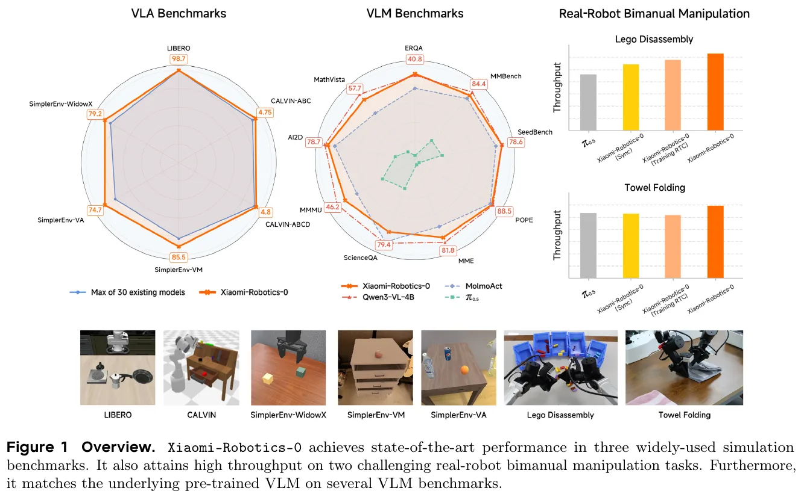
<figcaption>
Xiaomi-R0: a low-latency bimanual manipulation architecture based on Mixture-of-Transformers (MoT) (Source: Xiaomi Robotics)
</figcaption>
</div>

**Key takeaways**

Xiaomi-R0 proposes a **Mixture-of-Transformers (MoT)** architecture to address the inference latency that VLA models commonly suffer in real deployment. By decoupling and parallelizing the perception and control modules, Xiaomi-R0 achieves high-frequency closed-loop control on consumer-grade GPUs (such as the RTX 4090). The model performs well in dexterous bimanual manipulation (such as disassembling Lego and folding towels) and is one of the most impressive engineering efforts among domestic open-source models.

---

**Background and problem**

Real-time inference with large VLA models (such as those with 7B+ parameters) often struggles to reach the 20 Hz+ frequency required for robot control, causing "stuttering" motion or execution failures due to visual lag.

---

**Methods and innovations**

- **MoT architecture**: Adopts a mixture-of-experts design that splits the model into a "reasoning expert" and an "execution expert". The reasoning expert handles slow semantics, while the execution expert quickly adjusts actions under the high-frequency visual stream.
- **Low-latency optimization**: The action token generation path is heavily compressed, greatly shortening the pipeline from image input to signal output.
- **Better bimanual coordination**: Data augmentation targets spatiotemporal consistency in bimanual manipulation, improving the smoothness of left-right hand coordination.

---

**Results and findings**

- Reaches a success rate of **98.7%** on general benchmarks such as LIBERO.
- Demonstrates, for the first time in the open-source field, real-time, highly dynamic bimanual cooperative manipulation of an unseen object.
- Shows that with sensible architectural optimization, even a medium-sized VLA can challenge massive closed-source models in real time.

---

**Limitations**

- Long-horizon logical reasoning is slightly weaker than π₀.5.
- Robustness to complex lighting and extremely dynamic scenes still needs improvement.

---
<span id="522-x-vla-2025-5-20-xvla-2025" class="vla-anchor-alias" aria-hidden="true"></span>

## 22. X-VLA (2025)
{: id="5-20-xvla-2025"}
Scalable Cross-Embodiment Learning with Soft Prompting: a concrete example of full open-sourcing in academia

📄 **Paper**: [Tsinghua AIR & Shanghai AI Lab](https://github.com/X-VLA)

<div align="center">
  
<figcaption>
X-VLA: a cross-embodiment adaptive architecture based on soft prompting, enabling low-cost adaptation to heterogeneous hardware (Source: X-VLA Project)
</figcaption>
</div>

**Key takeaways**

X-VLA is a fully open-source project jointly launched by Tsinghua AIR and Shanghai AI Laboratory. Its core contribution is to address the problem of "one brain controlling all robots" through **soft prompting**. Instead of the traditional per-hardware fine-tuning, X-VLA only needs to learn a very small set of robot-specific prompts to transfer shared physical regularities to different robot arms and humanoids. The project is open from code, data, and weights to evaluation benchmarks, making it the most thoroughly open-sourced model in academia.

---

**Background and problem**

Robot hardware varies in form (number of joints, arm length, degrees of freedom). How can a single pretrained model adapt to all hardware without performance conflicts (negative transfer)?

---

**Methods and innovations**

- **Soft prompting**: A learnable "hardware description token" is introduced at the VLM input layer to automatically align the action spaces of different robots.
- **Large-scale cross-domain dataset**: Integrates heterogeneous data, including manipulation, navigation, and even some autonomous driving, verifying the cross-domain generality of physical knowledge.
- **Open evaluation benchmark**: Sets new results on five mainstream simulation benchmarks and provides a standardized physical test protocol.

---

**Results and findings**

- The cost of adapting to new hardware drops by more than 90%, and deployment needs only a minimal amount of new data.
- Shows that "foundation model + hardware adaptation layer" is an efficient path to general embodied intelligence.

---

**Limitations**

- On tasks requiring extremely fine force feedback, the accuracy ceiling of soft prompts is limited by the perceptual resolution of the backbone network.
- The current focus is mainly on kinematic alignment, and modeling of complex contact dynamics is still at an early stage.

---

## 23. Motus (2025)
{: id="523-motus-2025"}
——A Unified Latent Action World Model

📄 **Paper**: [arXiv:2512.13030](https://arxiv.org/abs/2512.13030)

**Background and problem**

Currently, understanding, world modeling, and control in embodied intelligence are modeled in isolation by different models. This fragmentation prevents unified multimodal generation and also limits learning from large-scale heterogeneous data. Existing methods split what should be a unified system into five independent modeling tasks: VLA (vision-language-action model), WM (world model), IDM (inverse dynamics model), VGM (video generation model), and a video-action joint prediction model. Two core challenges follow: how to unify these multimodal generation capabilities in a single framework, and how to use large-scale heterogeneous data (web videos, egocentric human demonstrations, multi-robot trajectories) to pretrain the action expert.

**Methods and innovations**

<div align="center">
  
<figcaption>
Motus overall architecture: a Mixture-of-Transformers structure that integrates an understanding expert, a video generation expert, and an action expert
</figcaption>
</div>

Motus proposes a unified latent action world model, which integrates the five modeling paradigms through the following innovations:

**1. Mixture-of-Transformers (MoT) architecture:**
- **Tri-model joint attention**: The multi-head self-attention layers of the three experts are connected to fuse knowledge across modalities while preserving each expert's specific function
  - Understanding expert: Based on Qwen3-VL-2B (253.5M parameters), with 3D grounding and spatial understanding abilities
  - Video generation expert: Uses Wan 2.2 5B as the base video model
  - Action expert: A Transformer (641.5M parameters) with the same depth as Wan
- **Total model size**: 8B parameters (VGM 5.00B + VLM 2.13B + action expert 641.5M + understanding expert 253.5M)

<!-- <div align="center">
  
<figcaption>
Tri-model joint attention mechanism in detail
</figcaption>
</div> -->

**2. UniDiffuser scheduler:**
- Assigns different timesteps τ_o, τ_a and noise scales to video and actions
- Supports flexible switching among five inference modes: VLA, world model, IDM, VGM, and joint video-action prediction
- Uses the rectified flow objective:
  - $$l_{\text{action}} = \mathbb{E} \left[ \left\| v^{\theta_a} - (\epsilon_a - a_{t+1:t+k}) \right\|^2 \right]$$
  - $$l_{\text{obs}} = \mathbb{E} \left[ \left\| v^{\theta_o} - (\epsilon_o - o_{t+1:t+k}) \right\|^2 \right]$$

<!-- - l_action = E[||v^θ_a - (ε_a - a_{t+1:t+k})||²]   - l_obs = E[||v^θ_o - (ε_o - o_{t+1:t+k})||²] -->

**3. Latent actions: pixel-level "delta actions":**

<div align="center">
  
<figcaption>
Latent action VAE architecture: from optical flow to a latent action representation
</figcaption>
</div>

- **Optical flow representation**: DPFlow computes optical flow as a universal motion representation, which is converted to an RGB image
- **Deep Compression Autoencoder (DC-AE)**: Compresses the high-dimensional optical flow into 4×512-dimensional tokens, which a lightweight encoder then projects to a 14-dimensional latent action vector
- **Training strategy**: Mixes 90% unlabeled data (self-supervised reconstruction) with 10% labeled trajectories (task-agnostic data + standard demonstrations)
- **Distribution alignment**: Task-agnostic data (the AnyPos method) is introduced, using CuRobo to randomly sample the target robot's action space
- **Loss function**: $$\mathcal{L} = \mathcal{L}_{\text{recon}} + \lambda_a \left\| a_{\text{real}} - a_{\text{pred}} \right\|^2 + \beta \mathcal{L}_{\text{KL}}$$
<!-- - **Loss function**:L = L_recon + λ_a||a_real - a_pred||² + βL_KL -->

**4. Dense-action, sparse-video prediction policy:**
- Video frame rate: 8 frames @ 5 Hz
- Action chunk: 48 steps @ 30 Hz
- The number of tokens is balanced by downsampling video frames, preventing the model from overfitting to video prediction and weakening its action prediction

**5. Three-stage training process:**

<div align="center">
  
<figcaption>
Motus three-stage training process and data pyramid
</figcaption>
</div>

- **Stage 1 (video generation)**: Adapts the VGM using multi-robot trajectories, egocentric human videos, and synthetic data (VGM only, about 8000 GPU hours)
- **Stage 2 (unified latent-action training)**: Freezes the VLM and pretrains the entire Motus model on video, language, and latent actions (about 10,000 GPU hours)
- **Stage 3 (supervised fine-tuning)**: Fine-tunes with real actions on target robot data (about 400 GPU hours)

**6. Six-level data pyramid:**
- **Level 1**: Web data (for VGM and VLM pretraining)
- **Level 2**: Egocentric human video (Egodex: 230,949 samples)
- **Level 3**: Synthetic data (RoboTwin: 27,500 samples)
- **Level 4**: Task-agnostic data (AnyPos: 1,000 samples)
- **Level 5**: Multi-robot task trajectory data (Agibot: 728,209 + RDT: 6,083 + RoboMind: 16,861)
- **Level 6**: Target-robot task trajectory data (in-house: 2,000 samples)

<div align="center">
  
<figcaption>
Embodied data pyramid: from Level 1 to Level 6, the amount of data decreases while its quality increases
</figcaption>
</div>

**Results and findings**

**Simulation (RoboTwin 2.0) performance:**
- Average success rate in randomized scenes: 87.02% (Motus) vs 72.84% (X-VLA) vs 43.84% (π0.5)
- A 15% improvement over X-VLA and 45% over π0.5.
- Evaluated on 50 tasks with strong background and environment randomization (random backgrounds, cluttered tabletops, table height perturbations, random lighting)
- Clean-scene success rate: 88.66% (Motus) vs 72.80% (X-VLA) vs 42.98% (π0.5)

<div align="center">
  
<figcaption>
Results on the RoboTwin 2.0 simulation benchmark
</figcaption>
</div>

**Real-world experiments:**
- **Two platforms**: AC-One and Agilex-Aloha-2 bimanual robots
- **9 complex tasks**: Testing spatial understanding, deformable object manipulation, precise fluid control, visual understanding, and long-horizon planning
  - Tasks include: folding towels, making coffee with a drip coffee machine, grinding coffee beans, putting bread in the oven, getting water from the dispenser, watering flowers, and pressing keyboard keys

- **AC-One platform**: average partial success rate 63.22% (Motus) vs 25.86% (without pretraining) vs 14.79% (π0.5)
  - Standout tasks: grinding coffee beans 92% vs 0% (without pretraining), brewing coffee 62% vs 0%, placing cubes on a plate 100% vs 60%

- **Agilex-Aloha-2 platform**: average 59.30% (Motus) vs 26.60% (without pretraining) vs 48.60% (π0.5)
  - Standout tasks: getting water from the dispenser 96% vs 8% (without pretraining), folding towels 39% vs 0%

<div align="center">
  
<figcaption>
Motus executing complex real-world tasks
</figcaption>
</div>

**Other benchmarks:**
- **LIBERO-Long**: 97.6% success rate (tied with X-VLA for the best, reaching state-of-the-art)
- **VLABench**: In-distribution average 0.48 (vs 0.43 for π0.5), cross-category average 0.25 (vs 0.22 for π0.5)

**Ablation results:**
- **Importance of the training stage**: Full Motus (stage 2 pretraining) 87.02% vs stage 1 only 81.86% (+10.02%)
- **IDM mode performance**: Action MSE 0.014 (Motus) vs 0.044 (ResNet18+MLP) vs 0.122 (DINOv2+MLP), significantly better than specially trained IDM baselines
- **Competitiveness of VLA mode**: 83.90% success rate, close to the 87.02% of joint mode
- **World model generation quality**: FID 11.209, FVD 61.209, SSIM 0.866, PSNR 25.07 (evaluated on two platforms)

**Empirical verification of the five unified modes:**
$$
\begin{aligned}
\text{1. VLA:} & \quad p(a_{t+1:t+k} \mid o_t, \ell) && \text{--- predict actions from observations and language} \\
\text{2. World model:} & \quad p(o_{t+1:t+k} \mid o_t, a_{t+1:t+k}) && \text{--- predict future observations from current observations and actions} \\
\text{3. IDM:} & \quad p(a_{t+1:t+k} \mid o_{t:t+k}) && \text{--- infer actions from observation sequences} \\
\text{4. VGM:} & \quad p(o_{t+1:t+k} \mid o_t, \ell) && \text{--- generate future video from observations and language} \\
\text{5. Joint prediction:} & \quad p(o_{t+1:t+k}, a_{t+1:t+k} \mid o_t, \ell) && \text{--- generate video and actions jointly}
\end{aligned}
$$

<!-- 1. VLA: p(a_{t+1:t+k} | o_t, ℓ) - Predicting actions from observation and language
2. world model : p(o_{t+1:t+k} | o_t, a_{t+1:t+k}) - predict future observations from current observations and actions
3. IDM: p(a_{t+1:t+k} | o_{t:t+k}) - infer action from observation sequence
4. VGM: p(o_{t+1:t+k} | o_t, ℓ) - Generating future videos from observations and language
5. Video-action joint prediction: p(o_{t+1:t+k}, a_{t+1:t+k} | o_t, ℓ) - generate videos and actions simultaneously -->

<div align="center">
  
<figcaption>
Visualization of Motus's VGM mode (future video generation from observations and language) on Agilex-Aloha-2: the top row of each group is real execution, the bottom row is model generation
</figcaption>
</div>

**Limitations**

The current method requires substantial computing resources (about 18,400 GPU hours of training in total). Performance on some complex tasks (such as folding towels) remains limited, with a partial success rate of only 39%. Although latent actions improve cross-embodiment generalization, further research is needed. Future work will explore more advanced unified model architectures, pursue more general motion priors, and learn latent actions from general web-scale videos. It will also study how to reduce deployment cost and improve robustness under extreme conditions.

<span id="524-robogen-2024-5-23-robogen-2024" class="vla-anchor-alias" aria-hidden="true"></span>

## 24. RoboGen (2024)
{: id="5-23-robogen-2024"}
———Towards Unleashing Infinite Data for Automated Robot Learning via Generative Simulation

📄 **Paper**: [arXiv:2311.01455](https://arxiv.org/abs/2311.01455) (ICML 2024)
🌐 **Project**: [https://robogen-ai.github.io/](https://robogen-ai.github.io/)
🔗 **Simulation backend**: The [RoboGen paper](https://arxiv.org/html/2311.01455v2) uses the in-house version of Genesis provided by the development team; this is a tool-usage relationship.

### Key takeaways
{: id="精华-9"}

RoboGen is the first complete implementation of "generative simulation", proposed by CMU, Tsinghua, MIT, UMass, and other teams. The core idea can be summarized in one sentence: **use foundation models to automatically generate the entire "task-scene-supervision signal-policy" pipeline, so that robot skill learning no longer depends on manual annotation and data can be scaled almost without limit**.

- **Self-driven propose-generate-learn loop**: The agent autonomously proposes tasks, automatically builds simulation scenes, automatically generates training supervision, and automatically learns policies, and the loop can run indefinitely.
- **Unprecedented coverage**: A single pipeline covers rigid bodies, articulated bodies, soft bodies, bipedal/quadrupedal locomotion, and more. The paper shows 106+ automatically generated skills (opening drawers, unlocking safes, kneading dough, climbing stairs, backflips, ...).
- **Task diversity clearly exceeds human-built datasets**: It surpasses Behavior-100, RLBench, MetaWorld, ManiSkill2, and the contemporaneous GenSim on four metrics: Self-BLEU, SentenceBERT, ViT, and CLIP.
- **Role of the simulation backend**: It executes policies and generates data through a unified environment interface; in principle the framework can swap in a different simulation platform.

<div align="center">
  
<figcaption>25 representative tasks and skills automatically generated by RoboGen, covering rigid bodies, articulated bodies, soft bodies (kneading, shaping, rolling, and bending dough), and bipedal/quadrupedal locomotion</figcaption>
</div>

---

### 1. Background and problem
{: id="1-研究背景问题-7"}

Simulation data is seen as the key to breaking the data bottleneck of real robots, but traditional simulation benchmarks (RLBench, MetaWorld, Behavior-100, etc.) rely heavily on manual construction: every task requires hand-designed assets, layouts, reward functions, and evaluation logic, so the cost of expansion is extremely high. As a result, even the largest manual benchmarks cover only dozens to slightly over a hundred tasks. Meanwhile, foundation models (LLMs/VLMs) already offer semantic priors, code generation, and 3D asset retrieval/generation. However, most existing "foundation model + robot" work (Code as Policies, VoxPoser, SayCan, etc.) has the LLM output policies or subtasks directly and still requires a ready-made simulation environment.

> **Core question**: Can the "semantics + code + generation" abilities of foundation models be used to automatically generate a complete training pipeline of "task, scene, assets, reward, algorithm choice, and policy"?

---

### 2. Methods and innovations
{: id="2-主要方法创新点-7"}

RoboGen's overall pipeline has four stages (paper Figure 2):

```
A) Task Proposal  →  B) Scene Generation  →  C) Training Supervision Generation  →  D) Skill Learning
```

<div align="center">
  
<figcaption>RoboGen's four-stage fully automatic pipeline: task proposal, scene generation, training supervision generation, and skill learning</figcaption>
</div>

#### A. Task proposal
{: id="a-task-proposal任务提议"}
- Use "robot type + randomly sampled objects" as the seed (object-based initialization), or use 11 kinds of example tasks as the seed (example-based, applicable to legged robots and soft bodies).
- GPT-4 receives the URDF joint information and semantic annotations from PartNet-Mobility and generates: 1) a task name; 2) a natural language description; 3) the additional objects needed to complete the task; 4) the joints/links involved.
- By repeatedly sampling different objects and examples, an open-ended stream of semantically non-duplicate tasks can be produced.

#### B. Scene generation
{: id="b-scene-generation场景生成"}
All four sub-outputs are determined automatically by GPT-4:

|Sub-output|Implementation|
| --- | --- |
| **Relevant assets** |Additional objects proposed by the LLM → top-k=10 retrieval from Objaverse (800k+ assets), with a second round of semantic-matching verification by the Gemini-Pro VLM|
| **Asset size** |The LLM reasons about "realistic size + size relative to the task" (e.g., a drawer should be larger than a book)|
| **Initial configuration** |The LLM sets the initial joint angles of articulated objects (e.g., the window should be open in a window-closing task)|
| **Scene configuration** |The LLM specifies spatial relationships ("the knife is on the chopping board") and guarantees collision avoidance|

For soft-body tasks, GPT-4 generates a target shape description, Midjourney turns it into an image, and Zero-1-to-3 generates a 3D mesh from the image to build a controllable target geometry.

#### C. Training supervision generation
{: id="c-training-supervision-generation监督信号生成"}
- **Task decomposition**: GPT-4 splits long-horizon tasks into subtasks (such as "turn on the microwave → grab the soup bowl → put it in → close the door → set the timer knob").
- **Algorithm selection**: Each subtask automatically selects one of three options: RL (SAC), gradient-based trajectory optimization, or action primitives + motion planning (BIT*):
  - Contact-rich / continuous control / knob-type tasks → RL;
  - Soft-body deformation (kneading dough, shaping) → gradient-based optimization (via differentiable simulation);
  - Grasping / approaching / releasing / path planning → action primitives + motion planning.
- **Reward generation**: Rigid-body and locomotion tasks build rewards from low-level state quantities; soft-body tasks use the earth mover's distance to align the current shape with the target shape.

#### D. Skill learning
{: id="d-skill-learning技能学习"}
- An in-house version of Genesis is used as the simulation backend.
- RL: SAC with a 256-256-256 MLP, each subtask trained for 1M environment steps; long-horizon tasks use N=8 rounds, and the highest-reward state is used as the initial state of the next round.
- Soft body: Adam for gradient-based optimization; motion planning: BIT*.

---

### 3. Results and findings
{: id="3-核心结果发现-2"}

**Task diversity (paper Table 1, smaller is better):**

|Metric| RoboGen | Behavior-100 | RLBench | MetaWorld | Maniskill2 | GenSim |
| :-- | --: | --: | --: | --: | --: | --: |
|Number of tasks| 106 | 100 | 106 | 50 | 20 | 70 |
| Self-BLEU ↓ | **0.284** | 0.299 | 0.317 | 0.322 | 0.674 | 0.378 |
| SentenceBERT Sim ↓ | **0.165** | 0.210 | 0.200 | 0.263 | 0.194 | 0.288 |
| Scene ViT Sim ↓ | **0.193** | 0.389 | 0.375 | 0.517 | 0.332 | 0.717 |
| Scene CLIP Sim ↓ | **0.762** | 0.833 | 0.864 | 0.867 | 0.828 | 0.932 |

→ RoboGen's diversity in both semantic and visual dimensions is significantly better than existing manual benchmarks and the contemporaneous GenSim, verifying the scalability of "foundation model + open asset library".

**Ablation and failure analysis:**
- Removing size validation significantly lowers the BLIP-2 scene alignment score; removing object validation also makes it worse.
- On the 12 articulated-object manipulation tasks, using pure RL alone (without action primitives) drops the success rate from an average of about 0.92 to nearly 0.
- Among the 155 fully automatically generated tasks: 13 failed because of mismatched retrieved objects; 6 had mismatched rewards because the LLM misunderstood the semantics of joint angles (for example, reversing the "open" and "closed" angles); and a small number exceeded the assets' capabilities because of complex functions (a stapler driving staples).

**Long-horizon task examples (paper Figure 3):**
- "Retrieve a gold bar from the safe", "Heat up a bowl of soup using the microwave", "Put the toy into the storage", and "Move the toy out of the box" can all be automatically decomposed, assigned rewards, and learned as complete sequences.

<div align="center">
  
<figcaption>Policy snapshots of 4 long-horizon tasks: each task is automatically decomposed by the LLM into 5-7 subtasks, and a learning algorithm is assigned adaptively among RL, action primitives, and motion planning</figcaption>
</div>

---

### 4. Limitations and significance
{: id="4-局限性与意义"}

**Limitations**: 
- Still relies on a closed-source LLM (GPT-4) and external asset libraries, and the quality of retrieval/generation for long-tail objects (such as staples) is unstable;
- The LLM's semantic judgment of articulated joint states can still be wrong, and a small number of reward functions need manual verification;
- Visual realism and tactile/mechanical feedback are not yet integrated into the production pipeline;
- Sim-to-real transfer was not verified end to end in the paper.

**Significance and subsequent impact**:
- **Paradigm value**: RoboGen is the first system to hand all four stages of "task, scene, supervision, and policy" over to foundation models, establishing "generative simulation" as a third data source after real-robot teleoperation and web video.
- **The boundary between tool and method**: RoboGen's contribution lies in organizing the task, scene, supervision, and skill-learning pipeline; its use of an in-house Genesis version does not show that the simulator was derived from this method.

---

## 25. Qwen-VLA (2026)
{: id="525-qwen-vla-2026"}
——An embodied foundation model unifying manipulation, navigation, and trajectory prediction

📄 **Paper**: https://arxiv.org/abs/2605.30280

---

### Key takeaways
{: id="精华-10"}

- Heterogeneous embodied tasks such as manipulation, navigation, and egocentric human actions essentially share the same computational structure: given visual observations, language instructions, and an embodiment description, predict a future action sequence. Qwen-VLA uses a unified action-and-trajectory prediction framework to absorb them all into a single model.
- DiT-based flow matching is the key bridge that "decompresses" the discrete VLM token space into the continuous high-dimensional action space; text-to-action pretraining (T2A) warms up the DiT before CPT/SFT, letting the decoder learn language-to-action priors without visual shortcuts.
- Embodiment-aware prompt conditioning encodes the robot platform, control frequency, and prediction horizon into the text prompt, and can support sharing across 10+ robot embodiments with no architectural changes.
- Zero-padding unifies heterogeneous action spaces: the action dimensions of different robots are aligned to the maximum dimension and zero-padded, and a per-channel validity mask keeps padding from contaminating the gradient. The architecture has very few parameters yet matches the effect of complex solutions.
- RL fine-tuning (PPO + GAE) collects only sparse rewards in a single simulation environment, yet the gains transfer across environments: improvements also appear on benchmarks that did not take part in the RL rollouts, such as RoboCasa and DOMINO.

---

### 1. Background and problem
{: id="1-研究背景问题-8"}

Existing embodied intelligence systems are highly specialized: manipulation models are designed for tabletop/dexterous manipulation, and navigation models focus on indoor waypoint prediction. The two cannot transfer across tasks, environments, or robot embodiments, and are hard to scale like general vision-language pretraining. The core challenge is that manipulation and navigation appear completely heterogeneous in output format, control frequency, action dimensionality, and evaluation protocol, yet they in fact share the same computational structure: both require the agent to condition on visual observations, language instructions, and embodiment constraints to predict future action sequences that are physically and semantically consistent. Qwen-VLA builds on this insight to unify the two in a single VLA model.

---

### 2. Methods and innovations
{: id="2-主要方法创新点-8"}

<div align="center">
  
<figcaption>Qwen-VLA overall architecture: a Qwen3.5 VLM backbone + a DiT flow-matching action expert, supporting three kinds of tasks at once: VLA (manipulation), VLN (navigation), and VL (language understanding)</figcaption>
</div>

**① Overall framework**

Qwen-VLA consists of two core modules: a **Qwen3.5-4B vision-language backbone** (responsible for high-level perception and reasoning) and a **single-stream DiT-style flow-matching action expert** (responsible for fine-grained continuous action generation). The two are connected by concatenating the VLM hidden states, and together serve three kinds of tasks: manipulation, navigation, and vision-language understanding.

**② Module-by-module walkthrough**

**VLM backbone (Qwen3.5-4B)**
- **Input**: Multi-view RGB images (ego, left wrist, and right wrist cameras, each wrapped in a view marker `<|tag_start|> <image> <|tag_end|>`) + language instruction + embodiment description prompt
- **Processing**: A ViT produces visual tokens, which are interleaved with text tokens after spatial merging and fed into a hybrid-attention Transformer (most layers use gated linear attention and a few use GQA softmax attention), giving a unified encoding of images, video, and language.
- **Output**: A sequence of VLM hidden states used to condition the action expert
- **Motivation**: Reuse the powerful vision-language pretraining so that perception and grounding need not be learned from scratch; hybrid attention balances efficiency and accuracy on long multimodal sequences

**Action expert (DiT flow matching, about 1.15B parameters, 16 DiT blocks)**
- **Input**: VLM hidden states + a noisy action chunk (dimension $$\mathbf Y \in \mathbb{R}^{H \times K}$$, where K is the maximum number of channels shared by all embodiments, the effective dimension is c ≤ K, and the rest is zero-padded)
- **Processing**: The VLM hidden states are concatenated with the noisy action chunk and processed by 16 DiT blocks combining self-attention, AdaLN timestep conditioning, and multi-segment RoPE; a per-channel validity mask **M** ensures that padding does not contribute to the gradient
- **Output**: Predicts the velocity field $$v_\theta$$ and, at inference, produces a clean action chunk through several Euler integration steps (from τ=1 to τ=0).
- **Motivation**: Flow matching naturally handles the multimodality of continuous high-dimensional action distributions; the single-stream design lets VLM semantic features interact fully with the action sequence

**Embodiment-aware prompt conditioning**

A text description is prepended to every training sample (the only platform-specific interface, with no architectural change):
```
The robot is {robot_tag} with {arms}. The control frequency is {FPS} Hz.
Please predict the next {chunk_size} control actions to execute: {instruction}.
```
It covers 10+ platforms such as WidowX, Franka, ALOHA, AgiBot, and humanoid robots, with control modes including ΔEF, absolute joint angles, and dexterous hands.

**Unified action-and-trajectory representation (zero-padding)**

The target tensor $$\mathbf Y \in \mathbb{R}^{H \times K}$$ holds the c effective action dimensions in its first c dimensions, with the rest filled with zeros:
- **Manipulation**: Δ end-effector pose / joint angles / gripper open-close
- **Navigation**: $(\Delta x, \Delta y, \Delta\theta)$ waypoint sequence
- **Egocentric human data**: SE(3) wrist motion + 10-dimensional eigengrasp coefficients (PCA compression of a 45-dimensional hand pose), 32 dimensions per step in total

**③ End-to-end data flow**

Embodiment prompt + image → VLM backbone produces hidden states → concatenate the noisy action chunk → joint processing by 16 DiT blocks → predict the velocity field → Euler integration outputs a clean action chunk

**④ Training objectives**

**Flow-matching action loss** (a per-channel, two-level average keeps padding from dominating the gradient):

$$\ell_k = \frac{\sum_{h=1}^{H} M_{h,k} \left\lVert \left(v_\theta(\mathbf Y_\tau, \tau \mid o_{1:t}, x, e, z) - (\mathbf Y_1 - \mathbf Y_0)\right)_{h,k} \right\rVert_2^2}{\sum_{h=1}^{H} M_{h,k}}$$

$$\mathcal{L}_\text{act} = \mathbb{E}_{\tau, \mathbf Y_0, \mathbf Y_1} \left[ \frac{1}{c} \sum_{k=0}^{c-1} \ell_k \right]$$

**Vision-language loss** (next-token prediction, to prevent catastrophic forgetting):

$$\mathcal{L}_\text{vl} = -\sum_i \log p_\theta(w_i \mid w_{<i}, o_{1:t})$$

**Joint loss**: $$\mathcal{L} = \lambda_\text{act} \mathcal{L}_\text{act} + \lambda_\text{vl} \mathcal{L}_\text{vl}$$

**⑤ Four-stage progressive training**

<div align="center">
  
<figcaption>Four-stage training: Stage I (T2A: the VLM is frozen and only the DiT is trained) → Stage II/III (CPT and SFT: both modules are unfrozen and images are introduced) → Stage IV (RL: sparse environment rewards optimize the closed-loop success rate)</figcaption>
</div>

- **Stage I: T2A (text-to-action pretraining)**: Freeze the VLM and train only the DiT with text + embodiment prompts, **without introducing images**. The goal is to let the DiT learn the "language → action decompression" prior; intermediate timesteps are sampled with a sigmoid-normal distribution (to maximize information), and the optimal number of steps is 2000 (more leads to overfitting, a -10.7pp degradation). Purely synthetic data (Syn only) → 64.1%, purely real data (Real only) → 51.0%, and a hybrid of 20% Syn + 80% Real is best at → **71.1%** (+10.2pp vs. no T2A).
- **Stage II: CPT (continued pretraining)**: Unfreeze all parameters and train jointly on a mixture of heterogeneous multi-source data (74.2% manipulation trajectories, 7.5% navigation, 6.0% egocentric human data, 3.7% synthetic simulation, 8.5% VL data), grounding the T2A action prior in visual observations.
- **Stage III: SFT (supervised fine-tuning)**: Two parallel fine-tuning branches from the CPT checkpoint: multi-task SFT (VQA + manipulation + navigation with balanced sampling) and real-robot SFT (ALOHA teleoperation data).
- **Stage IV: RL (reinforcement learning)**: Optimizes a sparse binary success reward (R=1 if completed, R=0 otherwise) in SimplerEnv with **PPO + GAE**, using 128 parallel environment instances. The log-probability of flow matching is computed analytically on the Euler steps by converting the deterministic ODE into an SDE and injecting noise, with no need for numerical integration.

**Large-scale synthetic data (ROBOINF pipeline)**

<div align="center">
  
<figcaption>Examples of synthetic data generated by ROBOINF: short-horizon tasks (placing a stapler, rotating a cake server) and long-horizon tasks (organizing drinks + sponges), including subtask segmentation supervision</figcaption>
</div>

The ROBOINF pipeline automatically builds scenes in IsaacLab (20 tabletop scenes × 10 pose configurations = 200 base scenes) and generates 450 tasks (half short-horizon, half long-horizon) with 300 trajectories per task, randomizing lighting, viewpoint, background, texture, and controller parameters. It also constructs pure language-action data (7.2M items) covering 6 types of single-arm robots × 6 types of manipulation templates, which serves as the main corpus for T2A Stage I.

---

### 3. Results and findings
{: id="3-核心结果发现-3"}

**Manipulation (simulation, a single generalist model vs. per-benchmark expert models)**:

|Benchmark| Qwen-VLA-Instruct |Strongest expert|
|------|-------------------|---------|
| LIBERO | **97.9%** | ABot-M0 98.6% |
| Simpler-WidowX | **73.7%** | StarVLA-OFT 64.6% |
| RoboTwin-Easy | **86.1%** | ABot-M0 86.0% |
| RoboTwin-Hard | **87.2%** | ABot-M0 85.0% ✓ |
| RoboCasa-GR1 | **56.7%** | Being-H0.5 53.3% |

**Manipulation (real ALOHA bimanual robot)**: After fine-tuning, the average in-domain task success is **83.6%** and the OOD success rate is **76.9%** (vs. 41.5% for π0.5). With versus without pretraining, the gap is as large as +35.1pp (83.6% vs. 48.5%), showing that pretraining brings significant value for transfer.

**Navigation (VLN-CE Val-Unseen)**: R2R best OSR **69.0%** and SR **57.5%**; RxR SR **59.6%** and SPL **47.8%**, both surpassing open-source baselines such as StreamVLN and NaVILA.

**OOD dynamic manipulation (DOMINO, zero-shot)**: SR **26.6%** and MS **39.5**; relying only on current-frame observations and with no dynamic-manipulation training data, it surpasses the specially fine-tuned DOMINO model PUMA (17.2% / 35.0%).

**Key ablation findings**: T2A warm-up brings +10.2pp; joint training with VL data brings +4.9pp on complex tasks (RoboCasa); RL post-training brings +2.9pp in the training environment with no catastrophic forgetting on any other benchmark (maximum fluctuation <0.6pp); omitting the proprioceptive state costs at most 1.3pp, so visual information is sufficient.

---

### 4. Limitations
{: id="4-局限性-2"}

Embodied action data is far smaller in scale than VL data, and robustness on long-tail objects and contact-rich tasks (such as cloth folding and insertion) remains insufficient. Joint manipulation/navigation/VL training involves optimization trade-offs: action-enhanced training slightly hurts pure VL and navigation metrics. Current evaluation is mainly short-horizon and benchmark-driven, and long-term real deployment (failure recovery, scene memory) remains an unsolved challenge.
<span id="526-spatialvla-2025-5-26-spatialvla" class="vla-anchor-alias" aria-hidden="true"></span>

## 26. SpatialVLA (2025)
{: id="5-26-spatialvla"}
——An embodied foundation model integrating 3D spatial representations and adaptive action grids

📄 **Paper**: https://arxiv.org/abs/2501.15830

### Key takeaways
{: id="精华-11"}
- Proposes **SpatialVLA**, which significantly improves a robot's spatial perception and fine manipulation by introducing 3D spatial priors into a vision-language-action (VLA) model.
- Designs **Ego3D position encoding**, which back-projects the relative depth predicted by ZoeDepth and can integrate 3D spatial structure into 2D image features without camera extrinsic calibration.
- Proposes **adaptive action grids**, which discretize the action space non-uniformly according to the Gaussian distribution of actions in the offline dataset, effectively improving the precision of action representation and reducing the number of tokens predicted per step from 7 to 3.
- Proposes **spatial embedding adaptation**, which re-discretizes the action space according to the distribution of the new dataset during downstream fine-tuning and initializes the embeddings of new tokens by trilinear interpolation, enabling efficient multi-robot adaptation.
- Evaluated on 24 real-robot tasks and in simulation environments such as SimplerEnv, it shows strong zero-shot generalization, especially robustness to changes in height, viewpoint, and lighting.

---

### 1. Background and problem
{: id="1-研究背景问题-9"}
- Existing VLA models (such as OpenVLA and RT-2) rely mainly on 2D image input and lack precise spatial understanding of the 3D physical world, which limits robots in fine manipulation within complex, changing 3D spaces (such as dynamic obstacle avoidance and accurately grasping objects at different heights).
- Building a general VLA model with 3D spatial perception poses two major challenges: first, the camera poses and parameters differ across robot platforms, making it hard to align the 3D observation space; second, different robots have different action ranges, control degrees of freedom, and controllers, making it hard to learn a unified, generalizable spatial action representation.

---

### 2. Methods and innovations
{: id="2-主要方法创新点-9"}

<div align="center">
  
<figcaption>SpatialVLA overview: combining Ego3D position encoding with adaptive action grids, pretrained on 1.1 million real-robot trajectories, it achieves strong 3D spatial understanding, zero-shot generalization, and fast fine-tuning.</figcaption>
</div>

<div align="center">
  
<figcaption>SpatialVLA architecture: it takes an image and a language instruction, uses SigLIP to extract image features fused with Ego3D position encoding, and autoregressively predicts 3 spatial action tokens (translation, rotation, gripper) with Gemma 2.</figcaption>
</div>

<div align="center">
  
<figcaption>Adaptive action grid design: a Gaussian distribution is fitted to the dataset's action statistics, and the probability density function is divided into equal-probability intervals, so the translation and rotation action spaces are partitioned non-uniformly.</figcaption>
</div>

#### ① Overall framework
{: id="-整体框架概述-1"}
The SpatialVLA framework is built on the multimodal model PaliGemma 2 and consists of the SigLIP image encoder, the ZoeDepth depth prediction module, the Ego3D position encoder, the Gemma 2 language model backbone, and an adaptive action grid decoder. The system takes a single RGB image and a language instruction, first extracts image representations that incorporate 3D geometric features, then autoregressively predicts discrete spatial action tokens, and finally de-discretizes them into continuous control signals.

#### ② Module-by-module walkthrough
{: id="-逐模块讲解"}
1. **Ego3D spatial observation module (Ego3D position encoding)**:
   - **Input**: RGB image $o_t$.
   - **Processing**: A frozen ZoeDepth model predicts the relative depth map $D$, which is back-projected into the egocentric coordinate frame through the camera intrinsics to compute the 3D position $P$ of each pixel. At the same time, SigLIP extracts the 2D semantic features $X$ of the image. The 3D position $P$ is passed through a sinusoidal position encoder and projected into the semantic space by a learnable MLP to obtain the 3D position encoding $P'$, which is finally added directly to the 2D image features $X$ to give $O_{3d}$:
     $$O_{3d} = X + \text{MLP}(\gamma(P))$$
   - **Output**: Image features that combine 3D geometric features and 2D semantic features.
   - **Motivation**: Building 3D coordinates in the egocentric camera frame avoids the complex camera-robot extrinsic calibration that arises from different camera mounting positions, achieving a universal 3D observation-space alignment across embodiments.

2. **Adaptive action grids**:
   - **Input**: A continuous 7-DoF action $a = \{x, y, z, \text{roll}, \text{pitch}, \text{yaw}, \text{grip}\}$.
   - **Processing**: To let the autoregressive architecture predict continuous actions effectively, a discrete action space is designed. The translation part is converted to polar coordinates $(\phi, \theta, r)$ to decouple movement direction from distance. A Gaussian distribution $N(\mu_a, \Sigma_a)$ is fitted to each action component in the dataset, and $M$ equal-probability intervals are cut along the probability axis of the cumulative distribution function (CDF), giving a non-uniform action grid. Specifically, the translation $(\phi, \theta, r)$ is discretized into $32 \times 16 \times 8 = 4096$ grid points; the rotation $(\text{roll}, \text{pitch}, \text{yaw})$ is discretized into $16 \times 16 \times 16 = 4096$ grid points; and the gripper action is discretized into 2 bins. These three parts are arranged linearly to form an action vocabulary $E_a$ of size $V = 8194$.
   - **Output**: Discrete spatial action tokens (translation token, rotation token, gripper token).
   - **Motivation**: Non-uniform partitioning from a fitted Gaussian gives higher resolution to the high-frequency regions of the action distribution (such as near the origin), which benefits fine control. Each step predicts 3 tokens instead of the 7 in RT-2, which greatly speeds up inference.

3. **Spatial embedding adaptation**:
   - **Input**: The fine-tuning dataset for a new robot or scenario.
   - **Processing**: In the post-training fine-tuning stage, the Gaussian distribution is refitted on the new dataset and new action grid points $G_{\text{new}}$ are built. To retain the general action prior from pretraining, trilinear interpolation over spatial geometric distance projects the pretrained action embeddings $E_a$ into the new action embeddings $E_{a^{\text{new}}}$:
     $$e_{a^{\text{new}}}^i = \sum_{j=1}^K w_j e_a^j$$
   - **Output**: Initial token embeddings that are well aligned with the new action distribution.
   - **Motivation**: Alleviates the distribution drift caused by differences in action range in new fine-tuning scenes, provides a better fine-tuning initialization, and speeds up convergence of the action decoding layer.

#### ③ End-to-end data flow
{: id="-端到端数据流-1"}
At each decision step, the model receives a monocular RGB image and a text instruction. The image is fused into a 3D observation-space representation using ZoeDepth and SigLIP. The 3D observation features are then projected into Gemma 2's token space by a multimodal projector and concatenated with the language instruction. The backbone autoregressively predicts the actions of the next $T=4$ steps (12 action tokens in total) in one pass, which are de-discretized and decoded into a continuous control sequence and finally executed by the controller.

#### ④ Training objective and loss
{: id="-训练目标与损失"}
The model is optimized jointly on 1.1 million real-trajectory samples with the standard autoregressive cross-entropy loss:
$$\mathcal{L}(\theta) = \mathbb{E}_{p(A_t|o_t)} [\mathcal{L}(a_t, \tilde{a}_t)]$$
Classification errors are computed on the discrete translation, rotation, and gripper tokens, and the text embeddings are frozen to prevent degradation of language generalization.

---

### 3. Results and findings
{: id="3-核心结果发现-4"}

<div align="center">
  
<figcaption>Real-robot evaluation: zero-shot tests on the WidowX platform covering language understanding, background and pose changes, and dynamic interference; SpatialVLA achieves the highest average success rate.</figcaption>
</div>

<div align="center">
  
<figcaption>Franka robot adaptation results: performance under single-task, instruction-following, and multi-task fine-tuning; SpatialVLA, as a pretrained initialization, outperforms OpenVLA, Octo, and Diffusion Policy trained from scratch.</figcaption>
</div>

<div align="center">
  
<figcaption>Spatial understanding verification: performance of different policies on complex spatial-layout tasks such as handling spatial instructions and height changes; SpatialVLA shows clear advantages.</figcaption>
</div>

- **SimplerEnv zero-shot simulation evaluation (Google Robot & WidowX)**:
  - In the Visual Matching evaluation of the Google Robot tasks, SpatialVLA's zero-shot success rate reaches **71.9%**, significantly better than RoboVLM (56.3%) and OpenVLA (27.7%), and even surpassing the 55B-parameter RT-2-X (60.7%).
  - In the more complex Variant Aggregation setting (covering different viewpoints and lighting), SpatialVLA maintains a high success rate of **68.8%**.
  - On WidowX tasks, the fine-tuned SpatialVLA reaches an average success rate of **42.7%**, and a perfect **100.0%** on the "Put the eggplant into the yellow basket" task.
- **Real-world WidowX & Franka experiments**:
  - Facing deliberate dynamic interference (such as a moving eggplant/carrot being grasped), SpatialVLA can follow the object flexibly and complete closed-loop grasping, with better robustness than OpenVLA.
  - When fine-tuned on the Franka platform, SpatialVLA with 3D position encoding achieves the highest generalization success rate (**73%**) on spatial instructions ("Put on the truck closest to the robot").
- **LIBERO simulation evaluation**:
  - Ranks first overall across all four LIBERO suites (Spatial, Object, Goal, Long). In particular, on **LIBERO-Spatial**, which focuses on the spatial relations between objects, it achieves an excellent **88.2%**.
- **Ablation conclusions**:
  - **Effect of 3D position encoding**: Without Ego3D position encoding, the success rate in Variant Aggregation drops sharply by about **12%**, showing that injecting 3D information greatly helps the model cope with changes in viewpoint and environment material.
  - **Action grid resolution**: Raising the adaptive grid resolution from 1026 to 8194 gives the best control precision; increasing it further brings diminishing returns and parameter redundancy.
  - **Effect of interpolation adaptation**: In LIBERO fine-tuning, spatial embedding adaptation brings an additional **4.6% - 5.4%** improvement, verifying the effectiveness of interpolated initialization for spatial action alignment.

---

### 4. Limitations
{: id="4-局限性-3"}
- **Long-horizon tasks**: Although the model performs well in short-horizon closed-loop control, its single-frame-plus-history-token design limits gains on tasks that require long-term memory and multi-stage planning (such as LIBERO-Long). A longer-lasting history-aware layer needs to be developed.
- **Scaling to high-dimensional actions is hard**: The current Gaussian-fit design targets single-arm 7-DoF actions. Extending to high-DoF tasks such as bimanual cooperation and dexterous manipulation would make the number of grid combinations grow exponentially, so a more efficient shared spatial grid or an implicit generative decoding mechanism is needed.
<span id="527-harness-vla-2026-5-27-harness-vla" class="vla-anchor-alias" aria-hidden="true"></span>

## 27. Harness VLA (2026)
{: id="5-27-harness-vla"}
📄 **Paper**: https://arxiv.org/abs/2607.08448

### Key takeaways
{: id="精华-12"}

- **Capability asymmetry and decoupled control**: The paper reveals that end-to-end vision-language-action (VLA) models are extremely strong at local action prediction in contact-rich phases, but extremely fragile in language understanding, long-horizon planning, and spatial transport. The frozen pretrained VLA is encapsulated as a single "contact primitive" (`VLA_ACT`), while non-contact operations are coordinated entirely by deterministic analytic primitives and a high-level agentic planner.
- **A physical REPL closed-loop harness**: Builds a closed-loop agentic harness that abstracts robot control into an interactive interface similar to a software REPL. Combined with real-time RGB-D depth re-binding and sensor feedback, a high-level LLM/VLM can call primitives in structured JSON and carry out dynamic trial and error and resets.
- **Two-layer memory improves generalization and avoids pitfalls**: Task-specific memory parameterizes the JSONL trace of a reference solution, and global memory summarizes cross-task general rules (success rules) and failure patterns (failure models, such as empty grasps and false-success filtering), eliminating blind repeated failures.
- **Large gains with zero fine-tuning**: On strongly perturbed benchmarks (LIBERO-Pro, RoboCasa365, RoboTwin C2R) involving spatial position swaps and instruction redirection, the baseline success rate improves by 38.6%~50.2% without fine-tuning the low-level VLA weights at all, showing excellent robustness and out-of-distribution generalization.

---

### 1. Background and problem
{: id="1-研究背景问题-10"}

In recent years, end-to-end vision-language-action (VLA) models (such as OpenVLA, $\pi_0$, and GR00T) have made significant progress in imitation learning and complex contact-rich actions. However, the performance of such monolithic VLA models deteriorates sharply under real-world deployment perturbations, such as redirection of natural-language instructions (task redirection), swapping of object positions (position swap), or out-of-distribution (OOD) scenarios. The root cause is that the language-understanding channel of a VLA often degrades into a weak condition during end-to-end training. The model tends to blindly memorize the visual-motion trajectories of the training set and lacks high-level semantic binding and spatial transport control.

On the other hand, although LLM-based Code-as-Policies and agent tool-calling frameworks have excellent high-level planning ability, they frequently fail at fine manipulation that requires contact awareness (such as grasping irregular objects or operating articulated mechanisms), and they lack a memory mechanism that distills physical trial and error into long-term reusable experience.

**Core question**: How can one retain the strong contact-rich control of a pretrained, frozen VLA while eliminating its blindness in high-level semantic understanding and spatial transport control, achieving highly robust long-horizon robot control with zero fine-tuning?

---

### 2. Methods and innovations
{: id="2-主要方法创新点-10"}

Harness VLA proposes an asymmetric layered architecture that confines the frozen VLA to a contact-rich primitive called by an agent, and hands control to an LLM/VLM-driven agentic planner and a unified primitive library, supplemented by a two-layer memory system.

<div align="center">
  
<figcaption>Overall architecture and interaction process of the Harness VLA system</figcaption>
</div>

#### ① Overall framework
{: id="-整体框架概述-2"}

The Harness VLA system consists of four core modules:
1. **Agentic planner**: The high-level cognitive decision core, responsible for parsing task instructions, analyzing real-time RGB-D and proprioceptive observations, retrieving memories, and deciding the primitive to execute next;
2. **Unified primitive library $$ \mathcal P $$**: Contains deterministic analytic primitives and the invoked frozen VLA primitive (`VLA_ACT`);
3. **Closed-loop agentic harness**: A REPL-style runtime contract responsible for JSON command serialization, physics engine execution, observation refresh, error capture, and memory storage;
4. **Two-layer memory system**: Includes task-specific memory (storing parameterized successful trajectories as JSONL) and global memory (distilling general success rules and failure models).

<div align="center">
  
<figcaption>Expanding the out-of-distribution trajectory space of a frozen VLA through memory-guided primitive composition</figcaption>
</div>

#### ② Module-by-module walkthrough
{: id="-逐模块讲解-1"}

- **Closed-loop harness and agentic planner**
  - **Input**: The multimodal observation tuple $o_t = (I_{rgb}^t, I_d^t, q_t)$ (the agent-view RGB image, the aligned depth map $I_d^t$, and the end-effector/gripper state $q_t$), the natural-language task description $\ell$, and context retrieved from the memory system.
  - **Processing**: The planner observes the physical state and visual images, infers the primitive needed next, and outputs the corresponding structured JSON call parameters $c_t \in \mathcal P$.
  - **Output**: The physics engine receives the JSON call directly and drives the robot until the primitive's internal termination condition is met, then returns the refreshed observation $o_{t+1}$ and state $q_{t+1}$.
  - **Motivation**: Packaging robot control as a REPL-like closed-loop contract frees the LLM from predicting low-level continuous joint torques, so it can focus on high-level compositional reasoning and error correction.

- **Unified primitive library ($$ \mathcal P $$)**
  - **Analytic primitives**: Physical primitives based on robot kinematics and classical controllers, requiring no training data. They are divided into **composite primitives** (such as `MOVE_TO` and `NAVIGATE_TO`, which take a target point in the world frame and call a built-in IK solver to coordinate multi-DoF motion) and **atomic primitives** (such as `ROTATE`, `SET_GRIPPER`, and `BASE_VELOCITY`, which drive single-dimension setpoints). They handle spatial staging, transport, positioning, and gripper release.
  - **VLA primitive (`VLA_ACT`)**: Encapsulates a pretrained, frozen VLA model (such as $\pi_0$, OpenVLA, or LingBot-VLA) as a single primitive interface. It receives a prompt and real-time camera views, generates local action chunks, and performs contact-rich interactions (such as grasping irregular objects and operating mechanisms like doors or microwave ovens).
  - **Motivation**: The high determinism of analytic primitives removes pose drift during continuous motion, while the contact sensitivity of `VLA_ACT` handles complex grasps that cannot be described analytically.

- **Two-layer memory architecture**
  - **Task-specific memory**: In the exploratory bootstrapping stage, the agent interacts with a reference seed environment by autonomous trial and error and, on success, exports the primitive execution sequence as a JSONL file. The key innovation is to parameterize specific 3D coordinates into symbolic perception queries. In the deployment evaluation stage, the agent reads this JSONL trajectory and rebinds the target coordinates from the current real-time RGB-D depth map, which solves the spatial displacement (position swap) problem.
  - **Global memory**: Accumulates experience shared across tasks. It includes **success rules** (such as the best prompt pattern for building the full task context) and **failure models** (defensive rules for patterns such as empty grasps, false success, and unstable pre-contact points), preventing the planner from repeating mistakes across tasks.

#### ③ Lifecycle and execution flow
{: id="-生命周期与执行流"}

1. **Exploratory bootstrapping phase**: On the reference seed task, the planner has `RESET` authority and a generous time budget. It experiments with different pre-contact poses, `VLA_ACT` trigger timings, and early-exit thresholds. After successful exploration, task-specific memory (JSONL) and global memory are generated.
2. **Deployment evaluation phase**: Evaluation in unseen external environments (position swaps, instruction changes, random initial seeds), with `RESET` disabled and the total number of steps limited. The planner extracts a template from task-specific memory, rebinds the coordinates with live RGB-D, and executes stably by following the pitfall-avoidance rules in global memory.

#### ④ Dynamic retry mechanism (adaptive VLA invocation and re-staging)
{: id="-动态重试机制adaptive-vla-invocation--re-staging"}

The planner treats `VLA_ACT` as a local primitive that can be re-posed and retried. If a failed grasp or contact deviation is detected after `VLA_ACT` executes, the planner uses analytic primitives (such as `MOVE_TO`) to move the robot back to a pre-contact pose that is safe and consistent with the VLA's visual distribution (re-staging), and then triggers `VLA_ACT` again to retry, which greatly improves tolerance to execution disturbances.

---

### 3. Results and findings
{: id="3-核心结果发现-5"}

<div align="center">
  
<figcaption>LIBERO-Pro: out-of-distribution terminal states and behavioral differences between an end-to-end VLA and Harness VLA</figcaption>
</div>

- **LIBERO-Pro strong-perturbation test (Tables 2 and 3)**: In the LIBERO-Pro evaluation, which includes spatial position swaps (SPATIAL/OBJECT/GOAL-S) and instruction redirection (GOAL-T, etc.), Harness VLA (CC) / (Codex) achieves average success rates of **47.5% / 56.3%**, improvements of 41.4 and 50.2 percentage points over the strongest baselines ($$ \pi_{RLinf} $$ at only 6.1% and $\pi_0$ at only 1.1%).

<div align="center">
  
<figcaption>Relationship between the number of adaptive VLA calls and task success rate</figcaption>
</div>

- **RoboCasa365 complex kitchen environments (Table 4)**: On RoboCasa365, which covers long-horizon tasks, composite tools, and articulated mechanisms, Harness VLA reaches a success rate of **38.6% (Codex) / 36.3% (CC)**, significantly outperforming Cap-X (13.2%).
- **RoboTwin C2R zero-shot transfer (Table 6)**: In the clean-to-randomized transfer setting, with LingBot-VLA trained in the clean environment as the `VLA_ACT` backend, deploying the VLA directly gives a success rate of 50.4%, and Harness VLA raises it to **58.4%**.

<div align="center">
  
<figcaption>A typical rollout case in which analytic primitives and contact-rich manipulation alternate</figcaption>
</div>

- **Key findings**:
  1. *Semantic rebinding (Key Finding 1)*: As shown in Figure 3, when the instruction target is redirected, a traditional VLA blindly repeats the training trajectory, while Harness VLA parses the instruction through the planner and rebinds the target point using RGB-D.
  2. *Adaptive VLA re-staging and retry (Key Finding 2)*: As shown in Figure 4, as the allowed upper limit of `VLA_ACT` calls increases, the task success rate rises rapidly and then saturates, showing that moderate pre-adjustment and retry are the key to a high success rate.
  3. *Task attribution (Key Finding 3)*: The analysis shows that in successful trajectories the analytic primitives carry most of the spatial displacement and positioning, while the VLA is confined precisely to the local contact phase.

---

### 4. Limitations
{: id="4-局限性-4"}

1. **Reliance on the inference latency of the high-level VLM/LLM**: The closed-loop REPL mode depends on closed-loop inference and decisions by a large high-level model, so in extremely dynamic scenes that need millisecond-level, high-frequency (>50 Hz) obstacle avoidance or real-time continuous feedback it is still limited by API response latency.
2. **The bootstrapping stage requires a trial-and-error budget**: Building task-specific and global memory presupposes that `RESET` is allowed on the reference seed task and that a certain amount of independent exploration time is available.
<span id="528-turbovla-2026-5-28-turbovla" class="vla-anchor-alias" aria-hidden="true"></span>

## 28. TurboVLA (2026)
{: id="5-28-turbovla"}
——A real-time vision-language-action model: 32 Hz control and under 1 GB of GPU memory on an RTX 4090

📄 **Paper**: https://arxiv.org/abs/2607.27205

### Key takeaways
{: id="精华-13"}

- Traditional VLA models (such as OpenVLA and $\pi_{0.5}$) generally use an LLM with hundreds of millions to billions of parameters as the core ($V \to L \to A$), so each control inference carries high compute and GPU memory overhead, making real-time high-frequency control hard to meet.
- TurboVLA reworks this paradigm with a direct vision-language-to-action mapping ($V+L \to A$): a lightweight BERT extracts instruction semantics, and a 6-layer bidirectional vision-language interaction module fuses image and text features directly.
- Combined with an ACT-style Transformer decoder, TurboVLA predicts consecutive action chunks in parallel in a single forward pass, completely dispensing with the large language model backbone and autoregressive decoding.
- On an RTX 4090, TurboVLA has only 0.2B parameters and uses under 0.9 GB of GPU memory for inference, with end-to-end latency as low as 31.2 ms (>30 Hz control frequency). It achieves an average success rate of 97.7% on the LIBERO simulation benchmark, matching or exceeding huge LLM-centric VLAs.
- This work shows that low-level, execution-level robot control does not need a multi-billion-parameter LLM at the center of perception and action, opening a new path for efficient, low-cost embodied control deployment.

---

### 1. Background and problem
{: id="1-研究背景问题-11"}

- **Computational bottleneck of traditional LLM-centric VLAs**: Current robot control policies based on vision-language-action (VLA) models (such as RT-2, OpenVLA, $\pi_0$, and $\pi_{0.5}$) generally place a large language model (LLM) at the core of perception and control (the $V \to L \to A$ path). Visual observations are mapped into the LLM's token space, concatenated with the instruction, and processed by an LLM with billions of parameters to generate actions.
- **High latency and heavy resource dependence make edge deployment difficult**: Even for non-autoregressive models with an independent action expert (such as $\pi_{0.5}$), the visual and instruction features still have to pass through a huge LLM backbone, with inference latency typically 80-200 ms and GPU memory requirements as high as 8-16 GB. This limits the control update rate (usually only about 10 Hz) and rules out deployment on compute-constrained edge devices or consumer-grade graphics cards.
- **Core observation and motivation**: In low-level, execution-level arm control tasks (such as "stack three bowls"), natural-language instructions mainly serve to determine which skill and target object to execute at the moment. The policy needs neither open-ended text generation nor complex task decomposition. Therefore, once the instruction semantics are obtained, the language condition can be injected directly into the visual features through efficient vision-language interaction, yielding a minimalist and efficient $V+L \to A$ control mapping.

---

### 2. Methods and innovations
{: id="2-主要方法创新点-11"}

<div align="center">
  
<figcaption>Figure 1: Comparison of the traditional LLM-centric VLA architecture (left) and TurboVLA's direct language-interaction architecture (right), and the LIBERO performance-latency frontier</figcaption>
</div>

#### Architecture comparison
{: id="架构演进对比"}

The traditional VLA model and TurboVLA differ fundamentally in computation path and resource consumption:

|Dimension|Traditional LLM-centric VLA ($\pi_{0.5}$ / OpenVLA)|TurboVLA (ours)|
|---|---|---|
|**Mapping paradigm**|Indirect paradigm $V \to L \to A$ (the LLM is the core representation hub)|Direct paradigm $V+L \to A$ (independent modality encoding + direct interaction)|
|**Language encoder**|Large language model with hundreds of millions to billions of parameters (such as PaLI-X, Llama, Qwen)|Lightweight BERT/T5-Small (retains only token-level semantics)|
|**Modality fusion**|Concatenating visual and text tokens and fusing them in the LLM's deep self-attention|6-layer bidirectional vision-language cross-attention|
|**Action generation**|Autoregressive token prediction, or an LLM followed by an action expert|ACT-style Transformer that decodes consecutive action chunks in parallel|
|**Inference latency and GPU memory**|Latency 80-200 ms, GPU memory 8-16 GB (control frequency about 10 Hz)|**Latency 31.2 ms, GPU memory < 0.9 GB (control frequency > 30 Hz)**|

> **Example**: A traditional VLA model such as $\pi_{0.5}$ has 3.4B parameters, takes 93.6 ms to predict an action chunk, and occupies 12.8 GB of GPU memory; TurboVLA has only 0.2B parameters in total (just 6% of $\pi_{0.5}$), needs only 31.2 ms per inference, and uses under 0.9 GB of GPU memory. This raises the policy control frequency from 11 Hz to 32 Hz, enabling high-frequency closed-loop control on a single consumer RTX 4090.

<div align="center">
  
<figcaption>Figure 2: TurboVLA overall architecture (a) and details of the bidirectional language interaction module (b)</figcaption>
</div>

#### Overall framework and data flow
{: id="整体框架与数据流"}

The overall architecture of TurboVLA has three core parts: **multimodal feature encoding**, **bidirectional language interaction**, and a **continuous action chunk decoder**.


#### Module-by-module details
{: id="逐模块详细讲解"}

##### ① Multimodal feature encoding
{: id="-多模态特征编码-multimodal-feature-encoding"}
- **Instruction features**: A lightweight BERT model extracts token-level features from the natural-language instruction $x$, and a projection layer $P_l$ maps them to the policy dimension $d = 256$:
  $$Z^l = P_l(f_{\mathrm{text}}(x)) \in \mathbb{R}^{N_l \times d}$$
Keeping the complete token sequence rather than a single pooled vector provides fine-grained guidance on objects, attributes, and spatial relations for the subsequent visual attention.
- **Visual features**: For the RGB observations $$I^{(i)}_n$$ of $K$ cameras, a pretrained DINOv3 extracts spatial visual features, to which view embeddings and position encodings are added before concatenation:
  $$Z^{v,(i)}_n = P_v(f_{\mathrm{img}}(I^{(i)}_n)) + E^{(i)}_{\mathrm{pos}} + e^{(i)}_{\mathrm{view}}, \quad Z^v_n = [Z^{v,(1)}_n; \dots; Z^{v,(K)}_n]$$
- **Proprioceptive state features**: The robot state $s_n$ (joint angles, end-effector pose, etc.) is encoded independently by a lightweight projection layer as $Z^s_n = f_{\mathrm{state}}(s_n)$ and sent directly to the final action decoder, so as not to interfere with the upstream vision-language semantic matching.

##### ② Bidirectional vision-language interaction module
{: id="-双向视语言交互模块-bidirectional-vision-language-interaction"}
Independently encoded visual and language features have no explicit correspondence with each other. TurboVLA introduces a module of $N = 6$ alternating bidirectional cross-attention layers:
- **Visual-to-instruction cross-attention**: The instruction features serve as the query and the visual features as the key/value, injecting the current physical scene context into the instruction representation.
- **Instruction-to-visual cross-attention**: The visual features serve as the query and the instruction features as the key/value, so that task semantics directly modulate the relevant visual patches.
- After the bidirectional interaction, the two streams of features are concatenated at the last layer into the vision-language fused representation $$Z^{vl}_n = [V^N_n; L^N_n]$$, effectively establishing the correspondence between objects and instruction semantics.

##### ③ Continuous action chunk prediction
{: id="-连续动作块解码器-continuous-action-chunk-prediction"}
Based on an ACT-style Transformer decoder, $H$ learnable action queries $Q_a = [q_1, \dots, q_H]$ are combined with the vision-language representation $$Z^{vl}_n$$ and the robot state $Z^s_n$, and a single forward pass directly predicts the continuous action chunk of the next $H$ steps:
$$\hat{A}_n = D_{\theta}(Q_a, [Z^{vl}_n; Z^s_n]) \in \mathbb{R}^{H \times d_a}$$
Training uses an $\ell_1$ loss under behavior cloning, with no auxiliary language-modeling loss.

<div align="center">
  
<figcaption>Figure 3: Comparison of direct on-device inference and remote-server inference, and the TurboVLA real-time action generation pipeline</figcaption>
</div>

---

### 3. Results and findings
{: id="3-核心结果发现-6"}

<div align="center">
  
<figcaption>Figure 4: Real-world evaluation scenarios and experimental success rates with the AgileX Piper robot arm</figcaption>
</div>

- **LIBERO simulation benchmark performance**: In 2,000 evaluations across the 4 LIBERO test suites (Spatial, Object, Goal, Long), TurboVLA reaches an **average success rate of 97.7%**, surpassing $\pi_{0.5}$, which has more than ten times as many parameters (96.9%), as well as OpenVLA (76.5%), OpenVLA-OFT (97.1%), and VLA-JEPA (97.2%).
- **RoboTwin 2.0 bimanual control**: On 50 bimanual coordination tasks, TurboVLA (ViT-L backbone, 0.4B parameters) reaches an average success rate of 60.2% (inference latency 43.4 ms), significantly better than $\pi_{0.5}$ (57.0%, 95.6 ms) and StarVLA-$\alpha$ (50.3%, 74.9 ms).
- **Real robot arm deployment**: On four real manipulation tasks with the AgileX Piper arm (grasping a roller, removing a playing card, pressing a stapler, and stacking three bowls), TurboVLA achieves success rates of 92.5%, 80.0%, 90.0%, and 87.5%, respectively, all above $\pi_{0.5}$ under the same settings.
- **Key ablation findings**:
  - **Language conditioning is indispensable**: Removing it drops the LIBERO average success rate from 97.7% to 70.8% (the Goal subset falls from 97.4% to 11.6%), showing that the policy must rely on text to distinguish different behaviors in the same scene.
  - **Bidirectional interaction beats unidirectional interaction and concatenation**: No interaction (concatenation) gives 95.2%, unidirectional interaction 96.1%-96.5%, and bidirectional interaction reaches the best 97.7%.
  - **The text encoder is interchangeable**: Switching to T5-Small (97.1%) or SigLIP-Base (95.5%) still maintains a high success rate, indicating that execution-level control does not need a specific LLM vocabulary space.

---

### 4. Limitations
{: id="4-局限性-5"}

- **No high-level task planning**: TurboVLA is designed specifically for concrete execution-level instructions. With the LLM removed, it loses open-ended commonsense reasoning and long-horizon high-level task decomposition.
- **Limited complex cross-modal reasoning**: For complex tasks that need multi-step implicit reasoning (such as "find the bottle opener first and then open the leftmost drink bottle"), a large upstream language model is still needed for high-level planning and for outputting subgoal instructions, combined with TurboVLA's efficient execution path.
<span id="529-zr-0-2026-5-29-zr-0" class="vla-anchor-alias" aria-hidden="true"></span>

## 29. ZR-0 (2026)
{: id="5-29-zr-0"}
——A 2.6B end-to-end VLA model based on dense Embodied Chain-of-Thought (ECoT) supervision and cross-embodiment decoupling of reasoning and execution

📄 **Paper**: https://arxiv.org/abs/2606.30552

### Key takeaways
{: id="精华-14"}

1. **Cross-embodiment alignment**: Addressing the heterogeneous low-level states and action spaces of single-arm, bimanual, and humanoid robots, ZR-0 points out that high-level cognitive processes such as object recognition, scene perception, and subtask decomposition are highly shared across embodiments, and proposes using dense embodied chain-of-thought (Dense ECoT) as the supervision signal to achieve cross-embodiment semantic alignment.
2. **System 1 / System 2 dual-stream architecture with a zero-latency bypass at inference**: System 2 (Qwen3-VL-2B) learns rich physical-world commonsense and ECoT reasoning during training; System 1 (a DiT action expert) predicts continuous action chunks through flow matching. A dedicated attention mask lets the action expert interact only with the prompt features. **Autoregressive generation of ECoT text is skipped entirely at inference**, balancing high-level reasoning generalization with high-frequency real-time control.
3. **ProcCorpus-60M, an ultra-large-scale densely annotated dataset**: Integrating mainstream open-source robot datasets such as DROID, RH20T, OXE, and Bridge, a large dataset of 60 million frames (about 1,000 hours, 400,000 trajectories) was built, with 96.8% of frames carrying structured ECoT annotations (scene description, progress assessment, future plan, atomic action decomposition, target object bounding boxes, and discrete action tokens).
4. **Vision-language data co-training**: Mixing in general image-text multimodal data from CapsFusion and Pixmo while fine-tuning on robot actions effectively prevents end-to-end action training from catastrophically forgetting the VLM's open-vocabulary commonsense understanding.
5. **Validation of generalization across all embodiments, in simulation and on real robots**: ZR-0 shows excellent generalization and instruction-following accuracy on simulation benchmarks for single-arm (LIBERO), bimanual (RoboTwin 2.0), and humanoid (RoboCasa GR-1 Tabletop) robots, and in multi-task evaluation on a real xArm manipulator.

---

### 1. Background and problem
{: id="1-研究背景问题-12"}

- **Heterogeneity dilemma in cross-embodiment transfer**: The core obstacle to building a universal embodied manipulation policy is cross-embodiment generalization. Robot platforms differ fundamentally in manipulator degrees of freedom (6-DoF vs 7-DoF), control interface (joint angles vs end-effector pose), chassis type (fixed base vs mobile base), and sensor configuration. Traditional zero-padding or semantic-dimension mapping stays at the format level and cannot make the model learn deep semantic features that transfer across hardware.
- **Shared high-level cognition vs. specific low-level actions**: Although low-level execution details vary across hardware, the **high-level cognitive decision loop** that humans and robots go through when performing manipulation tasks is common (for example, whether the arm is 6-DoF or 7-DoF, picking up a cup from a table requires the logical progression "identify the cup position $\to$ plan an approach path $\to$ align the gripper $\to$ close the gripper").
- **Conflict between reasoning latency and reasoning ability**: Traditional VLA models with chain-of-thought (CoT) reasoning must decode a long textual reasoning process token by token at inference time, causing extremely high compute latency (hundreds of milliseconds or more per step) that cannot meet the needs of high-frequency closed-loop action control. ZR-0 is designed to resolve this contradiction.

---

### 2. Methods and innovations
{: id="2-主要方法创新点-12"}

<div align="center">
  
<figcaption>Figure 1: ZR-0 overall architecture and dual-stream training process. During training, the System 2 VLM receives multimodal input and generates structured ECoT supervised by next-token prediction; the System 1 DiT action expert predicts continuous action chunks through flow matching, and a cross-attention mask ensures that it relies only on the input prompt features.</figcaption>
</div>

#### ① Overall architecture: System 1 / System 2 dual-stream collaboration
{: id="-整体架构system-1--system-2-双流协同"}

ZR-0 contains two core submodules based on the dual-system theory of cognitive science:
- **System 2 (slow cognitive model)**: Based on the pretrained `Qwen3-VL-2B-Instruct` backbone, it takes multi-view camera images $o_t = [img_1, \dots, img_n]$ and a natural-language instruction $l$ as input and generates a structured embodied chain-of-thought (ECoT) sequence $r_t$.
- **System 1 (fast action expert)**: A continuous action flow-matching expert based on a Diffusion Transformer (DiT). It takes the robot proprioceptive state $s_t$ and the top-level features $f_t$ extracted by the VLM, and generates the continuous action chunk of the next $H$ steps $A_t = [a_t, a_{t+1}, \dots, a_{t+H-1}]$ in one pass.

#### ② Key innovation: a zero-overhead inference-time bypass
{: id="-关键创新推理期零开销旁路设计inference-time-bypass"}

- **Attention ratio in the DiT block**: Each DiT block uses an asymmetric structure of **1 self-attention layer + 3 cross-attention layers** (unlike the conventional 1:1 design), which strengthens the actions' absorption of visual and language features.
- **Cross-attention mask**: In the DiT's cross-attention, an attention mask is applied explicitly, **allowing queries (action and state tokens) to access only the VLM features corresponding to the input prompt (image + instruction) and masking all subsequently generated ECoT token features**.
- **Zero-latency inference advantage**: Because action generation does not depend on the hidden states of the generated ECoT text at all, **no ECoT text needs to be decoded autoregressively** at inference time. The VLM only needs a single forward pass to encode the input observation, which then directly drives the action expert to sample actions.

#### ③ Six elements of structured ECoT cognition (ProcCorpus-60M)
{: id="-结构化-ecot-认知六要素-proccorpus-60m"}

To give the model full-spectrum embodied reasoning ability, ProcCorpus-60M automatically builds a six-part structured cognitive chain for each frame of a trajectory:
1. **Scene description**: Summarizes the environment layout and key objects, improving open-vocabulary visual scene perception.
2. **Progress assessment**: Summarizes the progress made and gives a binary completion judgment (yes/no), strengthening perception of task progress.
3. **Future plan**: Describes in natural language the remaining steps needed to reach the goal, strengthening temporal reasoning and long-horizon planning.
4. **To-do actions (atomic action decomposition)**: Decomposes the future plan into standardized verb-object phrases (such as `Grasp the blue plate`), building hardware-independent representations that transfer across embodiments.
5. **Target objects (target localization)**: Outputs the 2D bounding boxes of key objects in JSON format, providing explicit visual grounding guidance.
6. **Discrete actions**: Discrete action tokens generated by the FAST tokenizer build a compact bridge between high-level reasoning and low-level continuous control.

#### ④ Joint training loss
{: id="-联合训练损失函数"}

ZR-0 jointly optimizes the language modeling loss and the flow-matching denoising loss during training:
$$\mathcal{L} = \mathcal{L}_{\mathrm{ntp}} + \alpha \mathcal{L}_{\mathrm{fm}}$$
- **ECoT supervision loss**:
  $$\mathcal{L}_{\mathrm{ntp}} = -\mathbb{E}_{\mathcal{D}} \left[ \sum_i \log \pi_{\theta'}(r_t^i \mid l, o_t, r_t^{<i}) \right]$$
- **Flow-matching action denoising loss**:
  $$\mathcal{L}_{\mathrm{fm}} = \mathbb{E}_{\mathcal{D}, \tau, \epsilon} \left[ \|\pi_\theta(l, o_t, s_t, A_t^\tau, \tau) - (A_t - \epsilon)\|^2 \right]$$
Here, the flow-matching timestep $\tau \sim \text{Beta}(1.5, 1.0)$ gives greater sampling weight to the high-noise stage.

---

### 3. Results and findings
{: id="3-核心结果发现-7"}

<div align="center">
  
<figcaption>Figure 2: Real-world multi-task evaluation setup with an xArm robot arm (covering instruction following, color recognition, long-horizon planning, spatial reasoning, and OCR semantic understanding)</figcaption>
</div>

- **Leading across multimodal simulation benchmarks**:
  - **Single-arm control (LIBERO)**: Comprehensively surpasses OpenVLA, $\pi_0$, and Octo on all four subsets LIBERO-Spatial, Object, Goal, and Long.
  - **Bimanual control (RoboTwin 2.0)**: Shows strong coordination and precise decoupling of spatial actions on 20 complex bimanual coordination tasks.
  - **Humanoid control (RoboCasa GR-1 Tabletop)**: Transfer to a high-DoF humanoid is verified in complex home tabletop scenes.
- **Real-robot deployment**: Four kinds of real physical tests covering spatial orientation reasoning, OCR text understanding, fine-grained object manipulation, and long-horizon multi-stage planning were run on an xArm arm. ZR-0 achieves manipulation success rates of 85%+ on new scenes and new object distributions.
- **Key ablation conclusions**:
  - **Necessity of dense ECoT**: Removing ECoT supervision (using only action regression) lowers the cross-embodiment transfer success rate by 28.4%;
  - **Lossless bypass at inference**: Comparing "generate ECoT at inference" with "skip ECoT at inference", the action control success rates are exactly the same, while inference latency drops by more than 85%, demonstrating the effectiveness of the feature-mask decoupling mechanism.

---

### 4. Limitations
{: id="4-局限性-6"}

1. **Dependence on offline automatic annotation quality**: The ProcCorpus-60M dataset relies on upstream large models to generate ECoT pseudo-labels, and labeling noise (such as bounding-box drift under complex occlusion) may affect the purity of the intermediate representation.
2. **One-way feedback and no dynamic reflection at test time**: Because the inference stage skips autoregressive ECoT generation, the model cannot output text self-corrections or perform language-based reflective replanning in real time during execution.
<span id="530-robottt-2026-5-30-robottt" class="vla-anchor-alias" aria-hidden="true"></span>

## 30. RoboTTT (2026)
{: id="5-30-robottt"}
——Extending the attention context of embodied policies to 8K timesteps with test-time training (TTT) vision-language-action models

📄 **Paper**: https://arxiv.org/abs/2607.15275

### Key takeaways
{: id="精华-15"}

* Test-time training (TTT), used to extend long context in language models, is successfully introduced into embodied vision-language-action (VLA) policies, increasing the historical context length of action control by three orders of magnitude to 8K timesteps (the corresponding duration depends on the input sampling frequency).
* Gradient descent dynamically updates fast weights as a recurrent state at test time, letting the policy implicitly remember a long history while inference compute stays constant ($$O(1)$$ in the context length).
* Sequence action forcing and truncated backpropagation through time (TBPTT) are proposed to solve the problems of multi-level noise sampling and GPU memory blow-up when training long-sequence Diffusion Transformers.
* The innovative design of DAgger distillation and one-shot video imitation implicitly distills "failure-correction" mappings and human demonstration videos into the fast weights, achieving adaptive error correction and single-sample task generalization without online human intervention.
* It is shown for the first time that the pretraining context length has a sustained scaling effect on the closed-loop control performance of robots (8K is about 63% better than 1K, according to the main text of the paper), opening a new scaling dimension for large embodied models beyond parameter count and data volume.

---

### 1. Background and problem
{: id="1-研究背景问题-13"}

* **Core problem and motivation**: Most existing mainstream robot foundation models (such as GR00T-N1.7 and OpenVLA) rely only on a single frame or very short observation histories (usually 2-8 frames), and cannot build a long-term control context in multi-stage complex tasks lasting several minutes. Yet a long visual-action context is crucial for one-shot imitation from video demonstrations, online adaptive error correction from the deployment history, and long-horizon manipulation.
* **Technical bottleneck**: With long visual-action contexts, traditional full attention faces expensive KV cache memory and compute as the sequence length grows, while linear recurrent structures such as RNNs or Gated DeltaNet lack the expressive power to fit visual-action streams of thousands of high-dimensional steps.
* **Our solution**: This paper proposes **RoboTTT** (test-time-training robot policies), which introduces TTT into VLA policies. By using gradient descent to update fast weights online during both training and testing, the historical context is dynamically compressed into the model's parameter space, extending the robot's visual-action context to 8K timesteps (more than 3000 times that of existing SOTA) while keeping inference latency constant.

---

### 2. Methods and innovations
{: id="2-主要方法创新点-13"}

<div align="center">
  
<figcaption>RoboTTT overall architecture, sequence training, and inference process</figcaption>
</div>

#### ① Overall framework
{: id="-整体框架概述-3"}
RoboTTT is built on a flow-matching policy backbone (this paper uses GR00T N1.7 by default), including a VLM encoder, a DiT (Diffusion Transformer) action head, and TTT layers embedded in the DiT. Along the time dimension, attention within the DiT handles only the interaction of multimodal tokens within a single step, while the long-range sequence dependency across timesteps is carried entirely by the fast weights $$\mathbf{W}$$ of the TTT layers.

#### ② Module-by-module walkthrough
{: id="-逐模块讲解-2"}

* **VLM encoder and register tokens**:
  * **Input**: Current and historical RGB images $$o_t$$.
  * **Processing**: The VLM extracts vision-language tokens $$\Phi_t$$. To avoid the excessive compute overhead of feeding the high-dimensional, numerous $$\Phi_t$$ directly into the TTT layer, RoboTTT introduces $$N=16$$ learnable register tokens $$R_t$$ at each timestep. The register tokens absorb this step's visual and language information through cross-attention and carry the compressed multimodal context into the TTT layer.
  * **Output**: Register tokens $$R_t$$ that have absorbed the vision-language features.
* **DiT action head and gated TTT layer**:
  * **Input**: Register tokens $$R_t$$, the proprioception token $$q_t$$, and the noised action token $$\tilde{A}_t$$.
  * **Processing**: A TTT layer follows each self-/cross-attention layer of the DiT. The TTT fast weights $$f_{\mathbf{W}}$$ (a 2-layer MLP) are updated online through key-value associative learning:
    $$\mathbf{W}_t \leftarrow \mathbf{W}_{t-1} - \eta \nabla_{\mathbf{W}} \mathcal{L}_{\text{FW}}(f_{\mathbf{W}_{t-1}}(\mathbf{K}_t), \mathbf{V}_t)$$
Here, $$\mathcal{L}_{\text{FW}}$$ is the mean squared error loss, and the output $$O_t = f_{\mathbf{W}_t}(\mathbf{Q}_t)$$ is computed in the Apply step. To protect the strong generalization of the pretrained VLA model, a learnable tanh gating mechanism is designed:
    $$O = \tanh(\alpha) \odot O_{\text{TTT}} + O_{\text{attn}}$$
Initializing $$\alpha \approx 0.001$$ lets the model transition smoothly in the early stage of training.
  * **Motivation**: Fast weights provide nonlinear implicit memory, and the gradient updates at test time give them stronger long-sequence fitting and information retrieval than a linear associative state.
* **Sequence action forcing**:
  * **Design**: In long-sequence training of length $$T$$, a different flow-matching noise level $$u \sim \text{Beta}(1.5, 1)$$ is sampled independently for the action chunk $$A_t$$ at each timestep.
  * **Motivation**: If the whole sequence shared a single noise level, the noise distribution during training would be badly mismatched with that in closed-loop deployment. Independent sampling ensures that the model predicts robustly at every timestep of a long sequence.
* **TBPTT (truncated backpropagation through time)**:
  * **Design**: The long sequence is divided into several segments; gradient flow through the slow weights is truncated at segment boundaries, while the fast weights $$\mathbf{W}_t$$ continue to be passed across segments.
  * **Motivation**: GPU memory overhead depends only on the length of a single segment rather than the total sequence length, allowing the model to break through memory limits and complete ultra-long 8K-level sequence pretraining.

<div align="center">
  
<figcaption>DAgger distillation and the long-context adaptive error-correction mechanism</figcaption>
</div>

#### ③ New usage paradigms: DAgger distillation and one-shot video imitation
{: id="-创新使用范式dagger-distillation-与-单样本视频模仿"}

* **DAgger distillation**:
  * In an interaction trajectory, the robot's erroneous actions $$A_t^{\text{R}}$$ alternate with the human's corrective actions $$A_t^{\text{H}}$$. During training, the complete trajectory (including the erroneous actions) is used to update the fast weights $$\mathbf{W}_t$$, but the flow-matching loss is computed only on the human corrective actions.
  * In this way, the adaptive ability of "recognizing failure $$\to$$ correcting execution" is implicitly distilled into the update logic of the fast-weight parameters, so that during deployment the robot can recover on its own after its own action errors, without human intervention.
* **One-shot video imitation**:
  * The frame sequence of a human demonstration video and the robot's execution trajectory are concatenated into one training sequence; a mask removes the action loss on the video frames, so only the video features are used to update the fast weights.
  * At inference, it is enough to put a human demonstration video of an unseen configuration in the preceding context; the policy can then retrieve the task goal from the implicit state of the fast weights and complete the task with precise control.

---

### 3. Results and findings
{: id="3-核心结果发现-8"}

<div align="center">
  
<figcaption>Scaling curve of pretraining context length and benchmark comparison on long-horizon assembly tasks</figcaption>
</div>

* **Overall performance on long-horizon control tasks**: On three difficult real-world bimanual tasks, Pup Go Car (2 minutes), Circuit (1 minute), and Gear Bot (5 minutes, 10 assembly stages), RoboTTT raises the average task completion from **79%** for the single-step baseline GR00T N1.7 (42%) to **87%**, and is **the only** method to achieve full success on the 5-minute ultra-long-horizon Gear Bot task.
* **Context length scaling**: The authors compare pretraining contexts from 128 to 8K; the task completion scores at 1K and 8K are **43.9% vs. 71.5%**, a relative improvement of about 63% as reported in the main text (62% in the abstract). This trend holds for the lengths and tasks measured in the paper and should not be extrapolated to unlimited growth. In contrast, the performance of GDN, which is based on recurrent memory, does not improve as the context grows.
* **One-shot imitation and adaptive robustness**:
  * In one-shot video imitation, RoboTTT achieves **65%** completion (6/10 full successes), while GDN fails completely (0/10);
  * Under external physical disturbance (forcibly removing installed components), RoboTTT's self-recovery success rate reaches **83%** (15/20 and 18/20), significantly better than the short-context baseline (53%).
* **Gain from DAgger distillation**: Compared with traditional DAgger, which only fine-tunes on the corrected data, DAgger distillation improves RoboTTT's task completion by a large margin of **36%**.

---

### 4. Limitations
{: id="4-局限性-7"}

* Pretraining on 8K-level long context sequences places high demands on high-quality continuous motion data and requires substantial computing resources during training.
* The fast-weight update relies on an auxiliary MSE-based objective. Its representation stability and generalization limits under extreme environmental changes (such as large lighting changes or violent camera shaking) remain to be explored.
<span id="531-s-vla-2026-5-31-s-vla" class="vla-anchor-alias" aria-hidden="true"></span>

## 31. S²-VLA (2026)
{: id="5-31-s-vla"}
——A state-space-guided, dynamically adaptive attention vision-language-action model: overcoming cumulative error in long-horizon embodied control

📄 **Paper**: https://arxiv.org/abs/2606.27872

### Key takeaways
{: id="精华-16"}

1. **Breaking the static-fusion bottleneck**: To solve the compounding error that fixed, static fusion weights cause in traditional VLAs on long, multi-step tasks, it proposes the first long-horizon control framework based on **state-space-guided adaptive attention (SSGAA)**.
2. **Belief state tracking**: The policy maintains a compact internal belief state $b_t$, using a lightweight GRU to recursively encode historical action-perception pairs and embodiment feedback. Learned in a self-supervised way within end-to-end action prediction, with no stage labels, it perceives the macro execution stage of the task (approach, grasp, align, place) and execution deviations.
3. **Three-way complementary attention and stage-adaptive gating**: Three parallel attention pathways are designed for spatial visual perception (low-level visual cross-attention), semantic task intent (high-level intent cross-attention), and temporal action consistency (action-sequence self-attention). A gating network driven by the belief state allocates weights dynamically, achieving stage-aware adaptive representation fusion.
4. **A lightweight model with a big leap**: With only 2B parameters and 7 GB of GPU memory for deployment, it reaches a **98.2% average success rate** on the LIBERO simulation benchmark (96.4% on Long-Horizon) and an average success rate of 78.1% on SimplerEnv-Bridge (WidowX), comprehensively surpassing mainstream 7B/8B-scale VLA models.
5. **Bimanual physical control and robust obstacle avoidance**: On the ALOHA bimanual mobile platform, it successfully completed multi-stage, complex, long-horizon bimanual tasks such as block stacking, tabletop arrangement, and tableware handover. Measurements show that SSGAA significantly suppresses error accumulation during execution.

---

### 1. Background and problem
{: id="1-研究背景问题-14"}

- **Error accumulation and collapse in long-horizon tasks**: Existing vision-language-action (VLA) models perform well on single-step, short-horizon tasks, but on long-horizon manipulation tasks that need continuous multi-step reasoning (such as "put the cream cheese box and the butter into the basket in sequence"), their success rate often drops sharply. The root cause is that small deviations in early decisions keep propagating and amplifying along the long chain of actions.
- **Inherent limitations of static multimodal fusion**: Mainstream VLA models combine visual, language, and historical action features with fixed static weights or a single attention bottleneck. Yet the information needs differ fundamentally across the stages of real physical manipulation:
  - In the **initial macro-planning stage**, the model must focus strongly on the global semantic intent of the language instruction;
  - In the **fine alignment and grasping stage**, the model must focus strongly on local geometry and pixel-level spatial detail;
  - In the **trajectory execution and transition stage**, it must strongly maintain the smoothness and continuity of the temporal actions.
- The lack of adaptive awareness of the task's physical stage is the core pain point behind the frequent failures of existing static VLA models on long-horizon tasks.

---

### 2. Methods and innovations
{: id="2-主要方法创新点-14"}

<div align="center">
  
<figcaption>Figure 1: Evolution of attention across stages in long-horizon control: traditional static-fusion VLA (left) versus S²-VLA with state-space-guided adaptive attention (right)</figcaption>
</div>

#### ① Overall framework: a belief-state-driven VLA paradigm
{: id="-整体框架信念状态驱动的-vla-范式"}

S²-VLA takes multi-view visual observations $V_t$, a natural-language instruction $L_t$, and the robot proprioceptive state $P_t$. The model consists of a **Qwen3-VL-2B backbone**, a **belief state update module (GRU)**, and a **24-layer SSGAA action head**.

<div align="center">
  
<figcaption>Figure 2: S²-VLA overall architecture and the adaptive multimodal data flow of SSGAA</figcaption>
</div>

#### ② Module-by-module details
{: id="-逐模块详细讲解"}

##### 1. Internal belief state modeling
{: id="1-内部信念状态belief-state建模"}
To maintain temporal causal consistency over long horizons, the model keeps a compact implicit belief state $b_t \in \mathbb{R}^{d_b}$. At each timestep $t$ and action head layer $l$:
$$\begin{aligned}
(o_t^{(l)}, h_t^{(l)}) &= f_\phi(h_t^{(l-1)}, A_{t-K:t-1}, P_t) \\
b_t^{(l)} &= W_b \cdot o_t^{(l)} + \beta_b
\end{aligned}$$
Here, $f_\phi$ is implemented by a lightweight GRU, and $A_{t-K:t-1}$ is the historical lookback action sequence. The belief state needs no external stage annotations; it is learned entirely end to end through backpropagation of the action prediction loss, and dynamic representations of task progress and physical perturbations emerge spontaneously.

##### 2. Three-way complementary attention mechanism (SSGAA pathways)
{: id="2-三路互补注意力机制-ssgaa-pathways"}
SSGAA establishes three parallel attention pathways with complementary roles:
- **Low-level visual cross-attention**: The query is the learnable action sequence, and the key/value are the VLM visual-token hidden states $C_{\mathrm{vis}}$, extracting sub-pixel-level object geometry and spatial orientation details:
  $$O_{\mathrm{vis}} = \text{Softmax}\left(\frac{Q (C_{\mathrm{vis}} W_{\mathrm{vis}}^k)^\top}{\sqrt{d}}\right) (C_{\mathrm{vis}} W_{\mathrm{vis}}^v)$$
- **High-level intent cross-attention**: The key/value are the VLM top-level intent tokens $C_{\mathrm{ite}}$, extracting macro task goals and constraints:
  $$O_{\mathrm{ite}} = \text{Softmax}\left(\frac{Q (C_{\mathrm{ite}} W_{\mathrm{ite}}^k)^\top}{\sqrt{d}}\right) (C_{\mathrm{ite}} W_{\mathrm{ite}}^v)$$
- **Action-sequence self-attention**: Bidirectional self-attention within the action query sequence maintains the continuity of physical dynamics across the $K$ consecutive future action chunks.

##### 3. Belief-guided gating
{: id="3-信念引导的动态门控网络-belief-guided-gating"}
At layer $l$, the gating network dynamically computes the normalized weights of the three attention pathways from the current belief state $b_t^{(l)}$:
$$\begin{bmatrix} g_{\mathrm{vis}}^{(l)}, g_{\mathrm{ite}}^{(l)}, g_{\mathrm{act}}^{(l)} \end{bmatrix}^\top = \text{Softmax}\left(\text{MLP}_g^{(l)}(b_t^{(l)})\right)$$
The three streams of features are linearly weighted and fused according to the dynamic weights:
$$H^{(l)} = g_{\mathrm{vis}}^{(l)} \cdot O_{\mathrm{vis}}^{(l)} + g_{\mathrm{ite}}^{(l)} \cdot O_{\mathrm{ite}}^{(l)} + g_{\mathrm{act}}^{(l)} \cdot O_{\mathrm{act}}^{(l)}$$

##### 4. Parallel non-autoregressive action decoding
{: id="4-并行非自回归动作解码-parallel-decoding"}
After 24 layers of SSGAA iterations, the top-level output passes through LayerNorm and a linear projection to output the $K$ consecutive future action chunks in one pass:
$$\hat{A}_{t:t+K-1} = \text{LN}(H^{(L_{\mathrm{out}})}) W_{\mathrm{out}}^\top + \beta_{\mathrm{out}}$$

---

### 3. Results and findings
{: id="3-核心结果发现-9"}

<div align="center">
  
<figcaption>Figure 3: Real-world long-horizon control experiments with the ALOHA bimanual robot (including block pick-and-place, bimanual tableware handover, and stacking and sorting)</figcaption>
</div>

- **SOTA on the LIBERO long-horizon manipulation benchmark**: In 2,000 evaluations across the four LIBERO subsets (Spatial, Object, Goal, Long), S²-VLA achieves a **98.2% average success rate**, and **96.4% on the most challenging Long-Horizon subset**, surpassing OpenVLA-OFT (94.5%), $\pi_0$ (85.2%), MemoryVLA (93.4%), and the 8.5B UnifiedVLA (94.0%).
- **SimplerEnv-Bridge cross-domain real-robot simulation**: It reaches a **78.1% average success rate** on 4 classic WidowX arm manipulation tasks, significantly surpassing $\pi_0$-Beta (68.4%) and OpenVLA (4.2%).
- **Real bimanual deployment on ALOHA**: It shows high smoothness and self-correction on four real tasks: box sorting, double-layer stacking, tabletop arrangement, and bimanual tableware delivery.

<div align="center">
  
<figcaption>Figure 4: Dynamic changes of S²-VLA's three-way gating weights across task stages (the intent weight is highest in the approach stage, and the visual weight is adaptively amplified in the contact stage)</figcaption>
</div>

- **Key ablation findings**:
  - **Effectiveness of dynamic gating**: Removing dynamic gating (static fusion with fixed weights) lowers the LIBERO-Long success rate by 1.4% to 95.0%;
  - **Gating works best in the middle layers**: Applying belief-state gating at layer 12 (a middle layer) brings the largest gain (+1.4%). Gating indiscriminately at all layers leads to unstable optimization.

---

### 4. Limitations
{: id="4-局限性-8"}

1. **Reliance on continuous proprioceptive input**: The recursive update of the belief state $b_t$ depends heavily on the robot's joint/end-effector feedback (proprioception). If a hardware sensor is lost or has severe latency jitter, the accuracy of state tracking may suffer.
2. **Limited discrete high-level replanning**: The model focuses on adaptive attention adjustment at the execution level. In extreme situations such as irreversible damage to the environment (for example, the target object falling off the table), it still needs to be connected to an upstream large language model for high-level replanning.

---

## 32. LingBot-VLA 2.0 (2026)
{: id="5-32-lingbot-vla-20-2026"}

*From Foundation to Application: Improving VLA Models in Practice* · [Paper](https://arxiv.org/abs/2607.06403) · [Project and code](https://github.com/robbyant/lingbot-vla-v2)

### Research questions
{: id="研究问题"}

After a base VLA makes progress on laboratory tasks, it is still limited by its action interface and training data coverage when moved to a whole-body mobile platform, dexterous hands, or a new bimanual setup. LingBot-VLA 2.0 attempts to expand **task and embodiment coverage** at the same time, extend the whole-body action space, and improve temporal judgment through future state prediction. It is more of a system-wide extension, and results cannot be attributed to any single module.

### Core method
{: id="核心方法"}

The paper reports about **60,000 hours** of pretraining material, of which about 50,000 hours are robot trajectories covering 20 robot configurations and about 10,000 hours are human egocentric video. Different embodiments are mapped to a unified 55-dimensional state and action interface covering arms, end-effectors, grippers, hands, waist, head, and locomotion signals; sparse MoE action experts handle different tasks and embodiment modes. The future-prediction auxiliary task combines video semantic representations with depth geometry cues, so the model must learn not only "the next action" but also "how the scene will change after the action". The joint contribution of these data and auxiliary supervision should be read together with the paper's ablations.

<div align="center">
  
<figcaption>LingBot-VLA 2.0: on the left, MoE experts connect heterogeneous robot actions; on the right, depth and video teacher models supervise the current and future queries. Source: Paper Figure 1.</figcaption>
</div>

### Experiments and evidence
{: id="实验与证据"}

Averaged over nine bimanual GM-100 tasks, under the generalist mixed-training setting the **progress / success rate** is **66.2% / 34.4%** on Agilex Cobot Magic (the previous version: 58.2% / 30.0%) and **34.6% / 15.6%** on Galaxea R1 Pro (previous version: 32.7% / 15.6%). Therefore, "improved progress" should not be written as a significant improvement in success rate on both platforms. On the two mobile manipulation tasks, compared with the π₀.5 reproduced in the paper, there are gains in both the in-domain and position-perturbation settings; however, for example, the out-of-domain success rate on Astribot S1's put-item-into-refrigerator task is only **13.3%** (15 trials).

<span id="vla-ranking-gm100" class="vla-anchor-alias" aria-hidden="true"></span>

**Matched-setting comparison: GM-100 on two platforms**

[LingBot-VLA 2.0 Paper Table 5](https://arxiv.org/abs/2607.06403) Averages over nine bimanual tasks per platform under the *generalist mixed-training* setting. Progress measures intermediate milestones, while success rate requires the final task state to be completed. The two robots are **ranked** separately; the training data and recipes of the models are not entirely consistent, so the ranking cannot be attributed to the architecture alone.

**Agilex Cobot Magic** (sorted by success rate; unit: %)

|Model|Success rate ↑|Progress ↑|
|---|---:|---:|
| LingBot-VLA 2.0 | **34.4** | **66.2** |
| [π₀.5](#5-11-pi05-2025) | 32.2 | 59.1 |
| LingBot-VLA 1.0 | 30.0 | 58.2 |
| [GR00T N1.7](#5-18-gr00t-2025) | 17.8 | 36.3 |
{: .vla-leaderboard-table }

**Galaxea R1 Pro** (success rates sorted by progress in case of ties; unit: %)

|Model|Success rate ↑|Progress ↑|
|---|---:|---:|
| LingBot-VLA 2.0 | **15.6** | **34.6** |
| LingBot-VLA 1.0 | **15.6** | 32.7 |
| [π₀.5](#5-11-pi05-2025) | 8.9 | 27.4 |
| [GR00T N1.7](#5-18-gr00t-2025) | 5.6 | 16.4 |
{: .vla-leaderboard-table }

### Limitations and takeaways
{: id="局限与启示"}

The cross-embodiment results here are still comparisons under specific platforms, tasks, and the authors' training recipe, and the full 60,000-hour dataset is not a small-scale setting that can be reproduced directly. There is a significant gap between progress and final success rate on GM-100, indicating that completing the final step of fine placement **or release** is still a bottleneck. Evaluations of such foundation models should report platform, task, perturbation type, and data scale separately rather than quoting only an average.

---

## 33. Τ₀-VLA (2026)
{: id="5-33-tau0-vla-2026"}

*$\tau_0$-VLA: a Hierarchical Robot Foundation Model with World-Model-Guided Test-Time Computation* · [Paper](https://arxiv.org/abs/2608.16885) · [Project](https://tau0-vla.github.io/)

### Research questions
{: id="研究问题-1"}

Failures on long-horizon tasks may come from "choosing the wrong next subtask", which cannot be remedied even if the low-level actions are executed accurately. τ₀-VLA spends additional inference budget on **high-level subtask decisions**: the high level proposes the next step from the current observation and execution memory, and the low-level VLA executes it on different robots. The key question is whether the extra search can improve the true closed-loop success rate, rather than just an offline subtask prediction score.

### Core method
{: id="核心方法-1"}

When the high level lacks confidence in a direct proposal, the system runs a "propose-predict-evaluate" search: the VLM generates candidate subtasks, the world model predicts the visual outcome after each candidate is completed, the value model evaluates task progress, beam search retains the promising branches, and a reflection module decides the next subtask. Real observations after execution are written back to memory, so that predictions are not treated as facts that have already happened. The low-level policy is trained on the **40,115 hours** of heterogeneous real-robot data reported by the authors, using a unified action interface to handle fixed-base, bimanual, and mobile manipulation.

<div align="center">
  
<figcaption>τ₀-VLA's two-level architecture and test-time search: the high level reads the execution memory, and candidate subtasks go through future-frame prediction and value evaluation before being handed to the low-level policy for execution. Source: Paper Fig. 2.</figcaption>
</div>

### Experiments and evidence
{: id="实验与证据-1"}

On four long real-robot tasks of about 12 minutes each, with the low-level policy fixed, the average success rate is **27.5%** for direct whole-task execution and **45.0%** for *Plan Once*, which decomposes at the high level without search; 10 trials each. When search is examined separately at test time, milk tea making improves from **5/10** to **7/10**, book sorting from **6/10** to **9/10**, and room arrangement from **5/10** to **7/10**. The former comparison answers whether hierarchy is useful, and the latter answers whether extra search within the hierarchical system is useful; the two cannot be merged into a single gain.

<span id="vla-ranking-tau0" class="vla-anchor-alias" aria-hidden="true"></span>

**Matched-setting comparison: Plan Once vs. test-time search**

[τ₀-VLA Paper Table III](https://arxiv.org/abs/2608.16885) With the low-level policy fixed, only high-level direct planning (Plan Once) and test-time search (TTC) are compared. Each real-robot task is evaluated 10 times; the table shows the **number of successful runs**, which should not be mixed with the paper's other experiment, "direct execution vs. hierarchical decomposition".

|High-level decision-making|Making milk tea ↑|Sorting books ↑|Tidying the room ↑|
|---|---:|---:|---:|
|TTC Search| **7/10** | **9/10** | **7/10** |
| Plan Once | 5/10 | 6/10 | 5/10 |
{: .vla-leaderboard-table }

### Limitations and takeaways
{: id="局限与启示-1"}

High-level world-model prediction, candidate search, and reflection increase decision latency and compute cost, and the success rates from 10 real-robot trials also fluctuate considerably statistically. For time-sensitive contact actions, adding high-level computation may not be more effective than improving the low-level visual closed loop. The part worth reproducing is the Plan Once vs. search control **under the same low-level policy**, also reporting the search trigger rate, latency, and failure locations.

---

## 34. ActionPiece (2026)
{: id="5-34-actionpiece-2026"}

*ActionPiece: Rethinking Action Tokenization for Autoregressive Vision-Language-Action Models* · [Paper](https://arxiv.org/abs/2609.18487) · [Project](https://deepcybo-physai.github.io/ActionPiece/)

### Research questions
{: id="研究问题-2"}

An autoregressive VLA must first compress continuous actions into tokens. Looking only at reconstruction mean squared error may hide a more dangerous problem: even when two actions are both approximately reconstructed, the fine-tuning direction that was originally closer to the target can be reversed after decoding. ActionPiece therefore follows the **physical proximity between actions**, not just point-by-point numerical similarity.

### Core method
{: id="核心方法-2"}

The paper proposes *physical rank consistency* (PRC), which checks how much of the near-far ranking of local physical distances is preserved after an action is encoded and decoded. The distance accounts for translation, rotation, and gripper at the same time. ActionPiece uses a Transformer codec with residual vector quantization and adds two supervision terms beyond the reconstruction loss: **PRP**, which keeps the latent representations in proximity order, and **QR**, which constrains the codeword assignment probabilities. After the tokenizer is trained, it is frozen, and the predicted token sequence is restored to an action chunk by the decoder; the policy itself still uses standard autoregressive training.

<div align="center">
  
<figcaption>ActionPiece action encoding: the physical near-far relationships of the original actions constrain both the feature distance and the codeword assignment, and the trained tokens are used for the autoregressive policy. Source: Paper Figure 1.</figcaption>
</div>

### Experiments and evidence
{: id="实验与证据-2"}

Under the same Qwen3-VL-4B backbone, demonstration data, prompts, training budget, and 8-step action execution protocol, the average LIBERO success rate is **94.8%**; the runner-up in this table, ActionCodec, reaches **93.7%**. On the LIBERO-Plus perturbation test, whose data is not used for training, it reaches **68.8%**, and the runner-up in this table, FAST, reaches **64.3%**. The paper also reports **71.9%** on SimplerEnv and **51.5%** on VLA-Arena L0-L2. In the 55-group tokenizer benchmark, the Spearman correlation between PRC and downstream success rate is **0.681**, higher than the **0.544** of the reconstruction metric; the correlation supports the usefulness of this metric but does not by itself prove causation. Evidence of causation also depends on controlled comparisons and ablations.

<div align="center">
  
<figcaption>The paper compares the reconstruction metric and PRC against the policy success rate. The right side shows the LIBERO-Plus ablation and tokenizer comparison under the same policy settings. Source: Paper Figure 2.</figcaption>
</div>

<span id="vla-ranking-actionpiece" class="vla-anchor-alias" aria-hidden="true"></span>

**Matched-setting comparison: LIBERO / LIBERO-Plus**

[ActionPiece paper Table 1](https://arxiv.org/abs/2609.18487) uses the same Qwen3-VL-4B backbone, demonstration data, prompts, global batch size, training budget, and 8-step prediction-and-execution protocol; LIBERO-Plus is not used in training. Sorted by **LIBERO-Plus success rate**; all values are percentages.

|Action tokenizer| LIBERO ↑ | LIBERO-Plus ↑ |
|---|---:|---:|
| ActionPiece | **94.8** | **68.8** |
| FAST | 92.1 | 64.3 |
| ActionCodec | 93.7 | 64.2 |
| FASTerVQ* | 91.3 | 62.6 |
| OAT | 86.1 | 60.7 |
| Standard RVQ | 90.9 | 60.4 |
{: .vla-leaderboard-table }

\* FASTerVQ is the authors' own implementation based on public methods. The comparison controls the policy settings, but each tokenizer keeps its own output length and vocabulary; this table does not imply that their inference latencies are the same.

### Limitations and takeaways
{: id="局限与启示-2"}

The results mainly concern **discrete autoregressive action representations**, and it cannot be inferred directly that flow-matching or continuous-regression action heads would benefit as well. Different tokenizers keep their own native output length and vocabulary, so latency and token count are also worth comparing together. The method is a reminder that, when evaluating action compression, one should look at numerical reconstruction, local relations, and closed-loop behavior together.

---

## 35. Real-Time EXPO-FT (2026)
{: id="5-35-real-time-expo-ft-2026"}

*Reinforcement Learning for Real-Time Vision-Language-Action Policies* · [Paper](https://arxiv.org/abs/2609.18207) · [Project](https://pd-perry.github.io/real-time-expo-ft/)

### Research questions
{: id="研究问题-3"}

Large-VLA inference is slow, and by the time an action chunk is actually executed, the observations it was generated from may be out of date. Simply sending actions asynchronously can relieve pauses, but it cannot automatically learn to handle dynamic objects. Real-Time EXPO-FT focuses on how a VLA with **inference latency** can improve on genuinely fast real-world tasks with only a small amount of online interaction.

### Core method
{: id="核心方法-3"}

The method separates slow proposals from fast reactions: a pretrained VLA asynchronously generates several candidate action chunks; a lightweight *edit policy* revises the candidates in time according to the latest observations; a Q function then selects the action chunk to execute, and reinforcement learning improves this process. This still exploits the behavioral priors of the large model while giving the smaller module high-frequency feedback. "Real-time" here means that the authors' control system can react while actions are being executed; it cannot be understood in isolation from the hardware, frequency, and latency budget.

<div align="center">
  
<figcaption>Real-Time EXPO-FT execution and training: the left side keeps executing and quickly editing candidate actions during slow VLA inference, and the right side shows Q-function training. Source: Paper Fig. 2.</figcaption>
</div>

### Experiments and evidence
{: id="实验与证据-3"}

On 10 latency-simulated Kinetix environments, the paper reports that this method achieves the best result among the compared delayed and non-delayed methods in **10/10** of them. The four dynamic real-robot tasks are dynamic picking, rolling-ball balancing, object passing, and table football kicking; each uses at most **10 minutes** of online robot data and is evaluated **30 times**. In the authors' table, the average number of successes rises from **12.5/30 (about 42%)** for the supervised policy to **29/30 (about 97%)**; the rolling-ball balancing task reaches **28/30**, so not all four tasks have perfect scores.

<span id="vla-ranking-expo" class="vla-anchor-alias" aria-hidden="true"></span>

**Matched-setting comparison: four dynamic real-robot tasks**

[Real-Time EXPO-FT paper Table I](https://arxiv.org/abs/2609.18207) Each of the four dynamic real-robot tasks is evaluated 30 times. The cap on online robot data collection is 10 minutes per task. Rows are sorted by the average number of successes over the four tasks; the update methods and gradient steps differ across algorithms. The table reflects the **system-level comparison** reported in the paper.

|Method|Dynamic picking ↑|Rolling-ball balancing ↑|Object passing ↑|Table football kicking ↑|Average over four tasks ↑|
|---|---:|---:|---:|---:|---:|
| Real-Time EXPO-FT | **30/30** | **28/30** | **30/30** | **28/30** | **29/30** |
| EXPO-FT + RTC | 24/30 | 23/30 | 27/30 | 26/30 | 25/30 |
| DSRL + RTC | 25/30 | 15/30 | 23/30 | 17/30 | 20/30 |
| EXPO-FT | 21/30 | 18/30 | 19/30 | 17/30 | 18.8/30 |
| DSRL | 23/30 | 11/30 | 23/30 | 16/30 | 18.3/30 |
| SFT + RTC | 22/30 | 12/30 | 22/30 | 16/30 | 18/30 |
| SFT | 19/30 | 8/30 | 10/30 | 13/30 | 12.5/30 |
| RLPD | 0/30 | 12/30 | 0/30 | 6/30 | 4.5/30 |
{: .vla-leaderboard-table }

### Limitations and takeaways
{: id="局限与启示-3"}

These four tasks emphasize fast response and are not yet representative of long-horizon open-ended manipulation. The online data cap also counts only task interactions and should not be misread as the pretraining and deployment cost of the whole system. A true comparison should fix the pretraining strategy, robot control frequency, and latency, and record the compute and failure-recovery costs needed to update the edit policy.

---

## 36. Bee (2026)
{: id="5-36-bee-2026"}

*Bee: Intervention-Adaptive Real-World Reinforcement Learning with Vision-Language-Action Models* · [Paper](https://arxiv.org/abs/2609.27450)

### Research questions
{: id="研究问题-4"}

Free exploration on real robots is expensive, and human takeover and correction can provide key constraints, but directly imitating every corrective action may not be reasonable: corrections along some action dimensions are very consistent in the same situation, while other dimensions may admit several feasible choices. Bee treats corrections as **evidence of constraint strength** and uses them to guide online reinforcement learning, rather than treating each takeover as the only correct answer.

### Core method
{: id="核心方法-4"}

The π₀.5 that has been fine-tuned on the task is frozen, and a lightweight residual policy revises its action proposals. A *correction model* learns to predict how a person would correct, and estimates the correction variance of each action dimension: the more consistent the corrections, the more closely that dimension follows the person's choice; the more dispersed the corrections, the more room there is for optimization. The critic, the residual policy, and the constraint multipliers are trained on online data; human takeover is no longer needed at test time. The "frozen VLA" in the paper means the base model is frozen during the online RL stage, after task-level behavior-cloning fine-tuning has already been done.

<div align="center">
  
<figcaption>Bee feeds human corrections into the correction model, which constrains the residual policy with predicted dimension-level consistency; the figure also marks the experience and correction buffers used in online RL. Source: Paper Fig. 1.</figcaption>
</div>

### Experiments and evidence
{: id="实验与证据-4"}

The authors compare under matched robot-data budgets on three real-robot tasks (phone charging, snack rack, and cloth alignment) and the LIBERO-PRO bowl-placing simulation task. The average success rate over the four tasks is **91.2%**, versus **57.5%** for RLT and **42.1%** for DSRL; the human intervention rates on the three real-robot tasks are also lower than those of RLT. Note that phone charging and cloth alignment record success only for the **delicate manipulation stage**, while snack rack and bowl placing count the whole task; the paper reports the mean and standard deviation over three runs of 20 evaluations each.

<span id="vla-ranking-bee" class="vla-anchor-alias" aria-hidden="true"></span>

**Matched-setting comparison: three real-robot tasks**

[Bee paper Table I](https://arxiv.org/abs/2609.27450) starts from the same fine-tuned VLA and matches about 20 pre-collected correction clips and the online data budget for each task. The table below lists only the success rates (%) on the three real-robot tasks; **phone charging and cloth alignment assess only the fine-manipulation stage, while snack rack assesses the whole task**, so no overall cross-task ranking is computed.

|Method|Phone charging: fine-manipulation stage ↑|Snack rack: whole task ↑|Cloth alignment: fine-manipulation stage ↑|
|---|---:|---:|---:|
| Bee | **100.0** | **85.0** | **90.0** |
| RLT | 58.3 | 21.7 | 73.3 |
| DSRL | 93.3 | 13.3 | 31.7 |
|Initial policy| 90.0 | 0.0 | 36.7 |
{: .vla-leaderboard-table }

Among the two methods that need human takeover during training, Bee and RLT, the intervention rates on the three tasks are **12.2% / 17.0% / 65.3%** for Bee and **22.5% / 62.1% / 85.3%** for RLT; the initial policy and DSRL use no online human takeover, and their intervention rate should not be treated as 0% and ranked directly.

### Limitations and takeaways
{: id="局限与启示-4"}

The roughly 20 pre-collected human correction clips and human takeovers during training remain practical costs; “online policy improvement” does not mean learning without human involvement. Success criteria differ across the four tasks, so the average summarizes the authors' experiments rather than a common measure of long-horizon task completion. Bee emphasizes **learning from human corrections**, whereas Real-Time EXPO-FT emphasizes **rapid feedback in dynamic environments**. Their costs should be evaluated using different accounting conventions.

---

## 37. ACE-Brain-0.5 (2026)
{: id="5-37-ace-brain-05-2026"}

From action generation toward a unified framework for perception, planning, execution, and evaluation

📄 **Paper**: [arXiv:2607.04426](https://arxiv.org/abs/2607.04426) · [Project](https://daxiaorobotics.github.io/ACE-Brain-0.5/) · [Official repository](https://github.com/DAXIAORobotics/ACE-Brain-0.5) · [Model weights](https://huggingface.co/ACERobotics/ACE-Brain-0.5-8B)

### Key takeaways
{: id="精华-17"}

ACE-Brain-0.5 explores how shared embodied representations can support spatial understanding, task planning, action generation, and execution evaluation, including whether behavior is making progress toward a goal.
The transferable idea behind SSR+ is to train task capabilities separately, merge their parameters, and then calibrate output interfaces with a small amount of mixed fine-tuning to reduce conflicts among coordinate, action, and progress supervision.
A fast vision pathway supplies the action expert with current observations while reusing semantic context that updates more slowly, providing information at two timescales for reactive manipulation.
The paper's self-improvement mechanisms include external execution-state updates and navigation retraining with oracle corrections; their update targets and supporting evidence should be distinguished.
Different experiments use the unified model, a navigation specialist, or separately trained manipulation configurations, so scores must be read alongside the model variant and fine-tuning procedure.

---

### 1. Background and research question
{: id="1-研究背景问题-15"}

End-to-end policies can predict the next control action, but spatial grounding, long-horizon task decomposition, and failure assessment often reside in separate modules. Tool-orchestrated robot systems can organize these capabilities without necessarily sharing one representation.
Building on the spatial capabilities of ACE-Brain-0, ACE-Brain-0.5 studies how perception, planning, action, and evaluation can connect to a shared embodied backbone and improve using execution experience.
It is useful to read this work alongside , , and , comparing their different approaches to task unification, execution feedback, and high-level decisions.

---

### 2. Main method and contributions
{: id="2-主要方法创新点-15"}

#### Shared semantic backbone and fast action pathway
{: id="共享语义骨干与快速动作通路"}

<div align="center">
  
  <figcaption>Overall architecture: spatial, navigation, manipulation, and progress data connect to a shared model. Outputs include spatial grounding, language plans, navigation and manipulation actions, and progress estimates. Source: Figure 2, PDF page 7.</figcaption>
</div>

The framework combines a shared vision-language backbone, a fast vision encoder, and an action expert. The backbone interprets scenes and instructions, the fast pathway supplies current visual details, and the action expert converts both into continuous control.
The paper describes its main model using Qwen3-VL-8B-Instruct as initialization and task interfaces for different output types. The manipulation variants require separate interpretation, as discussed below and in Appendix A.2.

**Shared vision-language backbone.** Single images, multiple views, or videos pass through a vision encoder and projection layer to become visual tokens, which enter the LLM decoder alongside instruction tokens. Robot proprioceptive states are optional inputs.
The resulting shared state supports spatial question answering, grounding, and subgoal generation, and supplies semantic conditioning to the action expert.
The navigation interface predicts forward, left, right, and stop actions from instructions, observation history, and previous actions. The manipulation interface generates continuous action chunks, using a different output format.

**Fast vision pathway and action expert.** DINOv3 extracts features from the latest multi-view images and sends them directly to a flow-matching action expert, which also reuses cached backbone context.
The expert progressively transforms noisy actions into executable chunks, avoiding a full LLM pass for every low-level visual update.
The division is between slower task semantics and current visual details. The paper does not report one end-to-end control frequency for every task, so actual deployment latency cannot be inferred from the architecture alone.

**Progress estimation interface.** Given a task instruction and trajectory images, the model uses its text interface to output frame-wise progress. It can also compare which of two trajectories under the same instruction has made more progress.
Training uses approximately 505K multi-image samples constructed from RBM-1M, samples 8 frames per sequence, and multiplies normalized progress by 1000 to produce integer targets with fewer repeated decimal tokens.

> **Concrete example:** Progress labels of 0.124, 0.245, and 0.387 become training targets of 124, 245, and 387, then are divided by 1000 for evaluation. These values describe task progress rather than the probability that the current execution will succeed.

#### SSR+: task specialization, parameter merging, and interface calibration
{: id="ssr分任务学习参数合并与接口再校准"}

Spatial question answering produces text, grounding produces coordinates, navigation produces actions, and progress estimation produces numbers. Directly mixing their training data can create interference.
SSR+ adds a Reactivate stage to the Scaffold–Specialize–Reconcile recipe from ACE-Brain-0:

1. **Scaffold: establish spatial foundations.** Use the spatial and embodied understanding capabilities of ACE-Brain-0 as shared support.
2. **Specialize: learn interfaces separately.** Train four specialist groups for spatial question answering and planning, grounding, navigation, and progress estimation to reduce training interference.
3. **Reconcile: merge task vectors.** Combine parameter changes relative to a common initialization into one parameter space while retaining the spatial scaffold's contribution.
4. **Reactivate: calibrate output conventions.** Apply a small amount of mixed SFT to restore stable switching among coordinate, action, and progress interfaces.


**Training objectives.** Text-based interfaces learn target outputs through supervised fine-tuning, while the manipulation expert learns continuous actions through flow matching.
Parameter merging has a separate layer-wise objective: keep the merged layer's output close to each specialist's output on its task inputs. Equation (4) can be written as:

$$
\min_{\theta_{m,l}}\sum_{i=1}^{K}\mathbb{E}_{x\sim D_{i,l}}
\left\lVert (\theta_{i,l}-\theta_{m,l})x\right\rVert_2^2 .
$$

Here, $l$ denotes a layer, $i$ a task expert, and $x$ that task's input to the layer.
The paper performs 1000 data-free merging optimization steps through FusionBench, followed by mixed SFT. Data-free refers only to the merging optimization; specialist training and reactivation still require task data.
The authors interpret reactivation as repairing output conventions disrupted by merging. That explanation alone does not establish lossless merging of every capability; gains and regressions must still be checked per task.

#### Two levels of self-improvement
{: id="自改进的两个层次"}

The paper uses execution experience in two distinct update processes. They should not both be described as automatic deployment-time model learning.

| Mechanism | Feedback obtained from execution | Update target and evidence |
|---|---|---|
| External execution-state updates (§3.3) | Successful experiences, corrected failures, and progress-labeled trajectories | Update task schemas, spatial memory, recovery cases, and other external state; the framework allows updates without retraining, with later model adaptation possible |
| Navigation Evolving (§4.5) | Policy-induced deviations and oracle-recovered trajectories | Add filtered corrective trajectories to demonstrations and retrain navigation; Table 7 provides a quantitative ablation |

Navigation correction focuses on states encountered after the robot's own policy goes off course. Deviations are detected using goal distance, path consistency, premature stopping, and accumulated local error. An oracle takes over to finish the remaining trajectory, after which samples are filtered by completion and path efficiency.
These diagnostic metadata construct offline supervision and are not provided to the policy during evaluation. The experiment therefore demonstrates teacher-assisted corrective data expansion, without establishing continuous autonomous improvement in real environments without a teacher.

<div align="center">
  
  <figcaption>Navigation correction example: route choices at an intermediate stage before and after self-improvement; Table 7 supplies quantitative evidence. This illustrates policy behavior rather than oracle takeover during evaluation. Source: Figure 4, PDF page 18.</figcaption>
</div>

---

### 3. Main results and findings
{: id="3-核心结果发现-10"}

#### Read scores by model variant and training configuration
{: id="按模型变体和训练设置读成绩"}

The table summarizes different tasks within the paper. Each row evaluates a different capability and does not form a cross-task ranking. Sources: Tables 3–6 and §4.3.

| Model or configuration | Task and result | Conditions that must accompany the score |
|---|---|---|
| ACE-Brain-0.5 unified model | R2R Val-Unseen: SR 57.4%, SPL 51.7%; RxR Val-Unseen: SR 63.8%, SPL 47.9% | R2R SR is below RynnBrain-Nav's 58.6% in the same table; RxR SR is the table's highest, but SPL is not |
| ACE-Brain-0.5-Specialist | R2R: SR 62.2%, SPL 56.2%; RxR: SR 63.6%, SPL 51.1% | Navigation specialist; its R2R scores must not be attributed to the unified model |
| LIBERO manipulation configuration | Spatial / Object / Goal / Long: 100.0 / 100.0 / 96.0 / 97.0%, average 98.2% | Freeze the backbone and train FastVision plus the action expert; Appendix A.2 separately describes a Qwen3-VL-2B manipulation implementation, requiring checkpoint verification |
| ACE-Brain-0.5-VLA | SimplerEnv-Bridge average success rate 82.3% | No FastVision; fully fine-tune the VLM and train a flow-matching action head; the authors state that manipulation pretraining weights were not used in this experiment |

The SimplerEnv table uses a maximum inference horizon of 120 steps except for Qwen-VLA-Instruct, and baseline results come from cited publications. These scores should not be inserted into the common-protocol RoboDojo leaderboard or attributed collectively to one 8B checkpoint.
The authors report improvements over ACE-Brain-0 on 14 of 18 spatial perception and grounding benchmarks. VSI, SparBench, EmbSpatial, and SAT still regress, showing tradeoffs in capability unification.

#### Progress evaluation: detect task regression rather than only final states
{: id="进度评估识别任务倒退而非只认终态"}

VOC in RBM-EVAL measures the correlation between predicted and ground-truth progress. The unified model obtains **0.94 / 0.96** on standard ID / OOD and **0.80 / 0.88** on Refined splits with reversed successful trajectories; Robometer obtains 0.78 / 0.81 on the latter.
Refined uses author-selected tasks sensitive to temporal order and adds reversed videos as an extra controlled test. Its scores should not be mixed into the original standard evaluation leaderboard.

<div align="center">
  
  <figcaption>Successful, reversed, and failed progress-estimation examples: ideal progress should decline when a task is reversed or undone, rather than increasing simply with frame index. These are qualitative examples; Table 6 reports aggregate results. Source: Figure 3, PDF page 17.</figcaption>
</div>

> **Intuition:** Reversing a video of taking a bottle out of a cup leaves the same bottle and cup visible, but turns the action into putting the bottle back. A progress estimator must combine the instruction with temporal order to recognize the direction. Seeing the target object in the final frame is insufficient, and high correlation alone does not establish reliable failure recovery on real robots.

#### Controlled ablation of navigation correction and retraining
{: id="导航纠错再训练的受控消融"}

| Training configuration (Table 7) | R2R SR / SPL ↑ | RxR SR / SPL ↑ |
|---|---:|---:|
| Static Trajectory Imitation | 48.6 / 43.2 | 53.3 / 43.2 |
| Navigation Evolving | 57.4 / 51.7 | 63.8 / 47.9 |

All values are percentages. Adding oracle-recovered trajectories improves R2R and RxR success rates by **8.8 and 10.5 percentage points**, respectively.
This ablation supports corrective data expansion as a way to reduce compounding errors after a policy deviates. It does not separately establish benefits from external spatial-memory updates or attribute the entire gain to the progress-estimation head.

---

### 4. Limitations
{: id="4-局限性-9"}

Task variants, manipulation fine-tuning configurations, and the appendix's 2B implementation require separate interpretation. The results do not establish that one fixed 8B checkpoint retains all capabilities simultaneously in long-horizon real-robot tasks; the interface-calibration explanation for SSR+ also needs more complete stage-wise ablations and cost reporting.
External-memory updates and oracle-assisted offline retraining have different requirements. As checked on 2026-10-19, the official GitHub root mainly contains README and assets; model weights are linked, but complete reproduction of training, action control, and evaluation remains limited.

---

## 38. DreamZero / Isaac GR00T 2 (2026)
{: id="38-dreamzero-2026"}

*World Action Models are Zero-shot Policies* · [Paper](https://arxiv.org/abs/2602.15922) · [Project](https://dreamzero0.github.io/) · [NVIDIA: What is a world action model](https://www.nvidia.com/en-gb/glossary/world-action-model/)

### Research questions
{: id="研究问题-5"}

Most VLA backbones are pretrained on static image-text data. They understand semantics well but lack physical priors about how objects move after being pushed or grasped, so generalization drops sharply on new tasks and in new environments. DreamZero proposes the **World Action Model** (WAM): a pretrained video diffusion model predicts future frames and actions together, using video as dense supervision of how the world evolves. NVIDIA says its next-generation robot foundation model, Isaac GR00T 2 (often called GR00T N2), is based on DreamZero research and uses the WAM architecture.

### Core method
{: id="核心方法-5"}

- **Backbone**: a 14B autoregressive video diffusion Transformer initialized from Wan2.1-I2V-14B-480P; a 5B variant is used for ablations.
- **Joint generation**: video and action latents are denoised together under one flow-matching objective, so actions act as inverse dynamics recovered from the predicted video. Inputs are multi-view images, the language instruction and proprioceptive state.
- **Autoregressive chunks**: each chunk holds 2 latent frames, with 4 chunks by default. After each action chunk is executed, predicted frames in the KV cache are replaced by real observations to stop errors from compounding. On AgiBot G1 each chunk outputs 48 actions at 30 Hz, about 1.6 seconds.
- **Real-time execution**: asynchronous execution, CFG parallelism across two GPUs, DiT caching, torch.compile with CUDA Graphs, NVFP4 quantization on Blackwell, and DreamZero-Flash, which decouples the video and action noise schedules to allow one-step denoising. Per-chunk latency falls from 5.7 s to about 150 ms (a 38× speedup on GB200), giving about 7 Hz closed-loop control on two GB200s.
- **Data**: about 500 hours of AgiBot G1 teleoperation across 22 environments. Operators pick tasks from a list and a task is retired after 50 episodes, deliberately producing a long tail of behaviors. The Franka setup uses the public DROID dataset.

### Experiments and evidence
{: id="实验与证据-5"}

Baselines are GR00T N1.6 and π₀.5, each trained from VLM weights only and from the official pretrained checkpoint. Evaluation defaults to unseen environments and unseen objects.

- **AgiBot seen tasks**: average task progress **62.2%**, against **27.4%** for the best pretrained VLA; VLAs trained from scratch stay near 0.
- **AgiBot, 10 unseen tasks**: **39.5%** vs. **16.3%**.
- **DROID-Franka unseen tasks**: task progress / success **49% / 22.5%**, against 31% / 12.5% for GR00T N1.6 and 33% / 7.5% for π₀.5.
- **Cross-embodiment transfer** (9 unseen tasks, video only, no action labels): the baseline scores 38.3%; adding 12 minutes of egocentric human video gives 54.3%, and adding 20 minutes of YAM robot video gives 55.4%. This is the source of the abstract's "over 42% relative gain".
- **New-robot adaptation**: post-training on the YAM bimanual robot with about 30 minutes (55 trajectories) of play data keeps language following and generalization to new objects, but the paper reports this qualitatively only.
- **Ablations**: 14B clearly beats 5B (50% vs. 21%), while VLAs scaled to 8B or 32B stay at 0%; diverse data beats repetitive data (50% vs. 33%).

### Limitations and takeaways
{: id="局限与启示-5"}

The main metric is **task progress**, not success rate, and most tasks are the authors' own, so the numbers cannot be compared directly with success rates in other papers. The 7 Hz figure needs two GB200s, far more than VLAs that run above 20 Hz on consumer GPUs. Visual memory covers only about 6 seconds, so long tasks still need a high-level planner; sub-centimeter precision remains a weakness, and most failures come from video generation errors. The cross-embodiment and human-video experiments use only tens of minutes of data.

NVIDIA's claims that GR00T 2 succeeds on new tasks in new environments more than twice as often as leading VLAs, and that it ranks first on MolmoSpaces and RoboArena, come from its own materials; NVIDIA says it will be available by the end of the year. As checked on 2026-10-24, no public GR00T 2 weights were found, so its capabilities should be judged from the official model card once released. Compared with [GR00T N1](#5-18-gr00t-2025), NVIDIA's route moves from "VLM + action expert" to "video world model as policy". Compared with [Cosmos Policy](#39-cosmos-policy-2026), both build on video diffusion backbones, but DreamZero targets zero-shot generalization after large-scale pretraining, while Cosmos Policy targets post-training on few demonstrations plus test-time planning.

---

## 39. Cosmos Policy (2026)
{: id="39-cosmos-policy-2026"}

*Cosmos Policy: Fine-Tuning Video Models for Visuomotor Control and Planning* · ICLR 2026 · [Paper](https://arxiv.org/abs/2601.16163) · [Project](https://research.nvidia.com/labs/dir/cosmos-policy/)

### Research questions
{: id="研究问题-6"}

Video generation models have learned spatio-temporal dynamics from huge amounts of video. Can one become a robot policy after a single round of post-training, with no architectural changes? Earlier video policies usually add an action head, an inverse dynamics model or multi-stage training. Cosmos Policy (NVIDIA and Stanford) encodes actions, states and values as "video frames" and reuses the video diffusion model's denoising process directly.

### Core method
{: id="核心方法-6"}

- **Backbone**: the Cosmos-Predict2-2B-Video2World latent video diffusion model (Wan2.1 VAE), fully fine-tuned with no architectural changes.
- **Latent-frame encoding**: proprioception, action chunks and values are normalized to [-1, 1], duplicated to fill a latent volume and inserted into the frame sequence. With two third-person cameras and a wrist camera there are 11 frames: a blank placeholder, current state, three current images, the action chunk, future state, three future images and the future value.
- **Single-stage training**: one model serves as policy, world model and value function. Half of each batch trains the policy and the other half trains the world model and value; when fine-tuning further on execution rollouts, the world-model and value share rises to 90%.
- **Test-time planning**: the original checkpoint proposes N candidate action chunks as the policy; a planning model fine-tuned on rollouts predicts the future state and value of each candidate (3 world-model queries, 5 value queries per state), and the highest-value candidate is executed.

### Experiments and evidence
{: id="实验与证据-6"}

- **LIBERO** (500 trials × 3 seeds per suite): Spatial / Object / Goal / Long are 98.1 / 100.0 / 98.2 / 97.6, averaging **98.5%**, against 97.1% for OpenVLA-OFT, 97.4% for CogVLA and 96.9% for π₀.5. Most of the margin comes from the Long suite.
- **RoboCasa, 24 tasks**: with only 50 demonstrations per task the average is **67.1%**; GR00T-N1.5 reaches 64.1% and FLARE 66.4%, each with 300 demonstrations.
- **Real ALOHA bimanual tasks** (score out of 100): average **93.6**, against 88.6 for π₀.5 and 77.9 for π₀; out of distribution, π₀.5 is slightly higher (92.5 vs. 89.3).
- **Planning gain**: on the two hardest ALOHA tasks, planning with the future-state value V(s′) raises the average score by **12.5** points and beats the model-free variant that predicts Q(s, a).
- **Ablations**: removing the auxiliary training targets costs 1.5 points on LIBERO; training from scratch without video pretraining costs 3.9 points on LIBERO and 18.7 points on shirt folding.

### Limitations and takeaways
{: id="局限与启示-6"}

With planning enabled each action chunk takes about 5 seconds and best-of-N relies on several GPUs in parallel, which rules out dynamic tasks. Accurate world-model prediction outside the demonstration distribution needs substantial rollout data, and planning is a single layer of best-of-N search. LIBERO is close to saturation, so the gap between 98.5% and roughly 97% means little; the few-shot RoboCasa result and the real-robot planning ablation are more convincing. The work shows that "video model as policy" works without an added action head and gives value-guided test-time search a unified interface; see the previous section for how it differs from [DreamZero](#38-dreamzero-2026).

---
