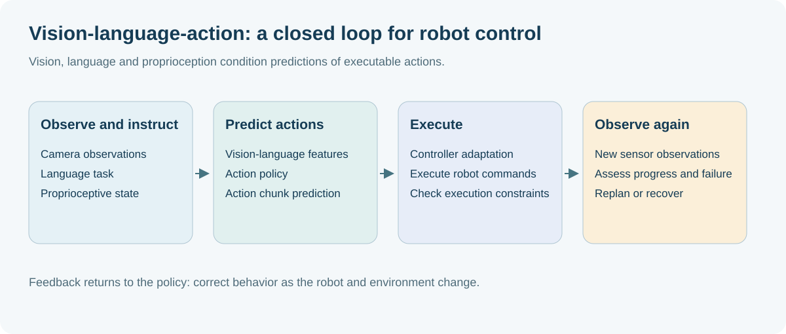
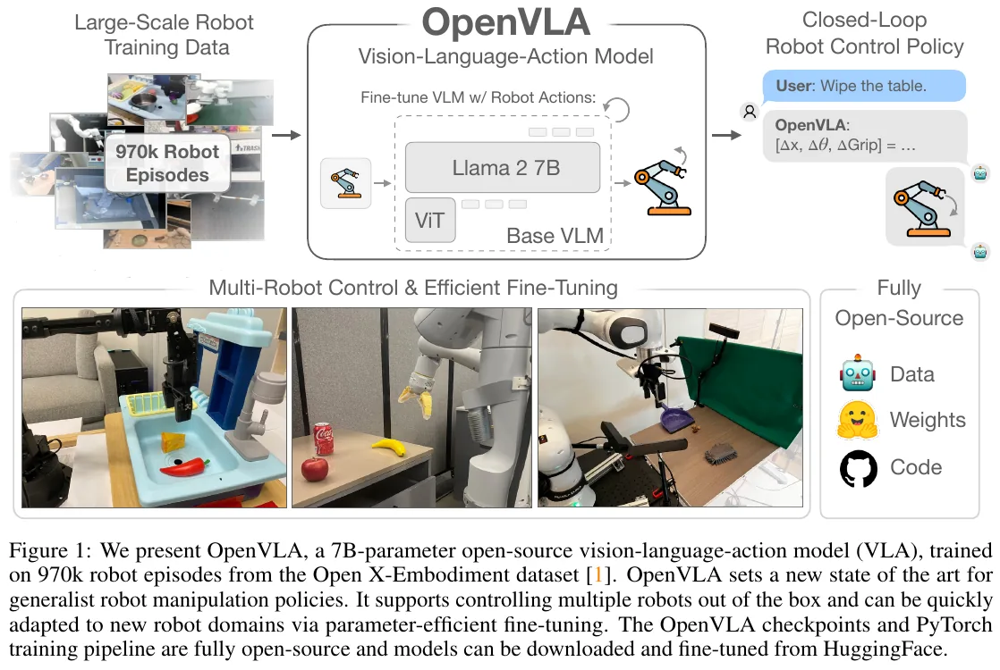
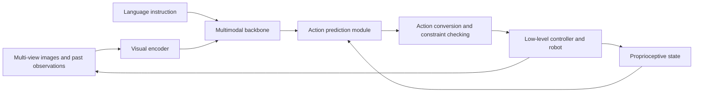
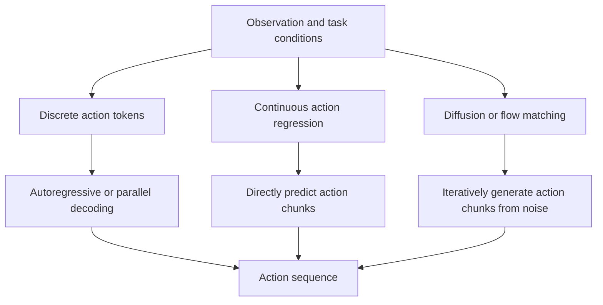
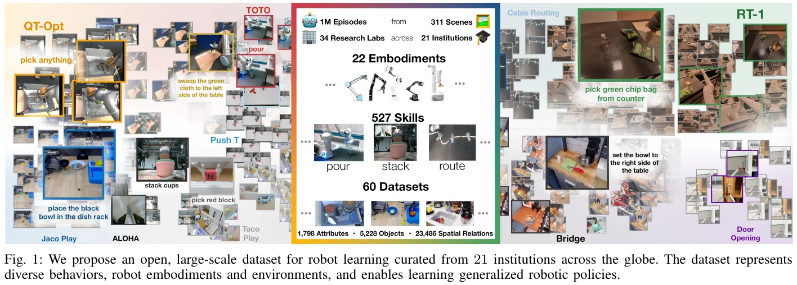

# Introduction
{: id="引言"}

Vision-Language-Action (VLA) models study a specific question: can a **robot combine visual observations and language instructions to generate executable actions directly, and keep adjusting its behavior as the environment changes?** This requires the model to solve "what is the goal", "where is the object", and "how to move next" at the same time. Understanding the language correctly is only one step.

[RT-1](https://arxiv.org/abs/2212.06817) demonstrates the potential of large-scale multi-task robot policies; [RT-2](https://arxiv.org/abs/2307.15818) transfers knowledge from pretraining vision-language models to action prediction. Since then, research has followed several intersecting lines: improving action representation and generation, scaling up cross-robot data, strengthening temporal memory and task decomposition, and using interactive feedback to improve policies. These lines can be combined and should not be read as new architectures successively replacing old ones.

This survey focuses on **robot manipulation and mobile manipulation**, and also covers the action policies, world models, and data tools that support VLA. ACT, Diffusion Policy, UMI, and UniSim are closely related to VLA, but they play different roles (policy learning, data collection, and environment prediction, respectively), which should be kept apart when reading. Comparisons here are bounded by each paper's own experimental setting; benchmark success rates, demonstration videos, and real-world deployment reliability constitute different levels of evidence. Per-paper methods, figures, and experimental limitations are collected in the companion .

<figure class="survey-intro-figure">
  
<figcaption>Figure: VLA converts visual observations, language instructions and proprioceptive state into action predictions; after execution, new observations are obtained to form a closed-loop that is continuously modified.</figcaption>
</figure>

# 1. VLA core technology system
{: id="1-vla核心技术体系"}

## 1.1 What is VLA?
{: id="11-什么是vla"}

A VLA is an action prediction model conditioned on visual observations and a language task. Common additional inputs include joint state, gripper state, multi-camera images, and past observations; the output is usually an end-effector pose increment, a joint target, or an action sequence, which the robot controller then executes. It does not have to output motor currents directly, nor must a single network handle all planning and safety checks.

This process can be summarized as a conditional policy:

$$
A_t \sim \pi_\theta(\cdot \mid o_{\leq t},\ell,s_t),\qquad
A_t=(a_t,\ldots,a_{t+H-1})
$$

Here, $o$ denotes observations, $\ell$ the instruction, $s_t$ the proprioceptive state, and $H$ the action chunk length. $H=1$ corresponds to single-step prediction and $H>1$ to action chunking. After predicting a whole chunk, the system can execute only part of it and then replan from new observations.

  
<figcaption>OpenVLA: from pretrained vision-language representations to robot action prediction.</figcaption>

|Concept|Main output|Relationship to VLA|
|---|---|---|
| VLM |Text, semantic representations, or structured descriptions|Can serve as the pretrained backbone of a VLA; being able to describe actions does not mean being able to control a robot|
| VLA |Actions conditioned on vision and language|Maps task semantics to the robot's action space|
| ACT / Diffusion Policy |Action sequences|Provide methods for action chunking and continuous distribution modeling; the original methods do not require a large-scale VLM|
|World model|Future observations, states, or latent representations|Can assist prediction, planning, and data generation; additional mechanisms are needed to turn it into an executable policy|
|Robot system|The complete closed loop of sensing, planning, control, and execution|The VLA is the policy component and still relies on calibration, drivers, controllers, and runtime monitoring|

## 1.2 VLA system architecture
{: id="12-vla系统架构"}

### From input to closed-loop execution
{: id="从输入到闭环执行"}

The **vision encoder** determines how object, spatial, and scene features are extracted. OpenVLA fuses DINOv2 and SigLIP representations; multi-camera models must also handle view correspondence, time synchronization, and occlusion. The number of encoders alone does not determine performance; input resolution, pretraining objectives, and data coverage matter just as much.

The **multimodal backbone** fuses task semantics with observations. Some models fine-tune a VLM directly to predict action tokens, while others let the VLM provide conditioning for a dedicated action expert. The so-called System 2 / System 1 split usually describes a division of labor between semantic processing and action generation; it should not be assumed that the model has an explicit task planner or runs at a fixed frequency.

The **action prediction module** must handle action dimensionality, temporal correlation, and multiple valid solutions at once. For example, there can be several reasonable paths around an obstacle, and directly averaging different demonstrations may produce an unexecutable action. How actions are generated, whether language reasoning is used, and whether the system is hierarchical are separate design dimensions.

### How action chunking forms a closed loop
{: id="动作块如何形成闭环"}

The action chunk length $H$ specifies **how many steps a single prediction covers**. The number of steps actually executed, $k$, determines how soon the system observes again, with $1\leq k\leq H$. A policy can predict a longer trajectory for coherent motion while executing only its first $k$ steps before observing again. This increases the number of inference calls but reduces the time spent acting on outdated images.

<figure class="vla-process-figure" aria-label="The closed-loop execution sequence of an action chunk">
  <ol class="vla-process-steps">
<li><strong> observes </strong> camera image, proprioceptive state and task instruction entry policy. </li>
<li><strong> predicts that </strong> policy generates a candidate action chunk of length H. </li>
<li><strong> executes </strong>. The controller only executes the first k steps and checks the constraints. </li>
<li><strong> then observe </strong> to obtain the new state, and retain or rewrite subsequent actions. </li>
  </ol>
  

<strong> action chunk indicates that </strong> predicts H = 8 steps, and executes k = 2 steps first 

    
a₁a₂a₃a₄a₅a₆a₇a₈

<strong> has been executed, obtaining new observations </strong> The remaining actions are re-evaluated based on new observations 

  

<figcaption>The closed loop: the predicted length H and the executed length k are two different design quantities, and feedback returns from the robot to the next round of observations.</figcaption>
</figure>

Take $H=8$ and $k=2$ as an example: the policy predicts eight steps at a time and executes two before replanning. If inference and communication take longer than executing two steps, the robot may still wait for new actions; asynchronous inference, action buffering, or fast editing policies can reduce the pauses, but one must check whether the remaining actions are still valid when new observations arrive. 's slow proposal and fast editing target this timeliness problem in dynamic environments.

### Action representations and generation methods
{: id="动作表示与生成方式"}

|Method|Representative work|Main value|Trade-offs to weigh|
|---|---|---|---|
|Discretized single-step actions| RT-2, OpenVLA |Reuses the token prediction interface|Quantization accuracy, sequence length, and serial decoding latency|
|Compress action sequences into tokens| FAST, ActionPiece |Exploits temporal redundancy and preserves physical relationships between actions|Compression error, relational fidelity, vocabulary, and decoding strategy|
|Continuous action regression / latent-variable policies|The regression schemes in ACT and OpenVLA-OFT|Outputs an action chunk in one shot, giving a direct deployment path|Modeling of multi-solution actions, training objectives, and action smoothness|
|Diffusion policy| Diffusion Policy |Models multimodal continuous action distributions|Number of sampling steps and closed-loop latency|
|Flow-matching action expert| π₀ |Combines VLM conditioning with continuous action generation|Number of integration steps, model size, and asynchronous execution configuration|

Action chunking can reduce the invocation overhead of step-by-step prediction, but the longer the chunk, the staler the observations used during execution may become. There is no one-to-one correspondence between the generation method and the control frequency. For related methods, see [ACT](https://arxiv.org/abs/2304.13705), [Diffusion Policy](https://arxiv.org/abs/2303.04137), [FAST](https://arxiv.org/abs/2501.09747) and [π₀](https://arxiv.org/abs/2410.24164).

Two empirical studies from October 2026 show that the bottleneck in action generation is not always where the headline metric points. [ProAct](https://arxiv.org/abs/2610.09170) finds that an action tokenizer needs more than accurate reconstruction: the policy must also predict the right tokens for new observations, and tokens it gets wrong should still decode into reasonable actions. [When One Step Is Enough](https://arxiv.org/abs/2610.30735) reports that across six flow-matching VLAs, one-step Euler integration roughly matches multi-step sampling once a model is well trained and has enough capacity. Fewer integration steps may therefore not require extra distillation, but the finding depends on training and model scale, so it should be checked again before applying it to smaller models or new tasks.

### Unified policies and hierarchical systems
{: id="统一策略与层级系统"}

|Organization|How it works|Advantages|Main limitations|
|---|---|---|---|
|Direct action policy|Predicts actions from observations and the task|A simple interface that eases joint training|Long-horizon task progress and failure causes may stay implicit in the representation|
|Explicit hierarchy|The high level generates subtasks or subgoals and the low level executes them|Eases task composition, supervision, and replanning|The interface between levels introduces information loss and latency|
|Jointly trained hierarchical representation|Learns the association between subtasks and actions inside the model|Semantic knowledge and action data can be shared|Must check whether the intermediate representation actually improves closed-loop behavior|

End-to-end training and hierarchy are not mutually exclusive, and readable intermediate text does not mean the explanation is faithful. When comparing architectures, focus on error recovery, task completion time, and whether intermediate decisions can be intervened on, rather than merely whether a chain of thought is output.

## 1.3 How VLA differs from traditional robot control
{: id="13-vla与传统机器人控制的区别"}

What VLA changes is how the mapping from tasks to actions is learned. Kinematics, trajectory tracking, and feedback control remain components of most practical systems.

|Dimension|Typical modular system|Typical VLA policy|Practical trade-offs|
|---|---|---|---|
|Task description|State machines, rules, or target poses|Natural language and visual conditions|Language is more flexible, but vague instructions require clarification or constraints|
|Linking perception to action|Explicit geometry, planning, and control interfaces|Learned from demonstrations|A learned policy removes some manual modeling but depends on data coverage|
|Adapting to new tasks|Adjust rules, trajectories, and parameters|Fine-tune the policy, add demonstrations, or change prompts|Both options require verifying the cost of transfer|
|Debugging|Check the errors of each module|Analyze the data, representations, and closed-loop failures|Observable logs and modular interfaces remain valuable|
|Execution constraints|Imposed by the planner and controller|Often require an external controller and a constraint layer|A learned policy does not automatically guarantee reachability, stability, or safety|

On fixed production lines and in high-precision repetitive tasks, traditional solutions may be easier to verify and cheaper. The research value of VLA lies mainly in whether transferable behavior can be obtained with less task-specific engineering when tasks and scenes vary more; this advantage must be demonstrated by concrete experiments.

## 1.4 Taxonomy of VLA tasks
{: id="14-vla任务分类"}

Task complexity, manipulated objects, and action interfaces are independent dimensions. Even "pick up the cup" contains many control steps, and a single semantic task cannot be equated with a single-step action.

|Dimension|Typical types|Core difficulties|Recommended metrics|
|---|---|---|---|
|Time span|Short skills, multi-stage tasks, long-horizon tasks|Memory of history, progress judgment, failure recovery|Whole-task success rate, number of consecutive subtasks completed, and number of recoveries|
|Manipulated objects|Rigid bodies, deformable objects, tools, and contact-rich manipulation|Occlusion, deformation, and contact-state estimation|Grasp stability, final-state error, contact failures|
|Action interface|End-effector pose, joint targets, velocity or force commands|Coordinate frames, units, controller matching|Tracking error, latency, constraint-trigger rate|
|Scene scope|Tabletop, bimanual collaboration, mobile manipulation|Viewpoint changes, reachability, and the coupling of navigation and manipulation|Cross-scene performance, task time, manual intervention|
|Generalization condition|New objects, new layouts, new tasks, new robots|The gap between the training and deployment distributions|Success rates reported separately under each kind of distribution shift|

The dimensionality of the action vector cannot be directly equated with the degrees of freedom of the manipulator. For example, "3D translation + 3D rotation + gripper" describes the action interface and does not mean the model outputs seven joint angles.

## 1.5 Side-by-side comparison of mainstream VLA models
{: id="15-主流vla模型横向对比汇总"}

The following table compares representative work by **research question and technical trade-off**. Scores obtained under different robots, data, and evaluation protocols are not merged into a single ranking. For the experiments and figures of each paper, see .

|Work|Core question|Main design|Caveats when reading|
|---|---|---|---|
|  |Can a multi-task robot policy scale with data size?|Language-conditioned Transformer with action discretization|Not equivalent to fine-tuning a large pretrained VLM|
|  |Can web-scale vision-language knowledge help manipulation?|Encode actions as tokens and train jointly|Semantic generalization does not mean acquiring motor skills that were never trained|
|  |How to reproduce and adapt a generalist VLA|Dual visual encoders, a 7B backbone, and an open fine-tuning pipeline|The original version and later training recipes such as OFT should be compared separately|
|  |How to generate high-frequency continuous action chunks|VLM plus a flow-matching action expert|Distinguish action execution frequency from policy update frequency|
|  |How to generalize to new home environments|Joint training on heterogeneous data with high-level and low-level prediction|An unseen environment does not mean any unseen task can be completed|
|  |How to use execution experience to improve the policy|RECAP and expert-intervention data|Account for the costs of interaction, reward annotation, and manual correction|
|  |Can prompts control how an action is performed?|Multimodal context of subtask instructions, subgoal images and training metadata|Separate the gain from steerability from the gain from model and data scale|
|  |How a generalist robot model combines data and toolchains|Division of labor between a vision-language module and a motion expert|Clarify the model version, robot adaptation, and range of training data|
|  |How to adapt to heterogeneous hardware at low cost|Soft prompts learned per embodiment|A new robot still needs target data; report how much|
|  |Can manipulation, navigation, and trajectory prediction share one model?|Unified action and trajectory prediction with a DiT flow-matching decoder|Check whether joint training degrades individual tasks|
|  |Can intermediate action intentions assist execution?|Structured reasoning in action space|Requires ablations of the intermediate representation and a comparison of the added inference cost|
|  |How spatial grounding and future prediction assist actions|Spatial and future-prediction supervision|Examine the supervision data cost and the benefit on each task|
|  |How to share semantic representations across robots|Dense ECoT supervision, skipping ECoT generation at inference|Skipping text generation does not mean zero latency for the whole policy|
|  |How to exploit long history without a continually growing attention cache|Fast weights as recurrent state|Updating memory at test time is not equivalent to online reward optimization|
|  |How to adjust feature fusion by task stage|State-space-guided adaptive attention|Verify the gains under a unified long-horizon task protocol|
|  |Can an external orchestrator cover the weak spots of an end-to-end policy?|A frozen VLA as the contact primitive; analytic primitives and a high-level planner handle the remaining steps|Count planner calls, memory upkeep and retries|
|  |How to reduce the cost of vision-language-action fusion|Lightweight encoding and direct cross-modal interaction|Report hardware, precision, action chunk, and how latency is measured|
|  |How to scale to multi-task and whole-body robot control|About 60,000 hours of mixed pretraining, a whole-body motion interface, and future prediction|Separately report platform progress, success rates, and data costs|
|  |Which high-level decisions are worth spending more inference compute on?|Memory- and world-model-guided subtask search|Separate the benefit of hierarchical decomposition from the benefit of the additional search|
|  |Whether action tokens preserve local physical relationships|A physical ordering-consistency metric and quantization supervision|Applies to discrete autoregressive action representations|
|  |How to repair inference latency with a fast closed loop|Slow VLA proposals plus a fast editing policy trained with online RL|Limited to short dynamic real-robot tasks and to the scale of online data|
|  |How to use human corrections for online policy improvement|Adjusting the human-correction constraint per action dimension|Count the corrections collected beforehand and manual takeovers during training|
|  |Can perception, planning, execution, and evaluation share one embodied backbone?|Per-task training, parameter merging, then brief mixed fine-tuning|Evaluate each capability separately and check how reliable execution assessment is|
|  |Can a video world model serve directly as a zero-shot policy?|A 14B autoregressive video diffusion model generates future frames and actions together|The metric is task progress; 7 Hz needs two GB200s|
|  |Can a video model become a policy without architectural changes?|Actions, states and values encoded as latent frames; single-stage post-training plus test-time planning|About 5 seconds per action chunk with planning enabled|

If the goal is to reproduce a result, first confirm that the weights, data processing, training configuration, and evaluation code match. Released code, released weights, released data, and permission for commercial use are different conditions; check the corresponding repository version and license for each.

## 1.6 Architectural evolution and trends
{: id="16-架构演进与发展趋势"}

### Main lines of technical evolution
{: id="技术演进的几条主线"}

|Main line|Representative work|What changed|What remains unresolved|
|---|---|---|---|
|Semantic knowledge transfer| RT-2, OpenVLA |Brought vision-language pretraining into action learning|A gap remains between semantic understanding and precise physical execution|
|Action sequence modeling| ACT, Diffusion Policy, π₀, FAST, ActionPiece |Moved from step-by-step output to action chunks and to the fidelity of relations under discretization|Closed-loop response and latency compensation under fast disturbances|
|Cross-robot learning| RT-X, OpenVLA, GR00T, LingBot-VLA 2.0 |Share data and part of the representation across platforms|Differences in action interface, sensing configuration, and embodiment|
|Long-horizon decision making| π₀.5, RoboTTT, S²-VLA, τ₀-VLA |Introduce subtasks, memory, stage representations, or world-model search|Reliably judging success, detecting failure, and recovering|
|Improving from experience| π*₀.₆ / RECAP, Real-Time EXPO-FT, Bee |Optimize policies with execution data, rewards, and human corrections|Interaction cost, real-time latency, reward quality, and retention of old skills|
|System orchestration and runtime reliability| Harness VLA, ACE-Brain-0.5, P², RESCUE |Move planning, memory, execution assessment, and failure monitoring into the system layer|Alarm timing, the cost of false alarms, and the overhead of external modules|

These advances affect representation, action generation, data, and training mechanisms, respectively. For example, TTT is a way of processing history and flow matching is a way of generating an action distribution; the two can coexist.

### The division of labor among four types of learning signals
{: id="四类学习信号的分工"}

Lumping all training data together as "scale" masks the differences in the supervision they provide. Internet graphics help identify objects and understand instructions; robotic demonstrations connect observations to actions; synthetic environments and future predictions add explorable states; and post-execution rewards and manual correction point out where the policy actually failed. Adding a certain type of data cannot automatically replace another type of signal.

<figure class="vla-signal-figure" aria-label="Learning signals provided by four types of data and feedback respectively">

<strong> Graphics, text and language </strong> Objects, relationships and target semantics <small> Lack of executable contact actions </small>

<strong> robot demonstration </strong> Correspondence of observed actions <small> is limited by task and embodied coverage </small>

<strong>Simulation and prediction</strong>Perturbations, results and candidate futures<small>Need to be verified to be consistent with real dynamics</small>

<strong>Deployment feedback</strong>Failure, recovery and policy improvements<small>has interaction, labeling and takeover costs</small>

<figcaption>The source of supervision determines what the model can learn, and also what kind of closed-loop evidence is needed.</figcaption>
</figure>

 more directly examines how vision-language knowledge transfers to action tasks;  and  focus on the scale and interface of cross-embodiment demonstrations;  uses future predictions for high-level candidate selection;  and  use execution experience or manual correction. They address different training bottlenecks, and when comparing them the added data and compute budget should be recorded as well.

### The role and verification of world models
{: id="世界模型的作用与验证"}

A world model can provide future visual subgoals, candidate action outcomes, or synthetic training trajectories.  shows a research path toward learning interactive environments;  uses prediction results for high-level subtask search. But visually plausible generations may lack correct contact, mass, friction, and causal response. Evaluation therefore needs further checks: whether the prediction is correctly controlled by actions, whether it improves downstream policies, and whether the gains transfer to the real environment.

The research trends can be summarized as three open questions. Can more semantic supervision improve actions rather than merely explanations? Can longer histories reduce failures caused by partial observability? Can deployment feedback improve overall task reliability at an acceptable cost? The answers should come from controlled comparisons and closed-loop experiments.

### Research directions in October 2026
{: id="vla-recent-trends"}

More than two hundred new arXiv papers in October 2026 mention VLA in their title or abstract. Compared with earlier work, the emphasis has shifted noticeably from adding another benchmark point to **finding problems during deployment, verifying decisions and diagnosing failures**. The table lists representative work for each direction; all numbers are self-reported and not yet reproduced.

| Direction | Representative work | What is new | Boundaries when reading |
|---|---|---|---|
| Runtime monitoring and failure attribution | [Progress Probes P²](https://arxiv.org/abs/2610.31613), [RESCUE](https://arxiv.org/abs/2610.13516), [failure attribution](https://arxiv.org/abs/2610.27277) | Linear probes on the policy's own activations estimate task progress; simulator checkpoints test counterfactually whether acting on an alarm lowers completion cost; a risk model estimates whether removing a visual corruption would save the current episode | Accurate detection does not mean useful intervention. Under a stop-and-reset model, RESCUE finds that even an ideal detector can afford only about a 2%–3% false-alarm rate |
| Test-time verification and latency | [VeriVLA](https://arxiv.org/abs/2610.21985), [PACT-VLA](https://arxiv.org/abs/2610.28019) | Sample several action chunks at critical states and rank them with a latent world model, or use the wait of asynchronous inference to pick the candidate that best fits a newer observation | Count the extra latency per trigger; VeriVLA reports about 326 ms on a single RTX 4090 |
| Memory and history dependence | [Dual-Stream Memory](https://arxiv.org/abs/2610.13262), [GeoMem-VLA](https://arxiv.org/abs/2610.29866), [IMEP / ChainBench](https://arxiv.org/abs/2610.23372) | Keep execution progress apart from retrievable past frames; compress geometric supervision into continually updated memory tokens; test whether memory is actually used by intervening on its contents | A drop in success after removing memory does not prove the model uses the task facts stored there; that needs interventions that swap key facts |
| World models that serve the policy | [What Matters for World Modeling](https://arxiv.org/abs/2610.19825), [DRILL](https://arxiv.org/abs/2610.30814), [WoVR+](https://arxiv.org/abs/2610.17922) | Compare four integration paradigms in one framework; train the world model for policy return rather than pixel error; run VLA reinforcement learning on imagined interaction | No paradigm wins in every setting; hallucination errors in imagined rollouts accumulate, so long tasks need stage-wise control |
| Agentic orchestration | [SERA](https://arxiv.org/abs/2610.29560), [Towards Agentic Robots](https://arxiv.org/abs/2610.20442) | A high-level VLM keeps task context in an editable harness and revises its plans from execution feedback; the VLA serves only as the low-level executor | Harness revisions must be frozen before held-out testing, or tuning gains are counted as generalization |
| Inference systems engineering | [FlashRT-PAI](https://arxiv.org/abs/2610.24349) | Shows that real-time single-batch latency is dominated by kernel launches, data movement between operators and recomputation across decisions, not by individual kernels | Compare speedups at the same precision, hardware and policy configuration |

These papers share one premise: **whole-task success rate is not enough to describe policy reliability.** ,  and SERA place planning, memory and execution assessment in the system layer; P² and RESCUE ask when to stop; DRILL and VeriVLA make the world model serve action selection directly. They address the three questions above, but most conclusions still come from a small set of tasks on a single robot platform.

## 1.7 VLA open source ecosystem
{: id="17-vla开源生态"}

Reproducing a VLA depends on models, data, tools, and hardware working together.

|Level|Representative resources|Main purpose|Check before use|
|---|---|---|---|
|Model| [OpenVLA](https://github.com/openvla/openvla), [openpi](https://github.com/Physical-Intelligence/openpi) |Inference, fine-tuning, and policy adaptation|Weights version, input interface, normalization statistics, and license|
|Data| [Open X-Embodiment](https://robotics-transformer-x.github.io/) |Robot pretraining on multi-source data|Sampling mixture, action units, coordinate frames, language annotations, and licensing|
|Tools| [LeRobot](https://github.com/huggingface/lerobot) |Recording, training, evaluation, and deployment|Data format versions, supported policies, and robot drivers|
|Simulation| [Genesis](https://github.com/Genesis-Embodied-AI/Genesis), [ManiSkill](https://github.com/haosulab/ManiSkill) |Environment interaction, data generation, and evaluation|Physics settings, sensor models, and the sim-to-real gap|
|Hardware and data collection| [ALOHA](https://tonyzhaozh.github.io/aloha/), [UMI](https://umi-gripper.github.io/) |Teleoperated or handheld demonstration collection|Workspace, calibration, time synchronization, and the cost of reproducing the setup|

A unified file format solves only part of the data-access problem. Different data sources, even if they all use RLDS, may use different action semantics and control frequencies. Cross-robot training still requires action conversion, normalization, sampling balancing, and quality filtering. Releasing weights does not mean the pretraining data and the full training process are public.

## 1.8 Training paradigm: from pretraining to deployment feedback
{: id="18-训练范式从预训练到部署反馈"}

A VLA training sample usually contains at least observations, task conditions, proprioceptive state, and subsequently performed actions; some data also provide subtask text, future observations, rewards, or manual corrections. **These additional fields determine which objectives can be trained.** When the data only aligns images and text, the model can learn semantics but cannot directly learn the gripper commands of a particular robot; when only successful demonstrations are available, the model imitates in-distribution actions but has difficulty knowing how to recover after deviating from the trajectory.

|Stage|Input and supervision|What is mainly gained|What needs to be verified separately|
|---|---|---|---|
|Vision-language pretraining|Images, text, question answering, etc.|Objects, relations, and task semantics|Whether comprehension is retained after action training is added|
|Robot action pretraining|Multi-task trajectories, states, and actions|General action priors and some cross-scene transfer|Data mixing, action interfaces, and negative transfer across embodiments|
|Target-task adaptation|A small amount of demonstration or expert data from the specific robot|Precise adaptation to the gripper, viewpoint, contact, and target state|Whether gains on the new task come at the expense of forgetting old tasks|
|Deployment feedback|Failure trajectories, rewards, corrections, and takeovers|Robustness and adaptation to the on-site distribution|Number of interactions, labor costs, and safety margins|

These stages are an analytical framework, not a fixed pipeline that every model executes in sequence.  focuses on examining vision-language knowledge transfer,  provides an open cross-robot action training and adaptation path,  uses data from different sources for multi-stage tasks, while  and  each study how execution experience and human correction can keep improving the policy.

### Action interfaces often fail before loss functions do
{: id="动作接口通常比损失函数更先出错"}

Before training, write the action definition down as an executable contract: is the output a joint target, an absolute end-effector pose, or a pose increment? Is rotation represented by Euler angles, axis-angle, or something else? What are the open and closed values and units of the gripper? How much physical time does one action cover? Different robots can share a policy backbone, but normalization statistics, coordinate transforms, and controller adaptation often need to be handled separately. A failure that results from reading one dataset's "relative end-effector displacements" as another platform's "absolute joint targets" cannot be blamed on the VLA architecture.

Demonstrations are usually cut into $(o_t,\ell,s_t,A_t)$ by time window, and adjacent windows on the same trajectory are highly correlated. Splitting training and test sets randomly by frame lets near-duplicates of the test images appear in training; the split should be made at the trajectory, object, scene, or collection-session level. The action chunk labels must also be consistent with the camera timestamps, the control frequency, and the actual replanning interval at execution time. Otherwise the offline loss can be very low while the closed loop still breaks down because of a misalignment of a few frames.

### How to tell whether a new training stage really helps
{: id="怎样判断新训练阶段真正有效"}

When comparing "adding pretraining", "adding future prediction", or "adding online feedback", first fix the backbone, the target-task data, the action interface, and the initial evaluation state, and then change only the corresponding supervision or training stage. Beyond target-task performance, also examine degradation in language understanding, on earlier robot tasks, and under perturbations. For online methods, the horizontal axis should at least include the amount of robot interaction and human intervention; comparing only the final success rate would wrongly credit the algorithm for gains that come from more data or longer training.

Auxiliary objectives should also be compared under the same training budget. [What Should Robot Policies Learn to Predict?](https://arxiv.org/abs/2610.21915) uses a sample-level router to assign each training sample either to action prediction or to an auxiliary objective. On LIBERO, CALVIN and real-robot tasks, suitable latent-action or future-vision supervision beats action-only training even when action prediction receives no more than half of the samples, and future-vision targets generally do better. The result depends on the chosen representation, such as DINOv3, V-JEPA 2 or video-generation features, and does not mean auxiliary supervision always helps.

## 1.9 Learning path into embodied intelligence
{: id="19-具身智能学习与入门路线"}

With the goal of being able to reproduce, explain, and diagnose a closed-loop task, the learning path can be divided into four steps:

1. **Understand the data and control interface.** Starting from existing data or simulation, inspect images, states, actions, and timestamps, and confirm units, coordinate frames, and normalization. Replay a correct trajectory first, then train a policy.
2. **Establish a behavior cloning baseline.** Run fixed tasks with ACT or Diffusion Policy and record success rate, task time, and failure types. Check what happens when you change the initial state, lighting, or object position.
3. **Introduce language conditioning and a pretrained model.** Choose an OpenVLA or openpi configuration consistent with your hardware and data interface, and compare training from scratch, freezing the backbone, and fine-tuning. Keep the data split and evaluation protocol consistent.
4. **Check real closed-loop behavior and generalization.** When hardware allows, verify on a real robot, covering new layouts, disturbances, failure recovery, and manual takeover, while recording inference latency, execution frequency, and performance over continuous running.

An exercise should leave behind at least a data description, a fixed evaluation set, a reproducible configuration, and failure cases. Whether deployment requirements are met depends on the cost of errors and the operating constraints of the specific task; no universal "60% success rate" can serve as the passing criterion.

# 2. Core challenges of VLA
{: id="2-vla核心挑战"}

This chapter is organized around problems: it links methods to observable failures and explains how to judge whether an improvement is effective.

|Challenge|Common failures|Key verification|
|---|---|---|
|Representation and physical grounding|Finds the right object but cannot hold it firmly; confuses reference frames and coordinates|Spatial, contact, and language perturbation experiments|
|Planning and execution|Subtasks are skipped; actions lag; the same step is repeated after a failure|Closed-loop latency, task completion time, and recovery rate|
|Generalization and adaptation|Fails when the scene changes; new skills overwrite old ones|Independent distribution shifts and continual-learning evaluation|
|Safe and reliable interaction|Out-of-bounds actions; false-positive success judgments; unreasonable takeovers|Constraint triggering, rejection accuracy, and takeover cost|
|Data and evaluation|Data leakage; inconsistent action definitions; incomparable scores|Data provenance, splitting protocols, and experimental configurations|

## 2.1 Multimodal alignment and physical-world modeling
{: id="21-多模态对齐与物理世界建模"}

### The gap between correct semantics and correct actions
{: id="语义正确与动作正确之间的差距"}

"Pick up the cup on the left" simultaneously involves object recognition, a reference frame, a grasp pose, and reachability. A VLM can answer where the cup is, but that does not guarantee the action head can generate the correct contact trajectory. Training must map semantic features to states, actions, and outcomes; evaluation must vary the instruction, the target location, and the distractors separately, to rule out policies that complete tasks by relying only on scene shortcuts.

Three diagnostics can be run on the same task: rewrite only the phrasing of "left cup" and see whether the same target is still selected; keep the instruction fixed, move the cup and the camera, and check target localization and coordinate transforms; keep the target fixed, change the handle orientation or contact conditions, and check whether the grasp stays stable. The three sets of changes probe semantics, space, and control respectively, though errors can also propagate between them. Recording the target the model selected, the predicted actions, and the final contact outcome locates the failing link better than reporting only the success rate of the whole task.

Recent diagnostics suggest that language plays a weaker role in action than expected. A [mechanistic interpretability study](https://arxiv.org/abs/2610.10178) applies activation patching to π₀.5 and GR00T N1.7 on LIBERO: both models are fairly insensitive to abstract rephrasing and even to references to objects that do not exist, yet react strongly to empty instructions and to directional words. [SIMPLER-IN](https://arxiv.org/abs/2610.21251) separates instructions about *what* to do from instructions about *how* to do it, and finds that how-level details do not help current VLAs and even lower their success. A paraphrase test therefore only shows that a model tolerates wording changes; it does not show that the model understands execution constraints stated in the instruction.

### Space and contact representation
{: id="空间与接触表示"}

Multi-view RGB, depth, point clouds, occupancy representations, and force-tactile signals each supply different information, and each also brings its own calibration, noise, and synchronization costs.  and  offer different approaches to spatial representation. When comparing, fix the data volume and camera configuration to determine whether the gain comes from the representation itself or from the additional sensing information.

### Future predictions and physical consistency
{: id="未来预测与物理一致性"}

Predicting future images or latent states can provide training signals for actions, but low pixel error does not equal good control. What matters is being able to distinguish the consequences of candidate actions, especially collisions, occlusions, slipping, and irreversible operations. Evaluating a world model should include multi-step error and downstream closed-loop gains, and check whether the model remains credible in failure states. [DRILL](https://arxiv.org/abs/2610.30814) gives a direct counterexample: a world model with lower next-frame pixel error can produce worse policy gradients, while one trained for policy return has 17% higher pixel error yet yields a better downstream policy.

## 2.2 Instruction following, planning, and robust real-time execution
{: id="22-指令跟随规划与鲁棒实时执行"}

### Long-horizon tasks need progress tracking and recovery mechanisms
{: id="长任务需要进度状态和恢复机制"}

Task decomposition is only the starting point. The system must also determine when a subtask is complete, when to observe again, and where to resume after a failure. , , and  provide examples of hierarchical prediction, intermediate action intent, and external execution management, respectively. For such systems, the additional model calls, retries, and human involvement should be counted as costs.

Even if each subtask succeeds with conditional probability $p$, a task that must complete $N$ steps in a row succeeds with probability only $p^N$ under simplifying assumptions. For example, it is about 36% for $p=0.95$ and $N=20$. This is just an illustration of error accumulation; real tasks are also affected by failure correlations and recovery mechanisms.

<figure class="vla-reliability-figure" aria-label="When the single-step success rate is 95%, the schematic diagram of the continuous task success rate decreasing with the number of steps">

1 Step 
<i style="width:95%"></i>
<strong>95%</strong>

5 Step 
<i style="width:77%"></i>
<strong>77%</strong>

10 Step
<i style="width:60%"></i>
<strong>60%</strong>

20 Step 
<i style="width:36%"></i>
<strong>36%</strong>

<figcaption>The calculation of 0.95 to the Nth power: assuming each step is independent, all steps must succeed, and there are no retries. It is not an actual measurement from any paper or robot.</figcaption>
</figure>

Long-horizon methods should therefore not only raise the fraction of correct next steps, but also report whether **failures can be detected, whether a partial retry can continue the task, and how long recovery takes**. If a failure requires a reset, task throughput may be much lower than the single-segment success rate suggests; if retrying is safe, the number of retries and manual takeovers should be reported together with the final success rate.

### Four kinds of "speed" to distinguish
{: id="区分四种速度"}

|Metric|Meaning|Common misunderstanding|
|---|---|---|
|Single-inference latency|Time from model input to output action|Treating offline batch speed as online latency|
|Policy update frequency|How many times per second a new action plan is generated from new observations|Confusing it with the sampling frequency within an action chunk|
|Action execution frequency|How many times per second the controller sends or executes an action|Assuming 50 Hz execution means running full VLM inference 50 times per second|
|Task throughput|Number of effective tasks completed per unit time|Ignoring retries, resets, and manual intervention|

Action chunking, parallel decoding, caching, and asynchronous execution act on different aspects of latency. [OpenVLA-OFT](https://arxiv.org/abs/2502.19645) studies the efficiency of fine-tuning and action generation; [FAST](https://arxiv.org/abs/2501.09747) studies action sequence compression. Training speedup, action throughput, and single-inference speedup must be reported separately in a paper and cannot be summarized as "several times faster".

When evaluating real-time performance, cover the entire chain of image capture, transmission, preprocessing, inference, action conversion, and controller communication, and report high-percentile latency. The action chunk length, how many steps are executed each time, and whether mid-chunk updates are allowed all change the robot's ability to respond to disturbances.

## 2.3 From generalization to continual adaptation
{: id="23-从泛化到持续适应"}

### First define what “unseen” means
{: id="先定义未见是什么"}

|Generalization type|What changes|What should be held fixed or explained|
|---|---|---|
|Visual generalization|Background, lighting, texture, distractors|The task and motor skills|
|Spatial generalization|Object position, orientation, camera angle|Workspace and calibration range|
|Semantic and compositional generalization|Instruction phrasing, object combinations, subtask order|Whether it requires new motor skills|
|Cross-robot transfer|Embodiment, gripper, sensors, action interface|Whether adaptation data and parameter updates are allowed|
| Sim-to-Real |Images and dynamics shift from simulation to reality|How much real data is used and how many parameter adjustments are made|

"Zero-shot" must state relative to which change it is zero-shot, and whether the same type of task was seen in pretraining. Fine-tuning on a small amount of target data, in-context demonstrations, and fully unadapted deployment should also be reported separately.

### Adaptation mechanisms should not be conflated
{: id="适应机制不应混为一谈"}

Offline fine-tuning updates parameters with data collected in advance; continual learning must also check whether old skills are forgotten; online reinforcement learning optimizes the policy from interactive rewards; TTT can exploit history by updating internal states or fast weights at test time, which does not automatically imply reward-based learning. [RoboTTT](https://arxiv.org/abs/2607.15275) uses fast weights as historical memory, while  focuses on policy improvement from execution experience.

When comparing these methods, document performance before and after adaptation, the number of interactions, manual corrections, computational cost, and cross-task transfer or forgetting. Reporting only the best task performance after adaptation hides the additional resource consumption.

## 2.4 Safety, interpretability, and reliable interaction
{: id="24-安全性可解释性与可靠交互"}

Language rules, refusal outputs, and readable reasoning can aid interaction, but on their own do not constitute a guarantee of safe physical execution. A complete system should be assessed at three levels: whether the policy understands the constraints, whether the output actions satisfy limits such as workspace and speed, and whether anomalies can be detected and execution stopped in time.

|Level|What can be observed|What this evidence does not establish|
|---|---|---|
|Task understanding|Whether ambiguities, disallowed targets, or missing conditions are identified|It does not follow that the motion always satisfies the constraints|
|Action constraints|Limit, reachability, collision, or speed checks|It does not follow that the perception and physics models are fully correct|
|Runtime monitoring|Contact anomalies, timeouts, failure detection, and takeover|It does not follow that every unknown fault can be detected|
|Interpretability|Whether subtasks, target locations, and intermediate reasoning can be checked|That the explanation faithfully reflects the actual cause of a decision|

Useful measurements include false acceptance versus false rejection, anomaly detection latency, constraint violation rate, number of manual takeovers, and task success rate after recovery. Runtime monitoring must also answer what happens after an alarm. [RESCUE](https://arxiv.org/abs/2610.13516) replays more than a hundred thousand counterfactual branches on OpenVLA-OFT and π₀.5 and finds that whether a failure can be recovered depends on the combination of state and intervention; a monitor with better detection scores does not necessarily lower the intervention cost. [P²](https://arxiv.org/abs/2610.31613) shows that linear progress probes on the policy's own activations already match external VLM monitors, so monitoring does not necessarily require calling another large model. Only by deleting, replacing, or perturbing the intermediate reasoning can one determine whether it actually affects the action.

## 2.5 Data construction and benchmarking standards
{: id="25-数据构建与基准测试标准"}

### Data quality and consistency
{: id="数据质量与一致性"}

The difficulty with multi-source robot data is semantic and temporal consistency. One must check whether actions use absolute values or increments, which rotation representation is used, the open/close direction of the gripper, the camera and control timestamps, and how failed trajectories are labeled. Splitting training and test sets randomly by frame easily leaks adjacent moments; more reasonable split units are usually trajectories, scenes, objects, or collection sessions.

The number of trajectories, the number of frames, and the number of collection hours are not interchangeable. Longer videos or higher recording frequency do not automatically yield more independent skills. Data comparisons should also cover task coverage, robot distribution, the proportion of successful and failed samples, and language annotation quality.

### Interpreting benchmark scores
{: id="读懂基准分数"}

[LIBERO](https://github.com/Lifelong-Robot-Learning/LIBERO)'s original task split should be distinguished from the evaluation combinations commonly used by later VLA work; [SimplerEnv](https://simpler-env.github.io/) approximates real evaluation conditions in simulation and cannot replace real-robot testing. CALVIN's consecutive-task completion, LIBERO's task success rate, and a real robot's hourly throughput measure different abilities.

A set of comparable experiments should account for at least the following:

1. **Training conditions**: pretrained weights, target-task data, camera views, proprioceptive state, and additional supervision.
2. **Evaluation protocol**: benchmark version, task set, initial states, random seeds, number of trials per task, and success criteria.
3. **Execution conditions**: hardware, numerical precision, action chunk length, replanning interval, maximum number of steps, and retry budget.
4. **Result statistics**: per-task performance, aggregation method, variance or confidence intervals, and failure types.
5. **Additional costs**: manual intervention, external planners, reward annotation, and fine-tuning and online-adaptation budgets.

Single-task fine-tuning, multi-task joint training, and continual learning cannot be merged into one ranking even when they use the same environment. The real significance of a small improvement in the average score should be judged from repeated experiments and costs.

# 3. Mainstream VLA datasets
{: id="3-vla主流数据集"}

When choosing data resources, first distinguish four kinds of objects: **downloadable robot trajectories, collection tools, simulation environments that can generate data, and evaluation benchmarks with fixed protocols**. They solve different problems and cannot be ranked by "size" alone. The following table uses the statistics as of the paper's or project's release; the actual training subset and later versions may differ.

|Resource|Type|Representative size or scope|Main purpose|
|---|---|---|---|
| Open X-Embodiment |Cross-robot data collection|The original project covers 22 robot types and millions of trajectories|Cross-robot pretraining|
| ProcCorpus-60M |Training corpus with dense reasoning annotations|About 60,000,000 frames and more than 400,000 trajectories|Cross-robot semantic supervision|
|RT-1 data|Real-robot demonstrations|About 130,000 trajectories and more than 700 tasks|Multi-task manipulation learning|
| BridgeData V2 |Real-robot manipulation data|60,096 trajectories, 24 environments|Language-conditioned manipulation and transfer|
| DROID |Real manipulation data across many scenes|About 76,000 trajectories, 350 hours, 564 scenes|Scene generalization and pretraining|
| RH20T |Multimodal robot data|Visual, force, audio, and motion information|Contact-rich manipulation and cross-modal learning|
| ALOHA / UMI |Hardware and demonstration collection systems|Statistics by task and data release version|Bimanual or handheld demonstration collection|
| CALVIN / LIBERO |Simulated data and evaluation|Long-horizon task sequences / knowledge transfer|Repeatable policy comparison|
| MimicGen |Demonstration amplification system|Generates trajectories from a small number of seed demonstrations|Data generation and augmentation|
| SimplerEnv / VLABench |Evaluation environment and benchmark|Approximation of real conditions / language-conditioned manipulation|Generalization diagnosis and closed-loop evaluation|
| RoboDojo |Unified simulated and real-robot evaluation benchmark|42 simulated tasks, 18 real-robot tasks|Cross-model capability comparison and public rankings|
| LeRobotDataset |Data format and tools|Varies with the specific community dataset|Integrated data recording, loading, and training|
| Ego4D |Human first-person video|Large-scale videos of daily activities|Pretraining of visual and interaction representations|

## 3.1 Large-scale cross-robot datasets
{: id="31-大规模跨机器人数据集"}

### Open X-Embodiment Dataset
{: id="open-x-embodiment-dataset"}

[Open X-Embodiment (OXE)](https://robotics-transformer-x.github.io/) brings together robot data from multiple institutions; the original project covers 22 robots, 527 skills, and 160,266 tasks. The RT-X study, which trained policies on a mixture of the data, showed that sharing data across robots can produce positive transfer; the full volume of the collection should not be taken as the actual training volume of each model.

  
<figcaption>Open X-Embodiment: data sharing across institutions and robots. Source: RT-X project.</figcaption>

OXE organizes trajectories with RLDS, but different subsets still differ in cameras, action definitions, control frequencies, and annotation quality. Before use, check the actual data-mixture configuration and record the filtering conditions, sampling weights, and conversion methods. The roughly 970,000 training trajectories used by OpenVLA come from one specific mixture and should not be taken as a fixed size across all versions of OXE.

### ProcCorpus-60M dataset
{: id="proccorpus-60m-dataset"}

[The ProcCorpus-60M reported in ZR-0 paper](https://arxiv.org/abs/2606.30552) contains about 60 million frames, about 1,000 hours, and more than 400,000 trajectories, with 96.8% of frames carrying dense ECoT annotations. Its value lies in providing semantic supervision such as scene, goal, and task decomposition for cross-robot learning.

Data volume and what is actually downloadable need to be checked separately; a real replication should also examine annotation generation cost, error propagation, and whether tasks or scenes overlap. For the related model, see .

### RT-1 dataset
{: id="rt-1-dataset"}

[RT-1](https://arxiv.org/abs/2212.06817) uses about 130,000 real-robot demonstrations covering more than 700 tasks. It suits explaining how multi-task data on a single robot supports a shared policy, and it also provides a data source for later cross-robot training. When reading it, distinguish arm motion, gripper, base, and control mode; not all trajectories can be treated uniformly as seven-dimensional arm motion.

## 3.2 Bimanual and dexterous manipulation datasets
{: id="32-双臂与灵巧操作数据集"}

### ALOHA / ACT dataset
{: id="aloha--act-dataset"}

[ALOHA and ACT](https://tonyzhaozh.github.io/aloha/) provide, respectively, bimanual teleoperation hardware and an action chunking algorithm. The data usually includes multi-camera images, proprioceptive state, and arm actions; the specific tasks, number of demonstrations, and collection frequency should be taken from the corresponding data release. The data protocols of ALOHA, Mobile ALOHA, and later platforms must also be distinguished.

This type of data suits the study of two-arm coordination and fine manipulation. When using it, pay particular attention to leader-follower arm calibration, camera layout, gripper state, and joint targets; the action chunk length must be explained together with the recording frequency. For details on the method, see .

### UMI (Universal Manipulation Interface) dataset
{: id="umi-universal-manipulation-interface-dataset"}

[UMI](https://umi-gripper.github.io/) uses a handheld gripper to capture demonstrations and a carefully designed policy interface to transfer them to the robot. The point is not only to reduce collection equipment but also to handle pose estimation, action representation, and latency matching. A handheld trajectory must still satisfy the reachability and motion constraints of the executing robot and cannot be sent to it without conversion.

UMI is a collection and policy-learning framework; the public data are organized by task. For details, see .

## 3.3 Simulation datasets
{: id="33-模拟器数据集"}

### CALVIN (Composing Actions from Language and Vision)
{: id="calvin-composing-actions-from-language-and-vision"}

[CALVIN](https://github.com/mees/calvin) evaluates long-horizon execution with language-conditioned sequential manipulation tasks. Common results report the success rate of completing 1 to 5 consecutive subtasks and the average number of consecutively completed tasks (up to 5).

The data split must be stated clearly: **ABC→D** means training uses only environments A, B, and C and testing is in D; **ABCD→D** includes environment D data in training. The two cannot be pooled when assessing generalization to unseen environments. Completing several instructions in succession does not mean the model generates the task decomposition on its own.

### LIBERO (Lifelong Benchmark for Robot Manipulation)
{: id="libero-lifelong-benchmark-for-robot-manipulation"}

[LIBERO code](https://github.com/Lifelong-Robot-Learning/LIBERO) and [Original paper](https://arxiv.org/abs/2306.03310) provide 130 tasks with human teleoperated demonstrations, 50 raw demonstrations per task and about 6,500 in total. The tasks are divided into Spatial, Object, and Goal (10 each) and LIBERO-100, the last of which is further split into 90 pretraining tasks and 10 downstream tasks.

Later VLA work often reports four sets of results: Spatial, Object, Goal, and Long, where Long corresponds to the commonly used LIBERO-10 task set. When citing scores, state which task suites were used, as well as the data preprocessing and initialization protocols.

**Continual learning metrics**: forward transfer (FWT) measures how much existing knowledge helps in learning subsequent new tasks; backward transfer (BWT) measures the change in old-task performance after learning a new task, which can be positive or negative because of forgetting. The original paper actually reports FWT, negative backward transfer (NBT), and the area under the learning curve (AUC); the lower the NBT, the less forgetting. The average success rate of multi-task joint training is not a substitute for continual-learning results.

### RLBench / MetaWorld
{: id="rlbench--metaworld"}

[RLBench](https://sites.google.com/view/rlbench) provides simulated manipulation tasks and demonstration generation; [MetaWorld](https://meta-world.github.io/) organizes multi-task and meta-learning control problems. Both suit controlled experiments, but not every configuration ships with image, language, and action interfaces consistent with VLA, and the conversion process needs to be explained when they are reused.

### MimicGen
{: id="mimicgen"}

[MimicGen](https://mimicgen.github.io/) automatically synthesizes more manipulation trajectories from a small number of seed demonstrations, mainly through object-centric trajectory transformation, subtask organization, and execution in simulation. The number of generated trajectories is not the number of independent skills; the costs of scene construction, subtask definition, failure filtering, and manual preparation must also be counted.

## 3.4 Real-world datasets
{: id="34-真实世界数据集"}

### Bridge dataset (BridgeData V2)
{: id="bridge-dataset-bridgedata-v2"}

[BridgeData V2](https://rail-berkeley.github.io/bridgedata/) contains 60,096 trajectories across 24 environments and 13 skills. Of these, 50,365 come from teleoperation and 9,731 from scripted pick-and-place policies. It provides language task annotations and varies objects, camera poses, and workspaces.

This type of data suits the study of tabletop manipulation and language-conditioned transfer. Comparative experiments should state the version used, whether scripted trajectories are included, and whether training and test scenes overlap.

### RH20T dataset
{: id="rh20t-dataset"}

[RH20T](https://rh20t.github.io/) is designed for multimodal robot skill learning; it records visual, force, audio, and motion information and provides the corresponding calibration data. It suits the study of contact states, multimodal fusion, and demonstration transfer.

Force/torque measurements are a different modality from high-resolution fingertip tactile images; the available sensors should be determined from the actual data configuration, and one cannot assume that all trajectories contain the same tactile signals or synchronization accuracy.

### DROID dataset
{: id="droid-dataset"}

[DROID](https://droid-dataset.github.io/) contained approximately 76,000 demonstrations, 350 hours of interaction, 564 scenes, and 86 tasks at release, collected by 50 data collectors. Its unified platform consists of a Franka Panda arm, two external stereo cameras, and a wrist-mounted stereo camera.

DROID emphasizes scene diversity under the same hardware and suits the study of cross-environment transfer. The authors have since updated the language annotations and some camera calibrations, so the data version used should be recorded when reproducing results.

### LeRobot dataset (Hugging Face)
{: id="lerobot-dataset-huggingface"}

[LeRobot](https://github.com/huggingface/lerobot) provides tools for recording robot data and for training; LeRobotDataset is a way of organizing data, not a dataset of fixed size. Actual data quality, robot interfaces, licensing, and train-test splits are determined by each data publisher.

## 3.5 Human interaction datasets
{: id="35-人机交互数据集"}

### Ego4D
{: id="ego4d"}

[Ego4D](https://ego4d-data.org/) provides first-person videos of human daily activities with multi-category task annotations. It can help learn object interaction and temporal representations, but human videos typically contain no joint commands that could directly supervise a robot. Using it in VLA requires an additional action-correspondence, latent-action-learning, or robot-data-alignment mechanism.

## 3.6 Evaluation benchmarks
{: id="36-评测基准"}

### SIMPLER / SimplerEnv
{: id="simpler--simplerenv"}

[SimplerEnv](https://simpler-env.github.io/) uses visual-matching and environment-variation settings to approximate some real-robot policy evaluation conditions in simulation. The research focus is the consistency between simulated evaluation and real performance, rather than providing a uniform, fixed set of tasks for all robots.

Results should be reported together with the robot, task set, and visual-matching or variation settings. Extended task versions and language protocols should be labeled separately, and their statistics should not be attributed to the original SimplerEnv.

### VLABench
{: id="vlabench"}

[VLABench](https://vlabench.github.io/) targets language-conditioned robot manipulation, with a variety of tasks and scenes, to study language understanding, common sense, and execution ability. The specific task split, metrics, and generation configuration used must be stated along with the paper or code version.

### RoboDojo
{: id="robodojo"}

[RoboDojo](https://robodojo-benchmark.com/) provides 42 simulated tasks and 18 real-robot tasks, and compares different policies under a unified protocol on its [official leaderboard](https://robodojo-benchmark.com/leaderboard). The simulation covers five kinds of abilities: generalization, memory, fine manipulation, long-horizon tasks, and open-ended instructions. When reading its rankings, distinguish the full-task success rate (SR) from the Score that includes partial progress, and the simulation ranking from the real-robot ranking; neither is equivalent to scores on LIBERO or other benchmarks. For the specific protocol, see [original paper](https://arxiv.org/abs/2607.04434).

### ManiSkill3 / RoboCasa
{: id="maniskill3--robocasa"}

[ManiSkill](https://maniskill.ai/) provides parallel simulation, data, and task tools; [RoboCasa](https://robocasa.ai/) focuses on kitchen manipulation environments. Both can be used for data generation and for policy evaluation, but "how many environments can be generated" and "how many tasks are actually evaluated" are different statistics.

The choice should follow the research question: verifying parallel training efficiency, cross-scene variation, and long-horizon manipulation each require a different configuration. Good performance in simulation still has to be verified against the sensing, dynamics, and execution latency of the real system.

### Robustness diagnostic benchmarks
{: id="鲁棒性诊断基准"}

As scores on benchmarks such as LIBERO approach saturation, October 2026 brought a set of benchmarks built specifically to test distribution shift. [LIBERO-Pro2.0](https://arxiv.org/abs/2610.24587) defines 22 static perturbations and 20 runtime interventions across six dimensions, giving 1,648 human-reviewed task instances; the 17 policies it evaluates lose 26.5 percentage points on average under runtime interventions. [VLA-GAUGE](https://arxiv.org/abs/2610.16567) tests 12 VLAs on paired in-distribution and out-of-distribution tasks and finds a mean zero-shot score of only 22.3%. [RoboCasa-Shift](https://arxiv.org/abs/2610.27861) makes each clean and perturbed episode pair differ in a single factor and locates failures by task stage, showing that the same drop in success rate can come from entirely different failure stages.

Together these benchmarks show that a near-perfect score on the original LIBERO suites says little about reliability under changes in viewpoint, distractors, execution perturbations or language. When citing them, report the perturbation type, severity and per-stage results.

### From benchmark scores to real abilities
{: id="从基准分数到真实能力"}

Evaluation evidence covers different ground and suits layer-by-layer troubleshooting. Offline action error can check labels and action interfaces but cannot prove closed-loop success; fixed simulated tasks make repeated comparison easy but may rely on scene shortcuts; perturbation tests probe new objects, viewpoints, and layouts; and only real-robot experiments introduce real contact, sensing noise, and system latency.

<figure class="vla-evidence-figure" aria-label="Four layers of evaluation evidence from offline indicators to real robot closed-loop">
  <ol class="vla-evidence-steps">
<li><strong> Offline playback </strong> Action error, data leakage, interface correctness </li>
<li><strong> Fixed simulation </strong> Overall task success rate, task progress, and task-by-task failure </li>
<li><strong> Distribution changes </strong> New layout, new objects, visual and dynamic disturbances </li>
<li><strong> real robot closed-loop </strong>Completion rate, time-consuming, recovery, manual intervention and safety constraints</li>
  </ol>
<figcaption>Each higher layer of evidence covers risks the lower layers cannot; results at one layer cannot be inferred directly from results at another.</figcaption>
</figure>

For example, RoboDojo's **Score** reflects partial progress on unfinished tasks, while **SR** requires full completion; the gap between the two can reveal policies that "get to the last step but fail". If a real robot tries each task only 10 times, a single success or failure shifts the result by 10 percentage points. Per-task results, repeated rounds, and failure segments should be disclosed rather than only an overall average. [RoboDojo original paper](https://arxiv.org/abs/2607.04434) and [Official list](https://robodojo-benchmark.com/leaderboard) provide entry points for reading the results broken down by ability dimension.

# 4. Application scenarios of VLA
{: id="4-vla的应用场景"}

The application value of VLA depends on whether the adaptability it brings when tasks change can cover the costs of data collection, compute, and system integration. Task demonstrations in papers provide evidence of capability; production deployment additionally requires a longer period of reliability evaluation.

|Scenario|Tasks worth studying|Potential value of VLA|Key deployment metrics|
|---|---|---|---|
|Flexible manufacturing|Multi-variety sorting, pre-assembly positioning, material handling|Handle product changes through task conditioning and small-scale adaptation|Contact accuracy, cycle time, failure cost, and reset time|
|Home and service|Tidying, handling laundry, cleaning desks|Adapt to changes in objects, layouts, and instructions|Overall task completion rate, recovery rate, interventions, and continuous running time|
|Warehousing and logistics|Picking, bagging, and rearranging changing items|Reduce item-specific policy design|Throughput, damage rate, long-tail item performance|
|Mobile manipulation|Picking and placing across areas and operating along the way|Combine language goals, navigation, and local manipulation|Combined arrival-and-manipulation success rate, positioning error, and task time|

Pure visual quality inspection is mainly a perception task; it falls within the VLA scope discussed here only when the system generates manipulation actions based on the inspection results. Open environments such as agriculture and construction are possible extended research directions, and their maturity cannot be inferred directly from tabletop experiments.

### From demo to usable: warehouse picking as an example
{: id="从演示到可用以仓储拣选为例"}

"Being able to put items into boxes" is not a clear enough deployment goal. In the research phase, first fix the arm, camera, and object set to establish a reproducible pick-and-place baseline; then introduce new packaging, occlusion, stacking, and changes in target-box position to determine whether the performance degradation comes from perception, grasping, or the action interface. Once on site, also compute the **effective picks per hour**, counting recognition, attempts, retries, resets, manual takeovers, and damage within the same task cycle.

This also explains why a higher simulated success rate does not necessarily mean higher production-line throughput. A policy that needs frequent retries or manual resets may do well in a single trial yet be unable to run continuously. For household tidying and mobile manipulation, task duration, object and scene variation, recovery policies, and labor cost should also be added to judge whether general capability actually reduces task-specific engineering.

# 5. Paper readings
{: id="5-论文精读"}

The per-paper methods, experiments, figures, and limitations have moved to ; that page opens with a , and each paper's own matched-setting comparison table sits in the experiments part of its reading. That page keeps the original paper anchors, so links from anywhere in this survey still work. A reading path organized by research question is still given here.

|Reading path|Representative work|Questions worth asking|
|---|---|---|
|Foundation models and cross-robot learning|  →  →  →  →  |How scale and heterogeneous data translate into tasks and embodied generalization|
|Action generation and representation| , ,  |What have changed in action chunk, generation method and discretization?|
|Long-horizon task reasoning| , ,  |Can memory, subtasks and world modelsearch improve closed-loop success rate?|
|Online improvement and real-time execution| , ,  |How to account for robot interaction, human correction, and delay costs|
|Unified frameworks and system orchestration| , ,  |Should capabilities live in one model or in external orchestration, and what does each cost?|

The results of recent papers must still be interpreted according to their evaluation protocols: LingBot-VLA 2.0's GM-100, ActionPiece's LIBERO, τ₀-VLA's long-horizon real-robot experiments, and the task success rates of online reinforcement learning cannot be ranked against one another directly. New October 2026 work not yet covered in the paper readings is summarized under [research directions in Section 1.6](#vla-recent-trends).

---

# 6. Summary and Outlook
{: id="6-总结与展望"}

VLA connects vision-language knowledge to action learning, but general capability comes from the combination of data, representation, action generation, and closed-loop execution. RT-2 and OpenVLA show that pretrained semantics can help robot manipulation; ACT, Diffusion Policy, π₀, and ActionPiece show that action sequences and their representation are equally critical; τ₀-VLA, Real-Time EXPO-FT, and Bee place computation, fast feedback, and manual correction at different failure points. Work from the second half of 2026 moves attention further to the system layer: Harness VLA and ACE-Brain-0.5 organize planning, execution, and assessment, while runtime monitoring, test-time verification, and robustness diagnostic benchmarks begin to measure when and why policies fail. For complete analyses of the related papers, see .

This survey supports three research judgments:

1. **Architectural design should correspond to measurable causes of failure.** Before adding reasoning, spatial representation, or memory modules, first confirm whether the bottleneck comes from semantics, insufficient observation, action accuracy, or execution latency, and then verify it with ablations.
2. **Generalization should be reported separately.** New scenes, new tasks, and new robots are different problems; the benefits of cross-robot pretraining do not mean that no interface adaptation is needed.
3. **Deployment benefits should be computed on complete tasks.** Higher benchmark scores or action throughput translate into real value only if retries, resets, human intervention, and compute costs are acceptable.

|Research question|A direction worth pursuing|Evidence needed to support a conclusion|
|---|---|---|
|How to deal with spatial and contact uncertainty|Multiple views, spatial representations, and force-tactile integration|Perturbation and contact experiments under a fixed data budget|
|How to complete longer tasks|Hierarchical decision making, memory of history, and failure recovery|Whole-task success rate, recovery rate, and added latency on long-horizon tasks|
|How to make effective use of deployment experience|Correction data, reward learning, and continual adaptation|Interaction-cost curves and performance changes on old and new tasks|
|How to reduce data costs|Cross-robot sharing, demonstration amplification, and synthetic data|Comparisons under equal budgets and transfer results on real systems|
|How to build trustworthy evaluations|Fixed versions, independent splits, repeated tests|Reproducible configurations, confidence intervals, and failure cases|
|How to cut losses in time during deployment|Runtime monitoring, failure attribution, and test-time verification|Alarm timing, the cost of false alarms, and the completion cost after intervention|

For practical research, a clear account of "which type of failure was solved under which conditions" is more valuable than unqualified claims of generality, real-time performance, or optimality. This is also a question that must be answered continuously on the way from a single demonstration to a stable robotic system.

---

# 7. References
{: id="7-参考资料"}

**Added in October 2026**

- [Towards Agentic Robots: Model, Data, Environment, and Harness](https://arxiv.org/abs/2610.20442) - Survey of agentic robots, organized into 17 categories across model, data, environment, and harness
- [Progress Probes P²](https://arxiv.org/abs/2610.31613) - Lightweight runtime monitoring from the policy's internal activations
- [RESCUE](https://arxiv.org/abs/2610.13516) - Counterfactual evaluation of interventions triggered by runtime monitors
- [Failure Attribution for VLA Models](https://arxiv.org/abs/2610.27277) - Estimating what removing a visual corruption would change in the current episode
- [VeriVLA](https://arxiv.org/abs/2610.21985) - Test-time action-chunk verification with a latent world model
- [PACT-VLA](https://arxiv.org/abs/2610.28019) - Using asynchronous inference delay to select action chunks
- [Dual-Stream Memory for VLA Policies](https://arxiv.org/abs/2610.13262) - Separate memories for execution progress and selective visual retrieval
- [GeoMem-VLA](https://arxiv.org/abs/2610.29866) - Geometric supervision internalized as temporal memory
- [Beyond Success Rate: Interventional Evaluation of Memory](https://arxiv.org/abs/2610.23372) - Interventional memory evaluation protocol and ChainBench
- [What Matters for World Modeling in VLA Models?](https://arxiv.org/abs/2610.19825) - Controlled comparison of four world-model integration paradigms
- [DRILL](https://arxiv.org/abs/2610.30814) - Training world models for policy return instead of pixel error
- [WoVR+](https://arxiv.org/abs/2610.17922) - World model as a simulator for VLA reinforcement learning
- [SERA: Self-Evolving Harnesses](https://arxiv.org/abs/2610.29560) - Self-revising high-level harness with a fixed VLA executor
- [What Should Robot Policies Learn to Predict?](https://arxiv.org/abs/2610.21915) - Allocating auxiliary supervision under a fixed budget
- [ProAct: Beyond Reconstruction in Action Tokenization](https://arxiv.org/abs/2610.09170) - Action tokenizers trained for predictability and robustness
- [When One Step Is Enough](https://arxiv.org/abs/2610.30735) - Empirical study of one-step integration in flow-matching VLAs
- [FlashRT-PAI](https://arxiv.org/abs/2610.24349) - Pipeline-level acceleration for physical AI inference
- [Mechanistic Study on Language Grounding in VLAs](https://arxiv.org/abs/2610.10178) - Language grounding analysis of π₀.5 and GR00T N1.7
- [Do VLAs Really Follow Instructions?](https://arxiv.org/abs/2610.21251) - How-level instruction-following diagnosis and SIMPLER-IN
- [LIBERO-Pro2.0](https://arxiv.org/abs/2610.24587) - Robustness benchmark with static perturbations and runtime interventions across six dimensions
- [VLA-GAUGE](https://arxiv.org/abs/2610.16567) - Diagnostic framework for generalization and combinatorial perturbations
- [RoboCasa-Shift](https://arxiv.org/abs/2610.27861) - Single-factor paired perturbations with stage-aware failure diagnosis

**Earlier entries**

- [LingBot-VLA 2.0: From Foundation to Application](https://arxiv.org/abs/2607.06403) - Multi-embodiment data, whole-body motion interface, and future prediction
- [τ₀-VLA](https://arxiv.org/abs/2608.16885) - World-model-guided high-level subtask search
- [ActionPiece](https://arxiv.org/abs/2609.18487) - Action tokenization with physical relationship fidelity
- [Real-Time EXPO-FT](https://arxiv.org/abs/2609.18207) - Real-time editing policy and online reinforcement learning
- [Bee](https://arxiv.org/abs/2609.27450) - Online reinforcement learning under manual-correction constraints
- [An Anatomy of Vision-Language-Action Models](https://arxiv.org/abs/2512.11362) - A summary of modules, development lineage, and a taxonomy of challenges
- [VLA-Survey-Anatomy GitHub](https://github.com/SuyuZ1/VLA-Survey-Anatomy) - Companion project page for the review above
- [ZR-0: Training Vision-Language-Action Models with Dense Embodied Chain-of-Thought Supervision](https://arxiv.org/abs/2606.30552) - Zhipu AI & China Renmin University, ProcCorpus-60M
- [RoboTTT: Context Scaling for Robot Policies](https://arxiv.org/abs/2607.15275) - NVIDIA GEAR Lab & Stanford
- [S²-VLA: State-Space Guided Vision-Language-Action Models for Long-Horizon Manipulation](https://arxiv.org/abs/2606.27872) - East China Normal University & SJTU (IJCAI 2026)
- [TurboVLA: Real-Time Vision-Language-Action Model at 32 Hz on an RTX 4090](https://arxiv.org/abs/2607.27205) - Lightweight, high-frequency VLA with a direct $V+L \to A$ connection
- [Vision-Language-Action Models for Robotics: A Review Towards Real-World Applications](https://vla-survey.github.io/)
- [10 Open Challenges Steering the Future of Vision-Language-Action Models](https://arxiv.org/abs/2511.05936)
- [State of VLA Research at ICLR 2026](https://mbreuss.github.io/blog_post_iclr_26_vla.html) - An index of research developments; technical conclusions should be checked against the original papers
- [Muhayyuddin's VLA Repository](https://muhayyuddin.github.io/VLAs/) - Index of models, data, and simulation resources
- [OpenVLA](https://github.com/openvla/openvla) - Open-source 7B-parameter VLA model
- [π₀ (openpi)](https://github.com/Physical-Intelligence/openpi) - Physical Intelligence's flow-matching VLA
- [Octo](https://octo-models.github.io/) - Generalist robot policy
- [LeRobot](https://github.com/huggingface/lerobot) - Hugging Face robot learning library
- [RT-2 Blog](https://deepmind.google/blog/rt-2-new-model-translates-vision-and-language-into-action/) - Google DeepMind
- [Open X-Embodiment](https://robotics-transformer-x.github.io/) - Cross-robot data collection and the RT-X study
- [Bridge Dataset](https://rail-berkeley.github.io/bridgedata/) - 60k tabletop manipulation trajectories
- [LIBERO](https://libero-project.github.io/) - Lifelong Robot Learning Benchmark
- [CALVIN](http://calvin.cs.uni-freiburg.de/) - Benchmark for long-horizon compositional tasks
- [RLBench](https://sites.google.com/view/rlbench) - 100+ simulated manipulation tasks
- [SIMPLER](https://simpler-env.github.io/) - Standardized VLA evaluation platform

---