# 1. Introduction
{: id="1-引言"}

Vision-language models (VLMs) are multimodal models that jointly process images and text. Their central challenge is to align and fuse visual and linguistic signals so that the model can reason and generate across modalities.

VLM architectures have evolved from attention-based cross-modal alignment to the contrastive learning paradigm of CLIP and the visual-encoder-plus-language-model architecture of LLaVA and Flamingo. As LLM capabilities have grown, proprietary and open models such as GPT-4V, Gemini, and Qwen-VL have demonstrated strong visual understanding and reasoning capabilities.

VLMs have applications in medical image analysis, autonomous driving, robot perception, and content moderation. Visual understanding underpins vision-language-action (VLA) models and embodied intelligence systems, linking advances in VLM research to downstream embodied tasks.

<figure class="survey-intro-figure">
  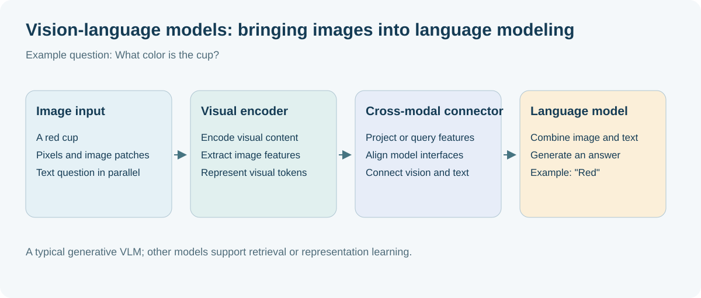
<figcaption>Figure: A typical generative VLM uses a visual encoder and a cross-modal connector so that image information can participate in language modeling. Other VLMs are used for retrieval or representation learning, and their outputs are not limited to natural language.</figcaption>
</figure>

This article revolves around three questions: how **visual information enters the language model, how the model learns to use this information through training, and how to verify that it indeed understands the input.** Chapters 2 to 4 establish the conceptual framework, Chapters 5 to 7 connect tasks, training, and evaluation, and Chapter 8 gives detailed readings of representative papers.

> 💡 **Scope and related reading**:
> This article focuses on **general-purpose vision-language foundation models (2D image/video understanding, feature-extraction architectures, and multimodal alignment training)**.
> If you are interested in **3D point clouds, NeRF/3DGS neural reconstruction, 3D visual grounding, and spatial geometric reasoning (3D-LLM / Spatial VLM / embodied perception)**, see the companion survey: .

<!-- more -->

**Reading Navigation**

|Reading goal|Suggested route|Key question|
|---|---|---|
|Build an overall picture|[Basics](#vlm-basics) → [Core methods](#vlm-methods) → [Summary](#vlm-summary)|What problem do alignment, fusion, and generation each solve?|
|Understand the model's internal computation|[LLM principles](#llm-principles) → Section 3.8 → Sections 4.2～4.4|Where do visual features enter the Transformer?|
|Train or fine-tune a VLM|[Training pipeline](#vlm-training) → Sections 6.4～6.6 → [Evaluation benchmarks](#vlm-evaluation)|How do I choose the freezing strategy, learning rate, and validation metrics?|
|Study representative work|[Paper notes](#vlm-papers)|What were the design, evidence, and limitations of each work?|

The evaluation scores in this article are the experimental results reported in the corresponding papers or reports, not live leaderboards. When comparing, check the model version, input resolution, number of video frames, prompt template, and evaluation split together.

<a id="vlm-basics"></a>

# 2. Basic overview of VLM
{: id="2-vlm-基本概述"}

## 2.1 What is VLM?
{: id="21-什么是vlm"}

A vision-language model (VLM) is a deep learning model that processes both image (or video) and text modalities and establishes semantic alignment between vision and language. In the broad sense, VLMs cover architectures ranging from discriminative to generative tasks. The core goal is to let the model "understand" images and express them in language, or to understand image content from language descriptions.

<div align="center">
  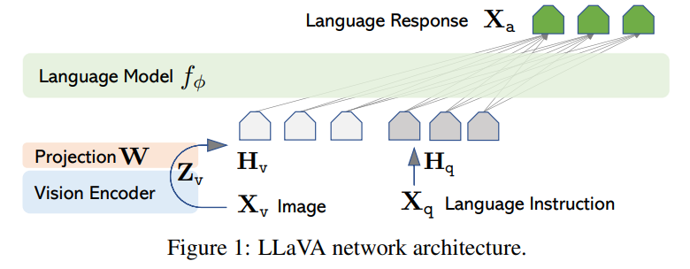
<figcaption>Figure: Architecture of the LLaVA vision-language model (Source: Hugging Face Blog)</figcaption>
</div>

A VLM usually needs to solve the following core problems:
1. **Visual encoding**: Represent images as high-quality feature vectors or token sequences
2. **Modality alignment**: Align visual features with the linguistic semantic space
3. **Cross-modal fusion**: Let visual and linguistic information interact during reasoning
4. **Multimodal generation** (generative models): Produce coherent text output from visual and language input

## 2.2 Core elements
{: id="22-核心要素"}

**A text-generating VLM with an LLM at its core** usually consists of three modules. CLIP, by contrast, is a dual-encoder model: it encodes images and text separately and performs retrieval or classification through similarity, with no autoregressive language decoder for answering questions.

|Module|Role|Mainstream implementations|
|------|------|------------|
|**Visual encoder**|Extracts feature representations from images|CNN (ResNet) → ViT → CLIP / SigLIP ViT → InternViT; complemented by self-supervised ViTs such as DINOv2|
|**Connector** (Bridge)|Cross-modal alignment and feature fusion|Linear projection (LLaVA) / Q-Former (BLIP-2) / cross-attention (Flamingo)|
|**Language model**|Language understanding and text generation|Pretrained LLMs such as OPT / Flan-T5 / LLaMA / Qwen / InternLM|

**Visual encoder**: Extracts features from images. Mainstream choices have evolved from early CNNs (ResNet, EfficientNet) to the Transformer-based ViT, and then to the CLIP visual encoder trained specifically for cross-modal alignment. The encoder output can be a global vector, a sequence of patch-level features, or a hybrid representation.

**Connector (Bridge)**: The key module that determines the multimodal fusion strategy, and where methods differ the most. The main forms include linear projection layers, cross-attention, and the Q-Former.

**Language model**: Handles language understanding and generation and serves as the "reasoning brain" of the whole system. Modern VLMs usually reuse a pretrained LLM directly.

## 2.3 Main challenges
{: id="23-主要挑战"}

**Modality alignment gap**: Visual features and text tokens live in entirely different semantic spaces. Simply concatenating them works poorly, so a carefully designed alignment mechanism is needed.

**Training data requirements**: High-quality image-text data is scarce, and weakly supervised web-crawled data is noisy. How to make use of massive noisy data remains an open problem.

**Fine-grained visual understanding**: Models remain unstable at fine-grained information such as object spatial relationships, attribute details, and text (OCR), and they still "hallucinate".

**Computational efficiency**: High-resolution images require a large number of visual tokens, which drives inference cost up sharply. Balancing accuracy and efficiency is an important research direction.

**Video understanding**: Extending from images to video requires temporal modeling, and processing long video sequences efficiently is still a challenge.

## 2.4 Research and Development Trends
{: id="24-研究发展趋势"}

The key technical focus is summarized below by the year in which representative work first appeared. The routes have coexisted for a long time; the chronological order does not mean that later architectures replaced earlier ones.

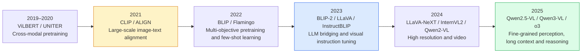

The year is that in which the paper was first posted on arXiv (for example, [BLIP-2](https://arxiv.org/abs/2301.12597) is January 2023 and the [Qwen2.5-VL Technical Report](https://arxiv.org/abs/2502.13923) is February 2025). For the 2026 streaming-video direction, see Section 8.13 Mage-VL.

> 🔗 **Extending into 3D physical space**: As VLMs move from the 2D pixel plane toward embodied physical interaction, integrating geometric representations such as 3D point clouds, depth, and Gaussian Splatting into VLMs has become an important technical thread from 2024 to 2026 (e.g., 3D-LLM, LLaVA-3D, VGGT). For the complete picture of 3D multimodal large models, see .

<a id="llm-principles"></a>

# 3. How LLMs work
{: id="3-大语言模型llm运行原理"}

In Chapter 2 we noted that the "reasoning brain" of a modern VLM is a pretrained large language model (LLM). Everything the visual encoder and connector do ultimately serves to turn an image into an input the LLM can "understand". So before turning to multimodal fusion, we first need to understand how a text-only LLM works: how text enters the model, how the model computes internally, and how the answer is emitted token by token. Once this "text input → internal computation → text output" pipeline is clear, it is natural to see in Chapter 4 how visual features are "disguised" as tokens and injected into it.

This chapter takes the mainstream **decoder-only Transformer** as its subject and follows the data flow: tokenization (3.2), embedding (3.3), the Transformer decoder stack (3.4), the output layer (3.5), decoding and sampling (3.6), autoregressive generation and the KV cache (3.7), and finally how this pipeline becomes an entry point for multimodal input (3.8).

## 3.1 Autoregressive prediction
{: id="31-自回归预测"}

Almost all mainstream LLMs today (GPT, LLaMA, Qwen, InternLM, etc.) are **decoder-only autoregressive language models**. They essentially do just one thing: **given all the previous tokens, predict the next one**.

Treating a text as a token sequence $t_1, t_2, \ldots, t_n$, an LLM uses the chain rule to decompose the probability of the whole sequence into a product of conditional probabilities, each "predicting the next token":

$$P(t_1, t_2, \ldots, t_n) = \prod_{i=1}^{n} P(t_i \mid t_1, t_2, \ldots, t_{i-1})$$

During training, the model is optimized on massive amounts of text with **next-token prediction** as the objective, minimizing the cross-entropy loss. During inference, the model repeats the loop "predict the next token → append it to the end of the input → predict the next one"; this is **autoregressive generation**.

The entire text processing pipeline can be summarized as follows:

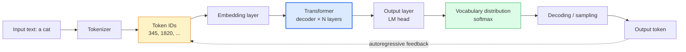

Let's go through each stage of this pipeline in turn.

## 3.2 Tokenization
{: id="32-分词"}

Computers cannot process text directly. The first step is to split the string into the basic units of the model's vocabulary, called **tokens**, and map each token to an integer ID. This step is called **tokenization**.

LLMs often use **subword tokenization**. Common methods include BPE (Byte-Pair Encoding), byte-level BPE, and Unigram; WordPiece is also a common subword method, but these algorithms should not be regarded as variants of BPE. Subword tokenization strikes a balance between the character level and the word level:

- Common words become a single token (e.g., English `the`, or a common Chinese word such as "cat");
- Rare words are split into several subwords (e.g., `tokenization` → `token` + `ization`);
- The vocabulary size is controllable; with byte-level representations or byte fallback, the out-of-vocabulary (OOV) problem can be reduced further.

For example, a Chinese phrase meaning “a cat” may be split into three tokens corresponding to the numeral, classifier, and noun. A tokenizer may instead merge the numeral and classifier into one token. This depends on the tokenizer and its vocabulary: character count and token count have no fixed conversion ratio, so context-length estimates should use the target model’s tokenizer.

The tokenizer also inserts several **special tokens** to mark structure, such as the beginning-of-sentence `<bos>`, the end-of-sentence `<eos>`, padding `<pad>`, and the role tags of dialogue templates (e.g., `<|user|>`, `<|assistant|>`). **This is crucial for VLMs**: a VLM "reserves a seat" in the sequence for visual features by introducing a special image placeholder token (e.g., `<image>`) (see 3.8 and Chapter 4).

After tokenization, the input text becomes a string of integer token IDs, such as `[1, 345, 1820, 9, ...]`. These integers are the actual input fed to the model.

## 3.3 Embeddings and positions
{: id="33-嵌入与位置编码"}

Integer IDs carry no semantics themselves and must first be converted to dense vectors. The model maintains an **embedding matrix** $E \in \mathbb{R}^{V \times d}$ ($V$ is the vocabulary size and $d$ is the hidden dimension), and the embedding of the $i$-th token is the row of this matrix looked up by its ID:

$$\mathbf{x}_i = E[\,t_i\,], \quad \mathbf{x}_i \in \mathbb{R}^{d}$$

In this way, a token sequence of length $n$ becomes an $n \times d$ matrix, which is the input to the Transformer.

Because self-attention is itself **order-agnostic** (it treats the input as an unordered set), **positional information** must also be injected explicitly. There are two mainstream approaches:

- **Absolute position encoding**: The early Transformer/GPT added a learnable or sinusoidal position vector $$\mathbf{p}_i$$ directly to the word embedding, i.e., $$\mathbf{x}_i = E[\,t_i\,] + \mathbf{p}_i$$;
- **Rotary position embedding (RoPE)**: The mainstream choice in modern LLMs (LLaMA, Qwen, etc.). Instead of adding, it applies a position-dependent rotation to the query/key vectors during attention computation, so that the attention score naturally encodes relative position. RoPE degrades when extrapolated directly beyond the training length, but combined with position interpolation (PI, NTK-aware, YaRN, etc.) the context can be extended at lower cost; it also generalizes more easily to multimodal 2D/3D positions (M-RoPE in VLMs derives from it; see Section 6.3).

## 3.4 Transformer decoder
{: id="34-transformer-解码器"}

The input sequence, now carrying positional information, passes through $L$ **Transformer decoder layers** of identical structure in turn (typically $L$ ranges from 32 layers for a 7B model to 80 layers for a 70B-class model). Each layer contains two core sub-modules, each wrapped with a residual connection and layer normalization (LayerNorm / RMSNorm; modern models mostly use Pre-Norm):

**① Masked multi-head self-attention**

Attention lets each token "look at" the other tokens in the sequence according to relevance and aggregate their information with weights. For query $Q$, key $K$, and value $V$:

$$\text{Attention}(Q, K, V) = \text{softmax}\!\left(\frac{QK^\top}{\sqrt{d_k}} + M\right)V$$

Here, $M$ is the **causal mask**: it sets the attention scores from each position to "future" tokens to $-\infty$, so that position $i$ can only see positions $1 \ldots i$. This is how "autoregression" is realized in the architecture: when predicting the $i$-th token, the model never peeks at the answer. "Multi-head" splits attention into several groups computed in parallel, letting different heads focus on different kinds of dependencies (syntax, coreference, long-range topics, etc.).

**② Feed-forward network (FFN)**

Attention is followed by a position-wise two-layer MLP (modern models commonly use SwiGLU activation), which applies a nonlinear transformation to each token's representation and serves as "knowledge storage". The FFN usually accounts for most of the model's parameters. Recent **MoE (mixture-of-experts)** architectures (e.g., Qwen3-VL) replace the single FFN with multiple experts that are activated sparsely, greatly expanding parameter capacity without significantly increasing inference compute.

After stacking layer by layer, each position in the sequence obtains a final hidden state $$\mathbf{h}_i^{(L)} \in \mathbb{R}^{d}$$ that integrates all the preceding semantics. The hidden state $$\mathbf{h}_n^{(L)}$$ at the last position condenses everything about "what the next token should be, given the context above."

## 3.5 From hidden states to logits
{: id="35-从隐状态到词表概率"}

To turn the hidden state back into a "word", it passes through the **output layer (LM head)**, a linear map $W_o \in \mathbb{R}^{V \times d}$ (many models share weights between it and the input embedding matrix $E$, known as weight tying). It projects the $d$-dimensional hidden state to $V$-dimensional **logits** (an unnormalized score for each vocabulary item), and softmax then gives the probability distribution of the next token:

$$P(t_{i+1} \mid t_1, \ldots, t_i) = \text{softmax}\!\left(W_o\, \mathbf{h}_i^{(L)}\right)$$

The output is a probability vector of length $V$, where each dimension is the probability that the corresponding vocabulary token appears next. At this point the model has completed a full forward pass, turning the input sequence into a probability prediction for the next token.

## 3.6 Decoding and sampling
{: id="36-解码与采样"}

Once we have the probability distribution, the strategy for **selecting** a specific token from it is called **decoding** or **sampling**. Different strategies trade off "determinism/quality" against "diversity/creativity":

|Strategy|Procedure|Characteristics|Applicable scenarios|
|------|------|------|---------|
|**Greedy decoding**|Take the highest-probability token at each step|Fully deterministic, but prone to repetition and monotony|Extractive tasks that need reproducibility|
|**Beam search**|Keep the $k$ highest-scoring candidate sequences at each step|Widens the search, but does not guarantee global optimality; computationally expensive|Machine translation, summarization|
|**Temperature sampling**|Sample after scaling the logits by $\tau$|The larger $\tau$ is, the more random the output|General dialogue, creative writing|
|**Top-k sampling**|Sample only from the $k$ highest-probability tokens|Truncates the long tail and avoids absurd outputs|Often combined with temperature|
|**Top-p (nucleus) sampling**|Sample from the smallest set whose cumulative probability reaches $p$|The number of candidates is dynamic, balancing quality and diversity|Currently the most mainstream|

Here, the **temperature $\tau$** adjusts the "sharpness" of the distribution by scaling logits:

$$P(t) = \frac{\exp(z_t / \tau)}{\sum_{j} \exp(z_j / \tau)}$$

When $\tau \to 0^+$ and the maximum logit is unique, the distribution approaches one-hot, close to greedy decoding; when $\tau > 1$, the distribution is flatter. When **temperature + top-p** are combined, a common implementation first scales the logits and then determines the candidate set and samples from the resulting distribution; the order of operations affects results and should follow the actual inference framework.

## 3.7 Autoregression and KV cache
{: id="37-自回归生成与-kv-cache"}

A single forward pass predicts only one token. To generate a complete answer, the model must run an **autoregressive loop**: append the just-sampled token to the end of the input sequence, run forward again, and predict the next one, until the end token `<eos>` is sampled or the length limit is reached.

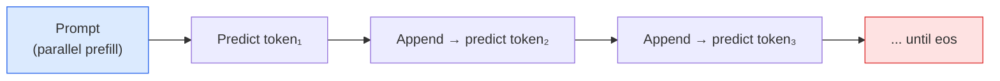

Actual inference has two stages:

- **Prefill**: The entire prompt is fed into the model in parallel at once and the hidden states of all positions are computed; this step is highly parallel and fast;
- **Decode**: After that, one token is added at a time and generated serially, step by step; this step proceeds token by token and accounts for most of the generation latency.

In a naive implementation, every newly generated token requires recomputing attention over the whole sequence, and the computation grows quadratically with sequence length, which is extremely wasteful. The **KV cache** is the key optimization: since the keys/values of historical tokens do not change with new tokens under the causal mask, they can be **cached**; at each step Q/K/V are computed only for the new token, which then attends to the cached historical K/V. This reduces the work per decoding step from "recomputing the whole sequence" to "processing one token", and is the cornerstone of real-time LLM inference.

The KV cache also creates a **conflict between GPU memory and length**. Let the current context length be $n$. With the model dimensions fixed, the cache size grows linearly with $n$; with the cache, **single-step decoding attention costs $O(n)$**, whereas standard full-attention prefill costs $O(n^2)$. When generating $m$ tokens, the cumulative decode attention cost is about $O(mn+m^2)$. The additional visual tokens from images and videos therefore raise the time to first token, the subsequent decoding overhead, and the cache footprint at the same time. See Section 4.6 for compression methods.

## 3.8 From LLM to VLM
{: id="38-从-llm-到-vlm"}

Text ultimately enters the Transformer as a sequence of $d$-dimensional embeddings, and visual features can also be converted into vectors that fit this interface. **Dimension matching only solves the interface problem; it is image-text training that teaches the language model to use visual information.** Take LLaVA's input-concatenation route as an example:

1. The **visual encoder** (e.g., CLIP ViT) encodes the image into a set of patch feature vectors;
2. The **connector** projects the visual features to the LLM's hidden dimension to obtain continuous **visual tokens**; BLIP-2 first uses the Q-Former to extract query features and then projects them;
3. These visual tokens replace the `<image>` placeholder reserved in the input sequence, are concatenated with the text tokens **into a single sequence**, and are fed together into the Transformer decoder.

Visual tokens are usually continuous features rather than literal IDs in the tokenizer's vocabulary. The model reads them through self-attention and generates text autoregressively. Another route is Flamingo: visual features are kept in a separate sequence and read through cross-attention layers inserted between LLM layers, without being concatenated into the text input sequence. The connection method, visual encoder, training data, and optimization objectives jointly determine the multimodal capability.

<a id="vlm-methods"></a>

# 4. Building multimodal models
{: id="4-实现多模态的核心方法"}

This chapter organizes methods by design problem. **The sections are not mutually exclusive model categories**: contrastive learning and instruction tuning describe training objectives, Q-Former and cross-attention describe connection structures, and high-resolution and video processing describe input representations. Multiple methods can be combined in a single model.

|Design dimension|Main options|Problem addressed|Where to read|
|---|---|---|---|
|Image-text representation learning|Contrastive loss, matching loss, conditional generation loss|How to establish the correspondence between images and text?| 4.1 |
|Visual information access|Cross-attention between layers, query compression, linear or MLP projection|Where, and with how many tokens, do visual features enter the LLM?| 4.2～4.4 |
|Instructions and output|Visual instruction tuning, text responses, image-text generation|What instructions does the model follow, and what modalities does it output?| 4.4～4.5 |
|Compute budget|Parameter freezing, token compression, lightweight backbones|How to reduce training and inference cost?| 4.6 |
|Visual input|Visual encoder, dynamic resolution, temporal sampling|How to preserve details, spatial relationships, and event order?| 4.7～4.8 |

## 4.1 Contrastive learning paradigm
{: id="41-对比学习范式"}

Contrastive learning is currently one of the most successful vision-language pretraining paradigms. The core idea is to pull matched image-text pairs close together in the embedding space and push unmatched samples apart.

**Key characteristics**:
- It does not rely on manual annotation and can directly use the massive number of image-text pairs on the Internet.
- The learned visual features are semantically rich and transfer well to downstream tasks
- The training objective is simple (InfoNCE loss) and easy to scale up
- At inference time, zero-shot classification is done by computing the similarity between images and texts.

*Representative work*: **CLIP** (OpenAI, 2021), **ALIGN** (Google, 2021), **BLIP** (Salesforce, 2022), **SigLIP** (Google, 2023)

### CLIP
{: id="clip"}

CLIP is the foundational work of the contrastive learning paradigm. OpenAI collected 400 million image-text pairs (the WIT dataset) from the Internet, trained an image encoder (ViT or ResNet) and a text encoder (Transformer) separately, and aligned the visual and language spaces by maximizing the similarity of positive pairs and minimizing that of negative pairs.

$$\mathcal{L}_{CLIP} = -\frac{1}{N}\sum_{i=1}^{N}\log\frac{\exp(\text{sim}(v_i, t_i)/\tau)}{\sum_{j=1}^{N}\exp(\text{sim}(v_i, t_j)/\tau)}$$

The formula above only writes the image-to-text direction; the complete CLIP objective also includes the text-to-image direction and averages the two. For details, see Section 8.2 and the [original CLIP paper](https://arxiv.org/abs/2103.00020).

The biggest breakthrough of CLIP is **zero-shot transfer**: by embedding the category name as a text prompt (such as "a photo of a dog"), it achieves performance close to supervised learning on benchmarks such as ImageNet without any fine-tuning.

<div align="center">
  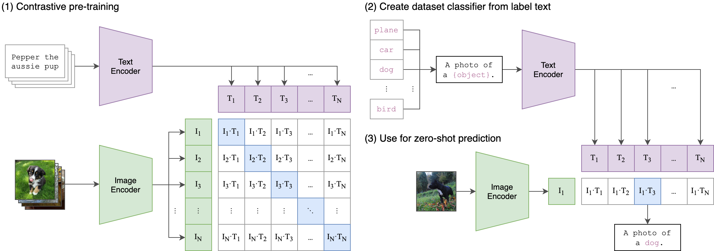
<figcaption>Figure: CLIP contrastive pretraining framework (Source: OpenAI)</figcaption>
</div>

**SigLIP** (Sigmoid Loss for Language-Image Pre-Training) replaces the softmax contrastive loss with a pairwise sigmoid loss, removing the softmax normalization across image-text pairs and making blockwise computation easier; it still uses negative samples, and building negatives across devices may still require communication. See the [original SigLIP paper](https://arxiv.org/abs/2303.15343).

---

### BLIP
{: id="blip"}

BLIP proposed a **multi-objective joint pretraining** framework that optimizes three objectives simultaneously:
- **ITC** (Image-Text Contrastive): Contrastive alignment, inheriting the CLIP idea
- **ITM** (Image-Text Matching): Binary classification of whether an image and a text match
- **ITG** (Image-grounded Text Generation): Generating text conditioned on the image

BLIP also introduced the **CapFilt** (Caption Filtering) mechanism: an existing model generates pseudo-captions for noisy web data, and low-quality samples are then filtered out. This bootstraps the data and improves results on very large-scale noisy data using less high-quality data.

<div align="center">
  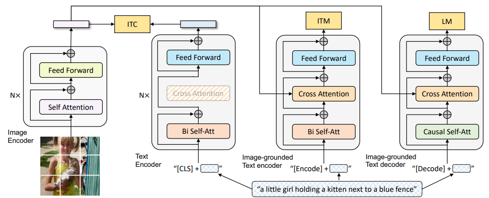
<figcaption>Figure: BLIP multi-objective pretraining framework, jointly optimizing the ITC, ITM, and ITG objectives (Source: Salesforce Research)</figcaption>
</div>

---

## 4.2 Cross-modal attention fusion
{: id="42-跨模态注意力融合"}

Cross-modal attention achieves deep integration of the two modalities by letting text tokens "attend" to visual features, or letting visual features attend to text. This approach allows the model to dynamically integrate information from both modalities at every level of reasoning.

**Key characteristics**:
- Deep fusion: vision and language interact at every layer during feature extraction
- Strong at capturing visual details, suitable for fine-grained reasoning
- Many parameters, but supports powerful multimodal context modeling
- Extends to few-shot vision-language learning

*Representative work*: **Flamingo** (DeepMind, 2022), **ViLBERT** (2019), **UNITER** (2020), **CoCa** (Google, 2022)

### Flamingo
{: id="flamingo"}

Flamingo is an early milestone in successfully extending large language models into strong multimodal models. Its core design has two key modules:

**Perceiver Resampler**: compresses any number of image features at any resolution into a fixed number (e.g., 64) of visual tokens, solving the interface problem between variable-length visual input and a fixed-format language model.

**Gated cross-attention**: inserts new cross-attention layers between the frozen LLM layers so that language tokens can attend to visual tokens. The tanh gating ensures that the newly inserted layers do not destroy the original LLM capabilities in the early stage of training.

$$y = y_{LLM} + \tanh(\alpha) \cdot \text{CrossAttn}(y_{LLM}, X_{visual})$$

Flamingo freezes the original LLM parameters and trains only the Perceiver Resampler and the cross-attention layers. This achieves efficient multimodal extension and breakthrough performance on few-shot visual question answering.

<div align="center">
  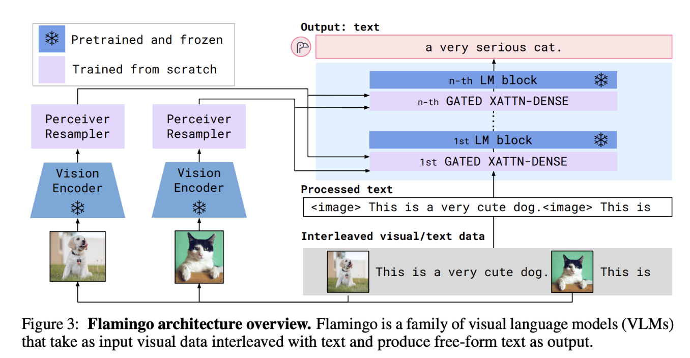
<figcaption>Figure: Flamingo cross-modal attention architecture (Source: DeepMind)</figcaption>
</div>

---

## 4.3 Q-Former bridging paradigm
{: id="43-q-former桥接范式"}

The Q-Former (Querying Transformer) is a novel connector proposed by BLIP-2. It uses a set of learnable **query vectors (query tokens)** as an "information bottleneck" between vision and language, extracting the visual features most relevant to language and passing them to the language model.

**Key characteristics**:
- Distills a large number of visual patch features into a small, fixed number of query tokens (usually 32)
- Query tokens interact with each other through self-attention, and extract visual information through cross-attention.
- Any visual encoder can be connected to any LLM, which makes the design modular
- Training has two stages: first vision-language alignment, then adaptation to a generative LLM

*Representative work*: **BLIP-2** (Salesforce, 2023), **InstructBLIP** (Salesforce, 2023)

### BLIP-2
{: id="blip-2"}

BLIP-2 bridges a frozen visual encoder (EVA-CLIP ViT-g/14) and a frozen large language model (OPT or Flan-T5) through the Q-Former, achieving low-cost multimodal alignment. The Q-Former contains two Transformer modules that share self-attention layers: one interacts with the visual encoder (image Transformer) and the other with the language objective (text Transformer).

**Two-stage training**:
1. **Vision-language representation learning**: Jointly optimize the three objectives ITC, ITM, and ITG so that the Q-Former learns to extract language-relevant visual features from images
2. **Vision-to-language generative learning**: Project the visual query tokens output by the Q-Former, concatenate them into the LLM input, and fine-tune the Q-Former to align it with the LLM's semantic space

The Q-Former has only 188M parameters, yet it effectively "compresses" complex visual information, greatly reducing the computational cost of vision-language joint fine-tuning.

<div align="center">
  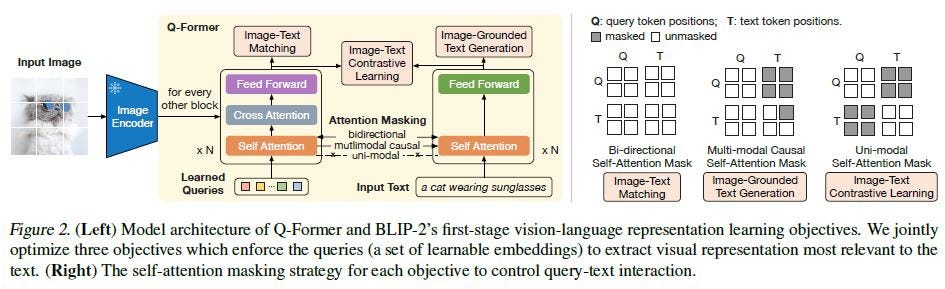
<figcaption>Figure: Overall architecture of BLIP-2, in which the Q-Former bridges a frozen visual encoder and a frozen LLM (Source: Salesforce Research)</figcaption>
</div>

### InstructBLIP
{: id="instructblip"}

InstructBLIP introduces an **instruction-aware** Q-Former on top of BLIP-2: the text instruction is fed into the Q-Former, so that the query tokens dynamically extract the most relevant features from the image according to the current task instruction rather than extracting fixed, generic features. This significantly improves the model's generalization to different task instructions.

---

## 4.4 Visual instruction tuning
{: id="44-视觉指令微调"}

Visual instruction tuning has been the most influential VLM training paradigm since 2023. The core idea is to run supervised fine-tuning of a vision-language model on dialogue data in (image, instruction, answer) triplets, so that the model can follow diverse vision-related instructions.

**Key characteristics**:
- Unifies image understanding tasks into a conversational Q&A format
- Uses strong language models such as GPT-4 to automatically construct high-quality instruction data
- Simple architecture: usually only a linear projection layer (MLP) connects the visual encoder to the LLM
- A thriving open-source ecosystem: the LLaVA series has led many follow-up works

*Representative work*: **LLaVA** (2023), **LLaVA-1.5** (2023), **LLaVA-NeXT** (2024), **MiniGPT-4** (2023)

### LLaVA
{: id="llava"}

LLaVA proposes a minimalist yet effective visual instruction tuning framework:

1. **Architecture**: CLIP ViT-L/14 serves as the visual encoder, and a **linear projection matrix W** maps the visual features into the word embedding space of the LLM (Vicuna/LLaMA). Visual tokens and text tokens are concatenated directly and fed into the LLM
2. **Data construction**: Using text-only GPT-4, multi-turn dialogues, detailed descriptions, and complex reasoning questions were generated from image captions and bounding-box information, yielding about 158K instruction samples
3. **Two-stage training**: first pretrain the projection layer (with the encoder and LLM frozen), then fine-tune the projection layer and the LLM end to end

$$H_v = W \cdot Z_v, \quad Z_v = f_{CLIP}(X_v)$$

<div align="center">
  
<figcaption>Figure: LLaVA visual instruction tuning framework (Source: LLaVA project)</figcaption>
</div>

### LLaVA-1.5 and high-resolution extension
{: id="llava-15-与高分辨率扩展"}

LLaVA-1.5 upgrades the linear projection to a **two-layer MLP** and introduces a higher-resolution visual encoder (CLIP ViT-L/14 @ 336px). It significantly surpasses the original LLaVA on multiple benchmarks while keeping the architecture simple.

**LLaVA-NeXT (LLaVA-1.6)** further introduces **dynamic high resolution**: a high-resolution image is divided into multiple tiles, each tile is encoded separately and the results are concatenated, while an overall low-resolution view is retained. This effectively improves the ability to read text (OCR), capture details, and understand charts without retraining the visual encoder.

---

## 4.5 Understanding and generation
{: id="45-多模态理解与统一生成"}

A "generative VLM" and a "unified understanding and generation model" should be distinguished: the former can read images and generate text answers but does not necessarily generate images, whereas the latter additionally supports generating visual content.

|Category|Input and output|Representative work|Key difference|
|---|---|---|---|
|Multimodal understanding and text generation|Image, video, and text input → text or structured results| LLaVA, Qwen2.5-VL, InternVL2 |Continuous visual features serve as conditions for outputting text tokens|
|Unified image-text understanding and generation|Image-text input → text or images| Chameleon, Janus / Janus-Pro, Show-o |Requires additional visual representations and an image decoding mechanism|

"Native multimodality" also does not mean removing the visual encoder or training all weights from scratch. When comparing models, look specifically at the input representation, the fusion location, the training pipeline, and the output modality; the internal structure of closed-source models is described only according to public information.

### Gemini
{: id="gemini"}

Google DeepMind's Gemini series is a representative natively multimodal model. Multimodality was a core design goal from the start, rather than an afterthought grafted onto an LLM. Gemini can seamlessly process text, images, audio, video, and code. Each modality has a dedicated encoding module, and they are jointly modeled through a unified Transformer backbone.

Gemini 1.5 introduces a **million-token context window**, enabling it to handle ultra-long documents and long videos (up to 1 hour), setting a new milestone in long-context multimodal understanding.

### Qwen2.5-VL: inputs and architecture
{: id="qwen25-vl-的输入与结构"}

Qwen2.5-VL is a high-performance open-source VLM from Alibaba, with several innovations in multimodal processing:

**Native dynamic resolution**: the input is adjusted according to the image width, height, and pixel budget, rather than resizing every image to the same fixed size; in practice, preprocessing still rescales the width and height to multiples of 28, and the visual encoder uses 2D-RoPE to represent spatial positions.

**Window attention**: window attention is introduced into the visual encoder to reduce the computation for high-resolution images.

**Time-aware video understanding**: MRoPE in the language model aligns the temporal position IDs with the absolute time of the frames and works together with dynamic frame-rate sampling, so videos with different FPS share a consistent time scale.

**Qwen2.5-VL-72B document and OCR evaluation excerpt** (Table 5 of the technical report, compared within the same table):

|Benchmark| Qwen2.5-VL-72B | GPT-4o | Claude-3.5 Sonnet | InternVL2.5-78B |
|------|----------------|--------|-------------------|---------------|
| DocVQA(test) | **96.4** | 91.1 | 95.2 | 95.1 |
| ChartQA(test Avg.) | 89.5 | 86.7 | **90.8** | 88.3 |
| OCRBench | **885** | 736 | 788 | 854 |

These results must be interpreted together with the evaluation version and input configuration. Qwen2.5-VL still uses a modular **ViT + MLP merger + Qwen2.5 LLM** architecture; dynamic resolution is an input-processing mechanism, which does not mean the connector is removed, nor that image generation is supported. For the architecture and experimental settings, see the [Qwen2.5-VL technical report](https://arxiv.org/html/2502.13923v1).

### Omni-modal and reasoning models
{: id="全模态与推理增强"}

GPT-4o, o3, and Gemini 2.5 are often used as commercial reference models for multimodal interaction and reasoning evaluation, but their visual training procedures cannot be inferred from their outputs alone. When analyzing such models, distinguish **whether perception is accurate, reasoning is valid, and tool calls are reliable**; a longer reasoning process cannot make up for visual details lost at the input stage. For the training mechanism of an open-source model, see Section 8.10 Qwen3-VL.

### Decoupled understanding and generation
{: id="理解与生成解耦"}

Traditional unified multimodal generation models (such as the early Emu or GILL) often face **conflicting feature representations** when unifying "image understanding" and "image generation":
- **Understanding**: requires high-level, abstract, semantically dense continuous features (such as the continuous vectors extracted by a SigLIP / CLIP encoder) that ignore pixel-level noise and capture global semantics;
- **Generation**: requires fine-grained, low-abstraction, pixel-faithful discrete tokens (such as VQ-VAE / VQ-GAN codebooks) or continuous Gaussian latents in order to reconstruct fine textures and spatial structure.

Forcing a single visual encoder to serve both understanding and generation easily leads to either degraded understanding or poor image quality.

**Janus (2024) and Janus-Pro (2025)** adopt **decoupled visual encoding**: understanding and generation use different visual representations while sharing the backbone of the language model. See [Janus](https://arxiv.org/abs/2410.13848) and [Janus-Pro](https://arxiv.org/abs/2501.17811).

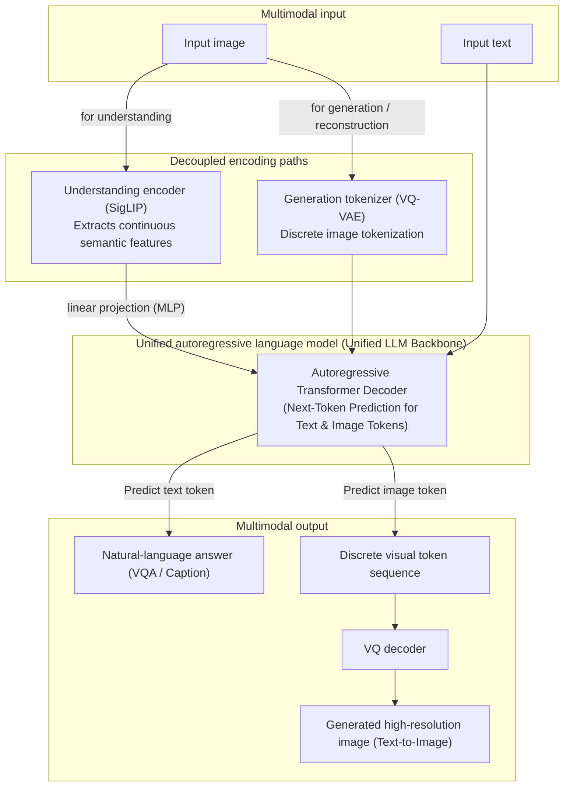

**Core advantages of Janus-Pro**:
1. **Decoupled input paths with a unified Transformer**: understanding uses the SigLIP encoder to map continuous features, while generation uses a discrete VQ tokenizer; the unified autoregressive language model needs no backbone changes and uses only the standard next-token prediction loss.
2. **Serving both objectives**: the visual representations required for understanding and for generation are optimized separately; an advantage on a single benchmark should not be extrapolated directly to image quality or understanding ability in all scenarios.
3. **Comparison with other routes**: [Chameleon](https://arxiv.org/abs/2405.09818) uses early fusion and autoregressive modeling of discrete image tokens and text tokens; [Show-o](https://arxiv.org/abs/2408.12528) combines autoregressive modeling with discrete diffusion. Both appeared in 2024 and should be compared as different design routes, not described as follow-ups to Janus-Pro.

---

## 4.6 Efficient alignment
{: id="46-高效多模态对齐方法"}

As the number of VLM parameters keeps growing, achieving high-quality multimodal alignment at lower computational cost has become an important research direction.

**Key characteristics**:
- Freeze most of the pretrained weights and fine-tune only a small number of parameters
- Bridge the semantic gap between vision and language through carefully designed alignment modules
- Make efficient use of the existing knowledge in visual encoders and LLMs

*Representative work*: **MiniGPT-4** (KAUST, 2023), **mPLUG-Owl** (Alibaba DAMO Academy, 2023), **Otter** (Nanyang Technological University, 2023)

### MiniGPT-4
{: id="minigpt-4"}

MiniGPT-4 demonstrates the feasibility of a minimalist alignment scheme: a single **linear projection layer** connects the frozen BLIP-2 visual encoder (including the Q-Former) to a frozen Vicuna (a fine-tuned LLaMA). Training has two stages: large-scale alignment pretraining first, then instruction fine-tuning on about 3,500 curated image descriptions. Qualitative examples show abilities similar to GPT-4 demonstrations, such as detailed description, reading images, and writing code (the paper does not provide a quantitative comparison with GPT-4). The paper also observed that after the first stage alone the output is often repetitive and incoherent, but a small amount of high-quality second-stage data improves it significantly, indicating that the quality of instruction data has a large impact on the usability of generation.

### Visual token compression
{: id="视觉-token-压缩"}

The number of visual tokens directly determines a VLM's inference cost, and compression is the key to efficiency:

|Method|Principle|Compression ratio|Representative models|
|------|------|--------|---------|
| Pixel Shuffle |Rearrange adjacent $r \times r$ tokens into the channel dimension, then project|$r^2$:1 (4:1 for InternVL2, 9:1 for SmolVLM)| InternVL2, SmolVLM |
| TokenPacker |Cross-attention extracts a small number of highly semantic tokens from dense features|Variable| TokenPacker (2024) |
|Average pooling|Average adjacent tokens|Variable| LLaVA-HD |
| Q-Former |A fixed set of 32 query tokens extracts all the visual information|High| BLIP-2, InstructBLIP |

### Lightweight and on-device VLMs
{: id="轻量化-vlm-与端侧部署"}

With the rapid growth in demand for on-device deployment (mobile phones, edge devices), achieving competitive multimodal understanding with extremely few parameters has become a hot topic. The **SigLIP visual encoder** (the sigmoid loss outperforms the softmax contrastive loss at smaller batch sizes; see Section 8.6) is one of the most common visual backbones for lightweight VLMs:

- **SmolVLM** (Hugging Face, 2024–2025): three sizes of 256M / 500M / 2.2B, SigLIP + aggressive Pixel Shuffle (each 384×384 sub-image is encoded into only 81 tokens); the 2.2B version scores 81.6 on DocVQA and 72.7 on TextVQA ([official blog](https://huggingface.co/blog/smolvlm))
- **Phi-3.5-Vision** (Microsoft, 2024): ~4.2B parameters (a 3.8B language model + CLIP ViT-L), using high-quality synthetic data and curated SFT data to obtain strong small-model reasoning and OCR capabilities
- **MobileVLM V2** (2024): Designed for mobile phones, it uses a lightweight downsample projector (LDP) to compress visual tokens and enables real-time inference on mobile CPUs/GPUs
- **moondream2** (2024): ~1.86B parameters, can run locally on low-power devices
- **MoE-LLaVA** (2024): A sparsely activated mixture-of-experts structure whose roughly 3B activated parameters reach a level comparable to LLaVA-1.5-7B
- **Gemma 3** (Google, 2025): Three sizes (4B / 12B / 27B) with image input, using a SigLIP encoder + Pan & Scan to handle non-square and high-resolution images

The evaluation scores of on-device models are particularly sensitive to resolution, tile count, and prompt template. Cross-model comparisons should rely on results re-run in the same evaluation framework (such as VLMEvalKit or lmms-eval).

### Ovis visual embedding table
{: id="ovis-视觉嵌入表"}

**Ovis** (AIDC-AI) focuses on the connector itself. An LLM's text tokens obtain their vectors by looking up an embedding table, whereas an ordinary MLP projection directly outputs continuous visual features, so the two sides are structurally asymmetric. Ovis therefore introduces a learnable **visual embedding table** on the visual side: each visual patch is first mapped to a probability distribution over a "visual vocabulary", and the embedding table is then summed with these probabilities as weights to obtain a visual token whose structure is consistent with text embeddings. Ovis2-34B consists of an aimv2-1B visual encoder and Qwen2.5-32B-Instruct. It also reuses a pretrained LLM and goes through multi-stage training; its difference from LLaVA and Qwen-VL lies in how visual tokens are produced, not in whether an LLM is reused.

---

## 4.7 Visual encoders
{: id="47-视觉编码器演进"}

High-quality multimodal fusion requires a powerful visual representation. The design of VLM visual encoders has undergone a major transformation, from early CNN region-feature extraction to global feature modeling with Transformers, and then to large-scale contrastive learning and dynamic high-resolution adaptation.

<div align="center">
  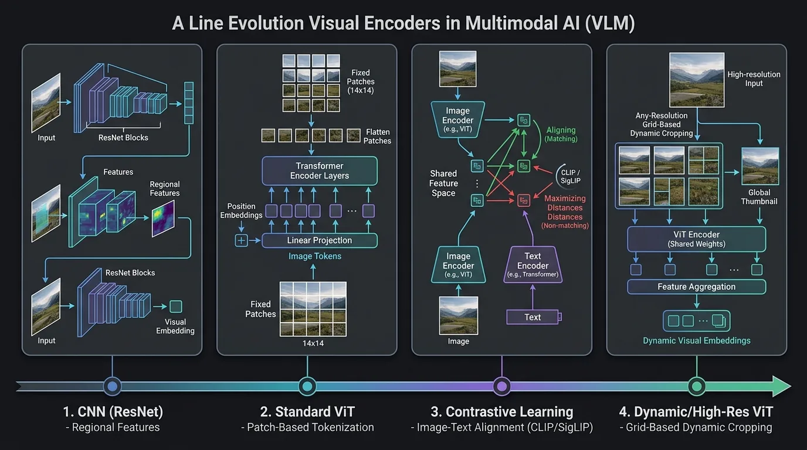
<figcaption>Figure 4.7.1: Evolution of VLM visual encoders, from CNN region features to ViT, contrastive alignment, and dynamic high-resolution schemes</figcaption>
</div>

**Main evolution path**:
- **CNN era** (2018–2020): Represented by ResNet and EfficientNet, which use sliding convolutions to extract grid or region features that are then concatenated with a text encoder. The features are local and hard to adapt to long-sequence Transformers.
- **ViT era** (2021–2022): Images are divided into patch sequences and encoded end to end with a Transformer, unifying vision and NLP architectures as sequence-processing tasks.
- **CLIP / SigLIP contrastive learning era** (2021 to present): Contrastive training on large-scale image-text pairs (such as LAION) gives ViT natural language-aligned properties, making it the mainstream visual encoder of modern VLMs.
- **Pure visual self-supervision** (2021 to present): Represented by DINO and DINOv2, it avoids the bias of language annotations and learns patch features with high spatial consistency through self-distillation and masked reconstruction, which suits localization and dense prediction.
- **High-resolution and dynamic tiling era** (2023 to present): Dynamic encoding schemes (such as AnyRes and Naive Dynamic Resolution) that support arbitrary aspect ratios and high-resolution input to preserve fine-grained document and OCR information.

### How ViT works
{: id="vit-工作原理"}

ViT overturns the traditional convolutional network structure by applying the Transformer architecture directly to images. Its core is to discretize a continuous image into a token sequence, closely paralleling the tokenization of text:

1. **Patch splitting and linear projection**:
For an input image $$x \in \mathbb{R}^{H \times W \times C}$$, first split it into a series of non-overlapping two-dimensional patches $$\mathbf{x}_p \in \mathbb{R}^{N \times (P^2 \cdot C)}$$, where $$(P, P)$$ is the chosen patch resolution (such as $14 \times 14$ or $16 \times 16$), and $$N = HW/P^2$$ is the resulting sequence length (i.e., the number of patches).
Each patch is then mapped to a $D$-dimensional feature vector by a learnable linear projection matrix $$E \in \mathbb{R}^{(P^2 \cdot C) \times D}$$.

2. **Position encoding and class token**:
Similar to BERT, ViT prepends a learnable class token $$x_{cls} \in \mathbb{R}^{1 \times D}$$ before the forward pass, and its final output state can be used directly for whole-image classification or as a global semantic representation.
Since the Transformer's self-attention has no sense of spatial direction, a one-dimensional or two-dimensional learnable position encoding $$E_{pos} \in \mathbb{R}^{(N+1) \times D}$$ must be added to preserve the relative spatial relationships among image patches.

The initialization of the whole sequence is expressed mathematically as:
   $$z_0 = [x_{cls}; x_1^p E; x_2^p E; \ldots; x_N^p E] + E_{pos}$$

3. **Multi-layer Transformer encoding**:
The input sequence $$z_0$$ goes through multiple layers of standard multi-head self-attention (MHSA) and MLP (multi-layer perceptron) computation, each accompanied by layer normalization (LN) and a residual connection.

Most mainstream VLM visual encoders are ViTs trained with CLIP or SigLIP objectives: the LLaVA series uses CLIP ViT-L/14 (about 304M parameters), PaliGemma and Qwen3-VL use SigLIP / SigLIP 2 So400m (about 400M), and BLIP-2 uses EVA-CLIP ViT-g/14 (about 1B).

### CLIP and SigLIP encoders
{: id="clip-与-siglip-编码器"}

Why has the ViT trained by contrastive learning become the dominant choice in VLMs? Because **contrastively learned visual features have already been "verbalized"**.

#### 1. CLIP contrastive loss
{: id="1-clip-对比损失-contrastive-loss"}
CLIP (Contrastive Language-Image Pretraining) adopts a two-tower structure (an image encoder and a text encoder) and is pretrained with the symmetric InfoNCE loss. Within a batch of $B$ image-text pairs, the model minimizes the distance between matched images and texts and maximizes the distance between unmatched ones:

$$L_{\text{InfoNCE}} = -\frac{1}{2B} \sum_{i=1}^{B} \left( \log \frac{\exp(\text{sim}(I_i, T_i)/\tau)}{\sum_{j=1}^{B} \exp(\text{sim}(I_i, T_j)/\tau)} + \log \frac{\exp(\text{sim}(I_i, T_i)/\tau)}{\sum_{j=1}^{B} \exp(\text{sim}(I_j, T_i)/\tau)} \right)$$

Here, $$sim(I_i, T_i)$$ is the cosine similarity between the global projected features of image $i$ and text $i$, and $$\tau$$ is a learnable temperature parameter. CLIP directly supervises the matching of image-level and text-level representations, and does not explicitly provide patch-to-word correspondence labels.

#### 2. SigLIP's sigmoid loss
{: id="2-siglip-的-sigmoid-损失优化"}
Although CLIP has been very successful, softmax normalization requires computing a global denominator, and common implementations need to all-gather features across multiple GPUs and build a full $B \times B$ similarity matrix. **SigLIP (Sigmoid Language-Image Pretraining)**, used by models such as PaliGemma, proposes replacing the softmax with a sigmoid loss, turning contrastive learning into a pairwise binary classification task:

$$L_{\text{SigLIP}} = -\frac{1}{B} \sum_{i=1}^{B} \sum_{j=1}^{B} \log \sigma \left( y_{ij} (\text{sim}(I_i, T_j) \cdot c + b) \right)$$

Here, $$y_{ij} = 1$$ if and only if $i=j$ (a positive pair) and $$-1$$ otherwise; $$c, b$$ are a learnable scale and bias.
- Advantages of **SigLIP**: There is no need to apply softmax normalization over all image-text pairs, and the loss is easier to compute blockwise, reducing GPU memory and synchronization burden. It still requires negative samples and gradient synchronization; the effect is also affected by training data, batch size, and model size, and cannot be attributed to the loss function alone.

### InternViT and encoder scaling
{: id="internvit-与编码器缩放"}

As large language models scale to tens or even hundreds of billions of parameters, must visual encoders scale up as well? InternVL starts from the observation that a ViT-L with about 300M parameters is two orders of magnitude smaller than a 70B-class LLM, which may become a representational bottleneck.

The InternVL series therefore scales the visual encoder to **InternViT-6B** (~5.9B parameters, ~5.5B after removing the last 3 layers since InternVL 1.5), while retaining **InternViT-300M** for small and medium-sized models:
- **Stronger fine-grained representation**: A larger visual encoder brings clearer benefits on tasks that need detail, such as documents, charts, and dense text; InternViT-6B is also stronger on pure vision tasks such as ImageNet linear probing and ADE20K segmentation.
- **Representations reusable across LLMs**: InternVL2.5 first trains the ViT jointly with a smaller LLM, then connects it to a larger LLM and continues training without retraining the ViT (progressive scaling; see Section 6.4).
- **Cost**: A 6B visual encoder significantly increases inference cost; Qwen2.5-VL (a ViT of about 675M) and Qwen3-VL (SigLIP 2 So400m) show that strong results can come from data and training recipes rather than simply scaling up the ViT. There is no generally accepted optimal ratio between visual encoder size and LLM size.

### High resolution and tiling
{: id="高分辨率与动态切片"}

A traditional ViT rescales the input image to a single fixed resolution (such as $224 \times 224$ or $336 \times 336$), which badly distorts the aspect ratio and blurs the small text in detail-rich images (such as tables, web page screenshots, and PDF documents). To resolve the tension between high-resolution input and the computational complexity of Transformers, the field has developed the following mainstream solutions:

#### 1. NaViT (Patch n' Pack)
{: id="1-navit-patch-n-pack"}
NaViT breaks with the convention that images must have a fixed size. It accepts images of arbitrary resolution and aspect ratio directly, packs the patches cut from images of different sizes into one fixed-length sequence within the same batch, and applies a mask in the Transformer's self-attention to prevent information leakage across images.

#### 2. LLaVA-NeXT dynamic tiling (AnyRes)
{: id="2-llava-next-动态切片-anyres"}
LLaVA-NeXT adopts a more intuitive **image tiling** strategy:
- According to the original aspect ratio of the image, dynamically choose the best-matching tile grid (such as $1 \times 2$, $2 \times 2$, $3 \times 1$, etc., with each tile fixed at $336 \times 336$).
- Cut the image into $N$ local sub-images, and rescale the original image into a $336 \times 336$ global thumbnail.
- These $N+1$ sub-images are fed together into the same shared ViT visual encoder to extract features.
- In the fusion stage, the features of the local sub-images are concatenated according to their relative spatial positions (usually with a special `<newline>` token inserted at the end of each sub-image row to help the LLM recognize line breaks), then concatenated with the global thumbnail features and fed into the connector together.

#### 3. Qwen2-VL / Qwen2.5-VL naive dynamic resolution
{: id="3-qwen2-vl--qwen25-vl-动态分辨率-naive-dynamic-resolution"}
The Qwen series does not cut tiles, but lets the ViT process the entire variable-size image directly:
- **Tokenized directly at the original aspect ratio**: the image is rescaled within the pixel budget so that its width and height are integer multiples of 28, then cut into $14 \times 14$ patches. The number of tokens varies with the image area, and no extra thumbnail is concatenated.
- **Two-level position encoding**: Inside the ViT, 2D-RoPE represents the row and column positions of patches, so there is no reliance on fixed-size absolute position encodings; after entering the LLM, M-RoPE splits the position into three components: time, height, and width (see Section 6.3).
- **Token compression (patch merger)**: After the ViT, a "normalization layer + two-layer MLP" merges each group of adjacent $2 \times 2$ visual tokens into one, reducing the number of visual tokens on the LLM side to 1/4 of the number of patches.

<div align="center">
  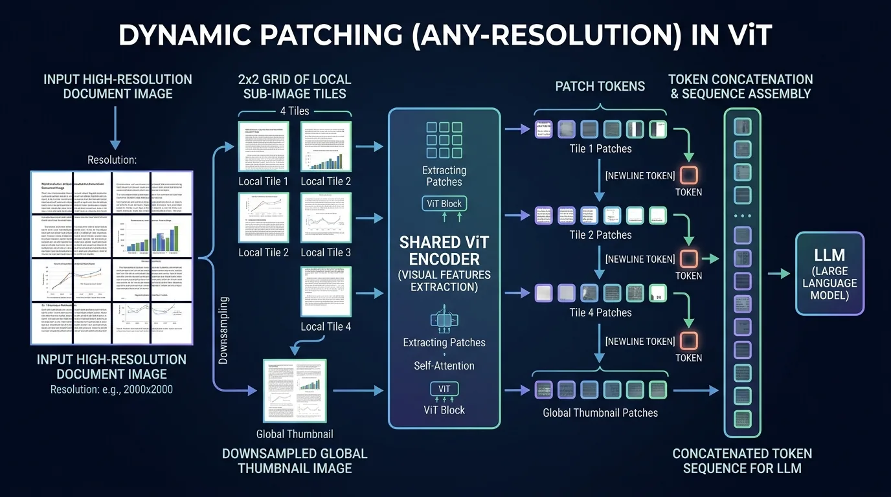
<figcaption>Figure 4.7.2: Schematic of ViT dynamic tiling and token concatenation for arbitrary resolutions</figcaption>
</div>

### DINOv2 self-supervision
{: id="dinov2-自监督路线"}

CLIP/SigLIP train visual encoders with language supervision, whereas [DINOv2](https://arxiv.org/abs/2304.07193) (Meta, TMLR 2024) uses **no text at all**: a student network learns to match the output of an EMA teacher network on different cropped views (an image-level DINO loss + a patch-level masked iBOT loss) and is trained on a curated set of 142 million images (LVD-142M). The two routes have different emphases:

|Dimension|CLIP / SigLIP-style encoders| DINOv2 |
|---|---|---|
|Supervision signal|Image-text matching|The image itself (self-distillation + masked modeling)|
|Strengths|Zero-shot classification, image-text retrieval, and semantic interfacing with LLMs|Dense tasks such as segmentation, depth estimation, and correspondence matching|
|Usage in VLMs|The mainstream single visual encoder|Used together with a language-aligned encoder to supplement spatial details|

In ADE20K segmentation experiments with frozen features and a linear head, DINOv2 ViT-g/14 reaches 49.0 mIoU, while OpenCLIP ViT-G/14, which has more parameters, reaches 39.3. This shows that the patch features obtained from image-text contrastive objectives are not necessarily suited to dense prediction, which is why works such as Cambrian-1 combine DINOv2 and SigLIP features. Training details and complete experiments are given in Section 8.11, and its successor DINOv3 in Section 8.12.

---

## 4.8 Video understanding
{: id="48-视频理解向时序维度扩展"}

Video understanding requires the model to process both **spatial visual content** (the image in each frame) and **temporal dynamics** (changes between frames), and is an important frontier for extending VLM capabilities.

**Core challenges**:
- **Token explosion**: A 10-second video (at 3 fps) has about 30 frames, and each frame has 256–1024 tokens, totaling thousands to tens of thousands of tokens, far beyond the range an LLM can process efficiently
- **Temporal reasoning**: The model must understand cross-frame semantics such as action order, causality, and motion trajectories
- **Long-video understanding**: Videos of several minutes or even hours place extremely high demands on memory and retrieval mechanisms

**VideoLLaMA2** (Alibaba DAMO Academy, 2024) introduces a **spatiotemporal convolution connector**: it applies a 3D convolution (time × height × width) to the ViT features of consecutive frames, modeling both the spatial structure within frames and the temporal changes between frames while downsampling to control the number of video tokens. It improves over contemporaneous 7B video models on benchmarks such as MVBench (temporal reasoning) and EgoSchema (egocentric long-video understanding).

**LongVA** (2024) proposed **long context transfer**: first extend the context of Qwen2-7B-Instruct to 224K using text only, then do conventional image alignment training. Without any long-video training data, it can process about 2,000 frames, or more than 200,000 visual tokens; the paper also proposes the visual needle-in-a-haystack test V-NIAH ([arXiv:2406.16852](https://arxiv.org/abs/2406.16852)).

**Qwen2.5-VL** supports long videos with MRoPE aligned to absolute time and dynamic frame-rate sampling; **Qwen3-VL** instead uses explicit text timestamps with Interleaved MRoPE, reaching a 256K native context (100% needle-in-a-haystack accuracy on videos within 30 minutes; see Section 8.10).

Recent video-specific models each address one of the three challenges above. **VideoChat3** (2026) inflates a ViT into the spatiotemporal I3D-ViT encoder and adapts frame resolution for streaming input to cut video tokens; with only 4B parameters it surpasses open-source video models of equal or larger size ([arXiv:2607.14935](https://arxiv.org/abs/2607.14935)). **Video-o3** (ICML 2026) replaces one-pass uniform sampling with repeated tool calls that locate and zoom into key segments, stopping once it has enough evidence, and reaches 72.1% on MLVU ([arXiv:2601.23224](https://arxiv.org/abs/2601.23224)). **TimeLens2** (2026) asks *when* the evidence occurs: it models temporal grounding as a variable-size set of intervals and uses a temporal Wasserstein distance as its reinforcement-learning reward, improving its 2B / 4B / 8B models over their Qwen3-VL backbones by 14.2 / 13.0 / 18.1 mIoU ([arXiv:2607.17423](https://arxiv.org/abs/2607.17423)). Another line of work starts from data: **LLaVA-Video** (2024) performs video instruction tuning on the synthetic LLaVA-Video-178K set and uses a SlowFast representation to balance frame count against token count; see [§8.14](#814-llava-video2024).

**Mainstream video understanding benchmarks** (scores are taken from Table 8 of the [Qwen2.5-VL technical report](https://arxiv.org/abs/2502.13923), compared within the same table):

|Benchmark|Video length|Main tasks| Qwen2.5-VL-72B | GPT-4o | Gemini 1.5 Pro |
|------|---------|---------|------|------|------|
|Video-MME (without subtitles / with subtitles)|11 seconds to 1 hour|Comprehensive understanding of short, medium, and long videos| 73.3 / 79.1 | 71.9 / 77.2 | **75.0 / 81.3** |
| MVBench |Mostly short clips of a few seconds|20 types of temporal action reasoning| **70.4** | 64.6 | 60.5 |
| EgoSchema |About 3 minutes|Egocentric long-term reasoning| **76.2** | 72.2 | 71.2 |
| LVBench |About 1 hour on average|Ultra-long video understanding| **47.3** | 30.8 | 33.1 |
| MLVU |3 minutes to 2 hours|Long-video multitask| **74.6** | 64.6 | — |

# 5. VLM task types
{: id="5-vlm-任务类型"}

Common VLM tasks are listed below in "input-output" form. The first six categories are mainly single-turn perception and understanding, while GUI agents require the model to make continuous decisions in an environment.

## 5.1 Image captioning
{: id="51-图像描述"}

Given an image, generate a natural language description. This is the most basic visual generation task and one of the common pretraining objectives for VLMs.

*Representative datasets*: COCO Captions, nocaps, Flickr30k

## 5.2 Visual question answering (VQA)
{: id="52-视觉问答vqa"}

Given an image and a question, output the answer. It comes in two forms: open-ended (generative) and closed-ended (classification).

*Representative datasets*: VQA v2, OK-VQA, GQA, ScienceQA

## 5.3 Visual reasoning
{: id="53-视觉推理"}

The model must perform multi-step reasoning over images, such as counting, judging spatial relationships, and causal inference.

*Representative datasets*: NLVR2, CLEVR, MMStar, MMBench

## 5.4 Visual grounding
{: id="54-视觉定位"}

Locate a target region in the image from a natural language description (usually by outputting a 2D bounding box $$[x_1, y_1, x_2, y_2]$$).

*Representative datasets*: RefCOCO, RefCOCO+, Visual7W

> 📌 **Advanced extension (3D visual grounding)**: In robot control and embodied interaction scenarios, visual grounding has been further extended to 3D point clouds and 3D oriented bounding boxes ($$[x, y, z, dx, dy, dz, r, p, y]$$). For the related representative benchmarks (ScanRefer, EmbodiedScan) and 3D grounding models, see .

## 5.5 Documents and charts
{: id="55-文档与图表理解"}

Understanding complex document images containing text, tables, and charts has been a key direction for improving VLM capabilities in recent years.

*Representative datasets*: DocVQA, ChartQA, TextVQA, OCRBench

## 5.6 Image-text retrieval
{: id="56-图文检索"}

Retrieving relevant text given an image (or vice versa) is a core application of the contrastive learning paradigm.

*Representative datasets*: MSCOCO Retrieval, Flickr30k Retrieval

## 5.7 GUI agents
{: id="57-gui-agent"}

VLMs are evolving from "passive understanding" to "active execution": sensing screen state, planning operation sequences, and executing mouse and keyboard actions. This requires four core capabilities: **accurate visual grounding** (locating UI elements such as buttons and input boxes in screenshots), **action sequence planning** (decomposing "book a flight for me" into concrete steps), **state tracking** (judging whether an operation succeeded and recovering from errors), and **cross-application collaboration**.

**UI-TARS** (ByteDance, 2025) is a representative end-to-end GUI agent: using only screenshots as input, it strengthens element recognition, grounding, and action prediction on large-scale GUI screenshot data, generates explicit reasoning (System 2-style task decomposition and reflection) before acting, and is then iteratively trained on interaction trajectories collected in virtual machines. The following table is excerpted from the [UI-TARS paper](https://arxiv.org/abs/2501.12326):

|Benchmark| UI-TARS-72B |Compared model|
|------|-----------|--------|
|OSWorld (50-step limit)| **24.6** | Claude Computer Use 22.0 |
|OSWorld (15-step limit)| **22.7** | Claude Computer Use 14.9 |
| AndroidWorld | **46.6** | GPT-4o 34.5 |
|ScreenSpot-Pro (grounding in high-resolution professional software)| **38.1** | — |

Since then, versions such as UI-TARS-1.5 / UI-TARS-2 and newer general-purpose models (such as Qwen3-VL-32B reaching 41 on OSWorld; see Section 8.10) have continued to improve on these numbers, so the table above only illustrates the level at the beginning of 2025.

Other representative work: **SeeClick** (2024) specializes in GUI element grounding and can serve as a lightweight grounding backbone; **ShowUI** (2024) uses a UI connection graph to model the structural relationships between elements; **ScreenAgent** (2024) separates planning (Planner), execution (Actor), and verification (Critic) into three dedicated modules. On the closed-source side, Claude 3.5 Sonnet (Computer Use, 2024) was the first to open an API-level computer operation interface, and Gemini 2.0 Flash natively integrated browser and Android operation into its model service.

*Representative benchmarks*: ScreenSpot, OSWorld, AndroidWorld

<a id="vlm-training"></a>

# 6. Training VLMs
{: id="6-vlm-训练流程与关键技术"}

VLM training aims to combine visual perception with linguistic reasoning to build cross-modal understanding and generation capabilities. Unlike the training of traditional single-modality models, VLM training often does not start from scratch but builds on existing powerful pretrained components (such as a pretrained ViT visual encoder and an LLM), and focuses on core problems such as **modality alignment**, **multi-task generalization**, and **instruction alignment**.

This chapter first introduces the classic three-stage VLM training paradigm (6.1), preference alignment (6.2), and the key supporting techniques involved in training (6.3). It then turns to the practical side: how to set and tune hyperparameters (6.4), how to monitor metrics and read loss curves during training (6.5), and how to troubleshoot training problems (6.6). Finally, it gives an in-depth case study of how the Qwen-VL family evolved in training (6.7).

---

## 6.1 Three-stage training
{: id="61-三阶段训练范式"}

The training objectives can be summarized as **modality alignment → multi-task pretraining → instruction tuning**. This is an analytical framework, not a fixed three-stage recipe that every model follows: the original LLaVA and MiniGPT-4 schemes use two-stage training, and different models also merge or subdivide the stages. The figure below shows a progressive-unfreezing scheme; the trainable modules and data scale depend on the specific recipe.

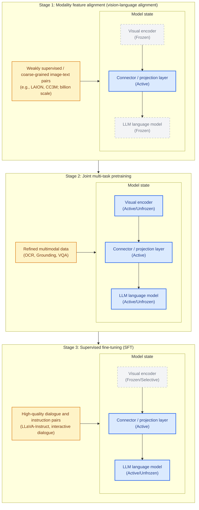

### 1. Modality alignment
{: id="1-模态对齐"}
* **Training goal**: Project visual features into the text embedding space of the large language model, establishing the most basic "semantic bridge".
* **Parameter freezing strategy**: **Freeze** the vision encoder and the large language model (LLM), and **train only** the connector (projection layer), such as a simple MLP projection, a Q-Former, or cross-attention layers.
* **Training data**: Massive, weakly supervised image-text pairs with short captions (usually tens to hundreds of millions of pairs), such as LAION-5B, CC3M, and CC12M. The data at this stage is noisier but offers broad coverage of visual concepts.
* **Core logic**: At this stage the model mainly performs "concept pairing", that is, it lets the LLM learn the mapping between entities in the image and specific text tokens. Because the LLM stays frozen, its original language generation and reasoning abilities are not disturbed.

### 2. Joint pretraining
{: id="2-多任务联合预训练"}
* **Training goal**: Improve the model's generalization on fine-grained visual tasks (such as grounding, dense text reading (OCR), and high-precision visual question answering) and achieve deeper cross-modal perception.
* **Parameter freezing strategy**: Usually **fully unfrozen**, including the vision encoder, the connector, and the LLM. In some lightweight fine-tuning settings, one can instead freeze the visual encoder or use LoRA.
* **Training data**: High-quality, mixed-format, multi-task multimodal datasets (for example, mixtures containing bounding-box grounding, dense OCR, chart parsing, and long-video captioning).
* **Core logic**: By letting the visual encoder also take part in parameter updates, the model can adapt its visual representations to the demands of cross-modal tasks (for example, learning to recognize extremely small text or precise object boundaries in images). This makes it better at handling fine-grained features.

### 3. Instruction tuning (SFT)
{: id="3-指令微调sft"}
* **Training goal**: Align the model with human conversational habits so that it follows complex reasoning instructions and acts as an interactive, chat-assistant-style dialogue partner.
* **Parameter freezing strategy**: **Unfreeze the LLM and the connector**, and usually **freeze the visual encoder** (to prevent catastrophic forgetting of visual features during text-only instruction tuning and multimodal dialogue training, and to protect the LLM's original text-only performance).
* **Training data**: Carefully cleaned, high-quality instruction-following datasets (usually tens of thousands to millions of samples), such as LLaVA-Instruct, ShareGPT4V, and complex multi-turn dialogue data automatically generated with GPT-4/GPT-4V.
* **Core logic**: At this stage the model learns to answer users' open-ended questions fluently, to handle multiple rounds of questioning, and to safely refuse unreasonable inputs.

---

## 6.2 Preference alignment and post-training
{: id="62-偏好对齐与后训练"}

As VLMs are widely deployed in complex real-world scenes, models trained with SFT alone still face two serious problems: **multimodal hallucination** (fabricating objects or relationships that do not exist in the image) and **uncontrolled or poorly aligned output formats**. To address these, modern VLMs have begun to adopt post-training preference alignment techniques.

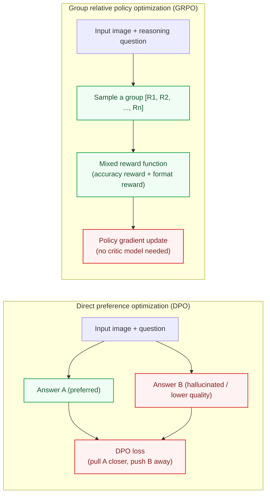

### 1. DPO
{: id="1-dpo"}
In multimodal settings, researchers collect preference data, or use a strong model (such as GPT-4V) to judge the VLM's own outputs, to build a preference alignment dataset:
- **Preferred sample ($y_w$)**: An answer that describes the image accurately, contains no hallucinations, and matches human preferences.
- **Rejected sample ($y_l$)**: An answer containing factual errors, visual hallucinations, or a confused format.

DPO does not train a separate reward model; instead, it directly increases the log-likelihood ratio of $y_w$ relative to $y_l$ (with respect to a reference model) on the preference pairs, thereby reducing the probability of hallucinated answers. The post-training of Qwen2.5-VL uses two steps, SFT + DPO (with the ViT frozen).

### 2. GRPO
{: id="2-grpo"}
When training a reasoning model, traditional PPO (Proximal Policy Optimization) needs a critic (value model) of similar size to the policy model to estimate advantages, which consumes a lot of GPU memory and compute.

GRPO (from DeepSeekMath, later adopted by DeepSeek-R1) samples a group of outputs for each question and normalizes each output's reward by the mean and standard deviation of the rewards within the group to obtain its advantage estimate, so no critic model is needed:
- **Reward function**: Usually includes **rule-based rewards** (such as the correctness of math answers, counting answers, or grounding IoU) and **format rewards** (such as requiring the model to output its reasoning inside `<think>` tags and then give the final answer).
- **Effect**: As long as answers can be verified automatically, reasoning behavior can be strengthened without manual CoT annotation; it improves reasoning and answer selection, but cannot make up for visual information lost at the input stage.

### 3. Visual reasoning in practice
{: id="3-视觉推理增强的代表性实践"}

Inspired by the reasoning breakthroughs of o1 and DeepSeek-R1, a wave of work in 2024–2025 applied structured chain-of-thought and RLVR (reinforcement learning with verifiable rewards) to VLMs:

**LLaVA-CoT** (2024, formerly LLaVA-o1) splits reasoning into four explicit stages (Summary → Description → Reasoning → Conclusion) and fine-tunes Llama-3.2-11B-Vision-Instruct on LLaVA-CoT-100k, a structured dataset generated with GPT-4o. At inference it uses **stage-level beam search** (picking the best of several candidates at the end of each stage), which beats Best-of-N and sentence-level beam search at a similar compute budget. The paper reports that its average score across several reasoning benchmarks exceeds Gemini-1.5-Pro, GPT-4o-mini, and Llama-3.2-90B-Vision-Instruct ([arXiv:2411.10440](https://arxiv.org/abs/2411.10440)).

**R1-V** (2025, an open-source project) is an early attempt to apply GRPO to VLMs: after 100 GRPO steps on Qwen2-VL-2B with the CLEVR counting task (8 A100s for about 30 minutes), out-of-distribution counting accuracy on SuperCLEVR rose from about 48% to about 82%, exceeding a 72B baseline. **Visual-RFT** (Shanghai Jiao Tong University, Shanghai AI Lab, et al., 2025) extends verifiable rewards to perception tasks: detection and grounding are rewarded with IoU, and classification with correctness. With the same amount of data it outperforms SFT on few-shot detection, fine-grained classification, and reasoning-based grounding. **MPO** (InternVL2-8B-MPO, 2024) improves multimodal CoT reasoning with mixed preference optimization (preference loss + quality loss + generation loss) while also reducing hallucinations.

The following table gives reference scores on several reasoning-related benchmarks in early 2025 (from the Qwen2.5-VL and InternVL2.5 technical reports; not a live leaderboard):

|Benchmark|Task type|Model|Reported score|
|------|---------|------------|---------|
| MathVista (testmini) |Mathematical visual reasoning| Qwen2.5-VL-72B | 74.8 |
| MMStar |Comprehensive multimodal understanding| Qwen2.5-VL-72B | 70.8 |
| MMMU (val) |University-level multidisciplinary| Qwen2.5-VL-72B | 70.2 |
| MMMU (val) |University-level multidisciplinary| InternVL2.5-78B | 70.1 |

With the arrival of reasoning-enhanced models, these numbers have since been refreshed significantly (for example, Qwen3-VL-235B-Thinking scores 85.8 on MathVista; see Section 8.10).

### 4. Visual slow thinking
{: id="4-视觉慢思考"}

Starting in 2025, OpenAI o3's "thinking with images", RLVR work on the open-source side such as R1-V, and models such as Qwen3-VL Thinking pushed multimodal models **from single-pass answering (System 1-style fast perception) to reasoning first and then answering (System 2-style slow thinking)**. The figure below is a conceptual illustration of this kind of process, not the implementation of any specific model.

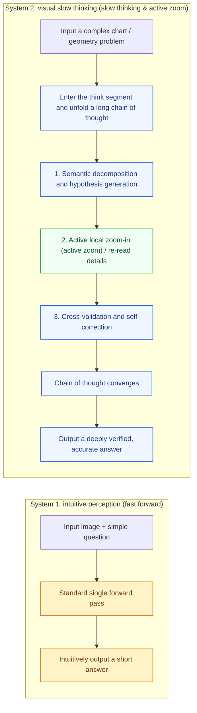

**Four core mechanisms of multimodal slow thinking**:
1. **Long visual chain of thought (Long Visual CoT)**:
   - The model autonomously launches a multi-step reasoning process inside the `<think>` tag, breaking a complex visual problem into sub-goals (such as constructing auxiliary lines in geometry, tracing nodes in a circuit diagram, or looking up rows and columns in a complex multi-column report).
   - During thinking, if an initial reading turns out to be inconsistent with physical common sense, the model can roll back and recompute within the chain of thought on its own.
2. **Active visual zoom / tool calling**:
   - For ultra-high-resolution images or dense small text (such as 4K architecture diagrams or high-density formulas), the model can actively generate bounding boxes for local regions while thinking, call built-in tools to crop them dynamically and re-encode high-precision features of the region, and then insert the new features back into the current thinking context to make up for the detail lost to global downsampling. The premise is that the model can correctly judge where to zoom in. Qwen3-VL reported improvements from using such tools on high-resolution benchmarks such as V* (see Section 8.10).
3. **Reinforcement learning with verifiable rewards (RLVR for multimodal reasoning)**:
   - Relying on reinforcement learning frameworks such as GRPO, the model is optimized by trial and error using **objectively verifiable rewards** (exact answer matching, IoU, etc.) from mathematics, geometric proofs, code generation, and deterministic coordinates, and can learn reasoning behaviors such as reflection and review without large amounts of manually written CoT annotations.
4. **Test-time scaling**:
   - By allocating more compute at inference time (generating longer chains of thinking tokens, sampling multiple thinking paths in parallel, and reranking them by majority voting or a PRM process reward model), higher accuracy can be achieved on tasks such as mathematical and chart reasoning. The cost is higher latency and inference cost, and the benefit is limited for perception-centric tasks.

---

## 6.3 Key training techniques
{: id="63-关键训练技术"}

Making VLM training both efficient and accurate depends on a series of underlying architectures and algorithms:

### 1. Native dynamic resolution
{: id="1-原生动态分辨率"}
Early VLMs (such as LLaVA-1.0) often forcibly cropped and resized images of different aspect ratios to a fixed square size (such as $224 \times 224$ or $336 \times 336$). This stretches and deforms long, narrow images, distorts small objects, and severely loses high-resolution image information, making small characters (OCR) unrecognizable.

There are two mainstream implementations of **dynamic resolution** (see Section 4.7 for details):
- **Tiled** (AnyRes in LLaVA-NeXT, Dynamic High Resolution in InternVL): Choose a grid according to the aspect ratio, cut the image into several fixed-size tiles that are encoded separately, and keep an additional low-resolution thumbnail.
- **Native** (Naive Dynamic Resolution in Qwen2-VL): The ViT encodes the entire variable-size image directly, relying on 2D-RoPE to represent positions, with no tile cutting and no thumbnail needed. The figure below shows this route.
- Both process variable-length sequences of visual tokens during training, usually with sequence packing and per-sample attention masks.


### 2. M-RoPE
{: id="2-m-rope"}
In a traditional LLM, RoPE is one-dimensional (it encodes only text order). Under multimodal input, however, an image has two-dimensional spatial coordinates (height $H$, width $W$), and a video has three-dimensional coordinates of space plus time (time $T$, height $H$, width $W$).

The **M-RoPE** solution:
- Decouple the rotary position encoding into three dimensions: time, height, and width.
- For text, it simply increases along the 1D dimension; for visual tokens in images, the position encoding is the $(h, w)$ combination; for videos, it is the $(t, h, w)$ combination.
- During training, this lets the model clearly identify the relative temporal and spatial relationships between different frames and different pixel blocks, even when processing extremely long videos or extremely high-resolution stitched images.

---

## 6.4 Hyperparameters in practice
{: id="64-超参数实战"}

The hyperparameter table in a paper often only tells you "what values were finally used"; in practice, what is more valuable is **why those values were chosen, and which direction to adjust when your compute and data differ from the paper's**. This section dissects, one by one, the most critical sets of hyperparameters in VLM training.

### 1. Per-module learning rates
{: id="1-分模块学习率"}

The connector, the ViT, and the LLM have different initializations and training histories, so **whether they need different learning rates should be checked separately**. Per-module settings are a common starting point, and a unified learning rate can also work; the decision depends on the freezing strategy, gradient stability, and validation performance. The values in the table below are order-of-magnitude references from some recipes, not universally optimal values:

|Module|Initialization|Typical peak learning rate|Rationale|
|------|-----------|---------------|---------|
|Connector (projector / Q-Former)|Random initialization|1e-3 (alignment stage) → 1e-5~2e-5 (later stages)|Randomly initialized parameters are far from convergence and need a large step size to converge quickly|
|LLM backbone|Pretrained LLM| 1e-5 ~ 2e-5 |Protects existing language abilities and prevents catastrophic forgetting|
|ViT visual encoder|CLIP/SigLIP pretraining|2e-6 ~ 1e-5 (about 1/5~1/10 of the LLM's)|The visual feature space obtained by contrastive learning is extremely delicate, and a large learning rate can destroy the patch semantic structure within a few steps|

A practical intuition: **the learning rate should be inversely related to the "current quality of the parameters"**. The projection layer's learning rate in the alignment stage (1e-3) is 50 times the LLM's learning rate in the SFT stage (2e-5), precisely because the former starts from scratch while the latter only needs "slight corrections". "The ViT learning rate is lower than the LLM's" has a clear source: the LLaVA-OneVision paper states that the visual encoder's learning rate is 1/5 of the LLM's (2e-6 vs 1e-5), and NVILA gives a wider range (5 to 50 times lower than the LLM's). Qwen-VL also applies **layer-wise learning rate decay** to the ViT (layer-wise lr decay 0.95; the first-generation InternVL used 0.9): features learned in layers closer to the input are more general and should move less. Interestingly, InternVL2.5 goes the opposite way: to keep the recipe simple, it deliberately uses a single learning rate for the entire model. Both routes can train strong models, which indicates that the core benefit comes from distinguishing "randomly initialized new modules from pretrained backbones"; whether to subdivide the ViT internally is the icing on the cake.

<div align="center">
  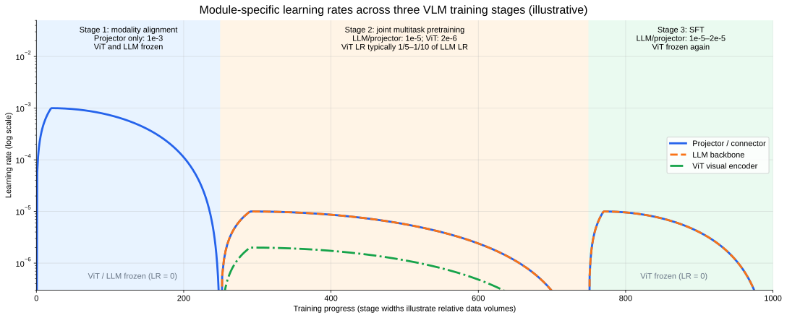
<figcaption>Figure: Per-module learning rate schedules in three-stage training (schematic; values are typical community orders of magnitude; within each stage, linear warmup + cosine decay)</figcaption>
</div>

### 2. Comparison of three training recipes
{: id="2-三份训练配方对照"}

**The official LLaVA-1.5 configuration** (`scripts/v1_5/pretrain.sh` and `finetune.sh` in the official repository) is the most widely used starting recipe in the community:

|Hyperparameter|Stage 1: alignment pretraining|Stage 2: instruction tuning (SFT)|
|--------|------------------|------------------------|
|Trainable parameters|MLP projection layer only|Projection layer + all LLM parameters|
|Global batch size| 256 | 128 |
|Peak learning rate| **1e-3** | **2e-5** |
|Learning rate schedule|Cosine decay, warmup ratio 0.03|Cosine decay, warmup ratio 0.03|
|Training length|1 epoch (558K image-text pairs)|1 epoch (665K instruction samples)|
| weight decay | 0 | 0 |
|Optimizer / precision| AdamW / bf16 | AdamW / bf16 |
|Max sequence length| 2048 | 2048 |
|Gradient clipping|max_norm = 1.0 (HF default)|max_norm = 1.0 (HF default)|
| DeepSpeed | ZeRO-2 + gradient checkpointing | ZeRO-3 + gradient checkpointing |

One noteworthy detail: the original LLaVA used a pretraining learning rate of 2e-3, and LLaVA-1.5, after replacing the linear projection with a two-layer MLP, **halves it to 1e-3** (the paper states explicitly that this is because of the MLP projector): once the connector becomes more expressive, the learning rate is reduced accordingly. When unfreezing the ViT, LLaVA-NeXT sets a separate learning rate of **2e-6** for the vision tower (1/10 of the base learning rate of 2e-5). This practice has been followed by many later open-source works.

The three-stage configuration of **Qwen-VL** (Appendix Table 8 of arXiv:2308.12966) represents the "industrial-scale training" orientation:

|Hyperparameter|Stage 1: pretraining|Stage 2: multi-task pretraining|Stage 3: SFT|
|--------|--------------|--------------------|------------|
|Trainable modules|ViT + connector (LLM frozen)|Everything unfrozen|LLM + connector (ViT frozen)|
|Peak learning rate| 2e-4 | 5e-5 | 1e-5 |
|Minimum learning rate| 1e-6 | 1e-5 | 1e-6 |
|Global batch size| 30720 | 4096 | 128 |
|Training steps| 50k | 19k | 8k |
|ViT layer-wise learning rate decay| 0.95 | 0.95 |— (ViT frozen)|
|Image resolution| 224×224 | 448×448 | 448×448 |
|Optimizer| AdamW (β₁=0.9, β₂=0.98, eps=1e-6) |Same|Same|
| weight decay | 0.05 | 0.05 | 0.05 |
|Gradient clipping| 1.0 | 1.0 | 1.0 |

Comparing the two recipes shows that the **scale of the training data determines the regularization strength and the shape of the hyperparameters**. LLaVA trains for 1 epoch on a few hundred thousand curated samples, sets weight decay to 0, and uses a batch size of one or two hundred. Qwen-VL must digest 1.4 billion noisy image-text pairs in its first stage, so the batch size soars to 30720, weight decay is raised to 0.05, and AdamW's β₂ is lowered from the default 0.999 to 0.98 (text-only pretraining such as GPT-3/LLaMA/OPT is even more aggressive, commonly using 0.95). The second-moment estimate then responds faster to changes in the gradient distribution, which reduces the risk of loss spikes in large-batch training. Note also that the batch size drops sharply across stages (30720 → 4096 → 128), in step with the data shrinking from a billion noisy image-text pairs to 350,000 finely curated instruction samples.

The progressive-reuse recipe of **InternVL2.5** (technical report arXiv:2412.05271) represents another idea: reuse an already fully trained InternViT in exchange for a lower total token consumption:

|Hyperparameter|Stage 1: MLP warm-up|Stage 1.5: incremental ViT learning (optional)|Stage 2: full-model instruction tuning|
|--------|-----------------|---------------------|-------------------|
|Trainable modules|MLP connector only (ViT + LLM frozen)|ViT + MLP (LLM frozen)|All parameters|
|Peak learning rate| **2e-4** | **1e-5** |**2e-5 ~ 4e-5** (larger models take the smaller value)|
|Per-module learning rate|**Unified** (no layer-wise decay or multipliers)|**Unified**|**Unified**|
|Learning rate schedule|Cosine decay|Cosine decay|Cosine decay|
|Image input|Dynamic high resolution (448×448 tiles)|Dynamic high resolution|Dynamic high resolution (6 to 12 tiles for a single image, up to 24 to 36 tiles for multiple images/documents)|
|Optimizer / precision| AdamW / bf16 | AdamW / bf16 | AdamW / bf16 |
|78B cumulative tokens| — | — |Total over all stages is approximately **120 billion**|

InternVL2.5 differs from the previous two recipes in two significant ways. **First, the learning rate is unified across the whole model**: every trainable module shares the same learning rate, with no LLaVA-NeXT-style "ViT lr = 1/10 of the base lr" multiplier and no Qwen-VL-style layer-wise decay (decay = 0.95); Stage 1.5 relies on lowering the overall learning rate to avoid ViT forgetting. **Second, the token consumption is lower**: the 78B model uses about 120 billion tokens in total, about 1/10 of Qwen2-VL (1.4 trillion). The key is **progressive scaling**: first train the ViT jointly with a smaller LLM (Stage 1.5), then connect the trained ViT directly to the larger LLM and skip Stage 1.5; the report argues that visual features are a universal representation that different LLMs can read. Stage 1 freezes the ViT and the LLM and trains only the MLP, in order to establish a stable interface with little data. **Jointly training from scratch on large-scale data (Qwen2-VL) and reusing already-trained components (InternVL2.5) are two coexisting ideas.**

### 3. Batch size and learning rate
{: id="3-batch-size-与学习率的联动"}

When GPU memory is insufficient, first distinguish the per-GPU micro-batch from the effective global batch. If gradient accumulation keeps the global batch unchanged, the learning rate does not need to change just because the per-GPU batch changes; when the global batch changes, the learning rate should be re-validated. The following two scaling rules can serve as candidate starting values:

$$\eta' = \eta \cdot \frac{B'}{B} \;\text{(linear scaling rule for SGD)}, \qquad \eta' = \eta \cdot \sqrt{\frac{B'}{B}} \;\text{(square-root scaling rule for Adam/AdamW)}$$

- The linear rule is commonly used with SGD, and the square-root rule is used to analyze scaling for adaptive optimizers under specific conditions. Both rely on assumptions and cannot be applied mechanically based on the optimizer's name alone; the global batch, number of training steps, warmup, and other optimizer parameters must be considered together.
- Effective global batch = per-GPU batch × gradient accumulation steps × number of GPUs. Transformers use LayerNorm (not BatchNorm), so **gradient accumulation and directly increasing the batch size are essentially equivalent mathematically**. It is the first choice for keeping the original recipe valid when GPU memory is limited; LLaVA's official README explicitly requires using gradient accumulation to keep the global batch unchanged when changing the number of GPUs.
- Example: when changing the global batch from 128 to 32 with an original learning rate of 2e-5, the square-root rule gives 1e-5, which can be added to the learning rate search range rather than being taken directly as the optimum.
- The scaling formulas are only **reference** starting values. According to the advice in the [Deep Learning Tuning Playbook](https://github.com/google-research/tuning_playbook), the batch size should be chosen based on resource efficiency, and the hyperparameters tied to it should then be re-tuned.

### 4. Warmup, decay, and number of epochs
{: id="4-warmup衰减与-epoch-数"}

**Why is warmup necessary?** Adam's second-moment estimate early in training is based on very few samples and is extremely unreliable; meanwhile, the randomly initialized projection layer sends "garbage gradients" back into the pretrained weights. Linear warmup lets the model first correct the most egregious parameters at a very small learning rate before entering full-speed learning. Common settings: for fine-tuning, a **warmup ratio of 0.03** (i.e., 3% of total steps, as in all LLaVA-family recipes), and for pretraining a **fixed number of steps** (500 steps for Qwen-VL, 2000 steps for LLaMA).

**How far should the learning rate decay?** Check the scheduler configuration directly. Taking the Qwen-VL recipe listed in this section as an example, the ratios of minimum to peak learning rate in the three stages are 0.005, 0.2, and 0.1 respectively, so they are not uniformly 10%. The drop in loss at the end of training may be related to learning rate decay. Whether to continue training should be judged from the validation set and downstream evaluation.

**How many epochs should you train?** Start from the number of epochs or token budget in a public recipe, then adjust according to validation performance. When overfitting sets in depends on the data size, repetition rate, quality, and model capacity. There is no fixed "2 to 3 epochs" limit; repeating high-quality data versus introducing new data also needs to be compared experimentally.

### 5. Data mixture
{: id="5-数据配比"}

Multimodal training naturally erodes an LLM's text-only abilities: VILA's ablation shows that training with image-text pairs only **lowers text-only task accuracy by more than 17%**. There are two commonly used countermeasures:

1. **Mix in text-only data**: The proportion ranges from about 6% in LLaVA-1.5 (40K ShareGPT text-only conversations within 665K instruction examples), to 10% in MM1 pretraining (45% interleaved image–text, 45% image–text pairs, and 10% text-only data), and 50% in Qwen2.5-VL SFT (approximately 2 million examples, split equally between text-only and multimodal data). VILA’s joint-SFT experiment provides particularly clear evidence: adding 1 million FLAN text-only instructions restored MMLU to the level of text-only fine-tuning, while **visual-task performance also improved**.
2. **Loss reweighting across tokens**: Multimodal samples are much longer than text-only samples, and plain token-level averaging lets multimodal gradients dominate training. Qwen3-VL's square-root reweighting (square-root normalization by the number of tokens per sample) targets exactly this problem (see Section 8.10).

The mixing ratio within task types matters too: Cambrian-1's ablation found that the optimal cap on the number of samples from a single data source is 250,000 to 350,000; the share of OCR data is proportional to OCR ability, but too high a share hurts general VQA. **The ratio should be tuned to your own evaluation goals.**

### 6. Tuning workflow: start small
{: id="6-调参工作流先小后大"}

The learning rate is **the most sensitive** of all hyperparameters, so the tuning budget should be spent on it first:

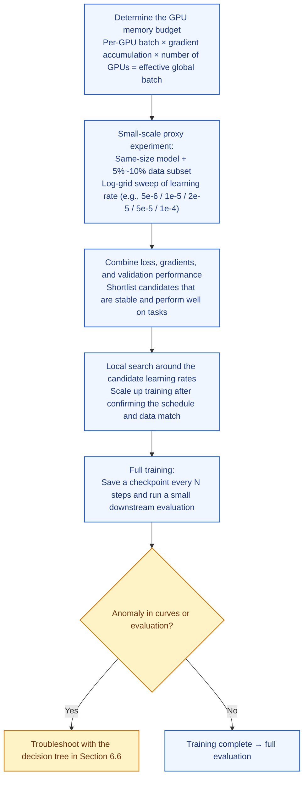

The priority of the learning rate has a classic source, Chapter 11 of Goodfellow et al.'s "Deep Learning": "If you only have time to tune one hyperparameter, tune the learning rate." Also beware of a trap: under standard parameterization, the optimal learning rate found on a small model **cannot be transferred directly to a large model** (the optimum drifts with model width), so the proxy experiment above is best run on a data subset with a model of the same size. If hyperparameters really must be transferred across scales, μP / μTransfer (Yang et al., 2022) modifies the parameterization so that the optimal learning rate stays stable across widths: Microsoft tuned on a 40-million-parameter proxy model and then transferred to a 6.7B GPT-3, outperforming the original version, with tuning overhead of only 7% of total pretraining compute.

### 7. When GPU memory runs out
{: id="7-显存不够时的工程开关"}

|Technique|Principle|Cost|
|------|------|------|
|Gradient accumulation|Accumulate gradients over several forward and backward passes to maintain an effective batch|Loss normalization, gradient clipping, and the timing of parameter updates must stay consistent; throughput must be measured in practice|
| Gradient checkpointing |Store fewer intermediate activations and recompute them during backpropagation|Trades extra computation for GPU memory; the cost depends on the recomputation scope|
| DeepSpeed ZeRO-2 / ZeRO-3 |ZeRO-2 shards optimizer states and gradients; ZeRO-3 additionally shards parameters|The gain depends on the number of GPUs, precision, and activation memory, and communication overhead is also introduced|
| LoRA / QLoRA |Train low-rank updates; QLoRA also quantizes the frozen backbone|The effect depends on the task, target layers, and rank; activation memory and computation overhead remain|
|Sequence packing|Combine several short samples into one long sequence to eliminate padding waste|Attention masks and position encodings must be handled correctly|
|Reduce resolution / number of tiles|Directly reduces the number of visual tokens|OCR and fine-grained tasks degrade noticeably|

---

## 6.5 Monitoring and loss curves
{: id="65-训练监控与-loss-曲线"}

VLM training can take days to weeks. **Catching problems from the curves early** is far cheaper than fixing them afterwards. This section answers two questions: what to watch and how to read it.

### 1. What to watch: four must-see panels
{: id="1-盯什么四个必看面板"}

|Metric|What to look for|Warning signs|
|------|--------|---------|
|Training loss (smoothed)|Is the overall trend still decreasing?|Spikes, plateaus, increases|
|Grad norm|Does it stay within a narrow band?|Rising continuously or frequently hitting the clipping threshold|
|Learning rate|Does the schedule curve match expectations?|Misconfigured warmup/decay|
|Validation loss + downstream evaluation|Is ability really improving?|Train/val divergence, evaluation scores saturating or regressing|

<div align="center">
  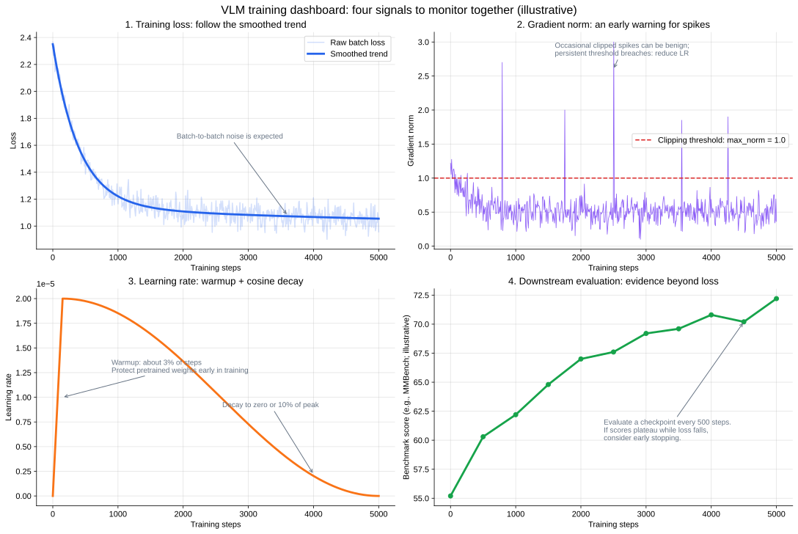
<figcaption>Figure: VLM training monitoring panels. (1) Always read the smoothed training loss; (2) grad norm is a leading indicator of spikes; (3) check the learning rate schedule configuration; (4) downstream evaluation gives real signal beyond the loss (schematic; data generated by simulation)</figcaption>
</div>

Three practical suggestions:

- **Always look at the smoothed loss** (EMA or sliding-window mean): The raw step-by-step loss is affected by differences in batch difficulty and is very noisy, so staring at raw values easily breeds false alarms.
- **Split the loss by data source**: Record the loss of each data source (caption, OCR, grounding, text-only, etc.) separately. Problems such as "the total loss looks normal but the OCR loss is not decreasing" cannot be seen in the aggregate at all.
- **Record token-level accuracy** as a complement to the loss: the top-1 hit rate of next-token prediction, which is especially intuitive in the SFT stage (HF TRL's SFTTrainer logs mean_token_accuracy by default) and exposes the case where "the loss is decreasing but the hit rate is not improving".

**Supplement: how to choose the smoothing factor**

The EMA update formula is $$\hat{L}_t = \alpha \cdot \hat{L}_{t-1} + (1-\alpha) \cdot L_t$$, where a larger $$\alpha \in (0,1)$$ gives a smoother curve. The equivalent "memory window" of an EMA is about $$\frac{1}{1-\alpha}$$ steps, which bridges the EMA and sliding-window views:

|α (EMA decay coefficient)|Equivalent sliding window|Applicable scenarios|
|------------------|------------|---------|
| 0.9 |~10 steps|Short SFT (total steps < 1K); fast training where you want to spot spikes quickly|
| 0.95 |~20 steps|Medium-scale SFT (1K~5K steps); empirically recommended for TensorBoard|
| 0.99 |~100 steps|Large-scale pretraining (5K~50K steps); the most commonly used "production" default|
| 0.999 |~1000 steps|Very long pretraining (>100K steps, such as LLaMA pretraining); the smoothed curve essentially shows only the trend|

**Tool defaults and recommended settings**: The default value of TensorBoard's smoothing slider is **0.6** (an equivalent window of only 2.5 steps), which is too noisy for VLM training curves spanning thousands of steps; in practice, set it to **0.95~0.99**. Weights & Biases does not smooth by default in the UI; you can choose EMA manually and set the coefficient in the "Smoothing" drop-down.

**Weighing both sides**: If α is too large (over-smoothing), real spikes are masked and problems are discovered late, so it cannot serve as an early-warning complement to grad norm; if α is too small (under-smoothing), the curve keeps jittering, making it hard to judge the downward trend and plateaus. Rule of thumb: **the smoothing is about right when the smoothed curve has "blurred details but a clear trend"**. If periodic spikes are still clearly visible on the smoothed curve, increase α by about 0.01~0.02.

### 2. A healthy loss curve
{: id="2-健康的-loss-曲线长什么样"}

**First, sanity-check the initial value.** When a language model starts training from random initialization, the loss at the first step should be approximately the natural logarithm of the vocabulary size (the cross-entropy of a uniform prediction):

$$\mathcal{L}_0 \approx \ln |V|$$

For example, a LLaMA vocabulary of 32K corresponds to about 10.4, and a Qwen vocabulary of 152K to about 11.9. In the **VLM alignment stage, since the LLM is already pretrained, the initial loss is usually only 4~6**; if you see an initial loss close to ln(vocabulary size), you can almost conclude that the pretrained weights were not loaded correctly. This is one of the most valuable debugging tricks to memorize.

**In shape**, a healthy loss follows a power-law decline: fast early on and slow later, roughly a straight line on log axes, with a slight further drop at the end of training as the cosine learning rate decays. Each of the three stages has its own characteristics:

<div align="center">
  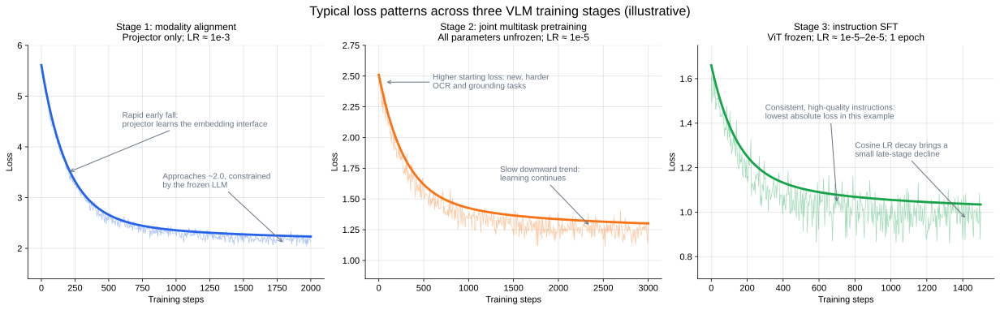
<figcaption>Figure: Typical loss curve shapes in three-stage training. In stage 1 the starting point is high, then drops steeply and converges to about 2.0, bounded by the frozen LLM; in stage 2 the starting point rebounds because harder tasks are added, then decreases slowly along a power law; in stage 3 the SFT data format is unified and the absolute loss is lowest (schematic; data generated by simulation)</figcaption>
</div>

Three common misconceptions:

- **Comparing loss across stages is meaningless**: The loss in stage 2 being higher than at the end of stage 1 does not mean "the training is bad"; the data distribution has changed (harder tasks such as OCR and grounding were added).
- **There is no universal standard for the absolute loss value**: Losses under different vocabularies, data, and loss-mask strategies cannot be compared directly; what can be compared is the relative change under the same configuration.
- **The loss never reaches 0**: In Chinchilla's fitted formula, natural language has an irreducible entropy term of about 1.69 nats. The flattening of the curve late in training reflects both the decaying learning rate and the information-entropy floor of the data itself. "It seems stuck" does not mean "it is not learning" (on log axes it is still a straight decline).

### 3. Four abnormal patterns and how to handle them
{: id="3-四种异常模式与处置"}

<div align="center">
  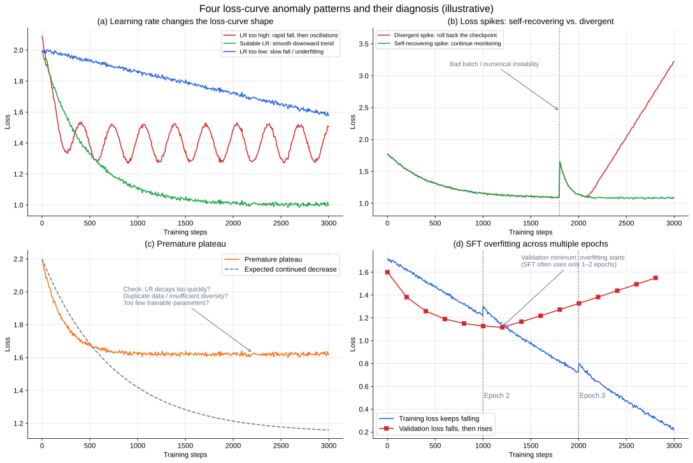
<figcaption>Figure: Four typical abnormal loss-curve patterns. (a) Contrast between a too-large and a too-small learning rate; (b) benign and malignant loss spikes; (c) premature entry into a plateau; (d) train/val divergence from multi-epoch overfitting (schematic; data generated by simulation)</figcaption>
</div>

|Symptom|Possible cause|Remedy|
|------|---------|------|
|Fluctuates at a high level after a rapid initial drop (red line in Figure a)|Learning rate too large|Reduce the learning rate by 2~5x|
|Decreases extremely slowly and is far from converged (blue line in Figure a)|Learning rate too small, or warmup too long|Increase the learning rate by 2~5x|
|Recovers by itself within a few hundred steps after a spike (green line in Figure b)|Isolated bad batches / extremely hard samples|If benign, keep observing; if frequent, clean the data|
|Keeps rising and diverges after a spike (red line in Figure b)|An excessive learning rate amplifies the impact of bad batches; fp16 overflow; contaminated Adam second-moment state|Roll back to the checkpoint before the spike and skip that data segment (PaLM's standard practice); or lower the learning rate, lower β₂, and tighten gradient clipping|
|Enters a plateau prematurely (Figure c)|Learning rate decays too fast; duplicated or insufficiently diverse data; too few trainable parameters (e.g., training only the projection layer yet expecting it to learn OCR)|Check the scheduler configuration; deduplicate data; unfreeze more parameters|
|Train loss keeps falling while val loss rises (Figure d)|Overfitting (typical of multi-epoch SFT)|Reduce epochs, stop early, and increase data diversity|
|Loss becomes NaN / Inf|fp16 overflow or underflow; learning rate too large; corrupted samples (empty images, extremely long text)|Switch to bf16; lower the learning rate; locate and remove bad samples|

The history of large-model training offers plenty of public experience with loss spikes. **PaLM-540B** encountered about 20 spikes over the whole run; the standard remedy was to rewind to a checkpoint about 100 steps before the spike, skip the next 200~500 batches, and continue training. Replaying the same batches from an earlier checkpoint **did not** reproduce the spike, which indicates that spikes arise from a combination of "parameter state × specific data" rather than simply bad data. **OPT-175B** was manually restarted 35 times over two months of training, during which the gradient clipping threshold was tightened from 1.0 to 0.3. **GLM-130B** traced its spikes mainly to abnormal gradients in the embedding layer (several orders of magnitude larger than in other layers), and shrinking that layer's gradient to 0.1x reduced spikes significantly. PaLM, Falcon, and OLMo 2 also use a **z-loss** regularization term (coefficient 1e-4) to suppress logit drift. VLMs are most susceptible to such problems in the second stage, large-scale joint training.

### 4. Grad norm as an early warning
{: id="4-grad-norm尖刺的先行指标"}

The gradient norm often exposes problems earlier than the loss:

- **Healthy shape**: After warmup ends, it stabilizes within a relatively narrow range (such as 0.2~1.0) and slowly decreases as training proceeds;
- **Early-warning signal**: If the grad norm keeps rising before the loss does, this is usually a precursor of divergence, and lowering the learning rate at that point is still in time. The "leading indicator" claim has official sources: the GLM-130B training log explicitly records that "collapses often lag behind grad norm spikes", and the OLMo 2 paper also writes that loss spikes are "often preceded by spikes in the gradient norm";
- **Gradient clipping with max_norm=1.0** is the standard solution in almost all large-model training (PaLM, LLaMA, and LLaVA all use 1.0; OPT reduced it to 0.3 for stability). However, if the grad norm **sticks to the clipping threshold** for a long time, the learning rate is set too high: clipping should trigger only occasionally and should not become the norm;
- **Record per module group**: Log the grad norm separately for the embedding, attention, FFN, and projection layers, which pinpoints the problematic layer; this is how GLM-130B discovered the abnormal gradient in the embedding layer. In a VLM you also need to confirm that frozen boundaries are really frozen (for example, the grad norm of the LLM and ViT in stage 1 should always be 0).

### 5. Evaluating during training
{: id="5-训练中跑评测"}

**A low loss does not mean strong ability.** The SFT loss measures "how accurately the reference answer is reproduced" and is only loosely related to "how well the questions are answered"; more insidiously, the hallucination rate may rise rather than fall while the loss decreases (the model learns to fabricate more fluently). Therefore:

- Save a checkpoint every fixed number of steps (such as 500~1000 steps) and automatically run a **small, fast evaluation suite**: a subset of MMBench-dev (general ability), POPE (object hallucination), and a TextVQA subset (OCR);
- When the evaluation score has saturated but the loss is still slowly decreasing, the marginal benefit of continued training is already very low. **Stopping early can save a lot of compute**;
- Conversely, **val loss can also raise "false alarms"**: InstructGPT's SFT validation loss began to overfit after 1 epoch, yet after continuing to train for 16 epochs, the reward-model score and human preference score kept rising, so the final checkpoint was chosen by downstream metrics rather than val loss. A gap between loss and ability is the norm in alignment training, and downstream evaluation is the gold standard;
- Evaluation must use **the same chat template as training**: template inconsistency is the most frequent cause of "normal loss but absurdly low evaluation scores".

---

## 6.6 Troubleshooting
{: id="66-训练问题排查"}

This section distills the key points of Sections 6.4 and 6.5 into a decision tree to follow when problems arise during training:

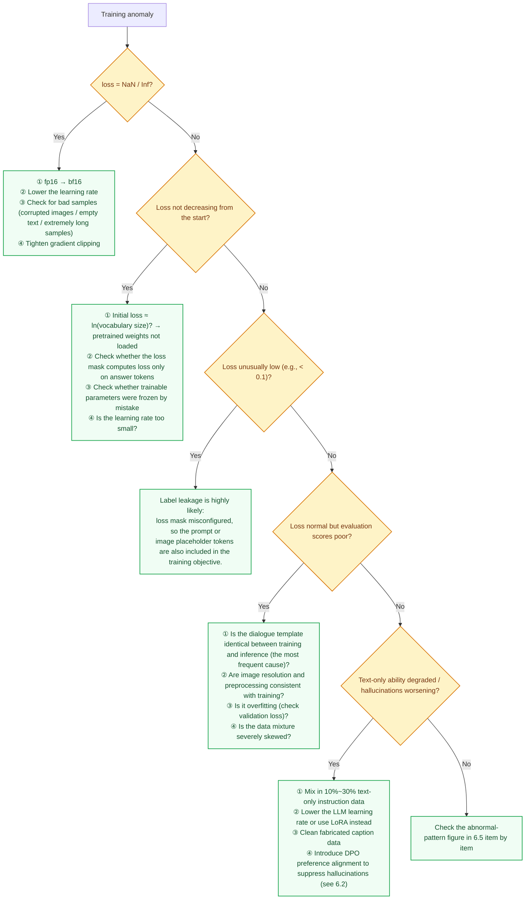

Several high-frequency "hidden pitfalls" deserve special emphasis:

1. **Loss mask errors** are the most common bug among beginners: in multimodal dialogue samples, only **the assistant's answer tokens** should contribute to the loss; prompts, system prompts, and image placeholder tokens must be masked. Counting the prompt in the loss makes the loss falsely low, and the model learns to repeat the question instead of answering it.
2. **Inconsistent dialogue templates**: Training with the `<|im_start|>` style and inferring with the `[INST]` style makes the model perform inexplicably badly. Always manage the template with the same code for training and inference.
3. **Mismatched image token counts**: In dynamic-resolution schemes, the number of tokens that the `<image>` placeholder expands to in the text sequence must exactly match the number of tokens actually output by the visual encoder. A single-token misalignment shifts all labels in the whole sequence.
4. **Evaluation-driven development**: Do not wait until training is finished to evaluate. Any configuration change (data, hyperparameters, templates) should first be verified in a small-scale proxy experiment (see the tuning workflow in Section 6.4), and rolled out at full scale only after the curves and small evaluations look normal.

---

## 6.7 Case study: Qwen-VL
{: id="67-案例qwen-vl-训练演进"}

Alibaba's open-source Qwen-VL (Tongyi Qianwen vision-language model) series is a widely used open-source VLM. From Qwen-VL to Qwen2-VL, Qwen2.5-VL, and Qwen3-VL, the technical reports of the four generations disclose a relatively complete breakdown of training stages, which makes them well suited to observing how training recipes evolve.

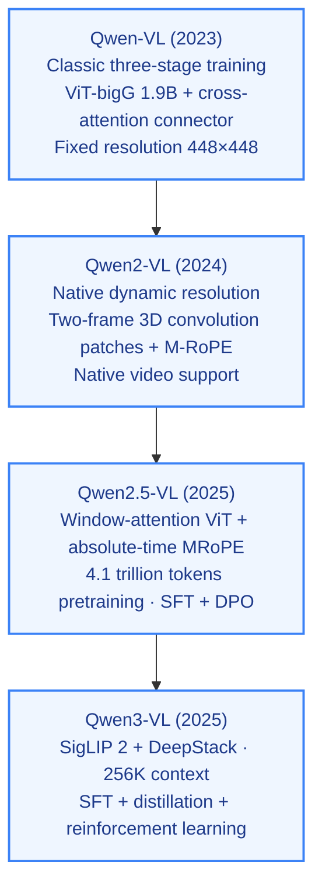

### 1. Qwen-VL (2023)
{: id="1-qwen-vl-2023"}

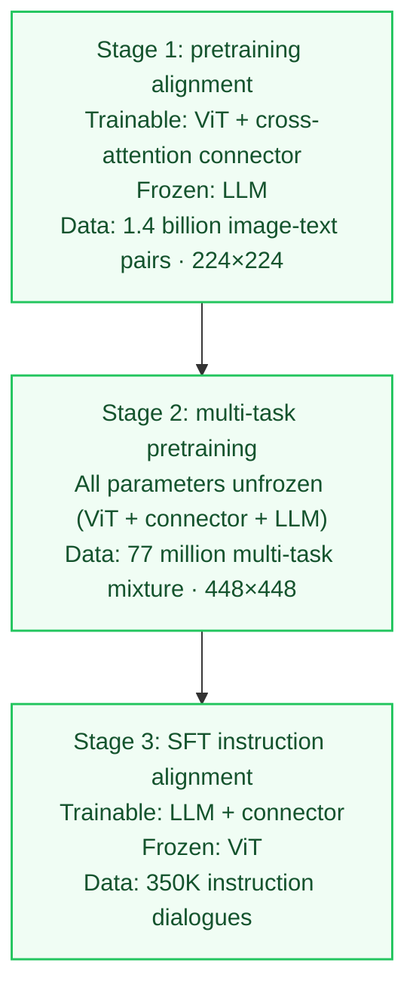

* **Architecture features**:
    - Visual encoder: ViT-bigG (1.9B parameters).
    - LLM: Qwen-7B.
    - Connector: A single-layer cross-attention module (256 learnable queries compress the image features output by the ViT into a fixed 256 visual tokens).
* **Three-stage training strategy**:
    - **Stage 1 (pretraining / feature alignment)**:
      - **Freezing strategy**: **Freeze the LLM** and train the ViT together with the cross-attention connector (note the difference from LLaVA, which trains only the connector: Qwen-VL lets the ViT participate in training from the first stage, with a layer-wise learning rate decay of 0.95 for the ViT; see the detailed hyperparameter table in Section 6.4).
      - **Training data**: 1.4 billion image-text pairs (cleaned from 5 billion raw pairs, a retention rate of 28%).
      - **Purpose**: To establish the channel between image features and text semantics.
    - **Stage 2 (multi-task pretraining)**:
      - **Freezing strategy**: **All parameters unfrozen**; the ViT, connector, and LLM are trained simultaneously.
      - **Training data**: About 77 million high-quality multi-task mixed samples (seven categories, including image captioning 19.7M, OCR 24.8M, VQA 3.6M, about 21M of grounding, and 7.8M of text-only), with the resolution raised to $448 \times 448$. Bounding-box coordinate annotations are introduced for grounding (target localization) training.
      - **Purpose**: To substantially enrich the model's grounding and fine-grained perception abilities.
    - **Stage 3 (SFT / instruction alignment)**:
      - **Freezing strategy**: **Freeze the ViT** and update only the connector and LLM parameters.
      - **Training data**: About 350,000 high-quality human-annotated and strong-model-generated instruction dialogue samples.
      - **Purpose**: To improve the model's conversational fluency and the coherence of multi-turn questioning.

### 2. Qwen2-VL (2024)
{: id="2-qwen2-vl-2024"}

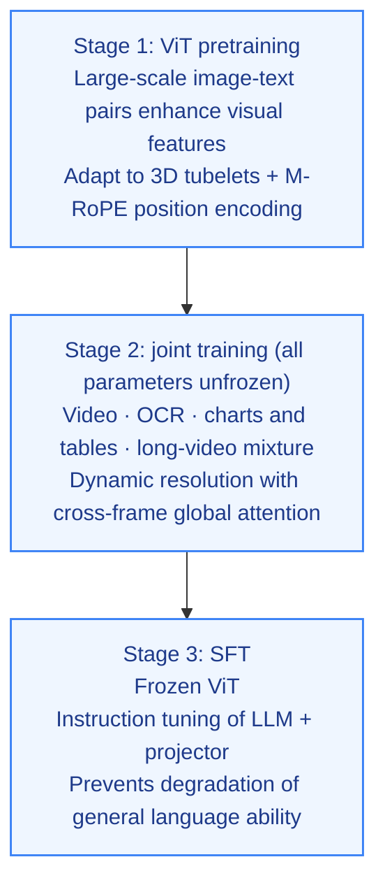

* **Architecture upgrades**:
    - Supports image input at **arbitrary resolution** and introduces **Naive Dynamic Resolution**: the ViT directly encodes the whole image after proportional scaling, instead of uniformly resizing it to 448×448.
    - Uses **3D convolution** to merge the patches of two adjacent frames into spatiotemporal tokens (an image is duplicated into two frames), unifying the input format of images and videos.
    - Introduces **M-RoPE**, which splits the position encoding in the LLM into three components: time, height, and width; the three components of a text token take the same value, degenerating into ordinary 1D RoPE.
* **Changes in training strategy**:
    - **Stage 1 (ViT training)**:
      - **Features**: Train only the ViT, learning visual representations that connect to the LLM on large-scale image-text pairs (in line with the first stage of Qwen-VL, which trains the ViT + connector).
    - **Stage 2 (joint training of all parameters)**:
      - **Features**: Unfreeze all parameters and add more diverse image-text, OCR, chart, video, and interleaved data to build fine-grained perception and video understanding.
    - **Stage 3 (SFT)**:
      - **Features**: **Freeze the ViT** and fine-tune only the LLM (and connector); the data are multimodal and text-only instruction dialogues.

### 3. Qwen2.5-VL (2025)
{: id="3-qwen25-vl-2025"}

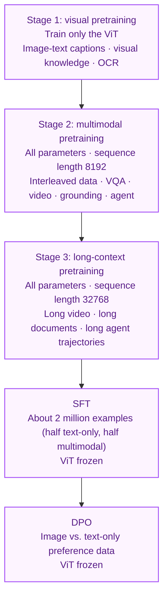

* **Architecture upgrades**:
    - **Redesigned ViT**: Most layers use window attention and only 4 layers keep global attention, so computation grows roughly linearly with the number of patches; the FFN and normalization are replaced by SwiGLU + RMSNorm, consistent with the Qwen2.5 LLM.
    - **MRoPE aligned to absolute time**: The temporal position IDs are aligned with the absolute time of the frames. Videos with different sampling rates share the same time scale, which makes it easy to answer "at which second did an event occur?"
* **Training changes**:
    - **Data volume**: The technical report states that the pretraining data grew from about 1.2 trillion tokens to about 4.1 trillion tokens.
    - **Staged sequence-length extension**: The sequence length in the last two pretraining stages increases from 8192 to 32768 to cover long videos and long documents.
    - **Post-training uses only SFT + DPO**: The technical report's post-training does not include online reinforcement learning such as GRPO; there are about 2 million SFT samples, half text-only and half multimodal, to preserve language ability.

### 4. Qwen3-VL (2025)
{: id="4-qwen3-vl-2025"}

Qwen3-VL extends post-training to **SFT → strong-to-weak distillation → reinforcement learning** and offers two variants, Instruct and Thinking. Reinforcement learning is split into reasoning RL for mathematics, code, and logic, and general RL for instruction following and format control. The architecture switches to the SigLIP 2 visual encoder with DeepStack multi-layer feature injection, adds Interleaved MRoPE and text timestamps, and extends the native context to 256K. See Section 8.10 for the complete four-stage pretraining and post-training pipeline.

From Qwen-VL to Qwen3-VL, three directions of change stand out: **resolution from fixed to native**, **pretraining from short sequences to long context**, and **post-training from SFT to preference optimization and then to reinforcement learning**.

---

<a id="vlm-evaluation"></a>

# 7. Datasets and benchmarks
{: id="7-主流数据集与评测基准"}

**First distinguish training resources from evaluation tools.** LAION-5B is mainly used for image-text pretraining; COCO contains data and splits for several tasks; MMBench, MMMU, and similar benchmarks evaluate specific abilities. A large dataset does not mean a powerful model.

|Evaluation goal|Relevant benchmarks in this chapter|Key points for interpretation|
|---|---|---|
|General understanding and knowledge| VQA v2, MMBench, MMMU / MMMU-Pro |Perception errors and knowledge errors must be analyzed separately|
|Text, documents, and charts| TextVQA, OCRBench |Check the resolution, metric definition, and data split|
|Mathematical and visual reasoning| MathVista, MathVision, ScienceQA |The reasoning budget and the answer-extraction method affect scores|
|Temporal video understanding| Video-MME |Check the number of frames, subtitle condition, and video-duration grouping|
|Interface grounding and interaction| ScreenSpot, OSWorld |Grounding accuracy and end-to-end task success rate are different metrics|
|Multilingual coverage| MVL-SIB |A high English score does not mean low-resource languages are equally reliable|

When reproducing an experiment, record the model and weight versions, input budget, prompt template, decoding parameters, evaluation script version, and sample split; check the overlap between training and test data, and analyze failure cases rather than only comparing total scores.

## 7.1 LAION-5B
{: id="71-laion-5b"}

|Property|Details|
|------|------|
|Release year| 2022 |
|Scale|5.85 billion image-text pairs|
|Source|Web crawl (multilingual)|
|Characteristics|A publicly available image-text dataset; re-released as Re-LAION-5B in 2024 after CSAM cleaning|

LAION-5B, released by the non-profit LAION, filters image-text pairs from Common Crawl and uses CLIP similarity to discard low-quality samples. Open-source models such as Stable Diffusion and OpenCLIP were trained on this dataset.

---

## 7.2 COCO
{: id="72-coco"}

|Property|Details|
|------|------|
|Release year|2014 (continuously updated)|
|Scale|About 330,000 images; the Captions subset has about 120,000 images (train+val) with 5 human-written descriptions each|
|Scenes|Everyday life scenes|
|Characteristics|Standard VLM evaluation benchmark covering multiple tasks such as captioning, retrieval, and VQA|

COCO is one of the most commonly used base datasets in the VLM field: early vision-language pretraining work generally reported image captioning (CIDEr) and image-text retrieval (R@1) metrics on the COCO Karpathy split, and benchmarks such as VQA v2 and RefCOCO are also built on COCO images. The newer generation of LLM-centered VLMs relies more on comprehensive benchmarks such as MMBench and MMMU.

---

## 7.3 VQA v2
{: id="73-vqa-v2"}

|Property|Details|
|------|------|
|Release year| 2017 |
|Scale|~1,100,000 questions, ~200,000 COCO images|
|Scenes|Everyday images|
|Characteristics|Its balanced design removes language bias and truly tests visual understanding|

VQA v2 balances the language bias of VQA v1: the same question is paired with two similar images that have different answers, so a model that guesses from the question text alone loses a lot of points. Answers fall into three categories: yes/no, number, and other. Each question has 10 human answers, and the score is computed from the degree of agreement with the human answers.

---

## 7.4 MMBench
{: id="74-mmbench"}

|Property|Details|
|------|------|
|Release year| 2023 |
|Scale|3000+ questions|
|Scenes|Assessment of diverse abilities|
|Characteristics|Systematically evaluates VLM performance across 20+ ability dimensions|

MMBench decomposes VLM abilities into two categories, perception and reasoning, and further divides them into 20 sub-abilities (such as attribute recognition, spatial relationships, and action recognition). It uses CircularEval: the same multiple-choice question is asked several times with the options rotated, and a model is scored only if it answers all of them correctly, which reduces the inflated scores caused by a model's preference for a particular option position.

---

## 7.5 ScienceQA
{: id="75-scienceqa"}

|Property|Details|
|------|------|
|Release year| 2022 |
|Scale|21,208 science questions|
|Scenes|K-12 science education (multimodal)|
|Characteristics|Contains multi-step reasoning questions mixing images and text, with annotated solution processes|

ScienceQA requires the model to combine images and text to perform multi-step reasoning in the sciences, and each question comes with an explanation and a solution process. About half of the questions have images; the combination of LLaVA and GPT-4 reported an accuracy of 92.53% on this benchmark, higher than the human average (88.40%) given in the paper.

---

## 7.6 TextVQA / OCRBench
{: id="76-textvqa--ocrbench"}

|Property|Details|
|------|------|
|Release year| 2019 / 2023 |
|Scale|28,408 images (45,336 questions) / 1000 question-answer pairs|
|Scenes|Natural-scene text / OCR scenarios such as scene text, documents, handwriting, and formulas|
|Characteristics|Specifically tests the model's ability to read text in images (OCR)|

Understanding text in images (OCR) is an important VLM capability. TextVQA requires the model to read the text in an image to answer questions, while OCRBench tests a variety of OCR scenarios more systematically and is a mainstream benchmark for evaluating VLM text understanding.

---

## 7.7 MMMU & MMMU-Pro
{: id="77-mmmu--mmmu-pro"}

|Property|Details|
|------|------|
|Release year| 2023 / 2024 |
|Scale|11,500 questions (covering 6 major fields, 30 subjects, and 183 subfields)|
|Scenes|College exams, professional certifications, academic charts and diagrams|
|Characteristics|Designed to evaluate expert-level domain knowledge and deep multimodal reasoning; MMMU-Pro further filters out text-only shortcuts and requires deep reasoning that combines the image|

MMMU (Massive Multi-discipline Multimodal Understanding) is widely regarded as the "MMLU" of the multimodal field. It covers disciplines such as art and design, business, science, medicine, the humanities, and engineering, and includes complex modalities such as charts, musical notation, chemical formulas, medical images, and engineering drawings. It is currently a key benchmark for measuring the cognitive ceiling of frontier models such as GPT-4o, Gemini 2.5 Pro, and Qwen2.5-VL/Qwen3-VL.

---

## 7.8 MathVista & MathVision
{: id="78-mathvista--mathvision"}

|Property|Details|
|------|------|
|Release year| 2023 / 2024 |
|Scale|6141 / 3040 visual math questions|
|Scenes|Function plots, geometric proofs, statistical charts, physics calculations|
|Characteristics|Jointly evaluates fine-grained visual perception and mathematical reasoning|

Traditional text-only math evaluations (such as GSM8K and MATH) cannot test a model's ability to read geometric figures and coordinate systems. MathVista integrates 28 existing multimodal datasets and 3 newly constructed ones (IQTest, FunctionQA, PaperQA); MATH-Vision collects questions from real mathematics competitions, which are harder and require the model not only to read the numerical and geometric constraints in the figure but also to carry out rigorous multi-step algebraic and geometric derivations. It is a core benchmark for testing the effect of VLM visual reasoning and long thinking (Visual CoT / GRPO).

---

## 7.9 Video-MME
{: id="79-video-mme"}

|Property|Details|
|------|------|
|Release year| 2024 |
|Scale|900 high-quality videos, 2700 multi-turn question-answer pairs|
|Scenes|6 major visual domains (knowledge, film and TV, sports competitions, artistic performances, daily-life recordings, multilingual), subdivided into 30 subcategories|
|Characteristics|Covers short videos (<2 minutes), medium videos (4–15 minutes), and long videos (30–60 minutes); all question-answer pairs are manually annotated|

As VLM input expands from single images to continuous video streams, Video-MME fills the gap in comprehensive long-video evaluation. It reports both "without subtitles" and "with subtitles" settings; the former better reflects the model's ability to obtain information from the visuals. When comparing scores, confirm which setting was used and the number of input frames.

---

## 7.10 OSWorld & ScreenSpot
{: id="710-osworld--screenspot"}

|Property|Details|
|------|------|
|Release year| 2024 / 2024 |
|Scale|369 real Ubuntu computer tasks (plus 43 Windows tasks) / 600+ screenshots, 1200+ grounding instructions|
|Scenes|Real desktop software, web browsers, multi-application collaboration|
|Characteristics|Moves from text-only/static Q&A to a real dynamic execution environment, with closed-loop evaluation of cross-application clicking, typing, scrolling, and multi-step workflow completion rates|

As multimodal large models move from "looking at pictures and talking" to "computer use / GUI agents", OSWorld and ScreenSpot have become the two most commonly cited benchmarks. ScreenSpot tests only single-step grounding (given an instruction, click the correct UI element), whereas OSWorld has the model complete a full task in a virtual machine and checks the final state with scripts. The two differ greatly in difficulty: high grounding accuracy does not imply a high success rate on multi-step tasks.

---

## 7.11 MVL-SIB
{: id="711-mvl-sib"}

|Property|Details|
|------|------|
|Release year| 2025(ACL Findings) |
|Scale|205 languages|
|Scenes|Multilingual image-text matching|
|Characteristics|The multimodal benchmark with the widest language coverage; it also provides a text-only version, allowing precise comparison of the "gain from visual input for different languages"|

MVL-SIB exposes a multimodal "language fairness" bottleneck: in low-resource languages, the image-text alignment quality of even top models such as GPT-4o drops significantly, so a high-performing VLM's lead on English benchmarks does not mean it serves all the world's languages equally well.

---

## 7.12 Evaluation trends
{: id="712-评测趋势"}

Since 2025, VLM evaluation has shown three important trends: **agent-oriented evaluation** (binding multimodal tasks to tool calls to test perception, planning, and execution uniformly), **knowledge freshness over time** (specially compiling news and rare knowledge from after training ended to test the timeliness of knowledge), and **spatial and 3D reasoning** (multi-view scene question answering and 3D QA with spatial constraints have entered the mainstream). The focus of evaluation is shifting from "static perception" to the **"integration of perception, reasoning, and action"**, and multilingual fairness (MVL-SIB) has also become a new dimension of concern.

<a id="vlm-papers"></a>

# 8. Key methods
{: id="8-经典方法与代表性工作"}

> This section sorts out representative work in the VLM field roughly in chronological order (DINOv2 / DINOv3 are grouped together as a visual-encoder topic). Sections 8.1~8.7 are organized as "structure, training, results"; Section 8.8 onward covers newer papers and uniformly uses the structure "key takeaways, research background, method, results, limitations".

## 8.1 ViLBERT(2019)
{: id="81-vilbert2019"}

**Paper**: ViLBERT: Pretraining Task-Agnostic Visiolinguistic Representations for Vision-and-Language Tasks
**Organization**: Facebook AI Research
**Published**: NeurIPS 2019; authors: Jiasen Lu, Dhruv Batra, Devi Parikh, Stefan Lee

ViLBERT is the earliest milestone work to extend BERT to joint vision-language understanding, and it pioneered the research direction of "vision-language pretraining".

> **Key takeaways**: The most valuable idea in ViLBERT is its **two-stream + co-attention** design: the two modalities are processed independently in their own streams, and information is exchanged selectively only through co-attention layers. This preserves the individual characteristics of each modality while achieving deep cross-modal interaction, and avoids the information loss caused by premature fusion. Its paradigm of "large-scale unlabeled image-text pair pretraining + lightweight task-head fine-tuning" directly inspired almost all subsequent vision-language pretraining work. Its limitations are that the visual features depend on offline Faster R-CNN extraction, inference is slow, and the two-stream architecture has many parameters, making it hard to scale up.

### Architecture: two-stream attention
{: id="架构设计双流协同注意力"}

ViLBERT adopts a **two-stream** design. The two modalities are processed in independent streams and then exchange information through co-attention layers:

- **Linguistic stream**: A 12-layer Transformer inherited from BERT-base, with a 768-dimensional hidden size and 12 attention heads
- **Visual stream**: A 6-layer Transformer with a 1024-dimensional hidden size and 8 attention heads; its input is image-region features extracted by Faster R-CNN (10 to 36 regions are kept according to detection confidence)
- **Co-attentional Transformer layer**: The two streams fuse cross-modal information by exchanging key and value matrices: the queries of the visual stream attend to the keys/values of the language stream (and vice versa), so each stream can selectively "attend to" the content of the other modality.

The core advantage of this design is that the two streams keep their own modality-specific characteristics while interacting deeply at specific layers, avoiding the information loss caused by premature fusion.

<div align="center">
  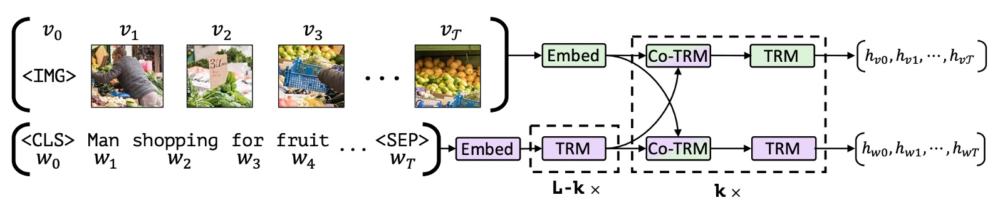
<figcaption>Figure: ViLBERT two-stream co-attention architecture. The upper part is the language stream, the lower part is the visual stream, and the Co-TRM layers handle cross-modal information exchange (Source: original figure from the paper)</figcaption>
</div>

### Pretraining scheme
{: id="预训练方案"}

Pretraining is performed on the **Conceptual Captions** dataset (about 3.3 million image-text pairs, with image descriptions crawled from the web and automatically filtered), using three objectives:

1. **Masked language modeling (MLM)**: Randomly mask 15% of the text tokens and predict the masked words
2. **Masked image-region prediction**: Randomly mask 15% of the image regions and predict the semantic category distribution of each region (the softmax output of the Faster R-CNN detection head)
3. **Image-text alignment prediction**: Replace 50% of the image-text pairs with random mismatched samples, and train the model to judge whether the image and text match semantically (binary classification)

### Downstream tasks and results
{: id="下游任务与结果"}

After pretraining, ViLBERT was adapted to four types of downstream tasks through lightweight fine-tuning and achieved the best results at the time:

|Task|Dataset| ViLBERT |
|------|--------|---------|
|Visual question answering (test-dev/test-std)| VQA v2 | 70.55 / 70.92 |
|Visual commonsense reasoning Q→A / QA→R / Q→AR (test)| VCR | 73.3 / 74.6 / 54.8 |
|Referring expression grounding (val)| RefCOCO+ | 72.34 |
|Image retrieval R@1| Flickr30K | 58.20 |

The paper's ablation also shows that every task drops significantly when the same architecture is used without pretraining, indicating that the gains largely come from large-scale image-text pretraining.

**Historical significance**: ViLBERT directly inspired a series of vision-language pretraining works such as VisualBERT, UNITER, OSCAR, and VinVL, and established the research paradigm of "universal vision-language representation pretraining + task fine-tuning".

---

## 8.2 CLIP(2021)
{: id="82-clip2021"}

**Paper**: Learning Transferable Visual Models From Natural Language Supervision
**Organization**: OpenAI
**Published**: ICML 2021; authors: Alec Radford, Jong Wook Kim, Chris Hallacy, et al.

CLIP is the cornerstone of the modern VLM ecosystem: the LLaVA series directly uses CLIP ViT-L/14, and the EVA-CLIP used by BLIP-2, the SigLIP used by PaliGemma and Qwen3-VL also follow the idea of "contrastive image-text pretraining of the visual encoder".

> **Key takeaways**: The revolutionary aspect of CLIP is **replacing manual annotation with natural language supervision**: 400 million web image-text pairs plus a symmetric InfoNCE loss let the visual encoder learn semantic features that transfer directly. Zero-shot transfer (embedding category names into text via prompt engineering) is its most influential innovation, breaking the conventional wisdom that one "must fine-tune on the target dataset". The ViT trained by CLIP and its successors (EVA-CLIP, SigLIP) has become the most commonly used visual backbone of open-source VLMs, showing that the scale of pretraining data and the choice of training objective have a great impact on representation quality. Its limitation is that the contrastive objective between images and texts is "coarse-grained" (the whole image against the whole description), making it hard to capture fine-grained, region-level semantic alignment.

### Data scale: WIT-400M
{: id="数据规模wit-400m"}

OpenAI built the **WIT (WebImageText)** dataset from the Internet by searching for synonyms of 500,000 common words (the Wikipedia vocabulary), and finally obtained **400 million image-text pairs**, covering extremely diverse visual concepts at a scale far beyond any public dataset at the time (such as ImageNet's 1.28 million images and Conceptual Captions' 3.3 million pairs).

### Architecture design
{: id="架构设计"}

CLIP consists of two independent encoders that share the same embedding space:

**Image encoder**: Two families are provided:
- ResNet series: RN50, RN101, RN50x4 (about 4 times the compute of ResNet-50), RN50x16, RN50x64
- ViT series: ViT-B/32, ViT-B/16, ViT-L/14 (307M parameters, 24 layers, 1024 dimensions, 14×14 patch), ViT-L/14@336px

**Text encoder**: A 63M-parameter Transformer with 12 layers, 512 dimensions, and 8 attention heads, with a maximum sequence length of 76 tokens (BPE tokenization); the final hidden representation of the `[EOS]` token is taken as the text embedding

The outputs of the two encoders are mapped by **linear projection layers** into an embedding space of the same dimension, and the degree of image-text matching is measured by cosine similarity.

<div align="center">
  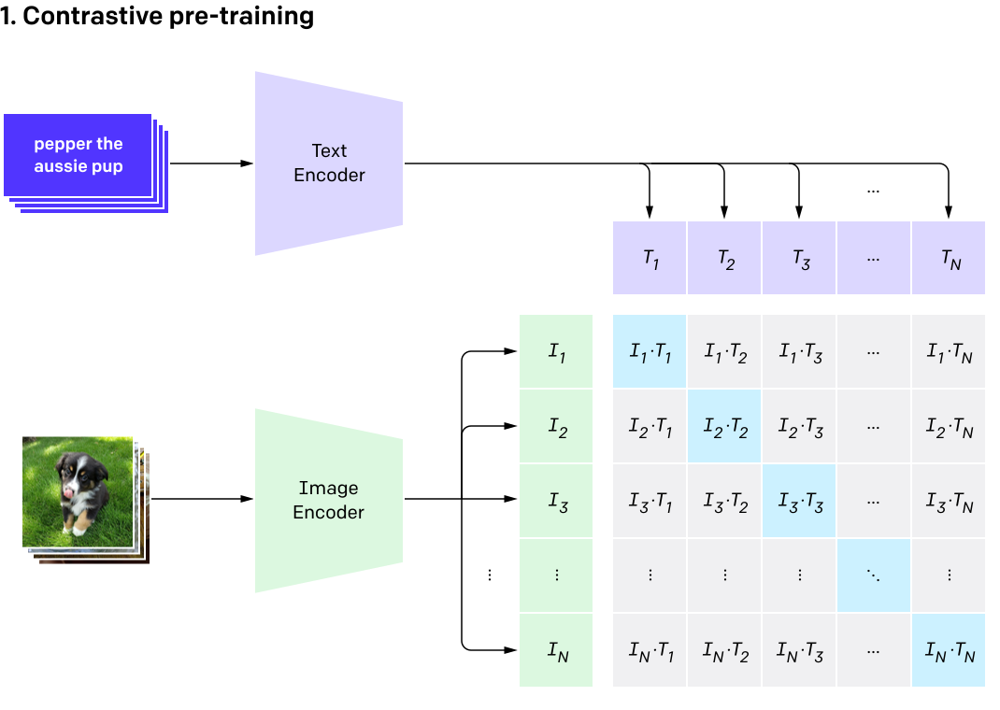
<figcaption>Figure: CLIP contrastive pretraining framework, in which the image encoder and text encoder jointly learn an aligned embedding space (Source: OpenAI)</figcaption>
</div>

### Training objectives
{: id="训练目标"}

For a batch of $N$ image-text pairs, CLIP identifies the $N$ correct matches out of the $N \times N$ possible pairings. It uses a **symmetric InfoNCE loss** (computed in both the image-to-text and text-to-image directions):

$$\mathcal{L} = -\frac{1}{2N}\left[\sum_{i=1}^{N}\log\frac{\exp(s_{ii}/\tau)}{\sum_{j=1}^{N}\exp(s_{ij}/\tau)} + \sum_{i=1}^{N}\log\frac{\exp(s_{ii}/\tau)}{\sum_{j=1}^{N}\exp(s_{ji}/\tau)}\right]$$

Here, $s_{ij} = \text{cos}(v_i, t_j)$ is the cosine similarity between image $i$ and text $j$, and $\tau$ is a **learnable** temperature parameter (initialized to 0.07 and adjusted automatically during training). Training uses an extremely large batch size (**32,768**) to obtain enough negative pairs, and all models are trained for 32 epochs; the largest ViT-L/14 was trained on 256 V100 GPUs for 12 days.

### Zero-shot transfer
{: id="零样本迁移能力"}

The core contribution of CLIP is its **zero-shot transfer** ability: without any training on the target dataset, classification can be done by simply embedding the category names as text prompts (prompt engineering, such as "a photo of a {class name}") and computing image-text similarity.

Zero-shot top-1 accuracy on ImageNet:

|Model|Parameters|ImageNet zero-shot top-1|
|------|--------|----------------------|
| RN50 | ~102M  | 59.6% |
| RN101 | ~119M | 62.4% |
| ViT-B/32 | ~150M | 63.3% |
| ViT-B/16 | ~150M | 68.3% |
| ViT-L/14 | ~428M | 75.3% |
| **ViT-L/14@336px** | ~428M | **76.2%** |

Here, the 76.2% of **ViT-L/14@336px matches the supervised ResNet-50 (76.1%)**, which needs all 1.28 million ImageNet training images. On 16 of the 27 classification datasets, zero-shot CLIP surpassed the baseline of "ResNet-50 features + a fully supervised linear classifier".

### Profound impact on later research
{: id="对后续研究的深远影响"}

- **Standardization of the visual backbone**: LLaVA / LLaVA-1.5 use CLIP ViT-L/14 (@336px), and BLIP-2 / InstructBLIP use EVA-CLIP ViT-g/14; ViTs pretrained contrastively on image-text pairs have become the default starting point for VLM visual encoders
- **Foundation for text-to-image generation**: DALL-E 2 uses CLIP image embeddings as the condition of its diffusion model, and Stable Diffusion uses the CLIP text encoder
- **Open-vocabulary detection**: ViLD, OWL-ViT, RegionCLIP, and others use CLIP's image-text alignment to extend object detection to categories not seen during training
- **Cross-modal retrieval**: CLIP embeddings have become the core representation of image-text retrieval engines

---

## 8.3 Flamingo(2022)
{: id="83-flamingo2022"}

**Paper**: Flamingo: a Visual Language Model for Few-Shot Learning
**Organization**: DeepMind
**Published**: NeurIPS 2022; authors: Jean-Baptiste Alayrac, Jeff Donahue, Pauline Luc, et al.

Flamingo is an early representative work that extended a 70B-scale frozen language model into a multimodal model and demonstrated strong few-shot (in-context) vision-language ability. Its core design philosophy is to **keep the LLM unchanged and add only a minimal visual interface**.

> **Key takeaways**: The core value of Flamingo lies in its design philosophy of **freezing the LLM and inserting a visual interface**: a Perceiver Resampler compresses visual features of any length into a fixed 64 latent tokens, and gated cross-attention layers (with the tanh gate initialized to 0) let the language model "gradually" acquire visual perception without damaging the original LLM's language ability at all. Interleaved image-text training data lets the model naturally support multi-image context (few-shot) input. This paradigm directly inspired the later "frozen LLM + lightweight alignment module" route of BLIP-2, LLaVA, and others. Its limitations are that the Perceiver Resampler's information compression loses fine-grained visual details, and that its closed-source release limits ecosystem development.

### Core architecture
{: id="核心架构"}

Flamingo inserts two new modules on top of the frozen Chinchilla LLM (70B):

**① Perceiver Resampler**

Image features typically contain hundreds to thousands of spatial positions (depending on resolution), and LLMs are very sensitive to input length. The Perceiver Resampler compresses visual features of arbitrary length into a fixed number (**64**) of visual representations through **learnable latent vectors**:

- The 64 latent vectors interact with each other through **self-attention**
- Information is extracted from the image features (2D patch features with position encodings) through **cross-attention**
- Supports images of arbitrary resolution and videos with any number of frames (features from different frames are concatenated and compressed together)

**② Gated cross-attention dense (GXATTN) layer**

New cross-modal attention layers are inserted at regular intervals between the Transformer layers of the frozen LLM (every 7 layers for Flamingo-80B):

- Language tokens serve as queries, and the 64 visual latent vectors output by the Perceiver Resampler serve as keys/values
- **Gating mechanism**: $y = y_{\text{LLM}} + \tanh(\alpha) \cdot \text{CrossAttn}(y_{\text{LLM}}, X_{\text{visual}})$, where $\alpha$ is initialized to **0**, so that the new layers have no effect on the LLM output early in training and do not damage the original language ability
- Only the parameters of the GXATTN layers and the Perceiver Resampler are trained (the original LLM parameters are completely frozen)

<div align="center">
  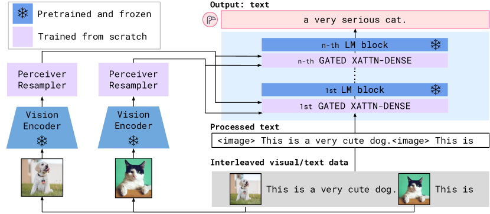
<figcaption>Figure: Overall architecture of Flamingo. After the visual encoder's output is compressed by the Perceiver Resampler, it is injected into the frozen LLM through gated cross-attention layers (Source: original figure from the paper)</figcaption>
</div>

### Training data
{: id="训练数据"}

Training mixes four types of data:

|Dataset|Scale|Description|
|--------|------|------|
| MultiModal MassiveWeb (M3W) |Approximately 43,000,000 web pages|Contains interleaved image and text content for learning multi-image context|
| ALIGN |1.8 billion image-text pairs|Web-scraped image alt-text|
| LTIP (Long Text & Image Pairs) |312,000,000 image-text pairs|Higher-quality image-text pairs with longer descriptions|
| VTP (Video & Text Pairs) |27,000,000 videos|Short videos paired with text descriptions|

**Interleaved image-text data** is the key to Flamingo's ability to handle multi-image input (such as multiple images interspersed in a conversation history).

### Few-shot performance
{: id="少样本性能"}

Flamingo was evaluated on 16 vision-language benchmarks in a **few-shot** manner (only a small number of examples are given in the prompt, with no gradient updates). With only 32 examples, it surpassed the best contemporary models fine-tuned on large amounts of annotated data on 6 of the benchmarks. Some results are as follows (Flamingo-80B):

|Task| 0-shot | 4-shot | 32-shot |Fine-tuned SOTA|
|------|--------|--------|---------|----------|
| VQAv2 | 56.3 | 63.1 | 67.6 | 80.2 |
| COCO Captioning(CIDEr) | 84.3 | 103.2 | 113.8 | 143.3 |
| TextVQA | 35.0 | 36.5 | 37.9 | 54.7 |

> **Note**: On well-annotated benchmarks such as VQAv2, COCO, and TextVQA, the few-shot results are still significantly lower than those of specially fine-tuned models; Flamingo's advantage is that it can adapt to new tasks with only a few examples. The low TextVQA score is also related to the loss of small-text details when the Perceiver Resampler compresses visual features into 64 tokens.

---

## 8.4 BLIP-2(2023)
{: id="84-blip-22023"}

**Paper**: BLIP-2: Bootstrapping Language-Image Pre-training with Frozen Image Encoders and Large Language Models
**Organization**: Salesforce Research
**Published**: ICML 2023; authors: Junnan Li, Dongxu Li, Silvio Savarese, Steven Hoi

The core question of BLIP-2 is: how can an effective semantic bridge be built between two pretrained "large models" (a frozen visual encoder and a frozen LLM) at the lowest computational cost?

> **Key takeaways**: The core innovation of BLIP-2 is the **Q-Former information bottleneck**: 32 learnable query tokens extract the most language-relevant visual features from a frozen ViT-g (about 1B) through cross-attention. The whole Q-Former has only 188M parameters, yet it can connect to frozen LLMs such as OPT-6.7B and FlanT5-XXL (11B) to complete multimodal generation tasks, greatly lowering the computational barrier to multimodal alignment. The progressive two-stage training strategy (vision-language representation alignment first, then generative language alignment) is also worth learning from. Its limitations are that the fixed number of query tokens limits the processing of high-resolution, detailed images, and that the semantic gap between the Q-Former and the LLM needs later work (such as InstructBLIP) to bridge further through an instruction-aware mechanism.

### Q-Former
{: id="q-former轻量级信息瓶颈"}

The Q-Former (Querying Transformer) is the core innovation of BLIP-2. It contains two Transformer modules that share self-attention weights:

- **Image Transformer**: Extracts information from the frozen visual encoder (EVA-CLIP ViT-g/14, ~1B parameters) via cross-attention
- **Text Transformer**: Handles text input, with a function similar to BERT

Both modules share the same set of self-attention layers, but cross-attention layers exist only in the Image Transformer. The **32 learnable query tokens** extract the visual information most relevant to language from the ViT's visual features, which is then mapped into the LLM's input space by a linear projection layer.

The Q-Former has only **188M parameters** in total, while ViT-g has about 1B, OPT-6.7B has 6.7B, and FlanT5-XXL has 11B. With a very small number of trainable parameters, the Q-Former becomes the "translator" between these large models.

<div align="center">
  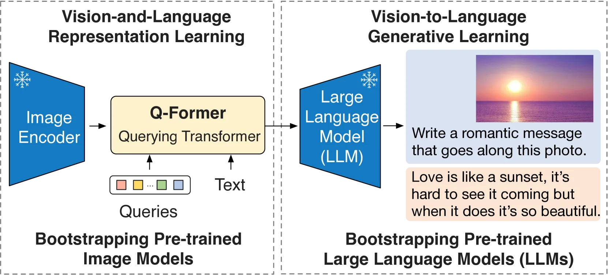
<figcaption>Figure: Overall framework of BLIP-2, in which the Q-Former bridges a frozen visual encoder and a frozen LLM (Source: original figure from the paper)</figcaption>
</div>

<div align="center">
  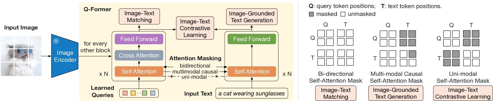
<figcaption>Figure: Internal architecture of the Q-Former. The Image Transformer and Text Transformer share self-attention layers, and 32 learnable query tokens extract visual features through cross-attention (Source: original figure from the paper)</figcaption>
</div>

### Two-stage training
{: id="两阶段训练"}

**Stage 1: vision-language representation learning**
Freeze ViT-g, train the Q-Former, and jointly optimize three objectives:
- **ITC (Image-Text Contrastive)**: Align the visual features extracted by the query tokens with text embeddings
- **ITM (Image-Text Matching)**: Judge whether the image and text match (using a bidirectional attention mask)
- **ITG (Image-grounded Text Generation)**: Autoregressively generate the corresponding image caption conditioned on the visual query tokens

**Stage 2: vision-to-language generative learning**
Freeze the LLM (OPT-6.7B or FlanT5-XXL), linearly project the 32 query tokens output by the Q-Former, and prepend them to the LLM's text input; the Q-Former is trained to produce visual soft prompts that effectively guide the LLM through multimodal generation tasks.

### Results
{: id="结果"}

On zero-shot VQAv2 (test-dev), BLIP-2 (ViT-g + FlanT5-XXL) reaches 65.0%, higher than Flamingo-80B's 56.3%, while having only about 1/54 of the latter's trainable parameters (the Q-Former and others total about 188M; the rest are frozen pretrained weights), which greatly reduces the compute requirements of multimodal training.

---

## 8.5 LLaVA(2023)
{: id="85-llava2023"}

**Paper**: Visual Instruction Tuning
**Institution**: University of Wisconsin-Madison / Microsoft Research
**Published**: NeurIPS 2023; authors: Haotian Liu, Chunyuan Li, Qingyang Wu, Yong Jae Lee

With its minimalist architecture and innovative method of constructing instruction data, LLaVA created a thriving ecosystem of open-source multimodal large models and quickly became one of the most influential open-source VLMs after its release.

> **Key takeaways**: The value of LLaVA is that it proves a **minimalist architecture plus high-quality instruction data** can outperform complex designs: a single linear projection layer (later upgraded to a two-layer MLP) is enough to connect the CLIP visual encoder to the LLM. The key lies in obtaining high-quality visual instruction data. Having GPT-4 generate multi-turn dialogue data from image captions and bounding-box text proxies was a paradigm innovation for building instruction data cheaply, with no direct manual annotation of images. The dynamic-resolution tiling (tile-based high resolution) introduced by LLaVA-NeXT has been adopted by many open-source VLMs such as InternVL; another route is Qwen2-VL's native-resolution encoding. Its limitations are that the early LLaVA's linear projection is too simple, leaving a vision-language semantic gap, and that its recognition of fine, high-resolution content (OCR, small objects) is insufficient.

### Architecture: three parts
{: id="架构三件套极简设计"}

```
image → [CLIP ViT-L/14] → visual features Z_v
                           ↓
                       linear projection W
                           ↓
                       visual tokens H_v  ──→ [LLM: Vicuna-13B / LLaMA] → answer
                                         ↑
                                       text instruction H_q
```

$$H_v = W \cdot Z_v, \quad Z_v = f_{\text{CLIP}}(X_v)$$

Only a linear projection matrix **$W$** is used to map the visual features output by the CLIP ViT into the LLM's word embedding space. Visual tokens and the text instruction are concatenated directly and fed into the LLM, giving an extremely simple structure.

<div align="center">
  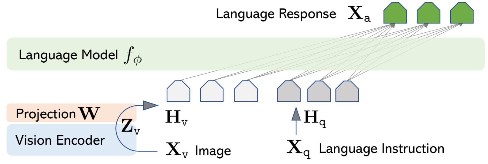
<figcaption>Figure: LLaVA architecture. The CLIP visual encoder is connected to the LLaMA language model through a linear projection layer to achieve visual instruction tuning (Source: LLaVA project)</figcaption>
</div>

### Instruction data via GPT-4
{: id="指令数据构建gpt-4辅助生成"}

The key innovation of LLaVA is how it **obtains high-quality visual instruction data**. Since directly annotating large amounts of multi-turn image dialogues is extremely expensive, LLaVA adopted an ingenious solution:

It takes the existing **image captions** and **bounding boxes** from the COCO dataset, uses this text as a "proxy" for the image content, and feeds it as text-only input to GPT-4 (ChatGPT for part of the data) to generate three types of instruction data:

1. **Conversation**: 58K samples, simulating a user holding a multi-turn Q&A about the image content
2. **Detailed description**: 23K samples, comprehensive and detailed textual descriptions of the image
3. **Complex reasoning**: 77K samples, requiring logical reasoning combined with the image content

In total there are **~158K** high-quality instruction samples. The construction cost is extremely low (no manual image annotation is needed), yet it yields excellent visual instruction-following ability.

### Two-stage training
{: id="两阶段训练-1"}

|Stage|Trainable parameters|Objective|Data|
|------|-----------|------|------|
|Pretraining (feature alignment)|Projection layer W only|Align visual features with the LLM word embedding space|595K CC image-text pairs|
|Fine-tuning (instruction following)|Projection layer W + LLM|End-to-end learning of visual instruction following|158K instruction samples|

### LLaVA-1.5: MLP upgrade
{: id="llava-15mlp升级"}

LLaVA-1.5 (late 2023) upgrades the linear projection layer to a **two-layer MLP** (with GELU activation) and upgrades the visual encoder from ViT-L/14 to **CLIP ViT-L/14@336px** (higher resolution). It significantly surpasses the original LLaVA on multiple benchmarks such as VQAv2, GQA, and TextVQA while keeping the same simple architecture.

### LLaVA-NeXT: dynamic high resolution
{: id="llava-next动态高分辨率"}

LLaVA-NeXT (early 2024, also known as LLaVA-1.6) introduces **dynamic-resolution tiling**:

- According to the original aspect ratio of the image, divide it into a grid such as 2×2 or 1×3 (up to 4 tiles)
- Each tile is encoded separately by the CLIP ViT (336×336 per tile) to obtain finer-grained local features
- Keep a low-resolution (336px) overall image (thumbnail) to provide global context
- The features of all tiles are concatenated and fed to the LLM

This design raises the effective input resolution to **672×672** or higher, significantly improving TextVQA (OCR understanding), DocVQA (document understanding), and chart understanding tasks.

---

## 8.6 SigLIP(2023)
{: id="86-siglip2023"}

**Paper**: Sigmoid Loss for Language-Image Pre-Training
**Organization**: Google DeepMind
**Published**: ICCV 2023; authors: Xiaohua Zhai, Basil Mustafa, Alexander Kolesnikov, Lucas Beyer

SigLIP is a key improvement over the CLIP contrastive learning paradigm: it replaces the softmax contrastive loss with a pairwise sigmoid loss, removing the need for normalization over the entire batch. SigLIP and its successor SigLIP 2 have become the visual encoders of models such as PaliGemma, SmolVLM, Gemma 3, and Qwen3-VL.

> **Key takeaways**: CLIP's softmax contrastive loss requires normalization over the entire batch. The larger the batch, the better the result, but this also means training must be concentrated on a few supercomputing nodes. SigLIP decomposes the problem into $N^2$ independent binary classifications (does each image-text pair match or not) and computes the loss for each with a sigmoid. This can be computed blockwise across devices: each device first computes its local positive and negative pairs, then rotates the text features in a ring to cover the negatives on other devices. There is no need to build the full global similarity matrix at once, which saves GPU memory. Experimentally, the sigmoid loss is significantly better than the softmax loss at smaller batch sizes (about 16K or less); the gap narrows once the batch grows to about 32K, and the benefit is very limited when it is increased further to the millions. SigLIP So400m (about 400 million parameters, a ViT whose aspect ratios were designed by "shape optimization", patch size 14) is widely used as a visual backbone; SigLIP 2 (2025) further introduces a caption-generation decoder, self-distillation, masked prediction, and multi-resolution training.

<div align="center">
  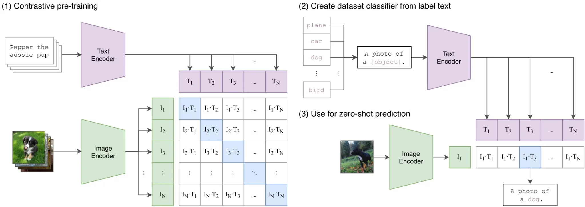
<figcaption>Figure: The SigLIP pretraining framework. The image encoder and text encoder learn a shared embedding space (the same as the CLIP framework). The core difference is that the loss changes from the softmax InfoNCE to a pairwise sigmoid, so training no longer relies on global batch normalization (Source: original paper)</figcaption>
</div>

### Core idea: the sigmoid loss
{: id="核心sigmoid-损失"}

The softmax contrastive loss of **CLIP** (symmetric InfoNCE):

$$\mathcal{L}_\text{CLIP} = -\frac{1}{2N}\left[\sum_{i}\log\frac{e^{s_{ii}/\tau}}{\sum_j e^{s_{ij}/\tau}} + \sum_{i}\log\frac{e^{s_{ii}/\tau}}{\sum_j e^{s_{ji}/\tau}}\right]$$

The normalization denominator of each sample depends on the candidate texts or images within the selected batch. When negatives are used across devices, features typically need to be gathered or exchanged; the exact communication method is determined by the implementation.

**SigLIP's sigmoid loss**:

$$\mathcal{L}_\text{SigLIP} = -\frac{1}{N}\sum_{i,j} \log \sigma\!\left(z_{ij} \cdot (2 y_{ij} - 1)\right)$$

Here, $z_{ij} = c \cdot \langle v_i, t_j\rangle + b$, where $c$ is a learnable positive scaling coefficient and $b$ is a learnable bias; $y_{ij} = 1$ when $i=j$ and $0$ otherwise. The loss of each image-text pair is computed independently, with no cross-sample softmax normalization; however, to use negatives on other devices, features must still be exchanged between devices. Here the loss is normalized by the batch size $N$, consistent with Section 4.7; averaging by $N^2$ would change the overall loss and gradient scale.

### Experimental results
{: id="实验结果"}

The paper's main conclusions concern the relationship between "batch size and loss function":

- **Advantage at small batch sizes**: When the batch is below about 16K, the zero-shot accuracy of the sigmoid loss is significantly higher than that of the softmax contrastive loss; the gap shrinks as the batch grows.
- **Bigger batches are not always better**: The effect essentially saturates at a batch of about 32K, and expanding to the millions gives almost no additional benefit, so there is no need to chase extremely large batches.
- **Low-cost training**: Combined with Locked-image Tuning (freezing the pretrained image encoder and training only the text encoder, i.e., SigLiT), it reaches 84.5% ImageNet zero-shot accuracy with only 4 TPUv4 chips and 2 days of training.
- **Role of the bias term**: Since negative pairs far outnumber positive pairs, the learnable bias $b$ must be initialized to a large negative value (-10 in the paper), so that early predictions are close to the "mismatch" prior and early gradients are not dominated by the many negatives.

### Impact and follow-up
{: id="影响与后续"}

The SigLIP family of encoders has been adopted by several open-source VLMs:

- **PaliGemma** (Google, 2024): Directly uses SigLIP-SO/400M as the visual backbone, combined with Gemma-2B
- **SmolVLM** (Hugging Face, 2024–2025): SigLIP visual encoder + Pixel Shuffle compression, offering 256M / 500M / 2.2B on-device versions
- **Qwen3-VL** (Alibaba, 2025): The visual encoder is upgraded to **SigLIP 2**, and the 8B and larger versions use SigLIP2-SO-400M
- **SigLIP 2** (Tschannen et al., 2025) adds decoder-based caption generation and grounding pretraining (LocCa), self-distillation, and masked prediction on top of the sigmoid loss, and provides a NaFlex variant that supports native aspect ratios to improve grounding, dense features, and multilingual ability.

---

## 8.7 InternVL2(2024)
{: id="87-internvl22024"}

**Paper**: InternVL2 was released as a [technical blog](https://internvl.github.io/blog/2024-07-02-InternVL-2.0/) (July 2024); its core technology comes from InternVL (CVPR 2024 Oral, training of InternViT-6B) and InternVL 1.5 ([arXiv:2404.16821](https://arxiv.org/abs/2404.16821), Dynamic High Resolution with Pixel Shuffle)
**Organization**: Shanghai AI Laboratory
**Authors**: Zhe Chen, Weiyun Wang, Hao Tian, Wenhai Wang, Jifeng Dai, et al.

InternVL2 is one of the open-source VLM series with the strongest overall performance in mid-2024. The largest 76B version surpassed GPT-4V of that time on benchmarks such as documents and charts.

> **Key takeaways**: The core insight of InternVL2 is that **scaling up the visual encoder is a key lever for improving multimodal understanding**. InternViT-6B (5.9B parameters) is about 19 times the size of CLIP ViT-L (307M) and can extract richer fine-grained visual features, with particularly clear advantages on fine-grained understanding tasks such as documents, charts, and math diagrams. Pixel Shuffle compression (4:1) reduces the tokens of a high-resolution tile from 1024 to 256, effectively shortening the LLM input while retaining visual detail. The model series ranges from 1B to 76B: InternViT-6B is used for 26B and above, and InternViT-300M for 8B and below, paired with language backbones from different sources to cover deployment needs from devices to servers. Its limitations are the high inference cost of InternViT-6B and the loss of fine-grained ability when small models switch to the 300M encoder.

### Core: InternViT-6B
{: id="核心internvit-6b"}

The key difference of the larger InternVL2 models is the use of **InternViT-6B** (originally about **5.9B parameters**; since InternVL 1.5 the last 3 layers are removed, leaving about 5.5B):

- **Architecture**: A 48-layer (later 45-layer) ViT with a hidden dimension of **3200** and a patch size of 14×14; the input resolution is 448×448 starting from InternVL 1.5
- **Training strategy**: InternVL first performs contrastive learning on large-scale web image-text pairs and then uses QLLaMA as language middleware for generative training, so that InternViT-6B is progressively aligned with the language model; it also performs very well on pure vision tasks such as ImageNet linear probing and ADE20K segmentation.
- **Comparison with CLIP ViT-L**: CLIP ViT-L has only 307M parameters, whereas InternViT-6B has about 19 times as many and can extract richer fine-grained visual features.

<div align="center">
  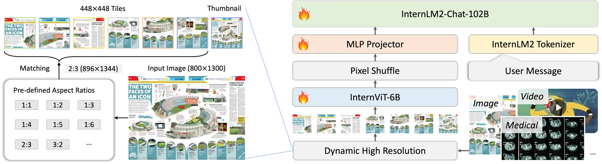
<figcaption>Figure: Overview of the InternVL2 model family, a complete series from 1B to 76B that shares the InternViT visual encoder and swaps in language backbones of different sizes (Source: InternVL official blog)</figcaption>
</div>

### Dynamic high-resolution processing
{: id="动态高分辨率处理"}

InternVL2 uses up to 12 tiles of 448×448 during training and can extend zero-shot to 40 tiles (about **4K resolution**) at test time. The process is as follows:

1. **Adaptive tiling**: According to the input image resolution and aspect ratio, select the closest grid from a predefined set, cut the image into several 448×448 tiles, and keep an additional overall thumbnail
2. **Independent encoding**: Each sub-image is encoded independently by InternViT-6B, producing $(448/14)^2 = 1024$ tokens
3. **Pixel Shuffle compression**: Merge each 2×2 group of 4 adjacent tokens into 1, compressing the tokens of each sub-image from 1024 to **256** (a 4:1 compression ratio) and significantly reducing the LLM input length

### Model sizes and backbone
{: id="模型规格与语言骨干"}

The InternVL2 family offers a complete range of models from devices to servers by swapping the language backbone:

|Model|Visual encoder|Language backbone|Total parameters|
|------|-----------|---------|-------|
| InternVL2-1B | InternViT-300M | Qwen2-0.5B-Instruct |About 1B|
| InternVL2-2B | InternViT-300M | InternLM2-1.8B |About 2B|
| InternVL2-4B | InternViT-300M | Phi-3-Mini-3.8B |About 4B|
| InternVL2-8B | InternViT-300M | InternLM2.5-7B |About 8B|
| InternVL2-26B | InternViT-6B | InternLM2-20B |About 26B|
| InternVL2-40B | InternViT-6B | Nous-Hermes-2-Yi-34B |About 40B|
| InternVL2-Llama3-76B | InternViT-6B | Hermes-2-Theta-Llama-3-70B |About 76B|

### Evaluation results
{: id="评测结果"}

Comparison between InternVL2-Llama3-76B and contemporaneous commercial models (values taken from the official InternVL2 blog):

|Benchmark| InternVL2-76B | GPT-4V | GPT-4o | Gemini 1.5 Pro |
|------|--------------|--------|--------|----------------|
| MMBench(EN) | **86.5** | 81.0 | 83.4 | 73.9 |
| DocVQA | **94.1** | 87.2 | 92.8 | 86.5 |
| ChartQA | **88.4** | 78.1 | 85.7 | 81.3 |
| MathVista | **65.5** | 58.1 | 63.8 | 57.7 |

The success of InternVL2 verifies the effectiveness of **scaling up the visual encoder** (relative to CLIP ViT-L) for improving multimodal understanding, especially on tasks that require fine-grained visual understanding (documents, charts, math diagrams).

### InternVL2.5 evolution (late 2024)
{: id="internvl25-演进2024年底"}

InternVL2.5 largely follows the architecture of InternVL2, with major improvements in training and data: it uses **progressive scaling**, so a ViT trained with a small LLM can be reused directly with a large LLM; random JPEG compression augmentation and loss reweighting based on answer length are added during training; and duplicated and abnormal samples in the instruction data are strictly filtered. InternVL2.5-78B reaches 70.1% on the MMMU validation set, the first open-source VLM to exceed 70%. Its training recipe (MLP warm-up → incremental ViT learning → full-model instruction tuning, with a unified learning rate throughout and about 120 billion tokens in total) is detailed in Section 6.4.

<div align="center">
  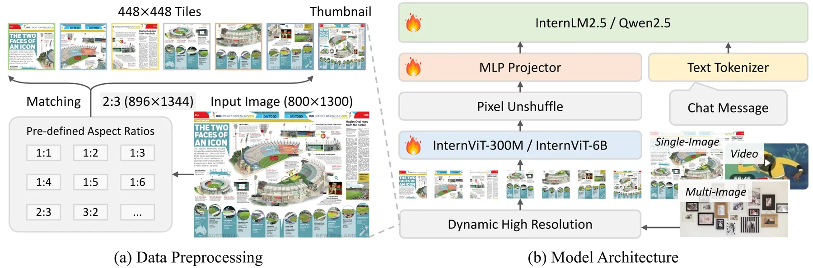
<figcaption>Figure: Evolution of the InternVL model family. From InternVL2 to InternVL2.5, the visual encoder scale and language backbones keep growing (Source: InternVL official)</figcaption>
</div>

---

## 8.8 InternVL3.5(2025)
{: id="88-internvl352025"}

—A comprehensive upgrade of open-source multimodal models: reasoning ability, versatility, and inference efficiency

📄 **Paper**: [arXiv:2508.18265](https://arxiv.org/abs/2508.18265)

### Key takeaways
{: id="精华"}

- Improving reasoning ability does not necessarily rely on a single reinforcement learning algorithm: a **cascade strategy that uses offline RL (MPO) as a "warm-up" and then refines with online RL (GSPO)** saves compute, works better than running online RL alone, and is stable and effective across model scales and sparsity (dense/MoE).
- The visual-token compression rate can be **input-adaptive** rather than hard-coded: the model is first trained with consistency distillation to learn to "output consistently under different compression rates", and then a lightweight router is trained separately to choose the compression rate from the semantic content of each patch, which is finer-grained than traditional Dynamic High Resolution, which tiles by image width and height.
- The bottleneck of multimodal inference efficiency is often not the amount of computation itself but the **mismatch in computational characteristics between the visual encoder and the language model** (the vision side is highly parallel, while the language side is strongly autoregressive and depends on historical state), which causes them to block each other. Decoupling the two and deploying them on different GPUs/servers to form an asynchronous pipeline directly yields considerable throughput gains, and the higher the resolution, the larger the gain.
- These two efficiency measures (dynamic compression rate + decoupled deployment) are almost orthogonal and **can be stacked**: DvD alone accelerates up to 2.01×, and stacking ViR on top reaches 4.05×. This shows that "saving tokens" and "saving scheduling blockage" address two different types of bottleneck, and both deserve attention at the same time.
- The native pretraining strategy of mixing large-scale text data and multimodal data at a ratio of about 1:2.5 to 1:3.5 is an important prerequisite for open-source MLLMs to approach commercial models on text-only tasks (GAOKAO, MMLU-Pro, etc.). It is a reminder that "going multimodal" should not come at the expense of language ability.

---

### 1. Background and problem
{: id="1-研究背景问题"}

Currently, there is still a clear gap between open-source MLLMs and commercial models such as GPT-5 on text tasks, complex reasoning tasks, and agent tasks. The community has tried to narrow the gap with RL methods, but a stable, efficient, and scalable reinforcement learning framework for MLLMs remains an open problem. At the same time, the computational cost of long visual contexts and high-resolution understanding keeps rising and has become a core bottleneck in real deployment. InternVL3.5 addresses two relatively independent but equally important dimensions at once: "reasoning ability" and "inference efficiency".

---

### 2. Methods and innovations
{: id="2-主要方法创新点"}

InternVL3.5 follows the "ViT–MLP–LLM" paradigm of the InternVL series (the language model is based on Qwen3/GPT-OSS, and the visual encoder is InternViT-300M/InternViT-6B) and introduces three core techniques on top of it: **Cascade RL** (improves reasoning ability), the **Visual Resolution Router (ViR)** (reduces visual token overhead), and **Decoupled Vision-Language Deployment (DvD)** (decoupled deployment improves inference throughput).

<div align="center">
  
<figcaption>Figure: Overall architecture of InternVL3.5. (a) Data preprocessing: the image is divided into 448×448 tiles plus a thumbnail according to a predefined aspect ratio; (b) Overall model architecture: the ViT encodes the visual tiles, which are connected to the Qwen3/GPT-OSS language model through an MLP projector; (c) Connector architecture: InternVL3.5-Flash adds a Visual Resolution Router on top of the standard Pixel Shuffle and dynamically selects a compression rate of 1/4 or 1/16 according to the semantic content of each patch.</figcaption>
</div>

**① Overall framework**: The system consists of three core modules. The visual encoder (InternViT) encodes the dynamically tiled images into visual tokens; the vision-language connector compresses the visual tokens through Pixel Shuffle and projects them into the language model's embedding space with an MLP projector; and the language model (Qwen3/GPT-OSS) fuses the visual tokens with the text tokens and generates the reply autoregressively. InternVL3.5-Flash additionally introduces ViR in the connector, so that the visual-token compression rate can be adjusted dynamically according to the patch content instead of being fixed.

**② Training pipeline (four-stage progression)**:

<div align="center">
  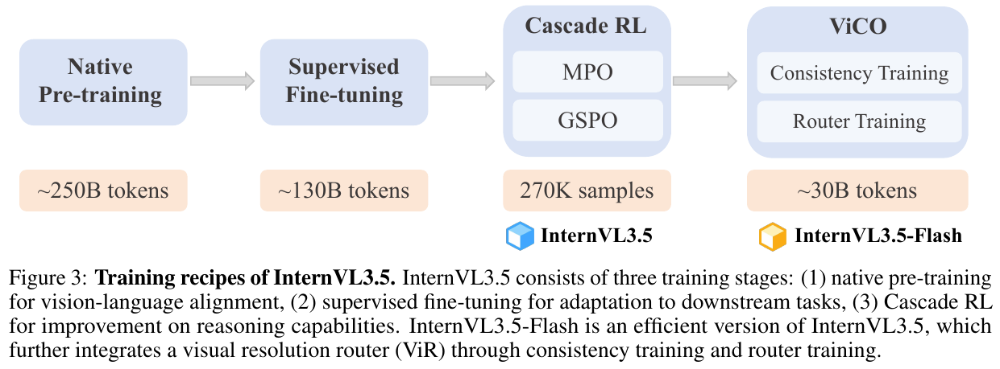
<figcaption>Figure: InternVL3.5 training pipeline: native pretraining, supervised fine-tuning, Cascade RL (with two sub-stages, MPO and GSPO), and ViCO (consisting of consistency training and router training, used to produce InternVL3.5-Flash).</figcaption>
</div>

- **Native pretraining (~250B tokens)**: All parameters are updated jointly, the mixing ratio of text data to multimodal data is about 1:2.5, and the maximum sequence length is 32K. The loss is a per-sample "square-root-weighted" NTP loss (the weight is $w_i=1/N^{0.5}$, where $N$ is the number of tokens in the sample on which the loss is computed) to avoid bias from long or short responses; random JPEG compression is also introduced to improve robustness in real-world scenes.
- **Supervised fine-tuning (SFT, ~130B tokens)**: Reuses the instruction data of InternVL3 to ensure coverage, adds long chain-of-thought data for "Thinking mode" (sampled by large-model rollouts and strictly filtered for thinking clarity, redundancy, and format consistency), and adds capability-expansion data such as GUI interaction, embodied interaction, and SVG understanding and generation.
- **Cascade RL (core innovation)**: Divided into two complementary sub-stages. The **offline RL stage** uses Mixed Preference Optimization (MPO) as an efficient "warm-up"; its loss is a weighted sum of a preference loss (DPO), a quality loss (BCO), and a generation loss (LM loss):
  $$\mathcal{L}_{MPO} = w_p \mathcal{L}_p + w_q \mathcal{L}_q + w_g \mathcal{L}_g$$
Offline RL decouples rollout collection from parameter updates, is highly training-efficient, and can guarantee high-quality rollouts for the next stage. The **online RL stage** uses GSPO (without a reference-model constraint) to refine the output distribution on rollouts sampled from the model itself. The advantage function is defined as the standardized value of the rewards of multiple responses to the same query:
  $$\hat A_i = \frac{r(x,y_i) - \mathrm{mean}\{r(x,y_i)\}_{i=1}^G}{\mathrm{std}\{r(x,y_i)\}_{i=1}^G}$$
The importance sampling ratio takes the geometric mean of the per-token probability ratios (i.e., the ratio at the level of the whole response):
  $$s_i(\theta) = \left(\frac{\pi_\theta(y_i\mid x)}{\pi_{\theta_{old}}(y_i\mid x)}\right)^{1/|y_i|}$$
Advantages of the cascade design: (1) Rollout collection and updates in the offline stage are decoupled, which alleviates reward hacking, and a stronger MPO model makes the subsequent GSPO training more stable; (2) Rollouts from the offline stage can be shared among multiple models, spreading the sampling cost of online RL; (3) A model warmed up by MPO needs fewer steps to reach a higher performance ceiling in the GSPO stage.
- **ViCO (building InternVL3.5-Flash)**: Two steps. **Consistency training**: Freeze a reference model initialized from InternVL3.5 (inferring with a fixed 1/4 compression rate), and align the output distribution of the policy model under the two compression rates of 1/4 and 1/16 (uniformly sampled) with that of the reference model, minimizing the KL divergence:
  $$\mathcal{L}_{ViCO} = \mathbb{E}_{\xi\sim R}\left[\frac{1}{N}\sum_{i=1}^N \mathrm{KL}\big(\pi_{\theta_{ref}}(y_i\mid y_{<i},I)\,\|\,\pi_{\theta_{policy}}(y_i\mid y_{<i},I_\xi)\big)\right]$$
**Router training**: Freeze the whole MLLM backbone and train only the binary classifier of ViR. First compute, for each patch, the loss ratio $$r_i = \mathcal{L}_{ViCO}(y_i\mid I_{1/16}) / \mathcal{L}_{ViCO}(y_i\mid I_{1/4})$$ between low and high compression rates, then use the k-th percentile of the sliding-window history as a dynamic threshold $\tau$, and generate a 0/1 label according to whether $r_i$ exceeds $\tau$ to train the router, so that it learns to judge "which patches can be compressed without losing performance". In the end, InternVL3.5-Flash can reduce visual tokens by 50% with almost no performance loss (on high-resolution tasks such as DocVQA it keeps ~100% of the original performance).

**③ Decoupled Vision-Language Deployment (DvD)**:

<div align="center">
  
<figcaption>Figure: Schematic of DvD decoupled deployment. (a) Original deployment: the ViT, MLP, and LLM run serially on the same server. Because of the huge differences in size and computational characteristics, serious mutual blocking occurs; (b) DvD: the ViT+MLP is deployed on a separate vision server and the LLM on a language server, and the two run asynchronously in parallel. Visual features are transmitted one way in BF16 over TCP (optionally RDMA), and the three-stage pipeline executes with overlap.</figcaption>
</div>

**Motivation**: The visual encoder is highly parallelizable and does not depend on long-lived historical state, while the language model, being autoregressive, is more sensitive to memory bandwidth and latency; placing them on the same server makes them block each other, and the higher the resolution or the larger the visual model, the more serious the blocking. DvD splits the vision subsystem (batch-processing images into compact feature embeddings) and the language subsystem (fusing text context for decoding) onto independent servers, letting visual computation overlap with the LLM's prefilling/decoding. It also makes it easier to optimize the hardware cost of each side independently, and new visual modules do not require changes to the language server.

**Summary of training objectives**: The pretraining/SFT stage uses a weighted NTP loss; the Cascade RL stage uses MPO's three-term weighted loss (the formula above) and GSPO's clipped objective; the ViCO stage uses a KL consistency loss + the router's cross-entropy loss.

**Inference procedure**: Test-time scaling is not enabled by default; two additional TTS methods are provided for inference benchmarks: **Deep Thinking** (turning on Thinking mode for step-by-step reasoning) and **Parallel Thinking** (using VisualPRM-v1.1 as a critic to make a Best-of-N selection among multiple candidate answers). Both can be stacked with Cascade RL to further improve reasoning scores.

---

### 3. Results and findings
{: id="3-核心结果发现"}

- **Overall capability**: InternVL3.5-241B-A28B achieved the highest overall score among open-source models on 35 benchmarks in four categories: general, reasoning, text, and agent. Its overall score on general multimodal tasks is 74.1, on par with GPT-5's 74.0, and the overall gap to GPT-5 across all categories narrows to 3.9%.
- **Significantly improved reasoning ability**: Compared with the previous generation InternVL3, reasoning benchmarks improve by more than 10 points on average at the same scale; the 8B/241B models reach 73.4/77.7 on MMMU, respectively. The stage-by-stage ablation of Cascade RL shows that the Instruct model after SFT already greatly exceeds InternVL3 (e.g., +9.3% for 8B), and the MPO stage provides an average gain of up to +3.5%. The full Cascade RL brings a maximum gain of +16.0% over the SFT baseline (e.g., +12.2% on reasoning tasks for the 2B model and +6.5% for the 241B model), and training efficiency needs only half of GSPO's GPU hours to achieve better results (8B model: Cascade RL takes ~5.8K GPU hours with an overall score of 60.3, versus two rounds of GSPO at ~11.0K GPU hours with an overall score of only 58.2).
- **Stackable efficiency gains**: DvD alone brings up to 2.01× (241B model) / 1.97× (38B model) throughput speedup, and the higher the resolution, the more pronounced the speedup (the speedup of the 38B model rises from 1.19× to 1.97× when the resolution goes from 448 to 1344); after stacking ViR on top of DvD, the total speedup reaches up to 4.05× (38B model, 1344 resolution). The halving of visual tokens by ViR comes with almost no performance loss (InternVL3.5-Flash keeps ~100% of the original model's score on high-resolution tasks such as DocVQA and InfoVQA).
- **Versatility**: It achieves leading performance among open-source models on agentic tasks such as SGP-Bench (SVG understanding), ScreenSpot/OSWorld-G (GUI grounding), and VSI-Bench/ERQA/SpaCE-10/OmniSpatial (embodied/spatial reasoning), verifying the model's potential in GUI interaction and embodied intelligence.

---

### 4. Limitations
{: id="4-局限性"}

The paper has no separate Limitations section, but points out in its result analysis that InternVL3.5 still lags behind some open-source/commercial models on tasks such as HallusionBench (hallucination evaluation), indicating that visual hallucination is not fully solved by the existing training strategies and needs further improvement; in addition, the current TTS has been shown to be effective only on reasoning benchmarks, with no obvious gain for general perception/understanding tasks.

---

<a id="qwen25-vl"></a>

## 8.9 Qwen2.5-VL(2025)
{: id="89-qwen25-vl2025"}
—A vision-language model with native resolution, dynamic FPS, and temporal awareness

📄 **Paper**: [arXiv:2502.13923](https://arxiv.org/abs/2502.13923)

### Key takeaways
{: id="精华-1"}

Qwen2.5-VL combines dynamic resolution, dynamic FPS sampling, and time-aware position encoding: it preserves visual detail according to the input and budget, expresses the positions of video events with temporal information, and controls computational overhead with windowed attention and feature merging. "Dynamic resolution" does not mean no scaling at all, and "time awareness" does not mean correct localization; both are mechanisms that support these abilities.

---

### 1. Background and problem
{: id="1-研究背景问题-1"}

Mainstream VLMs (such as the LLaVA series) usually scale images to a fixed resolution during visual encoding and cut video frames at a fixed frame rate, which loses detail and gives inaccurate temporal understanding. In addition, early ViTs in VLMs directly reused image-pretraining structures, lacking native support for temporal modeling of video and deep integration with the LLM's position encoding system. Qwen2.5-VL improves on these problems in two respects: the visual encoder architecture and the position encoding design.

---

### 2. Methods and innovations
{: id="2-主要方法创新点-1"}

**① Overall framework**

Qwen2.5-VL consists of a visual encoder, an MLP vision-language merger, and the Qwen2.5 language model. MRoPE is the mechanism by which the language model handles multimodal positions and cannot replace the merger as the connector.

<div align="center">
  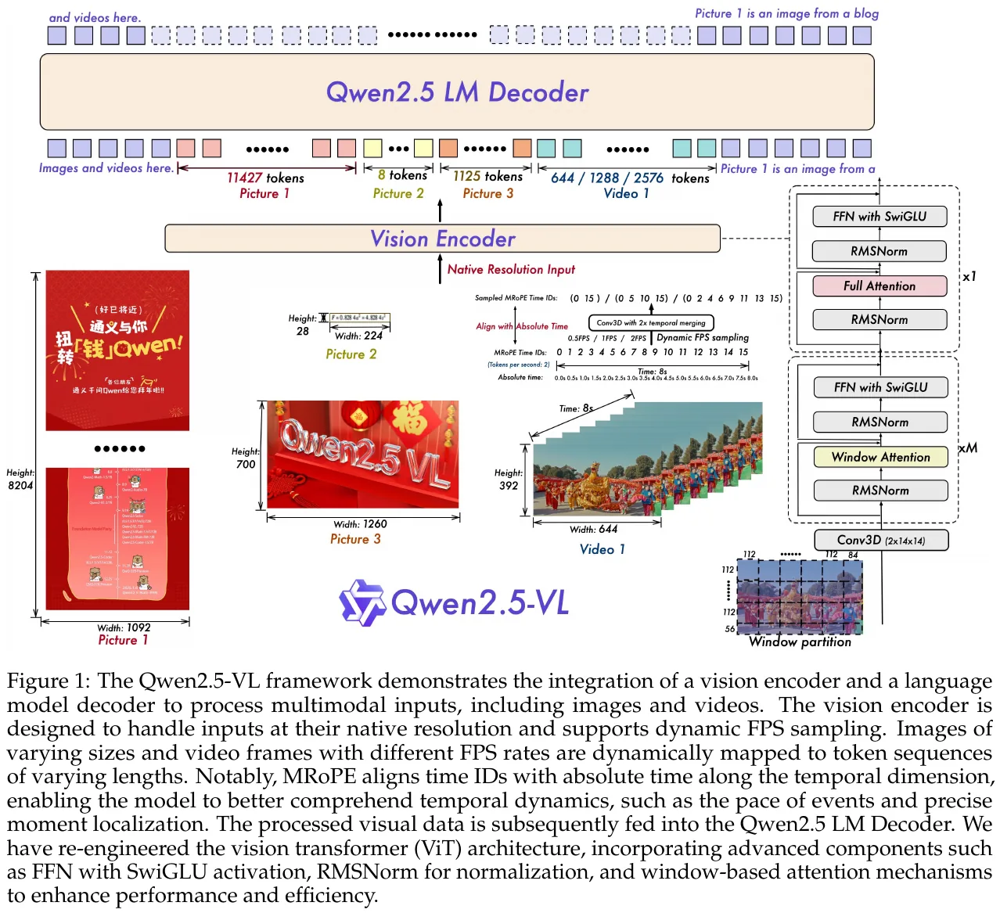
<figcaption>Overall architecture of Qwen2.5-VL: the visual encoder processes variable-length image and video inputs, the merger compresses and projects the visual features, and the language model reads spatial and temporal information through MRoPE.</figcaption>
</div>

**② Vision encoder: the redesigned ViT**

- **Input**: Images preprocessed under pixel-budget and size constraints; for video, a frame sequence obtained according to the sampling configuration
- **Processing**:
  - **Window attention** (local attention): Most layers compute attention within local windows to reduce visual encoding overhead
  - **Full attention** (global attention): Four layers widen the scope of spatial interaction; this should not be read as global attention across all video frames
  - **Spatiotemporal patches and spatial merging**: Two adjacent frames are encoded together in a spatiotemporal patch, and the merger combines adjacent 2×2 spatial features; two complete video frames are not compressed into a single token
  - **SwiGLU FFN + RMSNorm**: Replace the original ViT's GELU FFN + LayerNorm to improve efficiency and stability
- **Output**: A variable-length sequence of visual tokens (an image yields a few hundred to over a thousand tokens; for video the count is adjusted dynamically according to the number of frames and the FPS)
- **Motivation**: Window attention makes the ViT's computation grow roughly linearly with the number of patches, easing the $$O(n^2)$$ cost of global self-attention at high resolution; two-frame 3D convolution patches halve the number of video tokens

**③ MRoPE (Multimodal Rotary Position Embedding)**

Traditional 1D RoPE cannot express the two-dimensional spatial position of an image or the timestamps of a video. MRoPE extends rotary position encoding to three channels:

- **Image**: The height and width components express spatial position, and the temporal ID stays the same within an image
- **Video**: In addition to H and W, the temporal ID is aligned with the **absolute timestamp** of the frame (rather than the frame index), so that the model can perceive that "this frame occurred at second $t$"

This gives the model the ability to localize moments precisely (moment retrieval) in video QA tasks, rather than merely judging the relative order of events.

**④ Dynamic resolution and dynamic FPS**

- Images are preprocessed according to size constraints and the pixel budget, and the number of tokens varies with the processed image area.
- Video supports inputs with different FPS, so the model need not assume a fixed frame rate; low-frame-rate videos do not introduce artifacts through interpolation

<div align="center">
  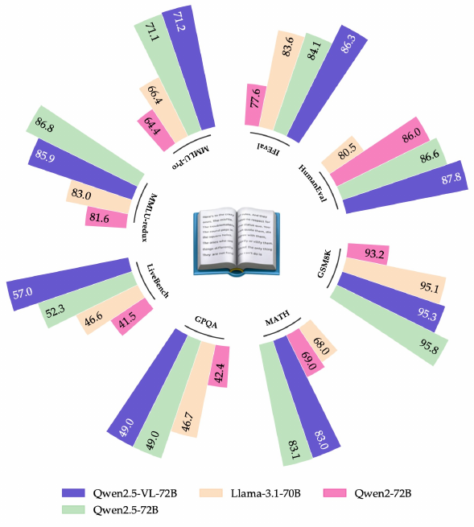
<figcaption>Qwen2.5-VL-72B performs on par with text-only language models (Llama-3.1-70B, Qwen2-72B, Qwen2.5-72B, etc.) on text-only benchmarks (MMLU-Pro, GPQA, MATH, GSM8K, HumanEval, MultiPL-E, IFEval, etc.), which examines how well language ability is retained after multimodal training.</figcaption>
</div>

<div align="center">
  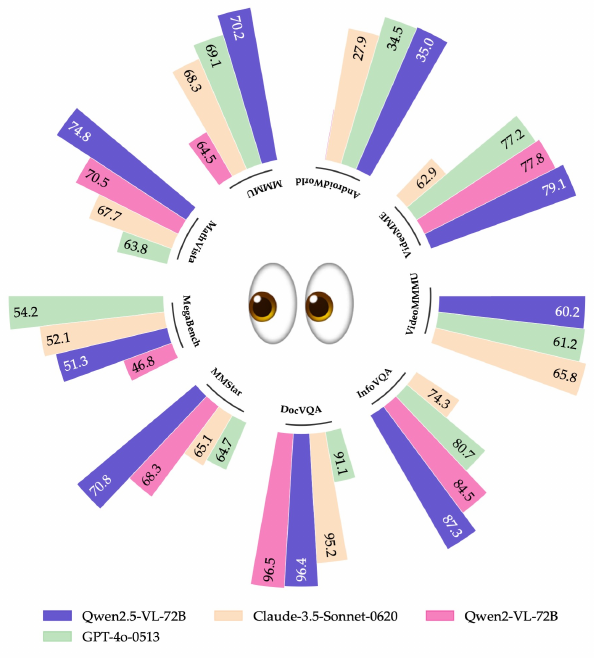
<figcaption>Comparison of Qwen2.5-VL-72B with Claude-3.5-Sonnet, GPT-4o, Qwen2-VL-72B, and others on visual benchmarks (MMMU, AndroidWorld, Video-MME, InfoVQA, DocVQA, MMStar, MMBench, MathVista, etc.). Qwen2.5-VL-72B leads on most benchmarks, but not on every one.</figcaption>
</div>

**⑤ Training objective**

Both pretraining and SFT use an autoregressive language modeling objective:

$$\mathcal{L} = -\sum_{t} \log P(y_t \mid y_{<t}, x_{\text{visual}}, x_{\text{text}})$$

Visual tokens and text tokens are fed uniformly into the LM decoder for next-token prediction; visual token positions are excluded from the loss, and in the SFT stage the loss is computed only on the answer part. After SFT, DPO is used for preference alignment, and the ViT stays frozen during post-training.

---

### 3. Results and findings
{: id="3-核心结果发现-1"}

The reported results for the 72B version are as follows:

- **DocVQA**: 96.4, higher than Claude-3.5-Sonnet (95.2) and GPT-4o (91.1); OCRBench 885
- **Video-MME** (with subtitles): 79.1, higher than GPT-4o (77.2) and lower than Gemini-1.5-Pro (81.3); LVBench 47.3, significantly higher than both
- **MathVista**: 74.8, higher than GPT-4o (63.8) and Claude-3.5-Sonnet (67.7)
- **Text-only benchmarks**: MMLU-Pro 71.2, MATH 83.0, GSM8K 95.3, HumanEval 87.8, on par with text-only language models of the same scale, indicating that language ability is well retained after multimodal training
- Provides models at 3B / 7B / 32B / 72B, with the 3B aimed at on-device deployment

---

### 4. Limitations
{: id="4-局限性-1"}

Inferring from the architecture and input budget: sparse sampling may miss short events, lower resolution may lose small text, and long videos also increase the context overhead of the language model. These are risks to verify at deployment time, and temporal ability cannot be judged solely from the number of full-attention layers in the visual encoder. Variable-length inputs also require managing padding, the pixel budget, and GPU memory during batching.

---

<a id="qwen3-vl"></a>

## 8.10 Qwen3-VL(2025)
{: id="810-qwen3-vl2025"}
—Long context, hierarchical visual fusion, and enhanced reasoning

📄 **Paper**: [arXiv:2511.21631](https://arxiv.org/abs/2511.21631v2)

### Key takeaways
{: id="精华-2"}

This paper shows how to build a comprehensive vision-language model series. The core ideas worth learning include:
1. **Balancing text and multimodal ability**: Square-root reweighting ensures that multimodal training does not harm text ability, and the model even surpasses text-only models on some text tasks
2. **Progressive context extension**: Four-stage pretraining (8K→32K→256K) expands the context window gradually instead of in one step
3. **Pragmatic architectural optimization**: Innovations such as Interleaved MRoPE, DeepStack, and text timestamps all target practical problems (long-video understanding, vision-language alignment, temporal grounding)
4. **Hierarchical post-training**: Distinguishes non-thinking and thinking variants, optimized for different application scenarios
5. **Full-stack capability integration**: Unifies perception (grounding), reasoning, and action (agentic) abilities in a single model framework

### 1. Background and problem
{: id="1-研究背景问题-2"}

Existing vision-language models face several key challenges. First, multimodal training often damages the language ability of the underlying LLM. Second, long-context support is insufficient, making long documents and long videos hard to handle. Third, performance is uneven on specialized tasks such as STEM reasoning, document understanding, and video understanding. Fourth, there is no unified framework that integrates perception, reasoning, and decision-making. Qwen3-VL aims to solve these problems systematically.

### 2. Methods and innovations
{: id="2-主要方法创新点-2"}

<div align="center">
  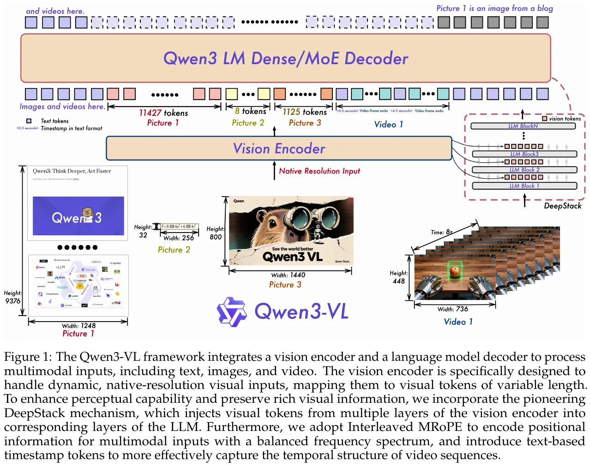
<figcaption>
Overall architecture of Qwen3-VL: a visual encoder and a language model decoder are integrated to process multimodal inputs such as text, images, and video. The visual encoder supports dynamic native resolution and injects multi-layer visual features into the corresponding layers of the LLM through the DeepStack mechanism. Interleaved MRoPE encodes position information, and text timestamp tags are introduced to capture the temporal structure of video.
</figcaption>
</div>

Qwen3-VL offers a complete vision-language model series, including 4 dense models (2B/4B/8B/32B) and 2 MoE models (30B-A3B/235B-A22B), all of which natively support an interleaved context of 256K tokens:

|Type|Scale|Description|
|------|------|------|
| Dense | 2B / 4B / 8B / 32B |Standard dense models, with both thinking and non-thinking variants at each scale|
| MoE | 30B-A3B |Mixture-of-experts routing, 3B activated parameters|
| MoE | 235B-A22B |Flagship scale, 22B activated parameters, balancing quality and latency|

**Architectural innovations**:

1. **Interleaved MRoPE**: To address the frequency-spectrum imbalance of MRoPE in Qwen2.5-VL, the time (t), horizontal (h), and vertical (w) dimensions are interleaved across the low- and high-frequency bands, significantly improving long-video understanding

2. **DeepStack cross-layer fusion**: Visual features are extracted from multiple ViT layers and routed to the corresponding LLM layers through lightweight residual connections, strengthening multi-level vision-language alignment without increasing the context length

3. **Explicit video timestamps**: Groups of video frames are marked with text tokens (such as `<3.0 seconds>`), replacing the absolute-time position encoding of Qwen2.5-VL with a simpler and more direct temporal representation that supports both seconds and HMS formats

4. **Visual encoder upgraded to SigLIP-2**: Supports dynamic input resolution; the flagship versions (8B/32B/MoE) use SigLIP2-SO-400M and the small versions (2B/4B) use SigLIP2-Large (300M); the vision-language connector is a two-layer MLP that compresses 2×2 patch features into a single token

**Training strategy**:

**Pretraining** has four stages:
- S0 (67B tokens, 8K): Train only the merger layer, for vision-language alignment
- S1 (~1T tokens, 8K): Full-parameter multimodal pretraining on mixed VL and text data
- S2 (~1T tokens, 32K): Long-context pretraining, with a larger share of text data and more video/agent data
- S3 (100B tokens, 256K): Ultra-long-context adaptation, focusing on long-video and long-document understanding

**Post-training** has three stages:
1. SFT: Two stages, at 32K and 256K, producing non-thinking and thinking variants
2. Strong-to-weak distillation: Fine-tunes the LLM backbone with text-only data, significantly improving reasoning ability
3. Reinforcement learning: Split into reasoning RL (mathematics, code, logical reasoning, etc.) and general RL (instruction following, format control, etc.), using the SAPO algorithm

**Data optimization**:

- **High-quality captions**: Qwen2.5-VL-32B re-labels web images, and visual-embedding clustering is used to strengthen the coverage of sparse concepts
- **Interleaved text-image data**: Multimodal documents are collected, low-quality content is filtered with a domain classifier, and 256K long sequences are built
- **Knowledge data**: Covers 12+ semantic categories (animals, plants, landmarks, etc.), with importance-based sampling to balance the long-tail distribution
- **OCR extension**: Expanded from 10 languages to 39 languages, with 30 million high-quality samples synthesized
- **Normalized grounding**: A unified `[0, 1000]` normalized coordinate system, supporting 2D/3D grounding and counting
- **Video data**: Dense caption synthesis (a short-to-long strategy) and spatiotemporal grounding data
- **STEM data**: 6M chart captions + 60M+ K-12/undergraduate exercises + 12M long-CoT reasoning samples
- **Agent data**: GUI perception (description, grounding) + a self-evolving trajectory generation framework

**Optimization techniques**:

- **Square-root reweighting**: Square-root normalization of the per-token loss, balancing the contributions of text and multimodal data
- **Hierarchical training**: Context is extended gradually during pretraining, and thinking/non-thinking modes are distinguished during post-training.

### 3. Results and findings
{: id="3-核心结果发现-2"}

**Overall performance**:
- On multimodal reasoning tasks (MMMU, MathVista, MathVision, etc.), Qwen3-VL-235B-A22B-Thinking reaches SOTA level
- Matches or surpasses text-only models (such as DeepSeek V3 and Qwen3-235B) on text tasks, showing that multimodal training does not harm language ability
- Small models (2B/4B/8B) perform well, and the 8B model is close to Qwen2.5-VL-72B on many tasks

Comparison between the **flagship model (235B-A22B) and Gemini 2.5 Pro (multimodal evaluation results extracted from the technical report; the highest score in each row is in bold):**

|Benchmark|Category| Qwen3-VL-235B Thinking | Qwen3-VL-235B Instruct | Gemini 2.5 Pro Thinking |
|------|------|----------------------|----------------------|------------------------|
| MMMU |General multimodal| 80.6 | 78.7 | **81.3** |
| MathVista_mini |Visual math| **85.8** | 84.9 | 82.7 |
| MathVision |Visual math| **74.6** | 66.5 | 73.5 |
| MMBench-EN |General VQA| 88.8 | **89.3** | 83.8 |
| RealWorldQA |Real-world scenes| 81.3 | 79.2 | **82.8** |
| MMStar |Open-domain QA| **78.7** | 78.4 | 77.5 |
| DocVQA_test |Document understanding| 96.5 | **97.1** | 94.0 |
| ChartQA_test |Chart understanding| **90.3** | **90.3** | 83.3 |
| OCRBench | OCR | 875 | **920** | 866 |
| Video-MME w/o sub |Video understanding| 79.0 | — | **85.1** |

**Long-context ability**:
- Needle-in-a-Haystack evaluation: 100% accuracy within 256K tokens (30 minutes of video), and still 99.5% accuracy when extrapolated to 1M tokens (2 hours of video)
- MMLongBench-Doc: 57.0% accuracy, SOTA performance

**Domain specializations**:
- **OCR/documents**: OCRBench 920 points, supports 39 languages, with accuracy above 70% in 32 of the 39 languages
- **2D/3D grounding**: RefCOCO 91.9%, ODinW-13 48.6 mAP, and 3D grounding surpasses Gemini-2.5-Pro by 5.2 points on SUNRGBD
- **Video understanding**: MLVU 84.3%, exceeding Gemini-2.5-Pro on some long-video benchmarks; Video-MME (without subtitles) is still lower than Gemini-2.5-Pro (see the table above)
- **GUI agent**: ScreenSpot Pro 62.0%; the 32B version is reported to reach 41 on OSWorld and 63.7 on AndroidWorld
- **Fine-grained perception**: V* 93.7% with tool use, HRBench4K 85.4%
- **STEM reasoning**: MathVista 85.8% (thinking), MathVision 74.6%, MMMU 80.6%

**Gains from thinking mode**:
- Thinking mode brings significant gains on reasoning-intensive tasks (e.g., AIME-25: 89.7% vs 74.7%, HMMT-25: 77.4% vs 57.4%)
- Instruct mode is better for perception-centric tasks (e.g., OCRBench 920 vs 875, DocVQA 97.1 vs 96.5), indicating that the mode should be chosen according to the application scenario

### 4. Limitations
{: id="4-局限性-2"}

The paper does not explicitly state its limitations, but they can be inferred from the architecture and experimental design: the training cost is high (four-stage pretraining + three-stage post-training), which may be hard to reproduce in resource-limited settings; although a 256K context is supported, YaRN extrapolation is still needed for ultra-long sequences (>256K); and although thinking mode improves reasoning ability, it increases inference latency and cost.

---

<a id="dinov2"></a>

## 8.11 DINOv2(2023)
{: id="811-dinov22023"}

**Paper**: DINOv2: Learning Robust Visual Features without Supervision
**Organization**: Meta AI Research
**Published**: TMLR 2024 (arXiv April 2023); authors: Maxime Oquab, Timothée Darcet, Théo Moutakanni, et al.

📄 **Paper**: [arXiv:2304.07193](https://arxiv.org/abs/2304.07193)

DINOv2 represents a different route to training visual encoders from CLIP/SigLIP: **no language supervision at any point**, learning visual representations using only the structure of the images themselves. Its patch-level features are significantly better than those of comparable image-text contrastive models on dense prediction tasks such as semantic segmentation and depth estimation, and it is often used as a supplementary visual encoder for VLMs.

> **Key takeaways**: The core value of DINOv2 is that it can **learn general visual semantics** without relying on text descriptions. CLIP's visual features are optimized to match whole texts, and spatial details rarely mentioned in image captions are not supervised directly; DINOv2 uses student-teacher self-distillation and masked patch prediction to give patch features better spatial semantic consistency, so frozen features plus a linear head are enough for segmentation. Its limitation is that it contains no language alignment and cannot be used directly for zero-shot image-text retrieval or classification. When connecting to a VLM, it still needs a connector and image-text training.

### Training: self-distillation
{: id="训练方法学生-教师自蒸馏"}

DINOv2 uses a **self-distillation** framework that needs no annotated data:

- **Student network**: Its parameters are updated by gradient descent
- **Teacher network**: Its parameters are the **exponential moving average (EMA)** of the student network; it receives no gradients and acts as a "stable pseudo-label generator"

$$\theta_{\text{teacher}} \leftarrow m \cdot \theta_{\text{teacher}} + (1 - m) \cdot \theta_{\text{student}}$$

Here, the momentum $m$ increases gradually from 0.994 to 1 following a cosine schedule.

**Multi-scale cropping strategy**:
- Each image is cropped into **2 global views** (covering a larger area of the original image, 224×224) and **several local views** (covering a smaller area, 98×98)
- The teacher network processes only the global views, while the student network processes all views
- Training objective: the student's output on a local view must be consistent with the teacher's output on the global views

This **local-to-global consistency** objective forces the network to infer the overall semantics from local content, and is the main source of the good semantic consistency of DINO-family features.

### Training objectives
{: id="训练目标-1"}

DINOv2 combines the following components on top of DINO (2021) and iBOT (2022):

|Component|Function|Granularity|
|------|------|---------|
|**DINO loss** (self-distillation cross-entropy)|Aligns the student and teacher `[CLS]` output distributions|Image level|
|**iBOT loss** (masked patch distillation)|The student predicts the teacher's output for masked patches, learning patch-level semantics|Patch level|
|**KoLeo regularizer**|Spreads the features within a batch more evenly over the hypersphere to prevent collapse|Batch level|
|**Sinkhorn-Knopp centering** (borrowed from SwAV)|Replaces DINO's teacher-output centering and stabilizes the pseudo-label distribution|Batch level|

iBOT's masked prediction provides explicit patch-level supervision, which is one of the main reasons DINOv2's dense features are stronger than those of the original DINO. There is also a short 518×518 high-resolution stage at the end of training to improve performance on small objects and pixel-level tasks.

### Data: LVD-142M
{: id="数据lvd-142m"}

Data quality is critical to self-supervised learning. DINOv2 specifically built **LVD-142M** (142 million images):

1. **Deduplication**: Copy detection is run on the raw crawled data to remove near-duplicate images
2. **Retrieval-based filtering**: Using images from curated datasets such as ImageNet-22K and Google Landmarks as seeds, self-supervised features are used to retrieve similar images from the web image pool and expand them to a scale consistent with the seed distribution.
3. **No manual annotation anywhere in the pipeline**: Filtering relies only on image-feature similarity, with no text or labels

> With the same 142 million images, the curated LVD-142M outperformed unfiltered web images on most downstream tasks, showing that at this scale data distribution and quality matter more than sheer quantity.

### Model specifications
{: id="模型规格"}

|Model|Parameters|Layers|Hidden dimension|Attention heads| Patch size |
|------|--------|------|---------|---------|-----------|
| ViT-S/14 | 21M | 12 | 384 | 6 | 14×14 |
| ViT-B/14 | 86M | 12 | 768 | 12 | 14×14 |
| ViT-L/14 | 300M | 24 | 1024 | 16 | 14×14 |
| **ViT-g/14** | **1.1B** | 40 | 1536 | 24 | 14×14 |

ViT-g/14 is trained from scratch with self-supervision, and the three smaller models S/B/L are distilled from ViT-g. All use 14×14 patches, which gives denser patch tokens than configurations such as B/16 and B/32.

### Results: dense prediction
{: id="核心结果密集预测上的优势"}

All the following results use the setting of a **frozen backbone** with only a lightweight task head trained (Tables 10 and 11 of the paper).

**Semantic segmentation (ADE20K, mIoU)**:

|Model|Parameters|Linear head|Linear head + multi-scale|
|------|--------|-------|----------------|
| OpenCLIP ViT-G/14 | 1.8B | 39.3 | 46.0 |
| DINOv2 ViT-S/14 | 21M | 44.3 | 47.2 |
| DINOv2 ViT-L/14 | 300M | 47.7 | **53.1** |
| DINOv2 ViT-g/14 | 1.1B | **49.0** | 53.0 |

Even the 21M-parameter DINOv2 ViT-S/14 achieves higher linear-probe segmentation than the 1.8B-parameter OpenCLIP ViT-G/14.

**Monocular depth estimation (NYUd, RMSE ↓)**:

|Model|Linear head (last layer)|Linear head (4 layers concatenated)|DPT decoder head|
|------|------|--------|--------|
| OpenCLIP ViT-G/14 | 0.541 | 0.510 | 0.414 |
| DINOv2 ViT-B/14 | 0.399 | 0.362 | 0.317 |
| DINOv2 ViT-L/14 | 0.384 | 0.333 | 0.293 |
| DINOv2 ViT-g/14 | **0.344** | **0.298** | **0.279** |

**Emergent semantic grouping**: Without any segmentation annotations, running PCA on the patch features shows that the first few principal components separate foreground objects from their parts, and corresponding parts of similar objects in different images share the same color:

<div align="center">
  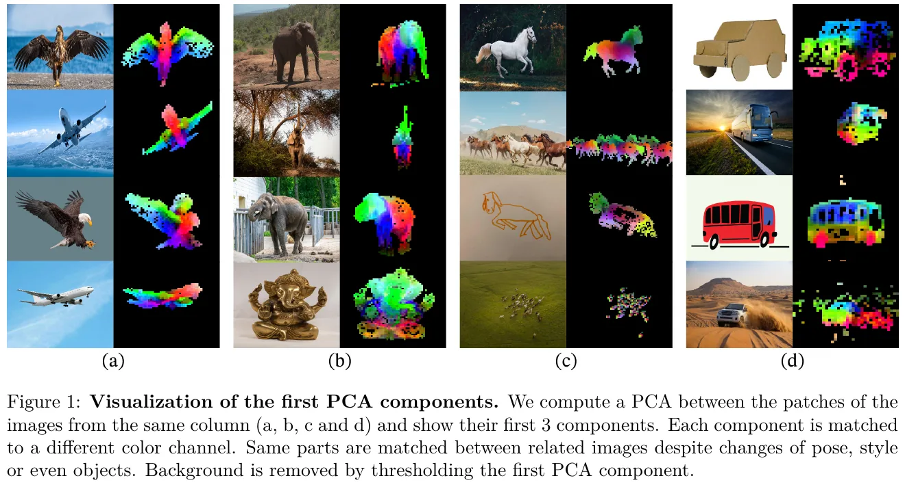
<figcaption>Figure: PCA visualization of DINOv2 patch features. The first principal component naturally corresponds to the foreground object (Source: DINOv2 paper)</figcaption>
</div>

### DINOv2 vs. CLIP
{: id="dinov2-与-clip-对比"}

|Dimension| CLIP ViT-L/14 | DINOv2 ViT-L/14 |
|------|--------------|----------------|
|Training supervision|Image-text contrast (language supervision)|Pure image self-distillation (no language)|
|Feature granularity|Mainly image-level alignment|Finer patch-level semantics|
|ImageNet classification|Zero-shot 75.3%|Needs a trained classification head (linear probe 86.3%)|
|Dense prediction|Average performance with frozen features|Significantly better at segmentation and depth estimation|
|Image-text retrieval|Natively supported|Not supported (no language alignment)|
|Role in VLMs|Mainstream visual backbone (used directly for image-text alignment)|Auxiliary encoder that supplements spatial and geometric details|

**Core conclusion**: CLIP's visual features are optimized for image-level semantics that "match the text", while DINOv2's features are optimized for patch-level semantics of "pure vision". The two can complement each other.

### Applications in VLMs
{: id="在-vlm-中的应用"}

- **Cambrian-1** (NYU, 2024): Systematically compared more than 20 visual encoders and proposed the Spatial Vision Aggregator, which integrates the features of multiple encoders such as SigLIP, CLIP, DINOv2, and ConvNeXt; experiments show that self-supervised encoders have unique value on vision-centric benchmarks
- **Multi-encoder VLMs**: Works such as Prismatic VLMs and Eagle concatenate DINOv2 and SigLIP features along the channel dimension to improve grounding and spatial-relationship tasks
- **Embodied intelligence and 3D**: DINOv2 features are widely used in the visual front end of robot policies and 3D reconstruction. For details, see 

---

## 8.12 DINOv3(2025)
{: id="812-dinov32025"}
—Scaling self-supervised large vision models and repairing local features: from Internet images to geospatial data

📄 **Paper**: [arXiv:2508.10104](https://arxiv.org/abs/2508.10104)

### Key takeaways
{: id="精华-3"}
- Self-supervised learning (SSL) hits a bottleneck of dense-feature degradation when scaled up. DINOv3 solves this by introducing **Gram Anchoring** regularization.
- Gram Anchoring acts on the feature similarity matrix (Gram matrix): by constraining the feature-similarity structure of the student model, it approximates an early teacher model with good local consistency. It greatly improves the consistency of local features without changing the global discriminability of the features themselves.
- By introducing **RoPE-box jittering** of Rotary Positional Embeddings and a **high-resolution adaptation stage** with mixed resolutions, DINOv3 can adapt seamlessly at inference to extremely high resolutions (such as 4096×4096) and arbitrary aspect ratios.
- A **single-teacher, multiple-student distillation scheme** is proposed to efficiently compress the knowledge of the 7B model into practical small models such as ViT-S/B/L, retaining excellent local feature expressiveness.
- The broad applicability of general self-supervised learning to geospatial data (SAT-493M satellite images) is verified, significantly advancing SOTA on dense prediction tasks such as canopy height prediction.

---

### 1. Background and problem
{: id="1-研究背景问题-3"}
- **Dense feature degradation**: Self-supervised learning (SSL) trains visual encoders with excellent generalization from unlabeled data. However, when the model (such as a ViT) and the data are scaled up to 7B parameters and billions of images, although the model keeps improving on global tasks (such as image classification), its dense/local features (used for segmentation and depth estimation) degrade seriously in the middle and late stages of training.
- **Root cause**: Analysis shows that as training goes on for a long time, the similarity between local patch features and the CLS token gradually increases, so local features gradually lose their local specificity and the cosine similarity map becomes blurry and noisy.

---

### 2. Methods and innovations
{: id="2-主要方法创新点-3"}

<div align="center">
  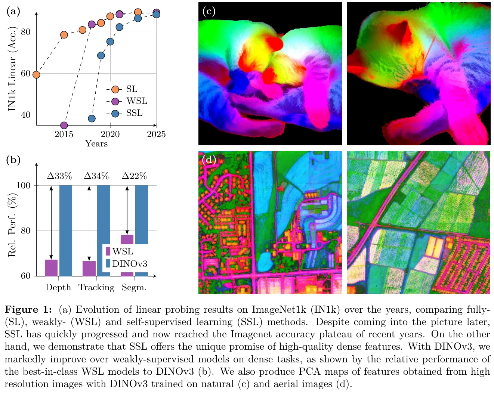
<figcaption>Evolution of DINOv3's linear evaluation performance, relative improvement on dense prediction tasks, and PCA feature map visualizations on natural and aerial images</figcaption>
</div>

#### ① Overall framework
{: id="-整体框架概述"}
DINOv3 inherits from DINOv2 and scales up the self-supervised ViT architecture. The whole pretraining has two stages. The first stage (initial pretraining) runs 1M steps of conventional SSL training on a large-scale multi-source dataset (web images LVD-1689M, a mixture of retrieved data and standard datasets). The second stage (refinement) introduces a **Gram Anchoring** loss, using an early teacher model with good dense features as a guide to repair and stabilize the dense-feature representation in the middle and late stages of training.

#### ② Module-by-module explanation
{: id="-逐模块讲解"}
- **Backbone**: The model is scaled to 7B parameters (ViT-7B) with 40 blocks, an embedding dimension of 4096, a SwiGLU feed-forward network (FFN) with a hidden dimension of 8192, 32 attention heads, and a head dimension of 128.
- **Positional embeddings**: **Rotary position embedding (RoPE)** is used. During training, the RoPE-box jittering mechanism randomly scales the patch relative-coordinate box from $$[-1, 1]$$ to $$[-s, s]$$ ($$s \in [0.5, 2]$$), which improves the model's adaptability to different resolutions and aspect ratios.
- **Heads**: A global DINO head (MLP: 8192-8192-512, with 256k prototypes) and a local iBOT head (MLP: 8192-8192-384, with 96k prototypes).

#### ③ End-to-end data flow
{: id="-端到端数据流"}
- **Training data flow**: The input image first produces 2 global crops (256×256 resolution) and 8 local crops (112×112 resolution). These crops are fed to the ViT-7B student model. The teacher model (updated as the exponential moving average (EMA) of the student) processes only the global crops. The parameters are optimized by computing the difference between the global/local representations of the student and the teacher (DINO loss and iBOT loss).
- **Gram-anchoring data flow**: In the refinement stage, in addition to the regular losses, the global crops are fed into both the student network and the Gram teacher network (either the teacher from the early 200k steps or a regularly updated EMA teacher). The Gram matrices of the patch features of the student and the Gram teacher are computed, and the student is updated through the Frobenius-norm distance between them, restoring the smoothness and consistency of local features while preserving the discriminability of global features.

#### ④ Training objective and loss function
{: id="-训练目标与损失函数"}
In the refinement stage, the final optimization objective of the model is:
$$L_{Ref} = w_D L_{DINO} + L_{iBOT} + w_{DKL} L_{Koleo} + w_{Gram} L_{Gram}$$
where $L_{Gram}$ (the Gram anchoring loss) is defined as:
$$L_{Gram} = \lVert X_S \cdot X_S^\top - X_G \cdot X_G^\top \rVert_F^2$$
Here $X_S$ and $X_G$ are the $P \times d$ local feature matrices of the student and the Gram teacher, each $L_2$-normalized ($P$ is the number of patches and $d$ the number of feature channels). To further exploit the smoothness of high-resolution features, DINOv3 proposes $L_{HRef}$, which lets the Gram teacher take an image input at twice the resolution (512×512) and computes the Gram matrix after downsampling its output feature map to the student's resolution with bicubic interpolation.

<div align="center">
  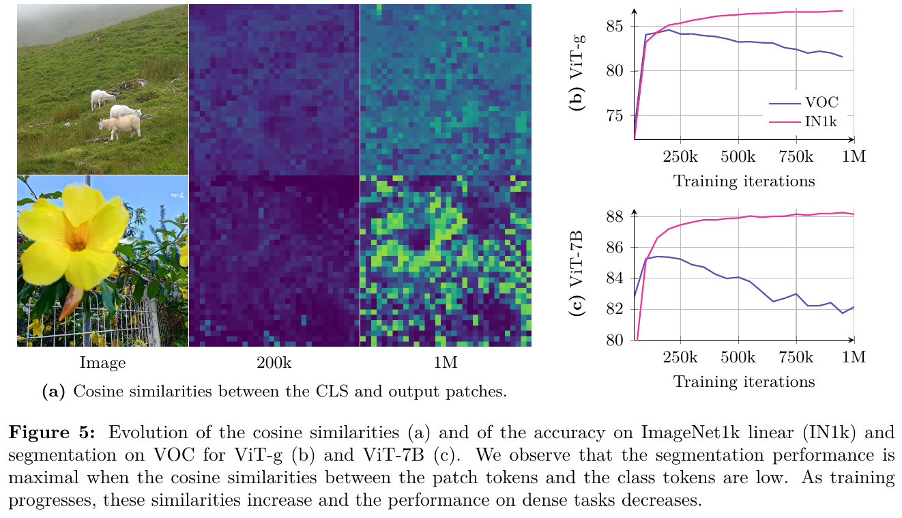
<figcaption>In conventional long-schedule self-supervised pretraining, the correlation between CLS and local patch similarity increases while dense-task performance degrades (middle and right)</figcaption>
</div>

<div align="center">
  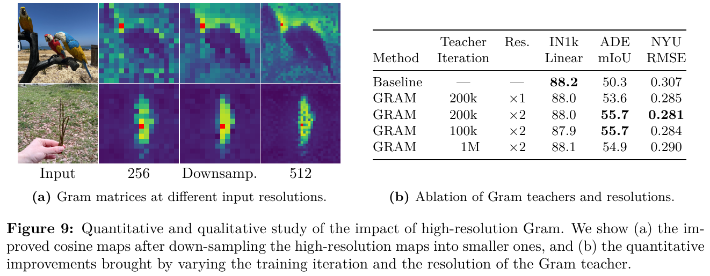
<figcaption>Gram matrices computed at different input resolutions, and ablation results for different Gram teachers and resolutions</figcaption>
</div>

<div align="center">
  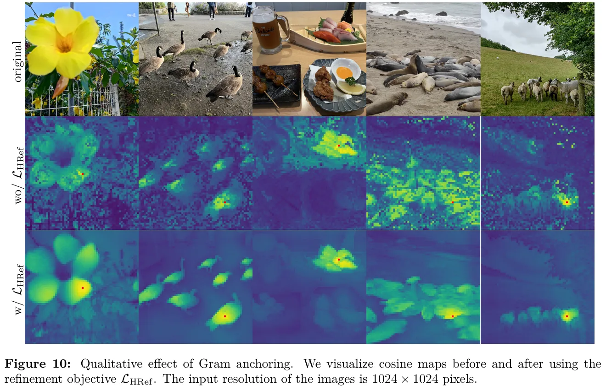
<figcaption>Qualitative comparison of cosine similarity maps of local image patches before and after Gram-anchoring fine-tuning (evaluated at 1024×1024 resolution)</figcaption>
</div>

<div align="center">
  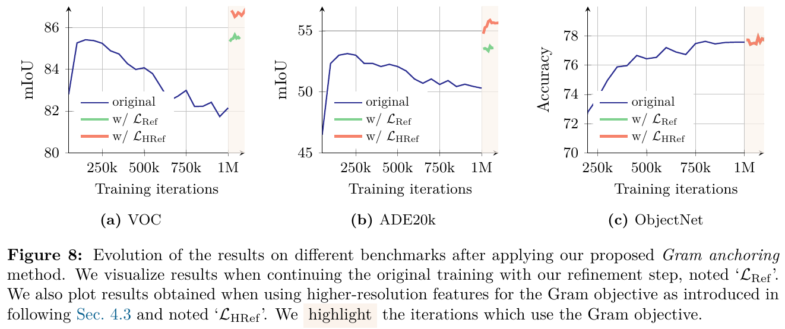
<figcaption>Performance curves of the model on the PASCAL VOC, ADE20k, and ObjectNet benchmarks after introducing Gram anchoring (LRef and LHRef)</figcaption>
</div>

#### ⑤ Inference procedure and resolution adaptation
{: id="-推理流程与分辨率自适应"}
During inference, the backbone is completely frozen and only outputs dense patch features for downstream tasks. To better handle extremely high resolutions, DINOv3 performs 10k steps of high-resolution adaptation, fine-tuning on mixed-resolution batches containing global and local crops of various sizes. The Gram anchoring loss is also applied during this period to maintain consistency across resolutions, so that the model directly supports stable inference at 4096×4096 and higher.

<div align="center">
  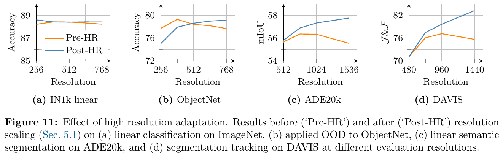
<figcaption>Performance of the models before (Pre-HR) and after (Post-HR) high-resolution adaptation on classification, segmentation, and segmentation-tracking tasks as the inference resolution increases</figcaption>
</div>

---

### 3. Results and findings
{: id="3-核心结果发现-3"}

<div align="center">
  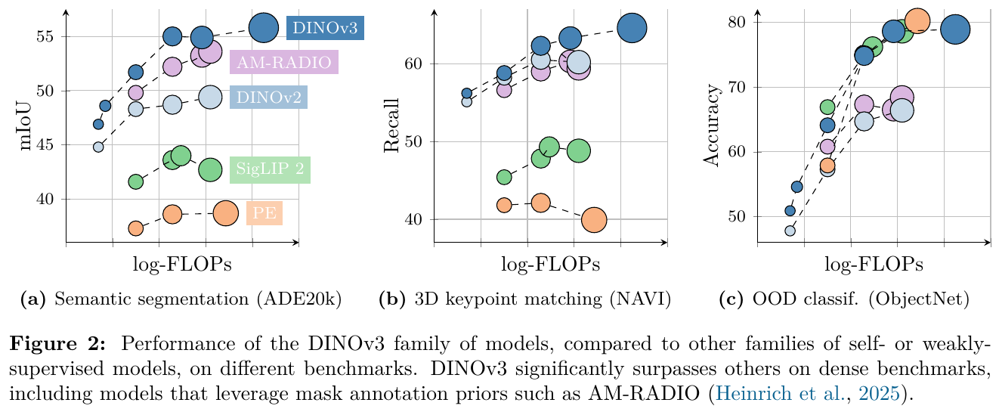
<figcaption>Performance comparison of the DINOv3 family and other self-supervised/weakly supervised models on different benchmarks (segmentation, matching, classification)</figcaption>
</div>

- **Mainstream dense and global vision tasks**: With a frozen vision backbone, DINOv3-7B achieves 66.1 mAP on COCO object detection and 63.0 mIoU on ADE20k semantic segmentation, both surpassing traditional fine-tuned and weakly supervised models. It is also highly competitive on globally robust classification tasks such as ObjectNet.
- **Performance of the distilled family**: Through single-teacher, multi-student distillation, the 7B model's knowledge is transferred to ViT-S/B/L and others. ViT-L (0.3B parameters) performs very close to the 7B teacher, keeping the very high speed of a small model while inheriting the local feature quality of the large one.
- **Geospatial Earth-observation tasks**:
  - DINOv3 was trained on SAT-493M satellite images (493 million 512×512 images) to obtain **DINOv3 Sat**, which is used with a DPT decoder for tree canopy height prediction.
  - DINOv3 Sat 7B sets new SOTA on the SatLidar1M validation set (MAE down from 2.4 to 2.2), the SatLidar1M test set (MAE down from 3.4 to 3.2), and Open Canopy (MAE down from 2.42 to 2.02), with clearer tree edges and more accurate height predictions than models such as Tolan.
  - On GEO-Bench's 12 classification and segmentation tasks, a frozen DINOv3 using only RGB input outperformed both specialized models that use all bands of Sentinel-2/Landsat (6+ bands, e.g., Prithvi-v2, DOFA) and task-specifically fine-tuned methods.

<div align="center">
  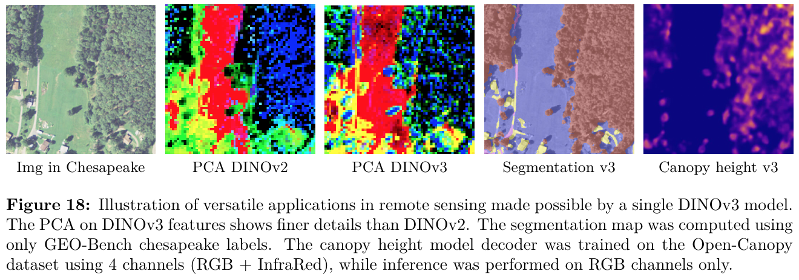
<figcaption>Qualitative comparison of the DINOv3 geospatial 7B model with Tolan and other methods on the Open Canopy canopy height prediction task</figcaption>
</div>

---

### 4. Limitations
{: id="4-局限性-3"}
- **Two-stage dependence**: Although Gram Anchoring can effectively repair the consistency of local features, the method still relies on two-stage training and first needs an early intermediate model with good dense features to serve as the Gram teacher.
- **Model overhead and on-device deployment**: Fine-tuning and inference of the 7B-parameter model on a single GPU or an edge device are relatively expensive, so real deployment depends heavily on distilled small models (such as ViT-L/B/S).

---

<a id="mage-vl"></a>

## 8.13 Mage-VL(2026)
{: id="813-mage-vl2026"}
—A codec-native streaming multimodal foundation model

📄 **Paper**: [arXiv:2607.24904](https://arxiv.org/abs/2607.24904)　**Institution**: Microsoft　**Project page**: [microsoft.github.io/Mage/vl](https://microsoft.github.io/Mage/vl/)

### Key takeaways
{: id="精华-4"}
1. **Facing the multimodal Moravec paradox**: Standard VLMs are good at complex offline visual reasoning but struggle to efficiently perform simple real-time perception on continuous video streams. The paper therefore proposes Mage-VL, a codec-native streaming multimodal model (the paper claims it is the first of its kind).
2. **Codec-driven sparsity**: It proposes the Mage-ViT visual encoder, which uses the motion vectors (MV) and residual energy in the video codec (HEVC/DCVC-RT) to adaptively extract regions with highly dynamic information, reducing visual token consumption by more than 75%.
3. **Dual-system event response**: Drawing on mechanisms of the biological brain, it designs a lightweight System 1 event gate and a causal System 2 decoder, enabling active streaming event perception and real-time commentary, with inference up to 3.5× faster.
4. **Visual pretraining without text pairs**: Mage-ViT is trained from scratch with clustering and discriminative objectives on only about 560 million unlabeled images and 100 million unlabeled video frames, and its performance surpasses top encoders trained on billions of image-text pairs.
5. **AI4AI and the Zero-Vision paradigm**: It establishes an AI4AI data pipeline in which code and prompts are jointly optimized, and proposes a Zero-Vision SFT paradigm that skips visual SFT and directly unlocks the agentic abilities of multimodal reinforcement learning (RL).

---

### 1. Background and problem
{: id="1-研究背景问题-4"}
Standard vision-language models (VLMs, such as Qwen-VL and InternVL) encounter the "Moravec paradox" in the multimodal field: although they are good at complex, static, offline visual reasoning (such as solving geometry problems or reading code), when faced with continuous video streams they rely on uniform frame sampling at a fixed frame rate (such as 1–2 fps) and full-image tokenization. This causes repeated computation on static backgrounds, misses high-frequency dynamic events, and makes the computational overhead grow sharply with video length.

The core contradiction is that perception of the physical world is continuous and event-driven, whereas most existing VLM visual encoders are pretrained on large-scale static web images. To solve the real-time and high-compute-cost problems of streaming interaction, the streaming perception paradigm must be rebuilt comprehensively, from the visual front end to the language decoder.

---

### 2. Methods and innovations
{: id="2-主要方法创新点-4"}

<div align="center">
  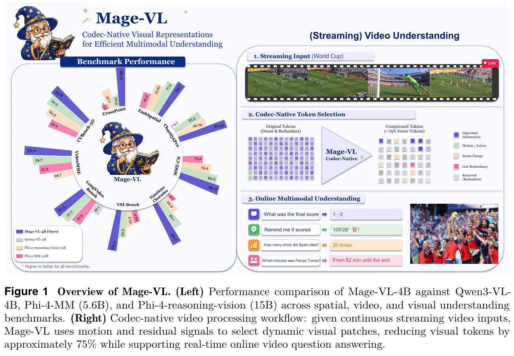
<figcaption>Overall architecture of Mage-VL and the overhead of codec-native token filtering</figcaption>
</div>

#### ① Overall framework
{: id="-整体框架概述-1"}
Mage-VL is a unified multimodal streaming foundation model with three core components:
1. **Mage-ViT codec-native visual encoder**: Adaptively extracts the motion and residual information in the video codec stream and produces a sparse patch canvas;
2. **Multimodal projection layer (MLP projector)**: Maps the visual tokens, which retain 3D rotary position encoding (3D RoPE), into the language model's space;
3. **Bio-inspired dual-system streaming decoder**: Contains a low-overhead System 1 event gate and a System 2 causal language decoder, enabling active response and streaming commentary.

#### ② Module-by-module explanation
{: id="-逐模块讲解-1"}

##### 1. Mage-ViT visual encoder and codec-driven patchifier
{: id="1-mage-vit-视觉编码器与编解码驱动补丁化codec-driven-patchifier"}
- **Input**: A continuous sequence of video frames (a 16×16-pixel patch grid).
- **Processing**: A traditional codec (HEVC/H.265) or a neural codec (DCVC-RT) is used to extract a per-frame saliency tensor $\mathbf S \in \mathbb R^{T \times H \times W}$. For HEVC, $\mathbf S$ is a weighted combination of the P-frame motion vector magnitude and the residual energy; for DCVC-RT, $\mathbf S$ is given directly by the negative log-likelihood bit estimate. The encoder keeps all I-frame patches as anchors and, under a specified token budget $B$, selects the most salient Top-$k$ patches in the P-frames, stitching them into a compact canvas that is fed to a 24-layer ViT.
- **Output**: An efficient sequence of visual features containing dense I-frames and sparse P-frames.
- **Motivation**: The codec's bit allocation naturally reflects visual motion and spatial change, so redundant background is cropped directly at the visual front end without repeated computation by the language model.

<div align="center">
  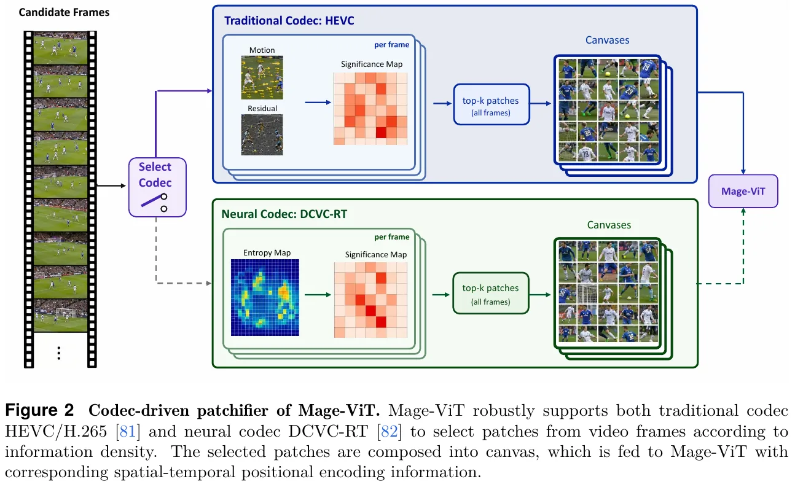
<figcaption>The codec-driven patching mechanism of Mage-ViT (supporting the traditional HEVC codec and the neural codec DCVC-RT)</figcaption>
</div>

##### 2. Vision-language projection layer and shared 3D position encoding
{: id="2-视觉-语言投影层与共享-3d-位置编码"}
- **Input**: The variable-length visual token sequence output by Mage-ViT.
- **Processing**: The dimensions are mapped by a two-layer MLP. Because Mage-ViT applies a shared 3D rotary position encoding (3D RoPE) on the uncropped original grid, the retained patches still maintain their original spatiotemporal coordinate relationships exactly, even after a large number of background patches are discarded.
- **Output**: Visual embeddings aligned to the LLM text-token dimension.

##### 3. System 1 event gating and System 2 causal language decoder
{: id="3-system-1-事件门控与-system-2-因果语言解码器"}
- **Input**: Visual features within a temporal sliding window, and a natural-language prompt.
- **Processing**: A lightweight System 1 gating predictor estimates the binary classification probability $p_{\mathrm{speak}}$ from the visual features in the sliding window. If $p_{\mathrm{speak}} \ge \tau$ (threshold $\tau=0.5$), the SPEAK signal is triggered; the System 2 language decoder is activated and generates a natural-language explanation of the current event. If $p_{\mathrm{speak}} < \tau$, the SILENT state is maintained and full LLM generation does not need to be activated.
- **Output**: Event-driven real-time commentary text, or a silence instruction.
- **Motivation**: Avoids invoking the huge LLM at every frame, greatly reducing the always-on compute consumption of continuous streaming perception.

<div align="center">
  
<figcaption>The dual-system active streaming perception framework of Mage-VL (System 1 gating and System 2 decoder)</figcaption>
</div>

#### ③ End-to-end data flow and streaming training supervision
{: id="-端到端数据流与流式训练监督"}
During training, high-density timestamped video captions are used to automatically construct streaming supervision signals. The video is divided into multiple windows; the starting point of a caption is labeled as a SPEAK target, and the remaining static or background periods are labeled as SILENT targets. A gating classification loss and a language-generation cross-entropy loss are trained jointly.

<div align="center">
  
<figcaption>The process of automatically constructing active streaming supervision signals from timestamped video captions</figcaption>
</div>

#### ④ Training objectives and loss functions
{: id="-训练目标与损失函数-1"}
1. **Mage-ViT cluster-discrimination pretraining loss**:
MetaCLIP features are extracted and clustered with K-means to establish visual concept prototypes, and a cluster-discrimination objective with negative sampling is optimized:
   $$\mathcal L_{\mathrm{vit}} = -\log \frac{\exp(\mathbf z \cdot \mathbf c_+ / t)}{\exp(\mathbf z \cdot \mathbf c_+ / t) + \sum_{j=1}^r \exp(\mathbf z \cdot \mathbf c_j^- / t)}$$
Here, $\mathbf z$ is the Mage-ViT output feature, $\mathbf c_+$ is the positive prototype center, and $\mathbf c_j^-$ is a negative prototype center.

2. **Mage-VL joint streaming loss**:
It consists of System 1's weighted binary-classification gating cross-entropy loss $\mathcal L_{\mathrm{gate}}$ and System 2's autoregressive language generation loss $\mathcal L_{\mathrm{lm}}$:
   $$\mathcal L_{\mathrm{total}} = \mathcal L_{\mathrm{lm}} + \lambda \mathcal L_{\mathrm{gate}}$$

#### ⑤ Inference procedure
{: id="-推理流程"}
In continuous streaming video inference, Mage-ViT incrementally receives the video codec stream, packs the sparse canvas, and feeds it to the projector; System 1 gates decide frame by frame the probability that an event is triggered. The System 2 language decoder is woken up only when a significant event is detected or the user asks a question, enabling active streaming interaction with low always-on compute.

#### ⑥ Intuitive understanding
{: id="-直观理解"}

##### Example: codec-native token budget
{: id="例子编解码原生的-token-预算"}
> **Example**: a 64-frame video, with each frame cut into 16×16 = 256 patches (the numbers are for illustration).
> - **Dense frame-by-frame encoding**: Fully encoding 64 frames requires $64 \times 256 = 16384$ patches; sampling 8 frames evenly instead (2048 patches) saves tokens, but short actions between the sampled frames may be missed.
> - **Mage-VL's codec-native approach**: Keep all 256 patches of 1 I-frame as anchors, compute the saliency $\mathbf S$ of the remaining 63 P-frames from the motion vector magnitude and residual energy, and select the Top-$k$ patches within a total budget of $B = 4096$ (about 61 per P-frame on average). This reduces the number of patches by 75% compared with dense encoding while preserving the most salient motion regions in every frame.

##### Flowchart: triggering and response of the dual systems
{: id="流程图双系统的触发与响应"}


##### Comparison: uniform-sampling VLM vs. Mage-VL
{: id="对比均匀采样-vlm-与-mage-vl"}

|Dimension|Traditional uniform-sampling VLM (such as Qwen-VL)|Mage-VL (the method in this paper)|
|---|---|---|
|**Visual sampling mechanism**|Fixed frame rate (1–2 fps), uniformly decimating whole frames|Codec-native (I-frame anchors + top-k patches by P-frame motion/residual)|
|**Token consumption**|Grows linearly with the number of frames, with high background redundancy|Visual tokens reduced by **75%+**, with highly compact spatiotemporal features|
|**Streaming response mechanism**|Passively waits for a user query to trigger full inference|**System 1 gating (low power) + System 2 decoding (actively woken up)**|
|**Streaming inference speed**|A large compute bottleneck makes real-time operation difficult|Overall end-to-end inference up to **3.5×** faster|

---

### 3. Results and findings
{: id="3-核心结果发现-4"}

#### 1. Benchmark performance
{: id="1-基准评测表现"}
- **Static images and conventional video**: Mage-VL-4B fully matches Qwen3-VL-4B on static multimodal tasks and performs excellently on video understanding and 2D/3D spatial reasoning. Overall, it greatly exceeds the strong 15B-scale Phi-4-reasoning-vision baseline.
- **Streaming perception and inference efficiency**: It achieves SOTA on streaming video benchmarks such as VSI-Bench and StreamingBench, with up to **3.5×** end-to-end wall-clock speedup.

#### 2. Seven core empirical findings
{: id="2-七大核心实证发现empirical-findings"}
1. **Finding 1 (pretraining data efficiency)**: A VLM visual encoder does not require large-scale web image-text pairs. Mage-ViT is trained from scratch with cluster discrimination on only 560 million unlabeled images and 100 million video frames, and its performance can match or surpass top encoders trained on billions of image-text pairs.
2. **Finding 2 (variable-resolution scaling)**: Variable-resolution pretraining scales continuously, with performance increasing monotonically as the resolution and token budget grow.
3. **Finding 3 (long-video SFT redundancy)**: Pretraining on dense video captions gives the model long-video QA ability naturally, without special long-video VideoQA SFT data.
4. **Finding 4 (synergy between motion and space)**: Dynamic video training and 2D/3D spatial intelligence strongly reinforce each other, and training on video motion feeds back into static spatial reasoning.
5. **Finding 5 (codec-native efficiency)**: Codec-native input significantly improves video representation efficiency, achieving higher accuracy and a 3.5× speedup under the same token budget compared with uniform sampling.
6. **Finding 6 (AI4AI data pipeline)**: AI-driven joint optimization of prompts and code significantly improves downstream performance (e.g., InfoVQA +5.62, OCRBench +3.80).
7. **Finding 7 (Zero-Vision SFT paradigm)**: Skipping the visual SFT stage and doing SFT directly on the text-only track, followed by multimodal RL, successfully unlocks the model's agentic tool-calling and reinforcement learning abilities.

---

### 4. Limitations
{: id="4-局限性-4"}
1. **Cost of neural codec integration**: Although the model natively supports neural codecs such as DCVC-RT, the computational overhead of extracting real-time neural probability densities on edge devices still needs to be optimized.
2. **Gap on complex agent tasks**: In the original baseline version without multimodal RL tuning, the model still lags the top closed-source models on extremely complex, long-horizon, multi-step agent decision-making tasks.

---

## 8.14 LLaVA-Video (2024)
{: id="814-llava-video2024"}
—Video instruction tuning with high-quality synthetic data: the LLaVA-Video-178K dataset + SlowFast video representation

📄 **Paper**: [arXiv:2410.02713](https://arxiv.org/abs/2410.02713)

---

### Key takeaways
{: id="精华-5"}

1. **Data quality > data quantity**: Dense annotation of 178K highly dynamic, uncut videos beats sparse annotation of 900K static videos. When training a video LMM, choosing video sources with "a complete plot and strong temporal dynamics" matters more than the number of videos.
2. **Recursive hierarchical caption generation** is a transferable paradigm for densely describing videos of any length: captions are generated recursively at three temporal granularities (10s / 30s / whole video), and each level uses the earlier descriptions as context so that characters and events are referred to consistently across time periods.
3. **Dense sampling (1 FPS) fed to the annotation model**: Captions from sparse sampling (e.g., 0.008–0.15 FPS) can only describe large scenes and lose subtle movements, which is one source of hallucination in downstream models.
4. **SlowFast token allocation**: Different spatial pooling rates are applied to groups of video frames (slow frames keep more tokens, fast frames fewer), fitting up to 3 times as many frames within a fixed LLM context/GPU memory budget. It is a simple solution to the trade-off between the number of frames and the number of tokens per frame.
5. Using 16 question-type templates to guide GPT-4o in generating QA pairs systematically covers real query distributions such as temporal order, causality, counting, and camera direction, and avoids low-quality, repetitive templated QA.

---

### 1. Background and problem
{: id="1-研究背景问题-5"}

The development of video LMMs is limited by the lack of high-quality video-language instruction data. The videos in existing datasets (LLaVA-Hound, ShareGPT4Video, etc.) are mostly static and cut into short clips by scene, which oversimplifies the plots, and frames are sampled extremely sparsely during annotation (0.008–0.15 FPS on average), so subtle motion changes cannot be captured and the model hallucinates when detailed descriptions are required. This paper takes a "synthetic data" route: it builds a high-quality video instruction-tuning dataset with GPT-4o plus a manual process, and explores a video representation that maximizes the number of frames under limited GPU memory.

---

### 2. Methods and innovations
{: id="2-主要方法创新点-5"}

#### 2.1 Construction of the LLaVA-Video-178K dataset
{: id="21-llava-video-178k-数据集构建"}

The entire data synthesis pipeline has three stages: **dynamic video filtering** (selecting highly dynamic, uncut videos from 10 major video sources), **recursive three-level detailed caption generation** (1 FPS dense sampling + GPT-4o), and **QA generation guided by 16 question types** (open-ended + multiple-choice). The final result is 178K videos and 1.3M instruction samples (178K captions, 960K open-ended QA, 196K multiple-choice QA).

**① Video sources and dynamic filtering**

<div align="center">
  
<figcaption>Left: the 40+ existing video-language datasets actually derive mainly from 10 video sources; right: the filtering logic for dynamic videos</figcaption>
</div>

- **Input**: The 10 main video sources (HD-VILA-100M, InternVid-10M, VidOR, VIDAL/YouTube Shorts, YouCook2, Charades, ActivityNet, Kinetics-700, Sth-sth v2, Ego4D) identified by surveying 40+ video-language datasets, covering domains such as activities, cooking, TV, and egocentric views.
- **Processing**: PySceneDetect is used to count the number of scenes as a measure of "dynamism". The filtering rules are: sort by view count, number of scenes > 2, duration 5–180s, number of scenes / duration ≤ 0.5 (excluding PPT-slideshow videos), resolution > 480p, and 50 samples per category.
- **Motivation**: Everything except YouCook2 and Kinetics-700 uses **uncut original videos**, because cutting would destroy plot continuity, and a complete plot is the core value that distinguishes video understanding from image understanding.

**② Recursive three-level detailed caption generation**

<div align="center">
  
<figcaption>The three-level recursive caption generation pipeline: level 1 every 10s, level 2 every 30s, level 3 for the whole video, with each level conditioned on earlier descriptions</figcaption>
</div>

Frames are sampled densely at 1 FPS, and GPT-4o is called recursively at three temporal granularities:

- **Level 1 (every 10s)**: The input is the frames of the current segment plus historical context (the recent level-1 descriptions not yet summarized + the latest level-2 description), and the output is an event description of the 10s segment;
- **Level 2 (every 30s)**: The input is the latest three level-1 descriptions + the previous level-2 description, and the output is a summary of the plot so far;
- **Level 3 (at the end of the video)**: The input is the latest level-2 description + the level-1 descriptions not yet summarized, and the output is a complete description of the whole video.

**Motivation**: Unlike approaches such as Video ReCap, which first describe each segment independently and then summarize, each level-1 description here is generated with historical context to ensure that events before and after are linked along the timeline (e.g., identifying the same person across time periods). The ablation in the figure below shows the role of historical context:

<div align="center">
  
<figcaption>Comparison of captions with and without historical context: with historical context, characters appearing in different time periods are correctly identified as the same person</figcaption>
</div>

**③ QA generation guided by 16 question types**

<div align="center">
  
<figcaption>The 16 question types and examples, adapted from the definitions of public video QA benchmarks</figcaption>
</div>

- **Input**: The detailed description of each video (level 3) + the task definition of the current question type + 3 in-context examples of the same type.
- **Processing**: GPT-4o generates at most one QA pair for each type and returns None if it cannot; sentence-transformer is then used to remove duplicates, and invalid answers beginning with phrases such as "does not specify/mention/show" are discarded.
- **Motivation**: The 16 question types (temporal order, space, causality, counting, attribute changes, camera direction, etc.) follow the definitions of public video QA benchmarks to ensure coverage of the real distribution of user queries and to avoid low-quality, single-template QA.

Each video ultimately carries three types of annotation:

<div align="center">
  
<figcaption>A data sample: three types of annotation, namely a detailed description, open-ended QA, and multiple-choice QA</figcaption>
</div>

Compared with similar synthetic datasets: LLaVA-Hound has 900K videos, but 44% come from the static WebVid and are annotated at only 0.008 FPS; ShareGPT4Video has 40K videos, mostly clipped short videos, at 0.15 FPS; LLaVA-Video-178K annotates 178K dynamic uncut videos at 1 FPS and covers three tasks at once: captioning, open-ended QA, and multiple-choice QA.

#### 2.2 The LLaVA-Video model and the SlowFast video representation
{: id="22-llava-video-模型与-slowfast-视频表示"}

The model follows the LLaVA-OneVision architecture (a SigLIP visual encoder + a two-layer MLP projector + a Qwen2 LLM) and is fine-tuned from the LLaVA-OneVision single-image (SI) stage checkpoint. The core problem is the token budget: with T=100 frames and M=729 tokens per frame, there are 67,600 visual tokens in total, and a 72B model can fit only 8 frames on 128 H100s.

<div align="center">
  
<figcaption>SlowFast video representation: slow frames (one frame taken every s frames) use smaller pooling to retain more tokens, fast frames use larger pooling for compression, and the two are interleaved</figcaption>
</div>

- **Input**: A video sequence of up to T frames, where each frame yields M visual tokens through SigLIP + MLP.
- **Processing**: The frames are divided into two groups according to the stride $s$. One frame out of every $s$ is selected evenly to form the **slow group**, to which $p \times p$ average pooling is applied; the remaining frames form the **fast group**, to which $2p \times 2p$ pooling is applied (1/4 as many tokens as the slow group). Slow and fast frames are interleaved in their original temporal order. $s = 1$ degenerates into the ordinary representation in which all frames have equal numbers of tokens.
- **Output**: The video representation is parameterized by the tuple $V = (T, M, s, p)$, and the total number of tokens is

$$
\#\text{tokens} = \lfloor T/s \rfloor \times \frac{M}{p^2} + \left( T - \lfloor T/s \rfloor \right) \times \frac{M}{4p^2}
$$

- **Motivation**: Unlike LITA and SlowFast-LLaVA, which first compress all frames into very few tokens and then add fine-grained tokens for some frames (so some frames are represented twice), here each frame belongs to only one group and is never represented twice; compared with allocating tokens equally to all frames, up to 3 times as many frames fit under the same budget. LLaVA-Video-7B uses $V = (64, 679, 1, 2)$ and the 72B model uses $V = (64, 679, 3, 2)$.

**Training**: Fine-tuning uses LLaVA-Video-178K plus four public datasets (ActivityNet-QA, NExT-QA, PerceptionTest, and LLaVA-Hound-255K, taking only videos under 3 minutes), totaling 1.6M video-language samples together with 1.1M LLaVA-OneVision image samples; of these, 92.2% of the captions, 77.4% of the open-ended QA, and 90.9% of the multiple-choice QA are newly annotated.

---

### 3. Results and findings
{: id="3-核心结果发现-5"}

- **Overall performance**: On 11 video benchmarks, LLaVA-Video-7B surpasses the previously strongest open-source LLaVA-OV-7B on 7 of 10 datasets; LLaVA-Video-72B reaches a level comparable to the commercial Gemini-1.5-Flash (VideoMME 70.5/76.9 w-subs, MLVU 74.4, NExT-QA 85.4).
- **Dataset ablation**: Adding LLaVA-Video-178K to the LLaVA-Hound baseline improves NExT-QA by 31.9 points (64.4→80.1) and VideoMME by 9.1 points (54.1→63.2), and zero-shot tasks also benefit significantly.
- **Quality vs. quantity**: In an equal-size comparison (900K open-ended QA), LLaVA-Video-178K with 178K videos comprehensively outperforms LLaVA-Hound with 900K videos (NExT-QA 73.2 vs 39.8), confirming that the quality of video instruction data matters more than quantity; it also wins in an equal-size comparison with ShareGPT4Video's 40K.
- The size of the improvement depends on how closely the benchmark's videos match the data sources: YouTube-based benchmarks such as MLVU, LongVideoBench, and VideoMME improve significantly, while ActivityNet-QA improves only slightly (most of its questions can be answered from a single frame).

---

### 4. Limitations
{: id="4-局限性-5"}

The videos come from multiple platforms and inherit the inherent biases of their source platforms; the QA pairs are generated by GPT-4o and may be affected by the perspective of the annotator (the prompt designer), resulting in a skewed distribution.

---

### Reference
{: id="参考"}

- Paper: [LLaVA-Video: Video Instruction Tuning With Synthetic Data (TMLR 2025)](https://arxiv.org/abs/2410.02713)
- OpenReview: [https://openreview.net/forum?id=EElFGvt39K](https://openreview.net/forum?id=EElFGvt39K)

---

<a id="vlm-summary"></a>

# 9. Summary
{: id="9-总结"}

To understand a VLM, you can examine it along the path of **input representation → cross-modal access → training objective → output and evaluation**, without having to arrange all models into a single chain of architectural evolution.

1. **Input representation determines what information can be retained**: The visual encoder, resolution, tiling, and video sampling affect the coverage of detail and temporal information; later inference cannot reliably recover lost evidence.
2. **The connection method determines how visual information is used**: MLP projection, the Q-Former, and cross-attention between layers make different trade-offs in implementation cost, degree of compression, and fusion location. Outside a specific task, there is no universal winner.
3. **Training determines whether the interface can be turned into capability**: Image-text alignment, multi-task training, instruction tuning, and preference optimization solve different problems; the number of training stages and the freezing strategy should be chosen according to the data, initialization, and budget.
4. **Evaluation determines whether a conclusion is valid**: Beyond accuracy, you also need to look at hallucination, fine-grained grounding, video temporal understanding, retention of text-only ability, and latency and GPU memory cost.

When running experiments, first fix the target task and evaluation set, then choose the input budget and model structure; after reproducing a complete recipe, change only a few variables at a time and judge the benefit from validation results. A single leaderboard score or the model size cannot replace this process.

The link between VLMs and embodied systems can be followed further in  and : vision-language understanding provides the perceptual and semantic foundation, while geometric modeling and action learning further handle spatial constraints and closed-loop execution.
