* Contents
{:toc}

> This collection covers 26 works on goal navigation and supporting research. Goal navigation asks a robot to find and reach a category, description, image, or coordinate goal. Goal-navigation methods come first, followed by related policies, world models, and evaluation work.
>
> Tool use, active interaction, persistent spatial memory, and continuing decisions are covered in [Agentic Navigation](/en/Agentic-Navigation-Papers/); see [Instruction Following](/en/VLN-Papers/) for instruction-following methods. Overlapping works are assigned by research focus. Goal-navigation leaderboards remain here and link to the collection containing each reading.

<div id="paper-filter-bar" class="paper-filter-bar"></div>

# Goal-navigation leaderboards
{: id="goal-nav-leaderboard"}

> ⚠️ **Do not compare scores across different benchmarks.** Goal navigation specifies an object category, an image, or coordinates, rather than route instructions. Instruction-following VLN is a separate task; see its [leaderboards](/en/VLN-Papers/). The five tables continue the main collection’s numbering: ④ closed-set object goals, ⑤ open-vocabulary object goals, ⑥ image goals, ⑦ point goals, and ⑧ multimodal goals and custom benchmarks. Rows are grouped by benchmark, with thick separators. Scenes, categories, and success criteria differ across groups, including HM3D v1 and v2; compare SR only within a group. ObjectNav benchmarks do not define NE / OSR.
>
> **Reading the tables:** **Trained** means trained or fine-tuned on navigation data. **Training-free** means no navigation model is trained: the system combines existing large models, detection or segmentation models, and rules or planners. Calling a pretrained low-level point-goal controller does not change this classification. The **Closed API** badge marks methods that call a closed model such as GPT, Gemini or Claude through an API at inference time. This is separate from the paradigm: a trained model can still call one at inference time, as SuperNav-Learned does, while using a large model only to build training data or for offline preprocessing does not count, as with AECNav's offline DeepSeek distractor lists. In the chart view, bar colors show whether a method calls a closed API. Gray rows use nonstandard protocols, such as validation subsets, and are excluded from best-value bolding. Bold values are the best among non-gray rows within the same benchmark; groups with only one row are not bolded. Filters select paradigm, inference, input configuration, and open-source availability, and can hide gray rows.

> **EvoLife evaluation conditions:** Gray rows use sampled tasks and a guide with privileged target and route information. They describe assisted navigation and are not directly comparable to unassisted full-validation results. GOAT-Bench SR is subtask success, 99.3%, while complete-sequence success is 94%; LHPR-VLN SR, 98%, measures complete sequences, and VL-LN / CoIN evaluate interactive instance navigation.

<div id="lb-filter-bar" class="lb-filter-bar"></div>

## ④ Closed-set object goals · ObjectNav (HM3D · MP3D · Gibson)
{: id="-封闭类别物体目标--objectnavhm3d--mp3d--gibson"}

Closed-set object navigation: given an object category, find any instance in an unseen scene and stop near it

| Model | Year | Benchmark | Paradigm | Base model | SR ↑ | SPL ↑ | Open source |
|:-----|:----:|:----:|:----:|:----:|:----:|:----:|:----:|
| [EvoLife (four views)](/en/Agentic-Navigation-Papers/#evolife) <span class="lb-api" title="Calls a closed model such as GPT, Gemini or Claude through an API at inference time">Closed API</span> <span class="lb-flag">100-episode subset; privileged guide</span> | 2026 | HM3D-v2 | Training-free | GPT-6 Astra (ultra) | 100 | 64.3 | – |
| [SuperNav-Geo (four views)](/en/Agentic-Navigation-Papers/#supernav) <span class="lb-api" title="Calls a closed model such as GPT, Gemini or Claude through an API at inference time">Closed API</span> <span class="lb-flag">1 m, protocol differences</span> | 2026 | HM3D-v2 | Training-free | GPT-5.6 Terra (high) | 86.50 | 36.38 | – |
| [SuperNav-Learned (four views)](/en/Agentic-Navigation-Papers/#supernav) <span class="lb-api" title="Calls a closed model such as GPT, Gemini or Claude through an API at inference time">Closed API</span> <span class="lb-flag">1 m, protocol differences</span> | 2026 | HM3D-v2 | Trained | GPT-5.6 Terra (high) | 85.40 | 13.83 | – |
| [Hydra-Nav (monocular)](#hydra-nav) | 2026 | HM3D-v2 | Trained | Qwen2.5-VL-7B | **84.8** | 41.1 | No |
| [AECNav (monocular)](#aecnav) | 2026 | HM3D-v2 | Training-free | DeepSeek-V4-Flash | 84.7 | **45.3** | No |
| [VLingNav (monocular)](#vlingnav) | 2026 | HM3D-v2 | Trained | LLaVA-Video-7B | 83.0 | 40.5 | No |
| [SysNav (monocular)](/en/Agentic-Navigation-Papers/#sysnav) <span class="lb-api" title="Calls a closed model such as GPT, Gemini or Claude through an API at inference time">Closed API</span> | 2026 | HM3D-v2 | Training-free | Gemini-2.5-Flash | 80.8 | 37.2 | [Yes](https://github.com/zwandering/SysNav) |
| [SuperNav-Geo (four views)](/en/Agentic-Navigation-Papers/#supernav) <span class="lb-api" title="Calls a closed model such as GPT, Gemini or Claude through an API at inference time">Closed API</span> <span class="lb-flag">0.2 m, protocol differences</span> | 2026 | HM3D-v2 | Training-free | GPT-5.6 Terra (high) | 80.30 | 33.38 | – |
| [SuperNav-Learned (four views)](/en/Agentic-Navigation-Papers/#supernav) <span class="lb-api" title="Calls a closed model such as GPT, Gemini or Claude through an API at inference time">Closed API</span> <span class="lb-flag">0.2 m, protocol differences</span> | 2026 | HM3D-v2 | Trained | GPT-5.6 Terra (high) | 79.00 | 12.88 | – |
| [LightNav-0 (monocular)](/en/VLN-Papers/#lightnav-0) | 2026 | HM3D-v2 | Trained | Qwen3-VL-4B | 77.2 | 41.5 | [Yes](https://github.com/lightorigins/LightNav-0) |
| [HarnessVLN (monocular)](/en/Agentic-Navigation-Papers/#harnessvln) <span class="lb-api" title="Calls a closed model such as GPT, Gemini or Claude through an API at inference time">Closed API</span> | 2026 | HM3D-v2 | Training-free | GPT-5.6-luna | 76.0 | 37.9 | No |
| [Qwen-RobotNav (monocular)](/en/VLN-Papers/#qwen-robotnav) | 2026 | HM3D-v2 | Trained | Qwen3-VL-4B | 75.6 | 30.6 | No |
| [NavGPT-3 (four views · Opus 5)](/en/Agentic-Navigation-Papers/#navgpt-3) <span class="lb-api" title="Calls a closed model such as GPT, Gemini or Claude through an API at inference time">Closed API</span> <span class="lb-flag">500-episode subset, stop facing the goal</span> | 2026 | HM3D-v2 | Trained | Claude Opus 5 + Qwen3-VL-8B | 75.3 | 40.8 | [Yes](https://github.com/metacognitionai/NavGPT-3) |
| [3DGSNav (monocular)](#nav-3dgs) <span class="lb-api" title="Calls a closed model such as GPT, Gemini or Claude through an API at inference time">Closed API</span> | 2026 | HM3D-v2 | Training-free | Gemini 3 Pro + GLM-4.5V | 75.0 | 44.2 | No |
| [Qwen-RobotNav (monocular)](/en/VLN-Papers/#qwen-robotnav) | 2026 | HM3D-v2 | Trained | Qwen3-VL-8B | 71.2 | 33.0 | No |
| [EvoMemNav (monocular)](/en/Agentic-Navigation-Papers/#evomemnav) | 2026 | HM3D-v2 | Training-free | Qwen-8B | 63.8 | 39.4 | No |
| [3DGSNav (monocular)](#nav-3dgs) <span class="lb-api" title="Calls a closed model such as GPT, Gemini or Claude through an API at inference time">Closed API</span> | 2026 | HM3D-v1 | Training-free | Gemini 3 Pro + GLM-4.5V | **80.0** | **51.8** | No |
| [VLingNav (monocular)](#vlingnav) | 2026 | HM3D-v1 | Trained | LLaVA-Video-7B | 79.1 | 42.9 | No |
| [SysNav (monocular)](/en/Agentic-Navigation-Papers/#sysnav) <span class="lb-api" title="Calls a closed model such as GPT, Gemini or Claude through an API at inference time">Closed API</span> | 2026 | HM3D-v1 | Training-free | Gemini-2.5-Flash | 63.7 | 30.5 | [Yes](https://github.com/zwandering/SysNav) |
| [EvoMemNav (monocular)](/en/Agentic-Navigation-Papers/#evomemnav) | 2026 | HM3D-v1 | Training-free | Qwen-8B | 59.2 | 33.6 | No |
| [VLFM (monocular)](#vlfm) | 2023 | HM3D-v1 | Training-free | – | 52.5 | 30.4 | [Yes](https://github.com/rai-opensource/vlfm) |
| [PanoNav (panoramic)](/en/Agentic-Navigation-Papers/#panonav) <span class="lb-flag">200-episode subset</span> | 2025 | HM3D（version unspecified） | Training-free | Qwen2.5-VL + DeepSeek-V3 | 43.5 | 23.7 | No |
| [Hydra-Nav (monocular)](#hydra-nav) | 2026 | MP3D | Trained | Qwen2.5-VL-7B | **64.0** | **29.6** | No |
| [NavGPT-3 (four views · Opus 5)](/en/Agentic-Navigation-Papers/#navgpt-3) <span class="lb-api" title="Calls a closed model such as GPT, Gemini or Claude through an API at inference time">Closed API</span> <span class="lb-flag">500-episode subset, stop facing the goal</span> | 2026 | MP3D | Trained | Claude Opus 5 + Qwen3-VL-8B | 59.2 | 25.2 | [Yes](https://github.com/metacognitionai/NavGPT-3) |
| [VLingNav (monocular)](#vlingnav) | 2026 | MP3D | Trained | LLaVA-Video-7B | 58.9 | 26.5 | No |
| [Qwen-RobotNav (monocular)](/en/VLN-Papers/#qwen-robotnav) | 2026 | MP3D | Trained | Qwen3-VL-4B | 52.2 | 16.0 | No |
| [AECNav (monocular)](#aecnav) | 2026 | MP3D | Training-free | DeepSeek-V4-Flash | 51.3 | 25.9 | No |
| [SysNav (monocular)](/en/Agentic-Navigation-Papers/#sysnav) <span class="lb-api" title="Calls a closed model such as GPT, Gemini or Claude through an API at inference time">Closed API</span> | 2026 | MP3D | Training-free | Gemini-2.5-Flash | 50.7 | 18.1 | [Yes](https://github.com/zwandering/SysNav) |
| [Qwen-RobotNav (monocular)](/en/VLN-Papers/#qwen-robotnav) | 2026 | MP3D | Trained | Qwen3-VL-8B | 48.8 | 17.7 | No |
| [3DGSNav (monocular)](#nav-3dgs) <span class="lb-api" title="Calls a closed model such as GPT, Gemini or Claude through an API at inference time">Closed API</span> | 2026 | MP3D | Training-free | Gemini 3 Pro + GLM-4.5V | 43.6 | 21.3 | No |
| [VLFM (monocular)](#vlfm) | 2023 | MP3D | Training-free | – | 36.4 | 17.5 | [Yes](https://github.com/rai-opensource/vlfm) |
| [VLFM (monocular)](#vlfm) | 2023 | Gibson | Training-free | – | 84.0 | 52.2 | [Yes](https://github.com/rai-opensource/vlfm) |

Note: HM3D-v1 is the val of the Habitat 2022 Challenge (2000 items/20 scenes/6 categories), and HM3D-v2 is the val of the 2023 Challenge (1000 items/36 scenes/6 categories). The scenes and annotations of the two are different. The original text of VLFM only writes HM3D, but the 2000 items/20 scenes/6 categories given are consistent with v1; the original text of Hydra-Nav does not specify a version, but its baseline WMNav in Table 2 is 72.2, which is consistent with the HM3D-v2 score of the original WMNav text, and is therefore classified into v2; the original text of PanoNav does not specify the version, and is listed in a separate group. PanoNav evaluates only 200 randomly sampled HM3D validation episodes, listed in gray. Hydra-Nav takes the IRFT (Stage 3) results of the original Table 2. Qwen-RobotNav takes arXiv v3, divided into two sizes of 4B / 8B; LightNav-0 takes arXiv v2 numbers (HM3D-v2 of v1 is 79.5 / 43.7).

Additional note: SuperNav-Geo executes movement using depth and navigation geometry and is classified as training-free; SuperNav-Learned trains its low-level motion policy on navigation expert trajectories and is classified as trained. Neither high-level MLLM receives navigation-specific fine-tuning. HM3D-v2 rows report two success thresholds; differences in budgets, STOP rules, and execution resources across published methods make these rows nonstandard, so they remain gray and do not participate in bolding. SuperNav SPL is converted from the paper's 0–1 scale to the percentages used in this table. The open-source value “–” means that the summary supplies no verified code-repository link.

Additional note: NavGPT-3 uses a Claude Opus 5 Planner + 8B VLA and evaluates 500-episode validation subsets of MP3D and HM3D-v2, where success also requires facing the goal when stopping, so its rows are gray and excluded from bolding. Appendix Table 16 re-evaluates Qwen-RobotNav 8B on exactly the same subsets and protocol, giving SR/SPL of 47.8/17.5 on MP3D and 72.4/33.1 on HM3D-v2; the Qwen-RobotNav rows in this table remain the original paper's full-set results and cannot be read as that matched comparison. The full system has no corresponding full-set ObjectNav result yet.

## ⑤ Open-vocabulary object goals · HM3D-OVON
{: id="-开放词汇物体目标--hm3d-ovon"}

Open-vocabulary object navigation; val-unseen unless otherwise noted, lines marked † are unspecified in the original text

| Model | Year | Paradigm | Base model | SR ↑ | SPL ↑ | Open source |
|:-----|:----:|:----:|:----:|:----:|:----:|:----:|
| [EvoLife (four views)](/en/Agentic-Navigation-Papers/#evolife) <span class="lb-api" title="Calls a closed model such as GPT, Gemini or Claude through an API at inference time">Closed API</span> <span class="lb-flag">100-episode subset; privileged guide</span> | 2026 | Training-free | GPT-6 Astra (ultra) | 100 | 71.4 | – |
| [SuperNav-1.5 (four views)](/en/Agentic-Navigation-Papers/#supernav-1-5) <span class="lb-api" title="Calls a closed model such as GPT, Gemini or Claude through an API at inference time">Closed API</span> <span class="lb-flag">120-episode subset, 1 m, 3600 s</span> | 2026 | Training-free | GPT-5.6-terra (high) | 80.00 | 43.17 | – |
| [SuperNav-Geo-Astra (four views)](/en/Agentic-Navigation-Papers/#supernav) <span class="lb-api" title="Calls a closed model such as GPT, Gemini or Claude through an API at inference time">Closed API</span> <span class="lb-flag">120-episode subset, 1 m</span> | 2026 | Training-free | GPT-6 Astra (medium) | 79.17 | 49.74 | – |
| [SuperNav-1.5 (four views)](/en/Agentic-Navigation-Papers/#supernav-1-5) <span class="lb-api" title="Calls a closed model such as GPT, Gemini or Claude through an API at inference time">Closed API</span> <span class="lb-flag">120-episode subset, 1 m, 500 steps</span> | 2026 | Training-free | GPT-5.6-terra (high) | 78.33 | 43.54 | – |
| [SuperNav-Geo (four views)](/en/Agentic-Navigation-Papers/#supernav) <span class="lb-api" title="Calls a closed model such as GPT, Gemini or Claude through an API at inference time">Closed API</span> <span class="lb-flag">120-episode subset, 1 m</span> | 2026 | Training-free | GPT-5.6 Terra (high) | 73.33 | 41.05 | – |
| [SuperNav-Geo-Astra (four views)](/en/Agentic-Navigation-Papers/#supernav) <span class="lb-api" title="Calls a closed model such as GPT, Gemini or Claude through an API at inference time">Closed API</span> <span class="lb-flag">120-episode subset, 0.25 m</span> | 2026 | Training-free | GPT-6 Astra (medium) | 71.67 | 45.79 | – |
| [SuperNav-Learned (four views)](/en/Agentic-Navigation-Papers/#supernav) <span class="lb-api" title="Calls a closed model such as GPT, Gemini or Claude through an API at inference time">Closed API</span> <span class="lb-flag">120-episode subset, 1 m</span> | 2026 | Trained | GPT-5.6 Terra (high) | 70.83 | 14.43 | – |
| [SuperNav-Geo (four views)](/en/Agentic-Navigation-Papers/#supernav) <span class="lb-api" title="Calls a closed model such as GPT, Gemini or Claude through an API at inference time">Closed API</span> <span class="lb-flag">120-episode subset, 0.25 m</span> | 2026 | Training-free | GPT-5.6 Terra (high) | 68.33 | 38.37 | – |
| [Hydra-Nav (monocular)](#hydra-nav) | 2026 | Trained | Qwen2.5-VL-7B | **66.3** | **37.4** | No |
| [SuperNav-Learned (four views)](/en/Agentic-Navigation-Papers/#supernav) <span class="lb-api" title="Calls a closed model such as GPT, Gemini or Claude through an API at inference time">Closed API</span> <span class="lb-flag">120-episode subset, 0.25 m</span> | 2026 | Trained | GPT-5.6 Terra (high) | 65.00 | 13.55 | – |
| [HarnessVLN (monocular)](/en/Agentic-Navigation-Papers/#harnessvln) <span class="lb-api" title="Calls a closed model such as GPT, Gemini or Claude through an API at inference time">Closed API</span> | 2026 | Training-free | GPT-5.6-luna | 59.3 | 36.6 | No |
| [OmniNav (multi-view)](/en/VLN-Papers/#omninav) | 2026 | Trained | Qwen2.5-VL-3B | 59.2 | 33.2 | [Yes](https://github.com/amap-cvlab/OmniNav) |
| [AECNav (monocular)](#aecnav) | 2026 | Training-free | DeepSeek-V4-Flash | 57.3 | 30.5 | No |
| [SysNav (monocular)](/en/Agentic-Navigation-Papers/#sysnav) <span class="lb-api" title="Calls a closed model such as GPT, Gemini or Claude through an API at inference time">Closed API</span><sup>†</sup> | 2026 | Training-free | Gemini-2.5-Flash | 54.9 | 26.1 | [Yes](https://github.com/zwandering/SysNav) |
| [Qwen-RobotNav (monocular)](/en/VLN-Papers/#qwen-robotnav) | 2026 | Trained | Qwen3-VL-4B | 53.1 | 20.9 | No |
| [Qwen-RobotNav (monocular)](/en/VLN-Papers/#qwen-robotnav) | 2026 | Trained | Qwen3-VL-8B | 51.2 | 24.0 | No |
| [VLingNav (monocular)](#vlingnav) | 2026 | Trained | LLaVA-Video-7B | 50.1 | 24.6 | No |
| [LightNav-0 (monocular)](/en/VLN-Papers/#lightnav-0) | 2026 | Trained | Qwen3-VL-4B | 47.0 | 24.2 | [Yes](https://github.com/lightorigins/LightNav-0) |
| [AstraNav-World (multi-view)](/en/VLN-Papers/#astranav-world)<sup>†</sup> | 2025 | Trained | Qwen2.5-VL-3B | 45.7 | 28.7 | [Yes](https://github.com/amap-cvlab/AstraNav-World) |
| [NavFoM (multi-view)](/en/VLN-Papers/#navfom) | 2025 | Trained | Qwen2-7B | 45.2 | 31.9 | No |
| [JanusVLN (monocular)](/en/VLN-Papers/#janusvln)<sup>†</sup> | 2026 | Trained | Janus-Pro-7B | 44.9 | 31.7 | [Yes](https://github.com/MIV-XJTU/JanusVLN) |
| [LocalNav-Claude (monocular)](#localnav) <span class="lb-api" title="Calls a closed model such as GPT, Gemini or Claude through an API at inference time">Closed API</span> | 2026 | Training-free | Claude Sonnet 4.6 | 39.7 | 19.7 | No |
| [LocalNav-Qwen (monocular)](#localnav) | 2026 | Trained | Qwen3.5-4B | 34.5 | 17.2 | No |

Note: † The original text of SysNav, AstraNav-World and JanusVLN only gives one column of HM3D-OVON results, without specifying the division; NavFoM is four views setting (single viewing angle is 43.6 / 31.3); OmniNav is OmniNav* with slow thinking system enabled. LocalNav-Claude is a training-free version that directly uses Claude Sonnet 4.6 to make decisions. LocalNav-Qwen is Qwen3.5-4B that uses Claude trajectories for SFT distillation.

Additional note: SuperNav uses a 120-episode val-unseen subset, reporting 0.25 m and 1 m thresholds separately; all these rows are gray. Scoring does not additionally require Habitat STOP, and two designated unreachable-goal episodes per configuration contribute one to SR and SPL under the adopted rule. SuperNav-Geo-Astra uses GPT-6 Astra (medium) with the same geometric backend and full harness; the other SuperNav rows use GPT-5.6 Terra (high), changing both the model and reasoning setting.

SuperNav-1.5 reports the 120-episode val-unseen subset with a strict threshold below 1 m and an explicit STOP. The paper counts three episodes whose goals are unreachable on the navigation mesh as successful with SPL 1. The 3600-second and 500-step rows are shown separately in gray and excluded from the best-score highlighting.

## ⑥ Image goals · HM3D-IIN / Image-Goal
{: id="-图像目标--hm3d-iin--image-goal"}

The target is given in an image: HM3D-IIN is an instance image navigation (given a photo of the target object, find the same instance), Image-Goal is given an image taken at the target location

| Model | Year | Benchmark | Paradigm | Base model | SR ↑ | SPL ↑ | Open source |
|:-----|:----:|:----:|:----:|:----:|:----:|:----:|:----:|
| [GaussNav (monocular)](#gaussnav) | 2025 | HM3D-IIN | Trained | – | **72.5** | **57.8** | [Yes](https://github.com/XiaohanLei/GaussNav) |
| [VLingNav (monocular)](#vlingnav) | 2026 | HM3D-IIN | Trained | LLaVA-Video-7B | 60.8 | 37.4 | No |
| [WAM-Nav (monocular)](#wam-nav) | 2026 | Clutter/Intern (Image-Goal) | Trained | – | **50.2** | **48.2** | No |
| [NavDP (monocular)](#navdp) | 2025 | Clutter/Intern (Image-Goal) | Trained | – | 43.4 | 41.4 | [Yes](https://github.com/InternRobotics/NavDP) |

Note: Clutter/Intern is the average of the four groups of ClutterScenes (Easy/Hard) and InternScenes (Home/Commercial); WAM-Nav and NavDP are both end-to-end diffusion/world model strategies and high-frequency output trajectories. The lines of NavDP are taken from the baseline reproduction of Table 3 of the WAM-Nav original text (arXiv v2). The original NavDP text does not report this benchmark.

## ⑦ Point goals · Point-Goal
{: id="-点目标--point-goal"}

The target is given in coordinates relative to the starting point, and does not involve semantic recognition. It mainly examines obstacle avoidance and local path planning.

| Model | Year | Benchmark | Paradigm | Base model | SR ↑ | SPL ↑ | Open source |
|:-----|:----:|:----:|:----:|:----:|:----:|:----:|:----:|
| [WAM-Nav (monocular)](#wam-nav) | 2026 | Clutter/Intern (Point-Goal) | Trained | – | **80.4** | **78.0** | No |
| [NavDP (monocular)](#navdp) | 2025 | Clutter/Intern (Point-Goal) | Trained | – | 77.8 | 74.8 | [Yes](https://github.com/InternRobotics/NavDP) |

Note: The scene composition of Clutter/Intern is the same as the source of NavDP line in table ⑥. Only one paper reported point-goal benchmark (IsaacLab 40-Scenes, ABotN-PointBench) listed in Table ⑧.

## ⑧ Multimodal goals and custom benchmarks
{: id="-多模态目标与自建基准"}

Multimodal long-range goals (GOAT-Bench), interactive instance and continuous multi-stage tasks, and custom benchmarks currently reported by only one paper

| Model | Year | Benchmark | Paradigm | Base model | SR ↑ | SPL ↑ | Open source |
|:-----|:----:|:----:|:----:|:----:|:----:|:----:|:----:|
| [EvoLife (four views)](/en/Agentic-Navigation-Papers/#evolife) <span class="lb-api" title="Calls a closed model such as GPT, Gemini or Claude through an API at inference time">Closed API</span> <span class="lb-flag">50 sequences; privileged guide</span> | 2026 | GOAT-Bench | Training-free | GPT-6 Astra (ultra) | 99.3 | 81.9 | – |
| [HSGNav (monocular)](/en/Agentic-Navigation-Papers/#hsgnav) <span class="lb-api" title="Calls a closed model such as GPT, Gemini or Claude through an API at inference time">Closed API</span> | 2026 | GOAT-Bench | Training-free | GPT-4o | **71.2** | **50.3** | No |
| [GSMem (monocular)](/en/Agentic-Navigation-Papers/#gsmem) <span class="lb-api" title="Calls a closed model such as GPT, Gemini or Claude through an API at inference time">Closed API</span> | 2025 | GOAT-Bench | Training-free | GPT-4o | 67.2 | 46.9 | No |
| [EvoMemNav (monocular)](/en/Agentic-Navigation-Papers/#evomemnav) | 2026 | GOAT-Bench | Training-free | Qwen-8B | 59.6 | 38.9 | No |
| [X-NavDP (monocular)](/en/VLN-Papers-Extended/#x-navdp) | 2026 | IsaacLab 40-Scenes (Point-Goal) | Trained | – | 84.28 | 77.19 | [Yes](https://github.com/InternRobotics/NavDP) |
| [ABot-N1 (three cameras)](/en/VLN-Papers/#abot-n1) | 2026 | ABotN-PointBench (Indoor) | Trained | Qwen-3.5-4B + 2B | 95.4 | 93.7 | No |
| [ABot-N1 (three cameras)](/en/VLN-Papers/#abot-n1) | 2026 | ABotN-PointBench (Outdoor) | Trained | Qwen-3.5-4B + 2B | 92.9 | 91.4 | No |
| [ABot-N1 (three cameras)](/en/VLN-Papers/#abot-n1) | 2026 | Short-Horizon OVON | Trained | Qwen-3.5-4B + 2B | 84.9 | 51.8 | No |
| [ABot-N1 (three cameras)](/en/VLN-Papers/#abot-n1) | 2026 | ABotN-POIBench | Trained | Qwen-3.5-4B + 2B | 77.3 | 72.6 | No |
| [VNT-PA (monocular)](#vnt-pa) | 2026 | HM3D (Point-Goal, prior exploration frames) | Trained | – | 93.3 | 90.4 | No |
| [SuperNav-1.5 (four views)](/en/Agentic-Navigation-Papers/#supernav-1-5) <span class="lb-api" title="Calls a closed model such as GPT, Gemini or Claude through an API at inference time">Closed API</span> | 2026 | InteriorGS (Single-Object) | Training-free | GPT-5.6-terra (high) | **79.33** | **42.46** | – |
| [SuperNav-Geo (four views)](/en/Agentic-Navigation-Papers/#supernav) <span class="lb-api" title="Calls a closed model such as GPT, Gemini or Claude through an API at inference time">Closed API</span> | 2026 | InteriorGS (Single-Object) | Training-free | GPT-5.6 Terra (high) | 78.00 | 41.27 | – |
| [SuperNav-Learned (four views)](/en/Agentic-Navigation-Papers/#supernav) <span class="lb-api" title="Calls a closed model such as GPT, Gemini or Claude through an API at inference time">Closed API</span> | 2026 | InteriorGS (Single-Object) | Trained | GPT-5.6 Terra (high) | 68.00 | 20.59 | – |
| [SuperNav-1.5 (four views)](/en/Agentic-Navigation-Papers/#supernav-1-5) <span class="lb-api" title="Calls a closed model such as GPT, Gemini or Claude through an API at inference time">Closed API</span> | 2026 | InteriorGS (Ordered Multi-Object) | Training-free | GPT-5.6-terra (high) | **52.00** | **24.94** | – |
| [SuperNav-Geo (four views)](/en/Agentic-Navigation-Papers/#supernav) <span class="lb-api" title="Calls a closed model such as GPT, Gemini or Claude through an API at inference time">Closed API</span> | 2026 | InteriorGS (Ordered Multi-Object) | Training-free | GPT-5.6 Terra (high) | 34.00 | 13.88 | – |
| [SuperNav-Learned (four views)](/en/Agentic-Navigation-Papers/#supernav) <span class="lb-api" title="Calls a closed model such as GPT, Gemini or Claude through an API at inference time">Closed API</span> | 2026 | InteriorGS (Ordered Multi-Object) | Trained | GPT-5.6 Terra (high) | 34.00 | 8.62 | – |
| [SuperNav-1.5 (four views)](/en/Agentic-Navigation-Papers/#supernav-1-5) <span class="lb-api" title="Calls a closed model such as GPT, Gemini or Claude through an API at inference time">Closed API</span> | 2026 | Demand-Bench (Ordered Navigation) | Training-free | GPT-5.6-terra (high) | **61.00** | **38.67** | – |
| [SuperNav-Geo (four views)](/en/Agentic-Navigation-Papers/#supernav) <span class="lb-api" title="Calls a closed model such as GPT, Gemini or Claude through an API at inference time">Closed API</span> | 2026 | Demand-Bench (Ordered Navigation) | Training-free | GPT-5.6 Terra (high) | 59.50 | 18.01 | – |
| [SuperNav-Learned (four views)](/en/Agentic-Navigation-Papers/#supernav) <span class="lb-api" title="Calls a closed model such as GPT, Gemini or Claude through an API at inference time">Closed API</span> | 2026 | Demand-Bench (Ordered Navigation) | Trained | GPT-5.6 Terra (high) | 45.00 | 16.03 | – |
| [EvoLife (four views)](/en/Agentic-Navigation-Papers/#evolife) <span class="lb-api" title="Calls a closed model such as GPT, Gemini or Claude through an API at inference time">Closed API</span> <span class="lb-flag">100-episode subset; privileged guide</span> | 2026 | VL-LN | Training-free | GPT-6 Astra (ultra) | 99 | 76.2 | – |
| [EvoLife (four views)](/en/Agentic-Navigation-Papers/#evolife) <span class="lb-api" title="Calls a closed model such as GPT, Gemini or Claude through an API at inference time">Closed API</span> <span class="lb-flag">100-episode subset; privileged guide</span> | 2026 | CoIN | Training-free | GPT-6 Astra (ultra) | 100 | 73.5 | – |
| [EvoLife (four views)](/en/Agentic-Navigation-Papers/#evolife) <span class="lb-api" title="Calls a closed model such as GPT, Gemini or Claude through an API at inference time">Closed API</span> <span class="lb-flag">50 sequences; privileged guide</span> | 2026 | LHPR-VLN | Training-free | GPT-6 Astra (ultra) | 98 | – | – |
| [AgenticJevNav (monocular)](/en/Agentic-Navigation-Papers/#agenticjevnav) <span class="lb-api" title="Calls a closed model such as GPT, Gemini or Claude through an API at inference time">Closed API</span> | 2026 | AgenticJevNav (six-task simulation) | Training-free | GPT-6 Astra (low) | 73.33 | 59.1 | – |

Note: GOAT-Bench is val-unseen. Multiple goals in the form of categories, text descriptions or images are given in one episode. IsaacLab 40-Scenes is the point-goal evaluation of X-NavDP; ABotN-PointBench, Short-Horizon OVON and ABotN-POIBench are the self-built settings of ABot-N1. PointBench uses a zero-collision success rate indoors (SR&lt;1col) and a three-collision success rate (SR&lt;3col) outdoors. The two judgments are different; POIBench counts arrival within 2 m of the entrance as success. HM3D (Point-Goal, a priori exploration frame) is the setting of VNT-PA: the planner only reads the depth frame and pose of a segment of the a priori exploration trajectory, without looking at the current view, and stops within 0.2 m of the target as success. Benchmarks with a single row are not bolded; custom-benchmark results should not be compared with scores in other tables.

SuperNav's InteriorGS (Single-Object) and InteriorGS (Ordered Multi-Object) are custom Habitat-GS instance-navigation benchmarks with 150 tasks each. Multi-object tasks contain 2–5 goals and require ordered arrivals within a 1 m navigable distance of approved viewpoints and explicit STOP. Demand-Bench (Ordered Navigation) adapts 200 demand-driven tasks to ordered arrivals within 2 m of objects' horizontal bounding boxes, without reusing objects and with explicit STOP, but without additional visibility checks. These scores cannot be directly compared to DemandAgent's original protocol and do not show completion of moving or organizing objects. Each group compares SuperNav's geometric and learned backends, whose low-level geometric resources differ.

For AgenticJevNav, SR covers 60 trials across six simulated task families, and SPL covers the 40 trials in the four static families T1–T4.

# Goal-navigation readings
{: id="goal-navigation-readings"}

## 1. VLFM (2023)
{: id="vlfm"}
——Vision-Language Frontier Maps for Zero-Shot Semantic Navigation

📄 **Paper**: [arXiv:2312.03275](https://arxiv.org/abs/2312.03275) · 🏛️ **ICRA 2024**

**Background and problem**
Zero-shot semantic navigation asks a robot to find target objects efficiently in unseen environments. Existing methods such as ESC and SemUtil use object detectors to turn visual cues into text and then reason over it with an LLM or BERT, which creates a computational bottleneck and fails to exploit joint vision-language representations. The key challenge is how to extract semantic value directly from RGB observations to guide frontier exploration.

**Method and innovations**

VLFM proposes a language-driven frontier value map that performs visual-semantic reasoning end to end:

<div align="center">
  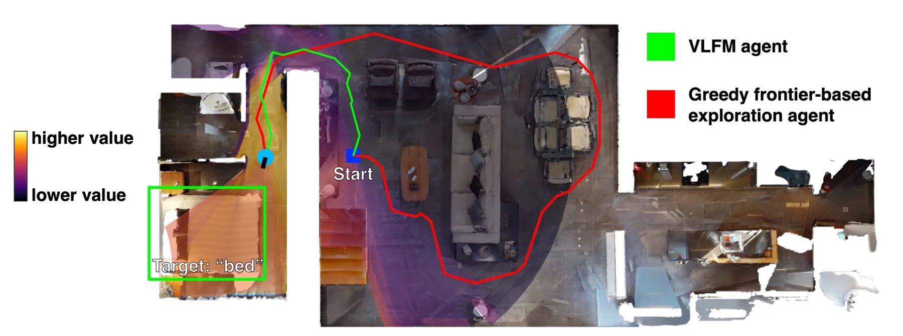
<figcaption>
VLFM system architecture: three stages of initialization, semantic frontier exploration, and goal navigation
</figcaption>
</div>

**Core mechanisms:**

1. **Frontier waypoint generation**
   - Build a 2D occupancy map from depth and odometry, and take the boundaries between explored and unexplored areas as frontier candidates
   - The midpoint of each frontier is a potential navigation waypoint

2. **Value map generation**
   - Compute semantic value scores directly from RGB images with the pretrained BLIP-2 vision-language model
   - Text prompt: "Seems like there is a &lt;target object&gt; ahead"
   - Project the resulting cosine similarity into a top-down value map with two channels: semantic score and confidence

<div align="center">
  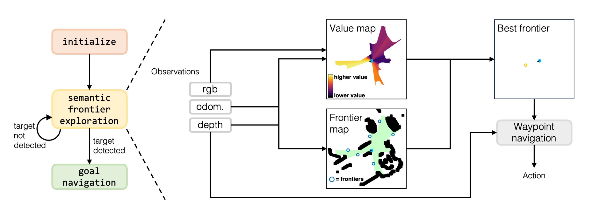
<figcaption>
Value map generation: BLIP-2 computes semantic scores, which are projected into a top-down map
</figcaption>
</div>

1. **Confidence-weighted averaging**
   - Confidence depends on a pixel's position relative to the optical axis: $c_{i,j} = \cos^2(\theta/(\theta_{fov}/2) \times \pi/2)$
   - Semantic values in overlapping regions are updated as: $v_{i,j}^{new} = (c_{i,j}^{curr}v_{i,j}^{curr} + c_{i,j}^{prev}v_{i,j}^{prev})/(c_{i,j}^{curr} + c_{i,j}^{prev})$
   - Confidence is updated with a bias toward higher values: $c_{i,j}^{new} = ((c_{i,j}^{curr})^2 + (c_{i,j}^{prev})^2)/(c_{i,j}^{curr} + c_{i,j}^{prev})$

<div align="center">
  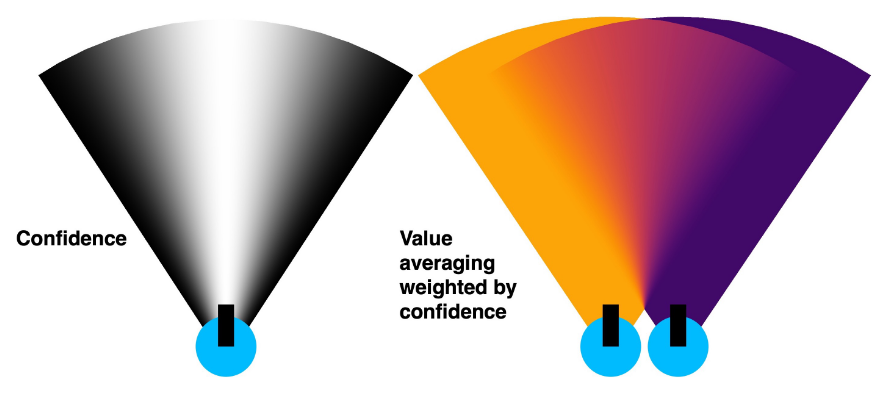
<figcaption>
Confidence scoring: pixels near the optical axis get the highest confidence, which falls off toward the edges
</figcaption>
</div>

1. **Object detection and navigation**
   - YOLOv7 detects COCO categories and Grounding-DINO handles open-vocabulary detection
   - Mobile-SAM extracts the target's contour, and the closest point on it becomes the goal waypoint
   - A PointNav policy trained with VER drives to the waypoint (purely geometric, with no semantics)

**Key innovations:**
- Direct visual-semantic reasoning: BLIP-2 scores semantics straight from RGB, bypassing the object-detector-to-text step
- Spatial value representation: semantic values are mapped onto a top-down grid to guide frontier selection
- Confidence-driven fusion: current observations and history are balanced dynamically

**Results and findings**
- **Benchmarks**: state-of-the-art zero-shot performance on Gibson, HM3D, and MP3D
  - Gibson: SPL 52.2%, SR 84.0% (+11.7% SPL and +14.7% SR over SemUtil)
  - HM3D: SPL 30.4%, SR 52.5% (+8.1% SPL and +13.3% SR over ESC)
  - MP3D: SPL 17.5%, SR 36.4% (+3.3% SPL and +7.7% SR over ESC)
- **Beats some supervised methods**: outperforms ObjectNav-trained methods such as SemExp and PONI on Gibson and MP3D
- **Ablations**: confidence-weighted averaging beats both simple replacement and unweighted averaging on every dataset
- **Real-world deployment**: deployed on a Boston Dynamics Spot robot, it navigated efficiently to unseen target objects in an office building, with all models (BLIP-2, GroundingDINO, MobileSAM, ZoeDepth) running in real time on an RTX 4090 MaxQ laptop

**Limitations**
VLFM supports only single-floor navigation: without z-axis odometry it is hard to know when to reset the value map, so 14.6% and 9.6% of failures on HM3D and MP3D involve changing floors. It also assumes the target is visible from the default camera height. Future work could explore active camera control, interactive search (such as opening drawers), and reusable semantic maps for long-horizon multi-task planning.

## 2. NoMaD (2023)
{: id="nomad"}
——A goal-masked diffusion policy for unified navigation

📄 **Paper**: [arXiv:2310.07896](https://arxiv.org/abs/2310.07896) · 🏛️ **ICRA 2024**

**Background and problem**

Traditional robot navigation systems usually train separate policies for exploration and goal-conditioned navigation, which adds system complexity and limits knowledge sharing and generalization across tasks. NoMaD (Nomadic Multi-task Agent with Diffusion, from Berkeley, ICRA 2024 Best Paper) uses a single diffusion policy with a goal mask to model both task-specific behavior (reaching a goal) and task-agnostic behavior (exploration), so one policy handles several navigation tasks.

**Method and innovations**

<div align="center">
  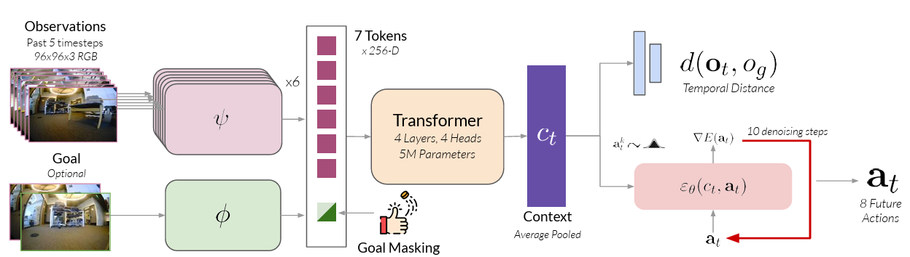
<figcaption>
NoMaD's goal-masked diffusion policy framework
</figcaption>
</div>

### Core idea
{: id="核心思路"}

Model task-specific and task-agnostic behavior together with one diffusion policy

### Two key components
{: id="两个关键组件"}

**Goal masking**
- A binary mask controls whether the policy attends to the goal image, making it easy to switch between task conditions
- **Training**: the goal is masked at random with 50% probability, so the model learns goal-directed and exploratory behavior at the same time
- **Inference**: the mask is set by the task (mask the goal when exploring, provide it when navigating to a goal)

**Diffusion policy**
- A diffusion model generates multimodal, collision-free action sequences
- Action sequences are denoised iteratively, starting from random noise
- Without a goal, the action distribution expresses exploration; with a goal, it collapses toward goal-directed behavior

### Unified framework design
{: id="统一框架设计"}

- A Transformer encodes visual observations, and the diffusion model generates future action sequences from them
- Supports both task-specific (goal-directed) and task-agnostic (exploration) behavior
- Trained end to end with supervision on large, diverse datasets (GNM and SACSoN)

<div align="center">
  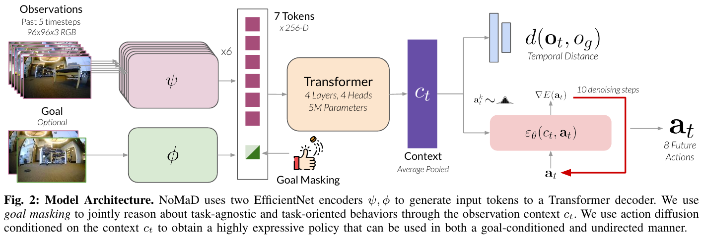
<figcaption>
NoMaD's goal-masking mechanism
</figcaption>
</div>

**Results and findings**

- **Exploring unknown environments**: 98% success with only 0.2 collisions on average, about 25% better than the strongest baseline, Subgoal Diffusion, with 1/15 of its parameters
- **Goal navigation**: in known environments, success matches the strongest baseline while using less compute
- **Efficiency**: about 15 times more compute-efficient than existing methods, and the first goal-conditioned action diffusion model deployed on a physical robot
- **Benefits of a unified policy**: joint training learns shared representations and environment affordances, so a single policy handles multiple behaviors
- **Encoder choice**: the ViNT encoder with attention-based goal masking works best, with 98% success and the fewest collisions
- **Validation in many settings**: strong results in 6 complex indoor and outdoor environments

**Limitations**

NoMaD's performance depends heavily on the choice of visual encoder and needs careful tuning. The ViT encoder has more capacity and expressiveness but is harder to optimize and converges more slowly. The goal-mask sampling rate (50% during training) is a key hyperparameter that may need adjusting for different settings. Although NoMaD works well in many indoor and outdoor environments, its robustness in extremely complex, highly dynamic scenes (such as dense crowds or fast-changing obstacles) can still improve.

---

## 3. VL-Nav (2025)
{: id="vl-nav"}
——A real-time zero-shot vision-language navigation system that combines pixel-level vision-language features with heuristic spatial reasoning

📄 **Paper**: [arXiv:2502.00931](https://arxiv.org/abs/2502.00931) · 🏛️ **IROS 2026**

**Key takeaways**

This paper shows how to combine pixel-level vision-language features with heuristic exploration for efficient zero-shot navigation. Ideas worth borrowing: (1) a Gaussian mixture model turns pixel-level VL features into a spatial distribution instead of relying on a single image-level similarity score; (2) instance-based goal points mimic human search, letting the robot approach and verify potential targets; (3) a rolling occupancy grid and partial frontier detection cut compute enough to run in real time on a low-power platform; (4) distance weighting and an unknown-area heuristic avoid back-and-forth motion and improve efficiency in large environments; (5) in the real world, this modular approach generalizes better than end-to-end learning.

**Background and problem**

Current vision-language navigation systems face three challenges: pixel-level vision-language features are hard to interpret, generalization across environments is poor, and they cannot run in real time on low-power platforms. Existing methods such as VLFM rely on compute-heavy models and select targets with a single image-level similarity score, which limits their use of fine-grained vision-language cues.

**Method and innovations**

<div align="center">
  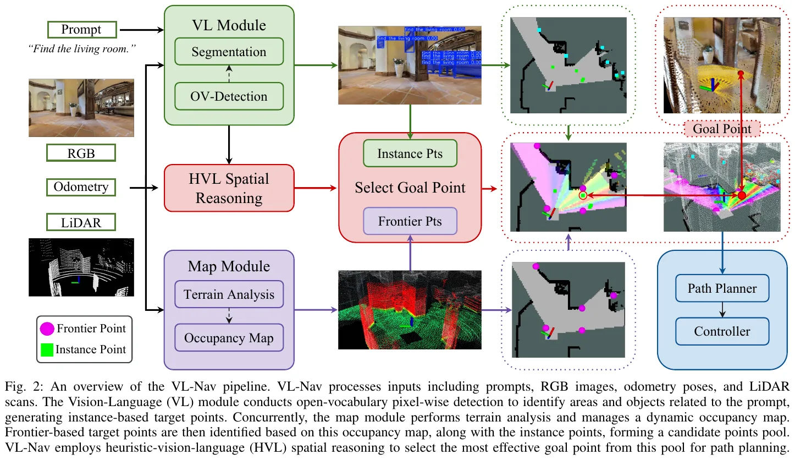
<figcaption>
VL-Nav system overview: the VL module, the map module, and HVL spatial reasoning
</figcaption>
</div>

VL-Nav is a vision-language navigation framework optimized for low-power robots, running at 30 Hz on a Jetson Orin NX. Its core innovation is **heuristic-vision-language (HVL) spatial reasoning**, which combines pixel-level vision-language features with heuristic exploration.

**Rolling occupancy map**: the system maintains a dynamic 2D occupancy grid in which each cell is free (0), unknown (-1), or occupied (100). Instead of a fixed-size global grid, VL-Nav uses a rolling grid that grows only when new sensor data requires it, reducing memory use and the cost of BFS and clustering. Each update (1) expands the map as needed, (2) clears stale obstacles in the forward FOV, (3) inflates new obstacles, and (4) ray-casts to mark unknown cells as free.

**Frontier-based and instance-based goal points**: the system generates two kinds of candidate goals. Frontier-based points come from partial frontier detection within a forward wedge, testing only cells that satisfy angle and distance constraints and clustering them with BFS. Instance-based target points (IBTP) are candidate instance centers reported periodically by the vision-language detector, kept only if their confidence exceeds a threshold τdet. IBTP mimics how people search: on seeing a possible match, the robot moves closer to confirm it instead of ignoring the intermediate detection.

<div align="center">
  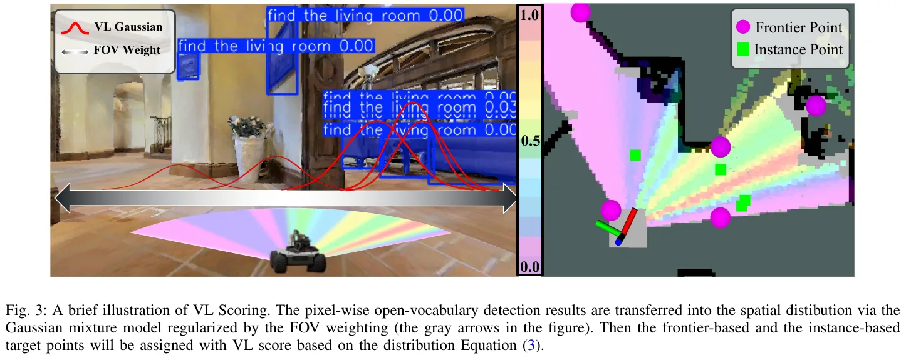
<figcaption>
VL scoring: pixel-level open-vocabulary detections are turned into a spatial distribution with a Gaussian mixture model and FOV weighting
</figcaption>
</div>

**HVL spatial reasoning**: this is the heart of VL-Nav. For each candidate goal g, the system computes an HVL score. The VL score uses a Gaussian mixture model to turn pixel-level vision-language features into a distribution over the robot's FOV. Suppose the open-vocabulary detector identifies K possible directions, each parameterized by (μk, σk, αk): μk is the mean angular offset within the FOV, σk the angular uncertainty of the detection (fixed at 0.1), and αk a confidence-based weight. The VL score is:

S_VL(g) = Σ(k=1 to K) αk * exp(-1/2 * ((Δθ - μk)/σk)²) * C(Δθ)

where C(Δθ) = cos²(Δθ/(θ_fov/2) * π/2) is a field-of-view confidence term that down-weights detections at large angular offsets.

The heuristic cues add two terms: (1) distance weighting, S_dist(g) = 1/(1+d(xr,g)), which favors closer goals to save energy and avoid wandering; (2) unknown-area weighting, S_unknown(g) = 1 - exp(-k*ratio(g)), where ratio(g) is the ratio of unknown to reachable cells in a local BFS, which encourages goals likely to reveal large unexplored areas.

The final HVL score is S_HVL(g) = w_dist * S_dist(g) + w_VL * S_VL(g) * S_unknown(g). The system prefers instance-based goals (ranked by VL score); if there are none, it picks the frontier goal with the highest HVL score.

**Path planning**: once an HVL goal is chosen, FAR Planner plans a point-goal path, representing obstacles as polygons and updating its visibility graph in real time, which allows efficient replanning in partially unknown environments. A local planner turns FAR Planner's waypoints into short-horizon velocity commands so the robot reacts quickly to new obstacles.
<div align="center">
  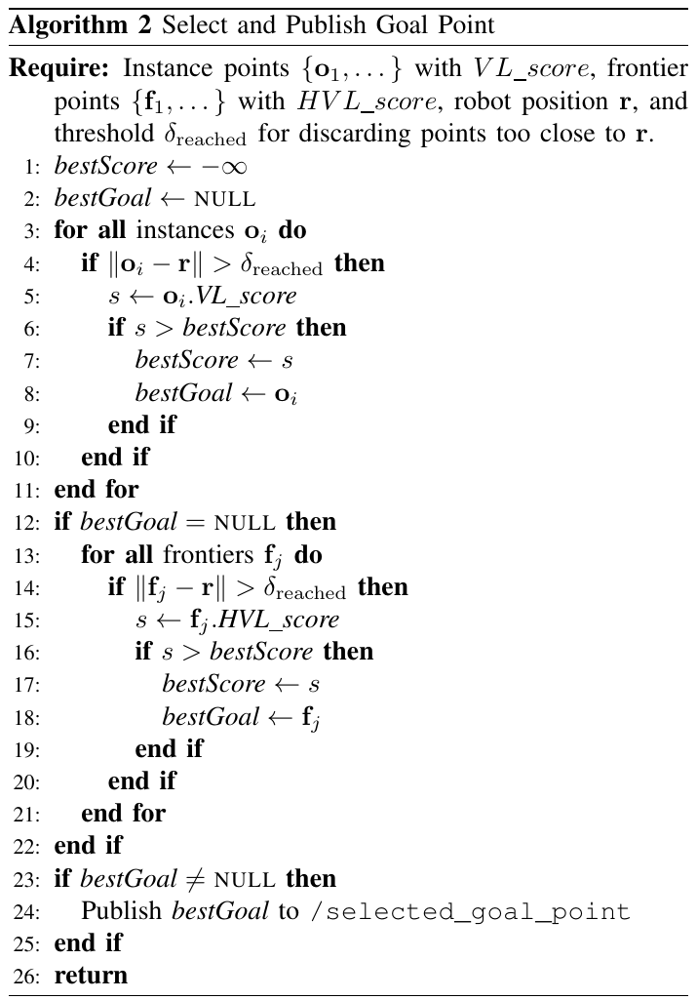
<figcaption>
Four real-world test environments that differ in scale and semantic complexity
</figcaption>
</div>

**Results and findings**

<div align="center">
  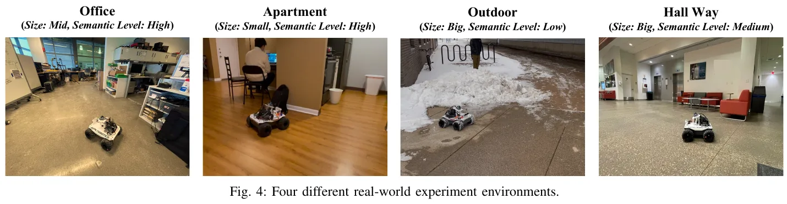
<figcaption>
Trajectories and detections in different environments, showing VL-Nav's advantage over the classical and VLFM baselines
</figcaption>
</div>

VL-Nav is evaluated in four real-world environments (Hallway, Office, Apartment, Outdoor) that vary in semantic complexity (high, medium, low) and scale (big, mid, small). Key findings:

- **Overall**: VL-Nav reaches an overall success rate (SR) of 86.3%, 44.15% higher than prior methods, with the best SR and SPL (success weighted by path length) in all four environments.
- **Instance-based goal points**: removing IBTP hurts performance badly, especially in the complex Apartment and Office environments, which shows the value of letting the robot approach and verify possible detections.
- **Heuristics**: removing the heuristic terms lowers both SR and SPL, especially in large environments, showing that distance weighting and the unknown-area heuristic are key to efficiency.
- **Versus VLFM**: VL-Nav beats VLFM everywhere, with the largest margins in the semantically complex Apartment and the open Outdoor environment, confirming the value of pixel-level VL features and HVL reasoning.
- **Environment scale**: classical frontier exploration collapses in large environments (only 36.7% SR in the big environment), while VL-Nav stays robust (82.3% SR).
- **Semantic complexity**: every method does better in semantically richer environments, because structured indoor spaces give stronger detection and segmentation cues; VL-Nav exploits that context best and gains the most in highly complex environments.
- **Real-time performance**: VL-Nav runs at 30 Hz on a Jetson Orin NX thanks to an efficient YOLO-World variant (256×320 input, standard GPU runtime) and the rolling occupancy grid, making real-world deployment practical.

**Limitations**

The system struggles with complex language descriptions that involve hidden object references or specific text labels. It also relies on hand-set thresholds (for example, for lighting conditions) that may not generalize across environments, calling for adaptive or learned thresholds.

---

## 4. GaussNav (2025)
{: id="gaussnav"}
——Gaussian Splatting for Visual Navigation

📄 **Paper**: [arXiv:2403.11625](https://arxiv.org/abs/2403.11625) · 🏛️ **IEEE TPAMI 2025**

**Background and problem**

Instance ImageGoal Navigation (IIN) asks an agent to find and navigate to the specific object instance shown in a goal image, in an unexplored environment. The agent must recognize the target across viewpoints while ignoring distractors. Existing navigation methods built on BEV maps lack detailed texture, struggle with instance-level tasks, do not preserve instance-aware scene properties, and cannot tell apart multiple objects of the same category.

**Method and innovations**

GaussNav is the first to bring 3D Gaussian Splatting (3DGS) to embodied visual navigation, introducing a semantic Gaussian map representation:

<div align="center">
  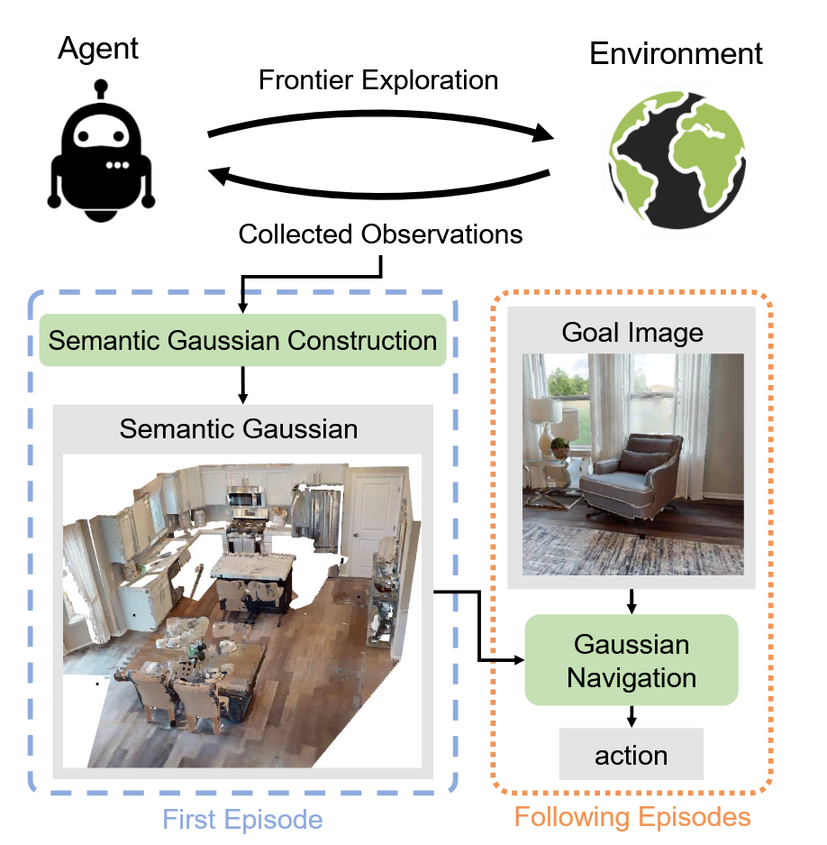
<figcaption>
GaussNav overview: frontier exploration → semantic Gaussian construction → Gaussian navigation
</figcaption>
</div>

**Frontier exploration:**
- The agent maintains an exploration map, marking explored areas, and an obstacle map, marking obstacles in the scene
- It extracts the contour of the explored region, removes obstacle cells, takes the nearest frontier point as the next waypoint, and repeats until the whole environment is covered

**Semantic Gaussian construction:**

*Geometric reconstruction:*
- **Simplified 3DGS**: each Gaussian has 9 parameters: an RGB color c, a center µ∈R³, a radius r, an opacity o∈[0,1], and a category label l
- **Differentiable rendering**: RGB, depth, and silhouette images are rendered by alpha compositing, enabling novel view synthesis (NVS)
- **Keyframe retrieval**: because consecutive frames in navigation overlap little, past frames are stored and periodically re-rendered to measure PSNR. Low-fidelity frames get priority, with two-stage optimization (p1=30 iterations on new viewpoints, p2=60 iterations on keyframe viewpoints)

<div align="center">
  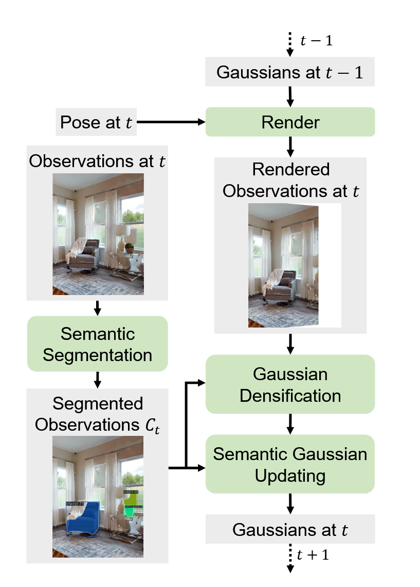
<figcaption>
Semantic Gaussian construction: Gaussian densification alternates with semantic Gaussian updates
</figcaption>
</div>

*Injecting semantic features:*
- **Instance segmentation**: Mask-RCNN assigns a semantic label to each Gaussian
- **Feature optimization**: per-pixel semantic features are rendered by feature splatting, and a feature loss encourages consistency within instances and separation between them
- **Gaussian clustering**: Gaussians are clustered by semantic label and 3D position, splitting the scene into instances within each semantic category

**Gaussian navigation:**

<div align="center">
  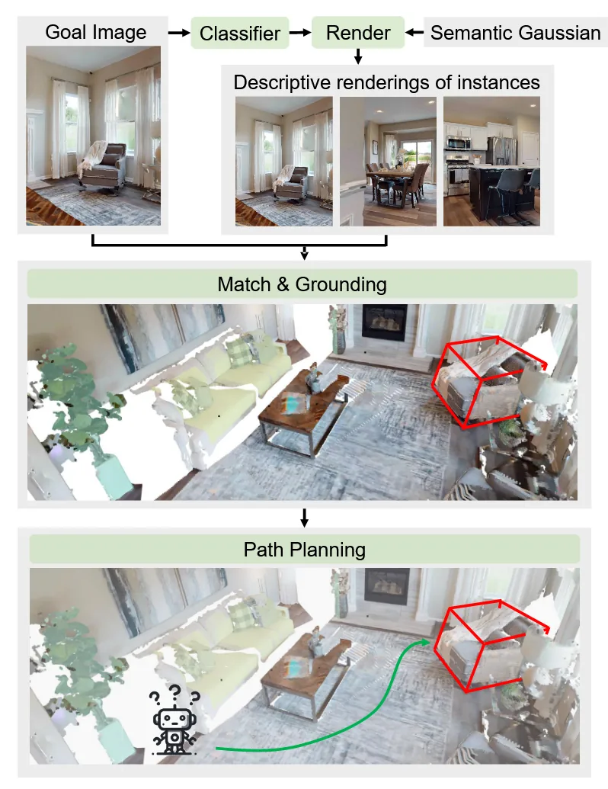
<figcaption>
Gaussian navigation: classifier → render descriptive images → matching and localization → path planning
</figcaption>
</div>

- **Classifier**: a ResNet50 predicts the semantic label ˆlg of the goal image, shrinking the search space dramatically (in scene CrMo8WxCyVb, from 648 candidate observations to 33)
- **Matching and localization**:
  - Render descriptive images of each candidate instance with NVS (nv=1/3/5, rotated ±15°/±30° horizontally and vertically)
  - Extract keypoints and descriptors with DISK, match them with LightGlue, and pick the candidate with the most matched keypoints
  - Cluster with DBSCAN to discard outliers from segmentation errors and localize the target instance precisely
- **Path planning**: convert the semantic Gaussians into a point cloud, voxelize and project it onto a 2D BEV grid, and plan a path over the distance field computed by FMM

**Key innovations:**
- A map representation that unifies geometry, semantics, and instance awareness, and the first use of 3DGS in embodied visual navigation
- Locates the target directly by rendering descriptive images, with no extra exploration or verification
- Keyframe retrieval effectively reduces forgetting and surface holes in navigation scenes

**Results and findings**

- **HM3D**: SPL rises from 0.347 to 0.578 (a 66.6% increase) and success reaches 72.5%, well ahead of every baseline
- **Efficiency**: runs at over 20 FPS, the fastest of the modular methods, with a much smaller search space (648 candidate observations reduced to 33 in scene CrMo8WxCyVb)
- **Ablations**:
  - Removing the classifier drops success to 37.5% and SPL to 29.1%; using it also cuts matching time by 2.5×
  - Removing the matching module drops success to 44.4% and SPL to 35.3%
  - NVS helps identification, and ground-truth NVS improves results further (success from 72.3% to 74.7%)
  - With ground-truth matching, success rises to 85.0%; with ground-truth target localization, it reaches 94.6%
- **Rendering quality**: on the HM3D validation set, PSNR reaches up to 40 and depth error is close to zero, though some highly textured scenes reconstruct poorly
- **Generalization across scenes**: performance is stable across 36 validation scenes, and the semantic Gaussian visualizations stay robust across diverse scene complexity and object layouts

**Limitations**

Reconstruction quality is poor in highly textured environments, so NVS can produce artifacts such as holes. Error analysis shows room for improvement in matching failures and inaccurate target localization. Semantic Gaussians are also unsuitable for path planning directly and must be converted to a 2D BEV grid, which adds compute.

---

## 5. NavDP (2025)
{: id="navdp"}
——A navigation diffusion policy trained only on simulation data that transfers zero-shot to real robots

📄 **Paper**: [arXiv:2505.08712](https://arxiv.org/abs/2505.08712) · 🏛️ **ICRA 2026** · [Code](https://github.com/InternRobotics/NavDP)

> In one sentence: NavDP trains an end-to-end navigation network on **simulation data alone**. By combining a **diffusion model that generates many candidate trajectories with a critic that picks the safest one**, it achieves **zero-shot sim-to-real transfer** and runs directly on robots as different as TurtleBot, Unitree Go2, G1, and Galaxea R1, without maps or any real-robot training data.

**Background and problem**

Robots need to navigate dynamic, unstructured open worlds, ideally working out of the box on a new robot in a new scene. Both existing approaches fall short:

- **Traditional modular pipelines** (perception → mapping → localization → planning): high system latency, errors that compound across modules, and endless manual hyperparameter tuning;
- **Learning-based methods**: limited by scarce real data; collecting data by teleoperating real robots is slow, expensive, and hard to scale.

NavDP (Shanghai AI Lab) **fully embraces simulation data**: simulated scenes can be generated at scale and provide privileged information such as globally optimal paths and global ESDFs. Navigation involves much less physical interaction than manipulation, so its sim-to-real gap is smaller to begin with; domain randomization and photorealistic rendering further narrow it. Two questions follow: (1) how can privileged simulation information be distilled into the policy, and (2) how can the policy remain **safe** in unseen real environments? NavDP answers them with **imitation learning for trajectory generation** and **contrastive critic learning for trajectory evaluation**, respectively.

**Where NavDP fits in a dual-system framework**: NavDP plays **System 1** in a fast-slow dual system, handling high-frequency, real-time local obstacle avoidance and path planning. It can plug directly into a VLM-driven System 2 (semantic understanding, task decomposition, and long-term memory) to provide full open-world navigation. This paper focuses on System 1.

<div align="center">
  
<figcaption>
NavDP at a glance: the scalable data engine (upper left: large-scale simulated scenes, embodiment-aware planning, domain randomization, parallel rendering) produces training data → the navigation diffusion policy (center), trained without any real-robot data, learns both to generate and to evaluate trajectories → at inference (right), it generates many candidates and selects a safe one → the bottom row shows zero-shot transfer to several real robots.
</figcaption>
</div>

**Method and innovations**

NavDP rests on two pillars: **(A) a scalable simulation data engine** that generates data efficiently, and **(B) a unified policy Transformer** that learns, in one shared network, both to generate trajectories (actor head) and to evaluate their safety (critic head). We take them in turn.

**(A) Scalable simulation data engine (DataEngine)**

The goal is to make navigation data fast and diverse to produce. The pipeline:

1. **Scene and embodiment modeling**: the robot is simplified to a cylinder of radius $r_b=0.25\text{m}$ with differential-drive kinematics. To mimic different robots, the **robot height** (0.25–1.25 m) and **camera pitch** (−30°–0°) are randomized, with two camera FOVs (RealSense D435i and Zed 2). Objects taller than the configured camera height are not treated as obstacles, so the data naturally encodes that a short robot can pass under things a tall robot must go around.
2. **Collision-free trajectories**: the scene mesh is voxelized (0.05 m) to compute an **ESDF (Euclidean signed distance field) of the traversable space**. After A\* plans an initial path, a local greedy search **pushes each waypoint farther from obstacles**, and cubic spline interpolation smooths the result into a continuous trajectory.
3. **Domain randomization + parallel rendering**: BlenderProc renders photorealistic RGB-D, with randomized **lighting, textures, and viewpoints** for diversity.

Data generation reaches **2500 trajectories / GPU / day**, about **20×** faster than real-robot collection. The final dataset covers **3154 scenes, approximately 1627 km, 452 hours, and 40 million images** (Table I), exceeding earlier navigation datasets in scale and diversity.

**(B) Unified policy Transformer (one network, two tasks)**

<div align="center">
  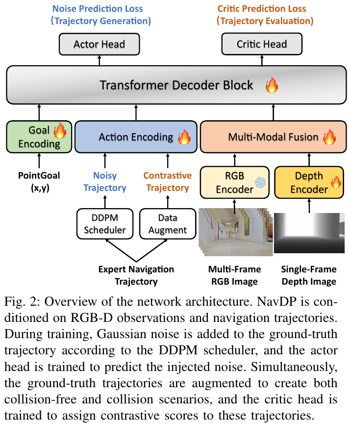
<figcaption>
Network architecture: fused multimodal RGB-D features and the goal encoding serve as keys/values, while trajectories enter the shared Transformer decoder as queries through an action encoding. The output splits into an actor head (predicts diffusion noise, i.e. generates trajectories) and a critic head (predicts a safety score, i.e. evaluates trajectories). The two tasks **share all weights** and differ only in their queries and attention masks.
</figcaption>
</div>

**① Multimodal encoding (what goes into the network)**
- **RGB**: the latest $N=8$ frames pass through a pretrained, **frozen DepthAnything encoder**, giving 256 patch tokens per frame (which carries temporal information).
- **Depth**: only the **current frame** is used, encoded by a **ViT trained from scratch** (to capture absolute metric scale for trajectory generation); because depth has a sim-to-real gap, only the (0.1 m, 5 m) range is kept.
- **Fusion and compression**: a lightweight Transformer decoder with learnable queries compresses the $(N+1)\times 256$ tokens into $N\times 16$ compact tokens to cut downstream compute.
- **Goal encoding**: following the PointGoal definition, the goal is the 2D coordinate $(x_g, y_g)$ relative to the current pose, projected by an MLP to the same dimension; the **no-goal (NoGoal) exploration task** uses an all-zero goal embedding.

**② Actor head: diffusion-based trajectory generation**
Expert trajectories are noised following DDPM, and the network learns to **predict the injected noise**. At inference, it denoises from Gaussian noise into a trajectory of $M=24$ dense waypoints. The diffusion process naturally models the **multimodal distribution** of expert demonstrations (the same spot may have two correct paths, around the left or around the right). Training covers both PointGoal and NoGoal, and the loss is a weighted sum of the two noise-prediction MSEs (0.5 each by default).

**③ Critic head: contrastive trajectory evaluation (the paper's key innovation)**
This is what sets NavDP apart from ordinary diffusion policies. Pure imitation learning only ever sees correct trajectories and cannot judge how dangerous a trajectory is. NavDP borrows the idea of a **critic value function** from reinforcement learning and uses the global ESDF readily available in simulation to give any trajectory a safety score. For an augmented trajectory $\hat\tau$, let its ESDF value at waypoint $m$ be $$d_{\hat\tau}^{m}$$; the target value is defined as:

$$V(\hat\tau) = \gamma \cdot \sum_{m=0}^{M}(d_{\hat\tau}^{m+1} - d_{\hat\tau}^{m}) + \lambda \cdot \frac{1}{M}\sum_{m=0}^{M}\mathbb{I}(d_{\hat\tau}^{m} < d_{safe})$$

Intuitively, the first term rewards movement away from obstacles; the second penalizes waypoints too close to them (below the safety threshold $d_{safe}=0.5\text{m}$). During training, **random rotation augmentation** of expert trajectories creates contrasting collision and collision-free examples, teaching the critic to distinguish safe from dangerous behavior.

> **Key insight**: simulation expert trajectories sometimes pass too close to obstacles because hyperparameters are hard to tune. The critic does more than reject collisions: it selects the trajectory with **the largest safety margin** from a candidate batch, systematically improving sim-to-real robustness.

**④ Inference: generate first, then select**
At inference, the actor head **generates a batch of candidate trajectories at once**. The critic scores each one, and **the highest-value (safest) trajectory** is executed. This forms a two-stage loop: diffusion supplies diversity and the critic screens for safety. The figure projects predicted trajectories into the image and colors them by critic score, with blue indicating danger and red indicating safety.

<div align="center">
  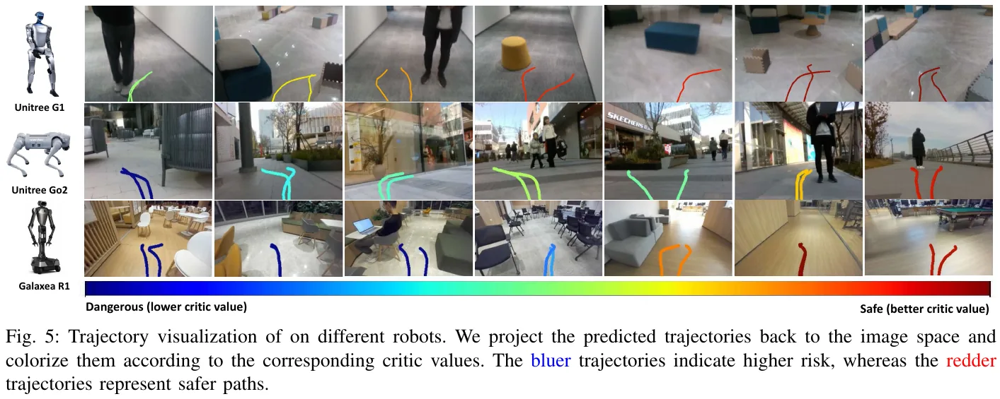
<figcaption>
Candidate trajectories on different robots (Unitree G1 / Go2 / Galaxea R1), colored by critic value: bluer is riskier, redder is safer. Even with pedestrians, motion blur, and lighting changes, NavDP still picks a safe path.
</figcaption>
</div>

**Training setup**: the whole network is trained **jointly in a single stage** on the sum of the actor and critic losses; 10 diffusion steps, $M=24$ predicted waypoints, $N=8$ RGB history frames, a 0.5 m safety threshold, trained on 32 A100s with batch size 2048.

**Results and findings**

- **PointGoal navigation**: SR 67.2 / SPL 62.6 in simulation, **+6.3% SR** over the previous best, ViPlanner (60.9 / 58.6); on real robots, average cross-embodiment SR is 76.7%, **+23.4%** over ViPlanner (53.3%), leading on TurtleBot (9/10), Go2 (7/10), and G1 (7/10).
- **NoGoal exploration**: in simulation, average collision-free time is **2.9×** NoMaD's and explored area **3.1×**; on real robots, exploration time is **3.8×** longer, showing strong zero-shot generalization and consistent obstacle avoidance.
- **Comparison of three failure modes** (Fig. 4): single-frame iPlanner/ViPlanner inputs cause **temporal inconsistency** (the camera has passed an obstacle but the body has not, so abrupt path changes cause collisions), **sensitivity to depth noise**, and **misinterpretation of irregular obstacles with holes** that leads to attempted passage through walls. NavDP handles these cases through multiframe context and critic screening.
- **Ablations** (Table V, three groups of factors):
  - **RGB-D fusion is essential**: removing depth costs 10.3% SR, removing RGB 5.1%, and using a single frame instead of several 2.8%.
  - **The critic is key to safety**: with the same weights, picking a random trajectory instead of using the critic costs 7.8% SR; removing contrastive trajectory augmentation costs 3.0% SR (home scenes).
  - **NoGoal is a useful auxiliary task**: joint training on NoGoal actually improves PointGoal by +2.1% SR / +1.8% SPL.
- **Domain randomization is crucial across embodiments** (Q5 / Fig. 6): trained only on data from short robots (< 0.5 m), the tall Galaxea R1 never learns to go around the table and its success rate plunges from **90% to 20%** (−70%), while the short Go2 is barely affected. **Cross-embodiment data diversity** is the root of generalization.

<div align="center">
  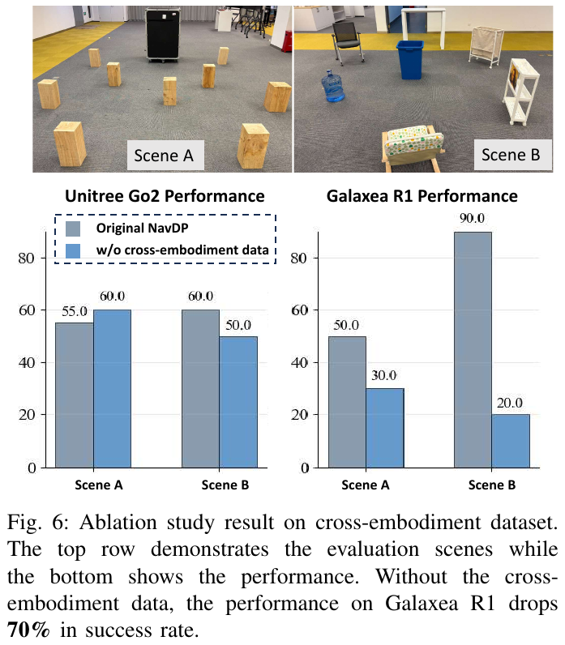
<figcaption>
Cross-embodiment data ablation: in scenario B, the short Go2 can pass under the table while the tall Galaxea R1 must go around. Without cross-embodiment training data, R1 never learns the detour and its success rate drops from 90% to 20%.
</figcaption>
</div>

**Limitations and future directions**

NavDP depends heavily on high-quality simulation data, and multi-step diffusion denoising, while it gives trajectory diversity, costs more compute than direct regression. The authors point to three future directions:

1. **Explicit embodiment encoding**: motion constraints are currently learned only implicitly from the data distribution, and the robot cannot explicitly perceive its own shape. An ideal system should be able to judge "I can't fit through this gap" by taking the robot's geometry as an explicit input to decision-making.
2. **Joint design of locomotion and path planning**: obstacle avoidance currently assumes the robot can only go around; on extreme terrain (where jumping or climbing over is needed), the planner should choose between passing over and going around based on the robot's actual locomotion limits.
3. **Efficient post-training, language goals, and global memory**: post-training through exploration to improve real-robot performance, extending goals to natural-language instructions, and adding global memory for long-horizon exploration.

---

## 6. NavWAM (2026)
{: id="navwam"}
——The first navigation model to fold future prediction, value estimation, and action selection into a single embodied world model

📄 **Paper**: [arXiv:2606.13494](https://arxiv.org/abs/2606.13494) · [Project Page](https://dachii-azm.github.io/navwam/)

### Key takeaways
{: id="精华-4"}
1. **Joint prediction and planning**: NavWAM merges future prediction and action planning (such as CEM search), which traditional navigation world models (NWM) keep separate, into a single video diffusion Transformer.
2. **A shared latent canvas**: the current state, goal image, current observation, action chunk, future state, future visual prediction, and progress value are laid out as one fixed 9-frame latent canvas, and joint denoising produces all outputs at once.
3. **No online planning overhead**: at test time, a single denoising pass in policy mode outputs an action chunk, avoiding the heavy online trajectory sampling and optimization of traditional world models. Control runs at 5 Hz with thousands of times less compute.
4. **Better representations**: a dense self-supervised reconstruction loss on future visual predictions gives action selection a strong "future observation anchor", greatly reducing policy drift under partial observability.

---

### 1. Background and problem
{: id="1-研究背景问题-4"}
In partially observable image-goal navigation, planning-based navigation world models (NWM) support decisions by predicting how the view will change under candidate action sequences. But they split world prediction and action selection into two separate steps: the model is only a predictor, and inference relies on an external planner (such as the cross-entropy method, CEM) to roll out and score many random candidate sequences in a closed loop. The online cost is huge, often dropping control below 1 Hz. To remove this bottleneck, the work builds a world action model that unifies future perception, value estimation, and continuous action generation in a single network.

---

### 2. Method and innovations
{: id="2-主要方法创新点-4"}
<div align="center">
  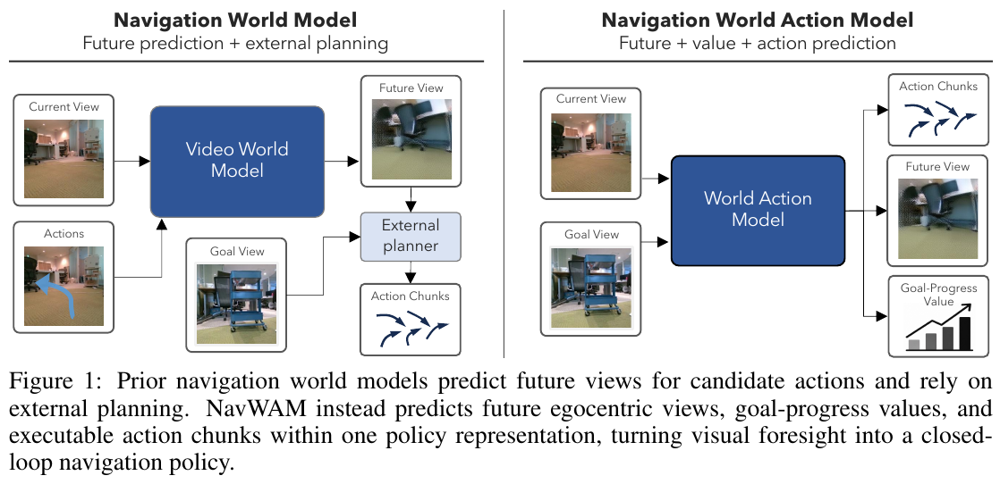
<figcaption>
A traditional navigation world model (NWM) compared with the navigation world action model (NavWAM)
</figcaption>
</div>

#### Overall framework
{: id="整体框架"}
NavWAM builds on the pretrained video world model Cosmos Predict2 (2B). It packs the current observation, goal image, robot state, future action chunk, future observations, and goal-progress value into a single 9-frame "world-action latent canvas", turning navigation into a joint denoising problem on that canvas.

<div align="center">
  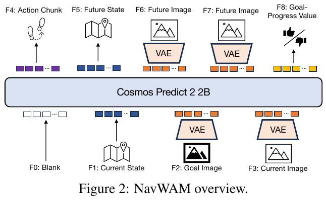
<figcaption>
NavWAM's latent canvas frame layout and data flow
</figcaption>
</div>

#### Latent canvas frame layout
{: id="latent-canvas-帧布局"}
The canvas has 9 frames:
* **Frame 0 (observed)**: a temporal pad frame (all zeros) for the causal VAE, giving the spatiotemporal VAE compression a boundary.
* **Frame 1 (observed)**: the current robot state $s_t = [x_t/100, y_t/100, \psi_t/\pi] \in \mathbb{R}^3$, normalized in the local frame.
* **Frame 2 (observed)**: the goal image $g$.
* **Frame 3 (observed)**: the current first-person observation $o_t$.
* **Frame 4 (predicted)**: the action chunk to execute, $a_{t:t+H-1} \in \mathbb{R}^{3H}$ with $H=4$ (local waypoint increments $[\Delta x_i, \Delta y_i, \Delta \psi_i]$).
* **Frame 5 (predicted)**: the future state $s_{t+H} \in \mathbb{R}^3$.
* **Frames 6 & 7 (predicted)**: two predicted future first-person images, $o_{t+H-1}, o_{t+H}$.
* **Frame 8 (predicted)**: the goal-progress estimate $v_{t+H} \in [0, 1]$.

Non-image scalars and vectors (actions, states, values) are normalized and broadcast over a spatial grid to fill a whole frame; at decoding time, the denoised features in those channels are averaged spatially to recover the scalar or vector values.

#### Training objective and mixed modes
{: id="训练目标与混合模式"}
The loss is weighted denoising score matching on the latent canvas:
$$\mathcal{L}_{\text{diff}} = \mathbb{E}_{\sigma, \epsilon} \left[ w(\sigma) \lVert x_0 - F_\theta(x_\sigma, \sigma, c) \rVert_2^2 \right]$$
To keep the low-dimensional action signal from being drowned out by the high-dimensional pixel loss of image reconstruction, the action-frame loss is up-weighted by $\lambda = 5$.

During training, samples are split across three conditioning modes so the network learns different navigation subtasks jointly (in a 50/25/25 ratio):
1. **Policy mode (50%)**: given observed frames 0–3, predict frames 4–8.
2. **World-model mode (25%)**: given observed frames 0–4, predict frames 5–8, training the model to predict how the world evolves under a given action.
3. **Value mode (25%)**: given observed frames 0–7, predict frame 8 (the goal-progress value of the current trajectory).

#### Goal-progress value
{: id="目标进度价值设计"}
The value target $v_{t+H}$ is defined explicitly as normalized distance progress toward the goal:
$$v_{t+H} = \text{clip}\left( 1 - \frac{\lVert p_{\text{end}} - p_t \rVert_2}{d_{\text{max}}}, 0, 1 \right)$$
where $p_t$ is the current 2D position, $p_{\text{end}}$ the goal's 2D position, and $d_{\text{max}}$ the maximum trajectory length.

#### Inference
{: id="推理流程"}
At deployment, the robot takes the current image $o_t$ and the goal $g$, runs in policy mode, and outputs $$\hat{a}_{t:t+H-1}$$ in a single denoising pass. The action chunk is executed in receding-horizon fashion, and the network is queried again afterwards, giving a closed-loop rate of about 5 Hz.

---

### 3. Results and findings
{: id="3-核心结果发现-4"}
<div align="center">
  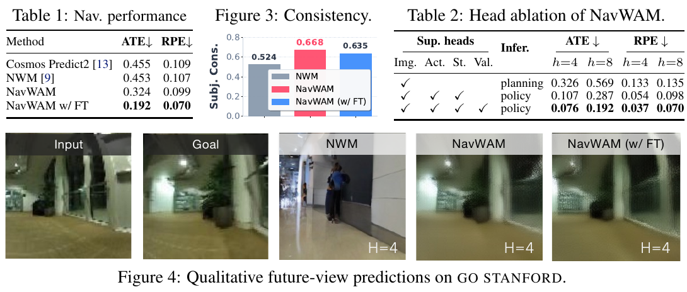
<figcaption>
Future image predictions from NavWAM, NWM, and NavWAM w/ FT on the GO STANFORD test set
</figcaption>
</div>

1. **Better navigation**: on offline image-goal navigation in GO STANFORD, both zero-shot NavWAM (ATE 0.324) and the fine-tuned version (ATE 0.192 / RPE 0.070) beat the traditional NWM (ATE 0.453), without any CEM action search at inference. The model also keeps future predictions highly consistent (consistency 0.635–0.668, well above NWM's 0.524).
2. **Very low inference cost**: replacing CEM trajectory optimization with a single denoising pass brings NavWAM down to 4.45 TFLOPs and 205.7 ms latency, versus 233.8 seconds and 14,521 TFLOPs for NWM on the same backbone, a difference of thousands of times.
3. **Multi-task supervision matters**: ablations show that supervising future visual predictions anchors the decision system to distant landmarks and is an indispensable self-supervised signal (compared with removing future images, ATE drops from 0.090 to 0.076).
4. **Closed-loop success on a real Diablo robot**: in 24 trials in real indoor environments (office, storage room, meeting room, hallway), NavWAM succeeds 79.2% of the time, far ahead of OmniVLA (58.3%) and the traditional NWM (16.7%).

<div align="center">
  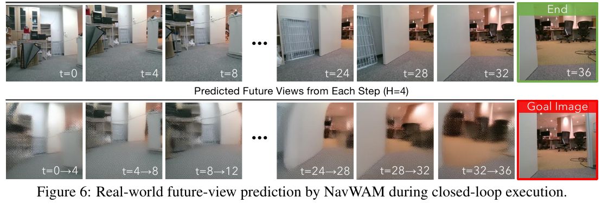
<figcaption>
Real camera frames versus predicted future frames while the Diablo robot is running (H=4)
</figcaption>
</div>

---

### 4. Limitations
{: id="4-局限性-4"}
1. **Limited test scenes**: real-robot evaluation covers mostly static indoor environments and has not been validated with dynamic obstacles such as pedestrians and moving objects.
2. **Limited goal types**: it targets image-goal navigation and has not been systematically tested on natural-language instructions, object-goal navigation, or embodied question answering.
3. **Long-horizon bottleneck**: in large, very long-range scenarios spanning floors and many rooms (which need frequent subtask planning and replanning), the limited number of context frames still risks degrading performance.

---

## 7. CanonNav (2026)
{: id="canonnav"}
——A cross-platform visual diffusion navigation policy that decouples camera geometry from navigation behavior

📄 **Paper**: [arXiv:2608.30242](https://arxiv.org/abs/2608.30242)

### Key takeaways
{: id="精华-12"}
1. **Decoupling camera geometry from behavior**: camera geometry canonicalization removes differences in camera intrinsics and pitch through homography reprojection, and mounting-height normalization maps physical trajectories into a viewpoint-invariant space. Together they resolve the ill-posed entanglement between visual observations and trajectories in demonstrations collected across robot platforms.
2. **Explicit local-planning supervision (Scope-of-Reach, SoR)**: traditional imitation learning copies expert actions but misses the intermediate planning intent. CanonNav introduces a local reachable-region representation (SoR) and supervises it with BEV pseudo-labels generated offline, explicitly teaching the agent where to head in occluded or complex terrain.
3. **Collision-aware constraints**: an offline traversability estimator builds a metric signed distance field (SDF), and collision and waypoint-feasibility losses are backpropagated directly through the diffusion policy's denoised trajectories, giving safe trajectory generation end to end.
4. **Monocular RGB matches or beats depth-based methods**: using only monocular RGB at inference, it clearly outperforms RGB baselines such as ViNT, NoMaD, and LiMo across multiple camera configurations in outdoor CitySim and indoor AWS Hospital, and on long routes with complex turns its success rate even exceeds NavDP, which relies on live RGB-D depth.

---

### 1. Background and problem
{: id="1-研究背景问题-12"}
Large-scale imitation learning from expert demonstrations collected on many platforms is an important route to autonomous visual navigation. But making full use of such heterogeneous data runs into two fundamental problems:
1. **Ill-posed entanglement of camera geometry**: different robot bodies (quadrupeds, low robot vacuums, wheeled vehicles) have different camera heights, intrinsics, and pitch angles, so the same image can correspond to completely different physical trajectories on the ground. Forcing the policy to infer camera geometry implicitly from RGB is a severely ill-posed, under-constrained problem.
2. **Planning intent is implicit in demonstrations**: an expert trajectory shows only the smooth path finally executed, not why it headed for a particular open area or how dangerous the edges on either side were. Pure imitation learning tends to degrade or collide in complex scenes that do not lead straight to the goal, such as occlusions, turns, and detours.

---

### 2. Method and innovations
{: id="2-主要方法创新点-12"}

<div align="center">
  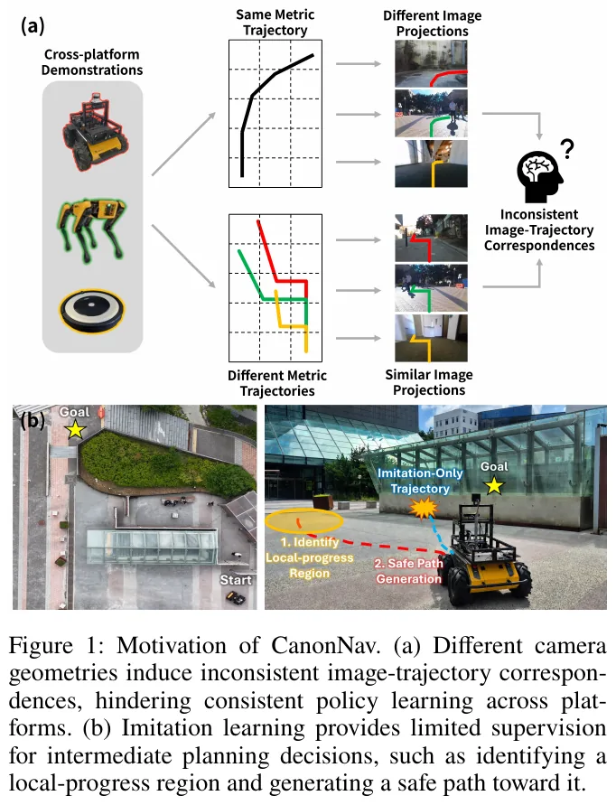
<figcaption>
Figure 1: CanonNav's motivation. (a) Camera geometry differs across platforms, so the mapping between images and physical trajectories is badly inconsistent; (b) traditional imitation learning does not supervise intermediate planning decisions such as identifying where to advance and where the safety boundaries are.
</figcaption>
</div>

#### ① Overall framework
{: id="-整体框架概述-4"}
CanonNav forms a closed loop of **camera geometry canonicalization**, a **multi-task diffusion policy network (policy inference)**, and **offline planning and safety supervision (training-time planning supervision)**. During training, a pretrained traversability model extracts BEV pseudo-labels offline to provide dense supervision; at deployment, no offline model or depth sensor is needed, and collision-free trajectories come from a monocular RGB image and a relative goal alone.

<div align="center">
  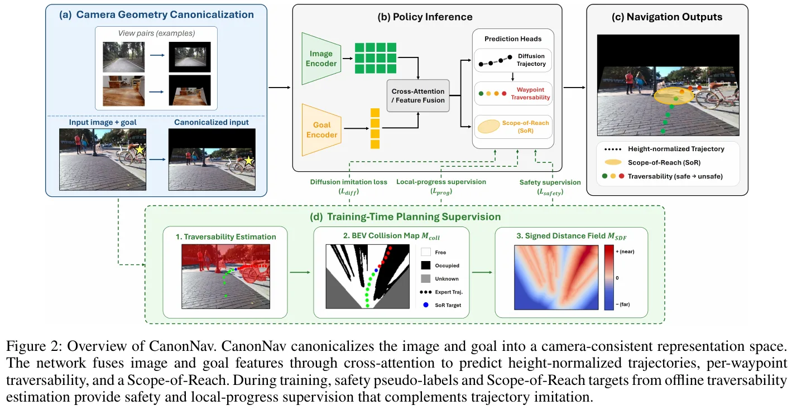
<figcaption>
Figure 2: CanonNav architecture. (a) Observations and goals are converted into canonical geometric space; (b) a DINOv3 backbone extracts features, and the diffusion model outputs height-normalized trajectories, waypoint traversability, and SoR; (d) offline BEV collision maps and SDFs provide safety and local-progress supervision.
</figcaption>
</div>

#### ② Module by module
{: id="-逐模块讲解-4"}

**1. Camera geometry canonicalization**
- **Removing intrinsics and pitch**: simplify the camera extrinsics to a mounting height $h$ and pitch $R_{pitch}$, with intrinsics $K$. Given the intrinsics $\tilde{K}$ of a forward-facing reference virtual camera, reproject the original image $I_t$ into an untilted forward view $$\tilde{I}_t$$:
  $$(\tilde{u}, \tilde{v}, 1)^\top \propto \tilde{K} R_{pitch}^{-1} K^{-1} (u, v, 1)^\top$$
- **Height-normalized trajectories**: for the forward reference camera, a ground point $(x, y)$ projects to $$\tilde{u} = \tilde{c}_x - \tilde{f}_x \frac{y}{x}$$, $$\tilde{v} = \tilde{c}_y - \tilde{f}_y \frac{h}{x}$$. The pixel position thus depends only on the lateral ratio $y/x$ and the height ratio $h/x$. Normalizing trajectory points $(x, y)$ to $(\tilde{x}, \tilde{y}) = (x/h, y/h)$ turns the projection into:
  $$\tilde{u} = \tilde{c}_x - \tilde{f}_x \frac{\tilde{y}}{\tilde{x}}, \quad \tilde{v} = \tilde{c}_y - \tilde{f}_y \frac{1}{\tilde{x}}$$
This normalization removes the camera height $h$ entirely, aligning the trajectory distributions of all platforms under the same view-frustum geometry.

> **Worked example A: why does height normalization remove differences between robot bodies?**
> Suppose the reference virtual camera has focal length $$\tilde{f}_y = 500$$ and principal point $$\tilde{c}_y = 250$$:
> - **A low robot vacuum**: camera height $h_1 = 0.2\text{ m}$, with an obstacle $1.0\text{ m}$ ahead ($x_1 = 1.0\text{ m}$), so its height-to-distance ratio is $h_1 / x_1 = 0.2 / 1.0 = 0.2$;
> - **A tall wheeled inspection vehicle**: camera height $h_2 = 1.0\text{ m}$, with an obstacle $5.0\text{ m}$ ahead ($x_2 = 5.0\text{ m}$), so its ratio is $h_2 / x_2 = 1.0 / 5.0 = 0.2$.
>
> In the two robots' forward images, these two ground points at completely different physical distances land on **exactly the same** pixel row, $\tilde{v} = 250 - 500 \times 0.2 = 150$!
> Imitating metric coordinates directly would force the policy to predict contradictory actions, $1.0\text{ m}$ and $5.0\text{ m}$, for the same visual input. After height normalization, both become the same dimensionless distance, $\tilde{x} = x/h = 5.0$! The policy only has to learn this single distribution and multiply by each robot's mounting height $h$ at control time to generalize seamlessly.

**2. Planning supervision and Scope-of-Reach (SoR)**
- **Modeling the local reachable region**: the region to advance into is modeled as a 2D bird's-eye-view Gaussian $\mathcal{S} = \mathcal{N}(\mu, \operatorname{diag}(\sigma^2))$, and the network predicts its height-normalized parameters $(\tilde{\mu}, \tilde{\sigma}) = (\mu/h, \sigma/h)$.
- **Generating safety pseudo-labels offline**:
  1. A pretrained ViTA extracts traversability masks for images in the offline training set;
  2. The masks are projected onto the ground to form a local BEV collision map $M_{coll}$, then converted into a metric signed distance field $M_{sdf}$;
  3. The last feasible waypoint before the expert trajectory enters a collision zone or leaves the field of view becomes the local progress target $$s^*$$.
- **Three-part SoR loss**:
  $$L_{prog} = \lambda_{pred} L_{pred} + \lambda_{neg} L_{neg} + \lambda_{cons} L_{cons}$$
  - $L_{pred}$: negative log-likelihood plus Smooth-L1 to fit the target point $$\tilde{s}^*$$;
  - $L_{neg} = \iint M_{coll}(x, y) \mathcal{S}(x, y) dx dy$: penalizes Gaussian probability mass that falls into collision zones;
  - $L_{cons}$: a soft-min constraint requiring at least one denoised waypoint of the generated trajectory to pass through the predicted SoR region.

**3. Continuous collision-aware safety loss (safety supervision)**
- From the noisy trajectory $$\tilde{\tau}_k$$, a single-step inversion gives a noise-free waypoint estimate $$\hat{\tau}_0 = \{\hat{p}_i\}$$;
- The collision loss $L_{coll}$ is:
  $$c_i = \operatorname{softplus}\left(\frac{d_{safe} - M_{sdf}(h \hat{p}_i)}{\eta}\right), \quad L_{coll} = \frac{1}{\gamma} \log \sum_{i=1}^N \exp(\gamma c_i)$$
- Waypoint traversability branch $L_{trav}$: image features sampled bilinearly predict each waypoint's survival probability $$\hat{q}_i$$.

#### ③ Data flow, separating training from inference (worked example B)
{: id="-读者视角数据流与训练推理分离图卡点降维装置-b"}

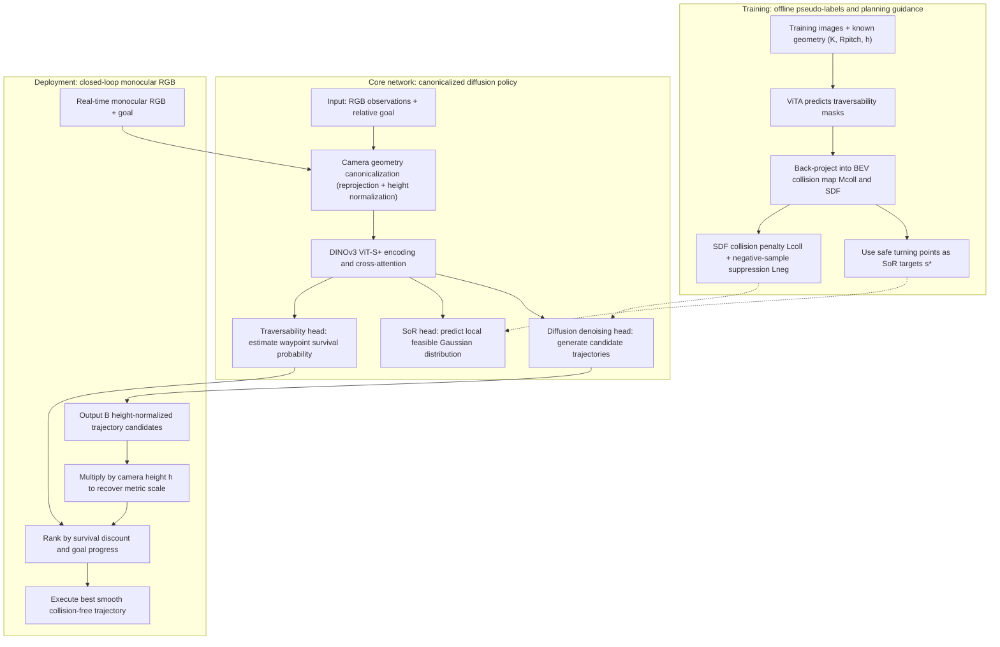

#### ④ CanonNav vs. mainstream navigation baselines (worked example C)
{: id="-核心机制对比canonnav-vs-主流导航基线卡点降维装置-c"}

| Mechanism dimension | Traditional pure imitation baseline (ViNT / NoMaD) | Depth map planning baseline (ViPlanner / NavDP) | This article CanonNav |
|---|---|---|---|
| **Cross-platform geometry processing** | Forcibly input the original image and rely on massive random enhancement to implicit adaptation | RGB-D geometric alignment that requires precise registration | Explicit reprojection + highly normalized spatial decoupling |
| **intermediate planning intention** | Pure trajectory diffusion denoising, missing local turning guidance | Relying on real-time depth map reconstruction cost map | Proposing SoR explicit modeling of local advancement distribution |
| **Collision avoidance mechanism** | Lack of explicit negative feedback, easy to cut inwards and scratch obstacles | An online high frame rate depth sensor is required to calculate collision | Offline SDF reverse gradient constraint generation trajectory |
| **Deployment sensor threshold** | monocular RGB (but very poor resistance to geometric disturbance) | Strong reliance on real-time dense RGB-D sensors | Pure monocular RGB can achieve ultra-high security |

---

### 3. Results and findings
{: id="3-核心结果发现-12"}
Evaluation covers two demanding simulation environments, **CitySim (a complex outdoor campus)** and **AWS Hospital (complex indoor corridors and wards)**, plus a real vehicle (a Clearpath Husky differential-drive robot):

1. **Clear lead in generalizing across camera geometry**: when camera height shifts from $0.4\text{ m}$ to $1.0\text{ m}$ and pitch from $-15^\circ$ to $+15^\circ$, the success rates of ViNT and NoMaD typically plunge by 20%–40%, while CanonNav's drop ($\Delta\text{SR}$) stays very small under every geometric perturbation.
2. **Beats RGB-D methods on long routes with hard turns**: on $20\text{ m}$ long-range subgoal navigation, even through heavily occluded U-turns, CanonNav reaches **86.4%** success with a **0.89** collision rate using only monocular RGB, well ahead of NavDP (SR 71.2%, collision rate 2.21) and ViPlanner (SR 39.3%), both of which use live dense depth.
3. **Zero-shot transfer with zero collisions in the real world**: in real-robot tests with reflective glass walls, narrow tree-lined steps, and irregular outdoor corridors, CanonNav had no collisions in any trial, and its trajectory curvature closely matched human demonstrations.

---

### 4. Limitations
{: id="4-局限性-12"}
1. Geometric canonicalization relies on known mounting parameters (intrinsics $K$, static mounting height $h$, and pitch $R_{pitch}$). If the robot pitches violently on bumpy off-road terrain, the static assumption introduces momentary projection errors.
2. The quality of the offline pseudo-labels is limited by how well the ViTA traversability segmentation model performs in extreme lighting (such as heavy rain or strong backlight).

---

## 8. Hydra-Nav (2026)
{: id="hydra-nav"}
——Object Navigation via Adaptive Dual-Process Reasoning

📄 **Paper**: [arXiv:2602.09972](https://arxiv.org/abs/2602.09972)

---

**Key takeaways**

Hydra-Nav's most valuable idea is to unify slow thinking (CoT reasoning) and fast action (low-level reactive control) in **a single VLM**, avoiding the fragmentation of multi-model architectures. Its key innovation, **Iterative Rejection Fine-Tuning (IRFT)**, lets the model learn for itself when to reason instead of reasoning at a fixed rate, striking the best balance between success rate and reasoning cost. The three-stage curriculum (spatial-action alignment → memory-reasoning integration → adaptive reasoning) is a reusable recipe for training embodied navigation agents. The new SOT metric (Success weighted by Operation Time) counts reasoning latency in the evaluation, which reflects deployment needs better than SPL and is worth adopting for other embodied tasks.

---

**Background and problem**

Object-goal navigation asks a robot to explore and find target objects in real environments using only egocentric perception. Current VLM-based methods have two core flaws: (1) weak spatiotemporal reasoning means they fail to remember explored areas and re-explore them; (2) reasoning (chain of thought) at every step wastes compute, yet reasoning is not triggered in time at critical "stagnation points". Existing dual-system (slow-fast) architectures rely on separate models, which fragments the architecture and limits how flexibly they can switch.

---

**Method and innovations**

Hydra-Nav unifies high-level planning and low-level meta-actions in **a single VLM** (based on Qwen2.5-VL-7B), and switches from the fast system to the slow one on its own by emitting a special transition token, `obs`.

<div align="center">
  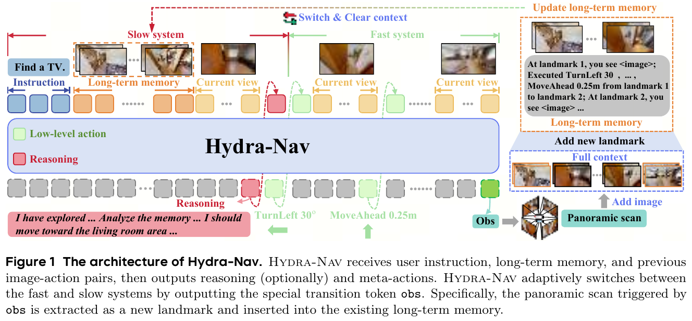
<figcaption>
Hydra-Nav architecture: the slow system handles global spatiotemporal reasoning and high-level planning, the fast system executes low-level meta-actions efficiently, and the special token obs switches between them adaptively.
</figcaption>
</div>

**Dual-process system**

- **Slow system**: takes the goal instruction, the current panoramic observation (four RGB images 90° apart), and structured long-term memory, produces CoT reasoning and a high-level plan, then outputs the first meta-action.
- **Fast system**: continuing from the slow system's conversation history, it uses KV caching to encode only the newest egocentric frame and autoregressively decodes low-level atomic actions (MoveAhead 0.25m, TurnLeft/Right 30°), avoiding reprocessing the full history.
- **Adaptive switching**: when the agent completes a subgoal or the current observation conflicts with the plan, it emits `obs`, which triggers a panoramic scan, adds a new landmark node, updates long-term memory, and hands control back to the slow system.

<div align="center">
  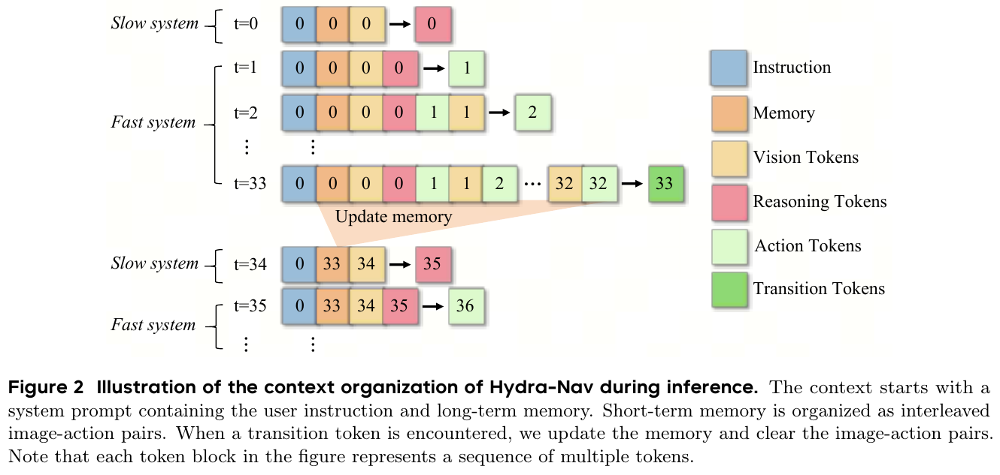
<figcaption>
How context is organized at inference: short-term memory is a sequence of interleaved image-action pairs; when an obs token appears, memory is updated and the short-term context is cleared.
</figcaption>
</div>

**Three-stage curriculum training**

**Stage 1: spatial-action alignment**

An A* planner generates **500K trajectories** (20.1B tokens) on the HM3D, MP3D, and OVON training sets, and Qwen2.5-VL-7B is trained on them to learn basic navigation actions. Each trajectory is formatted as a multi-turn conversation, so its gradient is computed in a single forward-backward pass.

**Stage 2: reasoning-memory integration**

<div align="center">
  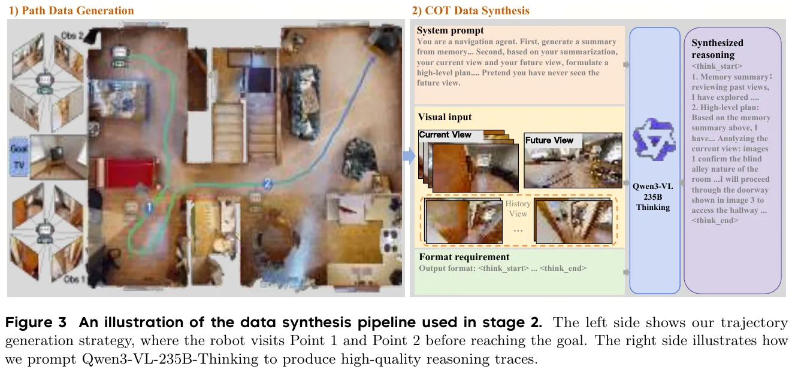
<figcaption>
Stage 2 data synthesis: left, trajectory generation with heuristic waypoint selection; right, synthesizing high-quality reasoning text with Qwen3-VL-235B-Thinking.
</figcaption>
</div>

- A heuristic waypoint-selection strategy generates trajectories that include exploration (not just shortest paths), choosing the two highest-scoring exploration waypoints for each trajectory.
- Trajectories are cut into fixed 16-step segments; long-term memory and reasoning text are inserted at the start of each segment and an `obs` token at the end.
- Reasoning text synthesis: Qwen3-VL-235B-Thinking first recalls and summarizes the history images, then combines the current view with the "future correct view" (with safeguards against information leakage) to write forward-looking plans.
- In total, **565K mixed samples (8.3B tokens)** are generated, with VQA data mixed in to prevent overfitting.

**Stage 3: adaptive reasoning via IRFT**

Two kinds of **stagnation points** are defined:
1. **Revisiting**: the agent returns within $\delta_{stag}=0.5$m of a position visited in the past $T_{stag}=20$ steps.
2. **No progress**: the distance to the goal does not decrease within a random time window $\Delta t \sim \mathcal{U}(20,35)$.

IRFT procedure: run in fast-system mode and trigger the slow system at stagnation points. Failed trajectories (timeouts or misidentified targets) are "rejected and repaired": find the intervention timestamp $$t^*$$, replace the rest of the trajectory with the optimal A* path, and resynthesize the reasoning text for the corrected segment. Each round runs from the latest checkpoint and produces about 60K trajectories (4.5B tokens).

---

**Results and findings**

<div align="center">
  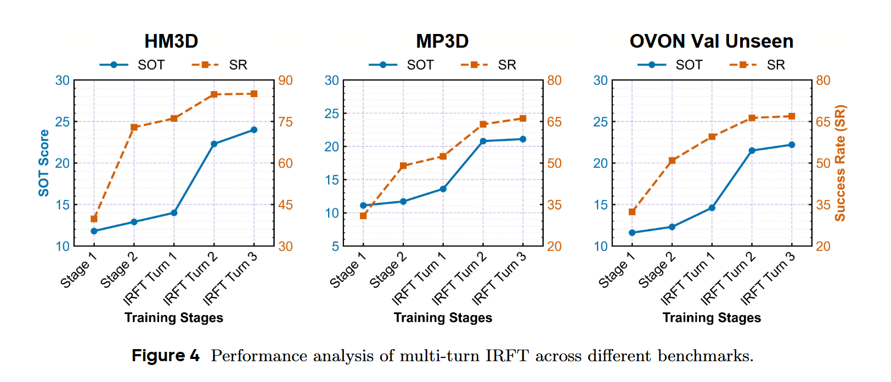
<figcaption>
SR and SOT on HM3D, MP3D, and OVON Val-Unseen improving over successive rounds of IRFT.
</figcaption>
</div>

**Comparison with the state of the art (Table 2):**

| benchmark | Indicators | Hydra-Nav-IRFT | Second Place | Improvement |
|-----------|------|----------------|--------|------|
| HM3D Val  | SR   | **84.8%**      | 73.7%  | +11.1% |
| MP3D Val  | SR   | **64.0%**      | 46.6%  | +17.4% |
| OVON Val-Unseen | SR | **66.3%** | 45.2%  | +21.1% |

**SOT analysis (Table 5):**

- Hydra-Nav-IRFT reasons on only **3.0%** of steps (HM3D), whereas VLMnav, Nav-R², and WMNav reason on 100%.
- SOT: Hydra-Nav-IRFT scores **24.0** (HM3D) vs. 1.9 for Nav-R² (the strongest competitor on SR), about a 12× improvement.
- Frequent reasoning can raise SR but badly hurts efficiency; adaptive reasoning is key for real deployment.

**Key ablation findings:**
- The memory module greatly improves SPL (13.9 without memory vs. 28.8 with it), showing that long-term spatial memory is central to path efficiency.
- Exploratory trajectory data vs. shortest-path data: training only on shortest paths drops SR by 25.4% (HM3D), so exploration ability is essential for a high success rate.
- Co-training with VQA prevents overfitting to navigation data and preserves generalization (SR: 69.1→72.9 on HM3D).

<div align="center">
  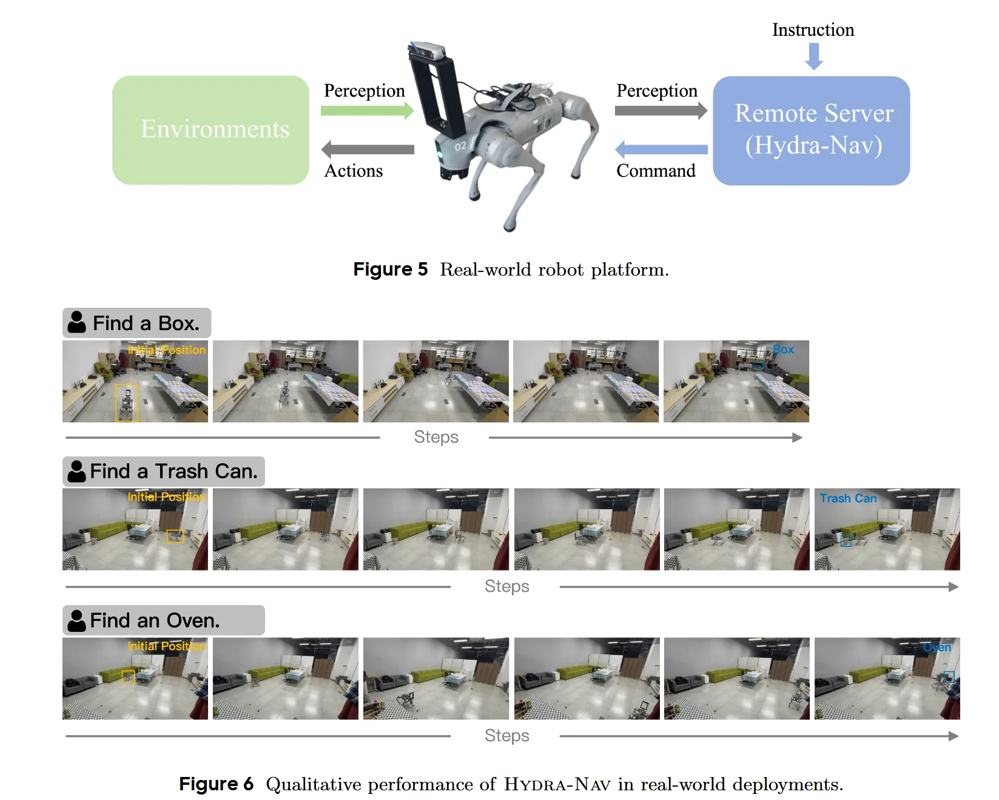
<figcaption>
Real-world navigation: the robot finds a box, a trash can, and an oven, transferring zero-shot without fine-tuning in the real environment.
</figcaption>
</div>

---

**Limitations**

Evaluation is limited to the Habitat simulator (HM3D/MP3D/OVON), with no validation in higher-fidelity simulators such as Isaac Sim. The framework is also designed specifically for object navigation; extending it to more complex embodied tasks such as mobile manipulation remains open.


---

## 9. 3DGSNav (2026)
{: id="nav-3dgs"}
——Active 3DGS memory that strengthens VLM spatial reasoning for zero-shot goal navigation

📄 **Paper**: [arXiv:2602.12159](https://arxiv.org/abs/2602.12159)

---

### Key takeaways
{: id="精华-17"}

3DGSNav's most valuable ideas:
1. **3DGS as persistent memory** in place of semantic maps or text descriptions, so the VLM can directly "see" a geometrically continuous scene rather than an intermediate abstraction, unlocking its own visual-spatial reasoning.
2. **Active perception + free-viewpoint optimization**: instead of rotating and scanning passively, the agent finds visual blind spots through the opacity field and then renders the best viewpoint with 3DGS novel view synthesis. This "generate observations on demand" pattern carries over to other embodied tasks that need viewpoint control.
3. **Structured visual prompts + CoT**: annotations (gaze points, unexplored regions) are overlaid on rendered images and combined with chain-of-thought prompting to unlock the VLM's long-range planning without extra training.
4. **Real-time detection + VLM re-verification**: a lightweight detector screens candidate targets first, then the VLM actively switches viewpoints to confirm them. Splitting efficiency and reliability into two stages is a widely applicable design for target-confirmation modules.

---

### Background and problem
{: id="研究背景问题"}

Existing zero-shot object navigation (ZSON) methods usually convert the environment into semantic maps or text descriptions, so high-level decisions are capped by low-level perception accuracy and the VLM's visual-spatial reasoning goes underused. The paper's central question is how to let the VLM reason spatially from high-quality visual observations directly instead of from lossy semantic abstractions.

---
<div align="center">
  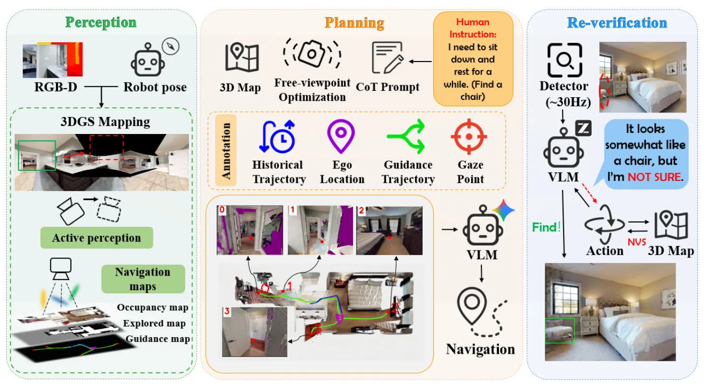
<figcaption>
3DGSNav architecture: active perception builds a navigation-oriented scene representation from robot poses and RGB-D observations; free-viewpoint optimization and structured visual prompts guide VLM-based zero-shot planning; online object detection and viewpoint re-verification localize the target efficiently.
</figcaption>
</div>

### Method and innovations
{: id="主要方法创新点"}

3DGSNav is a ZSON framework built on 3D Gaussian Splatting, with three core modules:

### 1. Active perception
{: id="1-主动感知active-perception模块"}
- A virtual camera renders a panoramic opacity field to quantify how complete the current observation is
- **DBSCAN** clusters low-opacity regions to find visual blind spots, computes the best pitch θ* and yaw ϕ*, and drives the real camera to fill in the missing views
- This avoids the localization errors and redundant observations caused by mechanical rotation

### 2. Free-viewpoint planning
{: id="2-自由视角规划free-viewpoint-planning模块"}
- **Frontier extraction and clustering**: build an exploration map in 3DGS space, extract frontier points (boundaries between explored and unexplored space), merge redundant ones adaptively with a distance field and watershed segmentation, and keep representative points to reduce the VLM's workload
- **Guidance trajectories**: Dijkstra with an exponential obstacle-distance penalty generates a safe path to each frontier point, which serves as the reference for viewpoint optimization
- **Initializing the virtual viewpoint**: a weighted score of trajectory curvature κ and distance d picks the best starting position, neither too close (unstable optimization) nor too far (little information)
- **Multi-constraint viewpoint optimization**: minimize the composite loss ℒ = λ_opa·ℒ_opa + λ_vis·ℒ_vis + λ_cos·ℒ_cos + λ_traj·ℒ_traj, consisting of:
  - **Opacity loss**: controls the ratio of visible to unseen area
  - **Ray occlusion loss**: keeps the virtual camera's line of sight to the frontier point unobstructed
  - **Cosine loss**: aligns the viewing direction with the direction of the frontier point
  - **Trajectory loss**: keeps the camera near the guidance trajectory

### 3. Structured visual prompts + VLM reasoning
{: id="3-结构化视觉提示--vlm-推理"}
- Render a bird's-eye view (BEV) plus first-person views (FPVs) of the frontier points
- Overlay structured annotations on the images: gaze points and markers for unobserved regions
- Use **chain-of-thought (CoT) prompts** to have the planner VLM (Gemini 3) reason spatially and semantically about the candidate frontier points and pick the best exploration target

### 4. Real-time detection + active VLM re-verification
{: id="4-实时检测--vlm-主动重验证re-verification"}
- During navigation, a lightweight real-time detector (**YOLOE**) screens candidate targets.
- When detection confidence is low, the action-decision VLM (**GLM-4.1V-Thinking**) actively switches viewpoint, projecting the chosen action back into 3DGS to render a new, more discriminative view and confirm the target.
- This substantially reduces missed detections and false stops

---

### Results and findings
{: id="核心结果发现"}

<div align="center">
  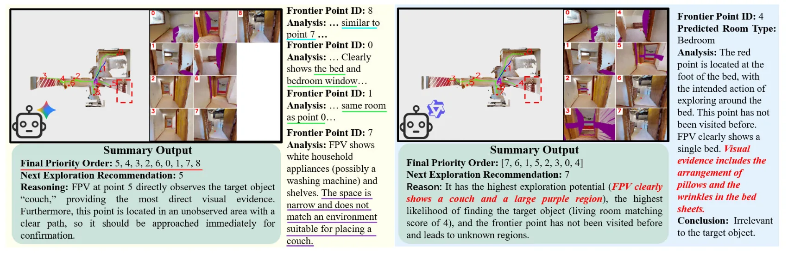
<figcaption>
Self-explanations from Gemini3-Pro and Qwen3-235b-Thinking on ZSON tasks, compared:
</figcaption>
</div>

- State-of-the-art or competitive results on standard ObjectNav benchmarks including **HM3D**, **MP3D**, and **Gibson**
- Ablations: free-viewpoint optimization, structured annotations, CoT, and re-verification each contribute significantly to the final success rate
- The VLM can be swapped freely (Gemini 3, GPT-4V, GLM-4.1V, and others), so the framework is highly compatible
- Real-world experiments on a quadruped robot (finding targets such as a toilet) confirm sim-to-real transfer
- Runtime analysis shows active perception is clearly more efficient for exploration than passive rotational scanning

---

### Limitations
{: id="局限性"}

Incremental online 3DGS reconstruction and free-viewpoint optimization add compute, so real-time performance is still a challenge on resource-limited embedded platforms. Dynamic objects, motion blur, and perception noise in real scenes also degrade 3DGS quality and hence navigation reliability.

---

## 10. WAM-Nav (2026)
{: id="wam-nav"}
——Joint "world-action" modeling in an asymmetric latent space: one DiT unifies three kinds of visual navigation

📄 **Paper**: [arXiv:2606.04907](https://arxiv.org/abs/2606.04907) — WAM-Nav: Asymmetric Latent World-Action Modeling for Unified Visual Navigation

### Key takeaways
{: id="精华-19"}

- Imagining future scenes and generating actions happen in **the same shared DiT** and are diffused jointly, instead of a decoupled pipeline that first imagines and then recovers actions with inverse dynamics. This removes the state-action mismatch and error accumulation between modules at the root.
- The core insight is an **asymmetric horizon**: actions use a long horizon ($H_{act}=24$) for trajectory continuity, while visual foresight uses a very short one ($H_{vis}=1$). Viewpoints change drastically in navigation, so long autoregressive visual rollouts are slow and errors blow up; a short horizon gives just enough reliable near-future geometric constraint.
- Visual foresight is predicted entirely in the latent space of the **Stable Diffusion VAE** (never decoded to pixels), so "perceiving the future" can constrain action generation cheaply (a visual velocity-matching loss penalizes inconsistency between actions and the scene).
- **Dual-stream context condition (DSCC)**: the visual-memory stream supplies spatial information for obstacle avoidance, while the ego-motion history stream supplies kinematic momentum for smoothness. Motion tokens query visual features to balance geometric safety and trajectory continuity.
- **Unified goal alignment**: Image-Goal, Point-Goal, and No-Goal are each encoded as a complementary pair of embeddings, a visual-semantic query $g_V$ and a geometric query $g_G$. One policy handles all three tasks through zero-shot transfer, with balanced performance and no architecture change.

---

### 1. Background and problem
{: id="1-研究背景问题-18"}

Visual navigation must produce smooth, collision-free trajectories under complex geometric and physical constraints, and each existing paradigm falls short. **Reactive end-to-end policies** (GNM/ViNT/NoMaD) map observations straight to actions without predictive reasoning and easily get stuck in local optima or collide in clutter. **Modular, decoupled world-model methods** (imagine future subgoals, then apply inverse dynamics or trajectory scoring) can look ahead, but training prediction and decision-making separately adds latency and compounding errors. Existing "world-action models" have shown the value of joint modeling in robot manipulation, but their autoregressive generation is slow and accumulates large errors under the big viewpoint changes of navigation. Most methods also support only one goal type and must be retrained for a new task; NavDP supports several goal types, but its single-modality alignment leaves performance uneven across tasks.

---

### 2. Method and innovations
{: id="2-主要方法创新点-18"}

<div align="center">
  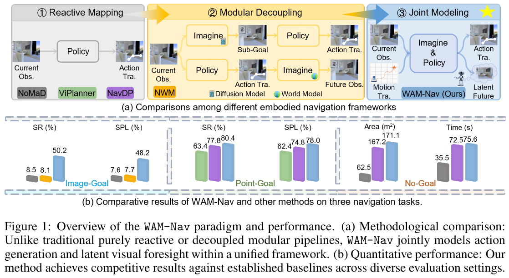
<figcaption>
Figure 1: the WAM-Nav paradigm and results at a glance. (a) Compared with purely reactive mapping (①) and decoupled modular pipelines (②), WAM-Nav (③, joint modeling) models action generation and latent visual foresight together in one framework; (b) it leads mainstream baselines on all three tasks: Image-Goal, Point-Goal, and No-Goal.
</figcaption>
</div>

**① Overall framework**

As Figure 2 shows, WAM-Nav has three core components: (1) **unified goal alignment**, which projects heterogeneous goals into a shared space and produces a visual-semantic query $g_V$ and a geometric query $g_G$; (2) **dual-stream context conditioning (DSCC)**, which encodes the visual observation sequence and the ego-motion history separately and, after goal modulation, fuses them into a compact context $C$; (3) **asymmetric action-foresight generation**, which, conditioned on $C$, uses one shared DiT to generate future action trajectories and latent visual foresight together through asymmetric denoising.

<div align="center">
  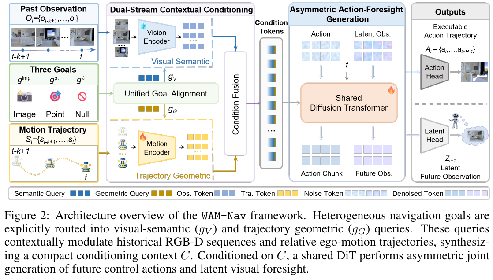
<figcaption>
Figure 2: WAM-Nav architecture. Heterogeneous navigation goals are routed explicitly into a visual-semantic query gV and a trajectory-geometry query gG, which modulate the RGB-D history and the relative ego-motion trajectory to form a compact context C; conditioned on C, the shared DiT jointly and asymmetrically generates future control actions and latent visual foresight.
</figcaption>
</div>

**② Module by module**

**Module 1: unified goal alignment**
- **Input**: a goal $g$, which may be a goal image (Image-Goal), relative coordinates (Point-Goal), or empty (No-Goal).
- **Processing**: a modality-specific encoder $E_\phi(\cdot)$ turns $g$ into a base embedding $e_g$ (a ViT trained from scratch for image goals, sinusoidal positional encoding for relative coordinates, and a masked zero state for no goal); two learnable linear maps $\psi_V,\psi_G$ then project it into two functional token spaces, $g_V=\psi_V(e_g)$ and $g_G=\psi_G(e_g)$.
- **Output**: a visual-semantic query $g_V$ (for retrieving from visual memory) and a geometric query $g_G$ (for trajectory-level direction guidance).
- **Motivation**: unlike approaches such as NavDP that recast every task as point-goal navigation, this design **keeps modality-specific information** behind a unified interface, balancing performance across the three goal types.

**Module 2: dual-stream context conditioning (DSCC)**
Conditioning on vision alone produces jittery, kinematically inconsistent trajectories because nothing explicitly constrains momentum. DSCC fuses two streams over a sliding window from $t-k+1$ to $t$:

- **target modulated visual memory stream**: historical RGB observations $O_t$ encoded by DINOv2 into memory tensors $V$; use visual query $g_V$ to calculate the scaled dot product correlation score for each patch token $$\alpha=\sigma\!\left(\tfrac{g_V V^\top}{\sqrt D}\right)$$, and then residual to strengthen the spatial token related to the target: $$\tilde V = V + \alpha \odot V$$. Output: visuospatial memory "lit" by the target.
- **trajectory-aware motion history stream**: Convert the executed pose sequence $S_t$ into **coordinate-independent relative displacement and orientation changes** $$\tilde S_t=\{(\Delta x_i,\Delta y_i,\Delta\theta_i)\}$$ (under the current egocentric coordinate system, see Algorithm 1), encoded as $H$ by causal Transformer; then use the geometric target $g_G$ to produce a condensed kinematic vector $$o_{kin}=\mathrm{CrossAttn}(g_G,H,H)$$ through cross-attention query. Output: A summary of historical movement continuity relative to the target direction.
- **cross-attention condition fusion**: Use the kinematic token $o_{kin}$ to bias a set of learnable queries $Q_c$, and then use a multi-layer Transformer Decoder to allow "motion momentum" to actively query "visual space after target modulation": $$C=\mathrm{TransformerDecoder}\big(Q_c+\phi(o_{kin}),\,\tilde V,\,\tilde V\big)$$. Output: Unified conditional context $C$, encoding both geometric safety (obstacle avoidance) and execution smoothness (momentum).

**Module 3: asymmetric action-foresight generation**
This is the most critical design of the whole article. Under the condition of $C$, model jointly models: long horizon action trajectory $A_t=\{a_t,\dots,a_{t+H_{act}-1}\}$ and short horizon latent space visual look-ahead $$Z_{t+1:t+H_{vis}}=\{z_{t+1},\dots,z_{t+H_{vis}}\}$$, among which $H_{vis}\le H_{act}$. The future visual state $z_i=\mathcal E(o_i)$ is compressed by pre-trained SD-VAE into a compact grid of $N$ hidden patches.

- **training uses flow-matching**: Build a straight line from the Gaussian prior $(A_0,Z_0)$ to the probability path of the data manifold. The interpolation state of $\tau$ at any flow moment is $A_\tau=(1-\tau)A_0+\tau A_1$ and $Z_\tau=(1-\tau)Z_0+\tau Z_1$. The target velocity field $u_A=A_1-A_0$, $u_Z=Z_1-Z_0$.
- **shares DiT**: $A_\tau$ and $Z_\tau$ are tokenized, spliced, and sent to multi-layer DiT. The two types of heterogeneous tokens in each block first perform **to share self-attention** (allowing the action path and visual representation to exchange spatio-temporal constraints layer by layer), and then cross-attend to the condition $C$ respectively. The time step $\tau$ is injected by adaLN and returns to the joint velocity field $\hat u_A,\hat u_Z=f_\theta(A_\tau,Z_\tau,\tau,C)$. Shared parameters make latent space lookahead a "perceptually grounded" constraint, penalizing action-scene inconsistencies through visual speed matching losses.
- **Why asymmetric**: in manipulation, future visual changes are local and object-centered, whereas navigation involves large changes in egocentric viewpoint. Long autoregressive visual rollouts would add both latency and accumulated visual error, misleading the actions. Hence the asymmetric design: a long action horizon for continuity plus a short visual horizon for near-future geometric constraints.

<div align="center">
  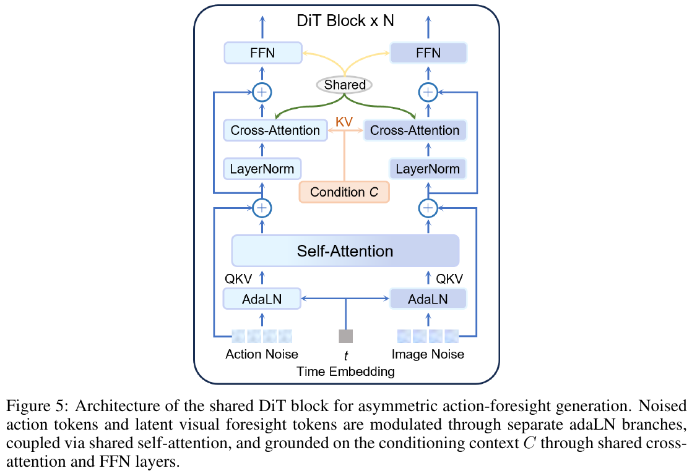
<figcaption>
Figure 5: the shared DiT block (stacked N times). Noisy action tokens and latent visual-foresight tokens are each modulated by their own adaLN branch, coupled early through shared self-attention, then grounded in the context C through shared cross-attention and FFN (with only stream-specific modulation), and finally projected to û_A and û_Z.
</figcaption>
</div>

**③ end-to-end data stream**: The single-step sample flow path is - target $g$ → aligned into $g_V,g_G$; historical observation $O_t$, motion history $S_t$ → fused through DSCC dual-stream modulation $C$; Gaussian noise $(A_0,Z_0)$ → Denoised by 10-step Euler integration of shared DiT under $C$ → Output execution action trajectory $A_t$ and hidden space future observation $Z_{t+1}$.

**④ Training objective**: minimize the joint loss end to end
$$\mathcal L_{total}=\mathbb E\big[\lVert\hat u_A-u_A\rVert_2^2+\lambda_{img}\lVert\hat u_Z-u_Z\rVert_2^2\big]+\lambda_{align}\mathcal L_{align}$$
The first item is action flow velocity regression, the second item is visual look-ahead velocity matching ($\lambda_{img}=0.25$), and the third item $\mathcal L_{align}$ is symmetric contrast InfoNCE loss ($\lambda_{align}=0.1$), which ensures multi-view standard modal consistency by maximizing mutual information across spatial projections. While training DINOv2 ViT-S/14 with SD-VAE frozen, the target image encoder, fused decoder, and causal motion encoder were trained from scratch with shared DiT.

**⑤ Inference**: a receding-horizon control loop. As in NavDP, 16 candidate trajectories are sampled under the current $C$ at each step and the first is executed following NoMaD's practice; the flow-matching ODE solver runs 10 Euler steps to balance quality and real-time performance.

---

### 3. Results and findings
{: id="3-核心结果发现-18"}

**Main results (zero-shot, IsaacSim, ClutterScenes + InternScenes, 6000 episodes)**: WAM-Nav has the best average on all three tasks: Image-Goal reaches **50.2% SR / 48.2% SPL** (**15.7%** SR above NavDP), Point-Goal **80.4% SR / 78.0% SPL** (**3.3%** higher), and No-Goal explores **171.1 m²**.

<div align="center">
  
<figcaption>
Figure 3: qualitative comparison on Image-Goal navigation. NavDP (red) often reacts only after getting close to an obstacle, so its trajectory changes abruptly; WAM-Nav (green) anticipates geometric constraints with short-horizon latent foresight, producing smoother trajectories that avoid obstacles proactively. The latent visual foresight, once decoded, still closely matches the ground truth (GT).
</figcaption>
</div>

- **Efficiency (Q3)**: 0.26 s inference latency and only 0.7 TFLOPs per decision (NavDP 1.3, NWM 8.3), with about as many trainable parameters as NavDP; it avoids NWM's 1.43 s multi-candidate visual rollouts and meets real-time requirements.
- **Ablations (Q4)**: latent foresight alone raises SR from 42.1% to 45.7%; motion history alone helps in ClutterScenes but hurts in the semantically richer InternScenes; combining the two works best (50.2% SR), confirming the DSCC design: motion history stabilizes trajectory generation, and latent foresight supplies the geometric constraints needed for safety.
- **Asymmetric horizon**: $H_{vis}=1$ is best (50.2 SR); lengthening the visual horizon (4/8/24) lowers performance monotonically (down to 30.4 SR), strongly supporting the core claim that visual foresight should provide near-future constraints rather than long autoregressive rollouts.
- **Coupled architecture**: the fully shared DiT beats decoupled and partially shared variants, showing that latent foresight helps most when it regularizes actions directly through a shared representation.
- **Cross-embodiment and real world**: a single policy transfers zero-shot to the wheeled Dingo and the Unitree G1/H2 humanoids, consistently ahead of NavDP; real deployment (G1 + RealSense D455 in a conference room, warehouse, hall, and parking lot) averages an **85% success rate**, confirming zero-shot sim-to-real transfer. The harder (longer) the route, the bigger the margin over NavDP (+7.6% SR on the Hard subset).

---

### 4. Limitations
{: id="4-局限性-18"}

Real deployment revealed two failure types: (1) limited camera height and field of view make low obstacles in the near field easy to miss, causing collisions or late avoidance; (2) the policy does not model the robot's body shape explicitly, so planning only guarantees that the camera fits through, and the body can clip obstacles at the side. Future directions include adaptive viewpoint control and embodiment-aware training with multimodal body information.

---

## 11. LocalNav (2026)
{: id="localnav"}
——A lightweight on-device framework for goal navigation over 3D scene graphs, built on knowledge distillation and embodied reinforcement learning

📄 **Paper**: [arXiv:2606.27871](https://arxiv.org/abs/2606.27871)

### Key takeaways
{: id="精华-21"}
1. LocalNav distills the complex spatial-semantic reasoning of frontier cloud models (such as Claude 3.5 Sonnet) into a lightweight 4B on-device VLM (Qwen3.5-4B), so the whole system runs locally with no cloud dependency.
2. On top of a 3D topological scene graph built online, supervised fine-tuning (SFT) on just 500 high-quality navigation trajectories from cloud models greatly improves the 4B model's success rate (SR).
3. Embodied reinforcement learning with verifiable rewards (E-RLVR), plus a reward that regularizes generation length, makes the small model's actions more accurate and its chains of thought shorter, cutting redundant output tokens by 72.1%.
4. Combined with 4-bit quantization in llama.cpp (IQ4-XS), inference latency on the Jetson Orin AGX edge platform drops by 82.8% overall, from 305.2 seconds to 52.5 seconds per episode.
5. The system is modular: the high-level VLM handles semantic reasoning and macro decisions, and a low-level PointGoal policy handles obstacle avoidance and locomotion. It has been validated on a Unitree quadruped and a handheld device.

---

### 1. Background and problem
{: id="1-研究背景问题-20"}
- **Open-vocabulary ObjectNav**: traditional navigation algorithms are usually limited to the closed set of categories seen in training; vision-language models (VLMs) bring strong open-set perception and semantic reasoning to guide robots toward complex targets.
- **Cloud dependence and high latency**: today's best VLM navigation systems (for example, those built on GPT-4o or Claude 3.5 Sonnet) mostly depend on cloud APIs, which demands reliable connectivity and brings large communication delays and privacy risks.
- **Compute bottlenecks in local deployment and autoregressive generation**: lightweight 2B–7B VLMs can in principle run on edge devices (such as NVIDIA Jetson), but their zero-shot semantic navigation is very poor (only 21% SR). Small models also tend to produce long, redundant chains of thought when issuing high-level decisions, so autoregressive token generation becomes the main latency bottleneck on device (93.3% of run time).

---

### 2. Method and innovations
{: id="2-主要方法创新点-20"}

<div align="center">
  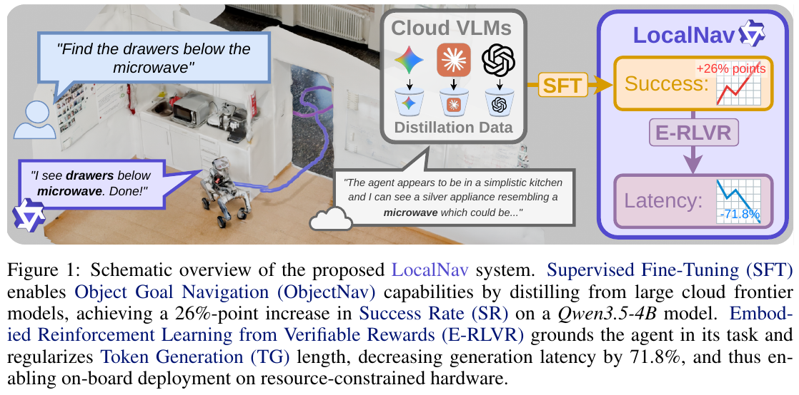
<figcaption>
LocalNav overview: SFT distills a frontier cloud VLM, and embodied RL with verifiable rewards (E-RLVR) optimizes actions and token length for efficient on-device deployment.
</figcaption>
</div>

#### ① Overall framework
{: id="-整体框架概述-8"}
LocalNav has three core modules: 3D topological scene graph construction, a high-level VLM planner, and a low-level PointGoal motion policy. The VLM picks macro semantic actions (navigate, explore, find a new room, or stop) from a stitched 360° panorama annotated with projected object IDs and a text list of scene-graph nodes; the low-level policy handles point-to-point path planning and obstacle avoidance.

<div align="center">
  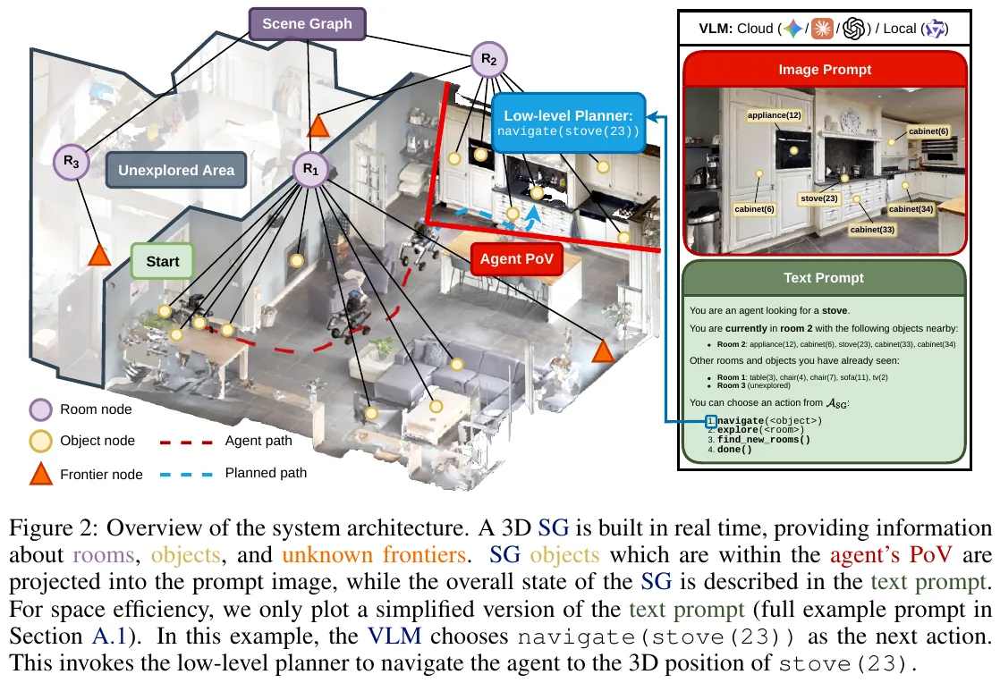
<figcaption>
LocalNav system architecture: a 3D scene graph (SG) is built in real time, object IDs in the current view are projected into the image, and the image goes to the VLM along with a text description of the scene. Once the VLM decides, the low-level planner (PointGoal policy) carries out the action.
</figcaption>
</div>

#### ② Module by module
{: id="-逐模块讲解-7"}

- **Building the 3D topological scene graph**
  - **Input**: RGB-D frames from the sensor, robot odometry, and object category labels from a pretrained detection/segmentation model such as Mask2Former (or ground-truth annotations in simulation).
  - **Processing**: the open-source Hydra framework builds and maintains, online, a 3D topological scene graph with room and object nodes. The graph gives clear topological connectivity and object locations, serving as the robot's explicit spatial memory.
  - **Output**: at each decision point, information is assembled for the VLM in two modalities:
    1. **Text prompt**: the current room, lists of explored and unexplored rooms, and known object categories with their IDs.
    2. **Image prompt**: the scene-graph IDs of objects in the current view (PoV) are overlaid directly on the 360° panorama (much like Set-of-Mark prompting), anchoring each symbolic ID to its pixel region.
  - **Motivation**: an explicit 3D scene graph provides a discrete, abstract state space that decouples the robot's high-frequency motion from the VLM's low-frequency decisions, cutting compute and making decisions highly interpretable.

- **Knowledge distillation by supervised fine-tuning (SFT)**
  - **Input**: about 500 raw reasoning trajectory logs (image pairs and topological state) from successful episodes in the Habitat simulator (HM3D OVON), guided by Claude 3.5 Sonnet, GPT-4o/5.4, and Gemini 3.1 Pro operating in a privileged action space (privileged shortest-path navigation).
  - **Processing**: the decisions of the frontier VLM teachers serve as labels for supervised fine-tuning of the local lightweight student VLM (Qwen3.5-4B).
  - **Output**: a fine-tuned local VLM that can already choose sensible macro actions on the current 3D topological map.
  - **Motivation**: small models do poorly on ObjectNav out of the box. Behavior cloning on frontier models' reasoning traces quickly gives them common-sense reasoning and decision-making for open-set scenes from very little data (~500 samples).

- **Action optimization with embodied RL from verifiable rewards (E-RLVR)**
  - **Input**: the small VLM after SFT and closed-loop interactive rollouts in the Habitat simulator.
  - **Processing**: parameter-efficient LoRA fine-tuning with Group Relative Policy Optimization (GRPO). At each decision point, `N = 4` independent action completions are sampled and the simulator state is cloned so each can be rolled out in parallel.
  - **Output**: local VLM weights with more accurate actions and less CoT redundancy.
  - **Motivation**: the SFT model is verbose and may hallucinate spatial memories or repeat itself while reasoning. E-RLVR takes a learning-by-doing approach, using verifiable feedback from the simulator to shape the model's behavior.

<div align="center">
  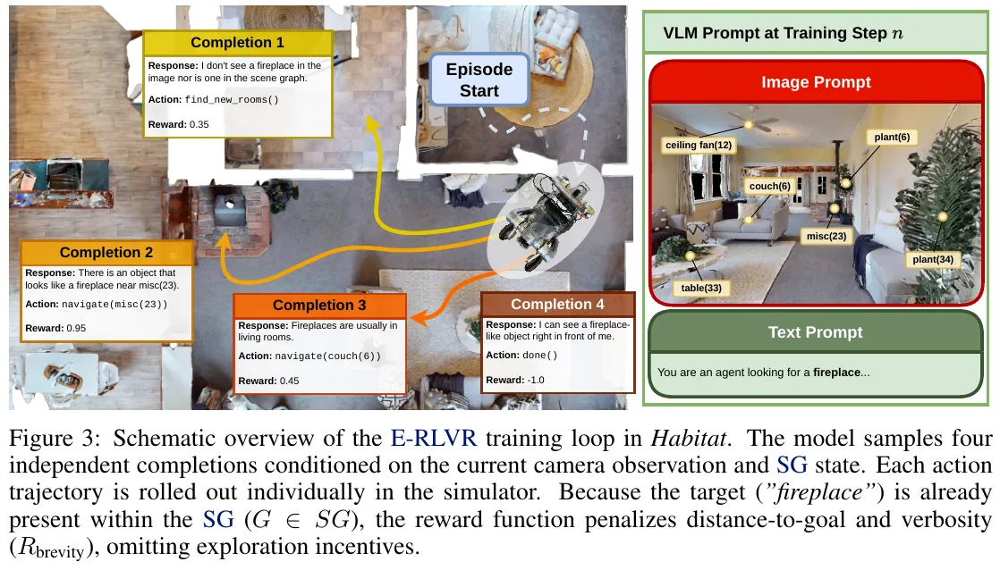
<figcaption>
The E-RLVR training loop in Habitat: four independent action completions are generated for the same state, run in parallel on separate environment branches, and the resulting rewards update the policy.
</figcaption>
</div>

#### ③ Training objective and reward
{: id="-训练目标与损失函数"}
In the E-RLVR stage, the model is updated from the relative advantages of the parallel rollouts, using the following total reward:
$$R_{tot} = R_{done} + R_{nav} + R_{exp} + R_{brev}$$
Each term is defined as follows:
- **Verifiable termination reward $$R_{done}$$**:
  $$R_{done} = \begin{cases} 1.0 & \text{done() called and robot-to-target distance meets the success threshold} \\ -1.0 & \text{done() called without success (false positive)} \\ 0.0 & \text{other actions} \end{cases}$$
It penalizes stopping wrongly and rewards stopping correctly.
- **Navigation progress reward $$R_{nav}$$**:
  $$R_{nav} = \begin{cases} \Delta d & \text{target is in the scene graph and the robot moves closer} \\ 0 & \text{otherwise} \end{cases}$$
`\Delta d` is the normalized decrease in distance to the target, encouraging the robot to close in quickly.
- **Discovery and expansion reward $$R_{exp}$$**:
  $$R_{exp} = \begin{cases} 0.0 & \text{goal G is already in the scene graph} \\ \lambda_{found} & \text{goal G first enters the scene graph} \\ \Delta n & \text{normalized increase in newly discovered topological nodes} \end{cases}$$
It encourages exploring unknown areas while the goal has not yet been found.
- **Brevity reward $$R_{brev}$$**:
  $$R_{brev} = \begin{cases} 1.0 & L \le L_t \\ 1 - 2 \frac{L - L_t}{L_m - L_t} & L_t < L < L_m \\ -1.0 & L \ge L_m \end{cases}$$
where `L` is the token length of the generated action, `L_t` the target length, and `L_m` the maximum length. The penalty grows linearly with excess verbosity, pushing the model to trim its chain of thought down to the core spatial reasoning and greatly reducing token-generation compute while preserving SR.

#### ④ Inference and quantized deployment
{: id="-推理与量化部署流程"}
To run on low-power mobile robots, the authors quantize the E-RLVR model with `llama.cpp`. After a Pareto-front evaluation they choose `IQ4-XS` (4-bit), which raises token generation from 17.68 tok/s to 39.43 tok/s, overcoming on-device GPU memory and bandwidth limits while preserving model accuracy.

---

### 3. Results and findings
{: id="3-核心结果发现-20"}
- **Choice of distillation teacher**: on the HM3D OVON test set, Qwen3.5-4B fine-tuned on different frontier teachers performs differently. Distilling from Claude 3.5 Sonnet works best, lifting SR from 21% for the base model to **47%**, higher even than mixed-teacher distillation (41%).
- **E-RLVR improves both efficiency and performance**: the SFT model is capable but verbose (535.2 output tokens on average; 305.2 seconds per episode). E-RLVR reduces output length by **72.1%** to 149.36 tokens and reduces inference latency on Jetson Orin AGX by **71.8%**, to 86.0 seconds, while success increases slightly to **49%**.
- **Combined speedup with quantization**: the full pipeline of SFT + E-RLVR + 4-bit quantization (IQ4-XS) doubles inference throughput (~39.43 tok/s) and cuts wall-clock time on the Jetson Orin AGX by **82.8%** (to just **52.5 seconds**), at a cost of only about 2% in success rate.
- **Benchmark comparison**: in the standard HM3D OVON evaluation (including low-level PointGoal execution errors), a high-level planner using cloud-hosted Claude 3.5 Sonnet reaches **39.7% SR**, while the fully local Qwen3.5-4B-Claude student reaches **34.5% SR**, narrowing the gap to the frontier cloud model to just 5.2 points, a leading result among on-device solutions.

<div align="center">
  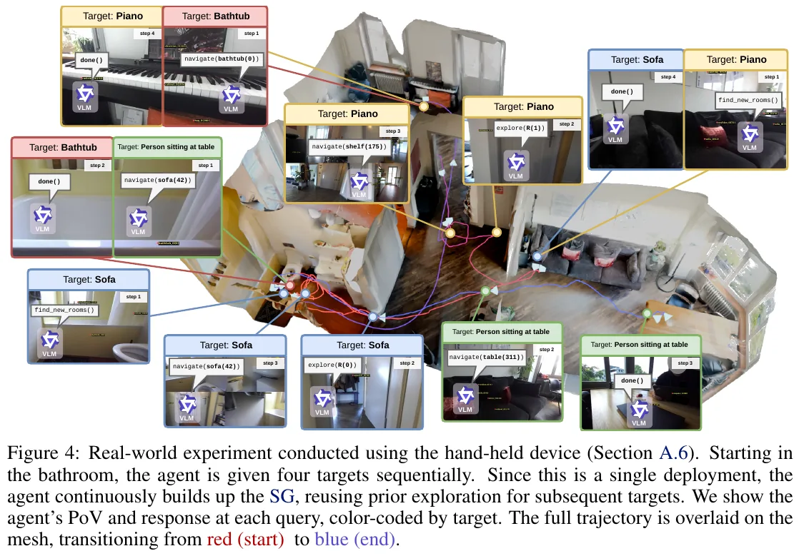
<figcaption>
Real-world test: the robot performs a continuous multi-view navigation task in a real apartment. The robot's point of view is shown alongside the high-level VLM planner's macro decisions and action outputs on the right.
</figcaption>
</div>

---

### 4. Limitations
{: id="4-局限性-20"}
- **Spatiotemporal semantics**: the topological scene graph struggles to represent dynamic, transient, or compositional attributes (for example, it cannot tell an empty chair from one with someone sitting on it), so the robot must repeatedly invoke the VLM for dense visual verification.
- **Dependence on 3D perception**: the system is highly sensitive to the accuracy of object segmentation (such as Mask2Former) and the robustness of 3D reconstruction (such as Hydra). False or missed detections can corrupt the scene graph's topology, which then derails the VLM's decision chain.

---

## 12. AECNav (2026)
{: id="aecnav"}
——From object search to evidence accumulation: shared encoding, segmentation on demand, and log-odds belief updates

📄 **Paper**: [arXiv:2608.10817](https://arxiv.org/abs/2608.10817) · [Project Page](https://basaermi.github.io/aecnav-website/)

### Key takeaways
{: id="精华-22"}

- Confirm targets by **accumulating evidence across views**, rather than stopping when a single-frame score crosses a threshold. Additive log-odds updates, borrowed from occupancy mapping, let consistent observations build confidence beyond what one frame can establish.
- **Negative evidence matters as much as positive evidence.** Higher scores for similar distractors, and missing detections when the target should be visible, actively reduce belief rather than merely withholding a positive update.
- A shared C-RADIOv4 backbone supports scene scoring, patch localization, and instance segmentation, reducing semantic inconsistencies and redundant encoding. Inexpensive patch similarity then gates the costly segmentation head.
- Frontier selection balances semantic relevance, information visible along the route, and travel cost. Information gain without a distance constraint can send the robot to large open areas and waste steps.
- The training-free pipeline outperforms trained methods while running episodes **2.2 times faster than VLFM**. Avoiding unnecessary work contributes to both accuracy and efficiency.

---

### 1. Background and problem
{: id="1-研究背景问题-21"}

Zero-shot open-vocabulary object navigation (ZSON) asks a robot to find objects described in arbitrary language in unfamiliar environments. Existing value-map methods have three bottlenecks. Frontier selection and target confirmation use several unrelated vision models (CLIP/BLIP-2 + GroundingDINO/MobileSAM), causing redundant encoding and high latency. Target confirmation relies on single-frame thresholds or averaging, which struggles to separate true targets from look-alike distractors. And frontier selection considers only semantic relevance, ignoring travel cost and how much new information a frontier offers, so with weak semantic cues the robot easily swings back and forth between distant, low-yield frontiers.

---

### 2. Method and innovations
{: id="2-主要方法创新点-21"}

<div align="center">
  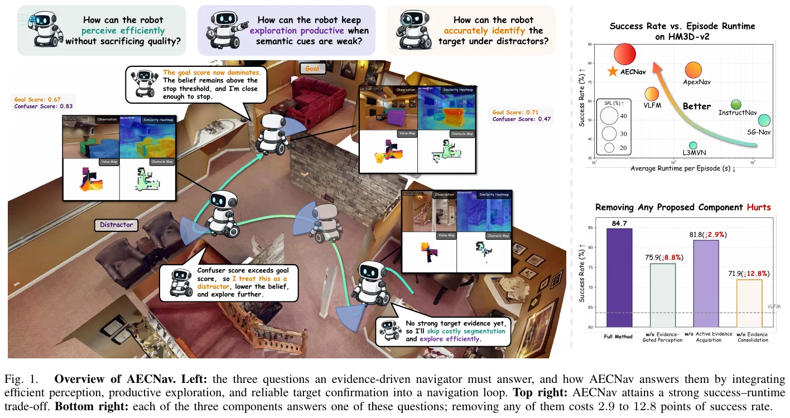
<figcaption>
AECNav overview: left, the three questions a navigator must answer (efficient perception, effective exploration under weak cues, and accurate identification amid distractors); upper right, success rate versus per-episode time on HM3D-v2; lower right, the drop in success rate from removing any one module
</figcaption>
</div>

<div align="center">
  
<figcaption>
AECNav framework: evidence-gated perception scores the scene with a shared C-RADIOv4 encoder and calls SAM3 only when the target is likely visible; evidence consolidation back-projects detections into 3D clusters and updates log-odds beliefs with three kinds of evidence (target, distractor, and missed detection); active evidence acquisition chooses frontiers by semantic relevance, information gain, and path cost until a cluster is confirmed
</figcaption>
</div>

**① Overall framework overview**

AECNav reformulates ZSON as an evidence-driven perception–decision loop with three modules. **Evidence-Gated Perception** extracts semantic cues in one forward pass and decides whether expensive segmentation is needed. **Evidence Consolidation** converts segmentation into 3D candidate clusters and maintains an accumulated belief that each cluster is the target. **Active Evidence Acquisition** chooses the most informative frontier when evidence is insufficient to stop. Low-level motion uses the same pretrained PointNav policy as VLFM.

Here is the data flow as a decision loop:

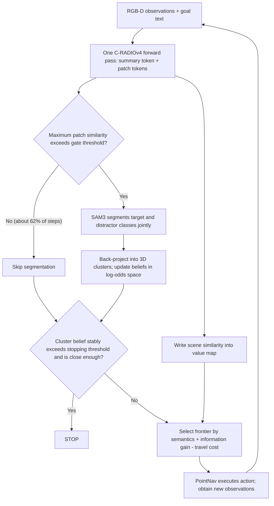

**② Module by module**

**Module 1: evidence-gated perception**

- **Input**: the current RGB image $I_t$ and the target category name $g$.
- **Processing**: one forward pass of the C-RADIOv4 encoder $E$ outputs a summary token $z_t^{\text{sum}}$ (global semantics of the whole image) and $N$ patch tokens $z_t^{\text{patch}}$ (semantics of each local region). The target name is encoded once by the SigLIP2 text tower into $e_g$ and cached for the whole episode.
  - Scene relevance: a SigLIP2 adapter $f$ aligns the summary token to the text space, $\sigma_t^{\text{scene}} = \cos(f(z_t^{\text{sum}}), e_g)$, which is then projected into the top-down value map $V_t$ using depth and pose, giving a persistent prior over which directions may contain the target.
  - Local target cue: the same adapter is applied to every patch and the maximum is taken, $\sigma_t^{\text{patch}} = \max_i \cos(f(z_{t,i}^{\text{patch}}), e_g)$, i.e. how closely the most target-like patch in view resembles the target.
  - Gating: only when $\sigma_t^{\text{patch}} > \tau_{\text{gate}}$ (set to 0.08) are the **already computed features** passed to the SAM3 mask decoder for instance segmentation; otherwise segmentation is skipped for that step.
- **Output**: an updated value map and, when triggered, instance segmentations with target and distractor scores.
- **Motivation**: older methods used BLIP-2 for scene scoring, YOLO/GroundingDINO for detection, and MobileSAM for segmentation, three encoders with inconsistent semantics and duplicated computation. A shared backbone lets every stage see the same representation, and the gate reuses the patch similarity already computed, at almost no cost, to skip more than 60% of SAM3 calls.

**Module 2: evidence consolidation (the key idea)**

- **Input**: SAM3 instance masks, depth, and pose. Each instance has a target score $s_g$ and its highest distractor score $s_{\text{conf}}$ (an LLM generates up to 3 distractor categories per target offline, e.g. chair / daybed / chaise lounge for couch, cached across episodes). Detections below $\tau_{\text{det}}=0.4$ are discarded.
- **Processing**: each instance is back-projected into a 3D point cloud and merged into a recently observed cluster if it lies within 0.75 m; otherwise it starts a new cluster. Each cluster $C_k$ keeps a scalar **log-odds belief**, which you can read as the net evidence that it is the target: 0 is neutral, positive leans toward target, negative away from it:

$$
l(C_k) = \log \frac{P(C_k = g)}{1 - P(C_k = g)}
$$

Each observation updates the belief additively, clipped to $[-4, 4]$:

$$
l(C_k) \leftarrow l(C_k) + \Delta l^{\text{sem}}(C_k) + \Delta l^{\text{miss}}(C_k)
$$

  - **Semantic term** (for clusters hit by a detection): compare the target and distractor scores and push the belief toward whichever clearly dominates; if the gap is within the neutral margin $\delta=0.10$, nothing changes:

$$
\Delta l^{\text{sem}}(C_k) =
\begin{cases}
+\alpha_{\text{sem}} \, \rho_k \, \text{logit}(\tilde s_g), & s_g \ge s_{\text{conf}} + \delta \\
-\alpha_{\text{sem}} \, \rho_k \, \text{logit}(\tilde s_{\text{conf}}), & s_{\text{conf}} \ge s_g + \delta \\
0, & \text{otherwise}
\end{cases}
$$

where $\tilde s_g, \tilde s_{\text{conf}}$ are recalibrated scores (detections that pass $\tau_{\text{det}}$ are guaranteed a non-negative logit), $\rho_k \in [0,1]$ is the spatial overlap between the new instance and the cluster, and $\alpha_{\text{sem}}=0.7$.

  - **Missed-detection term** (for clusters with positive belief that fall within the field of view but go undetected): "should have been seen but wasn't" is itself counter-evidence:

$$
\Delta l^{\text{miss}}(C_k) = -\alpha_{\text{miss}} \, v_k \, \text{logit}(1 - s_{\text{miss}})
$$

$v_k$ is the fraction of the cluster's 3D points inside the current view frustum, $s_{\text{miss}}=0.2083$ is the empirically estimated per-frame miss rate, and $\alpha_{\text{miss}}=0.3$. Clusters outside the field of view are unaffected.
- **Output**: an accumulated belief for each cluster. Once a cluster's belief exceeds $\tau_{\text{stop}}=1.0$, the robot heads toward it while continuing to update; it actually stops only when at least 2 of 5 consecutive frames exceed the threshold and it is within 0.5 m of the cluster.
- **Motivation**: ApexNav also fuses over time, but by **averaging**, so confidence can never exceed the strongest single frame, and ambiguous and decisive views count equally. **Adding** log-odds lets consistent observations compound, while the distractor and missed-detection terms let wrong hypotheses be actively withdrawn.

> **Worked examples** (with $\rho_k = 1$ and the recalibrated scores given below):
> - **True target**: the same sofa is seen in 3 consecutive frames with $\tilde s_g = 0.8$; $\text{logit}(0.8) = \ln 4 \approx 1.39$, so each frame adds $0.7 \times 1.39 \approx 0.97$. After 3 frames the belief is $\approx 2.91$, comfortably above $\tau_{\text{stop}} = 1.0$. With averaging, confidence would stay at 0.8 forever: however often you look, you never become more certain.
> - **Distractor**: while searching for a chair, the robot sees a sofa with a target score of 0.47 and a distractor score of 0.86 (real-robot data, Fig. 4). The distractor score wins by more than $\delta$; with $\tilde s_{\text{conf}} = 0.8$, the cluster loses 0.97 and goes straight to negative belief, so the robot is not lured toward it.
> - **False detection, then withdrawal**: in one frame, distant clutter is mistaken for a trash can and belief rises to +0.97. Up close, the cluster is fully in view ($v_k = 1$) but keeps going undetected, losing $0.3 \times \text{logit}(0.79) \approx 0.3 \times 1.34 \approx 0.40$ per frame. After a single frame, belief falls to 0.57, below the stopping threshold, and the robot is released to keep exploring; after 3 frames it reaches −0.23.

**Module 3: active evidence acquisition**

- **Input**: the value map $V_t$, an occupancy grid (1000×1000 at 0.05 m per cell), and the current frontier set.
- **Processing**: compute a composite utility for each frontier $f$ (each of the three terms is first min-max normalized across the current frontiers so the scales are comparable):

$$
U_t(f; g) = \tilde S_t(f; g) + \lambda_{\text{info}} \, \tilde G_t(f) - \lambda_{\text{dist}} \, \tilde C_t(f)
$$

  - $S_t$: as in VLFM, the value-map score aggregated around the frontier: does this direction look like it holds the target?
  - $G_t$: BFS finds the shortest traversable path $\pi_t(f)$ to a frontier on the occupancy grid. Viewpoints are sampled every 0.75 m, facing along the path tangent; the final viewpoint faces nearby unknown space. Rays are cast every 5° within a 79° horizontal field of view, up to 5 m, stopping at known obstacles. Information gain is the union of **unknown cells** visible along these rays: $G_t(f) = \lvert U_t \cap \text{Vis}(\pi_t(f)) \rvert$. It measures new space visible **along the entire route**, rather than only at the endpoint.
  - $C_t$: Path length $\lvert \pi_t(f) \rvert$.
- **Output**: the highest-utility frontier, handed to PointNav to execute.
- **Motivation**: ranking by semantics alone only says which way the target might be, ignoring how much can be seen there and how far away it is. With weak semantic cues, that is exactly what causes back-and-forth motion and wasted steps.

| Dimensions | Traditional approach (VLFM / ApexNav, etc.) | AECNav |
|---|---|---|
| Visual coding | Scene scoring, detection, and segmentation each use a set of models | One C-RADIOv4 forward, shared by multiple adapter heads |
| Split call | Run every step | patch similarity gating, skip about 62.5% |
| Target confirmation | Single frame threshold, or multi-frame average | 3D cluster-level log-odds accumulation, including interference and missed negative evidence |
| Frontier selection | Semantic value (ApexNav returns geometry when weak clues) | Semantics + information gain along the way − path cost |

**③ End-to-end data flow**

One decision step in full: RGB-D goes into C-RADIOv4 → the summary token updates the value map, and patch similarity decides whether to call SAM3 → if called, SAM3 segments using the target plus the LLM-generated distractor categories as prompts → instances are back-projected and merged into 3D clusters, and log-odds beliefs are updated (positive-belief clusters in view are penalized for missed detections) → if a cluster is stable and close enough, STOP; if it has only just crossed the threshold, navigate toward it; otherwise pick a frontier by composite utility → PointNav outputs discrete actions such as MOVE_FORWARD (0.25 m) / TURN (30°) → back to the start with a new observation.

**④ Training objective**

Entirely training-free: there is no loss function or fine-tuning. All components (C-RADIOv4 with its SigLIP2/SAM3 adapters, distractor categories generated by DeepSeek-V4-Flash, and a pretrained PointNav policy) are reused as is, with only a handful of threshold and weight hyperparameters.

**⑤ Inference**

Default hyperparameters: $\tau_{\text{gate}}=0.08$, $\tau_{\text{det}}=0.4$, belief range $[-4,4]$, $(\alpha_{\text{sem}}, \alpha_{\text{miss}})=(0.7, 0.3)$, $\lambda_{\text{info}}=\lambda_{\text{dist}}=1.0$, and a 672×672 input to C-RADIOv4 (SO400M). The LLM generates distractor categories once per target category offline, with no online LLM calls at inference, which is one reason it is one to two orders of magnitude faster than SG-Nav and InstructNav.

---

### 3. Results and findings
{: id="3-核心结果发现-21"}

**Main results** (all training-free, compared in the same table with trained methods):

| benchmark | AECNav SR/SPL | Previous Best | Improvement |
|---|---|---|---|
| HM3D-v2 | 84.7 / 45.3 | TrajRAG 78.1 / 40.2 | SR +6.6，SPL +5.1 |
| MP3D | 51.3 / 25.9 | WMNav 45.4 / 17.2 | SR +5.9，SPL +8.7 |
| HM3D-OVON | 57.3 / 30.5 | MSGNav 48.3 / 27.0 | SR +9.0 |

The largest gain is on HM3D-OVON, the hardest open-vocabulary benchmark, consistent with the design: the more categories and look-alike distractors there are, the more log-odds distractor suppression helps.

**Efficiency** (first 100 episodes of HM3D-v2): AECNav averages 108.63 steps and 24.39 s per episode, versus 53.36 s for VLFM, 177.97 s for ApexNav, and over 1400 s for SG-Nav. It needs 33% fewer steps than the runner-up, ASCENT, and runs 2.2 times faster than VLFM.

**Perception pipeline analysis**: replacing BLIP-2 + YOLOv7 + MobileSAM with C-RADIO raises SR from 75.9 to 84.7 and cuts latency from 0.402 to 0.248 s per step; adding the gate ($\tau_{\text{gate}}=0.08$) skips 62.5% of SAM3 calls and brings latency down to 0.178 s per step with no loss of accuracy. Overall, it is 2.3 times faster than the multi-model baseline.

**Ablations**:
- Removing evidence consolidation (walking to a target as soon as it is detected) causes the biggest loss: SR −12.8.
- Log-odds accumulation of target scores alone already reaches 81.9 SR (10 points above no accumulation), so **accumulation itself is the main source of gains**; the distractor term adds +1.8 and the missed-detection term +1.3. The two fix non-overlapping error types and together reach 84.7.
- Removing active evidence acquisition: SR −2.9, SPL −3.5.

<div align="center">
  
<figcaption>
Sweeping the information-gain and path-cost weights: adding the path-cost term alone helps markedly; information gain alone does almost nothing (81.9 vs. 81.8) and needs the cost term; either weight set too high hurts performance
</figcaption>
</div>

A counterintuitive finding is that **information gain is almost ineffective on its own**. Without cost constraints, it favors large open areas and sends the robot on long detours that consume steps and depart from semantically promising regions. Paired with travel cost, it becomes a useful measure of value per unit effort.

**Real robot**: Unitree Go2 + RealSense D455, 4 indoor scenes, 8 open-vocabulary targets (including categories outside the standard vocabulary such as "water dispenser" and "coffee machine"; the chair trials deliberately included sofas and benches as distractors). It succeeded in 38 of 40 trials (95%), with 197.4 ms per decision (about 5 Hz).

<div align="center">
  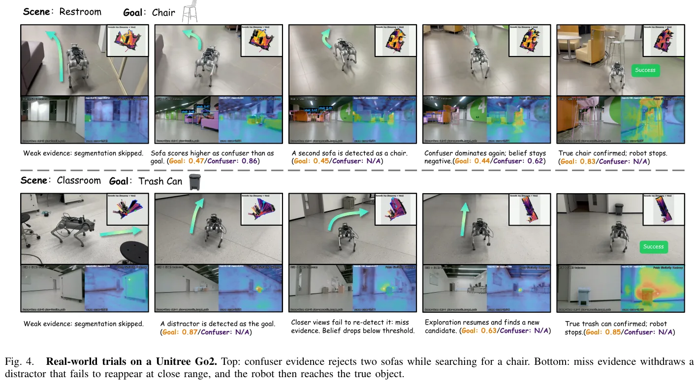
<figcaption>
Unitree Go2 experiments: top row, searching for a chair, the distractor score beat the target score twice in a row and both sofas were rejected; bottom row, searching for a trash can, a distant false detection was withdrawn on approach because of missed-detection evidence, and the robot kept exploring until it found the real target
</figcaption>
</div>

---

### 4. Limitations
{: id="4-局限性-21"}

The distractor categories come from a small fixed set (up to 3) generated offline by an LLM; if the real distractor is not on the list, negative evidence cannot act. The method also depends heavily on hand-set thresholds and weights (the gate threshold, missed-detection prior, stopping window, and so on). The real-robot study is small (40 trials), and its two failures came from a corner the forward-facing camera never saw and from running out of steps in a large open area, showing that exploration still has blind spots in those two kinds of scenes.

---

## 13. VNT-PA (2026)
{: id="vnt-pa"}
——Positional encoding by "where it was seen" instead of "when it was seen": a Transformer planner without an explicit map

📄 **Paper**: [arXiv:2609.21212](https://arxiv.org/abs/2609.21212)

### Key takeaways
{: id="精华-25"}

- Memory organized by "where" represents the environment better than memory organized by "when": a set of depth keyframes with camera poses can itself serve as the environment representation for planning, with no explicit mapping.
- Using the camera pose as the RoPE position makes attention depend only on the **pose difference** between two frames, which is naturally independent of the order frames were seen in and of the world-frame origin.
- With the same architecture and only the positional encoding changed (time → pose), the SPL gap on long episodes reaches 17.1 points and training converges more than 4 times faster: the inductive bias matters more than model capacity.
- The context is an unordered set, so frames from other trajectories and other times can be added freely at test time without retraining; keyframe filtering makes the context grow only with the space already seen, not with trajectory length.
- Compared with OctoMap + A*, which bakes noisy poses into a grid map up front, the implicit representation degrades far more gracefully under localization error.

---

### 1. Background and problem
{: id="1-研究背景问题-24"}

Learned navigation policies almost always treat past observations as a time series (time-indexed tokens, sliding windows, or recurrent hidden states). Such memory cannot naturally take in observations from "the last time I was here" or from another robot, and its cost grows with history length. Systems that genuinely reuse long-term experience build a separate metric or topological map for planning, maintaining two representations of the same environment. The authors ask: **can a learned planner use pose-tagged experience directly as its environment representation, without an explicit map?**

---

### 2. Method and innovations
{: id="2-主要方法创新点-24"}

<div align="center">
  
<figcaption>
VNT-PA architecture: after keyframe filtering, a frozen DeFM encoder and attention pooling compress each frame into one token, which together with its camera pose forms the spatial context; a goal token is added and L_map self-attention layers, with pose as the positional encoding, produce a goal-aware context; a query token anchored at the robot's pose reads that context through L_read cross-attention layers, and an autoregressive GRU decodes an action chunk
</figcaption>
</div>

**Problem setting**: as in PointGoal, the robot knows its own pose and the goal position and executes FORWARD (0.25 m) / TURN-LEFT / TURN-RIGHT (30°) / STOP. The difference is that it also receives depth frames $I_1, \dots, I_N$ with poses recorded during earlier exploration, and **does not look at the current view** when planning. It decides from these old frames, its pose, and the goal alone, so the old frames must do the job of a map.

**① Overall framework**

VNT-PA has four stages: **keyframe filtering and encoding** thins out the many depth frames and compresses each into one token; **spatial context with pose-RoPE self-attention** relates every frame and the goal through their pose differences, forming an implicit map; a **query anchored at the robot's pose** reads decision-relevant information from the implicit map through cross-attention; and a **GRU action decoder** outputs actions.

| Dimensions | Temporal context (sequence model) | Spatial context (VNT-PA) |
|---|---|---|
| Index of each frame | Frame number (time step $t$) | Camera pose $(x, y, \psi)$ |
| Attention dependence | Time interval between two frames | Pose difference between two frames |
| Frames merged into other trajectories | No natural insertion position | Can be added directly with pose |
| Context size | Grows with history length | Grows with observed space size |

**② Module by module**

**Keyframe filter**
- **Input**: depth frames and poses arriving in sequence
- **Processing**: split each frame into $G \times G$ patches, take each patch's median depth and back-project it along the central ray, quantize the result into "voxel + viewing direction" labels, and obtain the frame's observed set $C(I_i, p_i)$; keep the frame if it observes at least $\eta$ new voxels:

$$i \in \mathcal K \iff \left\lvert C(I_i, p_i) \setminus \bigcup_{j \in \mathcal K,\ j < i} C(I_j, p_j) \right\rvert \ge \eta$$

- **Output**: the keyframe set (with $G = 16$ and $\eta = 10$, 21% of frames are kept on average, about 67 per trajectory)
- **Motivation**: attention cost grows with the number of entries, and frames from nearby poses overlap heavily; deleting an entry from a set does not shift the indices of the others, which a time series cannot offer

**Frame embedding**
- **Input**: a 224×224 depth map
- **Processing**: the frozen depth foundation model DeFM (ViT-S/14) produces 16×16 patch tokens of 384 dimensions, which a learnable attention-pooling aggregator compresses into a single vector $e_i$
- **Output**: the spatial context $\mathcal S = \{(e_i, p_i)\}$
- **Motivation**: navigation decisions depend only on geometry, so depth is used instead of RGB

**Pose RoPE (the key idea)**

Standard RoPE treats every two dimensions of a query or key vector as a plane and rotates it by an angle of position × frequency. Because rotation matrices satisfy $R(a)^\top R(b) = R(b - a)$, the dot product after rotation depends only on the difference in position. VNT-PA replaces this position, normally a time step, with the three components of the camera pose:

$$R(p) = R_\omega(x) \oplus R_\omega(y) \oplus R_\nu(\psi)$$

So the attention score between a query at pose $p_i$ and a key at pose $p_j$ is:

$$\langle R(p_i) q_i,\ R(p_j) k_j \rangle = q_i^\top R(p_j - p_i) k_j$$

> **Worked example** (looking only at the $x$ component, with a single frequency of 1 radian per meter):
> The query is at $x = 2$ m and the key at $x = 5$ m. The query vector rotates by 2 radians and the key vector by 5; their dot product retains only the relative rotation of $5 - 2 = 3$ radians.
> Shift the world origin by 10 m and they become 12 m and 15 m: the relative rotation is still 3 radians and the attention score does not change at all.
> With temporal RoPE, the same two frames might be frames 7 and 40, 33 apart, a number that depends on the exploration route and says nothing about whether the frames are close in space.

Details of the frequency design:
- **Position frequencies**: $\omega_m = s^{-1} b^{-(m-1)/n}$, so the highest frequency is 1 radian per $s$ meters. A smaller $s$ distinguishes nearby poses better but is more sensitive to localization error.
- **Avoiding wraparound**: the lowest frequency has the longest wavelength, $\lambda_{max} = 2\pi s\, b^{(n-1)/n}$. Displacements beyond $\lambda_{max}/2$ would be confused with short displacements in the opposite direction. With $s = 0.25$ m, $b = 100$, and $n = 16$, $\lambda_{max} \approx 2\pi \times 0.25 \times 75 \approx 118$ m, more than twice the size of most training scenes.
- **Orientation frequencies**: orientation is periodic, so integer frequencies $\nu_m = m$ are used, keeping a full turn unchanged; the orientation part of attention thus becomes a Fourier series in $\psi_j - \psi_i$
- **Rotation augmentation**: the encoding is invariant to translation of the world frame but not to rotation, so the whole world frame is rotated by a random $\gamma \sim U[0, 2\pi)$ during training, letting the model learn rotation invariance from data

**Goal-aware context**
- **Input**: the spatial context plus a learnable goal token $e_{goal}$ placed at the goal position $p_{goal}$ (the goal has no orientation, so its orientation subspace is zeroed)
- **Processing**: $L_{map} = 6$ layers of bidirectional self-attention, all with pose RoPE
- **Output**: every entry now carries context relating it to other frames and to the goal through pose differences
- **Motivation**: let the "map" integrate its information internally before any decision is made, a form of implicit mapping

**Query and readout**
- **Input**: the goal's position in the robot frame, $\Delta p = (\Delta x, \Delta y)$, and its bearing $\alpha = \mathrm{atan2}(\Delta y, \Delta x)$
- **Processing**: the query token is $f(\lVert \Delta p \rVert, \cos\alpha, \sin\alpha)$, placed at the robot's pose, and reads the goal-aware context through $L_{read} = 4$ layers of cross-attention
- **Output**: the query token's output embedding $z$
- **Motivation**: the query **deliberately excludes** current and past observations, forcing every decision to rest on the spatial context, so the model behaves like a classical map plus planner

**Action decoder**
- **Input**: $z$
- **Processing**: a GRU decodes $H = 8$ actions autoregressively, conditioned on expert actions in training and on the executed actions at run time.
- **Output**: an action chunk; the first $h = 4$ actions are executed before querying again from the new pose
- **Motivation**: a smaller $h$ means more frequent replanning, a larger one smoother motion.

**③ End-to-end data flow**

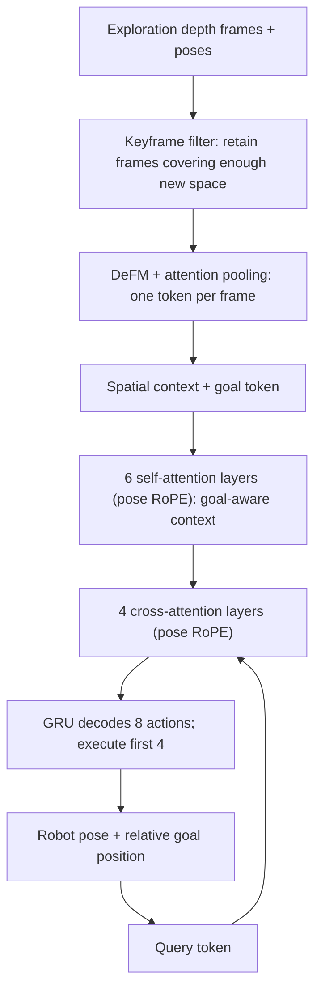

**④ Training objective**

Imitate Habitat-Sim's shortest-path planner on the ground-truth grid, with cross-entropy over action chunks:

$$\mathcal L(\theta) = -\mathbb E\left[ \sum_{\ell=1}^{H} \log \pi_\theta\left( a_\ell^* \mid \tilde S, \tilde p_{robot}, p_{goal}, a_{1:\ell-1}^* \right) \right]$$

where $\tilde S$ and $\tilde p_{robot}$ are the context poses and robot pose with added noise (±0.1 m and ±0.2 rad per axis) to simulate localization error. Nearly straight episodes (detour ratio $\kappa < 1.1$) are dropped with some probability during training to emphasize hard cases that require detours. The model has 74.3M trainable parameters and trains in about 4 hours on a single L40S; one inference step takes 14 ms with a 300-frame context.

---

### 3. Results and findings
{: id="3-核心结果发现-24"}

**Closed-loop navigation in HM3D validation scenes (2,220 episodes, three random seeds)**:

| Methods | Overall SR | Overall SPL | Distance ≥15 m SR | Distance ≥15 m SPL |
|---|---|---|---|---|
| LSTM | 31.9 | 28.5 | 5.7 | 5.1 |
| SRU | 30.3 | 27.3 | 7.8 | 7.1 |
| Causal Transformer | 90.3 | 87.3 | 80.4 | 77.4 |
| VNT-TA (Time RoPE) | 87.1 | 83.9 | 67.7 | 64.9 |
| VNT-PF (pose as input feature) | 89.5 | 86.5 | 73.6 | 70.8 |
| VNT-PA (pose only, no depth features) | 66.4 | 62.8 | 41.7 | 39.5 |
| **VNT-PA** | **93.3** | **90.4** | **85.4** | **82.0** |

- VNT-TA has exactly the same architecture except for the positional encoding. As distance grows, the SPL gap widens from 4.6 to 17.1 points, so the advantage comes from pose RoPE itself.
- The recurrent network succeeds on only about 11% of episodes with detour ratio $\kappa \ge 1.5$; a fixed-size hidden state cannot carry the environment representation.
- Poses alone reach 66.4% (keyframe poses themselves mark traversable locations); the rest of the gain comes from the geometry in the depth features

<div align="center">
  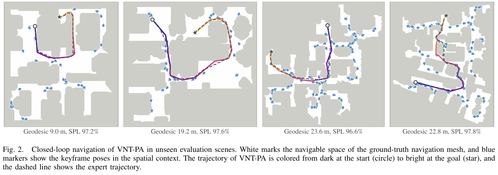
<figcaption>
Closed-loop navigation in unseen scenes: white is traversable space, blue markers are keyframe poses in the spatial context, colored solid lines are VNT-PA trajectories (dark to bright from start to end), dashed lines are expert trajectories; SPL is above 96% in every case
</figcaption>
</div>

**Extending the context at test time** (single seed, no retraining): adding more filtered frames (from 67 to 313 on average) or adding the current view at each query both raise success; for episodes of 15 m or more, success rises from 87.7% to 96.3%.

**Training efficiency**: VNT-PA reaches 80% SPL within 5,000 steps for all three seeds, while the Causal Transformer, VNT-PF, and VNT-TA need more than 20,000 steps.

<div align="center">
  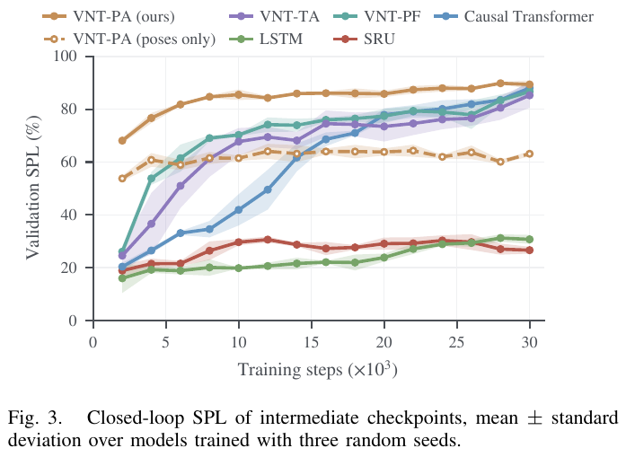
<figcaption>
Closed-loop SPL (mean ± standard deviation over three seeds) at intermediate checkpoints: VNT-PA converges much faster
</figcaption>
</div>

**Robustness to localization error** (keyframe context):

| Method | Precise pose SR | Noise pose SR |
|---|---|---|
| OctoMap + A* | 96.2 | 54.1（−42.1） |
| **VNT-PA** | 94.6 | **86.6（−8.0）** |

The explicit map writes every frame into the grid at its noisy pose, mislabeling clear corridors as obstacles; VNT-PA's failures are mostly stopping just outside the success radius. With all frames instead of keyframes, OctoMap recovers to 78.1%, still below VNT-PA's 88.0%.

<div align="center">
  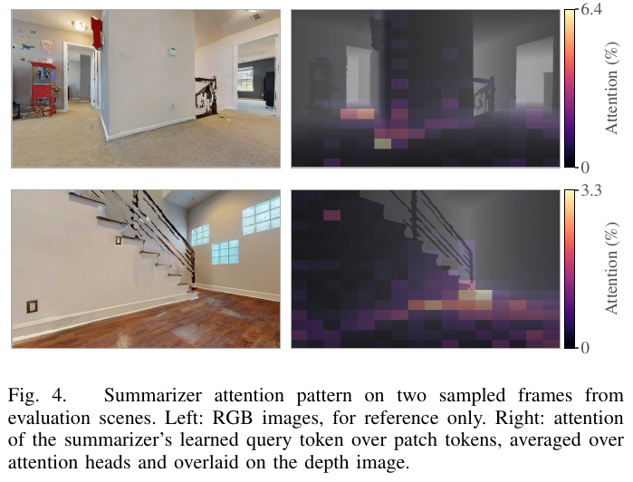
<figcaption>
Aggregator attention: RGB on the left (for reference only), attention overlaid on the depth map on the right. Attention concentrates on the floor ahead of corners, open doorways, and the bottom of stairs, i.e. the boundaries between free space and obstacles and topologically critical areas
</figcaption>
</div>

---

### 4. Limitations
{: id="4-局限性-24"}

The method plans only in 2D and assumes a constant camera height; actions are discrete, and localization error is modeled as independent per-step noise rather than realistic odometry drift accumulating along the trajectory. The task is purely geometric PointGoal, not yet connected to semantic or language features. The method also needs an exploration trajectory that covers the scene beforehand, and the robustness comparison with OctoMap + A* uses only one noise level.

---

# Supporting policies, world models, and evaluation
{: id="supporting-navigation-research"}

## 14. NAVCON (2024)
{: id="navcon"}
——The first large-scale vision-language navigation concept dataset for cognitive elicitation and language grounding

📄 **Paper**: [arXiv:2412.13026](https://arxiv.org/abs/2412.13026)

### Key takeaways
{: id="精华"}

1. NAVCON is the first vision-language navigation (VLN) concept dataset grounded in cognitive science and linguistic theory, with 236,000 high-level navigation concept annotations over about 30,000 instructions from R2R and RxR.
2. It defines four core navigation concepts, situating yourself (SIT), moving along a path (MOVE), changing direction (CD), and changing region (CR), which together form a complete set of navigation language primitives.
3. Using RxR's timestamps, it aligns 2.7 million frames of images and video clips with navigation concept phrases in time through the Habitat simulator.
4. NCC, a lightweight sequence-labeling model fine-tuned on this corpus, predicts concepts and text spans with 96.53% accuracy, showing strong generalization and grounding potential.
5. The work offers a structured semantic parsing tool that opens up the end-to-end black box of VLN, helping make cross-modal alignment more interpretable and efficient at run time.

---

### 1. Background and problem
{: id="1-研究背景问题"}

Traditional VLN models are mostly black-box end-to-end architectures, with imbalanced alignment between visual and text tokens and little interpretability. Existing syntactic parsing methods also lean heavily on noisy external dependency parsers, generalizing poorly and offering little interpretability for downstream robot navigation. Defining a complete set of navigation concepts and achieving cheap, precise, fine-grained text-video alignment is therefore a key bottleneck for trustworthy, transparent, and efficient embodied navigation.

---

### 2. Method and innovations
{: id="2-主要方法创新点"}

NAVCON provides a fully automated pipeline for building and annotating vision-language navigation concepts, aligning natural-language instructions end to end with core navigation concepts (labels + text spans) and video clips.

<div align="center">
  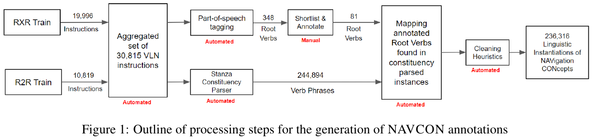
<figcaption>
Overview of NAVCON's pipeline for navigation concepts and video clip generation
</figcaption>
</div>

#### ① Overall framework
{: id="-整体框架概述"}
The pipeline has three stages: **defining navigation concepts**, **extracting language concepts with human evaluation**, and **aligning video clips with time-window adjustment**. An NLP pipeline extracts action predicates and their modifying phrases from instructions and links them in time with the agent's first-person video exported from the Habitat simulator.

#### ② Module by module
{: id="-逐模块讲解"}
- **Defining navigation concepts**:
  - **Input**: unlabeled navigation instructions.
  - **Processing**: drawing on cognitive science research on spatial mapping in animal and human brains (hippocampal place cells, head-direction cells in the limbic system, boundary cells in the entorhinal cortex, and self-motion systems), four core navigation concepts are defined:
    - **Situate yourself (SIT)**: identifies the current location and its surroundings (e.g. "standing in front of that pillar").
    - **Move along a path (MOVE)**: movement along a specific physical passage (e.g. "step into this area with a large pool").
    - **Change direction (CD)**: a change of heading (e.g. "turn around from the bench").
    - **Change region (CR)**: crossing a physical boundary into a new space (e.g. "enter the room that is in front of you").
  - **Output**: a taxonomy of navigation concepts.
  - **Motivation**: provide a complete set of navigation language primitives that is consistent with cognitive science and covers mainstream VLN instructions.

- **Language concept extraction pipeline**:
  - **Input**: 30,815 training instructions from R2R and RxR.
  - **Processing**: NLP tools such as the Stanza constituency parser handle tokenization, stemming, part-of-speech tagging, and parsing. From 348 candidate root verbs, manual screening keeps 81 that map unambiguously to the four concepts; all syntactic children of these verbs are then extracted to form complete predicate phrases expressing each concept.
  - **Output**: 236,316 automatically generated "silver" navigation concept annotations (concept categories with their text spans).
  - **Motivation**: cut manual annotation cost, while constituency trees keep the extracted phrases syntactically complete (including modifiers and landmark nouns).

- **Video clip alignment and adjustment**:
  - **Input**: RxR instructions with word-level timestamps, Matterport3D scenes, and agent pose traces.
  - **Processing**: the Habitat simulator renders the agent's view (320x240 pixels) with 10x temporal downsampling, yielding 7.6 million frames. RxR's word-level timestamps then map each extracted concept phrase onto the matching segment of the agent's motion video. Because some RxR timestamps are inaccurate, clips can cut off before an action starts or ends, so each clip's time window is extended backward by 5% of the video's total length.
  - **Output**: 2.7 million frames of grounded concept-video aligned images covering 19,074 instructions.
  - **Motivation**: fix temporal misalignment in fine-grained cross-modal alignment and provide large-scale, high-quality video-language navigation primitive data.

<div align="center">
  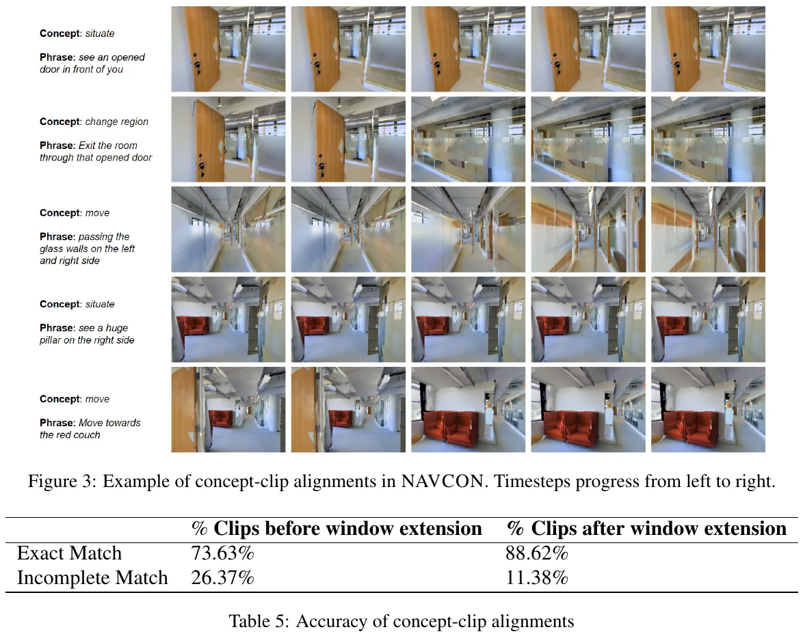
<figcaption>
Example of NAVCON concepts aligned with video clips (time runs left to right)
</figcaption>
</div>

#### ③ Training objective and classifier
{: id="-训练目标与分类器"}
On the silver-label data, the paper trains a **navigation concept classifier (NCC)** based on the lightweight `distilbert-base-uncased`. It takes tokenized instructions and labels each token in BIO format (B/I tags for SIT, MOVE, CD, and CR, plus O for other words), trained with the standard cross-entropy loss for sequence labeling:
$$\mathcal{L} = -\sum_{i=1}^{N} \sum_{j=1}^{C} y_{i,j} \log p_{i,j}$$
where $N$ is the sequence length, $C$ the number of classes ($C=9$: B- and I- tags plus O), $y_{i,j}$ the true label, and $p_{i,j}$ the predicted probability.

---

### 3. Results and findings
{: id="3-核心结果发现"}

- **Dataset composition**: MOVE is the most common concept at 42%, followed by SIT at 28%, CD at 22%, and CR at 9%.

<div align="center">
  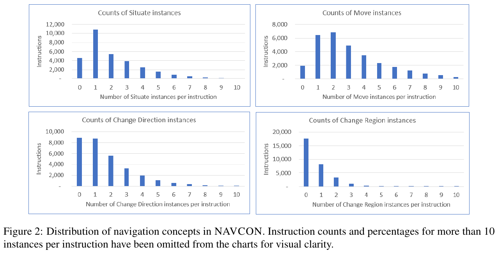
<figcaption>
Distribution of navigation concepts in NAVCON
</figcaption>
</div>

- **Annotation quality**: human evaluation finds 95.82% accuracy for silver concept labels and 95.49% for their text spans, with under 4% missed. Extending the time window by 5% raises the share of precisely aligned clips from 73.63% to 88.62%.
- **NCC performance**: on the unseen test set, NCC matches both concept category and text span exactly in 96.53% of cases.
- **LLM few-shot generalization**: 3-shot in-context learning with GPT-4o reaches 82.12% exact match on unseen data, showing that the navigation concepts are highly learnable for LLMs.

---

### 4. Limitations
{: id="4-局限性"}

1. **Parser dependence**: concept extraction depends heavily on the accuracy of the Stanza constituency parser; parse errors directly produce incomplete concept spans.
2. **Cross-modal alignment errors**: video-text alignment is limited by the accuracy of RxR's word-level timestamps, and even with window extension, about 11% of clips remain incompletely aligned.

---

## 15. LoGoPlanner (2025)
{: id="logoplanner"}
——A localization-grounded end-to-end navigation policy that builds metric-scale visual geometry into planning

📄 **Paper**: [arXiv:2512.19629](https://arxiv.org/abs/2512.19629) · 🏛️ **ICRA 2026**

**Background and problem**

Existing end-to-end navigation combines perception, mapping, and planning, **but still relies on a separate localization module (SLAM or visual odometry) for ego-state estimation**. This module requires accurate camera-to-base extrinsic calibration, generalizes poorly, and is especially unstable under motion-induced camera shake on legged robots. Most planners process single frames or short clips without summarizing long histories, so short-term estimation errors accumulate as drift. Single-frame perception also lacks the geometric memory needed for robust metric reasoning; reconstructions are often local or scale-ambiguous. The objective is point-goal navigation using only RGB-D observations, **without any external localization module**.

<div align="center">
  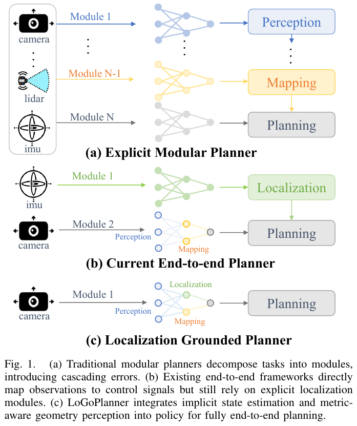
<figcaption>
Three planning paradigms: (a) traditional modular pipelines decompose the problem module by module and suffer cascading errors; (b) existing end-to-end methods still rely on an explicit localization module; (c) LoGoPlanner folds implicit state estimation and metric-aware geometry into the policy for fully end-to-end planning.
</figcaption>
</div>

**Method and innovations**

LoGoPlanner trains three parts end to end in one network: **(A) metric-aware visual geometry learning**, which injects a depth-scale prior into the pretrained video geometry backbone VGGT and produces world-point embeddings through two auxiliary heads for local points and camera poses; **(B) a localization-grounded navigation policy**, which decouples camera and base poses and uses a state query and a geometry query to aggregate implicit state and geometry into a unified planning context through cross-attention; and **(C) a diffusion policy head**, which iteratively denoises noisy actions conditioned on that context to output collision-free trajectories. Localization and mapping are thus reduced from explicit modules to implicit features inside the network, with planning error as the only final objective.

<div align="center">
  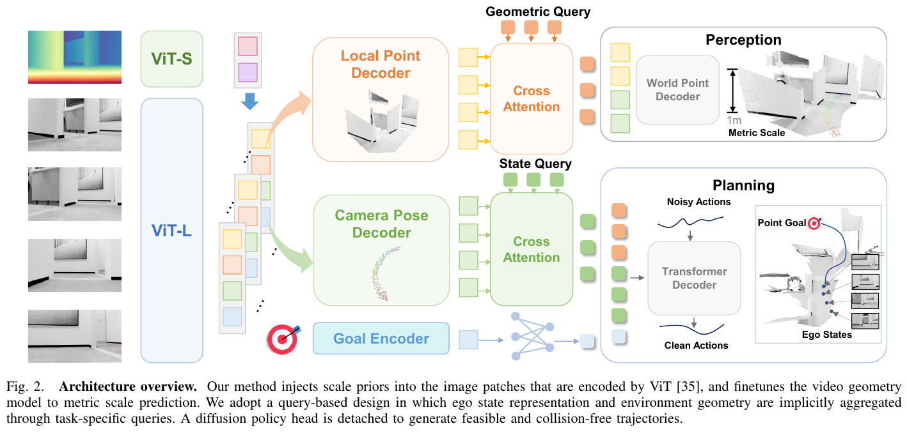
<figcaption>
Architecture: a ViT injects the scale prior into image patches before the video geometry backbone, which is fine-tuned for metric-scale prediction; the query-based design lets state and geometry queries implicitly aggregate ego-state and scene geometry; a separate diffusion policy head at the end generates feasible, collision-free trajectories.
</figcaption>
</div>

1. **Injecting metric scale (metric-aware geometry)**: VGGT natively reconstructs only relative scale, so its output cannot be aligned with planned trajectories. The authors encode the depth map into geometric tokens with a lightweight ViT, fuse them with semantic tokens per patch, and obtain metric-scale per-frame features through a Transformer decoder with RoPE:

   $$t_i^{metric} = \text{Attention}_{\text{RoPE}}((t_i^I, t_i^D), pos)$$

These feed a **local point head** (supervising 3D points in the camera frame through the pinhole model) and a **camera pose head** (decoding the camera-to-world transform, with the world frame defined as the base frame of the last image). Intermediate features from both heads are concatenated and passed through context fusion and a point-cloud decoder to output **a dense metric-scale point cloud** centered on the robot's current position, covering occluded and rear areas.

2. **Decoupling camera and base extrinsics**: perception is tied to the camera's viewpoint, while control happens in the base frame. Camera pose and base pose are predicted as two separate tasks, assuming no yaw between camera and base; the base pose and the goal relative to the current frame are additionally predicted from the pose features, and the camera pose follows from the fixed extrinsics $$T_{b,i}=T_{c,i}\cdot T_{ext}$$. Training data cover arbitrary camera heights (0.25–1.25 m) and pitches (0°–30°), giving robustness across embodiments.

3. **Query-based implicit aggregation (inspired by UniAD)**: a state query extracts ego-state from the pose tokens and a geometry query extracts scene geometry from the world-point tokens; these are concatenated with the goal embedding and passed through a Transformer decoder to give the planning-context query $$Q_P$$. **Crucially**, the predicted extrinsics and point clouds are never fed downstream explicitly, which avoids cascading errors; the final objective is always the trajectory planning error.

4. **Diffusion policy head**: conditioned on $$Q_P$$, it iteratively denoises an action chunk $$\{(\Delta x_t,\Delta y_t,\Delta\theta_t)\}$$ from Gaussian noise into a feasible, collision-free trajectory.

Training has **two stages**: first, fine-tune the geometry decoder and task heads (injecting the depth-scale prior and supervising metric point clouds and extrinsics); then freeze the backbone decoder and train the diffusion head and task heads jointly.

**Results and findings**

- **Simulation (40 unseen InternScenes scenes)**: with **no external localization at all**, it reaches Home SR 57.3 / SPL 52.4 and Commercial SR 67.1 / SPL 63.9, **beating ViPlanner even when ViPlanner uses oracle localization**: Home SR is 27.3 percentage points higher and SPL 21.3% higher.
- **Real world (3 platforms × 20 trajectories each, deployed directly without VO/SLAM)**: TurtleBot (office) 85% SR (17/20), Unitree Go2 (home) 70% (14/20), and Unitree G1 (industrial) 50% (10/20), all ahead of iPlanner (10/15/0%) and ViPlanner (50/45/0%); the quadruped still localizes itself accurately and avoids obstacles despite camera shake.

<div align="center">
  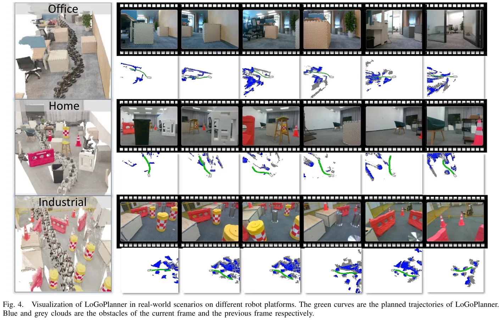
<figcaption>
Results in three real scenes (office, home, industrial) on different robots. The green curve is the planned trajectory; blue and gray point clouds are obstacles in the current and previous frames.
</figcaption>
</div>

- **Ablation (key modules)**: adding the odometry, goal, and point-cloud auxiliary tasks one at a time lifts Home SR from 49.5 for plain end-to-end training to 51.3 → 52.4 → 57.3; point-cloud supervision adds spatial relationships beyond 2D semantics and markedly improves obstacle avoidance.
- **Ablation (geometry backbone)**: performance improves steadily from DepthAnything (single frame) → Video DepthAnything → VGGT† (no metric scale) → VGGT (with injected scale prior); injecting the scale prior lowers PE from 0.87 to 0.55 (Home), showing that **metric supervision is necessary for real deployment**.

<div align="center">
  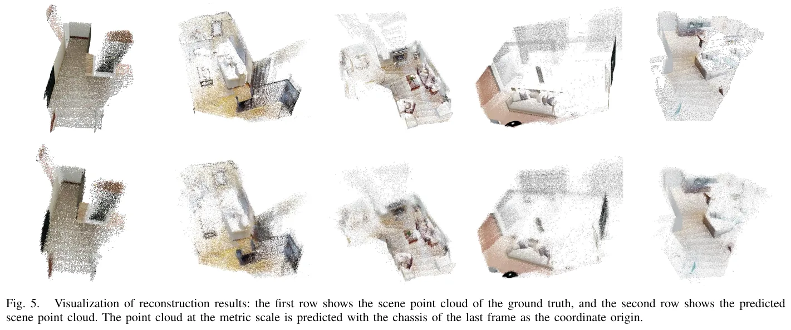
<figcaption>
Reconstructions: top row, ground-truth scene point clouds; bottom row, predictions, made at metric scale with the last frame's base as the origin.
</figcaption>
</div>

**Key innovations:**
1. **Folding localization into the network**: a long-horizon visual geometry backbone performs implicit ego-state estimation, removing the need for calibration and external SLAM/VO and allowing direct deployment across embodiments and viewpoints.
2. **From relative to absolute metric scale**: a depth prior corrects VGGT's scale ambiguity, producing dense point clouds that align with the planning frame.
3. **Conditioning on implicit features instead of passing explicit outputs**: auxiliary tasks distill geometry and pose capabilities into implicit features that condition the diffusion head, cutting off cascading errors and leaving planning error as the only objective.

**Limitations**

Because few navigation scenes are available (about 2k), reconstruction quality in real environments is still not ideal; the authors are continuing to train on metric-scale real-world datasets to improve real deployment.

---

## 16. Skill-Nav (2025)
{: id="skill-nav"}
——Navigation enhanced by versatile quadrupedal locomotion through a waypoint interface

📄 **Paper**: [arXiv:2506.21853](https://arxiv.org/abs/2506.21853) · 🏛️ **Vicinagearth (Springer) 2025**

### Key takeaways
{: id="精华-1"}

Skill-Nav's core contribution is using **waypoints** as the interface between the high-level planner and the low-level locomotion controller. Compared with velocity commands, waypoints are less sensitive to tracking error and work naturally with LLMs and classical path planners. The two-stage training strategy (WP-Fixed to learn skills, then WP-Random to generalize) avoids the missed steps and excessive jumping of single-stage training, a lesson that applies to other hierarchical robot control tasks. In the teacher-student distillation, inflated virtual obstacles added during student training let the student policy navigate safely without privileged information.

---

### 1. Background and problem
{: id="1-研究背景问题-1"}

Quadruped robots can already perform demanding feats such as extreme parkour through RL, but folding these rich locomotion skills into long-distance navigation remains underexplored. Most existing methods use velocity commands as the interface, which high-level planners struggle to track precisely and which couple poorly with general-purpose planning tools (LLMs, A\*).

---

### 2. Method and innovations
{: id="2-主要方法创新点-1"}

<div align="center">
  
<figcaption>
Skill-Nav architecture: a high-level planner (a classical method or an LLM) generates a waypoint sequence, and a low-level locomotion policy executes skills such as jumping, climbing, and detouring.
</figcaption>
</div>

**Waypoint interface**

Skill-Nav replaces velocity commands with 2D relative-position waypoints in the robot base frame. The high-level planner generates a start-to-goal waypoint sequence through $\mathcal{W} = \mathcal{H}(\mathbf{M}, p_e, p_s)$. Here, $\mathcal{H}$ can be A\* or an LLM, and $\mathbf{M}$ supplies coarse environmental information such as an occupancy map or room layout.

**Two-stage training**

<div align="center">
  
<figcaption>
Training: the teacher policy trains in WP-Fixed and then WP-Random scenes using privileged information (terrain scan points, depth maps, etc.); the student policy learns from the teacher by behavior distillation, using only proprioceptive history and depth maps
</figcaption>
</div>

- **WP-Fixed scenes** (skill learning): obstacles are laid out in rows and waypoints are preset. The policy learns basic skills such as climbing boxes, crossing gaps, and clearing rails from scratch. A reward $r_{\text{reach}} = n_p/(t + \epsilon)$ encourages reaching more waypoints quickly, and $r_{\text{stay}}$ teaches the robot to wait for the next command after reaching a waypoint.

- **WP-Random scenes** (generalization): obstacles are scattered randomly on a grid and waypoints are chosen dynamically from the robot's position and yaw. A modified $r_{\text{track}}$ gives a $-1$ penalty when the cosine similarity between the velocity direction and the waypoint direction is $< 0.1$, pushing the robot toward the goal. During student training, inflated virtual obstacles are added to the depth map so the student keeps a safe distance.

**Two high-level planners**

- **Classical planning (A\*)**: takes an occupancy map annotated only with walls and outputs a continuous waypoint sequence, sampled at 0.5–3 m intervals for the low-level controller.
- **LLM planning**: the LLM receives the task description, a coarse terrain map, and the robot's capabilities (climbing up to 0.45 m, crossing gaps up to 0.7 m) and outputs a sequence of waypoint indices (validated with GPT-4).

---

### 3. Results and findings
{: id="3-核心结果发现-1"}

<div align="center">
  
<figcaption>
Heat maps of visited positions in the Omni-traverse task: our method covers a wider area and moves more capably in all directions
</figcaption>
</div>

<div align="center">
  
<figcaption>
Snapshots of the robot navigating in simulation (LLM planning) and the real world (A* planning), traversing complex terrain
</figcaption>
</div>

- **Single-traverse task**: Skill-Nav reaches SR=1.00 and ATD=15.8m both with and without tall obstacles, the only method to succeed in both settings.
- **Omni-traverse task**: SR=0.89, ATD=8.2m, ahead of every baseline (RMA SR=0.00, Extreme Parkour SR=0.44/0.28).
- **Ablations**: training only on WP-Fixed (Ours-s1) generalizes poorly because waypoints follow a fixed pattern; training only on WP-Random (Ours-s2) produces an exaggerated jumping gait that is hard to deploy; combining both stages works best.
- **Real-robot deployment**: validated on a Unitree AlienGo, which handles low obstacles the depth camera misses and regains balance to keep navigating after being pushed.

---

### 4. Limitations
{: id="4-局限性-1"}

High-level planners (especially LLMs) may place waypoints in the middle of gaps or on the edges of boxes, extreme positions the low-level controller struggles to recover from. Future work will design low-level controllers that stay collision-free near edges and explore unified end-to-end policies for locomotion and navigation.

## 17. FantasyVLN (2026)
{: id="fantasyvln"}
——Unified multimodal chain-of-thought reasoning for vision-language navigation

📄 **Paper**: [arXiv:2601.13976](https://arxiv.org/abs/2601.13976)

**Key takeaways**
This paper shows how to combine textual, visual, and multimodal CoT reasoning in one framework. Ideas worth borrowing: (1) supervise with CoT during training but predict actions directly at inference (implicit reasoning), avoiding the token blow-up of explicit CoT; (2) compress imagined visual observations into a compact latent space with a pretrained VAR model, greatly shortening sequences; (3) unify the reasoning modes with cross-modal alignment constraints to learn modality-invariant reasoning representations; (4) use a gating mechanism so a single model can switch flexibly between reasoning modes. The design keeps reasoning ability while navigating in real time, a practical recipe for embodied AI.

**Background and problem**
Existing VLN methods face a key dilemma: text-only CoT lacks spatial understanding and easily overfits sparse annotations, while multimodal CoT generates imagined visual observations that inflate token counts so much that inference latency grows by orders of magnitude, ruling out real-time navigation. The problem is especially acute in long-horizon, multi-stage navigation.

<div align="center">
  
<figcaption>
FantasyVLN overview: textual and visual CoT reasoning combined to model semantic planning and spatial understanding jointly
</figcaption>
</div>

**Method and innovations**

FantasyVLN proposes a unified implicit reasoning framework. Its core innovations:

**1. Compact visual CoT (CompV-CoT)**
- A pretrained Visual AutoRegressive (VAR) model encodes imagined visual observations into a compact latent space
- VAR's next-scale prediction can reconstruct a 256×256 image accurately from only 30 visual tokens, a compression ratio of 1/2185
- The VLM generates VAR latents directly during training, and no VAR decoding is needed at inference, which greatly improves efficiency

**2. Unified multimodal CoT (UM-CoT)**
- Binary gates gT and gV switch textual and visual reasoning on or off
- Four reasoning modes: (a) Non-CoT (gT=0, gV=0) predicts actions directly; (b) T-CoT (gT=1, gV=0) generates textual reasoning steps; (c) V-CoT (gT=0, gV=1) generates compressed visual imagination; (d) MM-CoT (gT=1, gV=1) generates both jointly
- One model shares all parameters and is trained end to end on mixed data

<div align="center">
  
<figcaption>
The unified multimodal CoT framework: four reasoning modes, CoT supervision during training, and direct action prediction at inference
</figcaption>
</div>

**3. Cross-modal alignment**
- The Non-CoT mode's action predictions serve as soft targets that align the action outputs of every CoT variant
- Training alternates between the Non-CoT objective and the joint cross-modal alignment objective, embedding diverse reasoning patterns into one latent policy
- This prevents conflicts between reasoning modes and yields consistent, modality-invariant representations

**4. Implicit reasoning**
- Training: learn textual, visual, and multimodal CoT jointly
- Inference: use Non-CoT mode to map instructions straight to actions, with no explicit CoT sequence
- Following Aux-Think's "train with CoT, infer without CoT" paradigm, the model implicitly retains reasoning-aware representations

**Training details**
- Base model: Qwen2.5-VL (7B parameters)
- Data: 18,554 navigation trajectory slices from the LH-VLN training set (one slice every 5 steps)
- T-CoT annotations: generated with Qwen-VL-Max, covering semantic planning, visual description, action planning, and visual imagination
- Optimization: LoRA fine-tuning with AdamW, learning rate 1e-4, on 64 H20 GPUs with DeepSpeed ZeRO-2

<div align="center">
  
<figcaption>
Effect of VAR scale on ISR: scale 4 gives the best trade-off
</figcaption>
</div>

<div align="center">
  
<figcaption>
Image reconstruction quality of the VAR model at different scales: higher scales reconstruct better but use more tokens
</figcaption>
</div>

**Results and findings**

**Navigation accuracy (LH-VLN benchmark)**
- SR (success rate): 2.44% (best of all baselines)
- ISR (independent success rate): 11.01% (well ahead of every method)
- CSR (conditional success rate): 9.64%
- CGT (weighted CSR): 8.99%
- Far ahead of the runner-up, Aux-Think (T-CoT only): 3.75× higher SR and 3.5× higher ISR

**Inference efficiency**
- APS (actions per second): 1.03, on par with WorldVLA (1.02) and Aux-Think (0.97)
- 5.4× faster than the explicit-CoT method CoT-VLA (0.19 APS), cutting inference latency by an order of magnitude
- Implicit reasoning decodes a single token per prediction, whereas explicit CoT must generate 3k–5k tokens

**Training efficiency**
- FantasyVLN converges within a few thousand iterations, reaching a token prediction accuracy of 1.0
- WorldVLA (pixel-level V-CoT) needs 10k+ iterations to reach 0.5 accuracy, and its training is unstable
- Reasoning in latent space gives CompV-CoT stronger gradient signals and more stable learning dynamics

<div align="center">
  
<figcaption>
Training efficiency of FantasyVLN vs. WorldVLA: CompV-CoT converges quickly, while pixel-level V-CoT trains slowly and unstably
</figcaption>
</div>

**Ablations**
- Each reasoning mode helps: adding any CoT mode to Non-CoT improves performance, and joint training on all four works best
- VAR scale: scale 4 is optimal (ISR 7.41%); smaller scales carry too little information, larger ones are redundant
- Cross-modal alignment is essential: without it, SR falls from 2.44% to 0 and ISR from 11.01% to 2.39%
- Explicit vs. implicit reasoning: implicit reasoning does best in the multimodal setting (MM-CoT implicit SR 2.44 vs. explicit 0.98)

**Limitations**
The method is trained on a small dataset (18k trajectory slices from LH-VLN), on which explicit CoT easily overfits and accumulates errors; performance on larger datasets remains to be verified. Absolute success is also still low (SR 2.44%), showing that long-horizon, multi-stage navigation remains very challenging.


---

## 18. SparseVideoNav (2026)
{: id="sparsevideonav"}
——Sparse future videos give navigation foresight beyond the current view

📄 **Paper**: [arXiv:2602.05827v1](https://arxiv.org/abs/2602.05827v1) · [Code](https://github.com/OpenDriveLab/SparseVideoNav)

> **Version note:** This summary covers the v1 PDF, dated February 5, 2026; the PDF does not identify an accepted conference or journal venue.

### Key Takeaways
{: id="精华-2"}

1. **Imagine the future, then infer how to move:** A language-conditioned video generation model provides longer-range visual guidance when the navigation target is still out of view.
2. **Dense near-term predictions, sparse distant predictions:** Retain consecutive chunks near the current observation for action accuracy, then sample distant chunks at wider intervals to extend the horizon within a limited generation budget.
3. **Transfer pretrained capability progressively:** Image conditioning, history injection, diffusion distillation, and action learning adapt a general video generator into a deployable navigation system.
4. **Align action labels with the generated future:** Synthetic videos can depict motion that differs from the original recording, so their motion is re-estimated instead of reusing the recording's action labels.
5. **Assess latency together with success rate:** The final system reports 0.79-second inference on an RTX 4090 and 25.0% BVN success, compared with 10.0% for the strongest LLM baseline, while a more expensive continuous-generation variant achieves higher success.

---

### 1. Background and Problem
{: id="1-研究背景问题-2"}

Beyond-the-View Navigation (BVN) requires a robot to find a currently unseen target in an unfamiliar environment from a high-level instruction such as “find a table and stop beside it,” without detailed intermediate directions. The paper attributes unexpected turns, spinning, and dead-end trapping in the evaluated LLM navigation baselines to short-horizon action supervision, and explores language-conditioned video generation as a source of longer-range foresight. Generating tens of seconds of continuous video is too slow for deployment, so the system must jointly address prediction horizon, historical context, and inference cost.

---

### 2. Main Method and Contributions
{: id="2-主要方法创新点-2"}

<div align="center">
  
<figcaption>Figure 2: System architecture and four-stage training. The current observation, compressed history, and instruction condition a video generator; its sparse future latents then condition the action head.</figcaption>
</div>

#### 2.1 Architecture and Module Data Flow
{: id="21-整体框架与模块数据流"}

The system combines a **Wan2.1 video generation backbone, a history compression module, and an inverse dynamics action head**: the backbone predicts what future observations may look like, the history module summarizes previous observations, and the action head infers how to move toward the predicted future.

- **Video generation backbone:** A 3D causal Wan-VAE encodes the current RGB observation, and umT5 encodes the instruction; these inputs and the history embedding condition an image-to-video (I2V) model adapted from Wan2.1 T2V-1.3B, producing sparse future video latents that represent longer-range visual intent.
- **History compression:** Historical observation features pass through a Q-Former to reduce temporal redundancy and a Video-Former for 4× spatial downsampling, yielding 2,560 history latent tokens; added cross-attention blocks inject this context into each backbone Transformer block, preserving access to past observations while controlling the cost of a long history.
- **Action head:** An action-side Video-Former aggregates the generated future's spatiotemporal features into 640 conditioning tokens; these features and the instruction condition a Diffusion Transformer (DiT) through cross-attention, producing an **8-step continuous action trajectory** with planar translation and heading changes $(\Delta x,\Delta y,\Delta\theta)$.

The reader-oriented diagram below isolates the deployment data flow:


#### 2.2 Sparse Foresight: Decouple Generation Budget from Horizon
{: id="22-稀疏未来生成数量与预测范围分开设计"}

The intuition is to predict the immediate future in detail and sample the distant future at a few informative times. Sampling primarily operates on **VAE-compressed chunks**, so eight future chunks should not be read as eight original image frames.

Wan-VAE compresses a video with $(1+F)$ frames into $(1+F/4)$ latent chunks, with spatial dimensions reduced from $H\times W$ to $H/8\times W/8$ and 16 latent channels per location. Apart from special handling of the initial frame, each future chunk corresponds to four original timesteps; at the dataset's 4 FPS sampling rate, one chunk represents approximately one second.

The selected future chunk indices are:

$$
[T+1,T+2,T+5,T+8,T+11,T+14,T+17,T+20].
$$

The first two chunks remain consecutive to preserve motion information over the next eight original timesteps; subsequent chunks are sampled every three chunks, extending the horizon to approximately 20 seconds.

> **Minimal example:** If one chunk represents one second, predicting consecutively through second 8 requires eight chunks; retaining only seconds 1, 2, 5, and 8 covers the same endpoint with four chunks. The paper extends this pattern to eight chunks around seconds 1, 2, 5, 8, 11, 14, 17, and 20, looking farther ahead with a similar output budget rather than generating every frame of a 20-second video.

<div align="center">
  
<figcaption>Figure 3: Qualitative comparison of sparse intervals. Interval 1 has a shorter horizon, whereas interval 5 reduces visual fidelity; interval 3 is selected as a compromise between horizon and generation quality.</figcaption>
</div>

| Design choice | Continuous video generation | SparseVideoNav |
|---|---|---|
| Future supervision | Consecutive adjacent chunks | Consecutive near-term chunks and sparsely sampled distant chunks |
| Cost of extending the horizon | Generate more chunks to look farther ahead | Cover distant changes with fewer chunks |
| Guidance for actions | A complete continuous future | Sparse visual foresight plus near-term detail |

#### 2.3 Four-Stage Training
{: id="23-四阶段训练"}

**Stage 1: T2V → I2V adaptation.** The current image, instruction, and noisy sparse future latents enter the backbone, which is fine-tuned with Wan's flow matching objective; the resulting generator anchors its predicted future to the current viewpoint rather than relying on text alone.

**Stage 2: History injection.** Compressed historical embeddings enter new cross-attention blocks within every backbone Transformer block; the added blocks' final linear layers are zero-initialized to limit disruption of the existing generative prior, yielding an I2V model conditioned on both current and past observations.

**Stage 3: Diffusion distillation.** The history-conditioned I2V model serves as the teacher, and an identical student is initialized from its weights; Phased Consistency Models (PCM) divide the noise schedule into four phases and teach the student to predict phase endpoints along the teacher's probability-flow ODE trajectory, using consistency between neighboring timesteps to reduce video denoising from **50 steps to 4**.

**Stage 4: Action learning.** The distilled I2V model is frozen, while an inverse dynamics head learns to infer actions from predicted visual changes; generated sparse futures and instructions condition an 8-step continuous action prediction.

Importantly, the system first uses **Depth Anything 3 (DA3) to relabel motion in the generated future**, aligning the action supervision with synthetic visual dynamics instead of attaching the original recording's actions unchanged.

> **Minimal example:** Suppose a real recording corresponds to moving straight for one meter, but its generated counterpart depicts moving forward and then turning right; labeling both as straight motion would provide contradictory supervision. The paper re-estimates camera motion in the generated video and derives matching action labels; the distance in this example is illustrative, not a reported measurement.

#### 2.4 Core Training Objectives
{: id="24-核心训练目标"}

**Flow matching for video generation.** Let $x_1$ be the ground-truth sparse future latents, $x_0$ Gaussian noise, and $t$ the flow matching time; the intermediate input and target velocity are:

$$
x_t=t x_1+(1-t)x_0,\qquad v_t=x_1-x_0.
$$

The objectives for the two generation stages can be summarized as:

$$
\mathcal L_{\mathrm{FM}}
=\mathbb E\left[\lVert u_\theta(x_t,l,c_T,h_T,t)-v_t\rVert_2^2\right].
$$

Here $l$ is the instruction embedding, $c_T$ the current observation latent, and $h_T$ the history embedding; Stage 1 omits $h_T$, while Stage 2 includes it, with both stages learning a velocity field from noise toward sparse future latents.

**Consistency for distillation.** Stage 3 aligns predictions at adjacent noise times within a phase to the same solution point on the teacher's trajectory, retaining generative quality under few-step inference; the main text does not give a complete PCM loss equation.

**Action reconstruction.** Following the paper's Eq. (5), relabeled clean actions $a_0$ are noised into $a_k$, and the action head reconstructs $a_0$ conditioned on the instruction $l$ and generated future $V$:

$$
\mathcal L_{\mathrm{action}}
=\mathbb E\left[\lVert D_\psi(a_k,l,V)-a_0\rVert_2^2\right].
$$

This equation directly supervises clean-action reconstruction, with DDIM used for inference; the 20-second visual horizon and the 8-step action output are different quantities and should not be conflated.

#### 2.5 Data Construction and Inference
{: id="25-数据构建与推理"}

Human operators collected **140 hours of real-world navigation video** with a handheld DJI Osmo Action 4 using RockSteady+ stabilization, producing approximately **13,000 trajectories**, averaging 140 frames at 4 FPS, with manually annotated instructions. DA3 estimates 6-DoF camera poses, and relative pose changes are projected onto the local plane to derive $(\Delta x,\Delta y,\Delta\theta)$ labels; static segments, extreme camera pitch, and frontal dynamic-pedestrian segments that impair pose estimation are filtered out.

At deployment, the robot sends new RGB observations to a remote workstation; the model combines the instruction and compressed history, generates sparse futures with four video denoising steps, predicts continuous actions, and sends them back for execution, with subsequent observations closing the feedback loop rather than executing the entire 20-second imagined future open-loop. DA3 relabeling belongs to training preparation and is not listed as an online navigation component; the appendix reports about 64 hours for the complete four-stage pipeline on 32 H200 GPUs.

<div align="center">
  
<figcaption>Figure 5: Sparse future predictions during zero-shot BVN deployment for finding a table, an air conditioner, and a trash bin; the current observation and sampled future chunks express longer-range navigation intent.</figcaption>
</div>

---

### 3. Key Results and Findings
{: id="3-核心结果发现-2"}

**Evaluation setup.** A Unitree Go2 is evaluated in six unseen real-world scenes: Room and Lab Building indoors, Yard and Park outdoors, and Square and Mountain at night; each scene contains two instruction-following navigation (IFN) tasks and two BVN tasks, repeated ten times each, for **240 trials per method**. Success means stopping within **1.5 meters** of the target, without an orientation requirement; models run on a remote RTX 4090 workstation, so reported inference latency should not be equated with the complete robot communication and control cycle.

**Main results (Table I; success rate, %).**

| Method | Average IFN | Average BVN |
|---|---:|---:|
| Uni-NaVid | 10.0 | 2.5 |
| StreamVLN | 35.0 | 10.0 |
| InternVLA-N1 | 17.5 | 8.3 |
| **SparseVideoNav** | **50.0** | **25.0** |

Both task types improve by **15 percentage points** over the strongest baseline, StreamVLN; BVN success is **2.5×** higher because 25.0% / 10.0% = 2.5. Nighttime BVN success is **20% and 15%** in the two scenes, averaging **17.5%**, versus 0% for all three evaluated baselines; this does not establish reliable navigation in arbitrary nighttime environments.

<div align="center">
  
<figcaption>Figure 4: Successful real-world BVN trajectories involving backtracking out of a dead end, a narrow traversable ramp, and a steep hillside; these illustrate behavior rather than replace aggregate success rates.</figcaption>
</div>

**Horizon and success-rate trade-offs (Table I).**

| Variant | IFN (%) | BVN (%) |
|---|---:|---:|
| 4 denoising steps, 2 consecutive future chunks | 15.8 | 2.5 |
| 4 denoising steps, 10 consecutive future chunks | 36.7 | 11.7 |
| **Final system: 4 denoising steps, sparse foresight spanning 20 seconds** | **50.0** | **25.0** |
| 50 denoising steps, 20 consecutive future chunks | 62.5 | 35.8 |
| Final system without history compression | 45.0 | 22.5 |

The longer continuous-generation variant achieves higher success, showing that sparsification and distillation trade some performance for efficiency; these ablations support a practical compromise rather than proving that sparse prediction is intrinsically more accurate at a matched horizon.

<div align="center">
  
<figcaption>Figure 6: Ablations of data scale, sparse generation, distillation, and history compression; larger datasets reduce FVD, sparse generation and distillation reduce inference time, and history compression limits latency growth with longer histories.</figcaption>
</div>

- **Efficiency:** Figure 6 reports **0.79-second** inference for the final system, **1.35 seconds** without sparsification (approximately 1.7× slower), and **7.56 seconds** without distillation (approximately 9.6× slower), while sparse generation provides about **1.4× faster Stage 1+2 training**; the abstract separately reports **27× acceleration** over a fully unoptimized system, using a different comparison setting that should not be multiplied or mixed with the individual ablation ratios.
- **History and initialization:** Removing the Former introduces a **54.9%** latency increase at history length $N=45$; progressive Stage 1 adaptation followed by history injection reduces generation-adaptation convergence time from **64 hours** for direct Stage 2 training to **32 hours**, which is distinct from the full four-stage training time.
- **Data scaling:** Increasing training data from **8 / 50 / 140 hours** reduces FVD on a three-hour unseen validation set from **2534 / 1755 / 1390**, indicating improved video distribution fit; this experiment does not report a corresponding navigation success-rate scaling curve.
- **Qualitative generalization:** The paper demonstrates pedestrian avoidance and successful navigation at a 50-centimeter camera height despite training near one meter, but does not report separate quantitative success rates for these capabilities.

---

### 4. Limitations
{: id="4-局限性-2"}

The 140-hour dataset remains limited, challenging scenes can cause generation mode collapse and navigation failure, and final BVN success is only 25.0%; efficiency optimizations sacrifice some success, while the authors report that inference remains slightly slower than existing LLM navigation methods. Evaluation spans six scenes and 24 tasks using a remote GPU, and camera-height robustness and dynamic obstacle avoidance are supported mainly by qualitative examples, leaving reliable autonomy across broader environments unproven.

---

## 19. WorldVLN (2026)
{: id="worldvln"}
——An autoregressive world action model for aerial vision-language navigation

📄 **Paper**: [arXiv:2605.15964](https://arxiv.org/abs/2605.15964)

---

### Key takeaways
{: id="精华-3"}

WorldVLN reframes aerial VLN as prediction-driven world-action modeling. Instead of mapping observations directly to actions, the agent first predicts latent world-state evolution, then decodes executable waypoints from the predicted representation. The central insight is that **spatial navigation is inherently anticipatory**, much as people predict how movement changes their surroundings. Transferring temporal priors from video generation and using action-aware GRPO to optimize action consequences rather than visual synthesis quality lets the WAM approach exceed VLA baselines by 12+ percentage points with limited training steps. Closed-loop autoregressive updates replace generated latent states with actual observations to address long-horizon prediction drift. Zero-shot transfer to real drones demonstrates potential generalization.

---

### 1. Background and problem
{: id="1-研究背景问题-3"}

Existing VLA models treat VLN as a conditional mapping from instructions and observations to actions. They understand semantics, but lack explicit temporal-causal modeling of how the agent's own actions change the world, so their spatial reasoning and geometric precision fall short. Video generation models have strong spatiotemporal priors, but their objective (visual realism) is structurally mismatched with VLN's (action-oriented state prediction): most video backbones generate a whole clip bidirectionally, whereas VLN needs a causal observe-act-update loop, and their latent representations are not optimized to be decodable into actions.

---

### 2. Method and innovations
{: id="2-主要方法创新点-3"}

**Overall framework:** WorldVLN has three main parts: (1) a latent spatiotemporal autoregressive Transformer (the world backbone) that predicts short-term world-state transitions; (2) an action decoder that turns predicted latent transitions into executable waypoints; and (3) a two-stage training framework that first aligns video priors with navigation dynamics through supervised learning, then optimizes action consequences with action-aware GRPO reinforcement learning.

<div align="center">
  
<figcaption>
Figure 1: WorldVLN architecture. The model predicts short-term latent transitions from the instruction and past observations, decodes them into waypoint actions, and after execution encodes the real observations back into the autoregressive context.
</figcaption>
</div>

**① World backbone (latent autoregressive video Transformer)**

- **Input**: the instruction embedding from the text encoder, $e_\ell = \psi(\ell)$, and the latent sequence $z_{\leq t}$ encoded from past real egocentric observations
- **Processing**: a spatiotemporal autoregressive Transformer predicts multi-scale token blocks from coarse to fine (global low resolution first, then local high resolution) and generates them segment by segment along time
- **Output**: a short-term latent prediction $$\hat{z}_{t+1:t+K} \sim p_\theta(\cdot \mid e_\ell, z_{\leq t})$$
- **Motivation**: borrow the temporal priors of video generation models instead of learning from scratch, and convert the generative architecture to causal autoregression so it can run in a closed loop

<div align="center">
  
<figcaption>
Figure 6: the latent spatiotemporal autoregressive world backbone. Input images or past video are encoded into known visual pyramids; the future target segment's pyramid is predicted, and multi-scale token blocks are aggregated into the output latent representation.
</figcaption>
</div>

**② Action decoder**

- **Input**: the predicted future latents $$\hat{z}_{t+1:t+K}$$ from the world backbone (a compact spatiotemporal representation encoding viewpoint change, spatial structure change, and motion trends)
- **Processing**: a vision embedding module turns the latents into spatiotemporal tokens; Transformer blocks with factorized spatiotemporal attention follow, temporal attention capturing motion across frames and spatial attention modeling geometry within each frame; an MLP action head regresses the aggregated features to continuous action vectors
- **Output**: continuous waypoint actions $$a_{t:t+K-1} = D_\phi(\hat{z}_{t+1:t+K})$$, i.e. the drone's relative 3D displacement and yaw change
- **Motivation**: decoding latents into video frames and then estimating motion would compound errors; inferring actions directly from the latent representation is simpler and more efficient

<div align="center">
  
<figcaption>
Figure 7: action decoder architecture. The world model's output latents become spatiotemporal tokens through visual embedding, Transformer blocks with factorized spatiotemporal attention model action-relevant features, and an MLP regresses continuous drone navigation actions.
</figcaption>
</div>

**③ Closed-loop autoregressive updates**

The full inference loop is:
$$
(e_\ell, z_0) \to \hat{z}_{1:K} \to a_{0:K-1} \to o_{1:K} \to z_{1:K} \to \hat{z}_{K+1:2K} \to \cdots
$$
The key is that after executing actions, the **real observations** are re-encoded and replace the model's predicted latents, $z_{t+1:t+K} = E_\text{vid}(o_{t+1:t+K})$, which stops latent prediction drift from accumulating.

**④ Two-stage training framework**

<div align="center">
  
<figcaption>
Figure 2: two-stage training. Stage 1 supervises the world backbone with instruction-video pairs and the action decoder with video-trajectory pairs. Stage 2 samples several online trajectories, assigns segment-level rewards from trajectory accuracy, task progress, and reference-policy regularization, and updates WorldVLN with action-aware GRPO.
</figcaption>
</div>

**Stage 1: supervised training (aligning the world prior)**

World backbone objective:
$$
\mathcal L_\text{wm} = -\sum \log p_\theta(z_{t+1:t+K} \mid e_\ell, z_{\leq t})
$$

Action decoder objective (initialized by distillation from a video-action teacher model):
$$
\mathcal L_\text{act} = \sum \lVert D_\phi(E_\text{vid}(o_{t+1:t+K})) - a^*_{t:t+K-1} \rVert
$$

**Stage 2: action-aware GRPO (aligning action consequences)**

For each navigation episode, sample $G$ online trajectories, each with $n$ autoregressive decision segments, and assign segment $j$ the reward:

$$
r^{(i)}_j = \gamma^{j-1}\left(\lambda_\text{traj} r^{(i)}_{\text{traj},j} + \lambda_\text{task} r^{(i)}_{\text{task},j} + \lambda_\text{ref} r^{(i)}_{\text{ref},j}\right)
$$

- **Trajectory reward** $r_\text{traj}$: local geometric supervision, measuring how close predicted actions are to expert actions
- **Task reward** $r_\text{task}$: a global endpoint evaluation, measuring the distance between the trajectory's endpoint and the goal
- **Reference reward** $r_\text{ref}$: KL regularization that keeps the updated policy close to the reference policy (the Stage 1 model), preventing the world prior from degrading
- **Temporal discount** $\gamma^{j-1}$ ($\gamma=0.9$): earlier decisions get more weight because they affect a longer chain of later actions

The policy is updated with GRPO's clipped objective on normalized advantages.

---

### 3. Results and findings
{: id="3-核心结果发现-3"}

**UAV-Flow-Sim (outdoor)**: WorldVLN reaches 79.12% / 78.02% average SR (fixed / open language templates), **13.51 / 12.24 percentage points** above the strongest baseline, and excels at fine maneuvers such as Approach (97.62%), Land (98.15%), and Move (100%).

**IndoorUAV-VLA (indoor)**: full-set SR reaches **41.76%**, **14.60 percentage points** above the strongest baseline (π0, 27.16%); on the Hard split, SR rises from 7.55% to **41.19%**, showing strong handling of complex multi-step action combinations.

**Ablations**:
- Versus OpenVLA: with the same number of steps, WorldVLN after Stage 1 already beats OpenVLA-SFT, so the WAM paradigm learns more efficiently
- Autoregressive vs. full-sequence prediction: autoregression adds 5.7+ points of SR. Visualizing the latent predictions shows full-sequence prediction drifting semantically, while autoregression stays visually and spatially coherent because it keeps folding in real observations.
- Action-aware GRPO: after Stage 1 saturates, it adds another 10+ points. Trajectory visualizations show the RL model correctly executing geometrically precise maneuvers such as circling.

**Zero-shot real-robot deployment**: trained only on simulation data, WorldVLN follows language instructions indoors and outdoors on a quadcopter with a 250 mm wheelbase. The setup, an onboard Jetson Orin NX plus inference on a remote server, confirms that it can be deployed in practice.

---

### 4. Limitations
{: id="4-局限性-3"}

Current experiments focus on short-range, short-horizon navigation; long-range, multi-stage VLN has not been fully validated. Because the backbone is compute-heavy, real deployment still relies on server-side inference and cannot run fully onboard.

---

## 20. CONDVLN (2026)
{: id="condvln"}
——The first diagnostic benchmark for conditional branching in vision-language navigation, built on hierarchical 3D scene graphs, with a neurosymbolic probe

📄 **Paper**: [arXiv:2608.17318](https://arxiv.org/abs/2608.17318)

### Key takeaways
{: id="精华-6"}
1. **The gap**: traditional VLN evaluation relies heavily on following a linear route to a fixed goal and cannot evaluate the conditional branching decisions common in real life (such as "if there are flowers in the kitchen, go to the living room; otherwise go to the bedroom"), so failures in perception, spatial localization, and symbolic reasoning get mixed together.
2. **The benchmark**: **CONDVLN**, the first programmatic conditional benchmark built on hierarchical 3D scene graphs, generates over 11,500 conditional navigation tasks across AI2-THOR, Matterport3D, Gibson, and ReplicaCAD, with verifiable ground truth and controllable complexity (logical depth $d$ and branch-chain length $\ell$).
3. **Diagnostic metrics**: branch selection accuracy (BSA) and conditional success rate (CSR) fix the blind spot of traditional success rate (SR), which cannot tell when an agent took the wrong branch but happened to stop somewhere that counts, and they support fine-grained credit for completing intermediate subgoals.
4. **Findings**: state-of-the-art VLM navigators (such as NaVid and NaVILA) nearly collapse on conditional branching (CSR close to 0%), while Open-Nav and VLN-Zero, which have explicit reasoning structure, do better, showing that end-to-end black-box training has serious weaknesses in structured conditional decision-making.
5. **Decoupling probe**: a neurosymbolic oracle probe separates condition evaluation from low-level action execution, giving up to 2× better performance in deeply nested and long-chain scenarios and pointing toward combining neurosymbolic methods with embodied navigation.

---

### 1. Background and problem
{: id="1-研究背景问题-6"}
Existing embodied VLN benchmarks (such as R2R and RxR) mainly test whether an agent can reach a single fixed goal by following instructions. In real homes, however, people's navigation instructions often depend on observing the state of the environment (for example: "If there's a coffee cup on the dining table, go to the bar stool next to the dishwasher; otherwise, go to the light under the bathroom sink"). Existing evaluations offer no explicit control over conditional branch structure, and when an agent fails, they cannot tell whether it got stuck on visual perception, target localization, spatial movement, or high-level logical decision-making.

---

### 2. Method and innovations
{: id="2-主要方法创新点-6"}

<div align="center">
  
<figcaption>
CONDVLN architecture and pipeline: build hierarchical 3D scene graphs from multiple environment sources, programmatically generate nested and chained conditional instructions, and evaluate automatically with branch selection accuracy (BSA) and conditional success rate (CSR).
</figcaption>
</div>

CONDVLN has five core modules: **hierarchical 3D scene graphs**, **programmatic conditional instruction synthesis**, **adaptation to VLN-CE-compatible simulation**, **fine-grained diagnostic metrics (BSA/CSR)**, and a **neurosymbolic oracle probe**. Together they form an end-to-end evaluation loop with controllable logical complexity and traceable ground truth.

#### Module 1: unifying environment sources and building hierarchical 3D scene graphs
{: id="模块一多源环境统一与分层-3d-场景图构建scene-hierarchy--spatial-semantic-graph"}
- **Input**: heterogeneous geometry and semantic annotations from AI2-THOR and ReplicaCAD (synthetic) and Matterport3D and Gibson (real scans).
- **Processing**:
  1. **A unified room-level abstraction**: every source is mapped into a symbolic hierarchy with rooms at the top, each containing a set of object instances. Each object $o_i$ records its semantic label $\ell_i$ and 3D center $c_i = (x_i, y_i, z_i)$; a 3D axis-aligned bounding box (AABB) is extracted when available, and otherwise the radius of a bounding sphere serves as the geometric basis.
  2. **Distance with fallbacks**: for each pair of objects $(o_i, o_j)$ in the same room, compute the displacement $\delta_{i \to j} = c_j - c_i$ and choose a distance metric in priority order:
     $$d_{ij}^{\text{used}} \in \{ d_{ij}^{\text{AABB}}, d_{ij}^{\text{sphere}}, d_{ij}^{\text{center}} \}$$
Here the AABB surface distance $d_{ij}^{\text{AABB}} = \sqrt{\Delta_x^2 + \Delta_y^2 + \Delta_z^2}$ captures object outlines precisely, the bounding-sphere surface distance $d_{ij}^{\text{sphere}} = \max(0, \lVert \delta_{i \to j} \rVert_2 - (r_i + r_j))$ serves as a smooth approximation, and the center-to-center Euclidean distance $d_{ij}^{\text{center}} = \lVert \delta_{i \to j} \rVert_2$ is the last resort.
  3. **Canonical directions and semantic predicates**: horizontal azimuth is discretized into 8 compass sectors (east, northeast, north, and so on) and elevation into 3 bands (above, level, below), combined into 3D relative-direction predicates; hard thresholds also produce near-natural-language spatial predicates such as `near`, `far from`, `higher than`, `lower than`, `above`, and `below`.
- **Output**: a directed spatial-semantic scene graph with traceable geometric attributes (center distance, AABB distance, azimuth sector, and so on).
- **Motivation**: remove differences in coordinate systems and annotation granularity across simulators, giving later instruction generation a single objective factual basis whose truth can be checked precisely.

#### Module 2: programmatic conditional instruction synthesis and object sampling
{: id="模块二程序化条件指令合成与对象采样programmatic-conditional-instruction-synthesis"}
- **Input**: the 3D scene graph and its spatial predicates.
- **Processing**:
  1. **Sampling true and false conditions**: valid entities are sampled from the scene graph as reference objects for the true branch; object categories that exist elsewhere in the scene but are absent from the reference room are sampled to build false-branch conditions whose truth value is unambiguous.
  2. **Disambiguating same-named objects**: when a room contains several objects of the same type (such as multiple desk lamps), scene-graph relation predicates are added automatically ("the desk lamp next to the bed") to make the reference unique, and samples that cannot be disambiguated are discarded.
  3. **Instantiating logical templates**: scene-graph predicates are mapped into the basic skeleton `IF [condition] THEN [action] ELSE [action]`, with support for multi-level nesting and chaining of multiple branches.
- **Output**: a natural-language conditional instruction together with its ground-truth branch, goal point, and subgoal sequence.
- **Motivation**: make sure every instruction has an unambiguous truth value in 3D space, so the evaluation knows the ground-truth decision path exactly.

#### Module 3: complexity taxonomy and episode realization in VLN-CE
{: id="模块三复杂度分类与-vln-ce-仿真适配complexity-taxonomy--episode-realization"}
To diagnose reasoning bottlenecks systematically along different dimensions, CONDVLN defines 6 instruction complexity levels along two orthogonal axes, **logical depth (depth $d$)** and **branch-chain length (chain length $\ell$)**:

| Complexity category | Logical depth $d$ | Branch chain length $\ell$ | Logical structure form | Typical examples |
|---|---|---|---|---|
| **Simple** | 1 | 1 | Single layer IF-ELSE | If there are flowers in the kitchen, go to the living room, otherwise go to the bedroom |
| **Nested** | 2 | 1 | IF internal nesting IF | If there are flowers in the kitchen, (if the flowers are on the table, go to the living room, otherwise go to the balcony); otherwise, go to the bedroom |
| **Deep Nested** | 3 | 1 | Three levels of deep nesting | Multi-level conditions to determine the depth step by step |
| **Chain** | 1 | 2 | IF / ELSE IF / ELSE | If there are flowers in the kitchen, go to the living room, otherwise if there is a coffee machine, go to the study, otherwise go to the bedroom |
| **Long Chain** | 1 | 3 | Multi-branch series chain | More than 3 sequential exclusive conditional branches |
| **Nested Chain** | 2 | 2 | Nested + chain combination | Compound high-level complex decision-making |

> **A simpler view: conditional instructions as a state machine**
>
> ```mermaid
> graph TD
> Start["Start Observation"] --> Q1{"Condition A: Are there flowers in the kitchen?"}
> Q1 -- "True (branch 1)" --> Q2{"Condition B (depth d=2): Is the flower on the table?"}
> Q1 -- "False (branch 2)" --> Q3{"Condition C (chain length l=2): Is there a coffee machine?"}
> Q2 -- "True" --> T1["Target 1: Living room sofa"]
> Q2 -- "False" --> T2["Target 2: Balcony flower stand"]
> Q3 -- "True" --> T3["Target 3: Study desk"]
> Q3 -- "False" --> T4["Target 4: Bedside of bedroom"]
> ```

All tasks are converted into the standard VLN-CE/Habitat-Sim JSON format, with start coordinates, heading, the ground-truth geodesic shortest path, and multi-stage subgoal waypoints, so existing models can be evaluated without modifying the simulator.

#### Module 4: diagnostic metrics for conditional reasoning (BSA & CSR)
{: id="模块四条件推理诊断指标bsa--csr"}
Traditional success rate (SR) only checks whether the final stopping point is near the goal and cannot tell whether the agent understood the condition correctly and went to the right target or drifted and happened to stop near some target. CONDVLN therefore introduces two diagnostic metrics:

1. **Branch selection accuracy (BSA)**:
Measures how far the agent progresses along the correct conditional branch. Let the ordered subgoal sequence of the ground-truth branch be $G_i = (g_{i,1}, \dots, g_{i,m_i})$, and let $k_i$ be the length of the longest prefix the agent reaches in order within tolerance radius $\tau$; the per-sample score is:
   $$BSA_i = \frac{k_i}{m_i} \quad (m_i > 0)$$
The dataset score is the average over all samples, $BSA = \frac{1}{\lvert I \rvert} \sum_{i \in I} BSA_i$. The metric gives partial credit for partial completion.
2. **Conditional success rate (CSR)**:
Measures strict completion of conditional navigation: the agent must visit every subgoal on the branch ($BSA_i = 1$) and also succeed by Habitat's standard at the final goal ($\text{Success}(i) = 1$):
   $$CSR_i = \mathbf{1}[BSA_i = 1 \land \text{Success}(i) = 1]$$
The dataset score is $CSR = \frac{1}{\lvert I \rvert} \sum_{i \in I} CSR_i$.

> **Worked example**:
> Suppose a task's ground-truth branch has 2 ordered waypoints (a corridor corner $g_1$ and the living-room door $g_2$) and an endpoint (the sofa $g_3$), so $m_i = 2$.
> - **Case A (fully correct)**: the agent passes $g_1, g_2$ in order and stops at $g_3$: $k_i=2, BSA_i=1.0, \text{Success}(i)=1 \implies CSR_i=1, SR_i=1$;
> - **Case B (lost halfway)**: the agent passes $g_1$, then gets lost and reaches neither $g_2$ nor $g_3$: $k_i=1, BSA_i=0.5, CSR_i=0, SR_i=0$;
> - **Case C (wrong branch, lucky stop)**: the agent heads straight down the wrong branch toward the bedroom, which happens to have a sofa too, and stops beside it. Traditional SR scores $SR_i=1$ and calls it a success, but because the agent never visited the correct branch's subgoals ($k_i=0, BSA_i=0$), the new metric correctly reports $CSR_i=0$!

#### Module 5: neurosymbolic oracle probe for branch selection
{: id="模块五神经符号-oracle-诊断探针neurosymbolic-branch-selection-oracle-model"}
To find out whether current agents are held back by the upfront logical reasoning about conditions or by the later spatial navigation, the authors build a neurosymbolic oracle probe:

| Comparative dimensions | end-to-end black box agents (NaVid / NaVILA, etc.) | Neural symbolic Oracle probes (Oracle + VLN-Zero) |
|---|---|---|
| **instruction input form** | Original conditional text (including IF-ELSE / nested / chained logic) | Pure path instructions rewritten by linearization of truth metadata (such as "first to $g_1$, then to $g_2$, and finally to $g_b$") |
| **conditional branch decision-making** | Implicit end-to-end guessing and judgment by neural network | Automatic parsing of symbolic priors, peeling off the burden of branch selection |
| **underlying executor** | remains unchanged | remains completely unchanged (uses the same VLN Navigation model) |
| **diagnostic function** | Measure the mixed performance including logic, perception and control | As a theoretical upper limit probe, strictly quantify the performance loss caused by wrong selection of logic branches |

---

### 3. Results and findings
{: id="3-核心结果发现-6"}
The paper evaluates four mainstream VLN models (NaVid, NaVILA, Open-Nav, VLN-Zero) and the oracle probe on AI2-THOR, ReplicaCAD, Gibson, and Matterport3D, with these key conclusions:

1. **End-to-end large models generally collapse on conditional branching**:
   - General end-to-end VLM navigators (such as NaVid and NaVILA) have extremely low conditional success in every environment (NaVILA's CSR is 0.0% on all datasets, and NaVid's is close to 0% on Gibson and MP3D). Implicit end-to-end fine-tuning of pretrained VLMs alone does not generalize to 3D decision tasks with explicit logical branches.
2. **Explicit structure and LLM reasoning give a clear edge**:
   - Models with explicit reasoning architectures do much better: Open-Nav, using zero-shot LLM chain-of-thought planning, reaches 33.3% CSR and 39.2% BSA on ReplicaCAD; VLN-Zero, using an explicit 3D scene-graph representation, reaches 21.0% CSR and 31.5% BSA on AI2-THOR. Structured representations and symbolic planning are crucial for conditional embodied decisions.
3. **Deeper logic and longer branch chains steadily degrade performance**:
   - As nesting depth grows from $d=1$ to $d=3$, or chain length from $\ell=1$ to $\ell=3$, BSA and CSR fall monotonically for every end-to-end model.
   - The neurosymbolic oracle probe shines at high complexity: in hard settings such as $d=3, \ell=1$ and $d=1, \ell=2$, it more than doubles the performance of baselines that do not decouple the two (at $d=1, \ell=2$, the oracle reaches 24.63% CSR versus 11.51% for Open-Nav), showing that separating symbolic condition evaluation from low-level navigation is an effective way to tackle complex tasks.

---

### 4. Limitations
{: id="4-局限性-6"}
CONDVLN currently supports only VLN-CE-compatible indoor discrete and continuous simulators, and evaluation quality is limited by noise in the original point-cloud scans and geometric annotations. Geometric predicates also rely on fixed hand-set thresholds, and the oracle probe uses ground-truth metadata rather than scene graphs built by online perception.

---

## 21. Qwen-Drive (2026)
{: id="qwen-drive"}
——The first end-to-end autonomous driving foundation model to unify 3D perception, question answering, and trajectory planning without changing the VLM architecture

📄 **Paper**: [arXiv:2609.00111](https://arxiv.org/abs/2609.00111) · [Code](https://github.com/QwenLM/Qwen-Drive-1.0) · [Model](https://huggingface.co/Qwen/Qwen-Drive-1.0-4B)

---

### Key takeaways
{: id="精华-10"}

- **A non-intrusive architecture that unifies three driving capabilities**: without modifying the architecture of a general-purpose vision-language model (VLM) backbone, it attaches a lightweight BEV perception head and a planning expert based on a diffusion Transformer (DiT), natively unifying 3D perception, driving visual question answering, and future trajectory planning in a single framework for the first time.
- **A perception probe that shapes implicit spatial representations**: a BEV perception head with dual-stream feature fusion lifts low-level image features into a 3D voxel space through a depth network, extracts high-level semantic features from the VLM, and fuses them with a BEV Transformer. As a probe, it outputs interpretable 3D detections, occupancy, and vector maps, and through backpropagation along both streams it also teaches the general-purpose VLM accurate 3D geometry.
- **Continuous flow-matching planning driven by the GQA key-value cache**: instead of discretizing trajectories into autoregressive text tokens, the planning expert reuses the key-value cache of the VLM's 8 grouped-query attention (GQA) layers as cross-attention conditions and uses flow matching to decode smooth, physically consistent spatiotemporal waypoints directly in continuous space.
- **The first policy-gradient reinforcement learning for continuous flow matching**: diffusion and flow models normally cannot optimize non-differentiable driving metrics. Here, orthogonal low-frequency cosine-subspace perturbations and a restoring-score term are injected in the last three integration steps and combined with critic-free group-relative advantages, so collisions, traffic rules, and ride comfort are optimized directly on the continuous diffusion manifold.
- **No catastrophic forgetting, top results on several benchmarks**: four-stage progressive training on mixed driving and general image-text data gives leading 3D geometry and planning (NAVSIM PDMS up to 90.7, WOD-E2E RFS up to 7.91) with no loss on general multimodal question-answering benchmarks.

---

### 1. Background and problem
{: id="1-研究背景问题-10"}

Existing driving VLMs face a dilemma. Modifying the backbone to output discrete coordinates or generate decisions autoregressively often causes severe catastrophic forgetting, destroying the model's native general visual reasoning and instruction following. Relying on a multimodal model to output only high-level textual explanations, on the other hand, leaves it without precise 3D geometric perception or executable continuous control.

The Alibaba Cloud Qwen team and Huazhong University of Science and Technology introduce **Qwen-Drive-1.0**, a unified foundation combining general multimodal understanding with specialized end-to-end geometric planning for autonomous driving. **Without changing the pretrained VLM architecture or parameter format**, attached probes extract 3D spatial structure from general features. Continuous flow matching and reinforcement learning then integrate end-to-end 3D perception, commonsense reasoning, and closed-loop trajectory planning.

---

### 2. Method and innovations
{: id="2-主要方法创新点-10"}

<div align="center">
  
<figcaption>
Qwen-Drive-1.0's unified multi-task architecture: a shared vision encoder and VLM backbone handle text generation, while the attached BEV perception head and planning expert produce 3D geometry and future trajectories respectively
</figcaption>
</div>

#### 2.1 Overall framework
{: id="21-整体框架概述"}

Qwen-Drive-1.0 has three cooperating modules:
1. **Shared VLM backbone**: the standard Qwen3.5-4B architecture and its native vision encoder take multi-view surround images, video frames, or a single general image, and handle scene semantics and multi-turn question answering;
2. **BEV perception head**: an attached lightweight spatial decoder that fuses low-level texture features from the vision encoder with top-level semantic features from the VLM and explicitly decodes 3D object detection, 3D semantic occupancy, and HD vector-map segmentation in the ego-vehicle frame;
3. **Planning expert**: a 1.1-billion-parameter, 32-layer diffusion Transformer (DiT) that reads the VLM's cached key-value representations (KV cache) as conditions and uses flow matching to generate a smooth ego trajectory for the next 5 seconds (10 Hz, 50 waypoints).

For input serialization, the model uses two token orderings tailored to the downstream task:
- **Question answering (frame-major)**: iterate over views within each time step, i.e. `frame: 0 <FRONT VIEW> <image> ... frame: 1 ...`, which helps the model align views into a global picture of each frame;
- **Planning (view-major)**: iterate over time steps within each view, i.e. `<FRONT VIEW> frame: 0 <image> frame: 1 <image> ...`, placing consecutive observations from the same camera next to each other, which markedly improves perception of the speed and motion of dynamic obstacles.

---

#### 2.2 The attached dual-stream BEV perception probe
{: id="22-外挂双流-bev-感知探针与自制架构解析"}

To test whether a pretrained VLM holds implicit 3D spatial structure, and to give driving decisions geometric outputs that can be inspected explicitly, the paper designs a BEV perception head that leaves the backbone untouched.

<div align="center">
  
<figcaption>
Attached modules in detail: (a) the BEV perception head with dual-stream feature fusion; (b) the planning expert, a DiT conditioned through cross-attention on the VLM's grouped-query attention (GQA) key-value cache
</figcaption>
</div>

Data flow and spatial projection inside the module:
- **Input**: the current $N_v$ surround-camera images (e.g. 6 or 8 views) and their intrinsic and extrinsic calibration matrices.
- **Processing (dual-stream fusion)**:
  1. **Low-level geometry stream**: extract low-level image features $F_v$ from the vision encoder before they enter the language model. A lightweight depth network predicts a discrete depth distribution $D_i$ along each ray, the features are lifted into 3D following classic ray projection, and a 3D voxel volume with a height dimension is built: $V(p) = \sum_{i \in \Omega(p)} D_i(u_i, v_i, d_i) F_v^i(u_i, v_i)$;
  2. **High-level semantic stream**: after the image tokens pass through the whole VLM, top-level features $F_m$ rich in full-image context are extracted and upsampled through a feature pyramid (FPN) into multi-scale semantic maps;
  3. **BEV aggregation**: the voxel volume $V$ is collapsed along height into a geometric prior query $\bar{V}$ and fed to a BEV Transformer, which alternates self-attention on the BEV grid with deformable cross-attention to the multi-scale $F_m$, producing an ego-frame BEV representation $B$ that combines geometric depth with high-level semantics.
- **Output**: three dedicated heads decode in parallel: a DETR-style deformable-attention decoder predicts 3D object boxes; a 3D UNet, also using the initial voxels $V$, predicts voxel-level semantic occupancy; and a lightweight convolutional head outputs rasterized vector-map elements on a local $400 \times 200$ grid.


- **Perception objective**: the total perception loss jointly supervises detection, occupancy, and map segmentation:
  $$L_{perc} = L_{det} + L_{occ} + L_{map}$$
where $L_{det}$ uses focal loss under Hungarian matching plus $\ell_1$ box regression; $L_{occ}$ combines class-balanced focal loss, geometric and semantic affinity losses, and Lovász-softmax; and $L_{map}$ uses focal and Lovász losses. During backpropagation, the perception loss updates not only the BEV head but also, through $F_m$, injects strong 3D spatial supervision into the VLM and vision encoder.

---

#### 2.3 The flow-matching planning expert
{: id="23-基于流匹配flow-matching的规划专家"}

Traditional driving systems either cascade perception and prediction modules, creating severe information bottlenecks, or force a language model to output discrete trajectory tokens, which is slow and easily violates vehicle kinematics.

| Dimension | Traditional end-to-end perceptual planning (such as UniAD) | Pure autoregressive language model planning (such as DriveVLM / EMMA) | This article Qwen-Drive-1.0 architecture |
|---|---|---|---|
| Backbone model architecture | Dedicated CNN/BEV network, no general inference and common sense understanding capabilities | Modifying or fully fine-tuning VLM, prone to catastrophic forgetting and generalization degradation | Freezing the native pre-trained VLM architecture, no intrusive plug-in extensions |
| Planning trajectory representation | Dense sensing results are cascaded into the quadratic low-level trajectory optimizer | Text or discrete grid Token autoregressive point-by-point decoding | 32-layer continuous diffusion transformer (DiT) combined with flow matching decoding |
| Geometric common sense interaction mechanism | Only relies on prediction box geometric interaction, lacking deep semantic reasoning | Relying purely on discrete language prompts to derive coordinates, poor dynamic smoothness | Directly reuse VLM 8-layer GQA key value cache and dynamic state across modules |
| Post-policy training capability | Only supports imitation learning or simple cost function scoring | Discrete reinforcement learning (PPO) is difficult to smoothly explore continuous control manifolds | Continuous flow matching policy gradient (low-frequency cosine subspace perturbation and score recovery) |

- **Inputs and conditioning**:
Planning is modeled as conditional continuous trajectory generation:
  $$\tau \sim p(\tau \mid s, \ell, \tau_{hist}, n, e, r)$$
where $$\tau = \{ (x_k, y_k, \theta_k) \} _{k=1}^{50}$$ gives the longitudinal position, lateral position, and heading at 50 time steps over the next 5 seconds. After the VLM backbone processes the sensor images, the model extracts the RoPE-encoded key and value caches (KV cache) from all 8 grouped-query attention (GQA) layers. The 32 DiT layers are split into 8 groups of 4, and each group cross-attends jointly to the concatenated KV of its corresponding GQA layer. The ego vehicle's past trajectory $$\tau_{hist}$$, the navigation intent $n$ (such as turn left or go straight), the ego state $e$ (speed and acceleration), and the flow time step $t$ are injected into every DiT block through adaptive layer normalization (AdaLN).
- **Flow-matching objective**:
Flow matching with endpoint prediction is used, plus first- and second-order temporal difference penalties to suppress trajectory jitter:
  $$L_{plan} = L_{fm} + 0.1 L_{\Delta 1} + 0.05 L_{\Delta 2}$$
where $L_{fm}$ is the mean squared error between predicted and true flow velocity, and $L_{\Delta 1}$ and $L_{\Delta 2}$ are Huber penalties on abrupt changes in trajectory velocity and acceleration, keeping outputs comfortable and dynamically continuous. At inference, a 10-step Euler integrator quickly produces a deterministic smooth trajectory.

---

#### 2.4 Policy-gradient reinforcement learning for continuous flow matching (flow-matching RL)
{: id="24-连续流匹配的策略梯度强化学习flow-matching-rl"}

**The difficulty**: a planning expert trained by imitation (SFT) can only approximate individual human demonstrations, which may be suboptimal, and it cannot perceive non-differentiable metrics such as collision risk, boundary violations, and traffic efficiency. Standard policy-gradient RL (such as PPO/GRPO) needs action log-probabilities $\log \pi(a \mid s)$, but flow matching runs a deterministic 10-step Euler integration of an ODE at inference, with no likelihood to differentiate.

Qwen-Drive-1.0 addresses this challenge with **a smooth policy-gradient optimization algorithm operating on the continuous diffusion / flow integration process**:
1. **Controlled randomness only at the end**: of the 10 Euler steps (step size $\Delta t = 0.1$), the first 7 stay fully deterministic to lock in the overall decision, and only the last 3, $W = \{7, 8, 9\}$, add controlled random perturbations. Perturbations near the endpoint map directly onto trajectory changes, so this keeps exploration diverse while preventing early perturbations from being washed out by later integration;
2. **Projection onto a low-frequency orthogonal cosine subspace**: independent Gaussian noise on 50 waypoints would create chaotic high-frequency jitter from which the model could learn no meaningful avoidance behavior. Perturbations are therefore confined to the smooth low-frequency subspace ($\Phi^\top \Phi = I_M$) spanned by the first $M=6$ orthogonal cosine bases $\Phi \in \mathbb{R}^{50 \times 6}$, so random variation shows up as smooth lane-change adjustments or longitudinal gap changes;
3. **Restoring score**: random exploration can push intermediate trajectories off the high-density manifold. Using a Gaussian conditional probability, the algorithm derives an analytic restoring-score term:
   $$s_\theta(\tau^{(k)}, t_k) = -\frac{\tau^{(k)} - t_k \hat{\tau} _1^{(k)}}{(1 - t_k)^2}$$
and corrects the per-step mean to $\mu^{(k)} = \tau^{(k)} + v_\theta \Delta t + \frac{\sigma_k^2}{2} s_\theta$, which acts like a virtual damper that keeps pulling the trajectory back toward the center of the pretrained flow field;
4. **Discounted group-relative advantages**: sample $G=8$ trajectory candidates in the same scene, compute rewards from non-differentiable metrics (NAVSIM's PDMS, Waymo's RFS, and displacement error ADE), and backpropagate a policy gradient using within-group standardized advantages $A_i = \frac{R_i - \bar{R}}{\sigma_R + \epsilon_R}$ with a time discount $\gamma = 0.6$:
   $$L_{rl} = -\frac{1}{G \lvert W \rvert} \sum_{i=1}^G \sum_{w=0}^{\lvert W \rvert - 1} \gamma^{\lvert W \rvert - 1 - w} A_i \log \pi_\theta\left(\tau_i^{(k_w+1)} \,\middle\vert\, \tau_i^{(k_w)}\right)$$


> **Worked example**: suppose the planning expert uses 10 Euler steps ($K=10$) to denoise a 5-second (50-waypoint) trajectory from pure noise.
> 1. **The first 7 steps (time steps 0 to 6)**: integrate the deterministic flow velocity with no added noise, preserving the macro driving intent learned in pretraining;
> 2. **The last 3 steps (time steps 7 to 9, $W=\{7,8,9\}$)**: near the endpoint, small perturbations affect the actual trajectory most directly, so exploration noise is injected here. To keep the 50 waypoints from jittering independently into a jagged line, the perturbation is confined to the low-frequency subspace spanned by 6 smooth orthogonal cosine bases ($\Phi \in \mathbb{R}^{50 \times 6}$);
> 3. **Pulling back against drift**: after Gaussian perturbation, the intermediate state may stray from the pretrained flow. A conditional Gaussian gives a restoring-score term $s_\theta = -\frac{\tau - t \hat{\tau} _1}{(1-t)^2}$ that, like a rubber band, pulls the perturbed point steadily back to the center of the safe manifold;
> 4. **Advantage estimation without a value network**: a full set of $G=8$ trajectories is sampled in the same driving scene, each scored with non-differentiable rewards based on driving performance (such as NAVSIM's PDMS, which combines collision and compliance). The discounted policy gradient is computed from within-group relative advantages $A_i = \frac{R_i - \bar{R}}{\sigma_R}$, giving RL updates for a continuous diffusion flow.

---

#### 2.5 Four-stage progressive training recipe
{: id="25-四阶段递进式训练配方"}

<div align="center">
  
<figcaption>
Four-stage progressive training: perception-head warm-up, joint multi-task representation fine-tuning, planning-expert pretraining, and policy-gradient reinforcement learning
</figcaption>
</div>

To balance conflicts between tasks and avoid catastrophic forgetting, the paper uses a four-stage progressive training process:
- **Stage 1 (perception-head pretraining)**: freeze the vision encoder and VLM backbone and pretrain only the attached BEV perception head with the perception loss $L_{perc}$, so it quickly learns projection and decoding priors from images to 3D voxels and BEV coordinates;
- **Stage 2 (joint perception and VQA fine-tuning)**: unfreeze the vision encoder, VLM, and BEV head, and train jointly with $L_{perc} + L_{ntp}$ on a mix of 3D perception data, 3.09 million driving image-text samples (multi-view image-text and video data), and general vision-language data. The BEV head's learning rate is 20 times the VLM's, which lets the language model's representations absorb 3D spatial understanding while preserving general question answering and commonsense reasoning;
- **Stage 3 (planning-expert pretraining, SFT)**: freeze all multimodal representations from Stage 2 and train only the attached 1.1-billion-parameter planning DiT on demonstration trajectories from each driving dataset with the flow-matching loss $L_{plan}$;
- **Stage 4 (planning-expert RL)**: build a mixed reward from NAVSIM, Waymo E2E, and PhysicalAI-AV and post-train the planning expert directly with the flow-matching policy gradient above, yielding the final Qwen-Drive-1.0-RL.

---

### 3. Results and findings
{: id="qwen-drive-3-核心结果发现-10"}

<div align="center">
  
<figcaption>
Radar chart of Qwen-Drive-1.0 across driving question answering, general visual question answering, 3D perception, and motion planning
</figcaption>
</div>

#### 3.1 3D perception
{: id="31-3d-感知性能探测"}

Unified multi-task evaluation on the nuScenes and OpenScene validation sets shows:
- **Leading 3D detection and map segmentation**: 43.95% mAP and 42.83% NDS on nuScenes, with 60.99% mIoU for BEV vector-map segmentation; on the OpenScene validation set, which spans cities and times, detection mAP reaches 38.65% and map mIoU 57.07%;
- **Eliciting implicit spatial representations**: ablations show that without the Stage 2 joint training (training only the attached head on a frozen backbone, as in Stage 1), perception lags badly (nuScenes mAP only 36.46%). A general VLM does not expose explicit 3D coordinates directly, and Stage 2's joint backpropagation successfully injects 3D geometric features into its deep representations.

#### 3.2 No forgetting of general visual understanding, top results on driving QA
{: id="32-通用视觉理解零遗忘与驾驶场景问答登顶"}

- **General capabilities stay intact**: across 11 general multimodal benchmarks, including MMBench (87.07%), MMStar (75.87%), MMMU (72.67%), and RealWorldQA (78.95%), Qwen-Drive-1.0-SFT averages 66.82%, essentially the same as the original Qwen3.5-4B without driving fine-tuning (67.40%), avoiding the catastrophic forgetting common in driving fine-tuning;
- **Driving VQA ahead of leading models across the board**: 77.80% on LingoQA (well ahead of the 32B Cosmos-Reason2 at 72.00%), 66.52% on VLADBench (ahead of InternVL3.5-8B at 54.47%), and first place on WaymoQA (74.47%) and SURDS (66.13%).

#### 3.3 Leading motion planning in every setting (open loop, pseudo-closed loop, and simulated closed loop)
{: id="33-运动规划全场景领先开环伪闭环与仿真闭环"}

<div align="center">
  
<figcaption>
Qualitative trajectory planning in dynamic road scenes: (a) open-loop predictions on WOD-E2E and PhysicalAI-AV; (b) long-horizon closed-loop tracking in the AlpaSim simulator
</figcaption>
</div>

- **A new record on NAVSIM (pseudo-closed loop)**: on the NAVSIM v1.1 navtest leaderboard, Qwen-Drive-1.0-RL's PDMS reaches **90.7** (no-collision rate 98.3%, drivable-area compliance 96.8%, comfort 100.0%), well ahead of TransFuser (84.0), DRAMA (85.5), and Hydra-MDP (86.5); RL post-training adds up to +3.9 points over imitation learning alone (86.8);
- **Top of the Waymo E2E test set**: on the Waymo end-to-end planning benchmark (WOD-E2E) test set, Qwen-Drive-1.0-RL scores **7.91** RFS (rater feedback score, close to the 8.13 of a human driver), with 3- and 5-second average displacement errors (ADE) of just 1.19 m and 2.67 m, beating MindVLA-U1 (7.87) and AutoVLA (7.56) on the public leaderboard; on the validation set, RFS reaches 8.45, above the human reference score;
- **Long-horizon closed-loop simulation in AlpaSim**: across NVIDIA's 916 complex long-horizon closed-loop scenarios, Qwen-Drive-1.0-RL keeps both its close-encounter rate and off-road rate low, with a final AlpaSim score of 0.37, confirming its closed-loop safety and agile obstacle avoidance in dynamic interactive traffic.

---

### 4. Limitations
{: id="qwen-drive-4-局限性-10"}

Although Qwen-Drive-1.0 is a breakthrough in unifying tasks, its BEV perception head and planning expert are still separate branches attached to the VLM. The explicit geometric outputs of perception (such as 3D boxes and occupancy grids) cannot be fed back to the language model as structured prompts for multi-step symbolic chain-of-thought reasoning. In closed-loop simulation, it also occasionally yields too conservatively to vehicles that cut in suddenly in long-tail, dense interactive situations.

---

## 22. LookStep (2026)
{: id="lookstep"}
——Efficient end-to-end vision-language navigation with language-based look-ahead and event-driven memory

📄 **Paper**: [arXiv:2609.02350](https://arxiv.org/abs/2609.02350) · [Code](https://github.com/kunyang-YU/LookStep)

### Key takeaways
{: id="精华-13"}
1. **Language-centric future-state modeling (LC-FSM)**: instead of supervising only the next expert action, as conventional VLN does, it uses lightweight language tags to predict the consequences of every candidate action (hitting a wall too soon, completing a turn, going the wrong way), enabling counterfactual reasoning about decisions with very high data efficiency.
2. **Event-driven adaptive rolling memory (EDRM)**: with no external 3D mapping and no memory-hungry stack of the full history, the multimodal model decides during inference whether the current observation is a key event (`<memory_write>keep/drop</memory_write>`) and assigns it a semantic role, maintaining long-horizon context in bounded memory.
3. **Very high memory and data efficiency**: without external geometry tools or large extra pretraining data, inference uses only **19.7 GB** of GPU memory (about half of comparable methods), for a memory efficiency (SR/GB) of **2.52**, well ahead of JanusVLN (1.19) and StreamVLN (1.95).
4. **A new state of the art under matched settings**: on the val-unseen split of **R2R-CE**, the most challenging continuous-environment VLN benchmark, it reaches **49.7%** success, beating existing mainstream methods with the same data and training budget.

---

### 1. Background and problem
{: id="1-研究背景问题-13"}
Vision-language navigation in continuous environments (VLN-CE) asks an embodied agent to reach a destination using only long natural-language instructions and continuous onboard camera observations. Existing policies built on multimodal large language models (MLLMs) face two main efficiency bottlenecks:
1. **Data hunger and weak supervision in training**: behavior cloning uses only the action the expert actually took as supervision. The model never learns why the other actions were not chosen or what dangers they would lead to, so training needs millions of expert trajectories.
2. **Inference-time GPU memory growth and loss of keyframes**: long-horizon navigation requires historical state. Retaining every video frame grows memory linearly, while fixed windows or uniform sampling may omit critical transitions such as opening a door or descending stairs. External 3D mapping adds substantial latency and deployment complexity.

---

### 2. Method and innovations
{: id="2-主要方法创新点-13"}

<div align="center">
  
<figcaption>
Figure 1: LookStep's GPU memory efficiency and performance on R2R. With no extra pretraining data and only 19.7 GB of GPU memory, it achieves a success rate per GB of memory (SR/GB) of 2.52.
</figcaption>
</div>

#### ① Overall framework
{: id="-整体框架概述-5"}
LookStep is a unified end-to-end MLLM navigation framework that needs no external 3D sensors or separate mapping module. It generates a single structured text sequence and, in one autoregressive decoding pass, handles three core tasks: **event-driven memory management**, **language-centric future-state modeling**, and **final action prediction**.

<div align="center">
  
<figcaption>
Figure 2: LookStep architecture and language-tag mechanism. The model autoregressively generates the task's overall progress, the predicted consequence of each action, the memory-write decision and semantic role, and finally the action, while maintaining a bounded rolling memory.
</figcaption>
</div>

#### ② Module by module
{: id="-逐模块讲解-5"}

**1. Language-centric future-state modeling (LC-FSM)**
- **Input**: the natural-language instruction $I$, the current camera observation $x_t$, and the bounded memory $O_{t-1}$.
- **Structured look-ahead tags**:
  - **Overall progress**: `<progress>early / mid / late</progress>` gives the model explicit awareness of which stage of the instruction it is in;
  - **Consequences of every candidate action**: coarse natural-language consequence tags for each available discrete action (forward, turn left, turn right, stop):
    $$\langle \mathrm{outcomes} \rangle \; \langle \mathrm{forward} \rangle \dots \langle /\mathrm{forward} \rangle \; \langle \mathrm{turn\_left} \rangle \dots \langle /\mathrm{turn\_left} \rangle \dots \langle /\mathrm{outcomes} \rangle$$
For example: `<forward>premature_forward</forward>` (moving forward too soon would hit the wall), `<turn_left>finish_turn</turn_left>` (completes the turn to face the doorway), `<stop>too_early</stop>` (stopping too early).
- **Information-theoretic motivation**: the authors prove that adding expert future-state labels raises the lower bound on the conditional mutual information between observations and expert actions; modeling counterfactual consequences in language lets a single sample provide multi-dimensional, contrastive supervision.

> **Worked example A: counterfactual look-ahead over candidate actions**:
> Suppose the instruction is: "Go through the doorway to the left of the stairs and wait there."
> The robot has just reached the stairs and has 4 candidate actions:
> - **Conventional BC supervision**: the label is `turn_left`. The loss penalizes only the negative log-likelihood of that action, so the model gets no gradient signal about why turning right is wrong;
> - **LookStep's language look-ahead**: the model generates autoregressively:
>   ```xml
>   <progress>late</progress>
>   <outcomes>
>     <forward>premature_forward</forward> <!-- Warning: going straight now hits the stair railing -->
>     <turn_left>finish_turn</turn_left>    <!-- Confirmed: turning left faces the target doorway -->
>     <turn_right>wrong_turn</turn_right>   <!-- Warning: turning right leads into a dead-end corridor -->
>     <stop>too_early</stop>                <!-- Warning: not through the doorway yet, so don't stop -->
>   </outcomes>
>   ```
> Before choosing its next action, the model has already "rehearsed" the environment's physical constraints in language space, which sharply reduces blind trial and error.

**2. Event-driven rolling memory (EDRM)**
- **Input**: the current frame and the overall task context.
- **Processing**: maintaining history becomes a form of test-time memory adaptation that needs no online fine-tuning:
  - `<event>`: names the key embodied event in the current frame (such as `turn_left_finishing` or `doorway_crossing`);
  - `<memory_write>`: decides whether to write the frame to the memory buffer (`keep` writes it, `drop` discards it);
  - `<memory_role>`: assigns the frame's long-term role (such as `turn_end`, the anchor at the end of a turn, or `landmark`, a key landmark).
- **Bounded rolling updates**: the memory queue has a fixed length $K$ (just a handful of keyframes). If writing a new keyframe overflows it, frames are replaced first-in-first-out or by role priority, keeping memory use on long trajectories strictly capped.

#### ③ One inference step and the memory update (worked example B)
{: id="-读者视角单步推理与记忆流转自制流程图卡点降维装置-b"}


#### ④ LookStep vs. mainstream VLN-CE methods (worked example C)
{: id="-机制对比lookstep-vs-主流连续环境-vln-方案卡点降维装置-c"}

| Mechanism dimension | Traditional video frame stacking solution (such as StreamVLN) | External mapping solution (such as MapNav / g3D-LF) | This article LookStep |
|---|---|---|---|
| **Historical memory maintenance** | Sliding window truncation or frame extraction at uniform fixed intervals | Maintaining dense 2D/3D topology map or voxel grid | model autonomously writes and annotates roles triggered by events |
| **action supervision signal** | Only supervise a single expert discrete action | Rely on map heuristic geometric waypoint planning | Structured language to deduce the future consequences of all candidate actions |
| **runtime GPU memory** | As the trajectory length increases, or up to 40 GB+ | Requires additional running of SLAM/3D module, GPU memory and calculation weight | Strictly constant limit of 19.7 GB, consumer-grade graphics card can run |
| **additional training data** | Generally dependent on millions of additional multi-modal trajectories | 3D geometric features need to be extracted offline in advance | 0 additional pre-training data, pure standard dataset training |

#### ⑤ Training and inference details
{: id="-训练与推理细节"}
- **Backbone**: a unified open-source vision-language model architecture, fine-tuned end to end with the standard autoregressive causal language-modeling loss (cross-entropy) on the standard R2R-CE / RxR-CE training sets.
- **Inference**: at each step the model emits the memory tags, the look-ahead tags, and the final action in sequence; the action token is then parsed directly to drive the robot, with no external renderer or geometry solver.

---

### 3. Results and findings
{: id="3-核心结果发现-13"}
The method is evaluated against baselines on the val-unseen splits of the core continuous-environment VLN benchmarks, **R2R-CE** and **RxR-CE**:

1. **State of the art under matched training settings**, with no extra training data:
   - R2R-CE val-unseen success rate (SR) reaches **49.7%** and success weighted by path length (SPL) **45.5%**;
   - Well ahead of earlier models (such as HPN+DN 36.0%, CMA 41.0%, VLN-BERT 44.0%, and Sim2Sim 43.0%);
   - On par with very large models pretrained on tens of millions of extra unsupervised trajectories (such as NaVILA at 49.7%).
2. **Very high memory efficiency**: as Figure 1 shows, LookStep uses only **19.7 GB** of GPU memory, giving an SR/GB of **2.52**, well above comparable MLLM methods JanusVLN (1.19) and StreamVLN (1.95).
3. **Real-robot validation**: in complex multi-room indoor experiments (Figures 3 and 7), even when the instruction does not fully match the actual lighting and viewpoint, the agent passes through doorways smoothly and recognizes the end of each turn, thanks to accurate role-tagged memory and action prediction.

---

### 4. Limitations
{: id="4-局限性-13"}
1. Candidate-action outcomes are described coarsely with discrete language tags (such as `premature_forward` and `wrong_turn`), which cannot capture fine-grained continuous angular and linear velocity dynamics.
2. Memory writes and deletions rely entirely on the MLLM's own semantic judgment; under extreme visual degradation (total darkness, strong reflections), misjudged event roles can cause keyframes to be discarded by mistake.

---

## 23. OccPlanner (2026)
{: id="occplanner"}
——Lift a depthless pixel goal into a local 3D occupancy grid before planning

📄 **Paper**: [arXiv:2608.14160](https://arxiv.org/abs/2608.14160)

---

### Key takeaways
{: id="精华-15"}

1. A pixel goal gives only a direction, with no depth or traversability. OccPlanner's answer is **two-stage conditioning**: first align the goal with the temporal visual context to get a rough direction, then align it with local 3D occupancy geometry to reach a feasible point. Ablations show that injecting occupancy features alone gives almost no gain, but adding the sequential interaction lifts cluttered-hard SR from 75.55% to 84.92%.
2. Explicit local 3D occupancy is **not used as a map**; it serves as intermediate supervision that provides a geometric prior, so the diffusion policy "knows" where the walls are before it outputs a trajectory.
3. L3ROcc's key insight is to label voxels with three states, occupied, observed-free, and **unknown**, rather than two. "Not seen" must be kept apart from "actually empty", or the policy will treat occluded regions as passable.
4. This makes it possible to derive occupancy supervision from monocular RGB video, widening the data source from simulators with 3D annotations to any navigation video. Fine-tuning on just 829 real-robot samples is enough to help.
5. Open-loop metrics and closed-loop success **do not necessarily improve together**: the base model has the best open-loop IoU/FDE, but substantially lower closed-loop success than the full model. Open-loop proxies alone should not determine model selection.

---

### 1. Background and problem
{: id="1-研究背景问题-15"}

Navigation goals can be specified in several ways: metric coordinates (PointGoal), a semantic category (ObjectGoal), a goal photo (ImageGoal), or natural language (VLN). A **pixel goal** simply marks a point in the current camera view as the destination, with no prebuilt map or metric coordinates, which makes it the most practical choice for real robots.

But a pixel **carries neither depth nor traversability**, so the policy must work out both where the point is in 3D and how to get there around obstacles. Existing pixel-goal methods (PixNav, SSM-PixNav) condition directly in image space, and Goal2Pixel predicts navigable pixels and back-projects them into waypoints; separately, learned local planners (iPlanner, ViPlanner, NavDP, LoGoPlanner) generate trajectories toward metric goals. **The two lines of work have stayed apart**: continuous pixel-goal planning has never been combined with explicit local 3D occupancy reasoning.

---

### 2. Method and innovations
{: id="2-主要方法创新点-15"}

<div align="center">
  
<figcaption>
OccPlanner and L3ROcc overview. (a) L3ROcc turns monocular RGB navigation video into visibility-aware local occupancy and trajectory supervision; (b) OccPlanner conditions continuous pixel-goal trajectory generation on RGB-D context and local 3D occupancy
</figcaption>
</div>

#### ① What makes pixel goals hard?
{: id="-卡点降维像素目标到底难在哪"}

Putting the four goal types side by side shows what PixelGoal's convenience costs:

| Goal form | What is given | What is missing | Price |
|---|---|---|---|
| PointGoal (metric coordinates) | Precise 3D position | — | Requires pre-built map or global localization |
| ObjectGoal ("find a couch") | Semantic categories | Concrete instances and locations | Requires Semantic Map + Explore |
| ImageGoal (a target photo) | Target appearance | Where the target is and how far it is | Cross-view matching, easy to fail in the long run |
| **PixelGoal (pixel coordinates)** | **The direction of the target in the current field of view** | **Depth, traversability** | **does not use a map, but you have to push the pixels back yourself 3D** |

The last row is the bill this paper has to pay: without a map, depth and traversability must be supplied from inside the model. OccPlanner supplies them with a **learned** local 3D occupancy branch.

#### ② Overall framework
{: id="-整体框架"}

The system has two halves. **L3ROcc** is an offline data pipeline that turns monocular RGB navigation video into local occupancy supervision. **OccPlanner** is the online policy, with three modules: a shared RGB-D geometry encoder extracts spatiotemporal context; an occupancy branch explicitly predicts local 3D occupancy and compresses it into compact tokens; and a goal-aware trajectory branch aligns the pixel goal first with the context and then with the occupancy geometry, before diffusion denoising generates a continuous trajectory.

#### ③ L3ROcc: deriving occupancy supervision from monocular video
{: id="-l3rocc从单目视频反向生成占用监督"}

<div align="center">
  
<figcaption>
The L3ROcc data pipeline: π³ reconstructs shared scene geometry and camera motion, which after metric alignment and transformation to a robot-centric frame yield visibility-aware local occupancy labels
</figcaption>
</div>

**Input**: a monocular RGB navigation video.

**Processing, in four steps**:

1. **Geometric reconstruction from RGB**: sample K frames uniformly and pass them to π³ to get 3D points in a shared frame, local pointmaps, sparse camera poses, and confidence maps. Low-confidence points are filtered, local pointmaps remove depth-edge artifacts, and voxel downsampling gives a compact shared scene point cloud. The sparse poses are filled in for every video timestamp with cubic-spline interpolation for translation and SLERP for rotation.
2. **Metric alignment and robot-centric transform**: monocular reconstruction is inherently scale-ambiguous. When reference poses exist, the reconstructed trajectory is aligned to them to recover scene-level scale; otherwise a metric-capable variant of π³ is used directly. The scaled geometry is transformed into the local frame at each moment, and the camera-to-base extrinsics align it with the robot's heading, giving robot-centric geometry and aligned viewing rays.
3. **Visibility-aware occupancy**: the robot-centric geometry is voxelized into a candidate occupancy grid, then ray marching is run along each ray (following Occ3D).
4. **Output**: sparse visible occupancy, a packed visibility mask, and aligned trajectory metadata.

**Why three-state labels matter**:

> **Example**: line up the voxels along one ray, numbered 1→6, with the robot looking forward from 0, and suppose voxel 3 is occupied by a table. Ray marching gives:
>
> - Voxels 1, 2 → **observed free** (the ray passed through them and they are empty)
> - Voxel 3 → **visible occupied** (the first hit, a real obstacle)
> - Voxels 4, 5, 6 → **unknown** (hidden by the table, never seen)
>
> The key is the last line. A naive approach would mark voxels 4–6 as free because the point cloud has no points there, and a policy trained on that would believe it can drive straight through behind the table. Three-state labels separate "not seen" from "actually empty", so the model never treats occluded regions as passable. If a ray hits nothing at all, every voxel along it is marked observed free.

**Motivation**: occupancy supervision has traditionally required simulators with 3D ground truth. L3ROcc lowers the bar to an RGB video plus camera extrinsics, which is what makes fine-tuning on just 829 real-robot samples possible.

#### ④ The OccPlanner architecture
{: id="-occplanner-主架构"}

<div align="center">
  
<figcaption>
OccPlanner architecture. A shared RGB-D geometry encoder extracts spatiotemporal context; the occupancy branch predicts local 3D occupancy and compresses near-ground geometry into occupancy tokens; the trajectory branch fuses goal-context and then goal-occupancy information into a goal-aware state from which diffusion generates continuous trajectories
</figcaption>
</div>

**Module 1 · Shared RGB-D geometry encoder**

- **Input**: RGB-D observation history, 8 frames at 224×224.
- **Processing**: the RGB stream uses π³'s own DINOv2 encoder, and the depth stream follows LoGoPlanner in taking only the lightweight ViT-S backbone of DepthAnythingV2. The two sets of patches are aligned, concatenated, and linearly projected into fused RGB-D tokens, which pass through π³'s alternating per-view and global self-attention to produce per-frame latents, then decoded into spatiotemporal geometric features.
- **Output**: spatiotemporal geometric features used by both the occupancy branch and the trajectory branch. **The two branches share one geometric foundation**, which is where the parameter efficiency comes from.
- Each frame's geometric features are compressed into a scene token, and the latest frame's latents are also compressed into a current-observation token; together these form the temporal local context $$U_{ctx}$$.

**Module 2 · Occupancy branch**

- **Input**: the latest frame's geometric features.
- **Processing**: following standard 3D occupancy methods, features are lifted from 2D to 3D and passed through a 3D convolutional decoder to produce voxel logits and a dense occupancy feature volume. Because **obstacle avoidance depends mainly on near-ground geometry**, near-ground slices are cut from the feature volume, projected into feature maps, and flattened into a ground-plane memory $$M_{gnd}$$, from which learnable occupancy queries extract compact occupancy tokens through cross-attention:

$$Z_{occ} = \mathrm{CrossAttn}(Q_{occ};\, M_{gnd})$$

- **Output**: occupancy tokens (to condition the trajectory branch) and voxel logits (supervised by L3ROcc's visibility-aware labels).
- **Motivation**: feeding the whole occupancy volume to the planner would be expensive and dilute the signal; only the near-ground geometry that obstacle avoidance actually needs is kept.

**Module 3 · Goal-aware trajectory branch**

- **Goal encoding**: unlike NavDP's masked pixel-goal representation, normalized pixel coordinates are projected into a goal token with multi-frequency Fourier features and added to a learnable goal query.
- **Two-stage goal conditioning** (the paper's core idea):

$$\tilde z_e = \mathrm{CrossAttn}(q_g;\, U_{ctx}), \qquad z_e = \mathrm{CrossAttn}(\tilde z_e;\, Z_{occ})$$

- **Decoding the goal-aware state**: the goal token, the sequence of scene tokens, and the ego-goal representation go to a state decoder that produces the goal-aware state token.

**Why two steps rather than one?**

Feeding the goal, context, and occupancy to a Transformer all at once seems to provide the same information. The ablations say otherwise:


The ordering matters: **Stage 1 first settles where the goal is, and Stage 2 then asks which way is passable**. Reversed or in parallel, the occupancy features do not know which region to focus on and degenerate into undifferentiated geometry. In the table, `w/o Occ. Feature` (single stage, ego-goal only) scores 81.57% on cluttered-hard, while `w/o Two-Stage` (single stage, ego-goal plus occupancy) drops to 75.55%: **without sequential interaction, occupancy features actually hurt**. With both stages, it climbs to 84.92%.

#### ⑤ Training objective
{: id="-训练目标"}

Three terms are optimized jointly:

$$L = \lambda_{occ} L_{occ} + \lambda_{traj} L_{traj} + \lambda_{ego} L_{ego}$$

- $$L_{occ}$$: focal loss between voxel logits and L3ROcc labels, providing explicit geometric supervision.
- $$L_{traj}$$: the denoising loss of the DDPM/Diffusion Policy framework. Given the ground-truth action sequence $$A_0$$, the noised sequence at step $\ell$ is

$$A_\ell = \sqrt{\bar\alpha_\ell}\, A_0 + \sqrt{1 - \bar\alpha_\ell}\,\epsilon, \qquad \epsilon \sim \mathcal N(0, I)$$

The conditioning context combines the diffusion time-step token, the goal-aware state, the temporal context, the ego-goal representation, and the occupancy tokens. The denoising network predicts the injected noise, trained with SmoothL1.
- $$L_{ego}$$: **auxiliary ego-goal regression**, which predicts the goal's position in the robot frame from the ego-goal representation and is used only in training. This term explicitly teaches the model to lift the pixel back into 3D. In the ablations, it is the single largest gain in the single-stage setting (+20.23 and +15.30 points on cluttered-easy and cluttered-hard).

#### ⑥ Inference
{: id="-推理流程"}

Given 8 RGB-D frames and a pixel goal, the geometry encoder and occupancy branch each run once. After the trajectory branch builds the conditioning context, **10 steps** of reverse denoising output a continuous trajectory of **24 future waypoints**. In closed-loop execution, the goal is fixed in world coordinates and re-projected into the current camera view as a new pixel goal at every step.

---

### 3. Results and findings
{: id="3-核心结果发现-15"}

**Evaluation setup**: training uses InternData-N1 (200,000+ trajectories, differential-drive base, overhead RGB-D, randomized robot height and camera pitch). Evaluation covers **60 unseen InternScenes scenes** (20 home, 20 commercial, 10 cluttered-easy, and 10 cluttered-hard). Each scene supplies 50 start–goal pairs at 3–5 m and 50 at 5–8 m, totaling **6000 closed-loop episodes**. Success requires stopping within 0.5 m of the goal. Baselines are NavDP, adapted to the same pixel-goal interface, and PixNav.

**Closed-loop success rate (SR %)**

| Method | Distance | Home | Commercial | Cluttered-Easy | Cluttered-Hard |
|---|---|---|---|---|---|
| NavDP | 3–5 m | 35.79 | 29.58 | 32.61 | 33.72 |
| PixNav | 3–5 m | 21.23 | 21.91 | 24.89 | 21.31 |
| **OccPlanner** | 3–5 m | **71.29** | **47.47** | **92.97** | **92.82** |
| NavDP | 5–8 m | 24.98 | 19.07 | 19.43 | 19.77 |
| PixNav | 5–8 m | 19.63 | 11.90 | 14.20 | 14.44 |
| **OccPlanner** | 5–8 m | **69.90** | **45.17** | **86.20** | **84.92** |

Points worth noting:

- **At 5–8 m**, average SR across the four scene types rises from 20.81% for NavDP to **71.55%**, with the biggest gains in cluttered scenes (19.43→86.20 and 19.77→84.92), showing that explicit local occupancy helps most in complex geometry.
- **Little drop at longer range**: OccPlanner loses only 1–8 points from 3–5 m to 5–8 m, while PixNav drops sharply. Inspecting failures, the paper finds that PixNav's successes are almost all near-straight paths and episodes needing real detours nearly always fail, which also explains why its SR and SPL coincide at the reported precision.
- **Commercial scenes are the weak spot** (45.17%), well below the other three types.

<div align="center">
  
<figcaption>
Qualitative planning results in four types of unseen simulated scenes. Each example shows the RGB observation with the pixel goal (red dot) above, and the predicted local occupancy and generated trajectory (red line) below
</figcaption>
</div>

**Ablations (5–8 m, cluttered scenes; open loop on 1496 held-out InternData-N1 samples)**

| Variant | Two-stage | Ego-Goal | Occupancy characteristics | C-Easy SR | C-Hard SR | IoU | FDE |
|---|:---:|:---:|:---:|---|---|---|---|
| Base model | — | — | — | 66.60 | 72.42 | **50.79** | **0.18** |
| w/o Two-Stage | — | ✓ | ✓ | 84.34 | 75.55 | 43.61 | 0.28 |
| w/o Ego-Goal | — | — | ✓ | 64.11 | 60.25 | 45.60 | 0.24 |
| w/o Occ. Feature | — | ✓ | — | 79.88 | 81.57 | 38.03 | 0.23 |
| **Full model** | ✓ | ✓ | ✓ | **86.20** | **84.92** | 46.01 | 0.19 |

- **Ego-goal regression gives the largest single-stage gain** (+20.23 / +15.30 points).
- **Two-stage interaction lifts cluttered-hard from 75.55% to 84.92% and cuts DTG from 0.87 m to 0.56 m**.
- **Open-loop metrics can mislead**: the base model has the best IoU (50.79) and FDE (0.18), yet its closed-loop SR trails the full model by nearly 20 points. Open-loop proxies do not reflect closed-loop navigation ability.

**Real robot (Unitree Go2, open loop)**

<div align="center">
  
<figcaption>
Open-loop comparison on a real Unitree Go2. Top row: zero-shot predictions from the simulation-trained model; bottom row: predictions after real-robot fine-tuning. Fine-tuning makes local occupancy predictions denser and more spatially coherent while keeping trajectories smooth
</figcaption>
</div>

An RGB-D sequence is recorded in an office full of boxes, chairs, cabinets, and narrow aisles. The simulation-trained model, zero-shot, already captures rough obstacle geometry and produces trajectories toward the goal; additional robot videos processed with L3ROcc give **829 real samples**, and after fine-tuning the occupancy predictions become noticeably denser and more coherent at the boundaries between furniture and passages.

**Implementation details**: trained for 30 epochs on 4×H100 with Adam, batch size 8 per GPU (32 global), bfloat16 mixed precision, and gradient clipping at 1.0; the learning rate decays linearly from $1\times10^{-4}$ to $5\times10^{-5}$ over the first 10000 steps and then stays fixed; training takes about 48 hours.

---

### 4. Limitations
{: id="4-局限性-15"}

The real-robot evaluation is **only an open-loop qualitative comparison**, with no closed-loop physical deployment, and it covers only static indoor scenes, with no reasoning about dynamic obstacles. SR in commercial scenes (45.17%) also clearly trails cluttered scenes, suggesting that in large spaces with weak geometric constraints, near-ground occupancy does not carry enough signal for long-range goal localization.

---

## 24. EgoPathBench (2026)
{: id="egopathbench"}
——Compressing navigation decisions into a sequence of numbers on the egocentric image, with scene geometry deciding whether they are right

📄 **Paper**: [arXiv:2609.16610](https://arxiv.org/abs/2609.16610)

---

### Key takeaways
{: id="精华-16"}

Turn the abstract notion of "integrated spatial intelligence" into a decidable action: on the current egocentric image, pick an ordered route through the numbered visible waypoints. Correctness is determined directly by scene geometry, with no need to run a full navigation system. The key design is "same image, same numbers, two feasibility graphs": a point agent and an agent with a 0.6 m body share the same observations and action vocabulary, and only the passability graph differs, which isolates "embodiment constraints" as the measured variable. The evaluation does not ask whether the model imitates an expert trajectory; it checks the geometric consequences of the chosen actions (whether each candidate is feasible, whether each adjacent edge is legal, whether the endpoint lies in the goal region). The reference route only proves that "a solution exists" and is not the sole correct answer. Breaking the evaluation into five diagnostic protocols shows that the real bottleneck is neither the output format nor the first step, but the middle edges: the first-edge legality rate is 88–96%, yet whole-route legality drops to 5–7% on the embodied tasks. The same geometric annotations also yielded 31,852 training samples with Spatial CoT. After fine-tuning Qwen3.5-4B, the benchmark score rose from 3.9 to 38.9, and all three external spatial benchmarks improved as well.

---

### 1. Background and problem
{: id="1-研究背景问题-16"}

Existing spatial-intelligence benchmarks (SpatialVLM, VSI-Bench, 3DSRBench, EmbSpatial-Bench, and others) test isolated judgments such as left–right relations, distance, and orientation. Navigation requires goal recognition, assessment of action consequences, distance estimation, and path planning to work **simultaneously**. Adding isolated abilities does not establish integrated competence. Conversely, mapping, localization, memory, control, and replanning confound full-system success, obscuring the foundation VLM’s own spatial decision-making ability.

EgoPathBench sits in between: given a first-person RGB image, a natural-language goal, and a set of numbered waypoints drawn on the image, can a VLM directly output a geometrically feasible, goal-consistent route?

<div align="center">
  
<figcaption>
The same first-person scene: "Is there a sofa in the room?" "Is the coffee table in front of the sofa?" The model answers these recognition and local-relation questions correctly, but when asked to plan a route to the coffee table, its output [1,7,23] violates the route and goal conditions (red line on the right). This is exactly the capability gap.
</figcaption>
</div>

---

### 2. Method and innovations
{: id="2-主要方法创新点-16"}

<div align="center">
  
<figcaption>
The EgoPathBench pipeline selects scenes and egocentric views, selects targets, and generates visible waypoints. It then builds, for both the point agent and the embodied agent, a navigation graph, a goal region, and a geometrically verified reference route. These frozen scene annotations are then used to generate image-text questions and Spatial CoT, yielding 2 traversability tasks and 3 route-planning tasks.
</figcaption>
</div>

#### ① Overall framework
{: id="-整体框架概述-7"}

EgoPathBench consists of three parts: a **unified action interface** (image + numbered waypoints + language goal → a JSON array of IDs), a set of **offline frozen scene annotations** (visible waypoints, two feasibility graphs, goal region, reference route), and a **geometric judge** that executes checks in sequence. Throughout, the model sees only the RGB image and the prompt, but the judgment takes place in the 3D scene registered to that image. This is what is meant by "actions have well-defined consequences."

#### ② Module-by-module walkthrough
{: id="-逐模块讲解-6"}

**Module 1: Task interface and action vocabulary**

- **Input**: a first-person RGB image with numbered dots overlaid, and a natural-language task.
- **Processing**: the model must match the displayed IDs to scene locations, decide which ones are walkable, and chain them into a route.
- **Output**: a JSON array. The two traversability tasks output an **unordered set**; the three route tasks output an **ordered sequence** starting from the specified start point.
- **Motivation**: all five tasks share one input/output protocol. They differ only in goal specification, agent geometry, and scoring constraints, so results can be compared directly across tasks and models.

The five tasks at a glance:

| Task | Target specification | Agent | Output | Scoring constraints | Benchmark questions |
|---|---|---|---|---|---|
| Point Traversability | None | Point agent | ID set | Per-candidate traversability classification | 146 |
| Embodied Traversability | None | 0.6 m body | ID set | Per-candidate feasibility classification for the body | 146 |
| Point Path | Explicit object name | Point agent | Ordered route | Legal ID, specified starting point, legal edge, acceptable end point | 309 |
| Embodied Path | Explicit object name | 0.6 m body | Ordered route | All of the above + edge legality under body width | 309 |
| Intent Path | Intent + visual cues | 0.6 m body | Ordered route | Endpoint after intent disambiguation + embodied route legality | 201 |

**Module 2: Scene, view, and target selection**

- **Input**: InternScenes normalized simulatable indoor assets (originally scanned in 3RScan, ScanNet, ARKitScenes, and Matterport3D).
- **Processing**: sample egocentric cameras in the traversable space and discard views blocked by something immediately adjacent to the lens. Then filter target instances with four checks (frustum projection, viewing distance, projected size, and visible-surface evidence), removing targets that are out of frame, too small, or heavily occluded.
- **Output**: a "scene-view" record that binds together camera parameters, scene geometry, retained targets, and the RGB observation.
- **Motivation**: all later waypoint and route annotations hang off this record, which guarantees that what appears in the image and what is computed in the geometry are the same thing.

**Module 3: Waypoints and geometric annotation**

- **Input**: the retained views.
- **Processing**: two kinds of markers are dropped into the image: ground action candidates, and positions on the surfaces of selected objects or structures (serving as **non-traversable negative samples**). Triple checks on depth, ray visibility, and marker spacing ensure that each displayed ID corresponds to a distinct scene position that neither overlaps other markers nor is hidden behind foreground objects.
- **Output**: for each candidate, an ID, its image projection coordinates, and its 3D scene coordinates.
- **Motivation**: the negative samples defeat the lazy strategy of "select every number": the traversability tasks mix feasible ground points, width-sensitive ground points, and visible-surface negatives.

**Module 4: Paired route construction (the core controlled-variable design of the paper)**

- **Input**: one scene-view record and one target.
- **Processing**: the start point is anchored on visible ground near the bottom of the image, and a feasible goal region is generated around the target footprint. **A\*** then searches the free space of the point agent and of the embodied agent separately, sparsifies each continuous path into waypoints, and projects them back onto the current image.
- **Output**: a pair of reference routes that share the target, start point, view, and candidate space, but each pass geometric verification for its own agent.
- **Motivation**: the only difference between Point Path and Embodied Path is the **agent geometry**. Any performance gap between the two is therefore a pure measure of the model's understanding of embodiment constraints.

**Worked example: how do the two feasibility graphs differ?**

Given the same image, the same numbers, and the same goal, why do the labels differ?

| Dimension | Point Agent (particle) | Embodied Agent (0.6 m diameter body) |
|---|---|---|
| Observation and numbering | One RGB image, one set of displayed IDs | Identical: same image, same numbers |
| Node feasibility | Feasible as long as it lies in geometrically connected free space | Additionally requires enough clearance around the point to fit the body |
| Edge legality | A direct geometric connection between the two points suffices | The swept corridor is checked with a nominal radius of 0.30 m, and the whole corridor must be collision-free |
| Typical consequences | Narrow gaps between furniture and half-open doors count as passable | The same points are judged infeasible, and the route must detour further |
| Leaderboard gap | Point Path has the highest SR 35.9% | Embodied Path has the highest SR 2.9% |

In a sentence: **actions that look equally reasonable visually can have completely different consequences under the two agent models**. This is what the paper stresses repeatedly: "same visual choice, different geometric consequences."

**Module 5: Question text and Spatial CoT**

- **Input**: the fixed target identity, visible waypoints, goal region, and reference route.
- **Processing**: the explicit-target task names the object directly. For the Intent Path task, a candidate set is first built from the objects visible in the current view, and descriptions are generated from relations, attributes, colors, and distance cues. The pipeline then **checks back** that the description uniquely identifies the fixed target in the current view, and discards it otherwise. For the training set, GPT-5.5 additionally converts "target + candidates + feasibility labels + legal edges + reference route" into Spatial CoT reasoning text, which is reconciled against the official annotations before export.
- **Motivation**: language generation always sits **downstream of the geometric ground truth**, so rewording never changes the target or the route geometry. Intent Path instances are derived from accepted Embodied Path instances, with only the language specification changed.

#### ③ End-to-end data flow
{: id="-端到端数据流-1"}

The most counter-intuitive aspect of the whole pipeline is its ordering: **geometry is frozen first, and language is generated last**.


#### ④ Evaluation metrics (the paper's "loss function")
{: id="-评测指标这篇论文的损失函数"}

There is no training loss, but there is a strict set of scoring definitions. Traversability uses **balanced accuracy (BA)** and **F1**:

$$
\mathrm{BA} = \frac{\mathrm{TPR} + \mathrm{TNR}}{2}, \qquad
F_1 = \frac{2PR}{P + R}
$$

The route tasks use three progressively stricter protocols. $V_i$ indicates that the i-th prediction is parseable, all IDs are legal, the start point is correct, and every adjacent edge is legal; $S_i$ additionally requires the endpoint to be acceptable:

$$
\mathrm{VPR} = \frac{1}{N}\sum_i V_i, \qquad
\mathrm{SR} = \frac{1}{N}\sum_i S_i, \qquad
\mathrm{SPL} = \frac{1}{N}\sum_i S_i \cdot \frac{\ell_i}{\max(\ell_i,\, p_i)}
$$

Here $\ell_i$ is the length of the shortest legal reference route to an acceptable goal, and $p_i$ is the predicted route length; SPL for a failed route is recorded as 0. The overall score is an equally weighted macro average over the five tasks:

$$
\mathrm{EgoPathScore} = \frac{100}{5}\Big[ (2\mathrm{BA}_{PT} - 1) + (2\mathrm{BA}_{ET} - 1) + \mathrm{SR}_{PP} + \mathrm{SR}_{EP} + \mathrm{SR}_{IP} \Big]
$$

**Worked example: why is BA written as 2BA − 1?**

> **Example**: suppose a model guesses completely at random on "is this point traversable?" and gets half of both the feasible and infeasible classes right, so BA = 0.5.
> If BA were averaged directly into the total score, this random-guessing model would earn 50 points for free. Meanwhile the success rate of real models on the three route tasks is generally only 0–5%, so the two traversability tasks would dominate the total, and the leaderboard would turn into a comparison of whose traversability classification is more accurate.
> With 2BA − 1: blind guessing gives 2×0.5 − 1 = 0, and perfect accuracy gives 2×1.0 − 1 = 1. This is called chance adjustment: it brings the random baseline back to zero and puts the metric on the same scale as the success rates (blind guessing is almost always 0, perfect is 1).
> Back to the top of the leaderboard, Gemini 3.1 Pro by hand: (2×0.765 − 1) + (2×0.727 − 1) + 0.359 + 0.029 + 0.040 = 1.412; then ÷5 ×100 = 28.2, which appears as 28.3 in the table.

#### ⑤ Judging procedure (how the evaluator deducts points step by step)
{: id="-判定流程评测器怎么一步步扣分"}

**Worked example: at which stage do VPR, SR, and SPL fail?**

These metrics represent **three successive depths along the same decision chain**, not independent scores. The evaluator checks them in order; a failure at any stage ends the evaluation and skips the later checks:


Hence **VPR minus SR = routes that are legal but end in the wrong place**, and **1 minus VPR = routes that are themselves illegal**. All of the paper's later diagnostic analyses build on this decomposition.

A note on the prompt protocol: every task's user prompt states that the image contains numbered candidate points, that the route starts from displayed ID 1, and that the body diameter is 0.6 m, and it requires a single JSON array as the reply. Every evaluation uses a budget of 8,192 tokens, temperature 0, and top-p 1.

---

### 3. Results and findings
{: id="3-核心结果发现-16"}

**(1) Leaderboard of nine foundation VLMs: the top score is only 28.3**

| Model | EgoPath Score | Point Trav. BA/F1 | Embodied Trav. BA/F1 | Point Path VPR/SR/SPL | Embodied Path VPR/SR/SPL | Intent Path VPR/SR/SPL |
|---|---|---|---|---|---|---|
| Gemini 3.1 Pro | **28.3** | 76.5 / 79.0 | 72.7 / 56.2 | 63.7 / **35.9** / 28.7 | 9.1 / **2.9** / 2.4 | 10.4 / **4.0** / 3.3 |
| GPT-5.5 | 27.3 | 74.1 / 77.1 | **77.3** / **62.5** | 60.5 / 31.1 / 24.8 | 5.5 / 1.3 / 1.3 | 9.0 / 1.5 / 1.4 |
| Claude Opus 4.8 | 25.6 | **77.9** / 74.3 | 73.5 / 59.6 | **66.0** / 21.0 / 16.7 | **12.0** / 1.6 / 1.5 | **14.4** / 2.5 / 2.2 |
| MiniMax M3 | 21.8 | 77.0 / 76.2 | 68.7 / 52.8 | 50.8 / 13.3 / 8.7 | 5.5 / 1.9 / 1.7 | 9.0 / 2.5 / 2.3 |
| Qwen 3.6 | 16.4 | 67.4 / 72.1 | 64.8 / 49.1 | 49.2 / 15.2 / 10.9 | 2.6 / 1.0 / 0.9 | 5.0 / 1.5 / 1.3 |
| Mistral L3 | 15.8 | 65.2 / 70.8 | 68.5 / 52.5 | 35.6 / 11.0 / 5.8 | 0.3 / 0.0 / 0.0 | 3.5 / 0.5 / 0.5 |
| Llama 4 | 14.9 | 66.8 / 66.5 | 66.0 / 49.8 | 36.2 / 8.7 / 5.9 | 1.9 / 0.0 / 0.0 | 2.0 / 0.0 / 0.0 |
| Kimi K2.6 | 9.7 | 60.2 / 69.8 | 57.8 / 44.2 | 40.5 / 11.7 / 8.2 | 1.3 / 0.7 / 0.5 | 1.5 / 0.5 / 0.4 |
| Grok 4.3 | 1.4 | 52.3 / 58.4 | 50.0 / 35.8 | 18.4 / 2.6 / 1.2 | 5.2 / 0.0 / 0.0 | 3.5 / 0.0 / 0.0 |

Two takeaways. **Point-wise judgment is much stronger than whole-route planning**: traversability BA is 60–78%, but the best Point Path SR is only 35.9%. **Embodiment constraints are a cliff**: for the same model, going from Point Path to Embodied Path cuts SR from 35.9% to 2.9%, a drop of an order of magnitude.

**(2) At which step does failure occur?**

<div align="center">
  
<figcaption>
Route diagnosis (%) aggregated over nine VLMs: 96% of outputs are evaluable, so the format is not a bottleneck; 88–96% of first edges are legal, so "the first step" is not a bottleneck either; but whole-route legality drops to 4.8% / 6.5% on the embodied and intent tasks, and the joint success rate is only 1.0% / 1.4%.
</figcaption>
</div>

Breaking it down makes the picture clear:

- **The output protocol is not the bottleneck**: 96.3–96.8% of outputs are evaluable routes.
- **The first step is not the bottleneck**: 96.0% / 90.4% / 88.0% of predicted first edges are legal.
- **Endpoint localization is very weak**: the rates of reaching the goal-consistent endpoint are only 28.9% (Point), 4.8% (Embodied), and 5.2% (Intent). The model may recognize where the target object is, yet fail to find a terminal waypoint that is adjacent to it and feasible for the agent.
- **The real bottleneck is the middle edges**: whole-route legality falls to 46.8% / 4.8% / 6.5%. Among predictions whose first edge is legal, 51.3% / 94.7% / 92.7% violate a constraint on some later edge.

A more stringent control makes the point: even when the first edge is required to be legal **and** the endpoint to be correct, 42.2% (Point), 75.8% (Embodied), and 69.4% (Intent) of routes still fail in the middle. Restricting to the half of the questions with sparser waypoints barely changes these proportions (42.8% / 76.6% / 67.3%), so the failures are not caused by overly dense dots on the image. Moreover, the violation rate for embodied/intent routes with only one edge is already 90.6% / 88.4%, rising only to 94.0% / 92.4% for routes with three or more edges. **The problem is not long-horizon error accumulation, but a basic lack of understanding of agent geometry.**

**(3) Human reference**

<div align="center">
  
<figcaption>
Five-task radar chart on the same questions: humans (thick green line) reach an EgoPath Score of 54.2, versus only 28.6 for the strongest VLM on this subset, and the advantage spans all five axes rather than a single one.
</figcaption>
</div>

In a comparison on 50 randomly selected questions (10 per task) through the same interface, humans scored 54.2 EgoPath Score versus 28.6 for the strongest VLM. Averaged over the three route tasks, the valid-route rate was 70.0% versus 26.7%, and the success rate was 46.7% versus 13.3%. The paper explicitly states that this is an **exploratory same-interface reference, not an estimate of the human ceiling**.

**(4) Is the benchmark itself trustworthy?**

- **It depends on matched visual input**: removing the image, or replacing it with a mismatched waypoint overlay, collapses route SR to near 0 (GPT-5.5's Point Path SR falls from 30.0% to 0.0% / 10.0%), showing that the model genuinely looks at the image rather than guessing from the prompt alone.
- **Illegal edges have real geometric consequences**: one edge was extracted from each of the 5,563 predictions containing illegal edges, and depth and object-index renderings were checked along a 0.30 m sweep corridor at 0.05 m sampling. For 88.7% of them, clear registered obstacle evidence was found.
- **Conclusions are insensitive to discretization**: after varying the body radius (0.25 / 0.35 m), the occupancy grid (0.04 / 0.06 m), and the target ring (0.05 / 0.15 m), the Spearman ρ of the nine-model ranking stays at 1.0. Replacing SR with SPL in the total score, or first averaging within task families and then weighting them equally, also leaves the ranking unchanged.

**(5) The training resources are genuinely useful**

Fine-tuning Qwen3.5-4B with LoRA (rank 8, alpha 16, frozen vision tower, two stages with learning rate 1e-4 to 5e-5) on the 31,852-sample training set with Spatial CoT:

| Setting | Score | Point Trav. BA/F1 | Emb. Trav. BA/F1 | Point Path VPR/SR/SPL | Emb. Path VPR/SR/SPL | Intent Path VPR/SR/SPL |
|---|---|---|---|---|---|---|
| Qwen3.5-4B base | 3.9 | 54.6 / 55.6 | 54.9 / 33.1 | 9.1 / 0.7 / 0.1 | 0.3 / 0.0 / 0.0 | 0.0 / 0.0 / 0.0 |
| + EgoPathBench SFT | **38.9** | 89.3 / 89.2 | 83.4 / 71.2 | 77.0 / 31.4 / 28.6 | 34.9 / 7.1 / 6.9 | 44.8 / 10.4 / 10.0 |

After fine-tuning, the 4B model scores 38.9, **surpassing the top-ranked Gemini 3.1 Pro (28.3)**, and its Embodied Path SR of 7.1% is the highest in the whole table. Even more noteworthy, transfer to external benchmarks is uniformly positive:

| External benchmark | Setting | Base | SFT | Δ |
|---|---|---|---|---|
| VSI-Bench Route Planning | Full | 29.38 | 33.51 | **+4.13** |
| VSI-Bench Route Planning | Debiased | 20.18 | 24.56 | **+4.38** |
| SpatialEval-VTQA | Full | 61.8 | 71.4 | **+9.6** |
| 3DSRBench | Full | 58.0 | 59.4 | **+1.4** |

This shows that what the model learned is not "the output format of this benchmark" but transferable spatial decision-making ability.

---

### 4. Limitations
{: id="4-局限性-16"}

The human reference covers only 50 questions and a single volunteer; the paper itself frames it as an exploratory comparison, not an upper bound on population-level ability. All scenes come from normalized InternScenes reconstruction assets rendered with Blender, so a distribution gap remains with respect to real camera noise, dynamic obstacles, and lighting changes. In addition, the task is a one-shot decision **on a single static first-person image**, with no exploration, memory, or replanning, so a high score does not directly equate to closed-loop navigation ability. Finally, 11.3% of illegal edges in the scene-consequence audit could not be backed by clear obstacle evidence under the auxiliary rendering (the paper attributes this to insufficient evidence rather than labeling errors).

---

## 25. VLingNav (2026)
{: id="vlingnav"}
——Embodied Navigation with Adaptive Reasoning and Visual-Assisted Linguistic Memory

📄 **Paper**: [arXiv:2601.08665](https://arxiv.org/abs/2601.08665)
<div align="center">
  
<figcaption>
Overview of the VLingNav architecture, showing the AdaCoT reasoning and VLingMem memory modules.
</figcaption>
</div>

**Key takeaways**

This paper proposes VLingNav, a framework that gives embodied agents cognitive capabilities through Adaptive Chain-of-Thought (AdaCoT) and Visual-Assisted Linguistic Memory (VLingMem), enabling efficient and interpretable embodied navigation. Its core strengths are a dynamic reasoning mechanism and cross-modal memory, which deliver state-of-the-art performance on a range of embodied navigation benchmarks along with strong zero-shot transfer and cross-task generalization, offering inspiration for intelligent navigation on resource-constrained robot platforms.

**Background and problem**

Current embodied-navigation VLA models lack explicit reasoning and persistent memory in complex, long-horizon tasks, and they generalize poorly across environments and task variants. Most existing models are passive systems with no adaptive reasoning mechanism and rely on limited context windows, so they cannot plan effectively or avoid repeated exploration in complex scenes.

**Method and innovations**

This paper proposes VLingNav, a language-driven VLA framework that gives embodied agents cognitive capabilities through two core components:

<div align="center">
  
<figcaption>
VLingNav overall architecture.
</figcaption>
</div>

1. **Adaptive Chain-of-Thought (AdaCoT)**：
Inspired by dual-process theory from human cognition, AdaCoT triggers explicit reasoning dynamically, only when needed, so the agent can switch flexibly between fast, intuitive execution and slow, deliberate planning according to task complexity. This addresses the inefficiency of existing CoT methods that reason at a fixed frequency.

<div align="center">
  
<figcaption>
Flowchart of VLingNav's adaptive CoT annotation.
</figcaption>
</div>

2. **Visual-Assisted Linguistic Memory (VLingMem)**：
To handle long-range spatial dependencies, VLingMem builds a persistent, cross-modal semantic memory that lets the agent recall past observations, avoid repeated exploration, and infer movement trends in dynamic environments, ensuring coherent decision-making over long interactions.


**Training data and strategy**:
- **Nav-AdaCoT-2.9M dataset**: the largest embodied-navigation dataset to date, with both reasoning annotations and adaptive-CoT annotations.
- **Online expert-guided reinforcement learning**: after imitation learning (SFT), an online expert-guided RL stage yields more robust navigation and self-directed exploration beyond the limits of supervised demonstrations.

<div align="center">
  
<figcaption>
Hybrid rollout process for online post-training.
</figcaption>
</div>

**Results and findings**
- VLingNav achieves state-of-the-art performance on multiple embodied-navigation benchmarks (such as ObjectNav, EVT, and ImageNav).
- On HM3Dv1 ObjectNav, SR and SPL are significantly better than Uni-NaVid, showing strong exploration and memory.
- On HM3D OVON, VLingNav performs best on all test splits, demonstrating strong cross-domain generalization.
- On EVT-Bench, VLingNav achieves state-of-the-art results on both single-target tracking and distracted tracking, especially in complex, cluttered scenes.
- On Image Goal Navigation, VLingNav's success rate and navigation efficiency are significantly higher than UniGoal, indicating strong reasoning and planning.
- It transfers zero-shot to a real-world robot platform and successfully performs unseen navigation tasks, demonstrating strong real-world generalization and practicality.

**Limitations**
- The model relies mainly on monocular egocentric observation, which limits its perception. Future work could explore multi-view observations to improve navigation efficiency.
- The model uses a single-system architecture, which limits its prediction frequency and may hurt rapid decision-making and obstacle handling in highly dynamic environments. A dual-system architecture could be adopted in the future to support high-frequency action output.
- The method uses only an MPC-based waypoint controller and lacks a more flexible motion model; more motion capabilities could be integrated in the future.


---

## 26. X-NavDP (2026)
{: id="x-navdp"}
——An intra-group Q-value-weighted diffusion-RL fine-tuning framework for general visual navigation across multiple robot embodiments

📄 **Paper**: [arXiv:2607.28560](https://arxiv.org/abs/2607.28560) · 🏛️ **CoRL 2026** · [Code](https://github.com/InternRobotics/NavDP/tree/master/baselines/x-navdp)

💻 **Code**: [InternRobotics/NavDP](https://github.com/InternRobotics/NavDP)

---

### Key takeaways
{: id="精华-33"}
1. **Core pain points**: Traditional diffusion navigation policies rely on imitation learning from a globally privileged planner, and they lack self-rescue exploration and multi-embodiment adaptability under a local field of view. Conventional RL algorithms, in turn, suffer from unstable likelihood computation or from Gaussian exploration that destroys trajectory smoothness when fine-tuning diffusion policies.
2. **Self-guided trajectory perturbation**: combines a goal-agnostic prediction branch of the pretrained model with coordinate flipping to generate highly diverse exploratory actions such as sidestepping, reversing, and detouring, while preserving the diffusion model's prior and temporal smoothness.
3. **Group Q-value reweighting (GQRM)**: normalizes Q-values within the group of candidate actions sampled from the same state. This keeps gradient signals in hard, low-return states from being masked by global minibatch normalization, enabling efficient and robust diffusion actor updates.
4. **Lightweight embodiment FiLM modulation**: injecting an embodiment embedding into the input and output feature layers of the Transformer decoder lets a single set of network weights control three heterogeneous robots: wheeled, quadrupedal, and humanoid (Dingo, Unitree Go2, G1).
5. **Significant performance gains**: the success rate rises from 61.20% to 84.28% across 40 unseen simulated scenes, and from 10% to 65% in hard real-world scenarios such as self-rescue from dead ends, with only 12 hours of parallel RL training.

---

### 1. Background and problem
{: id="1-研究背景问题-32"}

Diffusion-based visual navigation policies pretrained on large-scale data (such as NavDP and NoMaD) generalize strongly in zero-shot settings. However, existing methods rely mainly on **imitation learning**, with supervision generated by a globally omniscient planner. This training paradigm has two inherent flaws:
1. **Decision ambiguity and no self-rescue ability**: at deployment, the robot obtains only local RGB-D observations. The mismatch between the globally optimal trajectory and the local view severely suppresses autonomous exploration, so the robot cannot back up or detour to rescue itself when facing a dead end or a long obstacle.
2. **Embodiment blindness**: data generation ignores the physical motion constraints and dynamics of different robots, making direct transfer across robot platforms difficult.

Although **reinforcement learning (RL)** is an effective way to address interactive trial and error and embodiment adaptation, RL fine-tuning of diffusion policies faces serious technical obstacles:
- Policy-gradient fine-tuning (such as DPPO) must backpropagate through the long diffusion denoising chain to compute the likelihood, which makes training extremely unstable.
- Latent-space fine-tuning (such as DSRL) freezes the core denoising parameters, which greatly limits exploration.
- Reweighted score-matching methods (such as DPMD) are stable, but under global minibatch normalization the low absolute returns in hard states distort the gradients.

---

### 2. Method and innovations
{: id="2-主要方法创新点-30"}

X-NavDP builds a high-performance RL post-training framework for diffusion policies. The system has three core modules: the **embodiment FiLM conditional modulation module** handles cross-embodiment perception; the **self-guided trajectory perturbation module** generates exploration candidates that are both prior-consistent and diverse; and **group Q-value reweighted matching (GQRM)** computes the policy improvement direction accurately within each same-state group. Finally, **closed-loop real-time chunking (RTC) guidance** keeps the deployed trajectory continuously smooth.

<div align="center">
  
<figcaption>
Figure 1: Overview of the X-NavDP RL post-training framework and comparison of offline and online navigation performance
</figcaption>
</div>

#### ① Overall framework and hierarchical control
{: id="-整体框架与分层控制"}
X-NavDP adopts a layered control architecture:
- **High-level navigation policy**: takes local RGB-D images and PointGoal coordinates as input, and the diffusion model outputs a chunk of $H$ future waypoints (for example, a 3-second trajectory).
- **Low-level control stack**: a unified MPC controller converts the waypoint chunk into base velocity commands, which are executed by the robot-specific low-level leg/wheel locomotion policy (25 Hz).
- **Parallel training environment**: more than 500 simulated environments with wheeled (Dingo), quadruped (Unitree Go2), and humanoid (Unitree G1) robots run in parallel in IsaacLab. The high-level policy collects the replay buffer in 3-second macro-steps.

<div align="center">
  
<figcaption>
Figure 2: Overall architecture of X-NavDP and its three core modules (embodiment FiLM modulation, self-guided perturbation, and group Q-value reweighted matching)
</figcaption>
</div>

#### ② Self-Bootstrapped Perturbation
{: id="-自引导轨迹扰动self-bootstrapped-perturbation"}
Intuitively, adding Gaussian noise directly to the trajectory destroys the temporal continuity and dynamic feasibility of the waypoints. X-NavDP observes that **the pretrained policy's output under goal-agnostic conditions naturally stays consistent with the scene and explores more aggressively**.

Therefore, for the same visual observation, the algorithm samples both the goal-conditioned trajectory $$\tilde{\tau}_{\text{pointgoal}}$$ and the goal-free trajectory $$\tilde{\tau}_{\text{nogoal}}$$, and mixes them by signed extrapolation:

$$
\tau_{\text{mixed}}
= \mathbf{s} \odot
\left(
  \tilde{\tau}_{\text{pointgoal}}
  + \lambda \tilde{\tau}_{\text{nogoal}}
\right)
$$

Here $\mathbf{s} = ((-1)^{B_1}, (-1)^{B_2})$ is a random sign vector drawn from a Bernoulli distribution, and the $x, y$ coordinates of the whole chunk are flipped independently with probability $\epsilon$. This design natively produces smooth reversing, lateral obstacle avoidance, and sideways-retreat self-rescue trajectories.

> **Example (data flow of self-guided perturbation)**:
> Suppose the robot is in a dead end, and the goal-conditioned prediction $$\tilde{\tau}_{\text{pointgoal}}$$ gives a slight forward motion of $[+0.2, 0.0]$. Simply adding Gaussian noise might give $[+0.2+\mathcal N, 0.0+\mathcal N]$ (the robot shakes violently and collides).
> The goal-free prediction $$\tilde{\tau}_{\text{nogoal}}$$ gives a wide-ranging exploratory waypoint $[+0.5, +0.6]$. After extrapolation and sign flipping with $\mathbf s = (-1, -1)$, the mixed trajectory becomes $[-0.2, -0.6]$, an extremely smooth, physically feasible reversing trajectory.

#### ③ Group Q-Score Reweighted Matching (GQRM)
{: id="-组内-q-值重加权匹配group-q-score-reweighted-matching-gqrm"}
To fix the flaw of standard DPMD under global minibatch normalization, where "high returns in easy states mask low returns in hard states," GQRM computes the statistics within the candidate action group $G(s)$ of the same state:

Mean and standard deviation within the group:
$$\bar{Q}_G(s) = \mathbb E_{a_0 \sim \pi_{\text{old}}(\cdot \mid s)} [Q(s, a_0)], \quad \sigma_G(s) = \sqrt{\mathbb E_{a_0 \sim \pi_{\text{old}}(\cdot \mid s)} [(Q(s, a_0) - \bar{Q}_G(s))^2]}$$

Normalized advantage within the group:
$$\tilde{Q}_G(s, a_0) = \text{clip}\left( \frac{c (Q(s, a_0) - \bar{Q}_G(s))}{\sigma_G(s) + \varepsilon}, -h, h \right)$$

GQRM actor optimization objective:
$$\mathcal L_{\text{GQRM}}(\theta; s, t) = \mathbb E_{a_0 \sim \pi_{\text{old}}(\cdot \mid s), a_t \sim q_{t \mid 0}(\cdot \mid a_0)} \left[ \exp(\tilde{Q}_G(s, a_0) / \lambda) \left\lVert s_\theta(a_t; s, t) - \nabla_{a_t} \log q_{t \mid 0}(a_t \mid a_0) \right\rVert^2 \right]$$

In practice, only the top $k$ candidate actions with positive advantage in each same-state group (Top-$k$ Positive Advantage) are retained, which both reduces noise from low-quality samples and significantly cuts computational cost.

| Dimension | Traditional DPMD | GQRM (this paper) |
|---|---|---|
| Normalization range | Normalization mixed across different states in a minibatch | Normalization only within the group of candidate actions sampled from the same state |
| Behavior in hard states | A large positive return in an easy state masks the relative merits of actions in a hard state | Even when all absolute returns are negative, locally better reversing self-rescue actions can still be distinguished |
| Gradient weight | Samples from hard states get weights near 0, so self-rescue is never learned | The locally best actions in hard states receive exponentially amplified weights |

#### ④ Embodiment FiLM modulation and closed-loop temporal guidance
{: id="-构型-film-调制与闭环时域引导"}
- **Embodiment FiLM modulation**: the robot ID is converted to an embedding $\mathbf z_e = E_{\text{emb}}(e)$. It serves, first, as a bias before the action tokens, $\mathbf u_e = \mathbf u + f_\Delta(\mathbf z_e)$; and second, to generate scale and shift parameters $[\Delta \gamma_e, \Delta \beta_e] = f_{\text{FiLM}}(\mathbf z_e)$ that modulate the decoder output features through FiLM, $\mathbf h_e = (1 + \Delta \gamma_e) \odot \mathbf h + \Delta \beta_e$. This lets a single backbone sense the width, turning radius, and thrust characteristics of different robots.
- **Closed-loop temporal guidance (RTC guidance)**: at inference time, a temporal-smoothness gradient with respect to the previously predicted trajectory is introduced into the DDPM reverse denoising step, with the update $$\mathbf x_t^{(k-1)} = \boldsymbol \mu_k + \sigma_k \mathbf z + \sqrt{\bar{\alpha}_k} \eta_{\text{guide}} \mathbf g$$, which effectively eliminates trajectory jitter in receding-horizon prediction.


---

### 3. Results and findings
{: id="3-核心结果发现-31"}

1. **Surpasses baselines across the board in simulation**: on 40 unseen test scenes in IsaacLab, X-NavDP raises the average success rate (SR) from **61.20% to 84.28%** and SPL from **58.95% to 77.19%** compared with the pretrained NavDP baseline. On the humanoid robot (Unitree G1) in particular, the success rate in Home scenes jumps from **50.70% to 84.50%**.
2. **Real-robot self-rescue in hard cases**: deployed zero-shot (sim-to-real, with no real-robot fine-tuning) on Turtlebot, Unitree Go2, and Unitree G1, the success rate on hard test sets such as dead ends and long-wall detours jumps from **10% to 65%** over the baseline.

<div align="center">
  
<figcaption>
Figure 3: Qualitative trajectory comparison: X-NavDP is significantly better than NavDP at hard self-rescue, long-obstacle detours, and safe path selection
</figcaption>
</div>

<div align="center">
  
<figcaption>
Figure 4: Ablation of the exploration policy: the importance of goal-free perturbation and trajectory reversal for policy learning
</figcaption>
</div>

3. **Key findings from the ablations**:
   - Removing the self-guided perturbation and trajectory reversal makes RL training collapse outright (SR drops to 6.23%).
   - Compared with soft-prompt concatenation, FiLM embodiment modulation shows stronger cross-embodiment adaptability when extended to multiple scenarios.
   - Compared with DPPO and DSRL, GQRM shows far higher training stability and data efficiency (only 12 hours of post-training).

---

### 4. Limitations
{: id="4-局限性-31"}

1. **Reliance on short-term context**: the policy currently relies mainly on short-term visual context and lacks long-term topological memory. During extremely long wall detours, it may spin repeatedly because earlier observations fade from memory.
2. **Reliance on low-level controllers**: cross-embodiment generalization depends on pretrained low-level leg/wheel controllers, so extending to unconventional embodiments requires a corresponding base controller.
3. **Perception of transparent and perforated obstacles**: RGB-D depth sensing easily fails on transparent or highly penetrable obstacles such as glass partitions and perforated panels, so stronger semantic perception needs to be introduced.

---

# References
{: id="navigation-references"}

## Paper citations
{: id="paper-citations"}

1. **VLFM** (2023). Vision-Language Frontier Maps for Zero-Shot Semantic Navigation. arXiv: [2312.03275](https://arxiv.org/abs/2312.03275) · ICRA 2024 · Code: [rai-opensource/vlfm](https://github.com/rai-opensource/vlfm)
2. **NoMaD** (2023). Goal-masked diffusion policy to achieve unified navigation. arXiv: [2310.07896](https://arxiv.org/abs/2310.07896) · ICRA 2024
3. **VL-Nav** (2025). Real-time zero-shot Vision-Language navigation system, integrating pixel-level vision-language features and heuristic spatial reasoning. arXiv: [2502.00931](https://arxiv.org/abs/2502.00931) · IROS 2026
4. **GaussNav** (2025). Gaussian Splatting for Visual Navigation. arXiv: [2403.11625](https://arxiv.org/abs/2403.11625) · IEEE TPAMI 2025
5. **NavDP** (2025). Navigation diffusion policy for zero-shot migration to real robots using only simulation data training. arXiv: [2505.08712](https://arxiv.org/abs/2505.08712) · ICRA 2026 · Code: [InternRobotics/NavDP](https://github.com/InternRobotics/NavDP)
6. **NavWAM** (2026). The first navigation model that integrates future prediction, value evaluation and action decision-making into a single embodied world model. arXiv: [2606.13494](https://arxiv.org/abs/2606.13494)
7. **CanonNav** (2026). Cross-platform visual diffusion navigation policy that decouples camera geometry and navigation behavior. arXiv: [2608.30242](https://arxiv.org/abs/2608.30242)
8. **Hydra-Nav** (2026). Object Navigation via Adaptive Dual-Process Reasoning. arXiv: [2602.09972](https://arxiv.org/abs/2602.09972)
9. **3DGSNav** (2026). Use active 3DGS memory to enhance VLM spatial reasoning to achieve zero-shot goal navigation. arXiv: [2602.12159](https://arxiv.org/abs/2602.12159)
10. **WAM-Nav** (2026). Asymmetric latent space "world-action" joint modeling, using a DiT to unify three types of visual navigation. arXiv: [2606.04907](https://arxiv.org/abs/2606.04907)
11. **LocalNav** (2026). On-device lightweight 3D scene graph goal navigation framework based on knowledge distillation and embodied reinforcement learning. arXiv: [2606.27871](https://arxiv.org/abs/2606.27871)
12. **AECNav** (2026). Rewriting "finding objects" into "accumulating evidence": one-time encoding, segmentation on demand, logarithmic probability accumulation of beliefs. arXiv: [2608.10817](https://arxiv.org/abs/2608.10817)
13. **VNT-PA** (2026). Encoding "where" rather than "when" as location: Transformer planner without explicit map. arXiv: [2609.21212](https://arxiv.org/abs/2609.21212)
14. **NAVCON** (2024). The first large-scale Vision-Language Navigation concept dataset for cognitive elicitation and language grounding. arXiv: [2412.13026](https://arxiv.org/abs/2412.13026)
15. **LoGoPlanner** (2025). End-to-end navigation strategies for localization grounding: "embedding" metric-scale visual geometry into planning. arXiv: [2512.19629](https://arxiv.org/abs/2512.19629) · ICRA 2026
16. **Skill-Nav** (2025). Enhanced Navigation with Versatile Quadrupedal Locomotion via Waypoint Interface. arXiv: [2506.21853](https://arxiv.org/abs/2506.21853) · Vicinagearth (Springer) 2025
17. **FantasyVLN** (2026). Unified multimodal Chain-of-Thought inference for vision-language navigation. arXiv: [2601.13976](https://arxiv.org/abs/2601.13976)
18. **SparseVideoNav** (2026). Sparse Video Generation Propels Real-World Beyond-the-View Vision-Language Navigation. arXiv: [2602.05827v1](https://arxiv.org/abs/2602.05827v1)
19. **WorldVLN** (2026). Autoregressive World Action model for Aerial Vision-Language Navigation. arXiv: [2605.15964](https://arxiv.org/abs/2605.15964)
20. **CONDVLN** (2026). The first vision-language navigation conditional branch diagnosis benchmark and neural symbol probe based on hierarchical 3D scene graph. arXiv: [2608.17318](https://arxiv.org/abs/2608.17318)
21. **Qwen-Drive** (2026). The first end-to-end autonomous driving foundation model that unifies 3D perception/question and answer/trajectory planning without changing the VLM architecture. arXiv: [2609.00111](https://arxiv.org/abs/2609.00111)
22. **LookStep** (2026). Efficient end-to-end vision-language navigation based on language look-ahead deduction and event-driven memory. arXiv: [2609.02350](https://arxiv.org/abs/2609.02350)
23. **OccPlanner** (2026). "Push" a pixel without depth back to the local 3D occupancy grid for planning. arXiv: [2608.14160](https://arxiv.org/abs/2608.14160)
24. **EgoPathBench** (2026). Press "navigation decision" into a series of numbers on the egocentric image, and leave it to the scene geometry to decide whether it is right or wrong. arXiv: [2609.16610](https://arxiv.org/abs/2609.16610)
25. **VLingNav** (2026). Embodied Navigation with Adaptive Reasoning and Visual-Assisted Linguistic Memory. arXiv: [2601.08665](https://arxiv.org/abs/2601.08665) · Project Page: [wsakobe/VLingNav-web](https://github.com/wsakobe/VLingNav-web)
26. **X-NavDP** (2026). Intra-group Q-value weighted Diffusion RL reinforcement learning fine-tuning framework for universal visual navigation of multi-configuration robots. arXiv: [2607.28560](https://arxiv.org/abs/2607.28560) · CoRL 2026 · Code: [InternRobotics/NavDP](https://github.com/InternRobotics/NavDP)

# Moved Agent readings
{: id="moved-agent-readings"}

<div id="panonav"><a href="/en/Agentic-Navigation-Papers/#panonav">PanoNav (2025)</a></div>
<div id="odyssey"><a href="/en/Agentic-Navigation-Papers/#odyssey">ODYSSEY (2025)</a></div>
<div id="agentic-embodied-control"><a href="/en/Agentic-Navigation-Papers/#agentic-embodied-control">Agentic Embodied Control (2026)</a></div>
<div id="remembr"><a href="/en/Agentic-Navigation-Papers/#remembr">ReMEmbR (2024)</a></div>
<div id="supermap"><a href="/en/Agentic-Navigation-Papers/#supermap">SuperMap (2026)</a></div>
<div id="gsmem"><a href="/en/Agentic-Navigation-Papers/#gsmem">GSMem (2026)</a></div>
<div id="cgfm-nav"><a href="/en/Agentic-Navigation-Papers/#cgfm-nav">CGFM-Nav (2026)</a></div>
<div id="navmcp"><a href="/en/Agentic-Navigation-Papers/#navmcp">NavMCP (2026)</a></div>
<div id="sysnav"><a href="/en/Agentic-Navigation-Papers/#sysnav">SysNav (2026)</a></div>
<div id="evomemnav"><a href="/en/Agentic-Navigation-Papers/#evomemnav">EvoMemNav (2026)</a></div>
<div id="harness-robotic-os"><a href="/en/Agentic-Navigation-Papers/#harness-robotic-os">Harness Robotic OS (2026)</a></div>
<div id="sparsenav"><a href="/en/Agentic-Navigation-Papers/#sparsenav">SparseNav (2026)</a></div>
<div id="talk2escape"><a href="/en/Agentic-Navigation-Papers/#talk2escape">Talk2Escape (2026)</a></div>
<div id="supernav"><a href="/en/Agentic-Navigation-Papers/#supernav">SuperNav (2026)</a></div>
<div id="navharness"><a href="/en/Agentic-Navigation-Papers/#navharness">NavHarness (2026)</a></div>
<div id="evolife"><a href="/en/Agentic-Navigation-Papers/#evolife">EvoLife (2026)</a></div>

<div id="causalnav"><a href="/VLN-Papers-Outdoor/#causalnav">CausalNav — moved to Outdoor Navigation (Chinese)</a></div>
<div id="causalnav-精华-12"><a href="/VLN-Papers-Outdoor/#causalnav-精华-12">CausalNav — moved to Outdoor Navigation (Chinese)</a></div>
<div id="1-研究背景问题-11"><a href="/VLN-Papers-Outdoor/#1-研究背景问题-11">CausalNav — moved to Outdoor Navigation (Chinese)</a></div>
<div id="2-主要方法创新点-9"><a href="/VLN-Papers-Outdoor/#2-主要方法创新点-9">CausalNav — moved to Outdoor Navigation (Chinese)</a></div>
<div id="3-核心结果发现-10"><a href="/VLN-Papers-Outdoor/#3-核心结果发现-10">CausalNav — moved to Outdoor Navigation (Chinese)</a></div>
<div id="4-局限性-10"><a href="/VLN-Papers-Outdoor/#4-局限性-10">CausalNav — moved to Outdoor Navigation (Chinese)</a></div>

<script>
(function () {
  var TAG_MAP = [
    { m: "VLFM", t: ['SLAM', 'Zero-shot', 'Real-robot deployment'] },
    { m: "NoMaD", t: ['End-to-end', 'Diffusion models', 'Zero-shot', 'Real-robot deployment'] },
    { m: "VL-Nav", t: ['End-to-end', 'Zero-shot', 'Real-robot deployment'] },
    { m: "GaussNav", t: ['SLAM', 'Gaussian representations'] },
    { m: "X-NavDP", t: ['Diffusion models', 'Reinforcement learning', 'Continuous environments', 'Real-robot deployment'] },
    { m: "NavDP", t: ['End-to-end', 'Diffusion models', 'Continuous environments', 'Zero-shot', 'Real-robot deployment'] },
    { m: "NavWAM", t: ['World models', 'Diffusion models', 'Continuous environments', 'Real-robot deployment'] },
    { m: "CanonNav", t: ['Diffusion models', 'Continuous environments', 'Real-robot deployment'] },
    { m: "Hydra-Nav", t: ['Dual systems', 'Reinforcement learning'] },
    { m: "3DGSNav", t: ['SLAM', 'Gaussian representations', 'Zero-shot', 'Real-robot deployment'] },
    { m: "WAM-Nav", t: ['World models', 'Diffusion models', 'Zero-shot', 'Real-robot deployment'] },
    { m: "LocalNav", t: ['Topological maps', 'Reinforcement learning', 'Real-robot deployment', 'Inference optimization'] },
    { m: "AECNav", t: ['Zero-shot', 'Agentic', 'Real-robot deployment', 'Inference optimization'] },
    { m: "VNT-PA", t: ['End-to-end', 'Continuous environments'] },
    { m: "NAVCON", t: ['Datasets', 'Continuous environments', 'Discrete environments'] },
    { m: "LoGoPlanner", t: ['End-to-end', 'Diffusion models', 'Continuous environments', 'Real-robot deployment'] },
    { m: "Skill-Nav", t: ['End-to-end', 'Reinforcement learning', 'Real-robot deployment'] },
    { m: "FantasyVLN", t: ['World models', 'Data augmentation', 'Continuous environments', 'CoT'] },
    { m: "SparseVideoNav", t: ['End-to-end', 'Diffusion models', 'World models'] },
    { m: "WorldVLN", t: ['World models', 'Reinforcement learning', 'End-to-end', 'Real-robot deployment'] },
    { m: "CONDVLN", t: ['Datasets', 'Continuous environments', 'Topological maps'] },
    { m: "Qwen-Drive", t: ['End-to-end', 'Diffusion models', 'Reinforcement learning', 'Continuous environments'] },
    { m: "LookStep", t: ['End-to-end', 'Continuous environments', 'Inference optimization', 'Real-robot deployment'] },
    { m: "OccPlanner", t: ['Diffusion models', 'End-to-end', 'Data augmentation', 'Continuous environments'] },
    { m: "EgoPathBench", t: ['Datasets', 'Zero-shot', 'CoT', 'Continuous environments'] },
    { m: "VLingNav", t: ['Dual systems', 'Continuous environments', 'CoT'] },
  ];


  var REMOTE_PAGE = { url: '/en/VLN-Papers/', label: 'Instruction-following collection' };
  var REMOTE_PAPERS = [
    { n: "4. CityWalker (2025)", a: "citywalker", url: "/VLN-Papers-Outdoor/", label: "Outdoor navigation (Chinese)", t: ['Datasets', 'Continuous environments', 'Real-robot deployment'] },
    { n: "5. UrbanNav (2026)", a: "urbannav", url: "/VLN-Papers-Outdoor/", label: "Outdoor navigation (Chinese)", t: ['Datasets', 'Continuous environments', 'Real-robot deployment'] },
    { n: "6. MOSU2 (2026)", a: "mosu2", url: "/VLN-Papers-Outdoor/", label: "Outdoor navigation (Chinese)", t: ['Agentic', 'Continuous environments', 'Real-robot deployment'] },
    { n: "7. LM-Nav (2022)", a: "lm-nav", url: "/VLN-Papers-Outdoor/", label: "Outdoor navigation (Chinese)", t: ['Zero-shot', 'Continuous environments', 'Real-robot deployment'] },
    { n: "3. DA-Nav (2026)", a: "da-nav", url: "/VLN-Papers-Outdoor/", label: "Outdoor navigation (Chinese)", t: ['CoT', 'Datasets', 'Continuous environments', 'Real-robot deployment'] },
    { n: "9. ROAM (2026)", a: "roam", url: "/en/VLN-Papers-Outdoor/", label: "Outdoor navigation", t: ['Reinforcement learning', 'Continuous environments', 'Real-robot deployment'] },
    { n: "2. CausalNav (2026)", a: "causalnav", url: "/VLN-Papers-Outdoor/", label: "Outdoor navigation (Chinese)", t: ['Agentic', 'Topological maps'] },
    { n: "1. R2R (2018)", a: "r2r", url: "/en/VLN-Papers/", label: "Instruction following", t: ['Discrete environments', 'Datasets'] },
    { n: "2. VLN-CE (2020)", a: "vln-ce", url: "/en/VLN-Papers/", label: "Instruction following", t: ['Datasets', 'Continuous environments', 'Foundational work'] },
    { n: "3. DUET (2022)", a: "duet", url: "/en/VLN-Papers/", label: "Instruction following", t: ['Topological maps', 'End-to-end', 'Discrete environments'] },
    { n: "4. R2RIE-CE & IEDL (2024)", a: "r2rie-ce-iedl", url: "/en/VLN-Papers/", label: "Instruction following", t: ['Continuous environments', 'Datasets'] },
    { n: "5. NaVid (2024)", a: "navid", url: "/en/VLN-Papers/", label: "Instruction following", t: ['End-to-end', 'Continuous environments', 'Real-robot deployment', 'Zero-shot'] },
    { n: "6. NavGPT-2 (2024)", a: "navgpt-2", url: "/en/VLN-Papers/", label: "Instruction following", t: ['Agentic', 'Topological maps', 'Discrete environments', 'CoT'] },
    { n: "7. DualVLN/InternVLN (2025)", a: "dualvln", url: "/en/VLN-Papers/", label: "Instruction following", t: ['Dual systems', 'Diffusion models', 'Continuous environments', 'Real-robot deployment'] },
    { n: "8. VLN-R1 (2025)", a: "vln-r1", url: "/en/VLN-Papers/", label: "Instruction following", t: ['End-to-end', 'Reinforcement learning', 'Continuous environments'] },
    { n: "9. StreamVLN (2025)", a: "streamvln", url: "/en/VLN-Papers/", label: "Instruction following", t: ['End-to-end', 'Inference optimization', 'Continuous environments', 'Real-robot deployment'] },
    { n: "10. NavFoM (2025)", a: "navfom", url: "/en/VLN-Papers/", label: "Instruction following", t: ['End-to-end', 'Continuous environments'] },
    { n: "11. MapNav (2025)", a: "mapnav", url: "/en/VLN-Papers/", label: "Instruction following", t: ['Topological maps', 'SLAM', 'Inference optimization', 'Continuous environments'] },
    { n: "12. VLN-Imagine (2025)", a: "vln-imagine", url: "/en/VLN-Papers/", label: "Instruction following", t: ['Data augmentation', 'Discrete environments'] },
    { n: "13. VLN-PE (2025)", a: "vln-pe", url: "/en/VLN-Papers/", label: "Instruction following", t: ['Datasets', 'Continuous environments', 'Foundational work'] },
    { n: "14. Goal2Pixel (2025)", a: "goal2pixel", url: "/en/VLN-Papers/", label: "Instruction following", t: ['End-to-end', 'Continuous environments', 'Real-robot deployment', 'Inference optimization'] },
    { n: "15. AstraNav-World (2025)", a: "astranav-world", url: "/en/VLN-Papers/", label: "Instruction following", t: ['World models', 'Diffusion models', 'End-to-end', 'Continuous environments', 'Real-robot deployment'] },
    { n: "16. CorrectNav (2025)", a: "correctnav", url: "/en/VLN-Papers/", label: "Instruction following", t: ['End-to-end', 'Continuous environments', 'Real-robot deployment'] },
    { n: "17. Slow4fast-VLN (2026)", a: "slow4fast-vln", url: "/en/VLN-Papers/", label: "Instruction following", t: ['Dual systems', 'Topological maps', 'Discrete environments'] },
    { n: "18. DGNav (2026)", a: "dgnav", url: "/en/VLN-Papers/", label: "Instruction following", t: ['Topological maps', 'SLAM', 'Continuous environments'] },
    { n: "19. VLN-Cache (2026)", a: "vln-cache", url: "/en/VLN-Papers/", label: "Instruction following", t: ['Inference optimization'] },
    { n: "20. R³: Run, Ruminate, and Regulate (2026)", a: "r3", url: "/en/VLN-Papers/", label: "Instruction following", t: ['Dual systems', 'Inference optimization', 'CoT'] },
    { n: "21. AwareVLN (2026)", a: "awarevln", url: "/en/VLN-Papers/", label: "Instruction following", t: ['End-to-end', 'Continuous environments', 'Real-robot deployment', 'Data augmentation', 'CoT'] },
    { n: "22. Dual-Anchoring (2026)", a: "dual-anchoring", url: "/en/VLN-Papers/", label: "Instruction following", t: ['End-to-end', 'World models', 'Continuous environments', 'Real-robot deployment'] },
    { n: "23. JanusVLN (2026)", a: "janusvln", url: "/en/VLN-Papers/", label: "Instruction following", t: ['Dual systems', 'Continuous environments', 'Real-robot deployment', 'Inference optimization'] },
    { n: "24. HSGM (2026)", a: "hsgm", url: "/en/VLN-Papers/", label: "Instruction following", t: ['Agentic', 'Topological maps', 'Zero-shot', 'Continuous environments', 'BEV'] },
    { n: "25. OneVLA (2026)", a: "onevla-a-unified-framework-for-embodied-tasks", url: "/en/VLN-Papers/", label: "Instruction following", t: ['End-to-end', 'Diffusion models', 'Continuous environments', 'Real-robot deployment'] },
    { n: "26. RynnBrain (2026)", a: "rynnbrain", url: "/en/VLN-Papers/", label: "Instruction following", t: ['Foundational work'] },
    { n: "27. OmniNav (2026)", a: "omninav", url: "/en/VLN-Papers/", label: "Instruction following", t: ['Dual systems', 'Agentic', 'CoT', 'Diffusion models', 'Real-robot deployment'] },
    { n: "28. Qwen-RobotNav (2026)", a: "qwen-robotnav", url: "/en/VLN-Papers/", label: "Instruction following", t: ['Agentic', 'End-to-end', 'Continuous environments', 'Real-robot deployment'] },
    { n: "29. GA-VLN (2026)", a: "ga-vln", url: "/en/VLN-Papers/", label: "Instruction following", t: ['End-to-end', 'Continuous environments', 'Real-robot deployment', 'Inference optimization', 'BEV'] },
    { n: "30. SEDualVLN (2026)", a: "sedualvln", url: "/en/VLN-Papers/", label: "Instruction following", t: ['Dual systems', 'Agentic', 'Continuous environments'] },
    { n: "31. Robostral Navigate (2026)", a: "robostral-navigate", url: "/en/VLN-Papers/", label: "Instruction following", t: ['End-to-end', 'Reinforcement learning', 'Continuous environments', 'Inference optimization'] },
    { n: "32. ABot-N1 (2026)", a: "abot-n1", url: "/en/VLN-Papers/", label: "Instruction following", t: ['Dual systems', 'CoT', 'Reinforcement learning', 'Real-robot deployment', 'Datasets'] },
    { n: "33. TuckerNav (2026)", a: "tuckernav", url: "/en/VLN-Papers/", label: "Instruction following", t: ['Continuous environments', 'Inference optimization'] },
    { n: "34. MemVLN (2026)", a: "memvln", url: "/en/VLN-Papers/", label: "Instruction following", t: ['End-to-end', 'Continuous environments', 'Inference optimization'] },
    { n: "35. Image2Sim (2026)", a: "image2sim", url: "/en/VLN-Papers/", label: "Instruction following", t: ['World models', 'Data augmentation', 'Gaussian representations', 'Continuous environments', 'Real-robot deployment', 'Zero-shot'] },
    { n: "36. DecoVLN (2026)", a: "decovln", url: "/en/VLN-Papers/", label: "Instruction following", t: ['End-to-end', 'Continuous environments', 'Real-robot deployment', 'Inference optimization', 'Error correction'] },
    { n: "37. TAMP-Nav (2026)", a: "tamp-nav", url: "/en/VLN-Papers/", label: "Instruction following", t: ['CoT', 'Reinforcement learning', 'Continuous environments', 'Real-robot deployment'] },
    { n: "38. LightNav-0 (2026)", a: "lightnav-0", url: "/en/VLN-Papers/", label: "Instruction following", t: ['End-to-end', 'Continuous environments', 'Real-robot deployment', 'Reinforcement learning', 'Zero-shot', 'CoT', 'Datasets'] },
    { n: "39. Uncertainty-Aware Gaussian Map for VLN (2026)", a: "uncertainty-aware-gaussian-map", url: "/en/VLN-Papers/", label: "Instruction following", t: ['Gaussian representations', 'Topological maps', 'Discrete environments'] },
    { n: "40. GroundingVLN (2026)", a: "groundingvln", url: "/en/VLN-Papers/", label: "Instruction following", t: ['Dual systems', 'CoT', 'Reinforcement learning', 'Continuous environments', 'Real-robot deployment', 'Datasets'] },
    { n: "41. BudVLN (2026)", a: "budvln", url: "/en/VLN-Papers/", label: "Instruction following", t: ['End-to-end', 'Reinforcement learning', 'Continuous environments'] },
    { n: "42. Route2Step (2026)", a: "route2step", url: "/en/VLN-Papers/", label: "Instruction following", t: ['Dual systems', 'Continuous environments', 'Real-robot deployment'] },
    { n: "43. PROSPECT (2026)", a: "prospect", url: "/en/VLN-Papers/", label: "Instruction following", t: ['End-to-end', 'World models', 'Continuous environments', 'Real-robot deployment'] },
    { n: "44. MacroAction-VLN (2026)", a: "macroaction-vln", url: "/en/VLN-Papers/", label: "Instruction following", t: ['Topological maps', 'Reinforcement learning', 'Continuous environments'] },
    { n: "45. HumanoidVLN (2026)", a: "humanoidvln", url: "/en/VLN-Papers/", label: "Instruction following", t: ['Datasets', 'Reinforcement learning', 'Real-robot deployment', 'Gaussian representations'] },
    { n: "46. AdaGeoVLN (2026)", a: "adageovln", url: "/en/VLN-Papers/", label: "Instruction following", t: ['End-to-end', 'Continuous environments', 'Real-robot deployment', 'Inference optimization'] },
    { n: "47. SeekVLN (2026)", a: "seekvln", url: "/en/VLN-Papers/", label: "Instruction following", t: ['CoT', 'Reinforcement learning', 'Continuous environments', 'Real-robot deployment'] },
    { n: "48. RSI-Nav (2026)", a: "rsi-nav", url: "/en/VLN-Papers/", label: "Instruction following", t: ['End-to-end', 'Data augmentation', 'Continuous environments', 'Real-robot deployment'] },
    { n: "49. SimpleVLN (2026)", a: "simplevln", url: "/en/VLN-Papers/", label: "Instruction following", t: ['End-to-end', 'Reinforcement learning', 'Continuous environments', 'Real-robot deployment'] },
    { n: "50. Efficient-VLN (2025)", a: "efficient-vln", url: "/en/VLN-Papers/", label: "Instruction following", t: ['End-to-end', 'Inference optimization', 'Continuous environments'] },
    { n: "1. PanoNav (2025)", a: "panonav", url: "/en/Agentic-Navigation-Papers/", label: "Agentic navigation", t: ['Agentic', 'Zero-shot', 'Discrete environments'] },
    { n: "2. ODYSSEY (2025)", a: "odyssey", url: "/en/Agentic-Navigation-Papers/", label: "Agentic navigation", t: ['Agentic', 'Real-robot deployment'] },
    { n: "3. Agentic Embodied Control (2026)", a: "agentic-embodied-control", url: "/en/Agentic-Navigation-Papers/", label: "Agentic navigation", t: ['Agentic', 'Zero-shot', 'Continuous environments', 'Real-robot deployment'] },
    { n: "4. ReMEmbR (2024)", a: "remembr", url: "/en/Agentic-Navigation-Papers/", label: "Agentic navigation", t: ['Agentic', 'Real-robot deployment', 'Datasets', 'Continuous environments'] },
    { n: "5. SuperMap (2026)", a: "supermap", url: "/en/Agentic-Navigation-Papers/", label: "Agentic navigation", t: ['SLAM', 'Topological maps', 'Zero-shot', 'Real-robot deployment', 'Agentic'] },
    { n: "6. GSMem (2026)", a: "gsmem", url: "/en/Agentic-Navigation-Papers/", label: "Agentic navigation", t: ['Agentic', 'Gaussian representations', 'Zero-shot'] },
    { n: "7. CGFM-Nav (2026)", a: "cgfm-nav", url: "/en/Agentic-Navigation-Papers/", label: "Agentic navigation", t: ['Topological maps', 'Agentic', 'Zero-shot'] },
    { n: "8. NavMCP (2026)", a: "navmcp", url: "/en/Agentic-Navigation-Papers/", label: "Agentic navigation", t: ['Agentic', 'Zero-shot', 'Real-robot deployment', 'Continuous environments'] },
    { n: "9. SysNav (2026)", a: "sysnav", url: "/en/Agentic-Navigation-Papers/", label: "Agentic navigation", t: ['Agentic', 'Topological maps'] },
    { n: "10. EvoMemNav (2026)", a: "evomemnav", url: "/en/Agentic-Navigation-Papers/", label: "Agentic navigation", t: ['Agentic', 'Topological maps', 'Zero-shot'] },
    { n: "11. Harness Robotic OS (2026)", a: "harness-robotic-os", url: "/en/Agentic-Navigation-Papers/", label: "Agentic navigation", t: ['Agentic', 'Real-robot deployment'] },
    { n: "12. SparseNav (2026)", a: "sparsenav", url: "/en/Agentic-Navigation-Papers/", label: "Agentic navigation", t: ['Agentic', 'Zero-shot', 'Continuous environments', 'Real-robot deployment'] },
    { n: "13. Talk2Escape (2026)", a: "talk2escape", url: "/en/Agentic-Navigation-Papers/", label: "Agentic navigation", t: ['Agentic', 'Zero-shot', 'Continuous environments', 'Real-robot deployment'] },
    { n: "14. SuperNav (2026)", a: "supernav", url: "/en/Agentic-Navigation-Papers/", label: "Agentic navigation", t: ['Agentic', 'Zero-shot', 'Real-robot deployment', 'Datasets'] },
    { n: "15. NavHarness (2026)", a: "navharness", url: "/en/Agentic-Navigation-Papers/", label: "Agentic navigation", t: ['Agentic', 'Zero-shot', 'SLAM', 'Continuous environments'] },
    { n: "16. EvoLife (2026)", a: "evolife", url: "/en/Agentic-Navigation-Papers/", label: "Agentic navigation", t: ['Agentic', 'Zero-shot', 'Continuous environments', 'Real-robot deployment'] },
    { n: "17. Open-Nav (2025)", a: "open-nav", url: "/en/Agentic-Navigation-Papers/", label: "Agentic navigation", t: ['Agentic', 'Zero-shot', 'Continuous environments'] },
    { n: "18. AgentVLN (2026)", a: "agentvln", url: "/en/Agentic-Navigation-Papers/", label: "Agentic navigation", t: ['Agentic', 'Continuous environments', 'Real-robot deployment'] },
    { n: "19. CA-VLN (2026)", a: "ca-vln", url: "/en/Agentic-Navigation-Papers/", label: "Agentic navigation", t: ['Agentic', 'Topological maps', 'Discrete environments'] },
    { n: "20. ReflectVLN (2026)", a: "reflectvln", url: "/en/Agentic-Navigation-Papers/", label: "Agentic navigation", t: ['Dual systems', 'Agentic', 'CoT', 'Continuous environments'] },
    { n: "21. AgenticNav (2026)", a: "agenticnav", url: "/en/Agentic-Navigation-Papers/", label: "Agentic navigation", t: ['Agentic', 'Zero-shot', 'Continuous environments', 'Real-robot deployment'] },
    { n: "22. HarnessVLN (2026)", a: "harnessvln", url: "/en/Agentic-Navigation-Papers/", label: "Agentic navigation", t: ['Agentic', 'Zero-shot', 'Real-robot deployment', 'Topological maps'] },
    { n: "23. GPT-6-Astra (2026)", a: "gpt-6-astra", url: "/en/Agentic-Navigation-Papers/", label: "Agentic navigation", t: ['Agentic', 'Zero-shot', 'Continuous environments'] },
    { n: "24. NavGPT-3 (2026)", a: "navgpt-3", url: "/en/Agentic-Navigation-Papers/", label: "Agentic navigation", t: ['Dual systems', 'Agentic', 'Continuous environments', 'Real-robot deployment'] },
    { n: "25. HSGNav (2026)", a: "hsgnav", url: "/en/Agentic-Navigation-Papers/", label: "Agentic navigation", t: ['Agentic', 'Topological maps', 'Zero-shot', 'Datasets'] },
    { n: "26. H2E (2026)", a: "h2e", url: "/en/Agentic-Navigation-Papers/", label: "Agentic navigation", t: ['End-to-end', 'Continuous environments', 'Data augmentation'] },
    { n: "27. AgenticJevNav (2026)", a: "agenticjevnav", url: "/en/Agentic-Navigation-Papers/", label: "Agentic navigation", t: ['Agentic', 'Zero-shot', 'Continuous environments', 'Real-robot deployment'] },
    { n: "28. SuperNav-1.5 (2026)", a: "supernav-1-5", url: "/en/Agentic-Navigation-Papers/", label: "Agentic navigation", t: ['Agentic', 'SLAM', 'Zero-shot', 'Real-robot deployment'] },
  ];

  var ALL_TAGS = ['Dual systems', 'End-to-end', 'Agentic', 'CoT', 'Diffusion models', 'Topological maps', 'SLAM', 'Gaussian representations',
                  'Reinforcement learning', 'Zero-shot', 'World models', 'Data augmentation',
                  'Continuous environments', 'Discrete environments', 'Real-robot deployment', 'Inference optimization', 'Datasets', 'Foundational work', 'BEV'];

  var activeTags = [];
  var resultsPanel = null;

  function getTagsForTitle(text) {
    for (var i = 0; i < TAG_MAP.length; i++) {
      if (text.indexOf(TAG_MAP[i].m) !== -1) return TAG_MAP[i].t;
    }
    return null;
  }

  function toggleTag(tag) {
    var idx = activeTags.indexOf(tag);
    if (idx === -1) activeTags.push(tag);
    else activeTags.splice(idx, 1);
    updateFilter();
  }

  // AND logic: paper must have ALL selected tags
  function sectionMatches(sectionTags) {
    return activeTags.every(function (t) {
      return sectionTags.indexOf(t) !== -1;
    });
  }

  function updateFilter() {
    var sections = document.querySelectorAll('.paper-section');
    var bar = document.getElementById('paper-filter-bar');
    var matchedSections = [];

    // Update button active states
    bar.querySelectorAll('.filter-btn').forEach(function (btn) {
      var t = btn.getAttribute('data-tag');
      if (t === '__all__') {
        btn.classList.toggle('active', activeTags.length === 0);
      } else {
        btn.classList.toggle('active', activeTags.indexOf(t) !== -1);
      }
    });

    // Show/hide sections (AND logic)
    sections.forEach(function (s) {
      var sectionTags = s.getAttribute('data-tags').split(',');
      var visible = activeTags.length === 0 || sectionMatches(sectionTags);
      s.classList.toggle('hidden', !visible);
      if (visible) matchedSections.push(s);
    });

    var matchedRemote = REMOTE_PAPERS.filter(function (p) {
      return activeTags.length === 0 || sectionMatches(p.t);
    });

    var totalAll = sections.length + REMOTE_PAPERS.length;
    var matchedAll = matchedSections.length + matchedRemote.length;
    var countEl = bar.querySelector('.filter-count');
    if (countEl) {
      countEl.textContent = activeTags.length === 0
        ? 'Total: ' + totalAll + ' papers'
        : matchedAll + ' / ' + totalAll + ' papers';
    }

    // Update results panel
    updateResultsPanel(matchedSections, matchedRemote);
  }

  function updateResultsPanel(matchedSections, matchedRemote) {
    if (!resultsPanel) return;
    if (activeTags.length === 0) {
      resultsPanel.style.display = 'none';
      return;
    }
    resultsPanel.style.display = 'block';
    var list = resultsPanel.querySelector('.results-list');
    list.innerHTML = '';

    matchedSections.forEach(function (s) {
      var h2 = s.querySelector('h2');
      if (!h2) return;
      var li = document.createElement('li');
      var a = document.createElement('a');
      a.href = '#' + h2.id;

      a.textContent = h2.textContent.trim().replace(/#$/, '').trim();
      li.appendChild(a);
      list.appendChild(li);
    });

    matchedRemote.forEach(function (p) {
      var li = document.createElement('li');
      li.className = 'results-remote';
      var a = document.createElement('a');
      a.href = (p.url || REMOTE_PAGE.url) + '#' + p.a;
      a.textContent = p.n;
      li.appendChild(a);
      var badge = document.createElement('span');
      badge.className = 'results-badge';
      badge.textContent = p.label || REMOTE_PAGE.label;
      li.appendChild(badge);
      list.appendChild(li);
    });
  }

  function buildFilterBar() {
    var bar = document.getElementById('paper-filter-bar');
    if (!bar) return;

    var label = document.createElement('span');
    label.className = 'filter-label';
    label.textContent = 'Filter: ';
    bar.appendChild(label);

    var allBtn = document.createElement('button');
    allBtn.className = 'filter-btn active';
    allBtn.setAttribute('data-tag', '__all__');
    allBtn.textContent = 'All';
    allBtn.addEventListener('click', function () {
      activeTags = [];
      updateFilter();
    });
    bar.appendChild(allBtn);

    ALL_TAGS.forEach(function (tag) {
      var btn = document.createElement('button');
      btn.className = 'filter-btn';
      btn.setAttribute('data-tag', tag);
      btn.textContent = tag;
      btn.addEventListener('click', function () { toggleTag(tag); });
      bar.appendChild(btn);
    });

    var count = document.createElement('span');
    count.className = 'filter-count';
    bar.appendChild(count);

    // Results panel injected right after filter bar
    resultsPanel = document.createElement('div');
    resultsPanel.className = 'paper-filter-results';
    resultsPanel.style.display = 'none';
    var rLabel = document.createElement('span');
    rLabel.className = 'results-label';
    rLabel.textContent = 'Matching papers: ';
    var rList = document.createElement('ul');
    rList.className = 'results-list';
    resultsPanel.appendChild(rLabel);
    resultsPanel.appendChild(rList);
    bar.insertAdjacentElement('afterend', resultsPanel);
  }

  function wrapSections() {
    var entry = document.querySelector('.entry');
    if (!entry) return;

    var children = Array.from(entry.childNodes);
    var newChildren = [];
    var wrapper = null;

    children.forEach(function (node) {
      var isEl = node.nodeType === 1;
      var tagName = isEl ? node.tagName : null;

      if (tagName === 'H1') {
        if (wrapper) { newChildren.push(wrapper); wrapper = null; }
        newChildren.push(node);
      } else if (tagName === 'H2') {
        if (wrapper) { newChildren.push(wrapper); wrapper = null; }


        var paperTags = /^\s*\d+\.\s/.test(node.textContent) ? getTagsForTitle(node.textContent) : null;
        if (paperTags) {
          wrapper = document.createElement('div');
          wrapper.className = 'paper-section';
          wrapper.setAttribute('data-tags', paperTags.join(','));
          wrapper.appendChild(node);
          var row = document.createElement('div');
          row.className = 'paper-tags-row';
          paperTags.forEach(function (t) {
            var span = document.createElement('span');
            span.className = 'paper-tag';
            span.textContent = t;
            span.addEventListener('click', function () { toggleTag(t); });
            row.appendChild(span);
          });
          wrapper.appendChild(row);
        } else {
          newChildren.push(node);
        }
      } else {
        if (wrapper) wrapper.appendChild(node);
        else newChildren.push(node);
      }
    });

    if (wrapper) newChildren.push(wrapper);

    while (entry.firstChild) entry.removeChild(entry.firstChild);
    newChildren.forEach(function (n) { entry.appendChild(n); });
  }

  document.addEventListener('DOMContentLoaded', function () {
    wrapSections();
    buildFilterBar();
    updateFilter();
  });
})();
</script>


<!-- Background image prefetch after page load. -->
<script>
(function () {
  var CONCURRENCY = 3;

  function prefetchAll() {

    var conn = navigator.connection;
    if (conn && (conn.saveData || /(^|-)2g$/.test(conn.effectiveType || ''))) return;

    var nodes = document.querySelectorAll('img[loading="lazy"]');
    var urls = [], seen = {};
    for (var i = 0; i < nodes.length; i++) {
      var u = nodes[i].src;
      if (u && !seen[u]) { seen[u] = 1; urls.push(u); }
    }
    if (!urls.length) return;

    var next = 0;
    function pump() {
      if (next >= urls.length) return;
      var probe = new Image();
      probe.onload = probe.onerror = pump;
      probe.src = urls[next++];
    }
    for (var k = 0; k < CONCURRENCY && k < urls.length; k++) pump();
  }

  function schedule() {
    if (window.requestIdleCallback) requestIdleCallback(prefetchAll, { timeout: 2000 });
    else setTimeout(prefetchAll, 500);
  }

  if (document.readyState === 'complete') schedule();
  else window.addEventListener('load', schedule);
})();
</script>

<script src="/assets/js/leaderboard.js?v={{ site.time | date: '%Y%m%d%H%M%S' }}"></script>
