> This companion to the [VLN survey](/en/VLN-Survey/) examines how robots combine maps, language, and vision to navigate city streets, sidewalks, and outdoor trails over long distances. It contains eight readings: WayTrace, CausalNav, DA-Nav, CityWalker, UrbanNav, MOSU2, LM-Nav, and Compass 1. Topics extend from map guidance and semantic retrieval to web-video learning, landmark grounding, drift recovery, traffic interaction, and long-history backtracking. MOSU is introduced as the predecessor of MOSU2, not counted separately. Compass 1 is a general indoor–outdoor navigation method; this collection emphasizes its outdoor deployment and persistent memory, without treating its aggregate score as an outdoor-only metric.
>
> Related collections cover [instruction following](/en/VLN-Papers/), [goal navigation](/en/VLN-Papers-Extended/), and [agentic navigation](/en/Agentic-Navigation-Papers/). Outdoor evaluations are recorded separately, including routes, localization errors, and human intervention conditions.

# Outdoor navigation evaluation records
{: id="outdoor-navigation-benchmarks"}

These records retain each paper's complete-system results, original benchmark names, and evaluation conditions. Success rates are not directly ranked against indoor VLN or unrelated outdoor benchmarks. Unreported metrics are marked “–”.

| Model | Year | Benchmark | Paradigm | Evaluation condition | SR ↑ | SPL ↑ |
|:---|:---:|:---|:---:|:---|:---:|:---:|
| [WayTrace](#waytrace) | 2026 | Zurich old-town long-range navigation (custom) | Trained | Perfect GNSS | 83.3 | – |
| [WayTrace](#waytrace) | 2026 | Zurich old-town long-range navigation (custom) | Trained | GNSS drift: 7 m RMS | 63.3 | – |

**Protocol:** Ten routes with three seeds each, giving 30 runs per condition. Success requires stopping within 5 m of the destination and keeping at least half of the in-road path of every crossing inside the crosswalk. The longest, 1.37 km real-robot task is a separate demonstration with two human language-instruction replacements, not part of these simulation SR values.

**Separate DA-Nav records.** These three settings are kept separate from WayTrace's Zurich benchmark. All use a **trained** method: Qwen2.5-VL-7B-Instruct is LoRA-fine-tuned on ReDA. Zero-shot sim-to-real transfer does not mean training-free navigation.

| Model | Benchmark / split | Evaluation condition | SR (%) ↑ | SPL ↑ |
|:---|:---|:---|---:|---:|
| [DA-Nav](#da-nav) | CARLA 0.9.15, seen + unseen towns | 239 closed-loop trajectories; Table II | 59.00 | 58.66 |
| [DA-Nav](#da-nav) | CARLA, unseen towns | Town 06 / 07 / 15; unseen-environment result in the abstract | 56.16 | – |
| [DA-Nav](#da-nav) | Real city streets + park | 5 routes over 100 m in each setting, 3 repeats each, 30 trials; Table V | 46.7 | – |

SPL retains the original table's scale. The mixed-town CSR of 98.15% is the **recovery success rate for drift events**, not task SR. The real-world single-maneuver SR of 83.3% and the humanoid demonstration exceeding 1.2 km are also excluded from this table. Baselines use public pretrained weights with adapted interfaces, whereas DA-Nav trains on ReDA; see the [detailed comparison conditions](#da-nav-results).

**Independent protocols for additional works—not a cross-paper ranking.**

| Work | Paradigm | Original evaluation and metric | Result | Comparison boundary |
|---|---|---|---|---|
| [CityWalker](#citywalker-results) | Trained: web-video pretraining + robot fine-tuning | Original Table 2, real-world task SR | 77.3% | Human takeover counts as failure; position-goal interface, not a language task |
| [UrbanNav](#urbannav-results) | Trained: web-video pretraining + robot fine-tuning | Original Table 2, language-landmark real-world SR | 83.3% | Adapted baseline interfaces; trial and route details are insufficient for ranking against DA-Nav |
| [MOSU2](#mosu2-results) | Pretrained modules; no joint fine-tuning for the new reasoning pipeline | Unweighted mean of SR across five interaction groups | 94.2% | Not pooled trial SR; mean decision latency 3.83 s; cloud calls required |
| [LM-Nav](#lm-nav-results) | No additional fine-tuning: frozen GPT-3, CLIP, ViNG | Original Table 1, Net Success for two sets of 10 queries | 80% in both sets | Environment mapped by human traversal first; the prose's 85% differs from the table |
| [Compass 1](#compass-1-results) | Trained: real and web videos jointly | Original Figure 7, four scenarios × eight tasks × ten repeats, 320 real trials | Overall SR 79.4%; outdoor Complex / Terrace / Street about 79% / 81% / 74% | Overall includes the indoor office; rounded scenario values, 80 trials each; odometry and remote GPU required, not comparable across custom benchmarks |

MOSU's GND traversability ratio, CityWalker/UrbanNav offline trajectory errors, and LM-Nav planning success are not merged into task SR. See individual results for breakdowns, sensor dependencies, and evidence limits.

# Outdoor navigation paper readings
{: id="outdoor-navigation-readings"}

## 1. WayTrace (2026)
{: id="waytrace"}
———Connecting web maps to visual paths through language, rather than chasing noisy coordinates

📄 **Paper**: [arXiv:2611.05129](https://arxiv.org/abs/2611.05129) · [Project Page](https://way-trace.github.io)

### Key takeaways
{: id="精华"}

1. Long-range navigation separates into selecting the current local instruction and grounding it into a path in the current view; language connects the two levels.
2. GNSS provides route progress and approximate distance, while the camera determines path placement. Drift therefore mainly affects instruction-switch timing rather than directly shifting a path into a road or off a riverbank.
3. Trace prediction first selects the endpoint's branch, then generates a path to it. Deployment retains language decoding for the endpoint but uses a small regression head to output all path points at once.
4. Scalable training needs different instruction–path pairs for the same scene, including branches the pedestrian never took, so the model cannot simply ignore language and guess the most common route.
5. Slow semantic planning runs asynchronously with fast obstacle avoidance. This supports continuous movement despite roughly 3 s of upper-level response latency, but instruction-switch errors and traffic reactions still limit long-range reliability.

---

### 1. Background and problem
{: id="1-研究背景问题"}

Web maps already provide walking routes for most cities. Directly tracking GNSS waypoints, however, turns meter-scale localization errors into incorrect motion targets, and coordinates do not express requirements such as following sidewalks or using crosswalks. Existing VLN models can struggle even with individual outdoor instructions; errors accumulate over routes spanning hundreds of meters to kilometers. WayTrace therefore separates selecting an instruction from executing it: maps provide global routing, and vision grounds local motion.

---

### 2. Method and innovations
{: id="2-主要方法创新点"}

  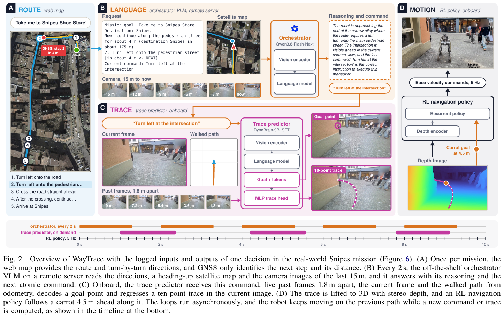
<figcaption>Figure 2: A map supplies the route, a remote orchestrator selects atomic language instructions, an onboard trace predictor outputs an image-space path, and an RL policy follows the depth-lifted 3D path. The three loops run asynchronously.</figcaption>

**Framework.** Route/instruction orchestration determines what to do next and when to switch. A language-conditioned trace predictor draws the instruction's path in the current image. An RL policy tracks it using the latest depth and avoids obstacles. Language interfaces between high and low levels, while the 2D image trace connects visual understanding to embodied control.

**① Route and orchestrator: maps select the action; cameras determine its timing.** Inputs include the destination, nearby route instructions and distances, a roughly 50 m-wide heading-up satellite view, current and past camera observations over 15 m, and the current instruction. Real deployment resolves destinations with Google Places API, obtains walking routes with Google Routes API, then replans over OpenStreetMap's pedestrian network to include sidewalks and annotated crossings. Simulation uses preconstructed directions matching the style of web maps.

An unfine-tuned Qwen3.8-Flash-Next receives a request every 2 s and outputs a reason plus an atomic instruction such as “turn left at the intersection” or “cross the road.” Atomic instructions specify locally groundable actions, not exact travel distances. GNSS projected onto the route identifies the current step and estimates distance; the local trace does not track that coordinate. Robot-side rules reject premature crossings, check arrival instructions, and expire outdated commands. Crossings progress through “turn onto the crosswalk → cross → leave the crosswalk and enter the next segment,” rather than retaining a directional turning command throughout.

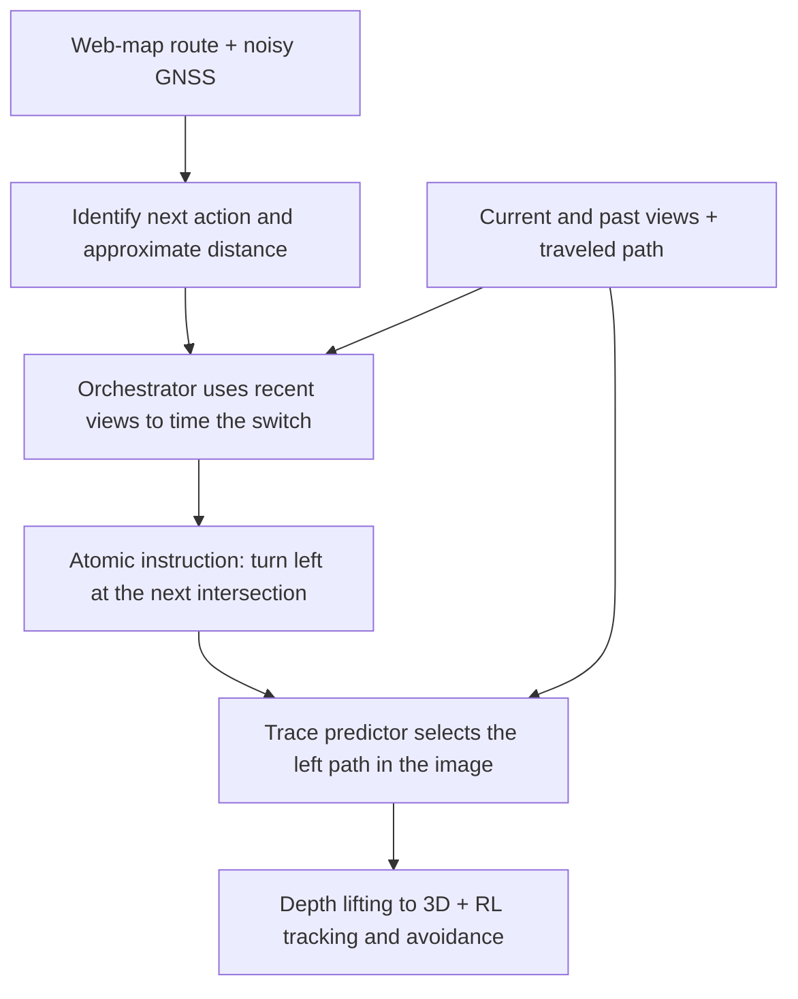

This reader-oriented diagram highlights the division of labor. Even if GNSS places the robot on the road beside the sidewalk, the low-level model can still draw a sidewalk path from the image if the route step remains correct. If localization error triggers an early turn, however, the wrong intersection may still be taken. The system reduces, rather than eliminates, localization dependence.

**② Trace predictor: choose the branch before filling in the path.** Inputs are the current RGB image, five historical images sampled every 1.8 m, an odometry-based bird's-eye view of the traveled path, and the current instruction. History covers about 9 m and indicates how much of a turn has already been completed, preventing repeated left turns every time the instruction is reread.

Initialized from RynnBrain-9B, the model encodes images and language, predicts an endpoint in normalized image coordinates, then predicts 10 2D path points ending there. The endpoint is where the instruction-conditioned path leaves the view or becomes fully occluded, not necessarily the final task destination:

$$
p_\theta(\tau\mid x,c)=p_\theta(g\mid x,c)\,p_\theta(\tau\mid g,x,c).
$$

Here $x$ is visual and travel history, $c$ the instruction, $g$ the endpoint, and $\tau$ the trace. Selecting an endpoint first constrains branch choice and reduces averaging between diverging paths.

> **Illustrative example, not an experimental result:** Suppose the left and right branches end at $(0.2,0.2)$ and $(0.8,0.2)$, with a divider between them. A model averaging both routes might aim at $(0.5,0.2)$. Choosing the left endpoint from “take the left fork” before connecting the path separates branch selection from path construction.

**③ From two-stage training to single-call deployment.** The two-stage version receives one epoch of LoRA supervised fine-tuning on about 1.19 million samples. Autoregressive cross-entropy trains the endpoint and trace, with the reference endpoint provided during trace training. To reduce onboard latency, the deployment version autoregressively generates only about 15 endpoint tokens. A LayerNorm, two linear layers, and GELU read the hidden state at the endpoint's end and regress 20 numbers—10 2D points—with sigmoid normalization. This avoids decoding roughly 140 trace tokens individually.

Its training objective is:

$$
\mathcal L=\frac{1}{N}\sum_{i=1}^{N}\lVert\hat u_i-u_i\rVert_1
+2\lVert\hat u_N-g\rVert_1
+0.5\mathcal L_{\mathrm{CE}},\qquad N=10.
$$

The terms supervise all path points, strengthen terminal-point consistency, and supervise endpoint tokens. The appendix specifies 250,000 samples drawn proportionally from the full dataset. For 30% of samples, the regression head trains on model-predicted endpoints with endpoint cross-entropy masked, making it tolerant of imperfect endpoints. The final temporal trace model uses supervised fine-tuning; the single-image teacher uses supervised fine-tuning and GRPO. These recipes should not be conflated.

**④ Automatic annotation: learn both the traveled route and alternatives in the same view.**

  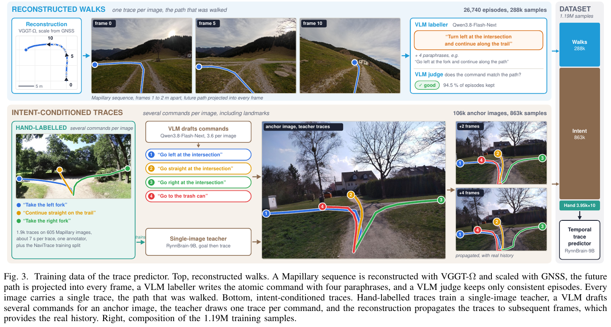
<figcaption>Figure 3: The upper branch reconstructs traces from actual walks and annotates instructions. The lower branch trains a teacher from limited manual labels, generates different traces for different instructions in one image, and propagates them to later frames with real history.</figcaption>

Intent-conditioned traces give different paths for different commands in the same image. Projecting only the pedestrian's future motion back into the image normally provides one path per view, allowing the model to guess from scenery and ignore the instruction.

| Dimension | Reconstructed walking data only | With intent-conditioned traces |
|---|---|---|
| Supervision for one image | Only the pedestrian's actual path | Different instructions and paths for visible branches and selected landmarks |
| Learning signal | Scene appearance is tied to the observed route | Instructions must disambiguate routes within the same scene |

**Actual-walk branch.** The raw pool contains 51,907 Mapillary sequences from 182 cities and regions. VGGT-Ω recovers camera poses and geometry from short sequences; GNSS trajectory length sets scale. Future ground positions beneath the camera are projected into the current image. A VLM generates a trace description plus four rewrites, and another VLM check retains consistent instruction–trace pairs. This yields 26,740 clips and approximately 288,000 samples.

**Intent-conditioned branch.** A single-image teacher is trained using the NaviTrace training split plus about 1,900 manually drawn traces on 605 Mapillary images. Anchor views are sampled at intersections, crossings, and paths. A VLM generates instructions for visible branches and uniquely identifiable landmarks; the teacher draws a trace for each. 3D reconstruction propagates these traces to subsequent frames, adding genuine history to single-image labels. About 106,000 anchor images yield 863,000 samples.

Together with manual and NaviTrace base samples, the final dataset contains **1,190,594 samples**, including 3,950 base samples repeated ten times during training. Test sequences are excluded from every training source. Scale comes from reconstruction, teacher annotation, and propagation, not an equally large collection of robot demonstrations.

**⑤ 3D lifting and RL execution: traces guide motion; fresh depth handles the body and obstacles.** Given the 2D trace, depth, odometry, and robot velocity, the system lifts points to 3D and anchors them in odometry coordinates. It retains the prefix lying on observed traversable ground and supplies a tracking target 4.5 m ahead along the path to an RL navigation policy. This policy learns depth-based local point-goal navigation and avoidance in simulation, updating velocity commands at 5 Hz; real deployment uses a retrained version.

One orchestrator call takes about 1.3 s and onboard trace prediction about 1.5 s. The controller follows the previous path while waiting. A new trace is requested after a new instruction, 3 m of travel, completion of 40% of the current path, or more than 5 s since the previous request. Once the final arrival instruction is active, the robot stops within 1.5 m of the trace goal. Thus map/history select an instruction, vision generates a trace, depth/odometry update the local target, and RL executes continuously—not by waiting for an entire model pipeline before each movement.

---

### 3. Results and findings
{: id="3-核心结果发现"}

**Long-range closed loop.** In Isaac Sim 5.0, the authors reconstruct about 0.91 km² of Zurich's old town, with ten routes spanning 152–864 m and three seeds per condition, totaling 30 trials. Success requires stopping within 5 m of the destination and keeping at least half of each crossing's in-road path in the crosswalk. SR therefore includes a crossing-compliance condition.

| Method | SR with perfect GNSS | SR with 7 m RMS drift |
|---|---:|---:|
| CityWalker + this paper's RL controller | 36.7% | 23.3% |
| VAMOS + this paper's RL controller | 63.3% | 10.0% |
| WayTrace | **83.3%** | **63.3%** |

With their originally released controllers, CityWalker, VAMOS, and OmniVLA achieve 20.0%, 13.3%, and 0%. Even with individually tuned oracle instructions, TIC-VLA, Foresight, and VENTURA reach only 6.7%, 3.3%, and 6.7%. Replacing WayTrace's high level with an oracle while keeping trace prediction and RL unchanged raises SR to 90.0%, implicating both high-level decisions and local execution in remaining failures.

  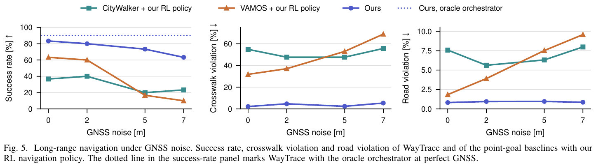
<figcaption>Figure 5: With the same RL controller, WayTrace degrades more gradually under GNSS drift. Crosswalk violation rates stay below 6% and the fraction of travel on the road below 1% across noise conditions, though instruction-switch errors still affect success.</figcaption>

**Local traces and ablations.** On manually annotated Human-Test—332 images, 953 traces—WayTrace obtains a NaviTrace score of 83.2 versus a best baseline of 57.0, and 97.9% turn-side accuracy. NaviTrace combines path matching, endpoint error, and semantic-ground penalties; it is not task SR. On 50 single-instruction episodes with three seeds each, history raises closed-loop SR from 74.7% to 94.7% and reduces repeated turns after completing a turn from 56.0% to 9.3%. Adding 863,000 intent-conditioned samples raises the data-ablation NaviTrace score from 79.33 to 83.32. Open-loop tables mainly use the two-stage model; closed-loop tests use the single-call version, which also scores about 83.2 on Human-Test.

**Real robot.** A Unitree B2W uses a ZED X depth camera and LiDAR-inertial odometry fused with GNSS. Trace prediction runs on Jetson AGX Thor, the RL controller on Jetson AGX Orin, and the high-level model remotely on four H100s.

| Real-world task | Planned route length | Mean speed | Human instruction interventions counted by the authors |
|---|---:|---:|---:|
| Starbucks | 426 m | 1.12 m/s | 0 |
| Snipes | 248 m | 1.01 m/s | 0 |
| Dieci | 312 m | 1.11 m/s | 0 |
| Mendokoro | 1,368 m | 1.19 m/s | 2 |

Both interventions on the longest route replaced a persistent turning instruction with a straight-ahead instruction, without teleoperation. The authors report 97.2% of distance traveled without intervention. On Starbucks, an operator also briefly stopped the robot to check an approaching tram; because no instruction or trace changed, the authors did not count this as an intervention. That route also included entering the road early and subsequently joining the crosswalk. “0” therefore does not mean no traffic supervision or strict compliance throughout.

  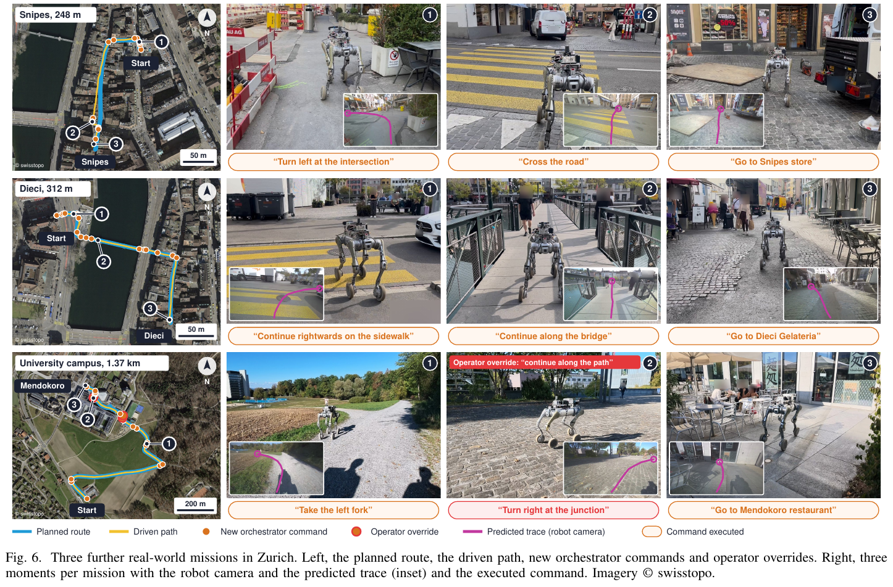
<figcaption>Figure 6: Snipes, Dieci, and the 1.37 km Mendokoro deployments span crowded streets, bridges, and campus routes. Two human language-instruction replacements are marked on the longest task.</figcaption>

**Language-interface extensions.** Simulation demonstrates rerouting after a closure or missed turn and a 127 m route specified by six human landmark directions. The latter uses neither maps nor GNSS, but adds odometry rules and a 0.6 m/s speed limit; it does not establish GNSS independence for the whole long-range system. Replay of 957 logged decisions yields a 5.1% critical-error rate for the default high-level model and 3.2% for a stronger model at three to five times the latency. These are replay decisions, not full closed-loop task results with the stronger model.

---

### 4. Limitations
{: id="4-局限性"}

The high level still depends on remote connectivity, GNSS-based progress, and heuristics, and may issue premature, late, or repeated actions. Roughly 3 s of serial semantic latency, limited forward view, and short history affect narrow intersections and extended maneuvers; red-light stopping and approaching-tram reactions remain unsupported. Evaluation covers one static simulated city without traffic or pedestrians and four real demonstrations without comparative baselines. Success even permits roughly half of an individual crossing's in-road path to fall outside the crosswalk, so the results do not establish general urban traffic safety or unsupervised kilometer-scale deployment.

---

## 2. CausalNav (2026)
{: id="causalnav"}
———First Scene Graph-based Semantic Navigation for Dynamic Outdoor Environments

📄 **Paper**: [arXiv:2601.01872](https://arxiv.org/abs/2601.01872) · 🏛️ **IEEE RA-L**

### Key takeaways
{: id="causalnav-精华-12"}

CausalNav combines a multilevel scene graph, the Embodied Graph, with RAG for long-range semantic navigation supporting open-vocabulary queries—a useful “graph as knowledge base” design. Its hierarchy, from fine-grained objects to buildings and clusters, unifies semantic representation and retrieval across spatial scales. Spatial-Temporal Corridor filtering distinguishes static, quasi-static, and dynamic obstacles without additional annotations. A local open-source LLM replaces commercial APIs for hierarchical retrieval, enabling semantic reasoning without cloud dependence.

---

### 1. Background and problem
{: id="1-研究背景问题-11"}

Large-scale outdoor semantic navigation faces open-vocabulary understanding, adaptation to moving pedestrians and vehicles, and long-term stability. Existing VLN research largely targets static indoor scenes and relies on accurate maps or large training sets; robust long-range execution in real outdoor dynamics remains insufficiently validated.

---

### 2. Method and innovations
{: id="2-主要方法创新点-9"}

  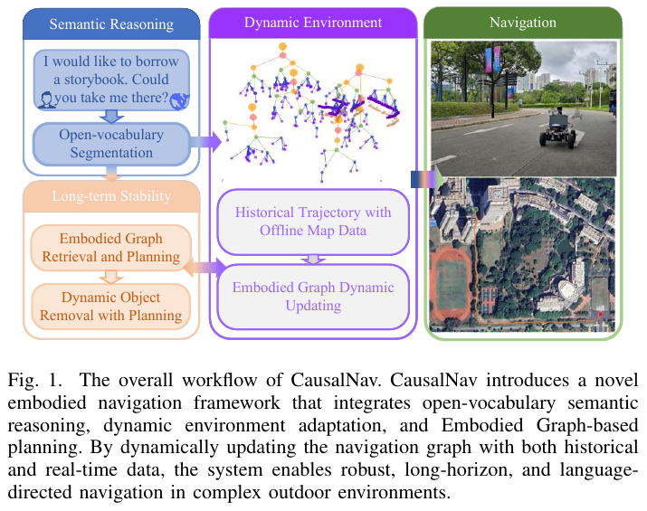
<figcaption>CausalNav integrates semantic reasoning, adaptation to dynamic environments, and Embodied Graph planning.</figcaption>

The framework comprises three modules.

**Module 1: Open-vocabulary target tracking and ego-motion estimation.** YOLO-World extracts open-vocabulary 2D boxes and segmentation masks from RGB, and ByteTrack performs multi-object tracking. LiDAR associates detections with 3D space to recover object poses $$^w\mathbf{T}_{obj}$$. FAST-LIO2 LiDAR–IMU odometry estimates ego-motion for localization and coordinate transformations.

**Module 2: Dynamic-object filtering and Embodied Graph construction.**

  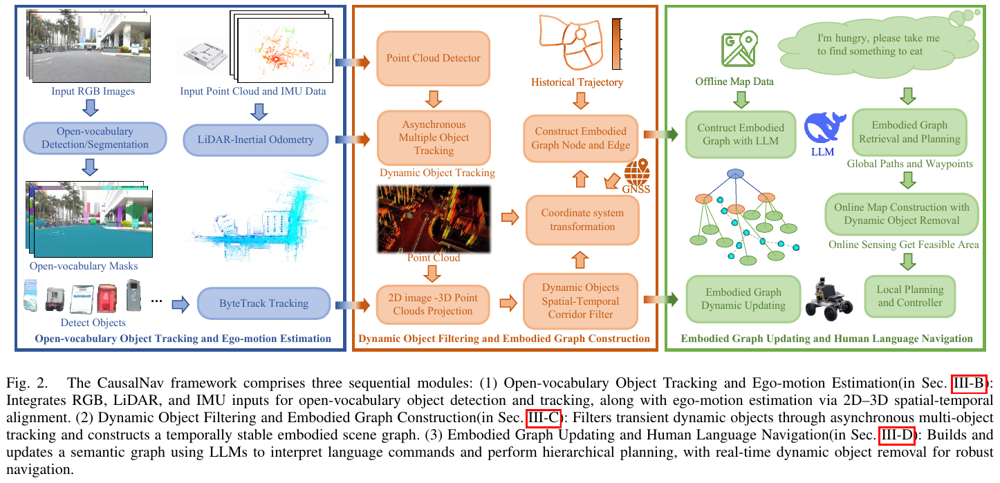
<figcaption>Tracking and ego-motion estimation → dynamic filtering and graph construction → graph updates and natural-language navigation.</figcaption>

- **Spatial-temporal corridor filtering:** Each object's history becomes a corridor $$\mathcal{T} = \{^w\mathbf{T}^n_{obj}, \text{3DBBox}_i, t_i\}_{i=1}^n$$. Displacement exceeding a threshold within $k$ steps identifies a dynamic object, which is removed to prevent motion-induced false graph nodes.
- **Hierarchical Embodied Graph:** Building nodes $\nu_i^{build}$ come from offline maps and object nodes $\nu_i^{obj}$ from live perception. LLM-guided spatial-semantic clustering forms object (Level $L-1$), building/place (Level $L$), and clustering-node abstractions. Every ego-motion interval exceeding distance $d$ adds a robot node $\nu_i^l$ to record the traveled route.
- **RAG semantic retrieval:** Hierarchical LLM scoring combines spatial similarity $\kappa^{spatial}$ with semantic similarity $\kappa^{semantic}$ to select the best-matching node path, level by level, for open-vocabulary localization.

**Module 3: Dynamic graph updates and natural-language navigation.**

  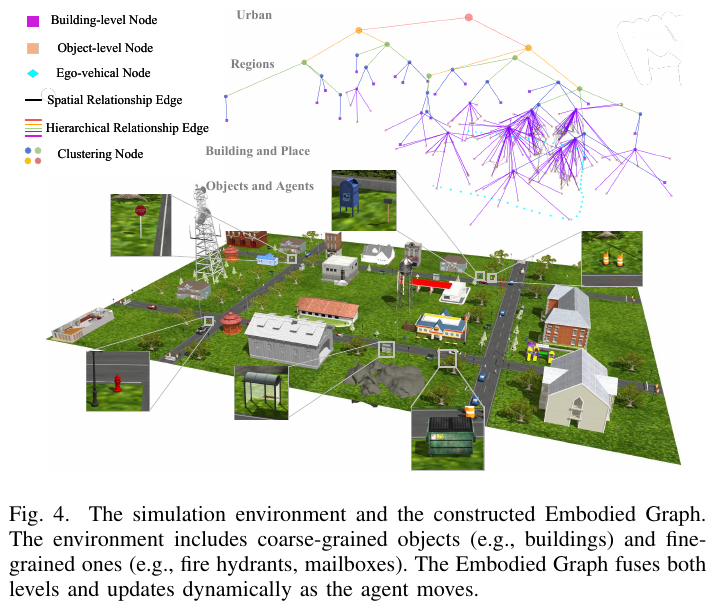
<figcaption>The simulated Embodied Graph combines coarse building nodes with fine-grained objects such as hydrants and mailboxes.</figcaption>

- **Global planning:** Parse instructions, retrieve the Embodied Graph with RAG to infer the goal, and prioritize Dijkstra shortest paths over historical routes. If unreachable, offline maps or Google Maps provide coarse routes as waypoints $\mathcal{W} = \{w_1, w_2, \ldots, w_n\}$.
- **Local planning:** RH-Map builds a dynamic local map, Informed-RRT* initializes a trajectory, and NMPC-CBF—Nonlinear Model Predictive Control with Control Barrier Function—tracks it while avoiding moving pedestrians and vehicles.

---

### 3. Results and findings
{: id="3-核心结果发现-10"}

  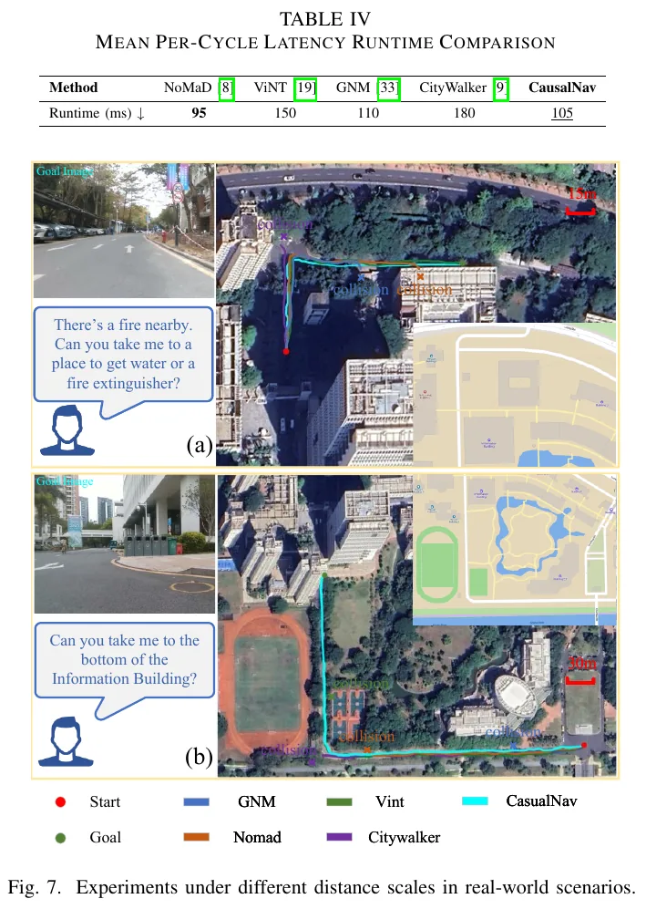
<figcaption>Real-world navigation at two scales: a 130 m object-level instruction and a 512 m building-level instruction.</figcaption>

**Simulation, compared with ViNT, NoMaD, GNM, and CityWalker:**
- Small tasks: SR 100%, SPL 88.9%, CC 0.2, best among compared methods.
- Medium tasks: SR 92%, SPL 82.2%.
- Large tasks: SR 80%, SPL 66.0%, CC 1.2, TL 141.82 m.

**Real world:**
- At 130 m, ViNT and CausalNav succeed; the others fail.
- At 512 m, only CausalNav succeeds; the others fail through collisions.
- CityWalker degrades substantially from simulation and is sensitive to lighting changes and dynamic obstacles.

**Ablations:**
- Dynamic graph updates raise SR from 78% to 90% and SPL from 54.7% to 80.1%.
- Best hyperparameters: $\alpha=\beta=0.5$, $\gamma=1.5$, balancing space and semantics.
- Runtime: 105 ms/cycle, approximately 10 Hz, with only 11% more overhead than NoMaD.

---

### 4. Limitations
{: id="4-局限性-10"}

Robustness under extreme lighting and weather needs improvement. Long-term graph compression and forgetting are not yet mature, risking graph growth and retrieval degradation over very long operation.

## 3. DA-Nav (2026)
{: id="da-nav"}
———Grounding map directions in image grids and learning recovery from deliberately induced drift

📄 **Paper**: [arXiv:2607.11638v2](https://arxiv.org/abs/2607.11638v2)

### Key takeaways
{: id="da-nav-takeaways"}

1. Urban navigation need not make a large model regress 3D coordinates directly. Selecting image-grid locations before geometric projection and control separates visual decisions from physical execution.
2. Learning correct demonstrations does not imply recovery ability. ReDA deliberately induces drift and retains recovery episodes, exposing the policy to states outside ideal trajectories.
3. “Drift? → normal or corrective action → six grid points” is a supervised decision decomposition, not a separate general model performing unconstrained reasoning.
4. Drift frequency and recovery success must be distinguished: a policy that rarely drifts but fails whenever it does may be less reliable than one that recovers effectively.
5. Transfer to quadruped and humanoid platforms is demonstrated, but real closed-loop SR is 46.7%; a kilometer-scale showcase cannot replace multi-route statistics or unsupervised-safety evidence.

---

### 1. Background and problem
{: id="da-nav-background"}

Commercial maps offer sparse human-oriented directions, not local robot trajectories. Direct continuous 3D waypoint regression by a VLM can mismatch spatial reasoning and action representation. Small long-range errors also place robots outside expert demonstrations, where policies trained only on perfect trajectories may not know how to recover. DA-Nav changes both representation and data: discrete image grids describe paths, and drift-recovery samples teach correction.

---

### 2. Method and innovations
{: id="da-nav-method"}

  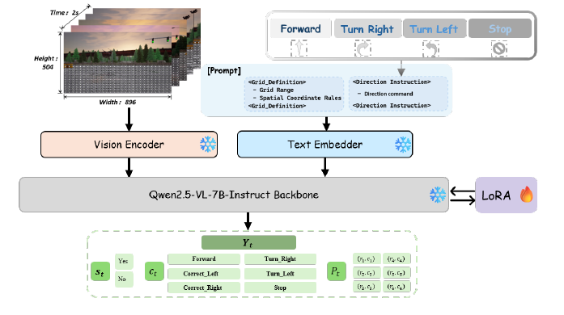
<figcaption>Original Figure 2: Visual history and directional instructions enter Qwen2.5-VL-7B, which outputs drift status, an action, and an image-grid trajectory. The vision encoder and base weights are frozen; LoRA adapts the model.</figcaption>

**Framework.** A direction interface, structured VLM policy, image-to-body geometric projection, and farthest-point controller work together. ReDA supplies normal and recovery supervision. Commercial maps guide globally; the model selects where to go in the image; geometry converts that to a local physical target; the controller outputs linear and angular velocities.

**① Input interface: discrete directions, not the full map.** Each step receives five egocentric RGB frames—the current one plus four previous frames—and one of `FORWARD / TURN LEFT / TURN RIGHT / STOP`. A phone asynchronously parses commercial directions such as “turn left in 30 meters” into this discrete instruction. The paper does not fully specify distance-to-command switching thresholds; the policy should not be described as directly reading maps, GNSS coordinates, or full-route text.

**② Image grid: select pixels before geometric grounding.** Valid rows are 13–23 and columns 0–28, excluding sky and distant background and retaining $11\times29=319$ candidate cells ahead. Six grid positions sampled at 2 Hz represent the next 3 s. These are image locations, not six forward/turn commands.

  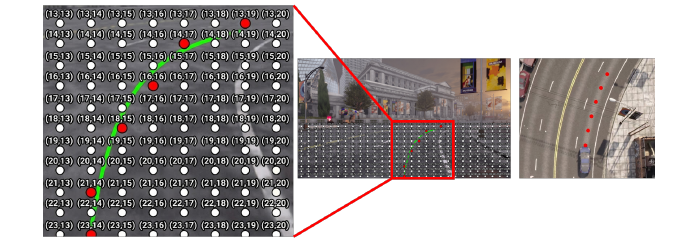
<figcaption>Original Figure 3: Predicted RGB grid locations become continuous targets in the robot's local body frame through geometric projection.</figcaption>

> **Interface example, not an actual prediction:** `(22,14) → (20,14) → (18,15) → …` selects successive image locations, not 22 meters forward and 14 meters sideways. A cell's ground distance changes with depth, so camera calibration and depth or a ground-plane assumption are needed for metric waypoints.

“Valid grid” only restricts output locations; it does not mean every cell has passed obstacle checks or is certified traversable.

**③ ReDA: induce drift, retain correct recovery.** CARLA provides 2,102 trajectories in 126 scenes, about **286,000 temporal samples**: 158,000 expert-navigation frames and 128,000 recovery frames. Collection has three states:

| State | Collection process | Used for training? |
|---|---|---|
| Stable | Track the expert route | Retain normal demonstrations |
| Drifting | Inject steering perturbations to leave the route | Discard unstable perturbed motion |
| Recovering | Activate recovery at lateral error 0.35 m; adapt lookahead to lateral error | Retain corrective demonstrations |

Directions are synthesized from turning and motion states. Drift labels come from the collection state machine; corrective actions depend on lateral-error direction. Future expert 3D waypoints are cubic-spline smoothed, camera-projected, and grid-discretized. This is neither unlabeled trial and error nor online DAgger: recovery examples are generated during simulation collection.

**④ Structured CoT: detect drift, select an action, output a trajectory.** Qwen2.5-VL-7B-Instruct encodes visual history, maps it through a lightweight adapter into language embeddings, and combines it with the direction. The prompt specifies the grid and output order:

- **State:** `Yes / No` for deviation from the reference route.
- **Action:** `FORWARD / TURN LEFT / TURN RIGHT / CORRECT LEFT / CORRECT RIGHT / STOP`.
- **Trajectory:** six image-grid points.

Correction differs from a route turn: a forward instruction may require a left correction first. The collection system supplies state labels in training; deployment predicts them from vision and language, without ground-truth lateral error as policy input.

> **Example:** The map says forward, but the robot has drifted right. An appropriate output is “Drift: Yes; Action: CORRECT LEFT; Trajectory: return gradually to the corridor ahead.” Forward-only labels without recovery examples can perpetuate the wrong heading; trajectories without intermediate state supervision may not reliably distinguish turning from correcting.

**Training objective.** Denote the state, action, and grid sequence by $Y_t$ and visual/instruction context by $C_t$:

$$
\pi_\theta(Y_t\mid C_t)=\prod_{j=1}^{\lvert Y_t\rvert}p_\theta(y_t^{(j)}\mid y_t^{(<j)},C_t).
$$

The standard next-token cross-entropy expands to:

$$
\mathcal L_{\mathrm{NTP}}=-\sum_t\sum_{j=1}^{\lvert Y_t\rvert}\log p_\theta(y_t^{(j)}\mid y_t^{(<j)},C_t).
$$

The latter merely expands the stated next-token objective; it is not an additional proposed loss. Attention modules use LoRA while the vision encoder and base LLM remain frozen. No separate collision loss, RL optimization, or output-segment weights are reported, nor detailed learning rates, LoRA rank, or training epochs.

**⑤ Projection: an RGB policy does not make the entire system depth-free.** Reliable depth is combined with intrinsics and local depth statistics to project targets into body coordinates. Otherwise the system falls back to inverse perspective mapping (IPM) under a flat-ground assumption. RGB policy input therefore does not eliminate depth or geometric assumptions throughout execution; sloped and uneven terrain require separate validation.

**⑥ Farthest-point control: follow the final predicted target, not every intermediate point.** To reduce autoregressive delay and jitter, the controller selects the last waypoint and computes a bounded angular velocity:

$$
\omega_z=\operatorname{clip}\!\left(k_{\mathrm{steer}}\operatorname{atan2}(y_{\mathrm{target}},x_{\mathrm{target}}),-\omega_{\max},\omega_{\max}\right).
$$

Clipping is equivalent to the original saturation operator. Linear speed is normal for small angular velocity and reduced above a threshold: sharper turns mean slower travel. This reduces short-term dense-tracking fluctuations, but does not guarantee collision-free traversal of the full predicted trace.

Execution is **phone direction + five RGB frames → drift/action → six image-grid points → depth/IPM projection → farthest-point tracking → linear/angular velocity**. Inference runs on a remote RTX 4090, not entirely onboard. Explicit end-to-end latency and closed-loop frequency are not reported.

---

### 3. Results and findings
{: id="da-nav-results"}

**① Full simulation: 59.00% mixes towns; 56.16% is the abstract's unseen-town result.** CARLA 0.9.15 uses Town 01–05 and 10HD for training/in-domain testing, and Town 06, 07, and 15 for zero-shot generalization, with dynamic vehicles, pedestrians, randomized weather, and lighting. Table II combines seen and unseen towns over **239 closed-loop trajectories**:

| Method | SR (%) ↑ | RC (%) ↑ | SPL ↑ | DF ↓ | CSR (%) ↑ |
|---|---:|---:|---:|---:|---:|
| CityWalker | 38.08 | 70.79 | 37.48 | 2.96 | 30.73 |
| ViNT | 51.88 | 74.44 | 51.33 | 1.25 | 23.54 |
| NaVid | 20.50 | 66.33 | 20.50 | 0.61 | 4.89 |
| NaVILA | 22.59 | 79.49 | 22.59 | 0.39 | 4.90 |
| Zero-shot Qwen2.5-VL | 11.30 | 43.21 | 11.30 | 3.42 | 42.76 |
| **DA-Nav** | **59.00** | **77.82** | **58.66** | **1.85** | **98.15** |

SPL retains the original scale. SR exceeds ViNT by **7.12 percentage points**, but RC is not the highest and DF not the lowest; overall strength does not mean leading every metric.

**Comparison conditions.** DA-Nav trains on CARLA ReDA; baselines use their public pretrained weights without environment-specific fine-tuning. ViNT receives a goal image 5 m ahead, CityWalker sparse waypoints, and NaVid/NaVILA common visual histories with low-level proportional control and visually recognized semantic stopping targets. Zero-shot Qwen2.5-VL replaces the policy within the same framework. These are interface-adapted system comparisons, not backbone comparisons with identical training and route priors.

  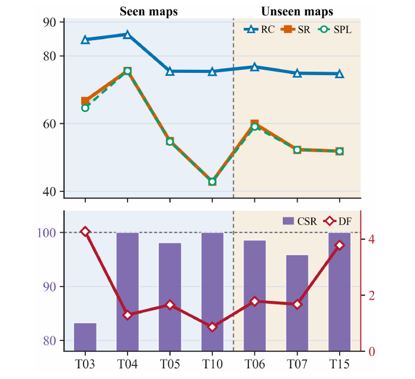
<figcaption>Original Figure 5: Per-town navigation and recovery results. The mixed set of 239 trajectories must not be presented as exclusively unseen-scene evaluation.</figcaption>

**② CSR is recovery success, not task success.** DF counts new drift events per 100 m: an event begins when lateral error first crosses the safe threshold, rather than counting every subsequent drifting frame. CSR is the fraction of those events returning below the threshold without collision. Its denominator is events, not tasks.

> **Metric example:** Over 1,000 m, 20 drifts and 18 collision-free recoveries give DF = 2/100 m and CSR = 90%. Wrong turns or failed stopping can still ruin the route; task SR cannot be inferred from CSR.

**③ Both recovery data and structured reasoning contribute.** On the same 239 trajectories:

| Variant | SR (%) ↑ | RC (%) ↑ | SPL ↑ | DF ↓ | CSR (%) ↑ |
|---|---:|---:|---:|---:|---:|
| Without recovery data | 29.71 | 62.01 | 29.68 | 1.31 | 15.46 |
| Without CoT reasoning prompt | 38.91 | 68.37 | 38.91 | 4.30 | 50.11 |
| Full DA-Nav | 59.00 | 77.82 | 58.66 | 1.85 | 98.15 |

Removing recovery data lowers DF but collapses CSR from 98.15% to 15.46%: fewer drifts do not imply better recovery. Direct spatial prediction without CoT reduces SR by 20.09 points. However, removing recovery samples also reduces dataset size; no equal-size replacement ablation isolates semantic content from data volume.

**④ Real deployment: single maneuvers, complete routes, and kilometer-scale demonstrations are distinct evidence.** A forward RealSense D455, phone navigation, and remote RTX 4090 support Unitree Go2 and Leju Kuavo-V without real-world fine-tuning.

- **Single-maneuver evaluation, called open-loop in the paper:** 36 intersections, 12 each for forward/left/right, one run each. DA-Nav scores 100%, 75%, and 75%, averaging **83.3%**, versus CityWalker 75% and ViNT 58.3%. This is not long-route SR.
- **Complete closed-loop evaluation:** Five urban and five park routes, each over 100 m with at least one turn, repeated three times: 30 trials per method, as in Table V.

| Method | Urban SR (15 trials) | Park SR (15 trials) | Overall SR (30 trials) | Overall RC |
|---|---:|---:|---:|---:|
| CityWalker | 20.0% | 26.7% | 23.3% | 53.3% |
| ViNT | 13.3% | 20.0% | 16.7% | 49.0% |
| DA-Nav | **40.0%** | **53.3%** | **46.7%** | **76.3%** |

  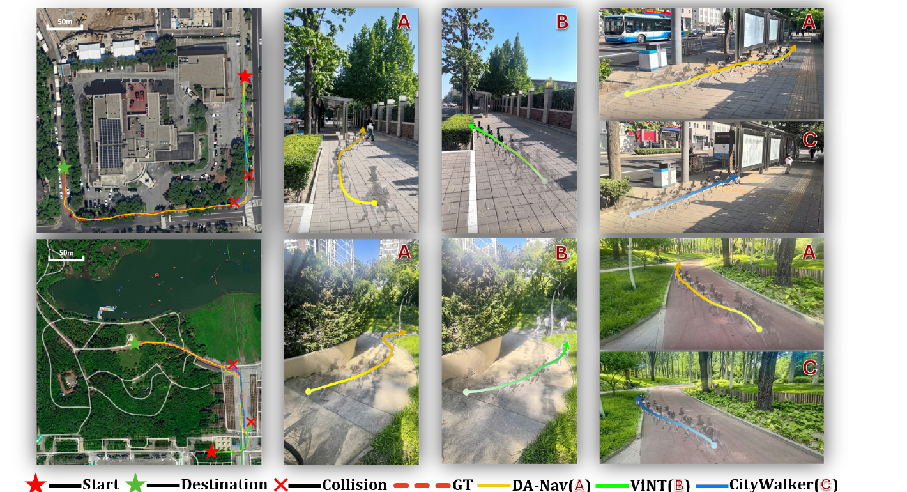
<figcaption>Original Figure 4: Closed-loop urban and park trajectories. Red crosses indicate collisions; quantitative SR comes from Table V's 30 trials.</figcaption>

- **Cross-platform long-range demonstration:** The same pretrained policy transfers to Leju Kuavo-V without embodiment-specific fine-tuning for an outdoor goal-navigation run exceeding **1.2 km**. Independent repeated-trial statistics and complete intervention logs are not provided, so this does not establish universally successful unsupervised kilometer-scale navigation.

  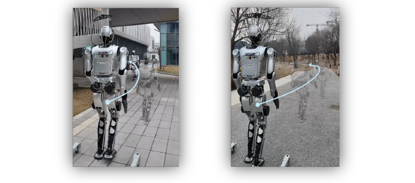
<figcaption>Original Figure 8: Zero-shot humanoid deployment with a reported route over 1.2 km. This demonstration is distinct from the 30-trial closed-loop evaluation.</figcaption>

---

### 4. Limitations
{: id="da-nav-limitations"}

Commercial maps, phone localization/direction updates, remote inference, and reliable depth or flat-ground projection remain necessary. Network latency, GNSS errors, and uneven terrain are not fully quantified. Only 30 long-route real trials are reported, with 46.7% overall SR, and success criteria/interventions on the kilometer-scale demonstration are insufficiently detailed. Evidence supports directional grounding and recovery, not general traffic safety or reliably unsupervised kilometer-scale operation.

## 4. CityWalker (2025)
{: id="citywalker"}
———Learning local urban navigation from web walking videos, rather than asking a large model to drive

📄 **Paper**: [arXiv:2411.17820v3](https://arxiv.org/abs/2411.17820v3) · [Project Page](https://ai4ce.github.io/CityWalker/)

### Key takeaways
{: id="citywalker-takeaways"}

1. Web videos lack robot action labels, but short-window visual odometry supplies local motion pseudo-labels. Global drift does not invalidate all short-range supervision.
2. Step normalization lets humans, vehicles, and robots share directional patterns; deployment must still restore the target robot's scale.
3. CityWalker is a position-goal-conditioned policy, not a native language-following model. It focuses on execution between map waypoints.
4. Offline trajectory error, arrival-classification accuracy, and real navigation SR are different metrics; none determines the others.

---

### 1. Background and problem
{: id="citywalker-background"}

Maps specify where the next segment should end but do not handle pedestrians, intersections, or detours for the robot. Urban teleoperation data are expensive, and simulation cannot fully reproduce traffic and social rules. CityWalker learns local navigation from large-scale web walking videos, then adapts with limited robot data.

---

### 2. Method and innovations
{: id="citywalker-method"}

  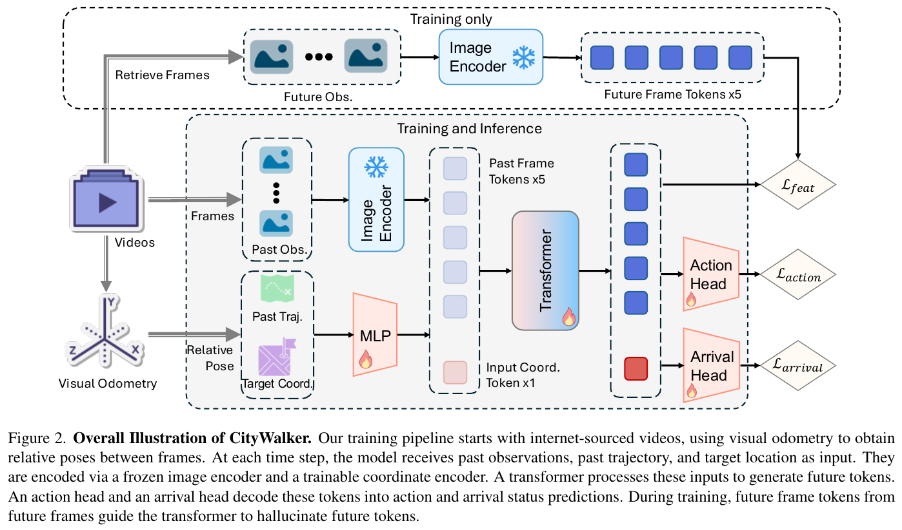
<figcaption>Original Figure 2: Visual odometry supplies motion supervision. Historical images and position goals enter a Transformer; action and arrival heads predict local decisions. Future visual features provide auxiliary supervision only during training.</figcaption>

**Framework.** The data pipeline combines videos, visual odometry, and step normalization. The policy combines frozen DINOv2, a coordinate encoder, a Transformer, and action/arrival heads. External navigation supplies deployment waypoints; a PD controller turns predicted local motion into velocity commands.

**① Local supervision from video.** DPVO estimates camera poses. Short-window relative motion replaces full-video absolute positions to reduce accumulated drift. A typical configuration uses five historical and five future steps. Walking videos exceed 2,000 hours; the paper also studies mixing walking and driving videos.

**② Scale and embodiment differences.** Monocular odometry has scale ambiguity, so actions are normalized by average trajectory step length and denormalized using the robot's step size at deployment. This is an action-scale interface, not proof that every robot can execute the same physical trajectory directly.

> **Normalization example:** A human step of 0.6 m and a robot step of 0.3 m can both represent one normalized forward unit. The model learns direction and relative movement; physical distance still depends on robot scale.

**③ Inputs and outputs.** Frozen DINOv2 encodes historical RGB into visual tokens. Historical and goal positions are concatenated and MLP-encoded as coordinate tokens. A Transformer fuses both; the action head predicts future local waypoints and the arrival head detects subgoal completion. It neither reads natural language directly nor replaces global routing.

**④ Predict future features during training.** Features of actual future images supervise Transformer outputs, encouraging representations of upcoming scenes. Future images are unavailable at inference. The four-term objective is:

$$
L=w_1 L_{\mathrm{pos}}+w_2 L_{\mathrm{ori}}+w_3 L_{\mathrm{arr}}+w_4 L_{\mathrm{feat}}.
$$

The terms are waypoint L1, negative-cosine orientation loss, binary arrival cross-entropy, and future-feature MSE, weighted to comparable magnitudes. This is imitation learning with auxiliary supervision, not online RL or action search through generated videos.

**⑤ Robot adaptation.** A Unitree Go1 uses RGB and phone localization; LiDAR-SLAM supplies robot trajectory labels during collection. Fifteen teleoperation hours split into six for fine-tuning and nine for offline testing. Label-collection sensors, localization sensors, and policy inputs must be distinguished rather than described collectively as “vision only, without localization.”

---

### 3. Results and findings
{: id="citywalker-results"}

**Real deployment, original Table 2 (%).** Unseen urban goals typically lie 50–100 m from the start, with 8–14 trials per forward/left/right category. Success requires predicting arrival within 5 m of the goal. Human takeover for possible collision or timeout counts as failure.

| Method | Overall SR | Forward | Left | Right |
|---|---:|---:|---:|---:|
| ViNT zero-shot | 37.7 | 62.5 | 0.0 | 50.0 |
| ViNT fine-tuned | 57.1 | 100.0 | 25.0 | 25.0 |
| NoMaD zero-shot | 42.9 | 75.0 | 16.7 | 28.6 |
| CityWalker fine-tuned | 77.3 | 100.0 | 62.5 | 66.7 |

The 77.3% belongs to this original protocol, not DA-Nav's or WayTrace's adapted CityWalker tests. Goal interfaces, training data, and fine-tuning conditions also differ among baselines here.

**Offline metrics are not task SR.** In Table 1, fine-tuned CityWalker has scene-averaged MAOE 15.2° and arrival accuracy 81.8%; sample-wise averages are 11.5° and 87.8%. MAOE takes the maximum future orientation error per sample before averaging. Scene averaging prevents many easy straight segments from masking difficult intersections. Its all-sample L2 is 1.07 m, not better than every baseline, so it does not lead every metric.

  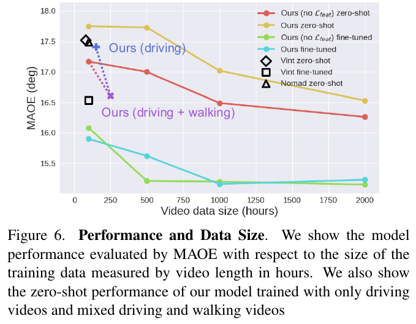
<figcaption>Original Figure 6: More web video generally reduces orientation error, with walking/driving and fine-tuning comparisons. The vertical metric is offline MAOE, not closed-loop SR.</figcaption>

Scaling experiments support broader training coverage. The orientation-loss and future-feature gains in Table 3 are small and explicitly within the error range of limited test data. Future-feature supervision can even hurt zero-shot transfer, while fine-tuning gains are clearer; the auxiliary objective should not be presented as a conclusively large independent improvement.

---

### 4. Limitations
{: id="citywalker-limitations"}

External position goals, localization, and scale adaptation remain required. Human behavior in videos is not automatically compatible with robot traversability. Limited real trials and unequal baseline conditions prevent offline angular gains from establishing long-term traffic safety. The supplied PDF does not explicitly confirm conference acceptance, so only its paper version is cited.

## 5. UrbanNav (2026)
{: id="urbannav"}
———Filtering human videos for robot compatibility before grounding landmark language in local trajectories

📄 **Paper**: [arXiv:2512.09607v2](https://arxiv.org/abs/2512.09607v2) · [Code](https://github.com/CASIA-IVA-Lab/UrbanNav)

### Key takeaways
{: id="urbannav-takeaways"}

1. Walking videos are not inherently robot-compatible: head turns, pitch, and crowded movement conflate camera orientation with executable motion, making filtering a central design choice.
2. The VLM mainly annotates landmarks and instructions offline. The online policy uses CLIP, DINOv2, and a Transformer, not free-form large-model reasoning at every step.
3. Landmark-conditioned local navigation differs from long-range search for unseen targets; occlusion or absence from the initial view substantially reduces performance.
4. Web pretraining is followed by limited real-data fine-tuning, so the results are not fully zero-shot deployment.

---

### 1. Background and problem
{: id="urbannav-background"}

Urban users naturally request “go in front of the glass building on the right,” rather than provide exact coordinates or goal images. UrbanNav associates language, landmarks, and trajectories in web walking videos and filters clips unsuitable for a robot with a fixed forward-facing camera, reducing collection costs.

---

### 2. Method and innovations
{: id="urbannav-method"}

  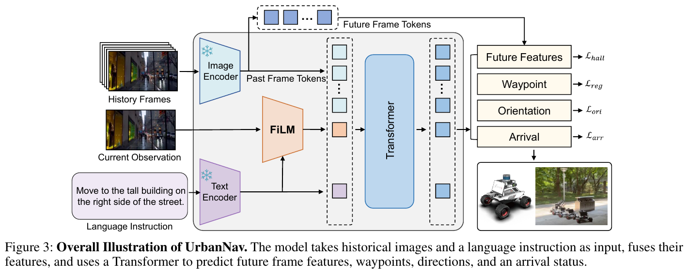
<figcaption>Original Figure 3: Language modulates current visual features; historical vision and instructions enter a Transformer to predict future waypoints, orientation, arrival, and auxiliary future features.</figcaption>

**Framework.** Offline processing estimates trajectories, filters robot-incompatible clips, and labels landmark language. The online policy converts instructions and visual history into eight future local waypoints and an arrival prediction.

**① Trajectory estimation and filtering.** Two-minute clips are processed with DPVO for relative poses. The paper reports 106,603 posed trajectories, 3,553 hours, before filtering and 47,008 trajectories, 1,566 hours, afterward; these are not interchangeable dataset sizes.

Filters remove pitch changes above 15°, motion/view-direction differences above 60°, and crowds exceeding five people per frame for more than three frames. The crowd criterion is a robot-compatibility heuristic, not proof that every crowded scene is impassable, and it narrows training coverage.

  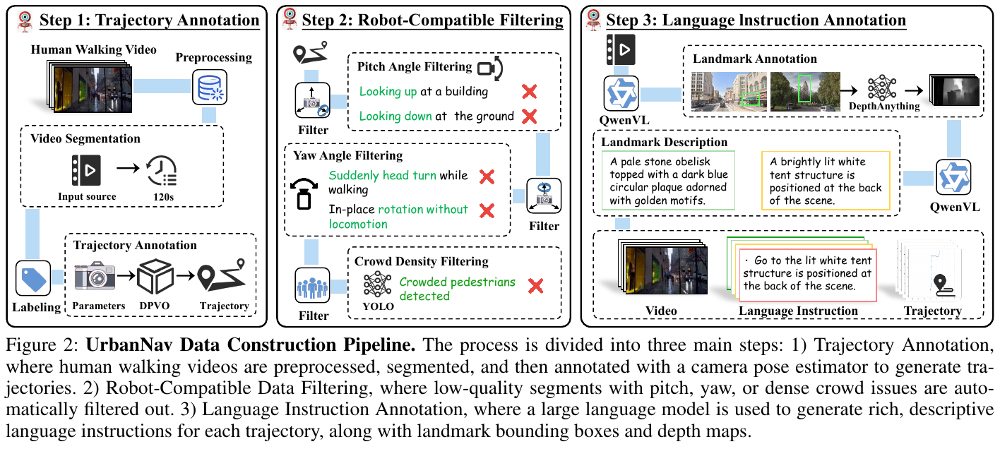
<figcaption>Original Figure 2: Pose estimation, camera-orientation/crowd filtering, and landmark/language annotation. The annotation model is distinct from the deployed policy.</figcaption>

**② Groundable landmark instructions.** Qwen2.5-VL-72B finds stable, recognizable landmarks near the route, outputs boxes and names, then generates descriptive instructions. Pedestrians and vehicles are excluded as unstable targets. Low-confidence and ambiguous annotations receive human review, so the pipeline is not entirely human-free. It yields about three million annotations, averaging 65 landmarks per trajectory and 17 words per description.

**③ How language affects vision.** Frozen CLIP encodes instructions and frozen DINOv2 encodes current/historical frames. FiLM modulates current visual features with language, before combining them with historical vision and language tokens in a Transformer.

> **Mechanism example:** A view contains a tower and a pavilion. “Go to the white tower” versus “go under the pavilion” changes feature weighting and thus the predicted path, rather than merely replacing map coordinates. FiLM modulates features; it does not explicitly generate an interpretable detection box.

**④ Supervision and goal sampling.** Each sample selects a trajectory landmark and a starting point 10–60 frames before the target time, with additional near-goal arrival samples. The history-context parameter and prediction horizon are each eight steps. Because the paper's indexing and “history plus current frame” can be confused, this is not expanded into an unverified fixed total input-frame count.

The objective is:

$$
L=\lambda_1 L_{\mathrm{reg}}+\lambda_2 L_{\mathrm{ori}}+\lambda_3 L_{\mathrm{arr}}+\lambda_4 L_{\mathrm{hall}}.
$$

These terms supervise waypoint L2, negative-cosine orientation, binary arrival cross-entropy, and future-feature L1. Actual future observations are training targets, not inference inputs. Figure 1 specifies about two hours of real expert data for fine-tuning; this is not a web-video-only zero-shot robot policy.

---

### 3. Results and findings
{: id="urbannav-results"}

**Unseen-environment offline evaluation, Table 1.** UrbanNav achieves AOE 9.22°, MAOE 14.99°, ADE 0.88 m, MADE 1.67 m, compared with LeLaN's 10.36°, 16.49°, 0.98 m, and 1.84 m. The paper describes MADE as discrete Fréchet distance; the acronym should not be reinterpreted as ordinary maximum pointwise Euclidean error.

**Real-world evaluation, Table 2 (%).** Success means reaching the specified landmark without collision. These routes are not pooled with other papers.

| Method | Overall SR | Day | Night |
|---|---:|---:|---:|
| UrbanNav, real data only | 33.4 | 41.7 | 25.0 |
| NoMaD + CLIP | 29.2 | 33.4 | 25.0 |
| ViNT + CLIP | 45.8 | 50.0 | 41.7 |
| LeLaN | 62.5 | 75.0 | 58.3 |
| UrbanNav, web pretraining + fine-tuning | 83.3 | 91.7 | 75.0 |

**Comparison conditions.** NoMaD and ViNT receive added CLIP language inputs/fusion layers, and LeLaN's velocity head is replaced by waypoint regression. These are adapted baselines, not unchanged public models. LeLaN's overall and subgroup values should not be recomputed without known sample weights; the original values are retained, noting insufficient trial details.

  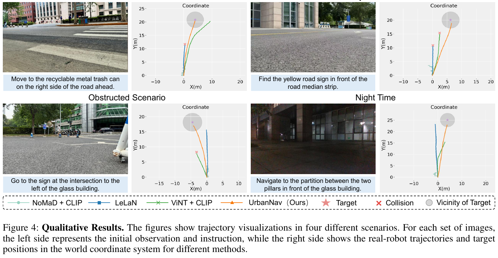
<figcaption>Original Figure 4: Trajectories under normal, noisy-language, occluded, and night conditions. Qualitative examples and quantitative tables are separate evidence; a few successes do not imply general reliability.</figcaption>

Table 3 reports SR of 100%, 87.5%, and 62.5% for normal, noisy-language, and occluded-target settings. The authors position this as local navigation, not long-term exploration—more precisely than claiming arbitrary urban language-task support. Table 4's unseen-environment ablations and scaling support FiLM, future features, and web pretraining, but do not completely isolate every design under identical training budgets.

---

### 4. Limitations
{: id="urbannav-limitations"}

Long-term search for targets absent from the initial view remains difficult. Removing crowded and unusual-view clips may create deployment blind spots. The PDF does not adequately specify trial totals, route lengths, control rates, or intervention rules; trial counts cannot be reverse-engineered from SR. No explicit acceptance venue appears in the PDF, so none is added.

## 6. MOSU2 (2026)
{: id="mosu2"}
———Filter physically traversable trajectories first, then investigate traffic and social context as needed

📄 **Paper**: [arXiv:2611.11148v1](https://arxiv.org/abs/2611.11148v1) · [Predecessor MOSU](https://arxiv.org/abs/2507.04686v1) · [Project Page](https://jinggm.github.io/mosu2/)

### Key takeaways
{: id="mosu2-takeaways"}

1. “Traversable” and “appropriate to traverse now” are separate judgments: a flat road may have a red light, and avoiding pedestrians does not imply understanding a stop gesture.
2. Giving a VLM access to measured geometry and motion makes reasoning more verifiable than asking it to guess distance and speed from one image.
3. Conditional deeper reasoning has a cost: the second stage reduces wrong actions but raises mean decision latency to about 2.2 times the predecessor's.
4. Recognizing construction does not establish which side to pass; scene-recognition accuracy and task SR must remain separate.

---

### 1. Background and problem
{: id="mosu2-background"}

Outdoor robots must follow public-map routes while deciding whether vehicles yield, gestures require stopping, or construction restricts passage. MOSU scored trajectories from one RGB frame without reliable motion evidence. MOSU2 adds a queryable local map and conditionally triggered second-stage reasoning.

---

### 2. Method and innovations
{: id="mosu2-method"}

  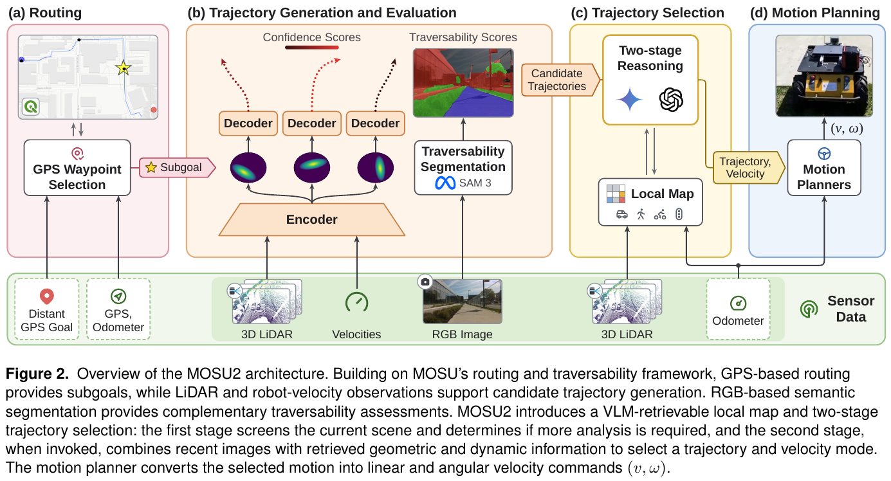
<figcaption>Original Figure 2: Public-map routing, geometric/semantic trajectory filtering, two-stage contextual reasoning, and motion control divide responsibilities. A new local map supplies measured positions and motion.</figcaption>

**Framework and predecessor boundary.** MOSU combines map routing, LiDAR-conditioned trajectory generation, semantic traversability, and single-pass VLM scoring. MOSU2 retains routing/candidates, filters infeasible trajectories first, then retrieves dynamic evidence as needed to select a trajectory and speed mode. It is not an end-to-end language-to-joint-action model, nor does it rely exclusively on free-form route instructions.

| Component | MOSU | MOSU2 |
|---|---|---|
| Physical constraints | Weighted geometry, semantics, VLM ranking, and goal progress | Geometric and semantic candidate filtering first |
| Context judgment | Single image, single VLM query | Initial screening, then temporal images and map evidence when needed |
| Dynamic information | Velocity is difficult to infer reliably from one frame | Query object positions and motion estimates in the local map |

**① Maps give coarse direction.** OpenRouteService and similar services provide GPS routes, with subgoals about 35 m apart, converted into local coordinates through UTM and GPS–odometry alignment. The system advances to the next subgoal within 15 m. With meter-scale GPS errors, these are direction references, not exact ground points to hit.

**② Generate and filter trajectories.** The inherited MTG/CVAE takes LiDAR sequences and historical velocities, samples latent variables, and generates multiple candidates with geometric confidence. SAM3 adds road, sidewalk, vegetation, building, and stair segmentation; feasible classes depend on robot capability. Semantic traversability along projected trajectory pixels combines with geometric confidence:

$$
k_i=\beta_1 c_i+\beta_2 s_i,\qquad \text{retain if: }k_i>k_{\min}.
$$

This is a shorthand of the paper's filtering rule, not a navigation-success probability or formal collision-safety proof.

**③ Queryable map evidence.** Open-vocabulary RGB segmentation supplies object masks. Calibrated LiDAR projections associate points to masks and transform them into shared odometry coordinates, avoiding confusion between ego-motion and object motion. The local map has radius 20 m, resolution 0.2 m, and a 2 Hz experimental update rate. Same-class nearest-neighbor regions are associated across frames; displacement divided by time estimates velocity. Without valid point support, metric position is unavailable; without reliable correspondence, velocity is unknown, not assumed zero.

  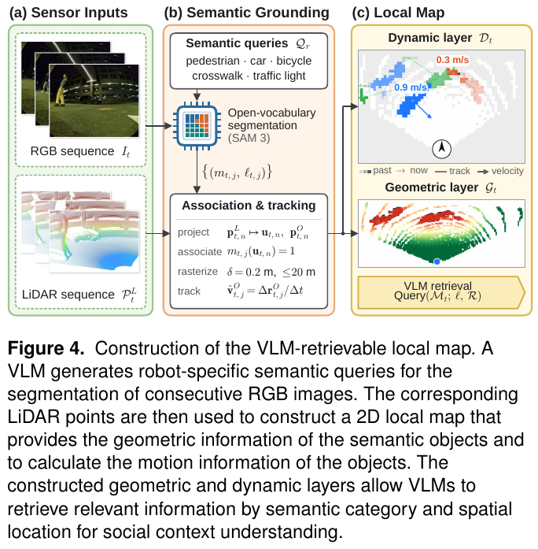
<figcaption>Original Figure 4: Segmentation, point association, and temporal tracking build geometric/dynamic layers. The VLM requests evidence by semantic class and spatial region.</figcaption>

**④ Two-stage decisions.** Stage one screens the current image, goal direction, and candidates. If no extra evidence is needed, it selects a trajectory and normal/slow/stop mode. Otherwise it requests objects and information to investigate. Stage two reads the latest five RGB frames sampled every 0.2 s and map-query results before deciding motion. The paper calls this 1 s; five sampling instants span 0.8 s from first to last, so the sampling window and endpoint time difference should not be conflated.

> **Process example:** A car approaches an intersection from the left; a still image only establishes its presence. Stage one requests position and motion. Stage two combines measured deceleration, lane relationships, and signals to decide whether to wait or pass. Deceleration alone does not prove that the driver will yield.

**⑤ Learning and execution.** The new contribution is the reasoning/information-acquisition architecture, without a new end-to-end joint loss. Modules such as the CVAE trajectory generator remain learned components, so the whole system is not wholly untrained. Trajectory generation runs at 20 Hz and motion planning at 50 Hz. VLM inference uses cloud APIs; seconds-long decision latency is not the low-level control rate.

---

### 3. Results and findings
{: id="mosu2-results"}

**New MOSU2 experiments, Table 2.** Husky, Go2, and Diablo platforms use RGB, 3D LiDAR, and GPS. Five interaction groups are evaluated, not a unified long-distance route leaderboard.

| Scenario | MOSU SR (%) | MOSU2 SR (%) | MOSU latency (s) | MOSU2 latency (s) |
|---|---:|---:|---:|---:|
| Stop gestures | 61 | 71 | 1.51 | 2.52 |
| Construction | 50 | 100 | 1.68 | 5.16 |
| Signalized intersections | 42 | 100 | 1.90 | 4.72 |
| Roads shared with vehicles/cyclists/pedestrians | 56 | 100 | 1.79 | 4.95 |
| Ordinary sidewalks | 100 | 100 | 1.74 | 1.80 |
| Unweighted mean of five groups | 61.8 | 94.2 | 1.72 | 3.83 |

Success requires no collision or human intervention and compliance with scene-specific behavior. Remaining stopped when passage is appropriate also fails. **94.2% is the unweighted mean across five groups**, not pooled trial SR. Samples per group are limited, and the authors do not claim statistical significance.

  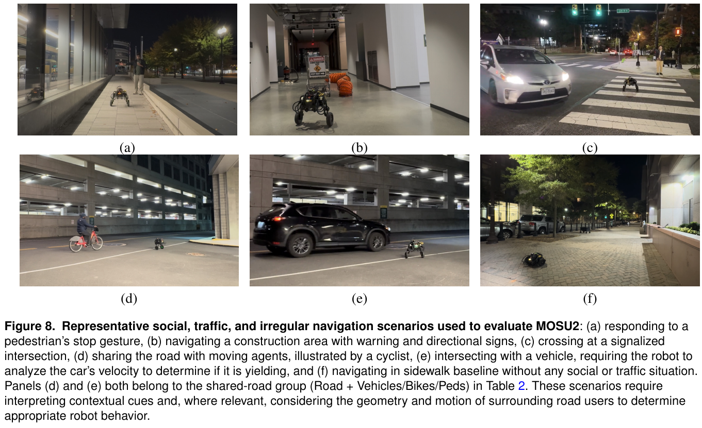
<figcaption>Original Figure 8: Gesture, construction, signal, and road-interaction scenarios. Vehicle and bicycle examples belong to one shared-road group; six panels do not imply six trial categories.</figcaption>

Condition-recognition accuracy is measured **per decision step**, improving on average from 72.2% to 91.4%. Construction recognition is 100% for both, while SR rises from 50% to 100%: recognizing a scene is not choosing the right action. Ordinary-sidewalk recognition declines from 100% to 86%, so not every recognition metric improves.

**Inherited MOSU results remain separate.** GND traversability is 77% versus PIVOT's 70%, a 7-point absolute or 10% relative gain. This is a traversable-waypoint ratio, not task SR or an ablation gain attributable to MOSU2's new modules. Temporal images, map retrieval, prompts, and added computation are not fully isolated.

---

### 4. Limitations
{: id="mosu2-limitations"}

Calibration, GPS, segmentation, simple cross-frame association, and cloud connectivity are required. Complex decisions can take about five seconds; dynamic measurements do not imply reliable intention recognition. Small scenario groups and predecessor comparisons do not establish general traffic safety. Placeholder journal-template headers in the PDF are not evidence of publication.

## 7. LM-Nav (2022)
{: id="lm-nav"}
———Language extracts landmarks, vision matches nodes, graph search plans routes, and a navigation policy executes

📄 **Paper**: [arXiv:2207.04429v2](https://arxiv.org/abs/2207.04429v2) · [Project Page](https://sites.google.com/view/lmnav)

### Key takeaways
{: id="lm-nav-takeaways"}

1. An LLM need not output controls directly. Specialized pretrained language, vision, and motion modules can form a navigation system through interface design.
2. Landmarks cannot be retrieved independently: visitation order and connectivity costs matter, or the most convincing stop-sign image may belong to the wrong route.
3. No additional fine-tuning does not mean no environment preparation. LM-Nav collects target-environment images and GPS to build a topological graph first.
4. Planning success differs from complete execution. Conflicting prose and table numbers should be retained and explained, not resolved by selecting the better value.

---

### 1. Background and problem
{: id="lm-nav-background"}

Image-goal navigation can learn from trajectories without language, but requiring users to supply goal images is unnatural. LM-Nav connects GPT-3, CLIP, and ViNG without collecting a new language-labeled robot dataset, enabling users to specify landmarks in natural language.

---

### 2. Method and innovations
{: id="lm-nav-method"}

  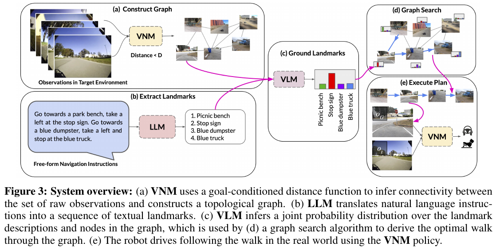
<figcaption>Original Figure 3: Build a topological graph from environment images, extract language landmarks, perform visual matching and graph search, then execute the node sequence with a visual navigation model.</figcaption>

**Framework.** GPT-3 turns route language into ordered landmarks. CLIP scores landmark–image-node matches. ViNG supplies temporal distances between nodes and image-goal-conditioned actions. Graph search jointly assigns landmarks to nodes and connects them. All module weights remain frozen, with no new end-to-end training loss.

**① Build the environment graph first.** A human drives the robot to collect images and GPS. Nodes store observations; edges combine ViNG's learned distance, collection-time proximity, and GPS proximity, weighted by estimated travel steps. This is not language-guided exploration of a wholly unknown environment after deployment.

**② GPT-3 extracts ordered landmarks.** Three prompt examples produce lists such as “white building → white truck → stop sign.” Complex language remains prompt-dependent, and ordering does not preserve every directional, safety, or relational constraint in the original instruction.

**③ CLIP supplies candidates, not a final goal.** Image–landmark embedding similarities are normalized into node-match distributions. Retrieval concerns historical graph observations, not live detection boxes. Soft matches retain alternatives for route-based disambiguation.

**④ Joint semantic and route-cost search.** The paper combines path traversability discounts with ordered landmark matches. In log form:

$$
R=\sum_{i=1}^{n}S(v_{t_i},\ell_i)-\alpha\sum_{j=1}^{k-1}D(v_j,v_{j+1}),\qquad t_1\leq\cdots\leq t_n.
$$

Here $S$ abbreviates CLIP scores, $D$ is ViNG's temporal distance, and $\alpha$ weights travel cost. Dynamic-programming states track how many landmarks have been matched and the current node; Dijkstra-like propagation finds the optimal node sequence. This is not independent top-scoring retrieval followed by arbitrary connections.

> **Joint-selection example:** A nearby stop sign scores 0.8, while one on a distant route scores 0.9. Independent retrieval chooses the latter; joint search considers the cost from the previous landmark and onward connectivity and may choose the nearby sign. These illustrative scores are not actual paper probabilities or measurements.

**⑤ ViNG executes the plan.** A Clearpath Jackal follows image subgoals. LLM/VLM queries are precomputed remotely and the route sent wirelessly; visual navigation runs onboard. Hardware includes front/rear RGB, GPS, IMU, and wheel encoders; the execution policy uses forward RGB and unfiltered GPS. This is not an interactive agent calling GPT-3 online every frame.

---

### 3. Results and findings
{: id="lm-nav-results"}

Twenty natural-language queries cover two environments and more than 6 km overall, with goals up to about 800 m away. Original Table 1 separately reports planning, execution efficiency, interventions, and net success:

| Configuration | Environment | Net Success | Execution efficiency | Mean interventions | Planning |
|---|---|---:|---:|---:|---:|
| GPS-Nav, without ViNG execution | EnvSmall-10 | 0.23 | 0.93 | 0.75 | 0.90 |
| LM-Nav | EnvSmall-10 | 0.80 | 0.96 | 0.10 | 0.90 |
| LM-Nav | EnvLarge-10 | 0.80 | 0.89 | 0.00 | 0.80 |

**Version-internal discrepancy.** The v2 prose says 85% of experiments successfully follow instructions, but both Net Success entries are 0.80. Planning values of 0.90 and 0.80 average to 0.85. This notes the discrepancy without asserting that the authors confused metrics. Complete-execution results should preserve the table breakdown instead of treating 85% as an uncontested overall SR.

Efficiency is specified route length divided by actual travel length, clipped at one and averaged over successful trials only; high efficiency does not mean every task succeeds. Without the navigation model, GPS-Nav triggers takeovers for obstacles and unsafe actions, showing that semantic planning cannot replace local execution.

  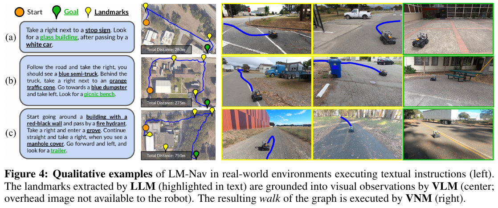
<figcaption>Original Figure 4: Language landmarks, visual matches, and real routes. Bird's-eye views illustrate results rather than serving as robot inputs; missed landmarks can cause specified locations to be skipped.</figcaption>

GPT-3 landmark extraction succeeds on all 20 prompts. CLIP detection scores 0.87 over 100 images and 30 landmark classes, but accepts a match among its top three predictions, so this is not general open-world recognition accuracy. Small landmarks and low light still cause failures.

---

### 4. Limitations
{: id="lm-nav-limitations"}

The target environment must be traversed and mapped beforehand, and language landmarks must exist and be visually recognizable. The method does not solve unknown-space online search or all relational instructions. Small experiments and a fixed remote-planning/onboard-execution split do not justify interpreting frozen modules as map-free, prior-free, or universally intervention-free navigation.

## 8. Compass 1 (2026)
{: id="compass-1"}
———Draw history as a map, then use structured questions to teach navigation models to use memory

📄 **Paper**: [arXiv:2611.12087](https://arxiv.org/abs/2611.12087) · [Project Page](https://www.archon.tech/research/compass1)

### Key takeaways
{: id="compass-1-takeaways"}

Compass 1 does not simply pack more historical frames into context: sparse keyframes retain what was seen, while a trajectory map records where it was seen and how the robot got there, making visual and spatial memory complementary.
Supplying a map does not ensure its use, so task-stage, exploration-direction, and historical-target VQA objectives make memory use an explicit learning requirement.
A unified understanding/generation backbone learns language reasoning, future video, and continuous actions jointly, while deployment starts actions before asynchronous language reasoning finishes.
The data pipeline recovers motion from monocular video and constrains language annotation with it, concentrating human checks on trajectory anomalies and stage boundaries rather than every frame.
The transferable principle is that **memory representation, memory-use supervision, and closed-loop execution must be designed together; a larger context alone does not guarantee long-horizon navigation.**

---

### 1. Background and problem
{: id="compass-1-background"}

Real navigation requires multistage instruction execution, exploration for out-of-view goals, and returning to places seen long ago—not merely approaching visible objects. Existing policies can stop early, under-turn, oscillate left/right, or fail to backtrack despite receiving history.
Compass 1 groups these challenges into instruction-following navigation (IFN), beyond-the-view navigation (BVN), and history backtracking navigation (HBN), learning transferable long-horizon policies from monocular RGB videos without redesigning the pretrained backbone architecture.

---

### 2. Method and innovations
{: id="compass-1-method"}

  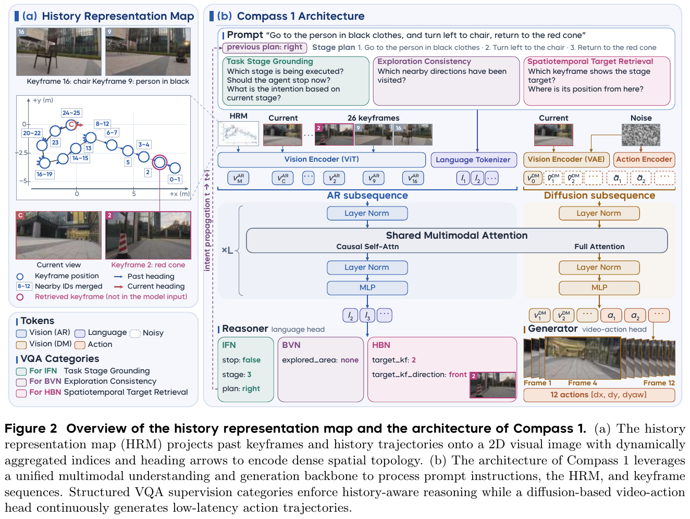
<figcaption>Figure 2: Keyframe positions, indices, and headings form the HRM. A unified backbone processes images, instructions, and history; an autoregressive language head answers structured questions, while a diffusion video–action head predicts future observations and continuous actions.</figcaption>

**① Framework: represent history → use history → generate video and actions.** Built on Cosmos3-Edge-4B, the system receives current observations, sparse historical keyframes, a History Representation Map (HRM), instructions, and the previous intention. A shared multimodal backbone supports language-state reasoning and future-motion generation.
“No architecture change” means using the existing unified understanding/generation backbone and treating the history map as an ordinary image. It does not mean no training or no trajectory information.

**② Representation: keyframes retain appearance; HRM retains spatial relationships.**

- **Keyframe selection** takes video and motion trajectories. Single-step and five-frame accumulated yaw identify turns, including transition intervals before/after them. Straight segments are sampled every 3 s; turning/transition regions are sampled more densely when accumulated yaw exceeds 30°. The initial frame is always retained. A one-minute, 4 FPS stream of 240 frames becomes about 40 keyframes on average.
- **HRM construction** takes historical trajectories, keyframe positions, and headings. These are drawn on a 2D canvas, with frame indices, historical arrows, and a red C for the current pose. Nearby indices merge into ranges such as “8–12” to avoid clutter in repeatedly visited areas. The output is an image for the ordinary visual encoder, not a separate map network.
- **Inference keyframes** use fixed distance/angle triggers rather than merely appending frames at fixed times. This handles embodiment differences: a small command may fail to physically move a humanoid, so fixed-rate images can contain repetitions unlike the training video distribution.

> **Illustrative example, not experimental data:** Keyframe 2 saw a red cone at camera position (0, 0). The robot is now at (0, 4), facing north.
> The keyframe establishes that the cone was seen; the HRM places that viewpoint south of the current robot. Together they support “go back behind you.”
> Photos alone do not specify the return route; numbered trajectories alone do not identify the cone.
> Retrieval locates the **camera viewpoint from which the goal was observed**, not necessarily the object's exact 3D coordinates, and does not automatically supply an obstacle-avoiding path.

**③ History use: ask questions whose answers require memory.**

The authors observe that simply supplying HRM can leave it ignored. Structured VQA is therefore not generic chain-of-thought prose but specific supervision targeting closed-loop failures:

| Capability | Failure without targeted constraints | Compass 1 supervision/mechanism |
|---|---|---|
| Task-Stage Grounding | Unclear subtask, premature stopping, wrong turns | Predict current stage, next high-level intention, and whether to stop |
| Exploration Consistency | Independent choices cause repeated left/right turns | Identify visited left/right regions and pass the previous intention into the next prompt |
| Spatiotemporal Target Retrieval | Remembering a sighting does not guide a return | Jointly predict the target's historical keyframe and its relative direction from the current pose |

Qwen-3.8-27B decomposes instructions into task-stage supervision. Stop labels are anticipated four steps before actual stopping to provide inference/execution buffer.
Exploration consistency combines question supervision with intention propagation, preventing repeated changes of mind when either direction could contain an unseen goal.
Retrieval associates a semantic target with an indexed map location, helping both dedicated backtracking and recovery after overshooting a target during ordinary multistage execution.

  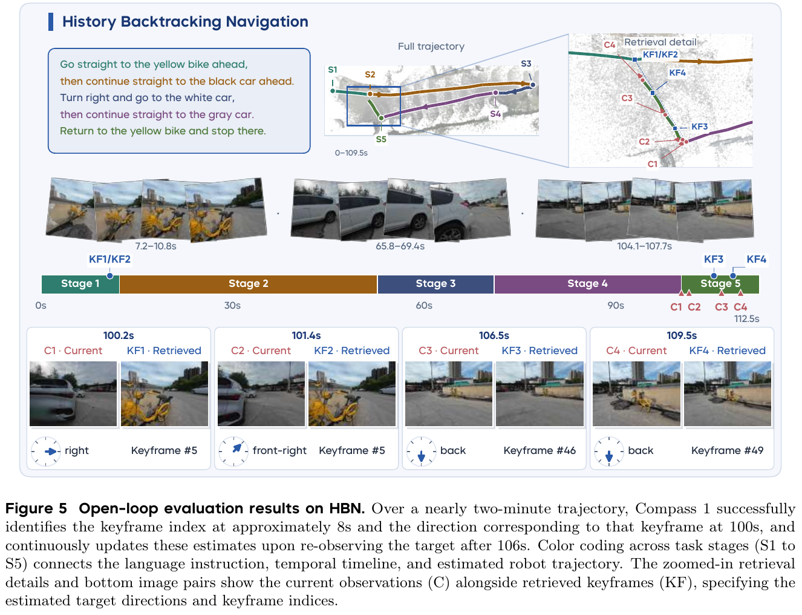
<figcaption>Figure 5: Open-loop retrieval over a nearly two-minute trajectory. Around 100 s, the model retrieves a target sighting near 8 s; after re-observation, it updates the keyframe and relative direction. This is a retrieval example, not an aggregate SR for two-minute closed-loop tasks.</figcaption>

**④ Unified backbone: train language reasoning and video–action prediction jointly.**

The understanding branch encodes HRM, current images, and historical keyframes with ViT and combines them with instruction/VQA tokens in an autoregressive sequence. The generation branch VAE-encodes current vision and processes video/action diffusion sequences.
Shared multimodal attention connects them, with causal attention on the language side and full attention on the diffusion side. The language head outputs stage, intention, stopping, and retrieval answers; the video–action head predicts future visual changes plus 12 continuous actions, each represented by $[\Delta x,\Delta y,\Delta\mathrm{yaw}]$.
Predicting video constrains action learning with future scene changes rather than merely regressing actions from language features. It is not explicit search over multiple sampled candidate routes.

The stated loss weights give:

$$
\mathcal L = 3\mathcal L_{\mathrm{VQA}} + \mathcal L_{\mathrm{video}} + \mathcal L_{\mathrm{action}}.
$$

The terms train structured memory reasoning, future visual prediction, and continuous trajectories. The paper specifies **3:1:1** but does not expand each loss formula in the main text, so no unreported formulas are added here.
Stopping is always queried; other questions are sampled independently with 50% probability to avoid fixed prompt combinations. End-to-end training uses 32 H200s, global batch size 256, and 60,000 steps.

**⑤ Asynchronous inference: actions need not wait for the current language answer.**

After joint training, action generation can operate without the full same-step language output. On one GPU, the system generates and immediately streams actions, letting physical execution overlap subsequent language reasoning. A stop signal interrupts the controller; intentions inform later inference.
Keyframe KV caching and CUDA Graph diffusion denoising reduce overhead. The asynchronous overlap primarily concerns **physical execution and language reasoning**, not two independent large models running simultaneously on separate GPUs.

> **Simplified timing example, not measured latency:** Suppose action computation takes 0.4 s and subsequent language reasoning 0.3 s.
> Synchronous execution begins movement at 0.7 s; asynchronous execution begins at 0.4 s and finishes reasoning while moving, interrupting if a stop signal arrives.
> This reduces the wait before motion, not the amount of reasoning computation. Actual paper timings appear below.

**⑥ Data pipeline: establish motion before describing observations.**

  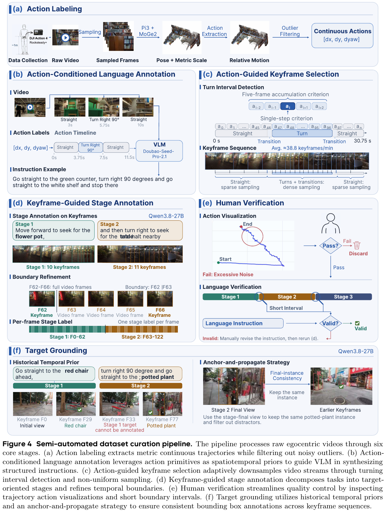
<figcaption>Figure 4: Recover motion, constrain language with actions, select keyframes, refine stage boundaries, perform human checks, and anchor target instances for consistent boxes.</figcaption>

1. **Recover actions:** π3 and MoGe-2 combine pose and metric scale to derive relative motion from RGB. Trajectories with abnormal scale, roll/pitch, or severe multi-axis turn spikes are removed to reduce monocular pseudo-label noise.
2. **Generate instructions:** Continuous actions become straight/left/right/search segments, supplied with video to Doubao-Seed-Pro-2.1. The VLM matches landmarks to motion rather than guessing turns and boundaries solely from appearance. Demand-driven tasks replace target names with user needs; backtracking tasks rewrite the last stage.
3. **Refine stages:** Qwen-3.8-27B partitions sparse keyframes into subtasks, inspects original video between boundary frames to locate completion precisely, then propagates frame-level labels.
4. **Human quality checks:** Annotators inspect trajectory visualizations and short boundary clips. Severely noisy trajectories are discarded; inconsistent instructions are corrected and stages relabeled. **Human checking covers self-collected data, not all YouTube videos.**
5. **Maintain target identity:** Anchor each target in its stage-final frame and propagate boxes backward, avoiding confusion among same-class objects. Labels are restricted to that stage and earlier ones so later reappearances do not confuse stage semantics.

The corpus contains **over 500 hours of self-collected video and over 2,000 hours of YouTube**, but training samples them at **85% self-collected, 15% YouTube**. Video duration shares are not sampling shares. Most data use a camera near 1.0 m high, followed by transfer tests across heights and locomotion styles.

---

### 3. Results and findings
{: id="compass-1-results"}

**Real-world overall SR: 79.4%, versus 17.8% for the strongest individual baseline.** Office, outdoor Complex, Terrace, and Street scenarios each contain eight tasks with ten trials per task: 320 trials per method. The principal platform is Unitree Go2 with a camera around 0.5 m high.
Baselines are fine-tuned on the paper's data, and the higher score between original and fine-tuned weights is reported. However, the appendix states that real-data AwareVLN fine-tuning supervises only actions, not additional reasoning; other baselines require discretization or target-point approximations. Results therefore apply to this adaptation protocol, not a perfectly controlled backbone comparison.

**Outdoor breakdown.** Figure 7 gives approximately **79%, 81%, and 74%** for Complex, Terrace, and Street, respectively, each over 80 trials and rounded as shown; Office is about 84%. Overall SR 79.4% mixes indoor and outdoor scenarios and must not be called “outdoor SR 79.4%.” Performance under street disturbances also does not establish city-scale traffic safety or intervention-free kilometer routes.

  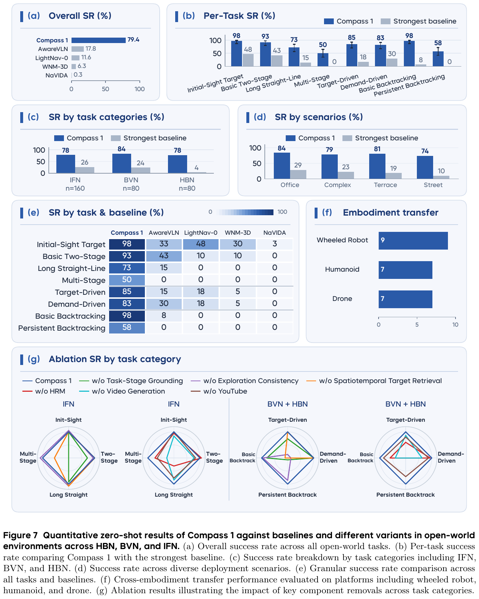
<figcaption>Figure 7: Real-world tasks, scenarios, embodiment transfer, and ablations. Overall scores compare individual baselines, whereas the strongest baseline per task can differ. The largest gaps concern multistage execution and long-history backtracking.</figcaption>

| Real-world task | Compass 1 SR | Best baseline SR for that task |
|---|---:|---:|
| Initial-sight target navigation | 98% | 48% |
| Basic two-stage navigation | 93% | 43% |
| Long straight-line navigation | 73% | 15% |
| Multistage navigation | 50% | 0% |
| Target-driven exploration | 85% | 18% |
| Demand-driven exploration | 83% | 30% |
| Basic history backtracking | 98% | 8% |
| Persistent history backtracking | 58% | 0% |

Task values retain Figure 7's integer display. **79.4% versus 17.8% differs by 61.6 percentage points.** BVN's 84% versus 24% is a 250% relative improvement, not 250 percentage points. Persistent backtracking at 58% remains unsolved.
Transfer also covers wheeled robots at camera height 0.35 m, humanoids at 0.85 m, and drones at 1.5 m, but principally on HBN, not the complete 320-trial matrix on every embodiment.

**Ablations: using the map matters, not simply having it.**

- Removing task-stage VQA reduces multistage SR to zero; stopping and subtask grounding are not optional text outputs.
- Removing exploration consistency mainly hurts target-/demand-driven exploration. Removing spatiotemporal retrieval severely harms historical reasoning even with HRM retained.
- Removing HRM while retaining VQA preserves some short-range reasoning but harms long straight-line and persistent backtracking tasks, demonstrating complementary supervision and representation.
- Removing video generation or YouTube data hurts performance. Video prediction especially helps exploration, multistage tasks, and backtracking; web data gives broader but quality-limited gains.

**Simulation is strong in the monocular setting, but not zero-shot evaluation of the real-world policy.**

| Evaluation | Compass 1 | Comparison and training protocol |
|---|---|---|
| R2R-CE Val-Unseen | SR 70.1, SPL 63.2 | LightNav-0: 68.5 / 62.8; separately trained on R2R with DAgger |
| HM3D-OVON unseen categories | SR 52.2, SPL 26.9 | LightNav-0: 47.0 / 24.2; separately trained on HM3D-OVON with DAgger |
| IntentionNav | SR 42.5, SPL 42.1 | 300 of 500 trajectories for fine-tuning, 200 for testing; every scene contains train/test tasks |
| IndoorUAV-VLN Test-Unseen | SR 18.09, nDTW 12.14 | All methods fine-tuned; trajectories containing ascent/descent removed from training and evaluation |

R2R-CE leadership is among the compared **monocular methods**, not every multiview method. IntentionNav is not an unseen-scene split, and the drone evaluation does not demonstrate full 3D altitude control.

**Efficiency: chunk throughput is not 28 replanning decisions per second.** On RTX PRO 6000, generating 12 actions takes 0.43 s initially and 0.71 s with 63 keyframes. The paper's effective action rates of about 28 Hz and 17 Hz correspond to chunk computation rates of about 2.3 Hz and 1.4 Hz, not per-action closed-loop replanning.
KV caching/CUDA Graph reduce latency by 80.4% at 63 frames; asynchronous execution reduces waiting by about 46.4% relative to synchronous execution. Their reference settings differ, so these percentages cannot simply be added.

---

### 4. Limitations
{: id="compass-1-limitations"}

Persistent backtracking and multistage SR remain only 58% and 50%. Occlusion, turning errors, reflections, and obstacles on return routes still cause lost targets or collisions; a nearly two-minute example does not establish indefinite persistent memory.
Real deployment depends on odometry-based closed-loop control and a remote high-end GPU, so monocular RGB policy input does not mean the whole robot needs no pose support. Four scenarios, custom tasks, and limited embodiment transfer do not establish arbitrary open-world or full 3D flight generalization.

# Related work and further reading
{: id="outdoor-related-readings"}

The following works include outdoor evaluation or general navigation policies but are not centered exclusively on outdoor navigation. Their detailed readings remain in the original collections. Different benchmarks are not ranked together.

- **[ABot-N1](/en/VLN-Papers/#abot-n1):** Includes urban-scale ABotN-PointBench outdoor point-goal evaluation and social-compliance analysis. The outdoor split uses success within three collisions (SR<3col), not directly comparable to indoor zero-collision success (SR<1col). The reading remains in the instruction-following collection.
- **[CanonNav](/en/VLN-Papers-Extended/#canonnav):** Covers CitySim outdoor campuses, AWS Hospital interiors, and outdoor robot deployment as a cross-scenario visual navigation policy.
- **[NoMaD](/en/VLN-Papers-Extended/#nomad):** Unifies exploration and image-goal navigation indoors/outdoors; a useful foundational diffusion policy, not an outdoor-specific method.
- **[SparseVideoNav](/en/VLN-Papers-Extended/#sparsevideonav):** Real tests span courtyards, parks, night plazas, and mountains, relevant to lighting and cross-environment generalization.
- **[VL-Nav](/en/VLN-Papers-Extended/#vl-nav):** Includes an Outdoor open-area evaluation but remains primarily goal navigation.

This collection focuses on outdoor ground robots. Aerial navigation and autonomous driving are related but distinct; WorldVLN and Qwen-Drive are not moved here. General instruction-following methods are not relocated merely because they include an outdoor demonstration.

# References
{: id="参考资料"}

## Paper references
{: id="论文引用"}

1. **WayTrace** (2026). Manthan Patel, Jonas Frey, Pascal Roth, Marco Hutter, Cesar Cadena. *WayTrace: A Map-to-Language-to-Trace Hierarchy for Embodied Urban Navigation*. arXiv: [2611.05129](https://arxiv.org/abs/2611.05129).
2. **CausalNav** (2026). First Scene Graph-based Semantic Navigation for Dynamic Outdoor Environments. arXiv: [2601.01872](https://arxiv.org/abs/2601.01872) · IEEE RA-L
3. **DA-Nav** (2026). Ye Yuan et al. *DA-Nav: Direction-Aware City-Scale Vision-Language Navigation*. arXiv: [2607.11638v2](https://arxiv.org/abs/2607.11638v2).
4. **CityWalker** (2025, v3). *CityWalker: Learning Embodied Urban Navigation from Web-Scale Videos*. arXiv: [2411.17820v3](https://arxiv.org/abs/2411.17820v3).
5. **UrbanNav** (2026, v2). *UrbanNav: Learning Language-Guided Urban Navigation from Web-Scale Human Trajectories*. arXiv: [2512.09607v2](https://arxiv.org/abs/2512.09607v2).
6. **MOSU2** (2026). *MOSU2: Long-range Navigation System with Multi-modal Scene Understanding*. arXiv: [2611.11148v1](https://arxiv.org/abs/2611.11148v1). Predecessor **MOSU** (2025): [2507.04686v1](https://arxiv.org/abs/2507.04686v1).
7. **LM-Nav** (2022). *LM-Nav: Robotic Navigation with Large Pre-Trained Models of Language, Vision, and Action*. arXiv: [2207.04429v2](https://arxiv.org/abs/2207.04429v2).
8. **Compass 1** (2026). Hai Zhang, Siqi Liang et al. *Compass 1: Towards Open-World and Persistent Embodied Navigation from Monocular RGB Videos*. arXiv: [2611.12087v1](https://arxiv.org/abs/2611.12087v1).
