> This collection accompanies the [VLN survey](/en/VLN-Survey/) with detailed readings on instruction-following navigation and its supporting foundations.
>
> It covers 50 representative methods, benchmarks, and foundational works. Goal navigation, agentic navigation, and supporting work on locomotion and mobile manipulation appear in [Goal Navigation](/en/VLN-Papers-Extended/) and [Agentic Navigation](/en/Agentic-Navigation-Papers/). The collections are organized by research focus and reading sequence; publication status is not the sole criterion.

> Instruction-following leaderboards and cross-method comparisons remain here. Readings focused on agent systems or goal navigation live in their respective collections; paper names in the tables link directly to those readings.

<div id="paper-filter-bar" class="paper-filter-bar"></div>

# Performance leaderboards
{: id="性能排行榜"}

> ⚠️ **Do not compare scores across different benchmarks.** This page groups instruction-following results by benchmark: ① R2R-CE and ② RxR-CE use continuous environments with step-by-step first-person control; ③ R2R / REVERIE use panoramic decisions on discrete navigation graphs; ④ LHPR-VLN evaluates long-horizon multi-stage instruction following in continuous environments. Task definitions and sensor configurations differ, so SR is not comparable across these tables. ObjectNav, HM3D-OVON, image-goal, and point-goal results are in the goal-navigation collection's [leaderboards](/en/VLN-Papers-Extended/#goal-nav-leaderboard).
>
> **Reading the tables:** **Trained** means trained or fine-tuned on navigation data, including navigation foundation models evaluated through cross-task zero-shot transfer. **Training-free** means no navigation model is trained: the system combines existing large models, detection or segmentation models, and rules or planners. Calling a pretrained low-level point-goal controller does not change this classification. The **Closed API** badge marks methods that call a closed model such as GPT, Gemini or Claude through an API at inference time. This is separate from the paradigm: a trained model can still call one at inference time, as NavGPT-3's planner does, while using a large model only to build training data or for offline preprocessing does not count. In the chart view, bar colors show whether a method calls a closed API. Gray rows use nonstandard protocols, such as validation subsets, and are excluded from best-value bolding. Bold values are the best among non-gray rows within the same benchmark. The filters select paradigm, inference, input configuration, and open-source availability, and can hide gray rows.

> **EvoLife evaluation conditions:** Gray rows use sampled tasks and a guide with privileged target and route information. They describe assisted navigation and are not directly comparable to unassisted full-validation results.

<div id="lb-filter-bar" class="lb-filter-bar"></div>

## ① R2R-CE
{: id="-r2r-ce"}

Continuous environment · English commands · val-unseen (1839 items in total)

|Model|Year|Paradigm|Base model|SR ↑|SPL ↑|NE ↓|OSR ↑|Open source|
|:-----|:----:|:----:|:----:|:----:|:----:|:----:|:----:|:----:|
| [EvoLife (four views)](/en/Agentic-Navigation-Papers/#evolife) <span class="lb-api" title="Calls a closed model such as GPT, Gemini or Claude through an API at inference time">Closed API</span> <span class="lb-flag">100-episode subset; privileged guide</span> | 2026 | Training-free | GPT-6 Astra (ultra) | 100 | 82.2 | 0.95 | 100 | – |
|[NavGPT-3 (four views · Astra)](/en/Agentic-Navigation-Papers/#navgpt-3) <span class="lb-api" title="Calls a closed model such as GPT, Gemini or Claude through an API at inference time">Closed API</span>|2026|Trained|GPT-6-Astra/Qwen3-VL-8B|**81.51**|70.42|**2.18**|**86.99**|[Yes](https://github.com/metacognitionai/NavGPT-3)|
|[GPT-6-Astra (monocular · ultra)](/en/Agentic-Navigation-Papers/#gpt-6-astra) <span class="lb-api" title="Calls a closed model such as GPT, Gemini or Claude through an API at inference time">Closed API</span> <span class="lb-flag">100 subset </span>|2026|Training-free|GPT-6-Astra|81.3|71.5|2.9|83.7|No|
|[Robostral Navigate (monocular)](#robostral-navigate)|2026|Trained|Mistral-8B|77.4|**74.2**|3.20|81.3|No|
|[SimpleVLN (monocular)](#simplevln)|2026|Trained|Qwen3.5-9B|76.7|72.6|2.63|84.1|No|
|[GPT-6-Astra (monocular · medium)](/en/Agentic-Navigation-Papers/#gpt-6-astra) <span class="lb-api" title="Calls a closed model such as GPT, Gemini or Claude through an API at inference time">Closed API</span> <span class="lb-flag">100 subset </span>|2026|Training-free|GPT-6-Astra|75.7|65.6|3.0|80.7|No|
|[NavGPT VLA 8B (four views)](/en/Agentic-Navigation-Papers/#navgpt-3)|2026|Trained|Qwen3-VL-8B|74.51|68.54|3.29|80.19|[Yes](https://github.com/metacognitionai/NavGPT-3)|
|[Efficient-VLN (monocular)](#efficient-vln)|2025|Trained|Qwen3-VL-8B|73.2|65.0|3.29|78.2|No|
|[Qwen-RobotNav (panoramic)](#qwen-robotnav)|2026|Trained|Qwen3-VL-8B|72.1|66.6|3.53|78.5|No|
|[Talk2Escape + GTA (four views)](/en/Agentic-Navigation-Papers/#talk2escape) <span class="lb-api" title="Calls a closed model such as GPT, Gemini or Claude through an API at inference time">Closed API</span> <span class="lb-flag">100 subset</span>|2026|Training-free|Gemini 3.1 Pro|72.0|49.4|4.80|66.0|No|
|[ABot-N1 (three cameras)](#abot-n1)|2026|Trained|Qwen-3.5-4B + 2B|70.9|67.5|3.32|75.2|No|
|[Image2Nav (180° FOV)](#image2sim)|2026|Trained|Qwen3-VL-4B|70.3|65.6|3.71|76.1|[Yes](https://github.com/MrZihan/Image2Sim)|
|[GroundingVLN (three cameras)](#groundingvln)|2026|Trained|Qwen3.5-4B|69.9|64.1|3.66|74.8|No|
|[OmniNav (multi-view)](#omninav)|2026|Trained|Qwen2.5-VL-3B|69.5|66.1|3.74|74.6|[Yes](https://github.com/amap-cvlab/OmniNav)|
|[RSI-Nav](#rsi-nav)|2026|Trained|Qwen3.5-9B|68.6|58.6|3.70|78.0|[Yes](https://github.com/OpenGVLab/RSI-Nav)|
|[LightNav-0 (monocular)](#lightnav-0)|2026|Trained|Qwen3-VL-4B|68.5|62.8|3.91|73.7|[Yes](https://github.com/lightorigins/LightNav-0)|
|[AstraNav-World (multi-view)](#astranav-world)|2025|Trained|Qwen2.5-VL-3B|67.9|65.4|3.86|73.9|[Yes](https://github.com/amap-cvlab/AstraNav-World)|
|[SeekVLN (monocular, three views on demand)](#seekvln)|2026|Trained|Aux-Think / NVILA-lite-8B|67.5|61.4|3.7|75.2|No|
|[SEDualVLN (monocular)](#sedualvln)|2026|Trained|LLaVA-Video-7B|67.3|62.5|3.75|73.7|No|
|[AgentVLN (monocular)](/en/Agentic-Navigation-Papers/#agentvln)|2026|Trained|Qwen2.5-VL-3B|67.2|64.7|3.88|73.5|[Yes](https://github.com/Allenxinn/AgentVLN)|
|[Qwen-RobotNav (monocular)](#qwen-robotnav)|2026|Trained|Qwen3-VL-4B|66.9|60.5|4.22|73.6|No|
|[TAMP-Nav (multi-view)](#tamp-nav)|2026|Trained|Qwen2.5-VL-7B|66.2|58.8|3.85|74.5|[Yes](https://github.com/ZJU-OmniAI/Embodied-Omni)|
|[Dual-Anchoring (monocular)](#dual-anchoring)|2026|Trained|LLaVA-Video-7B|65.6|62.1|–|–|No|
|[AwareVLN (monocular)](#awarevln)|2026|Trained|Vicuna-7B|65.4|55.1|4.02|73.5|[Yes](https://github.com/GWxuan/AwareVLN)|
|[CorrectNav (monocular)](#correctnav)|2025|Trained|–|65.1|62.3|4.24|67.5|[Yes](https://github.com/owlet914/CorrectNav)|
|[DualVLN (monocular)](#dualvln)|2025|Trained|Qwen2.5-VL-7B|64.3|58.5|4.05|70.7|[Yes](https://github.com/InternRobotics/InternNav)|
|[Talk2Escape + NavGPT (four views)](/en/Agentic-Navigation-Papers/#talk2escape) <span class="lb-api" title="Calls a closed model such as GPT, Gemini or Claude through an API at inference time">Closed API</span> <span class="lb-flag">100 subset</span>|2026|Training-free|Gemini 3.1 Pro|64.0|46.4|4.84|60.0|No|
|[VLN-Cache (monocular)](#vln-cache)|2026|Trained|Qwen2.5-VL-7B|63.1|57.6|–|–|No|
|[ReflectVLN (monocular)](/en/Agentic-Navigation-Papers/#reflectvln)|2026|Trained|Qwen2.5-VL-3B|62.8|58.5|4.19|67.3|No|
|[NavFoM (multi-view)](#navfom)|2025|Trained|Qwen2-7B|61.7|55.3|4.61|72.1|No|
|[GA-VLN (monocular)](#ga-vln)|2026|Trained|LLaVA-Video-7B|61.0|55.2|4.80|67.6|[Yes](https://github.com/jahhaoyang/GA-VLN)|
|[HarnessVLN (monocular)](/en/Agentic-Navigation-Papers/#harnessvln) <span class="lb-api" title="Calls a closed model such as GPT, Gemini or Claude through an API at inference time">Closed API</span>|2026|Training-free|GPT-5.5|60.8|43.5|4.01|72.7|No|
|[JanusVLN (monocular)](#janusvln)|2026|Trained|Janus-Pro-7B|60.5|56.8|4.78|65.2|[Yes](https://github.com/MIV-XJTU/JanusVLN)|
|[RynnBrain-Nav (monocular)](#rynnbrain)|2026|Trained|–|58.6|49.6|4.92|71.6|[Yes](https://github.com/alibaba-damo-academy/RynnBrain)|
|[DGNav (panoramic)](#dgnav)|2026|Trained|–|58.56|50.08|4.66|64.82|[Yes](https://github.com/shannanshouyin/DGNav)|
|[MemVLN-8B (monocular)](#memvln)|2026|Trained|Qwen3-VL-8B|58.4|51.2|4.98|65.3|No|
|[BudVLN (monocular)](#budvln)|2026|Trained|LLaVA-1.5-7B|57.6|51.1|–|–|No|
|[StreamVLN (monocular)](#streamvln)|2025|Trained|LLaVA-Video-7B|56.4|50.2|4.90|63.6|[Yes](https://github.com/OpenRobotLab/StreamVLN)|
|[DecoVLN (monocular)](#decovln)|2026|Trained|LLaVA-Video-7B|56.3|50.5|5.01|63.5|No|
|[AgenticNav (panoramic)](/en/Agentic-Navigation-Papers/#agenticnav) <span class="lb-api" title="Calls a closed model such as GPT, Gemini or Claude through an API at inference time">Closed API</span> <span class="lb-flag">100 subset</span>|2026|Training-free|GPT-5.5|55.0|48.41|5.19|65.0|No|
|[Goal2Pixel (monocular)](#goal2pixel)|2025|Trained|LLaVA-1.5-7B|54.1|52.5|4.85|59.9|No|
|[HSGM (monocular)](#hsgm) <span class="lb-api" title="Calls a closed model such as GPT, Gemini or Claude through an API at inference time">Closed API</span>|2026|Training-free|GPT-5|47.9|32.8|5.42|58.7|[Yes](https://github.com/Teacher-Tom/HSGM_public)|
|[SparseNav (monocular)](/en/Agentic-Navigation-Papers/#sparsenav) <span class="lb-api" title="Calls a closed model such as GPT, Gemini or Claude through an API at inference time">Closed API</span>|2026|Training-free|GPT-5|42.8|35.2|5.96|53.4|No|
|[MapNav (monocular)](#mapnav)|2025|Trained|LLaVA-Onevision-7B|39.7|37.2|5.43|53.0|[Yes](https://github.com/linglingxiansen/MapNav)|
|[NaVid (monocular)](#navid)|2024|Trained|–|37.4|35.9|5.47|49.1|[Yes](https://github.com/jzhzhang/NaVid-VLN-CE)|
|[VLN-R1 (monocular)](#vln-r1)|2025|Trained|Qwen2-VL-7B|30.2|21.8|7.0|41.2|No|
|[VLN-R1 (monocular)](#vln-r1)|2025|Trained|Qwen2-VL-2B|25.6|20.5|10.2|37.5|No|
|[OneVLA (monocular)](#onevla-a-unified-framework-for-embodied-tasks)|2026|Trained|Qwen2.5-VL-3B|–|–|–|68.6|[Yes](https://github.com/linglingxiansen/OneVLA)|

Note: NavFoM uses four views (the single-view result is SR 56.2 / SPL 51.2); DGNav follows the panoramic RGB-D input of ETPNav; DualVLN and StreamVLN are single-view comparisons under the same evaluation protocol; VLN-Cache is an acceleration scheme for DualVLN that is almost lossless (baseline 64.3 / 58.5).

StreamVLN uses the StreamVLN† numbers from arXiv v2 (the ICRA 2026 version), which rely on additional data such as a ScaleVLN subset; v1 reports 56.9 / 51.9, and most other papers quote the v1 numbers as their baseline.

Qwen-RobotNav uses arXiv v3: the panoramic row is the 8B model (base Qwen3-VL-8B), and the monocular row is the 4B model (the monocular 4B result of 66.9 is higher than the 8B result of 65.7; the 8B monocular result is 65.7 / 59.6).

The three gray GPT-6-Astra and AgenticNav rows are evaluated only on R2R-CE-100: 100 episodes (covering 10 scenes) drawn by Open-Nav from val-unseen. Training-free methods generally report only this subset to control the cost of large-model calls. One episode equals one percentage point.

At an SR around 81%, the standard error is about 4 points (a 95% interval of roughly 73-89), versus about 1 point on the full 1839 episodes. GPT-6-Astra reports the mean of three runs from arXiv v2 (v1 is a single run at 79.0 / 76.0); the standard deviation across the three runs is only 1.5-2.5 points, which reflects run-to-run variation only and does not include the sampling error of the 100 tasks themselves.

These rows are placed in the table by SR and are not bolded. They are for reference against the full-split rows only.

Supplement: the two NavGPT-3 rows are the full system (a GPT-6 Astra Planner + 8B VLA) and the standalone NavGPT VLA 8B; both use four views and the full Val-Unseen split. Their VLA is trained on navigation data, so both rows are classified as "Trained"; the Planner having no navigation fine-tuning does not make the system training-free. 81.51 is the full system's SR, while its SPL of 70.42 is still below Robostral Navigate's 74.2. The released code covers VLA inference, the Harness, and simulation evaluation; the real-robot deployment runtime is still to be released separately.

## ② RxR-CE
{: id="-rxr-ce"}

Continuous environment · Multilingual commands (English/Hindi/Telugu) · val-unseen

|Model|Year|Paradigm|Base model|SR ↑|SPL ↑|NE ↓|OSR ↑|Open source|
|:-----|:----:|:----:|:----:|:----:|:----:|:----:|:----:|:----:|
| [EvoLife (four views)](/en/Agentic-Navigation-Papers/#evolife) <span class="lb-api" title="Calls a closed model such as GPT, Gemini or Claude through an API at inference time">Closed API</span> <span class="lb-flag">100-episode subset; privileged guide</span> | 2026 | Training-free | GPT-6 Astra (ultra) | 100 | 75.4 | 0.71 | 100 | – |
|[NavGPT-3 (four views · Astra)](/en/Agentic-Navigation-Papers/#navgpt-3) <span class="lb-api" title="Calls a closed model such as GPT, Gemini or Claude through an API at inference time">Closed API</span>|2026|Trained|GPT-6-Astra/Qwen3-VL-8B|**90.43**|**74.31**|**1.56**|–|[Yes](https://github.com/metacognitionai/NavGPT-3)|
|[SimpleVLN (monocular)](#simplevln)|2026|Trained|Qwen3.5-9B|80.1|69.9|2.51|–|No|
|[NavGPT VLA 8B (four views)](/en/Agentic-Navigation-Papers/#navgpt-3)|2026|Trained|Qwen3-VL-8B|78.19|68.98|3.05|–|[Yes](https://github.com/metacognitionai/NavGPT-3)|
|[Qwen-RobotNav (panoramic)](#qwen-robotnav)|2026|Trained|Qwen3-VL-8B|76.5|65.7|3.58|–|No|
|[Efficient-VLN (monocular)](#efficient-vln)|2025|Trained|Qwen3-VL-8B|75.6|60.0|3.18|–|No|
|[Robostral Navigate (monocular)](#robostral-navigate)|2026|Trained|Mistral-8B|75.1|68.7|3.47|–|No|
|[GroundingVLN (three cameras)](#groundingvln)|2026|Trained|Qwen3.5-4B|75.1|62.0|3.54|–|No|
|[ABot-N1 (three cameras)](#abot-n1)|2026|Trained|Qwen-3.5-4B + 2B|73.9|63.9|3.13|–|No|
|[OmniNav (multi-view)](#omninav)|2026|Trained|Qwen2.5-VL-3B|73.6|62.0|3.77|–|[Yes](https://github.com/amap-cvlab/OmniNav)|
|[LightNav-0 (monocular)](#lightnav-0)|2026|Trained|Qwen3-VL-4B|73.6|64.5|3.66|–|[Yes](https://github.com/lightorigins/LightNav-0)|
|[Qwen-RobotNav (monocular)](#qwen-robotnav)|2026|Trained|Qwen3-VL-8B|73.4|63.5|4.16|–|No|
|[AstraNav-World (multi-view)](#astranav-world)|2025|Trained|Qwen2.5-VL-3B|72.9|61.5|3.82|–|[Yes](https://github.com/amap-cvlab/AstraNav-World)|
|[RSI-Nav](#rsi-nav)|2026|Trained|Qwen3.5-9B|72.4|56.5|3.53|–|[Yes](https://github.com/OpenGVLab/RSI-Nav)|
|[Image2Nav (180° FOV)](#image2sim)|2026|Trained|Qwen3-VL-4B|70.7|59.1|3.74|–|[Yes](https://github.com/MrZihan/Image2Sim)|
|[AgentVLN (monocular)](/en/Agentic-Navigation-Papers/#agentvln)|2026|Trained|Qwen2.5-VL-3B|69.5|61.3|3.92|–|[Yes](https://github.com/Allenxinn/AgentVLN)|
|[CorrectNav (monocular)](#correctnav)|2025|Trained|–|69.3|63.3|4.09|–|[Yes](https://github.com/owlet914/CorrectNav)|
|[AwareVLN (monocular)](#awarevln)|2026|Trained|Vicuna-7B|67.6|56.1|3.95|–|[Yes](https://github.com/GWxuan/AwareVLN)|
|[MemVLN-4B (monocular)](#memvln)|2026|Trained|Qwen3-VL-4B|66.5|57.4|4.22|–|No|
|[ReflectVLN (monocular)](/en/Agentic-Navigation-Papers/#reflectvln)|2026|Trained|Qwen2.5-VL-3B|66.0|57.2|3.98|–|No|
|[TAMP-Nav (multi-view)](#tamp-nav)|2026|Trained|Qwen2.5-VL-7B|65.7|56.9|4.32|–|[Yes](https://github.com/ZJU-OmniAI/Embodied-Omni)|
|[NavFoM (multi-view)](#navfom)|2025|Trained|Qwen2-7B|64.4|56.2|4.74|–|No|
|[SEDualVLN (monocular)](#sedualvln)|2026|Trained|LLaVA-Video-7B|63.9|52.4|4.12|–|No|
|[Talk2Escape + GTA (four views)](/en/Agentic-Navigation-Papers/#talk2escape) <span class="lb-api" title="Calls a closed model such as GPT, Gemini or Claude through an API at inference time">Closed API</span> <span class="lb-flag">260 subset</span>|2026|Training-free|Gemini 3.1 Pro|62.9|34.2|5.89|–|No|
|[Dual-Anchoring (monocular)](#dual-anchoring)|2026|Trained|LLaVA-Video-7B|61.7|53.3|–|–|No|
|[DualVLN (monocular)](#dualvln)|2025|Trained|Qwen2.5-VL-7B|61.4|51.8|4.58|–|[Yes](https://github.com/InternRobotics/InternNav)|
|[SeekVLN (monocular, three views on demand)](#seekvln)|2026|Trained|Aux-Think / NVILA-lite-8B|59.7|50.3|4.9|–|No|
|[JanusVLN (monocular)](#janusvln)|2026|Trained|Janus-Pro-7B|56.2|47.5|6.06|–|[Yes](https://github.com/MIV-XJTU/JanusVLN)|
|[RynnBrain-Nav (monocular)](#rynnbrain)|2026|Trained|–|56.1|49.6|6.20|–|[Yes](https://github.com/alibaba-damo-academy/RynnBrain)|
|[GA-VLN (monocular)](#ga-vln)|2026|Trained|LLaVA-Video-7B|55.4|45.2|5.88|**67.0**|[Yes](https://github.com/jahhaoyang/GA-VLN)|
|[StreamVLN (monocular)](#streamvln)|2025|Trained|LLaVA-Video-7B|54.4|45.4|5.65|–|[Yes](https://github.com/OpenRobotLab/StreamVLN)|
|[DecoVLN (monocular)](#decovln)|2026|Trained|LLaVA-Video-7B|54.2|46.3|5.73|–|No|
|[HarnessVLN (monocular)](/en/Agentic-Navigation-Papers/#harnessvln) <span class="lb-api" title="Calls a closed model such as GPT, Gemini or Claude through an API at inference time">Closed API</span>|2026|Training-free|GPT-5.5|53.9|38.0|6.42|–|No|
|[DGNav (panoramic)](#dgnav)|2026|Trained|–|53.78|44.37|6.00|–|[Yes](https://github.com/shannanshouyin/DGNav)|
|[Talk2Escape + NavGPT (four views)](/en/Agentic-Navigation-Papers/#talk2escape) <span class="lb-api" title="Calls a closed model such as GPT, Gemini or Claude through an API at inference time">Closed API</span> <span class="lb-flag">260 subset</span>|2026|Training-free|Gemini 3.1 Pro|50.4|27.2|6.01|–|No|
|[Goal2Pixel (monocular)](#goal2pixel)|2025|Trained|LLaVA-1.5-7B|43.8|40.4|7.50|–|No|
|[HSGM (monocular)](#hsgm) <span class="lb-api" title="Calls a closed model such as GPT, Gemini or Claude through an API at inference time">Closed API</span>|2026|Training-free|GPT-5|41.8|25.1|7.43|–|[Yes](https://github.com/Teacher-Tom/HSGM_public)|
|[SparseNav (monocular)](/en/Agentic-Navigation-Papers/#sparsenav) <span class="lb-api" title="Calls a closed model such as GPT, Gemini or Claude through an API at inference time">Closed API</span>|2026|Training-free|GPT-5|40.7|24.1|7.82|–|No|
|[MapNav (monocular)](#mapnav)|2025|Trained|LLaVA-Onevision-7B|32.6|27.7|7.62|–|[Yes](https://github.com/linglingxiansen/MapNav)|
|[NaVid (monocular)](#navid)|2024|Trained|–|23.8|21.2|8.41|34.5|[Yes](https://github.com/jzhzhang/NaVid-VLN-CE)|
|[VLN-R1 (monocular)](#vln-r1)|2025|Trained|Qwen2-VL-7B|22.7|17.6|9.1|30.4|No|
|[VLN-R1 (monocular)](#vln-r1)|2025|Trained|Qwen2-VL-2B|20.7|16.9|10.2|30.1|No|
|[OneVLA (monocular)](#onevla-a-unified-framework-for-embodied-tasks)|2026|Trained|Qwen2.5-VL-3B|–|–|–|58.2|[Yes](https://github.com/linglingxiansen/OneVLA)|

Note: StreamVLN uses the arXiv v2 numbers (v1 is 52.9 / 46.0); the comparison between Dual-Anchoring and the StreamVLN baseline (52.9%) comes from the original Dual-Anchoring paper. Both Qwen-RobotNav rows are 8B (the 8B monocular result of 73.4 is higher than the 4B result of 71.3).

Supplement: the nDTW of the NavGPT-3 full system and the standalone VLA 8B is 78.47 and 74.85; the paper does not report RxR-CE OSR for these rows, so they are marked –. Its [public evaluation code](https://github.com/metacognitionai/NavGPT-3) selects English guide instructions by default. A benchmark that supports multiple languages does not mean every row aggregates all three, so cross-paper comparisons should check the language and instruction split. The English human followers the paper compares against (SR 90.4 / nDTW 77.7) used a discrete environment, while the system runs in a continuous environment; approaching that historical baseline is not a human comparison under the same real-robot control protocol.

## ③ R2R · REVERIE
{: id="-r2r--reverie"}

Discrete navigation graph · panoramic observation; residential (ID) / non-residential (OOD) scene division with GSA-R2R

|Model|Year|Baseline|Paradigm|Base model|SR ↑|SPL ↑|NE ↓|OSR ↑|Open source|
|:-----|:----:|:----:|:----:|:----:|:----:|:----:|:----:|:----:|:----:|
|[UAGM (panoramic)](#uncertainty-aware-gaussian-map)|2026|R2R|Trained|–|**78.3**|**66**|–|–|No|
|[R³ (panoramic)](#r3) <span class="lb-api" title="Calls a closed model such as GPT, Gemini or Claude through an API at inference time">Closed API</span>|2026|R2R|Trained|GPT-4o|77|**66**|**2.76**|–|No|
|[CA-VLN (panoramic)](/en/Agentic-Navigation-Papers/#ca-vln)|2026|R2R|Trained|LLaVA-7B|73.3|62.0|3.03|–|No|
|[VLN-Imagine (DUET) (panoramic)](#vln-imagine)|2025|R2R|Trained|–|72.12|60.48|3.19|–|[Yes](https://github.com/akhilperincherry/VLN-Imagine)|
|[NavGPT-2 (panoramic)](#navgpt-2)|2024|R2R|Trained|Vicuna-7B|71|60|3.18|**80**|[Yes](https://github.com/GengzeZhou/NavGPT-2)|
|[DUET (panoramic)](#duet)|2022|R2R|Trained|–|69.0|59.0|3.65|–|[Yes](https://github.com/cshizhe/VLN-DUET)|
|[R2R (panoramic)](#r2r)|2018|R2R|Trained|–|20.4|18.0|7.85|26.6|No|
|[Slow4fast-VLN (panoramic)](#slow4fast-vln)|2026|GSA-R2R (ID)|Trained|–|**70.8**|**65.0**|**2.9**|–|[Yes](https://github.com/yl6017339/Slow4Fast-VLN)|
|GR-DUET (panoramic)|2025|GSA-R2R (ID)|Trained|–|69.3|64.3|3.1|–|[Yes](https://github.com/honghd16/GSA-VLN)|
|[Slow4fast-VLN (panoramic)](#slow4fast-vln)|2026|GSA-R2R (OOD)|Trained|–|**58.4**|**52.9**|**4.2**|–|[Yes](https://github.com/yl6017339/Slow4Fast-VLN)|
|GR-DUET (panoramic)|2025|GSA-R2R (OOD)|Trained|–|56.6|51.5|4.4|–|[Yes](https://github.com/honghd16/GSA-VLN)|
|[DUET (panoramic)](#duet)|2022|REVERIE|Trained|–|**52.51**|**36.06**|–|**56.91**|[Yes](https://github.com/cshizhe/VLN-DUET)|
|[CA-VLN (panoramic)](/en/Agentic-Navigation-Papers/#ca-vln)|2026|REVERIE|Trained|LLaVA-7B|51.0|35.5|–|56.3|No|

Note: In the R2R and REVERIE groups, DUET and the R2R baseline report the Test-Unseen split from their papers, while the other rows report val-unseen; they are merged and compared as one benchmark. VLN-Imagine is the R2R val-unseen result of DUET-Imagine (DUET baseline 71.52 / 60.41). GSA-R2R distinguishes between residential (ID, Test-R-Basic) and non-residential (OOD, Test-N-Basic) scenarios, and Slow4fast-VLN improves performance relative to GR-DUET. The REVERIE benchmark uses additional RGS/RGSPL indicators: R³ is 53.76/42.14/37.94/29.86 (SR/SPL/RGS/RGSPL), and the Uncertainty-Aware Gaussian Map has an RGS/RGSPL of 37.65/27.01. Two papers currently report the continuous-environment version REVERIE-CE, both on val-unseen: Image2Nav (180° FOV) SR 53.7 / SPL 42.7 / NE 5.08 / OSR 59.5; [H2E](/en/Agentic-Navigation-Papers/#h2e) (four RGB views, all 3,189 episodes, the VLA must stop on its own) SR 44.9 / SPL 38.4 / NE 6.90 / OSR 50.1. Their observation and evaluation settings differ, and the action space also differs from discrete REVERIE, so they are not merged into this table.

## ④ LHPR-VLN · Long-horizon multi-stage navigation
{: id="-lhpr-vln--长程多阶段导航"}

Continuous environments · Habitat 3 / HM3D · multi-view RGB (forward and ±60°) · 2–4 sequential subtasks

**LH-VLN** names the task; **LHPR-VLN** (Long-Horizon Planning and Reasoning in VLN) is its benchmark. Generated with NavGen, it contains 3,260 tasks across 216 scenes, averaging 150.95 action steps. Sources: [paper (CVPR 2025)](https://arxiv.org/abs/2412.09082) · [project and code](https://github.com/HCPLab-SYSU/LH-VLN).

Rows are sorted by SR, then CGT, descending. Gray rows use a filtered subset or additional inputs and are reference-only; bold values mark nonzero best success scores (or lowest NE) within the same evaluation setting, excluding gray rows. Year refers to the result source; – means unreported or unverified.

| Model | Year | Paradigm | Base model | Evaluation setting | SR ↑ | ISR ↑ | CSR ↑ | CGT ↑ | NE ↓ | Open |
|:-----|:----:|:----:|:----:|:----:|:----:|:----:|:----:|:----:|:----:|:----:|
| GPT-6-Astra Max + ICL (multi-view) <span class="lb-api" title="Calls a closed model such as GPT, Gemini or Claude through an API at inference time">Closed API</span> <span class="lb-flag">114-episode subset · 10× budget</span> [D] | 2026 | Training-free | GPT-6-Astra | 114 episodes · 5,000 steps | 28.95 | 62.87 | 52.97 | 52.58 | – | – |
| GPT-6-Astra Max + ICL (multi-view) <span class="lb-api" title="Calls a closed model such as GPT, Gemini or Claude through an API at inference time">Closed API</span> <span class="lb-flag">114-episode subset · 1× budget</span> [D] | 2026 | Training-free | GPT-6-Astra | 114 episodes · 500 steps | 21.05 | 54.68 | 44.55 | 43.91 | – | – |
| Claude Code Opus-5 <span class="lb-api" title="Calls a closed model such as GPT, Gemini or Claude through an API at inference time">Closed API</span> <span class="lb-flag">Agent comparison in the report</span> [D] | 2026 | Training-free | Opus-5 | 114 episodes · – steps | 5.26 | 26.87 | 17.82 | 17.84 | – | – |
| [FantasyVLN](https://github.com/Fantasy-AMAP/fantasy-vln) [B] | 2026 | Trained | – | Aggregate | **2.44** | **11.01** | **9.64** | **8.99** | – | [Yes](https://github.com/Fantasy-AMAP/fantasy-vln) |
| Aux-Think [B] | 2026 | Trained | – | Aggregate | 0.65 | 3.16 | 2.04 | 1.47 | – | – |
| [MGDM (multi-view)](https://github.com/HCPLab-SYSU/LH-VLN) <span class="lb-api" title="Calls a closed model such as GPT, Gemini or Claude through an API at inference time">Closed API</span> (Finetuned) [A] | 2025 | Trained | Vicuna-7B v0 | 3–4 subtasks | 0.0 | **4.69** | **3.30** | **5.83** | **1.23** | [Yes](https://github.com/HCPLab-SYSU/LH-VLN) |
| NaviLLM (multi-view) (Finetuned) [A] | 2025 | Trained | – | 3–4 subtasks | 0.0 | 3.54 | 2.53 | 5.24 | 9.79 | – |
| GPT-4 + NaviLLM (multi-view) (Pretrain) <span class="lb-api" title="Calls a closed model such as GPT, Gemini or Claude through an API at inference time">Closed API</span> [A] | 2025 | Trained | – | 3–4 subtasks | 0.0 | 4.37 | 2.91 | 5.23 | 10.00 | – |
| MGDM [B] | 2026 | Trained | Vicuna-7B v0 | Aggregate | 0.00 | 2.34 | 1.65 | 2.91 | – | [Yes](https://github.com/HCPLab-SYSU/LH-VLN) |
| GPT-4 + NaviLLM <span class="lb-api" title="Calls a closed model such as GPT, Gemini or Claude through an API at inference time">Closed API</span> [B] | 2026 | Trained | – | Aggregate | 0.00 | 2.19 | 1.45 | 2.61 | – | – |
| [MGDM (multi-view)](https://github.com/HCPLab-SYSU/LH-VLN) <span class="lb-api" title="Calls a closed model such as GPT, Gemini or Claude through an API at inference time">Closed API</span> (Finetuned) [A] | 2025 | Trained | Vicuna-7B v0 | 2–3 subtasks | 0.0 | 0.0 | 0.0 | 0.0 | **3.54** | [Yes](https://github.com/HCPLab-SYSU/LH-VLN) |
| NaviLLM (multi-view) (Pretrain) [A] | 2025 | Trained | – | 2–3 subtasks | 0.0 | 0.0 | 0.0 | 0.0 | 12.11 | – |
| GPT-4 + NaviLLM (multi-view) (Pretrain) <span class="lb-api" title="Calls a closed model such as GPT, Gemini or Claude through an API at inference time">Closed API</span> [A] | 2025 | Trained | – | 2–3 subtasks | 0.0 | 0.0 | 0.0 | 0.0 | 12.23 | – |
| NaviLLM (multi-view) (Finetuned) [A] | 2025 | Trained | – | 2–3 subtasks | 0.0 | 0.0 | 0.0 | 0.0 | 12.24 | – |
| Random [A] | 2025 | – | – | 2–3 subtasks | 0.0 | 0.0 | 0.0 | 0.0 | 14.09 | – |
| GLM-4v prompt (multi-view) (Zero-shot) [A] | 2025 | Training-free | GLM-4v | 2–3 subtasks | 0.0 | 0.0 | 0.0 | 0.0 | 15.63 | – |
| NaviLLM (multi-view) (Pretrain) [A] | 2025 | Trained | – | 3–4 subtasks | 0.0 | 0.0 | 0.0 | 0.0 | 10.04 | – |
| Random [A] | 2025 | – | – | 3–4 subtasks | 0.0 | 0.0 | 0.0 | 0.0 | 10.91 | – |
| GLM-4v prompt (multi-view) (Zero-shot) [A] | 2025 | Training-free | GLM-4v | 3–4 subtasks | 0.0 | 0.0 | 0.0 | 0.0 | 10.97 | – |
| CoT-VLA [B] | 2026 | Trained | – | Aggregate | 0.00 | 0.00 | 0.00 | 0.00 | – | – |
| WorldVLA [B] | 2026 | Trained | – | Aggregate | 0.00 | 0.00 | 0.00 | 0.00 | – | – |
| [InstructNav](https://arxiv.org/abs/2406.04882) <span class="lb-api" title="Calls a closed model such as GPT, Gemini or Claude through an API at inference time">Closed API</span> <span class="lb-flag">Extra depth / maps / pathfinding</span> [C] | 2025 | Training-free | – | 2–3 subtasks | 0.00 | 0.00 | 0.00 | 0.00 | 10.80 | – |
| [InstructNav](https://arxiv.org/abs/2406.04882) <span class="lb-api" title="Calls a closed model such as GPT, Gemini or Claude through an API at inference time">Closed API</span> <span class="lb-flag">Extra depth / maps / pathfinding</span> [C] | 2025 | Training-free | – | 3–4 subtasks | 0.00 | 0.00 | 0.00 | 0.00 | 8.38 | – |

[A] reproduces the multi-stage results from [v3 Table 2](https://arxiv.org/html/2412.09082v3#S5.T2), preserving its “2–3 / 3–4 Subtasks” groups. SR requires completing every subtask in the instructed order; ISR measures independent subtask success, CSR accounts for dependencies between successive successes, and CGT adds ground-truth path-length weighting to CSR. Success metrics retain the paper's percentages; NE is in meters. Subtask success does not imply full-task success.

Note: – in the Open column means that public availability of the benchmark-specific implementation has not been verified. Adaptation labels follow the paper: Pretrain uses a pretrained model, Finetuned adapts it to this dataset, and Zero-shot uses prompting. MGDM uses Vicuna-7B v0 with GPT-4 CoT feedback and multi-granularity dynamic memory. All models in the original table have zero full-task SR. MGDM's 4.69 / 3.30 / 5.83 are ISR / CSR / CGT for the 3–4-subtask group, not full-task SR. The paper's Table 3 evaluates step-by-step instructions at a different granularity and is excluded here.

Sources: [FantasyVLN (CVPR 2026), Table 2 and §4.1](https://arxiv.org/html/2601.13976#S4.SS1) · [code and model links](https://github.com/Fantasy-AMAP/fantasy-vln). Evaluation uses unseen tasks and scenes. [B] reports aggregate results, which are not directly comparable to task-length groups.

Note: The FantasyVLN authors reimplemented Aux-Think and CoT-VLA from their papers and adapted WorldVLA's official implementation to LH-VLN. These are not LH-VLN results reported by those methods' original authors. The Open column refers to the benchmark-specific implementation; – means unverified. MGDM's aggregate scores are preserved as reported in this comparison. FantasyVLN uses the public LH-VLN implementation, which has no GPT-4 CoT module, so the [B] MGDM row carries no Closed API badge; the original paper's [A] rows call GPT-4 for chain-of-thought during navigation and do.

The [LH-VLN appendix, §9.3 / Table 8](https://arxiv.org/html/2412.09082v3#S9.SS3), also evaluates InstructNav. It uses additional depth images, top-down maps, and parts of Habitat's greedy pathfinding interface, so its rows are gray reference entries [C].

Source: [Has GPT-6-Astra Achieved Embodied Intelligence?, §9.7 / Table 9](https://arxiv.org/html/2610.22471#S9.SS7). The study filters 205 unseen test episodes by target visibility along reference trajectories, retaining 114 episodes across 25 scenes. It uses three RGB views and accepts a matching target object in the specified room. This differs from the original and FantasyVLN protocols; the corresponding rows are flagged as nonstandard [D].

Note: ICL uses a frozen knowledge package prepared from training scenes without updating model weights. The 10× setting retains successful 1× outcomes, extends only unsuccessful episodes, and preserves earlier scores when higher. This section does not specify Claude's separate action budget, so it is marked – rather than assumed identical to GPT's. The report's cited FantasyVLN / Aux-Think scores are not evidence of reevaluation on this 114-episode subset.

Search notes (2026-10-20): The [official MMSP 2025 challenge](https://hcplab-sysu.github.io/LH-VLN/contest/) provides evaluation and submission instructions, but its public static page does not list verifiable participant scores. The [EASI dataset adaptation](https://huggingface.co/datasets/oscarqjh/LHPR-VLN_easi) provides data splits but no model scores in its dataset card, so it is not added as a model entry.

> **Note**: The following papers are excluded from the rankings in this article and its extended companion because they are evaluated on real-world or self-built benchmarks or on non-standard benchmarks (such as Open-Nav, SparseVideoNav, CausalNav, and VL-Nav), because they address non-navigation metrics such as motion control, manipulation, or generation (Skill-Nav, RoboClaw, ABot-Claw, etc.), or because they are foundational work. See the respective sections for details.

# Technical comparison of leading models
{: id="前列模型技术方案分析"}

## Component adoption matrix
{: id="要素打勾矩阵"}

To compare the technical recipes of **leading models with R2R-CE SR ≥ 60%**, the table below records components for all 28 entries with SR ≥ 60% in leaderboard ①, each checked against its paper. Qwen-RobotNav's panoramic / monocular configurations and NavGPT-3's full system / standalone VLA 8B are listed separately, and SR is shown to one decimal place. Gray subset results, such as R2R-CE-100, have too few samples and use different evaluation protocols, so they are excluded from the matrix. See the note below.

**Judgment criteria:** Assess the configuration that produced the reported R2R-CE score. Components not disclosed in the paper are marked –.

| Element | Criterion |
|:--|:--|
| Data scaling | At least 1M training samples or trajectories, including general vision-language data jointly trained with navigation data |
| Multiple cameras | Multi-view or panoramic input at every step, including 180° ultra-wide FOV; monocular RGB / RGB-D does not count |
| Fast/slow dual system | A high-level VLM supplies only subgoals (pixels, waypoints, or frontiers), executed in a higher-frequency closed loop by an independent low-level policy or geometric planner |
| Agentic | The VLM / MLLM dispatches external tools or skills for mapping, perception, or planning, rather than directly producing actions end-to-end |
| Pixel grounding | Navigation targets are image coordinates or image regions, grounded through depth backprojection or a low-level policy |
| Continuous action head | Regression, diffusion, or flow matching directly produces continuous waypoints or controls, rather than discrete text actions |
| Reinforcement learning | Online or offline RL post-training after SFT, such as GRPO / CISPO |
| DAgger / corrective data | Corrective samples collected from the policy's own rollouts, including DAgger, self-correction flywheels, or failure-reflection data |
| Context compression | Explicit historical-token compression, KV reuse, or prefix sharing, including during training |
| Open source | Public code or weights |
{: .vln-component-criteria}

| Rank | Model | R2R-CE SR ↑ | Data scaling | Multi-view | Fast / slow | Agentic | Pixel grounding | Continuous actions | RL | DAgger / corrections | Context compression | Open source |
| :---: | :--- | :---: | :---: | :---: | :---: | :---: | :---: | :---: | :---: | :---: | :---: | :---: |
| 1 | [**NavGPT-3**](/en/Agentic-Navigation-Papers/#navgpt-3) (four views · Astra) | **81.5%** | ✓ | ✓ | ✓ | ✓ | – | ✓ | – | ✓ | ✓ | ✓ |
| 2 | [**Robostral Navigate**](#robostral-navigate) (monocular) | **77.4%** | ✓ | – | ✓ | – | ✓ | ✓ | ✓ | – | ✓ | – |
| 3 | [**SimpleVLN**](#simplevln) (monocular) | **76.7%** | ✓ | – | – | – | – | – | ✓ | ✓ | – | – |
| 4 | [**NavGPT VLA 8B**](/en/Agentic-Navigation-Papers/#navgpt-3) (four views) | **74.5%** | ✓ | ✓ | – | – | – | ✓ | – | ✓ | ✓ | ✓ |
| 5 | [**Efficient-VLN**](#efficient-vln) (monocular) | **73.2%** | – | – | – | – | – | – | – | ✓ | ✓ | – |
| 6 | [**Qwen-RobotNav**](#qwen-robotnav) (panoramic) | **72.1%** | ✓ | ✓ | – | – | – | ✓ | – | – | ✓ | – |
| 7 | [**ABot-N1**](#abot-n1) (three cameras) | **70.9%** | ✓ | ✓ | ✓ | – | ✓ | ✓ | ✓ | ✓ | – | – |
| 8 | [**Image2Nav**](#image2sim) (180° FOV) | **70.3%** | ✓ | ✓ | – | – | – | – | – | ✓ | ✓ | ✓ |
| 9 | [**GroundingVLN**](#groundingvln) (three cameras) | **69.9%** | – | ✓ | ✓ | – | ✓ | – | ✓ | – | – | – |
| 10 | [**OmniNav**](#omninav) (multi-view) | **69.5%** | ✓ | ✓ | – | – | – | ✓ | – | – | ✓ | ✓ |
| 11 | [**RSI-Nav**](#rsi-nav) (monocular) | **68.6%** | ✓ | – | – | – | – | – | – | – | – | ✓ |
| 12 | [**LightNav-0**](#lightnav-0) (monocular) | **68.5%** | ✓ | – | – | – | ✓ | – | ✓ | ✓ | ✓ | ✓ |
| 13 | [**AstraNav-World**](#astranav-world) (multi-view) | **67.9%** | – | ✓ | – | – | – | ✓ | – | – | – | ✓ |
| 14 | [**SeekVLN**](#seekvln) (monocular, three views on demand) | **67.5%** | ✓ | – | – | – | – | – | ✓ | ✓ | – | – |
| 15 | [**SEDualVLN**](#sedualvln) (monocular) | **67.3%** | – | – | ✓ | ✓ | – | – | – | ✓ | ✓ | – |
| 16 | [**AgentVLN**](/en/Agentic-Navigation-Papers/#agentvln) (monocular) | **67.2%** | – | – | ✓ | ✓ | ✓ | – | – | – | – | ✓ |
| 17 | [**Qwen-RobotNav**](#qwen-robotnav) (monocular) | **66.9%** | ✓ | – | – | – | – | ✓ | – | – | ✓ | – |
| 18 | [**TAMP-Nav**](#tamp-nav) (multi-view) | **66.2%** | – | ✓ | ✓ | – | ✓ | – | ✓ | – | ✓ | ✓ |
| 19 | [**Dual-Anchoring**](#dual-anchoring) (monocular) | **65.6%** | ✓ | – | – | – | – | – | – | ✓ | ✓ | – |
| 20 | [**AwareVLN**](#awarevln) (monocular) | **65.4%** | – | – | – | – | – | – | – | ✓ | – | ✓ |
| 21 | [**CorrectNav**](#correctnav) (monocular) | **65.1%** | ✓ | – | – | – | – | – | – | ✓ | – | ✓ |
| 22 | [**DualVLN**](#dualvln) (monocular) | **64.3%** | ✓ | – | ✓ | – | ✓ | ✓ | – | ✓ | ✓ | ✓ |
| 23 | [**VLN-Cache**](#vln-cache) (monocular) | **63.1%** | ✓ | – | ✓ | – | ✓ | ✓ | – | ✓ | ✓ | – |
| 24 | [**ReflectVLN**](/en/Agentic-Navigation-Papers/#reflectvln) (monocular) | **62.8%** | ✓ | – | ✓ | – | – | ✓ | – | ✓ | – | – |
| 25 | [**NavFoM**](#navfom) (multi-view) | **61.7%** | ✓ | ✓ | – | – | – | ✓ | – | – | ✓ | – |
| 26 | [**GA-VLN**](#ga-vln) (monocular) | **61.0%** | – | – | – | – | – | – | – | – | ✓ | ✓ |
| 27 | [**HarnessVLN**](/en/Agentic-Navigation-Papers/#harnessvln) (monocular RGB-D) | **60.8%** | – | – | ✓ | ✓ | ✓ | – | – | – | ✓ | – |
| 28 | [**JanusVLN**](#janusvln) (monocular) | **60.5%** | ✓ | – | – | – | – | – | – | ✓ | ✓ | ✓ |
| **Statistics** | **Component adoption** | **Highest 81.5%** | **19/28 (68%)** | **10/28 (36%)** | **11/28 (39%)** | **4/28 (14%)** | **9/28 (32%)** | **12/28 (43%)** | **7/28 (25%)** | **16/28 (57%)** | **18/28 (64%)** | **14/28 (50%)** |
{: .vln-component-matrix}

Note: VLN-Cache is a training-free token-caching layer on DualVLN and inherits its other components. OmniNav uses only its fast system (VLM + waypoint regression head) for R2R / RxR; slow-system frontier exploration is used only for OVON, so the dual-system column is marked –. Qwen-RobotNav's collaboration with a high-level planning agent applies only to long-horizon tasks such as EQA; its R2R-CE score comes from the navigation model itself. System 1 in both Dual-Anchoring and SEDualVLN uses StreamVLN, inheriting its sliding-window KV and voxel pruning. HarnessVLN is the only training-free method in the matrix; its pixel grounding uses `ground_target` to locate a subgoal in an image region before querying depth. ABot-N1's 30M pretraining samples and DAgger rollouts, and Image2Nav's discrete outputs and online DAgger, are recorded from their respective arXiv papers.

SeekVLN's classifications: C2PO is PPO post-training, so RL is marked ✓. The model directly outputs discrete text actions, while mode tokens control additional observation; this does not constitute a fast/slow dual system, Agentic architecture, or continuous action head under these criteria. It uses a monocular camera and adds left, front, and right views only during SEEK. The multiple-camera column is therefore marked – under the “multi-view or panoramic input at every step” criterion, which does not imply zero additional perception cost. All four R2R baseline metrics match the configuration with 1.6M extra samples in [Aux-Think Table 1](https://arxiv.org/html/2505.11886v4). **Based on this metric correspondence, we infer** that data scaling and DAgger data are inherited from the base model, and mark both ✓; SeekVLN does not separately identify the base checkpoint. Historical-frame sampling does not disclose a dedicated token / KV compression mechanism, so context compression is marked –. No code or weight link is provided in the paper, so open source is provisionally marked –.

**Subset results excluded from the matrix:** GPT-6-Astra (ultra 81.3% / medium 75.7%, three-run averages in v2) and Talk2Escape (+ GTA 72.0% / + NavGPT 64.0%) are evaluated only on a 100-episode R2R-CE subset. At 100 episodes, an SR of 72% has a standard error of about ±4.5 points and a 95% interval of about ±9 points. The 68% tier boundary lies within that uncertainty, and the protocol differs from full val-unseen. These rows remain gray in the leaderboard and are excluded from the matrix and statistics below. They still provide useful context: GPT-6-Astra uses monocular RGB and primitive discrete actions, without navigation fine-tuning or mapping / perception / planning tools, and adopts none of the ten components. On this interface and task set, a general foundation model can therefore achieve high SR without those components. This does not establish that the components are unnecessary: the paper does not remove them individually in controlled comparisons, and the closed model's training data are unknown. Training-free Talk2Escape seeks runtime assistance from an oracle that knows the goal direction and distance, improving its GTA base from 48.8% to 72.0%, but uses goal ground truth unavailable to other methods.

NavGPT-3's classifications: in the full system, the Planner calls observation, map, backtracking, and VLA-delegation tools, and the VLA updates actions more often than the planner reasons, so fast/slow dual system and Agentic are both marked ✓; the standalone VLA 8B predicts waypoints directly, so both are marked – for that row. The two rows share 19.28M effective training records, four-view input, an MLP continuous waypoint head, relabeled SRDF DAgger off-route data, and history sampling with image-resolution allocation under a fixed visual budget, so the corresponding components are marked ✓. Context compression here means the visual-token budget constraint, not video residual coding or a KV cache. Object-box grounding supervision during training is not the same as outputting pixel subgoals during navigation, so pixel grounding is marked –. NavGPT VLA has no navigation RL post-training, and the Planner's general pretraining does not count toward that column. The [official repository](https://github.com/metacognitionai/NavGPT-3), checked on 2026-10-12, publishes VLA inference, the Harness, and simulation evaluation code, so open source is marked ✓, although the Unitree deployment runtime code is still to be released separately.

RSI-Nav is marked for data scaling because its recursive stage produces about 2.5M navigation samples. It uses monocular RGB and discrete text actions with SFT updates. Verification rollouts only filter instructions, while original trajectories remain the training targets; the paper does not disclose additional corrective-trajectory collection or dedicated token / KV compression. Its [official repository](https://github.com/OpenGVLab/RSI-Nav), checked on 2026-10-16, provides training, conversion, recursive-evolution, and evaluation code; weights and data require separate preparation.

SimpleVLN is classified using the Qwen3.5-9B configuration that reaches 76.7% on R2R-CE. Its expert demonstrations pool the full R2R, RxR, and ScaleVLN trajectories (ScaleVLN alone contains millions of synthetic trajectories), so data scaling is marked ✓. After SFT, DAPO post-training with a binary success reward and deviation-based DAgger corrective data mark RL and DAgger ✓. It uses monocular RGB, and the native MLLM directly outputs action chunks of discrete primitive actions without added modules, so multiple cameras, fast/slow dual system, Agentic, pixel grounding, and continuous action head are marked –. Its "eight global + one local" history is a fixed-budget sample of raw frames without token compression or KV reuse, so context compression is marked –. The paper provides only a project page, without code or weights, so open source is marked –.

Efficient-VLN is classified using the arXiv v2 Qwen3-VL-8B configuration (v1 reported 64.2%, and some papers cite that older number). Its final training set has 106K samples (30K original R2R-CE + RxR-CE, 30K self-collected Adaptive DAgger corrective trajectories, and a 46K ScaleVLN subset), below 1M, so data scaling is marked –; corrective data collected from the policy's own rollouts mark DAgger ✓. Inference caches KV before rotation and encodes only the current frame at each step, and training packs multiple steps that share a visual prefix, so context compression is marked ✓. It uses monocular RGB, directly outputs action chunks of four discrete actions, and is trained with SFT only, so multiple cameras, fast/slow dual system, Agentic, pixel grounding, continuous action head, and RL are marked –. No official code or weights were found on 2026-10-24, so open source is marked –.

## Analysis of adoption rates
{: id="统计研判"}

Divide the 28 entries into two tiers at 68% SR and compare component adoption:

| Element | First tier (SR ≥ 68%, 12 entries) | Second tier (60%–68%, 16 entries) | Total (28 entries) |
|:--|:--:|:--:|:--:|
| Data scaling | 10/12 (83%) | 9/16 (56%) | 19/28 (68%) |
| Multiple cameras | 7/12 (58%) | 3/16 (19%) | 10/28 (36%) |
| Fast/slow dual system | 4/12 (33%) | 7/16 (44%) | 11/28 (39%) |
| Agentic | 1/12 (8%) | 3/16 (19%) | 4/28 (14%) |
| Pixel grounding | 4/12 (33%) | 5/16 (31%) | 9/28 (32%) |
| Continuous action head | 6/12 (50%) | 6/16 (38%) | 12/28 (43%) |
| **Reinforcement learning** | **5/12 (42%)** | **2/16 (12%)** | 7/28 (25%) |
| DAgger / corrective data | 7/12 (58%) | 9/16 (56%) | 16/28 (57%) |
| Context compression | 8/12 (67%) | 10/16 (62%) | 18/28 (64%) |
| Open source | 6/12 (50%) | 8/16 (50%) | 14/28 (50%) |

> These comparisons show correlations within leading models. Gains attributable to a component must be assessed through each paper's ablations.

1. **RL adoption still differs between tiers, but RL is not required for the first tier (42% vs 12%):**
   - Five of the 12 first-tier entries use navigation RL post-training: Robostral uses CISPO, SimpleVLN uses DAPO, ABot-N1 uses GRPO, GroundingVLN uses GEAR, and LightNav-0 uses GRPO. The second tier includes SeekVLN and TAMP-Nav among 16 entries. NavGPT-3, the standalone NavGPT VLA 8B, Efficient-VLN, and RSI-Nav use no navigation RL post-training and reach the first tier with 81.51%, 74.51%, 73.2%, and 68.6%; the general-purpose Planner called by the full system does not count as navigation RL in this column.
   - Controlled ablations provide stronger evidence: removing GEAR reduces GroundingVLN SR from 69.9% to 57.2%, and replacing it with a naive 2D pixel-distance reward gives 66.2%. SimpleVLN runs 40 DAPO steps on synthesized tasks, raising Qwen3-VL-4B from 65.4% to 73.8% R2R-CE SR, and its binary success reward beats an SPL reward (70.1% vs 68.9% under GRPO). On SeekVLN's 613-route deduplicated subset, removing counterfactual rewards reduces SR from 68.5% to 65.1%. These subset scores are not directly comparable with the full leaderboard.
   - Geometric rewards can supervise pixel targets and continuous waypoints, and can also train active observation through geodesic-distance changes after discrete actions. The RL checkmark records only adoption, not reward design or training quality.
2. **Spatial-target outputs are more common in the first tier, but standalone policies and full systems should be read separately:**
   - Eight of the 12 first-tier entries output pixel targets or continuous waypoints, and the other four output discrete actions: SimpleVLN reaches 76.7% with monocular RGB and discrete action chunks, Efficient-VLN likewise reaches 73.2% with monocular discrete action chunks, Image2Nav uses 10M synthetic trajectories and a 180° field of view, and RSI-Nav reaches 68.6% with monocular RGB and policy-synchronized synthetic supervision. The corresponding proportion in the second tier is 9/16; the other seven are discrete-action models, the highest being SeekVLN at 67.5%.
   - Continuous action heads appear in 6/12 (50%) versus 6/16 (38%), and pixel grounding in 4/12 (33%) versus 5/16 (31%). NavGPT-3's continuous waypoints come from the VLA, while the Planner itself chooses tools and language instructions; the LocateAnything grounding data used in training do not make it a pixel-target navigation interface.
   - Measurable output interfaces make spatial rewards easier to use, but SeekVLN shows that discrete text actions can also learn from subsequent environment changes, and SimpleVLN pushes a discrete action-chunk policy past 76% with only a binary task-success reward. The relationship between interface and RL cannot be explained by cross-paper adoption rates alone.
3. **Large-scale data coverage is a common condition for high scores, while data quality and source composition also change results:**
   - In the first tier, 10/12 (83%) use at least 1M training samples or trajectories: the two NavGPT-3 rows share about 19.28M effective records, SimpleVLN pools expert demonstrations from R2R, RxR, and ScaleVLN, and others include ABot-N1's 30M, Qwen-RobotNav's 15.6M, Image2Nav's 10M, OmniNav's 9.2M, Robostral's 2.4M, and LightNav-0's 4K+ hours of simulation data. RSI-Nav's recursive stage produces about 2.5M instruction-following samples and 1.1M instruction-generation samples; the two cannot be added as a count of independent trajectories.
   - As NavGPT VLA 8B's cumulative training mixture grows from 1.70M to 19.28M, its R2R-CE SR rises from 65.3% to 74.51%. Each stage changes data quantity and task composition together, so not all of the gain can be attributed to sample count. Its 19.28M also includes different views and augmented versions of the same route, so it is not a count of independent trajectories.
   - Efficient-VLN reaches 73.2% with only 106K samples (30K of them self-collected DAgger trajectories), GroundingVLN reaches 69.9% with 188K samples, and TAMP-Nav reaches 66.2% with 90K synthetic cold-start trajectories plus two-stage GRPO; these remain references for reducing data requirements. Beyond SeekVLN's 111K new FRG samples, it also inherits the base model's extra data and DAgger data, so its full training volume should not be written as 111K.
4. **The first tier uses multiple cameras more often, but monocular methods also score highly:**
   - Multi-view or panoramic inputs appear in 7/12 first-tier entries (58%) and 3/16 second-tier entries (19%). In within-model comparisons, Qwen-RobotNav 8B gives 72.1% panoramic versus 65.7% monocular, and 4B gives 69.5% versus 66.9%; NavFoM gives 61.7% with four views versus 56.2% with a single view. The two Qwen-RobotNav matrix rows take the best configuration of each setting, so subtracting them is not a same-model gain.
   - NavGPT-3, currently highest in SR, uses four views; Robostral's monocular 77.4%, SimpleVLN's monocular 76.7%, Efficient-VLN's monocular 73.2%, and LightNav-0's monocular 68.5% show that a wider field of view is not required for a high score. NavGPT-3's four-view simulation score and its forward-monocular Go2 deployment are also not the same evaluation configuration.
   - SeekVLN scans side views on demand with a monocular camera and reaches 73% SR with adaptive observation in a 100-task intervention experiment, above the 62% of observing every two steps. This is subset evidence for active perception and should not be mixed with the full leaderboard.
5. **The value of dual systems and Agentic designs must be judged through within-system ablations:**
   - Fast/slow dual systems appear in 4/12 first-tier entries (33%) and 7/16 second-tier entries (44%); Agentic designs in 1/12 (8%) versus 3/16 (19%). SimpleVLN ranks third in the first tier without adding any module, changing only input organization and the training pipeline, which further shows that neither structure is required for a high score. NavGPT-3 is now an Agentic entry in the first tier, so the earlier conclusion that "Agentic entries are all in the second tier" no longer holds, but these proportions also cannot show that tool calling by itself determines the tier.
   - Adding GPT-6 Astra and the full Harness to the same 8B VLA raises R2R-CE SR from 74.51% to 81.51% and RxR-CE from 78.19% to 90.43%, while also adding a remote Planner, route evidence, maps, backtracking, and their costs, so the gain cannot be attributed to the dual-system structure alone.
   - In the 100-task tool ablation, Astra already reaches 83% SR with maps and backtracking and no VLA, while the full configuration with the VLA reaches 82%. The VLA's direct value is cutting the action-inference interval to an average of 0.78 seconds and reducing planning rounds. Reviewing every 16 steps raises another configuration's SR from 77% to 83%, but increases cumulative tokens about 12.9 times, so more frequent supervision should not be treated as a cost-free accuracy gain.
   - HarnessVLN reaches 60.8% SR as a training-free method, but with SPL 43.5; outside the matrix, GPT-6-Astra also scores highly with a fixed monocular interface on R2R-CE-100. Results from different base models and evaluation sets are suited to forming hypotheses, not to replacing matched comparisons.
6. **DAgger and context compression are widespread; specific mechanisms explain more than checkmarks:**
   - DAgger / corrective data appear in 7/12 first-tier entries (58%) and 9/16 second-tier entries (56%), 16/28 (57%) overall; context compression in 8/12 (67%) versus 10/16 (62%), 18/28 (64%) overall. Neither alone explains the SR tier, but DAgger is the largest single step in SimpleVLN's data ablation (+7.5 points on R2R-CE and +8.1 on RxR-CE). Efficient-VLN's ablation also points to data scheduling: replacing fixed-ratio DAgger with Adaptive DAgger that decays over steps (letting the model drive early and handing over to the expert later) raises R2R-CE SR from 60.3% to 67.8% and RxR-CE from 63.8% to 75.6%.
   - NavGPT VLA relabels DAgger off-route states to supervise the shortest-path direction from the current position to the goal; Codec shifts image resolution under a budget constraint toward history observations that change more, and matches the position-based allocation rule when capacity is sufficient.
   - Other context mechanisms include JanusVLN's sliding-window KV, GA-VLN's BEV pooling, TAMP-Nav's keyframes and STI tokens, Efficient-VLN's pre-rotation KV cache and packed-training prefix sharing, LightNav-0's slow/fast history compression, and HarnessVLN's bounded working memory and graph retrieval. They act at different points and should not be treated as equivalent algorithms just because they share a checkmark.
7. **The first tier now has higher-scoring public implementations, but reproduction scope still needs checking:**
   - In this matrix, open-source availability is 6/12 (50%) in the first tier and 8/16 (50%) in the second, so it is no longer the case that "most first-tier entries are closed". The two NavGPT rows come from the same paper and share the VLA; the statistics count entries, not independent models or experiments.
   - The [NavGPT-3 official repository](https://github.com/metacognitionai/NavGPT-3) publishes VLA inference, the Harness, simulation evaluation, and configurations, supporting reproduction of the standalone VLA as well as study of the full system. The full system still depends on a remote Planner, so public code does not mean that all runtime costs and deployment components are open.
   - The ZEOS-based Unitree deployment runtime code is still to be released separately, so simulation evaluation and real-robot thread preemption should be reproduced separately. Image2Nav, OmniNav, and LightNav-0 remain leading references with public implementations, and the open-source column for other entries keeps its earlier review records.

**Summary:** Comparing these 28 entries still shows only correlation; some entries share models or training data, so adoption rates should not be read as component contributions. NavGPT-3 builds an inspectable, backtrackable execution interface on the same VLA and reaches 81.51% SR with its four-view full system; it also shows that dual-system control frequency, the corrective ability of a toolchain, and the context cost of route review must be evaluated separately. SeekVLN's active observation and RSI-Nav's closed synthetic-supervision loop show, respectively, that discrete actions can also use geometric feedback and that a monocular discrete-action policy can reach the first tier through better data. SimpleVLN goes further, reaching 76.7% with an unmodified native MLLM trained through IL–DAgger–RL, which suggests that gains from added modules should be judged against a native baseline trained with an equally strong pipeline. Efficient-VLN reaches 73.2% without RL or data scaling, relying only on DAgger scheduling and training–inference alignment (the action-isolating mask), a counterexample to the correlation that "the first tier relies on data scaling". GPT-6-Astra's high score outside the matrix still comes from a 100-episode subset; it should be kept as a signal of general-model navigation ability, not mixed with full results. NavGPT-3's approach to the RxR human baseline should also note that humans used a discrete environment, rather than claiming navigation is solved under the same real-robot protocol.

---

# Instruction-following paper readings
{: id="具身导航经典论文"}

## 1. R2R (2018)
{: id="r2r"}

📄 **Paper**: [arXiv:1711.07280](https://arxiv.org/abs/1711.07280) · 🏛️ **CVPR 2018 (Spotlight)**

### Key takeaways
{: id="精华"}

* Introduces the Vision-and-Language Navigation (VLN) task, in which an agent follows natural language instructions through multiple steps of visual navigation in a real 3D indoor environment.
* Builds **Room-to-Room (R2R)**, the first large-scale VLN benchmark on real scenes, on top of Matterport3D. It contains 21,567 crowdsourced natural language instructions and high-precision 3D viewpoint navigation graphs.
* Proposes an attention-based **Sequence-to-Sequence (Seq2Seq)** baseline that dynamically aligns language instructions with visual observations.
* Compares Teacher-forcing with Student-forcing (online sampling, a DAgger variant) and shows that Student-forcing effectively mitigates distribution shift and improves robustness.
* Exposes a serious generalization bottleneck of VLN models in unseen scenes, pointing subsequent embodied navigation research toward generalization and representation learning.

---

### 1. Background and problem
{: id="1-研究背景问题"}

Embodied navigation combines natural language understanding with visual perception of the physical world, and is a core prerequisite for intelligent agents to carry out complex tasks in real living environments. Prior work had two major limitations:

1. **Limited task settings**: Traditional navigation research mostly relied on synthetic environments or on structured goal coordinates alone (such as PointGoal), while visual question answering (VQA) and image captioning operate only on static single images and lack embodied interaction and continuous multi-step decision-making.
2. **Missing benchmarks and simulators**: There was no large-scale open-source platform that combined high-fidelity 3D visual scenes, natural language instructions, and an interactive navigation topology.

To fill this gap, the paper proposes the Vision-and-Language Navigation (VLN) task and develops the **Matterport3D Simulator** and the **Room-to-Room (R2R)** dataset.

---

### 2. Method and innovations
{: id="2-主要方法创新点"}

<div align="center">
  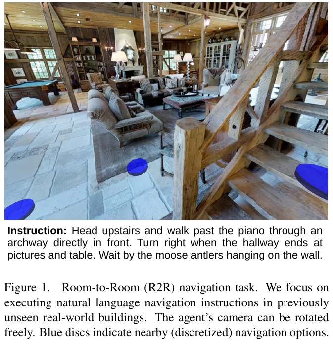
<figcaption>
Room-to-Room (R2R) vision-language navigation task. Following a natural language instruction, the agent starts from the initial viewpoint and takes multiple steps in the 3D simulator to reach the goal viewpoint.
</figcaption>
</div>

#### ① Overall framework
{: id="-整体框架概述"}

The VLN task requires the agent to produce a sequence of discrete navigation actions that reach the goal location in a 3D environment, without a prior global map, relying only on local RGB observations $o_t$ and the natural language instruction $\bar{x}$. The model has four core components: a **Language Instruction Encoder**, **Image & Action Embeddings**, a **Decoder LSTM with Attention**, and an **Action Prediction** head that outputs the action distribution.

<div align="center">
  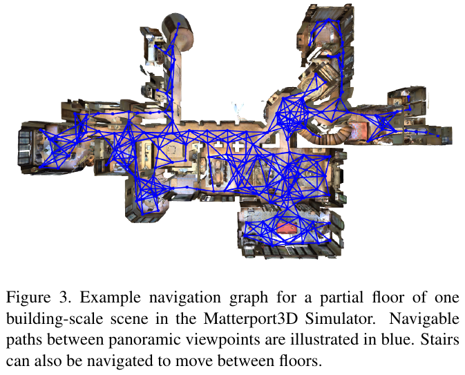
<figcaption>
Example navigation graph of the Matterport3D simulator. Nodes are 360° panoramic viewpoints, and edges are traversable paths between viewpoints.
</figcaption>
</div>

#### ② Module-by-module walkthrough
{: id="-逐模块讲解"}

* **Language Instruction Encoder**:
  * **Input**: The token sequence of the natural language instruction, $\bar{x} = \langle x_1, x_2, \dots, x_L \rangle$.
  * **Processing**: The word embeddings are fed in reverse order to a single-layer encoder LSTM, which computes the hidden state $$h_i = \text{LSTM}_{\text{enc}}(x_i, h_{i-1})$$.
  * **Output**: A sequence of encoded context vectors $\bar{h} = \{h_1, h_2, \dots, h_L\}$, which the attention mechanism later aligns against.
  * **Motivation**: Feeding the instruction in reverse order keeps the beginning of the sequence closer to the end of the encoder in terms of gradient path length, which improves the quality of early navigation decisions.

* **Image and Action Embedding**:
  * **Input**: The panoramic image observation $o_t$ at the current step and the previous action $a_{t-1}$.
  * **Processing**: A pretrained ResNet-152 CNN extracts a mean-pooled feature vector from $o_t$, which is concatenated with a learnable action embedding to form the combined state vector $q_t$.
  * **Output**: $q_t$ is fed to the decoder LSTM to update its hidden state:
    $$h'_t = \text{LSTM}_{\text{dec}}(q_t, h'_{t-1})$$
  * **Motivation**: The decoder LSTM acts as the agent's internal memory over its entire trajectory and visual observations, which suits the partially observable setting (POMDP).

* **Attention and Action Prediction**:
  * **Input**: The decoder hidden state $h'_t$ and the language context $\bar{h}$.
  * **Processing**: Luong global attention computes the text context vector $c_t = f(h'_t, \bar{h})$, from which the attentional hidden state is formed:
    $$\tilde{h}_t = \tanh(W_c [c_t; h'_t])$$
  * **Output**: A softmax gives the discrete action distribution $$a_t = \text{softmax}(\tilde{h}_t)$$.
  * **Action space**: The simplified model has 6 discrete actions: `left` (turn left 30°), `right` (turn right 30°), `up` (raise elevation by 30°), `down` (lower elevation by 30°), `forward` (move to the nearest adjacent viewpoint in the center of the view), and `stop` (end navigation).

#### ③ Training objective and loss
{: id="-训练目标与损失函数"}

Training uses a multi-step cross-entropy loss that maximizes the likelihood of the ground-truth action sequence:

$$L = -\sum_{t=1}^T \log P(a_t^* \mid s_0, a_0, \dots, s_t)$$

Here the target action $$a_t^*$$ is the next action along the shortest path on the topology graph $G$ from the agent's current state $s_t = \langle v_t, \psi_t, \theta_t \rangle$ to the goal viewpoint $$v^*$$.

#### ④ Training paradigms: Teacher-Forcing vs. Student-Forcing
{: id="-训练范式对比-teacher-forcing-vs-student-forcing"}

<div align="center">
  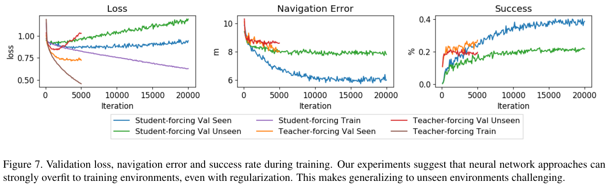
<figcaption>
Validation loss, navigation error, and success rate during training. The model keeps improving on seen scenes (Seen) but quickly overfits on unseen scenes (Unseen).
</figcaption>
</div>

* **Teacher-forcing**: At every training step, the ground-truth action $$a_t^*$$ is fed as the next input, so the model is trained only on states along the true shortest path. Once the agent deviates from that path at inference time, exposure bias appears.
* **Student-forcing** (online sampling, a DAgger variant): During training, the action $a_t$ is sampled from the model's own predicted distribution and the agent actually moves. If it leaves the original path, the shortest-path action from its current position to the goal is recomputed online as $$a_t^*$$ to continue supervision. Experiments show that this paradigm markedly improves the model's ability to recover from navigation deviations.

---

### 3. Results and findings
{: id="3-核心结果发现"}

The paper evaluates the navigation performance of various baselines and Seq2Seq models on R2R:

| Model/Evaluation Settings | Trajectory Length (m) | Navigation error (m) | Success rate (%) | Oracle success rate (%) |
| :--- | :---: | :---: | :---: | :---: |
| **Val Seen (seen validation set)** | | | | |
| RANDOM Baseline | 9.58 | 9.45 | 15.9 | 21.4 |
| Teacher-forcing | 10.95 | 8.01 | 27.1 | 36.7 |
| **Student-forcing** | **11.33** | **6.01** | **38.6** | **52.9** |
| **Val Unseen (unseen environments)** | | | | |
| RANDOM Baseline | 9.77 | 9.23 | 16.3 | 22.0 |
| Teacher-forcing | 10.67 | 8.61 | 19.6 | 29.1 |
| **Student-forcing** | **8.39** | **7.81** | **21.8** | **28.4** |
| **Test Unseen (unseen test set)** | | | | |
| Human (human test) | 11.90 | 1.61 | **86.4** | 90.2 |
| **Student-forcing** | **8.13** | **7.85** | **20.4** | **26.6** |

**Key findings**:
1. **Student-forcing is clearly better**: its success rate reaches 38.6% on Val Seen and 20.4% on Test Unseen, well above both the random baseline (13.2%) and Teacher-forcing.
2. **Large generalization gap**: The model reaches 38.6% on seen environments (Val Seen) but only 21.8% on unseen ones (Val Unseen). As Figure 7 shows, even with Dropout and Weight Decay regularization the model still overfits quickly to the visual characteristics of seen rooms.
3. **Large gap between humans and machines**: Human testers reach a success rate of 86.4% with a low navigation error of 1.61m, indicating that the dataset's instructions are clear and effective, while machines still struggle with cross-scene generalization and precise instruction-vision alignment.

---

### 4. Limitations
{: id="4-局限性"}

1. **Viewpoint graph restriction**: The agent relies on a pre-wired discrete viewpoint graph (navigation graph) rather than collision-aware, smooth control in real continuous space.
2. **Weak cross-scene generalization**: A standard Seq2Seq model with ResNet features struggles to build a generalizable semantic association between vision and language, and tends to overfit the textures of specific scenes.
3. **Oversimplified discrete actions**: Turning and moving forward are discretized into 6 fixed actions, which cannot be deployed directly on the low-level control interface of a physical robot.

---

## 2. VLN-CE (2020)
{: id="vln-ce"}
——Beyond the Nav-Graph: vision-language navigation in a continuous environment

📄 **Paper**: [arXiv:2004.02857](https://arxiv.org/abs/2004.02857) · 🏛️ **ECCV 2020**

**Key takeaways**

By moving VLN from discrete navigation graphs to continuous 3D environments, this paper shows how much performance depends on the strong assumptions implicit in graph-based settings. Lessons worth taking away: critically examine the implicit assumptions of a task setting, raise a task's practical value by removing unrealistic simplifications, recognize the key role of depth information in embodied navigation, and combine end-to-end learning with low-level control. This "de-simplification" approach is an important guide for building AI systems closer to real robot applications.

**Background and problem**

Existing Vision-and-Language Navigation (VLN) tasks are built on a navigation graph (nav-graph) representation, which introduces three unrealistic assumptions: a known environment topology, short-range oracle navigation, and perfect agent localization. These assumptions reduce the task to visually guided graph search, leaving a large gap to real robot navigation and limiting transfer to actual robot platforms.

**Method and innovations**

<div align="center">
  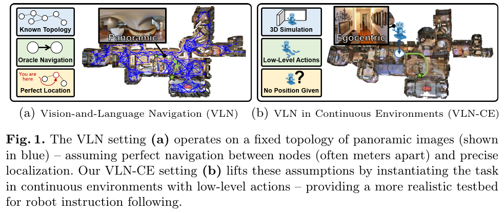
<figcaption>
Comparison of VLN and VLN-CE: VLN uses a fixed topology of panoramic graph nodes (left), while VLN-CE uses low-level actions in a continuous environment (right).
</figcaption>
</div>

The paper proposes the Vision-and-Language Navigation in Continuous Environments (VLN-CE) task, which instantiates continuous Matterport3D environments in the Habitat simulator. Key contributions include:

1. **Continuous environment setting**: The agent navigates freely in continuous 3D space through low-level actions (forward 0.25m, turn left/right 15°, stop) instead of teleporting between fixed nodes.

2. **Trajectory transfer method**: An algorithm converts the navigation-graph trajectories of Room-to-Room (R2R) into continuous paths. It casts rays downward to find the nearest navigable waypoint and verifies reachability with A*, successfully converting 77% of R2R trajectories (4475).

3. **Model architecture**:
   - **Seq2Seq baseline**: A GRU processes mean-pooled RGB and depth features, and an LSTM encodes the instruction.
   - **Cross-Modal Attention model**: A dual-GRU architecture in which one GRU processes visual observations and the other fuses instruction and visual features through attention to make decisions. RGB features come from an ImageNet-pretrained ResNet50, and depth features from a ResNet50 pretrained on Point-Goal Navigation.

4. **Training strategy**:
   - Basic imitation learning with inflection weighting
   - DAgger to counter exposure bias
   - Progress Monitor auxiliary loss
   - Synthetic data augmentation generated by a Speaker model (~150k trajectories)

**Results and findings**

1. **Much harder task**: The average trajectory in VLN-CE is 55.88 actions long, whereas VLN needs only 4-6 node jumps. The best model reaches 32% success rate (SR) and 0.30 SPL on val-unseen, far below its performance in VLN.

2. **Depth is critical**: Removing the depth input collapses performance (success rate ≤1%), while removing RGB or the instruction has a much smaller effect. Depth lets the agent quickly learn to traverse the environment without collisions, and is a key signal for guiding learning.

3. **Mixed effects of training techniques**: Cross-Modal Attention beats Seq2Seq, and DAgger adds 3-5% SPL. The Progress Monitor and data augmentation are ineffective on their own, and the best performance requires combining them (pretraining + DAgger fine-tuning).

4. **Strong navigation-graph prior**: When paths from an agent trained on VLN-CE are converted back to the navigation graph and evaluated on the VLN test set, the SPL is 0.21, far below the SOTA methods trained with the navigation graph (0.47 SPL). This suggests that existing VLN results may be overestimated because of the strong prior from the navigation graph.

5. **Single-modality ablation**: The no-instruction model reaches 17% SR, and the no-image model also reaches 17% SR, indicating that trajectories share common regularities; the full multimodal model (20% SR) is still clearly better than the single-modality baselines.

**Limitations**

About 23% of R2R trajectories cannot be navigated in continuous environments (due to discontinuities in the environment reconstruction, moved objects, etc.). The absolute performance of current end-to-end methods is still low, and future work should explore modular approaches, such as combining a learned agent with a motion controller. The paper does not examine every technique that might improve VLN-CE performance (such as further ways to handle exposure bias and data sparsity).

---

## 3. DUET (2022)
{: id="duet"}

📄 **Paper**: [arXiv:2202.11742](https://arxiv.org/abs/2202.11742) · 🏛️ **CVPR 2022** · [Code](https://github.com/cshizhe/VLN-DUET)

### Key takeaways
{: id="精华-1"}

1. To resolve the tension in vision-language navigation (VLN) between fine-scale local decision-making (which lacks a global view and easily gets trapped locally) and coarse-scale map-based decision-making (which lacks fine-grained object representations), it proposes DUET, a dual-scale topological map Transformer framework.
2. It introduces graph-aware self-attention (GASA) on the coarse-scale topological map, injecting the geodesic distances of the graph topology explicitly into the Transformer attention to plan global headings and backtracking nodes efficiently.
3. It proposes a coarse/fine-scale Dynamic Fusion strategy that adaptively balances global exploration against fine-grained visual and target localization according to the current state.
4. It introduces a pseudo-interactive demonstrator (PID) to address the distribution shift (exposure bias) in behavior cloning, and achieves SOTA navigation and target localization on REVERIE, SOON, and R2R.

---

### 1. Background and problem
{: id="1-研究背景问题-1"}

In the vision-language navigation (VLN) task, an agent must navigate to a goal location in an unseen real 3D environment by following natural language instructions (in REVERIE, it must also locate specific objects). Traditional methods face two main bottlenecks:

1. **Tension between fine-scale and coarse-scale representations**: Fine-scale local methods that predict step by step perceive only the environment around the current viewpoint and lack a global map, so backtracking efficiently from dead ends or off-route positions is extremely difficult. Existing coarse-scale topological map methods record the history and the unexplored frontier nodes, but because the map is highly abstract and lacks fine-grained visual images and object features, they struggle with complex instructions that require locating specific objects precisely.
2. **Distribution shift in training**: Pure behavior cloning is trained only on expert demonstration paths. Once the agent deviates from the path at inference time, errors accumulate severely.

To address these problems, DUET proposes a dual-scale Transformer architecture that combines a coarse-scale topological graph with fine-scale local viewpoints, uses graph topological distance to guide global planning, and learns its policy with a pseudo-interactive demonstrator algorithm.

---

### 2. Method and innovations
{: id="2-主要方法创新点-1"}

<div align="center">
  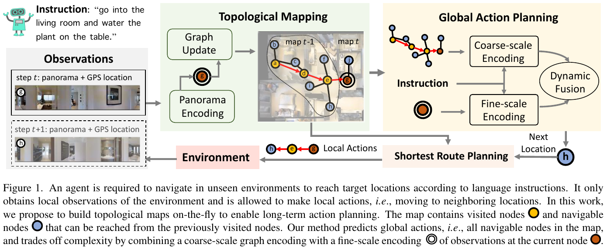
<figcaption>
Figure 1: The DUET agent builds an online topological map from a natural language instruction and makes dual-scale navigation decisions in an unseen indoor environment.
</figcaption>
</div>

<div align="center">
  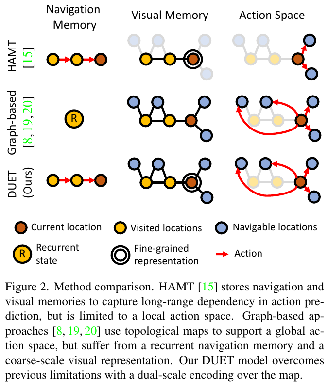
<figcaption>
Figure 2: Comparison of navigation memory mechanisms (local actions vs. coarse-scale map vs. DUET's dual-scale fusion).
</figcaption>
</div>

#### ① Overall framework
{: id="-整体框架概述-1"}

DUET consists of four core modules:
- **Online topological mapping**: Incrementally maintains the coarse-scale topological map $$G_t$$ and the fine-scale panoramic visual and object representations of the current viewpoint.
- **Coarse-scale Cross-modal Encoder**: Uses graph-aware self-attention to reason over exploration and backtracking candidate nodes on the global topology graph.
- **Fine-scale Cross-modal Encoder**: Attends to the images and objects visible from the current viewpoint to perform fine-grained language-vision grounding and object localization.
- **Dynamic Fusion**: Adaptively fuses the global and local action scores and outputs the next decision in the global action space.

<div align="center">
  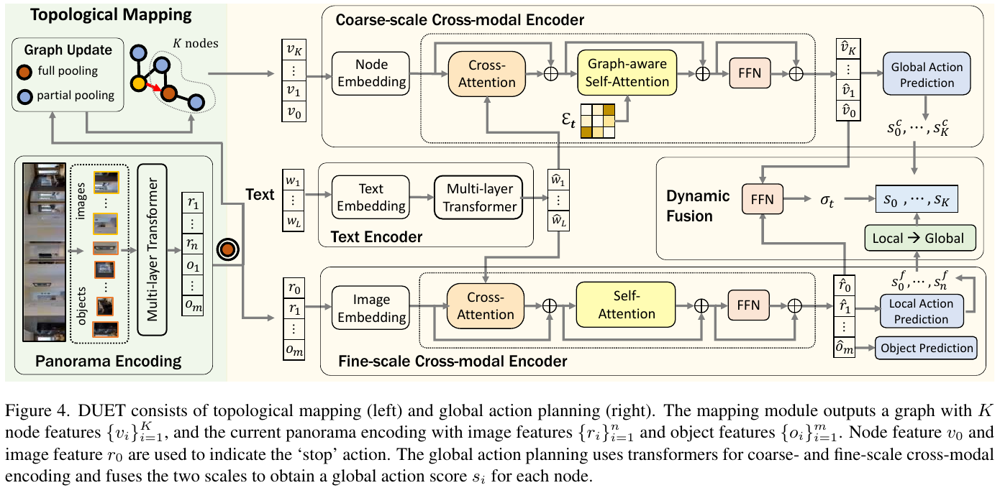
<figcaption>
Figure 4: Overall DUET architecture. Left: online topological map construction. Right: coarse/fine-scale Transformer encoding and dynamic-fusion prediction.
</figcaption>
</div>

#### ② Topological map construction and update
{: id="-拓扑地图构建与图更新"}

The online topological map is defined as $$G_t = (V_t, E_t)$$. Its node set contains visited nodes (storing historical panoramic features and the visit time step $$t$$) and navigable unexplored frontier nodes. In addition, a special "stop" node $$v_0$$ is added explicitly and connected to all nodes.

<div align="center">
  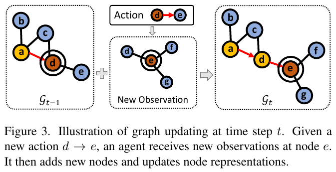
<figcaption>
Figure 3: Topological map update at time step t (merging visited nodes with the newest reachable frontier nodes).
</figcaption>
</div>

#### ③ Coarse-scale cross-modal encoder and graph-aware self-attention (GASA)
{: id="-粗尺度跨模态编码器与图感知自注意力gasa"}

The coarse-scale encoder takes the topological map $$G_t$$ and the encoded instruction $$\hat{W}$$. Node visual features combine egocentric relative position encoding (azimuth, elevation, and distance) with an encoding of the most recent visit time step.

To make the Transformer aware of the graph's spatial structure, graph-aware self-attention (GASA) is proposed:
$$ \text{GASA}(X) = \text{Softmax}\left( \frac{X W_q (X W_k)^T}{\sqrt{d}} + M \right) X W_v $$
Here $$M = E W_e + b_e$$, $$E$$ is the matrix of shortest-path geodesic distances between nodes, and $$W_e, b_e$$ are learnable parameters. The coarse-scale encoder outputs a global action score $$s_i^c$$ for every navigable frontier node and the stop node in the global graph.

#### ④ Fine-scale cross-modal encoder
{: id="-细尺度跨模态编码器"}

The fine-scale encoder applies cross-attention only to the panoramic image patches $$R_t$$ and detected candidate objects $$O_t$$ of the current viewpoint $$V_t$$, with global coordinates and local relative orientation encodings. It outputs local action scores $$s_i^f$$ for the neighbor nodes $$N(V_t)$$ of the current viewpoint, together with localization scores for the candidate objects.

#### ⑤ Dynamic fusion of coarse and fine scales
{: id="-粗细尺度动态融合dynamic-fusion"}

Because the fine-scale action space is limited to the local neighbor nodes $$N(V_t)$$, its scores cannot be compared directly with the global node scores. DUET maps the fine-scale scores of all non-neighbor nodes to a unified backtracking score $$s_{\text{back}} = \sum_{v \in N(V_t)} s_v^f$$, converting them into scores $$s_i'^f$$ in the global action space.

The coarse-scale stop-node embedding $$\hat{v}_0$$ and the fine-scale stop-node embedding $$\hat{r}_0$$ are concatenated, and an FFN computes the adaptive fusion weight:
$$ \sigma_t = \text{Sigmoid}(\text{FFN}([\hat{v}_0; \hat{r}_0])) $$
The final selection score of each node is:
$$ s_i = \sigma_t s_i^c + (1 - \sigma_t) s_i'^f $$

#### ⑥ Training objectives and the pseudo-interactive demonstrator (PID)
{: id="-训练目标与伪交互演示器pid"}

- **Pretraining phase**: Expert demonstration trajectories are used to jointly optimize the single-step action prediction loss $$L_{\text{SAP}}$$, the object grounding loss $$L_{\text{OG}}$$, the masked language modeling loss $$L_{\text{MLM}}$$, and the masked region classification loss $$L_{\text{MRC}}$$:
  $$ L_{\text{SAP}} = \sum_{t=1}^T -\log p(a_t^* \mid W, P_{<t}^*) $$
  $$ L_{\text{OG}} = -\log p(o^* \mid W, P_T) $$
- **Policy fine-tuning phase (PID)**: Given the complete map structure, a pseudo-interactive demonstrator (PID) $$\pi^*$$ is constructed. On trajectories $$P$$ that the agent samples itself, the PID computes the shortest-path node to the goal from the current topological map as a pseudo-expert supervision label, and the policy is fine-tuned with the DAgger paradigm:
  $$ L_{\text{PID}} = \sum_{t=1}^T -\log p(a_t^{\pi^*} \mid W, P_{<t}) $$

---

### 3. Results and findings
{: id="3-核心结果发现-1"}

DUET sets new SOTA results on three major vision-language navigation benchmarks, REVERIE, SOON, and R2R:

1. **REVERIE remote object navigation**:
   - On Val Unseen, the success rate SR reaches **46.98%** and SPL reaches **33.73%**, far ahead of the previous SOTA model HAMT (SR 32.95%, SPL 30.20%).
   - On Test Unseen, SR reaches **52.51%** and SPL reaches **36.06%**. Compared with HAMT, SR improves by **22.11%**.
2. **SOON complex goal navigation**:
   - On Test Unseen, SR reaches **33.44%** and SPL reaches **21.42%**, clearly better than the graph-search baseline GBE (SR 12.90%, SPL 9.23%).
3. **R2R fine-grained instruction navigation**:
   - SR on the Val Unseen and Test Unseen splits reaches **72%** and **69%** respectively (6% and 4% ahead of HAMT).
4. **Key ablation findings**:
   - The coarse-scale model alone explores well (high OSR) but localizes targets poorly; the fine-scale model alone tends to get stuck locally; dual-scale Dynamic Fusion gives the best overall performance (SPL up by 1.79%).
   - Adding the geodesic distances of GASA significantly shortens navigation paths (SPL improves).
   - PID mitigates the distribution shift that arises when the agent leaves the expert trajectory more effectively than conventional RL fine-tuning.

<div align="center">
  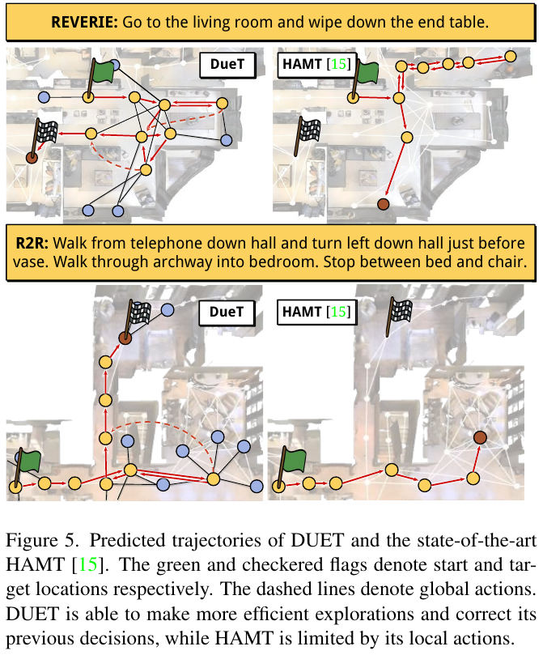
<figcaption>
Figure 5: Qualitative comparison of DUET and HAMT navigation trajectories (DUET explores efficiently and can correct earlier decisions).
</figcaption>
</div>

---

### 4. Limitations
{: id="4-局限性-1"}

1. **Generalization gap to unseen environments**: Performance on seen environments still exceeds that on unseen ones, so the model's generalization to unseen scenes has room to improve.
2. **Restricted to discrete topology graphs**: DUET currently relies on discrete navigation graphs (such as the discrete nodes and edges of the Matterport3D simulator), which is hard to transfer directly to real robot navigation in continuous environments without a topological prior.
3. **Privacy and safety**: Deployment in real indoor environments must account for privacy leakage from visual capture and real-time mapping, as well as collision safety risks.

---

## 4. R2RIE-CE & IEDL (2024)
{: id="r2rie-ce-iedl"}
——The first continuous-navigation benchmark with instruction errors, and a multimodal error detection and localization framework based on instruction-trajectory compatibility

📄 **Paper**: [arXiv:2403.10700](https://arxiv.org/abs/2403.10700) · [Project Page](https://intelligolabs.github.io/R2RIE-CE/) · 🏛️ **ROMAN 2024**

### Key takeaways
{: id="精华-2"}
1. **A new perspective on instruction fault tolerance**: It points out for the first time that the assumption in existing Vision-and-Language Navigation (VLN-CE) research that instructions are completely correct often fails in practice, since humans frequently give wrong instructions because of fuzzy memory or confusion.
2. **Benchmark construction**: It builds R2RIE-CE, the first continuous navigation benchmark with instruction errors, covering five types of perturbations: direction, room, object, room-and-object, and all-types errors.
3. **Vulnerability verification**: Experiments show that injecting at most 3 errors into an instruction causes the Success Rate (SR) of SOTA navigation models to plummet by 25%–30.64%.
4. **Detection and localization framework**: It proposes the IEDL framework, which fuses visual trajectory and text instruction features through a cross-modal Transformer to achieve efficient error detection (AUC 0.79) and word-level localization.
5. **Value for correcting annotation errors**: As a semi-automatic data-cleaning tool, it screened out 8 and 10 paths with erroneous or ambiguous ground-truth annotations in the classic R2R-CE and RxR-CE validation sets, respectively.

---

### 1. Background and problem
{: id="1-研究背景问题-2"}
Existing vision-language navigation (VLN) methods assume that "instructions given by humans are 100% correct." In real human-robot interaction, however, navigation instructions often contain errors because of imprecise human memory, confusion of spatial concepts (such as mixing up left and right), or cognitive impairment.

If the agent blindly follows such instructions, navigation fails badly. There is currently no benchmark for evaluating an agent's robustness to erroneous instructions in continuous 3D environments (VLN-CE). The paper therefore poses two core questions:
1. How vulnerable are existing SOTA navigation models to erroneous human instructions?
2. How can we detect whether an input instruction contains errors and pinpoint the word where the error occurs, so that subsequent error-tolerance or clarification mechanisms can be applied?

---

### 2. Method and innovations
{: id="2-主要方法创新点-2"}

#### A. Building the R2RIE-CE benchmark
{: id="a-r2rie-ce-基准测试构建"}
The paper builds the **R2RIE-CE** (R2R with Instruction Errors in Continuous Environments) benchmark on the R2R-CE validation set (Val Unseen) by manually introducing errors that follow commonsense priors and typical human confusions.

<div align="center">
  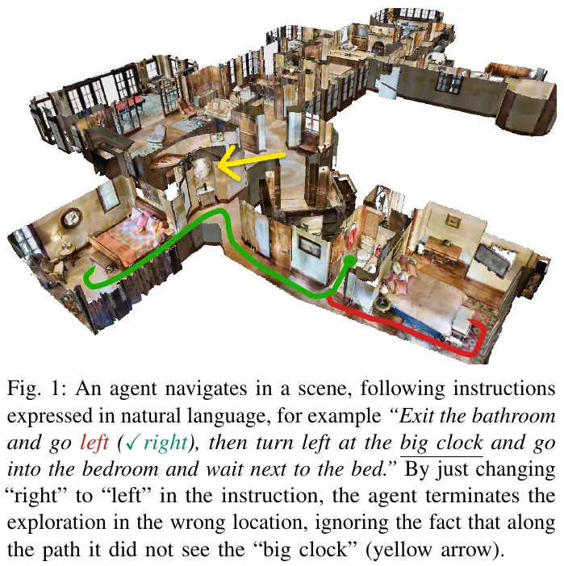
<figcaption>
Figure 1: Example of navigation with an instruction error. Simply replacing "turn right" with "turn left" in the natural language instruction makes the agent leave the correct path and end its exploration at the wrong location (yellow arrow).
</figcaption>
</div>

The errors fall into five categories:
1. **Direction Error**: High-frequency direction words (such as left/right, go down/go up, forward/backward) are replaced with their antonyms.
2. **Object Error**: Using commonsense co-occurrence, an object word in the instruction (such as sofa) is randomly replaced with another object that commonly appears in the same room (such as chair).
3. **Room Error**: Using a room adjacency prior, the target room (such as bathroom) is randomly replaced with an adjacent room type (such as bedroom).
4. **Room & Object Error**: Both a room error and an object error are injected into the instruction.
5. **All Error**: Direction, room, and object errors are all introduced into the same instruction (each sample contains 3 errors on average).

<div align="center">
  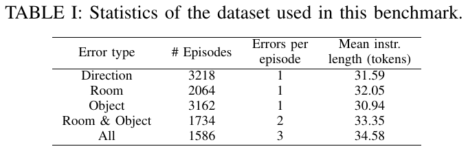
<figcaption>
Table 1: Sample statistics of the R2RIE-CE benchmark for each error type.
</figcaption>
</div>

#### B. The IEDL error detection and localization framework
{: id="b-iedl-错误检测与定位框架"}
To address these challenges, the paper proposes the **IEDL** (Instruction Error Detector & Localizer) framework, a module decoupled from the underlying navigation policy. Its core idea is to catch inconsistencies by comparing the semantic compatibility between the "trajectory visual features" produced by the agent's navigation and the "input text instruction."

<div align="center">
  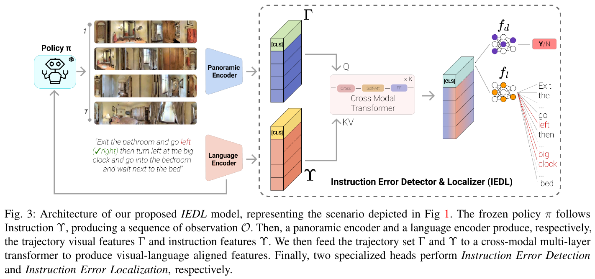
<figcaption>
Figure 2: Overall architecture of the IEDL model. The trajectory visual features $\Gamma$ output by the frozen navigation policy $\pi$ and the instruction embeddings $\Upsilon$ are fed to a multi-layer cross-modal Transformer for alignment and fusion. Classification heads then perform error detection ($f_d$) and word-level error localization ($f_l$).
</figcaption>
</div>

1. **Overall framework**:
IEDL consists of an instruction encoder, a panoramic trajectory encoder, a cross-modal fusion Transformer, and two parallel classification heads. It treats the agent's action history and visual observation sequence as the ground-truth trajectory and checks whether the instruction's semantics are consistent with it.

2. **Module-by-module walkthrough**:
   - **Instruction Encoder (Language Encoder)**: Takes a natural language instruction $\mathcal{I}$ of $W$ ($W=80$) words. After tokenization and padding, it is fed to a pretrained BERT model to extract word embedding features $\Upsilon \in \mathbb{R}^{W \times D}$.
   - **Trajectory Encoder**: A navigation agent with some policy $\pi$ navigates the environment for $T$ steps and yields an image observation sequence $\mathcal{O} = \{O_1, ..., O_T\}$. ViT-B/16-CLIP panoramic features are extracted from each $O_t$, and a Panoramic Encoder performs spatiotemporal modeling to obtain the trajectory representation $\Gamma = \{V_1, ..., V_T\} \in \mathbb{R}^{T \times D}$. To inject temporal order, sine/cosine position encodings are added to $\Gamma$, and a learnable `[CLS]` embedding is prepended.
   - **Cross-Modal Transformer**: Contains $k$ ($k=4$) stacked layers. In each layer, the trajectory feature $\Gamma$ serves as the Query ($Q$) and the text instruction embedding $\Upsilon$ as the Key-Value ($KV$) in a cross-attention that aligns visual features to the text; Self-Attention and an FFN then fully mix the multimodal features.
   - **Trajectory-Instruction Matching Head ($f_d$)**: Takes the fused `[CLS]` token and outputs a matching probability $$d_{\pi} \in [0, 1]$$ through a multi-layer perceptron (MLP, $\mathbb{R}^D \to \mathbb{R}$) and a Sigmoid, identifying whether the instruction contains errors.
   - **Error Localization Head ($f_l$)**: Takes the fused text token sequence and uses a separate MLP ($\mathbb{R}^D \to \mathbb{R}^W$) to predict the probability that each token is an erroneous word, giving fine-grained localization of error words.

3. **Training objective and loss**:
The model is trained jointly on two tasks. The loss is a weighted sum of the matching classification loss $$\mathcal{L}_d$$ (binary cross-entropy) and the word-level localization loss $$\mathcal{L}_l$$ (standard cross-entropy, summed over each token in the instruction):
   $$\mathcal{L} = \lambda_1 \mathcal{L}_d + \frac{\lambda_2}{E} \sum_{i=1}^{E} \mathcal{L}_l$$
Here $E$ is the actual number of erroneous words in the instruction, and $\lambda_1$ and $\lambda_2$ are balancing weights (both set to 1 in the experiments).

---

### 3. Results and findings
{: id="3-核心结果发现-2"}

#### A. Vulnerability of existing navigation models to incorrect instructions
{: id="a-现有导航模型在错误指令下的脆弱性"}
The researchers tested six mainstream VLN-CE models (including SOTA algorithms such as BEVBert and ETPNav) on the R2RIE-CE benchmark.

<div align="center">
  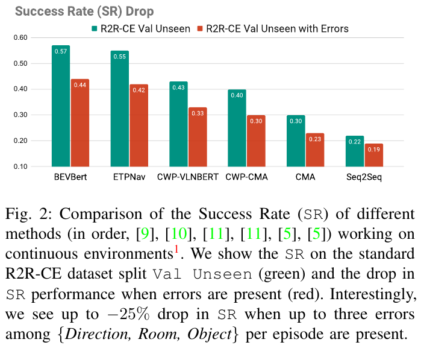
<figcaption>
Figure 3: Success Rate (SR) of mainstream navigation models on the original R2R-CE Val Unseen set (green) and on the error-injected set (red).
</figcaption>
</div>

- **Performance drops**: Once errors are mixed into the instructions, the Success Rate (SR) of every model falls off a cliff. Under the Room & Object error type, performance drops by about 11.47% on average; in the All mode, which includes all error types, SR drops by **30.64%**.
- **Sensitivity differs by error type**: Direction errors hurt navigation most, causing an average relative SR drop of **18.64%**. Agents depend heavily on direction words (such as left/right); once a direction is reversed, they quickly go off track and stop early.

#### B. Detection and localization performance of IEDL
{: id="b-iedl-的检测与定位表现"}
The authors compare IEDL with Random (random prediction) and CLIP Alignment (a zero-shot alignment baseline based on phrase matching):

<div align="center">
  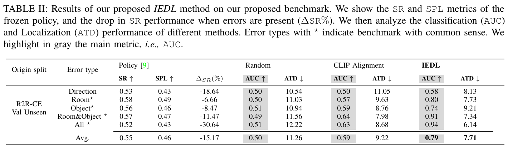
<figcaption>
Table 2: Error detection (AUC) and localization (ATD) metrics for Random, CLIP Alignment, and IEDL under each error type.
</figcaption>
</div>

- **SOTA-level detection and localization**: IEDL clearly outperforms the baselines in every category. Under all-type errors (All) in particular, IEDL's detection AUC reaches **0.94**, and the average token distance (ATD) of localization shrinks to **6.14** tokens.
- **Practical value for dataset error correction**: The authors applied the trained IEDL to the original R2R-CE and RxR-CE validation sets. Among samples with classification confidence above 0.99, manual review confirmed that **8 R2R-CE samples** and **10 RxR-CE samples** had obvious human annotation errors in the ground-truth instructions themselves.

---

### 4. Limitations
{: id="4-局限性-2"}
1. **Offline detection only**: IEDL is currently an offline (post-hoc) detector: errors can be detected only after the agent's navigation policy has run and produced a complete trajectory. Future work should explore online, real-time error identification and correction during navigation.
2. **No closed-loop strategy after error detection**: The paper focuses on detecting and localizing errors, and does not build a detailed closed-loop strategy for what the agent should do once an error is found, such as proactively asking the human user for clarification or autonomously re-planning its route.

---

## 5. NaVid (2024)
{: id="navid"}

📄 **Paper**: [arXiv:2402.15852](https://arxiv.org/abs/2402.15852) · 🏛️ **RSS 2024** · [Project Page](https://pku-epic.github.io/NaVid/) · [Code](https://github.com/jzhzhang/NaVid-VLN-CE)

---

### Key takeaways
{: id="精华-3"}

1. **A new paradigm that does not depend on maps or noisy sensors**: NaVid is the first vision-language navigation (VLN) large model that relies only on a monocular RGB video stream, with no depth maps, topological/metric maps, or odometry input, which fundamentally removes odometry drift and the Sim-to-Real sensor gap.
2. **Dynamic spatiotemporal token encoding**: Building on the LLaMA-VID architecture, the current frame is allocated 64 instruction-agnostic tokens to preserve high-resolution geometric structure, while historical frames are compressed heavily to 4 tokens each. The special markers `<HIS>`, `<OBS>`, and `<NAV>` are combined with these to represent the long-term sequence context efficiently.
3. **Joint training on navigation data and instruction reasoning**: It combines 320k Oracle trajectories, 180k DAgger-style non-Oracle exploration trajectories, and 10k path-instruction reasoning samples, and fine-tunes jointly with 763k large-scale multimodal Web data, preserving the large model's generalization while injecting robot control ability.
4. **Strong cross-dataset performance and real-robot deployment**: In the RxR zero-shot transfer test, SPL surpasses the previous SOTA method by 236.5% (from 6.3% to 21.2%); in real-world tests on a real robot, it achieves navigation success rates of 84% on simple instructions and 48% on complex instructions.

---

### 1. Background and problem
{: id="1-研究背景问题-3"}

Vision-language navigation in continuous environments (VLN-CE) requires an agent to perform low-level action control from natural language instructions in an unknown real physical world. Existing methods have two main bottlenecks:
- **Dependence on sensors and maps**: The vast majority of traditional and LLM-based navigation systems rely on topological/metric map construction, depth-camera point clouds, or precise odometry pose estimation. When deployed in the real world, sensor noise, missing point clouds, and accumulated odometry drift can quickly make the system fail.
- **Sim-to-Real domain gap**: The perfect depth maps and error-free localization of simulation are hard to reproduce in the real world, which greatly hinders transferring navigation policies from simulation to real robots.

NaVid is motivated by human navigation instincts: a person can reason about a route using only the monocular visual stream in front of their eyes and the memory in their head. NaVid therefore explores an end-to-end VLM navigation paradigm driven purely by a monocular RGB video stream.

---

### 2. Method and innovations
{: id="2-主要方法创新点-3"}

<div align="center">
  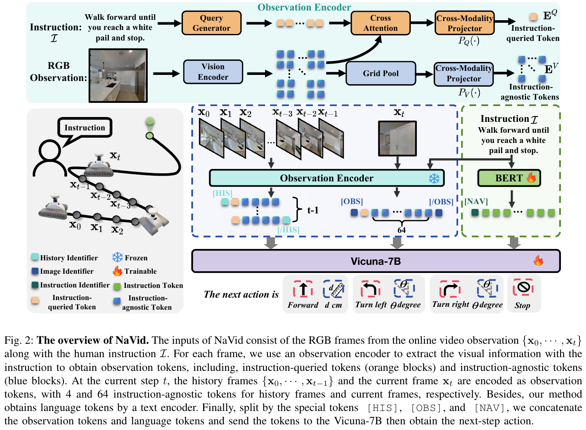
<figcaption>
NaVid overall model architecture and spatiotemporal token encoding process
</figcaption>
</div>

#### ① Overall framework
{: id="-整体框架概述-2"}
NaVid is built on the general video-language model LLaMA-VID. It consists of a **Visual Encoder (EVA-CLIP)**, a **Query Generator (Q-Former-based)**, a **Dual-modal Projector**, and a **Large Language Model Backbone (LLM, such as Vicuna-7B)**. The system takes the robot's historical observation video stream and the current monocular RGB image, encodes them into instruction-aware and instruction-agnostic token channels, and directly generates a text action containing the action type and quantitative parameters (such as forward distance or rotation angle).

#### ② Module-by-module walkthrough
{: id="-逐模块讲解-1"}

- **Visual encoder and dual-channel observation token encoding**
  - **Input**: A monocular RGB video frame sequence $$\mathcal{O}_t = \{x_0, x_1, \dots, x_t\}$$ from the start time $0$ to the current time $t$. Each frame goes through the visual encoder EVA-CLIP to extract patch embeddings $X_t \in \mathbb{R}^{N_x \times C}$ (where $N_x = 256$).
  - **Processing**:
    1. **Instruction-Queried Tokens $E_t^Q$**: The Q-Former query generator $G_Q$ combines the text instruction $I$ with the image features $X_t$ to produce an instruction-aware query $Q_t$, which is compressed into a single token $E_t^Q \in \mathbb{R}^{1 \times C}$ through cross-attention and mean pooling (Pool).
    2. **Instruction-Agnostic Tokens $E_t^V$**: Grid pooling on the image features $X_t$ compresses the $N_x$ features into $N_v$ geometric tokens. To balance computational efficiency against preserving spatial geometry, the current frame $x_t$ uses $N_v = 64$, while each historical frame $x_{0..t-1}$ is compressed heavily to $N_v = 4$.
  - **Output**: The multimodal visual token sequence of the current and historical frames.
  - **Motivation**: The current frame needs dense geometric detail to predict accurate quantitative action parameters (movement distance or rotation angle), while historical frames mainly provide spatiotemporal trajectory context. Low-density tokens both reduce the long-context burden on the large model and retain the key trajectory memory.

- **Special token formatting**
  - **Input**: The historical-frame token sequence, current-frame token sequence, and language instruction token sequence.
  - **Processing**: Special delimiter tokens are introduced: `<HIS>`/`</HIS>` (delimiting historical observations), `<OBS>`/`</OBS>` (delimiting the current observation), and `<NAV>` (triggering navigation action prediction).
  - **Output format**:

    $$\text{Input}: \text{<HIS>} \{\text{historical frames}\} \text{</HIS>} \text{<OBS>} \{\text{current frame}\} \text{</OBS>} \text{<NAV>} \{\text{instruction content}\}$$
    $$\text{Output}: \{\text{action reasoning \& text action}\}$$

  - **Motivation**: Explicitly separating the modalities and spatiotemporal roles needed for action reasoning guides the LLM to distinguish the navigation history memory from the current decision-making environment correctly.

- **Quantitative action planning**
  - **Output format**: NaVid outputs text that combines a discrete action type with continuous quantitative parameters, with action set $\mathcal{A} \in \{\text{FORWARD}, \text{TURN-LEFT}, \text{TURN-RIGHT}, \text{STOP}\}$. For example: `The next action is move forward 75 cm` or `turn left 30 degrees`.
  - **Parsing**: At inference time, a regular-expression parser extracts the action type and numeric parameters directly and sends them to the robot chassis for execution.

<div align="center">
  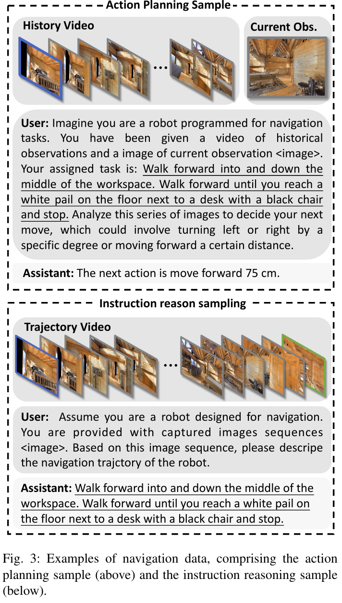
<figcaption>
NaVid navigation training sample structure (action planning and instruction reasoning)
</figcaption>
</div>

#### ③ Hybrid training strategy and auxiliary tasks
{: id="-混合训练策略与辅助任务hybrid-training-strategy"}
1. **Non-Oracle trajectory collection (DAgger-like)**: First, 320k step samples are generated from Oracle trajectories in 61 MP3D indoor scenes. The initial model is then deployed in the VLN-CE environment to collect 180k steps of non-Oracle exploration trajectories that deviate from the correct path, which greatly strengthens the model's self-correction and robustness.
2. **Co-training on VLN-CE and auxiliary tasks**:
   - **Action planning**: 500k step-level navigation action prediction samples.
   - **Instruction reasoning**: 10k path back-description samples. Given a historical video sequence, the model must infer the corresponding natural language navigation instruction in reverse, which strengthens image-text alignment.
   - **Large-scale Web data**: 763k general Video-QA / Image-QA Web samples from LLaMA-VID are mixed in to keep the common sense and reasoning ability of a general VLM and prevent catastrophic forgetting.

#### ④ Training objective and loss
{: id="-训练目标--损失函数"}
NaVid is fine-tuned end to end with the standard autoregressive cross-entropy loss:
$$\mathcal{L}_{CE} = -\sum_{i=1}^N \log P\left(y_i \mid y_{<i}, \mathbf{X}_{obs}, \mathbf{X}_{inst}\right)$$
Here $y_i$ is the $i$-th token of the output text sequence (including the reasoning process and the quantitative action command), $$\mathbf{X}_{obs}$$ is the encoded video observation tokens, and $$\mathbf{X}_{inst}$$ is the instruction tokens.

#### ⑤ Inference procedure
{: id="-推理流程"}
During online navigation, the robot's monocular RGB camera captures a video stream in real time. The system maintains a sliding observation buffer, extracts the historical frames (4 tokens per frame) and the current frame (64 tokens), appends the text instruction, and feeds them to NaVid. The large model decodes the action text autoregressively, and a regular-expression parser converts it directly into low-level control commands (such as moving forward 75cm), without building any explicit map.

---

### 3. Results and findings
{: id="3-核心结果发现-3"}

<div align="center">
  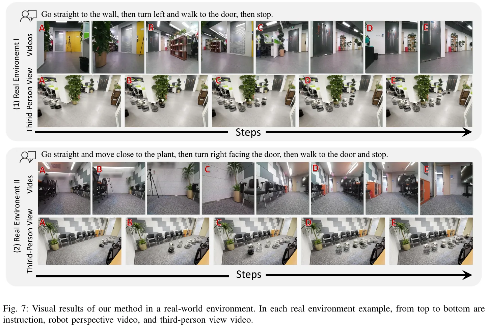
<figcaption>
NaVid executing vision-language navigation in a real physical environment
</figcaption>
</div>

1. **SOTA performance in simulation (VLN-CE R2R & RxR)**:
   - On the R2R Val-Unseen validation set, NaVid reaches a success rate (SR) of **37.4%** and a path-length-weighted success rate (SPL) of **35.9%**, clearly surpassing existing vision-only and depth-map baselines.
   - In the RxR Val-Unseen zero-shot cross-dataset test (no RxR training), NaVid reaches SR **23.8%** and SPL **21.2%**. Compared with the previous SOTA method A2Nav (SR 16.8%, SPL 6.3%), SPL improves by **236.5%**.

2. **LLM baseline comparison**:
   - On a subset of 100 randomly sampled R2R Val-Unseen episodes, GPT-4V without navigation fine-tuning reaches an SR of only 5.0% and frequently outputs descriptive text unrelated to actions, whereas NaVid, fine-tuned on navigation data, reaches **38.0%** (SPL **35.4%**).

3. **History representation ablation**:
   - Compared with a purely textual history description (Text-based, SPL 0.0%), a top-down 2D map plus text (Map-text, SPL 8.97%), and first-person images plus text (Ego-view-text, SPL 20.8%), NaVid's pure video-stream representation achieves the highest SPL (**35.9%**) and a markedly lower inference latency (no need to call an additional captioning model repeatedly).

4. **Real-world Sim-to-Real transfer**:
   - In four real scenes (Meeting Room, Office, Lab, and Lounge), NaVid achieves an average completion rate of 84% on simple instructions and 48% on complex multi-step instructions that require avoiding distractors (such as chairs), far exceeding Seq2Seq (0%), CMA (2%), and the semantic-map-based WS-MGMap (20%-32%).

---

### 4. Limitations
{: id="4-局限性-3"}

1. **Compute overhead on long routes**: As the number of navigation steps grows, the accumulating historical video frames lengthen the large model's context. Although historical frames are compressed to 4 tokens each, GPU memory use and inference time still rise on routes of hundreds of steps.
2. **No explicit backtracking**: Because NaVid uses pure autoregressive text action prediction and keeps no explicit topological or metric map, it has difficulty re-planning a global path precisely when it hits a dead end or goes astray, as explicit-mapping methods can.

---

## 6. NavGPT-2 (2024)
{: id="navgpt-2"}
——Unleashing the navigation reasoning capabilities of large vision-language models

📄 **Paper**: [arXiv:2407.12366](https://arxiv.org/abs/2407.12366) · 🏛️ **ECCV 2024**

**Background and problem**

Although there have been efforts to integrate LLMs into VLN tasks, both extremes have limitations: (1) zero-shot methods rely on complex prompt engineering, suffer information loss, and show a large performance gap (about 40% SR); (2) fine-tuning methods use large-scale LLMs, yet still lag behind VLN-specific models and lose the language ability and interpretability of the LLM. The research goal is to close the performance gap between LLM-based agents and SOTA VLN-specific models while retaining the LLM's explanatory ability.

**Method and innovations**

NavGPT-2 adopts a hybrid architecture of a **frozen LLM + a navigation policy network** and is trained in two stages:

<div align="center">
  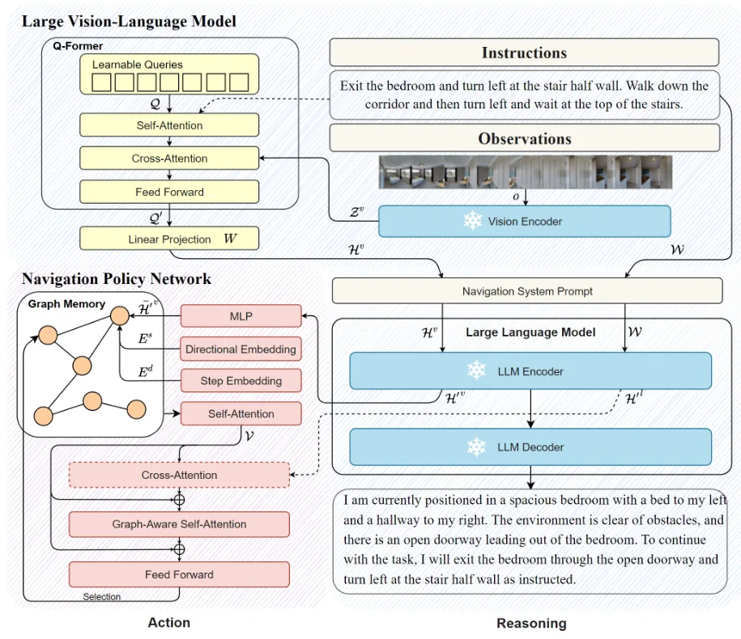
<figcaption>
NavGPT-2 model architecture
</figcaption>
</div>

**Phase 1: Visual Instruction Tuning**
- Based on the InstructBLIP architecture, a Q-former encodes multi-view images into fixed-length visual tokens
- GPT-4V automatically generates 10K navigation reasoning samples
- Only the Q-former and projection layers are fine-tuned; the LLM and visual encoder (EVA-CLIP ViT-g/14) stay frozen

<div align="center">
  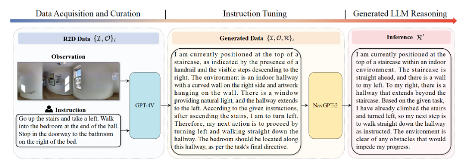
<figcaption>
GPT-4V navigation reasoning data generation pipeline
</figcaption>
</div>

**Phase 2: Learning a graph-based navigation policy**
- LLM hidden-layer representations are extracted as vision-language representations
- A topological-map navigation policy network (derived from DUET) is used, including:
  - Node Embedding: fuses visual features, direction embeddings, and step embeddings
  - Cross-Modal Encoding: graph-aware self-attention (GASA)
  - Global Action Prediction: selects the next step from the entire constructed graph
- Trained with a DAgger loss while the VLM stays frozen

Key innovations:
1. **VLM latent representation as the vision-language representation**: Visual features are projected into the LLM's language space, giving stronger alignment across environments
2. **Data efficiency**: By using the LLM's pretrained weights, it matches DUET's full-data performance with 50% of the data
3. **Language capability preserved**: The LLM is frozen, so it keeps its ability to generate navigation reasoning and interact with humans

**Results and findings**

Performance on R2R (NavGPT-2 FlanT5-XXL, 5B parameters):

| Split | SR | SPL | NE | OSR |
|-------|----|----|-----|-----|
| Val Unseen | 71% | 60% | 3.18 | 80% |
| Test Unseen | 72% | 60% | 3.33 | 80% |

Key findings:
- **Closing the performance gap**: At the same training scale, it surpasses all LLM-based methods and matches DUET, the SOTA VLN-specific model
- **Data efficiency**: With 50% of the R2R data, it reaches the performance DUET achieves with the full data
- **Generalization**:
  - RxR dataset (fine-grained instructions): SR improves by 3.67%
  - HM3D dataset (unseen environments): SR improves by 21.6% (47.2% vs 25.6%)
- **Interpretability**: It can generate natural language reasoning that describes the surroundings, identifies navigation progress, and plans the next step.

<div align="center">
  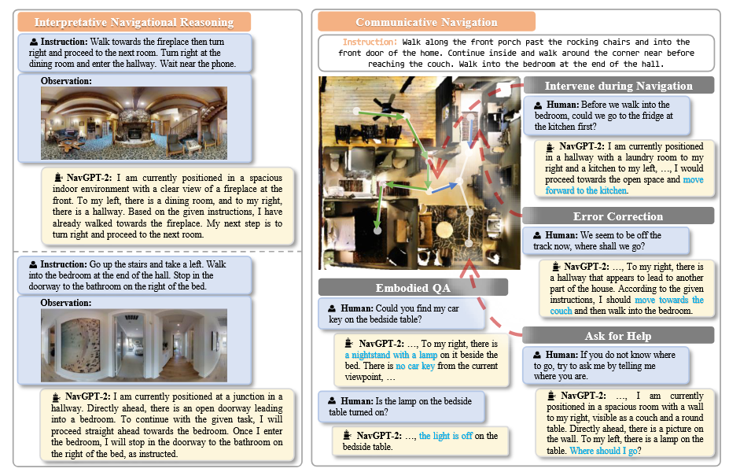
<figcaption>
Example of navigation reasoning generated by NavGPT-2
</figcaption>
</div>

Ablation experiments show:
- Removing the navigation policy network causes a large performance drop (SR falls from 68% to 21%)
- FlanT5 models outperform Vicuna models (an encoder-decoder architecture beats a decoder-only one)
- Stronger visual encoders bring only limited gains; the main gain comes from the LLM's hidden representations

**Limitations**

(1) Navigation reasoning is based on local observations, and history is not modeled in the VLM, so consistency needs improvement; (2) reasoning and action prediction are not strictly synchronized; (3) hallucinations occur (recognizing nonexistent objects or misjudging directions); (4) interaction capabilities have not been fully evaluated. Future work should focus on mechanisms for synchronizing reasoning and action, history modeling, and interactive navigation.

### Series comparison summary
{: id="系列对比总结"}

| Dimension | NavGPT (AAAI-2024) | NavGPT-2 (ECCV-2024) |
|------|-------------------|---------------------|
| **Core idea** | Pure LLM zero-shot navigation | Frozen LLM + fine-tuned navigation policy |
| **Training** | No training required (zero-shot) | Two-stage training (VLM fine-tuning + policy learning) |
| **Performance (R2R SR)** | 34% | 72% (test unseen) |
| **Reasoning** | Explicit, driven by prompt engineering | Explicit, driven by instruction tuning |
| **Main contribution** | Reveals the navigation reasoning ability of LLMs | Closes the performance gap between LLM agents and SOTA |
| **Limitations** | Large performance gap, severe information loss | Reasoning and action not fully synchronized, hallucinations |

Together, the two works demonstrate the great potential of LLMs in embodied navigation, progressing from exploratory zero-shot methods to practical hybrid architectures and pointing toward interpretable, interactive, general-purpose navigation agents.


---

## 7. DualVLN/InternVLN (2025)
{: id="dualvln"}
— Ground Slow, Move Fast: an end-to-end foundation model for continuous embodied navigation with fast-slow dual systems

📄 **Paper**: [arXiv:2512.08186](https://arxiv.org/abs/2512.08186) · 🏛️ **ICLR 2026** · 💻 **Code & Models**: [InternRobotics/InternNav](https://github.com/InternRobotics/InternNav)

> **In one sentence**: DualVLN, from the InternNav team at Shanghai AI Laboratory, introduces a **fast-slow dual-system foundation model** for embodied navigation. It decouples a slow high-level VLM planner (System 2, ~2Hz, Qwen-VL) from a fast lightweight Diffusion Transformer policy (System 1, 30Hz, DiT). Explicit pixel goals and implicit semantic latents connect the systems. With monocular RGB alone, it reports leading results at the time on VLN-CE (64.3% SR) and RxR (61.4% SR), and zero-shot deployment across wheeled, quadrupedal (Go2), and humanoid (G1) robots.

### Key takeaways
{: id="精华-4"}

* **Decoupling slow reasoning from fast physical control**: inspired by dual-process theory, the architecture separates high-level multimodal semantic reasoning (2Hz global planning) from high-frequency continuous control (30Hz trajectory generation). This addresses fragmented motion and latency caused by repeatedly consulting a large model for short actions in conventional end-to-end VLAs.
* **Explicit pixel goals plus implicit semantic latents**: System 2 autoregressively outputs the 2D pixel coordinates of the **farthest visible waypoint** for interpretable guidance. Four learnable `<TRAJ>` queries also extract task-context latents from the VLM's final layer. The two signals complement each other, supporting faithful, smooth trajectories and adaptation to disturbances.
* **Progressive two-stage decoupled training**: Stage 1 fully fine-tunes Qwen-VL-2.5 for view adjustment, pixel grounding, and STOP prediction, using 67% navigation and 33% general multimodal data to retain generalization. Stage 2 **freezes the VLM** and trains only the lightweight latent queries and DiT policy with flow matching. The low-level policy converges quickly, reaching its performance ceiling with only 10% of trajectory data.
* **Asynchronous, multi-rate control**: System 2 selects headings and pixel goals at a nominal 2Hz; KV-cache reuse reduces inference to 0.7s per call. System 1 uses RGB from two time steps to generate 32-waypoint collision-avoiding trajectories at 30Hz, with TensorRT inference taking 30ms. A 200Hz MPC controller handles motor commands for millisecond-scale obstacle response.
* **Benchmark results and multiple robot embodiments**: the paper reports leading monocular RGB results at the time on R2R VLN-CE (64.3% SR) and multilingual RxR (61.4% SR), plus 51.6% zero-shot SR on physics-based VLN-PE. It also introduces **Social-VLN**, described as the first dynamic-pedestrian interaction benchmark, and demonstrates wheeled, quadrupedal, and humanoid deployment without scene-specific fine-tuning.

<div align="center">
  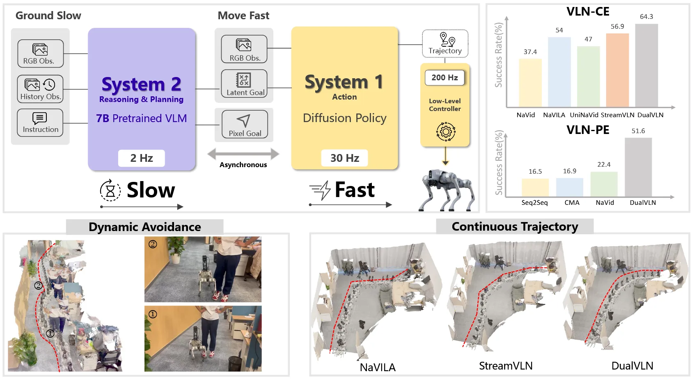
<figcaption>
DualVLN overview. System 2 handles slow multimodal global planning at 2Hz, while System 1 generates diffusion-based trajectories at 30Hz. Explicit and implicit goals connect the systems to a 200Hz MPC controller for smooth continuous motion and dynamic obstacle avoidance.
</figcaption>
</div>

---

### 1. Background and core conflicts
{: id="1-研究背景与核心矛盾"}

In VLN-CE, an agent must understand complex long-horizon instructions and identify topological landmarks in 3D indoor scenes while interacting frequently with the physical environment and avoiding moving obstacles. Existing end-to-end methods face **three bottlenecks**:

1. **Action fragmentation**: VLA models such as NaVid and StreamVLN repeatedly call a large model for short discrete actions, for example "move forward 0.25m" or "turn left 15°". The resulting stop–think–turn–stop behavior makes smooth trajectories difficult.
2. **High control latency**: autoregressive generation in VLMs with 7B or more parameters commonly takes 0.5s–1.2s or longer, falling short of the 20–30Hz loop needed in dynamic environments. Pedestrians or unexpected obstacles can therefore cause collisions before the model responds.
3. **Coupling and semantic degradation**: combining high-level semantics, global planning, and local obstacle avoidance in one network can let fine-grained geometric adjustments disrupt long-horizon instruction alignment. Prioritizing semantics alone instead sacrifices local trajectory smoothness.

DualVLN addresses this through **"Ground Slow, Move Fast"**: **a large model handles low-frequency semantic planning and visual goals, while a lightweight diffusion model handles high-frequency local obstacle avoidance and smooth trajectory generation**.

---

### 2. Architecture and cooperation between the systems
{: id="2-核心架构与双系统协同机制"}

<div align="center">
  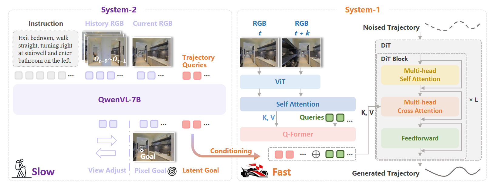
<figcaption>
Architecture details. System 2 receives the instruction, historical observations, and current frame, then generates view adjustments and pixel goals and extracts a latent goal. System 1 combines high-frequency RGB features from two time steps with the latent code and uses a DiT to decode a continuous 32-waypoint trajectory.
</figcaption>
</div>

#### ① System 2 — Ground Slow: high-level global planning
{: id="-系统-2system-2---ground-slow慢思考的高层全局规划器"}

* **Role**: a high-level planner based on **Qwen-VL-2.5-7B**, running asynchronously at a nominal **2 Hz** (every 0.5 seconds). It receives the instruction, temporal visual history, and current monocular RGB image and outputs navigation intent.
* **Three unified autoregressive outputs**: within one multi-turn dialogue format, System 2 decides whether to adjust the view, supply a navigation waypoint, or terminate the task:

| Output | Trigger | Supervision and execution |
|:---|:---|:---|
| **View adjustment** | The future trajectory is expected to fall outside the camera field of view (FOV), such as at a right-angle turn or a turnaround | Generate discrete turns (`Turn Left/Right 15°`, `Look Up/Down 15°`), with at most 4 successive turns per action chunk, totaling at most 60° |
| **Pixel-goal grounding** | At least one future ground-truth waypoint is visible in the current view | Output the 2D image coordinates of the **farthest visible waypoint** as text, such as `234 447` |
| **STOP** | The agent judges that it has reached the endpoint specified by the instruction | Output the discrete text token `STOP` |

* **Dialogue template (Appendix A.1)**:
  ```text
  User: You are an autonomous navigation assistant. Your task is <instruction>.
        ... These are your historical observations: <history>.
        Your current observation is <image>.
  Assistant: → → → →     # ① View adjustment: 4 right turns when the future waypoint is outside the FOV
  Assistant: 234 447      # ② Pixel goal: image coordinates of the farthest visible waypoint
  Assistant: STOP         # ③ Stop decision: the target region has been reached
  ```

* **Why the farthest visible waypoint and at most 4 successive turns?**
  - **Farthest visible waypoint**: project the 3D trajectory onto the camera plane and use depth to reject occluded points whose distance exceeds the measured depth, preventing targets behind walls or obstacles. Select the farthest remaining visible point. This gives System 1 a long **look-ahead horizon**, permitting sparse high-level planning at 2Hz while avoiding depth ambiguity from back-projecting occluded points or empty space.
  - **Chunked, capped turning**: following StreamVLN, one inference call produces a chunk of discrete actions. Four 15° turns (60° total) can bring a waypoint around many corners back into view while limiting blind rotation. The agent must observe again after 60°, **preventing excessive turning or spinning without new visual evidence**.

#### ② System 1 — Move Fast: high-frequency continuous trajectories
{: id="-系统-1system-1---move-fast快行动的高频连续轨迹生成器"}

<div align="center">
  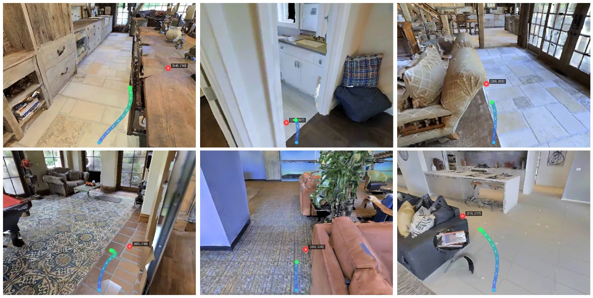
<figcaption>
System 1 trajectories in indoor scenes. Given System 2's explicit pixel goal (red dot) and implicit latent code, together with RGB from two time steps, it generates a smooth obstacle-avoiding trajectory of 32 dense waypoints (blue-green dashed line).
</figcaption>
</div>

* **Role**: a lightweight **Diffusion Transformer (DiT)** trajectory policy running at **30 Hz**, roughly once every 33ms, to plan smooth local obstacle-avoiding trajectories from high-frequency monocular RGB.
* **Conditioning signals**:
  1. **Explicit pixel goal**: coordinates $(u, v)$ predicted by System 2 provide deterministic, interpretable geometric guidance.
  2. **Implicit latent goal**: append 4 learnable `<TRAJ>` tokens after System 2's coordinate text. Prompt tuning passes them through frozen Qwen-VL, extracts final-layer hidden states, and projects them to 768 dimensions as `pixel_goal_latents`. These convey complex object semantics and global context to System 1.
  3. **Two-time-step RGB**: pretrained DepthAnythingV2-Small ViT extracts features from the last high-level update at $t$ and the current observation at $t+k$. Self-attention fuses temporal dynamics, and a lightweight Q-Former compresses the result into 32 visual tokens.
* **Continuous trajectory generation with flow matching**:
  Instead of a discrete action vocabulary, System 1 models trajectories using continuous flow matching. Apply linear Gaussian interpolation to ground-truth smooth trajectory $X_0$ at time $u \in [0, 1]$:
  $$X_u = (1 - (1 - \sigma_{min})u) X_0 + u \epsilon, \quad \epsilon \sim \mathcal{N}(0, I)$$
  Network $f_\theta$ predicts a velocity field and is trained by minimizing the flow-matching loss:
  $$\mathcal{L}_{flow} = \mathbb{E}_{u, X_0, \epsilon} \left[ \left\| f_\theta(X_u, u, Z' \oplus F) - \dot{X}_u \right\|_2^2 \right]$$
  One denoising forward pass generates a trajectory of **32 dense waypoints**, spanning approximately 2–3 meters. The trajectory is handed to a **200Hz MPC controller** for differential-drive or foot control; real-world execution transforms it into world coordinates using odometry.

#### ③ Asynchronous pipeline and inference acceleration
{: id="-异步流水线与推理加速机制"}

* **Asynchronous multi-rate scheduling**:
  - **System 2 (2 Hz / 0.5s)**: refresh high-level pixel and semantic latent goals at low frequency.
  - **System 1 (30 Hz / 0.033s)**: process current images and replan local obstacle avoidance at high frequency.
  - **MPC controller (200 Hz / 0.005s)**: refresh motor commands on a millisecond scale for dynamic stability.
* **Latency optimization**:
  - **KV-cache reuse across turns**: streaming KV caching reduces System 2's long-sequence autoregressive prefill from 1.1s to **0.7s**, a 36% improvement.
  - **TensorRT inference**: compiling the lightweight DiT (12 layers, hidden dimension 384) with TensorRT reduces parallel generation of 32 trajectory points to **0.03s**, supporting monocular 30Hz control on GPUs such as the RTX 4090.

---

### 3. Progressive two-stage decoupled training
{: id="3-渐进式两阶段解耦训练范式"}

Instead of jointly optimizing high-level and low-level networks end to end, DualVLN uses **progressive two-stage decoupled training**:

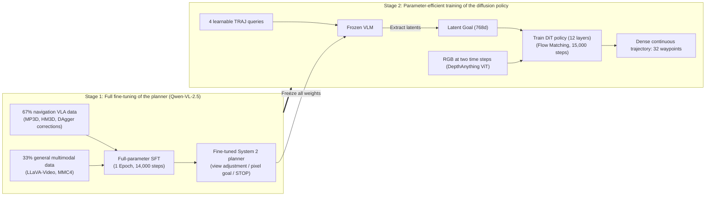

#### ① Stage 1: co-training the high-level planner
{: id="-stage-1高层规划器协同微调co-training"}
* **Training**: fully fine-tune the visual encoder and LLM backbone for 1 epoch using AdamW, learning rate 2e-5, batch size 128, and 14,000 steps.
* **Co-training mixture: 1.47 million samples**:
  - **Navigation VLA data (67%)**: MP3D scenes (450K, 31%), diverse HM3D scenes (300K, 20%), and **DAgger corrective demonstrations (240K, 16%)** collected by a Habitat shortest-path expert. These improve recovery from heading deviations.
  - **General vision-language data (33%)**: VQA from LLaVA-Video and ScanQA (248K, 17%) and interleaved MMC4 image-text data (230K, 16%) help **prevent catastrophic forgetting of general visual reasoning during navigation fine-tuning**.

| Category | Subset | Share | Size | Source and role |
|:---|:---|:---:|:---:|:---|
| **Navigation VLA** (67%) | MP3D | 31% | 450K | R2R / R2R-EnvDrop / RxR across 60 indoor scenes |
| | HM3D | 20% | 300K | ScaleVLN subset covering 700 indoor scenes for cross-environment generalization |
| | DAgger | 16% | 240K | Corrective trajectories collected by a Habitat shortest-path expert during model rollouts |
| **General multimodal** (33%) | VQA | 17% | 248K | LLaVA-Video-178K + ScanQA for 3D spatial understanding and commonsense geometric reasoning |
| | MMC4 | 16% | 230K | Long interleaved image-text documents for long-horizon, multi-turn vision-language alignment |

#### ② Stage 2: parameter-efficient fine-tuning of the diffusion policy
{: id="-stage-2扩散策略的参数高效微调peft"}
* **Training**: **freeze all System 2 weights**, updating only the embeddings of 4 `<TRAJ>` queries and the DiT policy. Use AdamW, learning rate 1e-4, batch size 128, and 15,000 steps.
* **Latent extraction (Appendix A.2)**: append 4 dedicated tokens to the prompt to connect text output with continuous control:
  ```python
  inputs_embeds = QwenVL.embed_tokens(input_ids)
  traj_idx = (input_ids == TRAJ_TOKEN)           # Locate the 4 TRAJ positions
  inputs_embeds[traj_idx] = latent_queries       # Substitute learnable queries (prompt tuning)
  QwenVL.requires_grad_(False)                  # Freeze weights; retain gradients to input queries
  hidden = QwenVL.forward(inputs_embeds)         # Do not disable query gradients during training
  pixel_goal_latents = hidden[-1][:, -4:, :]     # Extract the final layer's last 4 positions
  noise_pred = DiT(traj_encoder(gt_poses), timestep, pixel_goal_latents, rgb_feats)
  ```
  This is illustrative pseudocode. Freezing VLM parameters does not disable the entire computation graph: learnable queries still require gradients. The example in [Appendix A.2](https://arxiv.org/html/2512.08186v1#A2) likewise does not use `torch.no_grad()`.
* **Sample filtering**: Stage 2 trains trajectories **only on samples with valid pixel goals**, excluding turn-only samples so the diffusion policy focuses on smooth goal-directed motion and avoidance.

#### ③ Why decouple training?
{: id="-为什么必须解耦训练方法学核心思考"}
1. **Asymmetric data needs and convergence**: as a general 7B VLM, System 2 needs millions of mixed samples for semantic knowledge. System 1's local trajectory task is more constrained; experiments show that **about 10% of System 2's trajectory data suffices to saturate System 1 performance**. Decoupling reduces costly joint computation.
2. **Avoiding representation collapse**: joint end-to-end training (*w/o Sys.2 Train*) produces a **9.1% SR drop** on R2R-CE. The source attributes this to diffusion gradients degrading high-level generalization and convergence. Decoupling, with explicit pixel goals as geometric anchors, balances high-level generalization and low-level responsiveness.

---

### 4. Experiments and results
{: id="4-核心实验结果与分析"}

#### ① Monocular visual simulation: VLN-CE
{: id="-经典单目视觉仿真基准vln-ce"}
With **monocular RGB only**, without depth, panoramic views, or odometry priors, DualVLN reports leading R2R and RxR results at the time of publication:

**R2R Val-Unseen: monocular RGB**:
| Model | Success rate SR ↑ | Success weighted by path length SPL ↑ | Navigation error NE ↓ | Oracle success OS ↑ |
|:---|:---:|:---:|:---:|:---:|
| NaVid (2024) | 37.4% | 35.9% | – | – |
| NaVILA (2025) | 54.0% | 48.0% | – | – |
| StreamVLN (previous SOTA) | 56.9% | 51.9% | 4.98m | 64.2% |
| **DualVLN** | **64.3%** | **58.5%** | **4.05m** | **70.7%** |
| *Improvement* | ***+7.4%*** | ***+6.6%*** | ***-0.93m*** | ***+6.5%*** |

**RxR Val-Unseen: fine-grained multilingual instructions**:
| Model | Success rate SR ↑ | Success weighted by path length SPL ↑ | Navigation error NE ↓ | Normalized dynamic time warping nDTW ↑ |
|:---|:---:|:---:|:---:|:---:|
| NaVILA (previous SOTA) | 49.3% | 44.0% | 6.77m | 58.8% |
| **DualVLN** | **61.4%** | **51.8%** | **4.58m** | **70.0%** |
| *Improvement* | ***+12.1%*** | ***+7.8%*** | ***-2.19m*** | ***+11.2%*** |

*Interpretation*: DualVLN's SR advantage reaches **+12.1%** on the longer, more linguistically diverse RxR tasks. It also exceeds graph-search methods using panoramic RGB, depth, and odometry, such as ETPNav at 57.0% SR, showing the strength of a purely visual end-to-end dual system in this setting.

#### ② Physics-based simulation: VLN-PE
{: id="-真实物理仿真评测vln-pe"}
VLN-PE uses a physics engine to simulate a Unitree H1 humanoid's dynamics, falls, and collisions. DualVLN is evaluated through **zero-shot transfer without VLN-PE fine-tuning**:

| Model | Training status | SR ↑ | SPL ↑ | NE ↓ | Fall rate FR ↓ | Stuck rate StR ↓ |
|:---|:---:|:---:|:---:|:---:|:---:|:---:|
| NaVid | Zero-shot transfer | 22.42% | 18.58% | 5.94m | 8.61% | 0.45% |
| RDP | Fine-tuned on VLN-PE | 25.24% | 17.73% | 6.72m | 24.57% | 3.11% |
| **DualVLN** | **Zero-shot transfer** | **51.60%** | **42.49%** | **4.66m** | 12.32% | 2.23% |

*Interpretation*: SR is **more than twice** the baseline (51.60% vs 22.42%). The source attributes the improvement to smooth continuous trajectories mitigating inertial falls caused by abrupt discrete stops.

#### ③ Dynamic pedestrian interaction: Social-VLN
{: id="-动态行人交互新基准social-vln"}

<div align="center">
  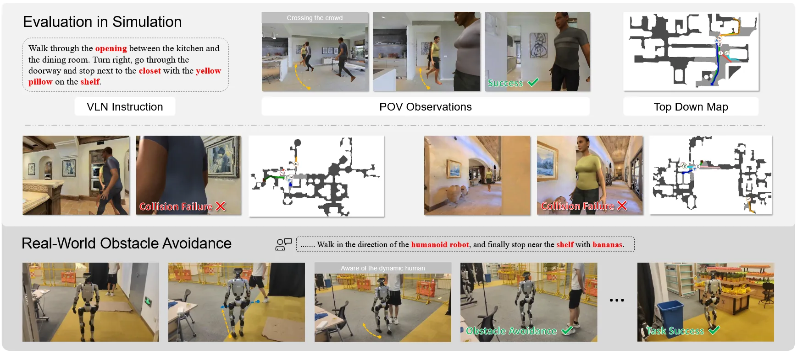
<figcaption>
Social-VLN simulation and real-robot obstacle avoidance. Dynamic pedestrians are introduced in Habitat 3.0. The middle row shows collision failures; the bottom row shows a Unitree G1 using DualVLN to avoid moving people and reach the goal.
</figcaption>
</div>

* **Benchmark**: the paper argues that static maps and discrete-action models are fragile around moving pedestrians. It injects pedestrians along ground-truth paths in Habitat 3.0 to create **Social-VLN**, containing 763K interaction samples, and introduces Human Collision Rate (HCR).
* **Results**: all models lose roughly 26% SR from static to dynamic scenes. DualVLN's 30Hz local replanning retains **37.2% SR**, 5.8% above StreamVLN, with lower HCR at 35.4%.

| Model | Static SR | Social-VLN dynamic SR | SR change ↓ | Human collision rate HCR ↓ |
|:---|:---:|:---:|:---:|:---:|
| StreamVLN | 56.9% | 31.4% | -25.5% | 36.4% |
| **DualVLN** | **64.3%** | **37.2%** | -27.1% | **35.4%** |

#### ④ Real-world deployment across embodiments
{: id="-真实世界跨形态机器人部署"}

* **Hardware**: tests cover **wheeled Turtlebot4**, **Unitree Go2 quadruped**, and **Unitree G1 humanoid** robots. Intel RealSense D455 cameras, tilted downward by 15°, stream synchronized RGB-D images to a remote RTX 4090 server for asynchronous dual-system inference. Odometry transforms trajectories into world coordinates for MPC tracking. The real-world execution pipeline uses depth and odometry; the simulation's RGB-only setting does not describe the complete deployed system.
* **Results: 3 settings, 20 trials per setting**:
  - **Corridor (easy)**: **100% SR**, average error 0.2m; baselines achieve 25%–80%.
  - **Single bedroom (medium)**: **100% SR**, average error 0.3m; baselines achieve 0%–70%.
  - **Long-horizon, multi-room office (hard)**: **85% SR**, average error 0.4m; baselines achieve 0%–60%.
* **Navigation error (NE) by setting**:

| Setting | CMA | NaVid | NaVILA | StreamVLN | DualVLN |
|:---|:---:|:---:|:---:|:---:|:---:|
| Corridor (easy) | 3.2m | 0.9m | 0.3m | 0.2m | **0.2m** |
| Bedroom (medium) | 5.3m | 2.5m | 0.6m | 0.3m | **0.3m** |
| Multi-room office (hard) | 15.4m | 10.1m | 2.2m | 0.5m | **0.4m** |

* **Typical baseline failure modes**:
  - **NaVid**: accumulated long-distance errors frequently lead to wall collisions in routes with many turns.
  - **NaVILA**: performs large-scale turns but often passes the destination doorway without entering on multi-room tasks.
  - **StreamVLN**: low-latency actions avoid static obstacles, but often deviate substantially from the instructed path.
  - **DualVLN**: System 2 maintains the high-level landmark goal while System 1 dynamically detours, combining route fidelity with local avoidance.

---

### 5. Ablations and mechanisms
{: id="5-核心消融与机理解析"}

#### ① Goal representations and decoupled training: R2R-CE Val-Unseen
{: id="-目标表征与解耦训练的必要性r2r-ce-val-unseen"}
| Variant | SR ↑ | SPL ↑ | OS ↑ | NE ↓ | Finding |
|:---|:---:|:---:|:---:|:---:|:---|
| **DualVLN (full)** | **64.3%** | **58.5%** | **70.7%** | **4.05m** | Combining explicit and implicit goals performs best |
| *w/o Sys.2 Train* (joint end-to-end training) | 55.2% | 51.5% | 60.9% | 4.98m | **9.1% performance drop**; joint optimization degrades representations and convergence |
| *w/o Pixel Goal* (remove explicit pixels) | 62.2% | 55.8% | 68.0% | 4.22m | Without geometric anchors, low-level trajectory drift increases (-2.1% SR) |
| *w/o Latent Goal* (remove semantic latents) | 60.9% | 55.1% | 67.7% | 4.26m | 2D coordinates alone do not convey scene-topology semantics (-3.4% SR) |

#### ② Conventional point-goal planners: VLN-PE Unseen
{: id="-对比-sota-传统点目标规划器vln-pe-unseen"}
Project System 2's predicted pixels into 3D using **oracle depth**, and substitute conventional local point-goal policies:

| Local planner | Seen SR ↑ | Seen SPL ↑ | Unseen SR ↑ | Unseen SPL ↑ | Unseen NE ↓ |
|:---|:---:|:---:|:---:|:---:|:---:|
| iPlanner (Yang et al., 2023) | 58.66% | 49.43% | 47.07% | 41.09% | 4.91m |
| NavDP (Cai et al., 2025) | 66.11% | 56.26% | 58.72% | 50.98% | 4.22m |
| **System 1 (full)** | **73.25%** | **64.00%** | **63.62%** | **56.49%** | **3.90m** |

*Interpretation*: conventional point-goal planners are sensitive to projection errors and depth noise. System 1 uses high-frequency monocular context and latent conditioning so **its diffusion policy can correct trajectories from the image stream even when high-level pixel predictions are imperfect**.

#### ③ Data scaling for the diffusion policy
{: id="-扩散策略的数据扩展律data-scaling-law"}
Train System 1 with different proportions of System 2 trajectory data:
- **1% of data**: SR ~54%, already providing useful obstacle avoidance.
- **10% of data**: SR ~62%, **rapidly approaching saturation**.
- **50%–100% of data**: SR ~64.3%, with diminishing returns.
*Implication*: trajectory generation maps a relatively low-dimensional geometric manifold and requires fewer samples than a large language model. Decoupled training allows inexpensive adaptation of downstream robot controllers.

#### ④ Layerwise attention refinement
{: id="-注意力逐层精化机理attention-map-analysis"}
Layerwise Qwen-VL attention during autoregressive generation shows:
- **Shallow layers (Layer 6)**: diffuse attention over the global scene layout and directional instruction words.
- **Middle layers (Layer 15)**: attention narrows to instruction-relevant objects such as doors, long tables, and corridor junctions.
- **Deep layers (Layer 24)**: attention concentrates on the **farthest visible pixel-goal region**, shifting toward `STOP` upon arrival. This illustrates progressive refinement from global scene semantics to fine-grained spatial grounding.

---

### 6. Limitations and future directions
{: id="6-局限性与未来演进"}

1. **One-way communication**: the architecture is a cascade from System 2 $\rightarrow$ System 1. Low-level blockage caused by a dead end or collision is not fed back immediately to trigger high-level replanning. Bottom-up interrupts and retriggering remain future work.
2. **Dense social scenarios**: despite leading Social-VLN performance, SR is still only 37.2%, and collisions remain frequent in dense crowds. The model lacks explicit reasoning about human motion intentions and strategic interaction.
3. **Edge compute requirements**: System 2 uses a 7B multimodal backbone requiring roughly 20GB GPU memory at full precision. Deployment still streams to an offboard workstation. Quantization and distillation into 2B–3B edge VLMs are needed for fully offline navigation.

---

## 8. VLN-R1 (2025)
{: id="vln-r1"}
——End-to-end navigation based on GRPO and Time-Decayed Reward

📄 **Paper**: [arXiv:2506.17221](https://arxiv.org/abs/2506.17221)

**Background and problem**

VLN is a core challenge in embodied AI: agents must navigate real-world environments by following natural language instructions. Traditional navigation methods usually rely on discrete topological graphs and predefined node connections, which limits agents' generalization in continuous environments.

**Method and innovations**

VLN-R1 proposes an end-to-end framework that uses a large vision-language model (LVLM) to process egocentric video streams directly and generate continuous navigation actions.

<div align="center">
  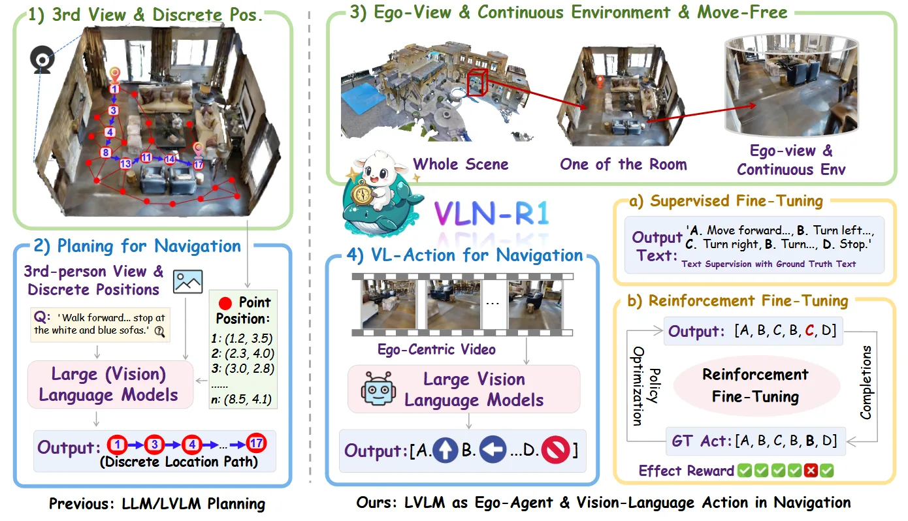
<figcaption>
Overall architecture of the VLN-R1 end-to-end framework
</figcaption>
</div>

**Core design ideas:**
- Build an end-to-end framework that processes egocentric video streams in real time and generates continuous navigation actions
- Unlike traditional methods that rely on navigation maps or extra sensors, VLN-R1 maps visual input and natural language instructions directly to action output
- Improve the generality of the system and its adaptability to unseen environments

**Main components:**

*VLN-Ego dataset:*
- **Data generation**: Generated in the Habitat simulator, with paired egocentric video streams and future action predictions
- **Three-part text annotation**:
  - Instruction: a natural language navigation instruction (such as "walk to the sofa in the living room")
  - Visual input: historical frames and the current observation, providing egocentric visual information
  - Action: the future action choice (four basic actions: forward, turn left, turn right, and stop)
- **Data scale**:
  - 60K training samples generated from Room-to-Room
  - 1.2M training samples generated from Room-Across-Room
  - Covers 61 training scenes

<div align="center">
  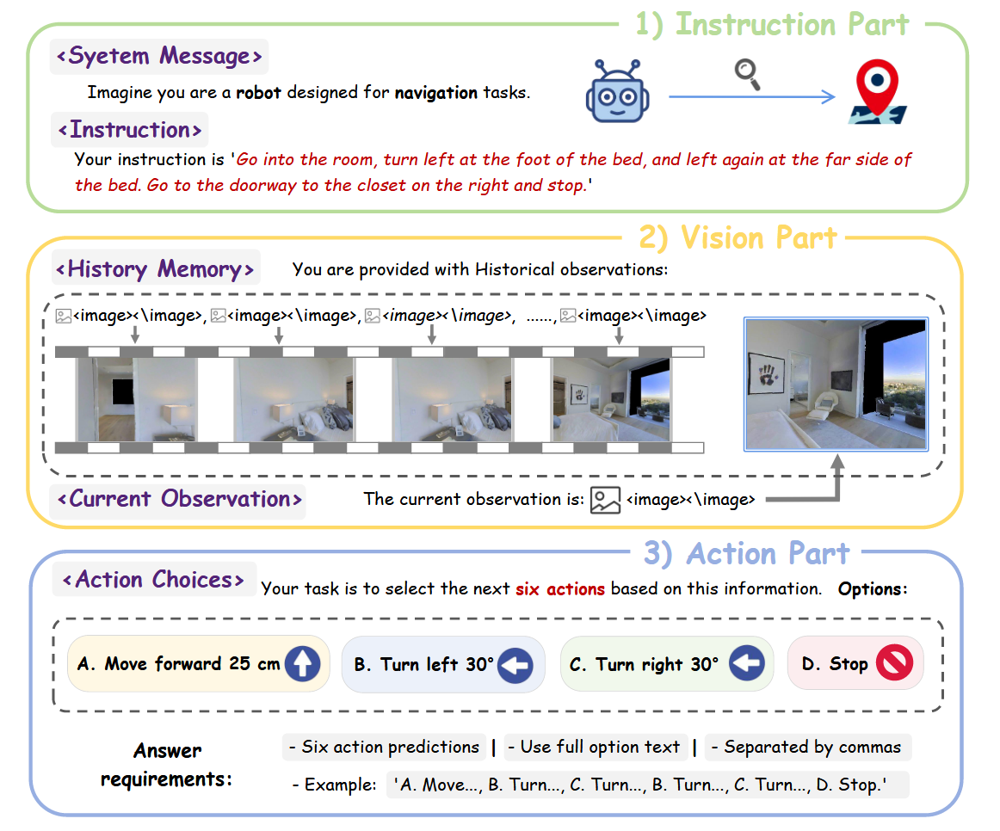
<figcaption>
VLN-Ego dataset construction pipeline
</figcaption>
</div>

*Long-short term memory sampling:*
- A novel video input strategy that dynamically balances the importance of historical frames against the immediacy of the current observation
- Lets the model both exploit historical information and respond quickly to changes in the environment
- Compared with single-step action prediction, multi-step action prediction combined with historical context significantly improves performance.

**Two-stage training strategy:**

<div align="center">
  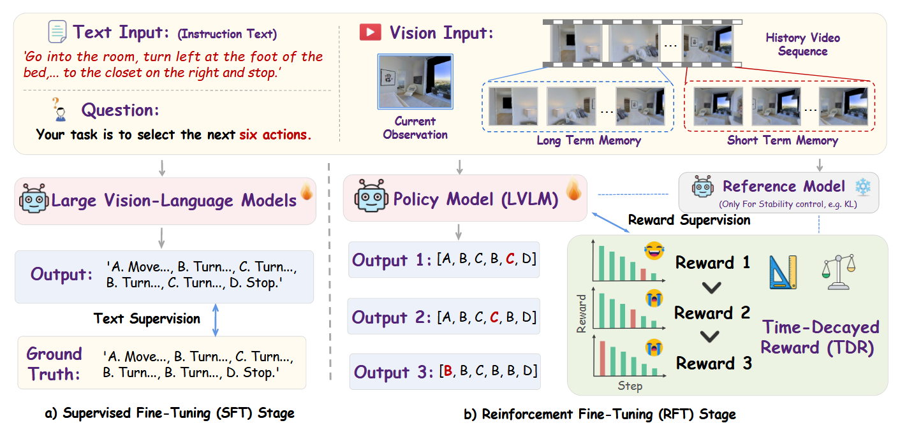
<figcaption>
VLN-R1 two-stage training process
</figcaption>
</div>

*Supervised Fine-Tuning (SFT) phase:*
- The model's predicted action sequences are aligned with expert demonstrations, optimizing the output text through supervised learning
- The multi-step action sequence text generated by the model is aligned with the ground truth and optimized with a cross-entropy loss
- Given the historical observation sequence H_t, the instruction Z, and the current observation O_t, the model predicts the next n-step action sequence

*Reinforcement Fine-Tuning (RFT) phase:*
- Introduces a reinforcement learning method based on GRPO (Group Relative Policy Optimization)
- Combined with a time-decayed reward mechanism (TDR), it further improves long-horizon navigation performance
- Hyperparameters were set through ablation experiments, with the number of generations set to 8 by default.

**Time-Decayed Reward mechanism (TDR):**
- **Core idea**: Balance short-term and long-term rewards with a decay factor
- **How it works**: The model pays more attention to near-term actions while still accounting for the long-term goal.
- **Benefit**: It evaluates the long-term effect of multi-step action prediction and improves long-horizon navigation performance

<div align="center">
  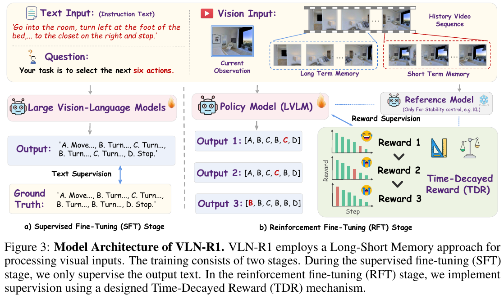
<figcaption>
Schematic of the time-decayed reward (TDR) mechanism
</figcaption>
</div>

**Model architecture:**
- **Input**: Egocentric video stream and instructions
- **Output**: Multi-step future action sequence
- **End-to-end design**: Removes the dependence on navigation graphs, so it performs well in continuous environments

**Results and findings**

VLN-R1 was evaluated thoroughly on the VLN-CE (vision-language navigation in continuous environments) benchmark:

**Test platforms:**
- **Room-to-Room (R2R)**: The agent navigates within a single room
- **Room-Across-Room (R4R)**: The agent must navigate across rooms, which is more challenging

**Performance:**
- **R2R**: Shows efficient navigation and an accurate task completion rate
- **R4R**: Cross-domain adaptability improves markedly with reinforcement fine-tuning, and the small 2B model comes close to the 7B model
- **Model scalability**: The end-to-end framework is effective across different model scales

**Ablation studies:**
- **Long-short term memory sampling**: Multi-step action prediction combined with historical context improves performance significantly over single-step prediction
- **TDR mechanism**: Compared with conventional reward functions, TDR significantly improves the success rate on long-horizon tasks
- **Number of generations**: Increasing from 6 to 8 brings only a limited gain, so 8 is chosen as the default

**Technical advantages:**
- The end-to-end design enables real-time navigation
- Combines the vision-language understanding of the LVLM with a reinforcement learning optimization strategy
- Shows potential for task-specific reasoning

**Limitations**

The paper is relatively short: it does not detail specific performance numbers (such as SR and SPL) or provide a detailed comparison with other SOTA methods. It also says little about real-world deployment, testing mainly in the Habitat simulation environment, and lacks validation on a real robot platform.

---

## 9. StreamVLN (2025)
{: id="streamvln"}

— Streaming vision-language navigation through slow-fast context modeling

📄 **Paper**: [arXiv:2507.05240](https://arxiv.org/abs/2507.05240) · 🏛️ **ICRA 2026**

**Key takeaways**

This paper proposes a streaming VLN framework for real-world deployment. Its reusable ideas include: (1) slow-fast context modeling that balances global scene understanding with timely responses; (2) geometry-aware token pruning that reduces computation while preserving performance; (3) KV-cache reuse that exploits temporal continuity for efficient inference over long video streams; (4) bounded context size and inference cost for practical embodied AI deployment; and (5) joint training on navigation VLA data, general vision-language data, and DAgger demonstrations to retain both general reasoning and navigation capabilities. These designs may transfer to other embodied tasks with long multimodal input sequences.

**Background and problem**

VLN in real-world continuous environments requires efficient multimodal reasoning over long video streams with low latency for real-time interaction. Existing Video-LLM-based methods face a trade-off among fine-grained visual understanding, long-term context modeling, and computational efficiency. This work aims to capture global scene context while responding quickly through a streaming navigation framework.

<div align="center">
  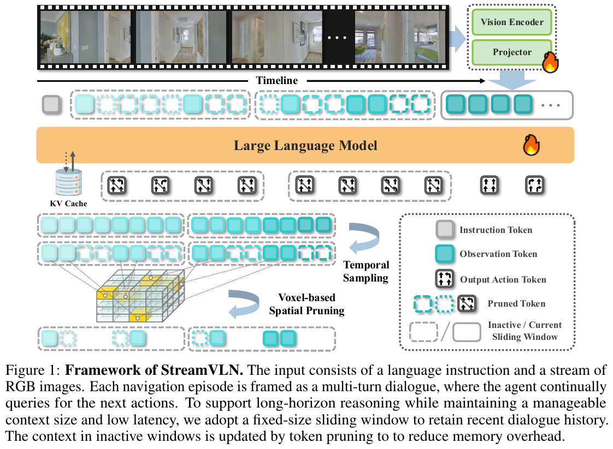
<figcaption>
StreamVLN overview. The inputs are a language instruction and an RGB image stream. Each navigation episode is modeled as a multi-turn dialogue in which the agent repeatedly queries the next action. A fixed-size sliding window retains recent dialogue, while token pruning updates inactive-window context to reduce memory use.
</figcaption>
</div>

**Method and contributions**

StreamVLN uses slow-fast context modeling to extend a Video-LLM into an interleaved vision-language-action model for streaming navigation.


**1. Continuous multi-turn autoregressive generation**

A VLN dialogue consists of interleaved observations and actions. In each turn $d_i = (o_i, a_i)$, the model receives observation $o_i$ and generates action response $a_i$, conditioned on the current input and dialogue history. The full input sequence is $o_1a_1o_2a_2...o_{i-1}a_{i-1}$. The LLM-based Transformer first encodes input tokens and caches key/value (KV) states during **prefill**, then generates new tokens using those states during **decoding**.

**2. Fast-streaming dialogue context**

Reusing the KV cache across turns can eliminate more than 99% of prefill time, but introduces substantial memory costs. The cache grows linearly with the number of turns; for example, 2K tokens may occupy roughly 5GB, making long sessions impractical. Existing Video-LLMs also lose reasoning performance with excessively long contexts.

StreamVLN uses a **sliding-window KV cache**, keeping a fixed number $N$ of recent dialogue turns in the active window: $W_j = [o_{(i-N+1)}a_{(i-N+1)}...o_ia_i]$. Once the window reaches capacity, its key/value states are offloaded from the LLM, and states for non-observation dialogue tokens, such as prompts and generated actions, are immediately discarded. When a new window starts, states from past windows are processed into memory-token states $\{M_0, ..., M_j\}$.

<div align="center">
  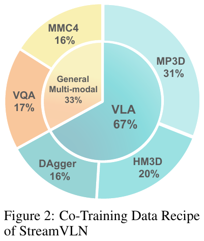
<figcaption>
Joint training mixture: 67% navigation VLA data (MP3D 31%, HM3D 20%, DAgger 16%) and 33% general multimodal data (VQA 17%, MMC4 16%), balancing navigation performance with general vision-language reasoning.
</figcaption>
</div>

**3. Slowly updated memory context**

Balancing temporal resolution and fine-grained spatial perception within a limited context remains difficult for Video-LLMs. Rather than compressing video tokens at the feature level, for example through average pooling, StreamVLN retains high image resolution and selectively discards spatially and temporally redundant tokens to better preserve transferability.

- **Temporal sampling**: sample a fixed number of tokens to avoid temporal-duration bias caused by varying memory-token lengths.
- **Voxel-based spatial pruning**: use depth to back-project 2D image patches from the video stream into a shared 3D space and discretize it into uniform voxels. Track each patch token's voxel index over time. When multiple tokens project into the same voxel within a given period, retain only the most recent observation. The resulting mask selects the token states to keep; see Algorithm 1.

**4. Joint training on multiple data sources**

- **Vision-language-action (VLA) data**:
  - 450K samples collected in Habitat from R2R, R2R-EnvDrop, and RxR across 60 Matterport3D environments.
  - An additional 300K samples from ScaleVLN, covering 700 HM3D scenes, increase scene diversity.
  - 240K corrective demonstrations collected with DAgger improve robustness and recovery.

- **General vision-language data**: retain the pretrained Video-LLM's general reasoning through:
  - 248K video-grounded VQA samples from LLaVA-Video-178K and ScanQA.
  - 230K interleaved image-text samples from MMC4 for multi-turn vision-language interaction.

**Main contributions**:
- A slow-fast context modeling strategy introduced for real-time VLN.
- Geometry-aware token pruning that outperforms generic uniform pruning.
- Low-latency, scalable streaming multimodal inference with efficient KV-cache reuse.
- Interleaved vision-language-action modeling for coherent multi-turn dialogue.
- Bounded context size and inference cost for long video streams.

**Results and findings**

<div align="center">
  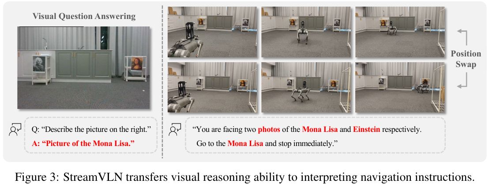
<figcaption>
Transfer of visual reasoning. The model correctly identifies image content, such as the Mona Lisa, through VQA dialogue and transfers that reasoning to navigation instruction understanding, demonstrating cross-modal understanding.
</figcaption>
</div>

- **State-of-the-art performance on VLN-CE at the time of the work**:
  - R2R Val-Unseen: SR 56.4%, SPL 50.2% (StreamVLN†, with additional training data including a ScaleVLN subset; training only on R2R / RxR gives 52.8% / 47.2%).
  - RxR Val-Unseen: SR 54.4%, SPL 45.4%, nDTW 63.7% (arXiv v2 / ICRA 2026 figures; v1 reports R2R 56.9 / 51.9 and RxR 52.9 / 46.0).
  - Comparable performance to ETPNav without panoramic views or waypoint supervision.

- **ScanQA 3D question answering**: outperforms NaVILA and NaviLLM, reaching 28.8% exact match.

- **Real-world deployment**:
  - Successfully deployed on a Unitree Go2 quadruped.
  - Average inference latency of 0.27s for 4 actions, plus communication latency of 0.2s indoors / 1.0s outdoors.
  - Supports real-time physical deployment.

<div align="center">
  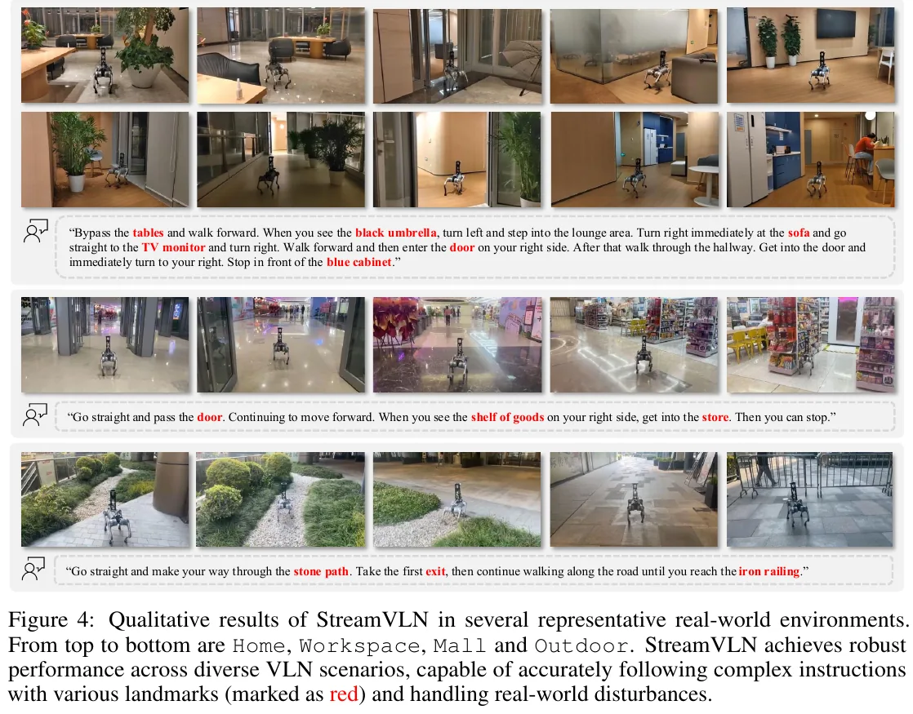
<figcaption>
Qualitative real-world results, from top to bottom: Home, Workspace, Mall, Outdoor. The model follows complex instructions involving multiple landmarks and handles real-world disturbances and changes.
</figcaption>
</div>

- **Ablation findings**:
  - Reusing the KV cache eliminates more than 99% of prefill time across dialogue turns.
  - A sliding window of 8 dialogue turns provides the best balance.
  - Increasing memory context from 2×196 to 8×196 tokens raises SR from 37.3% to 45.5%.
  - Voxel-based pruning reduces input tokens by about 20% while improving R2R SR by +1.2% and RxR SR by +1.1%.
  - DAgger data is important for performance: +5.5% SR / +3.8% SPL.
  - Joint training with general VL data (VideoQA + MMC4) adds +7.3% SR / +5.6% SPL.

<div align="center">
  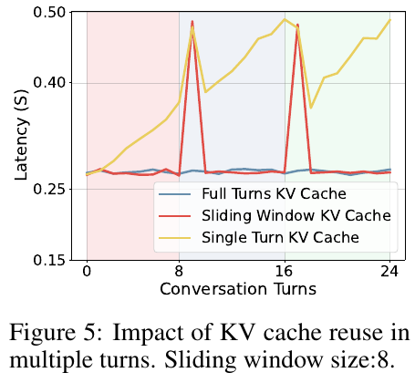
<figcaption>
Effect of KV-cache reuse on multi-turn decoding latency. Retaining the full cache gives the lowest latency. A sliding-window cache has small latency increases at window transitions. A single-turn cache, used in previous work, incurs latency that grows linearly with the number of turns.
</figcaption>
</div>

**Limitations**

1. Generating low-level actions directly from raw visual observations is less robust to viewpoint and occlusion changes and may produce suboptimal real-world control.
2. The mixed-context strategy still struggles with longer-horizon navigation, where consistent reasoning over extended sequences is difficult.
3. Explicit action history forms part of the dialogue context. Asynchronous inference and deployment therefore require synchronizing past actions to maintain dialogue coherence.


---

## 10. NavFoM (2025)
{: id="navfom"}
——Embodied Navigation Foundation Model

📄 **Paper**: [arXiv:2509.12129](https://arxiv.org/abs/2509.12129) · 🏛️ **ICLR 2026**

**Key takeaways**

This paper shows how to build a cross-task, cross-embodiment navigation foundation model. Ideas worth borrowing: (1) Temporal-Viewpoint Indicator (TVI) tokens uniformly encode different camera configurations and time information, so the model can handle multi-view input; (2) Budget-Aware Temporal Sampling (BATS) samples historical frames dynamically along a forgetting curve to balance performance against inference speed; (3) joint training on 8.02M navigation samples (covering quadruped robots, drones, wheeled robots, cars, etc.) demonstrates the generalization gains of large-scale multi-task training; (4) a visual feature caching mechanism speeds up training by 2.9 times; (5) it achieves SOTA or competitive performance on multiple benchmarks without task-specific fine-tuning.

**Background and problem**

Current navigation systems mostly target specific task settings and embodiments, and lack cross-task and cross-embodiment generalization. Although existing VLMs perform well on zero-shot tasks, navigation remains confined to narrow task domains, fixed camera configurations, and specific embodied platforms. This paper aims to build a unified navigation foundation model that handles multi-view input from different embodiments (quadruped robots, drones, wheeled robots, cars) and spans multiple navigation tasks (VLN, target search, target tracking, autonomous driving).

**Method and innovations**

<div align="center">
  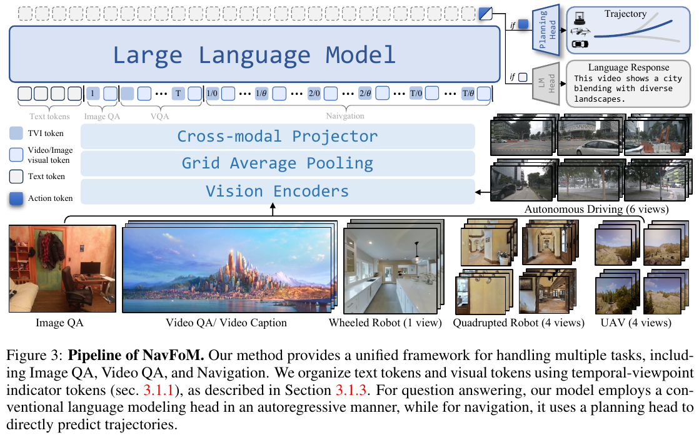
<figcaption>
NavFoM overall architecture: a unified framework that handles Image QA, Video QA, and navigation tasks
</figcaption>
</div>

NavFoM is built on a Vision-Language Model architecture extended into a dual-branch system, one branch for navigation and one for question answering. Its core innovations include:

**1. Temporal-Viewpoint Indicator (TVI) Tokens**
- Special indicator tokens encode camera viewing angle and time information. Each TVI token has three parts:
  - **Learnable base embedding** (E_Base)
  - **Time Encoding** (Time PE): sinusoidal position encoding that marks the temporal order of frames
  - **Viewpoint Encoding** (Angle PE): sine/cosine encoding that preserves the cyclic continuity of azimuth angles
- For navigation tasks: E_TVI = E_Base + Time PE + Angle PE
- For Video QA, only temporal information is used; for Image QA, only the base embedding is used
- TVI tokens let the LLM distinguish tokens from different time steps and viewpoints, enabling multi-view navigation.

**2. Budget-Aware Temporal Sampling (BATS)**
- Addresses the growing number of visual tokens during online navigation
- Sampling probability follows a forgetting curve (exponential decay): P(t) = (1 - ε)e^(k(t-T)/T) + ε
- Historical frame sampling is adjusted dynamically: the more recent the frame, the higher its sampling probability
- Balances short-term context against long-term history under a token budget
- Compared with uniform sampling, BATS significantly reduces inference time while maintaining performance.

**3. Observation encoding**
- Visual features are extracted with pretrained vision encoders (DINOv2, SigLIP)
- Grid average pooling produces visual tokens at two resolutions:
  - **Fine-grained** (64×C): for the latest observation and Image QA
  - **Coarse-grained** (4×C): for navigation history and Video QA
- A cross-modality projector maps visual features into the LLM's latent space

**4. Token organization strategy**
- Different tasks organize tokens differently:
  - **Image QA**: fine-grained visual tokens + base TVI embedding
  - **Video QA**: coarse-grained visual tokens + base + time embedding
  - **Navigation**: coarse-grained + fine-grained tokens + base + time + angle embedding
- This design allows navigation and QA data to be trained jointly

**5. Trajectory prediction**
- A three-layer MLP planning head predicts trajectories from the LLM's hidden states
- Trajectories are normalized to the range [-1, 1], with different scaling factors for different embodiments (indoor navigation vs. outdoor driving)
- Indoor robots predict 8 waypoints; cars and drones predict longer trajectories

**6. Data scale and sources**
- **Navigation data** (8.02M): VLN-CE R2R/RxR (2.94M), OpenUAV (429K), Target Navigation (1.02M), Active Visual Tracking (897K), Autonomous Driving (681K), Web Navigation pseudo-labels (2.03M)
- **QA data** (4.76M): Image QA (3.15M) + Video QA (1.61M)
- 12.7M training samples in total, covering quadruped robots, drones, wheeled robots, cars, etc.

**7. Training optimization**
- Visual feature cache: coarse-grained visual tokens are precomputed and cached, speeding up training by 2.9 times and reducing GPU memory by 1.8 times
- Qwen2-7B as the LLM backbone
- Trained in a single stage (only the designated trainable parameters), with no multi-stage training

**Results and findings**

**VLN performance**:
- **VLN-CE R2R**: single view SR 56.2%, SPL 51.2% (NE 5.01, OSR 64.9); four views SR 61.7%, SPL 55.3% (NE 4.61, OSR 72.1), with no task-specific fine-tuning
- **VLN-CE RxR**: single view SR 57.4%, SPL 49.4%; four views SR 64.4%, SPL 56.2%, surpassing all baseline methods
- **OpenUAV** (four views, UM split): SR 6.38% → 14.05%, OSRL 5.68% → 18.65%, significantly better than TravelUAV

**Target search**:
- **HM3D-OVON** (zero-shot): VAL SEEN SR 55.0%, VAL UNSEEN SR 45.2%, surpassing the MTU3D baseline

**Active visual tracking**:
- **EVT-Bench** (four-view, zero-shot): Single Target SR 85.1%/TR 80.5%, Distracted Target SR 62.0%/TR 67.9%

**Autonomous driving**:
- **NAVSIM** (eight views): PDMS 84.3%, competitive with SOTA methods
- **nuScenes** (six views): CR 93%, close to SOTA

**Ablations**:
- Multi-task training brings significant gains: joint training raises VLN SR from 57.3% to 64.4%
- Number of cameras: going from a single view to four views raises SR from 58.3% to 65.8%, but SR drops slightly with six views
- Compared with uniform sampling, BATS lowers nDTW on RxR by only 1.4% while keeping inference speed stable.
- TVI tokens significantly outperform the alternatives (learned special tokens, handcrafted tokens)

**Real-world deployment**:
- Verified in 110 real-world test scenarios (50 VLN + 30 search + 30 tracking), with success rates of 72%~93%
- Supports cross-embodiment deployment: quadruped robot (Unitree Go2), humanoid robot, drone, and wheeled robot
- Generates an 8-waypoint trajectory in 0.5 seconds (1600-token budget)

**Limitations**

Training is computationally expensive (56 NVIDIA H100 GPUs for 72 hours). Despite optimizations such as visual feature caching, large-scale training remains resource-intensive. In addition, the model performs poorly in Unseen-Map scenarios that require traversing a complex neighborhood of 300 meters, showing room for improvement in large-scale exploration and long-range planning. The authors also note that NavFoM is only a starting point, and that higher-quality data, more advanced techniques, and a new generation of benchmarks will be needed to advance general navigation research.


---

## 11. MapNav (2025)
{: id="mapnav"}
———A Novel Memory Representation via Annotated Semantic Maps for Vision-and-Language Navigation

📄 **Paper**: [arXiv:2502.13451](https://arxiv.org/abs/2502.13451) · 🏛️ **ACL 2025**

---

**Key takeaways**

MapNav replaces historical RGB sequences with a lightweight Annotated Semantic Map (ASM), keeping memory use at a constant 0.17MB regardless of trajectory length and reporting a 79.5% improvement in inference efficiency. The central idea is to combine semantic maps with natural-language annotations so a VLM can understand spatial information directly, without an additional decoder. A structured top-down map relocates history from the temporal dimension to the spatial dimension, substantially reducing computation. This language-annotated map provides a clear and efficient approach to VLM-based navigation.

---

**Background and problem**

Vision-language navigation in continuous environments (VLN-CE) requires agents to follow natural-language instructions in continuous 3D scenes. Existing methods rely heavily on historical RGB frames as temporal context, so memory grows linearly with trajectory length; NaVid reaches 276MB at 300 steps. They also underuse VLM language understanding. The motivation is to replace historical frames with an efficient memory representation.

---

**Method and contributions**

MapNav is an end-to-end VLM-based VLN framework whose core component is an online Annotated Semantic Map (ASM).

<div align="center">
  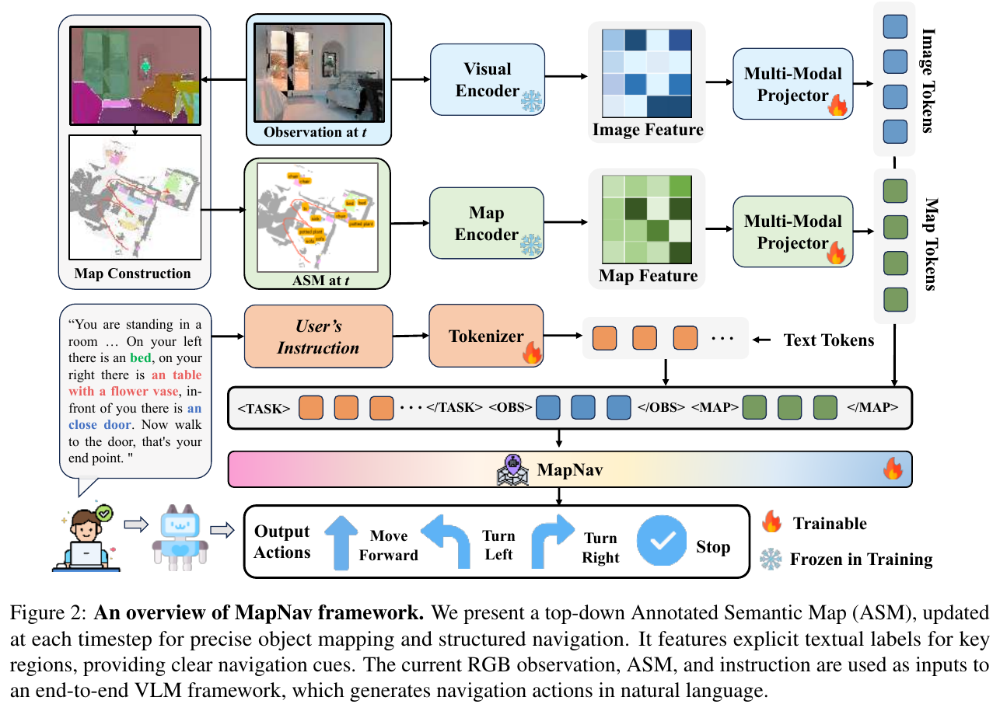
<figcaption>
MapNav overview. The ASM, current RGB observation, and instruction are jointly fed into the VLM to generate navigation actions directly.
</figcaption>
</div>

**ASM generation**

<div align="center">
  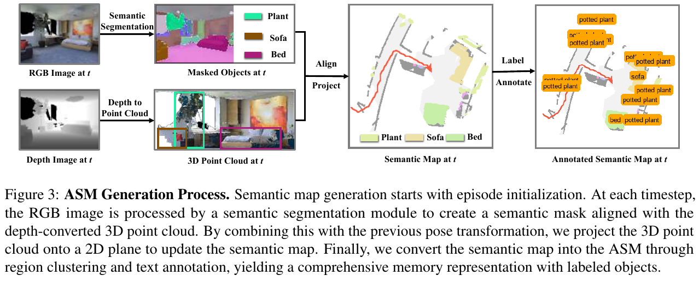
<figcaption>
ASM generation: RGB-D → point cloud → semantic map → text-annotated map.
</figcaption>
</div>

The ASM is a multichannel tensor **M**, with dimensions $C \times W \times H$ and $C = C_n + 4$:
- **Base channels (1–4)**: obstacle distribution, explored area, the agent's current position, and trajectory history.
- **Semantic channels (n channels)**: spatial distributions of target objects.

Generation proceeds as follows:
1. Use Mask2Former to semantically segment the current RGB frame and extract object masks.
2. Use depth to project the 3D point cloud onto a 2D top-down plane and align the semantic masks.
3. Perform connected-component analysis on each semantic region, compute its centroid, and add a text label such as "chair" or "potted plant".
4. Generate the final ASM containing structured object positions, trajectories, and obstacles.

**Why does ASM outperform a conventional semantic map?**

<div align="center">
  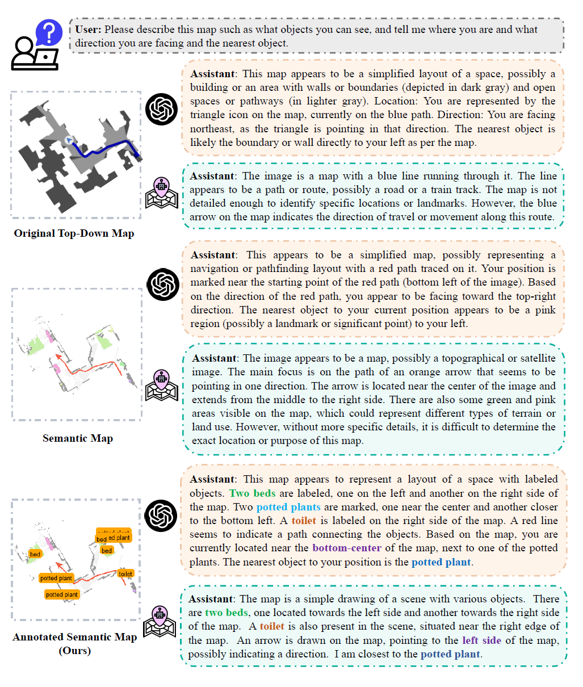
<figcaption>
VLM understanding of different map formats. Text annotations in the ASM help the VLM identify object locations and semantics precisely.
</figcaption>
</div>

Experiments show that VLMs (GPT-4o and MapNav) precisely attend to object locations in ASMs, with attention peaks > 0.8. Attention is much more diffuse on unannotated top-down maps (peaks < 0.3) or semantic maps (peaks < 0.4). Explicit text labels ground abstract semantic regions in language, making use of the VLM's pretrained language understanding.

**Two-stream encoder**

MapNav builds on LLaVA-Onevision and uses the SigLIP-so400m visual encoder:

$$\mathbf{F}_t = \Phi_{spatial}(\mathbf{X}_t, \mathcal{G}), \quad \mathbf{F}_t^M = \Phi_{spatial}(\mathbf{X}_t^M, \mathcal{G})$$

The two feature streams are aligned to language space through MLP projections and concatenated into a unified representation:

$$\mathbf{V}_t = [\text{TASK}; \mathbf{E}_t; \text{OBS}; \mathbf{E}_t^M; \text{MAP}]$$

**Action prediction**

The VLM outputs natural-language actions directly. Regular-expression matching maps them to four actions: {move forward, turn left, turn right, stop}, without an additional action decoder.

**Training data (~1M samples)**

Data collection has three stages:
- Phase I: ground-truth trajectories from R2R + RxR (~300k × 2).
- Phase II: online interaction with DAgger (~200k × 2).
- Phase III: dedicated collision-recovery data (~25k × 2).

**Ablation on the number of historical frames**

<div align="center">
  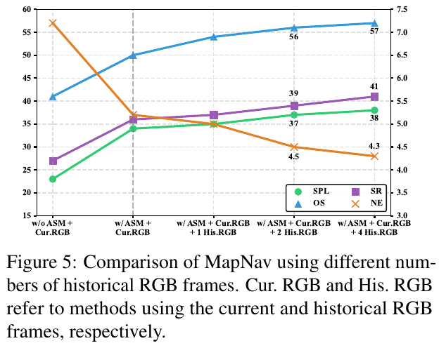
<figcaption>
Effect of historical-frame count. Adding the ASM improves performance much more than increasing the number of historical frames.
</figcaption>
</div>

Adding the ASM raises SR from 27% to 36% and SPL from 23% to 34%. Further historical RGB frames yield relatively limited gains, suggesting that the main benefit comes from spatial representation rather than accumulating temporal frames.

---

**Results and findings**

**Simulation: R2R-CE & RxR-CE Val-Unseen**

| Method | R2R OS↑ | R2R SR↑ | RxR SR↑ | RxR SPL↑ |
|------|---------|----------|---------|----------|
| NaVid (All RGB Frames) | 49.1 | 37.4 | 23.8 | 21.2 |
| MapNav (w/o ASM + Cur. RGB) | 41.2 | 27.1 | 15.6 | 12.2 |
| **MapNav (w/ ASM + Cur. RGB)** | **50.3** | **36.5** | **22.1** | **20.2** |
| MapNav (w/ ASM + Cur. + 2 His. RGB) | 53.0 | 39.7 | 32.6 | 27.7 |

- ASM + a single RGB frame achieves performance comparable to NaVid using all historical frames.
- Compared with NaVid (All RGB Frames), adding 2 historical RGB frames improves R2R SPL by 1.3 percentage points and RxR SPL by 6.5 percentage points. This comparison concerns the paper's historical-frame methods and does not imply superiority over every method with a different input configuration.

Note: this table was checked against [Table 1 of MapNav arXiv v5](https://arxiv.org/html/2502.13451v5#S4.T1). The two R2R columns are OS and SR, previously mislabeled as SR and SPL in the Chinese source. R2R SPL is 23.5, 34.3, and 37.2 for the three MapNav variants, respectively, and 35.9 for NaVid. The RxR columns remain SR and SPL with unchanged values.

**Efficiency comparison**

| Method | 1 step | 10 steps | 100 steps | 300 steps | Average inference time |
|------|-----|------|-------|-------|------------|
| Navid | 0.92MB | 9.2MB | 92MB | **276MB** | 1.22s |
| **MapNav** | **0.17MB** | **0.17MB** | **0.17MB** | **0.17MB** | **0.25s** |

- Memory use stays at 0.17MB, independent of trajectory length.
- Inference efficiency improves by **79.5%**, with latency decreasing from 1.22s → 0.25s.

**Real-world evaluation: 5 indoor settings**

Across offices, meeting rooms, lecture halls, tea rooms, and living rooms, MapNav outperforms WS-MGMAP and NaVid on both simple and semantic instructions, with SR improvements of up to 30%.

---

**Limitations**

Semantic segmentation can assign inaccurate object labels under occlusion or lighting changes, degrading ASM quality. Extending the representation to more complex embodied tasks, such as interactive navigation and manipulation, would require integrating object affordances and physical interaction capabilities.


---

## 12. VLN-Imagine (2025)
{: id="vln-imagine"}
——Using text-generated image models to build "visual imagination" for navigation agents

📄 **Paper**: [arXiv:2503.16394](https://arxiv.org/abs/2503.16394) · 🏛️ **CVPR 2025**

### Key takeaways
{: id="精华-6"}

1. An off-the-shelf text-to-image diffusion model (SDXL) generates a "visual imagination" for each landmark noun phrase in a navigation instruction, turning cross-modal alignment from implicit learning into explicit image-to-image matching. The idea is simple and transferable.
2. The method is model-agnostic: any VLN model can adopt it through a separate imagination encoder plus an auxiliary alignment loss, without modifying the original architecture.
3. The sub-instruction filtering strategy (FG-R2R segmentation + a noun-phrase blacklist) effectively controls the quality and relevance of the generated images, and is a good example of low-cost data augmentation.
4. Experiments show that imagination helps during both training and inference, and that the regularization effect during training is independent of the input gain at inference, indicating that multimodal auxiliary signals can improve a model's generalization.
5. A cosine-similarity auxiliary loss is enough to align the imagination and instruction representations, with no need for a more complex contrastive loss (InfoNCE), reflecting an engineering philosophy of "good enough is enough."

---

### 1. Background and problem
{: id="1-研究背景问题-5"}

In the Vision-and-Language Navigation (VLN) task, an agent must navigate an unseen environment by following natural language instructions. Instructions often refer to visual landmarks (such as "pool table" or "kitchen"), but existing methods rely on implicit cross-modal alignment to associate noun phrases with actual observations. This paper explores whether a text-to-image model can generate "visual imagery" of landmarks before navigation, turning language-vision alignment into an easier image-to-image matching task.

---

### 2. Method and innovations
{: id="2-主要方法创新点-5"}

#### 2.1 Visual imagination generation pipeline
{: id="21-visual-imagination-生成管线"}

<div align="center">
  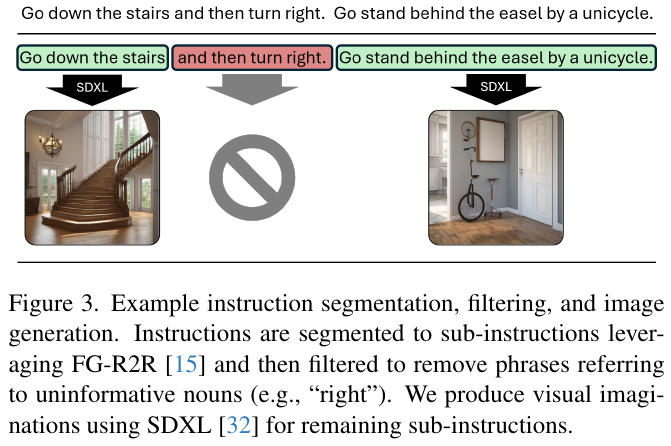
<figcaption>
Instruction segmentation, filtering, and image generation pipeline: FG-R2R splits the instruction into sub-instructions, sub-instructions without visual landmarks are filtered out, and SDXL then generates the imagined images.
</figcaption>
</div>

- **Instruction segmentation**: FG-R2R splits each complete navigation instruction into a sequence of sub-instructions $S = (S_0, \cdots, S_m)$. The R2R training set averages 3.66 sub-instructions per instruction.
- **Sub-instruction filtering**: SpaCy removes sub-instructions without noun phrases, and a blacklist then excludes non-visual nouns (such as counting words, direction words, and pronouns), leaving the valid sub-instruction set $S' \subset S$.
- **Image generation**: The SDXL diffusion model generates indoor scene images guided by positive prompts (indoor, house, realistic, real estate) and negative prompts (outdoor, text, humans, etc.). The resulting R2R-Imagine dataset contains more than 41k imagined images at 1024×1024.

#### 2.2 Model-agnostic integration
{: id="22-model-agnostic-集成方法"}

<div align="center">
  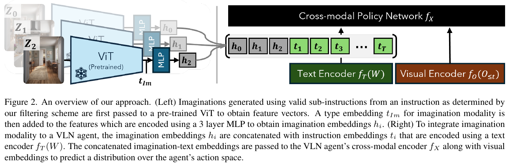
<figcaption>
Method overview: (left) the imagined image is encoded by a ViT and passed through an MLP to produce the imagination embedding; (right) it is concatenated with the instruction tokens and fed to the cross-modal policy network
</figcaption>
</div>

- **Imagination Encoder**: A pretrained ViT-B/16 encodes the imagined image, an imagination modality-type embedding $t_{Im}$ is added, and a three-layer MLP (768→512→768, ReLU + Dropout 0.15) produces the imagination embedding $h_i = \text{MLP}(\text{ViT}(Z_i) + t_{Im})$.
- **Modality fusion**: The imagination embeddings are concatenated with the text encoding of the instruction and fed to the VLN agent's cross-modal encoder. The paper validates the method on two representative models, HAMT and DUET.
- **Auxiliary alignment loss**: A cosine-similarity loss $\mathcal L_{cos}$ is computed between the imagination embedding $h_i$ and the mean text embedding $$\bar{S}_i$$ of the corresponding sub-instruction noun phrase. The total loss is $\mathcal L_{\text{base}} + \lambda \mathcal L_{cos}$ ($\lambda=0.5$).
- **Three-stage fine-tuning**: To mitigate catastrophic forgetting, the MLP and type embedding are trained first (25% of iterations), then all modules jointly (25%), then with a uniform learning rate (50%), for 100k iterations in total.

<div align="center">
  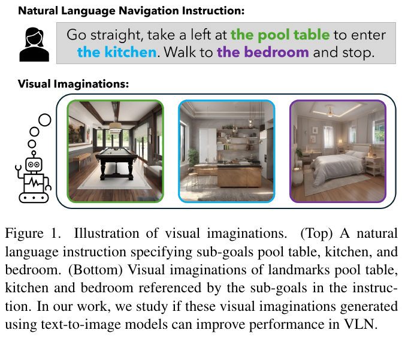
<figcaption>
Visual imagination example: sub-goals in the navigation instruction (pool table, kitchen, bedroom) are rendered as corresponding indoor scene images
</figcaption>
</div>

---

### 3. Results and findings
{: id="3-核心结果发现-5"}

- **R2R**: HAMT-Imagine improves val-unseen by 1.0 SR / 0.5 SPL (66.24 → 67.26 / 61.51 → 62.02); DUET-Imagine improves by 0.6 SR / 0.07 SPL (71.52 → 72.12 / 60.41 → 60.48), and test-split SR rises from 69 to 71.
- **REVERIE**: With coarse-grained instructions, DUET-Imagine improves SR by 1.3 points and RGS by 0.82 points, showing that imagination also helps target localization.
- **Gains from both training and inference**: Even when imagination is nullified at inference (zero attention mask), the model still beats the baseline, implying that imagination-based training has a regularizing effect.
- **Alignment is key**: Random imagination hurts performance, whereas correctly aligned imagination improves it.
- **Visual beats text**: Replacing the imagination embedding with the sub-instruction text embedding works worse than visual imagination, indicating that visual and linguistic representations are complementary.
- **High fidelity of the imagination**: Verified with the LangSAM open-vocabulary detector, 98.78% of sub-instructions have at least one noun phrase detected.

---

### 4. Limitations
{: id="4-局限性-5"}

Generating and encoding imagined images adds computational overhead, which is especially harmful for real-world robot deployment (3.2 seconds per image on an H100, and about 1.5 days of fine-tuning on a V100). Moreover, imagined images cannot capture personalized names for objects and places in the environment, and persistent visual grounding for lifelong learning remains an open problem.

---

## 13. VLN-PE (2025)
{: id="vln-pe"}
———Rethinking the Embodied Gap in Vision-Language Navigation: A Comprehensive Study of Physical and Visual Differences

📄 **Paper**: [arXiv:2507.13019](https://arxiv.org/abs/2507.13019v2) · 🏛️ **ICCV 2025**

**Key takeaways**

By building a physically realistic VLN platform, this paper systematically reveals the large gap between idealized simulation and physical deployment. Key findings: (1) training on data fused across embodiments significantly improves generalization and lays the groundwork for a unified cross-robot navigation model; (2) multimodal perception (RGB+Depth) is more robust than RGB alone, especially under changing illumination; (3) a physical controller is crucial for legged robots, and consistency of the controller between training and evaluation directly affects performance; (4) existing MP3D-style datasets generalize poorly, and fine-tuning on a small amount of in-domain data can surpass the zero-shot performance of large models; (5) diffusion policies show promise as a new paradigm for continuous waypoint prediction in VLN.

**Background and problem**

Existing VLN methods perform well in idealized simulation but face major challenges when deployed on real physical robots. The main problems: current VLN platforms ignore robots' physical embodiment characteristics (such as viewpoint height, motion dynamics, collisions, and falls) and lack cross-embodiment support for different robot types (wheeled, humanoid, quadrupedal). The core research question is: how much do physical embodiment constraints and visual environment changes affect the performance of existing VLN methods?

**Method and innovations**

<div align="center">
  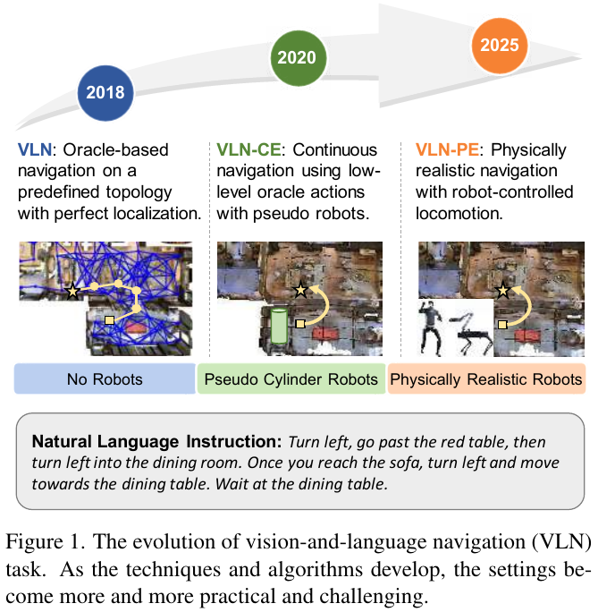
<figcaption>
Evolution of VLN tasks: from oracle-based navigation (2018) to continuous VLN-CE navigation (2020) to physically realistic VLN-PE navigation (2025)
</figcaption>
</div>

The paper proposes the **VLN-PE platform**, a physically realistic VLN benchmark platform built on GRUTopia, with the following core features:

1. **Cross-embodiment support**: Supports humanoid robots (Unitree H1, G1), quadruped robots (Unitree Aliengo), and wheeled robots (Jetbot), and provides an RL-based physical controller API for realistic motion dynamics simulation

2. **Scene diversity**: In addition to 90 MP3D scenes, it adds 10 new high-quality synthetic home scenes (GRScenes) and a laboratory scene rendered online with 3DGS, so more environments can be integrated seamlessly

<div align="center">
  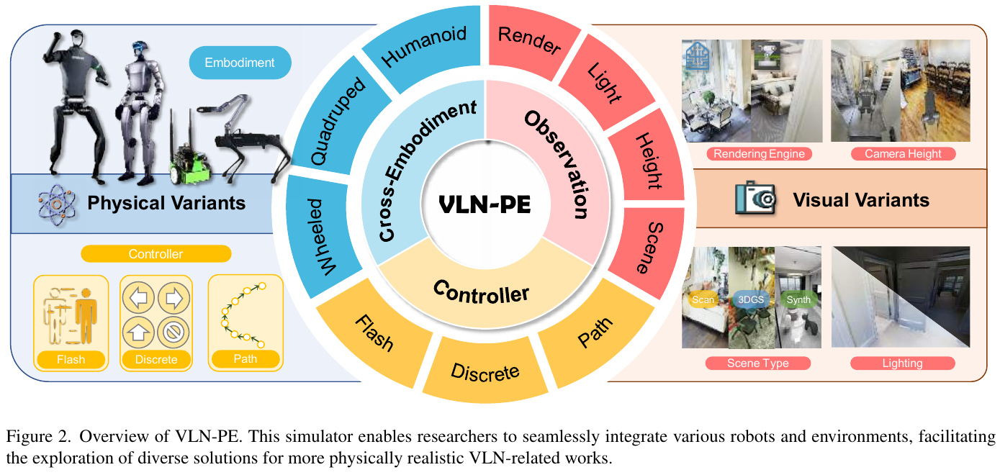
<figcaption>
VLN-PE platform overview: supports multiple robot embodiments, scene types, lighting conditions, and controller modes
</figcaption>
</div>

3. **Systematic evaluation framework**: Evaluates three categories of ego-centric VLN methods
   - **Single-step end-to-end methods**: Seq2Seq, CMA (~36M parameters), and NaVid (a 7B-parameter video MLLM)
   - **Multi-step end-to-end method**: RDP (Recurrent Diffusion Policy), proposed here for the first time, uses a Transformer-based diffusion module to predict continuous trajectory waypoints
   - **Map-based zero-shot method**: An improved VLMaps that combines an LLM with semantic maps for path planning

<div align="center">
  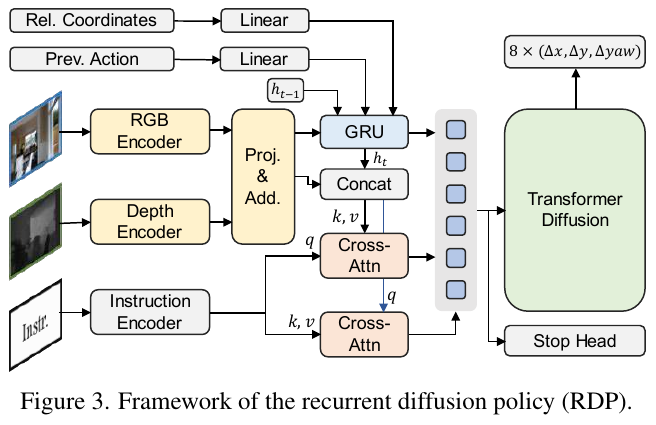
<figcaption>
RDP (Recurrent Diffusion Policy) framework: a GRU maintains history, cross-attention fuses vision-language features, and a Transformer diffusion module predicts continuous action sequences
</figcaption>
</div>

4. **New datasets**:
   - **R2R-filtered**: 8,679/658/1,347 train/val-seen/val-unseen episodes retained after filtering out staircase scenes
   - **GRU-VLN10**: 10 synthetic scenes, with 441/111/1,287 episodes
   - **3DGS-Lab-VLN**: a laboratory environment rendered with 3DGS, with 160 training / 640 evaluation episodes

5. **New evaluation metrics**: In addition to the traditional TL, NE, SR, OS, and SPL, it adds Fall Rate (FR) and Stuck Rate (StR) to measure physical realism challenges

**Results and findings**

<div align="center">
  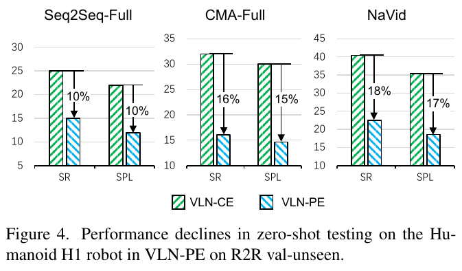
<figcaption>
Main results on the R2R dataset using the Unitree H1 humanoid robot
</figcaption>
</div>

**Zero-shot transfer degrades markedly**:
- When VLN-CE models are transferred directly to VLN-PE, SR drops by about 34% relative to the original.
- SR of Seq2Seq-Full, CMA-Full, and NaVid drops by 10%, 16%, and 18%, respectively.
- This indicates that existing models heavily overfit a specific simulation platform

**In-domain fine-tuning helps substantially**:
- CMA trained from scratch on VLN-PE (without data augmentation) surpasses CMA-Full trained with 175K augmented samples
- After fine-tuning, the small model CMA+ reaches SR 28.72 and SPL 24.24 on val-seen, surpassing NaVid's zero-shot performance.

**Sensitivity to embodiment**:
- The quadruped robot (camera height about 0.5m) almost completely fails after transfer
- Raising the camera height to 1.8m improves transfer performance on humanoid robots
- Joint training across embodiments lets a single model reach SoTA performance on all robot types

**Importance of the physical controller**:
- Performance is best when training and evaluation use the same controller
- Collecting data with the physical controller reduces the Fall Rate and Stuck Rate

**Multimodal robustness**:
- The SR of RGB-only NaVid drops by 12.47% in low light
- RGB+Depth CMA and RDP are much less affected by lighting (a drop of about 1-2%)

**Limited generalization of the MP3D dataset**:
- On GRU-VLN10, RDP, with only 6M parameters and 441 training samples, surpasses the large NaVid model zero-shot.
- On 3DGS-Lab-VLN, NaVid fails completely (SR of only 5.81), possibly because of 3DGS rendering noise

**Potential of diffusion policies**:
- RDP, the first diffusion-policy baseline for VLN, outperforms Seq2Seq and CMA when trained from scratch
- It predicts continuous dense waypoints, which can be combined with control-theoretic methods such as MPC

**Real-robot validation**:
- Tested in 14 indoor scenes with a Unitree Go2 robot
- In the real environment, the VLN-PE fine-tuned model reaches OS 57.14 and SR 28.57, significantly better than the VLN-CE-trained model.

**Limitations**

Current RL-based motion controllers cannot reliably handle stair navigation in complex environments, so such scenes had to be filtered out. The paper focuses on the ego-centric view and does not evaluate panoramic VLN methods. MLLMs still struggle with accurate target recognition and stopping decisions. The pixel-level noise introduced by 3DGS rendering may interfere with RGB-only models, and robustness to image perturbations needs further study.

---

## 14. Goal2Pixel (2025)
{: id="goal2pixel"}
———Grounding navigation goals in image pixels and unifying the VLN-CE decision space as pixel prediction

📄 **Paper**: [arXiv:2606.01621](https://arxiv.org/abs/2606.01621)

### Key takeaways
{: id="精华-7"}

1. **The image plane as the decision space**: High-level decision-making in VLN-CE is redefined from discrete action prediction to pixel prediction. The VLM only needs to output a pixel coordinate, which removes the ambiguity of action labels and matches the VLM's native output space.
2. **Auxiliary command regions**: Non-forward actions such as turning and stopping are encoded as pixels in extended regions of the image plane, so all decisions are handled in one coordinate space without two-stage switching.
3. **ViKeyMem selects keyframes by visibility**: Using changes in the visibility of future waypoints as the keyframe selection criterion, it needs only 3–4 frames to encode a trajectory of 100+ steps, and the training cost drops from 156 to 70 H100 GPU hours.
4. **Fewer VLM calls**: Pixel prediction is coarser (one prediction corresponds to 5 low-level actions), cutting VLM calls from 46.62 to 7.75 while SR rises from 32.9% to 54.1%.
5. **Cross-platform portability**: The pixel output decouples high-level VLM inference from the robot's low-level controller, so the same model can be reused across hardware platforms.

---

### 1. Background and problem
{: id="1-研究背景问题-6"}

In VLN-CE (vision-language navigation in continuous environments), existing VLM-based methods mostly use low-level action prediction (forward / turn left / turn right / stop) as the output interface, which has three drawbacks: ambiguous supervision (the same spatial target corresponds to multiple valid action sequences), a short decision horizon (only 25cm per step), and too many VLM calls (30–47 per episode). Finding a better interface between VLM reasoning and robot execution is therefore a core issue.

---

### 2. Method and innovations
{: id="2-主要方法创新点-6"}

<div align="center">
  
<figcaption>
Figure 1: Overall Goal2Pixel framework. Top: the three-stage execution pipeline. The VLM predicts a target pixel (u, v), which is back-projected into a 3D waypoint using the camera geometry and converted into low-level actions by the local planner; the auxiliary command regions (extensions on the left, right, and bottom of the image) correspond to Turn_Left, Turn_Right, and Stop, respectively. Bottom: the VLM takes the language instruction, the padded current RGB image, and the ViKeyMem history as input and outputs the coordinate string "XXX,YYY"; visual semantic embeddings and a coordinate-aware loss assist adaptation.
</figcaption>
</div>

**① Overall framework**

Goal2Pixel has three core parts: a **pixel-prediction VLM** (a fine-tuned InternVL3), a **geometric back-projection module**, and a **local planner**. The VLM outputs a coordinate string, which is back-projected into a 3D waypoint; the planner executes up to 5 low-level actions and then queries the VLM again, forming a closed loop.

**② Pure pixel paradigm**

- **Input**: The current RGB image padded to a square (with auxiliary command regions on three sides) + the language instruction + the ViKeyMem history (up to 8 frames)
- **Processing**: The VLM autoregressively generates a coordinate string in the format "XXX,YYY", with coordinates normalized to [000, 999]
- **Output interpretation**: If the coordinates fall in the RGB region, they are back-projected into a 3D waypoint using the camera intrinsics and tracked by the local planner; if they fall in an auxiliary region, Turn_Left / Turn_Right / Stop is executed directly
- **Motivation**: Pixel coordinates are the VLM's native output space and give a clearer supervision signal; all decisions share one interface, with no two-stage action-then-pixel switching

**Auxiliary command region rules**:
- Bottom region → Stop (the GT pixel points into this region when within 1m of the goal)
- Left/right regions → Turn_Left / Turn_Right (when the forward waypoint is not visible, determined by the mean egocentric direction of the next 5 waypoints)

**GT pixel definition**: Along the oracle trajectory, the **farthest visible drivable pixel** in the current frame, which encourages longer-horizon decisions and removes the ambiguity of short-range actions.

**③ ViKeyMem keyframe history memory**

<div align="center">
  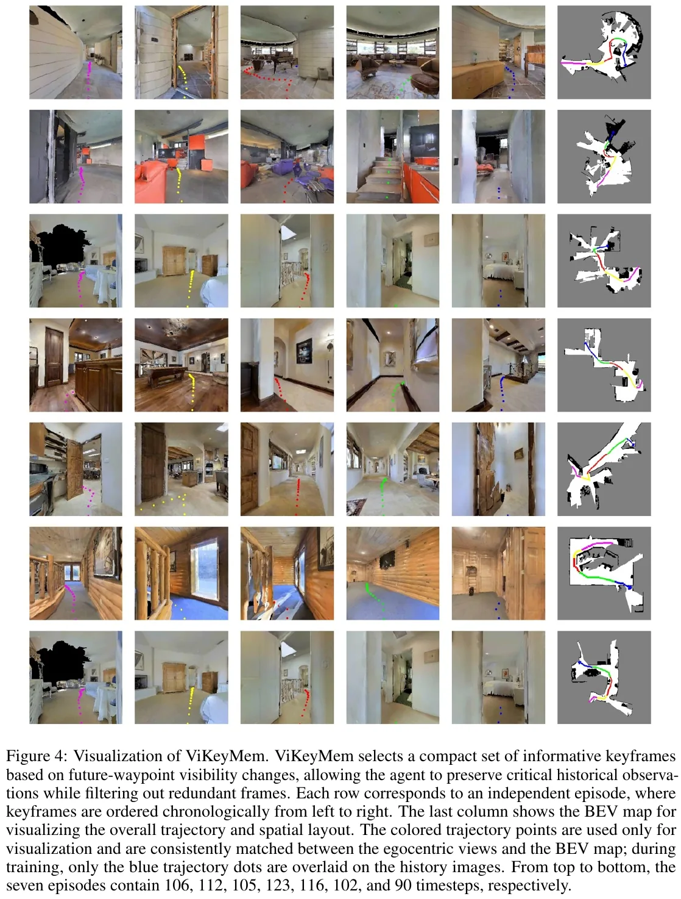
<figcaption>
Figure 4: ViKeyMem visualization. Each row is an independent trajectory (90–123 steps long), with keyframes arranged in time from left to right and a bird's-eye map in the rightmost column. Blue trajectory points are overlaid on the historical frames, giving compact cues about past motion; a trajectory of 100+ steps typically needs only 3–4 keyframes to cover the key viewpoint transitions.
</figcaption>
</div>

ViKeyMem uses **changes in the visibility of future waypoints** as its keyframe selection criterion. A candidate frame is added to the keyframe set when it meets all three conditions:
1. The candidate frame's viewpoint is no longer covered by recent keyframes (the core visibility condition)
2. At least one subsequent waypoint is visible from the center of the candidate frame's image
3. At least two different subsequent waypoints fall within the candidate frame's 45° forward field of view

A blue trajectory overlay is added to each selected keyframe as a lightweight reminder of past motion. On R2R-CE, only 3–4 frames are selected per 100 steps on average, inference time drops from 0.224s to 0.121s, and training time drops from 156 H100 hours to 70 hours.

**④ Visual semantic embeddings**

The pretrained VLM recognizes navigation-specific visual patterns (auxiliary command regions, trajectory overlay points) poorly, so two types of learnable embeddings are introduced:
- **Command embedding**: added to the current-frame visual tokens that overlap the auxiliary command regions
- **Trajectory embedding**: added to the historical-frame visual tokens that contain blue trajectory points
- Ordinary RGB tokens are left unchanged, and the number of added parameters is tiny

**⑤ Training objective and coordinate-aware loss**

$$\mathcal{L} = \mathcal{L}_{CE} + \lambda_{num}\mathcal{L}_{num} + \lambda_{ang}\mathcal{L}_{ang}$$

- $$\mathcal{L}_{CE}$$: standard token-level cross-entropy, the main supervision signal; $$\lambda_{CE}=1$$
- $$\mathcal{L}_{num}$$: numerical loss, which derives soft coordinates from the softmax logits and encourages predicted values to approach the GT; $$\lambda_{num}=0.3$$
- $$\mathcal{L}_{ang}$$: angle loss, which encourages the predicted pixel to keep the same egocentric direction as the GT; $$\lambda_{ang}=0.03$$

**⑥ Inference procedure**

After each VLM call, the local planner executes at most t=5 low-level steps; if it oscillates for about 20 consecutive steps, it automatically falls back to a fixed forward pixel (500,970) to escape.

---

### 3. Results and findings
{: id="3-核心结果发现-6"}

<div align="center">
  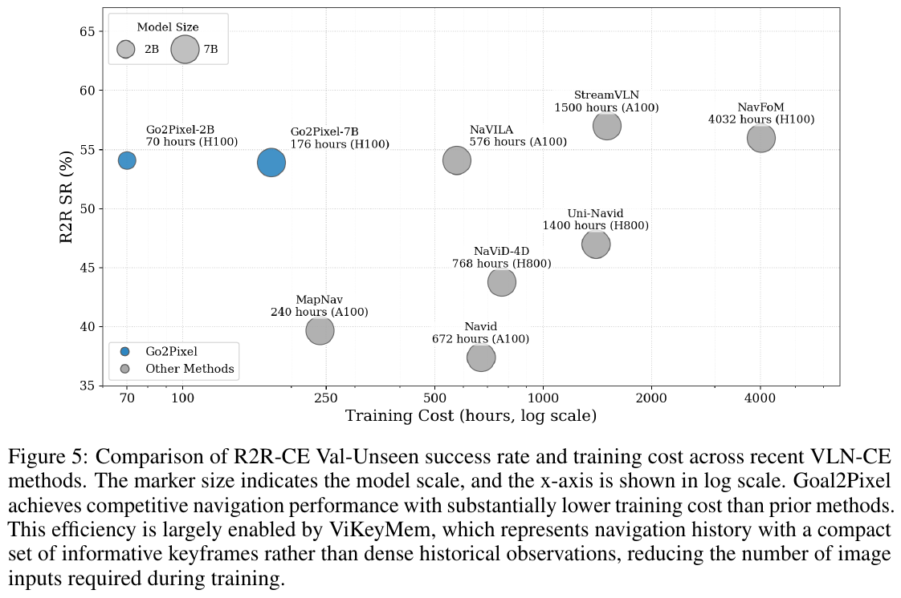
<figcaption>
Figure 5: R2R-CE Val-Unseen SR versus training cost (logarithmic x-axis; marker size corresponds to model size). Goal2Pixel (2B) reaches 54.1% SR in 80 H100 hours, a training cost far below that of other methods with comparable performance.
</figcaption>
</div>

<div align="center">
  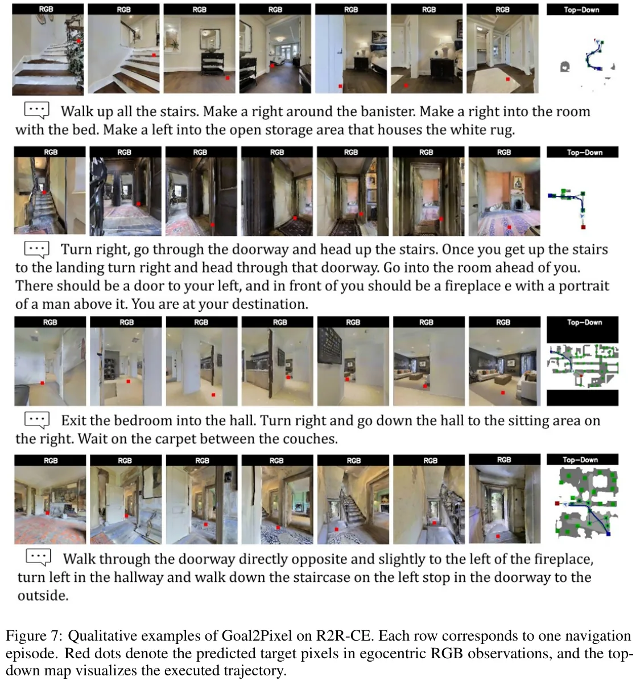
<figcaption>
Figure 7: Qualitative results of Goal2Pixel on R2R-CE. Each row is one navigation episode, the red dots are the target pixels predicted by the VLM at each step, and the rightmost column is the bird's-eye view of the executed trajectory.
</figcaption>
</div>

**R2R-CE Val-Unseen key results** (2B model, no external data):
- **SR 54.1%, SPL 52.5%**, with only **7.75 VLM calls per episode**
- Direct action prediction: SR 32.9% and 46.62 calls required (21.2 points lower SR, 6× more calls)
- Compared with JanusVLN 7B (SR 52.8%), the 2B Goal2Pixel has 1.3 points higher SR with only 2/7 of the parameters

**Output paradigm ablation** (Table 2):

| Output Paradigm | SR | SPL | # VLM Calls |
|---------|-----|-----|-------------|
| 1 Action Prediction | 32.9% | 31.5% | 46.62 |
| 4 Action Prediction | 37.0% | 36.0% | 15.77 |
| Mixed Action-Pixel (Seq) | 43.7% | — | ~10 |
| **Pure Pixel (this paper)** | **54.1%** | **52.5%** | **7.55** |

**ViKeyMem ablation**（Table 3a）：
- Compared with fixed 5-step interval sampling: SR/SPL +8.0/+7.4 (R2R), +5.1/+5.0 (RxR)
- Inference time: 0.243s → 0.121s (−50%); training time: 173h → 70h (−60%)

**RxR-CE Val-Unseen**（2B）：SR 43.8%，SPL 40.4%，nDTW 61.1%

**Real robot**: In 16 indoor navigation tests, Goal2Pixel grounds language instructions (doors, sofas, refrigerators, stairs, etc.) to meaningful pixel targets and completes the navigation through the local controller.

---

### 4. Limitations
{: id="4-局限性-6"}

Because ViKeyMem uses visibility as its criterion, it may miss fine-grained landmarks that appear briefly or are distant and low-resolution. The soft-coordinate expectation is also unreliable under a multimodal numeric distribution (although the main supervision is still the token-level CE loss, which mitigates this).

---

## 15. AstraNav-World (2025)
{: id="astranav-world"}
——Unifying "imagining the future" and "planning the future" in a single generative probabilistic framework

📄 **Paper**: [arXiv:2512.21714](https://arxiv.org/abs/2512.21714) · [Code](https://github.com/amap-cvlab/AstraNav-World)

### Key takeaways
{: id="精华-8"}

- It turns the loosely coupled imagine-then-plan paradigm (first imagine the future scene, then plan actions accordingly) into a tightly coupled one, in which visual prediction and action generation are modeled jointly in the same probabilistic framework and rolled out simultaneously, fundamentally suppressing error accumulation.
- The VLM does more than language understanding: it serves as a unified conditional encoder for both the video generator and the action policy head, with the same vision-language embedding driving both branches.
- Two-way constraints are the key: actions must rest on executable future visual evidence, and the predicted future images must in turn be constrained by the action intent. The two correct each other instead of passing errors in one direction.
- Sparse Foresight Scheduling triggers joint "visual prediction + action generation" reasoning at fixed intervals rather than frame by frame, speeding up inference by an order of magnitude with almost no loss in score.
- Ablations show that the gain comes mainly from the world model's two-way constraint mechanism rather than from simply adding parameters (the 3B joint model beats a VLA-only baseline scaled up to 7B).

---

### 1. Background and problem
{: id="1-研究背景问题-7"}

A core reason embodied navigation fails is the lack of modeling of physical laws and temporal dynamics: small prediction deviations accumulate over time and ultimately undermine global planning. Existing methods usually treat "imagining the future" (a world model generates future frames) and "planning the future" (a VLA outputs actions) as two loosely coupled serial modules. This imagine-then-plan pipeline amplifies physical uncertainty and causal ambiguity, so the visual predictions and the actual actions become inconsistent with each other.

---

### 2. Method and innovations
{: id="2-主要方法创新点-7"}

<div align="center">
  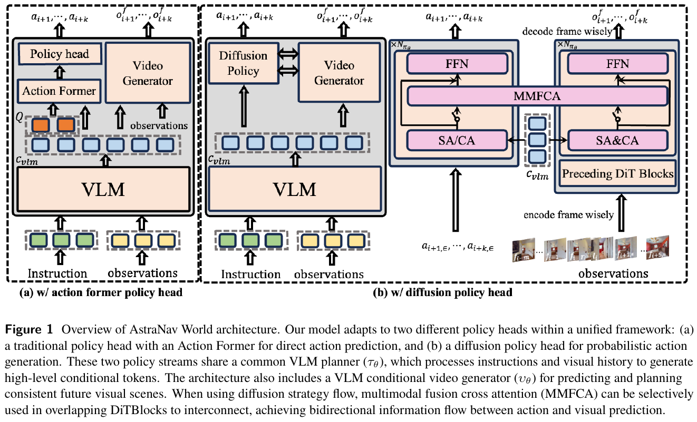
<figcaption>
AstraNav-World overall architecture: the VLM planner drives two variants of the policy head: (a) Action Former predicts actions directly; (b) Diffusion Policy interacts bidirectionally with the video generator through MMFCA
</figcaption>
</div>

**① Overall framework**: AstraNav-World has three core modules: a VLM planner (high-level semantic reasoning), a DiT-based video generator (predicts future visual observations), and an action policy head (generates future action sequences, in two implementations: Action Former and Diffusion Policy). The VLM encodes the instruction and the historical/current multi-view observations into a unified vision-language embedding, which conditions both the video generator and the policy head, replacing the text encoder of a traditional video diffusion model.

**② Module-by-module walkthrough**

- **VLM Planner (τθ)**: Takes the natural language instruction I and the historical observation sequence O_hist; internally it uses Qwen2.5-VL-3B with full-parameter fine-tuning, and outputs a vision-language embedding C ∈ R^(L×D) (D=2048) that contains both "goal-oriented semantic features" (the instruction encoding) and "spatial context features" (the semantics and spatial information of historical/current observations). This representation lets the model keep a holistic understanding of long-horizon tasks while responding flexibly to real-time changes in the environment.
- **VLM-Conditioned Video Generator**: The base architecture is Wan2.2-TI2V-5B (ST-VAE + a 30-layer DiT), fine-tuned with LoRA (rank=128). The VLM's vision-language embedding is injected into the DiT through cross-attention, replacing the original umT5 text encoder, so the generated future frames stay semantically consistent with the VLM's high-level plan. During training, minimal noise (σ_obs≈0.05) is added to the historical/current frames, which serve as "clean" conditions. Future frames are noised with Flow Matching, and the velocity field u_t=ϵ−z_future is learned. The loss is computed only on future frames (L_VG, Equation 4).
- **3D-RoPE rearrangement**: To encode the left/front/right views of the current step and the historical frames in a single set of 3D rotary position encodings, the authors "virtually stitch" the three views along the width axis: the front view keeps its original coordinates, the right view is offset by W in width, and the left view by 2W, while sharing the same time and height indices (Equations 1–3). This encodes the spatiotemporal relationship among views explicitly without disturbing temporal alignment.
- **Action policy head (two implementations)**:
  - **Action Former**: A set of learnable query vectors interacts with the VLM embedding through several Transformer layers, and an MLP then outputs a deterministic action sequence A=(X,Y,cosθ,sinθ,α), trained with a weighted combination of an L1 position loss, a cosine angle loss, and a binary arrival loss (Equations 5–8).
  - **Diffusion Policy**: Flow Matching denoises a noisy action sequence to give probabilistic action predictions. The key innovation is **Multimodal Fusion Cross-Attention (MMFCA)**: bidirectional cross-attention is introduced between the Diffusion Policy and the last 8 overlapping DiT blocks of the video generator. The action representation acts as the query to attend to the video latents (ensuring actions rest on credible future vision), and the video latents act as the query to attend to the action representation (ensuring the generated frames are causally consistent with the planned actions). MMFCA is controlled by a binary switch γ: when γ=1, the two channels are fused bidirectionally and rolled out synchronously; when γ=0, they run independently. At inference, the video generator can even be skipped entirely and only the policy head run, greatly reducing compute.
- **Motivation**: The core gap is that in a loosely coupled pipeline, visual prediction and action planning are unaware of each other and prone to drift. MMFCA and the shared VLM conditioning let the two branches "see each other" during both training and inference and correct each other's errors instead of accumulating them in one direction.

**③ End-to-end data flow**: A sample is first embedded uniformly by the VLM from the instruction plus the historical/current three-view observations; the embedding conditions both the video generator (predicting future frames for the next N steps) and the policy head (predicting actions for the next N steps). If MMFCA is enabled, the two channels perform bidirectional cross-attention within the overlapping DiT blocks to roll out synchronously. The output is a sequence of future visual frames and the corresponding action (waypoint) sequence.

**④ Training objective**: The total loss is L_Total = L_VG + λ·L_PH (λ=1.0, Equation 10), where L_VG is the video-generation Flow Matching loss (Equation 4) and L_PH is Equation 8 (Action Former's combined position, angle, and arrival loss) or Equation 9 (Diffusion Policy's Flow Matching loss), depending on the policy head. Training has two stages: in **Stage 1** the VLM is frozen, and the video generator (L_VG) and then the policy head (L_PH) are pretrained independently, to avoid early interference between the two modules; in **Stage 2** all components are unfrozen and fine-tuned jointly with L_Total, with MMFCA enabled at random with 50% probability for Diffusion Policy to keep the policy head from relying too heavily on visual feedback and to ensure it can still work independently when the video generator is turned off.

**⑤ Inference (Sparse Foresight Scheduling, SFS)**: Video generation is the inference bottleneck, so instead of jointly generating "future frames + actions" at every step, joint generation is triggered at fixed intervals; in many navigation scenes, simple consistent behaviors such as going straight do not require updating the world model frame by frame. With Action Former, the video generator is switched off entirely at inference and only the query Transformer produces actions; with Diffusion Policy, the video generator is activated only once per fixed interval (every 10 steps in the implementation) and stays off in between, giving the best trade-off between prediction accuracy and inference speed.

---

### 3. Results and findings
{: id="3-核心结果发现-7"}

<div align="center">
  
<figcaption>
Qualitative results: The model predicts the next 5 frames of visual observations together with the corresponding 5-step waypoints, and the generated frames agree closely with the scene rendered at the predicted waypoints
</figcaption>
</div>

- On R2R-CE / RxR-CE Val-Unseen, AstraNav-World surpasses the previous SOTA across the board: the Action Former version improves SR over the previous best method by an absolute 2.1% (R2R-CE) / 1.1% (RxR-CE); the Diffusion Policy + MMFCA version improves a further 0.7% (R2R-CE) / 2.5% (RxR-CE) over Action Former, finally reaching R2R-CE SR=67.9%, SPL=65.4% and RxR-CE SR=72.9%.
- On HM3D-OVON open-vocabulary object navigation, Diffusion Policy improves SR by an absolute 4.9% over the previous best, MTU3D (45.7% vs 40.8%).

<div align="center">
  
<figcaption>
Ablation experiments: (a) Removing the video generator branch lowers SR on all three datasets; (b) A larger SFS interval makes inference faster (up to 6.7×) with almost no change in SR; (c) The pose consistency between the generated visual sequence and the true waypoints approaches 100% quickly as the angle threshold is relaxed.
</figcaption>
</div>

- **Removing the video generator branch** consistently lowers SR on R2R, RxR, and OVON, showing that explicitly predicting future observations does provide key visual guidance for planning and is not a redundant branch.
- **Scaling vs. world modeling**: When the VLM of the VLA-only baseline (no video generation) is enlarged from 3B to 7B, R2R-CE SR barely changes (66.5% → 66.6%), so parameter scaling has hit its ceiling; the 3B model with the video generation branch (L_VG regularization) pushes SR to 67.9%, indicating that the gain comes mainly from the world model's two-way constraint mechanism rather than from simply stacking parameters.
- **Consistency analysis**: The open-source VGGT model estimates the relative camera pose changes across the generated image sequence. Compared with the relative poses of the simulator's true renderings, the distribution of the angle difference δ_a shows that the generated future visual predictions are highly geometrically consistent with the planned actions.
- **Real-world zero-shot transfer**: Without any real-world fine-tuning, AstraNav-World is deployed directly on a physical robot to follow natural language navigation instructions. It predicts future scenes well at key transitions such as door crossings and corners, and is clearly better than existing methods, which usually need domain adaptation. This verifies that the world model learns transferable physical and navigation regularities rather than merely overfitting the simulation data distribution.

---

### 4. Limitations
{: id="4-局限性-7"}

The inference latency of video generation itself and the compute overhead in complex scenes remain bottlenecks (although SFS alleviates them greatly). The paper also notes that future work should extend to longer horizons and harder tasks, further strengthen the modeling of physical and causal consistency, and improve closed-loop consistency and real-time inference and planning.

---

## 16. CorrectNav (2025)
{: id="correctnav"}
——— A monocular RGB vision-language-action navigation model empowered by a self-correction flywheel

📄 **Paper**: [arXiv:2508.10416](https://arxiv.org/abs/2508.10416) · 🏛️ **AAAI 2026** · [Code](https://github.com/owlet914/CorrectNav) · [Project Page](https://correctnav.github.io)

---

### Key takeaways
{: id="精华-9"}

1. **Turning waste into treasure**: Unlike traditional methods that treat the model's prediction deviations on the training set as useless errors, CorrectNav proposes the **Self-correction Flywheel** post-training paradigm, which converts the deviation trajectories produced during model evaluation into valuable self-correction training data.
2. **Implicit error correction in both perception and action**: It jointly builds **action correction trajectories** (re-routing to the goal through a trajectory planner $\Gamma$) and **keyframe perception analysis** based on a multimodal large model (describing landmarks and generating detailed QA). It needs no extra reasoning module and no time-consuming chain of thought (CoT); the self-correction ability is internalized implicitly in the model parameters.
3. **Multi-round closed-loop flywheel iteration**: It uses a closed loop of "model evaluation ➔ deviation detection ➔ automatic generation of action/perception self-correction data ➔ continued training". The deviation patterns of the newly trained model trigger the next flywheel round, and performance improves markedly with each iteration.
4. **End-to-end SOTA with monocular RGB**: Using only monocular RGB video and language instructions, it reaches success rates of **65.1%** and **69.3%** on the R2R-CE and RxR-CE Val-Unseen continuous-environment benchmarks, significantly surpassing the previous SOTA navigation model StreamVLN (+8.2% and +16.4%).
5. **Robust real-robot deployment**: Combining domain randomization with general multimodal data replay against forgetting, it achieves high-success-rate deployment in complex indoor and outdoor scenes on the AgiBot Lingxi D1 quadruped robot, with long-instruction following and self-correcting dynamic obstacle avoidance.

---

### 1. Background and problem
{: id="1-研究背景问题-8"}

In the vision-language navigation (VLN) task, a robot must explore a path through an unexplored continuous environment by following natural language instructions. Existing vision-language-action (VLA) navigation models, however, inevitably make single-step prediction errors when executing instructions, because of perception errors or misunderstood instructions.

Such single-step errors accumulate rapidly in continuous space and make the robot deviate seriously from the intended route (for example, if the instruction says "go forward and turn right into the living room" and the robot turns right too early, it mistakenly enters the kitchen). Lacking self-correction and self-recovery abilities, traditional models cannot reposition once they leave the path, and navigation fails. Some earlier studies (such as SmartWay and EnvolveNav) tried to introduce large closed-source models for backtracking reflection or to generate long chains of thought, but this brought huge inference latency and complex external modules, making it hard to meet the real-time requirements of real robot navigation.

---

### 2. Method and innovations
{: id="2-主要方法创新点-8"}

CorrectNav builds a VLA navigation model on monocular RGB input and implicitly internalizes efficient path-deviation correction through a **self-correction flywheel post-training paradigm**.

<div align="center">
  
<figcaption>
CorrectNav's diverse embodied navigation capabilities (cross-room instruction following, perception of landmark state changes, error correction, drift correction, and pedestrian/dense-obstacle avoidance)
</figcaption>
</div>

#### ① Overall framework
{: id="-整体框架概述-3"}

CorrectNav has three modules: a **Vision Encoder** (SigLIP), a **Projector** (2-layer MLP), and a **Large Language Model Backbone** (Qwen2 7B, initialized from LLaVA-Video 7B). The Vision Encoder extracts the visual features $Z_v$ of the multi-frame input RGB video, and the Projector maps them into the LLM's semantic space $H_v$. The LLM combines these with the language instruction tokens and autoregressively predicts an action chunk $\{a_{t+1}, \dots, a_{t+m}\}$ of length $m=4$.

<div align="center">
  
<figcaption>
CorrectNav overall architecture and the self-correction flywheel post-training paradigm (left: navigation fine-tuning and domain randomization; right: the four-step closed loop of the self-correction flywheel)
</figcaption>
</div>

#### ② Base navigation fine-tuning and three data strategies
{: id="-基础导航微调navigation-fine-tuning与三大数据策略"}

Before starting the self-correction flywheel, CorrectNav is first fine-tuned on standard navigation tasks in a multi-task fashion:
- **Action Prediction**: Trained on more than 2.1 million step-level standard trajectories extracted from MP3D scenes, from R2R-CE (527K) and RxR-CE (1.58M). To greatly improve visual robustness, a **domain randomization strategy** is introduced (covering random camera height, field of view (FoV), resolution scaling, and lighting changes).
- **Instruction Generation (reverse generation from trajectories)**: 30K complete oracle trajectories are used to train CorrectNav to generate the corresponding navigation instructions from the observation history, strengthening cross-modal expression.
- **General multimodal data replay**: To prevent catastrophic forgetting of general multimodal understanding caused by continued training on specialized navigation datasets, 240K video QA samples from LLaVA-Video (ActivityNet-QA and NextQA) are mixed in proportionally to preserve spatiotemporal awareness.

#### ③ Self-correction flywheel post-training paradigm
{: id="-自纠错飞轮后训练范式self-correction-flywheel-post-training"}

To make CorrectNav self-recovering, the authors design a four-step closed-loop flywheel:

1. **Step 1: Evaluate on the training set and collect deviating trajectories**
Although CorrectNav has been supervised on the training set, re-evaluating it on the training set still yields erroneous navigation trajectories $T_m = (M_1, M_2, \dots, M_m)$. These trajectories containing errors are the most valuable source of self-correction training data.

2. **Step 2: Trajectory deviation detection**
The ground-truth reference trajectory $T_g$ is uniformly interpolated to obtain $T'_g$. The perpendicular distance from the robot position $M_i$ to the reference trajectory is computed:
   $$h_i = \min_{x \in T'_g} \lVert M_i - x \rVert_2$$
The corresponding foot of the perpendicular on $T'_g$ is:
   $$P_i = \arg\min_{P \in T'_g} \lVert M_i - P \rVert_2$$
If there is a time step $t$ at which the perpendicular distance exceeds the distance threshold $S$ (that is, $h_t > S$, while $h_i \le S, \forall i < t$ for all earlier steps), the model is judged to have deviated at $M_t$, and the observation frames near $M_t$ are marked as correction keyframes.

3. **Step 3: Build action and perception self-correction data**
   - **Action correction trajectory**: If the foot of the perpendicular $P_t$ lies on the reference segment $G_k G_{k+1}$, the robot passed $G_k$ correctly but deviated on the way to $G_{k+1}$. The trajectory planner $\Gamma$ is called to regenerate a corrective trajectory starting from the deviation point $M_t$, passing through the subsequent reference points and finally reaching the goal: $$T_e = (M_t, G_{k+1}, \dots, G_n)$$. During training, the history before the deviation point serves only as observation context, and the action prediction loss is computed only on $T_e$.
   - **Keyframe perception analysis**: The deviation point $M_t$ and its surrounding keyframes $\{K_1, K_2, K_3\}$ are extracted, and the multimodal large model Qwen-VL-Plus automatically generates two types of perception data:
     1. **Landmark descriptions** $$C_i = \text{MLLM}(K_i, L_{\text{cap}})$$: describe furniture, architectural structures, and other key landmarks in the image;
     2. **Detailed QA pairs** $$\{(Q_j, A_j)\}_{j=1}^x = \text{MLLM}(K_i, L_{\text{qa}})$$: focus on relative object positions, colors, and the robot's current heading. Perception training teaches the model both how to correct deviations and why they occur.

4. **Step 4: Continued training and multi-round iteration**
Self-correction trajectory/perception data is sampled at a proportion of $50\%$ and combined with $25\%$ of the original standard trajectories for continued training. When the model after one correction round is evaluated on the training set again, it exposes new deviation patterns, which drives the flywheel into the next loop. As iterations proceed, the model's self-correction ability keeps improving.

<div align="center">
  
<figcaption>
CorrectNav's error-correction ability (top: after losing its way on a wrong path, it quickly turns around and returns to the correct path; bottom: it enters the wrong front door and finds no target, then turns back and enters the correct side door)
</figcaption>
</div>

---

### 3. Results and findings
{: id="3-核心结果发现-8"}

#### ① VLN-CE continuous benchmark quantitative comparison
{: id="-vln-ce-连续基准定量对比"}

Full evaluation on the Val-Unseen splits of R2R-CE and RxR-CE in the Habitat 3.0 simulator (monocular RGB input only):

| Model | Input modal | R2R-CE NE↓ | R2R-CE SR↑ | R2R-CE SPL↑ | RxR-CE NE↓ | RxR-CE SR↑ | RxR-CE SPL↑ | RxR-CE nDTW↑ |
| :--- | :---: | :---: | :---: | :---: | :---: | :---: | :---: | :---: |
| BEVBert | RGB-D + Pano | 4.57 | 59.0% | 50.0% | - | - | - | - |
| ETPNav | RGB-D + Pano | 4.71 | 57.0% | 49.0% | 5.64 | 54.7% | 44.8% | 61.9% |
| HNR | RGB-D + Pano | 4.42 | 61.0% | 51.0% | 5.50 | 56.3% | 46.7% | 63.5% |
| NaVid | monocular RGB | 5.47 | 37.0% | 35.0% | - | - | - | - |
| Uni-NaVid | monocular RGB | 5.58 | 47.0% | 42.7% | 6.24 | 48.7% | 40.9% | - |
| NaVILA | monocular RGB | 5.22 | 54.0% | 49.0% | 6.77 | 49.3% | 44.0% | 58.8% |
| StreamVLN | monocular RGB | 4.98 | 56.9% | 51.9% | 6.22 | 52.9% | 46.0% | 61.9% |
| **CorrectNav (Ours)** | **monocular RGB** | **4.24** | **65.1%** | **62.3%** | **4.09** | **69.3%** | **63.3%** | **75.2%** |

Using only monocular RGB, CorrectNav not only sets a new record for monocular VLA models (R2R-CE SR 65.1%, RxR-CE SR 69.3%), but also clearly surpasses traditional topological-map methods (such as HNR and ETPNav) that rely on depth (Depth), panoramas (Pano), and a waypoint predictor (Waypoint Predictor).

#### ② Flywheel iteration and ablation experiment
{: id="-飞轮迭代与消融实验"}

<div align="center">
  
<figcaption>
CorrectNav performance across self-correction flywheel iterations
</figcaption>
</div>

- **Effect of flywheel iterations**: As the self-correction flywheel advances from Iter 0 to Iter 3, the success rates on both R2R-CE and RxR-CE keep growing, confirming the effectiveness of the closed-loop iteration on self-correction data. There is a slight dip at round 4, so the best result is taken at Iter 3.
- **Key module ablation**: Removing action correction trajectory generation causes the largest success-rate drop (R2R falls to 59.2%); removing keyframe perception analysis drops it to 60.1%, confirming the need for perception-guided correction.

#### ③ Real-robot tests (AgiBot Lingxi D1 quadruped robot)
{: id="-真实机器人实测agibot-灵汐-d1-四足机器人"}

Quantitative tests in three scenarios (Office, Home, and Campus) were run on the AgiBot Lingxi D1 quadruped robot (with a monocular RGB camera and a remote A100 GPU):

<div align="center">
  
<figcaption>
Qualitative results of CorrectNav deployed on a real robot in multiple indoor and outdoor scenes (office area, residence, campus), covering dynamic obstacle avoidance, long-horizon instructions, and recovery from path deviation
</figcaption>
</div>

- In complex indoor and outdoor long-instruction tests, CorrectNav's success rate (SR) is significantly better than the baselines (for example, on Office complex instructions it reaches **75%**, versus only 30% for NaVid and 20% for NaVILA).
- It shows strong dynamic obstacle avoidance (dynamically avoiding pedestrians and yellow boxes) and the ability to turn back and recover after a deviation.

---

### 4. Limitations
{: id="4-局限性-8"}

1. **Limited accuracy of relative geometric perception**: Monocular RGB lacks precise depth, so the model's perception of the physical distance between the robot body and surrounding obstacles is not accurate enough.
2. **Body collision risk**: On platforms with complex body contours such as a quadruped robot, the hind legs may lightly touch an obstacle when turning close to it. The authors point out that the robot's body size and state priors need to be integrated into the reasoning model in the future.

---

## 17. Slow4fast-VLN (2026)
{: id="slow4fast-vln"}
——General Vision-Language Navigation via Fast-Slow Interactive Reasoning

📄 **Paper**: [arXiv:2601.09111](https://arxiv.org/abs/2601.09111v1) · 🏛️ **CVPR 2026** · [Code](https://github.com/yl6017339/Slow4Fast-VLN)

### Key takeaways
{: id="精华-10"}
The core value of this paper lies in the dynamic Fast-Slow Interactive Reasoning navigation framework it proposes, which continually refines navigation strategies by imitating human "fast thinking" (intuitive decisions) and "slow thinking" (deliberate reflection). Its highlight is that the slow system extracts generalizable "navigation knowledge" from historical experience and uses it to "empower" the fast system, effectively improving the agent's generalization and decision efficiency in unknown (OOD) environments and addressing the separation of fast and slow systems and the inability to accumulate experience in traditional methods.

### 1. Background and problem
{: id="1-研究背景问题-9"}
Traditional vision-language navigation (VLN) methods perform well in closed environments, but generalize poorly in the open world, where environments and instruction styles vary. The GSA-VLN task places higher demands on a model's scene adaptability by introducing diverse scenes and instructions. The main challenge for current methods is letting the agent generate generalizable strategies dynamically during navigation, so it can cope with scenes and instructions it has never seen.

### 2. Method and innovations
{: id="2-主要方法创新点-core-content-most-detailed"}
To address vision-language navigation in open environments, the paper proposes a dynamic, interactive fast-slow reasoning framework called **slow4fast-VLN**. The framework has two core modules, fast and slow:

* **Fast Reasoning**: An end-to-end policy network (based on DUET) that quickly generates navigation actions from real-time visual and instruction input. It also records everything that happens during navigation (observations, actions, measurements, etc.) to form a History Repository.

* **Slow Reasoning**: The core innovation of the framework. A large language model (LLM) "reflects" in depth on the history produced by the fast module, extracts structured, generalizable navigation experience (Structured Experience), and stores it in an Experience Library. This experience includes key information such as scene type, spatial context, spatial rules, and navigation strategies.

* **Fast-slow interaction**: This is what distinguishes the work from earlier methods. When making a navigation decision, the fast module retrieves the experiences most relevant to the current scene from the Experience Library and fuses them with real-time visual features through attention, thereby "empowering" the fast system to make more accurate and generalizable decisions. Through this interaction, the experience distilled by the slow system continually improves the fast system.

* **Instruction Style Conversion**: To handle varied instruction styles (such as scenario-based and user-personalized), the paper also designs an LLM-based instruction conversion module. Using CoT prompting, it converts instructions of different styles into a unified "basic style" in real time, reducing the model's sensitivity to changes in instructions.

<div align="center">
  
<figcaption>
Figure 1: Overview of the slow4fast-VLN framework, showing how the fast and slow reasoning modules interact through historical memory and generalized experience to adapt to different environments.
</figcaption>
</div>

<div align="center">
  
<figcaption>
Figure 2: Overview of the method. The policy network (fast reasoning) processes real-time input and stores history; the LLM (slow reasoning) reflects on the history and generates experience, which in turn guides the policy network.
</figcaption>
</div>

### 3. Results and findings
{: id="3-核心结果发现-key-findings"}
* **Environmental adaptability**: On the GSA-R2R dataset with basic instructions, slow4fast-VLN improves success rate (SR) by 1.5% in residential (ID) scenes and 2.2% in non-residential (OOD) scenes over the baseline GR-DUET, showing that the fast-slow interaction framework improves scene generalization.
* **Instruction adaptability**: The method also beats the baseline with user-personalized and scenario-based instructions. For example, in the user-instruction test, its SR and SPL reach SOTA level across personas (such as Child, Keith, and Moira). This is thanks to the instruction style conversion module and the dynamic experience feedback loop.
* **Ablation study**: Experiments show that both the Fast and Slow Reasoning (FSR) framework and the Instruction Style Conversion (ISC) module are effective. With both working together, the model achieves its best performance on the most challenging Test-N-Scene task.
* **Case study**: By visualizing navigation trajectories, the paper shows that once the slow system's reflection is introduced, the agent can correct an initially wrong path and complete the navigation more efficiently and accurately by drawing on experience (such as using "look for the blue painting" as a cue), avoiding unnecessary exploration.

<div align="center">
  
<figcaption>
Figure 3: Case study. The left shows the trajectory with fast reasoning only, and the right shows the trajectory refined by slow reasoning, with a better path and more accurate localization.
</figcaption>
</div>

### 4. Limitations
{: id="4-局限性-brief-1-2-sentences"}
One limitation noted in the paper is that the knowledge produced by slow reasoning is encoded implicitly in the policy network's weights. This "black box" form makes the learned experience hard to interpret and to intervene on directly. One future direction is to have the slow system generate an explicit, structured knowledge base (such as a semantic map or knowledge graph) that the fast system can query directly during navigation.


---

## 18. DGNav (2026)
{: id="dgnav"}
——Dynamic topology awareness: breaking the granularity rigidity in vision-language navigation

📄 **Paper**: [arXiv:2601.21751](https://arxiv.org/abs/2601.21751)

### Key takeaways
{: id="精华-11"}

This paper addresses the "granularity rigidity" problem in VLN-CE. Core ideas worth borrowing:

1. **Adaptive structure adjustment**: Rather than only tuning model parameters, it also adjusts the data structure itself (the node density of the topology graph) dynamically, balancing efficiency in simple scenes against safety in complex ones. The idea transfers to other planning tasks that trade accuracy against efficiency (such as SLAM and point cloud processing).
2. **Conditional intervention**: A "stability threshold" (median dispersion σ_med) triggers dynamic adjustment only in high-uncertainty scenes instead of adapting globally, which avoids introducing unnecessary noise in simple scenes. This is a design idea with great engineering practicality.
3. **Fusing soft and hard multimodal constraints**: Learnable weights dynamically fuse geometric hard constraints (physical accessibility) with soft constraints from visual semantics and language instructions, upgrading graph connections from "physical neighbor relationships" to "semantic neighbor relationships" and offering an elegant solution to multi-constraint optimization.
4. **Theoretical justification for the linear mapping**: An information-theoretic argument shows that the linear mapping is the optimal first-order approximation that preserves the maximum-entropy property, which beats the gradient saturation of the sigmoid and the conservative bias of the exponential. It is a model of theory-driven design.
5. **Decoupling structure from training**: The Scene-Aware Adaptive Strategy is activated only at inference, and a fixed threshold is used during training, decoupling stable feature learning from flexible test-time inference.

---

### 1. Background and problem
{: id="1-研究背景问题-10"}

In VLN-CE (vision-language navigation in continuous environments), existing topological planning methods (such as ETPNav) rely on a fixed graph-construction threshold γ and static Euclidean-distance edge weights, which causes "granularity rigidity": simple, low-uncertainty areas produce many redundant nodes, while the graph is too sparse in complex, high-uncertainty areas, leading to navigation failure. Worse, purely geometric edge weights make the agent preferentially connect nodes that are physically close but semantically irrelevant ("navigational myopia"), so it cannot follow the semantic intent of the instruction.

**Method and innovations**

The paper proposes the **DGNav (Dynamic Graph Navigation)** framework, which has two core modules:

<div align="center">
  
<figcaption>
<!-- RENAME: figure_01.png -> DGNav-overall-framework.png --> DGNav overall framework. The navigation policy is dynamically adjusted based on the estimated scene complexity σ: denser topological maps are constructed for high-complexity scenes, and sparser representations are adopted for simple environments. The graph merging threshold γ controls the graph granularity and is inversely related to σ to achieve an adaptive trade-off between navigation safety and efficiency.
</figcaption>
</div>

**1. Scene-Aware Adaptive Strategy**

To address granularity rigidity at the level of physical structure, it proposes dynamically adjusting the graph-construction threshold:

- **Scene complexity measure**: Local scene complexity is quantified by the angular dispersion σ of the predicted waypoints:
  ```
  σ_t = sqrt(1/N_c * Σ(θ_i - θ̄)²)
  ```
where θ_i is the angle of the candidate node relative to the agent's heading. A high σ indicates a complex decision boundary (such as an intersection), and a low σ indicates simple geometry (such as a corridor).

- **Conditional linear mapping control law**: Based on the statistically calibrated Gaussian distribution, a linear mapping dynamically adjusts the merge threshold γ:
  ```
  γ_t = γ_fix                                        if σ_t ≤ σ_med
  γ_t = γ_fix - (σ_t - σ_med)/(σ_max - σ_med) * (γ_fix - γ_min)   if σ_t > σ_med
  ```

<div align="center">
  
<figcaption>
Scene-aware adaptive strategy. After candidate waypoints are generated from the depth map, the merge threshold γ is adjusted dynamically according to the angular dispersion (σ) of the candidate nodes. In a simple environment (low σ), a larger γ yields a sparse graph for efficiency; in a complex environment (high σ), a smaller γ yields a dense graph for safety.
</figcaption>
</div>

- **Theoretical rationale**: A linear mapping is chosen over sigmoid or exponential mappings because a linear transformation preserves the maximum-entropy property of the Gaussian source distribution, whereas nonlinear mappings introduce saturation regions (vanishing gradients) in the tails of the distribution and lose information in highly uncertain states. The conditional mapping activates the adaptive mechanism only when σ > σ_med, keeping the topology stable in stable scenes.

**2. Dynamic Graph Transformer**

To address navigational myopia at the level of semantic logic, multimodal cues are integrated to reconstruct graph connectivity dynamically:

<div align="center">
  
<figcaption>
Multimodal encoding and dynamic edge fusion architecture. The visual encoder and instruction encoder extract node features (V) and word features (W), respectively. The dynamic edge fusion module builds graph connectivity by fusing the geometric map (E_geo), pairwise visual similarity (E_sem), and instruction relevance (E_inst). The resulting dynamic adjacency matrix E_dynamic guides the Graph Transformer in context-aware path planning.
</figcaption>
</div>

#### 1.Scene-Aware Adaptive Strategy
{: id="1scene-aware-adaptive-strategy场景感知自适应策略"}

Scene complexity is quantified by computing the **angular dispersion** $\sigma_t$ of the candidate nodes at the current step:

$$\sigma_t = \sqrt{\frac{1}{N_c} \sum_{i=1}^{N_c} (\theta_i - \bar{\theta})^2}$$

Based on $\sigma_t$, **Conditional Linear Mapping** dynamically adjusts the graph merge threshold $\gamma_t$:

$$\gamma_t = \begin{cases} \gamma_{fix} & \text{if } \sigma_t \leq \sigma_{med} \\ \gamma_{fix} - \dfrac{\sigma_t - \sigma_{med}}{\sigma_{max} - \sigma_{med}}(\gamma_{fix} - \gamma_{min}) & \text{if } \sigma_t > \sigma_{med} \end{cases}$$

- Simple scene ($\sigma_t \leq \sigma_{med}$): $\gamma_t = \gamma_{fix} = 0.5\text{m}$, keeping the graph sparse and efficient
- Complex scene ($\sigma_t > \sigma_{med}$): $\gamma_t$ decreases linearly (down to $\gamma_{min} = 0.1\text{m}$), producing a dense topology

$\sigma_{med}$ and $\sigma_{max}$ are obtained from statistics on the ETPNav baseline model (data-driven calibration), and the choice of a linear function rests on information theory, which shows it to be the optimal first-order approximation preserving maximum entropy.

#### 2. Dynamic Graph Transformer
{: id="2dynamic-graph-transformer动态图-transformer"}

**Dynamic Edge Fusion**: Three information streams are fused to construct the dynamic adjacency matrix:

$$\mathbf{E}_{dynamic} = \mathbf{E}_{geo} + \omega_1 \cdot \mathbf{E}_{sem} + \omega_2 \cdot \mathbf{E}_{inst}$$

- $$\mathbf{E}_{geo}$$: normalized Euclidean distance (a hard constraint on physical reachability)
- $$\mathbf{E}_{sem}$$: pairwise similarity of CLIP-ViT visual features, computed by an MLP
- $$\mathbf{E}_{inst}$$: outer-product relevance score between node features and the global instruction token $$\mathbf{W}_L$$, that is, $$w_i = \text{MLP}([v_i; \mathbf{W}_L])$$, $E_{inst}^{(i,j)} = w_i \cdot w_j$

**Graph-Aware Self-Attention (GASA)**：

$$\text{GASA}(\mathbf{H}^l, \mathbf{E}_{dynamic}) = \text{Softmax}\!\left(\frac{(\mathbf{H}^l \mathbf{W}_Q)(\mathbf{H}^l \mathbf{W}_K)^\top}{\sqrt{d_k}} + \mathbf{E}_{dynamic}\right)\!(\mathbf{H}^l \mathbf{W}_V)$$

Adding $$\mathbf{E}_{dynamic}$$ directly to the attention scores forces the model to focus on nodes that are semantically related ($$\omega_1 \cdot \mathbf{E}_{sem}$$) and aligned with the instruction ($$\omega_2 \cdot \mathbf{E}_{inst}$$). At the same time, $$\mathbf{E}_{geo}$$ ensures that physical constraints are not ignored entirely, giving a smooth transition from pure geometry to semantic-driven connectivity.

**Training strategy**: Two-stage training is used. The Adaptive Strategy is activated only at inference, and $\gamma = 0.5\text{m}$ is fixed during training to ensure stable feature learning.

---

### 3. Results and findings
{: id="3-核心结果发现-9"}

**R2R-CE Dataset**:
- Val-Unseen: SR **58.56%**, SPL **50.08%** (OSR 64.82%, NE 4.66), SR 57% / SPL 49% above the ETPNav baseline
- Test-Unseen: SR 64% (+1% vs ETPNav), SPL 47%, NE down by 0.2m
- Outperforms all end-to-end methods and explicit-map methods (including GridMM, Safe-VLN, and OVL-MAP)

**RxR-CE dataset** (multilingual, longer paths):
- Val-Unseen：SR **53.78%**，nDTW **62.04%**（+0.55%），SDTW **44.49%**（+0.57%）
- Path-fidelity metrics all surpass ETPNav, demonstrating its advantage in following long, fine-grained instructions.

**Key ablation findings**:
- Conditional vs. global linear mapping: SR +1.52% (contribution of the stability threshold mechanism)
- Dynamic $\gamma$ vs. fixed $\gamma$ (0.25/0.40/0.50m): up to +1.63% SR, with computational overhead rising by only 0.4 nodes
- Full $$\mathbf{E}_{dynamic}$$ vs. geometry only: SR improves greatly, confirming the key role of semantic soft constraints
- Qualitative analysis (Fig. 9): In the "Bypassing the Wooden Fence" scenario, the geometry-only model turned too early because the physical distance was too small. DGNav correctly understood the instruction semantics, ignored the geometric interference, and reached the goal.

---

### 4. Limitations
{: id="4-局限性-9"}

The core parameters of the adaptive strategy ($\gamma_{fix}, \gamma_{min}, \sigma_{med}, \sigma_{max}$) are calibrated statistically on the R2R-CE training set. Generalization to out-of-distribution scenarios (such as outdoor environments and highly dynamic scenes) has not been verified. Also, the topology graph keeps growing as the trajectory lengthens, and the paper does not discuss graph compression or historical node management, so ultra-long tasks may face memory and compute challenges.

---

## 19. VLN-Cache (2026)
{: id="vln-cache"}
———Enabling Token Caching for VLN Models with Visual/Semantic Dynamics Awareness

📄 **Paper**: [arXiv:2603.07080](https://arxiv.org/abs/2603.07080)

### Key takeaways
{: id="精华-14"}

The core insight of VLN-Cache is that existing token-caching schemes fail in VLN for two independent reasons: visual dynamics (viewpoint shifts break spatial position alignment) and semantic dynamics (as the task advances, cached token semantics become stale).

The most instructive part of this paper is its orthogonal design of "view-aligned remapping" and "task-relevance semantic gating" for these two dynamics: geometric correspondence first recovers the reusable set, and semantic relevance then vetoes entries. Both are indispensable.

The layer-adaptive entropy policy ties each layer's reuse budget to the uncertainty of its attention distribution, and also offers a reference paradigm for other inference-optimization work that needs layer-wise differentiated treatment.

The whole framework is training-free and needs no architectural modification. It works as a plug-and-play inference-acceleration wrapper and has strong practical value.

---

### 1. Background and problem
{: id="1-研究背景问题-13"}

Modern VLN systems rely on large vision-language models (VLMs) as planners, and every navigation step requires a full forward pass, so per-step latency becomes a bottleneck for real-time deployment. Token caching is a training-free inference acceleration strategy that skips redundant computation by reusing the KV representations of stable tokens across frames. Existing methods, however, assume a static camera and fixed semantics. In VLN, where the agent continually translates and rotates, two systematic failures occur: viewpoint shifts break position alignment, and the advance of task stages changes semantic relevance abruptly, so cached tokens "look stable" visually but are semantically stale.

---

### 2. Method and innovations
{: id="2-主要方法创新点-11"}

<div align="center">
  
<figcaption>
Overview of the VLN-Cache framework: the left shows the two challenges, visual dynamics (position alignment failure) and semantic dynamics (task stage shift); the right shows the two corresponding solution modules
</figcaption>
</div>

VLN-Cache is a dual-aware token caching framework with orthogonal mechanisms for visual dynamics and semantic dynamics:

**A. Visual-dynamics-aware token caching**

Because the agent moves continuously, the physical surface corresponding to the token at position i in frame t is entirely different from the surface at the same position i in frame t-1. VLN-Cache solves this through **View-Aligned Remapping**:
- The depth map back-projects each token center $u_t^{(i)}$ into 3D space; combined with the relative camera pose transform $T_{t \to t-1}$, it is re-projected onto the previous frame's image plane to get the corresponding position $\pi_t(i)$
- The quantization error from continuous coordinates to discrete patch indices is handled by 3×3 neighborhood refinement ($\mathcal{N}$)
- A token pair is marked reusable only when the cosine similarity of the remapped pair exceeds the threshold $\tau_{vis}$ and the position lies within the valid field of view.

**B. Semantic-dynamics-aware token caching**

Even if tokens in two frames are perfectly aligned geometrically and visually similar, once the agent has completed the current sub-goal and moved to the next stage, the task relevance of that region may have dropped sharply, and reusing its cached state would inject stale attention patterns into the language decoder. VLN-Cache therefore introduces a **Task-Stage Saliency Filter**:
- An instruction-conditioned relevance score $s_t^{(i)}$ is computed for each token (the Jaccard distance between top-k attention focus regions measures the magnitude of the semantic shift $D_t^{sem}$)
- A refresh is forced if either condition holds: the current relevance is too high ($s_t^{(i)} > \tau_{abs}$, so the cached version cannot represent the region's importance), or the relevance changes rapidly ($\lvert s_t^{(i)} - s_{t-1}^{(i)} \rvert > \tau_\Delta$, so it is undergoing a semantic change)
- Semantic gating is a **hard veto**: visual stability is necessary but not sufficient for reuse, and a refresh is forced unconditionally if the semantics are stale.

**C. Dual-aware fusion and layer-adaptive caching strategy**

The final reuse mask takes the multiplicative form $m_t^{(i)} = m_{vis,t}^{(i)} \cdot (1 - m_{sem,t}^{(i)})$, so a token is reused only when the geometry is stable and there is no semantic shift.

<div align="center">
  
<figcaption>
VLN-Cache framework architecture: the left shows the visual reuse mask (visibility + similarity check), and the right shows the layer-wise reuse budget allocation of the dynamics-aware cache
</figcaption>
</div>

Across Transformer layers, early layers process low-level visual features (which change more slowly), while deeper layers encode task-relevant representations (which change more sharply when instructions transition). VLN-Cache adjusts each layer's reuse budget through a **layer-adaptive entropy strategy**:
$$\rho_t^\ell = \text{clip}(\rho_{max} - \alpha H_t^\ell, \rho_{min}, \rho_{max})$$
where $H_t^\ell$ is a layer entropy proxy read from the existing attention softmax: high-entropy (uncertain) layers get a more conservative reuse budget, and low-entropy layers reuse more aggressively.

<div align="center">
  
<figcaption>
The VLN-Cache pipeline works as follows: after visual encoding, the View/Sem dual gates generate a mask; reused tokens read their KV directly from the cache, and new tokens go through the standard forward computation.
</figcaption>
</div>

On the system side, VLN-Cache modifies neither the model weights nor the attention kernels, and plugs into any Transformer-based VLA backbone as a drop-in wrapper: reused tokens take their KV states directly from the view-aligned cache position $\pi_t(i)$, while new tokens are projected normally; RoPE position encoding is updated only for new tokens, and reused tokens keep their original encoding. Each frame's cache takes ~85.8 MB (0.21% of A100 VRAM) without CPU offload.

---

### 3. Results and findings
{: id="3-核心结果发现-12"}

On the R2R-CE `val_unseen` benchmark (1,839 episodes, based on InternVLA-N1 / QwenVL-2.5 7B backbone):

- **Inference speedup**: Per-step latency drops from 637 ms to 419 ms, a **1.52× step-level speedup**, and the episode-level speedup is also **1.52×** (114.7s → 75.5s)
- **Navigation accuracy maintained**: SR = 63.1 (vs. baseline 64.3), SPL = 57.6 (vs. baseline 58.5), an SR drop of only 1.2%
- **Token reuse rate**: On average, 31% of VLA tokens per step are reused from the cache; 83% of frames bypass the ViT visual encoder entirely
- **Ablation analysis**: SR/SPL drops significantly when view-aligned remapping is removed (falling back to position-based alignment), and accuracy also drops when semantic gating is removed (visually similar but semantically stale tokens are reused by mistake); the two are independent, indispensable contributions.
- **Pareto-optimal efficiency and accuracy**: Among all RGB-only VLN methods (NaVid, MapNav, UniNaVid, NaVILA, StreamVLN, DualVLN), VLN-Cache achieves the lowest NE (3.93) and the highest OS (71.4), while also having the fastest inference.

---

### 4. Limitations
{: id="4-局限性-12"}

VLN-Cache currently targets only RGB-based continuous VLN and does not support settings with depth sensors or maps. Its four hyperparameters ($\tau_v, \tau_s, k, \rho_{max}$) have no automatic tuning method and must be calibrated manually on a small held-out set of trajectories. Automatic hyperparameter selection is left for future work.

---

## 20. R³: Run, Ruminate, and Regulate (2026)
{: id="r3"}
———A dual-process thinking framework for vision-language navigation

📄 **Paper**: [arXiv:2511.14131](https://arxiv.org/abs/2511.14131) · [Code (to be released)](https://github.com/IAII-CAS/navigation_R3) · 🏛️ **AAAI 2026**

---

### Key takeaways
{: id="精华-15"}

- It applies Kahneman's dual-process theory to VLN: the **Runner (fast system)** handles routine navigation, the **Ruminator (slow system)** handles abnormal situations, and the **Regulator** supervises switching between them, resolving the trade-off between LLM methods (slow but strongly generalizing) and expert models (fast but poorly transferring).
- The Runner uses a lightweight Transformer VLN expert (~160 M parameters, GridMM) for reactive, high-frequency action prediction; the Ruminator uses GPT-4o + CoT for three-step perception-planning-prediction reasoning. Both share a **grid-based topological memory bank**, so the slow system directly inherits the fast system's history.
- The Regulator's switching signal comes from three **critical evaluation** channels (a looping threshold on revisited viewpoints, a scoring GNN that scores the trajectory graph in a self-supervised way, and an ending check that verifies STOP). After a switch, it enters **critical formulation** to clear misleading history so the LLM is not contaminated by a wrong context.
- The self-supervised labeling strategy of the scoring module is worth borrowing: "whether the goal is eventually reached / whether the path belongs to the GT subset" serves as a binary pseudo-label, and a GNN with graph-attention message passing identifies precursors of failure early without manual labeling.
- R³'s SPL/RGSPL on REVERIE Val-Unseen is 3.28 / 3.30 higher than the SOTA, and its inference time is only 1/5 that of other LLM-assisted methods (1.10 s vs. 5~11 s), showing the win-win in efficiency and performance of the idea that "most steps keep the system fast, and only abnormal steps call on the LLM."

---

### 1. Background and problem
{: id="1-研究背景问题-14"}

VLN requires agents to navigate dynamically in complex 3D environments by following natural language instructions. Each of the two mainstream routes has shortcomings: (1) **BC-based VLN experts** (DUET, GridMM, etc.) are efficient but lack common sense and generalize poorly to unseen environments; (2) **LLM-assisted zero-shot methods** (NavGPT, MapGPT, DiscussNav, etc.) generalize well, but calling the LLM at every step causes high latency (5~11 s/step), and their understanding of spatial geometry and scene layout is imprecise. The authors aim to combine the strengths of both in one framework, rather than simply inserting an LLM at every step.

---

### 2. Method and innovations
{: id="2-主要方法创新点-12"}

#### 2.1 Overall idea: dual-process thinking
{: id="21-整体思想双过程思考"}

<div align="center">
  
<figcaption>
Figure 1: R³ dual-process thinking. The workflow is (i) the Runner navigates routinely → (ii) the Regulator evaluates the current state → (iii-a) if the situation is normal, the Runner continues; (iii-b) if an anomaly is detected, control switches to the Ruminator.
</figcaption>
</div>

R³ consists of three modules:

- **Runner (fast system)**: A reactive VLN expert that leads during routine steps.
- **Ruminator (slow system)**: A multimodal LLM + CoT, activated only when an anomaly is detected, which takes over until the anomaly is resolved or the segment ends.
- **Regulator**: Evaluates the current state at every time step, decides whether to switch to the Ruminator, and cleans the history when switching.

#### 2.2 Overall pipeline
{: id="22-整体-pipeline"}

<div align="center">
  
<figcaption>
Figure 2: Full R³ pipeline. The Regulator receives $V_t=\{H_t, I, O_t, D_t, R_t\}$ and decides whether the state is abnormal through three critical evaluations (Looping / Scoring / Ending); if so, it enters critical formulation and the LLM generates a corrective plan $P_t$, which is sent to the Ruminator; otherwise the Runner directly outputs $A_t$.
</figcaption>
</div>

**Problem formalization**: VLN is modeled as a POMDP. At time $t$ the agent observes its pose $R_t$ and a panorama $$O_t=\{o_t^i\}_{i=1}^{36}$$ (36 views at different relative headings and elevations), and selects an action $A_t$ from the set of navigable viewpoints. The policy $\pi(A_t \mid I, O_t, H_t; \Theta)$ predicts actions from the instruction $I$, the history $H_t=\{O_0, A_0, ..., O_{t-1}, A_{t-1}\}$, and the current observation, until the agent outputs `[STOP]` or reaches the maximum number of steps.

#### 2.3 Runner: a lightweight, fast-responding Transformer
{: id="23-runner轻量-transformer-快速响应"}

The Runner takes RGB-D $O_t, D_t$ and pose $R_t$, extracts fine-grained features through projection and writes them into an **egocentric grid memory**; these then pass through a cross-modal Transformer encoder together with the instruction embedding, and a two-layer FFN finally predicts the action. The Runner has only 160 M parameters, ensuring real-time inference, and reuses the official GridMM repository directly. The authors point out two inherent flaws of the Runner: (1) the limited distribution of teacher-forcing training makes it prone to short-sighted decisions (aimless or repeated wandering) in unseen scenes; (2) BC learning makes it hard to self-correct after entering a wrong viewpoint. This is what the Ruminator is meant to make up for.

#### 2.4 Ruminator: GPT-4o + three-step CoT reasoning
{: id="24-ruminatorgpt-4o--cot-三步慎思"}

The Ruminator's input is assembled with a **structured text template** (paper Fig. 4): `Instruction` + the 36-view panoramic `Observation` + `Trajectory` ("You start from $id_0$ and see $M_0$; step 1 to $id_1$, see $M_1$...") + `Map` (viewpoint connectivity) + `Option` (candidate actions). This systematic formatting makes the LLM explicitly aware of the environment topology and history.

The Ruminator is built on GPT-4o and organizes CoT into three steps:

- **Perception**: Generates a fine-grained textual description of the environment from the instruction $I$ and the panorama $O_t$, highlighting the objects the instruction mentions.
- **Planning**: Combines the history $H_t$ and the previous plan $P_{t-1}$ to re-plan over the long term and produce a new plan $P_t$. In the Ruminator's state, history is expressed as "**action taken + target destination**", where the action is chosen from `{go forward to, turn left to, turn right to, turn back to}` according to the angle between the current heading and the target viewpoint.
- **Prediction**: Selects an action from the candidates based on $I, P_t, O'_t$ (a subset of navigable viewpoints). After execution, $H_t$ is updated with the adjacent viewpoints.

#### 2.5 Regulator: two-stage switching mechanism
{: id="25-regulator双阶段切换机制"}

**Stage 1: Critical Evaluation (when to switch)** Three complementary criteria:

- **Looping**: If any viewpoint is revisited more than $\tau_r$ times, or the trajectory length exceeds $\tau_l$, the agent is judged to be looping.
- **Scoring**: A **GNN** (two-layer graph attention + edge encoding) scores the current trajectory. The input is a topological graph whose node features are position / last-arrival timestamp / visual embedding and whose edges are viewpoint connectivity; unvisited nodes are approximated by the mean visual embedding of their neighbors. Training uses **self-supervised pseudo-labels**: a $\mathcal T_t$ that eventually reaches the goal, or whose viewpoints all belong to the GT path, is labeled 0, and otherwise 1. At inference, a score $>\tau_g=0.35$ triggers the switch.
- **Ending**: When the Runner predicts `[STOP]`, GPT-4o judges from $I, O_t$ whether the goal has truly been reached, to avoid stopping early.

**Stage 2: Critical Formulation (how to switch)** Before switching to the Ruminator, the Regulator additionally asks the LLM whether it is better to restart from the starting point. This step **resets the memory bank** to simulate real deployment; under the other triggers, it also **removes the misleading history accumulated by the Runner**, and the Ruminator then reasons afresh, so that an erroneous context does not contaminate the LLM.

#### 2.6 Shared memory bank
{: id="26-共享-memory-bank"}

This is the key to efficiency: the Runner's grid-based topological memory serves both the long-context decisions of the fast system and, when switching, is inherited directly by the Ruminator, so the LLM does not need to rebuild the history from scratch (ablation shows SR drops by 0.87 without the memory bank).

---

### 3. Results and findings
{: id="3-核心结果发现-13"}

<div align="center">
  
<figcaption>
Figure 4: Main results on R2R and REVERIE Val-Unseen. R³ outperforms BC experts, LLM fine-tuned methods, and LLM-assisted methods on all metrics at once.
</figcaption>
</div>

- **R2R Val-Unseen**: SR 77 / SPL 66, 2 / 1.5 points better than the best BC baselines (GridMM 75 / 64, BEVBert 75 / 64); NE 2.76 (lowest).
- **REVERIE Val-Unseen**: SR 53.76 / SPL 42.14 / RGS 37.94 / RGSPL 29.86, which is +2.01 / +3.28 / +2.92 / +3.30 over the runner-up (SUSA 51.75 / 38.86 / 35.02 / 26.56). The gain on REVERIE is **significantly larger than on R2R**, showing that R³ is more advantageous with "coarse-grained" instructions that demand higher-level semantic understanding and careful analysis.
- **Efficiency (Fig. 1)**: R³ takes 1.10 s/step versus 5~11 s for other LLM-assisted methods, about 1/5; and its SR of 77 far exceeds all LLM-assisted baselines (the highest, DiscussNav, reaches 40). This shows that the strategy of calling the LLM only on exceptions achieves both efficiency and performance.

<div align="center">
  
<figcaption>
Figure 5: REVERIE visual comparison. GridMM lingers in the starting area until it fails; R³ triggers the Ruminator because of path redundancy, identifies the correct route through careful deliberation, and completes the task.
</figcaption>
</div>

**Key ablation points** (Tables 2/3, abridged):

- **The three Regulator criteria are complementary**: Removing Scoring costs 2.05 SR / 2.76 SPL (the largest drop), indicating that GNN scoring is the main early signal of failure; removing Ending costs 2.33 RGS / 4.01 RGSPL (the largest drop in RGS/RGSPL), affecting object localization most; removing Looping or Critical Formulation each lowers SR by 0.37~0.39. None of them is redundant.
- **LLM capability correlates positively with performance**: GPT-4o > GPT-3.5 Turbo >> MiniGPT-4. Interestingly, R³ without the Ruminator (w/o LLM) is still 1.98 SR better than with MiniGPT-4, showing that **an LLM of insufficient capability can damage the system**, and that stronger future LLMs can directly amplify R³'s gains.
- **Necessity of shared memory**: Without the memory bank, SR is 52.89 (-0.87) and RGSPL is 28.06 (-1.80), indicating that the Ruminator genuinely relies on the context accumulated by the Runner.

---

### 4. Limitations
{: id="4-局限性-13"}

- The Ruminator relies on the GPT-4o API, so deployment cost and network latency remain bottlenecks (NavGPT-2's local deployment in Fig. 1 is more efficient); a comparably capable local MLLM would be needed on a real robot.
- It is evaluated only on Matterport3D (R2R/REVERIE); continuous action spaces (R2R-CE, RxR-CE) and real-robot generalization have not been verified.
- The scoring GNN's self-supervised pseudo-labels depend on the prior of a "GT path subset"; transferring to tasks without explicit path annotation (such as ObjectNav) may require redesign.

---

## 21. AwareVLN (2026)
{: id="awarevln"}
———Reasoning with Self-awareness for Vision-Language Navigation

📄 **Paper**: [arXiv:2605.22816](https://arxiv.org/abs/2605.22816) · [Project Page](https://gwxuan.github.io/AwareVLN/) · 🏛️ **CVPR 2026**

---

### Key takeaways
{: id="精华-16"}

1. Existing VLM-based VLN methods treat the VLM as an end-to-end "instruction → action" mapper, which wastes the VLM's own reasoning ability and leaves the navigation process uninterpretable and without error-correction ability.
2. The core idea of AwareVLN is **self-aware reasoning**: during navigation, the agent explicitly analyzes where it currently is, how much of the task is done, and whether it has deviated from the instruction, rather than merely predicting the next action.
3. The key design is **Sparse Triggered Structured Reasoning**: special tokens (`[REASON]`/`[ACT]`) let the model decide on its own when to think, triggering reasoning only at key nodes such as subtask boundaries, path deviations, and stopping errors, balancing efficiency and effectiveness.
4. Reasoning follows a fixed three-part structure, **scene description → progress evaluation → next-step planning**, and the latest reasoning result is fed back into the model, forming a causal chain of self-dialogue.
5. It comes with a **fully automatic data engine**: the simulator's room-level semantics and ground-truth waypoints automatically locate key reasoning nodes, and a general VLM (Qwen-VL-Max) then generates structured reasoning supervision, enabling large-scale data creation without manual annotation.

---

### 1. Background and problem
{: id="1-研究背景问题-15"}

VLN (Vision-Language Navigation) requires an agent to navigate an unknown environment by following natural language instructions. Traditional methods plan with explicit topological maps plus SLAM/3D sensors, which limits deployment; recent end-to-end VLM-based methods (NaVid, NaVILA, StreamVLN, etc.) map instructions and RGB observations directly to actions, removing the dependence on depth and pose.

However, these methods only "train the VLM to predict actions" and ignore its inherent reasoning ability, so the navigation process is a black box that lacks self-awareness and makes precise subtask planning and error correction difficult.

Nav-R1 attempts reasoning with a fixed-interval dual-system mechanism, but its supervision data comes from a general VLM's generic queries over historical observations and lacks true self-awareness, and its reasoning is only text output that cannot guide subsequent actions.

The core question is: **how can an agent reason accurately about its current state and task progress from its observation history, and make that reasoning genuinely serve action?**

---

### 2. Method and innovations
{: id="2-主要方法创新点-13"}

AwareVLN handles both action prediction and self-reflective reasoning in one unified VLM. Compared with two separate models, the unified architecture lets the "reasoning" and "action" knowledge interact and reinforce each other inside the model.

<div align="center">
  
<figcaption>
Figure 1: AwareVLN selectively triggers self-aware structured reasoning at key navigation nodes. The agent no longer relies solely on end-to-end action prediction; when truly needed, it explicitly analyzes its own spatial state, task progress, and alignment with the instruction, achieving more robust and interpretable instruction following.
</figcaption>
</div>

#### ① Overall framework
{: id="-整体框架概述-4"}

AwareVLN has three parts: **(a) a unified Reason-Act framework** (one VLM outputs both actions and reasoning), **(b) a structured three-part reasoning format** (scene description / progress evaluation / next-step planning), and **(c) a sparse triggering mechanism** (a special token decides whether to reason at key nodes). Visual observations are encoded by the Vision Encoder & Projector and fed to the LLM together with the instruction and the latest reasoning text. The model first outputs a special token to decide whether to enter "action mode" or "reasoning mode," and then generates the corresponding text.

<div align="center">
  
<figcaption>
Figure 2: The AwareVLN framework. (a) A unified VLM handles both action prediction and self-reflective reasoning, letting the agent use past reasoning results to guide future decisions; (b) the reasoning is multi-dimensional and causal, completing scene description, progress evaluation, and next-step planning in order; (c) as the BEV monitor shows, reasoning is triggered sparsely and in a structured way only at key nodes such as subtask boundaries.
</figcaption>
</div>

#### ② Module-by-module walkthrough
{: id="-逐模块讲解-2"}

**Unified Reason-Act framework**

- **Input**: The navigation instruction $I=\{w_1,\dots,w_l\}$, the visual observation sequence $O_t=\{x_0,\dots,x_t\}$ (8 frames sampled uniformly for efficiency), and the most recent reasoning output $R$.
- **Processing**: The tokenizer $f_{tok}(\cdot)$ converts the instruction and the last reasoning into tokens, and the vision encoder $f_{vis}(\cdot)$ extracts visual embeddings. A key detail is that the "number of steps between the current frame and the last reasoning frame" is encoded as a relative position cue and blended into the reasoning text, giving explicit temporal context:

$$R' = R \oplus (t - t_{prev})$$

Here $t_{prev}$ is the time step of the last reasoning output. Given this context, the unified policy $\pi_\theta$ generates a logit $d$ (which selects the special token) and the text output $y_t$:

$$d, y_t = \pi_\theta\big(f_{tok}(I), f_{tok}(R'), f_{vis}(O_t)\big)$$

The special token is selected as follows: if $d_{[\text{REASON}]} > d_{[\text{ACT}]}$, take `[REASON]`; otherwise take `[ACT]`.
- **Output**: If the token is `[REASON]`, the model enters reasoning mode and generates text summarizing its understanding and progress, updating $R$ and recording $t_{prev}$; if it is `[ACT]`, it enters action mode and generates action commands (such as "move forward 75 cm"), which PARSE converts into low-level discrete actions $a_{t+1:t+k}$ (action set $$A=\{\text{FORWARD, TURN-LEFT, TURN-RIGHT, STOP}\}$$) for execution.
- **Motivation**: This "language-driven" unified form connects perception, reasoning, and control seamlessly. By conditioning recursively on the latest reasoning and the relative step count, the model maintains temporal awareness and adaptive decision-making in long-range navigation.

**Structured reasoning for self-awareness**

- **Trigger timing (key nodes)**: Instead of reasoning at every step, reasoning is triggered only in three key situations: (i) **Subtask completion**: when a sub-instruction (such as "walk to the door") is detected as completed, the model summarizes progress, confirms the sub-goal, and plans the next step; (ii) **Path deviation**: when expected and observed visual cues disagree (missing landmarks, spatial misalignment), the model analyzes the error and proposes corrective actions; (iii) **Stopping error**: when the visual context at the end of navigation does not match the goal description, reasoning is triggered to analyze the deviation and adjust the subsequent plan so the endpoint is located accurately.
- **Three-part reasoning format**: Every reasoning step must produce three components: **(1) Scene description** (a concise description of the visual context at the key node), **(2) Progress assessment** (how much of the instruction has been completed and whether the agent has deviated), and **(3) Next-step plan** (the high-level intent or strategy for the next stage). This structure integrates perception, reasoning, and planning in one language space, giving the model explicit self-awareness.

#### ③ Automatic data engine
{: id="-自动数据引擎automatic-data-engine"}

To obtain high-quality reasoning supervision at scale without manual annotation, AwareVLN designs a fully automatic data engine.

<div align="center">
  
<figcaption>
Figure 3: The automatic data engine. It uses the simulator's room-level semantics and ground-truth waypoints to identify key reasoning nodes automatically (subtask completion, path deviation, wrong stop), extracts rich multimodal context at each node and feeds it to a general VLM, which generates structured, causal reasoning supervision, enabling scalable, label-free, high-quality reasoning data construction.
</figcaption>
</div>

- **Trajectory acquisition**: Two complementary strategies. One is **ground-truth following** (strictly following the reference trajectory to obtain "correct reasoning" samples aligned with the instruction); the other is **DAgger-based collection** (an early model executes its predicted actions and is corrected back to the next waypoint whenever it deviates from the ground truth, producing trajectories with real prediction errors and corrective actions, which are especially valuable for training "error identification and recovery" reasoning).
- **Key node identification**: Waypoints are located automatically using the simulator's scene semantics and the dataset annotations. **Subtask completion** is determined by a change in room category along the trajectory (completing a correction process also counts as a subtask boundary). **Path deviation / stopping error** is determined by the spatial deviation between the executed trajectory and the ground-truth waypoints; if it exceeds a threshold, the node is marked as a deviation node and the subsequent correction observations are recorded.
- **Supervised reasoning generation**: A general-purpose VLM (**Qwen-VL-Max**) converts the context into structured reasoning through a multi-round dialogue pipeline. In the first round, the full episode observation sequence plus the instruction are given to the VLM to build a global understanding. In later rounds, each key node is supplied with its node type, downsampled observations before the node, room-transition information, and estimated navigation progress (distance traveled / total path length); for deviation nodes, the observations of the correction process are also provided, so the VLM can infer the causal "error-recovery" relationship. Finally, reasoning text with the three-part structure above is generated for every node.

#### ④ Training and inference
{: id="-训练与推理"}

- **Training**: Two phases. **Pretraining** follows NaVILA, combining regular navigation data with large-scale VQA data; **fine-tuning** uses the "reasoning-enhanced navigation trajectories" produced by the data engine and mixes in human videos without reasoning supervision to improve generalization. This lets the model gain self-aware reasoning while retaining strong vision-language alignment. Training runs on a 4-node NVIDIA H20 GPU cluster.
- **Inference**: See Algorithm 1. In the loop, the relative step count and the last reasoning are first merged as $R' = R \oplus (t-t_{prev})$, and $\pi_\theta$ then outputs the first logit and text; the special token decides whether to update the reasoning (`[REASON]`) or to parse and execute the action (`[ACT]`), after which a new frame is appended. Inference runs at about 1 FPS on a single NVIDIA RTX 4090.

---

### 3. Results and findings
{: id="3-核心结果发现-14"}

- **Main simulation results** (R2R-CE / RxR-CE Val-Unseen, monocular RGB input only): AwareVLN reaches SR **65.4**, SPL **55.1**, OS **73.5**, NE **4.02** on R2R-CE, and SR **67.6**, SPL **56.1**, nDTW **65.7** on RxR-CE. It **surpasses all methods that do not rely on a simulator-pretrained waypoint predictor** (including NaVILA, StreamVLN, Uni-NaVid, and OctoNav), and even beats many methods that use extra inputs such as depth, panoramas, and odometry. For example, compared with StreamVLN, R2R-CE SR improves from 56.9 to 65.4 and OS from 64.2 to 73.5.
- **Real-world evaluation**: Across 18 instructions in three environments (Corridor / Home / Office), covering simple and complex tasks, AwareVLN's NE and SR are consistently better than NaVid and NaVILA. The advantage is especially clear on complex tasks (SR in several complex scenes rises from 0.33 to 0.67–1.00), confirming the benefit of self-aware reasoning for sim-to-real generalization.
- **Ablation of data engine key nodes** (Table 3): Removing any node lowers scores. Removing **Subtask Completion** hurts most (R2R SR 65.4→52.3), because the model loses track of overall instruction progress; removing Path Deviation weakens error correction, and removing Stopping Error hurts goal-point judgment.
- **Ablation of architecture and reasoning schedule** (Table 4): Removing the special token and forcing the model to predict directly lowers scores (structured output is critical for task decomposition); reasoning densely alongside every action is significantly worse, showing that **sparse reasoning** is both more effective and more efficient (expensive reasoning is triggered only when necessary).

<div align="center">
  
<figcaption>
Figure 4: Rollouts in the Habitat simulator. On the left, after taking a wrong turn, the agent identifies the deviation and corrects itself through self-aware reasoning; on the right, the agent reasons correctly about navigation progress and produces an appropriate next-step plan aligned with the instruction, showing how structured reasoning translates into robust navigation behavior.
</figcaption>
</div>

---

### 4. Limitations
{: id="4-局限性-14"}

The quality of the reasoning supervision is limited by the accuracy of the general VLM (Qwen-VL-Max) and of the simulator's semantic and waypoint annotations. Key node detection relies on room-level semantics and threshold rules, so the data engine's usability in open environments without such annotations remains to be verified. In addition, an inference speed of about 1 FPS still strains highly dynamic real-time scenarios.

---

## 22. Dual-Anchoring (2026)
{: id="dual-anchoring"}
——Using "instruction progress" and "landmark memory" as dual anchors against State Drift in VLN

📄 **Paper**: [arXiv:2604.17473v2](https://arxiv.org/abs/2604.17473)

---

### Key takeaways
{: id="精华-17"}

- It introduces the concept of **State Drift**: over long tasks, the internal state of a Video-LLM-based VLN agent gradually deviates from the true task state, which appears as **Progress Drift** (losing track of which step of the instruction it is on) and **Memory Drift** (forgetting past landmarks).
- Core insight: pure next-action prediction is weak, outcome-oriented supervision that ensures only local action correctness without constraining the internal cognitive process, so over the long run it inevitably decouples from physical reality. The remedy is to add explicit anchors to the internal state.
- **Dual-anchoring framework** with two complementary branches: ① **Instruction progress anchoring**: before acting, the agent writes out a structured text list of completed vs. unfinished sub-goals (a semantic stabilizer); ② **Memory landmark anchoring**: a Landmark-Centric World Model reconstructs, by backtracking, the SAM features of recently passed landmarks (a visual "rear-view mirror").
- Methodological takeaway: use a "linguistic mental checklist" to represent task progress explicitly, and a hindsight (rather than foresight) world model to anchor historical memory. Both add explicit supervised constraints to the hidden state, and the auxiliary heads can be dropped at inference with zero extra overhead.
- It builds two large-scale datasets (3.6 million progress descriptions and 937,000 landmark SAM features) and achieves SOTA on R2R-CE / RxR-CE, with a relative SPL improvement of up to +33.2% on long trajectories.

---

### 1. Background and problem
{: id="1-研究背景问题-16"}

VLN requires an agent to navigate an unseen 3D environment by following natural language instructions. The mainstream perception-to-action pipeline works for short instructions but is fragile with long, compositional ones: as navigation proceeds, the agent's task state becomes unreliable and it loses a consistent sense of "which step of the instruction am I on" and "where have I been", that is, **State Drift**. Video-LLMs have recently advanced VLN thanks to strong pretrained representations, but their next-action prediction objective constrains only local actions and not the internal state, so internal representations inevitably decouple from physical reality over the long run. The authors attribute this to two coupled failure modes: **Progress Drift** (misjudging the stage of the instruction, with blurred boundaries between completed and uncompleted parts) and **Memory Drift** (degraded historical representations and lost visited landmarks).

<div align="center">
  
<figcaption>
Figure 1: The State Drift challenge. As the trajectory lengthens, the agent's predicted path (red dashed line) deviates from the GT (green dashed line) because of internal state decoupling, manifesting as progress drift ("What step am I at?" "Has S2 finished?") and memory drift ("Where did I come from?" "Have I passed the door?").
</figcaption>
</div>

---

### 2. Method and innovations
{: id="2-主要方法创新点-14"}

#### ① Overall framework
{: id="-整体框架概述-5"}

The **Dual-Anchoring framework** uses StreamVLN (a streaming Video-LLM with LLaVA-Video as the backbone) as its backbone. On top of standard action prediction, it adds two auxiliary tasks that are active only during training to regularize the internal state: **Instruction Progress Anchoring** (a co-training task) handles semantic alignment, and **Memory Landmark Anchoring** (an auxiliary head) handles visual memory anchoring. Both auxiliary heads are discarded at deployment, adding no inference compute.

<div align="center">
  
<figcaption>
Figure 2: Overview of the Dual-Anchoring framework. A unified Video-LLM backbone processes the language instruction and the streaming first-person observations. In addition to standard action prediction (L_nav), it generates a structured progress description (L_prog) for semantic alignment and reconstructs dense SAM features (L_WM) to anchor visual memory.
</figcaption>
</div>

#### ② Module-by-module walkthrough
{: id="-逐模块讲解-3"}

**Module 1: Instruction Progress Anchoring**

- **Goal**: Alleviate Progress Drift by having the agent explicitly maintain a mental checklist of "completed vs. to-do" items, instead of inferring progress through implicit attention.
- **Data generation (Progress Annotation Generation)**: Qwen3-VL serves as an offline annotator; given the GT trajectory and instruction, it synthesizes **3.6 million** progress descriptions through a four-step pipeline:
  1. **Visual Kinematics Prompting**: The frame number and the executed action text (such as "Turn Left 15°") are overlaid in the upper-left corner of each frame, bridging static frames and dynamic navigation and letting the annotator perceive inter-frame kinematics.
  2. **Interval Sampling**: Frames are sampled at intervals along the trajectory with step size n.
  3. **Dual-Step Reasoning**: The model first compares visual evidence against the instruction in an analysis step (CoT), and then summarizes the "completed sub-goal" in the instruction's original wording.
  4. **Instruction-Aligned Refinement**: The analysis is distilled into one sentence, with the output strictly constrained to a **verbatim prefix** of the instruction, eliminating intermediate reasoning and hallucinations.
- **Input → Processing → Output**: Given the instruction and historical observations, the model first outputs structured progress text and then outputs the action sequence.
- **Training (Instruction-Aware Co-training)**: The synthesized progress description is prepended to the GT action, and the prompt is extended with "state which part you have completed." The objective becomes maximizing $$P(y^{prog}_t, a_t \mid \mathcal I, \mathcal H_t)$$, which forces the agent to verbalize its own state before any control.

**Module 2: Memory Landmark Anchoring**

- **Goal**: Alleviate Memory Drift (forgotten landmarks, perceptual aliasing) by forcing **Retrospective Grounding**.
- **Data generation (Landmark Frame Mining)**: **937,000** landmark samples are mined in two stages:
  1. **Decomposition**: Qwen3 decomposes complex instructions into atomic sub-targets $$\mathcal S = \{s_1, \dots, s_K\}$$, each $$s_k$$ containing an action or a landmark.
  2. **Temporal Grounding**: The full video and $$\mathcal S$$ are fed to Qwen3-VL, which locates the frame $$t^{(k)}_{lm}$$ where each landmark first appears. A **strict monotonicity constraint** ($$t^{(i)}_{lm} < t^{(j)}_{lm}$$ for $$i<j$$) is imposed, and annotations that violate the temporal logic are filtered out to eliminate hallucinations.
  - For any navigation moment $$t$$, the most recently passed landmark frame $$t^*$$ ($$t^* \le t$$) can be retrieved, and **SAM** extracts its high-resolution spatial feature map $$F_{SAM}(o_{t^*})$$ as the ground truth for the backtracking supervision.
- **Landmark-Centric World Model (backtracking world model)**: A **Learnable Spatial Query Decoder** lets the agent reconstruct the dense spatial features of recent landmarks.
  - **Input**: The Video-LLM's output sequence $$X_t \in \mathbb R^{N \times d_{llm}}$$ at step $$t$$ (containing historical and current visual semantics).
  - **Processing**: It is first projected into a compact latent space, $$\hat X_t = \text{LayerNorm}(X_t W_{in})$$, by a linear layer plus LayerNorm. A set of learnable spatial queries $$Q_{spa}$$ is initialized (each query is a pixel-level anchor at $$H\times W$$ resolution), and cross-attention retrieves local spatial cues from $$\hat X_t$$: $$Z = \text{Softmax}(Q_{spa}\hat X_t^T / \sqrt{d_{attn}})\hat X_t$$. The result is linearly projected to dimension $$d_{sam}$$ and reshaped into a 2D feature map $$F_t$$.
  - **Output**: The predicted feature map $$F_t$$, aligned with the frozen SAM features by MSE.
  - **Motivation**: It acts as a "rear-view mirror", forcing the internal state to retain dense, distinguishable object information about past trajectories and so preventing memory decay. Unlike **foresight** pixel-level world models such as NWM (which are expensive and neglect history), this method is **hindsight** and operates at the feature level, making it better suited to real-time onboard inference.

<div align="center">
  
<figcaption>
Figure 3: Data generation pipeline. (a) Progress Annotation Generation: a multimodal LLM generates 3.6 million progress descriptions strictly aligned with the instruction wording through two-step reasoning; (b) Landmark Frame Mining: the instruction is first decomposed into atomic sub-instructions, landmarks are then localized temporally, and finally SAM extracts 937,000 object-center features as the backtracking GT.
</figcaption>
</div>

#### ③ Training objective and loss
{: id="-训练目标--损失函数-1"}

The total loss of **Stage 1 (navigation pretraining)** is a weighted sum of three terms:

$$\mathcal{L}_{Stage1} = \mathcal{L}_{nav} + \lambda_{prog}\mathcal{L}_{prog} + \lambda_{WM}\mathcal{L}_{WM}$$

- $$\mathcal L_{nav}$$: the standard navigation action loss.
- $$\mathcal L_{prog}$$: the progress description generation loss.
- World model MSE loss: $$\mathcal{L}_{WM} = \lVert F_t - F_{SAM}(o_{t^*}) \rVert_2^2$$.

#### ④ Two-stage training and data composition
{: id="-两阶段训练与数据组成"}

- **Data composition**: Base navigation (R2R/RxR/EnvDrop 180K + ScaleVLN HM3D subset 155K) + state anchoring (3.6 million progress descriptions + 937,000 landmark SAM features) + 240K DAgger rollouts + 400K VideoQA + 230K image-text pairs (MMC4, retaining general VL capability).
- **Stage 1**: Pretraining on navigation data plus the dual-anchor objectives.
- **Stage 2 (DAgger + generalist fine-tuning)**: Trajectories are sampled with the Stage 1 policy and corrective expert actions are collected, forming ~240K DAgger samples. Mixed navigation data and general VL data are co-trained to mitigate exposure bias and prevent catastrophic forgetting; the dual-anchor objectives ($$\mathcal L_{prog}$$, $$\mathcal L_{WM}$$) remain active on all navigation batches.

---

### 3. Results and findings
{: id="3-核心结果发现-15"}

**Simulation SOTA (R2R-CE / RxR-CE val unseen)**: With monocular RGB only (S-RGB), SR on R2R-CE rises from 56.9% for the StreamVLN baseline to **65.6%**, and SPL from 51.9% to **62.1%**; on RxR-CE, SR rises from 52.9% to **61.7%** (an absolute +8.8%) and SPL reaches **53.3%**. Compared with DualVLN, a strong contemporaneous method, it leads on SR/SPL in many metrics.

**The gain is especially large on long trajectories**: Trajectories are split by geodesic distance into Short / Medium / Long tiers, and the baseline degrades sharply as distance grows, while this method's relative gain widens with trajectory length: the relative SR improvement rises from +10.7% on Short to **+24.7%** on Long, and the relative SPL improvement from +12.6% to **+33.2%**, confirming the key role of explicit state anchoring in long-range navigation.

<div align="center">
  
<figcaption>
Figure 5: Performance across trajectory lengths. (a) SR and (b) SPL for the Short / Medium / Long tiers on R2R-CE val unseen. The longer the trajectory, the larger the relative improvement of this method (up to +33.2% in SPL).
</figcaption>
</div>

**Ablation (Table 3)**: At two data scales, IPA alone raises SR from 40.8% to 45.4% (semantic alignment is effective); MLA alone markedly improves SPL and reduces NE (6.49→6.01; backtracking reconstruction suppresses trajectory drift); the combination of the two (dual anchoring) is best in every setting, showing that the two regularizers are complementary and remain effective after scaling up the data.

**Data quality (Table 4, supplementary metrics)**: Visual Kinematics Prompting raises the Logical Consistency Score of the progress descriptions from 1.71 to 4.26 (+149%) and lowers the Hallucination Rate from 8.13% to 6.04% (-25.7%); compared with random sampling, landmark mining raises the Landmark Presence Rate from 13.9% to 75.6% (+444%).

**Qualitative results and real robot**: In simulation (Figure 4), faced with a deceptive opening, the baseline fails to turn left early because of Progress Drift. The agent in this paper, however, states clearly that "going straight is still in progress" through progress anchoring to suppress the distracting action, and memory anchoring reconstructs the starting "bathroom" feature by backtracking to ground the current position. The real-robot deployment on a Unitree Go2 + RealSense D435i uses **training purely in Matterport3D simulation with zero-shot direct transfer**, and the progress descriptions generated in real time accurately reflect the completion status.

---

### 4. Limitations
{: id="4-局限性-15"}

- It still relies on **self-collected synthetic data** (Qwen3-VL/SAM annotation), whose quality and coverage are limited by the annotator (the progress descriptions still have a ~6% hallucination rate). Landmark anchoring also assumes that discrete landmarks can be decomposed explicitly from the instruction, so the benefit may be limited for instructions without clear landmarks.

---

## 23. JanusVLN (2026)
{: id="janusvln"}
——— Decoupling semantics and space: vision-language navigation with dual implicit neural memory

📄 **Paper**: [arXiv:2509.22548v2](https://arxiv.org/abs/2509.22548v2) · 🏛️ **ICLR 2026**

---

### Key takeaways
{: id="精华-18"}
1. **Inspired by the division of labor in the brain**: For the first time, the division between semantic understanding and spatial cognition in the left and right human brain is applied to embodied navigation, decoupling visual semantics from 3D spatial geometry.
2. **Dual implicit neural memory**: Instead of explicit text cognitive maps or caches of historical frame images, it uses the Transformer's deep KV cache, with a hybrid incremental update combining an initial window (global anchor) and a sliding window (local detail).
3. **Strong 3D geometric features**: It introduces the 3D geometry model VGGT, pretrained on pixel-to-3D-point-cloud pairs, which infers implicit 3D geometry from monocular RGB input alone and greatly strengthens the spatial reasoning of a purely 2D model.
4. **Low latency and high efficiency**: The incremental memory update avoids the memory and compute growth over time seen in traditional methods. In tests, single-frame inference latency drops significantly from 268ms to as low as 82ms.
5. **SOTA on multiple benchmarks**: It sets new SOTA success rate and path efficiency on both VLN-CE (R2R-CE, RxR-CE) and the more complex HM3D-OVON open-vocabulary navigation.

---

### 1. Background and problem
{: id="1-研究背景问题-17"}
In recent years, embodied navigation (VLN) systems based on multimodal large language models (MLLMs) have made great progress. Most existing models, however, face two major pain points:
1. **Limits of explicit semantic memory**: Many methods decide by building explicit text-based semantic maps or by directly saving historical observation frames. This loses 3D spatial and physical information, and as the sequence grows it causes serious computational redundancy and memory bloat, making inference inefficient on long-range tasks.
2. **Weak understanding of 3D geometric structure**: Existing vision-language-action (VLA) models almost entirely inherit 2D image-text pretrained visual encoders such as CLIP. Because of the nature of their 2D training data, these encoders are good at high-level semantic recognition but understand the physical structure, depth, perspective, and occlusion relationships of 3D space poorly, which is exactly what navigation in 3D scenes requires.

---

### 2. Method and innovations
{: id="2-主要方法创新点-15"}

<div align="center">
  
<figcaption>
Concept of JanusVLN: dual implicit memory decouples 2D visual semantics from 3D spatial geometry, enabling incremental updates while retaining long-term global perception.
</figcaption>
</div>

#### Overall framework
{: id="整体框架概述"}
To address these limitations, the paper proposes the **JanusVLN** framework. It uses dual implicit neural memory to encode **3D spatial geometry** (responsible for "where things are and how they relate") and **2D visual semantics** (responsible for "what") separately, and updates the neural memory efficiently with a hybrid incremental strategy. The system consists of a 2D visual semantic encoder, a 3D spatial geometry encoder, dual implicit neural memory, and a spatial-aware feature fusion module. The resulting multimodal representation is fed to the large language model to predict discrete actions.

<div align="center">
  
<figcaption>
Overall JanusVLN architecture: dual encoders extract features, the KV caches are stored in a multimodal neural memory made of an initial window and a sliding window, and attention fusion and action prediction are performed before the LLM.
</figcaption>
</div>

#### Module-by-module walkthrough
{: id="逐模块讲解"}

##### ① 2D Visual-Semantic Encoder
{: id="-2d-视觉语义编码器-visual-semantic-encoder"}
* **Input**: Current frame RGB image $x_t \in \mathbb{R}^{3 \times H \times W}$.
* **Processing**: The original visual encoder of the multimodal large language model (Qwen2.5-VL) is used directly to extract 2D semantic features from the input image. To reduce the computation caused by visual tokens, Qwen2.5-VL concatenates and merges each $2 \times 2$ block of spatially adjacent feature patches into a single semantic token.
* **Output**: Downsampled 2D visual semantic tokens $S'_t \in \mathbb{R}^{\lfloor \frac{H}{2p} \rfloor \times \lfloor \frac{W}{2p} \rfloor \times C}$, where $p$ is the patch size.
* **Motivation**: Responsible for extracting strong semantic object perception in the scene (such as the positions and semantic attributes of beds, lamps, and corners).

##### ② 3D Spatial-Geometric Encoder
{: id="-3d-空间几何编码器-spatial-geometric-encoder"}
* **Input**: Current frame RGB image $x_t$.
* **Processing**: The encoder of VGGT, a pretrained 3D visual geometry foundation model, is introduced. VGGT is trained on a large number of pixel-to-3D-point-cloud pairs, so it carries strong 3D depth perception and 3D layout priors. VGGT combines the initial features extracted from the input image with the historical KV cache in the 3D geometric implicit memory, and feeds them into a Fusion Decoder for cross-frame interaction.
* **Output**: A geometry token sequence $G_t \in \mathbb{R}^{\lfloor \frac{H}{p} \rfloor \times \lfloor \frac{W}{p} \rfloor \times C}$ that contains the 3D spatial structure. With a small lightweight head, these tokens can also reconstruct high-fidelity monocular depth maps and local 3D point clouds.
* **Motivation**: 3D depth, geometry, and spatial relationships are obtained directly from a pure RGB video stream in an online, streaming manner, avoiding hardware dependence on expensive, hard-to-obtain 3D sensing (such as lidar or real-time RGB-D cameras).

<div align="center">
  
<figcaption>
Details of the 3D implicit memory interaction in the spatial geometry encoder: alternating frame attention and global cross-attention extract local context and fuse it with the historical cache.
</figcaption>
</div>

##### ③ Dual Implicit Neural Memory
{: id="-双隐式神经内存-dual-implicit-neural-memory"}
* **Input**: The Key-Value (KV) caches of historical frames in the semantic encoder and the geometry encoder.
* **Processing**: Instead of storing raw images or redundant multi-level maps, memory capacity is managed with a **hybrid incremental update strategy**:
  - **Sliding-window queue $M_{\text{sliding}}$**: A first-in-first-out (FIFO) queue with a fixed capacity of $n$ (such as 48 frames) that keeps only the feature KV cache of the most recent $n$ frames, keeping the model sensitive to recent local environmental details.
  - **Initial window $M_{\text{initial}}$**: Permanently retains the feature KV cache of the first few frames before the navigation task begins. It acts as an "attention sink", providing global task guidance and a constant starting-point anchor for long-range navigation.
For each new input frame, the encoder fuses the historical information in $M_{\text{sliding}}$ and $M_{\text{initial}}$ through attention interaction:
  $$G_t = \text{Decoder}(\text{CrossAttn}(\text{Encoder}(x_t), \{ M_{\text{initial}}, M_{\text{sliding}} \}))$$
* **Output**: The updated geometry tokens and semantic tokens of the current frame.
* **Motivation**: Features are stored compactly at a fixed length, which completely removes the unbounded growth of memory over time, and only the current frame is computed incrementally, avoiding the cost of reprocessing all historical images.

##### ④ Spatial-aware feature fusion
{: id="-空间感知特征融合-spatial-aware-feature-fusion"}
* **Input**: The semantic tokens $S'_t$ and 3D geometry tokens $G_t$.
* **Processing**:
  1. **Spatial merge alignment**: The geometric features $G_t$ extracted by VGGT go through the same spatial-merging downsampling, with each $2 \times 2$ block of feature regions concatenated and aligned, producing $G'_t \in \mathbb{R}^{\lfloor \frac{H}{2p} \rfloor \times \lfloor \frac{W}{2p} \rfloor \times C}$.
  2. **Weighted residual fusion**: A lightweight two-layer MLP projection fuses the features of the two domains into a unified, strongly spatially aware multimodal visual feature $F_t$:
     $$F_t = S'_t + \lambda \cdot \text{MLP}(G'_t)$$
     Here $\lambda$ weights the geometric features and is set to 0.2.
* **Output**: The fused feature $F_t$.
* **Motivation**: Implicit 3D geometric features are integrated into the LLM input at low cost, while the large model stays focused on aligning with the semantics of the instruction.

#### Training objective and inference
{: id="训练目标与推理流程"}
* **Training objective**: The system is optimized end to end with imitation learning (behavior cloning). During optimization, all parameters of the 2D visual semantic encoder (the visual part of Qwen2.5-VL) and the 3D spatial geometry encoder (VGGT) are frozen, and only the LLM backbone (7B) and the feature fusion projection layer (MLP) are fine-tuned. The DAgger algorithm fine-tunes the policy with human or expert trajectories in a continuous simulation environment, significantly mitigating the error accumulation caused by "drift."
* **Inference procedure**: At each time $t$, the agent takes the current frame $x_t$ from the RGB camera, extracts features and updates the implicit memory through the dual encoders and the memory module, and fuses them into $F_t$. $F_t$ is then embedded together with the natural language instruction $\mathcal{I}$ and fed to the LLM, which uses its KV cache mechanism to infer the next discrete control action $a_{t+1}$ incrementally until it outputs `Stop`.

<div align="center">
  
<figcaption>
Visualization of the spatial geometry tokens: the extracted tokens can be rendered as high-fidelity depth maps and point clouds, demonstrating that they implicitly encode rich 3D physical and geometric features, which is crucial for spatial reasoning (such as finding the "farthest" chair or the chair "behind the sink").
</figcaption>
</div>

---

### 3. Results and findings
{: id="3-核心结果发现-16"}
* **VLN-CE benchmark performance (R2R-CE & RxR-CE)**:
  - On the **R2R-CE** unseen split (Val-Unseen), JanusVLN sets new SOTA results with a **success rate (SR) of 60.5%** and a **path-length-weighted success rate (SPL) of 56.8%**. Compared with the previous best model, StreamVLN, SR improves by **3.6%** and SPL by **4.9%**.
  - Without any external trajectory-assisted training (JanusVLN*), SR still reaches **52.8%**, surpassing other frameworks that use large amounts of additional multimodal data.
  - On the **RxR-CE** benchmark it also sets a new SOTA, with **SR 56.2%** and **SPL 47.5%**.
* **HM3D-OVON performance**:
  - On open-vocabulary goal navigation (HM3D-OVON), JanusVLN reaches SR 44.9% and SPL 31.7%, far ahead of previous algorithms (such as MTU3D's SR 40.8% and SPL 12.1%), showing strong scene generalization and instruction understanding.
* **Inference latency comparison**:
  - With the cached memory mechanism, the per-frame image feature processing latency (VGGT) drops to as little as **82ms** (8 cached frames) and **195ms** (48 cached frames). Without the cache, recomputing the features of the full sequence makes the time grow exponentially with the number of frames, and the GPU soon runs out of memory (OOM).
* **Key ablation findings**:
  - **3D geometric features are key to path planning**: Removing the 3D spatial geometry implicit memory drops the model's SPL on R2R-CE sharply from 49.2 to 40.9.
  - **The initial anchor is indispensable**: Removing the initial window from memory (w/o initial's KV) lowers performance by nearly 2%, confirming that attention sinks are needed to provide a global reference for the navigation task.

---

### 4. Limitations
{: id="4-局限性-16"}
1. **Self-correction after deviation remains fragile**: Although the system collects non-optimal route data with DAgger for fine-tuning, when the agent deviates seriously from the intended route in large-scale, long-range navigation, errors still accumulate over time and it easily gets completely lost, struggling to return to the optimal path on its own.
2. **Early stopping due to missing real-world scale**: The 3D geometry encoder (VGGT) extracts only implicit relative geometric features without real physical calibration, so its output lacks true absolute scale to some extent. As a result, the agent easily stops early because the destination is visually "in plain sight" while it is still some distance from the target object (not yet within the 3-meter success radius).

---

## 24. HSGM (2026)
{: id="hsgm"}
——— Hierarchical semantic-geometric map: bridging the gap between VLM 2D vision and 3D spatial reasoning and motion planning

📄 **Paper**: [arXiv:2606.00095](https://arxiv.org/abs/2606.00095) · 🏛️ **CVPR 2026** · [Code](https://github.com/Teacher-Tom/HSGM_public)

### Key takeaways
{: id="精华-19"}
- To address the lack of 3D geometric common sense and low-level motion planning ability in large vision-language models (VLMs) for navigation in continuous environments (VLN-CE), known as the semantic-geometric gap, it proposes a training-free hierarchical semantic-geometric map (HSGM).
- HSGM maintains a hierarchical scene representation in 3D space, including a geometric map that records traversability, a semantic map that characterizes object instances, and a decision map that samples waypoints and trajectories.
- By rasterizing the 3D point cloud into a 2D BEV (bird's-eye view) map and overlaying discrete visual waypoint markers, it lets the VLM's 2D visual reasoning directly associate with and operate on 3D space.
- It decouples planning from control: the VLM serves only as a high-level semantic planner that selects discrete target waypoints, while the concrete collision-free continuous trajectory is executed by the classic A* algorithm and a low-level PID controller.
- A subtask management mechanism decomposes long, complex instructions, and together with a failure backtracking strategy it significantly reduces the VLM's memory and inference overhead and greatly improves the navigation success rate.

---

### 1. Background and problem
{: id="1-研究背景问题-18"}
Vision-language navigation in continuous 3D environments (VLN-CE) requires an embodied agent to move and find targets from complex natural language instructions, using a first-person view (RGB-D) and the camera pose. Although pretrained VLMs (such as GPT-5) have strong general semantic reasoning and 2D visual common sense, applying them to VLN-CE runs into a clear "semantic-geometric gap":
1. **Poor 3D geometric understanding**: Although a VLM can recognize objects in images, it is trained only on 2D image-text pairs, so it struggles to reconstruct a global 3D topological layout across multiple viewpoints and cannot understand complex relative 3D spatial relations.
2. **Missing low-level motion control**: It is very hard to convert a semantic-level goal description (such as "cross the corridor and stop by the sofa") into precise, centimeter-level continuous motion commands (such as turn left $15^\circ$, move forward $0.5\text{ m}$), which easily leads to failed obstacle avoidance and excessive collisions.

---

### 2. Method and innovations
{: id="2-主要方法创新点-16"}

HSGM resolves this gap by explicitly building a hierarchical semantic-geometric representation in 3D space and decoupling high-level semantic decisions from low-level control.

<div align="center">
  
<figcaption>
Figure 1. The proposed Hierarchical Semantic-Geometric Map (HSGM). It has three levels (geometry, semantics, and decision), which are projected and rasterized into a 2D BEV map and an agent-view image with visual cues.
</figcaption>
</div>

<div align="center">
  
<figcaption>
Figure 2. Overview of the HSGM framework. The instruction is first decomposed into subtasks and the map is built dynamically; the generated 2D BEV raster and the perspective image with local waypoint prompts are then fed to the VLM. Finally, the VLM's waypoint decision is combined with A* path planning to achieve decoupled control.
</figcaption>
</div>

#### ① Overall framework
{: id="-整体框架概述-6"}
As shown in Figure 2, the HSGM framework has three pillars: first, a large model decomposes complex, long navigation instructions into subtasks (Subtask Management); second, the agent dynamically builds a hierarchical semantic-geometric map (HSGM) as it operates; finally, on top of this map, the system fully decouples the VLM's high-level semantic waypoint selection (High-Level Planning) from the low-level motion control (Low-Level Control) performed by the classic A* path planner.

#### ② Module-by-module walkthrough
{: id="-逐模块讲解-4"}

**A. Dynamic hierarchical mapping**
HSGM maintains a high-precision, long-term stable 3D environment model through three parallel levels:
- **Geometry Map ($M_{geo}$)**:
  - **Input**: Multi-view RGB-D images $O_t$ collected by the agent and its real-time pose $\xi_t$.
  - **Processing**: Image pixels are back-projected into 3D space through the depth map and pose and aggregated into a scene point cloud $P_{scene}$. Points above the ground are identified as obstacles $P_{obs}$, and the rest is extracted as the initial traversable surface $P_{nav}^{init}$. For possible cross-floor situations, the stair-region point cloud $P_{stair}$ is extracted specifically through normal vector estimation and tilted-plane filtering.
  - **Output**: The final geometric map is the union of the two:
    $$M_{geo} = P_{nav} \cup P_{obs}$$
where $P_{nav} = P_{nav}^{init} \cup P_{stair}$.
- **Semantic Map ($M_{sem}$)**:
  - **Input**: The egocentric RGB image.
  - **Processing**: YOLO-E performs 2D object detection and instance segmentation to extract each object's 2D mask and category. The depth map and camera pose then project the mask into 3D space to generate an object point cloud. A newly generated object point cloud is merged with existing object features according to 3D IoU and category-label consistency, and a threshold removes noise points.
  - **Output**: A set of 3D point clouds and labels for N semantic objects:
    $$M_{sem} = \{(P_{obj, j}, c_j)\}_{j=1}^{N_{obj}}$$
- **Decision Map ($M_{dec}$)**:
  - **Input**: The geometric map $M_{geo}$, the obstacle point cloud $P_{obs}$, and the agent's current position $p_{agent}$.
  - **Processing**: It has two parts: a global waypoint graph $G = (V, E)$ and a local waypoint set $A_{curr}$.
    - **Global graph $G$**: The traversable point cloud is downsampled, and safe nodes are determined by a cylindrical occupancy check (no obstacle points within the agent's height $h$ and width $r$). If adjacent nodes are within a horizontal distance ($\le 1.0\text{ m}$) and height difference ($\le 0.3\text{ m}$, for stairs), a collision-free edge is created.
    - **Local waypoint set $A_{curr}$**: Coarse sampling is performed in the traversable region of the current field of view. After the cylindrical check, candidates are filtered by distance ($0.3\text{ m} \sim 3.0\text{ m}$) and semantic proximity, and floating or isolated points that cannot be reached from the current position on the global graph are removed.
  - **Output**: The current decision map representation:
    $$M_{dec} = \{G, A_{curr}\}$$

**B. 2D rasterization and waypoint visualization (2D Rasterization & Prompting)**
- **Input**: The 3D HSGM layers.
- **Processing**: The 3D point cloud is projected along the height axis and rasterized into a top-down 2D BEV image (the geometry channel marks obstacles and roads, the semantic channel uses specific markers for each object class, and the status channel contains the trajectory line and subtask endpoints). At the same time, the 3D coordinates of $A_{curr}$ are converted into numbered colored circles (gray for unvisited, red for visited), which are projected directly onto the top-down BEV image and the egocentric first-person forward view.
- **Output**: Intuitive 2D visual prompts that turn continuous 3D planning into a 2D discrete multiple-choice question.

**C. Decoupled high-level planning and low-level control (Decoupled Navigation)**
- **High-level semantic planning**: The VLM is the decision core. Its inputs are the current 2D BEV image and the first-person view (both overlaid with dense waypoint prompts), a system prompt, and the historical Chain-of-Thought (CoT) trace. Using CoT, the VLM analyzes in turn the previous progress, the current environment, the current sub-goal, and the next route, and finally outputs the number $a_t \in A_{curr}$ of the waypoint to jump to, an in-place turn, or a STOP signal that marks the completion of the subtask.
- **Low-level control**: Once the VLM picks the target waypoint, the classic A* planner with Euclidean distance as its cost finds the shortest collision-free topological path on the global waypoint graph $G$, and a PID controller converts it into a series of "turn-then-go-straight" physical actions that drive the robot.

#### ③ Training and inference details
{: id="-训练与推理细节"}
- **Training**: The framework is a **zero-shot, training-free** architecture. It needs no large-scale imitation learning or reinforcement learning for navigation.
- **Inference**: The VLM uses GPT-5's multimodal API. The subtask management module first decomposes the user's input into several semantically independent stages with a large model, and uses double confirmation (two consecutive STOP rounds) to prevent stopping prematurely. In addition, if too many steps are spent on a single subtask, the agent automatically rolls back to the start of that subtask to perform path correction and backtracking (Automatic Backtracking).

---

### 3. Results and findings
{: id="3-核心结果发现-17"}

<div align="center">
  
<figcaption>
Table 1. Navigation performance of HSGM on the R2R-CE and RxR-CE test sets. It achieves SOTA (bold) in the zero-shot setting and outperforms many supervised learning methods.
</figcaption>
</div>

- **Excellent zero-shot performance**:
On R2R-CE (Val-Unseen), HSGM achieves a success rate (SR) of **47.9%** and an SPL of **32.8%**, beating the best zero-shot baseline (DreamNav, 32.8% SR) by 15.1%. More importantly, it clearly outperforms supervised models trained on large amounts of Habitat data, such as CMA, NaVid (37.4% SR), and MapNav (39.7% SR).
On the long-range, multilingual RxR-CE (Val-Unseen), the advantage is even clearer: SR reaches **41.8%**, roughly double that of the previous best zero-shot method AO-Planner (22.4% SR), and nDTW, which measures path fidelity, reaches **54.9%** (far above 33.1%), showing that the generated trajectories follow human instructions extremely well.

<div align="center">
  
<figcaption>
Table 2. Incremental ablation of the HSGM rasterized map levels on navigation success rate (SR) and SPL.
</figcaption>
</div>

- **Incremental ablation of the map levels**:
As shown in Table 2, the baseline without a BEV map has an SR of 46.0%. Adding the geometric map raises SR to 47.3%; adding the semantic channel to help find objects raises it to 49.2%; and finally adding the decision map, which contains the historical trajectory and waypoint prompts, brings the system to 51.0% (note: a 300-episode subset). This shows that the three levels of map information are complementary.

<div align="center">
  
<figcaption>
Table 3. Ablation results for the decoupled navigation mechanism and the CoT prompt.
</figcaption>
</div>

- **Necessity of subtasks and CoT reasoning**:
  - **Removing subtask management**: SR plummets by 8.9%. Progress forgetting occurs very easily on long tasks, and splitting them into discrete goals reduces the VLM's long-context memory burden.

<div align="center">
  
<figcaption>
Figure 3. Effect of subtask decomposition on the instruction success rate (SR) for instructions of different lengths.
</figcaption>
</div>

  - **Removing A* decoupled planning (going straight to the waypoint)**: SR drops by 6.7%. Merely outputting waypoints is not enough: without classic geometric planning for obstacle avoidance, the robot easily veers off the route or gets stuck in a local minimum behind obstacles in a continuous environment.
  - **Removing Chain-of-Thought**: Navigation performance collapses (SR drops by 17% to 34.0%), showing that long-range 3D navigation is a highly complex spatiotemporal decision process that requires explicit chain-of-thought transitions.

- **Role of the backtracking mechanism**:
  - As shown in Table 4, automatic rollbacks are triggered in 18.3% and 19.0% of episodes on R2R-CE and RxR-CE, respectively. As a result, 30.8% and 26.8% of the failed cases (Recovery SR) are rescued and corrected, which greatly improves the system's robustness.

<div align="center">
  
<figcaption>
Table 4. Trigger rate and recovery success rate of the automatic backtracking mechanism on different datasets.
</figcaption>
</div>

<div align="center">
  
<figcaption>
Figure 4. An example of how mapping and navigation evolve in a continuous Habitat scene. Through high-level waypoint selection (such as choosing 6 in the first step) and staged STOPs for subtasks, complex routes are completed accurately.
</figcaption>
</div>

---

### 4. Limitations
{: id="4-局限性-17"}
1. **Heavy dependence on sensor accuracy**: 3D point cloud mapping relies heavily on the accuracy of the depth camera and the pose sensor. If occlusion, severe shaking, or darkness makes the 2D object detector fail, the resulting semantic-geometric map will drift or become inconsistent across modalities.
2. **High-frequency inference and high latency**: Using a powerful VLM such as GPT-5 for high-frequency API-based reasoning incurs very noticeable online inference overhead and communication delay, making it hard to apply directly to high-speed robot tasks that require very real-time dynamic obstacle avoidance.
3. **Weak adaptability to complex dynamic scenes**: Current waypoint generation and A* collision checking target 3D obstacles in static environments. With moving obstacles (such as pedestrians and pets), the map update mechanism and waypoint refresh rate may not respond in time.

---

## 25. OneVLA (2026)
{: id="onevla-a-unified-framework-for-embodied-tasks"}
OneVLA: A Unified Framework for Embodied Tasks
——The first VLA model to unify embodied navigation and manipulation in a single network with a single action head

📄 **Paper**: [arXiv:2606.01241](https://arxiv.org/abs/2606.01241)

### Key takeaways
{: id="精华-20"}
1. It proposes **OneVLA**, the first unified VLA framework to solve embodied navigation and robotic-arm manipulation in a single network architecture with a single action output head (Action Head), without any task-specific model variants.
2. The core innovation is the **11-dimensional unified action output head**, which concatenates a discrete navigation command distribution with a continuous 7-DOF manipulator end-effector control signal, and resolves the gradient interference between different action spaces with **task-specific weight masks**.
3. It proposes a **multi-stage progressive mixed training strategy** (building manipulation foundations $\rightarrow$ integrating navigation ability $\rightarrow$ chain-of-thought (CoT) enhancement), which lets the model master complex multimodal knowledge step by step and promotes representation learning and forward knowledge transfer across task domains.
4. Simulation and physical experiments show that the 3B-parameter OneVLA achieves SOTA performance on multiple navigation and manipulation benchmarks such as VLN-CE and SimplerEnv, significantly surpassing existing 7B cross-task models (such as UniVLA) and specialized single-task models (such as StreamVLN and π0-Fast).
5. It provides strong empirical evidence that mixed joint training on two very different embodied tasks, navigation and manipulation, reinforces performance on both.

---

### 1. Background and problem
{: id="1-研究背景问题-19"}
Current embodied robotic systems mainly rely on dedicated vision-language-action (VLA) models, which are usually confined to a single domain:
- **Domain fragmentation**: Models focus either on navigation (such as NaVid and MapNav) or on robotic-arm manipulation (such as OpenVLA and π0), so a general-purpose robot agent cannot be built.
- **Task-specific architecture variants**: Existing cross-task VLA models (such as UniVLA) try to handle both kinds of tasks, but they still need separate action heads or task-specific model variants, and cannot switch between tasks seamlessly.

This paper addresses two core questions:
1. Can a fully unified VLA architecture be designed that generates both navigation and manipulation actions without any task-specific variants?
2. Can navigation and manipulation, two fundamentally different embodied tasks, achieve forward knowledge transfer and mutual performance gains under joint training?

---

### 2. Method and innovations
{: id="2-主要方法创新点-17"}

<div align="center">
  
<figcaption>
OneVLA overall framework: multi-view images and text instructions are fed into a single model, which generates text reasoning and robot actions at the same time, unifying navigation and manipulation.
</figcaption>
</div>

#### ① Overall framework
{: id="-整体框架概述-7"}
At each time step $t$, OneVLA receives multimodal input including multi-view RGB images ($o_t$), a natural language instruction ($l_t$), and an optional robot state ($r_t$). In a single forward pass, the model first outputs its reasoning about the instruction ($y_t$) autoregressively as text, and then outputs the corresponding action sequence ($a_{t:t+T}$). The overall process is formulated as:
$$OneVLA: (o_t, l_t, r_t) \rightarrow (y_t, a_{t:t+T})$$
The action output is mapped adaptively to discrete navigation commands or continuous manipulation commands according to the current task, without any architectural modification.

<div align="center">
  
<figcaption>
OneVLA architecture in detail: a unified vision-language encoder (Qwen2.5-VL-3B), a tokenizer that supports CoT decoding, and an 11-dimensional unified action head based on flow matching.
</figcaption>
</div>

#### ② Module-by-module walkthrough
{: id="-逐模块讲解-5"}

**Unified Vision-Language Encoder**
- **Input**: Multi-view observations $o_t = \{I_1, I_2, ..., I_M\}$ ($M$ is the number of camera views, such as the main camera and the wrist camera) and the text instruction $l_t$.
- **Processing**:
  - Each image $I_i$ is divided into $14 \times 14$ image patches.
  - Features are extracted by a 32-layer Vision Transformer (hidden dimension $d_v = 1280$), with spatial merging (merge size = 2) to capture hierarchical visual features.
  - The extracted visual features are mapped into the language model's hidden space by a linear projection layer ($d_h = 2048$):
    $$V = \text{Proj}(\text{VisionEncoder}(o_t)) \in \mathbb{R}^{N_v \times d_h}$$
  - The text instruction $l_t$ is encoded by the tokenizer into the same $d_h$ space.
  - The visual tokens $V$ and text tokens $T$ are concatenated and fed into the 36-layer Qwen2.5-VL-3B-Instruct model with 16 attention heads for deep cross-modal fusion.
- **Output**: A context-aware, high-dimensional multimodal representation $H \in \mathbb{R}^{(N_v + N_t) \times d_h}$.

**Output generation and token decoding**
- **Core mechanism**: Four special tokens (`<text>`, `</text>`, `<action>`, `</action>`) are added to the vocabulary, explicitly separating the text-reasoning and action-generation stages within a single forward pass:
  $$\text{sequence} = \langle\text{text}\rangle y_t \langle/\text{text}\rangle \langle\text{action}\rangle \hat{a}_{t:t+T} \langle/\text{action}\rangle$$
- This Chain-of-Thought (CoT) design lets the model first do physical reasoning and sub-goal planning at the language level and then generate execution actions conditioned on it, which greatly improves the reliability and interpretability of multi-step tasks.

**Unified action head and masked flow matching**
- **11-dimensional unified action space**: The action outputs of the two tasks are concatenated:
  $$a_{\text{unified}} = [a_{\text{navi}}, a_{\text{mani}}] \in \mathbb{R}^{11}$$
  - $a_{\text{navi}} \in \mathbb{R}^4$: the probability distribution $[p_{\text{forward}}, p_{\text{turn-left}}, p_{\text{turn-right}}, p_{\text{stop}}]$ over discrete navigation commands.
  - $a_{\text{mani}} \in \mathbb{R}^7$: the 7-DOF continuous control variables $[\Delta x, \Delta y, \Delta z, \Delta roll, \Delta pitch, \Delta yaw, g]$ for robot-arm manipulation.
- **Action prediction**: A Transformer-based diffusion model (DiT-B) with **Flow Matching** is used. During denoising, the model takes the high-dimensional representation $H$, a sinusoidal time-step encoding, and the noisy action $a_t$, predicts the velocity field $v_\theta$, and iterates $N$ Euler integration steps to produce a continuous action sequence.
- **Task-specific loss masking**: To eliminate gradient interference between the discrete navigation probabilities and the continuous manipulation poses, a mask $w_{\tau_i} \in \{w_{\text{navi}}, w_{\text{mani}}\}$ is designed for sample $i$. For navigation tasks, the loss weight of the 7 manipulation dimensions is set to 0, and vice versa. Key dimensions (such as the Stop command) get higher weights to mitigate class imbalance.
  $$L_{\text{action}}^i = \text{mean}(w_{\tau_i} \odot (\hat{v}_{\theta}^i - v^i)^2)$$

<div align="center">
  
<figcaption>
OneVLA three-stage progressive training plan: starting from manipulation basics, gradually integrating navigation data, and finally fine-tuning with CoT reasoning data.
</figcaption>
</div>

#### ③ Multi-stage progressive training strategy
{: id="-多阶段渐进式训练策略"}
To let a single model master such heterogeneous action and understanding spaces smoothly, OneVLA uses a three-stage training plan:
1. **Stage 1 (building manipulation foundations)**: Pretraining uses only robot-arm manipulation datasets and general visual question answering (VQA) datasets, and only the manipulation-related dimensions are updated.
2. **Stage 2 (integrating navigation)**: VLN navigation data is introduced for cross-task joint training. The losses of both channels are now computed at the same time (isolated by their respective task-specific masks), so that the vision-language backbone learns to fuse the two shared representations.
3. **Stage 3 (Chain-of-Thought (CoT) enhancement)**: In the final stage, CoT reasoning data is added and the language and action heads are fine-tuned jointly end to end, greatly strengthening the model's high-level planning and understanding in long-horizon interaction.

---

### 3. Results and findings
{: id="3-核心结果发现-18"}

#### ① Simulation benchmark comparison (SOTA performance)
{: id="-仿真基准对比sota-性能"}
OneVLA performs well on both the navigation benchmark **VLN-CE** (R2R & RxR) and the manipulation benchmark **SimplerEnv**:

| Category/Model | Unified Architecture | R2R OSR ↑ | RxR OSR ↑ | SimplerEnv Avg. Success Rate ↑ |
| :--- | :---: | :---: | :---: | :---: |
| **Navigation-specific VLA** | | | | |
| NaVid (7B) | ❌ | 49.2% | 48.9% | - |
| Uni-NaVid (7B) | ❌ | 53.3% | 52.5% | - |
| StreamVLN (7B) | ❌ | 64.0% | 55.7% | - |
| **Operation-specific VLA** | | | | |
| $\pi_0$-Fast (3B) | ❌ | - | - | 48.3% |
| OpenVLA-OFT (7B) | ❌ | - | - | 41.8% |
| **Multi-tasking cross-domain VLA** | | | | |
| UniVLA (7B) | ❌ | 47.1% | 26.3% | 35.4% |
| **OneVLA (Ours, 3B)** | **✓** | **68.6%** | **58.2%** | **64.5%** |
| *Improvement compared to UniVLA* | - | *+21.5%* | *+31.9%* | *+29.1%* |

- **Outperforming across configurations**: As a fully unified model with only 3B parameters, OneVLA beats all 7B dedicated single-task models (such as StreamVLN 7B) and multi-task models (such as UniVLA 7B), without maintaining a separate action head for each task.

#### ② Ablations and mutual reinforcement
{: id="-消融实验与互惠实证"}
- **Value of progressive training**: Compared with single-stage mixed training, multi-stage training improves performance by **12.5%**, **15.3%**, and **18.3%** on the three metrics (see the table below), showing that task complexity should be introduced gradually.

| Training Strategy | R2R OSR | RxR OSR | SimplerEnv Avg |
| :--- | :---: | :---: | :---: |
| OneVLA (single stage direct training) | 56.1% | 42.9% | 46.2% |
| OneVLA (Multi-Stage Progressive Training) | **68.6%** | **58.2%** | **64.5%** |

- **Cross-task mutual reinforcement**: After joint training on navigation and manipulation, compared with training navigation only (Navi. Only) or manipulation only (Mani. Only), the model improves by **7.3%** on R2R navigation, **9.3%** on RxR navigation, and **5.5%** on manipulation (see the table below). This strongly confirms that **different embodied tasks can learn better general spatial and multimodal representations in a shared feature network, benefiting one another**.

| Training Settings | R2R OSR | RxR OSR | SimplerEnv Avg |
| :--- | :---: | :---: | :---: |
| OneVLA (single task training) | 48.8% | 33.6% | 40.7% |
| OneVLA (cross-task joint training) | **56.1%** | **42.9%** | **46.2%** |

<div align="center">
  
<figcaption>
Ablation of the action prediction horizon: Horizon = 5 gives the best balance between navigation and manipulation tasks.
</figcaption>
</div>

- **Action horizon ablation**: The evaluation shows that predicting $T = 5$ steps is optimal. Too few steps lacks temporal modeling, while too many (such as 8) sharply degrades manipulation performance because of accumulated errors.

#### ③ Real-world physical evaluation
{: id="-真实世界实物评估"}

<div align="center">
  
<figcaption>
Real-robot evaluation results: OneVLA significantly surpasses UniVLA and other models on mobile-robot navigation and Franka arm manipulation.
</figcaption>
</div>

- **Mobile navigation on a real robot**: In four typical scenarios, the navigation success rate reaches **77.5%**, 35.0% higher than UniVLA.
- **Franka arm manipulation**: On four representative dexterous tasks, the success rate reaches **78.8%**, 16.3% higher than UniVLA, demonstrating strong sim-to-real transfer and generalization.

<div align="center">
  
<figcaption>
Qualitative results of OneVLA on navigation and manipulation in simulation and the real world.
</figcaption>
</div>

---

### 4. Limitations
{: id="4-局限性-18"}
1. **Drift on extremely long real-world tasks**: In complex, dynamic real-robot navigation over very long distances or with many obstacles, action deviations may occasionally accumulate over too many inference steps.
2. **Sparsity of the discrete action dimensions**: Although the unified action space uses a loss mask to block gradients, navigation actions are still output as discrete probabilities in the model's forward pass, so finer, continuous turning control cannot be represented directly.
3. **Latency limit**: Autoregressive CoT text reasoning (`<text>...</text>`) greatly improves accuracy but also lengthens generation time and adds inference latency, which puts deployment pressure on high-frequency closed-loop arm control (such as > 20Hz).

---

## 26. RynnBrain (2026)
{: id="rynnbrain"}
———An Open Spatiotemporal Foundation Model for Embodied Intelligence

📄 **Paper**: [arXiv:2602.14979](https://arxiv.org/abs/2602.14979)

### Key takeaways
{: id="精华-22"}

Core ideas worth borrowing from RynnBrain include:

- **Unified output space design**: Spatial quantities such as bounding boxes, trajectory points, and region points are encoded as discrete coordinate tokens that share the same autoregressive decoder with language tokens, neatly turning localization tasks into classification problems;
- **Chain-of-Point (CoP) reasoning**: Explicit spatial grounding steps are interleaved in the textual reasoning chain, so that the reasoning stays "rooted" in the physical environment and avoids hallucination;
- **Hierarchical Plan-VLA architecture**: The high-level RynnBrain-Plan generates subtask plans with precise coordinates and the low-level RynnBrain-VLA executes actions, with a clear division of labor between the two;
- **Human-model collaborative data flywheel**: Manual annotation is introduced only at key nodes and combined with model-assisted generation, building a high-quality corpus of 20 million samples on a limited budget;
- **Multidimensional spatiotemporal memory**: Images and videos are unified as frame sequences, and temporal position embeddings encode temporal information, giving the model global spatial awareness across frames.

---

### 1. Background and problem
{: id="1-研究背景问题-21"}

Current multimodal foundation models have three major gaps in embodied scenarios: the scope of egocentric cognition is narrow (usually covering only a limited set of task categories); spatial reasoning is limited to static images and lacks temporally consistent spatiotemporal representations; and high-level planning stays in pure text space, disconnected from physical constraints, leading to hallucinations and execution failures. Existing embodied models and general VLMs each have their own shortcomings, and no unified framework combines broad semantic generalization with precise physical grounding.

---

### 2. Method and innovations
{: id="2-主要方法创新点-19"}

**RynnBrain** is a series of open-source embodied foundation models proposed by Alibaba DAMO Academy. It is built on Qwen3-VL and strengthens four core capabilities:

**① Comprehensive egocentric cognition (Egocentric Cognition)**
Covers object understanding, spatial understanding, counting, OCR, egocentric task question answering, and more, and adds fine-grained video understanding.

**② Diverse spatiotemporal localization**
The outputs cover Object Location (bounding box), Area Location (region point set), Affordance Location (interaction hotspot), Trajectory Location (up to 10 trajectory waypoints), and Grasp Pose (a grasp rectangle given by 4 corner points). All coordinates are normalized to [0, 1000] and encoded as integer tokens.

<div align="center">
  
<figcaption>
RynnBrain capability overview: egocentric cognition, spatiotemporal localization, physical reasoning, and planning
</figcaption>
</div>

<div align="center">
  
<figcaption>
RynnBrain overall architecture: a shared Dense/MoE decoder outputs text, region, trajectory, and pointing signals in a unified way
</figcaption>
</div>

**③ Physics-grounded reasoning (Chain-of-Point Reasoning)**
RynnBrain-CoP alternately generates text steps and spatial location tokens in its reasoning chain, anchoring abstract reasoning to observable physical evidence. For the training data, Qwen3-VL-235B generates the initial reasoning chains, and key frames are then manually annotated for precise spatial entities.

**④ Physics-aware planning**
The subtask plans output by RynnBrain-Plan embed affordance/region coordinates directly for downstream execution by RynnBrain-VLA; multi-turn dialogue data is used for fine-tuning to keep the historical state consistent during task execution.

**Model scale**: Three scales are provided: RynnBrain-2B, 8B (Dense), and 30B-A3B (MoE). The pretraining corpus contains about **20 million samples** covering four categories: General MLLM, Cognition, Localization, and Planning.

**Training optimization**: An online load-balancing pipeline (DP workers are allocated dynamically by sequence length) and per-sample loss reduction remove the overhead of synchronizing global token counts, improving training efficiency by 2×.

<div align="center">
  
<figcaption>
Navigation performance of RynnBrain-Nav vs. Qwen3-VL-Nav at different model sizes
</figcaption>
</div>

<div align="center">
  
<figcaption>
Planning results of RynnBrain-Plan across multiple tasks and difficulty levels
</figcaption>
</div>

---

### 3. Results and findings
{: id="3-核心结果发现-20"}

- **VLN navigation**: RynnBrain-Nav-8B reaches SR 58.6% and NE 4.92 on R2R-CE, and SR 56.1% and NE 6.20 on RxR-CE. It surpasses the same-scale Qwen3-VL baseline across the board on R2R and RxR; the 2B model improves SR by 7.2% and SPL by 7.6% over Qwen3-VL-2B; iterative DAgger training raises SR from 50.6% to 58.5%.
- **Manipulation planning**: On the OOD task *Table Bussing* (Hard), RynnBrain-Plan-30B reaches nearly 100% Task Progress, versus under 10% for Qwen3-VL 30B and about 60% for Gemini-3 Pro; compared with a single-turn baseline, multi-turn dialogue fine-tuning improves markedly on the Hard task (where the single-turn model scores almost 0).
- **VLA grasping**: RynnBrain-VLA reaches an overall SR of **0.77**, surpassing π₀.₅ (0.47) and Qwen3-VL-Finetuned (0.60); its RSR of 0.97 reflects strong target recognition accuracy.
- **Comprehensive evaluation**: On 28 benchmarks (20 embodied and 8 general visual understanding), RynnBrain surpasses existing open-source embodied foundation models across the board while retaining competitive general VLM capabilities.

---

### 4. Limitations
{: id="4-局限性-20"}

The MoE architecture (30B-A3B) fails to surpass the 8B Dense model on VLN tasks. The potential of sparse activation on such tasks has not been fully realized, and special training strategies remain to be explored. DAgger iterations show clear diminishing returns after the third round, so how to keep improving once the navigation policy has converged needs study.


---

## 27. OmniNav (2026)
{: id="omninav"}
——Unifying point-goal, object-goal, and instruction-following navigation and frontier exploration with a fast-slow dual system

📄 **Paper**: [arXiv:2509.25687](https://arxiv.org/abs/2509.25687) · 🏛️ **ICLR 2026 (Poster)**

### Key takeaways
{: id="精华-23"}

- The bottleneck of navigation tasks is often not policy learning itself, but the ability to understand general instructions and open-vocabulary objects. This finding guides the design of training data rather than simply stacking navigation algorithms.
- With a dual-system architecture of a "fast system (continuous waypoints + flow matching) + a slow system (frontier exploration + visual memory + CoT reasoning)", local high-frequency control is decoupled from global long-range planning, and the two are coupled through a central memory shared via the KV cache.
- Generating continuous coordinate waypoints with flow matching instead of discrete action tokens avoids the accuracy loss and error accumulation caused by discretization, while supporting 5Hz real-time closed-loop control.
- Joint training on general vision-language data such as image captioning, OCR, and grounding/referring together with navigation data significantly improves instruction understanding and open-vocabulary object recognition, and thereby the navigation success rate; the benefit of general data to navigation even exceeds that of task-specific data.
- The lightweight memory of frontiers plus historical image memory is easier to implement than complex memory structures such as scene graphs or semantic maps, and it also supports semantic-aware exploration decisions.

---

### 1. Background and problem
{: id="1-研究背景问题-22"}

Embodied navigation research has long been split into three paradigms: point-goal, instruction-goal, and object-goal. Each relies on task-specific data and is hard to transfer to the others. Existing VLM/VLA methods commonly suffer from insufficient accuracy in modeling discrete actions, difficulty managing long contexts, and high inference latency. In practice, the main reason for failure is often the model's insufficient understanding of general instructions and open-vocabulary objects, rather than a defect in navigation policy learning itself.

---

### 2. Method and innovations
{: id="2-主要方法创新点-20"}

OmniNav consists of two complementary subsystems, a fast system and a slow system. The **fast system** (System-1) generates continuous 3D waypoints at high frequency from the short-term visual context and the current subtask, for local agile control; the **slow system** (System-2) plans carefully and makes high-level exploration decisions from the global exploration map (frontier points) and long-term memory. Both reuse the same fine-tuned multimodal large model (VLM) weights but are coupled through different forward and decoding paths, achieving "brain-eye-hand coordination".

#### 2.1 Architecture overview and workflow
{: id="21-架构总览与工作流"}

OmniNav has three inference pipelines (the R2R/RxR fast system, the OVON pure fast system, and the OVON slow-fast collaborative system). Its architecture overview and closed-loop data flow are as follows:


<div align="center">
  
<figcaption>
OmniNav overall architecture: unified multimodal tokenized input to the VLM backbone; the fast system outputs a sequence of low-level waypoints, and the slow system generates sub-goals through a two-stage loop of global planning and local path planning.
</figcaption>
</div>

#### 2.2 Fast system: end-to-end high-frequency action regression
{: id="22-快系统fast-thinking-system端到端高频动作回归"}

The fast system is a **purely visual, end-to-end** navigation policy. Its core is a structural modification of Qwen2.5-VL-3B-Instruct, with a customized **waypoint regression head** added after the autoregressive language model backbone. Its forward pass bypasses the ordinary language-generation `lm_head` and regresses the coordinates and flags in physical space directly:

1. **Input representation and feature extraction**:
   - **Current three-view observation**: The robot's current RGB images facing left, front, and right (for example, of size `[640, 569, 3]`). The ViT visual encoder extracts features, yielding about 460 visual tokens per image after `smart_resize`.
   - **Low-resolution historical frames**: To control computation while retaining historical context, only the forward camera's historical frames (at most 20, sampled in a ring) are kept and downsampled to 1/4 of the original resolution. After ViT extraction, each frame is about 30 tokens.
   - **Prompt and the NAV special token**: The sequence ends with the special action token `<|NAV|>`, which tells the network to skip the generation head and enter the action regression head.

2. **Waypoint prediction head (Action Former)**:
   - The output features `hidden_states` of the Qwen2 LLM are extracted (of shape `[B, L, 2048]`, where 2048 is the hidden dimension of the 3B model).
   - A learnable `query_action` parameter (of shape `[1, 1, 2048]`) is used in a 4-head cross-attention (Multihead Cross-Attention), with `query_action` as the query and `hidden_states` as the key/value, aggregating global features into the action feature `action_feature` (of shape `[B, 2048]`).
   - **Waypoint regression**: A linear layer predicts the relative displacement increments of the next 5 waypoints, which are accumulated along the time axis (`cumsum`) and multiplied by a scaling factor of 0.3 to recover the local displacement `(x, y)` in meters.
   - **Angle prediction**: Another independent linear layer with a `tanh` activation predicts the heading sine and cosine `(sinθ, cosθ)` of the next five waypoints, which are converted into actual yaw angles through `atan2`.
   - **Arrival prediction**: A third linear layer predicts the arrival logits for the next 5 waypoints. Only when the arrival logits of all five waypoints are greater than or equal to 0 is the goal judged reached and a `STOP` action issued; otherwise, a movement command is issued using the polar coordinates `(r, θ)` of the first waypoint `(x, y)`.


#### 2.3 Slow system: deliberate decisions based on frontiers and CoT
{: id="23-慢系统slow-thinking-system基于前沿与-cot-的审慎决策"}

The slow system is responsible for long-range exploration planning. In exploration tasks such as ObjectNav, the robot must decide on its own "where to explore". The slow system relies mainly on ordinary **text autoregressive generation** (the `Qwen2.5-VL.generate` branch, sharing weights with the fast system):

1. **How it works**:
   - The robot rotates 360 degrees in place, stitches together 4 panoramic images, and uses LiDAR or depth data to update a simple 3D occupancy grid map.
   - A "fog of war" mechanism is used to detect all explorable frontier points at the edge of the current map.
   - The 4 panoramic images, the robot's current pose, and the relative coordinates of all candidate frontier points are put into the prompt as plain text, and the model is asked to reason about whether the target is currently visible and to select the frontier coordinates with the highest exploration value.
   - **CoT reasoning**: The model first outputs a chain of thought (for example, analyzing semantic cues in historical frames: "A shower curtain is usually in the bathroom, just past the corridor, so I should explore toward the front of..."), and finally outputs the selected relative coordinates `[x, z]`, or `found` when the target has been seen.

2. **Slow-fast collaborative closed loop**:
   - After the slow system selects a high-level frontier target, it sends the coordinates to the fast system.
   - As the low-level executor ("driver"), the fast system can either call its own waypoint prediction policy or call the classic A* geodesic follower (Geodesic Follower) to bring the robot to the selected frontier point.
   - After reaching the frontier point, the in-place scan and the slow system's decision are triggered again, and the cycle repeats.


<div align="center">
  
<figcaption>
Example of the slow system's chain-of-thought reasoning on a "find the bathtub" task: the model analyzes the semantic cues in historical frames step by step, compares the exploration value of multiple candidate frontier points, and iteratively generates the next sub-goal coordinates until the target object is located.
</figcaption>
</div>

#### 2.4 Core comparison of the fast and slow systems
{: id="24-快系统与慢系统的核心对比"}

The following table summarizes the essential differences in inference configuration between the fast and slow systems:

| Dimension | Slow system (System-2, semantic decisions) | Fast system (System-1, action execution) |
|---|---|---|
| **Core responsibility** | Thinks about "where to explore" (semantic decisions) | Controls "how to get there" (low-level execution) |
| **Main input** | 4 panoramic 360° images + frontier point coordinates (text) + the goal | Short-term historical frames + the current three-view images + the special action token |
| **Decoding** | `generate`: discrete text autoregressive generation | Bypasses `lm_head` and performs **direct continuous regression** through the action query head |
| **Output** | CoT reasoning text and frontier coordinates; outputs `found` when the object is seen | 5 waypoint coordinates `(x, y)` + `(sinθ, cosθ)` + arrival logits |
| **Call frequency** | Low (usually triggered on turning, on reaching a frontier, or every N steps) | High (closed loop in Habitat at up to 5Hz) |

#### 2.5 Data composition and two-stage training
{: id="25-数据构成与两阶段训练"}

1. **Mixed dataset (9.2M+)**:
   - Navigation data (4M): multi-task data including instruction following (VLN-CE) and frontier exploration.
   - General vision-language data (5.2M): general data such as charts, OCR, VQA, and Referring & Grounding. Experiments show that the large model's strong commonsense reasoning and referring abilities are critical to solving "open-vocabulary object navigation".

<div align="center">
  
<figcaption>
Overview of the training data composition: four categories: navigation task data (object/point/instruction goals and frontier exploration), Embodied QA, general MLLM data, and grounding/referring data.
</figcaption>
</div>

2. **Two-stage training process**:
   - **Stage 1 (Discrete Alignment)**: The fully connected layers and backbone are trained with the autoregressive language modeling objective (Autoregressive CE Loss) to align the language, visual, and action spaces, so that the model initially understands instructions and scenes.
   - **Stage 2 (Continuous Regression Fine-tuning)**: The `action_former` cross-attention regression head is attached to the shared VLM backbone. It is optimized jointly with an L1 waypoint regression loss, a cosine angle regression loss, and a BCE arrival classification loss, while **mixing in 20% of the Stage 1 discrete text data** so that fine-tuning does not destroy the VLM's base common sense and semantic understanding.

**⑤ Inference procedure**: In slow-fast collaborative inference, after the slow system generates a high-level sub-goal from frontiers or memory, the fast system takes over and keeps generating low-level waypoint sequences to approach the target step by step; if the straight path is blocked by an obstacle, the fast system adjusts its detour from real-time visual cues, so it is not a simple follower of preset coordinates.

---

### 3. Results and findings
{: id="3-核心结果发现-21"}

- **Instruction-following navigation** (R2R-CE / RxR-CE Val-Unseen): It achieves SOTA with only the fast system and pure RGB input, improving success rate by 4.4% and 4.3% over the previous best method (SR 69.5% / SPL 62.0%).
- **Object-goal navigation** (HM3D-OVON): With pure visual input it already surpasses the previous best method by 2.7%; after adding the slow system (frontier reasoning + CoT), overall performance exceeds the previous strongest method by 18.4% (Val-Unseen SR 59.2%, SPL 33.2%).
- **Point-goal navigation** (CityWalker benchmark, open-set MAOE metric): OmniNav's 11.53% outperforms CityWalker's 15.23% (lower is better).
- **Ablations**: Four components, the policy head (continuous waypoints vs. discrete action chunks), the slow system, general data, and CoT, each bring stable, stackable gains, and performance is best with all enabled; the slow system helps most on long-range exploration tasks.
- **Real-robot deployment**: With a cloud RTX 3090, closed-loop control above 5Hz is achieved on a quadruped robot, verifying effectiveness on three types of tasks (object-goal, point-goal with visual obstacle avoidance, and instruction-following) in zero-shot scenarios.

<div align="center">
  
<figcaption>
Zero-shot deployment on a real quadruped robot: object-goal (finding the water dispenser / finding a person in a pink T-shirt / throwing away trash), point-goal visual obstacle avoidance (avoiding a sofa and chair legs), and a third-person view of an instruction-following navigation trajectory.
</figcaption>
</div>

---

### 4. Limitations
{: id="4-局限性-21"}

Real-world deployment of the complete slow system still requires additional engineering (such as robust real-time integration of LiDAR/depth estimation). The real-robot experiments in this paper validate only the fast-system components. Recognition of objects with complex textures (such as blankets and clothing) remains unstable at every model scale, and the 3B and 7B models give similar benefits when the data is sufficient; a systematic scaling-law study has not yet been done.

---

## 28. Qwen-RobotNav (2026)
{: id="qwen-robotnav"}
——The first unified, multi-task, spatiotemporally reconfigurable embodied navigation model

📄 **Paper**: [arxiv:2606.18112](https://arxiv.org/abs/2606.18112)

### Key takeaways
{: id="精华-24"}
1. **Unified modeling**: Qwen-RobotNav is the first large general navigation foundation model that unifies multi-task navigation (instruction following, target search, active tracking, autonomous driving) as parameterized observation-context modeling.
2. **Spatiotemporal reconfigurability**: It proposes Task-Adaptive Observation Encoding, which reconfigures the spatiotemporal context strategy dynamically at inference by adjusting the token budget, temporal decay, and camera weights.
3. **No architectural modification**: Natural-language tags interleave camera views and timestamps, and embodiment prefixes distinguish platform roles, so the model generalizes across platforms without modifying the pretrained Qwen3-VL architecture.
4. **Joint training**: It is co-trained on a 15.6M mixed dataset of navigation trajectories plus 15% general and navigation-specific vision-language reasoning data, which effectively keeps the model from degrading into a pure trajectory-mapping function.
5. **Efficient collaboration**: In hierarchical agent navigation, it works seamlessly with the upper-level planner through a two-layer memory mechanism (per-round evidence + a cross-round memory notebook), significantly reducing steps and achieving SOTA on long-horizon tasks such as EQA.

---

### 1. Background and problem
{: id="1-研究背景问题-23"}
Embodied navigation tasks (such as instruction following, target search, active tracking, and autonomous driving) are diverse, and their requirements on the visual spatiotemporal context differ fundamentally. For example, instruction following needs long-range global memory to retain long-term landmarks, whereas active tracking relies heavily on the most recent frames for real-time response.

Most existing unified navigation models use fixed downsampling or sliding-window strategies that cannot be adjusted to local conditions at deployment time. Large-scale trajectory training also easily destroys the large model's general multimodal understanding and common sense, degrading it into a passive action generator.

How to expose a parameterized, reconfigurable observation-encoding interface on a single foundation model, and to build a universal navigation system that cooperates with high-level agents, is therefore a core challenge in embodied navigation.

---

### 2. Method and innovations
{: id="2-主要方法创新点-21"}

#### Overall framework
{: id="整体框架概述-1"}
Qwen-RobotNav inherits from the Qwen3-VL multimodal large model and adds an extremely lightweight 4-layer MLP action prediction head. Its core idea is to model multi-task navigation uniformly as a trajectory-planning task that regresses 8 future waypoints. On the input side, the system exposes a parameterized interface made of a token budget $B$, a temporal decay coefficient $\gamma$, and camera weights $w_c$ to control the resolution of input images and the spatiotemporal token proportions adaptively, thereby reconfiguring the strategy at inference time with no extra training.

<div align="center">
  
<figcaption>
Figure 1: Overall Qwen-RobotNav model architecture
</figcaption>
</div>

#### Module-by-module walkthrough
{: id="逐模块讲解-1"}

##### ① Parametric observation encoding and dynamic token allocation
{: id="-参数化观测编码与-token-动态分配"}
* **Input**: A multi-view image sequence $I_{1:T}^{1:N}$ (captured by $N$ cameras over $T$ time steps), the token budget $B$, the temporal decay factor $\gamma$, and the camera weight vector $w_c$.
* **Processing**: The system first computes a temporal decay weight for each retained frame according to the time step $t$:
  $$\omega_t = \exp\left(\gamma \cdot \frac{t}{T' - 1}\right)$$
When $\gamma=0$, this degenerates to a uniform distribution, and when $\gamma > 0$, the weights favor the latest frames. The joint spatiotemporal weight matrix $W[t,c] = \omega_t \cdot w_c$ is then formed by combining the camera weights of each view (such as the front camera $w_{\text{front}}=2.0$ and the rear camera $w_{\text{rear}}=0.5$). Finally, a **constrained allocation algorithm (CONSTRAINEDALLOC)** distributes the total token budget $B$ across the images, subject to the per-image token limits $[b_{\min}, b_{\max}]$. The assigned tokens determine the pixel resolution to which each input image is resized and its patches merged by the dynamic-resolution ViT.
* **Output**: Image-sequence feature tokens after dynamic-resolution scaling.
* **Motivation**: The context emphasis can be switched at inference without fine-tuning. For example, for local reactive tracking, a large $\gamma$ and a small budget process the latest frames quickly; for global search, a smaller $\gamma$ and a larger $B$ retain more historical frame information.

<div align="center">
  
<figcaption>
Figure 2: Visualization of task-adaptive observation encoding (token allocation)
</figcaption>
</div>

##### ② Spatiotemporal view tags and embodiment prompts
{: id="-时空视图标识与具身提示"}
* **Input**: The dynamic-resolution image feature tokens, the current natural language instruction, and an embodiment prompt prefix (such as "Imagine you are a robot..." or "Imagine you are a car...").
* **Processing**: Natural language camera-view tags (such as "Front View" and "Left View") and time-step tags ("Time step t") are interleaved directly before the corresponding image tokens. The embodiment type is placed in the system prefix of the prompt.
* **Output**: A unified interleaved image-text token sequence fed to the Qwen3-VL language backbone.
* **Motivation**: Encoding spatiotemporal identifiers in the ordinary text vocabulary avoids adding extra spatial or temporal position-encoding layers, preserves the pretrained large model's language grounding and spatial reasoning to the greatest extent, and therefore supports new robot chassis or sensor configurations in a zero-shot manner.

##### ③ Action head and trajectory planning
{: id="-动作规划头与轨迹规划"}
* **Input**: The last-layer hidden state of Qwen3-VL at the corresponding waypoint feature position, $E_A \in \mathbb{R}^d$.
* **Processing**: The hidden state passes through a 4-layer MLP (512 hidden units, GELU activation). During training, the 99th percentile of each dataset is used as a scale factor to normalize the ground-truth waypoint coordinates to $[-1, 1]$ for regression.
* **Output**: $K=8$ future 2D trajectory waypoints with heading angles, $$W = \{(x_k, y_k, \theta_k)\}_{k=1}^8$$.
* **Motivation**: The action head is kept as lightweight as possible, so that almost all spatiotemporal modeling and commonsense reasoning takes place inside the large language backbone, ensuring strong cross-scenario generalization.

#### End-to-end data flow and agent collaboration
{: id="端到端数据流与-agent-协作"}
When deployed in multi-task, long-horizon scenarios (such as EQA), the system consists of an upper-level planner (such as Qwen3.6-Plus) and the underlying Qwen-RobotNav. The planner reasons and decomposes at a high level according to the global goal and issues navigation tool calls containing the specific task mode $\tau_i$ and observation parameters $\Phi_i$ (such as $B$ and $\gamma$). Qwen-RobotNav outputs trajectories and executes them as a high-frequency actuator. After each execution, the **Navigation Harness** automatically condenses the execution into compact **Trajectory Evidence** (recording key landmarks and target states) and uses it to update the global **Evidence Notebook**. This mechanism achieves hierarchical end-to-end closed-loop control and avoids the context explosion caused by repeatedly stuffing dense video streams into the large model.

<div align="center">
  
<figcaption>
Figure 3: Hierarchical collaboration between Qwen-RobotNav and the upper-level agent
</figcaption>
</div>

#### Training strategy and joint training
{: id="训练策略与联合训练"}
The jointly optimized loss is defined as:
$$L = L_{\text{traj}} + \lambda L_{\text{VL}}$$
Here $L_{\text{traj}}$ is the MSE loss of the predicted trajectory against the ground truth, and $L_{\text{VL}}$ is the autoregressive next-token cross-entropy loss on vision-language samples, which keeps the large model's language understanding and open-world visual perception from degrading and collapsing during pure trajectory fine-tuning. During training, all observation configurations ($B$, $\gamma$, $w_c$, $b_{\min}$, $b_{\max}$) are sampled independently at random at each batch step, so the model adapts naturally to any configuration change at inference.

<div align="center">
  
<figcaption>
Figure 4: Visualization of the structured multi-view reasoning chain used in training
</figcaption>
</div>

---

### 3. Results and findings
{: id="3-核心结果发现-22"}

#### Benchmark overview
{: id="实验基准概览"}
Qwen-RobotNav-4B and 8B reach state-of-the-art (SOTA) levels on multiple benchmarks, spanning instruction following, target exploration, active tracking, and autonomous driving.

<div align="center">
  
<figcaption>
Figure 5: SOTA summary of Qwen-RobotNav on various embodied navigation and driving benchmarks
</figcaption>
</div>

* **Instruction following (VLN-CE)**:
On R2R, Qwen-RobotNav-8B reaches a success rate (SR) of 72.1% and an SPL of 66.6%; on the long-range RxR benchmark it reaches 76.5% SR, exceeding the strong baseline NavFoM by 12.1% SR. In the monocular setting with a single forward camera, it still achieves 66.9% SR on R2R and 73.4% SR on RxR, surpassing specialized monocular models.
* **Active tracking (EVT-Bench)**:
On the EVT-Bench monocular tracking task, Qwen-RobotNav achieves a tracking rate (TR) of 90.0%, the highest among general large models and dedicated tracking models (such as TrackVLA++), with a collision rate of only 5.70%.
* **Autonomous driving (NAVSIM & AlpaSim)**:
On the NAVSIM benchmark, after introducing the ego status of the previous three frames (Ego-Status), Qwen-RobotNav-4B achieves a **PDM Score (PDMS) of 91.4** and an NC (no at-fault collision) rate as high as 99.8%, surpassing dedicated multimodal driving models such as WoTE and LAW. The model also shows excellent zero-shot cross-domain closed-loop control generalization on AlpaSim.
* **Embodied question answering (EQA)**:
In joint tests with the Qwen3.6-Plus agent architecture, the system achieves 76.7% SR on HM-EQA and 54.4% SR on MT-EQA, and the number of equivalent navigation steps required is 77% lower than the previous SOTA method (such as FAST-EQA).

#### Data scale and interface-control ablations
{: id="数据规模与接口控制消融"}

<div align="center">
  
<figcaption>
Figure 6: Data scaling curves (instruction following, target search, active tracking, autonomous driving)
</figcaption>
</div>

* **Data volume ablation**: When the share of navigation trajectory data grows from 12.5% to 100%, the gains are particularly large for instruction following (RxR) and autonomous driving (NAVSIM), while short-range tracking tasks saturate quickly with less data.
* **Control parameter ablation**:
  * **Token budget $B$**: As the budget increases from 2048 to 4608, R2R SR climbs from 70.8% to 74.6%, but beyond 3584 the OSR metric shows diminishing marginal returns, suggesting that excessive redundant visual features may introduce negative noise.
  * **Decay coefficient $\gamma$**: In a sweep of $\gamma$ from 0.5 to 3.5, SR peaks (72.5%) at $\gamma=3.0$. This shows that for local navigation, emphasizing recency by weighting the latest frames more heavily is very important, but excessive decay loses history and slightly hurts overall path-planning efficiency.

<div align="center">
  
<figcaption>
Figure 7: Parameter sweep ablation
</figcaption>
</div>

#### Real-world robot deployment
{: id="真实世界机器人部署"}
Qwen-RobotNav is deployed on a Unitree Go2 quadruped robot and a mobile base, demonstrating remarkable zero-shot grounding in unseen real scenes such as exhibition halls and complex apartments.

<div align="carousel">
  <div align="center">
  
<figcaption>
Figure 8: Long-range instruction following and precise reversing in a real-world exhibition hall
</figcaption>
</div>
  <!-- slide -->
  <div align="center">
  
<figcaption>
Figure 9: Cross-room control from precise verbal instructions in a real apartment scene
</figcaption>
</div>
  <!-- slide -->
  <div align="center">
  
<figcaption>
Figure 10: Real-world long-range, multi-task cooperative closed-loop control with the agent (finding an umbrella and reporting the situation)
</figcaption>
</div>
</div>

* **Long-range trajectories and motion primitives**: In a real corridor up to 21.78 meters long, the quadruped robot traversed several mixed scenes relying entirely on natural language instructions. Notably, on receiving the language primitive "go back", the model can retrace the forward route accurately while moving backward, without any odometry or goal map input, verifying its accurate spatial closed-loop understanding in a complex physical environment.
* **Fine-grained control and dynamic planning**: In a real apartment, the robot accurately executes fine spatial logic such as "walk around the bed", "stop on the left side of the night-vision platform", and "turn around before going out". In a more advanced agent task, the robot explores autonomously, finds a green umbrella dropped in "Cotti Coffee", and automatically reports notable landmarks along the way.

---

### 4. Limitations
{: id="4-局限性-22"}
1. **Compute barrier for edge deployment**: Although the remote-server mode has excellent latency (196 ms, 5.1 Hz), it inevitably depends on network stability and bandwidth, and is prone to latency spikes during fast motion or in network dead spots. With FP8 quantized deployment on an NVIDIA Jetson Thor, latency is fairly stable (204 ms, 4.9 Hz), but it is still bound by the strict limits of on-device GPU memory and compute bandwidth, which greatly caps multi-view, high-frequency decision-making.
2. **Efficiency loss from skeleton-based paths**: Because a skeleton-based medial-axis exploration algorithm is widely used to generate ObjectNav data, it teaches the model to carry out a thorough "room-corridor-dead-end" backtracking search in unknown scenes, which greatly raises the final success rate of finding objects (Reach-first). It also, however, makes the model overly cautious in safe obstacle avoidance and large-scale search even when the path is known, leading to low SPL on some specific paths.

---

## 29. GA-VLN (2026)
{: id="ga-vln"}
——— Geometry-Aware BEV Representation for Efficient Vision-Language Navigation

📄 **Paper**: [arXiv:2605.22036](https://arxiv.org/abs/2605.22036) · 🏛️ **CVPR 2026** · [Code](https://github.com/jahhaoyang/GA-VLN)

### Key takeaways
{: id="精华-25"}
1. It proposes a new geometry-aware bird's-eye-view (GA-BEV) feature representation for vision-language navigation in continuous environments (VLN-CE).
2. GA-BEV combines explicit depth-based 3D projection with implicit 3D geometric priors from a 3D foundation model (VGGT) to build compact, spatially structured, agent-centered BEV maps.
3. Grid-based BEV aggregation greatly compresses the number of historical visual tokens, improving navigation success while cutting the average number of tokens per inference step from about 4000 to 514.
4. Combined with a multimodal large language model (MLLM, such as LLaVA-Video), it designs an efficient two-stage dialogue-based action prediction framework in which the BEV features are updated only once every 8 steps.
5. It sets new SOTA on continuous VLN benchmarks such as R2R-CE, RxR-CE, and NavRAG-CE without labor-intensive DAgger augmentation or mixed training with general VQA data, demonstrating very high data efficiency and zero-shot generalization.

---

### 1. Background and problem
{: id="1-研究背景问题-24"}
In continuous environments, most existing vision-language navigation (VLN) methods feed dense historical RGB video patch tokens directly into a multimodal large language model (MLLM) for action decisions. This approach has two core limitations:
- **High computational overhead**: As time steps accumulate, dense RGB video patches generate an enormous number of tokens (on the order of $t \times H_p \times W_p$), causing huge inference latency and computational burden.
- **No explicit spatial structure**: Pure image features lack explicit 3D geometry and spatial structure, so the agent struggles with multi-view spatial reasoning (such as "turn left and look for the TV behind you"), which limits navigation performance.

---

### 2. Method and innovations
{: id="2-主要方法创新点-22"}

To overcome these limitations, this paper proposes the **GA-VLN** framework. Its core is a **geometry-aware bird's-eye-view (GA-BEV)** representation that integrates explicit depth geometry with implicit 3D priors and is reused in MLLM navigation decisions, balancing performance and efficiency well.

<div align="center">
  
<figcaption>
Figure 1. Comparison of traditional dense video input and the GA-BEV representation: GA-BEV compresses dense patch tokens into a compact, agent-centered physical BEV representation through geometric projection
</figcaption>
</div>

#### GA-BEV construction
{: id="ga-bev-表征构建流程"}

GA-BEV is constructed in three main steps:

<div align="center">
  
<figcaption>
Figure 2. Overall GA-VLN framework: explicit projection features and implicit 3D geometric priors are fused into compact BEV features, which are used for the MLLM's two-stage dialogue generation
</figcaption>
</div>

**① Explicit Depth-Guided Spatial Projection**
- **Input**: The RGB patch features $V_t \in \mathbb{R}^{H_p \times W_p \times d_p}$ at the current time step, and the depth map $D_t \in \mathbb{R}^{H_p \times W_p}$ resized to the same resolution by bicubic interpolation.
- **Processing**: Using the agent's position $p_t$, camera rotation matrix $R_t$, and camera intrinsic matrix $K$ at the current time step, the center of each 2D pixel patch is back-projected into the 3D world coordinate system according to the pinhole camera model:
  $$\hat{p}_t(u, v) = R_t K^{-1} \begin{bmatrix} u \\ v \\ 1 \end{bmatrix} D_t(u, v) + p_t$$
- **Output**: Point cloud features mapped into 3D space, which explicitly inject the spatial geometric consistency of the 3D physical world into the agent at the input stage.

**② Implicit 3D geometry priors**
- **Input**: The historical image sequence $\{I_1, \dots, I_t\}$ the agent has experienced.
- **Processing**: The historical sequence is fed into a 3D foundation model $f_{3DFM}$ (such as VGGT-1B) with frozen parameters. This model is pretrained on large-scale 3D reconstruction tasks and has excellent multi-view geometry perception and shape priors:
  $$V^g = f_{3DFM}(\{I_1, \dots, I_t\}) \in \mathbb{R}^{t \times H_g \times W_g \times d_g}$$
The feature dimension is adjusted to match SigLIP features by a 2-layer MLP (Linear-GeLU-Linear) projection layer $f_{project}$:
  $$\tilde{V}^g = f_{project}(V^g) \in \mathbb{R}^{t \times H_g \times W_g \times d_p}$$
The same spatial projection as in step ① then projects them into 3D space to obtain the corresponding 3D coordinates $$\hat{p}_g \in \mathbb{R}^{t \times H_g \times W_g \times 3}$$.
- **Output**: 3D foundation-model features rich in implicit shape structure and multi-view geometric consistency.

**③ Grid-based BEV aggregation**
- **Input**: The unified 3D spatial feature set $V = V \cup \tilde{V}^g$ and its corresponding 3D physical positions $$\hat{P} = \{\hat{p}\} \cup \{\hat{p}_g\}$$.
- **Processing**: Because objects in indoor spaces are short in the height direction and the agent's motion is mainly constrained to the 2D ground plane, all 3D features are projected onto the agent-centered $(x, z)$ bird's-eye-view (BEV) plane.
  - The BEV plane is discretized into an $N \times N$ grid centered on the agent, with a sensing range of $[-R, R]$ (here $[-10\text{m}, 10\text{m}]$) and a cell size of $\Delta \times \Delta$ (here $0.25\text{m} \times 0.25\text{m}$).
  - For each non-empty cell $(i, j)$, the set $S_{i, j}$ of all 3D features falling into that cell is collected.
  - The features within the cell are mean-pooled and a 2D sinusoidal position embedding $e_{i, j}$ is added:
    $$B = \left\{ \frac{1}{\lvert S_{i,j} \rvert} \sum_{v \in S_{i,j}} v + e_{i,j} \;\middle|\; \lvert S_{i,j} \rvert > 0, i,j \in [1, N] \right\}$$
  - Only non-empty cells are retained, to compress redundant tokens as much as possible.
- **Output**: A dense, compact agent-centered BEV geometry map feature $B$.

#### Decision-making and inference: a two-stage dialogue framework
{: id="导航决策与推理流程双阶段对话框架"}

To maximize inference efficiency, GA-VLN formulates action decision-making as a two-stage dialogue generation process:
1. **Round 1**: The agent receives the language instruction $L$, the current front-view image $IMAGE$ (encoded with SigLIP), and the GA-BEV feature $BEV$ that aggregates up to 32 recent historical steps of observations. The MLLM (LLaVA-Video-7B) predicts 4 actions at once (such as `move forward`, `turn left`, `turn left`, `move forward`).
2. **Round 2**: After executing these 4 steps, the agent does not need to re-project and update the BEV features. It only takes the new front-view image $IMAGE$ at the new position, keeps reusing the BEV features from the first round, and feeds them to the MLLM to predict another 4 actions (such as `turn left`, `turn right`, `move forward`, `STOP`).
3. **Update period**: The agent rebuilds and updates the BEV features only every 8 steps (that is, after two rounds of dialogue). This significantly reduces how often the 3D foundation model's forward pass and the spatial projection are called.

---

### 3. Results and findings
{: id="3-核心结果发现-23"}

GA-VLN is evaluated on multiple continuous navigation datasets in the Habitat simulation environment:

- **Surpassing SOTA on benchmarks** (shown in Table 1):
  - On **R2R-CE**, the success rate (SR) reaches **61.0%** and SPL reaches **55.2%**, both exceeding the previous most advanced image-based MLLM agents (such as StreamVLN: SR 56.9%, SPL 51.9%).
  - On **RxR-CE**, SR reaches **55.4%** and SPL reaches **45.2%**.
  - On **NavRAG-CE**, SR is **22.2%** and SPL is **18.2%**.
  - **Notable feature**: GA-VLN achieves these results within a small number of epochs, relying on high-quality datasets and using neither DAgger data augmentation nor joint training with general VQA data, which verifies its very high training efficiency.

- **Ablations and efficiency analysis**:
  - **Explicit depth projection and implicit 3D priors are complementary** (Table 2):
    - With only the depth-projected BEV representation (w/o VGGT), SR improves from the baseline's 51.49% to 59.21% and latency drops from 342.9ms to 212.9ms (thanks to the extreme token compression).
    - After further integrating VGGT's implicit 3D prior, SR climbs to 60.96%. There is some extra overhead from the 3D foundation model, but the total latency (258.7ms) is still far below the baseline (342.9ms).
  - **Optimal BEV hyperparameters**: A grid resolution of $0.25\text{m} \times 0.25\text{m}$ is the most cost-effective (Table 3), and a history of 32 steps is optimal; a longer history introduces accumulated error and physical drift.
  - **Strong robustness to noise** (Table 4): Under sensor-noise tests that simulate the Stretch 3 robot's depth jitter ($\sigma = 0.05\text{m}$), translation drift ($\sigma = 0.05\text{m}$), and rotation deviation ($\sigma = 5^{\circ}$), GA-VLN's SR drops by less than 2%, indicating that grid mean pooling and the addition of multi-view 3D features greatly enhance robustness.

<div align="center">
  
<figcaption>
Figure 3. Token usage at each navigation step: compared with the conventional MLLM baseline (dense RGB input), GA-VLN greatly shortens the historical feature token length and keeps usage constant and low
</figcaption>
</div>

---

### 4. Limitations
{: id="4-局限性-23"}
- **Strong dependence on real-time depth maps**: The explicit projection path depends heavily on the quality of the input depth map. If depth is lost entirely or the depth map degrades severely (such as specular reflections or direct strong light), the 3D-reconstructed BEV map may be badly distorted, hurting navigation performance.
- **Limits of the historical sliding window**: Although the 32-step sliding window performs well in most scenes, in extremely large-scale or multi-floor, long-range complex scenes it may discard earlier key landmarks, making backtracking difficult.

---

### 5. Real-world robot deployment
{: id="5-真实世界机器人部署"}

<div align="center">
  
<figcaption>
Figure 4. Real-robot test of GA-VLN on the physical Hello Robot Stretch 3: without external obstacle avoidance or global mapping modules, it relies entirely on GA-VLN's zero-shot output paths and generates a semantic BEV local map
</figcaption>
</div>

---

## 30. SEDualVLN (2026)
{: id="sedualvln"}
——A spatially enhanced dual-system vision-language navigation framework for continuous environments

📄 **Paper**: [arXiv:2605.17249](https://arxiv.org/abs/2605.17249)

### Key takeaways
{: id="精华-26"}
1. **Fast-slow coordinated decision-making**: The navigation task is decomposed into System 1 (a lightweight VLM atomic-action predictor running at high frequency) and System 2 (a general MLLM global frontier path planner running at low frequency), balancing execution efficiency and global planning.
2. **Multi-scale spatial enhancement**: For System 1, it applies implicit supervision from global 3D geometry and explicit extraction of local channel connectivity, which markedly reduces the chance of the VLM taking the wrong direction at a fork.
3. **Physically consistent 3D path rendering**: System 2 gives the general large model high-fidelity spatial perception through online 3D mapping and virtual views rendered by interpolating along the path, effectively reducing the spatial hallucinations caused by pure text or 2D views.
4. **New performance heights**: It achieves state-of-the-art performance on the continuous vision-language navigation (VLN-CE) benchmarks (R2R-CE and RxR-CE).

---

### 1. Background and problem
{: id="1-研究背景问题-25"}
Existing vision-language navigation (VLN) methods fall into two main categories. The first is end-to-end vision-language model (VLM) policies fine-tuned on trajectory data, which execute actions quickly but lack dynamic reasoning and easily degrade in long-range navigation as the historical context accumulates. The second is zero-shot modular solutions that use a general multimodal large model (MLLM) as the planner: they generalize well, but lack precise spatial grounding and geometric reasoning, so they are prone to spatial hallucination and incur huge inference latency.

Some dual-system attempts have appeared recently, but most simply piece the two paradigms together and do not fundamentally solve the weak spatial awareness of the underlying model. This paper proposes **SEDualVLN**, which gives the agent strong spatial awareness through global and local multi-scale **spatial enhancement**, improving its long-horizon navigation robustness in unseen continuous environments.

---

### 2. Method and innovations
{: id="2-主要方法创新点-23"}

#### ① Overall dual-system framework
{: id="-双系统整体框架"}
SEDualVLN consists of two subsystems and a cooperative scheduler:
- **System 1 (fast system / action generator)**: A fine-tuned VLM running at high frequency predicts discrete atomic actions (forward, turn left, turn right, stop) directly from the current first-person RGB stream and the instruction.
- **System 2 (slow system / path planner)**: Running at low frequency, it selects the best frontier waypoint on the global map based on real-time 3D mapping, path-interpolated rendering, and a general MLLM (such as GPT-4o).

The two systems work together: System 2 guides the general direction, and System 1 executes the fine-grained atomic actions needed to reach the waypoint. Typically, System 2 re-plans the global waypoint once for every 20 atomic actions System 1 performs (a frequency ratio of 20:1). This "fast-slow collaboration" design ensures real-time response while also integrating global spatial information.

<div align="center">
  
<figcaption>
Figure 1: Overall framework of the SEDualVLN dual system. The orange System 1 generates fast low-level actions with a VLM, and the green System 2 uses online 3D mapping and path-view rendering and plans global frontier points with a general MLLM.
</figcaption>
</div>

#### ② System 1: spatially enhanced VLM
{: id="-系统-1空间增强的-vlm-模型"}
System 1 is built on the StreamVLN backbone and achieves efficient inference through a multi-turn dialogue mechanism and KV cache. This paper introduces dual **global** and **local** spatial enhancement strategies to overcome the problem that a conventional VLM's spatial representation is implicit and prone to drift over long distances:

- **Global spatial enhancement**:
Instead of relying on extra depth sensors or an explicit 3D reconstruction model, it uses an implicit alignment strategy. The authors use the pretrained 3D foundation model VGGT to extract 3D spatial structure features of the current frame. A two-layer MLP, attached to the middle attention fusion layer (layer 24) of LLaVA-Video, projects the VLM's visual tokens and aligns them with the 3D spatial features extracted by VGGT.

During training, the VLM is guided to learn 3D spatial geometry and structural information implicitly by minimizing the cosine distance between the two. The joint training loss $L_{\text{SE}}$ is defined as follows:
  $$L_{\text{SE}} = L_{\text{action}} + \alpha \cdot \frac{1}{N} \sum_{t=1}^{N} \left[ 1 - \cos\left(V_t, S_t + p_t\right) \right]$$
Here $V_t$ is the projected visual token, $S_t$ is the 3D spatial representation from VGGT, $p_t$ is the position encoding, and $\alpha$ is the loss weight.

- **Local spatial enhancement**:
In real navigation, passages (such as corridors and doorways) are the key topological structures connecting different areas, and a VLM easily picks the wrong branch at such decision forks. The authors therefore design a **Passage Connectivity Extraction Module**. It first uses the open-vocabulary object detector Grounding DINO to identify passage regions in the current field of view automatically, then uses SAM to segment these regions into a binary mask (passage pixels set to 1, others to 0), and finally projects the mask through an MLP into local topology tokens of the same dimension as the global visual tokens, which are fed to the VLM. This strategy makes the VLM focus explicitly on passage connectivity and significantly reduces decision errors at forks.

<div align="center">
  
<figcaption>
Figure 2: Internal workflow of System 1. The VLM's spatial perception is enhanced jointly by global spatial enhancement (implicit supervision by feature alignment with VGGT) and local spatial enhancement (extracting binary passage-connectivity features with Grounding DINO + SAM).
</figcaption>
</div>

#### ③ System 2: an MLLM planner based on "mapping, rendering, and reasoning"
{: id="-系统-2基于建图-渲染-推理的-mllm-规划器"}
System 2 aims to exploit the strong commonsense reasoning and zero-shot ability of general MLLMs (such as GPT-4o) and to overcome their spatial hallucinations with physically consistent 3D maps. Planning has three steps:

1. **Real-time mapping**:
Based on the LingBot-Map algorithm, the agent builds a lightweight 3D point cloud map online in real time during navigation and also generates a 2D frontier map to guide exploration of unexplored areas.
2. **Virtual path rendering**:
Let the current set of candidate frontier points be $F = \{f_1, ..., f_n\}$. The system first uses A* to compute the collision-free path from the current position to each frontier point on the topological map:
   $$P_i = \text{A}^*(x_0, F_i)$$
To present the view along each path to the large model visually, the system linearly interpolates between adjacent nodes on the path (inserting virtual pose points when the Euclidean distance exceeds a threshold $d$) and renders a virtual camera RGB view at each interpolated pose. To reduce the large model's input token consumption, the cosine similarity of CLIP encodings is then used to prune redundant frames, keeping only the key path frames $\{I_1, ..., I_m\}$ with clear scene changes:
   $$s(I_k, I_{k+1}) = \frac{\langle \phi(I_k), \phi(I_{k+1}) \rangle}{\lVert \phi(I_k) \rVert \lVert \phi(I_{k+1}) \rVert} < \tau \implies \text{keep } I_{k+1}$$
3. **Two-stage multimodal reasoning**:
   - **Stage 1 (enhancing environmental self-awareness)**: A 3D top-down map is given to GPT-4o, which summarizes and describes the agent's current location and surroundings (extracting positions, spatial relationships, and feasible directions).
   - **Stage 2 (evaluating simulated waypoint motion)**: The view sequence rendered along each candidate path is given to GPT-4o, which evaluates how well each fits the instruction and selects the best next frontier waypoint $F_i$.

<div align="center">
  
<figcaption>
Figure 3: The Mapping-Rendering-Reasoning workflow of System 2. Lightweight 3D and 2D frontier maps are first reconstructed in real time, virtual path views are then rendered through A* pathfinding and view interpolation, and finally a general large model determines the best frontier waypoint from the top view and the rendered sequences.
</figcaption>
</div>

---

### 3. Results and findings
{: id="3-核心结果发现-24"}

- **SOTA performance**:
On the Val-Unseen split of the continuous vision-language navigation benchmarks R2R-CE and RxR-CE, SEDualVLN improves success rate (SR) by an absolute **3%** and **2.5%**, respectively, over the previous state-of-the-art dual-system method DualVLN, reaching a new level with only monocular RGB input and without any additional depth or global sensor information.

- **Avoiding mistakes at forks**:
Ablations and qualitative analysis show that at complex forks or room junctions, passage connectivity extraction (LSES) greatly corrects the agent's wrong turns caused by visual confusion.

- **Efficiency of fast-slow collaboration**:
Running System 2 alone takes extremely long per navigation episode (nearly 300 seconds of average time, AT) because of GPT-4o API latency and heavy computation. With a 20:1 fast-slow frequency ratio, the dual-system collaboration not only achieves a higher success rate than System 1 or System 2 alone but also cuts the average navigation time (AT) by more than 5 times, balancing computational efficiency and decision accuracy.

<div align="center">
  
<figcaption>
Figure 4: Qualitative comparison with the SOTA method StreamVLN. At an intersection, StreamVLN, lacking explicit passage-connectivity awareness, takes the wrong fork from the start, whereas SEDualVLN chooses the correct path and reaches the goal smoothly.
</figcaption>
</div>

<div align="center">
  
<figcaption>
Figure 5: Visualization of SEDualVLN's navigation and real-time mapping. The agent renders the observation stream along paths from the 3D/2D maps built in real time, and finally localizes and reaches the goal accurately.
</figcaption>
</div>

---

### 4. Limitations
{: id="4-局限性-24"}
1. **Difficulty deploying on real hardware**: The framework relies heavily on the performance of real-time 3D mapping. On real physical robots, the current real-time 3D reconstruction and feature extraction still incur large computational overhead and noisy distortion, and distorted maps may directly degrade the accuracy of System 2's path planning.

---
---

### Appendix: System 2 reasoning example and prompt template
{: id="附录系统-2-推理过程案例与-prompt-模板"}

In System 2's reasoning mechanism, GPT-4o's decision has two stages:
1. **Environment understanding stage**: The model is guided to extract core spatial information from the 3D top-down view and output the current Location (the surrounding environment), Relationship (the spatial relationships of furniture or obstacles), and Possible directions (the likely correct path orientations).
2. **Planning and decision stage**: The virtual-camera rendering stream of each frontier-point path is given as input, and the model evaluates which frontier point (F1, F2, F3, etc.) best matches the navigation instruction and generates concrete reasons.

<div align="center">
  
<figcaption>
Figure 6: Visualization of System 2's first-stage environment understanding. GPT-4o understands the layout of the current kitchen and the orientation of the tables and chairs from the 3D top view.
</figcaption>
</div>

<div align="center">
  
<figcaption>
Figure 7: System 2's second stage makes the frontier-point decision from the path-rendering streams. GPT-4o compares multi-frame renderings of the different frontier paths and points out that path F3 best matches the instruction "walk along the main aisle to the table".
</figcaption>
</div>

---

## 31. Robostral Navigate (2026)
{: id="robostral-navigate"}
———An 8B vision-language navigation model that needs only a monocular RGB camera: highly efficient simulation training and online reinforcement learning

📄 **Paper**: [arXiv:2607.20785](https://arxiv.org/abs/2607.20785) · [Project Page](https://mistral.ai/news/robostral-navigate)

---

### Key takeaways
{: id="精华-27"}

1. **Minimalist monocular RGB perception**: Robostral Navigate completely removes the dependence on depth sensors (RGB-D), LiDAR, multi-camera arrays, or pre-built maps. It takes only a monocular RGB image stream as input and directly predicts pointing coordinates (pixel coordinates) and heading changes in image space, decoupling from physical geometry and hardware intrinsic constraints and achieving zero-shot transfer across heterogeneous robots.
2. **Decoupled hierarchical control**: A hierarchical pipeline of "8B VLM vision-language reasoning (waypoint prediction at 0.5 Hz) + a 121M diffusion policy (action chunks at 10 Hz) + a robot chassis controller (motor commands at 100 Hz)" combines high-level semantic planning with low-level continuous geometric obstacle avoidance.
3. **Prefix-tree attention for accelerated SFT (Tree Training)**: It proposes Episode Packing and a Prefix Tree Attention Mask, computing the loss of an entire trajectory in a single forward pass, which retains the full action supervision signal while eliminating repeated encoding of shared prefixes, **reduces training token consumption by 22 times**, and shortens training time from months to days.
4. **Online RL (CISPO) and exploration on hard subsets**: After SFT on 2.4M simulated trajectories, the CISPO algorithm runs online reinforcement learning on a subset of 35k hard tasks, combined with a truncated goal-distance reward $$- \max(2, \mathrm{dist\_to\_goal})$$, effectively addressing the exposure bias and probability drift of behavior cloning and significantly improving exploration and error recovery in complex scenes.
5. **New monocular RGB SOTA**: It reaches **77.4% SR / 74.2% SPL** on R2R-CE Unseen and **75.1% SR / 68.7% SPL** on RxR-CE Unseen, not only far ahead of all single-camera methods but also surpassing top navigation systems that rely on depth cameras and multi-view panoramas (such as Qwen-RobotNav-8B).

---

### 1. Background and problem
{: id="1-研究背景问题-26"}

- **Perception and hardware deployment barrier**: Existing state-of-the-art embodied navigation (VLN/VLA) systems generally rely on depth cameras (RGB-D), LiDAR, multi-view panoramic camera arrays, or pre-built environment maps. Extra sensors significantly raise the per-unit manufacturing cost and energy consumption and also require complex, precise sensor calibration, which severely limits rapid deployment and large-scale generalization of navigation policies across heterogeneous robots such as wheeled, legged, and drone platforms.
- **Brittleness from tight coupling to physical coordinates**: Traditional end-to-end navigation models try to predict the robot's absolute metric displacement in 3D physical space directly. Such metric control depends heavily on camera intrinsic calibration and a fixed physical scale. Once the camera mounting angle changes, the lens wears, or the model is moved to a different robot platform, prediction accuracy falls off a cliff.
- **Token blow-up in long-trajectory training**: In long-range navigation in continuous environments, traditional behavior cloning (SFT) feeds each time step as an independent sample, so historical frames are encoded repeatedly in forward passes. For an episode of length $T$, the token cost grows as $\mathcal O(T^2)$, wasting enormous compute; and relying on SFT alone easily leads to exposure bias and covariate shift, with no ability to explore or recover from dead ends.
- **Core motivation**: To build a general embodied navigation recipe that is **minimalist in perception (monocular RGB)**, **scalable (zero-shot transfer across hardware forms)**, and **efficient to train (pure simulation data + 22x token compression + online RL)**.

---

### 2. Method and innovations
{: id="2-主要方法创新点-24"}

#### ① Overall framework
{: id="-整体框架概述-9"}
Robostral Navigate adopts a dual-system architecture that decouples high-level semantic reasoning from low-level geometric control. The system consists of a Vision-Language Model (VLM) with 8B parameters and a Diffusion Policy with 121M parameters.
- **High-level 8B VLM**: Runs at 0.5 Hz, understands the natural language instruction, and predicts the next waypoint from the historical RGB observations;
- **Low-level 121M Diffusion Policy**: Runs at 10 Hz and generates a local action chunk (30 steps of relative 2D displacement and rotation) from the waypoint and the current RGB observation;
- **Chassis controller (Motion Controller)**: Runs at 100 Hz and converts action chunks into motor control commands for the specific hardware chassis.

<div align="center">
  
<figcaption>
Overall system architecture of Robostral Navigate: the VLM predicts waypoints, the low-level Diffusion Policy generates a 10 Hz trajectory, and the motion controller drives the chassis
</figcaption>
</div>

---

#### ② Module-by-module walkthrough
{: id="-逐模块讲解-7"}

**Module 1: Image-space pointing and degree-of-freedom fallback control (Robostral Navigate VLM)**
- **Input**: The natural language navigation instruction + the historical monocular RGB frame sequence $O_0, O_1, \dots, O_t$.
- **Processing**: The base model is initialized from an 8B dense Spatial Grounding VLM (with pointing, counting, and object-localization abilities). When navigating, the model first predicts, in image space, the pixel coordinates $(u, v)$ of the farthest trajectory point visible in the current view, and the heading change $\Delta \theta$ on reaching that point (the yaw rotation relative to the current frame).
- **Output**:
  - **In-view pointing control (Pointing Mode)**: Predicts the 5-dimensional tuple $a_{\mathrm{vis}} = (u, v, \Delta x, \Delta y, \Delta \theta)$, in which the metric displacement $(\Delta x, \Delta y, \Delta \theta)$ is trained jointly as an auxiliary task.
  - **Metric fallback outside the field of view (Displacement Fallback Mode)**: When the target is not in the current field of view (such as when turning around by a large angle or going around a corner), the model omits the image coordinates and falls back to predicting the 3-dimensional local displacement $a_{\mathrm{invis}} = (\Delta x, \Delta y, \Delta \theta)$.
  - **Termination control**: Outputs a STOP flag on reaching the goal.
- **Motivation**: Pointing in image space naturally decouples the camera's physical height, tilt angle, and intrinsic differences, avoiding binding to a specific robot's geometry. At the same time, the strong semantic understanding and bounding-box prediction of a dedicated grounding foundation model provides a cold start, unifying "understanding where the object is" and "knowing how to walk there" in the VLM's multimodal representation.


**Module 2: Low-level diffusion policy trajectory generation (Diffusion Policy)**
- **Input**: The waypoint $a \in \{a_{\mathrm{vis}}, a_{\mathrm{invis}}\}$ output by the VLM, priors on robot height and radius, the context frame $o_{t_{\mathrm{vlm}}}$ at VLM inference time, and the latest RGB frame $o_t$ (to compensate for the inference lag caused by VLM latency).
- **Processing**: A lightweight Diffusion Transformer with 121M parameters predicts the relative 2D displacement and rotation $(\mathrm d x, \mathrm d y, \mathrm d \theta)$ for 30 consecutive steps over the next 1 second.
- **Output**: A local action chunk at 10 Hz.
- **Motivation**: Continuous obstacle avoidance and high-frequency smooth trajectory control are delegated to a small diffusion model, greatly reducing the computational burden on the 8B VLM.

<div align="center">
  
<figcaption>
Cross-embodiment deployment (Galaxea R1 wheeled robot and Hiwonder JetAuto): both share the same VLM and Diffusion Policy weights
</figcaption>
</div>

---

#### ③ Training algorithm innovation: prefix-tree attention for accelerated SFT (Tree Training)
{: id="-训练算法创新prefix-tree-树状注意力加速-sft-tree-training"}

To eliminate the repeated forward computation of historical frames in the supervised fine-tuning (SFT) stage, the team models a navigation episode as a Prefix Tree and builds an efficient training pipeline.

<div align="center">
  
<figcaption>
Prefix-Tree Attention Mask and Episode Packing: eliminating redundant encoding and preventing leakage of ground-truth action information
</figcaption>
</div>

##### 2.3.1 DFS serialization and causal sequence packing
{: id="231-dfs-序列化与-causal-序列打包-packing"}
Standard SFT splits a trajectory of length $T$ into $T$ independent samples, with a token cost of $\mathcal O(T^2)$. Robostral Navigate instead assembles the historical context of the whole episode into a prefix tree (the root is the static instruction $I$, and the child nodes are the observations $O_t$ and actions $a_t$) and packs it into a single sequence by depth-first search (DFS) traversal:
$$\text{Sequence}_{\text{packed}} = I | O_0 | a_0 | \dots | O_n | a_n$$
Every unique token in the sequence (including image vision tokens) is computed only once in a single forward pass, reducing the token cost to $\mathcal O(T)$.

##### 2.3.2 Tree attention mask
{: id="232-树状注意力掩码-tree-based-attention-mask"}
In a single packed sequence, causal attention would let the model "predict" ground-truth actions of future steps during training (since pointing carries strong direction information). A tree-structured attention mask is therefore designed. For tokens $i$ and $j$, the visibility rule is:
$$M_{ij} = \begin{cases} 0, & j < i \ \land \ (\text{token } j \text{ is in the shared trunk} \ \lor \ \text{token } i, j \text{ are in the same branch}) \\ -\infty, & \text{otherwise} \end{cases}$$
This mask not only provides causal masking but also blocks information leakage from sibling branches and future states more precisely.

<div align="center">
  
<figcaption>
The tree attention mask matrix effectively blocks tokens belonging to sibling branches and future states
</figcaption>
</div>

##### 2.3.3 Depth-based RoPE
{: id="233-基于树深度的位置编码-depth-based-rope"}
RoPE position encoding cannot use physical indices directly in a DFS sequence, since that would give a wrong sense of logical distance. Robostral assigns RoPE position codes according to each token's **logical depth** in the prefix tree, so that the position codes are exactly consistent with an independent sequential forward pass.

##### 2.3.4 Path-weighted loss
{: id="234-路径加权损失-path-weighted-loss"}
To keep the gradient magnitude in a single forward pass consistent with independent training, each supervised token is weighted. If there are $K$ root-to-leaf paths in total, and the $t$-th token belongs to the prefix of $g_t$ paths, the loss is multiplied by the weight $g_t / K$:
$$L_{\text{tree}} = \sum_t \frac{g_t}{K} \ell_t(\theta)$$
This weighting ensures that the gradient accumulated on a shared prefix in the backward pass is mathematically equivalent to the average gradient from training on multiple independent samples. While retaining all action supervision signals, training token consumption is reduced by 22 times and training time shrinks from months to days.

---

#### ④ Online reinforcement learning (Online RL via CISPO)
{: id="-在线强化学习-online-rl-via-cispo"}

After SFT on 2.4M simulated trajectories, the model may still drift when it meets unseen dead ends or complex distractions. Robostral uses the **CISPO (Clipped Importance Sampling Policy Optimization)** algorithm for online end-to-end fine-tuning.

<div align="center">
  
<figcaption>
Overview of the online reinforcement learning pipeline: an asynchronous collaborative loop among the physics simulator, the vLLM action generator, and the distributed training ranks
</figcaption>
</div>

##### 2.4.1 CISPO mechanism and importance-sampling clipping
{: id="241-cispo-算法机制与重要性采样截断"}
Unlike PPO, which clips the objective function directly, CISPO acts on the importance-sampling weight in the gradient term. The ratio of the old and new policies is:
$$r_t(\theta) = \frac{\pi_\theta(a_t|s_t)}{\pi_{\theta_{\text{old}}}(a_t|s_t)}$$
The gradient update of CISPO is:
$$\nabla_\theta L_{\text{CISPO}} = \hat{\mathbb{E}}_t \left[ \min\left(r_t(\theta), \operatorname{clip}(r_t(\theta), 1-\epsilon, 1+\epsilon)\right) \nabla_\theta \log \pi_\theta(a_t|s_t) A_t \right]$$
This greatly stabilizes the convergence of reinforcement learning for an 8B-scale model in a continuous environment.

##### 2.4.2 Truncated goal-distance reward
{: id="242-截断目标距离奖励函数"}
The scalar reward function is defined as:
$$R = - \max(2, \mathrm{dist\_to\_goal})$$
Here $$\mathrm{dist\_to\_goal}$$ is the geodesic distance (in meters) from the final position to the goal. The penalty is truncated within 2 meters to keep the agent from making pointless fine adjustments and jitter once near the goal, and to encourage the model to trigger the STOP action precisely on arrival.

##### 2.4.3 Hard-subset filtering and scene-continuity curriculum
{: id="243-hard-subsets-筛选与-场景连续-curriculum"}
- **Hard subset (35k tasks)**: A subset of 35k hard tasks is selected from the SFT model's rollouts (keeping only the samples of complex layouts and ambiguous instructions that the SFT model failed on), focusing compute on the difficult cases;
- **Visual curriculum**: Data is sampled in continuous per-scene packs, so a batch contains multiple episodes from the same scene, forming an implicit visual curriculum.

---

### 3. Results and findings
{: id="3-核心结果发现-25"}

Robostral Navigate sets new records on Room-to-Room in Continuous Environments (R2R-CE) and Room-Across-Room (RxR-CE), two of the most authoritative benchmarks for visual navigation with realistic continuous motion.

#### 3.1 Benchmark comparison
{: id="31-权威基准性能对比表"}

| Model category | Model name | Sensing modality | R2R-CE Unseen SR ↑ | R2R-CE Unseen SPL ↑ | R2R-CE NE ↓ | RxR-CE Unseen SR ↑ | RxR-CE Unseen SPL ↑ | RxR-CE NE ↓ |
| :--- | :--- | :---: | :---: | :---: | :---: | :---: | :---: | :---: |
| **monocular RGB** | **Robostral Navigate (Ours)** | **monocular RGB only** | **77.4%** | **74.2%** | **3.20m** | **75.1%** | **68.7%** | **3.47m** |
| monocular RGB | Qwen-RobotNav-8B | monocular RGB only | 65.7% | 59.6% | 4.36m | 73.4% | 63.5% | 4.16m |
| monocular RGB | Qwen-RobotNav-4B | monocular RGB only | 66.9% | 60.5% | 4.22m | 71.3% | 61.5% | 4.15m |
| monocular RGB | Qwen-VLA-Instruct | monocular RGB only | 57.5% | 51.2% | 5.10m | 59.6% | 47.8% | 5.80m |
| monocular RGB | StreamVLN | monocular RGB only | 56.9% | 51.9% | 4.98m | 52.9% | 46.0% | 6.22m |
| monocular RGB | InternVLA-N1 | monocular RGB only | 55.4% | 52.1% | 4.89m | 49.5% | 41.8% | 6.41m |
| monocular RGB | NaVILA | monocular RGB only | 54.0% | 49.0% | 5.22m | 49.3% | 44.0% | 6.77m |
| **Depth/Multi-Camera** | Qwen-RobotNav-8B (Depth) | Depth/Multi-Camera | 72.1% | 66.6% | 3.73m | 76.5% | 65.7% | 3.58m |
| Depth/Multi-Cam | OmniNav | Depth/Multi-Cam | 69.5% | 66.1% | 3.74m | 73.6% | 62.0% | 3.77m |
| Depth/Multi-camera | ABot-N0 | Depth/Multi-camera | 66.4% | 63.9% | 3.78m | 69.3% | 60.0% | 3.83m |
| Depth/Multi-Cam | NavFoM | Depth/Multi-Cam | 61.7% | 55.3% | 4.61m | 64.4% | 56.2% | 4.74m |

<div align="center">
  
<figcaption>
Success rate of Robostral Navigate versus other navigation models on the R2R-CE unseen validation set
</figcaption>
</div>

#### 3.2 Key results
{: id="32-关键结果分析"}

1. **Clearly beats all monocular RGB baselines**:
Under the same monocular RGB conditions, Robostral Navigate reaches a 77.4% success rate on R2R-CE Unseen, **+10.5%** ahead of the previous best monocular model Qwen-RobotNav-4B (66.9%); on RxR-CE it is **+1.7% SR** ahead of Qwen-RobotNav-8B, and path efficiency (SPL) improves by **+5.2%**.
2. **Surpassing models with depth and multi-view sensors**:
With only monocular RGB input, Robostral Navigate surpasses Qwen-RobotNav-8B (72.1% SR), which is equipped with a depth sensor and multiple cameras, by **+5.3%** on R2R-CE; on RxR-CE, both SPL (68.7% vs 65.7%) and navigation error (3.47m vs 3.58m) are better than the depth-based model.
3. **Performance jump from online RL**:
   - R2R-CE Unseen success rate rises from the SFT baseline's 73.4% to **77.4%** (+4.0%);
   - RxR-CE Unseen success rate rises from 71.2% to **75.1%** (+3.9%).
4. **Zero-shot deployment and robustness across configurations**:
The same set of VLM + Diffusion Policy weights was deployed directly and successfully on the Galaxea R1 (large wheeled chassis) and the Hiwonder JetAuto (compact four-wheeled / quadruped). Even when the focal length is stretched, fisheye distortion is introduced, or the camera mounting height is changed, the navigation success rate varies by no more than 1.5%.

---

### 4. Limitations
{: id="4-局限性-25"}

1. **Degradation in blind-spot views**: When the target is behind the robot or in a blind spot (a turn of more than 90°), the model must fall back to the Metric Displacement Fallback mode. Exploration efficiency in extremely complex mazes or in environments with very little texture still has room for improvement.
2. **Very heavy online RL system scheduling**: Online reinforcement learning requires highly concurrent coordination of three components: physics simulation rendering, vLLM high-concurrency inference, and distributed weight updates, which places very high demands on GPU clusters and engineering pipelines.

---

## 32. ABot-N1 (2026)
{: id="abot-n1"}
———A universal vision-language navigation foundation model with a dual-system architecture of slow cognition and fast control

📄 **Paper**: [arXiv:2607.10383](https://arxiv.org/abs/2607.10383v2) · [Project Page](https://amap-cvlab.github.io/ABot-Navigation/ABot-N1/) · [Benchmark](https://github.com/amap-cvlab/ABot-Navigation/tree/ABotN-Bench) (only the evaluation benchmark and datasets are open source; model weights and training code are not released)

### Key takeaways
{: id="精华-28"}
1. **Decoupled slow-fast dual systems**: Slow, low-frequency, high-dimensional cognitive reasoning (System 2) is decoupled from fast, high-frequency, low-dimensional reactive control (System 1) in time scale and compute resources, eliminating the cognition-control dynamics mismatch of end-to-end black-box models.
2. **Unified pixel-goal interface**: By outputting an Affordance Pixel and a Target Pixel, five heterogeneous tasks (point-goal navigation, instruction navigation, object navigation, POI navigation, and pedestrian following) are unified as "tracking image pixel anchors under CoT interpretation", achieving excellent cross-task forward transfer.
3. **GRPO alignment and safe reachability**: It introduces GRPO-based reinforcement learning alignment into a navigation foundation model for the first time, and designs an asymmetric exponential safety-boundary penalty and a GSNR-based balanced sampling strategy, tying model decisions directly to task completion and traversability safety.
4. **Fine-grained explainability and safety auditing**: A human- and machine-readable CoT text chain is matched with the pixel goal in image space, making every navigation decision clear and transparent. Developers can pinpoint whether a failure comes from semantic reasoning or spatial alignment.
5. **City-scale autonomous navigation and new benchmarks**: It demonstrates robust quadruped navigation that, relying only on low-precision SD maps, achieves long-range obstacle avoidance, intersection selection, and sidewalk and traffic-light compliance in complex urban blocks, and open-sources ABotN-PointBench and ABotN-POIBench.

---

### 1. Background and problem
{: id="1-研究背景问题-27"}
Traditional vision-language navigation (VLN) models mainly rely on end-to-end multimodal black-box policies that map observations directly to control actions, but they face three major pain points when deployed on real robots:
* **Drift in destination-goal navigation**: Without high-precision maps, route errors or localization drift in the map often shift the local-coordinate goal point fed to the vehicle into physically inaccessible areas such as roadways and green belts, so conventional models stall or break traffic rules.
* **Semantic forgetting and confusion in goal-seeking navigation**: End-to-end fine-tuning easily erodes the general semantic prior of the pretrained VLM and confuses the "search" and "approach" phases, causing training divergence and making failures hard to attribute.
* **Lack of explainability and safety auditing**: Black-box end-to-end mapping has no explicit decision trace, so developers cannot tell whether a failure comes from physical perception errors, logical reasoning, or low-level control.

---

### 2. Method and innovations
{: id="2-主要方法创新点-25"}

#### ① Overall framework
{: id="-整体框架概述-10"}
ABot-N1 proposes a modular slow-fast dual-system architecture. The slow system (System 2) is a high-capacity 4B-parameter VLM (Qwen-3.5-4B) responsible for low-frequency deliberative reasoning; it outputs an explicit chain of thought (CoT) and a pixel goal (Pixel Goal) projected onto the current three-camera view (tri-view). The fast system (System 1) is a lightweight 2B-parameter VLM (Qwen-3.5-2B) that acts as a high-frequency action expert (Action Expert): it integrates the current camera input with the CoT and pixel goal output by the slow system in real time to compute the robot's low-level continuous control waypoints.

<div align="center">
  
<figcaption>
Figure 1: Overview of the ABot-N1 slow-reasoning and fast-execution architecture
</figcaption>
</div>

#### ② Module-by-module walkthrough
{: id="-逐模块讲解-8"}

##### Slow system (System 2, logical reasoner)
{: id="慢速系统system-2---逻辑推理器"}
* **Input**: Reference historical memory frames (denoted $$I_{1:K}^{\text{ref,mem}}$$), the current three-camera observation $$I_{\text{ref,tri}}$$ (RGB images from the left, front, and right cameras), the current task language instruction $g = \ell$, and the reasoning output $(C_{n-1}, p_{n-1})$ of the previous decision cycle. Feeding in the previous decision helps maintain temporal consistency in long-horizon tasks.
* **Processing**: Using the strong multimodal pretraining of Qwen-3.5-4B, it performs explicit chain-of-thought reasoning. This reasoning is activated on semantically complex tasks (such as instruction navigation and object search): it parses the current progress through the task instruction (such as "sub-instruction A is completed and B is in progress") and combines it with visual semantics to analyze spatial accessibility.
* **Output**: An explicit natural language CoT reasoning trace $C_n$ and a set of pixel goals (Pixel Goal) $p_n$ projected into the tri-view. There are two types of pixel goal:
  1. **Affordance Pixel**: A waypoint ahead in the image that marks a safe traversable area (usually about 3 meters ahead indoors and about 5 meters of passable flat road outdoors).
  2. **Target Pixel**: An image pixel that marks the specific task target (such as the centroid of a target object, the bottom midpoint of a POI storefront entrance, or the bottom midpoint of a tracked pedestrian). It is activated only when the target is visible or the final approach stage begins.
* **Motivation**: Complex open-vocabulary semantic recognition and social-convention reasoning are separated from fast control feedback, so the large model's rich semantic priors can be fully used without blocking the high-frequency low-level real-time control loop. In addition, traversable pixels and target pixels serve as a unified bridge, decoupling the topological and semantic decisions of navigation from kinematic trajectory execution.

##### Fast system (System 1, action expert)
{: id="快速系统system-1---动作专家"}
* **Input**: The high-frequency real-time camera observation $$I_{\text{cur,tri}}$$, high-frequency local memory frames $$I_{1:K}^{\text{cur,mem}}$$, the latest CoT trace $C_n$ and pixel goal $p_n$ from the slow system, the reference view $$I_{\text{ref,tri}}$$ at the time of the slow system's decision (used to align the pixel space), and the global task goal $g$.
* **Processing**: First, the multimodal encoder of Qwen-3.5-2B extracts the fused state $h_t$. A set of learnable action queries $q_{\text{act}}$ is then designed, and a QFormer-like cross-attention mechanism distills the navigation control representation from the fused features. This representation is finally decoded by a multilayer perceptron (MLP) head.
* **Output**: Continuous 2D control waypoints $a_{t:t+H}$ for the next $H=5$ steps. Each waypoint contains an $SE(2)$ pose $(x_i, y_i, \sin\theta_i, \cos\theta_i)$ relative to the vehicle and a binary Arriving flag $c_i$ indicating whether the final destination has been reached.
* **Motivation**: Since the slow system has already modeled trajectory planning through the chain of thought and image coordinate points (for example, turning left to avoid an obstacle or turning right to detour), the action-space regression distribution faced by the high-frequency System 1 has essentially degenerated into a unimodal problem. System 1 can therefore be trained very stably and efficiently with only a Smooth-$L1$ loss, without complex diffusion models or Gaussian mixture (GMM) action heads. At the same time, high-frequency control tracks pixels continuously between slow reasoning cycles, enabling dynamic obstacle avoidance and eliminating control latency.

<div align="center">
  
<figcaption>
Figure 2: ABot-N1 dual-system design: a slow cognitive system and a fast control expert
</figcaption>
</div>

#### ③ End-to-end data flow
{: id="-端到端数据流-1"}
For any embodied task, such as "find the nearest green bin":
1. The slow system receives the tri-view image of the current environment and the instruction, starts CoT reasoning (locating the trash can in the image and finding a route around the coffee table), and outputs an Affordance Pixel (pointing along the detour path) and a Target Pixel (marked on the detected trash can) on the front camera of the tri-view.
2. The fast system runs in a closed loop at 10Hz, using the latest changes of the Affordance/Target pixels in the image to keep solving for and outputting waypoints.
3. The robot travels along the obstacle-avoiding trajectory until the slow system judges that the trash can has been reached, issues the Target Pixel, and sets the Arriving flag $c_i$ to 1, triggering Arrive and stopping.

#### ④ Training objective and loss
{: id="-训练目标与损失函数-1"}
* **Imitation pretraining phase**:
  * Slow-system loss: cross-entropy language modeling loss $L_{\text{CE}}$, supervising the CoT text tokens and the token sequence corresponding to the pixel goal coordinates.
  * Fast-system losses: a Smooth-$L1$ position regression loss, a Smooth-$L1$ regression loss on the sine and cosine of the heading angle, and a binary cross-entropy arrival loss $L_{\text{arrive}}$.
* **GRPO reinforcement learning alignment phase**:
To make the pixel goals generated by the slow system conform directly to traversability safety and real task success, the GRPO algorithm is used to optimize the slow system's parameters:
  $$L_{\text{GRPO}}(\theta) = \mathbb E \left[ \sum_{i,t} \min\left(\rho_t^{(i)} A^{(i)}, \text{clip}(\rho_t^{(i)}, 1\pm\epsilon)A^{(i)}\right) \right] - \beta \mathbb{D}_{\text{KL}}(\pi_\theta \parallel \pi_{\text{ref}})$$
Reward design: $R = w_f R_{\text{format}} + w_t R_{\text{target}} + w_o R_{\text{safety}}$
  1. Format reward $R_{\text{format}}$: Indicates whether the output conforms to the specified JSON Schema; an output that does not conform scores zero.
  2. Target alignment reward $R_{\text{target}}$: An exponential kernel measures the L2 distance between the predicted pixel $\hat{p}$ and the ground truth $p^\star$ in the three views:
     $$R_{\text{target}} = \sum_{\text{frame}} \alpha_t \exp\left( - \frac{\lVert \hat{p} - p^\star \rVert^2}{\text{scale}} \right)$$
  3. Safety clearance reward $R_{\text{safety}}$: The predicted Affordance pixel is back-projected into 3D space and the true distance $d$ to the nearest non-traversable area (such as a driveway, flower bed, or obstacle) is computed:
     $$R_{\text{safety}}(d) = \begin{cases} -\alpha_0, & d \ge d_{\text{safe}} \\ -\alpha_0 \exp\left( \beta(d_{\text{safe}} - d) \right), & d < d_{\text{safe}} \end{cases}$$
  * **GSNR-based balanced sampling**:
Because the variance of the safety reward $R_{\text{safety}}$ grows exponentially near the danger edge, gradients become unstable. ABot-N1 filters out extremely dangerous prompts by thresholding Var($R_{\text{safety}}$), and divides the remaining training samples by GSNR (Gradient Signal-to-Noise Ratio) into a **Safe Zone (50%)**, a **Critical Zone (30%)**, and a **Danger Zone (20%)**, mixing them at a 5:3:2 ratio for stable policy improvement.

#### ⑤ Inference procedure and deployment architecture
{: id="-推理流程与部署架构"}
In an actual quadruped robot deployment, to fit within the limits of Jetson edge computing hardware, the following changes are made at inference:
* The slow-system model is scaled down (from 4B to the 2B-parameter Qwen-3.5-2B).
* The fast system is upgraded to a diffusion Transformer (DiT) with 306M parameters and uses a lightweight DINOv2-Base for visual encoding.
* The two systems run asynchronously in parallel: the slow system generates global decisions asynchronously whenever the GPU is idle, while the fast system reads the latest cache steadily at 10Hz and performs high-frequency motion control, greatly reducing end-to-end control latency.

---

### 3. Results and findings
{: id="3-核心结果发现-26"}
ABot-N1 breaks the previous SOTA records on five core navigation tasks, and the jointly trained multi-task model matches or surpasses the individually fine-tuned single-task experts (Task Specialists), verifying the benefit of forward cross-task transfer:
* **Instruction following**: On the Habitat R2R-CE validation set it achieves a success rate (SR) of **70.89%** and an SPL of **67.5%**, significantly surpassing all previous strong baselines based on depth/odometry; on RxR-CE it also achieves a SOTA-level average navigation error (NE) of **3.13 meters**.
* **Object-goal**: On the short-sight-line OVON test, success rate rises to **84.9%** and SPL to **51.8%**, and the average distance between the endpoint and the target (DTG) is halved relative to the previous-generation ABot-N0 (0.82m vs 1.44m), showing extremely high accuracy in the final approach.
* **Point-goal**: On the outdoor split of the newly released city-scale benchmark ABotN-PointBench, the joint ABot-N1 model's success rate on the hardest difficulty jumps by **+22.7%** over ABot-N0 (reaching **88.0%**), and it achieves the best success rate (**92.9%** overall) and social compliance at every difficulty level; on the indoor split it also reaches an extremely high success rate of **95.4%**.
* **POI navigation (POI-Goal)**: On the closed-loop storefront benchmark ABotN-POIBench, success rate jumps by **+35.0%** over the previous strongest baseline to **77.3%**, verifying the efficiency of the slow-fast mechanism in combining storefront-sign semantic recognition with entrance obstacle-avoidance path planning.
* **Person following**: On EVT-Bench, excellent tracking rates (TR) of **84.4%** and **87.8%** are achieved in scenarios with distraction from other pedestrians (DT split) and frequent severe occlusion (AT split), respectively.

---

### 4. Limitations
{: id="4-局限性-26"}
1. **Collision-rate trade-off under multi-task training**: In the complex-occlusion (AT) and strong-distraction (DT) pedestrian tracking scenarios of EVT-Bench, tracking rate (TR) and success rate (SR) are the best, but the collision rate (CR) rises slightly (17.9%) because of the more aggressive action distribution in the mixed pretraining set. A more explicit safety collision penalty should be added in the GRPO stage in future refinement.
2. **Performance-resource trade-off in edge deployment**: Because of limited on-device compute, the slow and fast models must be compressed and have their architectures replaced when deployed on a real robot (for example, the fast system is replaced with a 306M DiT). This heterogeneous hardware adaptation loses some of the full representational capacity of the original 4B+2B Qwen multimodal large models.

---

## 33. TuckerNav (2026)
{: id="tuckernav"}
——Tucker tensor adaptation for all-weather, multi-scene, lifelong embodied vision-language navigation

📄 **Paper**: [arXiv:2603.14276](https://arxiv.org/abs/2603.14276) · 🏛️ **ICLR 2026**

### Key takeaways
{: id="精华-30"}

* **A new paradigm of all-weather lifelong navigation (AML-VLN)**: It formally proposes, for the first time, the problem of all-weather, multi-scene lifelong vision-language navigation and builds a benchmark to evaluate embodied agents' continual adaptation and resistance to forgetting across scene topologies and varied lighting and harsh conditions (normal, low light, strong-light overexposure, scattering/fog).
* **High-order tensor fine-tuning (Tucker Adaptation, TuKA)**: Breaking through the structural bottleneck that classic LoRA/MoE-LoRA can represent only two levels of knowledge in a 2D matrix space (globally shared + task-specific), it lifts the fine-tuning parameters into a high-dimensional tensor space and, based on Tucker decomposition, explicitly decouples multi-level knowledge: "general navigation skills + scene-specific topology + environment-specific physics".
* **Decoupled Knowledge Incremental Learning (DKIL)**: It combines Fisher-information-based elastic weight consolidation (EWC), a consistency constraint for known experts, and row-space orthogonal optimization for new experts, effectively preventing parameter contamination and catastrophic forgetting across the old and new subspaces.
* **Task-ID-free adaptive retrieval at test time**: A two-level retrieval mechanism (Task-Specific Experts Search) over scenes and environments is built on pretrained CLIP visual features. At test time, the best scene and environment experts for the current field of view are matched automatically and accurately without an explicit Task ID.
* **SOTA performance and excellent generalization**: On a benchmark of 24 consecutive tasks, the AlldayWalker agent's navigation SR reaches 65% (significantly above SD-LoRA's 56% and BranchLoRA's 44%), the forgetting rate F-SR falls to 11%, and it achieves 55% zero-shot generalization SR on 6 new unseen tasks.

---

### 1. Background and problem
{: id="1-研究背景问题-29"}

Traditional vision-and-language navigation (VLN) research usually assumes the agent is deployed in a single, static, ideally lit scene. In real applications, however, embodied navigation agents must face **all-weather environmental changes** (normal day and night lighting, low light at night, strong-light overexposure, severe scattering/fog) and **continual transfer across multiple scenes**. When an agent learns navigation tasks across multiple scenes and environments in sequence, its model parameters are heavily overwritten by new tasks, leading to severe catastrophic forgetting of earlier scenes.

Existing parameter-efficient fine-tuning methods (such as vanilla LoRA, or the MoE-based HydraLoRA, BranchLoRA, and SD-LoRA) generally fine-tune through low-rank matrices. They essentially model within a 2D matrix space and can abstract knowledge only into a two-level structure of "shared matrix + exclusive matrix" (global general knowledge and task-specific knowledge). In the AML-VLN task, however, navigation knowledge spans several levels: general navigation motions, scene-specific topology, and environment-specific physical imaging laws. Existing low-rank matrix methods cannot represent and decouple this multi-level, high-dimensional knowledge explicitly, leading to low parameter reuse, severe entanglement of multi-domain features, and difficulty balancing incremental adaptation against forgetting across scenes and environments.

<div align="center">
  
<figcaption>
Overall concept and adaptation challenges of all-weather, multi-scene lifelong vision-language navigation (AML-VLN)
</figcaption>
</div>

---

### 2. Method and innovations
{: id="2-主要方法创新点-27"}

#### ① Overall framework
{: id="-整体框架概述-12"}

To address the challenges of all-weather, multi-scene lifelong navigation (AML-VLN), this paper proposes the **Tucker Adaptation (TuKA)** architecture and the **Decoupled Knowledge Incremental Learning (DKIL)** mechanism, and builds the **AlldayWalker** lifelong navigation agent.

The system maps the adaptation weights of the Transformer layers into a high-dimensional tensor space and uses Tucker decomposition to break the tensor explicitly into a core tensor that captures global general navigation ability, projection matrices for encoding and decoding dimensions, and a library of expert vectors decoupled by scene and environment.

In the continual learning stage, the DKIL strategy applies differentiated constraints to the shared and exclusive subspaces; at inference, the agent uses two-level matching retrieval on CLIP visual features to automatically call the best combination of scene and environment experts without a Task ID.

<div align="center">
  
<figcaption>
Comparison of traditional LoRA, HydraLoRA, and the high-dimensional tensor architecture of Tucker Adaptation (TuKA) in this paper
</figcaption>
</div>

#### ② Module-by-module walkthrough
{: id="-逐模块讲解-10"}

##### 1. Higher-order Tucker tensor adaptation (Tucker Adaptation, TuKA)
{: id="1-高阶-tucker-张量自适应-tucker-adaptation-tuka"}
- **Input/output and tensor lifting**: For the backbone weight $$W_0^l \in \mathbb{R}^{a_l \times b_l}$$ of Transformer layer $$l$$, traditional LoRA introduces a 2D matrix increment $$\Delta W^l = B^l A^l$$. TuKA instead lifts the adaptation to a fourth-order tensor $$\mathcal{X}^l \in \mathbb{R}^{a_l \times b_l \times M \times N}$$ (where $$M$$ is the total number of scenes and $$N$$ is the number of environment modes).
- **Tucker tensor decomposition**: The fourth-order tensor $$\mathcal{X}^l$$ is decomposed with the Tucker decomposition:
  $$\mathcal{X}^l = \mathcal{G} \times_1 U_1 \times_2 U_2 \times_3 U_3 \times_4 U_4$$
- **Substructure design and roles**:
  - **Core tensor $$\mathcal{G} \in \mathbb{R}^{r_1 \times r_2 \times r_3 \times r_4}$$**: Captures cross-interaction information among all feature dimensions and modes, and learns the core general navigation skills shared by all navigation tasks (task-shared knowledge).
  - **Shared decoder $$U_1 \in \mathbb{R}^{a_l \times r_1}$$ and encoder $$U_2 \in \mathbb{R}^{b_l \times r_2}$$**: Responsible for dimension conversion and alignment between the high-dimensional tensor and the 2D matrix feature space of the underlying LLM.
  - **Scene expert matrix $$U_3 \in \mathbb{R}^{M \times r_3}$$**: Contains $$M$$ scene experts; row $$s$$, $$U_3[s, :]$$, explicitly represents the specific topology and structural knowledge of scene $$s$$.
  - **Environment expert matrix $$U_4 \in \mathbb{R}^{N \times r_4}$$**: Contains $$N$$ environment experts; row $$e$$, $$U_4[e, :]$$, explicitly represents the visual and physical perception knowledge of the $$e$$-th degraded environment (normal, low light, overexposure, scattering).
- **Exporting the task's incremental weight slice**: For the $$t$$-th navigation task $$T_t = \{S_s, E_e\}$$ in scene $$S_s$$ and environment $$E_e$$, specific mode slices are extracted from the high-order tensor to compute the final incremental weight:
  $$\Delta W_t = U_1 \cdot \left( \mathcal{G} \times_3 U_3[s, :] \times_4 U_4[e, :] \right) \cdot (U_2)^T$$

##### 2. Decoupled Knowledge Incremental Learning (DKIL)
{: id="2-解耦知识增量学习-decoupled-knowledge-incremental-learning-dkil"}

<div align="center">
  
<figcaption>
Decoupled Knowledge Incremental Learning (DKIL): inheritance, consistency constraints, and orthogonal optimization on the shared and specific knowledge subspaces
</figcaption>
</div>

- **Shared-knowledge inheritance and EWC consolidation**: When continually learning a new task $$T_t$$, the updated global shared parameters $$\{\mathcal{G}, U_1, U_2\}$$ are inherited. To prevent updates to the shared part from damaging knowledge of earlier tasks, elastic weight consolidation (EWC loss) based on the Fisher information matrix is introduced:
  $$\mathcal{L}_{\text{ewc}, t} = \lambda_1 \left( \|F_{\mathcal{G}, t-1} \odot (\mathcal{G} - \mathcal{G}')\|_F^2 + \|F_{U_1, t-1} \odot (U_1 - U_1')\|_F^2 + \|F_{U_2, t-1} \odot (U_2 - U_2')\|_F^2 \right)$$
The Fisher matrix is updated smoothly during continual learning with a moving-average formula: $$F_{\theta, t} = \omega \cdot F_{\theta, t-1} + (1-\omega) \cdot F_{\theta, t}$$.
- **Known-expert consistency loss**: If the new task uses a previously learned scene $$s$$ or environment $$e$$, a consistency penalty is imposed on the existing expert row $$U_3[s, :]$$ or $$U_4[e, :]$$ so that repeated training does not damage what the model has already learned:
  $$\mathcal{L}_{\text{co}} = \lambda_2 \left( \alpha \|U_3[s, :] - U_3'[s, :]\|_F^2 + \beta \|U_4[e, :] - U_4'[e, :]\|_F^2 \right)$$
When the scene or environment has been learned before, the corresponding indicator variable $$\alpha$$ or $$\beta$$ is set to 1.
- **Row-space orthogonal optimization for unseen new experts (Orthogonal Optimization)**: For an unseen new scene or environment, the other, irrelevant experts are frozen and only the current exclusive row $$U_3[s, :]$$ or $$U_4[e, :]$$ is updated, with a row-space orthogonality constraint that keeps the old and new expert subspaces orthogonal and eliminates interference:
  $$\mathcal{L}_{\text{es}} = \lambda_3 \left( (1-\alpha) \|\hat{U}_3 \hat{U}_3^T - I\|_F^2 + (1-\beta) \|\hat{U}_4 \hat{U}_4^T - I\|_F^2 \right)$$

##### 3. Task-Specific Experts Search at test time
{: id="3-测试期任务专家自适应检索-task-specific-experts-search"}
- **Feature library construction**: In training, the pretrained CLIP visual encoder $$V(\mathcal{O})$$ extracts the observation image features in each scene and environment, and a scene feature library $$\{F_{S_1}^e, \dots, F_{S_M}^e\}$$ and an environment feature library $$\{F_{E_1}^e, \dots, F_{E_N}^e\}$$ are built by clustering.
- **Two-step cosine matching without a Task ID**: At test time, when the agent faces an unknown navigation environment $$S_q$$, it extracts the feature $$F_q^e = V(\mathcal{O}_q)$$ of the current view and searches for the best scene expert and environment expert by cosine similarity:
  $$s^* = \arg\max_s \text{Sim}(F_q^e, \{F_{S_m}^e\}), \quad e^* = \arg\max_e \text{Sim}(F_q^e, \{F_{E_n}^e\})$$
The matched expert vectors are fed into the TuKA tensor generation formula to synthesize the optimal fine-tuning weights for the current scene and lighting automatically, with no dependence on a known Task ID.

##### 4. The Allday-Habitat simulation platform and the AML-VLN benchmark
{: id="4-allday-habitat-仿真平台与-aml-vln-benchmark"}

<div align="center">
  
<figcaption>
Four typical environmental conditions generated by the Allday-Habitat simulation platform (normal light, low light at night, strong-light overexposure, severe scattering/fog)
</figcaption>
</div>

<div align="center">
  
<figcaption>
The 24 task sequences of the AML-VLN lifelong navigation benchmark: continual incremental learning across scene and environment dimensions
</figcaption>
</div>

- **Synthesis of 3 types of physically degraded environments**:
  - **Atmospheric scattering model (fog/scattering)**: $$I(x_i) = J(x_i) e^{-\beta d(x_i)} + A (1 - e^{-\beta d(x_i)})$$, where $$d(x_i)$$ is the depth, $$\beta$$ is the scattering coefficient, and $$A$$ is the atmospheric light.
  - **Nonlinear low-light model (night)**: Includes the camera response function (CRF), the gain-exposure product, and a Poisson-Gaussian mixed noise model $$N(x) = N_{\text{shot}}(x) + N_{\text{read}}(x)$$.
  - **Strong-light overexposure model**: A sensor dynamic-range saturation cutoff $$\text{clip}(\cdot, 0, S_{\text{Sat}})$$ is introduced before the camera is exposed to light.
- **24-task lifelong evaluation sequence**: It contains 5 simulated scenes and 2 real-world scenes, combined with 4 environments to build a sequence of 24 continual learning tasks. In addition to the standard SR, SPL, and OSR, the evaluation introduces the forgetting metrics F-SR, F-SPL, and F-OSR.

#### ③ Training and loss function
{: id="-训练与损失函数"}

The overall fine-tuning objective combines the cross-entropy loss for autoregressive navigation action generation with three incremental regularization losses:
$$\mathcal{L}_t = -\lambda \sum_{n=1}^N \log p_t(A_n, \hat{P}_n \mid I, \mathcal{O}_t) + \mathcal{L}_{\text{ewc}, t} + \mathcal{L}_{\text{co}} + \mathcal{L}_{\text{es}}$$
The weights satisfy $$\lambda = 1 - (\lambda_1 + \lambda_2 + \lambda_3)$$ (in the experiments, $$\lambda_1=0.2, \lambda_2=0.2, \lambda_3=0.1$$).

---

### 3. Results and findings
{: id="3-核心结果发现-28"}

* **Overall evaluation on the 24-task AML-VLN benchmark**:
  - On the complete sequence of 24 continual learning tasks, the TuKA-based **AlldayWalker** reaches an average **65% success rate (SR)** and **58% SPL**, significantly exceeding the baselines (SD-LoRA's 56%/50%, BranchLoRA's 44%/39%, MoLA's 33%/26%, and EWC-LoRA's 15%/9%).
  - On **forgetting resistance (forgetting rate)**, AlldayWalker's SR forgetting rate F-SR is only **11%** (versus 18% for SD-LoRA, 36% for BranchLoRA, and 87% for sequential fine-tuning), showing extremely high lifelong memory stability.
* **Ablation on tensor order (3rd vs 4th vs 5th order)**:
  - Compared with the third-order tensor $$\mathcal{X} \in \mathbb{R}^{a \times b \times (M \times N)}$$, which couples scene and environment together, the fourth-order tensor decouples the scene mode and the environment mode explicitly and its SR curve surpasses it on all 20 test tasks. The appendix further shows that fifth-order tensors scale well when more fine-grained task modes are introduced.
* **Ablation of the shared components (core tensor and encoder/decoder sharing)**:
  - Removing the shared core tensor $$\mathcal{G}$$ or the shared encoder $$U_2$$ causes a significant SR drop (from 65% to 53% and 55%, respectively), confirming that the shared tensor and encoder learn basic navigation skills common to all tasks. The shared decoder $$U_1$$ greatly reduces multi-task storage overhead (only 15.64M parameters).
* **Zero-shot generalization to unseen scenarios**:
  - Tested on 6 completely new scenes and environments (G1-G6, including simulated and real-world low-light/normal environments), AlldayWalker uses CLIP visual retrieval to match the most similar experts and reaches an average SR of **55%**, 16% above SD-LoRA (39%), showing that the high-order decoupled representation has excellent zero-shot generalization and transfer ability.

---

### 4. Limitations
{: id="4-局限性-28"}

* **Retrieval depends on CLIP feature quality**: At inference, the adaptive matching of task experts relies heavily on the representational ability of the pretrained CLIP visual encoder; if extreme imaging degradation (such as heavy smoke coverage and occlusion) distorts the visual features, experts may be mismatched.
* **Deployment latency on real mobile robots**: Validation so far is mainly on simulation platforms and limited real scenes. For lifelong online deployment on large-scale, complex, multi-floor real mobile robots, the latency of efficient online indexing and real-time feature extraction still needs further optimization.

---

## 34. MemVLN (2026)
{: id="memvln"}
— Efficient continuous vision-language navigation inspired by human dual-memory mechanisms

📄 **Paper**: [arXiv:2607.23504](https://arxiv.org/abs/2607.23504)

### Key takeaways
{: id="精华-32"}
1. **Cognition-inspired dual-memory decoupling**: separate long-term visual-history management from low-latency action decisions in VLN-CE, drawing on human episodic and procedural memory.
2. **Pixel-space pyramidal resolution**: downsample historical frames at different temporal distances according to the observation-attention prior that recent frames matter more. This reduces visual-token length while retaining spatial topology and a long-term view.
3. **Architectural compatibility**: unlike latent-space token merging that disrupts a regular 2D grid, pyramidal resolution preserves pixel-space 2D topology and is compatible with recent LVLM architectures such as M-RoPE and DeepStack.
4. **Fast action through a single prediction**: an augmented vocabulary of atomic mid-level actions ($A_{aug}$) maps multi-step or composite actions to single-token predictions, avoiding the latency of multi-token autoregressive decoding and enabling 14 FPS navigation.

---

### 1. Background and problem
{: id="1-研究背景问题-31"}
- **Problem**: VLN-CE needs long-term visual history for trajectory consistency and drift prevention, together with low-latency responses for continuous control.
- **Bottlenecks**:
  1. **Exploding temporal context**: feeding all high-resolution historical images into an LVLM rapidly increases token length and leads to quadratic computational growth.
  2. **Autoregressive decoding latency**: predicting actions through multiple sequential tokens incurs both initial prefill and subsequent generation costs. Per-step latency exceeds 300ms, making real-time robot control difficult.

---

### 2. Method and contributions
{: id="2-主要方法创新点-29"}

<div align="center">
  
<figcaption>
Figure 1. MemVLN draws on episodic memory (visual history at pyramidal resolution) and procedural memory (fast mid-level action inference).
</figcaption>
</div>

<div align="center">
  
<figcaption>
Figure 2. MemVLN architecture. The episodic-memory module downsamples multimodal input before the LVLM, and the procedural-memory module predicts a mid-level action in one pass.
</figcaption>
</div>

#### ① Framework overview
{: id="-整体框架概述-14"}
MemVLN consists of an **episodic-memory module**, a **visual encoder and LVLM backbone**, and a **procedural-memory module**. At successive time steps, the agent receives monocular RGB observations and a natural-language instruction. Episodic memory resamples historical frames at pyramidal resolutions. The concatenated frames pass through the visual encoder and LLM to produce cross-modal context. Procedural memory then outputs one atomic action token, enabling a 14 FPS control loop.

#### ② Modules
{: id="-逐模块讲解-12"}

##### A. Episodic memory: pyramidal resolution
{: id="a-情景记忆模块金字塔分辨率pyramidal-resolution"}
- **Input**: the complete monocular RGB observation history from the start to the current step, $H_t = \{v_0, v_1, \dots, v_{t-1}\}$.
- **Processing**:
  1. **Attention prior**: measurements show that the latest 4 observations receive more than 50% of visual attention, with weights increasing exponentially toward more recent frames.
  2. **Three temporal tiers**: divide historical frames into immediate, short-term, and long-term tiers, assigning progressively lower resolutions $r_{imm} > r_{short} > r_{long}$:
     $$v_t' = \begin{cases} \mathrm{Rescale}(v_t, r_{imm}), & T - B_{short} < t \le T - 1 \\ \mathrm{Rescale}(v_t, r_{short}), & T - B_{long} < t \le T - B_{short} \\ \mathrm{Rescale}(v_t, r_{long}), & 0 \le t \le T - B_{long} \end{cases}$$
  3. **Token budget**: choose $r_{long}$ and $r_{short}$ so cumulative long-term-history tokens do not exceed the token count of one immediate high-resolution frame.

<div align="center">
  
<figcaption>
Figure 3. Observation-attention analysis. Left: the latest 4 frames receive more than 50% of attention. Center: attention is most concentrated on the newest frame. Right: attention increases toward recent frames.
</figcaption>
</div>

- **Output**: an efficient set of pixel-downsampled frames $S_t \subset H_t$ and their visual features $F_t = E_{vis}(S_t)$.
- **Motivation and advantages**: compared with token merging used by Uni-NaVid or StreamVLN, which clusters features by latent-space semantic similarity, pyramidal resolution preserves the regular 2D image grid. Token merging disrupts that grid and can conflict with M-RoPE positional encoding and DeepStack in modern LVLMs such as Qwen2/3-VL. Downsampling in pixel space instead retains 2D topology and is compatible with recent 3D/multimodal positional encodings.

<div align="center">
  
<figcaption>
Figure 4. Pixel-space pyramidal resolution versus latent-space token merging. Preserving the 2D grid maintains compatibility with M-RoPE.
</figcaption>
</div>

##### B. Procedural memory: fast action in one prediction
{: id="b-程序记忆模块单次快速动作生成fast-action"}
- **Input**: cross-modal hidden features from the LVLM backbone.
- **Processing**:
  1. **Latency analysis**: the first LLM token requires prefill, taking roughly 70ms. Subsequent autoregressive tokens add latency; generating 10 tokens takes 360ms.
  2. **Augmented mid-level action vocabulary ($A_{aug}$)**: reuse single-token symbols from the LLM vocabulary and remap them to atomic mid-level actions, including forward movement of $25\text{cm}/50\text{cm}/75\text{cm}$, turns of $15^\circ/30^\circ/45^\circ$, and Stop.
  3. **One-shot prediction**: convert composite-action prediction into single-token classification over the reused vocabulary, making the decision in one forward pass.
- **Output**: one mid-level action token $a_t \in A_{aug}$, mapped directly to a mobile-base control command.
- **Motivation**: procedural memory is the implicit memory used to execute familiar skills automatically. Avoiding sequential word-level decoding reduces inference latency from >300ms to 70ms (14 FPS).

#### ③ End-to-end data flow
{: id="-端到端数据流-2"}
1. At step $t$, acquire monocular RGB frame $v_{t-1}$ and combine it with the history to form $H_t$.
2. Apply the three-tier resolution assignment and rescaling in episodic memory to obtain pyramidal frame set $S_t$.
3. Extract visual features $F_t = E_{vis}(S_t)$ and concatenate them with instruction $I$.
4. Feed the sequence into the Qwen3-VL 4B/8B backbone to obtain cross-modal representations.
5. The procedural-memory head outputs action token $a_t \in A_{aug}$, executed by Habitat or the robot's mobile base.

#### ④ Training objective
{: id="-训练目标--损失函数-3"}
Use supervised fine-tuning (SFT) with standard cross-entropy loss on ground-truth actions $$a_t^*$$ for a trajectory of length $T$:

$$L = -\frac{1}{T} \sum_{t=1}^{T} \log P(a_t^* \mid F_t, I; \theta)$$

Here, $\theta$ denotes MemVLN's trainable parameters.

#### ⑤ Inference
{: id="-推理流程-1"}
Inference does not require an iterative autoregressive loop. Each time step uses one forward pass and outputs one action token for real-time closed-loop control.

---

### 3. Results and findings
{: id="3-核心结果发现-30"}

<div align="center">
  
<figcaption>
Figure 5. Qualitative navigation results for MemVLN on R2R-CE and RxR-CE in Habitat.
</figcaption>
</div>

1. **R2R-CE Val Unseen**:
   - **MemVLN-4B**：NE **5.34**、OS **63.2%**、SR **56.6%**、SPL **50.0%**。
   - **MemVLN-8B**: NE **4.98**, OS **65.3%**, SR **58.4%**, SPL **51.2%**. The 8B variant has MemVLN's highest OS, SR, and SPL on R2R-CE. Compared with StreamVLN-7B (NE 4.98, OS 64.2%, SR 56.9%, SPL 51.9%), it has higher SR but slightly lower SPL.
2. **RxR-CE Val Unseen**:
   - **MemVLN-4B**：NE **4.22**、SR **66.5%**、SPL **57.4%**。
   - **MemVLN-8B**: NE **4.56**, SR **66.0%**, SPL **57.3%**. The 4B variant is slightly better on all three RxR-CE metrics and substantially exceeds StreamVLN-7B (NE 6.22, SR 52.9%, SPL 46.0%) and NaVILA-8B (NE 6.77, SR 49.3%, SPL 44.0%). This table does not report OS for RxR-CE.
3. **Overall findings**: MemVLN uses only monocular RGB (sRGB), without panoramic views, odometry, or depth. The 8B variant performs better on R2R-CE, whereas the 4B variant performs best on the longer and more complex RxR-CE. Increasing model size therefore does not produce consistent gains across both benchmarks.

---

### 4. Limitations
{: id="4-局限性-30"}
1. **Edge deployment**: despite 14 FPS inference, the model still requires substantial GPU memory; experiments use an H200. Deployment on power-constrained robot hardware such as Jetson Orin requires further quantization and lightweight pruning.
2. **Scaling to very large models**: extension to models with hundreds of billions or trillions of parameters is constrained by single-GPU memory and long-sequence training costs.

---

## 35. Image2Sim (2026)
{: id="image2sim"}
———A real-time neural simulation engine that decouples 3D spatial anchoring from photorealistic image synthesis

📄 **Paper**: [arXiv:2607.05765](https://arxiv.org/abs/2607.05765) · [Code](https://github.com/MrZihan/Image2Sim)

### Key takeaways
{: id="精华-34"}
1. **Resolving the trade-off between geometry and synthesis**: Image2Sim proposes a neural simulation paradigm that decouples "3D spatial anchoring" from "photorealistic image synthesis". A feed-forward 3D feature Gaussian model provides explicit metric geometric constraints, and a single-step pixel flow (Pixel Flow) generative model, guided by the 3D geometric alpha mask, completes the unobserved parts of the field of view.
2. **Real-time closed-loop simulation at a high frame rate**: Continuous-time MeanFlow single-step velocity estimation and momentum-based self-distillation compress the multi-step iterative sampling of conventional diffusion/flow-matching models into a single-step mapping, reaching 45.6 FPS on panoramic RGB-D rendering. This meets, for the first time, the real-time requirements of online closed-loop interaction and DAgger/RL training for embodied navigation.
3. **Automated embodied data engine**: Through explicit Gaussian voxelization, GPU-parallel ray-marching collision queries, and collision-aware NavFn planning, nearly 20,000 interactive neural environments are built directly from unlabeled videos/images, and more than 10 million cross-view, high-fidelity navigation trajectories and multimodal instruction samples are synthesized automatically.
4. **Strong cross-domain results and scaling-law verification**: The navigation policy Image2Nav, trained purely in Image2Sim neural environments with no exposure to real Habitat assets, generalizes zero-shot across simulators to R2R-CE (SR 70.3%), sets new SOTA on RxR-CE and REVERIE-CE, and shows excellent zero-shot transfer on a real physical robot (Hello Robot Stretch 3).

---

### 1. Background and problem
{: id="1-研究背景问题-33"}

Embodied navigation requires an agent to understand multimodal goals accurately and take physical actions in 3D space. Building large-scale, high-fidelity, interactive simulation environments with physical grounding, however, faces long-standing contradictions:

1. **Real-scan environments (such as Matterport3D and HM3D)**: Visual and geometric realism is extremely high, but they depend on expensive manual scanning and digital-twin reconstruction. The number of environments is limited to hundreds to thousands of scenes, which cannot support large-scale policy pretraining.
2. **Synthetic/procedural environments (such as AI2-THOR and ProcTHOR)**: Very easy to scale, but they contain many artificial 3D assets and non-realistic rendering statistics, leaving a serious sim-to-real domain gap.
3. **Traditional generative world models**: They can synthesize realistic videos but lack an explicit, persistent 3D spatial structure and physical collision surfaces, so they cannot support free, coherent closed-loop navigation interaction for an agent.

To combine high realism, unlimited scalability, and physical closed-loop capability, Image2Sim builds an interactive, real-time neural simulation environment directly from RGB-D image/video sequences with unconstrained poses.

<div align="center">
  
<figcaption>
Figure 1: Comparison between the traditional navigation data pipeline (requiring expensive meshes and manual annotation) and the Image2Sim neural simulation framework (automatically generating 20,000 scenes and tens of millions of data samples)
</figcaption>
</div>

---

### 2. Method and innovations
{: id="2-主要方法创新点-31"}

<div align="center">
  
<figcaption>
Figure 2: Overall Image2Sim architecture: a feed-forward 3D feature Gaussian encoder (left) and a single-step geometry-aware Pixel Flow renderer (right)
</figcaption>
</div>

The core innovation of Image2Sim is to split neural environment modeling into two decoupled modules: **feed-forward 3D feature Gaussian geometry construction** (providing persistent 3D spatial anchoring) and **geometry-aware single-step Pixel Flow rendering** (responsible for photorealistic generative completion of unobserved blind areas).

#### ① Feed-forward 3D feature Gaussian geometry construction (Feed-Forward 3D Gaussian Encoder)
{: id="-前馈-3d-特征高斯几何构建feed-forward-3d-gaussian-encoder"}
- **Input**: RGB-D frames with arbitrary poses (pinhole and panoramic cameras are supported), expressed uniformly through ray-direction encoding.
- **Processing**: A dual-stream encoder extracts features: a frozen DINOv3 backbone captures high-level semantic features, and a lightweight geometric-detail stream preserves RGB, depth, and normal vectors. After feature fusion, the prediction head back-projects in one shot and generates a set of 3D feature Gaussians $$\mathcal G = \{g_j\}_{j=1}^M$$. Each Gaussian is a tuple of center $\mathbf \mu_j \in \mathbb R^3$, scale $\mathbf s_j$, rotation $\mathbf q_j$, opacity $\alpha_j$, color $\mathbf c_j$, and semantic feature $\mathbf f_j$.
- **Output**: The panoramic RGB map $$\tilde{\mathbf I}_p$$, depth map $$\tilde{\mathbf D}_p$$, transparency map $$\tilde{\mathbf A}_p$$, and feature map $\mathbf C_p$ projected at the target pose $p$.
- **Motivation**: It avoids the drawback of traditional NeRF/3DGS per-scene optimization, which takes several hours, and builds the 3D scene in a single feed-forward pass in milliseconds.

#### ② Geometry-aware one-step Pixel Flow renderer
{: id="-几何感知单步-pixel-flow-渲染器geometry-aware-one-step-pixel-flow"}

When the agent moves to an unobserved viewpoint, direct 3DGS splatting produces many holes and artifacts (black blind spots). Image2Sim therefore designs a Pixel Flow generative model based on a probability flow ODE:

1. **Alpha-gated source state**: The transparency map $$\tilde{\mathbf A}_p$$ rendered by 3DGS measures the geometric reliability of the 3D projection. A spatially adaptive noise scale is constructed:
   $$\Sigma(\tilde{\mathbf A}_p) = \tilde{\mathbf A}_p \odot \sigma_{\mathrm{small}} + (1 - \tilde{\mathbf A}_p) \odot \sigma_{\mathrm{large}}$$
This produces the alpha-gated source state:
   $$\mathbf z_{\mathrm{src}} = \tilde{\mathbf A}_p \odot \tilde{\mathbf X}_p + \Sigma(\tilde{\mathbf A}_p) \odot \mathbf \epsilon, \quad \mathbf \epsilon \sim \mathcal N(\mathbf 0, \mathbf I)$$
In high-alpha regions observed by 3DGS, the original projection details are kept; in low-alpha blind regions, larger noise is injected to guide the generative model to produce a plausible completion.

2. **Network structure**: Based on a UNet architecture, a convolutional encoder compresses the source state $\mathbf z_{\mathrm{src}}$ and the geometric condition $\mathbf C_p$, and a deep Transformer bottleneck layer introduces AdaLN time injection and SPADE-style spatially adaptive normalization (injecting the DINOv3 semantic features $\Phi(\mathbf C_p)$). The upsampling stage uses alpha-gated skip connections to protect the geometric details of high-opacity regions from being corrupted by the generative network.

> **Worked example (alpha-gating by hand)**:
> Suppose the agent turns its head to look at the area behind a door. A pixel in the panoramic image has a 3DGS-projected transparency of $$\tilde{A}_p = 0.95$$ (geometry already known), while the unscanned corner next to it has a transparency of $$\tilde{A}_p = 0.05$$ (a pure blind area).
> Let $\sigma_{\mathrm{small}}=0.01$ and $\sigma_{\mathrm{large}}=1.0$.
> - In the known region, the noise standard deviation is only $0.95 \times 0.01 + 0.05 \times 1.0 = 0.0595$, so the network input is nearly pure projected RGB-D evidence;
> - In the blind area, the pixel noise standard deviation reaches $0.05 \times 0.01 + 0.95 \times 1.0 = 0.9505$, so the network receives a strong noise signal that triggers the generative diffusion/flow-matching mechanism to fill in plausible texture and depth.


#### ③ Continuous-time MeanFlow and momentum self-distillation
{: id="-continuous-time-meanflow-与动量自蒸馏momentum-self-distillation"}
- **MeanFlow single-step continuous mapping**: Traditional flow matching needs 20–50 Euler integration steps and is extremely slow (<1 FPS). Based on continuous-time MeanFlow theory, Image2Sim directly predicts the average velocity $u_\theta = (\mathbf z_t - x_\theta)/\max(t, \varepsilon)$ from the source state $\mathbf z_{\mathrm{src}}$ to the target image $\mathbf X_p$. Combined with a forward JVP (Jacobian-vector product) to compute the directional derivative $\frac{\mathrm d u_\theta}{\mathrm d t}$ efficiently, generation completes in one forward step, raising the rendering speed to 45.6 FPS.
- **Momentum self-distillation loss**: A teacher network is maintained as an exponential moving average (EMA, decay rate 0.999) and receives the privileged ground-truth source state $\mathbf z_{\mathrm{gt}}$. The decoder features extracted by the student are forcibly aligned with the teacher's:
  $$\mathcal L_{\mathrm{distill}} = \sum_{k \in \mathcal K} \tilde{w}_k \left( 1 - \frac{\mathbf f_k^S \cdot \mathbf f_k^T}{\lVert \mathbf f_k^S \rVert_2 \lVert \mathbf f_k^T \rVert_2} + \beta \lVert \mathbf f_k^S - \mathbf f_k^T \rVert_2^2 \right)$$
This greatly improves the stability of single-step generation and eliminates lighting jitter and hallucination artifacts.

<div align="center">
  
<figcaption>
Figure 3: In a sparse, high-noise scene, the raw 3DGS rendering (left, many broken black patches) compared with the Pixel Flow completed rendering (middle)
</figcaption>
</div>

#### ④ Physical motion simulation engine and automated data pipeline
{: id="-物理运动仿真引擎与自动化数据流水线"}

<div align="center">
  
<figcaption>
Figure 4: The physical motion engine, based on voxelized collision queries and NavFn path planning, and the automated VLM instruction annotation process
</figcaption>
</div>

1. **Voxelization and GPU ray-marching collision queries**: The 3D Gaussian scene is discretized into a dense voxel grid $\mathcal V$, and traversability is determined from height above the ground, surface connectivity, and safe distance from obstacles. Robot-footprint collisions are queried through GPU-parallel ray marching to build a traversable voxel graph $\mathcal M = (\mathcal V, \mathcal E)$, supporting wall sliding and collision interception.
2. **Collision-aware NavFn planning and pure-pursuit control**: NavFn path planning with a safety cost runs on the graph $\mathcal M$, and a pure-pursuit controller converts the discrete nodes into smooth, continuous motion trajectories.
3. **Automated VLM instruction annotation**: The physical trajectory is replayed to render a panoramic video, and a large vision-language model automatically generates diverse navigation text instructions, such as path following, goal-oriented, and human-habit styles.

| Dimension | Traditional scanned 3D mesh (Habitat/Matterport3D) | Pure 3DGS rendering (AnySplat, etc.) | Purely generative world models | Image2Sim neural simulator (this paper) |
|---|---|---|---|---|
| **Scene scalability** | Very low (relies on manual 3D scanning) | Medium (needs per-scene optimization or feed-forward prediction) | High (generates directly from video/text) | **Extremely high (accepts any RGB-D video/image)** |
| **Completion of unobserved regions** | None (bounded by the fixed mesh) | Very poor (black holes, heavy artifacts) | Strong (diffusion/flow-matching generation) | **Extremely strong (alpha-gated Pixel Flow completion)** |
| **Interactive rendering speed** | Extremely high (>100 FPS with traditional rendering) | Extremely high (>115 FPS) | Extremely slow (<1 FPS with multi-step sampling) | **Real-time, high frame rate (45.6 FPS single-step generation)** |
| **Physical closed-loop constraints** | Supported (built-in collision mesh) | Absent (pure point-cloud rendering has no geometric collision surface) | Absent (cannot reliably stop the robot from passing through walls) | **Supported (based on Gaussian voxels and GPU ray marching)** |

---

### 3. Results and findings
{: id="3-核心结果发现-32"}

#### ① View synthesis quality and speed
{: id="-视角合成渲染质量与速度对比"}
On challenging datasets such as RealSee3D-Real (high-noise LiDAR depth), Image2Sim shows excellent robustness and speed:

- **Rendering quality**: PSNR reaches 17.43 and SSIM reaches 0.470, significantly surpassing the pure Gaussian feed-forward model AnySplat (PSNR 15.23, SSIM 0.415) and effectively compensating for missing structure.
- **Rendering frame rate**: Panoramic RGB-D rendering reaches **45.6 FPS**, one to two orders of magnitude faster than the conventional diffusion generative models DiT360 (0.3 FPS) and SE3DS (3.4 FPS).

#### ② Cross-simulator zero-shot embodied navigation performance (R2R-CE, RxR-CE, REVERIE-CE)
{: id="-跨模拟器-zero-shot-具身导航性能-r2r-ce-rxr-ce-reverie-ce"}
The baseline navigation model Image2Nav is trained only on the neural dataset generated by Image2Sim and **evaluated zero-shot directly in the Habitat simulator** (departing from the usual practice of training and evaluating all baselines inside Habitat):

- **R2R-CE path-following navigation**: On the Val Unseen split, Image2Nav (180° FOV) achieves SOTA results of **SR 70.3%**, **SPL 65.6%**, and **NE 3.71m**, significantly surpassing the top methods trained in Habitat, EfficientVLN (SR 64.2%, SPL 55.9%) and DualVLN (SR 64.3%, SPL 58.5%).
- **RxR-CE multilingual long-instruction navigation**: It reaches **SR 70.7%**, **SPL 59.1%**, **NE 3.74m**, and **nDTW 71.8%**.
- **REVERIE-CE goal-oriented navigation**: It reaches **SR 53.7%** and **SPL 42.7%**.

<div align="center">
  
<figcaption>
Figure 5: Log-linear scaling curve of navigation success rate (SR) as the Image2Sim training data scale grows from 35K to 10M
</figcaption>
</div>

#### ③ Scaling-law verification on navigation data
{: id="-导航数据的-scaling-law-验证"}
As the figure above shows, when 1M, 5M, and then 10M samples generated by Image2Sim are progressively added on top of the base R2R/RxR data, success rate (SR) grows log-linearly, clearly and without saturation (**SR leaps from 46.1% to 66.3%, and SPL rises from 41.3% to 61.5%**). This strongly shows that current embodied navigation performance is still strongly limited by data volume, and that Image2Sim can continually empower pretraining as an endless data engine.

#### ④ Ablation study
{: id="-消融实验-ablation-study"}
- **Removing the Pixel Flow generative model**: PSNR plummets to 17.75 and SSIM drops to 0.438, showing that 3DGS splatting alone cannot handle holes under sparse views.
- **Removing semantic feature injection**: PSNR drops to 18.36, showing that DINOv3 semantic guidance is critical for generating plausible unobserved walls and furniture.
- **Removing alpha-gated fusion**: PSNR drops to 18.57, breaking the balance between known 3D geometry and generative completion.
- **Removing momentum self-distillation**: PSNR drops to 19.84, showing that the EMA teacher successfully suppresses flicker artifacts in single-step generation.

#### ⑤ Real-world deployment
{: id="-真实物理机器人部署-real-world-deployment"}
Real-robot tests (20 trials) on the Hello Robot Stretch 3 mobile robot showed:
- **Path-following task**: The success rate reaches 11/20 (clearly better than JanusVLN's 8/20 and DualVLN's 8/20).
- **Goal-oriented task**: The success rate reaches 9/20 (much higher than DualVLN's 5/20).

---

### 4. Limitations
{: id="4-局限性-32"}

1. **Capacity trade-off of the lightweight renderer**: To support real-time online closed-loop interaction and DAgger/RL training at 45+ FPS, the lightweight rendering model sacrifices a little capacity on extremely complex ultra-wide-angle lighting and shadow details.
2. **Limited physical interaction dynamics**: The simulator currently focuses on rigid collision and sliding constraints at the navigation level, and does not yet support complex contact mechanics, movable objects, or dynamic human-robot interaction.
3. **Semantic bias in instruction annotation**: Fully automated annotation by large language and vision models achieves scale, but it may occasionally introduce linguistic bias or a small number of image-text mismatches.

---

## 36. DecoVLN (2026)
{: id="decovln"}
———Decoupling Observation, Reasoning, and Correction for Vision-and-Language Navigation

📄 **Paper**: [arXiv:2603.13133](https://arxiv.org/abs/2603.13133) · 🏛️ **CVPR 2026** · [Project Page](https://allenxinn.github.io/DecoVLN/) · [Code (to be released)](https://github.com/Allenxinn/DecoVLN)

### Key takeaways
{: id="精华-35"}
1. **Full decoupling along three dimensions**: It breaks the tightly coupled, inefficient pattern of traditional streaming navigation ("store everything in memory, sample uniformly at inference") and fully separates the observation stream, reasoning stream, and correction stream in space, time, and GPU memory.
2. **Adaptive Memory Refinement (AMR)**: At the entry stage of the streaming observation, it jointly optimizes instruction-semantic relevance, a visual diversity penalty, and temporal span coverage, and keeps an extremely compact, information-dense memory bank of $K=8$ frames resident in GPU memory.
3. **Single-step Error Correction Fine-tuning (ECF) within a trust region**: It quantifies the degree of deviation by geodesic distance and collects only single-step state-action pairs within a controllable trust region to guide recovery, eliminating long-horizon compounding errors and contaminated samples at the root.
4. **Pure monocular RGB surpassing multimodal sensors**: It achieves success rates of 56.3% and 54.2% on the continuous R2R-CE and RxR-CE benchmarks, respectively, clearly surpassing SOTA models that rely on depth maps and 3D voxel projection, with no additional large-scale pretraining data.
5. **Zero-shot transfer to a real robot with device-cloud collaboration**: 4-step discrete action chunks (Action Chunk) are parsed on the device into continuous relative target poses, and a Unitree Go2 quadruped robot successfully handles real-world disturbances such as strong floor reflections and visual confusion.

---

### 1. Background and problem
{: id="1-研究背景问题-34"}

Vision-and-Language Navigation (VLN) requires an embodied agent to plan a continuous path through an unknown 3D physical environment and reach the goal using only its own egocentric visual observations and long natural language instructions. Existing methods face three main bottlenecks:

1. **Perceptual blind spots from "stop-and-think"**: The agent takes a step, then pauses to perceive and reason. Its actions are incoherent, and key visual landmarks are missed while it moves.
2. **Context pollution and I/O congestion in traditional streaming navigation**: All historical observation frames are indiscriminately buffered in host memory (RAM), and at inference they are passively sampled uniformly or pruned using 3D voxels built from depth sensors, so the input context fills with irrelevant noise such as white walls and corners, and frequent data transfers between GPU memory and RAM cause high inference latency.
3. **Compounding errors in long-horizon Markov decision processes**: Open-loop autoregressive policies keep diverging once a small drift occurs early on; the traditional DAgger algorithm still forcibly collects corrective actions after the whole trajectory has deviated badly, so the correction samples stray far from the original instruction distribution and contaminate the training data.

---

### 2. Method and innovations
{: id="2-主要方法创新点-32"}

<div align="center">
  
<figcaption>
DecoVLN overall architecture: streaming observation and autoregressive reasoning are decoupled asynchronously; adaptive memory refinement (AMR) dynamically maintains a GPU-resident memory bank; the model outputs 4-step action chunks (Action Chunk) and collects single-step state-action pairs within the trust region for error correction fine-tuning (ECF)
</figcaption>
</div>

#### ① Overall framework
{: id="-整体框架概述-15"}
DecoVLN formalizes vision-language navigation as a Partially Observable Markov Decision Process (POMDP) and operates through three decoupled modules:
- **Observation Stream**: First-person RGB images are collected continuously as the robot moves. The **Adaptive Memory Refinement Module (AMR)** evaluates the multi-dimensional value of each frame online and stores the most informative features in the GPU-resident memory bank;
- **Reasoning Stream (autoregressive)**: The VLM (based on LLaVA-Video-7B) receives only the current instruction, the memory bank ($K=8$ frames), and the last 4 frames of real-time observation, and autoregressively outputs an **Action Chunk** of 4 consecutive actions;
- **Correction Stream (self-correction fine-tuning)**: During autonomous exploration in the simulator, geodesic distance defines a **trust region**, and single-step corrective state-action pairs are captured dynamically along deviating trajectories, giving the model closed-loop self-recovery ability.

#### ② Deep decoupling of observation and reasoning: Adaptive Memory Refinement (AMR)
{: id="-观测与推理深度解耦自适应记忆精炼amr"}

<div align="center">
  
<figcaption>
Comparison of the traditional streaming VLN paradigm and DecoVLN: (a) the traditional streaming paradigm stores all historical observations in RAM and repeatedly copies and uniformly samples them between RAM and VRAM at inference; (b) DecoVLN filters by multiple criteria on the observation side up front and keeps the result resident in GPU memory (VRAM), achieving very high data throughput and signal-to-noise ratio
</figcaption>
</div>

The essential differences in memory maintenance logic between traditional methods and DecoVLN are as follows:

| Dimension | Traditional streaming VLN (such as StreamVLN) | DecoVLN (this paper) |
|---|---|---|
| Memory management | **Post-hoc pruning**: Everything is stored in RAM first, then frames are sampled blindly and uniformly at inference or deduplicated with depth-based 3D voxels | **Pre-hoc filtering**: The value of an observation frame is evaluated online as it is produced, and only information-rich keyframes enter the memory bank |
| GPU memory and I/O | Each inference pass repeatedly transfers many image frames between host RAM and GPU VRAM | The memory bank stays resident in GPU memory (VRAM) throughout, with no extra transfer latency at inference |
| Sensor dependence | Relies on high-precision depth sensors (RGB-D / stereo) to compute point clouds and voxels | **Needs only monocular first-person RGB images**, so it is more general |
| Instruction relevance | The sampling process is completely disconnected from the task instruction and easily mixes in many useless views such as white walls and floors | Image-text semantic similarity is computed dynamically to align closely with the landmarks mentioned in the instruction |

AMR models long-range memory construction as an explicit multi-criteria iterative optimization problem. During navigation, the agent iteratively selects $K$ frames from the candidate pool $\mathcal C$ and adds them to the refined memory bank $\mathcal M$, maximizing the composite score:

$$f^* = \arg\max_{f \in \mathcal C \setminus \mathcal M} \left[ \lambda_R \cdot \mathrm{Sim}_{Sem}(f, I) - (1 - \lambda_R) \cdot \left( w_V \cdot \mathrm{Sim}_{Vis}(f, \mathcal M) + w_T \cdot \mathrm{Sim}_{Temp}(f, \mathcal M) \right) \right]$$

The meaning of each term is as follows:
1. **Semantic relevance ($$\mathrm{Sim}_{Sem}$$)**: The cosine similarity between the candidate frame's visual embedding $e_f$ and the global text embedding $e_I$ of the navigation instruction:
   $$\mathrm{Sim}_{Sem}(f, I) = \frac{e_f \cdot e_I}{\lVert e_f \rVert \lVert e_I \rVert}$$
2. **Visual diversity penalty ($$\mathrm{Sim}_{Vis}$$)**: The maximum visual cosine similarity between the candidate frame $f$ and all frames already in the memory bank $\mathcal M$, which penalizes duplicate landmarks with highly similar views:
   $$\mathrm{Sim}_{Vis}(f, \mathcal M) = \max_{m \in \mathcal M} \frac{\mathrm{embed}(f) \cdot \mathrm{embed}(m)}{\lVert \mathrm{embed}(f) \rVert \lVert \mathrm{embed}(m) \rVert}$$
3. **Temporal coverage penalty ($$\mathrm{Sim}_{Temp}$$)**: Penalizes candidate frames whose timestamps are too close to existing ones, encouraging the memory bank to cover the whole long trajectory uniformly in time ($\epsilon$ is a tiny constant that prevents division by zero):
   $$\mathrm{Sim}_{Temp}(f, \mathcal M) = \frac{1}{\min_{m \in \mathcal M} \lvert t_f - t_m \rvert + \epsilon}$$

> **Worked example (how AMR's weight balancing selects key landmarks)**:
>
> The robot executes a 50-step long instruction: "Go through the hallway, into the living room, and stop by the black loveseat."
>
> The robot stays in the living room for 15 steps. If only semantic relevance is considered ($\lambda_R = 1.0$), all 8 selected memory frames would be close-ups of the sofa from the same angle in the living room, and the memory of the first half in the corridor would be lost entirely;
>
> When the visual diversity and temporal penalties are introduced ($\lambda_R = 0.5, w_V = 0.5, w_T = 0.5$), the score of the second living-room sofa frame is greatly reduced because it has $$\mathrm{Sim}_{Vis} > 0.95$$ with an existing sofa frame and a very small time difference;
>
> The algorithm finally retains 1 frame of the starting room, 2 frames of the corridor corner, 2 frames of the living-room entrance, and 3 frames of the sofa landmark from different orientations, achieving high-fidelity memory across the whole time span and space.

<div align="center">
  
<figcaption>
Keyframe comparison between uniform sampling and Adaptive Memory Refinement (AMR): uniform sampling captures many white walls and irrelevant door corners, whereas AMR accurately extracts key decision points highlighted in the instruction, such as doorways, murals, and the double sofa
</figcaption>
</div>

#### ③ Trust-region state-action error correction fine-tuning (ECF)
{: id="-信任域状态-动作对纠错微调ecf"}

In long-range navigation, small accumulated drift often makes the agent leave the expert trajectory. To address this, DecoVLN proposes a trust-region error correction fine-tuning strategy based on step-level state-action pairs:


The algorithm details are as follows:
- **Deviation measure**: The geodesic distance on the environment topology defines the deviation $$\mathrm{DM}(s_t) = \min_{s^* \in \mathcal P_{exp}} d_g(s_t, s^*)$$.
- **Trust-region threshold $\tau$**: The trust-region truncation threshold is set to $\tau = 3\text{m}$. When $0 < \mathrm{DM}(s_t) \le \tau$, the agent has deviated but is still within an effective context range from which it can perceive the original goal. The shortest-path expert policy (SPF) is then queried for the optimal action $$a_t^{\mathrm{exp}} = \pi^*(s_t)$$ that returns to the correct track in one step, and the pair is stored in the fine-tuning dataset $\mathcal D_c$;
- **Out-of-range truncation**: Once $\mathrm{DM}(s_t) > \tau$, a catastrophic deviation has occurred, and forced correction would only introduce a strange state distribution unrelated to the language instruction, so the algorithm terminates the episode immediately.
- **Hybrid training against catastrophic forgetting**: In the error correction fine-tuning stage, 180K navigation correction samples are mixed in proportion with the 178K general video QA dataset (LLaVA-Video-178K), ensuring that the model retains basic multimodal spatiotemporal reasoning while gaining closed-loop self-recovery ability.

#### ④ Smooth action chunking and real-robot control
{: id="-动作块action-chunking平滑解析与真机控制"}

In deployment on a real physical robot (such as the Unitree Go2), the VLM generates, autoregressively on a remote server, a 4-step block of discrete symbolic actions (for example, `[forward 25cm, forward 25cm, turn left 15°, stop]`).

> **Worked example (converting a discrete action chunk into a continuous, smooth trajectory)**:
> If a quadruped robot executed these 4 discrete commands one after another on the real robot, it would have to brake and slow down every 25cm, making the body bump violently and its heading prone to drift;
> DecoVLN instead merges this action sequence into a single local relative target pose $(\Delta x = 0.5\text{m}, \Delta y = 0, \Delta \theta = 15^\circ)$ in the on-device Jetson Orin controller;
> The low-level motion control API plans a continuous, smooth polynomial trajectory from this relative pose and generates motor torques directly, achieving a smooth, natural continuous gait.

<div align="center">
  
<figcaption>
DecoVLN evaluated on a real Unitree Go2 robot dog: even on reflective tile floors, in complex indoor corridors, and with open-vocabulary objects absent from the training set, it still shows robust closed-loop behavior, autonomously fine-tuning its body orientation to keep the landmark at the center of its field of view
</figcaption>
</div>

---

### 3. Results and findings
{: id="3-核心结果发现-33"}

1. **Leading benchmark performance**: On the R2R-CE and RxR-CE Val-Unseen continuous benchmarks, DecoVLN achieves success rates (SR) of **56.3%** and **54.2%**, respectively, using only monocular first-person RGB input, with SPL reaching **50.5%** and **46.3%**.
2. **Outperforming multimodal-sensor SOTA**: Compared with StreamVLN, which also uses a streaming design (SR: 52.8% / 48.6%), DecoVLN's success rate on RxR-CE is up to **+5.6%** higher, even significantly surpassing the StreamVLN version using RGB+Depth input (SR: 52.9%).
3. **Very high data and compute efficiency**: It needs no large-scale pretraining on millions of additional synthetic samples such as ScaleVLN. Training on 360K samples collected from Matterport3D takes only about 600 GPU-hours (8 A800s) and surpasses waypoint- and map-based models that rely on large-scale pretraining.
4. **Generalization to ultra-long paths**: On a synthetic long-horizon validation set with an average length of 23 meters, DecoVLN's success rate reaches **36.9%**, a relative improvement of **+12.5%** over StreamVLN, showing that AMR's memory compression is effective against forgetting over long horizons.
5. **Active closed-loop alignment on the real robot**: In real-robot tests, the robot dog spontaneously shows lateral fine-tuning and posture compensation while moving, actively keeping key landmarks and the final goal at the center of its field of view, demonstrating genuine online closed-loop robustness to disturbances.

---

### 4. Limitations
{: id="4-局限性-33"}

1. **Reliance on device-cloud collaboration and wireless bandwidth**: The model is built on LLaVA-Video-7B, whose 7B parameters make full on-board real-time inference on edge platforms such as the Jetson Orin difficult, so it depends on wireless network latency and signal stability.
2. **Limited global relocalization when landmarks are lost**: In a perfectly symmetric, feature-poor corridor, or when severe visual confusion causes complete disorientation, the current system lacks active backtracking and a Chain-of-Thought-based mechanism for global reconstruction and re-planning.

---

## 37. TAMP-Nav (2026)
{: id="tamp-nav"}
———Point, Think, Memorize, and Align for Efficient Navigation

📄 **Paper**: [arXiv:2608.17512](https://arxiv.org/abs/2608.17512) · [Code](https://github.com/ZJU-OmniAI/Embodied-Omni)

---

### Key takeaways
{: id="精华-36"}
- **Spatial decoupling (Point)**: It proposes a Pixel-to-3D action paradigm in which the 2D large vision-language model (VLM) serves only as a "visual pointer" that selects 2D pixel waypoints on the image, which are back-projected with external depth and executed by a traditional SLAM controller, completely avoiding the geometric hallucinations of a 2D VLM regressing continuous 3D coordinates.
- **Dynamic memory (Think & Memorize)**: It designs an Anchor-Trajectory Memory that stores high-fidelity visual and chain-of-thought (CoT) semantic anchors only at key topological decision points. The intermediate transition path keeps only a fixed-length spatiotemporal indicator (STI token) compressed with multi-dimensional rotary position encoding (RoPE), greatly reducing long-horizon attention dilution.
- **Two-level alignment (Align)**: It proposes a two-level GRPO reinforcement learning framework with annealing-guided sampling, in which trajectory-level global success/efficiency rewards and step-level local action/reasoning-value rewards are standardized independently and then summed, giving dense signal supervision.
- **Efficient emergence**: With only 90k synthetic trajectories, a cold start, and online reinforcement, the model autonomously develops the metacognitive ability to "pass quickly on straight roads and deliberate on demand at intersections", approaching the upper bound of 100% dense reasoning with a sparse reasoning ratio of 26.3%, and achieving SOTA performance on R2R-CE (66.2% SR) and zero-shot deployment on a real quadruped robot (60.0% SR).

---

### 1. Background and problem
{: id="1-研究背景问题-35"}
Deploying a general large vision-language model (VLM) for embodied navigation in continuous environments (VLN-CE) faces three core technical bottlenecks:
1. **Geometric gap in the action space**: Mainstream VLMs are pretrained on 2D image-text pairs, and forcing them to regress continuous 3D coordinates directly or predict low-level discrete atomic actions (such as "turn left 30 degrees") easily causes serious 3D geometric hallucinations and extremely low data efficiency;
2. **Reasoning dilemma**: Chain-of-thought (CoT) reasoning can strengthen high-level planning, but reasoning at a fixed cadence or at every step adds linearly growing compute latency and lacks the flexibility to decide dynamically according to scene complexity;
3. **Memory bottleneck: exploding long-term history and missing spatiotemporal awareness**: Retaining all historical visual features overflows the multimodal context and dilutes attention, while heuristically dropping frames loses key topological cues, and there are no explicit spatiotemporal physical coordinates to organize the historical trajectory.

---

### 2. Method and innovations
{: id="2-主要方法创新点-33"}

<div align="center">
  
<figcaption>
TAMP-Nav overall architecture: combines 2D pixel selection, anchor-trajectory hybrid memory, selective on-demand reasoning, and two-level GRPO alignment
</figcaption>
</div>

#### ① Overall framework
{: id="-整体框架概述-16"}
TAMP-Nav builds a closed-loop interactive system around perceiving points (Point), thinking on demand (Think), spatiotemporal memory (Memorize), and two-level alignment (Align). At each navigation step, the agent combines the current four-view surround images with the historical anchor-trajectory memory to maintain long-term spatial cognition; it decides on its own whether to trigger deep chain-of-thought analysis; it outputs the target waypoint as a 2D pixel indicator, which is back-projected into 3D space for execution by the underlying SLAM controller. The overall policy tightly aligns cognitive planning with physical feedback from the environment through two-level GRPO reinforcement learning.

#### ② Pixel-to-3D action space (Point)
{: id="-pixel-to-3d-动作空间point"}
Traditional approaches require the VLM to learn complex 3D projection transformations implicitly. TAMP-Nav strictly decouples high-level semantic decisions from low-level physical execution:
- **View and pixel selection**: At time step $t$, the agent receives 4 surround camera views $V_t = \{v_{t,1}, v_{t,2}, v_{t,3}, v_{t,4}\}$ for $360^\circ$ panoramic perception. The VLM first selects the best-oriented view $v_{t,i}$ and then directly predicts the 2D pixel coordinate $a_t = (u, v)$ on its image plane as the target waypoint.
- **3D projection and local execution**: The local 3D coordinates are computed directly from that view's depth map $D_{t,i}$ and the camera intrinsic matrix $K$:
  $$P_t = D_{t,i}(u, v) \cdot K^{-1} [u, v, 1]^T$$
After $P_t$ is transformed into the global world frame, it is handed directly to a mature low-level SLAM local controller (such as Fast-LIO2 odometry + the FAR Planner local planner), which handles motion control and obstacle avoidance on its own. This cuts the average number of interaction steps from more than 30 for traditional atomic actions to 9.

#### ③ Anchor-trajectory hybrid memory and spatiotemporal indicator (Think & Memorize)
{: id="-锚点-轨迹混合记忆与时空指示器think--memorize"}
To resolve the dilemma of long-range navigation, where storing everything causes context explosion and sparse discarding fragments the information, TAMP-Nav proposes a heterogeneous dual-track memory:

1. **Spatiotemporal Indicator (STI token)**:
To inject unambiguous absolute physical coordinates $(x, y)$, the yaw angle $\text{yaw}$, and the time step $t$ into the context stream, a fixed-length feature vector is built with multi-dimensional rotary position encoding (RoPE) and a multilayer perceptron (MLP):
   $$E_{\text{STI}}(t, x, y, \text{yaw}) = \text{MLP}\left( \left[ \text{RoPE-2D}(x, y); \text{RoPE-1D}(t); \text{RoPE-2D}(\sin(\text{yaw}), \cos(\text{yaw})) \right] \right)$$
   > **Intuition**: If the yaw angle is expressed directly as a scalar at the boundary between $0^\circ$ and $360^\circ$, its value jumps abruptly (for example from 359 to 1) when the robot turns slightly. Splitting it into a pair of continuous trigonometric functions $(\sin(\text{yaw}), \cos(\text{yaw}))$ and mapping that into 2D space keeps the angle's rotation continuous and smooth and removes the geometric discontinuity.

> **Worked example A: storage compression (minimal example, by hand)**:
> Suppose a corridor navigation episode has 20 time steps, of which only step 1 (the start) and step 12 (the T-junction turn) are key decision points:
> - **Traditional full storage**: Multi-view image patches are kept at every step, about 256 tokens per step, so 20 steps consume $20 \times 256 = 5120$ tokens, quickly exceeding a 4096-token context window and diluting attention;
> - **TAMP-Nav hybrid memory**: High-fidelity visual and thinking anchors are stored only for steps 1 and 12 (one set of image tokens each), and the remaining 18 non-critical transition steps are compressed into just **1 fixed-length STI token** each (18 tokens in total);
> - **Effect**: Long-range history token consumption falls by more than 90%, and at every step the robot still knows precisely which step it is on and its position and heading $(x_t, y_t)$ in the world frame, fully retaining the spatiotemporal skeleton of the continuous motion trajectory.

2. **Explicit anchors and trajectory flow**:
   - **Explicit anchor $A_k$**: At each topological key point $t_k$ that triggers deep CoT, a triple is saved:
     $$A_k = \langle M_{\text{STI}}^{(k)}, M_{\text{vis}}^{(k)}, M_{\text{state}}^{(k)} \rangle$$
     Here, $M_{\text{STI}}^{(k)}$ supplies precise spatiotemporal coordinates; $M_{\text{vis}}^{(k)}$ retains high-fidelity raw visual features for pixel-level loop closure; and $M_{\text{state}}^{(k)}$ stores the current step's CoT summary as a stage-level planning landmark;
   - **Trajectory flow $T_k$**: In non-critical straight segments or fine-adjustment intervals between two anchors, the costly image tokens are dropped entirely and only a lightweight STI sequence is kept:
     $$T_k = \left[ E_{\text{STI}}(t, x_t, y_t, \text{yaw}) \mid t \in \mathcal T \right]$$
   - **Working memory**: The input at the current step also includes the 2 latest images, sampled evenly between the current step and the nearest anchor, to keep local observations continuous.

#### ④ Comparison of core mechanisms
{: id="-核心机制降维对比"}

> **Comparison table C: core embodied navigation architectures**:

| Dimension | Traditional atomic-action / 3D-regression paradigm | Dense CoT / full-history paradigm | TAMP-Nav (this paper) |
|---|---|---|---|
| **Action space** | Predicts discrete low-level actions (turn left / forward) or regresses 3D coordinates directly | Heuristic waypoint graph search or diffusion-generated candidates | **Pixel-to-3D**: 2D pixel selection + depth back-projection + SLAM closed-loop controller |
| **Reasoning mechanism** | No CoT, or costly CoT triggered indiscriminately at every step | CoT triggered at fixed step intervals | **On-demand spontaneous reasoning**: RL-driven, with deep thinking only near intersections, obstacles, and goals |
| **Long-range memory** | Discards history or applies uniform downsampling (losing topological connectivity) | Keeps all visual tokens (context explosion, attention dilution) | **Anchor-trajectory hybrid memory**: keeps image-text anchors for key points and fixed-length STI tokens for transition steps |
| **RL optimization** | Purely sparse endpoint rewards (extreme variance) or forced fitting of expert actions | Trajectory-level outcome rewards only (hard to attribute to single-step actions) | **Two-level GRPO**: trajectory-level global advantage + step-level local advantage, superposed after independent normalization |

---

#### ⑤ Two-level GRPO reinforcement learning alignment (Align)
{: id="-两级-grpo-强化学习对齐align"}

<div align="center">
  
<figcaption>
Two-level GRPO reinforcement learning alignment paradigm: trajectory-level global rollouts are fused with step-level candidate sampling, combined with annealing-guided sampling
</figcaption>
</div>

To give the agent both fine-grained obstacle-avoidance accuracy and macroscopic long-range planning ability, TAMP-Nav designs a two-level GRPO framework with multi-branch sampling:

> **Diagram B: two-level GRPO data flow and advantage superposition (self-drawn Mermaid diagram)**:


1. **Local step rewards**:
It contains 5 explicit guidance terms:
   - **Goal approach reward $r_{\text{app}}^{(t)}$**: Measures the reduction in geodesic distance $\Delta d = d_t - d_{t+1}$, mapped through a signed sigmoid (hyperbolic-tangent form):
     $$r_{\text{app}}^{(t)} = \frac{2}{1 + \exp(-\Delta d)} - 1$$
   - **Collision avoidance reward $r_{\text{coll}}^{(t)}$**: Queries the physical distance $c_t$ to the nearest obstacle directly: $r_{\text{coll}}^{(t)} = \max(0, \min(c_t, 1.0))$;
   - **Stop reward $r_{\text{stop}}^{(t)}$**: Stopping within 1.5 meters of the goal is rewarded with $+1.0$, and stopping far from the goal ($>3.0$ meters) is penalized with $-1.0$;
   - **Reasoning value reward $r_{\text{rea}}^{(t)}$**: Specifically evaluates whether CoT really improves the decision:
     $$r_{\text{rea}}^{(t)} = h_t \cdot \left( r_{\text{app}}^{(t)} - \bar r_{\text{app}}^{(t)} \right)$$
     Here $h_t \in \{0, 1\}$ indicates whether CoT was triggered, and $\bar r_{\text{app}}^{(t)}$ is the mean approach score of the $M=4$ candidate actions at the current step. **A positive reward is given only when the action taken after CoT beats the local average of unguided guesses**, which penalizes redundant reasoning;
   - **Format reward $r_{\text{fmt}}^{(t)}$**: Ensures that the JSON structure is followed strictly and that the predicted pixel falls within the valid image range $[0, 279]^2$.
   - The total step-level reward is the weighted sum:
     $$R_{\text{local}}^{(t)} = \lambda_1 r_{\text{app}}^{(t)} + \lambda_2 r_{\text{coll}}^{(t)} + \lambda_3 r_{\text{stop}}^{(t)} + \lambda_4 r_{\text{rea}}^{(t)} + \lambda_5 r_{\text{fmt}}^{(t)}$$

2. **Global trajectory reward**:
   $$R_{\text{global}} = \omega_1 r_{\text{suc}} + \omega_2 r_{\text{spl}} + \omega_3 r_{\text{den}}$$
Here $r_{\text{suc}}$ is the final task success reward (1.0 for strict success, 0.5 for Oracle success), $r_{\text{spl}}$ encourages shortest-path efficiency, and $r_{\text{den}}$ is the **reasoning density reward**: it stays high while the fraction of reasoning steps over the full trajectory satisfies $r \le 0.4$, begins to decay steeply beyond $0.4$, and returns to zero beyond $0.6$, forcibly suppressing "overthinking".

3. **Annealed guided sampling**:
Early in RL, purely random exploration rarely encounters success signals in long-horizon tasks. TAMP-Nav therefore samples candidate actions according to their local rewards, using exponentially annealed weights $\beta_k = \beta_0 \cdot \alpha^k$ ($\beta_0=2.0, \alpha=0.99$) at training step $k$:
   $$P_{\text{select}}(a_i) = \frac{\exp\left( \beta_k \cdot R_{\text{local}}^{(t)}(a_i) \right)}{\sum_{j=1}^M \exp\left( \beta_k \cdot R_{\text{local}}^{(t)}(a_j) \right)}$$
In early training, the agent is guided to explore high-quality local paths. As training proceeds, $\beta_k \to 0$, and sampling transitions smoothly to uniform, unbiased exploration.

4. **Two-level advantage superposition and token-level update**:
For the $R_{\text{global}}$ of the $G=8$ trajectories, the within-group Z-score gives $A_{\text{global}}$; for the action selected at the current step, normalization over the $M=4$ candidates gives $A_{\text{local}}^{(t)}$. After independent normalization the two are on a consistent scale and are added directly to form the superposed advantage:
   $$A_S^{(t)} = A_{\text{global}} + A_{\text{local}}^{(t)}$$
$A_S^{(t)}$ is then broadcast to all tokens generated at the current step to perform the GRPO policy gradient update.

---

### 3. Results and findings
{: id="3-核心结果发现-34"}

#### ① Comprehensive SOTA on the continuous-environment VLN-CE benchmark
{: id="-vln-ce-连续环境基准全面-sota"}
- **R2R-CE Val-Unseen**: Success rate (SR) reaches **66.2%**, SPL reaches **58.8%**, and navigation error (NE) drops to **3.85m**, 10.5 percentage points above the pure SFT model (55.7% SR), and clearly surpasses DualVLN (64.3% SR), NavFoM (61.7% SR), and StreamVLN (56.9% SR);
- **RxR-CE Val-Unseen**: Success rate reaches **65.7%**, SPL reaches **56.9%**, and nDTW reaches **72.4%**;
- **Extreme sample and inference efficiency**: Only **90k training trajectories (700k interactions)** are needed, far fewer than DualVLN (763k trajectories) and NavFoM (3.37 million interactions); the average inference time per task is only **16.58 seconds**, more than twice as fast as StreamVLN (37.47 seconds) and DualVLN (41.46 seconds).

<div align="center">
  
<figcaption>
Spatial heat map of chain-of-thought (CoT) triggers: the pure SFT model (left) reasons blindly on straight roads; the RL-aligned TAMP-Nav (right) focuses precisely on key topological nodes such as intersections, doorways, and corners
</figcaption>
</div>

#### ② Spontaneous emergence of reasoning on demand
{: id="-按需推理reasoning-on-demand的自发涌现"}
- **Spatial concentration**: As the figure above shows, after RL alignment the model's reasoning ratio on ordinary paths such as straight corridors drops sharply from **38% in the SFT stage to 11%**, and compute is concentrated near forks, doorways, and target objects;
- **Best cost-effectiveness**: With only a **26.3%** reasoning ratio (CoT ratio), it achieves **66.2% SR**, almost matching the upper bound of dense CoT, which forces thinking at every step (100% reasoning ratio, 66.8% SR), and clearly exceeding the baseline of fixed 1/3-interval reasoning (60.1% SR).

<div align="center">
  
<figcaption>
Performance distribution curve
</figcaption>
</div>

#### ③ Excellent stability on ultra-long, complex tasks
{: id="-超长程复杂任务的极佳稳定性"}
On the challenging subset of 5927 ultra-long episodes with path lengths over 12.5 meters (equivalent to more than 50 consecutive atomic actions), TAMP-Nav achieves **49.8% SR**, clearly ahead of DualVLN (41.9%) and StreamVLN (30.9%). The ablation shows that long-range performance plummets to 45.6% after the STI spatiotemporal indicator is removed, proving that a fixed-length spatiotemporal representation is irreplaceable for long-range topological connectivity.

<div align="center">
  
<figcaption>
Zero-shot deployment on a real quadruped robot: (a) trajectories of multi-turn instruction execution across multiple areas over long distances; (b) comparison of navigation success rates in real environments
</figcaption>
</div>

#### ④ Zero-shot deployment on a quadruped robot in real scenes
{: id="-四足机器人真实场景零样本部署"}
Without any real-robot fine-tuning, it is deployed directly on a Unitree Go2 quadruped robot equipped with four surround-view RGB-D cameras and a LiDAR. In 100 real-world trials covering conference rooms, laboratories, halls, cross-area routes, and outdoors, TAMP-Nav achieves a navigation success rate of **60.0%**, significantly higher than StreamVLN (49.0%) and DualVLN (53.0%), showing strong sim-to-real zero-shot generalization.

---

### 4. Limitations
{: id="4-局限性-34"}
- **Dependence on sensors and SLAM**: It depends heavily on the local mapping and ranging accuracy of the depth camera and the underlying SLAM stack, so 3D projection may fail in extreme scenarios such as strong direct light, large areas of transparent glass, or severe SLAM drift;
- **Missing height information**: The current STI token encodes only the planar 2D coordinates $(x, y)$ and the heading (yaw) angle, not yet the vertical height $z$. It still needs to be extended to a full 3D 6-DoF pose representation for multi-floor buildings and complex 3D staircase scenes;
- **Reinforcement learning is still confined to simulation**: GRPO training relies on the privileged global rewards (ground-truth distance and collision information) provided by the simulator, so online reinforcement learning exploration directly on a physical robot is not yet possible.

---

## 38. LightNav-0 (2026)
{: id="lightnav-0"}
——"Bringing out" the existing spatial intelligence of a VLM instead of bolting a navigation module onto it

📄 **Paper**: [arXiv:2608.30935](https://arxiv.org/abs/2608.30935) · [Code](https://github.com/lightorigins/LightNav-0)

### Key takeaways
{: id="精华-37"}

1. The paper's stance is "eliciting" rather than "adding": without adding any task-specific prediction heads, embodiment-specific experts, or waypoint predictors, it only extends the vocabulary of Qwen3-VL-4B, letting navigation ability grow out of the pretrained VLM's own spatial prior.
2. Dual-channel pointing (affordance point + object point) is the hub of the whole paper: a grid token on the image plane expresses both "where to go" and "where the target is", and it is naturally decoupled from the task, scene, and robot embodiment, so the same supervision covers three kinds of tasks: instruction following, object search, and visual tracking.
3. Residual vector quantization (RVQ) compresses a 10-step SE(2) trajectory into 3 tokens, so that "continuous control accuracy" and "language model token probabilities" hold at the same time for the first time. This is the key to applying GRPO as is, without having to rewrite diffusion denoising as an MDP.
4. Explicit spatial reasoning need not be written as a long text CoT: a fixed-length visual trace of 2 tokens keeps interpretability while avoiding the latency of variable-length decoding.
5. The scaling experiments give a counterintuitive but practical conclusion: at this scale, expanding environment diversity is more reliable than adding more data, and more reliable than scaling the backbone from 4B to 8B.

<div align="center">
  
<figcaption>
LightNav-0 overview: simulation data engine (2K+ scenes, 4K+ hours) → three-stage training → zero-shot deployment to four embodiments: humanoid, quadruped, drone, and wheeled. Below is a comparison of monocular success rates on 10 public simulation settings, with the proposed method in blue
</figcaption>
</div>

---

### 1. Background and problem
{: id="1-研究背景问题-36"}

Embodied navigation requires the same agent to translate heterogeneous goals (a natural language instruction, an object category, a moving person) and visual observations into actions across tasks, scenes, and robot embodiments. Almost all existing systems, however, are optimized for a single task or a single benchmark. They rely on "structures outside the backbone", such as waypoint predictors, topological maps, and task-specific action heads, to separate perception, reasoning, and action, and they do not transfer once the task, sensor configuration, or robot changes.

Meanwhile, modern VLMs already encode most of the abilities navigation needs (open-vocabulary recognition, spatial reasoning, instruction understanding, and temporal video understanding), but these abilities are rarely called upon directly for robot control. The question the paper sets out to answer is: can a compact VLM directly serve as the shared reasoning backbone for general embodied navigation?

---

### 2. Method and innovations
{: id="2-主要方法创新点-34"}

#### ① Overall framework
{: id="-整体框架概述-17"}

LightNav-0 unifies all navigation tasks as "conditional token generation". At decision step $t$, the model takes the language instruction $I$ and the first-person RGB history $O_{1:t}$ and emits a fixed-format token sequence: **first 2 pointing tokens (the spatial reasoning trace), then 3 RVQ action tokens (the trajectory)**. The whole system has only three self-developed components attached to the Qwen3-VL-4B-Instruct architecture: the **Slow-Fast History Compressor** squeezes the ever-growing visual history into a fixed token budget, **dual-channel pointing** expresses "spatial intent" as embodiment-independent image-grid coordinates, and the **RVQ action tokenizer** translates this intent into an accurate, embodiment-specific trajectory. All three share the same native autoregressive language-model head, with no additional prediction heads.

<div align="center">
  
<figcaption>
LightNav-0 architecture overview: the compressed first-person RGB history and the language goal enter the pretrained VLM, which first outputs the pointing prefix as an explicit spatial reasoning trace and then 3 RVQ action tokens, decoded into 10 future SE(2) waypoints and handed to each embodiment's low-level controller
</figcaption>
</div>

End-to-end data flow, reader's version (the paper's original figure is written from the authors' perspective and is densely packed; this figure shows just one thing: how data flows through a single decision step):


#### ② Visual history compression for temporal perception
{: id="-时序感知的视觉历史压缩"}

- **Input**: A first-person RGB stream of arbitrary length.
- **Processing**: Following the idea that "the longer ago, the fuzzier the memory" (the paper says it is designed after the qualitative shape of the Ebbinghaus forgetting curve), each historical frame captured at time $t_i$ is assigned an "age" $\Delta T_i = t - t_i$. The sampling rate decays exponentially with age, and the spatial pooling stride grows exponentially with age:

$$f_s(i) = f_s^{\max}\exp\!\left(-\frac{\Delta T_i}{\tau_s}\right), \qquad s_i = \max\!\left(1,\ \exp\frac{\Delta T_i}{\tau_p}\right)$$

Each selected frame passes through the native-resolution ViT and is then grid-pooled according to $s_i$; after pooling, order is preserved by timestamp tokens.
- **Output**: A set of visual tokens that are "fine for recent frames and coarse for distant ones". The total falls within a configurable three-level pixel budget of 256K / 576K / 1M and is allocated across three tiers: long-term, mid-term, and short-term.
- **Motivation**: Navigation needs both the geometric detail of the current frame (is the ground underfoot walkable?) and long-term context (have I been here before?). Encoding everything at native resolution makes the token count grow without bound; conversely, collapsing the whole history into a fixed-length representation loses nearby detail. Tiered allocation is a compromise between the two.

#### ③ Dual-channel pointing: writing spatial reasoning as two grid tokens
{: id="-双通道-pointing把空间推理写成两个栅格-token"}

- **Input**: The current view plus two target points projected by the automatic labeling pipeline.
- **Processing**: The current view is cut into a grid of $H_g$ rows and $W_g$ columns, and a normalized point $p=(u,v)\in[0,1]^2$ is flattened into an integer index:

$$r(p) = \min\{H_g - 1,\ \lfloor H_g v\rfloor\},\quad c(p) = \min\{W_g - 1,\ \lfloor W_g u\rfloor\},\quad i(p) = r(p)\,W_g + c(p)$$

The affordance point is encoded as `<apos_i>` and the object point as `<opos_i>`. The two token families share the same grid but have independent index spaces. Cases with no valid grid cell, such as turning in place, stopping, or an invisible target, are represented by indices reserved in the respective token family.
- **Output**: Exactly 2 tokens per step, placed before the action tokens.
- **Motivation**: A VLM already spreads visual evidence over a 2D token array, and using **one** grid token to express a point plays directly to the grounding ability learned in backbone pretraining. This array is also defined in the image plane rather than in the control space of a particular robot, so the same representation can be reused across tasks and embodiments. Causal attention makes this prefix automatically become an explicit spatial trace that conditions the subsequent actions.

> **Example** (why "one token" rather than "two coordinate tokens"): Suppose the grid has 4 rows × 4 columns, and the model decides that the likely direction falls at normalized coordinates $p = (u, v) = (0.6, 0.4)$.
> Column $c = \lfloor 4 \times 0.6 \rfloor = 2$, row $r = \lfloor 4 \times 0.4 \rfloor = 1$, flattened $i = 1 \times 4 + 2 = 6$, so the output is a single token `<apos_6>`.
> With an "x-coordinate token + y-coordinate token" scheme, the same point costs 2 tokens, and the model must learn that the two tokens form a bound pair. The grid index compiles this coupling directly into the vocabulary: **the reasoning prefix at each step is always 2 tokens (one affordance, one object), regardless of scene complexity**. This is where it saves over free-text CoT, whose decoding length is uncontrollable.

<div align="center">
  
<figcaption>
Automatic labeling for dual-channel pointing: the affordance channel marks feasible footholds in free space through 3D-to-2D projection, and the object channel marks the referred target object through 3D bounding-box projection
</figcaption>
</div>

#### ④ RVQ action tokenizer: 3 tokens for 10 waypoints
{: id="-rvq-动作-tokenizer3-个-token-换-10-个航点"}

- **Input**: An action chunk, that is, the vector $z_t \in \mathbb R^{10\times 3}$ obtained by flattening 10 future SE(2) waypoints.
- **Processing**: Three-level residual quantization, each level with a codebook of 256 entries $C^{(0)}, C^{(1)}, C^{(2)}$. The first level captures the coarse trajectory, and each of the next two levels quantizes the residual left by the previous one:

$$k_\ell = \arg\min_k d_J\!\left(r^{(\ell)},\ e_k^{(\ell)}\right), \qquad r^{(\ell+1)} = r^{(\ell)} - e_{k_\ell}^{(\ell)},\qquad r^{(0)} = z_t$$

Here $d_J$ is the Jacobian-weighted trajectory distance used when fitting the codebooks; it is weighted in the integrated trajectory space so that translation error and orientation error are dimensionally balanced. When assigning trajectories to codewords, use

$$d_{traj}(z, \hat z) = \mathrm{ADE}(z, \hat z) + \lambda\,\lvert \Delta\theta(z) - \Delta\theta(\hat z)\rvert, \qquad \lambda = 0.3$$

- **Output**: Three hierarchical action tokens `<act_L0_k>` `<act_L1_k>` `<act_L2_k>`. When decoding, any non-empty prefix is summed and then integrated in SE(2):

$$\hat z_t^{(L)} = \sum_{\ell=0}^{L-1} e_{k_\ell}^{(\ell)}, \qquad L \in \{1, 2, 3\}$$

- **Motivation**: Having the language-model head emit continuous control quantities directly causes a conflict between "token prediction" and "geometric accuracy". The neat thing about RVQ is that **any non-empty prefix decodes into an executable trajectory** rather than an incomplete action representation: when compute or latency is tight, generating only 1 or 2 tokens executes a coarse trajectory, and the third level is added when the highest accuracy is needed.

> **Example** (why residuals are more economical than a "single huge codebook"): Imagine dictating a trajectory to someone.
> L0 is like saying "go roughly in this direction for a while": 1 choice out of 256, with a granularity of about **0.9 m**; L1 then adds "a bit further left than before", reducing the residual to about **7 cm**; L2 finally fine-tunes it to about **4 cm**.
> Three sentences (3 tokens) combine into $256^3 \approx 1670$ (ten-thousand-level) different trajectories, and the final average displacement error is **0.72 cm**.
> The control is a VADv2-style single-level planning vocabulary with $K=4096$: its codebook is 16 times larger and has no residual refinement after one pass, yet its error is **2.48 cm** (about 3.4 times worse). It saves tokens and is more accurate at the same time, thanks to the "coarse-to-fine" structure.

<div align="center">
  
<figcaption>
Hierarchical residual vector quantization action tokenizer: the left shows the 256 candidate trajectories and the selected codeword at each of the three levels L0/L1/L2 (scales ranging from 1 m to 10 cm to 5 cm); the middle is the residual encoding process; the right is the trajectory reconstructed by SE(2) integration after summing the codewords.
</figcaption>
</div>

#### ⑤ Unified autoregressive training objective
{: id="-统一的自回归训练目标"}

Navigation samples and auxiliary VQA samples use the same causal language-model loss. $M$ is the set of supervised output positions:

$$\mathcal L_{CE} = -\sum_{j \in M} \log p_\theta\!\left(y_j \mid x,\ y_{<j}\right)$$

The supervision sequence of a navigation sample is 1 `<apos_i>` + 1 `<opos_i>` + 3 RVQ tokens; pointing or spatial-VQA samples have the corresponding index tokens or language answers. Because all tasks share the same token space and the same prediction head, no separate balancing weight is needed for the navigation loss during training. All samples can be packed into the same autoregressive training loop; the paper dynamically packs about 8.6 variable-length samples into each training sequence of 8,192 tokens.

#### ⑥ Three-stage training recipe
{: id="-三阶段训练配方"}

**Stage I: Embodied Reasoning (ER) mid-training.**  Actions are left alone at first, and the backbone's spatial ability is targeted specifically. A mixed set of 13.0M samples is built from 36 data sources, with sampling proportions of 35.14% pointing, 25.05% single-image VQA, 19.81% video reasoning, and 20.00% general visual and abstract reasoning. The resulting checkpoint, called **LightNav-ER**, is used to initialize the subsequent navigation alignment. It takes about 170 H100 GPU-hours.

**Stage II: Supervised Fine-Tuning (SFT).**  LightNav-ER is aligned to the unified navigation token space. In the task-balanced, optimized mix, 77.6% of the samples carry navigation action supervision and 22.4% are perception/reasoning samples that review the abilities from the ER stage. The paper calls this a "specialize-then-retain" curriculum, to prevent specialization from crowding out the general vision-language ability inherited from the backbone. The mix includes samples collected with DAgger, so that the policy sees the states induced by its own actions. It takes about 950 H100 GPU-hours.

**Stage III: Online RL post-training.**  Although DAgger supplements policy-induced states, its objective is still token-level imitation and does not directly optimize the closed-loop behavior that decides task success. GRPO is therefore used for online optimization. The same backbone, token interface, and rollout mechanism support three kinds of tasks, and **only the reward function differs**:

$$A^{(g)} = \frac{R(\tau^{(g)}) - \mu_R}{\sigma_R + \epsilon_{num}}$$

Within-group normalization removes the bias of "scene difficulty": only the ranking among the $G$ attempts from the same starting state produces gradients. Each task receives only a single final scalar, which is broadcast to every decision step of the trajectory ($r_t = R(\tau)$ for all $t$). The paper's reason is very practical: step-wise reward shaping would require hand-designing three potential functions over three mutually incompatible geometries. The hyperparameters are $G=8$, $B=32$ seeds per round (that is, 256 episodes per update), $\varepsilon=0.2$, $\beta=0.01$, on a single 8×H100 node.

<div align="center">
  
<figcaption>
Online multi-task reinforcement learning pipeline: large-scale rollouts are sampled from the SFT policy; tracking tasks are scored by visibility/position/persistence, instruction following by alignment/arrival/termination, and object search by discovery/efficiency/progress; GRPO updates follow within-group normalization
</figcaption>
</div>

The final rewards of the three tasks differ. Instruction following writes path fidelity into the reward to prevent "taking a shortcut to the endpoint without following the instruction":

$$R_{VLN} = \left(1 + \mathrm{nDTW}\right)\mathbf 1[\text{success}] + \exp\!\left(-\frac{\max(d_T, d_{clip})^2}{\sigma_d^2}\right) - 0.25\cdot\mathbf 1[\text{timeout}]$$

Object navigation uses path efficiency $PL = d_0 / \max(d_0, \tilde\ell)$ instead (the per-episode version of SPL). Since only a category is given and no route, path fidelity is out of the question; the Gaussian neighborhood term distinguishes among all failed samples, because without it all failures would have the same reward and contribute nothing to the within-group variance. Visual tracking is the most special: the target is moving and there is no endpoint to "reach", so the reward becomes the "time average of per-step quality". When the episode ends early (target lost or collision), it is normalized over a fixed horizon of $T_0 = 300$ steps, with the unexecuted steps counted as zero quality; otherwise a follower that crashes into a wall early would benefit from a "high average".

> **Example** (why the RL training set must be screened first): An episode seed needs to run $G=8$ rollouts.
>
> If all 8 succeed, the 8 rewards are almost identical, $\sigma_R \approx 0$, and all 8 advantages after normalization are 0: these 8 simulation runs are wasted and contribute zero gradient; the same holds if all fail.
>
> Only episodes sitting on the decision boundary, such as "3 out of 8 succeeded", have nonzero variance.
>
> The paper therefore first runs the SFT checkpoint $K$ times on each candidate and splits candidates into always-solved / mixed / never-solved, keeping only the mixed ones. Likewise, the retained decision steps cannot be drawn uniformly: the first and last decisions, decisions involving discrete events such as stop/stuck/collision/large-angle turns, and their neighbors must be kept, because the final reward is earned precisely at these rare moments, and uniform sampling would discard them in proportion to their rarity.

#### ⑦ A table showing exactly what has changed
{: id="-一张表看清到底改了什么"}

| Dimension | Mainstream navigation VLAs | LightNav-0 |
|---|---|---|
| Intermediate spatial representation | None, or free-text CoT, or a separate waypoint predictor | Dual-channel pointing: 2 fixed-length image grid tokens |
| Action output | Discrete atomic commands, or a plug-in diffusion / flow-matching / regression action head | The native LM head directly outputs 3 RVQ tokens → 10 SE(2) waypoints |
| Task and embodiment identification | Task identifier tokens, embodiment-specific experts | None: task semantics are fully specified by the instruction text and the supervision format |
| Perceptual input | Often panoramic / multi-camera / depth / odometry | Monocular forward-facing RGB only |
| RL compatibility | A continuous action head must first have its denoising rewritten as an MDP before policy gradients can be used | Token log-probabilities are exact, so GRPO is applied as is |

#### ⑧ Inference and deployment
{: id="-推理与部署"}

During inference, the ViT and the language model run in the same process (avoiding cross-process transfer of visual features), and autoregressive decoding is handled by vLLM, taking about 4 ms per token on an RTX 4090. Each decision step needs only 2 pointing tokens plus at most 3 RVQ tokens. On the real-robot side, a shared Trajectory Follower translates the trajectory into odometry and speed commands for each platform and hands them to the robot's own motion policy; the high-level RGB-to-trajectory policy itself does not change at all.

#### ⑨ A by-product: INSIGHT-Bench
{: id="-顺带产出insight-bench"}

The paper also builds a new benchmark that unifies meshed simulation scenes and 3D Gaussian splatting scenes in the same trajectory format: 1,683 scenes / 53,090 episodes in the training set and 210 scenes / 1,097 episodes in the evaluation set. It diagnoses along two orthogonal axes: the scene axis (Apartment/Residential/Commercial/Institutional/Outdoor) and the instruction axis (Base/Direction/Relation/Extremum/Ordinal), the latter corresponding to the spatial mechanism required to resolve the target. The annotation pipeline uses Molmo2 for open-set pointing and lifts it to 3D with measured depth. An instance is retained only if it is supported by observations from at least two different viewpoints and the 3D localization discrepancy is less than 0.6 m.

---

### 3. Results and findings
{: id="3-核心结果发现-35"}

**Embodied Reasoning (LightNav-ER, 8 benchmarks).**  The 4B LightNav-ER achieves a macro average of 67.4 over the full suite, ranking first on 4 items and second on 4. That is 4.3 points above its own initialization Qwen3-VL-4B (63.1) and 4.6 points above the 8B Molmo2-ER (62.8) with only half the parameters. The two biggest gains are on the abilities most relevant to navigation, Where2Place +12.6 and RefSpatial +11.9, corresponding to free-space grounding and multi-step spatial referring, respectively.

**Instruction following (VLN-CE val-unseen).**  On R2R, all four monocular metrics are the best: SR 66.9 → 68.5, SPL 62.3 → 62.8, NE 4.05 → 3.91 m, OS 73.7. On RxR, NE / SR / SPL are all the best among monocular methods (NE 4.09 → 3.66 m, a 10.5% reduction; SR 73.6; SPL 64.5). **But nDTW is only 67.4, lower than DualVLN's 70.0**; the paper points out that a higher success rate and endpoint accuracy do not translate evenly into trajectory fidelity.

**Object-goal navigation.**  Without depth or odometry, monocular SR and SPL are the best on all three closed-set settings: MP3D SR 46.6 → 53.3, SPL 17.5 → 21.2; HM3D v1 SR 74.5 / SPL 43.9; HM3D v2 SR 77.2 / SPL 41.5. This pure-RGB policy even surpasses the listed multi-view systems: on HM3D v1 it is 16.4 SR and 12.7 SPL higher than WMNav with depth and odometry, which rules out the explanation of "a wider field of view or more privileged geometric information". The pattern is consistent on the open-vocabulary HM3D-OVON, and the larger the distribution shift, the larger the gain: seen +0.3 SR, synonyms +9.6, unseen +6.2; SPL +7.6 / +7.8 / +4.4, respectively (the above are arXiv v2 numbers).

**Embodied Visual Tracking (EVT-Bench).**  SR 91.7 / TR 87.7 / CR 1.87 on STT and SR 82.6 / TR 80.1 / CR 4.62 on DT, leading across the board in the monocular setting; on DT it is 9.3 SR higher than the runner-up ReferTrack.

**INSIGHT-Bench.**  Under the unified deployment protocol (the same 1,097 episodes, 120° forward-facing 480×270 RGB, 300-step budget), SR goes 27.4 → 43.7, SPL 24.0 → 41.5, NE 4.25 → 3.88 m, and all aggregate metrics are the best.

The largest gain on the instruction axis is on Direction (29.7 → 57.7), and this is the only instruction type on which LightNav-0 exceeds its own Base score (45.1). The six open-source baselines all score below their respective Base after first-person direction words are added; this corresponds directly to LightNav-0's route-conditioned supervision (first-person directions are written explicitly in the template and retained in the rewrite).

The hardest remains Extremum (37.2), because to pick the "leftmost" or "second" object, the model must first examine several candidates and then compare their positions.

On the scene axis, apartments are the strongest (61.1), outdoor scenes have the largest relative gain (16.7 → 34.2, doubled), and institutional scenes are the weakest (29.2).

**Ablation.**  Both components are shown to be necessary, and  **the contribution of dual-channel pointing is much larger than that of ER initialization**: ER initialization raises the average SR over 8 settings from 60.8 to 63.1 and the average SPL from 39.0 to 40.0, whereas removing pointing supervision lowers the average SR from 63.1 to 54.7 and the average SPL from 40.0 to 34.3 (about 3.7 times the effect of ER initialization). ER initialization improves SR consistently across the 8 settings, but its SPL improvement is small and uneven, indicating that it mainly improves semantic and spatial decisions, while path efficiency depends more on downstream navigation alignment.

<div align="center">
  
<figcaption>
Scaling along three axes (model, data, and environment) on continuous VLN: the backbone improves markedly from 2B to 4B but is mixed or even worse at 8B; data volume improves monotonically but with diminishing returns near the full amount; environment coverage is the most stable of the three axes
</figcaption>
</div>

**The three scaling axes give different conclusions.**  Model axis: 2B → 4B improves R2R/RxR by 6.6–9.6 points, but 4B → 8B is no longer consistently beneficial (R2R SR/SPL decrease by 1.6/0.5, RxR SR decreases by 0.5, and only RxR SPL rises by 2.0), so 4B is the most cost-effective among these checkpoints. Data axis: 1/16 → full volume gives +15.0–17.4 points, but 1/2 → full volume gives only +0.4–1.4 points, clearly diminishing returns. Environment axis: 1/8 → full gives +16.7/+16.2 on R2R and +21.1/+19.1 on RxR, and every intermediate step improves all four metrics; over the aligned range from 1/8 to full, the gain from environment expansion exceeds that from data expansion. **The conclusion is that expanding environment diversity is the most reliable.**

**Zero-shot transfer.**  The same checkpoint is moved without any adaptation to four game domains, Counter-Strike 1.6, VizDoom, Minecraft, and Trigger Rally, where it is used for instruction following, target tracking, and checkpoint driving, respectively. This shows that the learned pointing-trajectory interface is not tied to the appearance statistics or kinematics of the training simulator.

<div align="center">
  
<figcaption>
Zero-shot generalization across game domains: the same checkpoint follows language instructions in CS 1.6 and VizDoom, tracks moving targets in Minecraft, and does checkpoint driving in Trigger Rally; cyan and magenta marks are the predicted affordance points and object points, respectively
</figcaption>
</div>

On real robots it also generalizes zero-shot across four embodiments (the humanoid LightBot-0, the quadruped Unitree Go2, a self-developed quadcopter, and the wheeled LIMX TRON 1). One of the strictest tests is tracking: **the tracking targets in the training data are only people**, yet the model can directly follow dynamic target categories it has never seen, such as humanoid robots, wheeled robots, and carts, keeping the target identity under changes of viewpoint, background clutter, and lighting.

<div align="center">
  
<figcaption>
Real-robot zero-shot generalization: from top to bottom, generalized tracking (including unseen robot and cart targets), indoor instruction following, and outdoor instruction following and object search; each group also provides the first-person observations alongside an external view of the robot executing the policy
</figcaption>
</div>

---

### 4. Limitations
{: id="4-局限性-35"}

The authors make two points. First, the model has only a single decision path and does not separate high-frequency local control from slow semantic thinking; the ideal design would be a lightweight reactive policy responsible for obstacle avoidance and frequent trajectory correction, paired with a slow VLM planner responsible for long-horizon reasoning. Second, pretraining is still limited to selected embodied datasets; stronger pretraining on Internet-scale video is expected to cover more common scenes, interactions, and motion patterns.

The experiments themselves reveal two further weaknesses that the authors do not list as limitations: nDTW (67.4) on RxR is lower than DualVLN's, indicating that the gain in success rate does not translate equally into trajectory fidelity; and INSIGHT-Bench success is only 43.7%, with Extremum-type instructions (37.2) and institutional scenes (29.2) still far from usable.

---

## 39. Uncertainty-Aware Gaussian Map for VLN (2026)
{: id="uncertainty-aware-gaussian-map"}
——Three types of perceptual uncertainty × a Semantic Gaussian Map, giving VLN agents reliable decision-making

📄 **Paper**: [arXiv:2607.13500](https://arxiv.org/abs/2607.13500) · 🏛️ **ICLR 2026** · [Code (to be released)](https://github.com/Gaozzzz/Uncertainty-Aware-VLN)

---

### Key takeaways
{: id="精华-38"}

- Unifying the environment representation (a 3D Gaussian map) and perceptual uncertainty (geometry/semantics/appearance) in the same space is a more robust design paradigm than purely map-based methods.
- Geometric uncertainty uses variational inference to model position/scale perturbations, semantic uncertainty uses perturbations of semantic attributes to reveal ambiguous interpretations, and appearance uncertainty uses Fisher information to measure rendering sensitivity. The three paths are orthogonal and complementary, and transfer to other 3DGS scene-representation tasks.
- Encoding uncertainty from the feature dimension into navigable affordances/constraints with a "3D Value Map" is an elegant way to turn perceptual confidence into an action prior.
- During training, the SGM rendering loss and the navigation loss are optimized jointly, improving the scene representation and the decision policy together and avoiding the representation gap of a two-stage design.
- The gains of +2.94% RGS on REVERIE and +2% SR on R2R show that the current VLN bottleneck has shifted from "language understanding" to "perceptual reliability", making uncertainty modeling a promising next direction.

---

### 1. Background and problem
{: id="1-研究背景问题-37"}

VLN requires an agent to navigate a 3D environment by following natural language instructions. Existing agents generally ignore perceptual uncertainty (such as the visual ambiguity of similar doorways and the uncertain passability of paths caused by occlusion) when reasoning. The training objective forces the model to output a definite action at every step and gives it no way to express "uncertainty". This easily causes false stops or path deviations in scenes with heavy occlusion and repetitive structures.

<div align="center">
  
<figcaption>
Figure 1: Motivation. Left: visually similar structures (multiple doors) make the agent stop at the wrong place because of insufficient evidence. Right: occlusion makes path passability ambiguous, and the agent chooses a suboptimal path. The agent in this paper avoids these mistakes by modeling uncertainty explicitly (bright color = high uncertainty).
</figcaption>
</div>

---

### 2. Method and innovations
{: id="2-主要方法创新点-35"}

**Overall framework**: SGM construction → uncertainty estimation → 3D Value Map → a multi-layer Transformer predicts actions.

<div align="center">
  
<figcaption>
Figure 2: Overall pipeline. At each step, the SGM is built from panoramic RGB-D observations, three types of uncertainty are estimated and embedded to form a 3D Value Map, which is then concatenated with the language instruction and fed to the MLT to predict actions.
</figcaption>
</div>

**3.1 Semantic Gaussian Map (SGM)**

At each waypoint, the multi-view RGB-D observation is back-projected into a sparse pseudo-LiDAR point cloud. Each point is initialized as a differentiable 3D Gaussian primitive $$g_i$$ with: mean $$\boldsymbol{\mu}_i \in \mathbb{R}^3$$ (position), covariance $$\boldsymbol{\Sigma}_i$$ (shape/scale), opacity $$\alpha_i$$, color spherical-harmonic coefficients $$c_i$$, and a semantic attribute $$s_i$$ (attached from the SAM2 segmentation region + CLIP features). Differentiable rendering optimization makes the SGM consistent with the current observation, and redundant Gaussians with small scale ($$\lVert e_i \rVert_2 < \tau_e$$) and low opacity ($$\alpha_i < \tau_\alpha$$) are pruned.

**3.2 Uncertainty estimation (three types)**

| Type | Modeling | Meaning |
|---|---|---|
| Geometric uncertainty $$U^g$$ | A variational perturbation is applied to position/scale, the ELBO is minimized, and the standard deviation of the variational distribution is extracted | Structural reliability: whether a Gaussian remains stable under multiple geometric hypotheses |
| Semantic uncertainty $$U^s$$ | Learnable offsets are applied to the semantic attribute, optimized in the same way with the ELBO | Degree of semantic ambiguity: how unstable the semantic interpretation of the same region is |
| Appearance uncertainty $$U^a$$ | The Hessian is approximated with Fisher information (the log-determinant of the rendering Jacobian) | Appearance sensitivity: whether texture complexity, occlusion, or illumination changes cause drastic changes in rendering |

$$U_i^g = \lVert \mathcal{F}^{\text{std}}(q_{\phi^\mu}(\chi_i^\mu)) \rVert_2 + \lVert \mathcal{F}^{\text{std}}(q_{\phi^e}(\chi_i^e)) \rVert_2$$

$$U_i^a = \log \lvert \nabla_{\mathcal{G}} \hat{\mathcal{I}} \nabla_{\mathcal{G}} \hat{\mathcal{I}}^\top \rvert$$

**3.3 3D Value Map and action prediction**

$$(U^g, U^s, U^a)$$ is appended to each Gaussian's attribute vector, expanding it to $$g_i \in \mathbb{R}^{20}$$. A nonlinear projection then gives each Gaussian a feature $$F^{g_i} \in \mathbb{R}^{768}$$; after aggregation, these are concatenated with the language embedding $$X$$ and fed to the multi-layer Transformer $$\mathcal{F}^{\text{MLT}}$$ to predict the navigation probability of each candidate waypoint.

<div align="center">
  
<figcaption>
Figure 5: Visualization of the three types of uncertainty. Geometric uncertainty highlights structural boundaries and irregular surfaces, semantic uncertainty reveals object-level ambiguous regions, and appearance uncertainty marks regions with complex texture or sensitivity to occlusion and illumination. Bright color = high uncertainty.
</figcaption>
</div>

---

### 3. Results and findings
{: id="3-核心结果发现-36"}

<div align="center">
  
<figcaption>
Figure 3: Qualitative comparison on R2R. Left: facing several similar windows, VER misjudges and stops early, while this method arrives correctly. Right: VER is blocked by a table and stops, while this method detours and completes the instruction.
</figcaption>
</div>

- **R2R val unseen**: SR 78% (vs VER 76%, +2%), SPL 66% (vs 65%, +1%)
- **RxR val unseen**: SR 65.2% (vs BEVBert 64.1%, +1.1%), nDTW 65.6% (vs 63.9%, +1.7%)
- **REVERIE val unseen**: RGS 37.65% (vs BEVBert 34.71%, +2.94%), RGSPL 27.01% (vs 24.44%, +2.57%), a significant improvement in long-range target localization
- Ablation: SGM alone brings a structural-understanding gain (REVERIE RGS 32.15% → 35.48%), uncertainty alone raises R2R SR from 72.22% to 74.20%, and combining the two reaches the best result of 78.32%
- All three types of uncertainty contribute independently, and the best result is obtained with all of them. The gain from geometry + semantics is larger than that from appearance.

---

### 4. Limitations
{: id="4-局限性-36"}

The inference overhead of SGM construction (especially SAM2 semantic extraction and uncertainty estimation) is relatively large. It is mitigated during training by offline precomputation, but real-time deployment still requires a lightweight replacement (the paper suggests a lightweight SAM2 variant). In addition, the framework is validated only in Matterport3D indoor scenes, and its generalization to outdoor or dynamic environments is unknown.

---

## 40. GroundingVLN (2026)
{: id="groundingvln"}
——Making visual grounding a shared interface between "thinking" and "walking"

📄 **Paper**: [arXiv:2609.18581](https://arxiv.org/abs/2609.18581)

---

### Key takeaways
{: id="精华-40"}

VLN has long lacked a verifiable, trainable interface between a VLM's semantic reasoning and a robot's spatial execution: a text CoT says "I see the water tank" but cannot say where the water tank is on the screen, and discrete action outputs carry no explicit target at all. GroundingVLN lets grounding do two things at once: during reasoning, it binds each visual assertion to pixel coordinates (`<obj>label|[x,y]</obj>`); during decision-making, it outputs a pixel target aligned with the current subtask's progress and hands it to a geometric planner that back-projects it into a 3D path.

Two designs are key to this: the data engine uses 3D world markers and SAM 3 tracking to solve the problem of "the same object being given different names across viewpoints", and GEAR back-projects the pixel target and scores it by "where it can actually go" instead of by 2D pixel distance.

As a result, with only 188K samples (0.9% of the strongest baseline), it obtains 69.9% SR on R2R-CE and 75.1% SR on RxR-CE, and when trained on R2R only and transferred to RxR it still achieves 59.9% SR, 20.1 points above the strongest baseline.

The methodological takeaway: **when the interface between the high-level model and the low-level executor itself has a measurable geometric quantity, reward design can be upgraded from "right or wrong" to "how many meters off", and sample efficiency becomes a matter of quality rather than quantity**.

---

### 1. Background and problem
{: id="1-研究背景问题-39"}

VLN in continuous environments requires the agent to ground natural language instructions in first-person observations while tracking progress and planning the next step. Existing routes have three kinds of gaps. Directly outputting discrete actions (NaVid, StreamVLN) lacks an explicit spatial target and needs massive trajectory data to relearn the "vision-to-motor" mapping. The intermediate conclusions of text-CoT methods (NavCoT, AwareVLN) cannot be mapped to image regions, so what they say cannot be verified. The action space of waypoint methods (ETPNav, SmartWay) is capped by the quality of the candidates from an external waypoint predictor. Ultimately there are two coupled gaps: **the reasoning process has no spatial anchor, and high-level decisions have no geometrically precise execution interface**.

<div align="center">
  
<figcaption>
Human navigation first anchors a landmark and then looks to the next foothold, with cognition separated from motor control. Comparison of three VLN paradigms: action-based methods have no explicit target, plain-text CoT's reference to "sink" is ambiguous, and GroundingVLN ties evidence to pixels and predicts pixel targets
</figcaption>
</div>

Evidence from cognitive science shows that people selectively encode navigation-relevant landmarks at decision points and actively direct their gaze to the next foothold before taking a step. This directly inspired the design here: the VLM is treated as a "high-level cognitive system" responsible only for grounded reasoning and spatial goals, and motion execution is left to the low-level planner.

---

### 2. Method and innovations
{: id="2-主要方法创新点-37"}

**Overall framework.**  GroundingVLN is a decoupled closed-loop system with three parts: the **high-level VLM** performs structured grounded reasoning and outputs a (current subtask, high-level action, pixel target) triple; the **low-level execution module** back-projects the pixel target into a 3D point, plans a path with A\*, and converts it into primitive actions; and **GEAR post-training** aligns the first two using an execution-aware reward map. The instruction is split into ordered subtasks once at initialization, and each decision step then advances at the semantic scale of the "current subtask".

<div align="center">
  
<figcaption>
GroundingVLN overview. (A) The high-level VLM performs grounded reasoning and predicts the subtask, action, and pixel target, which the low-level modules convert into primitive actions; (B) GroundingCOTVLN-188K provides supervision through subtask and target alignment as well as temporal grounding alignment; (C) GEAR optimizes with GRPO using an execution-aware reward map with multi-level rewards
</figcaption>
</div>

#### 2.1 Structured reasoning with grounding
{: id="21-带-grounding-的结构化推理"}

**Input**: The instruction, the interaction history $H_t$, and the current stitched left-front-right RGB observation.

**Processing**: The VLM follows a fixed four-stage reasoning: ① History Recall (reviewing the distance traveled, heading changes, and landmarks seen) → ② Current Perception (describing the current scene and heading and identifying instruction-relevant evidence) → ③ Progress Estimation (which conditions have been met and whether the current subtask is complete) → ④ Future Planning (choosing the next local target according to the earliest unfinished instruction condition).

**Output**: A CoT text in which every visual assertion is wrapped in a tag.

The binding rules are simple: a newly confirmed entity is written as `<obj>label|[x,y]</obj>`, an entity grounded earlier that reappears in this frame is written as `<prev_obj>label|[x,y]</prev_obj>`, and the coordinates are normalized integers in the current view, $(x,y) \in [0,1000]^2$.

**Motivation**: This rule makes a statement like "I saw a sink" **verifiable**: both the annotation and RL stages can use the coordinates to check whether that location is indeed a sink. It also lets historical evidence be reused explicitly in progress estimation rather than drowned in free text.

#### 2.2 Progress-aligned pixel-target decision
{: id="22-进度对齐的像素目标决策"}

After reasoning, the VLM outputs the high-level action $a^h_t \in \{ \text{MOVE}, \text{TURN}, \text{STOP} \}$. MOVE must carry a pixel target $g_t = (c_t, l_t, p_t)$: the current subtask $c_t$, the target semantic label $l_t$, and the pixel position $p_t$, marked in the CoT as `<target>label|[x,y]</target>` (`<obj>` marks **evidence**, whereas `<target>` marks a **traversable goal point**). TURN only performs an in-place rotation of 90° or 180°, and a pixel target is attached only if the destination after turning is visible in the current field of view. STOP is issued only when all instruction conditions are met.

The key difference lies in how the pixel target is chosen. DualVLN supervises the "farthest trajectory point in the field of view", whereas this paper restricts the candidate points to the trajectory segment corresponding to the current subtask:

$$q_t^* = \arg\max_{q} \ \mathrm{Prog}(q), \quad q \in T_{t:t+1} \cap S_{k_t}$$

Here $S_{k_t}$ is the path segment aligned with the current subtask, and $T_{t:t+1}$ is the trajectory **actually executed** between the two anchor points. The constraints are that the point is continuously visible in $o_t$ (verified against depth occlusion) and traversable. Finally, $p_t = \Pi_t(q_t^*)$ is obtained through camera projection.

| Dimension | DualVLN-style "farthest visible point" | GroundingVLN's progress-aligned pixel target |
|---|---|---|
| Candidate range | The farthest point in the field of view on the entire reference trajectory | Current subtask segment ∩ actually executed trajectory |
| Termination boundary | The visibility boundary | The next decision boundary of this subtask |
| Relation to semantics | None; it is purely geometric (the farthest point) | Bound to the predicted current subtask and output together with it |
| Executor input | A diffusion executor that consumes the VLM's **latent features** | Explicit pixel coordinates → back-projection → A\* planning |

> **Example**: The instruction "Go into the kitchen, past the sink and oven → go straight into the hallway → turn left into the bedroom" is split into 3 subtasks. Suppose the robot is in the living room and subtask 1 is not yet complete. The farthest visible point on the reference trajectory is the corridor entrance 12 meters away. A "farthest visible point" strategy would set it directly as the target, skipping all of subtask 1 in one step, and the robot would never pass the sink and oven. GroundingVLN limits the candidates to the segment of subtask 1, whose end is the kitchen entrance 3 m away, so the pixel target falls on the floor at the kitchen entrance [493, 409]. After getting there, subtask 1 is judged complete and the next segment is planned. **In one sentence: the pixel goal is not "how far you can see and walk", but "where you should go within this section of the task".**

#### 2.3 Low-level planning and execution
{: id="23-低层规划与执行"}

**Input**: The high-level action plus the pixel target.

**Processing**: TURN triggers a fixed in-place rotation and STOP ends navigation; only MOVE goes through the full geometric chain. RTAB-Map estimates the camera pose online from the RGB-D stream and accumulates point clouds into a map containing ground support, obstacles, and elevation changes (including stairs); the normalized pixel target is converted into local pixel coordinates, the corresponding depth is read, and the 3D world position is recovered using the camera pose; A\* searches for a collision-free path on the map, and a path follower translates the path into primitive forward and turn actions.

**Output**: A sequence of low-level actions.

**End-to-end data flow** (the complete path of one decision step):


There is an easily overlooked efficiency gain here: the VLM is called only 9.26 times per episode on average, about 33.25% of the navigation steps. All remaining steps are taken over by the low-level planner, so there is no need to run the large model for every primitive action.

#### 2.4 GroundingCOTVLN-188K: temporally aligned grounding
{: id="24-groundingcotvln-188k时序对齐的-grounding"}

The dataset contains 188K grounded images and CoT samples from 21K R2R/RxR trajectories, built in three steps:

**① Trajectory replay and anchor sampling**: The reference path is replayed in Habitat, and three kinds of decision anchors are used: arrival anchors (at reference points), turning anchors (near large in-place rotations), and mid-distance anchors (after walking a sufficient distance). Additional samples are taken at large intervals, and nearly stationary or redundant samples are removed. Each anchor stores the stitched left-front-right RGB-D, the camera pose, the reference point index, and the actually executed position.

**② Subtask and target alignment**: A teacher VLM (Qwen3.5-397B-A17B) splits the instruction into ordered subtasks $\{u_k\}$ and extracts landmarks and turns. Each $u_k$ is aligned to a continuous path segment $S_k$, so every anchor obtains its "current progress segment" and "set of completed subtasks", and the pixel target is then chosen with the formula in Section 2.2.

**③ Temporal alignment of grounding**: This is the most essential difference from static-image grounding. The same object moves to another pixel position in the next frame, or may even be occluded, which brings two risks: **grounding drifting to another similar instance** (the image contains two sinks, so which one is meant?) and **being temporarily invisible and forgotten**. The solution is to assign each grounding a unique 3D world marker:


Finally, the facts of "executed movement / current observation / progress status / action / pixel target" are assembled by a deterministic program, and the teacher VLM is only responsible for rephrasing them in natural language into a structured CoT, so that the facts in the CoT come from geometry rather than from model hallucination. A sample is retained only if it passes five checks: coordinate visibility, depth occlusion, consistency between action and reasoning, format integrity, and an annotation-leakage check.

This component carries real weight in the ablation: turning off temporal alignment, re-annotating, and retraining drops SR from 69.9% to 62.2%, which is more than removing the `<obj>` / `<prev_obj>` tags themselves (66.1%). **Inconsistent cross-view evidence is more harmful than no evidence.**

#### 2.5 GEAR: execution-aware reinforcement learning
{: id="25-gear执行感知的强化学习"}

The geometry of the pixel target is **continuously measurable**, so the post-training signal can be much finer than "action right or wrong". GEAR constructs a reward map $M_t$ over the whole image domain for each anchor: a candidate pixel $p$ is first back-projected to obtain its execution endpoint $P_t(p)$. Candidates that fall on non-traversable surfaces such as walls and furniture are eliminated directly using the local traversability map; valid candidates are scored as follows:

$$Q_t(p) = \lambda_r \exp\left(-\frac{d_\perp(p)^2}{2\sigma_r^2}\right) + \lambda_p \exp\left(-\frac{(s(p)-s_t^*)^2}{2\sigma_p^2}\right) + \lambda_e \exp\left(-\frac{d_e(p)^2}{2\sigma_e^2}\right)$$

The three terms each handle one thing: $d_\perp(p)$ is the **lateral deviation** from the reference route (consistency with the route); $s(p)-s_t^{\ast}$ is the **route progress difference** from the reference target (controlling semantic progress; points are deducted for walking too little or rushing too far); and $d_e(p) = \lVert P_t(p) - P_t^{\ast} \rVert_2$ is the **execution endpoint error** (controlling physical executability). Invalid pixels directly receive the lowest score over the whole image.

> **Example**: The marked reference target is on the floor by the kitchen door. The model proposes two candidate pixels: A on the floor of the doorway, 40 px from the reference point, and B on the wall by the door frame, also 40 px from the reference point. By 2D pixel distance, the two score exactly the same. After back-projection to 3D, however, A lands on walkable ground about 0.3 m from the reference endpoint and scores high on all three terms, while B lands on the wall, is judged invalid directly by the traversability mask, and gets the lowest score. **The reward map does not ask "is your click close to the mark?", but "if the robot follows your click, where can it actually go, and how far is that from the goal?"**

In addition to the reward map, there are several other reward terms:

$$R_y = \alpha_a R_{act} + \alpha_t R_{task} + \alpha_g R_{goal} + \lambda_g R_{grd} - P$$

Here $R_{goal}(p) = \phi(Q_t(p))$ comes from the reward map above; $R_{act}$ is a deterministic action-reward matrix (+1 if the action is fully correct, −0.5 if the TURN direction is wrong, −0.75 if TURN is predicted as MOVE but the target falls in the outer quarter of the image consistent with the turn, −0.9 if MOVE and TURN are confused, and −1 if STOP is issued prematurely or the STOP decision differs from the reference); $R_{task}$ is an exact match of the normalized subtask text (+1 if true, −1 if false); $R_{grd}$ evaluates the semantic and spatial correctness of the grounding; and $P$ penalizes inconsistency between reasoning and decision.

An illegal format (the wrong number of `<think>` blocks, a mismatched JSON schema, out-of-bounds coordinates, a `<target>` label that does not match the decision, etc.) directly receives $R = -1$.

Finally, for each anchor, G outputs are sampled and within-group normalized rewards are used for the GRPO clipped-objective optimization.

**Training configuration**: Initialized from Qwen3.5-4B, it is first trained for 1 epoch of SFT on 188K samples (about 8 hours on 8 H200s), then GEAR runs for 2000 steps on 16K samples with a learning rate of 1e-6 (about 20 hours on the same hardware).

---

### 3. Results and findings
{: id="3-核心结果发现-38"}

**Comprehensive SOTA on the main VLN-CE leaderboards.**  R2R-CE val_unseen: NE 3.66 / OS 74.8 / SR 69.9 / SPL 64.1; RxR-CE val_unseen: NE 3.54 / SR 75.1 / SPL 62.0 / nDTW 75.3. Compared with ABot-N0, the absolute SR improvement is 3.5% (R2R) and 5.8% (RxR), and it also exceeds DualVLN (S2) + SPF, a variant that uses Habitat's shortest-path follower to execute its predicted pixel target ideally. This indicates that GroundingVLN's advantage comes not from the executor but from choosing a better target in the first place.

<div align="center">
  
<figcaption>
Training data efficiency on R2R-CE val_unseen. The horizontal axis is the number of training samples reported by each method (logarithmic scale). GroundingVLN achieves the highest SR with 188K samples, roughly 0.9% of ABot-N0's total
</figcaption>
</div>

**Sample efficiency is the most striking result.**  188K samples versus ABot-N0's 21.9M (16.9M expert trajectories plus 5.0M reasoning samples) is only 0.9%. A stricter comparison is in Appendix A.2: when only R2R and RxR data are used (no additional navigation corpus), StreamVLN's SR is 45.6%, JanusVLN Base's is 52.8%, and GroundingVLN's is 69.9%; even against their versions trained on the full corpus (26.3M / 10.69M), GroundingVLN is still 13.0% and 9.4% higher, respectively.

**The improvement in cross-dataset generalization is even larger.**  Trained on R2R only, with zero RxR-CE data, and transferred directly to RxR-CE val_unseen, it reaches SR 59.9% / SPL 48.2%, which is 20.1 and 12.2 absolute points higher than the strongest baseline AwareVLN (39.8% / 36.0%). The authors' explanation is that explicit subtask progress, grounding evidence, and the pixel-target interface together form a **transferable navigation representation** rather than memorizing R2R's instruction style.

**Ablation: GEAR is the largest contributor.**  Removing GEAR drops SR by 12.7 points (69.9 → 57.2); replacing the execution-aware reward map with a naive 2D pixel distance drops it to 66.2; removing temporal alignment drops it to 62.2; removing `<obj>` / `<prev_obj>` drops it by 3.8 points to 66.1; and removing subtask decomposition gives 68.1 (SPL drops even more significantly, to 62.2).

<div align="center">
  
<figcaption>
Analysis of grounding quality and pixel-target accuracy. (a) GEAR raises grounding recall from 64.9% to 89.6% and F1 from 70.9% to 83.1%; (b) successful episodes have clearly higher grounding quality than failed ones; (c) action accuracy is 96.4% when grounding is correct and only 48.1% when it is wrong; (d) the fraction of targets with normalized L2 error of at most 10% rises from 82.1% to 92.9%; (e) the mean localization error falls from 7.4% to 4.6%, and P90 falls from 13.8% to 8.0%
</figcaption>
</div>

The most convincing is (c): **at decision steps where the grounding is correct, action accuracy is almost twice that at steps where it is wrong** (96.4% vs. 48.1%). This gives step-level evidence that "grounding quality directly determines navigation quality", not merely a correlation on end-to-end metrics.

**No catastrophic forgetting.**  After navigation fine-tuning, it scores 57.20 on MMStar and 45.55 on MVBench, only 6.47 and 5.38 points below the original Qwen3.5-4B (63.67 / 50.93), whereas AwareVLN and DualVLN System 2 score almost zero on the same tests: the former keeps emitting the navigation protocol, and the latter returns only directional actions or STOP. Interestingly, the navigation data also brings gains: Object Shuffle +27.5%, Scene Transition +5.0%, and Egocentric Navigation +3.0%, concentrated on tracking spatial change and egocentric motion reasoning.

**Real-robot deployment.**  An AgileX TRACER 2.0 wheeled chassis with an Insta360 X5 and a RealSense D435 (1.2 m above the ground, 30° tilt), with inference on a single RTX 4090. There are 10 episodes per difficulty level: Easy 100%, Medium 90%, Hard 60%, Overall 83.3%, and the three baselines lag behind (DualVLN 40%, AwareVLN 50%, StreamVLN 33.3%), with the largest gap on Medium and Hard.

<div align="center">
  
<figcaption>
Real-robot experiments. (a) Success rate over 10 episodes at each of the three difficulty levels; the 83.3% overall is ahead of all baselines. (b) A real navigation example: the model anchors pixel targets in turn on the corridor floor outside the door, the floor near the kitchen, and the floor near the microwave oven
</figcaption>
</div>

**Efficiency and robustness.**  The average inference time per episode is 37.41 s, comparable to the fastest method, Progress-Think (36.60 s), and 34.2% / 35.5% / 65.0% faster than NaVILA / Aux-Think / ActiveVLN, respectively. For depth noise, after modeling disparity-domain noise from the D435's stereo baseline (B = 0.05 m) and sub-pixel error (0.08 px), SR drops from 69.9% to 65.5% and SPL from 64.1% to 59.7%, a decrease of about 4.4 points. First-order depth uncertainty grows with the square of the distance, at about 0.58 / 5.20 / 14.43 cm at 1 / 3 / 5 m, respectively.

---

### 4. Limitations
{: id="4-局限性-38"}

The high-level VLM takes only RGB, but the low-level execution module relies on metric depth from the sensor to back-project the pixel target into a reliable 3D point, and RGB-D SLAM supports pose and map estimation. This limits deployment on platforms without reliable depth sensing, and the authors list "a pure-RGB low-level planner that does not rely on metric depth yet keeps geometric accuracy" as follow-up work.

---

## 41. BudVLN (2026)
{: id="budvln"}
———Nipping the Drift in the Bud: Retrospective Rectification for Robust Vision-Language Navigation

📄 **Paper**: [arXiv:2602.06356](https://arxiv.org/abs/2602.06356)

### Key takeaways
{: id="精华-42"}

1. **Core idea**: It addresses the instruction-state misalignment problem in Vision-Language Navigation (VLN) through "retrospective rectification" (Retrospective Rectification).
2. **Training paradigm**: An **Adaptive Mutual Exclusion Strategy** dynamically divides samples into an efficiency path and a robustness path, enabling precise training.
3. **Correction mechanism**: An "anchoring" mechanism synthesizes semantically consistent correction trajectories, avoiding the semantic conflicts caused by forced regression in traditional methods.
4. **High efficiency**: Using the GRPO algorithm (borrowed from DeepSeek-R1), it needs no value network, and the training cost is only about 25% of traditional DAgger.
5. **Excellent performance**: It sets new SOTA on the R2R-CE and RxR-CE benchmarks, especially in handling deviations and in robustness.

---

### 1. Background and problem
{: id="1-研究背景问题-41"}

Current vision-language navigation (VLN) systems suffer from a serious **exposure bias** problem: small deviations at inference time can lead to severe cumulative errors. DAgger-style methods try to alleviate this by correcting erroneous states, but the paper points out that they have a fatal limitation, Instruction-State Misalignment. As shown in Figure 1, forcing an agent back from an off-track state often produces supervision signals that conflict with its original language instruction (for example, the instruction says to go straight, but a U-turn is needed to get back on track), which can impair the agent's instruction-following ability.

<div align="center">
  
<figcaption>
Figure 1: Illustration of instruction-state misalignment, showing how traditional DAgger produces semantically conflicting supervision.
</figcaption>
</div>

---

### 2. Method and innovations
{: id="2-主要方法创新点-39"}

The paper proposes **BudVLN**, which addresses these challenges through a unified online retrospective rectification framework.

#### Adaptive Mutual Exclusion Strategy
{: id="adaptive-mutual-exclusion-strategy-自适应互斥策略"}
BudVLN does not treat all samples equally but routes them dynamically with an adaptive strategy:
- **Proficiency pathway**: If the agent passes the Greedy Probe assessment and completes the task proficiently, **GRPO (Group Relative Policy Optimization)** is used to learn within-group relative advantages and further optimize path efficiency.
- **Rectification pathway**: If the agent fails the task, **retrospective rectification** is triggered.

<div align="center">
  
<figcaption>
Figure 2: Overview of the BudVLN training framework, showing the dynamic split between the GRPO pathway and the retrospective rectification (SFT) pathway.
</figcaption>
</div>

#### Retrospective Rectification
{: id="retrospective-rectification-回顾式纠偏"}
For failed samples, BudVLN does the following:
1. **Anchor identification**: Trace the state back to the last valid waypoint (Valid Anchor) before the deviation occurred.
2. **Semantically consistent synthesis**: Use an oracle to synthesize the correct trajectory starting from the anchor as the supervision signal for SFT.
This ensures that the supervision signal is semantically consistent with the original instruction, completely resolving the semantic conflict of DAgger.

#### GRPO optimization
{: id="grpo-优化"}
Inspired by the success of large reasoning models, BudVLN adopts the GRPO algorithm. By computing relative advantages within a sampling group, it removes the dependence on an expensive value network, greatly reduces computational overhead, and improves exploration efficiency.

---

### 3. Results and findings
{: id="3-核心结果发现-40"}

- **SOTA performance**: On the two mainstream benchmarks R2R-CE and RxR-CE, BudVLN surpasses existing models across the board. On R2R-CE, the success rate (SR) reaches **57.6%** and SPL reaches **51.1%**.
- **Training efficiency**: Thanks to the GRPO algorithm and the efficient rectification mechanism, BudVLN needs only **27 GPU hours** to train, nearly 4 times more efficient than DAgger's 114 hours.
- **Ablation study**: Experiments show that adding the rectification mechanism alone significantly improves SR, while GRPO plays a key role in improving SPL and training efficiency.

<div align="center">
  
<figcaption>
Table 1: Performance comparison of BudVLN and existing VLN models on the R2R-CE and RxR-CE test sets.
</figcaption>
</div>

---

### 4. Limitations
{: id="4-局限性-40"}

Although BudVLN performs well in both discrete and continuous environments, its robustness is currently limited by the quality of the predefined oracle. How to generate higher-quality "retrospective" knowledge autonomously in extremely complex environments remains a direction for future research.

---

## 42. Route2Step (2026)
{: id="route2step"}
——Decoupling semantic progress from local execution: empowering embodied navigation correction through explicit step-level interfaces

📄 **Paper**: [arXiv:2608.03143](https://arxiv.org/abs/2608.03143) · 🏛️ **ECCV 2026** · [Project Page](https://sisyphus-hxy.github.io/Route2Step/)

### Key takeaways
{: id="精华-43"}
1. **Decoupling semantic tracking from physical execution**: Continuous vision-language navigation (VLN-CE) is split into an instruction analysis module ($$\mathcal{M}_{\text{IA}}$$) responsible for global semantic progress and an action generation module ($$\mathcal{M}_{\text{AG}}$$) responsible for local motion control. The optimization objectives and temporal receptive fields of the two are decoupled through an explicit interface of "active sub-instruction + execution state (Normal/Recovering)".
2. **Annotation-free Geometric Waypoint Alignment (E-SPA)**: Using multimodal dynamic programming that integrates visual semantics, action intent, duration regularity, and hard anchors from vertical staircases, route-level demonstrations are automatically divided into ordered trajectory segments, one per sub-instruction, and the endpoint pose of each segment is extracted as a semantic waypoint in physical space.
3. **Hierarchical correction removes error coupling**: Rolling out the policy under a fixed sub-instruction uniformly converts off-track and looping trajectories into physically grounded "state-level supervision" (190K samples), while expert action labels are strictly restricted to Recovering intervals after repeated failures (only 11.5K samples), eliminating the traditional DAgger flaw of attributing all deviations to errors in a single action predictor.
4. **Very high data efficiency and plug-and-play portability**: With only 11.5K action supervision samples it surpasses 200K traditional DAgger samples and achieves 55.3% SR / 48.2% SPL on R2R-CE; the predicted active sub-instructions can also be injected directly into frozen models such as StreamVLN, NaVILA, and Uni-NaVid for a zero-shot performance jump.

---

### 1. Background and problem
{: id="1-研究背景问题-42"}
Existing embodied navigation policies built on multimodal large models (VLMs) usually adopt an end-to-end unified architecture that predicts low-level control actions directly from the global long instruction and the visual history. When the agent deviates from the reference path in a continuous environment, however, such a unified policy cannot distinguish two fundamentally different sources of error: **semantic progress errors** (the agent selects the wrong sub-instruction as the current active one) and **local execution errors** (the agent knows the current sub-goal but executes it wrongly, such as getting stuck in a door frame).

The traditional DAgger correction mechanism directly assigns the expert's next-action label to every off-track state. This lets the robot temporarily return to the route, but it does not explicitly fix the agent's confused internal estimate of semantic progress; the agent keeps deciding under the wrong sub-goal, so its subsequent actions remain inaccurate. How to decouple semantic progress tracking from local execution without dense manual annotation, and how to allocate correction supervision precisely to different temporal levels, is the core bottleneck for robust long-horizon embodied navigation.

---

### 2. Method and innovations
{: id="2-主要方法创新点-40"}

<div align="center">
  
<figcaption>
Figure 1: Route2Step decouples route-level understanding from step-level local execution. $$\mathcal{M}_{\text{IA}}$$ determines the currently active sub-instruction, and $$\mathcal{M}_{\text{AG}}$$ is responsible for the concrete execution based on the local observation window.
</figcaption>
</div>

#### ① Overall framework
{: id="-整体框架概述-18"}
Route2Step abandons the traditional end-to-end direct action prediction and builds a layered architecture made of the **offline step alignment engine E-SPA**, the **instruction analysis module $$\mathcal{M}_{\text{IA}}$$**, and the **action generation module $$\mathcal{M}_{\text{AG}}$$**. $$\mathcal{M}_{\text{IA}}$$ decides "which sub-step the agent is currently in and whether recovery is needed" from the global long instruction and the full visual history, while $$\mathcal{M}_{\text{AG}}$$ autoregressively generates action chunks from the explicit interface and a recent local observation window.

<div align="center">
  
<figcaption>
Figure 2: Route2Step overall architecture. $$\mathcal{M}_{\text{IA}}$$ outputs the explicit interface $(s_t, m_t)$, and $$\mathcal{M}_{\text{AG}}$$ combines the global instruction, the interface, and recent observations to output action chunks; offline, the E-SPA engine provides step alignment and physical waypoints.
</figcaption>
</div>

#### ② Explicit semantics-execution interface (MIA and MAG)
{: id="-显式语义-执行接口mia-与-mag"}
The system splits the navigation decision into two independently optimized modules with different temporal receptive fields:
- **Instruction analysis module $$\mathcal{M}_{\text{IA}}$$**:
  $$(s_t, m_t) = \mathcal{M}_{\text{IA}}(I, V_{1:t})$$
It takes the global instruction $I$ and the global visual history $V_{1:t}$ (sampled by a power law, up to 13 frames of history + 3 frames of the latest observations) and outputs the currently active sub-instruction $s_t$ (such as `"Exit the bedroom"`) and a binary execution state $m_t \in \{\text{Normal}, \text{Recovering}\}$.
- **Action generation module $$\mathcal{M}_{\text{AG}}$$**:
  $$a_{t:t+h} = \mathcal{M}_{\text{AG}}(I, s_t, m_t, V_{t-k:t})$$
It takes the global instruction $I$, the explicit interface $(s_t, m_t)$, and a short-term local observation window $V_{t-k:t}$ (8 frames sampled from the latest 40 frames), and autoregressively predicts an action chunk of up to 3 primitive actions $a_{t:t+h} \in \{\text{Forward}, \text{Left}, \text{Right}, \text{Stop}\}$.

Both modules are built on Qwen2.5-VL-3B, and the intermediate interface is passed through natural-language text serialization (for example, `Recovering: go through the white door.`). **No gradients are back-propagated across the interface between the two modules**, which completely eliminates the implicit damage to the global semantic progress estimate caused by local action updates.

| Dimension | Traditional unified end-to-end policy (Unified DAgger) | Route2Step hierarchical decoupled framework |
|---|---|---|
| **Decision mechanism** | $(I, V_{1:t}) \to \text{Actions}$ (end-to-end black-box implicit reasoning) | $$\mathcal{M}_{\text{IA}}$$ manages progress $(s_t, m_t)$, and $$\mathcal{M}_{\text{AG}}$$ manages execution $a_{t:t+h}$ |
| **After leaving the route** | Only expert actions are given, so semantic progress easily drifts into disorder | The physical waypoint locks $s_t$ unchanged and sets $m_t=\text{Recovering}$ to focus on getting back on track |
| **Temporal receptive field** | Global history and local actions interfere with each other in the same network | $$\mathcal{M}_{\text{IA}}$$ looks at the macro history, and $$\mathcal{M}_{\text{AG}}$$ looks at the local view of the last 8 frames |
| **Allocation of correction data** | All 200K states are forced to take expert action labels | 190K state-level corrections for $$\mathcal{M}_{\text{IA}}$$ + only 11.5K precise action-level corrections |

#### ③ E-SPA offline step alignment
{: id="-e-spa-离线步级对齐机制"}
The standard R2R dataset contains only route-level full text and lacks fine-grained time-step annotation. E-SPA (Energy-minimizing Semantic Path Alignment) achieves unsupervised step segmentation through dynamic programming over a four-term cost:


The total cost of assigning a candidate segment $[i, j]$ to sub-instruction $s_k$ is defined as:
$$C(s_k, i, j) = \lambda_{\text{sem}} C_{\text{sem}}(s_k, i, j) + \lambda_{\text{act}} C_{\text{act}}(s_k, i, j) + \lambda_{\text{dur}} C_{\text{dur}}(i, j) + \lambda_{\text{anchor}} C_{\text{anchor}}(s_k, i, j)$$

Where:
1. **Semantic matching cost $C_{\text{sem}}$**: CLIP normalized features are extracted and a negative log-likelihood is computed through a temperature-scaled softmax;
2. **Action consistency cost $C_{\text{act}}$**: The distance between the sub-instruction's offline action intent and the trajectory's actual motion vector is computed;
3. **Duration regularization cost $C_{\text{dur}}$**: $C_{\text{dur}}(i, j) = (L_{i:j} - T/n)^2$, which penalizes segmentations that deviate from a uniform step size;
4. **Geometric anchor constraint $C_{\text{anchor}}$**: Staircase regions with a sustained height change $\ge 0.08\text{m}$ are detected and used as hard-constraint blocks.

> **Example**: An expert trajectory contains 30 frames corresponding to 3 sub-instructions (ideally 10 frames per segment on average).
> If a candidate split cuts the first sub-instruction at frames 1–3 (only 3 frames), the duration penalty is $(3 - 10)^2 = 49$;
> After dynamic programming weighs the CLIP image similarity, action intent, and duration cost globally, it automatically calibrates the segment to frames 1–9, where the semantics and turning characteristics agree best, and extracts the robot's 3D coordinates and yaw angle at frame 9 as the physical semantic waypoint $w_1 = (p_1, \theta_1)$.

<div align="center">
  
<figcaption>
Figure 3: Hierarchical supervision mechanism with geometric grounding. (a) Expert reference path; (b) semantic waypoints extracted by step alignment; (c) policy rollout under a fixed sub-instruction and expert-intervention recovery (solid blue line is Normal, solid red line is Recovering, dotted blue line is failed exploration).
</figcaption>
</div>

#### ④ Hierarchical correction training with geometric grounding
{: id="-几何接地的分层纠偏训练"}
Training has two stages:
1. **Expert path initialization**: $$\mathcal{M}_{\text{IA}}$$ (labeled $m_t = \text{Normal}$) and $$\mathcal{M}_{\text{AG}}$$ are each initialized on the aligned expert trajectories.
2. **Fixed-sub-instruction rollout and selective expert intervention**:
   - The currently active sub-instruction $s_k$ is kept fixed, and $$\mathcal{M}_{\text{AG}}$$ rolls out multiple samples at temperature 0.5;
   - Physical completion criterion: entering the waypoint's physical range ($\lVert p_t - p_k \rVert_2 \le 1.5\text{m}$ and angle error $\le 45^\circ$) counts as meeting the standard;
   - If several attempts under a sub-instruction all fail, **expert intervention** is triggered (taking over with a recovery trajectory when the deviation distance exceeds a threshold). During the takeover, $m_t = \text{Recovering}$ is marked, and control is handed back once the agent has been brought back. The sub-goal $s_k$ stays unchanged throughout!

**Supervision allocation rule**:
- **State-level supervision ($$\mathcal{D}_S$$, 190K samples)**: All historical observations from regular and intervened rollouts are used to train $$\mathcal{M}_{\text{IA}}$$, so that it can still recognize the true semantic progress and recovery state in various lost and looping states;
- **Action-level supervision ($$\mathcal{D}_A$$, only 11.5K samples)**: Only the expert action chunks from Recovering intervals in groups with repeated failures are extracted to train $$\mathcal{M}_{\text{AG}}$$, focusing on local obstacle avoidance and escape.

**Loss functions**:
$$\mathcal{L}_{\text{IA}} = -\mathbb{E}_{\mathcal{D}_E \cup \mathcal{D}_S} \left[ \log p_{\theta_{\text{IA}}}(s_t, m_t \mid I, V_{1:t}) \right]$$
$$\mathcal{L}_{\text{AG}} = -\mathbb{E}_{\mathcal{D}_E \cup \mathcal{D}_A} \left[ \log p_{\theta_{\text{AG}}}(a_{t:t+h} \mid I, s_t, m_t, V_{t-k:t}) \right]$$

---

### 3. Results and findings
{: id="3-核心结果发现-41"}

<div align="center">
  
<figcaption>
Figure 4: Real-robot navigation trajectory in a complex indoor real environment. The active sub-instructions predicted by $$\mathcal{M}_{\text{IA}}$$ are annotated below the observation images, showing clear, interpretable semantic progress tracking in a long-horizon task.
</figcaption>
</div>

1. **Excellent performance on the main leaderboards**: On the continuous-environment benchmark R2R-CE Val-Unseen, using only monocular RGB and no extra pretraining data, Route2Step achieves a **55.3% success rate (SR)** and **48.2% SPL**, 7.2 percentage points higher than the expert baseline (48.1% SR / 43.3% SPL); it also reaches 54.8% SR and 42.6% SPL on RxR-CE Val-Unseen.
2. **Very efficient allocation of correction supervision**:
   - Traditional DAgger improves only to 49.8% SR with 200K action supervision samples;
   - Route2Step uses 190K state-level corrections + **only 11.5K action-level supervision samples** and jumps to 55.3% SR; the amount of action supervision is cut to 1/17, yet the result is 5.5 percentage points higher.
3. **Jump in semantic tracking accuracy in deviated states**: On the FG-R2R manually aligned validation set, under artificially injected heading deviations, lateral detours, reversals, and loop disturbances, state-level corrections raise $$\mathcal{M}_{\text{IA}}$$'s strict sub-instruction tracking accuracy significantly from 43.54% to **54.05%** (+10.51%).
4. **Better than a 7B unified end-to-end model**: A single Qwen2.5-VL-7B unified policy trained on the same data reaches only 50.7% SR / 44.1% SPL, showing that the structural advantage of explicit hierarchical decoupling is clearly better than an implicit unified policy.
5. **Plug-and-play cross-policy generalization**: The active sub-instructions predicted by $$\mathcal{M}_{\text{IA}}$$ are injected directly into frozen NaVid, Uni-NaVid, NaVILA, and StreamVLN as external text prompts without any further training, and the SR of the four models improves directly by **+4.9%, +2.5%, +1.1%, and +0.6%**, respectively.
6. **Real-robot deployment (Unitree Go2 quadruped robot)**: Equipped with an Intel RealSense D455 monocular RGB camera, it achieves a 19/33 success rate over 9 cross-scene tests covering laboratories, cafes, residential areas, parks, and parking lots; it succeeds in 3/5 of the 120-word ultra-long complex indoor tasks (completing 5.0/7 sub-goals on average), whereas the baseline StreamVLN succeeds in 0/5 (reaching only 2.2/7).

---

### 4. Limitations
{: id="4-局限性-41"}
1. Physical semantic waypoints rely on the assumption of local connectivity of the environment. When infeasible topologies are encountered, such as a completely locked or severely blocked door, the system still lacks a high-level mechanism to re-plan the global route actively.
2. Running two separate 3B VLMs doubles the forward-pass cost at on-device inference. Multi-task weight sharing or lightweight distillation could be explored in the future.

---

## 43. PROSPECT (2026)
{: id="prospect"}
——Streaming VLA + latent-space prediction: previewing the future during training, with zero overhead at inference

📄 **Paper**: [arXiv:2603.03739](https://arxiv.org/abs/2603.03739)

---

### Key takeaways
{: id="精华-44"}

1. Predicting the future does not require actually rendering it: moving the world model's supervision signal from pixels/depth to the latent spaces of SigLIP and CUT3R means that task-irrelevant details such as texture and lighting have already been suppressed by the teacher encoders before reaching the loss function.
2. The prediction branch is attached only during training and removed completely at inference: its job is to "shape" the main representation rather than to produce results, so it adds no latency.
3. Using stream query tokens to query the streaming context in reverse is a common way to stuff the prediction target into an off-the-shelf VLA without changing the backbone's autoregressive structure.
4. The spatial encoder is CUT3R rather than VGGT. The key is not accuracy but an engineering property: absolute scale plus a natural streaming design. On long episodes, VGGT runs out of memory outright and its scale drifts with the first frame.
5. The ablation shows that the success of this multi-target training depends almost entirely on one attention mask: a wrong mask design costs 8.5 SR, more than the combined contribution of 2D-3D fusion and the two prediction targets.

---

### 1. Background and problem
{: id="1-研究背景问题-43"}

MLLM-driven end-to-end VLN can already map first-person RGB directly to actions, but such methods train almost only "understanding and execution" and lack the ability to predict environment dynamics and an explicit model of spatial structure. Existing remedies each have shortcomings: world models over a low-dimensional state space are not expressive enough; supervision in explicit spaces such as pixels/depth easily overfits texture and lighting and collapses when the environment changes; and most methods consume only a short history, wasting the long-term context in streaming video.

Another hidden issue is the visual encoder: mainstream VLN relies on purely 2D semantic encoders such as SigLIP, which have no spatial intelligence of their own; and the recently introduced VGGT-series 3D foundation models are memory-hungry on long sequences, must truncate history to avoid OOM, and provide only a **relative-scale** representation, making consistency under large viewpoint changes hard to maintain.

---

### 2. Method and innovations
{: id="2-主要方法创新点-41"}

<div align="center">
  
<figcaption>
PROSPECT overview. (a) Streaming setting: the attention mask enforces temporal causality and isolates the 2D/3D queries. SigLIP and CUT3R provide a 2D semantic stream and an absolute-scale 3D spatial stream, respectively, which are fused by cross-attention and fed to the policy; (b) Unified model: during training, the stream query tokens predict the next 2D/3D latent features under the supervision of frozen teachers, and at inference only the VLA policy runs (about 4 Hz); (c) Results: among VLN-CE leaders, the gain on long-horizon RxR is clearly larger than on R2R
</figcaption>
</div>

#### ① Overall framework
{: id="-整体框架概述-19"}

PROSPECT (Predictive Representations Of SPatial-sEmantic ContextTs) has three blocks. The **perception fusion module** feeds each RGB frame to frozen SigLIP and CUT3R at the same time and fuses semantic features with spatial information through cross-attention. The **streaming VLA backbone** (LLaVA-NeXT-Video-7B + Qwen1.5-7B) uses a KV cache to maintain a short-term sliding window and compresses tokens to maintain long-term memory, emitting atomic actions autoregressively. The **latent-space prediction branch** appends a set of learnable query tokens during training, queries the streaming context in reverse, and decodes the latent features of "what the next frame should look like"; the whole branch is removed at inference. The three share the same attention sequence and rely on a carefully designed mask to cut off each other's information channels.

#### ② Module-by-module walkthrough
{: id="-逐模块讲解-13"}

**Module A: 2D-3D perception fusion**

- **Input**: A monocular RGB observation $o_t$ (no depth, no odometry, no panorama).
- **Processing**: Two parallel encoding paths. SigLIP gives the semantic feature $$F_t^{2D} = \mathrm{SigLIP}(o_t)$$; CUT3R first uses a ViT encoder to output $$F_t^{3D,pre}$$, then combines the previous state token $$s_{t-1}$$ and a learnable pose token $$p_t$$ to decode the spatial feature and update the state:

$$[\tilde p_t,\ F_t^{3D}],\ s_t = \mathrm{Decoders}\left([p_t,\ F_t^{3D,pre}],\ s_{t-1}\right)$$

The two paths are fused by cross-attention with the 2D features as the query and the 3D features as key/value:

$$F_t^{fuse} = \mathrm{softmax}\left(\frac{(F_t^{2D} W_Q)(F_t^{3D} W_K)^{\top}}{\sqrt{d_k}}\right)(F_t^{3D} W_V)$$

- **Output**: The fused features are projected into the LLM embedding space by an MLP and enter the model together with the instruction tokens. Historical keyframes in long-term memory go through the same pipeline, but each frame is compressed into a single token.
- **Motivation**: SigLIP recognizes "that is a glass door", while CUT3R knows "it is 2.3 meters ahead". The spatial prepositions in an instruction (through, to the right, in front of) need the latter for grounding.

> **Example (why absolute scale is necessary)**: A robot walks 100 steps and makes a large turn midway. Encoders such as VGGT output a scale "relative to the first frame": the door width in the first frame is set to 1.0 and all later distances are converted on that basis. After the turn, the field of view changes completely and the first-frame door is no longer in the picture; there is no real object left to anchor the reference, so the scale drifts. CUT3R maintains a continuously updated state token and outputs spatial features in absolute scale (meters) frame by frame, so the statement "there is an obstacle 2.3 m ahead" means exactly the same thing at step 1 and step 100.
>
> The engineering gap is even more direct: most R2R episodes exceed 30 frames, and VGGT, which swallows the whole sequence at once, runs out of memory outright. It runs only after switching to the streaming version InfiniteVGGT, but its SR is only 43.2, 5.5 points lower than CUT3R's 48.7, and its per-step time is even higher (0.284 s vs 0.245 s).

<div align="center">
  
<figcaption>
PROSPECT architecture. Instructions and observations (historical keyframes + current frame) share a pipeline: frozen SigLIP and CUT3R are fused through cross-attention, and keyframes are compressed into long-term memory M; the backbone carries context with a KV cache and autoregressively outputs navigation actions. The dashed box on the right is the prediction branch enabled only during training: 2D/3D query tokens query the streaming context in reverse, and lightweight decoders predict the next latent features with a cosine loss and MSE under the supervision of frozen teachers
</figcaption>
</div>

**Module B: Streaming context (short-term sliding window + long-term memory)**

- **Input**: The past $N-1$ observation-action pairs and uniformly sampled historical keyframes.
- **Processing**: A KV cache stores the key-value states of the short-term window to avoid repeated forwarding; long-term keyframes are compressed into memory tokens $M$. The streaming context is written as

$$\mathrm{Stream}_{0:t} := \left(\mathrm{KV}(W_t),\ o_t,\ M\right)$$

- **Output**: At each step the policy outputs $n_a = 4$ atomic actions, $$a_t = \mathrm{VLA}(I, \mathrm{Stream}_{0:t})$$, with action space

$$a_t^{(i)} \in \mathcal A := \{\uparrow,\ \leftarrow,\ \rightarrow,\ \mathrm{STOP}\}$$

Here $\uparrow$ means moving forward 25 cm, and $\leftarrow$ / $\rightarrow$ mean turning left and right by 15°. The experiments use $N = 8$ and 8 long-term keyframes.
- **Motivation**: The short-term window ensures coherent actions, and the long-term memory ensures that progress such as "I have already passed the living room" is not forgotten. Dividing the work this way avoids the overhead of stuffing the entire history into the context.

**Module C: stream query tokens and latent-space prediction (the core of this paper)**

Feature fusion **aggregates** streaming information into the LLM in the forward direction; the stream query tokens do the opposite and **query** the already-written context **in reverse**, forcing the backbone to encode "what it will see next".

- **Input**: Learnable tokens $$\langle q_t^{2D} \rangle$$ and $$\langle q_t^{3D} \rangle$$ (9 per modality) are appended to the end of the input sequence of round $t$.
- **Processing**: After passing through the LLM, each query set is compressed into a future embedding, which is sent to a lightweight 2-layer Transformer decoder and, together with learnable mask tokens repeated to the target length, expanded into latent features of the same length (196) as the target image token sequence:

$$\hat F_{t+1}^{2D} = \mathrm{Decoder}^{2D}\left(e_{t+1}^{2D} \mid \langle m_t^{2D} \rangle\right)$$

$$\hat F_{t+1}^{3D} = \mathrm{Decoder}^{3D}\left(e_{t+1}^{3D} \mid \langle m_t^{3D} \rangle\right)$$

- **Output**: Predicted 2D semantic / 3D spatial latent features for the next step, aligned with the true encodings of frame $t+1$ from the frozen SigLIP/CUT3R (the teachers receive no back-propagated gradients).
- **Motivation**: Let the representation "know how the world will change" without paying an inference cost for it.

> **Example (attached during training, removed at inference: how does this work?)**: Suppose it is round T. During training, besides the instruction, long-term memory, history, and current observation, the model input also contains 9 `<Query2d>` and 9 `<Query3d>` tokens, 18 in total. After the LLM, each set yields a compressed embedding, which a 2-layer decoder expands into a 196-token "next-frame feature", and the loss is computed against the frozen teacher's encoding of frame T+1.
>
> At inference, these 18 tokens are simply not added to the input; only the instruction + context + action tokens remain in the sequence. The relative order and attention structure are exactly the same as in training, so the backbone is not thrown off by their absence.
>
> In other words, the predictive ability is ultimately deposited into the LLM backbone's weights rather than computed at inference time. This is why it is more compact than an "MLLM + separate video generator": the latter must keep the generator around at inference.

Why supervision is placed in latent space rather than pixel space:

| Dimension | Pixel/depth-level world model | PROSPECT's latent-space prediction |
|---|---|---|
| Prediction target | Next-frame RGB, depth map, BEV/occupancy | SigLIP's 2D semantic features + CUT3R's 3D spatial features |
| Content of the supervision signal | Texture, shadows, and lighting must all be reconstructed | The teacher encoders have filtered out appearance noise, leaving only semantics and geometry |
| Out-of-domain robustness | The representation easily fails when lighting/texture changes | Still works in dusk and night scenes (see the real-robot results) |
| Inference overhead | The generative branch usually has to be kept | The whole branch is removed, with zero extra latency |
| Dependence on pose/simulator state | Often needs GT pose or simulator state | No odometry needed; can be deployed without a map |


**Module D: Streaming attention mask**

<div align="center">
  
<figcaption>
Streaming attention mask of PROSPECT. Top, gray: the standard causal mask over navigation context and actions; middle, red: each 2D query can see only the context and actions of its own round and earlier rounds, and cannot see any other query; bottom, blue: the same holds for 3D queries. The diagonal blocks on the right mean each query is visible only to itself, achieving both round isolation and modality decoupling
</figcaption>
</div>

The standard causal mask is not enough here, because each round adds a new pair of prediction queries. The paper reinterprets the short-term navigation context as an $N$-round dialogue: in round $i$ the model consumes the context $$\mathrm{ctxt}_i$$ (the prompt and observation tokens) and produces the response $$\mathrm{act}_i$$ (the action tokens), and the first round additionally includes the instruction and the long-term memory $M$. During training, $$\langle q_i^{2D} \rangle$$ and $$\langle q_i^{3D} \rangle$$ are added at the end of each round, and three constraints are imposed.

> **Example (what the three constraints block)**: Take only the first 3 rounds, each with a `ctxt` / `act` pair, followed by one pair of prediction queries each.
> - **Causality**: `act_2` can see `ctxt_0..2` and `act_0..1`, but not `ctxt_3`. This is the standard causal mask, which prevents peeking into the future.
> - **Round isolation**: `Query2d_1` can see `ctxt_0..1` and `act_0..1`, but **cannot see** `Query2d_0` or `Query2d_2`. Each query can only obtain information from the shared streaming context and cannot copy answers from neighboring queries; otherwise the prediction error of an earlier query would accumulate along the query chain.
> - **Modality isolation**: `Query2d_1` and `Query3d_1` cannot see each other. Otherwise the 2D branch could read the geometry computed by the 3D branch directly, and two objectives that should be complementary would collapse into one.
>
> The ablation confirms that neither isolation can be dispensed with: removing modality isolation drops SR from 48.7 to 39.9, and reverting to an ordinary causal mask (Leaky, where queries can implicitly touch future navigation tokens) drops it to 40.2.

At evaluation, the prediction branch is removed as a whole, and the remaining token sequence keeps the same relative order and attention structure as in training; this is the premise for "on in training, off at inference" to lose no points.

#### ③ End-to-end data flow
{: id="-端到端数据流-3"}

The complete path of a sample at step $t$: monocular RGB $o_t$ → dual encoding by SigLIP / CUT3R → cross-attention fusion → MLP projection into the LLM embedding space → assembly into a streaming sequence with the instruction tokens, the short-term window, the long-term memory $M$, and the KV cache → (the additional 2D/3D query tokens are added during training) → the backbone's forward pass under the streaming mask → autoregressive output of 4 atomic actions. During training, two lightweight decoders also expand the next latent features from the query embeddings in parallel and align them with the frozen teachers.

#### ④ Training objectives
{: id="-训练目标"}

Cosine distance is used for 2D and MSE for 3D:

$$\mathcal L_{2D} = 1 - \cos\left(\hat F_{t+1}^{2D},\ F_{t+1}^{2D}\right)$$

$$\mathcal L_{3D} = \mathrm{MSE}\left(\hat F_{t+1}^{3D},\ F_{t+1}^{3D}\right)$$

The loss forms are not chosen arbitrarily: SigLIP is itself trained with a pairwise sigmoid loss on $\ell_2$-normalized embeddings, so only the direction is geometrically meaningful. Applying MSE to it would penalize differences in vector length and make training unstable; CUT3R features do not have this normalization premise, and MSE is stable for them.

The overall objective is

$$\mathcal L_{all} = \mathcal L_{nav} + \gamma\left(\alpha \mathcal L_{2D} + \beta \mathcal L_{3D}\right)$$

Here $\mathcal L_{nav}$ is the action cross-entropy, with $\gamma = 0.01$, $\alpha = 0.25$, and $\beta = 0.75$, so that no single term overwhelms the others by numerical magnitude alone.

Training has two stages on 8× A800: **Stage 1** does one round of SFT on MP3D's VLN-CE data (R2R / RxR / R2R-EnvDrop, about 479K in total, roughly 5% / 14% / 80%), taking 560 A800 GPU-hours; **Stage 2** keeps Stage 1's R2R/RxR trajectories to mitigate forgetting, and adds about 260K DAgger samples (expert re-annotation supplies recovery actions after going off course) and about 314K ScaleVLN samples (HM3D), mixed with LLaVA-Video-178K and ScanQA to strengthen spatiotemporal reasoning, for a total of about 938K (71% VLN + 29% VQA) and about 1900 A800 GPU-hours for one round. The SigLIP learning rate is $5 \times 10^{-6}$, the peak for the remaining trainable modules is $2 \times 10^{-5}$, and CUT3R is frozen throughout.

#### ⑤ Inference procedure
{: id="-推理流程-2"}

Inference runs only the VLA backbone: the query tokens are not put into the sequence, the two decoders are not loaded, and the teacher encoders are not involved. A single step on the real robot takes about 0.25 s, giving a control frequency of about 4 Hz.

---

### 3. Results and findings
{: id="3-核心结果发现-42"}

**Main VLN-CE results** (R2R/RxR val-unseen, monocular RGB, no depth, no odometry, no panorama):

| Method | Training data | R2R SR↑ | R2R SPL↑ | RxR SR↑ | RxR SPL↑ |
|---|---|---|---|---|---|
| NaVid | MP3D | 37.4 | 35.9 | – | – |
| Uni-NaVid | MP3D | 47.0 | 42.7 | 48.7 | 40.9 |
| StreamVLN | MP3D + VideoQA | 50.8 | 45.7 | 48.6 | 42.5 |
| **PROSPECT** | MP3D + VideoQA | **52.0** | **46.2** | **52.7** | **42.8** |
| NaVILA | + additional data | 54.0 | 49.0 | 49.3 | 44.0 |
| StreamVLN | + ScaleVLN / MMC4 | 55.7 | 50.9 | 52.9 | 46.0 |
| **PROSPECT** | + ScaleVLN / MMC4 | **58.9** | **54.0** | **54.6** | **46.2** |

A few points are worth noting:

1. **Gains are concentrated in long-horizon tasks.** The gain on RxR is clearly larger than on R2R, while RxR has twice as many evaluation episodes as R2R, an average trajectory of 15.32 m vs 9.89 m (1.55×), and an average instruction of about 120 words vs 32 words (nearly 4×). An ablation stratified by number of execution steps makes the point more directly: short-range (1-50 steps) SR is almost the same (+0.03), medium-range (50-100 steps) gains +4.68, and long-range (≥100 steps) gains +4.14. Interestingly, the bins themselves also shift: PROSPECT has 50 fewer long-range episodes than the baseline and 27 / 23 more short-range and medium-range episodes, indicating that it finishes some tasks that originally took a long time to complete much earlier.
2. **Module ablations are superadditive.** Taking SigLIP-only as the baseline (SR 45.5), fusion with CUT3R reaches 46.7, 2D prediction alone reaches 47.0, 3D prediction alone reaches 47.2, and turning on both prediction targets together reaches 48.7 directly. Individually they contribute 0.3 / 0.5, but together they add 2.0: the semantic and geometric prediction signals are indeed complementary rather than redundant.
3. **Mask design is the decisive trick of the whole approach.** The leaky (ordinary causal) mask gets 40.2, removing modality isolation gets 39.9, and the full design gets 48.7. In other words, a wrong mask costs 8.5 SR, several times more than 2D-3D fusion (+1.2) and the two prediction targets (+2.0) combined. This conclusion is more worth transferring than the method itself: when adding auxiliary objectives to an off-the-shelf VLA, how the information paths are cut matters more than which objective is added.
4. **Spatial encoder comparison.** VGGT runs out of memory outright on long R2R episodes; InfiniteVGGT runs but has an SR of 43.2 and 0.284 s per step; CUT3R has an SR of 48.7 and 0.245 s per step, winning on both accuracy and latency.

<div align="center">
  
<figcaption>
First-person views of the real ARX-Lift2 robot. From top to bottom: office (116 steps), storage room (164 steps), and night street (232 steps). The average inference time per step is about 0.25 s. Red marks in the instruction are landmarks
</figcaption>
</div>

**Real-robot results** (ARX-Lift2, head-mounted RealSense 405 monocular RGB; each scene has 5 instructions each of short/medium/long range, each executed 2 times for 30 runs in total; success means entering within 0.3 m of the goal within 500 steps and actively outputting STOP, and any collision counts as failure; no scene was seen in training):

| Scene | Lighting | NaVid | StreamVLN | PROSPECT |
|---|---|---|---|---|
| Office (indoor) | Bright | 7/30 | 12/30 | **20/30** |
| Storage room (indoor) | Bright | 6/30 | 12/30 | **18/30** |
| Corridor (Indoor) | Moderate | 11/30 | 16/30 | **22/30** |
| Outdoor, afternoon | Bright | 6/30 | 10/30 | **18/30** |
| Outdoor, dusk | Moderate | 4/30 | 6/30 | **11/30** |
| Outdoor, night street | Dark | 2/30 | 6/30 | **9/30** |
| **Total** | — | 36/180 (20.0%) | 62/180 (34.4%) | **98/180 (54.4%)** |

It leads in all six scenes and under all three lighting levels, and its relative advantage does not disappear as lighting worsens (9 vs 6 vs 2 at night), consistent with the design motivation that "latent-space supervision naturally filters out appearance noise". For deployment, indoors it uses dual RTX-4090 servers for remote inference over Wi-Fi/LAN (about 0.25 s/step), and outdoors dual A800 servers over the public network (about 0.27 s/step), both at about 4 Hz. The paper also tested reduced-precision on-board inference on a single RTX 4070, which was feasible but with a lower success rate.

---

### 4. Limitations
{: id="4-局限性-42"}

Autonomy is still limited by the form of the compute: the main results rely on remote inference. Single-card on-board inference at reduced precision is feasible but drops noticeably in accuracy, and the 9/30 success rate at night shows it is far from reliable in low light. At the method level, the prediction target is anchored to the frozen SigLIP/CUT3R, so the representation's ceiling is locked by the teachers, and it predicts only one step ($t+1$) rather than planning over a longer horizon. In addition, the ablations were done almost entirely under the one-epoch SFT setting, and whether they fully agree with the final scaled-up recipe has not been verified; the training itself is also quite expensive (the two stages total about 2460 A800 GPU-hours).

---

## 44. MacroAction-VLN (2026)
{: id="macroaction-vln"}
——— Closed-loop reinforcement fine-tuning in continuous environments with a topological-graph macro-action hierarchical MDP and an action-aware critic

📄 **Paper**: [arXiv:2609.03906](https://arxiv.org/abs/2609.03906)

### Key takeaways
{: id="精华-45"}
1. **Topological-graph macro-action space**: Vision-language navigation in continuous environments (VLN-CE) is reformulated as a hierarchical Markov decision process (Hierarchical MDP). The high-level policy decides over a macro-action space made of dynamic frontier nodes, compressing micro-action sequences of hundreds of steps to 5~20 steps and fully overcoming the extremely sparse rewards and long-horizon credit assignment problems of reinforcement learning in continuous environments.
2. **Action-Aware Critic Head**: To address the ill-posed state-value estimation caused by the dynamic frontier candidate set, it designs a value head that is aware of the dynamic action space and shares the cross-modal fusion backbone with the policy network, removing part of the critic's partial observability at almost zero extra GPU memory cost.
3. **Outcome-only reinforcement without dense reward shaping**: There is no need to hand-design dense rewards, which are prone to short-sighted suboptimal behavior. With only a final outcome reward (Success + SPL + nDTW) combined with PPO and KL-divergence regularization, the agent learns autonomous exploration and closed-loop error correction, escaping the chronic problem that DAgger's corrective actions conflict semantically with language instructions.
4. **A lightweight 0.5B model sets a new SOTA in continuous environments**: Using a compact multimodal backbone of only 0.5B parameters, it reaches success rates (SR) of **68.1%** and **50.2%** on the R2R-CE and RxR-CE continuous unseen test sets, respectively, significantly surpassing 7B-parameter multimodal baselines (such as UniNaVid, StreamVLN, and VLN-R1).

---

### 1. Background and problem
{: id="1-研究背景问题-44"}
Vision-language navigation in continuous environments (VLN-CE) requires the robot to carry out hundreds of low-level micro-actions (such as moving forward 0.25 meters or turning left or right 15 degrees) in unseen scenes by following natural language instructions. Existing routes based on imitation learning (IL) and micro-action reinforcement learning (RL) face three fundamental contradictions:
1. **Distribution shift in behavior cloning**: Once a slight drift occurs at test time, the agent enters an unseen state space and errors accumulate rapidly.
2. **Semantic ambiguity of DAgger expert actions**: When the robot goes astray, the optimal corrective action given by the DAgger expert (such as turning around and walking back) often conflicts sharply in semantics with the natural language instruction (such as "walk straight through the corridor"), destroying the alignment between visual and language features.
3. **Credit assignment dilemma of micro-action RL**: Micro-action sequences are hundreds of steps long and the final success reward is severely diluted over such long sequences, so conventional RL has great difficulty converging; hand-designing dense per-step rewards, meanwhile, easily traps the agent in suboptimal behaviors such as spinning in place or drifting from the instruction.

---

### 2. Method and innovations
{: id="2-主要方法创新点-42"}

<div align="center">
  
<figcaption>
Figure 1: Comparison of three VLN-CE training paradigms. (a) DAgger's corrective actions easily conflict with the language instruction; (b) RL in the micro-action space faces a long-horizon credit assignment problem; (c) The topological-graph macro-action RL proposed in this paper compresses the decision step count and makes long-horizon credit assignment feasible.
</figcaption>
</div>

#### ① Overall framework
{: id="-整体框架概述-20"}
As shown in Figure 2, MacroAction-VLN reformulates VLN-CE as a two-level hierarchical MDP:
- **High-level planner (Macro MDP)**: Uses the incrementally built topological map as the state representation and selects a sub-goal from the dynamic set of unexplored frontier nodes (Frontier Nodes) or issues a stop command;
- **Low-level controller (Micro MDP)**: A training-free deterministic controller (a rotate-then-forward heuristic combined with obstacle avoidance) acts as the state-transition function $\mathcal{T}^H(s_{t+1}^H \mid s_t^H, a_t^H)$ of the high-level MDP;
- **Closed-loop Reinforced Fine-tuning (RFT)**: End-to-end optimization with Proximal Policy Optimization (PPO) directly on the high-level macro-actions.

<div align="center">
  
<figcaption>
Figure 2: Overall system framework. It includes the high-level planner (a shared cross-modal backbone, the actor, and the action-aware critic), the low-level micro-action controller, and the PPO closed-loop reinforcement learning optimization process based on a rollout buffer and the final outcome reward.
</figcaption>
</div>

#### ② Module-by-module walkthrough
{: id="-逐模块讲解-14"}

**1. Hierarchical Macro MDP Formulation**
- **Macro state $S^H$**: The high-level state $$s_t^H = (I, \mathcal{H}_t)$$ consists of the natural language instruction $I$ and the topological map history built so far, $$\mathcal{H}_t = (\mathcal{V}_t, \mathcal{E}_t)$$, including the explored nodes and the currently visible frontier candidate nodes.
- **Macro action $A^H$**: Select a target waypoint $$a_t^H \in \mathcal{A}_t^H$$ from the dynamically available set of unvisited frontier nodes, or select the terminating action `STOP`.
- **State-transition compression**: The low-level controller automatically plans and executes dozens of micro-actions to move the robot to the selected frontier point and updates the topological map. This reduces the number of macro decision steps for a long task from the original 100~300 steps to **5~20 steps**.

> **Worked example A: credit assignment with micro-actions vs. macro-actions**:
>
> Consider a 15-meter-long corridor navigation task:
> - **Micro-action RL**: Each step advances 0.25 meters or turns 15 degrees, so the trajectory is as long as $T = 120$ steps. Suppose reaching the end gives reward $R=1$. In temporal-difference (TD) backpropagation, the reward is discounted for the first action to $\gamma^{120} = 0.99^{120} \approx 0.30$; more seriously, any random exploration of small actions within these 120 steps introduces exponentially accumulating variance, and the critic simply cannot tell which step's decision went the right way, so training collapses.
> - **Topological-graph macro-action RL**: The environment is abstracted into 5 topological nodes, such as the start, the corner, the middle of the corridor, and the target door. The agent only needs to make $T = 5$ macro-action choices! The discount factor is $\gamma^5 = 0.99^5 \approx 0.951$, the final reward gives a clear and direct advantage estimate (GAE) for these 5 sub-goal decisions with minimal variance, and the RL policy can converge quickly in just over ten hours.

**2. Action-Aware Critic Head**
- **Motivation**: In traditional RL, the critic takes only the current history state as input, $V(s_t)$. In the macro-action space, however, the number, spatial orientation, and feasibility of the frontier candidate nodes change dynamically as exploration proceeds. Ignoring the current distribution of frontiers to choose from leads to serious partial observability.
- **Shared backbone design**: The actor and critic fully share the language encoder, graph encoder, and cross-modal fusion backbone. The cross-modal backbone receives language tokens, visited topology tokens, and current frontier tokens at the same time. The critic uses this fused representation, which contains the candidate-action information, to output a scalar state value $V^\pi(s_t^H)$ in parallel, adding no extra parameter burden and greatly stabilizing advantage estimation.

**3. Outcome-driven reward function**
No complex dense step-distance shaping is needed; a lightweight and robust trajectory-level outcome reward $R_T$ is designed:
$$R_T = \mathrm{Success} + \mathrm{SPL} + \mathrm{nDTW}$$
- $\mathrm{Success}$: 1 point for finally stopping within 1.5 meters of the goal;
- $\mathrm{SPL}$: encourages avoiding useless detours and excessively long paths;
- $\mathrm{nDTW}$ (normalized dynamic time warping): measures the spatiotemporal consistency between the agent's trajectory and the reference ground-truth trajectory. Even if the task ultimately does not fully succeed, nDTW still gives dense positive feedback for good exploration that "covered most of the right path", supporting a smooth cold start in early RL.

**4. Three-stage progressive training paradigm (Curriculum Training Paradigm)**
- **Stages 1 and 2: pretraining and the DAgger stage with value warm-up**:
In the imitation learning stage, the policy head and the action-aware value head are warmed up and supervised together:
  $$\mathcal{L}_{DAgger} = \mathcal{L}_{CE} + c_v \mathcal{L}_V^{CLIP}$$
- **Stage 3: Closed-loop RFT**:
The PPO algorithm is used, and a KL-divergence constraint toward the pretrained reference model $\pi_{ref}$ is added to the loss to prevent the policy from suffering representation collapse during aggressive exploration:
  $$\mathcal{L}_{PPO} = \mathcal{L}_P^{CLIP} + c_v \mathcal{L}_V^{CLIP} + \beta \mathbb{D}_{KL}(\pi_\theta \parallel \pi_{ref})$$

#### ③ Reader's view: diagram of hierarchical decision-making and the reinforcement optimization loop (diagram B)
{: id="-读者视角分层决策与强化优化闭环图卡点降维装置-b"}


#### ④ Mechanism comparison: MacroAction-VLN vs. existing mainstream routes (comparison table C)
{: id="-机制对比macroaction-vln-vs-现有主流路线卡点降维装置-c"}

| Dimension | Traditional pure imitation learning (ETPNav / BEVBert) | Micro-action reinforcement learning (VLN-R1) | MacroAction-VLN (this paper) |
|---|---|---|---|
| **Decision action space** | Topological-graph macro-actions (purely supervised imitation of the expert) | Continuous micro-actions (forward/turn/stop) | Topological-graph macro-actions (reinforced exploration and closed-loop correction) |
| **Training and optimization paradigm** | DAgger correction (easily conflicts with the semantics of the language instruction) | Direct RL over micro-actions (very hard to converge on long sequences) | Closed-loop PPO reinforcement fine-tuning in the macro-action space |
| **Value critic design** | No critic, or only a simple network that is not action-aware | A simple single-step value network (high variance) | Action-aware architecture sharing the entire cross-modal backbone |
| **Parameters and performance** | 0.3B parameters, R2R-CE SR about 57%~59% | 7B-parameter large model, R2R-CE SR only 30.2% | **0.5B parameters, R2R-CE SR reaches 68.1%** |

---

### 3. Results and findings
{: id="3-核心结果发现-43"}
The system is evaluated on the unseen splits (Val-Unseen) of the standard continuous-environment vision-language navigation benchmarks **R2R-CE** and **RxR-CE** in the Habitat simulator:

1. **Clear new records in continuous environments**:
   - On **R2R-CE Val-Unseen**, success rate (SR) jumps from the DAgger baseline's 65.1% to **68.1%** (+3.0%), SPL rises to **57.3%** (+3.8%), and navigation error (NE) drops to **3.89 meters**;
   - On the long-range, multilingual, and difficult **RxR-CE**, success rate reaches **50.2%** and the path-fidelity metric nDTW reaches **66.8%**;
   - Overall, it surpasses 7B models with more than ten times as many parameters (such as StreamVLN at 56.9%, UniNaVid at 47.0%, and the micro-action-RL-based VLN-R1 at 30.2%).
2. **Ablations confirm the decisive value of the action-aware critic**:
   - Removing the action-aware feature (using a traditional critic that relies on history only) shrinks the RFT gain directly from +3.0% to +1.1%, showing that perceiving the dynamic candidate actions plays an irreplaceable role in accurately assessing the value of a state;
   - The outcome reward (+nDTW) gives clearly better training stability and final performance than a single-step dense distance reward (Dense Soft Reward), effectively avoiding short-sighted circling behavior.
3. **Qualitative analysis of policy robustness**:
   - As shown in Figure 5, in error-prone environments such as dead ends in similar-looking rooms and blind corners, the RFT-trained model shows highly confident backtracking and re-exploration through its high-level macro-actions, fundamentally eliminating the flaw of DAgger-trained policies that wander in place until deadlock once they go astray.

---

### 4. Limitations
{: id="4-局限性-43"}
1. The high-level macro-actions rely on the topological map's frontier extraction algorithm and low-level odometry. When odometry drift accumulates too much or the map contains serious false-positive frontiers, the macro-action selection space is disturbed.
2. At present, low-level micro-action transitions are handled by a hard-coded heuristic controller. In extremely rugged or narrow scenes that require complex maneuvering dynamics, there is no joint adaptive adjustment between the high and low levels.

---

## 45. HumanoidVLN (2026)
{: id="humanoidvln"}
——The first physically realistic VLN simulation platform and benchmark for diverse bipedal humanoid robots

📄 **Paper**: [arXiv:2608.12860](https://arxiv.org/abs/2608.12860) · 🏛️ **IEEE RA-L** · [Project Page](https://humanoid-vln.github.io/)

### Key takeaways
{: id="精华-46"}
1. **Breaking the kinematic-teleportation assumption**: For the first time, it builds a fully physics-simulated evaluation platform for bipedal humanoid robots on NVIDIA Isaac Sim. It decouples high-level VLN planning from low-level reinforcement learning (RL) gait control, revealing the falls and gait instability that traditional simulation hides.
2. **Diverse heterogeneous hardware**: It natively supports 4 humanoid robots of different sizes (1.17 m-1.80 m) and lower-limb degrees of freedom (10-12 DoF), accommodating both discrete (PD tracker) and continuous (MPC tracker) action spaces.
3. **Traversability screening and 3DGS reconstruction**: It builds 87 high-fidelity 3D indoor scenes, strictly screens for a traversable area $\ge 100\text{ m}^2$, and combines a 3DGS pipeline improved with unbiased depth and normal consistency to generate high-precision physical collision meshes.
4. **Multi-agent instruction generation (MAA)**: It designs a multi-model collaboration pipeline with two generators, one reviewer, and one rewriter. Through structured topological path-graph alignment and geometrically deterministic arbitration, supplemented by manual verification, it produces 933 high-quality instructions in different styles.
5. **Strong correlation with real-robot results**: Sim-to-real measurements on a real Unitree G1 show that the correlation between simulated and real navigation error is as high as $r = 0.935$, proving that a benchmark based on 3DGS reconstruction and physical simulation has very high predictive power for real-robot transfer.

---

### 1. Background and problem
{: id="1-研究背景问题-45"}
Most existing vision-language navigation (VLN) benchmarks assume that the agent is a wheeled chassis or use idealized "kinematic teleportation", completely ignoring the physical dynamics constraints of bipedal humanoid robots. In real deployment, different humanoid robots differ greatly in shape (height ranges from 1.17 m to 1.80 m, with 10-12 lower-limb DoF), and body sway while walking causes severe visual jitter and dynamic lighting changes; without physical simulation, conventional models easily suffer gait instability or even falls when facing sharp turns or complex terrain. An end-to-end evaluation platform is therefore urgently needed that accounts for diverse humanoid forms, physically realistic dynamic control, large traversable scenes, and high-quality instructions.

---

### 2. Method and innovations
{: id="2-主要方法创新点-43"}

<div align="center">
  
<figcaption>
HumanoidVLN physical benchmark evaluation pipeline: covering diverse humanoid forms, a hierarchical control stack, scene screening, multimodal dataset generation, and plug-and-play evaluation
</figcaption>
</div>

#### ① Overall framework
{: id="-整体框架概述-21"}
HumanoidVLN is built on the NVIDIA Isaac Sim physics simulation engine. The overall framework has three pillars: a **hierarchical motion control stack** (converting high-level semantic actions into real foot contacts and joint torques), a **Real2Sim scene construction pipeline** (providing physically collidable environments through traversability filtering and 3DGS reconstruction), and a **multi-agent instruction generation pipeline (MAA)** (automatically extracting structured paths from shaky first-person videos, combined with manual review).

#### ② Module-by-module walkthrough
{: id="-逐模块讲解-15"}

**1. Hierarchical control stack**
- **Input**: Discrete navigation actions (forward, turn left, turn right, stop) or continuous linear/angular velocity commands output by the high-level VLN model.
- **Processing**: The control system has two layers. The **high-level path tracker** converts navigation commands into a reference speed and heading: for discrete-action models, a proportional-derivative (PD) controller generates a smooth heading, and for continuous-action models, model predictive control (MPC) tracks the speed profile. The **low-level reinforcement learning (RL) gait policy** is trained separately for each humanoid robot's dynamics parameters; it takes the reference speed and outputs torque commands for the 10-12 lower-limb joints.
- **Output**: Joint torques act on the rigid-body dynamics and drive the bipedal robot to produce a real gait, with realistic sway and pitching in the first-person camera.
- **Motivation**: It completely abandons the "spatial teleportation" of traditional VLN that modifies coordinates directly, so that the robot's center-of-mass (CoM) dynamics and contact stability genuinely constrain the feasibility of a path.


| Dimension | Traditional VLN platforms (e.g. Habitat/R2R) | HumanoidVLN platform |
|---|---|---|
| Motion mechanism | Kinematic coordinate teleportation (no center of mass or contact mechanics) | Joint torques driven by the low-level RL policy (full rigid-body physics simulation) |
| Robot morphology | Idealized point or cylindrical wheeled agent (a single fixed height) | 4 heterogeneous humanoid robots (1.17-1.80 m, 10-12 DoF) |
| Visual perception | Smooth, shake-free camera view | Camera shake and dynamic lighting caused by the real alternating gait of two feet |
| Failure modes | Only collisions or timeouts can be detected | The fall rate (FR) caused by sharp turns and instability can be quantified accurately |

**2. Fall Rate (FR)**
To quantify gait stability under physical simulation, the platform defines a fall metric based on the drop of trunk height $\Delta h$ and the vertical falling speed:

$$FR = \frac{100}{N} \sum_{i=1}^N \mathbb{I}[F_i = 1]$$

When the robot meets any one of the following three criteria, it is judged to have fallen ($F_i = 1$) and the test episode is terminated immediately:
- $T_1$ (dynamic severe fall): $\Delta h \ge 0.5 H_e$ and downward speed magnitude $> 1.2\text{ m/s}$;
- $T_2$ (sustained collapse): $\Delta h \ge 0.5 H_e$ and duration $\ge 2\text{ s}$;
- $T_3$ (shallow rapid fall): $0.35 H_e \le \Delta h < 0.5 H_e$ and downward speed magnitude $> 1.5\text{ m/s}$.

> **Example**: Take the Unitree H1 with height $H_e = 1.80\text{ m}$.
> If the robot steps into thin air and loses balance while turning, so that its body drops by $0.95\text{ m}$ ($\Delta h = 0.95 > 0.5 \times 1.80 = 0.90\text{ m}$) within $0.2\text{ s}$ with a vertical falling speed of $1.6\text{ m/s} > 1.2\text{ m/s}$, the $T_1$ criterion is triggered immediately and a fall is declared;
> Conversely, if the robot deliberately bends its knees and squats down by $0.4\text{ m}$ ($\Delta h = 0.4 < 0.35 \times 1.80 = 0.63\text{ m}$) to avoid an obstacle, with a falling speed of only $0.3\text{ m/s}$, no criterion is triggered and navigation continues normally.

**3. Real2Sim scene construction and traversability screening**
- **Screening for large traversable areas**: Biped robots have long strides and a limited turning radius, so they cannot pass through narrow, cluttered environments. The platform selects 87 large scenes from artist-designed scenes and 3DGS-reconstructed scenes, and requires the actual traversable area computed from the physical collision mesh to be $\ge 100\text{ m}^2$ (the median reaches $266\text{ m}^2$), covering a total of 17 room types in six major domains: residential, retail, cultural, office, medical, and fitness.
- **High-precision 3DGS reconstruction pipeline**: 3D Gaussians are initialized from the COLMAP sparse point cloud, and unbiased depth rendering and a depth-normal geometric consistency constraint are introduced in gsplat training to overcome the broken normals that traditional 3DGS produces on textureless white walls and thin furniture edges. Smooth physical collision meshes are finally extracted through TSDF fusion and packaged as USDZ assets.

<div align="center">
  
<figcaption>
Multi-agent instruction generation framework (MAA): two generators extract topological path graphs, a reviewer arbitrates using geometric and semantic priors, a rewriter expands the styles, and humans review the result at the end
</figcaption>
</div>

**4. Multi-agent instruction generation (MAA) and manual verification**
- **Goal landmark localization**: Qwen3-VL-30B-A3B identifies the termination landmark and stop condition from the last frame of the first-person video.
- **Independent analysis by two generators**: Gemma-4-31B-it and InternVL3.5-38B each derive a structured topological path graph $R = \langle(a_i, \ell_i, s_i, o_i, m_i)\rangle_{i=1}^n$ from the first-person keyframe sequence alone (representing, respectively, the ordered actions, landmark objects, the relative left/right direction of the path, ordinal numbers, and turning magnitudes).
- **Reviewer arbitration and prior verification**: The two topological path graphs are compared and conflict-free nodes are merged; for conflicting turns or landmarks, the Qwen3-VL-30B-A3B reviewer arbitrates geometric and semantic consistency using the A* trajectory and trajectory metadata on the 2D occupancy grid map and the 3D semantic scene graph (Scene Graph) of what is visible along the way.
- **Diverse style rewriting and manual review**: GPT-5.5 turns the verified path into 1 fine-grained instruction and 3 style variants (Formal, Natural, and Colloquial Casual), and requires that the topological path parsed back from it agree with the original; finally, 3 professional annotators review and correct every line (20% cross-reviewed twice), yielding 933 high-quality evaluation episodes.

---

### 3. Results and findings
{: id="3-核心结果发现-44"}

<div align="center">
  
<figcaption>
Heat-map comparison of fall rates (FR) of different VLN models on four humanoid robot forms: the continuously controlled DualVLN has the best stability, while the H1, with a high center of gravity and 10 DoF, has a clearly higher fall rate
</figcaption>
</div>

1. **Explicit 3D spatial representation gives stronger navigation ability**: In zero-shot evaluation of four mainstream VLN models (NaVILA, StreamVLN, DualVLN, JanusVLN), **JanusVLN**, which introduces explicit 3D spatial memory, achieves the highest average success rate ($\text{SR} = 43.55\%$) and path fidelity ($\text{nDTW} = 48.38$).
2. **Discrete sharp turns induce high fall rates**: Models with a discrete action space (forward, 30° left turn, 30° right turn) disturb the low-level gait with step-like inputs when turning. The Unitree H1, the tallest (1.80 m) with fewer degrees of freedom (10 DoF), has fall rates as high as $70.95\%$ and $64.52\%$ under NaVILA and StreamVLN; **DualVLN**, which outputs continuous velocities and is paired with an MPC tracker, shows the best dynamic stability and the lowest average fall rate across all forms.

<div align="center">
  
<figcaption>
Sim-to-real consistency verification on a real robot: (a) per-episode navigation errors in simulation and on the real robot are strongly linearly correlated (r = 0.935); (b) distribution of nDTW similarity between simulated and real trajectories
</figcaption>
</div>

3. **Simulation evaluation strongly predicts real-robot performance**: DualVLN was deployed on a real Unitree G1 for 20 rounds of sim-to-real comparison experiments. Navigation errors in simulation and on the real robot show a strong positive correlation (Pearson $r = 0.935$, Spearman $\rho = 0.911$), the absolute difference in mean navigation error is only $0.68\text{ m}$, and the pairwise trajectory similarity reaches $78.2 \pm 18.8\text{ nDTW}$, verifying the real-world transfer value of HumanoidVLN's physical simulation and 3DGS-reconstructed assets.

---

### 4. Limitations
{: id="4-局限性-44"}
The current evaluation scenes are still limited to static indoor environments, with no dynamic pedestrians or interactive obstacles yet. In addition, high-precision rigid-body physics simulation is computationally expensive, and the final manual verification step in instruction generation has become a throughput bottleneck for scaling up the data.

---

## 46. AdaGeoVLN (2026)
{: id="adageovln"}
——Making geometric choices along two axes: "representation depth" and "navigation time"

📄 **Paper**: [arXiv:2609.18789](https://arxiv.org/abs/2609.18789) · [Project Page](https://humanoid-research.github.io/adageovln/)

---

### Key takeaways
{: id="精华-47"}

A geometry foundation model (GFM) should not simply hand the last-layer output to the policy. AdaGeoVLN connects layers 11/17/23 of VGGT to the first three decoding layers of the VLM, so that geometric information of different maturity enters at different stages of the policy's reasoning.

The key is a strict control: injecting the same terminal feature into the same three positions three times (Deep × 3) drops SR from the geometry-free baseline's 46.5% to 42.1%, proving that the gain comes from the diversity of representations rather than the number of interactions.

On the time axis, it treats the KV history of VGGT's global attention as an evictable cache ranked by navigation value: it scores each entry on three signals (instruction relevance, geometric confidence, and transition novelty) and keeps the top-K layer by layer.

This retention step happens after the current frame's reasoning and serves the next frame. Choosing "which history to keep" therefore amounts to shaping the context of future geometric reasoning, rather than compressing after the fact.

It obtains R2R-CE 55.7 SR / 51.4 SPL with a single RGB stream and no extra navigation data, while saving 39.7% of GFM-KV GPU memory compared with the baseline.

---

### 1. Background and problem
{: id="1-研究背景问题-46"}

What a VLN agent has to do in unfamiliar environments is not only recognize objects and match language to appearance, but also reason about spatial relationships, viewpoint changes, and the temporal links between observations. This makes geometric representations a natural complement to semantic reasoning. Geometry foundation models such as VGGT can infer scene structure from pure RGB in a feed-forward pass, but two questions remain open: **(1) Which layer of the geometry encoder should the policy look at?**  The mainstream approach exposes only the terminal representation, yet intermediate layers may carry complementary information; **(2) Under a limited GPU memory budget, which historical geometric states are worth keeping?**  Evicting by recency caps the growth of memory, but it assumes by default that "the older, the less useful", whereas an early observation may be exactly the one that anchors a landmark in the instruction or provides the most reliable geometry.

---

### 2. Method and innovations
{: id="2-主要方法创新点-44"}

#### ① Overall framework
{: id="-整体框架"}

AdaGeoVLN is a streaming VLN framework with three parts: a **frozen VGGT** produces multi-layer geometric features from a single RGB stream; a **Qwen3.5-4B policy** turns the instruction and visual tokens into discrete actions; and between them sit two "geometry selection" mechanisms. **Hierarchical GFM-VLM fusion** decides which level of geometry (the depth axis) the policy sees at which layer, and **navigation-aware GFM-KV retention** decides which historical geometric states stay in the VGGT cache for the next frame (the time axis). The two axes are orthogonal: the former governs "what the policy receives", and the latter governs "the historical context from which these representations are computed".

<div align="center">
  
<figcaption>
AdaGeoVLN overview. (a) Depth axis: shallow/middle/deep features of the frozen VGGT are coupled into consecutive decoding layers of the VLM policy; (b) Time axis: candidate GFM-KV entries are scored by three signals (instruction, transition, and confidence), kept within a fixed budget, and the rest are evicted; (c) Performance comparison with single-RGB-stream VLN baselines
</figcaption>
</div>

Formally, at step $t$ the agent sees the RGB image $I_t$ and the instruction $L$. The geometry foundation model $G$ exposes the representation $$G_t^m$$ at depth $m$. The policy takes an action as follows:

$$
a_t \sim \pi_\theta\!\left(a_t \mid L,\, I_{1:t},\, M_t\right)
$$

Here $M_t$ is the retained geometric side memory.

---

#### ② Module 1: Hierarchical geometry fusion (depth axis)
{: id="-模块一层级几何融合深度轴"}

**Input**: The spatial patch features of VGGT layers 11, 17, and 23 (2048 dimensions per position). These three layers span the separation stage of VGGT's hierarchy and are injected early enough that geometry updates have a chance to propagate through the subsequent policy computation.

**Processing**: Each feature is first normalized and aligned to the VLM's image-token resolution: adjacent 2×2 patches are grouped to give an 8192-dimensional token:

$$
Z_t^m = \mathrm{Group}_{2\times 2}\!\left(\mathrm{RMSNorm}(G_t^m)\right)
$$

Two parallel branches follow. One is a **depth-specific adapter** that compresses the 8192 dimensions into the 2560-dimensional language latent space:

$$
\Phi_m : \mathbb R^{8192} \to \mathbb R^{4096} \to \mathbb R^{2560}
$$

The other is a token-wise gating network that outputs a scalar logit for each merged token:

$$
\Gamma_m : \mathbb R^{8192} \to \mathbb R^{2048} \to \mathbb R
$$

The two are multiplied and then scaled by a learnable scalar $s_m$ that controls the overall contribution of that depth, giving the geometric update:

$$
\Delta_t^m = s_m \left[\sigma\!\left(\Gamma_m(Z_t^m)\right) \odot \Phi_m(Z_t^m)\right]
$$

**Output**: The geometric update is added as a residual at the **image-token positions** of the decoding layer (text-token states are not overwritten directly):

$$
H_{t,\mathrm{img}}^{k,+} = H_{t,\mathrm{img}}^{k} + \Delta_t^m, \qquad (m,k) \in \{(11,0),\, (17,1),\, (23,2)\}
$$

**Motivation**: The paper deliberately **does not assign a preset semantic role** to each depth (it does not say "shallow layers handle texture, deep layers handle structure"), and instead treats the hierarchy itself as an empirical hypothesis to be tested: the hidden states of different geometric processing stages may carry complementary information, and looking only at the terminal state erases it.

<div align="center">
  
<figcaption>
Hierarchical GFM-VLM fusion across representation depths. VGGT layers 11/17/23 are coupled to the first three decoding layers of Qwen3.5-4B, respectively. Each branch goes through RMSNorm, 2×2 grouping, projection, token-wise gating, and learnable scaling, and the residual is then added back at the image-token positions
</figcaption>
</div>

**Key question: how does "injecting multiple depths" differ from "injecting the terminal feature several times"?**

This is the design most easily skipped over, yet the most critical in the paper. The authors specifically built a **Deep×3** control group: the number and positions of the fusions are exactly aligned with hierarchical fusion, and the only difference is that the same terminal feature $$G^{23}$$ is injected three times.

| Dimension | Single deep (single terminal injection) | Deep×3 (repeated terminal injection) | Hierarchical fusion |
|---|---|---|---|
| Geometry levels seen by the policy | Layer 23 only | Layer 23 only (3 copies) | Layers 11 / 17 / 23 |
| Number of fusions | 1 | **3** | **3** |
| Fusion location | L2 | **L0 / L1 / L2** | **L0 / L1 / L2** |
| R2R-CE SR / SPL | 48.9 / 44.1 | **42.1 / 36.9** | **55.7 / 51.4** |

The result is clear: Deep×3 not only fails to match hierarchical fusion (a gap of 13.6 / 14.5 points), it even falls below the baseline that uses no geometry at all (46.5 / 42.3). This shows that "more geometry-policy interaction" is not itself a source of improvement. What really works is exposing the policy to geometric representations of **different maturity** at different stages of its reasoning.

> Note: The paper only reports this phenomenon and does not explain why Deep×3 is lower than the geometry-free baseline. A plausible guess is that superimposing the same residual three times repeatedly amplifies and squeezes the original semantic distribution of the visual tokens in the same direction, while the three gating networks all fit the same signal and waste capacity. This is, however, the guess of the note's author and is not verified in the paper.

---

#### ③ Module 2: Navigation-aware GFM-KV retention (time axis)
{: id="-模块二导航感知-gfm-kv-保留时间轴"}

**Input**: The KV cache of VGGT's **global attention layers**. Note the scope: the Qwen/VLM's own KV buffer, and the CPU buffer of frame-aligned $$G^{11/17/23}$$ features prepared for hierarchical fusion, are independent and are not pruned here.

**Processing**: The candidate pool of the $g$-th global attention layer consists of "the history retained at the previous step" plus "the newly generated KV of the current frame":

$$
C_t^g = M_{t-1}^g \cup (K_t^g,\, V_t^g)
$$

Each candidate patch is scored jointly by three complementary signals.

**(a) Instruction relevance $$r_{f,p}$$**: This ties geometry to specific navigation subgoals. The instruction is first cut into fragments at punctuation, sequence words (then, next, after that), and conjunctions that lead into navigation verbs (keeping phrases such as "next to" intact), and each fragment is mean-pooled into a unit-length segment embedding $e_j$. Let $$u_{f,p}$$ be a spatially grouped token projected from $$G^{11}$$ into Qwen space (before gating and scaling). To remove shared embedding components, the visual tokens are centered within the frame, and the segment embeddings are centered within the instruction:

$$
\bar u_f = \frac{1}{P_f}\sum_{p=1}^{P_f} u_{f,p}, \qquad \bar e = \frac{1}{J}\sum_{j=1}^{J} e_j
$$

$$
r_{f,p} = \frac{1 + \max_j \cos\!\left(u_{f,p} - \bar u_f,\; e_j - \bar e\right)}{2}
$$

Taking the max rather than the similarity to the whole instruction means that each token only needs to match one subgoal to be useful.

**(b) Geometric confidence $$c_{f,p}$$**: Relevance to the instruction alone does not imply geometric reliability. The depth confidence field and the point-map confidence field of VGGT are averaged onto the aligned token grid, each pooled value $\tilde c \in (1,\infty)$ is mapped to $1 - 1/\tilde c \in (0,1)$, and the **minimum** of the two is taken:

$$
c_{f,p} = \min\!\left(c_{f,p}^{\mathrm{depth}},\; c_{f,p}^{\mathrm{point}}\right)
$$

Using the minimum is a conservative combination: the token counts as reliable only when both predictors are confident.

**(c) Transition novelty $$\nu_{f\mid t}$$**: This suppresses redundant history. For each frame, uniformly pooling the shallow projected tokens gives an $\ell_2$-normalized descriptor $d_f$, and the score measures how far it is from the nearest descriptor among all observed frames:

$$
\nu_{f\mid t} = \frac{1 - \max_{f' \in F_{\le t},\, f' \neq f} \cos(d_f,\, d_{f'})}{2}
$$

A high value means no other frame provides similar geometry. The descriptors are still kept after the KV entries are evicted, so the score is recomputed at every step. All candidate patches in the same frame share this score.

**(d) Joint scoring and per-layer budget**: Relevance and confidence are cached at insertion and shared across layers, whereas novelty is refreshed at every step. The three have different scales, so each is first z-scored over the candidate patches of each layer and then summed with equal weights:

$$
S_{t,g}(f,p) = \lambda_r\, z_{t,g}(r_{f,p}) + \lambda_c\, z_{t,g}(c_{f,p}) + \lambda_\nu\, z_{t,g}(\nu_{f,p\mid t})
$$

The total capacity is split by layer importance $\rho_g$ (computed offline from the layer-wise input-output cosine similarity of GHOST), and TopK is then taken independently in each layer:

$$
B_g = \lfloor \rho_g B_{\mathrm{total}} \rfloor, \qquad \sum_{g=1}^{24} \rho_g = 1, \qquad M_t^g = \mathrm{TopK}\!\left(C_t^g,\, S_{t,g},\, B_g\right)
$$

**Output**: $M_t$, used by VGGT in the forward pass at frame $t+1$.

<div align="center">
  
<figcaption>
Navigation-aware GFM-KV retention. (a) Instruction relevance: the segment embeddings and the projected shallow tokens are compared by centered cosine similarity, taking the maximum row by row; (b) Geometric confidence: the depth and point-map confidence fields are pooled and calibrated, then the minimum is taken; (c) Transition novelty: the distance between a frame descriptor and its nearest neighbor in the descriptor subspace. The three scores are z-scored in each layer and summed, TopK is taken according to the budget Bg, and the result is carried to the next step
</figcaption>
</div>

**Key question (1): what is the unit of the "900K budget"?**

The paper includes an explicit clarification, showing that the authors know this is easily misunderstood: 900K refers to the **layer-token capacity summed across the 24 global attention layers**, not 900,000 unique tokens in the scene.

> **Example**: Suppose the budget is $$B_{\mathrm{total}} = 2400$$ (the real setting is 900K, scaled down here so it can be computed by hand).
> The layer importance $\rho_g$ is computed offline; for example, layer 3 gets 8% and layer 20 gets only 2%.
> Then $$B_3 = \lfloor 0.08 \times 2400 \rfloor = 192$$ and $$B_{20} = 48$$.
> At the 5th frame, the candidate pool of layer 3 = the 192 left from the previous step + the 256 newly generated by this frame = 448;
> The three signals are each z-scored over these 448 candidates and combined with equal weights. The top-scoring **192** are kept and the remaining **256** are discarded.
> In other words, each layer's occupancy stays constant regardless of trajectory length, which is exactly what "bounded memory" means.

**Key question (2): whom does the retained KV serve?**

The sentence `Selection follows the current VGGT pass` in the paper is easy to skim past, yet it determines the nature of the whole mechanism: selection happens **after the current frame has been computed**, so it does not change the current frame's representation and only affects the geometric context that frame $t+1$ can see. In other words, retention is not "compression after the fact" but "arranging the conditions for the next round of reasoning in advance".


---

#### ④ Training and inference configuration
{: id="-训练与推理配置"}

The paper introduces no new loss term: the policy is trained with standard supervised fine-tuning jointly on the R2R and RxR training sets, taking about 100 hours on 8× NVIDIA H100. **All parameters of Qwen3.5 and the geometry fusion modules are optimized, and VGGT stays frozen throughout.** The observation side is a single RGB stream only: no panorama, no odometry, and no depth input (the depth confidence field comes from VGGT's own prediction head, not from a sensor).

Each inference step follows the loop in the Mermaid diagram above: VGGT forward pass → hierarchical fusion → action → scoring and selecting KV → carrying it to the next step. There is no beam search or iterative refinement.

---

### 3. Results and findings
{: id="3-核心结果发现-45"}

**Main leaderboard comparison (Val-Unseen, all single RGB streams)**

| Method | R2R-CE SR/SPL/OS/NE | RxR-CE SR/SPL/nDTW/NE | Additional training data |
|---|---|---|---|
| Uni-NaVid | 47.0 / 42.7 / 53.3 / 5.58 | 48.7 / 40.9 / – / 6.24 | 3577K |
| NaVILA* | 49.7 / 45.5 / 57.6 / 5.37 | 49.3 / 44.0 / 58.8 / 6.77 | 12574K |
| JanusVLN* | 52.8 / 49.2 / 58.0 / **5.17** | 51.4 / 44.3 / 59.1 / 6.46 | 0K |
| **AdaGeoVLN** | **55.7 / 51.4 / 60.7** / 5.27 | **54.1 / 44.7 / 61.8 / 5.64** | **0K** |

Compared with JanusVLN\*, SR/SPL on R2R-CE improve by +2.9 / +2.2 points, respectively, and OS rises from 58.0 to 60.7; only NE is slightly worse (5.27 vs. 5.17 m). On RxR-CE, SR improves by +2.7 and nDTW by +2.7, and NE drops by 0.82 m. It is worth emphasizing that these figures are obtained with **zero additional navigation data**, whereas NaVILA used about 12.57 million external samples.

**Depth-axis ablation**: Hierarchical fusion gains +9.2 / +9.1 (SR/SPL) over the no-geometry policy, +6.8 / +7.3 over single terminal injection, and as much as **+13.6 / +14.5** over Deep×3, which matches it in the number and positions of fusions. The only exception is NE, where the no-geometry policy is slightly lower (5.19 vs. 5.27 m), indicating that the main improvement from geometry is in "success" rather than in "how accurately it stops".

**Time-axis ablation**: At similar KV occupancy, Nav. 900K is 0.6 SR / 1.1 SPL higher than Hybrid Inc. (8+24) while using 3.33% less GFM-KV GPU memory and 9.35% less of the total allocated GPU memory; compared with Hybrid Inc. (8+48), it is +0.4 SR / +1.4 SPL, with a **KV GPU memory saving of 39.73% and a total GPU memory saving of 20.22%**. On budget sensitivity, 600K → 800K → 900K corresponds to SR 53.1 → 54.2 → 55.7 and SPL 49.2 → 50.2 → 51.4, spending an extra 1142 MB to gain 2.6 / 2.2 points, a clear accuracy-versus-GPU-memory trade-off curve. Table IV also honestly points out, however, that **the best OS and NE values still belong to the baselines with time-ordered retention**.

<div align="center">
  
<figcaption>
Ablations on R2R-CE Val-Unseen. (a) Effect of the geometry fusion method on SR/SPL; Deep×3 is clearly below the no-geometry baseline; (b) Accuracy versus GPU memory scatter of the retention strategies; the red line connects the three budgets of 600K/800K/900K, and the color bar below shows the GPU memory saved relative to Hybrid 8+48
</figcaption>
</div>

**Signal contributions (leave-one-out ablation under the 900K budget)**: Removing confidence costs the most (SR −2.1), followed by instruction relevance (−1.5) and transition novelty (−1.4), while the KV GPU memory differs by only 0.20 MB among the four configurations, indicating that the performance change really comes from "choosing the right entries" rather than from "how many are chosen".

**Qualitative results and real robot**: The R2R-CE trajectory chosen in simulation requires leaving the fireplace, climbing the curved stairs, and finally stopping at the bedroom door. AdaGeoVLN completes it, while both Qwen3.5 SFT and JanusVLN fail. The real robot is deployed on a Unitree G1, equipped with a ZED

<div align="center">
  
<figcaption>
Simulated trajectories and humanoid robot deployment. Top: an R2R-CE route requiring stair climbing, multiple turns, and a precise stop, which only AdaGeoVLN completes; bottom: two indoor navigation sequences on a Unitree G1, with third-person and first-person views aligned by instruction fragments
</figcaption>
</div>

---

### 4. Limitations
{: id="4-局限性-45"}

The three retention signals use **equal weights that are not tuned**. The authors state clearly that the leave-one-out ablation can only show that each signal contributes, not that the current weights are optimal; tuning or learning the weights is left for future work. In addition, on navigation error NE and oracle success OS, the baselines with time-ordered retention are still better, indicating that navigation-aware selection trades toward success rate and path efficiency rather than stopping accuracy. Real-robot deployment also relies on remote workstation inference and does not yet run in real time on board.

---

## 47. SeekVLN (2026)
{: id="seekvln"}
—Seeking additional evidence before judging progress and choosing the next action

📄 **Paper**: [arXiv:2609.37353v1](https://arxiv.org/abs/2609.37353v1)

---

### Key takeaways
{: id="精华-48"}

A navigation model can remain highly confident even when it chooses the wrong direction, so confidence in an action does not directly measure whether the available evidence is sufficient. SeekVLN makes additional observation a choice available to the policy: first decide whether to navigate directly or look again, then use the new evidence to check completed tasks and the next subgoal. FRG offers a transferable idea: use an offline expert's subsequent actions to work backward and construct observation requirements and evidence labels, providing a cold-start prior for active perception. C2PO compares the short-term progress of “seek, then navigate” and “navigate directly” from the same state, attributing subsequent gains to the observation decision. Together, they show that active perception must learn both when to acquire information and whether that information improves action.

---

### 1. Research background and problem
{: id="1-研究背景问题-47"}

Long-horizon VLN requires repeatedly checking how much of an instruction has been completed. A monocular first-person view may miss a corridor, doorway, or object to the side, and past images may not resolve the ambiguity. The paper calls the situation in which evidence is insufficient and progress judgments have become unreliable, yet the agent confidently continues acting, **Progress Myopia**. Its analysis of NaVILA, StreamVLN, and Aux-Think finds similar action confidence and entropy in matched critical segments of successful and failed episodes. SeekVLN therefore extends reasoning over existing observations to actively acquiring visual evidence relevant to the current subgoal.

---

### 2. Main methods and innovations
{: id="2-主要方法创新点-45"}

<div align="center">
  
<figcaption>Original Figure 2: SeekVLN's dual-mode navigation, offline FRG supervision generation, and C2PO reinforcement fine-tuning. The policy decides whether to seek additional observations; FRG teaches initial seeking and progress reasoning, while C2PO compares branches from the same state to optimize the practical value of seeking.</figcaption>
</div>

**Overall framework.** SeekVLN consists of a dual-mode navigation policy, FRG supervision construction, and C2PO reinforcement fine-tuning. The policy decides whether to look again and outputs actions; FRG constructs mode, progress, and evidence labels from expert trajectories; C2PO updates the policy according to the navigation gains after seeking. The navigation backbone is initialized from **Aux-Think**. **Qwen-VL-Max** is used for offline annotation, rather than as the initialization model for the navigation policy. Training updates the language model and multimodal projector while freezing the vision encoder.

**① Dual-mode navigation: make “look first or move directly” the first decision.**

The inputs are the language instruction, the current RGB image, and sampled historical images. A vision encoder processes the images, which enter the VLM alongside the instruction. The first generated control token chooses between `NAV` and `SEEK`: `<nav>` directly produces action text; `<seek>` pauses navigation while the environment inserts three additional left, front, and right views at relative headings of −90°, 0°, and +90°. After seeking, the model generates a `<think>` segment specifying **completed subtasks, the next subtask, and the key evidence supporting that judgment**, followed by a `<nav>` segment and an action.

Progress grounding links “which part of the instruction have I completed, and which part comes next?” to actual images. Evidence seeking makes that correspondence more reliable. The policy learns mode selection; the paper does not introduce a separate action-confidence threshold detector at the inference entry point.


Navigation still uses discrete high-level actions: move forward 25, 50, or 75 cm; turn left or right 15°, 30°, or 45°; and stop. A continuous environment means the robot moves in continuous 3D space, rather than that the model outputs continuous control quantities. `SEEK` adds an observation interaction without replacing the existing navigation action set.

**② FRG: use the expert's next moves to work backward and decide what to observe now.**

Future-guided Reverse Generation takes offline expert trajectories, instructions, subgoal lists, and replayed observations as input, and produces decision-level supervision. It first assigns target `SEEK` ratios according to expert actions: 30% for forward motion and cumulative 15° turns, 50% for cumulative 30° turns, 75% for cumulative 45° turns, 100% for other turn angles, and 0% for stop. Turn angles are measured as the **cumulative angle of a consecutive sequence of turns in the same direction**. Decisions are then grouped by forward distance, turning direction, and individual turn angle. Integer quotas and largest-remainder allocation produce a deterministic mode schedule while retaining every expert decision.

> **Example:** A minimal trajectory containing two consecutive 15° right turns forms a cumulative 30° turn segment. The target `SEEK` ratio is therefore 50% for each decision, assigning one `SEEK` label across the two steps, rather than treating each independently with the 30% ratio for 15° turns. This is an offline annotation rule; at runtime there are no future expert actions, and the model chooses its own mode.

For selected `SEEK` states, FRG generates two separate kinds of labels. **Progress annotation** reads the instruction, supplied subgoal list, historical images sampled every two primitive steps, and the current front view. It reasons before extracting completed tasks and the next task. Validation requires the completed tasks to form a contiguous prefix of the instruction and the next task to be the first unfinished subgoal; partial completion does not count as completion. **Evidence annotation** uses the expert action to select current views for the annotator: forward actions and individual 15° turns use the front view, while individual 30°/45° turns add the corresponding side view. Qwen-VL-Max then describes one or two visible cues relevant to the task.

The labels are deliberately separated. Future expert actions guide observation quotas and evidence-view selection, while current and historical observations determine progress labels. This avoids treating “the expert will turn next” as proof that “the current subgoal is complete.” Annotation-time view selection also differs from the actual `SEEK` interaction, which always provides all three left, front, and right views.

The resulting `NAV` samples supervise direct navigation, while `SEEK` samples supervise structured progress, key evidence, and expert actions after additional observation. The appendix reports **4,162 R2R-CE training episodes and 111,141 decision samples**, comprising 68,795 `NAV` and 42,346 `SEEK` samples. This reuses existing expert demonstrations and environment replay without new expert interaction.

**Accounting for the base model's training data.** [Aux-Think §4.2 and Table 1](https://arxiv.org/html/2505.11886v4) identify NVILA-lite-8B as its VLM backbone. The configuration achieving 54.8% SR / 46.9% SPL uses 600K RxR, 500K DAgger, and 500K web samples in addition to R2R data. All four R2R metrics of the Aux-Think baseline in SeekVLN Table 1 match that configuration, supporting an inference that SeekVLN inherits this training configuration. SeekVLN does not separately identify the base checkpoint. **The 111K figure counts the additional FRG samples introduced by this method, rather than the model's cumulative training data.**

**③ Supervised fine-tuning: teach mode selection and the subsequent response separately.**

FRG-SFT uses a separate mode loss and a weighted response loss:

$$
\mathcal L_{\mathrm{SFT}}=\lambda_{\mathrm{mode}}\mathcal L_{\mathrm{mode}}+\mathcal L_{\mathrm{resp}}.
$$

$$
\mathcal L_{\mathrm{mode}}=-\frac{1}{\lvert D_{\mathrm{prior}}\rvert}\sum_t\log\frac{\exp z_{t,m_t^*}}{\exp z_{t,\mathrm{NAV}}+\exp z_{t,\mathrm{SEEK}}}.
$$

The mode loss normalizes only over the two mode tokens, preventing the training signal for a brief mode decision from being overwhelmed by a long response. The response loss is:

$$
\mathcal L_{\mathrm{resp}}=-\frac{1}{N_{\mathrm{valid}}}\sum_t\sum_i\mu_{t,i}\omega_{t,i}\log\pi_\theta(y_{t,i}\mid x_t,y_{t,<i}).
$$

Here, $\mu_{t,i}$ selects the tokens to supervise, and $\omega_{t,i}$ upweights structural tokens. Content inserted by the environment between `<seek>` and `</seek>` is excluded from model generation targets, while `</seek>` and `<think>` remain supervised during SFT. The reported SFT learning rate is $2\times10^{-5}$. Inputs include the current image and up to eight historical frames, with additional views in `SEEK` mode.

**④ C2PO: provide comparable feedback on whether an extra look helped.**

Counterfactual Contrastive Policy Optimization addresses the delayed nature of terminal goal rewards, which makes it difficult to determine whether a particular observation was worthwhile. It runs two choices from the same state and compares their short-term consequences. When the main trajectory triggers `SEEK`, the trainer clones the simulator state, observation history, and model context. The factual branch seeks first; the counterfactual branch forces its first mode to `NAV`. Both branches then use the same current policy and each execute $H$ primitive actions. Their progress difference supplies a reward for the observation decision.

Let $\Delta d_h^b$ denote the normalized reduction in geodesic distance to the goal after primitive action $h$ in branch $b$. Then:

$$
r_t^{\mathrm{cf}}=
\begin{cases}
w\,\operatorname{clip}\!\left(\sum_{h=1}^{H}\gamma_{\mathrm{cf}}^{h-1}\left(\Delta d_h^{\mathrm{seek}}-\Delta d_h^{\mathrm{nav}}\right),-0.2,0.2\right),&m_t=\mathrm{SEEK},\\
0,&m_t=\mathrm{NAV}.
\end{cases}
$$

> **Example:** For a hand calculation only, compare two steps with both the discount and weight set to 1. Suppose “seek, then navigate” reduces normalized distance by 0.08 and 0.04, while “navigate directly” produces 0.02 and −0.01. The progress difference is $(0.08-0.02)+(0.04+0.01)=0.11$. It lies within the clipping range, so the observation decision receives a reward of 0.11. Equal branch progress gives zero reward, and worse progress after seeking gives a negative reward. These are teaching values, rather than reported branch hyperparameters or measured results.

Training also adds an outcome reward at the end of an episode: $1+0.2\,\mathrm{SPL}$ for success and −0.5 for failure, with zero outcome reward at other decisions. The total reward is $r_t=r_t^{\mathrm{cf}}+r_t^{\mathrm{out}}$. The local term measures whether seeking improves subsequent navigation; the global term retains task completion and path efficiency objectives. Decision-level PPO treats a complete response as a policy action, with adaptive KL regularization against the frozen SFT policy. There is no additional per-decision action penalty. Thus, the reward measures navigation progress gains without directly pricing scan time or energy use.

Reinforcement fine-tuning uses 640 R2R-CE training episodes over 20 updates, with 32 episodes per update. Actor and critic learning rates are $4\times10^{-6}$ and $10^{-5}$, respectively, on eight NVIDIA RTX 6000D GPUs. Counterfactual branches are sampled only during reinforcement fine-tuning.

**⑤ Inference and deployment: continue closed-loop navigation after seeking when needed.**

At inference, the policy receives the instruction and actual observations, then generates a mode. `NAV` executes an action directly. `SEEK` obtains three additional views, generates progress and evidence text, and then executes a navigation action before updating the observation history. Evaluation does not run additional counterfactual branches, but `SEEK` still requires acquiring new views and processing extra images and text. Real-world deployment uses a Unitree Go2 client and a remote GPU inference server. Go2 turns in place to acquire views, transfers images and discrete actions through an SSH tunnel and HTTP, and uses a local controller to validate and execute actions.

<div align="center">
  
<figcaption>Original Figure 4: Two active observation decisions in a simulated trajectory. The model first identifies a dining table and chairs in the left view, then locates a corridor beyond the kitchen island in the right view, using the new cues to check progress and choose a turn.</figcaption>
</div>

---

### 3. Main results and findings
{: id="3-核心结果发现-46"}

**Main results: both training stages contribute, and the gains in the abstract are percentage points.** Experiments use **Val-Unseen** on R2R-CE and RxR-CE in Habitat / Matterport3D. The policy uses monocular RGB without a depth sensor and adds side observations when `SEEK` is triggered. The table below reproduces original Table 1. SR measures success at the final position, SPL accounts for both success and path length, NE is the final geodesic distance to the goal, and nDTW measures agreement with the reference route.

| Method | R2R-CE SR (%) | R2R-CE SPL (%) | R2R-CE NE (m) | RxR-CE SR (%) | RxR-CE SPL (%) | RxR-CE NE (m) | RxR-CE nDTW (%) |
|---|---:|---:|---:|---:|---:|---:|---:|
| Aux-Think (base model) | 54.8 | 46.9 | 6.08 | 52.2 | 40.2 | 6.24 | Not reported |
| NavFoM | 56.2 | 51.2 | 5.01 | 57.4 | 49.4 | 5.51 | 60.2 |
| Progress-Think | 60.1 | 53.6 | 4.68 | Not reported | Not reported | Not reported | Not reported |
| SeekVLN-FRG-SFT | 61.0 | 55.9 | 4.7 | 55.7 | 47.4 | 5.8 | 62.3 |
| SeekVLN-C2PO-RFT | **67.5** | **61.4** | **3.7** | **59.7** | **50.3** | **4.9** | **63.6** |

Relative to Aux-Think, the full method gains **12.7 SR points and 14.5 SPL points** on R2R-CE, and **7.5 SR points and 10.1 SPL points** on RxR-CE. C2PO alone adds 6.5/4.0 SR points over SFT. The final model has the best SR/SPL among the methods listed in the paper's Table 1; comparisons still need to account for the additional information and cost of active observation.

**More frequent observation is not always better.** On a subset of 100 R2R-CE Val-Unseen episodes, the authors intervene on the same trained policy by forcing different mode tokens:

| Triggering strategy | SEEK ratio | SR (%) | SPL (%) |
|---|---:|---:|---:|
| Never Seek: always navigate directly | 0% | 52 | 48 |
| Periodic Seek: seek every two decisions | 50% | 62 | 53 |
| Adaptive Seek: let the policy decide | 29.8% | **73** | **67** |

These are intervention results on a **100-episode subset**. The 73% score cannot be treated as SR on the full main evaluation. Adaptive seeking observes less often than periodic seeking while navigating better, supporting the value of acquiring evidence at suitable locations.

<div align="center">
  
<figcaption>Original Figure 3: Left, comparison of three seeking strategies; middle, beneficial action change rate (BACR) increases during reinforcement training; right, the mean short-term progress gain of seeking over direct navigation increases.</figcaption>
</div>

The authors define **BACR (Beneficial Action Change Rate)** as the proportion of states in which seeking changes the next action and improves short-term progress relative to navigating directly. The denominator is all states that trigger `SEEK`. BACR rises from 45.6% to 55.9%, while the mean short-term progress difference increases from $6.4\times10^{-3}$ to $16.1\times10^{-3}$. Evaluation therefore checks both whether an action changes and whether the change produces a subsequent gain.

**Ablations: progress reasoning, evidence, and counterfactual rewards each contribute.** The following evaluations use a deduplicated subset of **613 R2R-CE Val-Unseen routes**, retaining only one instruction per expert route. These results cannot be mixed directly with the main table:

| Variant | SR (%) | SPL (%) | SEEK ratio |
|---|---:|---:|---:|
| Base Aux-Think | 52.0 | 45.0 | Not reported |
| FRG without evidence-seeking supervision | 58.6 | 53.3 | Not reported |
| FRG without progress-reasoning supervision | 58.7 | 53.0 | Not reported |
| Full FRG-SFT | 60.7 | 55.8 | 15.9% |
| Reinforcement fine-tuning without counterfactual rewards | 65.1 | 60.4 | 34.3% |
| Full C2PO | **68.5** | **62.4** | **29.3%** |

Removing counterfactual rewards retains the outcome reward and other reinforcement fine-tuning settings. Adding counterfactual rewards further improves SR/SPL while reducing the seeking ratio from 34.3% to 29.3%, indicating that more selective observation can improve navigation. Values retain the paper's one-decimal presentation.

<div align="center">
  
<figcaption>Original Figure 5: Go2 triggers SEEK at the end of a corridor, discovers a chair on the left through a side view, then turns and reaches the target. The word “left” is crossed out in red to indicate removal of the explicit turning cue. This is a qualitative real-world demonstration; the paper does not report systematic real-world success rates or latency statistics.</figcaption>
</div>

---

### 4. Limitations
{: id="4-局限性-46"}

FRG depends on heuristic seeking quotas and VLM annotation. C2PO requires a simulator with clonable states and geodesic-distance feedback. Training does not directly account for the time, compute, or energy cost of observation, and the paper does not specify numerical values for branch horizon $H$, counterfactual discount, or reward weight, leaving gaps in reproducibility and cost-benefit assessment. Real-world evidence is mainly qualitative, without large-scale success rates, latency statistics, or comparisons matched for perception cost. Deployment across scenes needs further validation.

---

## 48. RSI-Nav (2026)
{: id="rsi-nav"}
———Generate instructions, execute them, filter the data, and update immediately so that synthetic supervision evolves with the policy

📄 **Paper**: [arXiv:2610.15782](https://arxiv.org/abs/2610.15782) · [Code](https://github.com/OpenGVLab/RSI-Nav)

### Key Takeaways
{: id="精华-50"}

Useful navigation supervision depends on whether an instruction can guide the current model through the intended task, beyond its similarity to human writing. RSI-Nav uses one model both to describe trajectories and to follow instructions, checking the training value of generated language through execution. Updating after each small trajectory shard ensures that the next shard is annotated and verified by the latest policy. Executed trajectories provide verification signals, while training retains the original trajectories paired with new instructions, concentrating recursive improvement on language supervision. The transferable idea is to build a verifiable data loop between complementary tasks and refresh supervision at an appropriate frequency.

---

### 1. Background and Problem
{: id="1-研究背景问题-49"}

Continuous vision-language navigation requires an agent to reach a destination from natural-language instructions and sequential first-person observations, but large trajectory collections often lack costly human-written instructions. Existing pipelines commonly separate instruction generation from navigation or annotate an entire trajectory pool with a fixed model before training, allowing supervision to lag behind the evolving policy. RSI-Nav connects trajectory-to-language generation and language-to-action prediction in one shared model, uses execution to filter synthetic supervision, and adds spatial-understanding training to support route interpretation.

---

### 2. Method and Contributions
{: id="2-主要方法创新点-47"}

<div align="center">
  
<figcaption>Original Figure 3 (page 5): The current model generates instructions for unlabeled trajectories and executes them to check goal completion and path efficiency. Accepted instructions are paired with the original trajectories and mixed with spatial-understanding data for an immediate model update.</figcaption>
</div>

**① One model, shared parameters, and task-specific prompts.** Built on Qwen3.5-9B, RSI-Nav combines instruction following, instruction generation, and spatial understanding in a single model. Prompts distinguish the tasks without separate generators, verifiers, or output heads. All three capabilities provide supervision, while environment execution checks the quality of generated instructions.

**Instruction following: language and observations → low-level actions.** Inputs include the navigation instruction, the current first-person RGB image, and historical observations. History is uniformly sampled; the appendix prompt template retains up to 8 historical frames. Each turn predicts up to 4 actions using the single-word representations `forward`, `left`, `right`, and `stop`. In simulation, one forward action moves 0.25 m and each left or right turn rotates 15°. Predicting a short action chunk allows the model to execute several actions before continuing its decisions with new visual observations.

**Instruction generation: vision and actions → a route description.** The reverse task receives up to 32 uniformly sampled trajectory frames and the complete action sequence. The prompt associates sampled viewpoints with their corresponding action spans, and the model produces an instruction describing the route. This task is called VA2L. Compared with video-only V2L, it explicitly supplies the movements and turns that occurred, reducing ambiguity in inferring motion from visual changes and strengthening the connection between trajectory description and action prediction.

**Spatial understanding: scenes and questions → spatial answers.** The model also learns spatial question answering, including object relations and viewpoint transformations, from VSI-590K, 546K LLaVA-3D samples, and MindCube. This provides auxiliary supervision for landmark grounding, left-right relations, and route interpretation. Spatial data are replayed during recursive training to help preserve the capabilities acquired at cold start.

**② Policy synchronization: update after each trajectory shard.** Multi-source labeled data first establish the three basic capabilities. The offline pool of trajectories without language annotations is then divided into non-overlapping shards, with each trajectory processed once. After generating, executing, and filtering a shard, the model is immediately trained; the updated model handles the next shard.

<div align="center">
  
<figcaption>Original Figure 2 (page 3): RSI-Nav combines a shared model with immediate shard-wise updates so that instruction generation, execution checks, and subsequent learning use a continually refreshed policy.</figcaption>
</div>

| Dimension | Common pipelines compared in the paper | RSI-Nav |
|---|---|---|
| Generation and navigation | Separate models or task-specific encoding and decoding components | Three tasks share model parameters and switch through prompts |
| Refreshing synthetic supervision | Annotate a large trajectory corpus with a fixed model, then update | Update after each shard and use the new model for the next one |
| Scope of policy synchronization | Synthetic supervision can lag behind the navigation model | Refresh instruction generation and execution checks; source trajectories remain offline |

**Policy-synchronized** means promptly refreshing the model that generates and checks supervision. It does not mean collecting all training trajectories online with the current policy; the paper explicitly distinguishes this approach from strictly on-policy learning.

**③ Generate, execute, and filter: execution verifies the data, while the original trajectory supplies supervision.** For each source trajectory, the current model generates an instruction from its visual observations and actions. The same model then follows that instruction from the original start state, using the source trajectory's endpoint as the verification target. The check considers both goal completion and detours. Accepted training pairs contain the new instruction and the original trajectory, rather than the trajectory just executed by the model.


The original trajectory supplies target actions for navigation and visual-action conditions for instruction generation. The newly executed route provides only a filtering signal. The authors retain the source trajectory to avoid accumulating execution errors in supervision and to reduce repeated Habitat rendering of training observations for newly executed trajectories. Execution-based verification still incurs simulation costs.

**④ Filtering: reach the goal efficiently.** Let $d_i$ denote the geodesic distance from the executed endpoint to the original target, and let $\tau_{\mathrm{SPL}}$ be a fixed efficiency threshold. The acceptance condition is:

$$
q_i=\mathbf 1\left[d_i<3\,\mathrm m\;\land\;\mathrm{SPL}(i)\geq\tau_{\mathrm{SPL}}\right].
$$

SPL combines success and path efficiency. For one episode:

$$
\mathrm{SPL}(i)=S_i\frac{\ell_i}{\max(\ell_i,L_i)}.
$$

Here, $S_i$ indicates success, $\ell_i$ is the shortest start-to-goal path length, and $L_i$ is the executed distance. Failed episodes score zero, while successful episodes receive lower scores for larger detours.

> **A concrete example:** Suppose the shortest route is 6 m. Two executions both stop successfully near the target, but one travels 8 m and the other 20 m. Their SPL scores are 6/8 = 0.75 and 6/20 = 0.30. Goal completion alone accepts both, whereas an efficiency threshold can exclude severe detours. These numbers only illustrate the metric; the paper does not specify the numerical value of its fixed filtering threshold.

**⑤ Training objective: dual bootstrapping through mixed supervised fine-tuning.** Instruction following predicts action chunks from the source trajectory, instruction generation reconstructs accepted instructions from that trajectory, and spatial understanding continues to learn question-answer outputs. All use token-level cross-entropy:

$$
\mathcal L_{\mathrm{IF}}
=-\sum_{j=0}^{3}\log p_\theta\left(a_{t+j}\mid x,\widetilde H_t,a_{t:t+j-1}\right),
$$

$$
\mathcal L_{\mathrm{IG}}
=-\sum_{m=1}^{M}\log p_\theta\left(w_m\mid\widetilde V_i,A_i,w_{<m}\right),
$$

$$
\mathcal L_k
=\mathcal L_{\mathrm{IF}}(D_k^{\mathrm{IF}})
+\mathcal L_{\mathrm{IG}}(D_k^{\mathrm{IG}})
+\mathcal L_{\mathrm{spa}}(R_k^{\mathrm{spa}}).
$$

$\widetilde H_t$ is the sampled visual context, $\widetilde V_i$ contains sampled source-trajectory frames, $A_i$ is its complete action sequence, and $w_m$ is the instruction's $m$-th token. $D_k^{\mathrm{IF}}$ and $D_k^{\mathrm{IG}}$ come from accepted pairs in the current shard, while $R_k^{\mathrm{spa}}$ contains replayed spatial-understanding samples. The final equation distinguishes supervision sources; implementation mixes the three sample types under one SFT objective, without introducing a separate reinforcement-learning objective.

**⑥ Data and implementation: cold start followed by shard-wise recursion.** Cold-start navigation data come from SRDF, EnvDrop, ScaleVLN, R2R, and RxR. Reversing trajectory-instruction pairs creates instruction-generation samples. Discrete paths are converted into executable Habitat trajectories through coordinate conversion, navigation-mesh height adjustment, and a shortest-path follower. Initial SFT runs for 1 epoch on 64 GPUs with a learning rate of $5\times10^{-6}$, global batch size 128, and AdamW. Recursive training processes 256 candidate trajectories per GPU before each update, or 16,384 trajectories globally per shard. It ultimately produces approximately 2.5 million instruction-following samples and 1.1 million instruction-generation samples. These are task-sample counts and should not be added together as a count of independent trajectories.

**At inference**, the model predicts short action sequences from the instruction, current RGB view, and historical context, then continues closed-loop navigation with new observations. Generation, filtering, and shard-wise updates belong to training. Real-world demonstrations run the model on a remote RTX 4090 server, with a DEEP Robotics M20 supplying first-person observations and executing actions.

---

### 3. Main Results and Findings
{: id="3-核心结果发现-48"}

**Navigation improves substantially over cold start.** The following results are from Table 1 on Val-Unseen splits. SR, SPL, and nDTW use a percentage scale; NE is measured in meters. Changes in SR and SPL are percentage points.

| Dataset and metric | Cold start | RSI-Nav | Change |
|---|---:|---:|---:|
| R2R-CE SR ↑ | 52.9 | **68.6** | +15.7 percentage points |
| R2R-CE SPL ↑ | 45.5 | **58.6** | +13.1 percentage points |
| R2R-CE NE ↓ | 5.54 | **3.70** | −1.84 m |
| RxR-CE SR ↑ | 54.7 | **72.4** | +17.7 percentage points |
| RxR-CE SPL ↑ | 48.8 | **56.5** | +7.7 percentage points |
| RxR-CE nDTW ↑ | 62.4 | **70.6** | +8.2 points |

RSI-Nav has the highest SR on both datasets among the methods listed in the paper's main table. Relative to AwareVLN's 65.4/67.6, the gains are 3.2/4.8 percentage points. Its path-efficiency margin is smaller: R2R-CE SPL is 58.6 versus DualVLN's 58.5, and RxR-CE SPL is 56.5 versus NavFoM's 56.2. RSI-Nav uses single-view RGB; some other methods in the table also use panoramas, depth, odometry, or waypoint predictors, so cross-method comparisons include differences in sensor inputs and training systems.

**Update frequency involves a tradeoff.** On a fixed subset of 64K unlabeled trajectories with 64 GPUs, processing 64, 256, or 1,024 candidates per GPU before each update yields R2R-CE SR of 51.9, 57.2, and 55.1, respectively, versus 52.9 at cold start. The intermediate setting of 256 performs best. Very small shards do not provide consistent gains, while large shards approach processing the entire subset before updating. This supports the chosen granularity, rather than a general claim that more frequent updates are always better.

**Bidirectional learning, action conditioning, and spatial supervision each contribute.** In the initialization ablations of Table 2, navigation-only training gives SR/SPL of 44.7/38.6. Adding video-only V2L yields 47.0/38.8, replacing it with action-conditioned VA2L yields 48.8/41.0, and adding spatial-understanding data reaches 52.9/45.5. Table 5 also shows small declines in most text-generation metrics relative to training instruction generation alone. The benefit of joint learning therefore lies mainly in navigation and the usefulness of generated supervision, rather than simultaneous gains in every task metric.

**Instruction quality should also be measured through downstream navigation.** The authors annotate the same trajectories with different generators and train identical navigation models. RSI-Nav instructions yield SR/SPL of 41.3/35.1, versus 36.8/30.4 for SRDF instructions: gains of 4.5/4.7 percentage points. Text-generation scores in that table involve different observation settings, including discrete Matterport3D and continuous Habitat. The paper treats them as reference values rather than strictly controlled cross-method rankings for BLEU, SPICE, and related metrics.

**Spatial understanding is retained and improves modestly.** Compared with cold start, VSI-Bench rises from 64.6 to 64.9, ScanQA from 93.2 to 96.4, SQA3D from 65.1 to 65.4, and MindCube from 91.8 to 93.5. These report Overall, CIDEr, EM1-R, and accuracy, respectively, and should not all be described as accuracy gains. The larger establishment of spatial capability occurs during cold-start joint training; improvements during recursive evolution are comparatively modest.

<div align="center">
  
<figcaption>Original Figure 4 (page 8): M20 demonstrations cover obstacle avoidance, narrow doorways, instruction following, open-vocabulary landmark grounding, long-horizon room-to-room navigation, and outdoor tasks. These are selected successful demonstrations; the paper does not report corresponding large-scale real-world success-rate statistics.</figcaption>
</div>

---

### 4. Limitations
{: id="4-局限性-48"}

Using the same model to generate instructions and execute verification can reinforce existing biases and reject valid instructions that the current policy finds difficult; goal completion and path efficiency also do not guarantee that every landmark, spatial relation, or route detail is correct. The method still depends on cold-start supervision, an offline trajectory pool, and costly simulated execution, leaves reproducibility details such as the filtering threshold unspecified, and provides mainly qualitative real-world evidence, with systematic cross-domain robustness and much longer-horizon performance still to be established.

---

## 49. SimpleVLN (2026)
{: id="simplevln"}
———Frontier VLN from a native MLLM, without architectural changes

📄 **Paper**: [arXiv:2610.23203](https://arxiv.org/abs/2610.23203)

### Key Takeaways
{: id="精华-51"}

1. Before adding specialized modules to an MLLM, get three things right: how the problem is presented to the model (input organization and output granularity), what data it sees, and which objective it is trained on. With those in place, the unmodified architecture outperforms many task-specific designs.
2. For long-horizon decisions, rebuilding a **bounded context** at every decision (a single-turn input plus fixed-budget global and local memory) works better than appending history into an ever-growing multi-turn dialogue; current MLLMs do not exploit very long contexts well.
3. More memory is not always better: eight uniformly sampled global frames plus one local frame is the best setting, and larger budgets dilute useful information.
4. The progressive IL → DAgger → RL pipeline gives each stage a distinct role: IL initializes the policy, DAgger corrects distribution shift (the largest single gain, +7.5 SR), and RL directly optimizes task completion (a further gain of about 8 SR).
5. RL should not reuse the SFT episodes; new tasks are synthesized in the training scenes instead. The simplest binary success reward outperforms a finer-grained SPL reward.

---

### 1. Background and Problem
{: id="1-研究背景问题-50"}

Existing VLN methods add many task-specific components on top of MLLMs, including 3D geometry encoders, topological graphs, dual-system planners, and streaming contexts. Final performance therefore mixes the contribution of the backbone with that of these additions. The paper raises an overlooked question: **have we fully unlocked native MLLMs for VLN before introducing task-specific architecture?** Without changing the network, the authors study how far a native MLLM can go on VLN-CE through task formulation, data construction, and optimization.

---

### 2. Method and Contributions
{: id="2-主要方法创新点-48"}

<div align="center">
  
<figcaption>Motivation and performance of SimpleVLN: (a) task-specific designs add specialized perception, spatial reasoning, graphs, or planners around an MLLM, whereas SimpleVLN uses only a native MLLM and improves formulation, data, and optimization; (b) it leads published methods in success rate on both R2R-CE and RxR-CE.</figcaption>
</div>

SimpleVLN has three parts. **Decision-level navigation formulation** organizes each decision into a bounded input and lets the model output several primitive actions at once. **Navigation data construction** prepares data for each training stage: expert demonstrations, DAgger corrective trajectories, and synthesized RL tasks. **Progressive optimization** follows IL → DAgger → RL, shifting the learning signal from imitating actions to completing tasks. The model itself is an off-the-shelf Qwen3-VL or Qwen3.5, with no added modules.

The action space is the standard discrete VLN-CE set: move forward 0.25 m, turn left 15°, turn right 15°, and stop. An episode succeeds when the agent stops within 3 m of the goal.

<div align="center">
  
<figcaption>SimpleVLN overview: at each decision, sampled history frames, the current frame, and the instruction are fed to the MLLM, which directly outputs an action chunk that the environment executes in order.</figcaption>
</div>

#### 2.1 Decision-level navigation formulation
{: id="21-决策级导航建模"}

**① Single-turn decision input**

Intuition: instead of appending each new image and action to an ever-longer dialogue, **rebuild a fresh, fixed-length input** at every decision.

- **Input**: instruction $I$, current observation $o_t$, and sampled visual history $H_t$; earlier dialogue turns and past actions are **not** included
- **Processing**: a standard forward pass of the native MLLM
- **Output**: the action chunk for this decision
- **Motivation**: a multi-turn dialogue grows without bound over an episode, and current MLLMs cannot use such long contexts effectively. In the ablation, the multi-turn format reaches only 35.7 SR, compared with 53.6 for the single-turn format.

| Dimension | Multi-turn dialogue | Single-turn decision (SimpleVLN) |
|---|---|---|
| Input at each step | Latest observation and action appended to all earlier turns | Instruction + current frame + fixed-budget history, rebuilt from scratch |
| Context length | Grows linearly with the number of steps | At most $N+M+1$ frames, independent of episode length |
| Past actions | Kept explicitly | Not kept; only visual history |
| R2R-CE SR | 35.7 | 53.6 |

**② Global–local history selection**

Intuition: the most recent frames preserve continuity ("what was I just doing"), while a sparse sample of earlier frames preserves route context ("where have I been"). Each timescale covers what the other misses, and the total number of frames is capped.

Let $n_t$ be the number of primitive actions executed before decision $t$. Local history $L_t$ keeps up to $N$ frames immediately before the current frame, and global history $G_t$ **uniformly samples** up to $M$ frames from the earlier observations, concatenated in chronological order:

$$
m_t = \min\{M, \max(0, n_t - N)\}, \qquad H_t = G_t \,\Vert\, L_t
$$

The current frame $o_t$ is provided separately, so each decision uses at most $N+M+1$ images. The defaults are $M=8$ and $N=1$.

> **Example**: before a decision, the agent has taken $n_t = 20$ primitive steps, producing observations $x_0 \sim x_{19}$, and the current frame is $o_t = x_{20}$.
> Local history takes $N=1$ frame: $x_{19}$. Global history uniformly samples $m_t = \min(8, 19) = 8$ frames from the remaining $x_0 \sim x_{18}$ (19 frames), for example $x_0, x_2, x_5, x_7, x_{10}, x_{12}, x_{15}, x_{17}$.
> The input is therefore 8 + 1 + 1 = **10 images**. At step 200 it is still 10 images; only the spacing between the eight global frames grows. A multi-turn dialogue would by then contain 200 images.
> If the agent has taken only 5 steps, the global pool contains just $x_0 \sim x_3$ (4 frames), and all of them are kept.

**③ Action chunking**

Following NaVIDA, one model call outputs an ordered sequence of primitive actions $a_t = (u_{n_t}, \dots, u_{n_t+K_t-1})$. The environment executes them in order, storing the observation after each step for later history construction. The model is queried again only after the whole chunk finishes, unless STOP or the step limit ends the episode. Chunking is not only a way to reduce inference calls: in the ablation, SR rises from 45.6 to 53.6.

#### 2.2 Navigation data construction
{: id="22-导航数据构建"}

<div align="center">
  
<figcaption>SimpleVLN training data and three-stage optimization: Stage 1 imitates expert demonstrations; Stage 2 collects and aggregates corrective trajectories through DAgger; Stage 3 samples start–goal pairs in training scenes, has an MLLM write instructions to synthesize new tasks, and then applies reinforcement learning with environment interaction and a success reward.</figcaption>
</div>

- **Expert demonstration coverage**: trajectories from R2R, RxR, and ScaleVLN are pooled, and each trajectory is split into decision-level samples $(I, s_t) \to a^\star_t$ that match the inference interface exactly.
- **Policy-dependent data via DAgger**: expert data alone suffer from distribution shift, because the states the model reaches after drifting never appear in expert data. The authors use a **deviation-based** DAgger: the current policy trajectory is compared with the GT trajectory; when the deviation is large, the expert trajectory is selected, otherwise the policy's own trajectory is kept. Selected trajectories are split into samples and aggregated with the demonstrations.
- **RL task synthesis**: SFT has already used every annotated episode, so reusing them in RL would add no new interaction experience. Instead, start–goal pairs in different rooms are sampled from the navigation graphs of training scenes (excluding val-unseen), with goals tied to semantic objects. An MLLM writes instructions from the reference path's turns, rooms, salient objects, and first-person views. The reference path is used only to construct the task, not as action supervision.

#### 2.3 Progressive optimization
{: id="23-渐进式优化"}


**④ Training objectives**

- **IL and DAgger stages**: negative log-likelihood over the whole target action chunk. Both stages use the same objective; the DAgger stage simply adds policy-dependent samples to the dataset $\mathcal D$:

$$
\mathcal{L}_{SFT} = -\mathbb{E}_{(I, s_t, a^\star_t) \sim \mathcal D} \log \pi_\theta(a^\star_t \mid I, s_t)
$$

- **RL stage**: the policy predicts action chunks step by step on the synthesized tasks, producing trajectories $\tau = \{(s_t, a_t)\}$. The reward is a binary task-success indicator $R(\tau) = \mathbb{I}(\text{success}) \in \{0, 1\}$, and the objective maximizes the expected reward $$J_{RL}(\theta) = \mathbb{E}_{\tau \sim p_\theta}[R(\tau)]$$. Unlike imitation learning, **any trajectory that reaches the goal is rewarded**, with no requirement to match a reference action sequence. The main results use DAPO for 40 steps (batch size 256, 16 rollouts per prompt, KL coefficient 0).

---

### 3. Key Results and Findings
{: id="3-核心结果发现-49"}

- **Main results**: using only monocular RGB and the native architecture, the Qwen3.5-9B version reaches **SR 76.7 / SPL 72.6** on R2R-CE val-unseen and **SR 80.1 / nDTW 79.8** on RxR-CE. The Qwen3.5-4B version reaches R2R-CE SR 76.3 and SPL 72.3, also above panoramic Qwen-RobotNav-8B (72.1) and Efficient-VLN-8B (73.2).
- **Generality across backbones**: the method works on Qwen2.5-VL (3B/7B), Qwen3-VL (4B/8B), and Qwen3.5 (4B/9B). RL consistently helps every backbone; for example, Qwen3-VL-4B rises from 65.4 to 73.8 SR on R2R-CE.
- **Inference speed**: one action-chunk decision takes 293 ms on an A100, comparable to StreamVLN (300 ms) and faster than JanusVLN (906 ms), DualVLN (683 ms), and FutureNav (1141 ms).

<div align="center">
  
<figcaption>Memory-budget ablation: left, with N=1 fixed, SR peaks at M=8 global frames and then declines; right, with M=8 fixed, N=1 local frame is best.</figcaption>
</div>

- **Formulation ablations** (Qwen3-VL-4B trained on R2R only): action chunking adds 8.0 SR; the single-turn input adds 17.9 SR over multi-turn; uniformly sampling eight global frames (53.6) beats keeping every frame (51.9) and keeping only chunk-boundary frames (46.3).
- **Data ablations**: R2R → +RxR → +ScaleVLN → +DAgger gives R2R-CE SR of 53.6 → 56.7 → 57.9 → 65.4. **DAgger is the largest single gain** (+7.5 / +8.1). Each of the three scene pools for RL task synthesis helps on its own, and their mixture is best (70.1 / 71.0).
- **Reward and algorithm**: the binary success reward beats the SPL reward (R2R-CE 70.1 vs 68.9; RxR-CE 71.0 vs 67.7), and DAPO beats GRPO (71.5 vs 70.1).

<div align="center">
  
<figcaption>RL training dynamics: rollout reward and evaluation success rate rise overall, while the average number of decisions per trajectory falls; RL improves accuracy and decision efficiency together.</figcaption>
</div>

- **Real-robot deployment**: running onboard a Daystar quadruped with a Jetson Thor and only the RGB stream of a RealSense D450, the model completes multi-step instructions that involve moving forward, turning, entering rooms, and stopping at landmarks.

---

### 4. Limitations
{: id="4-局限性-49"}

The real-robot experiments are qualitative only, without success rates or other quantitative evaluation. The authors also acknowledge that the DAPO gain cannot be attributed entirely to the algorithm, since the main results and the ablations use different batch sizes. The method also relies on a discrete action space and large-scale interaction in the Habitat simulator; the cost of transferring it to continuous control or settings without a simulator is not discussed.

---

## 50. Efficient-VLN (2025)
{: id="efficient-vln"}
———A Simple yet Strong Baseline for Efficient Vision-Language Navigation

📄 **Paper**: [arXiv:2512.10310](https://arxiv.org/abs/2512.10310)

> Version note: this reading follows v2, released on 2026-06-29. v1 (2025-12) reported R2R-CE SR 64.2 / RxR-CE SR 67.0, and some later papers cite those v1 numbers. v2 switches to a Qwen3-VL-8B backbone and adds Adaptive DAgger and action-isolated packed training, raising the results to R2R-CE SR 73.2 / RxR-CE SR 75.6.

### Key Takeaways
{: id="精华-52"}

- Streaming navigation adds only one frame per step. The KV cache should be stored "before rotary position encoding" and rotated on the fly with contiguous position IDs when retrieved, so history frames can be resampled freely without recomputation.
- Packing several steps of a trajectory into one training sequence greatly improves efficiency, but the ground-truth actions of earlier steps must be masked; otherwise the model learns the shortcut of "copying earlier answers", and packing actually lowers accuracy.
- DAgger exploration should not be spread evenly over a trajectory: early mistakes have the largest impact and are the most valuable for corrective data, while handing later steps to the expert keeps trajectory length under control.
- The three changes are small and orthogonal, yet together they let a monocular RGB model surpass OmniNav, which uses panoramic observations, showing that "aligning training and inference conditions" is itself a large lever.

---

### 1. Background and Problem
{: id="1-研究背景问题-51"}

MLLM-based VLN agents have systemic bottlenecks at three stages. At inference, they re-encode the entire visual history at every step (8 frames for NaVILA, 16 for CorrectNav); StreamVLN reuses a cache, but recomputes its global memory whenever the sliding window reaches its boundary, causing periodic latency spikes. In training, packing multiple steps into a multi-turn dialogue causes **action leakage**. In data collection, DAgger uses a fixed mixing ratio, making it hard to balance exploration diversity and sample efficiency. Efficient-VLN makes one simple change at each of these three points.

---

### 2. Method and Contributions
{: id="2-主要方法创新点-49"}

<div align="center">
  
<figcaption>The three core mechanisms of Efficient-VLN: left, KV cached before RoPE plus on-the-fly rotation with contiguous RoPE; top right, the action-isolating mask; bottom right, Adaptive DAgger (model exploration early, expert guidance late).</figcaption>
</div>

**Overall framework**: the model is built on Qwen3-VL-8B with monocular RGB input and predicts an action chunk of four discrete actions (forward / left / right / stop) at each step. The three mechanisms act on inference, training, and data respectively: KV-cache reuse with contiguous RoPE encodes only the new frame at each step; the action-isolating mask keeps packed training from leaking ground-truth actions; and Adaptive DAgger collects corrective trajectories.

| Stage | Previous practice | Efficient-VLN |
|---|---|---|
| Inference | Re-encode 8–16 history frames at every step, or recompute global memory when the sliding window reaches its boundary | Encode only the current frame and take history from cached unrotated KV, giving near-constant latency |
| Training | Single-step supervision (slow), or multi-turn dialogue packing (action leakage) | Packing plus an action-isolating mask, equivalent to M single-step samples sharing a prefix |
| Data | DAgger with a fixed mixing ratio β | Time decay: let the model drive early and hand over to the expert later |

**① KV-cache reuse with contiguous RoPE**

- **Problem**: in an ordinary KV cache, keys have already been multiplied by the RoPE rotation, so their positions are "welded in". In navigation, each step reselects a set of frames from history (the sampler's choice changes), so a frame's position in the sequence changes and the old cache no longer matches. This is exactly why StreamVLN must recompute periodically.
- **Approach**: following StreamingVLM, cache the KV tensors **before rotation**. At each step, the sampler selects a frame subset $\mathcal S_t$ from history → retrieve those frames' unrotated KV → concatenate with the new frame → assign **contiguous** position IDs 0, 1, 2, … to the whole sequence → apply RoPE on the fly. The vision encoder and prefill only need to process the current frame.
- **Sampler**: uniform sampling by default (16 frames evenly spaced over history); a sliding window with stride 4 is also tested. Because position IDs are decoupled from the cache, training and testing can use different sampling strategies: training with uniform sampling and testing with the sliding window lowers SR only from 73.2 to 72.2.
- **Memory**: the cache is kept on the CPU, and only the selected segments are moved back to the GPU at each step.
- **Cost**: this is an approximation. The cached KV was computed under the context at that time, which differs from the newly assembled context; the authors show experimentally that accuracy is almost unaffected (SR 72.5 without the cache, 73.2 with it).

> **For example**: at step 40, uniform sampling selects frames 1, 14, 27, and 39 from the previous 39 frames, plus the current frame 40. In an ordinary cache, frame 27's key was rotated for its original position k in the sequence; now it is third, so the positions do not match and it must be recomputed. Efficient-VLN stores unrotated keys, so it simply renumbers these five frames as 0, 1, 2, 3, 4 and rotates them. Only frame 40 has to pass through the vision encoder, and per-step latency drops from 898 ms to 159 ms.

**② Packed training with action isolation**

- **Input**: N = 16 frames $v_1, \dots, v_N$ of one trajectory and the corresponding ground-truth action chunks $a_1, \dots, a_N$; only the last M = 4 action chunks are supervised, and earlier frames serve only as history context.
- **What action leakage is**: if "frame–action–frame–action" is concatenated as in a multi-turn dialogue with a causal mask, the prediction at step t can see the **ground-truth actions** of steps 1 to t−1. The model learns to "continue from the previous actions", but at inference those earlier actions are its own predictions and may be wrong, so training and inference conditions diverge.
- **Mask rule**: visual tokens can attend only to the instruction and earlier visual frames; tokens predicting the action chunk at step t can attend only to the instruction, the visual history $v_1$ to $v_t$, and their own earlier tokens within the current chunk. Actions of all earlier steps are masked.


- **Effect**: one packed sequence is equivalent to M single-step samples sharing a visual prefix trained in parallel, enlarging the batch without increasing token count. In a controlled comparison (30K iterations each), single-step supervision gives R2R-CE SR 67.8, naive packing drops it to 62.3 (RxR-CE falls from 75.6 to 61.8), and adding the action-isolating mask raises it to 73.2.

**③ Adaptive DAgger**

- Conventional DAgger follows the expert with a fixed probability β at every step and the model otherwise. The authors argue that early errors cascade into later states and are the most valuable to expose to the model, whereas late errors have limited impact, and letting the model wander freely makes trajectories grow without bound.
- The model's execution probability is instead decayed over time:

$$P_{\text{model}} = 1 - \beta_t = \alpha^{t/T}$$

where $t$ is the current step, $T$ is the ground-truth path length, and $\alpha \in (0,1)$ is the decay coefficient (0.6 by default). At $t=0$ the model drives entirely on its own; as $t$ grows, control gradually passes to the expert, which pulls the agent back toward the goal.

<div align="center">
  
<figcaption>Fixed-ratio DAgger (blue) versus Adaptive DAgger (red) at the same proportion of expert actions: as the expert share falls to 30%, Adaptive DAgger's SR keeps rising while its inference steps stay bounded.</figcaption>
</div>

**Training pipeline**: first train an initial policy on 30K R2R-CE + RxR-CE trajectories → use it to collect 30K corrective trajectories with Adaptive DAgger → finally fine-tune fully on 106K samples (original 30K + corrective 30K + a 46K ScaleVLN subset) with the vision encoder frozen, for 544 H200 GPU hours in total.

---

### 3. Key Results and Findings
{: id="3-核心结果发现-50"}

- **R2R-CE val-unseen**: NE 3.29 / OS 78.2 / **SR 73.2** / SPL 65.0; **RxR-CE val-unseen**: NE 3.18 / **SR 75.6** / SPL 60.0. This is 8.1 / 6.3 SR points above CorrectNav, the previous best monocular method, and also above OmniNav, which uses panoramic observations (+3.7 / +2.0). RxR-CE SPL is below CorrectNav's 63.3; the authors attribute this to the additional hard episodes it completes, which need more exploration steps.
- **Latency** (single H200, batch 1): 159 ms per step, versus 221 ms for StreamVLN and 472 ms for DualVLN; the same model without the cache takes 898 ms.
- **Ablations**: Adaptive DAgger raises R2R-CE SR from 60.3 to 67.8 and RxR-CE from 63.8 to 75.6; packed training further raises R2R-CE to 73.2; the KV cache gives a 5.6× speedup with essentially unchanged accuracy.
- **Sampling strategy**: training with uniform sampling beats training with the sliding window by 9.4 (R2R-CE) / 7.4 (RxR-CE) SR points.

---

### 4. Limitations
{: id="4-局限性-50"}

Evaluation is limited to Habitat simulation, with no real-robot experiments. Using only monocular RGB may be a disadvantage in open or visually ambiguous scenes. The KV cache's memory footprint grows linearly with the number of retained history frames, so very long-horizon tasks still need more aggressive eviction or compression.

---

# References
{: id="参考资料"}

## Published papers (conference/journal)
{: id="已发表论文会议--期刊"}

The following table organizes papers with publication information tagged by conference or journal, and retains cross-page indexes of goal-navigation and agentic-navigation papers:

| Conference/Journal | Paper |
|---|---|
| **CVPR** | [VLN-Imagine](#vln-imagine) (2025)、[Slow4fast-VLN](#slow4fast-vln) (2026)、[AwareVLN](#awarevln) (2026)、[GA-VLN](#ga-vln) (2026)、[HSGM](#hsgm) (2026)、[DecoVLN](#decovln) (2026)、[R2R](#r2r) (2018, Spotlight)、[DUET](#duet) (2022) |
| **ICLR** | [NavFoM](#navfom) (2026)、[JanusVLN](#janusvln) (2026)、[OmniNav](#omninav) (2026, Poster)、[TuckerNav](#tuckernav) (2026)、[Uncertainty-Aware Gaussian Map](#uncertainty-aware-gaussian-map) (2026)、[DualVLN](#dualvln) (2026) |
| **ICRA** | [NoMaD](/en/VLN-Papers-Extended/#nomad) (2024)、[VLFM](/en/VLN-Papers-Extended/#vlfm) (2024)、[Open-Nav](/en/Agentic-Navigation-Papers/#open-nav) (2025)、[NavDP](/en/VLN-Papers-Extended/#navdp) (2026)、[StreamVLN](#streamvln) (2026) |
| **ECCV** | [VLN-CE](#vln-ce) (2020)、[NavGPT-2](#navgpt-2) (2024)、[AgentVLN](/en/Agentic-Navigation-Papers/#agentvln) (2026)、[Route2Step](#route2step) (2026) |
| **AAAI** | [ODYSSEY](/en/Agentic-Navigation-Papers/#odyssey) (2026)、[CorrectNav](#correctnav) (2026)、[R³](#r3) (2026)、[PanoNav](/en/Agentic-Navigation-Papers/#panonav) (2026, Poster) |
| **ICCV** | [VLN-PE](#vln-pe) (2025) |
| **ACL** | [MapNav](#mapnav) (2025) |
| **RSS** | [NaVid](#navid) (2024) |
| **IROS** | [ReflectVLN](/en/Agentic-Navigation-Papers/#reflectvln) (2026) |
| **CoRL** | [X-NavDP](/en/VLN-Papers-Extended/#x-navdp) (2026) |
| **RO-MAN** | [R2RIE-CE & IEDL](#r2rie-ce-iedl) (2024) |
| **Journal** | [GaussNav](/en/VLN-Papers-Extended/#gaussnav) (IEEE TPAMI 2025), [CausalNav](/VLN-Papers-Outdoor/#causalnav) (IEEE RA-L), [HumanoidVLN](#humanoidvln) (IEEE RA-L), [Skill-Nav](/en/VLN-Papers-Extended/#skill-nav) (Vicinagearth / Springer 2025), [CA-VLN](/en/Agentic-Navigation-Papers/#ca-vln) (Sensors 2026) |

## Paper references
{: id="论文引用"}

1. **R2R** (2018). Vision-language navigation benchmark and sequence-to-sequence baseline in real indoor environments. arXiv: [1711.07280](https://arxiv.org/abs/1711.07280) · CVPR 2018 (Spotlight)
2. **VLN-CE** (2020). Beyond the Nav-Graph: vision-language navigation in continuous environments. arXiv: [2004.02857](https://arxiv.org/abs/2004.02857) · ECCV 2020
3. **DUET** (2022). Discrete topology vision-language navigation based on dual-scale graph Transformer. arXiv: [2202.11742](https://arxiv.org/abs/2202.11742) · CVPR 2022 · Code: [cshizhe/VLN-DUET](https://github.com/cshizhe/VLN-DUET)
4. **R2RIE-CE & IEDL** (2024). The first continuous navigation command error benchmark and a multi-modal error detection and localization framework incorporating command-trajectory compatibility. arXiv: [2403.10700](https://arxiv.org/abs/2403.10700) · ROMAN 2024
5. **NaVid** (2024). The first monocular continuous vision-language navigation model based on large video models that does not rely on maps. arXiv: [2402.15852](https://arxiv.org/abs/2402.15852) · RSS 2024 · Code: [jzhzhang/NaVid-VLN-CE](https://github.com/jzhzhang/NaVid-VLN-CE)
6. **NavGPT-2** (2024). Unleashing the navigational reasoning power of large visual language models. arXiv: [2407.12366](https://arxiv.org/abs/2407.12366) · ECCV 2024 · Code: [GengzeZhou/NavGPT-2](https://github.com/GengzeZhou/NavGPT-2)
7. **DualVLN/InternVLN** (2025). Ground Slow, Move Fast: end-to-end continuous navigation with world model and fast-slow dual system. arXiv: [2512.08186](https://arxiv.org/abs/2512.08186) · ICLR 2026 · Code: [InternRobotics/InternNav](https://github.com/InternRobotics/InternNav)
8. **VLN-R1** (2025). End-to-end navigation based on GRPO and Time-Decayed Reward. arXiv: [2506.17221](https://arxiv.org/abs/2506.17221) · Data: [Qi-Zhangyang/GPT4Scene-and-VLN-R1](https://github.com/Qi-Zhangyang/GPT4Scene-and-VLN-R1) (only open source training data and data generation code)
9. **StreamVLN** (2025). Streaming vision-language navigation via slow-fast context modeling. arXiv: [2507.05240](https://arxiv.org/abs/2507.05240) · ICRA 2026 · Code: [OpenRobotLab/StreamVLN](https://github.com/OpenRobotLab/StreamVLN)
10. **NavFoM** (2025). Embodied Navigation Foundation Model. arXiv: [2509.12129](https://arxiv.org/abs/2509.12129) · ICLR 2026
11. **MapNav** (2025). A Novel Memory Representation via Annotated Semantic Maps for Vision-and-Language Navigation. arXiv: [2502.13451](https://arxiv.org/abs/2502.13451) · ACL 2025 · Code: [linglingxiansen/MapNav](https://github.com/linglingxiansen/MapNav)
12. **VLN-Imagine** (2025). Use text-generated image models to build "visual imagination" for navigation agents. arXiv: [2503.16394](https://arxiv.org/abs/2503.16394) · CVPR 2025 · Code: [akhilperincherry/VLN-Imagine](https://github.com/akhilperincherry/VLN-Imagine)
13. **VLN-PE** (2025). Rethinking the embodiment gap in vision-language navigation: A comprehensive study of physical and visual differences. arXiv: [2507.13019v2](https://arxiv.org/abs/2507.13019v2) · ICCV 2025
14. **Goal2Pixel** (2025). Ground navigation goals to image pixels to unify the decision space of VLN-CE with pixel prediction. arXiv: [2606.01621](https://arxiv.org/abs/2606.01621)
15. **AstraNav-World** (2025). Unify "imagining the future" and "planning the future" into the same generative probability framework. arXiv: [2512.21714](https://arxiv.org/abs/2512.21714) · Code: [amap-cvlab/AstraNav-World](https://github.com/amap-cvlab/AstraNav-World)
16. **CorrectNav** (2025). Monocular RGB vision-language-action navigation model empowered by self-error correction flywheel. arXiv: [2508.10416](https://arxiv.org/abs/2508.10416) · AAAI 2026 · Code: [owlet914/CorrectNav](https://github.com/owlet914/CorrectNav)
17. **Slow4fast-VLN** (2026). General Vision-Language Navigation via Fast-Slow Interactive Reasoning. arXiv: [2601.09111v1](https://arxiv.org/abs/2601.09111v1) · CVPR 2026 · Code: [yl6017339/Slow4Fast-VLN](https://github.com/yl6017339/Slow4Fast-VLN)
18. **DGNav** (2026). Dynamic topology awareness: breaking granular rigidity in vision-language navigation. arXiv: [2601.21751](https://arxiv.org/abs/2601.21751) · Code: [shannanshouyin/DGNav](https://github.com/shannanshouyin/DGNav)
19. **VLN-Cache** (2026). Enabling Token Caching for VLN Models with Visual/Semantic Dynamics Awareness. arXiv: [2603.07080](https://arxiv.org/abs/2603.07080)
20. **R³: Run, Ruminate, and Regulate** (2026). A dual-process thinking framework for vision-language navigation. arXiv: [2511.14131](https://arxiv.org/abs/2511.14131) · AAAI 2026 · Code (to be released): [IAII-CAS/navigation_R3](https://github.com/IAII-CAS/navigation_R3)
21. **AwareVLN** (2026). Reasoning with Self-awareness for Vision-Language Navigation. arXiv: [2605.22816](https://arxiv.org/abs/2605.22816) · CVPR 2026 · Code: [GWxuan/AwareVLN](https://github.com/GWxuan/AwareVLN)
22. **Dual-Anchoring** (2026). Use "instruction progress" and "landmark memory" dual anchoring to combat state drift (State Drift) in VLN. arXiv: [2604.17473](https://arxiv.org/abs/2604.17473)
23. **JanusVLN** (2026). Decoupling semantics and space: vision-language navigation using dual implicit neural memory. arXiv: [2509.22548v2](https://arxiv.org/abs/2509.22548v2) · ICLR 2026 · Code: [MIV-XJTU/JanusVLN](https://github.com/MIV-XJTU/JanusVLN)
24. **HSGM** (2026). Hierarchical semantic-geometric map, filling the gap between VLM 2D vision and 3D spatial reasoning and motion planning. arXiv: [2606.00095](https://arxiv.org/abs/2606.00095) · CVPR 2026 · Code: [Teacher-Tom/HSGM_public](https://github.com/Teacher-Tom/HSGM_public)
25. **OneVLA** (2026). The first VLA model to unify embodied navigation and operation under a single network and action head. arXiv: [2606.01241](https://arxiv.org/abs/2606.01241) · Code: [linglingxiansen/OneVLA](https://github.com/linglingxiansen/OneVLA)
26. **RynnBrain** (2026). Open Spatiotemporal Foundation Model for Embodied Intelligence. arXiv: [2602.14979](https://arxiv.org/abs/2602.14979) · Code: [alibaba-damo-academy/RynnBrain](https://github.com/alibaba-damo-academy/RynnBrain)
27. **OmniNav** (2026). Use fast-slow dual system to unify point target, object target, instruction-following navigation and frontier exploration. arXiv: [2509.25687](https://arxiv.org/abs/2509.25687) · ICLR 2026 (Poster) · Code: [amap-cvlab/OmniNav](https://github.com/amap-cvlab/OmniNav)
28. **Qwen-RobotNav** (2026). The first unified large-scale model of multi-task, spatio-temporal reconfigurable embodied navigation. arXiv: [2606.18112](https://arxiv.org/abs/2606.18112)
29. **GA-VLN** (2026). Geometry-Aware BEV Representation for Efficient Vision-Language Navigation. arXiv: [2605.22036](https://arxiv.org/abs/2605.22036) · CVPR 2026 · Code: [jahhaoyang/GA-VLN](https://github.com/jahhaoyang/GA-VLN)
30. **SEDualVLN** (2026). Spatially enhanced dual-system continuous environment vision-language navigation framework. arXiv: [2605.17249](https://arxiv.org/abs/2605.17249) · Project Page: [kim-os.github.io/SEDualVLN](https://kim-os.github.io/SEDualVLN/)
31. **Robostral Navigate** (2026). 8B vision-language navigation large model using only monocular RGB camera: ultra-efficient simulation training and online reinforcement learning. arXiv: [2607.20785](https://arxiv.org/abs/2607.20785)
32. **ABot-N1** (2026). Universal vision-language navigation foundation model based on slow cognitive and fast control dual system architecture. arXiv: [2607.10383v2](https://arxiv.org/abs/2607.10383v2) · Benchmark: [amap-cvlab/ABot-Navigation (ABotN-Bench)](https://github.com/amap-cvlab/ABot-Navigation/tree/ABotN-Bench)
33. **TuckerNav** (2026). Tucker tensor adaptation for all-weather multi-scenario lifelong embodied vision-language navigation. arXiv: [2603.14276](https://arxiv.org/abs/2603.14276) · ICLR 2026
34. **MemVLN** (2026). An efficient continuous environment vision-language navigation framework that simulates human dual memory mechanism. arXiv: [2607.23504](https://arxiv.org/abs/2607.23504)
35. **Image2Sim** (2026). A real-time neural simulation engine that decouples 3D spatial anchoring and hyper-realistic image synthesis. arXiv: [2607.05765](https://arxiv.org/abs/2607.05765) · Code: [MrZihan/Image2Sim](https://github.com/MrZihan/Image2Sim)
36. **DecoVLN** (2026). Decoupling Observation, Reasoning, and Correction for Vision-and-Language Navigation. arXiv: [2603.13133](https://arxiv.org/abs/2603.13133) · CVPR 2026 · Code (to be released): [Allenxinn/DecoVLN](https://github.com/Allenxinn/DecoVLN)
37. **TAMP-Nav** (2026). Point, Think, Memorize, and Align for Efficient Navigation. arXiv: [2608.17512](https://arxiv.org/abs/2608.17512) · Code: [ZJU-OmniAI/Embodied-Omni](https://github.com/ZJU-OmniAI/Embodied-Omni)
38. **LightNav-0** (2026). "Bring out" the existing spatial intelligence of VLM instead of plugging in a navigation module. arXiv: [2608.30935](https://arxiv.org/abs/2608.30935) · Code: [lightorigins/LightNav-0](https://github.com/lightorigins/LightNav-0)
39. **Uncertainty-Aware Gaussian Map for VLN** (2026). Three types of perceived uncertainty × Semantic Gaussian Map, giving VLN agents reliable decision-making capabilities. arXiv: [2607.13500](https://arxiv.org/abs/2607.13500) · ICLR 2026 · Code (to be released): [Gaozzzz/Uncertainty-Aware-VLN](https://github.com/Gaozzzz/Uncertainty-Aware-VLN)
40. **GroundingVLN** (2026). Make visual grounding a shared interface between "thinking" and "walking". arXiv: [2609.18581](https://arxiv.org/abs/2609.18581)
41. **BudVLN** (2026). Nipping the Drift in the Bud: Retrospective Rectification for Robust Vision-Language Navigation. arXiv: [2602.06356](https://arxiv.org/abs/2602.06356)
42. **Route2Step** (2026). Decouple semantic progress and local execution to empower embodied navigation corrective through explicit step-level interfaces. arXiv: [2608.03143](https://arxiv.org/abs/2608.03143) · ECCV 2026
43. **PROSPECT** (2026). Streaming VLA + latent space prediction: preview the future during training, zero overhead during inference. arXiv: [2603.03739](https://arxiv.org/abs/2603.03739)
44. **MacroAction-VLN** (2026). Continuous environment closed-loop reinforcement learning fine-tuning based on topological graph macro-action hierarchical MDP and action-aware Critic. arXiv: [2609.03906](https://arxiv.org/abs/2609.03906)
45. **HumanoidVLN** (2026). The first physically realistic VLN simulation platform and benchmark for diverse bipedal humanoid robots. arXiv: [2608.12860](https://arxiv.org/abs/2608.12860) · IEEE RA-L
46. **AdaGeoVLN** (2026). Make geometric trade-offs along the two axes of "representation depth" and "navigation time". arXiv: [2609.18789](https://arxiv.org/abs/2609.18789)
47. **SeekVLN** (2026). Seek Before You Move: Evidence Seeking for Progress Grounding in Vision-Language Navigation. arXiv: [2609.37353v1](https://arxiv.org/abs/2609.37353v1)
48. **RSI-Nav** (2026). Generate instructions, execute them, filter the data, and update immediately so that synthetic supervision evolves with the policy. arXiv: [2610.15782](https://arxiv.org/abs/2610.15782)
49. **SimpleVLN** (2026). Frontier VLN from a native MLLM, without architectural changes. arXiv: [2610.23203](https://arxiv.org/abs/2610.23203)
50. **Efficient-VLN** (2025). A Simple yet Strong Baseline for Efficient Vision-Language Navigation. arXiv: [2512.10310](https://arxiv.org/abs/2512.10310)
{: .paper-references}


# Moved paper readings
{: id="moved-paper-readings"}

<div id="open-nav"><a href="/en/Agentic-Navigation-Papers/#open-nav">Open-Nav (2025)</a></div>
<div id="agentvln"><a href="/en/Agentic-Navigation-Papers/#agentvln">AgentVLN (2026)</a></div>
<div id="ca-vln"><a href="/en/Agentic-Navigation-Papers/#ca-vln">CA-VLN (2026)</a></div>
<div id="reflectvln"><a href="/en/Agentic-Navigation-Papers/#reflectvln">ReflectVLN (2026)</a></div>
<div id="agenticnav"><a href="/en/Agentic-Navigation-Papers/#agenticnav">AgenticNav (2026)</a></div>
<div id="harnessvln"><a href="/en/Agentic-Navigation-Papers/#harnessvln">HarnessVLN (2026)</a></div>
<div id="gpt-6-astra"><a href="/en/Agentic-Navigation-Papers/#gpt-6-astra">GPT-6-Astra (2026)</a></div>
<div id="navgpt-3"><a href="/en/Agentic-Navigation-Papers/#navgpt-3">NavGPT-3 (2026)</a></div>
<div id="causalnav"><a href="/VLN-Papers-Outdoor/#causalnav">CausalNav (2026)</a></div>
<div id="x-navdp"><a href="/en/VLN-Papers-Extended/#x-navdp">X-NavDP (2026)</a></div>

<script>
(function () {
  var TAG_MAP = [
    { m: "R2RIE-CE & IEDL", t: ['Continuous environments', 'Datasets'] },
    { m: "R2R", t: ['Discrete environments', 'Datasets'] },
    { m: "VLN-CE", t: ['Datasets', 'Continuous environments', 'Foundational work'] },
    { m: "DUET", t: ['Topological maps', 'End-to-end', 'Discrete environments'] },
    { m: "NaVid", t: ['End-to-end', 'Continuous environments', 'Real-robot deployment', 'Zero-shot'] },
    { m: "NavGPT-2", t: ['Agentic', 'Topological maps', 'Discrete environments', 'CoT'] },
    { m: "DualVLN/InternVLN", t: ['Dual systems', 'Diffusion models', 'Continuous environments', 'Real-robot deployment'] },
    { m: "VLN-R1", t: ['End-to-end', 'Reinforcement learning', 'Continuous environments'] },
    { m: "StreamVLN", t: ['End-to-end', 'Inference optimization', 'Continuous environments', 'Real-robot deployment'] },
    { m: "NavFoM", t: ['End-to-end', 'Continuous environments'] },
    { m: "MapNav", t: ['Topological maps', 'SLAM', 'Inference optimization', 'Continuous environments'] },
    { m: "VLN-Imagine", t: ['Data augmentation', 'Discrete environments'] },
    { m: "VLN-PE", t: ['Datasets', 'Continuous environments', 'Foundational work'] },
    { m: "Goal2Pixel", t: ['End-to-end', 'Continuous environments', 'Real-robot deployment', 'Inference optimization'] },
    { m: "AstraNav-World", t: ['World models', 'Diffusion models', 'End-to-end', 'Continuous environments', 'Real-robot deployment'] },
    { m: "CorrectNav", t: ['End-to-end', 'Continuous environments', 'Real-robot deployment'] },
    { m: "Slow4fast-VLN", t: ['Dual systems', 'Topological maps', 'Discrete environments'] },
    { m: "DGNav", t: ['Topological maps', 'SLAM', 'Continuous environments'] },
    { m: "VLN-Cache", t: ['Inference optimization'] },
    { m: "R³: Run, Ruminate, and Regulate", t: ['Dual systems', 'Inference optimization', 'CoT'] },
    { m: "AwareVLN", t: ['End-to-end', 'Continuous environments', 'Real-robot deployment', 'Data augmentation', 'CoT'] },
    { m: "Dual-Anchoring", t: ['End-to-end', 'World models', 'Continuous environments', 'Real-robot deployment'] },
    { m: "JanusVLN", t: ['Dual systems', 'Continuous environments', 'Real-robot deployment', 'Inference optimization'] },
    { m: "HSGM", t: ['Agentic', 'Topological maps', 'Zero-shot', 'Continuous environments', 'BEV'] },
    { m: "OneVLA", t: ['End-to-end', 'Diffusion models', 'Continuous environments', 'Real-robot deployment'] },
    { m: "RynnBrain", t: ['Foundational work'] },
    { m: "OmniNav", t: ['Dual systems', 'Agentic', 'CoT', 'Diffusion models', 'Real-robot deployment'] },
    { m: "Qwen-RobotNav", t: ['Agentic', 'End-to-end', 'Continuous environments', 'Real-robot deployment'] },
    { m: "GA-VLN", t: ['End-to-end', 'Continuous environments', 'Real-robot deployment', 'Inference optimization', 'BEV'] },
    { m: "SEDualVLN", t: ['Dual systems', 'Agentic', 'Continuous environments'] },
    { m: "Robostral Navigate", t: ['End-to-end', 'Reinforcement learning', 'Continuous environments', 'Inference optimization'] },
    { m: "ABot-N1", t: ['Dual systems', 'CoT', 'Reinforcement learning', 'Real-robot deployment', 'Datasets'] },
    { m: "TuckerNav", t: ['Continuous environments', 'Inference optimization'] },
    { m: "MemVLN", t: ['End-to-end', 'Continuous environments', 'Inference optimization'] },
    { m: "Image2Sim", t: ['World models', 'Data augmentation', 'Gaussian representations', 'Continuous environments', 'Real-robot deployment', 'Zero-shot'] },
    { m: "DecoVLN", t: ['End-to-end', 'Continuous environments', 'Real-robot deployment', 'Inference optimization', 'Error correction'] },
    { m: "TAMP-Nav", t: ['CoT', 'Reinforcement learning', 'Continuous environments', 'Real-robot deployment'] },
    { m: "LightNav-0", t: ['End-to-end', 'Continuous environments', 'Real-robot deployment', 'Reinforcement learning', 'Zero-shot', 'CoT', 'Datasets'] },
    { m: "Uncertainty-Aware Gaussian Map for VLN", t: ['Gaussian representations', 'Topological maps', 'Discrete environments'] },
    { m: "GroundingVLN", t: ['Dual systems', 'CoT', 'Reinforcement learning', 'Continuous environments', 'Real-robot deployment', 'Datasets'] },
    { m: "BudVLN", t: ['End-to-end', 'Reinforcement learning', 'Continuous environments'] },
    { m: "Route2Step", t: ['Dual systems', 'Continuous environments', 'Real-robot deployment'] },
    { m: "PROSPECT", t: ['End-to-end', 'World models', 'Continuous environments', 'Real-robot deployment'] },
    { m: "MacroAction-VLN", t: ['Topological maps', 'Reinforcement learning', 'Continuous environments'] },
    { m: "HumanoidVLN", t: ['Datasets', 'Reinforcement learning', 'Real-robot deployment', 'Gaussian representations'] },
    { m: "AdaGeoVLN", t: ['End-to-end', 'Continuous environments', 'Real-robot deployment', 'Inference optimization'] },
    { m: "SeekVLN", t: ['CoT', 'Reinforcement learning', 'Continuous environments', 'Real-robot deployment'] },
    { m: "RSI-Nav", t: ['End-to-end', 'Data augmentation', 'Continuous environments', 'Real-robot deployment'] },
    { m: "SimpleVLN", t: ['End-to-end', 'Reinforcement learning', 'Continuous environments', 'Real-robot deployment'] },
    { m: "Efficient-VLN", t: ['End-to-end', 'Inference optimization', 'Continuous environments'] },
  ];


  var REMOTE_PAGE = { url: '/en/VLN-Papers-Extended/', label: 'Goal navigation' };
  var REMOTE_PAPERS = [
    { n: "4. CityWalker (2025)", a: "citywalker", url: "/VLN-Papers-Outdoor/", label: "Outdoor navigation (Chinese)", t: ['Datasets', 'Continuous environments', 'Real-robot deployment'] },
    { n: "5. UrbanNav (2026)", a: "urbannav", url: "/VLN-Papers-Outdoor/", label: "Outdoor navigation (Chinese)", t: ['Datasets', 'Continuous environments', 'Real-robot deployment'] },
    { n: "6. MOSU2 (2026)", a: "mosu2", url: "/VLN-Papers-Outdoor/", label: "Outdoor navigation (Chinese)", t: ['Agentic', 'Continuous environments', 'Real-robot deployment'] },
    { n: "7. LM-Nav (2022)", a: "lm-nav", url: "/VLN-Papers-Outdoor/", label: "Outdoor navigation (Chinese)", t: ['Zero-shot', 'Continuous environments', 'Real-robot deployment'] },
    { n: "3. DA-Nav (2026)", a: "da-nav", url: "/VLN-Papers-Outdoor/", label: "Outdoor navigation (Chinese)", t: ['CoT', 'Datasets', 'Continuous environments', 'Real-robot deployment'] },
    { n: "1. VLFM (2023)", a: "vlfm", url: "/en/VLN-Papers-Extended/", label: "Goal navigation", t: ['SLAM', 'Zero-shot', 'Real-robot deployment'] },
    { n: "2. NoMaD (2023)", a: "nomad", url: "/en/VLN-Papers-Extended/", label: "Goal navigation", t: ['End-to-end', 'Diffusion models', 'Zero-shot', 'Real-robot deployment'] },
    { n: "3. VL-Nav (2025)", a: "vl-nav", url: "/en/VLN-Papers-Extended/", label: "Goal navigation", t: ['End-to-end', 'Zero-shot', 'Real-robot deployment'] },
    { n: "4. GaussNav (2025)", a: "gaussnav", url: "/en/VLN-Papers-Extended/", label: "Goal navigation", t: ['SLAM', 'Gaussian representations'] },
    { n: "5. NavDP (2025)", a: "navdp", url: "/en/VLN-Papers-Extended/", label: "Goal navigation", t: ['End-to-end', 'Diffusion models', 'Continuous environments', 'Zero-shot', 'Real-robot deployment'] },
    { n: "6. NavWAM (2026)", a: "navwam", url: "/en/VLN-Papers-Extended/", label: "Goal navigation", t: ['World models', 'Diffusion models', 'Continuous environments', 'Real-robot deployment'] },
    { n: "7. CanonNav (2026)", a: "canonnav", url: "/en/VLN-Papers-Extended/", label: "Goal navigation", t: ['Diffusion models', 'Continuous environments', 'Real-robot deployment'] },
    { n: "8. Hydra-Nav (2026)", a: "hydra-nav", url: "/en/VLN-Papers-Extended/", label: "Goal navigation", t: ['Dual systems', 'Reinforcement learning'] },
    { n: "9. 3DGSNav (2026)", a: "nav-3dgs", url: "/en/VLN-Papers-Extended/", label: "Goal navigation", t: ['SLAM', 'Gaussian representations', 'Zero-shot', 'Real-robot deployment'] },
    { n: "10. WAM-Nav (2026)", a: "wam-nav", url: "/en/VLN-Papers-Extended/", label: "Goal navigation", t: ['World models', 'Diffusion models', 'Zero-shot', 'Real-robot deployment'] },
    { n: "11. LocalNav (2026)", a: "localnav", url: "/en/VLN-Papers-Extended/", label: "Goal navigation", t: ['Topological maps', 'Reinforcement learning', 'Real-robot deployment', 'Inference optimization'] },
    { n: "12. AECNav (2026)", a: "aecnav", url: "/en/VLN-Papers-Extended/", label: "Goal navigation", t: ['Zero-shot', 'Agentic', 'Real-robot deployment', 'Inference optimization'] },
    { n: "13. VNT-PA (2026)", a: "vnt-pa", url: "/en/VLN-Papers-Extended/", label: "Goal navigation", t: ['End-to-end', 'Continuous environments'] },
    { n: "2. CausalNav (2026)", a: "causalnav", url: "/VLN-Papers-Outdoor/", label: "Outdoor navigation (Chinese)", t: ['Agentic', 'Topological maps'] },
    { n: "14. NAVCON (2024)", a: "navcon", url: "/en/VLN-Papers-Extended/", label: "Goal navigation", t: ['Datasets', 'Continuous environments', 'Discrete environments'] },
    { n: "15. LoGoPlanner (2025)", a: "logoplanner", url: "/en/VLN-Papers-Extended/", label: "Goal navigation", t: ['End-to-end', 'Diffusion models', 'Continuous environments', 'Real-robot deployment'] },
    { n: "16. Skill-Nav (2025)", a: "skill-nav", url: "/en/VLN-Papers-Extended/", label: "Goal navigation", t: ['End-to-end', 'Reinforcement learning', 'Real-robot deployment'] },
    { n: "17. FantasyVLN (2026)", a: "fantasyvln", url: "/en/VLN-Papers-Extended/", label: "Goal navigation", t: ['World models', 'Data augmentation', 'Continuous environments', 'CoT'] },
    { n: "18. SparseVideoNav (2026)", a: "sparsevideonav", url: "/en/VLN-Papers-Extended/", label: "Goal navigation", t: ['End-to-end', 'Diffusion models', 'World models'] },
    { n: "19. WorldVLN (2026)", a: "worldvln", url: "/en/VLN-Papers-Extended/", label: "Goal navigation", t: ['World models', 'Reinforcement learning', 'End-to-end', 'Real-robot deployment'] },
    { n: "20. CONDVLN (2026)", a: "condvln", url: "/en/VLN-Papers-Extended/", label: "Goal navigation", t: ['Datasets', 'Continuous environments', 'Topological maps'] },
    { n: "21. Qwen-Drive (2026)", a: "qwen-drive", url: "/en/VLN-Papers-Extended/", label: "Goal navigation", t: ['End-to-end', 'Diffusion models', 'Reinforcement learning', 'Continuous environments'] },
    { n: "22. LookStep (2026)", a: "lookstep", url: "/en/VLN-Papers-Extended/", label: "Goal navigation", t: ['End-to-end', 'Continuous environments', 'Inference optimization', 'Real-robot deployment'] },
    { n: "23. OccPlanner (2026)", a: "occplanner", url: "/en/VLN-Papers-Extended/", label: "Goal navigation", t: ['Diffusion models', 'End-to-end', 'Data augmentation', 'Continuous environments'] },
    { n: "24. EgoPathBench (2026)", a: "egopathbench", url: "/en/VLN-Papers-Extended/", label: "Goal navigation", t: ['Datasets', 'Zero-shot', 'CoT', 'Continuous environments'] },
    { n: "25. VLingNav (2026)", a: "vlingnav", url: "/en/VLN-Papers-Extended/", label: "Goal navigation", t: ['Dual systems', 'Continuous environments', 'CoT'] },
    { n: "26. X-NavDP (2026)", a: "x-navdp", url: "/en/VLN-Papers-Extended/", label: "Goal navigation", t: ['Diffusion models', 'Reinforcement learning', 'Continuous environments', 'Real-robot deployment'] },
    { n: "1. PanoNav (2025)", a: "panonav", url: "/en/Agentic-Navigation-Papers/", label: "Agentic navigation", t: ['Agentic', 'Zero-shot', 'Discrete environments'] },
    { n: "2. ODYSSEY (2025)", a: "odyssey", url: "/en/Agentic-Navigation-Papers/", label: "Agentic navigation", t: ['Agentic', 'Real-robot deployment'] },
    { n: "3. Agentic Embodied Control (2026)", a: "agentic-embodied-control", url: "/en/Agentic-Navigation-Papers/", label: "Agentic navigation", t: ['Agentic', 'Zero-shot', 'Continuous environments', 'Real-robot deployment'] },
    { n: "4. ReMEmbR (2024)", a: "remembr", url: "/en/Agentic-Navigation-Papers/", label: "Agentic navigation", t: ['Agentic', 'Real-robot deployment', 'Datasets', 'Continuous environments'] },
    { n: "5. SuperMap (2026)", a: "supermap", url: "/en/Agentic-Navigation-Papers/", label: "Agentic navigation", t: ['SLAM', 'Topological maps', 'Zero-shot', 'Real-robot deployment', 'Agentic'] },
    { n: "6. GSMem (2026)", a: "gsmem", url: "/en/Agentic-Navigation-Papers/", label: "Agentic navigation", t: ['Agentic', 'Gaussian representations', 'Zero-shot'] },
    { n: "7. CGFM-Nav (2026)", a: "cgfm-nav", url: "/en/Agentic-Navigation-Papers/", label: "Agentic navigation", t: ['Topological maps', 'Agentic', 'Zero-shot'] },
    { n: "8. NavMCP (2026)", a: "navmcp", url: "/en/Agentic-Navigation-Papers/", label: "Agentic navigation", t: ['Agentic', 'Zero-shot', 'Real-robot deployment', 'Continuous environments'] },
    { n: "9. SysNav (2026)", a: "sysnav", url: "/en/Agentic-Navigation-Papers/", label: "Agentic navigation", t: ['Agentic', 'Topological maps'] },
    { n: "10. EvoMemNav (2026)", a: "evomemnav", url: "/en/Agentic-Navigation-Papers/", label: "Agentic navigation", t: ['Agentic', 'Topological maps', 'Zero-shot'] },
    { n: "11. Harness Robotic OS (2026)", a: "harness-robotic-os", url: "/en/Agentic-Navigation-Papers/", label: "Agentic navigation", t: ['Agentic', 'Real-robot deployment'] },
    { n: "12. SparseNav (2026)", a: "sparsenav", url: "/en/Agentic-Navigation-Papers/", label: "Agentic navigation", t: ['Agentic', 'Zero-shot', 'Continuous environments', 'Real-robot deployment'] },
    { n: "13. Talk2Escape (2026)", a: "talk2escape", url: "/en/Agentic-Navigation-Papers/", label: "Agentic navigation", t: ['Agentic', 'Zero-shot', 'Continuous environments', 'Real-robot deployment'] },
    { n: "14. SuperNav (2026)", a: "supernav", url: "/en/Agentic-Navigation-Papers/", label: "Agentic navigation", t: ['Agentic', 'Zero-shot', 'Real-robot deployment', 'Datasets'] },
    { n: "15. NavHarness (2026)", a: "navharness", url: "/en/Agentic-Navigation-Papers/", label: "Agentic navigation", t: ['Agentic', 'Zero-shot', 'SLAM', 'Continuous environments'] },
    { n: "16. EvoLife (2026)", a: "evolife", url: "/en/Agentic-Navigation-Papers/", label: "Agentic navigation", t: ['Agentic', 'Zero-shot', 'Continuous environments', 'Real-robot deployment'] },
    { n: "17. Open-Nav (2025)", a: "open-nav", url: "/en/Agentic-Navigation-Papers/", label: "Agentic navigation", t: ['Agentic', 'Zero-shot', 'Continuous environments'] },
    { n: "18. AgentVLN (2026)", a: "agentvln", url: "/en/Agentic-Navigation-Papers/", label: "Agentic navigation", t: ['Agentic', 'Continuous environments', 'Real-robot deployment'] },
    { n: "19. CA-VLN (2026)", a: "ca-vln", url: "/en/Agentic-Navigation-Papers/", label: "Agentic navigation", t: ['Agentic', 'Topological maps', 'Discrete environments'] },
    { n: "20. ReflectVLN (2026)", a: "reflectvln", url: "/en/Agentic-Navigation-Papers/", label: "Agentic navigation", t: ['Dual systems', 'Agentic', 'CoT', 'Continuous environments'] },
    { n: "21. AgenticNav (2026)", a: "agenticnav", url: "/en/Agentic-Navigation-Papers/", label: "Agentic navigation", t: ['Agentic', 'Zero-shot', 'Continuous environments', 'Real-robot deployment'] },
    { n: "22. HarnessVLN (2026)", a: "harnessvln", url: "/en/Agentic-Navigation-Papers/", label: "Agentic navigation", t: ['Agentic', 'Zero-shot', 'Real-robot deployment', 'Topological maps'] },
    { n: "23. GPT-6-Astra (2026)", a: "gpt-6-astra", url: "/en/Agentic-Navigation-Papers/", label: "Agentic navigation", t: ['Agentic', 'Zero-shot', 'Continuous environments'] },
    { n: "24. NavGPT-3 (2026)", a: "navgpt-3", url: "/en/Agentic-Navigation-Papers/", label: "Agentic navigation", t: ['Dual systems', 'Agentic', 'Continuous environments', 'Real-robot deployment'] },
    { n: "25. HSGNav (2026)", a: "hsgnav", url: "/en/Agentic-Navigation-Papers/", label: "Agentic navigation", t: ['Agentic', 'Topological maps', 'Zero-shot', 'Datasets'] },
    { n: "26. H2E (2026)", a: "h2e", url: "/en/Agentic-Navigation-Papers/", label: "Agentic navigation", t: ['End-to-end', 'Continuous environments', 'Data augmentation'] },
  ];

  var ALL_TAGS = ['Dual systems', 'End-to-end', 'Agentic', 'CoT', 'Diffusion models', 'Topological maps', 'SLAM', 'Gaussian representations',
                  'Reinforcement learning', 'Zero-shot', 'World models', 'Data augmentation',
                  'Continuous environments', 'Discrete environments', 'Real-robot deployment', 'Inference optimization', 'Datasets', 'Foundational work', 'BEV'];

  var activeTags = [];
  var resultsPanel = null;

  function getTagsForTitle(text) {
    for (var i = 0; i < TAG_MAP.length; i++) {
      if (text.indexOf(TAG_MAP[i].m) !== -1) return TAG_MAP[i].t;
    }
    return null;
  }

  function toggleTag(tag) {
    var idx = activeTags.indexOf(tag);
    if (idx === -1) activeTags.push(tag);
    else activeTags.splice(idx, 1);
    updateFilter();
  }

  // AND logic: paper must have ALL selected tags
  function sectionMatches(sectionTags) {
    return activeTags.every(function (t) {
      return sectionTags.indexOf(t) !== -1;
    });
  }

  function updateFilter() {
    var sections = document.querySelectorAll('.paper-section');
    var bar = document.getElementById('paper-filter-bar');
    var matchedSections = [];

    // Update button active states
    bar.querySelectorAll('.filter-btn').forEach(function (btn) {
      var t = btn.getAttribute('data-tag');
      if (t === '__all__') {
        btn.classList.toggle('active', activeTags.length === 0);
      } else {
        btn.classList.toggle('active', activeTags.indexOf(t) !== -1);
      }
    });

    // Show/hide sections (AND logic)
    sections.forEach(function (s) {
      var sectionTags = s.getAttribute('data-tags').split(',');
      var visible = activeTags.length === 0 || sectionMatches(sectionTags);
      s.classList.toggle('hidden', !visible);
      if (visible) matchedSections.push(s);
    });


    var matchedRemote = REMOTE_PAPERS.filter(function (p) {
      return activeTags.length === 0 || sectionMatches(p.t);
    });


    var totalAll = sections.length + REMOTE_PAPERS.length;
    var matchedAll = matchedSections.length + matchedRemote.length;
    var countEl = bar.querySelector('.filter-count');
    if (countEl) {
      countEl.textContent = activeTags.length === 0
        ? 'Total: ' + totalAll + ' papers'
        : matchedAll + ' / ' + totalAll + ' papers';
    }

    // Update results panel
    updateResultsPanel(matchedSections, matchedRemote);
  }

  function updateResultsPanel(matchedSections, matchedRemote) {
    if (!resultsPanel) return;
    if (activeTags.length === 0) {
      resultsPanel.style.display = 'none';
      return;
    }
    resultsPanel.style.display = 'block';
    var list = resultsPanel.querySelector('.results-list');
    list.innerHTML = '';

    matchedSections.forEach(function (s) {
      var h2 = s.querySelector('h2');
      if (!h2) return;
      var li = document.createElement('li');
      var a = document.createElement('a');
      a.href = '#' + h2.id;

      a.textContent = h2.textContent.trim().replace(/#$/, '').trim();
      li.appendChild(a);
      list.appendChild(li);
    });


    matchedRemote.forEach(function (p) {
      var li = document.createElement('li');
      li.className = 'results-remote';
      var a = document.createElement('a');
      a.href = (p.url || REMOTE_PAGE.url) + '#' + p.a;
      a.textContent = p.n;
      li.appendChild(a);
      var badge = document.createElement('span');
      badge.className = 'results-badge';
      badge.textContent = p.label || REMOTE_PAGE.label;
      li.appendChild(badge);
      list.appendChild(li);
    });
  }

  function buildFilterBar() {
    var bar = document.getElementById('paper-filter-bar');
    if (!bar) return;

    var label = document.createElement('span');
    label.className = 'filter-label';
    label.textContent = 'Filter: ';
    bar.appendChild(label);

    var allBtn = document.createElement('button');
    allBtn.className = 'filter-btn active';
    allBtn.setAttribute('data-tag', '__all__');
    allBtn.textContent = 'All';
    allBtn.addEventListener('click', function () {
      activeTags = [];
      updateFilter();
    });
    bar.appendChild(allBtn);

    ALL_TAGS.forEach(function (tag) {
      var btn = document.createElement('button');
      btn.className = 'filter-btn';
      btn.setAttribute('data-tag', tag);
      btn.textContent = tag;
      btn.addEventListener('click', function () { toggleTag(tag); });
      bar.appendChild(btn);
    });

    var count = document.createElement('span');
    count.className = 'filter-count';
    bar.appendChild(count);

    // Results panel injected right after filter bar
    resultsPanel = document.createElement('div');
    resultsPanel.className = 'paper-filter-results';
    resultsPanel.style.display = 'none';
    var rLabel = document.createElement('span');
    rLabel.className = 'results-label';
    rLabel.textContent = 'Matching papers: ';
    var rList = document.createElement('ul');
    rList.className = 'results-list';
    resultsPanel.appendChild(rLabel);
    resultsPanel.appendChild(rList);
    bar.insertAdjacentElement('afterend', resultsPanel);
  }

  function wrapSections() {
    var entry = document.querySelector('.entry');
    if (!entry) return;

    var children = Array.from(entry.childNodes);
    var newChildren = [];
    var wrapper = null;

    children.forEach(function (node) {
      var isEl = node.nodeType === 1;
      var tagName = isEl ? node.tagName : null;

      if (tagName === 'H1') {
        if (wrapper) { newChildren.push(wrapper); wrapper = null; }
        newChildren.push(node);
      } else if (tagName === 'H2') {
        if (wrapper) { newChildren.push(wrapper); wrapper = null; }


        var paperTags = /^\s*\d+\.\s/.test(node.textContent) ? getTagsForTitle(node.textContent) : null;
        if (paperTags) {
          wrapper = document.createElement('div');
          wrapper.className = 'paper-section';
          wrapper.setAttribute('data-tags', paperTags.join(','));
          wrapper.appendChild(node);
          var row = document.createElement('div');
          row.className = 'paper-tags-row';
          paperTags.forEach(function (t) {
            var span = document.createElement('span');
            span.className = 'paper-tag';
            span.textContent = t;
            span.addEventListener('click', function () { toggleTag(t); });
            row.appendChild(span);
          });
          wrapper.appendChild(row);
        } else {
          newChildren.push(node);
        }
      } else {
        if (wrapper) wrapper.appendChild(node);
        else newChildren.push(node);
      }
    });

    if (wrapper) newChildren.push(wrapper);

    while (entry.firstChild) entry.removeChild(entry.firstChild);
    newChildren.forEach(function (n) { entry.appendChild(n); });
  }

  document.addEventListener('DOMContentLoaded', function () {
    wrapSections();
    buildFilterBar();
    updateFilter();
  });
})();
</script>


<!-- Background image prefetch after page load. -->
<script>
(function () {
  var CONCURRENCY = 3;

  function prefetchAll() {

    var conn = navigator.connection;
    if (conn && (conn.saveData || /(^|-)2g$/.test(conn.effectiveType || ''))) return;

    var nodes = document.querySelectorAll('img[loading="lazy"]');
    var urls = [], seen = {};
    for (var i = 0; i < nodes.length; i++) {
      var u = nodes[i].src;
      if (u && !seen[u]) { seen[u] = 1; urls.push(u); }
    }
    if (!urls.length) return;

    var next = 0;
    function pump() {
      if (next >= urls.length) return;
      var probe = new Image();
      probe.onload = probe.onerror = pump;
      probe.src = urls[next++];
    }
    for (var k = 0; k < CONCURRENCY && k < urls.length; k++) pump();
  }

  function schedule() {
    if (window.requestIdleCallback) requestIdleCallback(prefetchAll, { timeout: 2000 });
    else setTimeout(prefetchAll, 500);
  }

  if (document.readyState === 'complete') schedule();
  else window.addEventListener('load', schedule);
})();
</script>

<script src="/assets/js/leaderboard.js?v={{ site.time | date: '%Y%m%d%H%M%S' }}"></script>
