> **Revised on 2026-10-09**: Section 3 is organized by policy architecture, spatial representation, action interfaces, task progress, agent orchestration, prediction, and training mechanisms. This revision expands Section 3.8 with RL mechanisms, reward design, PPO / GRPO, and same-backbone gain evidence, with key conclusions linked to the original papers. Detailed readings are available in  and . See [Section 9.4](#survey-scope) for coverage.


## Reading guide
{: id="阅读导航"}

**This survey addresses three questions: what tasks VLN solves, how models navigate, and how to establish that an improvement is effective.** Follow the sequence of task settings → state and action interfaces → training signals → closed-loop evaluation. Consult the dataset catalog and simulator details once your experimental objective is clear.

| Your question | Start here | Companion reading |
|:---|:---|:---|
| How do instructions become robot actions? | [Tasks and the system loop](#survey-basics), [policy architecture](#survey-policy) | ,  |
| Should long histories stay in context or be written into a map? | [Spatial representation and historical memory](#survey-memory) | ,  |
| How do pixel goals, action tokens, and trajectories differ? | [Action representation and spatial grounding](#survey-grounding) | ,  |
| How is instruction progress judged, and when should the agent look again or recover? | [Progress, active perception, and recovery](#survey-progress) | ,  |
| How can policies be improved beyond architecture changes? | [Data scaling and closed-loop training](#survey-training) | ,  |
| How does reinforcement learning improve correction, stopping, and route following? | [RL feedback levels](#survey-rl-levels), [reward design](#survey-rl-rewards), [PPO / GRPO](#survey-rl-algorithms) | [ActiveVLN](https://arxiv.org/html/2509.12618v1), [ETP-R1](https://arxiv.org/html/2512.20940v1) |
| Which data and experimental environment should I use? | [Datasets](#survey-datasets), [simulators](#survey-simulators) | Fix observations, actions, and splits before comparing results |
| Does a higher SR mean better navigation? | [Evaluation](#survey-evaluation) |  and the original experimental protocols |
| What really distinguishes methods? | [Method combinations and evidence comparison](#survey-comparison) | Compare mechanisms under matched states, interfaces, training, and budgets |
| Which problems remain open? | [Evidence and open questions](#survey-open-questions) | Separate paper findings from this survey's research recommendations |
| How do I turn a paper into a reproducible experiment? | [Experiment and deployment workflow](#survey-practice) | Pin code, weights, and data configurations to the paper version |

**Keep four distinctions in mind**: reaching the destination and following the route instructions are different abilities; continuous environments and full robot dynamics are different levels of simulation; caching computational state and remembering spatial experience serve different purposes; and inference speed must be evaluated within the complete control loop.


# 1. Introduction
{: id="1-引言"}

Vision-Language Navigation (VLN) studies how an agent uses natural language to localize itself, choose a route, and execute actions from a changing stream of egocentric observations. It is a partially observable, long-horizon problem: the agent must remember where it has been, track instruction progress, repeatedly align local observations with the overall goal, and recover from deviations, occlusions, or collisions.

In 2018, R2R established the classic setting of natural-language instructions, scanned real indoor environments, and generalization to unseen scenes. Research has since expanded from discrete panoramic navigation to continuous control, multilingual instructions, goal search, dialogue, dynamic crowds, aerial navigation, and real robots. Since 2024, VLM/VLA foundation models have further shifted the focus toward organizing general vision-language knowledge, spatial memory, high-level reasoning, and low-level control into embodied systems that run in real time.

As of 2026, the evidence is better described as a convergence of end-to-end models and modular systems. Unified models provide scalable general capabilities, while structured maps, fast-slow hierarchies, skill invocation, and safety control constrain long-horizon behavior. This survey uses that perspective to revisit VLN's conceptual boundaries, methodological development, benchmarks, and open problems.

<figure class="survey-intro-figure">
  
  <figcaption>VLN connects a language goal to changing visual observations through repeated decisions about movement and stopping. History and spatial memory can support navigation; an explicit map is not required by every method.</figcaption>
</figure>

<a id="survey-basics"></a>

# 2. VLN fundamentals
{: id="2-vln-基本概述"}

VLN requires sustained **language grounding, localization, historical memory, action selection, and stopping decisions** under partial observability. Visual input and instruction progress change with every movement, making navigation a closed-loop process rather than a single visual question-answering step.

## 2.1 Task definition
{: id="21-任务定义"}

Given a natural-language instruction $I$, an agent receives observation $o_t$ at time $t$ and predicts action $a_t$ using its historical state $h_t$:

$$
a_t \sim \pi(a_t \mid I, o_t, h_t)
$$

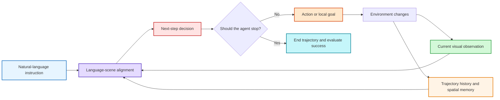

In discrete environments, the output is usually a neighboring viewpoint or `STOP`. In continuous environments, it may be a forward/turn action, a 2D waypoint, a trajectory segment, or low-level controls. These interfaces change perceptual coverage, control difficulty, and success conditions. Sharing R2R instructions alone does not make results directly comparable.

## 2.2 Reading a VLN benchmark
{: id="22-如何看懂-vln-基准"}

| Dimension | Question to establish | Common settings | Effect on results |
|:---|:---|:---|:---|
| **Goal specification** | What must the agent understand? | Route instruction, object category, goal image, scene description, dialogue | Determines the need for stepwise grounding or open-vocabulary search |
| **Observation configuration** | What can the agent observe? | Panorama, monocular, multiple cameras, RGB, RGB-D, odometry | Determines visual coverage and the strength of geometric priors |
| **Action space** | How does the agent move? | Discrete viewpoints, low-level actions, waypoints, velocities, trajectories | Determines whether obstacle avoidance and control are actually tested |
| **Environment model** | Which physical constraints apply? | Navigation graph, navigable surface, rigid-body collisions, robot dynamics | Determines whether collisions, falls, or immobilization can occur |
| **Interaction protocol** | Can instructions be clarified or revised? | Single turn, dialogue, active questions, human feedback | Determines whether the agent can resolve ambiguity or request help |

### 2.2.1 VLN, ObjectNav and VLA
{: id="221-vlnobjectnav-与-vla"}

| Paradigm | Main inputs | Principal capabilities evaluated | Typical outputs |
|:---|:---|:---|:---|
| **Instruction-following VLN** | Route-level natural-language instructions | Instruction progress, landmark alignment, path fidelity | Viewpoints, actions, or waypoints |
| **ObjectNav / ImageNav** | Object category or goal image | Goal search, exploration efficiency, goal localization; open-vocabulary status depends on the protocol | Exploration direction or local goal |
| **General VLA** | Images/video, language goal, robot state | Multitask transfer and action generation | Action tokens, trajectories, or controls |

ObjectNav can supply semantic exploration modules for VLN, and VLA can provide a policy backbone. Their results nevertheless cannot automatically be included in standard VLN leaderboards. Fair comparison requires matching task inputs, sensors, action interfaces, data splits, and additional training data.

## 2.3 A modern VLN system
{: id="23-现代-vln-系统"}

Early models often described VLN as a visual encoder, a language encoder, and an action classifier. A more useful systems view in 2026 is: **perception supplies semantic and geometric evidence; the state layer maintains instruction progress and spatial memory; planning selects subgoals; execution converts them into safe actions; and actual observations continuously correct errors.**

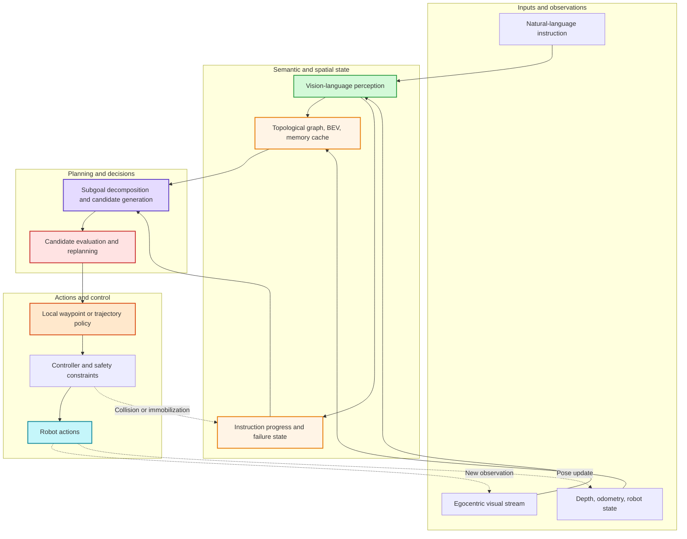

This diagram does not require every method to implement each module explicitly. End-to-end models can fold several boxes into a unified network; dual-system, map-based, and agent-based approaches expose some interfaces explicitly. Assess architectures through their information flow and training objectives, not just the names used in a paper.

## 2.4 Core challenges
{: id="24-核心难点"}

| Challenge | Typical failure | Why it is difficult | Evidence to inspect |
|:---|:---|:---|:---|
| **Dynamic language grounding** | Acting on a later landmark too early or missing a turn | Instruction progress changes as the agent moves | Fine-grained trajectory alignment and incorrect-instruction tests |
| **Partial observability and long-term memory** | Repeated exploration, forgotten regions, inability to backtrack | A single frame cannot reveal global structure | Long-route performance, backtracking, memory ablations |
| **Semantic reasoning and geometric reachability** | Selecting a semantically correct but unreachable goal | Internet knowledge does not establish three-dimensional geometry | Depth/map ablations and reachability checks |
| **High-level planning and low-level control** | Correct subgoal but colliding or oscillating trajectories | Errors accumulate across time scales and interfaces | Control frequency, latency, collisions, replanning counts |
| **Open-world operation and real deployment** | Simulation success but real-world failure | Changes in viewpoints, sensors, dynamics, and scene distributions | Cross-scene, cross-embodiment, and real-robot evaluation |
| **Failure detection and recovery** | Passing near the goal without stopping; compounding errors after a deviation | Weak uncertainty estimation and self-diagnosis | OSR–SR gap, recovery success rate, human interventions |

## 2.5 Toward navigation foundation models
{: id="25-走向导航基础模型"}

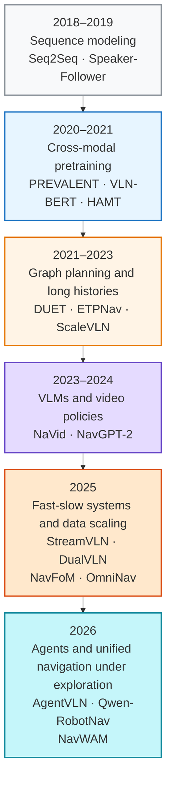

This progression involves several problems that keep converging: pretraining supplies semantic priors, spatial representation and memory support long-term state, hierarchical control coordinates planning and execution, and progress tracking and active perception help check the instruction continuously. Agent orchestration, corrective training, and future prediction can also be combined into these systems, improving capability invocation, error recovery, and action decisions respectively.

## 2.6 A map of research questions
{: id="26-研究问题地图"}

| Research layer | Common approaches | Critical evidence still needed |
|:---|:---|:---|
| Representation | VLM pretraining, video context, three-dimensional tokens | Does the model understand constraints along the route, beyond predicting the endpoint? |
| State | Topological graphs, BEV, 3D Gaussians, caches, retrieval memory | When does memory become incorrect, and how should it be forgotten or corrected? |
| Planning | Subgoal decomposition, CoT, candidate trajectory scoring | Does longer reasoning reliably improve closed-loop control? |
| Execution | Waypoint policies, action chunks, diffusion trajectories, MPC | Can these transfer across robot embodiments and control frequencies? |
| Data | Synthetic trajectories, joint multitask training, automatic progress descriptions | Which matters most: volume, scene diversity, or annotation quality? |
| Deployment | Quantization, caching, edge inference, safety controllers | Can simulated SR / SPL predict real-world reliability? |

<a id="27-2026-年的五个明显变化"></a>

## 2.7 Where recent research converges
{: id="27-近期研究的交汇点"}

Recent work converges on unified policies and hierarchical control, and also on geometric representations, historical memory, spatial action interfaces, progress tracking, and active perception. Agent orchestration, predictive learning, and closed-loop training can act on many architectures. Section 3 therefore organizes methods by research question, and one paper may illustrate several mechanisms. This organization is this survey's analytical framework, not a mutually exclusive classification, and it does not imply that these ideas originated in 2026. Section 9.3 discusses the limits of the evidence.

<a id="3-主流-vln-研究路线"></a>
<a id="survey-methods"></a>

# 3. Methods and key mechanisms
{: id="3-方法范式与关键机制"}

Understanding a VLN method requires separate answers to five questions: **how the policy is organized, how history is represented, how decisions become actions, how instruction progress is tracked, and what feedback the model learns from.** This section discusses unified policies, hierarchical control, spatial memory, task orchestration, and future prediction along these questions, and treats action interfaces, active perception, and training mechanisms on their own. One method can adopt several of these designs at once; the subsections are not mutually exclusive paper categories and do not imply a performance ranking under matched conditions.

| Analysis dimension | Core question | Where to read |
|:---|:---|:---|
| Policy architecture | How far does a unified policy reach, and how are planning and execution divided? | [3.2 Policy architecture](#survey-policy) |
| State representation | How are spatial relations, historical evidence, and visit experience retained? | [3.3 Spatial representation and historical memory](#survey-memory) |
| Action interface | Is the output a primitive action, a pixel goal, a waypoint, or a trajectory? | [3.4 Action representation and spatial grounding](#survey-grounding) |
| Task progress | Which part of the instruction is being executed, and when should the agent look again, back up, or stop? | [3.5 Progress, active perception, and recovery](#survey-progress) |
| System orchestration | Who calls tools, and how does execution feedback change later decisions? | [3.6 Agent orchestration](#survey-agent) |
| Prediction mechanism | Is prediction used only in training, or does it take part in runtime decisions? | [3.7 Predictive learning and world models](#survey-prediction) |
| Learning signal | Demonstrations, corrective trajectories, auxiliary supervision, or environment rewards? | [3.8 Data scaling and closed-loop training](#survey-training) |

The diagram below shows how these responsibilities relate along the information flow. Spatial memory, progress tracking, and future prediction can be implemented inside one unified network or as separate modules; agent orchestration is an optional upper layer.

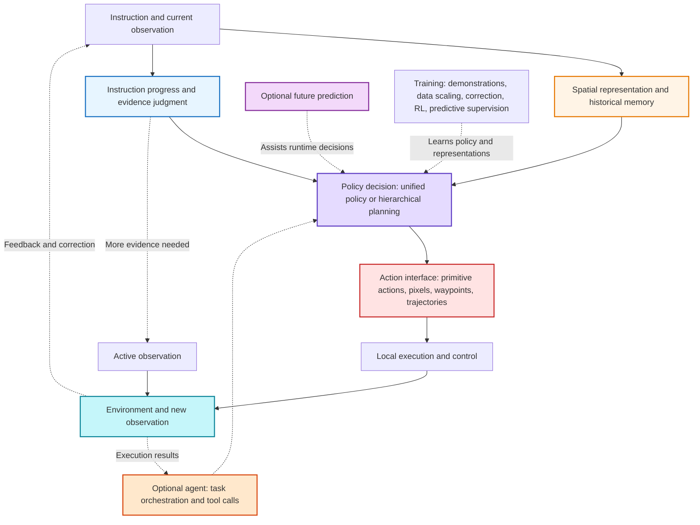

## 3.1 How methods evolved
{: id="31-方法演进"}

| Research focus | Internal model state | Typical action interface | Training signals | Representative methods |
|:---|:---|:---|:---|:---|
| **Sequence policies** | RNN hidden state | Discrete viewpoints / actions | Behavior cloning, reinforcement learning | Seq2Seq, Speaker-Follower |
| **Pretrained Transformers** | Cross-modal tokens and historical features | Discrete candidates | Masked modeling, instruction-trajectory alignment | PREVALENT, VLN-BERT, HAMT |
| **Graph planning and explicit memory** | Topological graphs, semantic graphs, local maps | Global nodes + local actions | Graph supervision, path and progress objectives | DUET, ETPNav, MapNav |
| **Video VLM / VLA** | Video context, KV cache, action tokens | Discrete actions, waypoints, or action chunks | Vision-language data + navigation trajectories | NaVid, StreamVLN, NavFoM |
| **Multitask navigation models** | Shared context and configurable observations | Multitask modes, spatial targets, or trajectories | Joint training, instruction tuning, and optional RL | OmniNav, OneVLA, Qwen-RobotNav, LightNav-0 |
| **Progress reasoning and evidence acquisition** | Active sub-instruction, landmark evidence, recovery state | Navigation actions, additional observation, or subtasks | Progress alignment, correction, and observation gain | AwareVLN, Route2Step, SeekVLN |
| **Agent orchestration** | Tool feedback and task memory | Tool calls or subtasks | Prompting, supervision, or environment feedback depending on implementation | AgentVLN, HarnessVLN |
| **Predictive representations and world-action models** | Predicted future features, visual states, or joint representations | Original action interface, trajectories, or action chunks | Future prediction and action supervision | PROSPECT, AstraNav-World |

These focuses overlap in time: graph structures can still serve VLM policies, unified models can use spatial memory, and reinforcement learning can optimize different action interfaces. Gains in modern methods also often come with larger backbones, more trajectories, or extra sensors, so attribute mechanism changes separately from added resources when reading a paper.

<a id="survey-policy"></a>

## 3.2 Policy architecture
{: id="32-策略架构"}

Architecture first decides what each layer is responsible for. A unified policy combines language, observations, and history in one backbone and predicts the next action or trajectory; a hierarchical system passes subgoals explicitly and lets another layer execute them locally. **The number of models, whether they are trained jointly, whether a map is maintained, and whether high- and low-frequency roles are separated are different properties.** A unified policy may still need a trajectory tracker, and a hierarchical network may be optimized jointly; "end-to-end" should state which interface the supervision or gradient reaches.

<a id="32-单系统端到端把导航变成连续的多模态生成"></a>

### 3.2.1 Unified policies
{: id="321-统一策略"}

 and  use video history and language to generate actions; , , and related work further explore multitask shared policies. For this class of methods, the key questions are how inputs and outputs are unified and whether the training data support transfer, not whether the model avoids every external module.

<div align="center">
  
<figcaption>StreamVLN interleaves vision and actions and manages context at different update rates. See <a href="https://arxiv.org/abs/2507.05240v2">the original paper, v2</a>.</figcaption>
</div>

| Key design | Problem addressed | Representative work |
|:---|:---|:---|
| Interleaved observations and actions with streaming context | Continuous decisions and computation reuse over long video input |  |
| Shared multitask policy | Lets different navigation goals share representations and action abilities | ,  |
| Configurable observation context | Adjusts history, cameras, and token budget per task |  |
| Unified spatial and action tokens | Expresses spatial intent and trajectories in the model vocabulary |  |

<a id="33-快慢双系统高层语义推理与高频执行解耦"></a>

### 3.2.2 Hierarchical control
{: id="322-分层控制"}

A fast-slow system is one implementation of hierarchical control: the slow system interprets the instruction at low frequency and produces subgoals, while the fast system keeps generating local actions from the latest observations. The lower layer can be a learned policy or a geometric planner; check whether it executes in closed loop, when it requests a new goal, and how upper-layer latency and errors propagate.

<div align="center">
  
<figcaption>DualVLN: the slow system provides goals and features, and the fast system generates trajectories. See <a href="https://arxiv.org/abs/2512.08186v1">the original paper</a>.</figcaption>
</div>

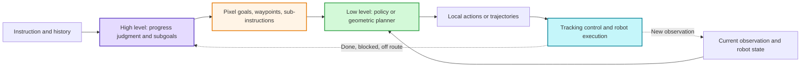

, , , and  offer different examples of dividing planning and execution.  separates semantic progress from action generation, a reminder to distinguish "layered responsibilities" from "layered control frequencies": having two modules alone does not make a fast-slow system.

**Mechanisms with the same name need to be read for what they actually do.** StreamVLN's SlowFast mainly describes the update rate of context and memory; DualVLN's fast-slow division sits between goal reasoning and trajectory execution. The former should be evaluated on history retention and computational efficiency; the latter also on control frequency, trajectory smoothness, and asynchronous goal updates.

<a id="34-地图与空间记忆让历史变成可查询的环境状态"></a>
<a id="survey-memory"></a>

## 3.3 Spatial representation and memory
{: id="33-空间表征与记忆"}

Spatial representation answers "how are objects and traversable regions in the environment related", and historical memory answers "which past information should influence the current decision". The two can be combined in a map, or shared among geometric features, hidden states, keyframes, or a retrieval store. Extracting 3D geometric features from RGB alone does not amount to building a global map that a planner can query.

<div align="center">
  
<figcaption>HSGM is one implementation of explicit spatial state: hierarchical semantic and geometric representations connect scene understanding and navigation. See <a href="https://arxiv.org/abs/2606.00095">the original paper</a>.</figcaption>
</div>

| Representation and memory | Main role | Representative work | Costs to check |
|:---|:---|:---|:---|
| Topological graph | Stores connectivity, supports global node selection and backtracking | , ETPNav,  | Mapping priors, candidate points, and connection errors |
| Semantic map / BEV | Compresses spatial layout into a localizable, aggregable state | ,  | Dependence on depth and pose, and update errors |
| Hierarchical scene graph / three-dimensional scene memory | Organizes rooms, objects, and multi-view spatial relations | ,  | Perception quality, mapping cost, and dynamic-scene updates |
| Geometric foundation-model features and implicit memory | Keeps geometry and cross-frame evidence in neural representations | ,  | Scale consistency, GPU memory, and history selection |
| Historical frames, keyframes, and compressed context | Keeps task-relevant observations within a limited budget | , ,  | Whether early landmarks and turns are lost |
| Task events and experience retrieval | Stores completed steps, failure conditions, and execution evidence |  | Incorrect writes, stale experience, and retrieval overhead |

**Geometric fusion and history selection can be optimized together.** [AdaGeoVLN](https://arxiv.org/abs/2609.18789) feeds features from different depths of a geometry model into the policy and keeps historical KV states according to instruction relevance, geometric confidence, and transition novelty. The example shows that compression is not only about reducing tokens: what is kept also changes the spatial reasoning available at the next step.

**Computation reuse and task memory should be distinguished by purpose, not only by whether a KV cache is used.** [VLN-Cache](https://arxiv.org/abs/2603.07080) mainly reuses cross-frame computation to reduce cost; JanusVLN, AdaGeoVLN, and similar methods also use historical neural states as semantic or geometric memory. The former should report speedup and accuracy loss; the latter also needs tests of long-range landmark retention, backtracking, and error correction.

Maps and memory can both be wrong. Evaluations should state how information is written, updated, reconciled when conflicting, and forgotten; when a memory method from goal navigation is used as a reference, the task inputs and cross-episode information rights must also be fixed.

<a id="survey-grounding"></a>

## 3.4 Actions and spatial grounding
{: id="34-动作表示与空间落地"}

The action interface decides what the high-level model must predict and what work remains for the executor. "Turn left", "walk to the door in the image", "reach a 3D waypoint", and "a trackable trajectory segment" differ in precision, time horizon, and geometric requirements. They cannot be distinguished merely by whether the output is text or numbers.

| Output interface | How it becomes motion | Representative work | Main limitation |
|:---|:---|:---|:---|
| Primitive actions / discrete action chunks | Maps action symbols to forward, turn, and stop | , ,  | Long decision sequences; execution granularity and action semantics depend on the platform |
| Pixel goals / image regions | Executed through depth backprojection, geometric planning, or a goal-conditioned policy | , ,  | A two-dimensional point alone does not guarantee depth, reachability, or safety |
| Topological nodes / frontier macro-actions | Selects a graph node or frontier; discrete environments move along the graph, continuous ones hand off to a low-level executor | ,  | The candidate set and graph quality limit high-level choices |
| Continuous waypoints / trajectory chunks | A controller tracks trajectories produced by regression, diffusion, or similar methods | ,  | The coordinate frame, trajectory horizon, and execution constraints must be explicit |
| Quantized trajectory tokens | Decoded into a trajectory first, then passed to the executor |  | Quantization error and cross-embodiment adaptation need checking |

**Visual grounding affects both reasoning and execution.** [GroundingVLN](https://arxiv.org/abs/2609.18581v3) binds visual evidence in its reasoning to image locations, then outputs pixel goals aligned with task progress for a geometric planner to execute. A measurable intermediate interface makes it possible to check separately "what was recognized", "where the target is", and "where the agent actually went", and it also grounds execution-aware rewards.

<div align="center">
  
<figcaption>GroundingVLN: visual evidence and pixel goals together connect semantic reasoning and spatial execution. See <a href="https://arxiv.org/abs/2609.18581v3">the original paper, v3</a>.</figcaption>
</div>

**Tokenization is not the same as primitive discrete control.** [LightNav-0](https://arxiv.org/abs/2608.30935v2) uses a unified token interface for pointing and quantized trajectories; its action tokens decode into trajectories and should not be conflated with an action class such as "turn left once". Conversely, a pixel goal need not be paired with a neural continuous action head: a geometric planner can also turn it into motion.

When comparing interfaces, fix the available RGB, depth, pose, and map, and report closed-loop results for the complete execution chain. A model that outputs discrete symbols can still be evaluated in continuous environments, and a model that outputs continuous coordinates does not automatically satisfy the robot's dynamic constraints.

<a id="survey-progress"></a>

## 3.5 Progress, active perception and recovery
{: id="35-进度主动感知与恢复"}

Long-horizon navigation requires continual judgment of "which part of the instruction is done and what evidence is still missing for the next step". Choosing the wrong active sub-instruction and failing to execute the right one are different errors; a single corrective action may not repair the internal progress state.

| Research question | Typical mechanism | Representative work | Evidence to observe |
|:---|:---|:---|:---|
| When is reasoning needed? | On-demand scene description, progress judgment, and planning | ,  | Reasoning frequency, call overhead, and gains |
| Which sub-instruction is being executed? | Explicit task lists, progress state, and landmark constraints | ,  | State alignment and progress correction after going off route |
| Are current observations sufficient? | Make additional observation part of the policy's choices |  | Number of observations, extra views, and gains in later actions |
| How to recover after going off route? | Corrective data, state supervision, or reflection feedback | , ,  | Recovery success rate, extra path, and repeated failures |

[Route2Step](https://arxiv.org/abs/2608.03143) separates semantic progress from action generation through a step-level interface, so wrong progress can receive state supervision. The lesson is that a single deviation may first require correcting "what am I doing" and then "how should I move", rather than leaving every problem to action prediction.

<div align="center">
  
<figcaption>Route2Step models the active sub-instruction, execution state, and local actions separately. See <a href="https://arxiv.org/abs/2608.03143">the original paper</a>.</figcaption>
</div>

[SeekVLN](https://arxiv.org/abs/2609.37353v1) goes further into cases where the current view is insufficient for judging progress: the policy can either navigate directly or observe more, then continue with the added evidence. Its training compares the subsequent progress of looking again versus navigating directly from the same state. The extra observation cost must be reported separately; the gain from adding views on demand cannot all be attributed to stronger reasoning, and the mode switch alone does not make the method tool orchestration or fast-slow control.

For example, the instruction is "pass the sofa, turn left, and stop before the second door". When the side door is not visible, an additional observation may help most; when the junction has already been missed, the agent must back up and correct its progress; when it keeps moving after arriving, the stopping condition needs analysis. Count these three error types separately, then check whether recovery actually preserves the instruction's constraints along the route.

**Recovery is a capability, and more than one mechanism can provide it.** [CorrectNav](https://arxiv.org/abs/2508.10416) generates corrective data from the model's own deviations and continues training, which is a training mechanism; agent systems can also recover at runtime using tool feedback. Both should be verified with actual trajectories: the presence of "reflection" text does not establish effective recovery or imply weight updates during deployment.

<a id="35-通用导航-agent上层规划器如何编排一个共享导航基模"></a>
<a id="35-通用导航-agent任务编排与可调用的导航能力"></a>
<a id="survey-agent"></a>

## 3.6 Agents and tool execution
{: id="36-agent-编排与工具执行"}

This section limits agent orchestration to an upper layer that selects and calls perception, memory, planning, or navigation capabilities based on task state, and reads execution results to update later decisions. It can call a unified navigation policy or connect to a hierarchical control system. Evaluation should separate "what the tool itself can do" from "what the upper layer gains by deciding when to call it".

| Organization | Representative work | Main interface | What to verify separately |
|:---|:---|:---|:---|
| VLM collaborates with callable skills | ,  | Perception, candidate points, planning, and local execution | Gains from tool selection over a fixed pipeline |
| Navigation wrapped as tool calls |  | Observation, decision, and execution feedback | Interaction protocol, call cost, and failure handling |
| Unified management of tools, memory, and execution checks |  | Task progress, spatial evidence, and structured returns | Separate contributions of checking, memory, and recovery |
| High-level planner calls a shared navigation backbone |  system | Task modes and configurable observation context | Gains from dynamic configuration over a fixed one |

[HarnessVLN](https://arxiv.org/abs/2609.15195v3) puts perception, memory, and execution tools behind a shared interface and checks evidence, geometric feasibility, and subgoal consistency before dispatch. The example shows that agent orchestration and spatial memory often coexist; filing a paper under only one of them loses the other half of its design.

<a id="351-通用导航-agent-的五层结构"></a>
<a id="351-基模能力与-agent-能力分别评测"></a>

### 3.6.1 Evaluating backbone vs. agent
{: id="361-基模与-agent-分开评测"}

Qwen-RobotNav is a navigation model that can be used in agent systems. Evaluation should distinguish the underlying navigation results from system-level results with orchestration. The former reflect the model and its input configuration; the latter also include task decomposition, mode switching, and runtime feedback. The full system's gains cannot all be attributed to either the backbone or the planner.

<div align="center">
  
<figcaption>Qwen-RobotNav system example: configurable interfaces let the navigation model participate in high-level task orchestration. See the <a href="https://arxiv.org/abs/2606.18112v3">technical report</a> for implementation details.</figcaption>
</div>

<a id="352-qwen-robotnav-式-agentic-导航闭环"></a>
<a id="352-一个可检查的-agent-闭环"></a>

### 3.6.2 An inspectable agent loop
{: id="362-可检查的-agent-闭环"}

This survey's analytical framework is: task state → select subtask and tools → execute → read results → update task state. Each transition should be inspectable in logs: was a tool failure recognized, did the strategy change, were ineffective actions repeated, and when did execution terminate? The diagram below illustrates system responsibilities and does not require every paper to implement identically named modules.

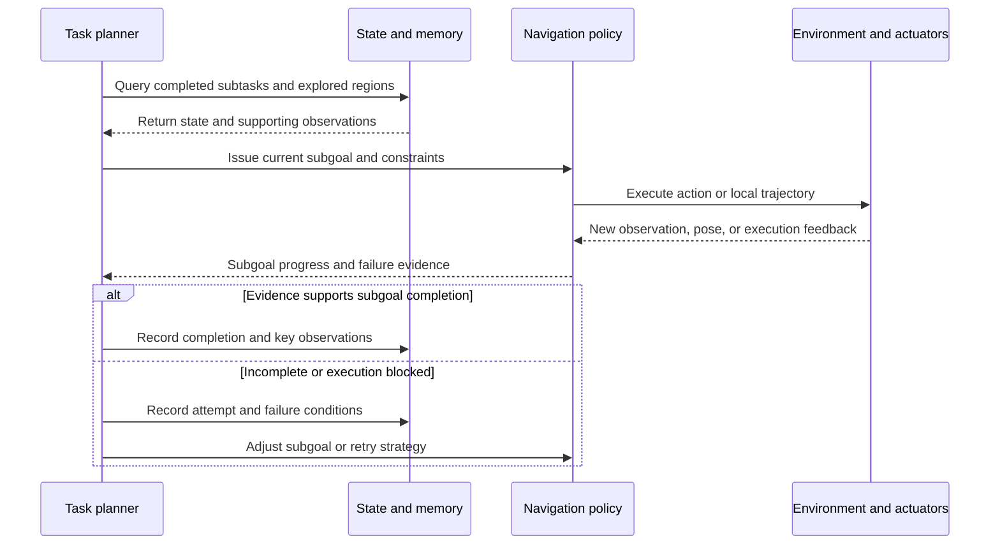

For example, "go through the corridor to the kitchen and find a cup" requires at least two checks: reaching the kitchen and confirming the cup. Detecting a cup does not establish the room condition; logs must connect actual observations, tool calls, and subsequent trajectories to locate failures in task decomposition, spatial memory, or execution.

<a id="353-三类-agentic-vln-设计"></a>
<a id="353-恢复能力的证据边界"></a>

### 3.6.3 Orchestration gains and costs
{: id="363-编排收益与恢复成本"}

Compare a fixed execution pipeline with adaptive orchestration under the same underlying skills, models, and budgets, and report task success, recovery rate, tool calls, latency, and human interventions separately. If more retries yield higher success, present the cost alongside it. Whether the navigation model was trained should also be recorded separately; an agent is not the same as a training-free system.

<a id="36-世界模型与世界动作模型从预测未来到利用未来"></a>
<a id="survey-prediction"></a>

## 3.7 Predictive learning and world models
{: id="37-预测学习与世界模型"}

Prediction mechanisms should first be distinguished by **what is predicted, whether prediction happens in training or at execution time, and how the prediction affects actions**. Future images, latent features, and values can all provide supervision or decision evidence, but auxiliary prediction losses, runtime imagination for planning, and joint world-action generation differ in cost and evidence requirements.

| Usage | How prediction contributes | Representative work | Gain to verify |
|:---|:---|:---|:---|
| Latent prediction during training | Future features supervise the policy representation; the prediction branch is removed at execution |  | Whether it beats training without predictive supervision under the same deployment interface |
| Visual imagination and future prediction assist decisions | Generates visual cues, or predicts consequences of candidate actions for a policy / planner | , [NWM](https://arxiv.org/abs/2412.03572v2) | Gain of extra prediction over direct decisions at the same budget |
| Joint visual-action generation | Couples future visuals and actions under shared conditions |  | Whether consistency and closed-loop control improve together |
| Actions from predicted states | Predicts short-horizon latent states, then decodes executable waypoints |  (aerial VLN) | State error, execution results, and correction from real observations |
| Joint observations, values, and action chunks | Puts future observations, goal progress, and actions into a shared representation |  (image-goal navigation) | Control gains and costs relative to prediction plus external search |

[PROSPECT](https://arxiv.org/html/2603.03739v1) predicts next-step semantic and spatial latent features, and the prediction branch is removed at inference. It is therefore predictive representation learning, and cannot be cited as unrolling candidate futures or searching actions at runtime. Its "no extra prediction overhead" applies only to the removed branch; the full system still includes perception fusion and streaming-policy computation.

<div align="center">
  
<figcaption>AstraNav-World is an example of prediction taking part in action generation. See <a href="https://arxiv.org/abs/2512.21714v2">the original paper, v2</a>; such runtime mechanisms should be distinguished from predictive supervision used only during training.</figcaption>
</div>

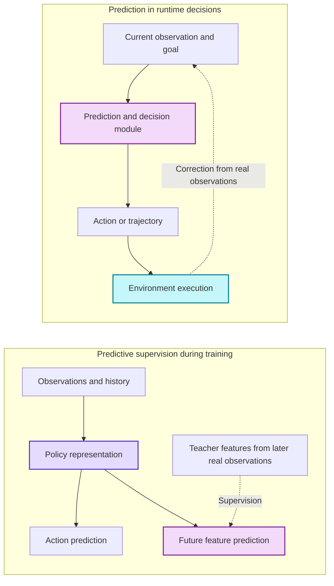

The two sides illustrate different uses that can be adopted separately or combined. The prediction and decision module on the right may use candidate evaluation or joint generation; not every method performs explicit tree search.

**A name cannot replace checking the direction of prediction.** 's landmark auxiliary branch reconstructs historical evidence, mainly to constrain memory; even though it uses the term world model, it should not be classified directly as prospective planning. Semantic cues generated by visual imagination are also not automatically equivalent to action-conditioned environment dynamics.

**Task boundaries and closed-loop gains still need separate confirmation.** [WorldVLN](https://arxiv.org/abs/2605.15964) targets aerial language navigation, and [NavWAM](https://arxiv.org/abs/2606.13494) evaluates image-goal navigation. The latter and NWM can serve as references for prediction-control mechanisms, but cannot be merged directly into route-instruction VLN leaderboards. Prediction quality should be interpreted together with SR / SPL, collision rate, long-horizon error, and inference cost; realistic generated frames alone do not demonstrate better navigation.

<a id="38-数据与训练范式策略如何学会导航与纠错"></a>
<a id="survey-training"></a>

## 3.8 Data scaling and closed-loop training
{: id="38-数据扩展与闭环训练"}

Architectures and mechanisms decide how a system uses information; training paradigms decide which feedback it learns from. The two should be described separately: unified policies, hierarchical control, and memory-equipped models can all use demonstrations, data augmentation, or reinforcement learning, and the same model may first be supervised fine-tuned, then collect corrective samples or undergo RL post-training.

### 3.8.1 From demonstrations to closed-loop RL
{: id="381-从示范到闭环-rl"}

| Training method | Learning signal and role | Representative work | Question to verify separately |
|:---|:---|:---|:---|
| Behavior cloning / supervised fine-tuning | Builds an instruction-to-action mapping from expert trajectories | ,  | Can the policy recover after leaving states the expert visited? |
| Joint training and task expansion | Shares navigation, image-text, or video representations | ,  | Do gains come from data volume, task diversity, or model design? |
| Synthetic scenes, instructions, and trajectories | Expands environment and language coverage | ScaleVLN,  | Are instructions executable, are scenes leaked, and is the simulation reliable? |
| Policy rollouts and corrective data | Provides corrections at error states the model actually visits | ,  | Do the expert's information rights match the corrective instructions? |
| Progress and evidence supervision | Ties intermediate states to the active sub-instruction and real observations | ,  | Do more accurate progress and evidence judgments improve trajectories? |
| Reinforcement learning post-training | Optimizes the policy with task completion, geometric execution, or observation gain | , ,  | Do rewards encourage shortcuts, and is the interaction budget fixed in comparisons? |
| Auxiliary predictive supervision | Constrains representations with future states or history reconstruction | ,  | How much do the auxiliary loss and the extra encoder each contribute? |

**Corrective data must distinguish semantic-state errors from execution errors.** CorrectNav builds perception and action correction data from deviated trajectories; Route2Step provides state supervision for wrong progress and uses direct action supervision for the corresponding recovery cases. What matters is which states the model learns on and what supervision it receives, which the final architecture name alone cannot explain.

Behavior cloning / SFT learns "what to do next in states the expert passed through". At test time, a single under-turned corner changes the following views, and the policy may enter states the demonstrations never covered. [DAgger](https://arxiv.org/abs/1011.0686) lets the policy visit its own states and then queries the expert for corrective actions, easing this distribution shift; **closed-loop RL instead optimizes the return of the whole task from the consequences of autonomous execution.** The two can be combined, and interactive sampling alone does not determine whether training is imitation learning or reinforcement learning.

Two objectives show the difference in feedback sources:

$$
\begin{aligned}
\mathcal L_{BC}&=-\mathbb E_{(I,h_t,a_t^*)\sim D}
\log\pi_\theta(a_t^*\mid I,h_t),\\
J_{RL}(\theta)&=\mathbb E_{\tau\sim\pi_\theta}
\left[\sum_{t=0}^{T-1}\gamma^t r_t\right].
\end{aligned}
$$

Here $I$ is the instruction, $h_t$ is the observation and action history up to now, $a_t^*$ is the expert action, $\tau$ is the executed trajectory, $r_t$ is the reward, and $\gamma$ is the discount factor. The former raises the probability of expert actions; the latter raises the expected return of autonomous trajectories. When a task admits several valid routes, a reward can accept different paths that still follow the instruction; correspondingly, a reward that omits requirements along the route may encourage wrong shortcuts.

**What RL is worth optimizing in VLN is the consequence of key decisions.** Whether to look again or turn back after going off route, when to STOP near the goal, and whether to move temporarily away from the goal in order to turn correctly are hard to measure adequately with average action accuracy. Long-horizon credit assignment must link final success or failure to earlier decisions; process rewards, value estimates, and segmented returns provide different signals. When perception, depth scale, or the actuator itself is faulty, first confirm the system bottleneck; adding RL is not a universal fix.

This line of research predates large-model post-training: [RCM](https://arxiv.org/abs/1811.10092) rewards instruction-trajectory matching with a cross-modal matching critic, and [EnvDrop](https://aclanthology.org/N19-1268.pdf) combines environmental feature dropout, back-translation, behavior cloning, and Advantage Actor-Critic. The large-model era expanded policy scale and action-generation interfaces, but the contributions of data augmentation, memory design, and RL should still be analyzed separately.

<a id="survey-rl-levels"></a>

### 3.8.2 Reward granularity
{: id="382-奖励作用的粒度"}

"Uses GRPO" describes only part of the optimizer and does not tell whether the model completes whole navigation episodes autonomously in the environment. The table below distinguishes representative methods by **what is scored during training**; this is a summary of the original mechanisms, and one method may combine several rewards.

| Work and checked version | What is scored and main reward | Mechanism judgment it supports |
|:---|:---|:---|
| [VLN-R1, v1](https://arxiv.org/html/2506.17221v1) | Generates six-step actions under a fixed history and applies GRPO with a time-decayed reward for position-wise matching to the expert | Local action post-training; it cannot be taken as learning whole-episode recovery after autonomous deviation |
| [JOP-VLN, v1](https://arxiv.org/html/2607.13461v1) | Samples action chunks of up to four steps at DAgger states, scored by format, oracle matching, and pose / displacement feedback, combined with corrective IL | Local action-chunk optimization with short-range execution feedback; distinct from a whole-task success reward |
| [GroundingVLN / GEAR, v3](https://arxiv.org/html/2609.18581v3) | Samples outputs at fixed decision anchors, scored by visual grounding, subtask, traversability, and execution-endpoint rewards | Execution-aware post-training; the reward reflects physical consequences, but not every candidate reruns the whole episode |
| [ActiveVLN, v1](https://arxiv.org/html/2509.12618v1) | Generates actions, executes them, appends observations, and applies GRPO to the task outcome of the full multi-turn trajectory | Closed-loop trajectory optimization; the policy's actions change later training inputs |
| [ETP-R1, v1](https://arxiv.org/html/2512.20940v1) | After pretraining and DAgger, a graph policy is trained with GRPO on whole-episode arrival, efficiency, and route metrics | Closed-loop high-level planning optimization; the reward is adjusted to R2R / RxR task requirements |
| [NavGRPO, v1](https://arxiv.org/html/2603.15370v1) | Samples multiple trajectories on a discrete navigation graph, compared by goal distance, path efficiency, and step-level signals, with hard-task replay | Whole-trajectory and recovery learning; its action and observation rights must be distinguished from VLN-CE primitive-action policies |

**Local answer rewards** mainly ask "does this action segment match the expert", **execution-aware rewards** ask "is this target traversable and where does execution end up", and **full closed-loop returns** ask "after repeated observation and action, is the task completed". All three may improve final SR, but they differ in training cost, coverage of error states, and the abilities they can demonstrate. In particular, under action optimization with a fixed history, later inputs do not change naturally with the currently sampled action, so it cannot be taken directly as evidence of long-horizon exploration.

Action granularity also affects learning: [MacroAction-VLN](https://arxiv.org/abs/2609.03906) performs closed-loop RL over topological frontier macro-actions, reducing the number of high-level decisions; SeekVLN assigns rewards according to the subsequent progress of additional observation relative to navigating directly. Geometric rewards do not require continuous coordinate outputs; what matters is that the relationship between the scored object, actual execution, and new observations is explicit.

<a id="survey-rl-rewards"></a>

### 3.8.3 Reward design
{: id="383-奖励设计"}

If the instruction is "go through the kitchen first, then follow the corridor into the bedroom", a shortcut that bypasses the kitchen may earn higher endpoint success and shortest-path efficiency while violating the requirements along the route. **Reaching the goal, following the instruction faithfully, and moving safely and efficiently are related but different optimization targets.** A reward should first make the task requirements explicit, then choose metrics.

| Reward term | What it should teach | Likely bias |
|:---|:---|:---|
| Success / correct STOP | End the task when the success condition holds | The endpoint reward is sparse; passing the goal without stopping should be distinguished from a successful stop |
| Distance progress | Dense feedback for intermediate decisions | Necessary turns, backtracking, or detours may not shorten the distance immediately |
| nDTW / SDTW, ordered landmark completion | Follow intermediate landmarks and route order | The reference path may not be the only reasonable route; landmark events should not be rewarded repeatedly |
| SPL or an efficiency term matched to the reference route | Avoid detours after success | Shortest-path efficiency alone does not guarantee meeting the instructions along the route |
| Collision, step, or time cost | Improve executability and efficiency | Excessive costs may encourage giving up early or an early STOP |
| Format / action validity | Produce parseable control output | Correct format cannot substitute for task completion |

The [original nDTW study](https://research.google/pubs/general-evaluation-for-instruction-conditioned-navigation-using-dynamic-time-warping/) measures route fidelity through ordered path matching, and SDTW adds a success constraint; see [Section 8.3](#83-路径效率与保真度) for definitions. For example, ETP-R1's R2R reward combines success@1.5m, SPL, and distance to goal, while for RxR it uses nDTW, SDTW, gSPL computed with the reference route length, and distance to goal. gSPL adjusts the efficiency reference, while consistency along the route still needs route terms as constraints; the 1.5m in the reward also cannot replace the success thresholds of other evaluation protocols. [Original Eq.5](https://arxiv.org/html/2512.20940v1)

The following only shows terms a return can include; **it is not any paper's fixed recipe or a validated general set of weights**:

$$
\begin{aligned}
R(\tau)&=w_s\mathbf 1[\mathrm{success}]
+w_f\mathrm{nDTW}(\tau,\tau^*)+w_p\mathrm{SPL}(\tau)\\
&\quad-c_c N_{\mathrm{collision}}-c_t T
-w_e\mathbf 1[\mathrm{wrong\ STOP}].
\end{aligned}
$$

Here $\tau^*$ is the reference route, $N_{\mathrm{collision}}$ is the number of collisions, and $T$ here denotes the number of execution steps; the weights control the relative influence of different goals, and dense signals such as distance progress can be issued per step separately. Long-horizon tasks should calibrate costs by accumulated totals over the whole episode, so that hundreds of step penalties do not overwhelm the success reward. Before adopting a reward, compare the term scores of expert, shortcut, detour, collision, and early-stop trajectories to confirm that their ordering matches the task requirements.

**Keep the training information available to the reward separate from the information visible to the policy.** Simulation can score with goal ground truth, navigation meshes, and reference routes, but the deployed actor should read only the observations, instructions, and memory the protocol allows. If a critic uses privileged state to aid training, state that separately. Otherwise, gains obtained from true goal coordinates cannot serve as evidence of navigating from vision and language alone.

<a id="survey-rl-algorithms"></a>

### 3.8.4 PPO and GRPO
{: id="384-ppo-与-grpo"}

Policy gradients update the policy by raising the probability of high-advantage actions. Here the **advantage** means "how much better the subsequent return of this choice is than the baseline for the current conditions"; a core difference between PPO and GRPO is how that baseline is obtained.

**PPO: a value estimate helps assign step-level credit.** Common actor-critic implementations train a value function $V(I,h_t)$, combine it with returns to estimate each step's advantage $A_t$, and then limit how far the probability ratio between the new and old policies can move. Its clipped objective is:

$$
\begin{aligned}
L_{\mathrm{clip}}&=\mathbb E_t\left[
\min\left(\rho_t A_t,
\operatorname{clip}(\rho_t,1-\epsilon,1+\epsilon)A_t\right)\right],\\
\rho_t&=\frac{\pi_\theta(a_t\mid I,h_t)}
{\pi_{\mathrm{old}}(a_t\mid I,h_t)}.
\end{aligned}
$$

$\pi_{\mathrm{old}}$ is the behavior policy that sampled this batch of trajectories, and $\epsilon$ is the clipping range. The value baseline helps judge the contribution of early junction, backtracking, and stopping decisions, but also introduces value-estimation error. The critic can be a small value head on a shared representation rather than a copy of a same-sized model; PPO can also use terminal rewards and does not require dense process rewards. [Original PPO paper](https://arxiv.org/abs/1707.06347)

**GRPO: multiple outcomes under the same condition form the baseline.** Instead of training a separate critic, it samples a group of outputs for the same input and compares their rewards. If the scoring unit is a full navigation trajectory, the group should fix the instruction, start position, heading, and environment conditions. The common group-normalized advantage is:

$$
\hat A_i=\frac{R(\tau_i)-\operatorname{mean}_{j=1}^{G}R(\tau_j)}
{\operatorname{std}_{j=1}^{G}R(\tau_j)+\varepsilon}.
$$

Here $G$ is the group size and $\varepsilon$ is a small constant that prevents a zero denominator, distinct from PPO's clipping range. The advantage is then applied to the actions or policy-generated tokens of the corresponding trajectory, with clipped updates and the corresponding reference constraint. This expression is the common form; NavGRPO uses Dr.GRPO, so its normalization and length aggregation cannot be copied wholesale. [GRPO source: DeepSeekMath](https://arxiv.org/html/2402.03300v2), [NavGRPO algorithm description](https://arxiv.org/html/2603.15370v1)

| Comparison | Common PPO implementation | Trajectory-level GRPO implementation |
|:---|:---|:---|
| Advantage baseline | Learned value function and returns | Within-group comparison of multiple samples for the same task |
| Long-horizon credit | Can estimate per-step advantages, with quality depending on the critic | With terminal returns only, a whole trajectory may share one advantage, giving coarse local attribution |
| Extra cost | Value learning, probability recomputation, and environment interaction | Visual inference and environment interaction for multiple full trajectories |
| Main signal risk | Inaccurate value estimates, mishandled termination / truncation | Identical rewards within a group give zero advantage; insufficient variation in sample quality |
| Suitable comparison condition | Step-by-step diagnosis of decisions is wanted and a value head can be trained | Task returns are reliable and repeated sampling of the same task has enough throughput |

**Dropping the critic does not make total training cheaper.** If the success reward is only 0 / 1, all-failure or all-success groups may carry no relative advantage; dense scoring, curricula, and hard-task supervision can change the signal, but each adds design cost. GRPO's full-trajectory return also cannot automatically pinpoint the one turn that caused failure. A KL term to the reference policy and auxiliary BC / IL can preserve existing abilities; they are optional constraints and should be reported separately from the main task reward.

<a id="survey-rl-loop"></a>

### 3.8.5 Closed-loop training in practice
{: id="385-闭环训练实践"}

For an existing navigation model, an experimental route that makes the source of gains easy to locate is: **SFT / DAgger initialization → autonomous sampling → return and advantage computation → policy update → validation in unseen scenes.** The diagram below illustrates the training flow, usable with PPO or full-trajectory GRPO; the specific scheme should still be chosen by action interface and sampling budget.

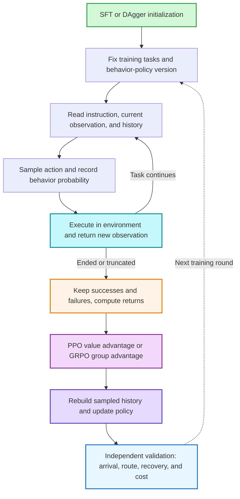

Three details in implementing this flow can easily change conclusions:

1. **Account for autonomous behavior and expert corrections separately.** A transition after an expert takeover cannot be paired with the probability of the action the model originally proposed and had rejected. Corrective samples can go through an IL channel, while autonomous RL should keep failures, wrong STOPs, collisions, and timeouts rather than filtering for successful trajectories only; task termination and sampling truncation also need to be distinguished.
2. **Sampled probabilities and recomputed probabilities must use the same history.** For streaming models such as StreamVLN, store the observations, selected history frames, memory updates, and action tokens so the new and old policies are scored under the same conditions. After a parameter update, a KV cache produced by the old parameters cannot be treated as the exact history of the new policy; first check that probability replay agrees while the weights are unchanged.
3. **Align generated action chunks with the steps actually executed.** STOP or a collision may truncate an action chunk, and how the unexecuted suffix participates in optimization should be explicit. Long chunks reduce model calls, while short chunks give faster feedback from new observations; after changing chunk length or re-observation frequency, add a supervised baseline with the same interface to tell whether gains come from RL or from more decision opportunities.

These are implementation checks derived from the closed-loop objective and the policy probability ratio; they do not require using any particular project's trainer. For model selection, PPO can serve as a step-level comparison with a value head and trajectory-level GRPO as a group-sampling comparison, with reward, action interface, and environment-interaction budget fixed. With only expert trajectories and no interaction, first confirm the rewards, transitions, and failure coverage that offline RL needs; trajectory preference optimization must keep the visual history each branch actually produced.

<a id="survey-rl-evidence"></a>

### 3.8.6 Attributing RL gains
{: id="386-rl-收益的归因"}

Before-and-after comparisons within the same paper, backbone, and protocol come closer to answering "what does post-training add" than final scores across papers. All numbers below are **reported by the authors and not independently reproduced**; SR / SPL are percentages, and gains are absolute percentage points. Read each row only within its own protocol; rows that include joint training or specific reward components do not equal the gain from swapping the optimizer alone.

| Work and source table | Data and split | Baseline → post-trained | SR | SPL | SR / SPL gain |
|:---|:---|:---|:---|:---|:---|
| [VLN-R1, Table 1](https://arxiv.org/html/2506.17221v1#S4.T1) | R2R-CE Val-Unseen | Qwen2-VL-7B SFT → SFT + RFT | 24.9 → 30.2 | 17.5 → 21.8 | +5.3 / +4.3 |
| [ActiveVLN, Table IV](https://arxiv.org/html/2509.12618v1) | R2R-CE Val-Unseen | Multi-turn IL → multi-turn IL + RL | 38.5 → 50.1 | 33.7 → 43.7 | +11.6 / +10.0 |
| [ActiveVLN, Table IV](https://arxiv.org/html/2509.12618v1) | R2R-CE Val-Unseen | Single-turn IL → single-turn IL + RL | 39.7 → 40.3 | 35.3 → 37.0 | +0.6 / +1.7 |
| [ETP-R1, Table I](https://arxiv.org/html/2512.20940v1) | R2R-CE Val-Unseen | DAgger → GRPO | 63 → 65 | 54 → 56 | +2 / +2, rounded in the original table |
| [ETP-R1, Table I](https://arxiv.org/html/2512.20940v1) | RxR-CE Val-Unseen | DAgger → GRPO | 58.26 → 59.92 | 48.19 → 48.97 | +1.66 / +0.78 |
| [JOP-VLN, Table II](https://arxiv.org/html/2607.13461v1) | R2R-CE Val-Unseen | Stage 3 pure IL → joint training | 68.1 → 69.9 | 60.7 → 64.9 | +1.8 / +4.2 |
| [NavGRPO, Table 7](https://arxiv.org/html/2603.15370v1) | Discrete R2R Val-Unseen | SFT → full GRPO method | 79.40 → 81.88 | 69.97 → 72.65 | +2.48 / +2.68 |
| [GroundingVLN, Table 3](https://arxiv.org/html/2609.18581v3) | R2R-CE Val-Unseen | w/o GEAR → full method | 57.2 → 69.9 | 49.5 → 64.1 | +12.7 / +14.6 |

These results support that **reward-driven post-training can improve VLN, but the gains depend on the feedback level, initialization, and task protocol**. ActiveVLN's single-turn / multi-turn comparison shows that the way interaction is organized deserves separate study; ETP-R1's DAgger → RL gain reminds readers not to credit RL with the whole system's improvement over older models. In the same JOP-VLN table, pure GRPO gives SR / SPL 67.5 / 62.8 versus 68.1 / 60.7 for pure IL, so success rate and efficiency did not improve together, and joint corrective supervision was more effective in that experiment. [ActiveVLN ablation](https://arxiv.org/html/2509.12618v1), [ETP-R1 comparison](https://arxiv.org/html/2512.20940v1), [JOP-VLN Table II](https://arxiv.org/html/2607.13461v1)

Reproductions should also check reward definitions: ActiveVLN v1's Eq.8 is written as a success indicator multiplied by endpoint distance, which contradicts in direction the textual explanation that closer is better, so it should not be copied directly into an implementation. NavGRPO's PPO comparison uses step-level progress / heading rewards while the full GRPO method uses a different trajectory reward, so that comparison does not show that GRPO generally beats PPO; GroundingVLN's GEAR gain should likewise be understood within its interface of visual grounding, pixel goals, and geometric execution. [ActiveVLN Eq.8](https://arxiv.org/html/2509.12618v1), [NavGRPO §4.4](https://arxiv.org/html/2603.15370v1), [GroundingVLN §3.5 / Table 3](https://arxiv.org/html/2609.18581v3)

Beyond SR / SPL, evaluation should check nDTW / SDTW, wrong STOPs, off-route recovery rate, collisions, and task duration; evaluation in unseen scenes should be kept separate from adaptation protocols that allow test-time exploration. A rising reward with falling SR may indicate a problem with reward ordering, task difficulty, or the execution interface, so the training curve alone is not enough. Model size, data, sensors, action space, training interaction, and test-time inference budget should each be fixed or reported, and recovery ability needs controlled off-route experiments.

The companion article's  can help check whether data, cameras, control interfaces, RL, and corrective data appear together. However, the matrix covers only entries on particular benchmarks under particular filters, and adoption rates do not equal causal contributions; model size, observation range, and extra training data still need item-by-item checks.

Organize ablations at three levels: first fix data and backbone to compare mechanisms, then fix the architecture to compare data and supervision, and finally compare complete systems under the same hardware and inference budget. Also state "zero-shot transfer after pretraining" and "no navigation-specific training" separately, so the two meanings of zero-shot are not mixed.

<a id="39-跨论文比较相似名称背后的不同设计"></a>
<a id="survey-comparison"></a>

## 3.9 Choosing methods
{: id="39-方法选型"}

### 3.9.1 Describing methods on several axes
{: id="391-多维度描述方法"}

The table below shows how to describe combinations starting from a paper's mechanisms. "Evidence to verify" is a comparison proposed by this survey; it does not mean a common controlled experiment exists, and it is not an overall model ranking.

| Work | Main mechanisms combined | Easily confused boundary | Evidence to verify |
|:---|:---|:---|:---|
| [MapNav](https://arxiv.org/abs/2502.13451) | Unified VLM policy + annotated semantic map | Using a map and end-to-end action prediction can coexist | Gain of the map over historical frames under the same input rights |
|  | Streaming policy + fast-slow context + cache reuse | A context-update rhythm is not a high/low-frequency control hierarchy | Landmark retention under the same history and compute budget |
|  | High-level goals + pixel / latent interface + low-level diffusion trajectories | Hierarchical planning and execution need separate evaluation | Upper-layer goal errors, latency, and low-level adaptation |
|  | Visual evidence grounding + pixel goals + geometric execution + RL | Interpretable interface, executor, and training all change together | Component ablations with the interface or training signal fixed |
|  | Unified action policy + progress reasoning + active observation + RL | On-demand observation is not tool orchestration and has extra perception cost | Observation gains under the same views and call budget |
|  | Tool orchestration + event memory / spatiotemporal graph + execution checks | System results include both backbone and tool abilities | Gains with backbone, skills, and retry budget fixed |
|  | Streaming policy + semantic-geometric fusion + training-time latent prediction | The prediction branch does not run at inference | Separate contributions of geometric fusion and predictive supervision |
|  | Topological graph + hierarchical macro-actions + closed-loop RL | State, action granularity, and training method change together | Effect of action granularity on learning with the graph and controller fixed |

<a id="37-五条路线如何选择"></a>
<a id="survey-selection"></a>

### 3.9.2 Choosing by failure type
{: id="392-从失败类型选择机制"}

The following are research recommendations based on system responsibilities. First confirm the bottleneck from failed trajectories, then run budget-constrained comparisons.

| Current bottleneck | Check first | Mechanisms to compare | Key reporting |
|:---|:---|:---|:---|
| Semantic goal is right, but motion is unstable or slow to respond | Action interface, update frequency, and executor | Pixel / trajectory interfaces, hierarchical control, cache reuse | Full closed-loop latency, collisions, and trajectory stability |
| Forgets landmarks or re-explores over long horizons | History retention and spatial consistency | Keyframes, implicit geometric memory, topological graphs, and retrieval | Long-route results, backtracking gains, pose error, and GPU memory |
| Misjudges task progress or misses junctions | Active sub-instruction and evidence sufficiency | Progress supervision, on-demand reasoning, and active observation | Progress errors, observation cost, and fidelity to instructions along the route |
| Errors keep accumulating after going off route | Whether failure states are recognized and covered | Corrective data, state supervision, closed-loop RL | Recovery rate, extra path, stopping errors, and interaction budget |
| Multi-step tasks require switching capabilities | Tool boundaries, task state, and returned results | Agent orchestration, shared navigation backbone, and execution checks | Tool calls, repeated failures, human interventions, and path efficiency |
| Want to use action consequences to improve decisions | At which stage prediction adds value | Training-time prediction, candidate evaluation, or joint world-action generation | Closed-loop gain at the same budget, prediction error, and latency |

<a id="371-阅读最新论文时的四个检查项"></a>

### 3.9.3 Four checks for new papers
{: id="393-读新论文的四个检查"}

1. **Matched protocols**: are sensors, action spaces, data splits, and success thresholds the same? Are on-demand observation, extra maps, and goal ground truth stated separately?
2. **Matched resources**: do gains come from the mechanism, or from a larger backbone, more data, or extra geometric priors? Are training samples, environment interaction, and inference budgets comparable?
3. **Closed-loop benefits**: do progress, memory, or prediction actually improve navigation, with corresponding ablations and failed trajectories?
4. **Transparent deployment costs**: are latency, GPU memory, control frequency, and real-robot tests reported for the complete execution chain?

The companion  maintains results by benchmark for R2R-CE, RxR-CE, and discrete R2R / REVERIE, separating trained, training-free, and validation-subset evaluations; the  maintains goal-navigation results. This survey explains mechanisms and evidence; for implementations, paper versions, and results under matched settings, continue with the companion readings.


# 4. VLN task types
{: id="4-vln-任务类型"}

Similar task names do not make results comparable. Building on the five dimensions in Section 2.2—goal specification, observations, actions, environment model, and interaction protocol—this section classifies common tasks by **reasoning complexity, interaction, and action/physical realism**, with representative benchmarks. Embodiment deserves particular attention: virtual agents without dynamics, wheeled robots, quadrupeds, humanoids, and drones face very different collision, fall, immobilization, and 6-DoF control challenges. Results under the same task name should not be compared directly across embodiments.

## 4.1 By reasoning complexity
{: id="41-按推理复杂度"}

**1. Instruction-Following VLN**

The agent navigates from a starting point to a destination using a supplied natural-language instruction. Open-ended goal search is not necessarily required, but landmark disambiguation, sequential reasoning, and long-term memory may still be necessary. The emphasis is on grounding language constraints along the route in the executed trajectory.

*Representative datasets*: Room-to-Room (R2R), Room-for-Room (R4R).

---

**2. Reasoning-Oriented VLN**

These tasks introduce target-object search or semantic constraints during navigation. The agent must reason about the correspondence between language instructions and environmental semantics to navigate and localize the target.

*Representative datasets*: REVERIE, SOON.

---

**3. Long-Horizon VLN**

These tasks emphasize long routes and composed instructions, requiring long-term planning, memory, and error recovery. They are important settings for evaluating sustained decision-making.

*Representative datasets*: LHPR-VLN and long-route settings in R4R / RxR.

---

## 4.2 By interaction
{: id="42-按交互方式"}

**1. Non-interactive VLN**

After receiving an initial instruction, the agent completes navigation independently without further interaction with the user. This is the most common VLN evaluation setting.

---

**2. Interactive and dialog-based VLN**

These tasks allow multiple interaction turns during navigation, using questions or feedback to refine the goal. They more closely resemble real human-robot collaboration.

*Representative dataset*: CVDN (distinguish supplied dialogue history from online questioning protocols).

## 4.3 By action and physical realism
{: id="43-按动作与物理真实性"}

**1. Discrete panoramic navigation**

The agent moves on a predefined graph of traversable viewpoints, typically with 360° panoramic features at each node. This deemphasizes local control and collisions, making it suitable for language-landmark alignment, global planning, and history modeling.

*Representative benchmarks*: R2R, R4R, RxR, REVERIE.

**2. Continuous-environment navigation**

The agent moves over a navigable surface through forward/turn actions or local waypoints, rather than teleporting along a manually constructed graph. Traversability and stopping control matter; field-of-view restrictions, localization noise, and dynamics depend on the specific configuration.

*Representative benchmarks*: R2R-CE, RxR-CE; other transferred settings must identify their implementation.

**3. Physically embodied navigation**

Robot dynamics, morphology, and control frequency impose constraints, including falls, slip, immobilization, and different camera mount positions. These tasks are closer to deployment but harder to align with classic VLN results.

*Representative benchmarks*: VLN-PE, VLNVerse, and real-robot evaluations.

> **Comparison principle**: report R2R, R2R-CE, RxR-CE, ObjectNav, and real-robot tests in separate tables. Even when all use SR / SPL, their inputs, action spaces, and success conditions may differ.

---


# 5. VLN applications
{: id="5-vln-的应用场景"}

Applications determine sensors, action spaces, map priors, and safety constraints, and therefore the appropriate datasets and simulators. The table compares three settings before examining each in detail.

| Setting | Typical platforms | Main observations and priors | Core challenges | Representative benchmarks | Common simulators |
|:---|:---|:---|:---|:---|:---|
| **Indoor** | Wheeled / quadruped / humanoid robots | Monocular or panoramic RGB-D, odometry | Multiroom topology, occlusion, furniture semantics, precise stopping | R2R / RxR / VLN-CE / REVERIE / VLN-PE | Matterport3D Simulator, Habitat, Isaac Sim |
| **Outdoor street scenes** | Wheeled delivery robots, mobility-assistance devices | Street-view panoramas, GPS, OpenStreetMap | Large scale, sparse similar landmarks, dynamic traffic and weather | Touchdown / StreetLearn / map2seq | Street View graph environments, CARLA (language-conditioned driving) |
| **Aerial** | Multirotor drones | Oblique / downward RGB, altimeter, GPS | Three-dimensional motion, altitude and viewpoint changes, landmark disambiguation, flight safety | AerialVLN / CityNav / OpenFly | AirSim, Unreal Engine, Isaac Sim |

## 5.1 Indoor environments
{: id="51-室内场景"}

Indoor VLN focuses on homes, offices, and public buildings. Multiple rooms and extensive furniture provide the landmarks in instructions such as "go through the kitchen and stop beside the sofa," placing strong demands on room-level topology, object-level grounding, and precise stopping. Indoor data and benchmarks are also the most mature: most datasets in Section 6 use real scans such as Matterport3D and HM3D, or synthetic scenes such as ProcTHOR and GRScenes.

<div align="center">
  
<figcaption>Indoor VLN: the relationship between natural-language instructions, egocentric observations, and the global trajectory.</figcaption>
</div>

**Applications**: domestic service robots, indoor logistics, hospital and shopping-center guidance, and quadruped / humanoid inspection.

## 5.2 Outdoor environments
{: id="52-室外场景"}

Outdoor VLN faces larger spatial scales and greater uncertainty. Similar-looking landmarks may be hundreds of meters apart; lighting, weather, and traffic change continuously; GPS and map availability vary. Touchdown (Chen et al., CVPR 2019) studies language navigation and spatial localization in street scenes. StreetLearn provides a street-view learning environment and should not itself be equated with a route-instruction dataset. map2seq addresses map-assisted navigation instructions. This branch is increasingly connected to language-conditioned autonomous-driving planning and semantic navigation for outdoor service robots.

<div align="center">
  
<figcaption>Outdoor street-view VLN: an agent follows instructions while moving between panoramic street-view nodes.</figcaption>
</div>

**Applications**: campus and urban delivery, guidance for visually impaired people and mobility assistance, and language-conditioned autonomous-driving planning.

## 5.3 Aerial environments
{: id="53-空中场景"}

Aerial VLN targets flying platforms such as multirotor drones. Compared with ground navigation, it requires controlling both horizontal position and altitude; viewpoints change continuously between downward and oblique views, and landmark appearance varies greatly with height. Flight constraints—no-fly zones, minimum altitude, and obstacle avoidance—must be addressed explicitly at the action layer. AerialVLN, CityNav, and OpenFly in Section 6.6 represent simulated cities, real aerial imagery, and large-scale multiengine data, respectively.

<div align="center">
  
<figcaption>Aerial VLN: a drone navigates a 3D urban environment using natural-language instructions.</figcaption>
</div>

**Applications**: drone inspection and mapping, aerial search and rescue, urban low-altitude logistics, and language-directed aerial photography.


<a id="survey-datasets"></a>

# 6. Major VLN datasets
{: id="6-vln-主流数据集"}

Start benchmark selection with the capability to be tested, then consider scale. **Scene assets, task data, and training augmentation data are different resources**: Matterport3D supplies environments, R2R supplies instructions and paths, and ScaleVLN supplies synthetic training examples. A shared environment does not imply a shared action interface or evaluation protocol.

## 6.1 Dataset overview
{: id="61-数据集总览"}

| Research question | Representative benchmarks | Settings to distinguish | Main evaluation dimensions |
|:---|:---|:---|:---|
| Route-instruction following | R2R / R4R / RxR | Short routes, composed routes, multilingual instructions | Arrival, efficiency, path fidelity |
| Continuous-environment execution | R2R-CE / RxR-CE | Field of view, low-level actions or waypoints, sliding settings | Arrival, stopping, actual traveled path |
| Object grounding and search | REVERIE / SOON | Reaching the vicinity versus correctly identifying the target | Navigation success + object localization |
| Long-horizon multisubtask execution | LHPR-VLN | Independent subtask success versus continuous execution | Subtask completion, error propagation |
| Dialogue collaboration | CVDN / TEACh | Dialogue history versus online Q&A; navigation versus manipulation | Task progress, interaction, execution |
| Social and physical constraints | HA-VLN 2.0 / VLN-PE / VLNVerse | Crowds, morphology, dynamics, task subsets | Arrival + social or embodiment failures |
| Demand reasoning | DDN | Satisfying a demand versus fixed-category search | Finding an object that satisfies the demand |
| Aerial language navigation | AerialVLN / CityNav / OpenFly | Map inputs, flight degrees of freedom, environment sources | Arrival, three-dimensional paths, execution constraints |

The following table includes only scales with a clear counting unit. Years indicate first public release; conference years are noted separately. **Paths, instructions, dialogues, and episodes are not interchangeable**, and continuous-environment conversions cannot simply inherit the discrete version's counts.

| Resource | Verifiable scale | Counting convention and source |
|:---|:---|:---|
| R2R (2018) | 7,189 paths, 21,567 instructions | 3 instructions per path; [original paper](https://arxiv.org/abs/1711.07280) |
| RxR (2020) | About 126k instructions and about 126k following demonstrations | English, Hindi, Telugu; Guide and Follower released separately; [official data repository](https://github.com/google-research-datasets/RxR) |
| CVDN (2019) | Over 2,000 dialogues | Dialogue count differs from navigation instances sliced from histories; [original paper](https://arxiv.org/abs/1907.04957) |
| TEACh (2021; AAAI 2022) | Over 3,000 dialogues | Interactive household-task dialogues; derived evaluation instances counted separately; [paper v3](https://arxiv.org/abs/2110.00534v3) |
| AerialVLN (2023) | 25 scenes, 8,446 paths, 25,338 instructions | 3 instructions per path in the standard version; [original paper, Table 1](https://arxiv.org/html/2308.06735v1) |
| ScaleVLN (2023) | Over 1,200 environments, about 4.9 million instruction-trajectory pairs | Synthetic training augmentation; [paper v2](https://arxiv.org/abs/2307.15644v2) |
| LHPR-VLN (2024; CVPR 2025) | 3,260 tasks, about 150 task steps on average | The mean must not be described as a minimum length for every task; [paper v3](https://arxiv.org/abs/2412.09082v3) |
| CityNav (2024; ICCV 2025) | 32,637 human demonstration trajectories | Cambridge and Birmingham; [paper v3](https://arxiv.org/abs/2406.14240v3) |
| OpenFly (2025; ICLR 2026) | 18 scenes, 100k trajectories | Multiengine data; trajectory volume does not establish language diversity; [paper v7](https://arxiv.org/abs/2502.18041v7) |
| HA-VLN 2.0 (2025; IROS 2026) | 16,844 socially contextualized instructions | Confirm discrete/continuous subsets against the versioned protocol; [paper v5](https://arxiv.org/abs/2503.14229v5) |
| InternData-N1 | Over 240k trajectories and 3,000 scenes | Aggregate data-card counts across multiple subsets; [official data card](https://huggingface.co/datasets/InternRobotics/InternData-N1), accessed 2026-09-26 |

## 6.2 Instruction-following and continuous
{: id="62-指令导向与连续导航"}

### 6.2.1 R2R (Room-to-Room)
{: id="621-r2r-room-to-room"}

R2R pairs natural language with reference paths between start and goal viewpoints on navigation graphs in scanned Matterport3D environments. It supports landmark alignment and cross-scene generalization. Traversable graph edges already simplify local obstacle avoidance, so R2R success does not establish robot control ability. See the [original paper](https://arxiv.org/abs/1711.07280) and [official simulator](https://github.com/peteanderson80/Matterport3DSimulator).

**Understanding a sample**: the instruction describes landmarks and turns; the reference path is a sequence of discrete viewpoints. Starting from a viewpoint and heading, the agent selects reachable neighbors and eventually stops. A path is not a frame-by-frame video, and different instructions for one path are not independent examples from different buildings.

**Value and limitations**: R2R is a common starting point for language alignment and planning. When interpreting Val-Unseen results, check whether training visual features or additional data involve test environments. Real deployment additionally requires validation under narrow fields of view, localization errors, and low-level execution.

<details markdown="1">
<summary>Expand: original R2R fields and loading considerations</summary>

This is a reading guide to common original task fields. Refer to the [official R2R task directory](https://github.com/peteanderson80/Matterport3DSimulator/tree/master/tasks/R2R) for the exact format.

| Field | Meaning | Common source of confusion |
|:---|:---|:---|
| `scan` | Scene identifier | Scene assets must be obtained separately |
| `path_id` | Reference-path identifier | Not a unique identifier for one language instruction |
| `path` | Ordered viewpoint IDs | Not a list of three-dimensional coordinates |
| `heading` | Initial heading | Preserve original units and coordinate conventions |
| `instructions` | Instructions for the same path | Trainers may expand the list into multiple instances |

Connectivity comes from separate graph data; image features form another input layer. Pin task annotations, connectivity, and visual-feature versions independently. A model-specific cache directory is not a universal R2R standard.

</details>

### 6.2.2 R4R (Room-for-Room)
{: id="622-r4r-room-for-room"}

R4R concatenates R2R paths and instructions, exposing the difference between following the described route and reaching the endpoint directly. It supports research on route constraints and long-path following; use CLS / nDTW alongside SR. The [original paper](https://arxiv.org/abs/1905.12255) also introduced CLS.

**Why longer reference routes matter**: consider "pass through the dining room, then loop back to the living room," where the endpoint is close to the start. Going straight to the living room may achieve endpoint success without following intermediate constraints. R4R makes this tension explicit: the shortest arrival path need not be the language-specified route.

Record endpoint success, coverage, and visit order together. Longer routes amplify accumulated errors, but a larger history window alone does not establish task-state reasoning. Inspect whether the model tracks completed route segments and landmarks still to be visited.

### 6.2.3 RxR (Room-across-Room)
{: id="623-rxr-room-across-room"}

RxR provides multilingual instructions and spatiotemporal annotations associated with observations. Specify language subsets, Guide / Follower usage, and test splits. Evaluation on English alone does not demonstrate multilingual ability. See the [official data and field documentation](https://github.com/google-research-datasets/RxR).

**Annotation process**: a Guide describes a route, and a Follower follows the description. Their trajectories can differ, supporting both reference-path imitation and analysis of ambiguity and human following errors. Word timings and camera poses provide finer vision-language alignment cues. See the [official annotation documentation](https://github.com/google-research-datasets/RxR).

<details markdown="1">
<summary>Expand: four RxR components, join keys, and alignment limits</summary>

| Component | Main purpose | Joins and checks |
|:---|:---|:---|
| Guide annotations | Instructions and reference paths | `instruction_id`, `language`, `path` |
| Follower annotations | Actual following demonstrations | `demonstration_id`; join to Guide with `instruction_id` |
| Pose traces | Camera poses and time series | Distinguish Guide from Follower and verify time bases |
| Text features | Precomputed language representations | Check language, tokenizer, and feature version |

`timed_instruction` records words and time intervals, but a few words lack start/end times, so not every word maps directly to an image frame. Basic navigation experiments can use Guide annotations alone. Disclose any use of Follower data, dense alignment, or synthetic instructions.

</details>

### 6.2.4 VLN-CE
{: id="624-vln-ce"}

VLN-CE moves instruction navigation into Habitat's navigable space, removing movement constraints imposed by graph edges. **Environment positions are continuous; policy actions may still form a finite set**, such as forward and turn. Execution becomes harder, but legged dynamics are not automatically included. See the [original paper](https://arxiv.org/abs/2004.02857).

The original baseline repository recommends `R2R_VLNCE_v1-3` and pins its Habitat version. Different sensors, waypoint controllers, or modified simulators require protocol checks. An identical dataset name alone does not establish comparability.

**Data and code**: [official VLN-CE repository](https://github.com/jacobkrantz/VLN-CE) · [R2R-CE data download and directory layout](https://github.com/jacobkrantz/VLN-CE#episodes-room-to-room-r2r) · [data format and version history](https://jacobkrantz.github.io/vlnce/data). The download entry provides the `R2R_VLNCE_v1-3` base package and the preprocessed package.

<div align="center">
  
<figcaption>Discrete navigation selects the next graph viewpoint; VLN-CE executes movement in continuous space. Action and collision conditions differ.</figcaption>
</div>

**From selecting the right node to reaching the location**: a valid neighbor in a discrete graph generally permits direct transfer. In continuous space, even a correctly selected doorway can lead to deviation, immobilization, or overshooting the stopping point. Record waypoint predictors, controllers, and navigation policies separately rather than attributing whole-system gains to the language model.

| Aspect | Discrete graph navigation | Common VLN-CE setting |
|:---|:---|:---|
| Position | Predefined viewpoint ID | Position and orientation in a scene |
| Actions | Neighbor selection, stop | Forward, turn, stop, or controller-executed waypoints |
| Traversability | Preconstrained by the graph | Depends on navigable surfaces, collisions, and sliding settings |
| Typical additional failures | Wrong path or stopping node | Narrow-door execution, local deviations, accumulated action errors |

<details markdown="1">
<summary>Expand: R2R_VLNCE_v1-3 splits and illustrative fields</summary>

The [official data page](https://jacobkrantz.github.io/vlnce/data) lists the v1-3 base splits as train 10,819, val_seen 778, val_unseen 1,839, and test 3,408 episodes. EnvDrop augmentation in the preprocessed package is additional. Version v1-3 corrects initial headings; do not mix old caches simply because the task names match.

The following is a **field-type illustration**. Scene names, text, and coordinates are teaching placeholders; vocabulary and some fields are omitted. It is not a runnable episode. Rotation uses `[x, y, z, w]` quaternions; the example is the identity rotation.

```json
{
  "episode_id": 1,
  "trajectory_id": 4,
  "scene_id": "mp3d/SCENE/SCENE.glb",
  "instruction": {"instruction_text": "Walk forward to the doorway."},
  "start_position": [0.0, 0.0, 0.0],
  "start_rotation": [0.0, 0.0, 0.0, 1.0],
  "goals": [{"position": [0.0, 0.0, -4.0], "radius": 3.0}],
  "reference_path": [[0.0, 0.0, 0.0], [0.0, 0.0, -4.0]]
}
```

`reference_path` lists 3D points. Training/validation `{split}_gt.json.gz` files separately store action and position supervision. Test goals and reference ground truth are hidden; do not assume training-visible fields are available at test time. Nor does `goals.radius` replace inspection of the actual success evaluator.

</details>

### 6.2.5 RxR-CE
{: id="625-rxr-ce"}

RxR's continuous-environment adaptation is released with VLN-CE. The RxR-Habitat challenge explicitly constrains RGB-D observations, action step lengths, and turn angles. Panoramic-observation results cannot directly be treated as results under that challenge protocol. See the [official required task configurations](https://github.com/jacobkrantz/VLN-CE#required-task-configurations).

**Data and code**: [official VLN-CE repository](https://github.com/jacobkrantz/VLN-CE) · [RxR-CE data download and directory layout](https://github.com/jacobkrantz/VLN-CE#episodes-room-across-room-rxr). RxR-CE shares this repository with R2R-CE; this entry provides the `RxR_VLNCE_v0` data package and instructions for downloading text features.

**Separate multilingual effects from execution errors**: a language-specific drop can reflect semantic understanding or action errors on longer routes. Group results by language, route length, and endpoint error, using the same cameras and controllers. If machine translation or extra text features are used, clarify whether the model understands the original language directly or navigates through a translation system.

### 6.2.6 VLN-PE
{: id="626-vln-pe"}

VLN-PE supports humanoid, quadruped, and wheeled robots, studying embodiment gaps caused by camera viewpoints, lighting, collisions, and falls. Physical realism here means simulation that better reflects robot constraints, not that all data come from real robots. Report results by morphology and controller. See [paper v2](https://arxiv.org/abs/2507.13019v2).

<div align="center">
  
<figcaption>Task constraints expand from graph decisions to continuous execution and physics-based evaluation with robot morphology. Richer simulation constraints still require real-robot transfer validation.</figcaption>
</div>

**New variables introduced by embodiment**: the same semantic subgoal may not be executable by every robot. Camera height changes visible landmarks, body dimensions change doorway clearance, and motion controllers affect tracking and stability. Distinguish understanding the destination but failing to reach it from misunderstanding the goal.

Retain three log layers: high-level goals and waypoints, actual low-level trajectories, and collisions or abnormal poses. Cross-robot comparisons should report controllers and failure categories alongside SR. Simultaneously changing camera, controller, and policy does not isolate morphological generalization.

### 6.2.7 ScaleVLN
{: id="627-scalevln"}

ScaleVLN expands training coverage rather than introducing a new task to rank alongside R2R. It shows that more environments and synthetic supervision can substantially change existing models' performance. Architecture comparisons must disclose such additional data. See the [original paper](https://arxiv.org/abs/2307.15644).

**What data scaling changes**: more scenes broaden visual and geometric coverage; more synthetic instructions add supervised examples. Discuss these effects separately. Synthetic language may repeat templates, and path sampling may favor easy regions, so more samples do not automatically mean richer tasks.

With the same model, compare original data, additional scenes, additional instructions, and full augmentation. Also report training steps or compute budgets to distinguish coverage, language variation, and extra optimization as sources of improvement.

### 6.2.8 InternData-N1
{: id="628-interndata-n1"}

InternData-N1 unifies VLN-CE, VLN-PE, and VLN-N1 subsets in LeRobot format. A shared storage format helps training but does not erase differences in observations, actions, or success criteria. Record subsets, filtering, and sampling ratios. See the [official data card](https://huggingface.co/datasets/InternRobotics/InternData-N1).

**Shared storage still requires aligned semantics**: videos, states, and actions may share storage interfaces while differing in action scales, camera settings, and robot states. Specify action normalization, task conditioning, and how sampling prevents large subsets from overwhelming smaller ones.

<details markdown="1">
<summary>Expand: InternData-N1 subset directories and version records</summary>

This diagram summarizes CE trajectory directories in the [official data card](https://huggingface.co/datasets/InternRobotics/InternData-N1), omitting scene archives and other subsets. It is not a complete listing shared by all versions. Pin a branch or revision before downloading; the card lists versions including full / mini.

```text
vln_ce/
├── raw_data/                 # Original task annotations
└── traj_data/
    └── <scene-dataset>/<scene>/
        ├── data/chunk-000/   # Episode Parquet data
        ├── meta/            # Metadata: info, tasks, episodes, etc.
        └── videos/          # Observations by camera and modality
```

Before bulk training, check that an episode's table timestamps, video frames, camera names, and action fields align. A readable directory does not prove actions are interpreted correctly. Include action decoding and trajectory replay in data-ingestion checks. Consult the respective subset documentation for VLN-PE and VLN-N1 contents and directories.

</details>

### 6.2.9 VLNVerse
{: id="629-vlnverse"}

VLNVerse brings multiple tasks, embodied simulation, and evaluation into a shared framework. It supports cross-task evaluation, but a common platform does not justify collapsing all tasks into one SR. Report each task and embodiment setting rather than only an overall mean. See the [original paper](https://arxiv.org/abs/2512.19021).

**Reading a unified benchmark**: common sensors and actuators may support tasks whose success means arrival, target confirmation, or multistage completion. Report a task × embodiment result matrix, indicating shared weights versus task-specific fine-tuning. An aggregate mean alone can conceal failure on particular tasks.

## 6.3 Goal-oriented and long-horizon
{: id="63-目标导向与长程规划"}

### 6.3.1 REVERIE
{: id="631-reverie"}

REVERIE requires navigation from a high-level description and identification of a target object. Reaching a viewpoint where the target is visible differs from correct object grounding. Separate navigation metrics from remote-grounding metrics. See the [original paper](https://arxiv.org/abs/1904.10151).

The original paper reports 10,567 panoramic viewpoints in 90 buildings, 4,140 target objects, and 21,702 crowdsourced instructions averaging 18 words. Instructions generally describe the target region and object, rather than the route step by step. Navigation success requires stopping at a viewpoint that can observe the target (objects within 3 m are considered visible). The original appendix defines grounding success by predicted-box / ground-truth-box IoU ≥ 0.5. Later work commonly selects from supplied object candidates and reports **RGS** (Remote Grounding Success, the proportion selecting the correct target) and path-length-weighted **RGSPL**. Check both the grounding criterion and candidate source when comparing results.

**Two stages, two error types**: for "go to the upstairs bedroom and find the lamp by the window," the agent must first reach a location where the target can be observed, then select the described instance. Reaching the right room but selecting the wrong lamp is a grounding error; never reaching an observable region calls for search and navigation diagnosis.

Object detectors, candidate boxes, and object features are therefore part of the experimental setting. If one policy receives better object candidates, differences in final grounding success cannot all be attributed to planning.

### 6.3.2 REVERIE-CE
{: id="632-reverie-ce"}

REVERIE-CE refers to a family of continuous-environment adaptations. This survey has not identified a unified official protocol with fixed versions and scale maintained by the original authors, comparable to VLN-CE, so it gives no release year or sample count. Cite the specific paper, conversion scripts, filtering, and object-success criterion; do not reuse discrete REVERIE counts.

Continuous conversion requires at least mapping discrete targets into continuous scenes, specifying locations from which targets can be observed, and defining how object predictions are submitted after stopping. Report how many original samples were filtered and why. An unchecked conversion cannot be assumed to preserve difficulty or target distributions.

### 6.3.3 SOON
{: id="633-soon"}

SOON uses descriptions of the target and surrounding scene to search and localize from different starting points. It shifts from route following toward scene-conditioned exploration, supporting semantic search and graph planning. Do not conflate descriptions, targets, and start-point combinations in its FAO data into one sample count. See the [original paper](https://arxiv.org/abs/2103.17138).

**Difference from route following**: route instructions explain how to get there; scene descriptions emphasize where and what to search for. Without stepwise route supervision, the system must choose search regions, decide when to abandon a hypothesis, and update its direction from new observations.

Separately count failure to find the target region, failure to recognize a visible target, and failure to stop after recognition. This distinguishes the value of semantic priors and reveals how exploration budgets are spent.

### 6.3.4 LHPR-VLN
{: id="634-lhpr-vln"}

LHPR-VLN focuses on planning consistency across sequential subtasks. Alongside overall completion, ISR, CSR, and CGT analyze subtask success and the effects of preceding failures. Unlike R4R, multistage execution requires task-state tracking; total path length alone cannot characterize difficulty. See [paper v3](https://arxiv.org/abs/2412.09082v3).

**Long-horizon failures propagate**: stopping at the wrong location changes the next stage's starting state. Resetting and testing each subtask independently hides this accumulation. Retain both independent-subtask and continuous-execution evaluations, recording the first failed stage, completed progress, and recovery cost.

Validate memory around task state: does the model remember completed goals, revisit ruled-out regions, or incorrectly mark failed subtasks complete? Such evidence says more about long-horizon ability than a longer context window alone.

## 6.4 Dialog and social navigation
{: id="64-对话式与社交导航"}

### 6.4.1 CVDN
{: id="641-cvdn"}

CVDN collects human Navigator–Oracle dialogues. Navigation from Dialog History continues navigation using an existing dialogue history. **Using dialogue history does not imply permission to ask a human for help online**; active-questioning evaluation needs a separately specified interaction protocol. See the [original paper](https://arxiv.org/abs/1907.04957).

**History understanding and active interaction are different problems**: a historical reply such as "turn left at that doorway" must be aligned with the traveled path. Asking in real time "the red door or the white door?" additionally requires deciding when to ask, how to use the answer, and how to account for interaction costs. These settings provide different information and need separate results.

For active help-seeking, report question counts, useful-answer rates, and navigation improvements after each interaction. For NDH alone, analyze history length, reference resolution, and completion of the next route segment.

### 6.4.2 TEACh
{: id="642-teach"}

TEACh includes dialogue, navigation, and object interaction, making it a broader embodied-task dataset. Derived tasks such as EDH have distinct inputs and completion conditions and should be discussed separately from pure navigation. [Paper v3](https://arxiv.org/abs/2110.00534v3) also explains revised test-set evaluation targets.

**Arrival alone is insufficient**: "put a clean cup on the table" requires object localization, state assessment, and post-manipulation conditions. Reaching a cup does not complete the task.

EDH (Execution from Dialog History) continues execution from a supplied interaction history, whereas TfD (Trajectory from Dialog) infers and executes a task trajectory from dialogue. Their initial information differs. Identify the evaluation task before comparing task success and goal-condition completion. See the [TEACh paper](https://arxiv.org/abs/2110.00534v3).

### 6.4.3 HA-VLN 2.0
{: id="643-ha-vln-20"}

HA-VLN 2.0 includes dynamic interactions with multiple people and personal-space constraints. Evaluate arrival and social compliance together, fixing crowd behavior and run seeds. One successful video does not establish reliability across repeated encounters. See [paper v5](https://arxiv.org/abs/2503.14229v5).

**Success in dynamic environments is conditional**: waiting, detouring, and passing close to people may reach the same goal with different social consequences. SPL alone can penalize reasonable detours; interpret it alongside collisions, personal-space violations, and time limits, with waiting costs assessed through timing measures.

Use fixed or paired seeds and repeat tests across crowd-interaction scenarios. Report social violations in successful episodes, and whether failures end through timeout, collision, or getting lost. Do not show only the smoothest trajectory.

## 6.5 Demand-driven and commonsense
{: id="65-需求导向与常识推理"}

### 6.5.1 DDN
{: id="651-ddn"}

DDN infers objects that satisfy user demands, such as mapping "I need to clean" to a suitable functional target. The original work studies this in AI2-THOR / ProcTHOR as demand-conditioned goal navigation; it does not require stepwise route following. See the [original paper](https://arxiv.org/abs/2309.08138).

**A demand may admit multiple targets**: several objects may satisfy the same demand, but acceptable answers depend on task annotations and the scene. "I want to sit down and rest" might suggest a chair or sofa; language commonsense alone cannot make every candidate count as success.

Diagnose demand inference and spatial search separately: is the proposed goal acceptable, available in the environment, and subsequently found with a correct stop? If demands are first rewritten as fixed object categories, disclose the additional model or supervision used.

## 6.6 Aerial and specialized
{: id="66-空中与特殊场景"}

### 6.6.1 AerialVLN
{: id="661-aerialvln"}

AerialVLN uses UE4 / AirSim urban scenes, adding altitude and spatial-relation reasoning. Table 1 in the original paper lists the standard task as **4 DoF**; it should not be described broadly as full 6-DoF flight control. See the [original paper](https://arxiv.org/html/2308.06735v1).

**Altitude changes language references**: "go around the rooftop and then descend" combines horizontal paths and vertical relations; landmark scales in downward views also change with height. Specify controllable degrees of freedom, camera orientation, and flight step sizes, and check dependence on building appearances specific to training cities.

Record horizontal error, altitude error, and stopping position separately. Proximity in a 2D map projection alone cannot establish 3D navigation success.

### 6.6.2 CityNav
{: id="662-citynav"}

CityNav uses real urban geographic environments and language-paired human demonstrations to study aerial navigation with visual and geographic information. Real-city data do not automatically mean autonomous flights by real drones. State whether geographic information and maps are available. See [paper v3](https://arxiv.org/abs/2406.14240v3).

**Maps are additional input**: geographic coordinates, maps, and prior locations may substantially change search. Compare vision-language inputs, added geographic information, and added maps, and report city splits. Cross-city evaluation better tests transfer of spatial semantics, but asset and data overlap must still be controlled.

### 6.6.3 OpenFly
{: id="663-openfly"}

OpenFly combines multiple rendering engines, automated data-collection tools, and an aerial-navigation benchmark. Its contribution includes data production and environment coverage. Cross-engine generalization still requires separation of training and testing engines, scenes, and assets. See [paper v7](https://arxiv.org/abs/2502.18041v7).

**Cross-engine transfer changes more than appearance**: rendering, coordinates, depth definitions, and action execution can differ. Align these interfaces first, then distinguish same-scene/different-renderer, same-engine/different-scene, and cross-engine/cross-scene experiments. After generating many trajectories, sample-check that language describes actually visible landmarks and the executed routes.

## 6.7 Data conventions for reproduction
{: id="67-复现需记录的数据口径"}

Record original versions, scene lists, episode and unique-instruction counts, language subsets, Guide/Follower types, and filtering rules. State whether extra training data touch test buildings or derived assets. Unknown overlap in private pretraining data should be marked "not disclosed," not assumed absent.

Dataset fields and directory details are expandable under their respective benchmarks. The following cross-dataset experiment-record template supplements them. Keep official formats, this survey's illustrations, and actual runtime configurations separate. Use download and installation commands from the official repository for the selected version.

<details markdown="1">
<summary>Expand: experiment data and evaluation configuration record</summary>

This is **a record template proposed by this survey**, not a directly loadable Habitat, LeRobot, or benchmark configuration. `null` means not yet filled in; it is not an experimental default.

```yaml
dataset:
  name: null
  revision: null
  split: null
  episode_count_after_filtering: null
  scene_list_hash: null
  languages: []
  extra_training_sources: []
environment:
  simulator_commit: null
  scene_assets_version: null
  robot_and_controller: null
  camera_modalities_and_fov: null
  action_space_and_units: null
  collision_and_sliding: null
evaluation:
  evaluator_commit: null
  distance_definition: null
  success_threshold_and_stop_rule: null
  max_steps_or_time: null
  trajectory_sampling: null
  seeds: []
```

Preserve counts before and after filtering, with reasons. Do not merge unsupported loading, absence of a feasible path, and model execution failure into one discard category. Failed evaluation episodes must remain in statistics as required by the protocol; never silently delete them from result files.

</details>

<a id="survey-simulators"></a>

# 7. Major VLN simulators
{: id="7-vln-主流模拟器"}

Simulators determine how observations are generated, actions executed, and success judged. Compare **rendering, collisions, dynamics, task implementations, and assets** separately. Photorealism or a rich physics engine alone cannot establish that a VLN protocol better reflects real deployment.

## 7.1 Matterport3D Simulator
{: id="71-matterport3d-simulator"}

Built around scanned panoramas and navigation graphs, Matterport3D Simulator supports reproduction of discrete tasks such as R2R, R4R, and RxR. Legal graph connections supply traversability constraints and therefore cannot establish real-robot obstacle avoidance. Follow the [official repository](https://github.com/peteanderson80/Matterport3DSimulator) and relevant data licenses for installation and image assets.

**Mechanism and strengths**: policies observe and move on a graph of scanned viewpoints, making visual inputs reproducible and classic benchmarks reusable. Precomputed visual features let research focus on language alignment, history modeling, and graph search.

**Limitations and selection**: transfers between viewpoints hide control along intermediate segments. High-level planning success does not establish passage through narrow doors or collision handling. Use it for a discrete-planning baseline; validate action-error questions separately in continuous environments.

<div align="center">
  
<figcaption>Illustrative view of Matterport3D Simulator. Features, interfaces, and experimental configurations depend on the corresponding official version.</figcaption>
</div>

## 7.2 Habitat
{: id="72-habitat"}

Habitat-Sim provides the simulation backend; Habitat-Lab organizes tasks, sensors, actions, and evaluation. Classic VLN-CE uses their navigation configuration. Interaction, physics, and human-robot coexistence features added later are not automatically present in older benchmarks. See [Habitat-Sim](https://github.com/facebookresearch/habitat-sim) and [Habitat-Lab](https://github.com/facebookresearch/habitat-lab).

Match the paper's specified version first. Engine upgrades can change collision and sliding behavior. Establish baseline results before reporting experiments with an upgraded engine as a separate configuration.

**Mechanism and strengths**: sensor observations, navigable space, and task evaluators form an experimental loop for RGB-D inputs, local waypoints, and continuous instruction execution. Pin assets, navigation meshes, and task code together.

**Limitations and selection**: a default navigation agent is not a robot with full dynamics. Camera height, field of view, turn angles, step length, and sliding affect results. Match the paper configuration before attributing differences to the model. Treat added physics or interaction as new experimental conditions.

<div align="center">
  
<figcaption>Illustrative view of Habitat. Features, interfaces, and experimental configurations depend on the corresponding official version.</figcaption>
</div>

## 7.3 Isaac Sim / Isaac Lab
{: id="73-isaac-sim--isaac-lab"}

Isaac Sim provides robot simulation and sensors; Isaac Lab adds robot-learning workflows. They suit explicit study of morphology, contact, and control, but require VLN data and tasks to be implemented or integrated separately. Official Windows / Linux installation paths are available; Python, drivers, and Isaac Sim versions must be compatible. See the [official installation documentation](https://isaac-sim.github.io/IsaacLab/main/source/setup/installation/index.html).

**Mechanism and strengths**: robot bodies, joints, contacts, sensors, and controllers jointly determine execution, supporting study of how navigation goals meet real motion constraints. High-level navigation and low-level motion control can be analyzed separately.

**Limitations and selection**: asset import, collision geometry, inertia, and control interfaces affect results; high-quality rendering adds resource costs. Verify an observation-action loop for one robot in one scene before increasing parallel environments. Physics-step throughput is not multimodal-system throughput.

<div align="center">
  
<figcaption>Illustrative view of Isaac Sim / Isaac Lab. Features, interfaces, and experimental configurations depend on the corresponding official version.</figcaption>
</div>

## 7.4 MuJoCo / MJX
{: id="74-mujoco--mjx"}

MuJoCo supports contact dynamics and control research; MJX provides batched physics computation on accelerators. They can host a VLN system's motion-execution layer, but do not automatically supply language instructions, indoor assets, or navigation evaluators. Measure physics throughput separately from training throughput including image rendering and VLM inference. See the [MuJoCo / MJX documentation](https://mujoco.readthedocs.io/en/stable/mjx.html).

**Mechanism and strengths**: explicit motion-state and contact models support local-controller, trajectory-tracking, and stability evaluation. In hierarchical VLN, high-level goals or velocities can be passed to the motion layer, with actual arrival errors fed back upward.

**Limitations and selection**: a full VLN experiment additionally needs assets, language tasks, camera observations, and evaluators. MJX batching gains depend on models and hardware. Measure physics, rendering, and policy-inference times separately.

<div align="center">
  
<figcaption>Illustrative view of MuJoCo. Features, interfaces, and experimental configurations depend on the corresponding official version.</figcaption>
</div>

## 7.5 AI2-THOR
{: id="75-ai2-thor"}

AI2-THOR emphasizes interactive objects and changing environment states, supporting combined navigation and manipulation. Its official README lists macOS / Ubuntu requirements. **Unity's cross-platform support does not establish native Windows support for the Python simulation stack.** Follow the target version's build and rendering-backend requirements. See the [official repository](https://github.com/allenai/ai2thor#requirements).

**Mechanism and strengths**: interactive objects and states connect reaching an object with satisfying manipulation conditions in one environment. This supports study of navigation, object search, and task execution together.

**Limitations and selection**: visibility, reachability, and interactability are different states. Proximity may not satisfy interaction prerequisites. For TEACh and similar tasks, record navigation and manipulation failures, and fix object states and task initialization. Endpoint distance alone does not evaluate the whole task.

<div align="center">
  
<figcaption>Illustrative view of AI2-THOR. Features, interfaces, and experimental configurations depend on the corresponding official version.</figcaption>
</div>

## 7.6 Gibson / iGibson
{: id="76-gibson--igibson"}

Gibson, iGibson, and OmniGibson are related but distinct: using scanned scene assets differs from using an interactive physics platform. For household tasks and object states, establish the exact platform, asset version, and behavior definitions. OmniGibson's entry point is now the [BEHAVIOR-1K project](https://github.com/StanfordVL/BEHAVIOR-1K); see the separate [iGibson repository](https://github.com/StanfordVL/iGibson).

**Mechanism and strengths**: interactive environments incorporate furniture, objects, and robot contact, supporting combined navigation and household manipulation. Available capabilities depend on whether Gibson, iGibson, or OmniGibson is used.

**Limitations and selection**: assets, dependencies, and task definitions are not interchangeable across these projects. Establish the paper's platform, then verify object states and success conditions. Scene transfers require renewed checks of collision and interaction semantics.

<div align="center">
  
<figcaption>Illustrative view of iGibson. Features, interfaces, and experimental configurations depend on the corresponding official version.</figcaption>
</div>

## 7.7 AirSim
{: id="77-airsim"}

AirSim simulates drones and vehicles and underlies some aerial VLN projects. Pin Unreal / AirSim and project-scene versions for reproduction. Moving to a community fork requires revalidating controls and evaluation behavior; it cannot be assumed to preserve the environment. See the [original repository](https://github.com/microsoft/AirSim).

**Mechanism and strengths**: flight state, cameras, and actions support aerial route execution, altitude changes, and city-scale navigation. In VLN, language data and success evaluators are typically supplied by the research project built above it.

**Limitations and selection**: pose or waypoint calls differ in difficulty from flight under low-level control constraints. Document teleportation, speed limits, collision termination, and timeouts, and pin scene maps and engine versions.

<div align="center">
  
<figcaption>Illustrative view of AirSim. Features, interfaces, and experimental configurations depend on the corresponding official version.</figcaption>
</div>

## 7.8 InternUtopia
{: id="78-internutopia"}

InternUtopia organizes scenes, robots, and embodied tasks on Isaac Sim. At the time of review, its prerequisites listed Ubuntu 20.04 / 22.04 and Isaac Sim 4.5.0. Isaac Sim's cross-platform support therefore does not establish Windows support for the entire InternUtopia stack. See the [official prerequisites](https://github.com/InternRobotics/InternUtopia#prerequisites), accessed 2026-09-26.

**Mechanism and strengths**: a common environment framework integrates scenes, robots, and tasks, supporting comparison of high-level capabilities across embodiment settings. The selected task configuration and robot controller still determine each experiment.

**Limitations and selection**: framework support for a task family does not mean every robot-scene combination has been evaluated. Run the official minimal example to confirm reset, observations, execution, and success judgments before integrating your navigation policy.

<div align="center">
  
<figcaption>Illustrative view of InternUtopia. Features, interfaces, and experimental configurations depend on the corresponding official version.</figcaption>
</div>

## 7.9 Simulator comparison
{: id="79-模拟器对比"}

| Objective | Common starting point | Additional elements to establish |
|:---|:---|:---|
| Reproduce discrete language navigation | Matterport3D Simulator | Instruction splits, graph connections, feature versions |
| Reproduce continuous VLN | Habitat + corresponding VLN-CE implementation | Cameras, actions, sliding, stopping protocol |
| Study execution across embodiments | Isaac Sim / Isaac Lab / InternUtopia | Robot controllers, morphology parameters, VLN tasks |
| Study local motion and contact | MuJoCo / MJX | Visual environments, high-level policy, language evaluation |
| Study navigation and manipulation | AI2-THOR / iGibson / OmniGibson | Object states, completion conditions, interaction costs |
| Reproduce aerial VLN | Paper-specified AirSim or other engine | Flight interfaces, urban assets, geographic inputs, splits |

## 7.10 Choosing a platform
{: id="710-选型建议"}

### 7.10.1 By host OS
{: id="7101-按操作系统选型"}

Check support for the **complete research codebase** before the underlying engine. Windows users can choose natively supported Isaac Sim / Isaac Lab; other projects should follow official Linux-host, container, or validated WSL configurations. Running Linux programs under WSL does not guarantee that EGL, Vulkan, CUDA, window systems, and simulation assets work without further setup.

### 7.10.2 By research task
{: id="7102-按研究任务选型"}

Use the original task environment for reproduction, add morphology and contacts when studying dynamics, and add interactive objects when studying interaction. Tie each additional simulation capability to a research question and establish baselines for new variables. Avoid ranking platforms with fast/slow labels across unmatched hardware and scenes.

<details markdown="1">
<summary>Expand: minimal simulation checks before large-scale experiments</summary>

| Check | Evidence to save | Problems it can reveal |
|:---|:---|:---|
| Load one fixed scene | Scene version and loading logs | Missing assets, wrong paths |
| Obtain one observation | RGB / depth samples and camera parameters | Wrong orientation, depth units, or field of view |
| Execute one forward and one turn action | Poses before and after | Wrong axes, angle units, or action scales |
| Act in front of an obstacle | Collisions and actual displacement | Inconsistent sliding, penetration, or contact behavior |
| Execute a stop | Stop flag and evaluator output | Mistaking timeout or proximity for success |
| Repeat with a fixed seed | Trajectory and result differences | Uncontrolled environment or policy randomness |

Throughput measurements should record hardware, parallel environments, image resolution, sensor count, and whether policy inference is included. Real-time deployment also needs end-to-end and tail latency; rendering FPS alone is insufficient.

</details>

<a id="survey-evaluation"></a>

# 8. Metrics and evaluation
{: id="8-评估指标与评测体系"}

Navigation has at least four evaluation dimensions: **goal completion, path cost, instruction fidelity, and execution reliability**. Classic VLN has established metrics for the first three; the fourth needs robot- and scenario-specific definitions. No single score replaces all four.

Optimizing one dimension can conceal deterioration in another. SR alone may reward extensive trial-and-error exploration; SPL alone may reward shortcuts that ignore instructed detours; proximity at any point can hide poor stopping; contact-free simulation hides collisions, falls, and immobilization. Report metrics in groups that cover these dimensions.

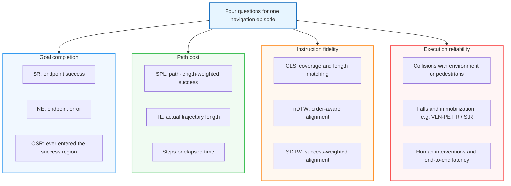

Definitions in the first three groups are relatively consistent across benchmarks. For the fourth, counting units, thresholds, and episode termination depend on the benchmark; see Section 8.4.

<a id="81-评测体系总览与设计哲学"></a>

## 8.1 Protocols and metric reading
{: id="81-评测协议与指标解读"}

Record task and split, sensors and field of view, depth/pose/map access, action interface, stop and timeout rules, distance function, success threshold, extra training data, and inference budget. R2R graphs, Habitat navigable surfaces, and aerial scenes are different distance spaces.

| Intended claim | Minimum reporting | What this does not establish |
|:---|:---|:---|
| Easier goal arrival | SR, NE, OSR | Following intermediate instructions |
| More efficient travel | SR, SPL, actual path length | Faster inference or lower energy consumption |
| More faithful instruction execution | nDTW / SDTW, optionally CLS | All aspects of language understanding |
| More accurate object finding | Navigation + appropriate grounding metrics | Equal difficulty of general ObjectNav and referring-expression navigation |
| Better real-robot suitability | Real completion, collisions, interventions, latency, failure categories | Equal reliability on other robots and environments |

### 8.1.1 Trajectories and metric responses
{: id="811-轨迹形态与指标响应"}

These are illustrations for understanding metrics, not results from a particular paper. Assume an instruction requires visiting landmarks before reaching the endpoint:

| Behavior | SR | SPL | nDTW / CLS | Interpretation |
|:---|:---|:---|:---|:---|
| Follows the instruction, arrives, and stops correctly | Success | Depends on deviation from shortest path | Usually high | Meets both route and endpoint requirements |
| Skips landmarks and takes a shortcut | Can still succeed | Can be high | Usually lower | Arrival does not establish path fidelity |
| Repeatedly enters rooms before finally arriving | Can still succeed | Clearly lower | Usually lower | Success may come from excessive exploration; inspect TL |
| Follows most of the route but fails at the endpoint | Failure | 0 | Can still be high | Path similarity does not establish completion; SDTW is 0 |
| Passes the goal and keeps moving away | Might fail | 0 if failed | Trajectory-dependent | OSR–SR gap motivates inspection of stopping and execution |

<a id="812-场景化指标选型决策树"></a>

### 8.1.2 Choosing metrics by setting
{: id="812-场景化指标选型"}

Route following needs both endpoint and path measures; goal search needs search success and target verification; dialogue tasks must specify whether active questions are allowed; physical robots need execution-failure measures. Use each task's official success definition rather than applying a universal 3 m endpoint threshold.

The diagram helps choose metric groups. Multiple branches may apply: referring-expression navigation in a physical environment needs both target recognition and execution-safety evaluation.

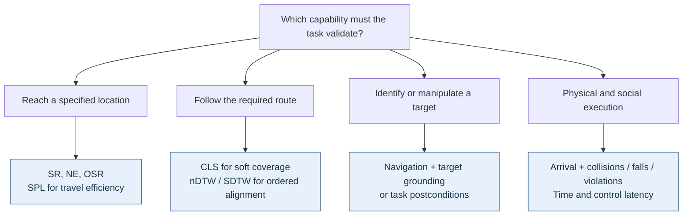

Retain per-episode results after selecting metrics. Overall means can hide substantial degradation on long routes, particular languages or robots, or specific failure conditions.

### 8.1.3 Core metric overview
{: id="813-核心指标总览"}

| Metric | Main question | Direction | Key limitation |
|:---|:---|:---|:---|
| SR | Was the final outcome successful? | ↑ | Success criteria depend on the task |
| NE | How far from the goal at stopping? | ↓, usually meters | Specify the distance function |
| OSR | Did the trajectory ever enter the success region? | ↑ | Diagnoses arrival opportunities; does not guarantee an implementable policy |
| SPL | Was successful travel efficient? | ↑, 0–1 or percentage | Shortest-path efficiency differs from instruction fidelity |
| CLS | How well are reference coverage and length matched? | ↑, 0–1 or percentage | No explicit order alignment |
| nDTW | How close is the trajectory to the reference under order constraints? | ↑, 0–1 or percentage | Depends on sampling, distance function, and reference annotations |
| SDTW | Was the trajectory successful and close to the reference? | ↑, 0–1 or percentage | Failed trajectories score 0; analyze with nDTW |
| TL | How far did the agent travel? | No universally preferred direction; usually meters | Interpret with SR and reference length; short travel may mean premature stopping |
| RGS / RGSPL | Was the referred target object selected correctly? | ↑ | Specific to REVERIE-like tasks; disclose object candidates and decision criteria |

### 8.1.4 Diagnosing metric gaps
{: id="814-指标反差排查"}

| Observation | Possible cause | How to verify |
|:---|:---|:---|
| OSR substantially exceeds SR | Stopping, target verification, control drift, timeout | Replay behavior after first entering the success region |
| SR rises but SPL falls | More exploration produces longer paths | Paired comparison of successful episodes and actual lengths |
| High SPL but low nDTW | Shortcuts or skipped landmarks | Check whether reference paths deliberately differ from shortest paths |
| Large Seen–Unseen gap | Scene overfitting or task-distribution differences | Group by length, instruction type, and scene difficulty |
| Strong simulation but weak real-world results | Perception, synchronization, dynamics, or environment shifts | Measure perception, planning, and execution errors separately |

These are hypotheses to test. Multiple mechanisms can produce the same discrepancy; it does not justify immediately concluding that a model lacks reasoning or merely memorizes.

## 8.2 Goal completion metrics
{: id="82-目标达成指标"}

### 8.2.1 Success Rate (SR)
{: id="821-success-rate-sr"}

Let $S_i\in\{0,1\}$ be the official success indicator for episode $i$, over $N$ evaluation trajectories:

$$
\mathrm{SR}=\frac{1}{N}\sum_{i=1}^{N}S_i.
$$

Success may require endpoint distance, an explicit stop, target visibility, or object recognition. Preserve these conditions in reporting. Whether timeout-truncated episodes count as success also depends on the evaluator.

### 8.2.2 Navigation Error (NE)
{: id="822-navigation-error-ne"}

Let $x_i^{\mathrm{end}}$ be the terminal position, $g_i$ the goal, and $d$ the benchmark distance function:

$$
\mathrm{NE}=\frac{1}{N}\sum_{i=1}^{N}d(x_i^{\mathrm{end}},g_i).
$$

Classic graph navigation generally uses shortest graph distance; continuous navigation commonly uses geodesic distance over navigable surfaces. Neither should universally be rewritten as Euclidean distance. If multiple goal positions are valid, explain how the goal set is handled. See the [official RxR metric documentation](https://github.com/google-research-datasets/RxR).

### 8.2.3 Oracle Success Rate (OSR)
{: id="823-oracle-success-rate-osr"}

For tasks with a goal-distance threshold $\tau$, OSR checks whether the trajectory ever entered the success region:

$$
\mathrm{OSR}=\frac{1}{N}\sum_{i=1}^{N}\mathbb{1}\!\left[\min_t d(x_i^t,g_i)<\tau\right].
$$

Follow the official implementation for strict versus non-strict thresholds. OSR cannot replace an actual stopping policy: accidentally passing the goal can raise it. When SR and OSR share distance and sampling conventions, their gap can help diagnose stopping-related problems.

**Teaching example: passing a goal differs from stopping correctly.** Assume success depends only on distance to the goal at stopping, with a 3 m threshold and the same distance definition throughout.

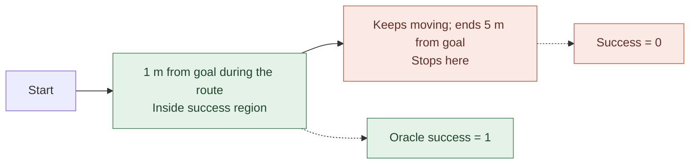

This gap motivates inspection of stopping, target recognition, and backtracking. High OSR alone does not prove accurate localization: the trajectory may pass the goal accidentally, or the model may never recognize that it has seen it.

## 8.3 Path efficiency and fidelity
{: id="83-路径效率与保真度"}

### 8.3.1 SPL
{: id="831-spl"}

Let $l_i$ be the shortest feasible start-to-goal path length and $p_i$ the actual traveled length:

$$
\mathrm{SPL}=\frac{1}{N}\sum_{i=1}^{N}S_i\frac{l_i}{\max(l_i,p_i)}.
$$

Compute the score per trajectory and then average; it is not SR multiplied by mean efficiency over all trajectories. Follow the benchmark implementation for degenerate cases such as zero lengths. See the [original SPL evaluation recommendations](https://arxiv.org/abs/1807.06757).

For two trajectories, if one succeeds with efficiency 0.5 and the other fails, SR is 0.5 and SPL is 0.25. SPL measures travel efficiency; extra generated tokens, network waiting, or stationary computation time do not automatically enter its denominator.

**Four trajectory examples**: in one straight corridor, the shortest distance from start to the exact goal is 10 m, the success threshold is 3 m, and every agent explicitly stops. The diagram shows behavioral categories, not spatial scale.

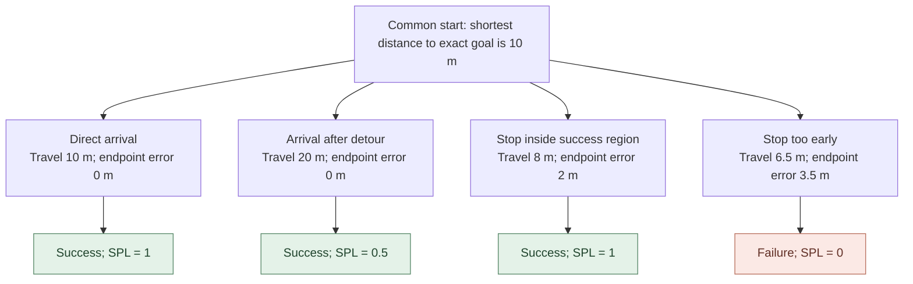

| Behavior | $S_i$ | Efficiency $l_i / \max(l_i,p_i)$ | Episode SPL |
|:---|:---:|:---:|:---:|
| Direct arrival | 1 | $10/10=1$ | 1 |
| Arrival after detour | 1 | $10/20=0.5$ | 0.5 |
| Stop 2 m before the goal | 1 | $10/10=1$ | 1 |
| Stop 3.5 m before the goal | 0 | $10/10=1$ | 0 |

Together, these four yield SR 0.75 and SPL 0.625. The third travels less than the shortest distance to the **exact goal** because it stops within the success region, not because it beats the shortest path in the same geometry. `max` caps efficiency at 1. If a benchmark defines $l_i$ to the goal region, recalculate according to that implementation.

SPL assigns zero to failures and an inverse-length penalty to successful but excessive travel. It does not require visiting every instructed landmark. When instructions require a detour, faithful execution can lower SPL, motivating path-fidelity metrics.

### 8.3.2 CLS
{: id="832-cls"}

For reference path $R$ and predicted path $P$, define point-to-path distance as $d(r,P)=\min_{p\in P}d(r,p)$. CLS combines soft coverage with length matching:

$$
\mathrm{PC}=\frac{1}{|R|}\sum_{r\in R}\exp\!\left(-\frac{d(r,P)}{d_{th}}\right),\qquad
\mathrm{EPL}=\mathrm{PC}\cdot L(R),
$$

$$
\mathrm{CLS}=\mathrm{PC}\cdot\frac{\mathrm{EPL}}{\mathrm{EPL}+|\mathrm{EPL}-L(P)|}.
$$

Here $L$ denotes path length and $d_{th}$ is a distance scale. CLS encourages coverage of route nodes but imposes no explicit visit order; use nDTW to assess sequence. See the [original CLS paper](https://arxiv.org/abs/1905.12255).

**Two steps in the formula**: PC measures how far reference locations are from anywhere on the traveled path; LS checks whether actual length is proportionate to the covered portion. Because point-to-path distance takes a minimum, PC alone does not check visit order.

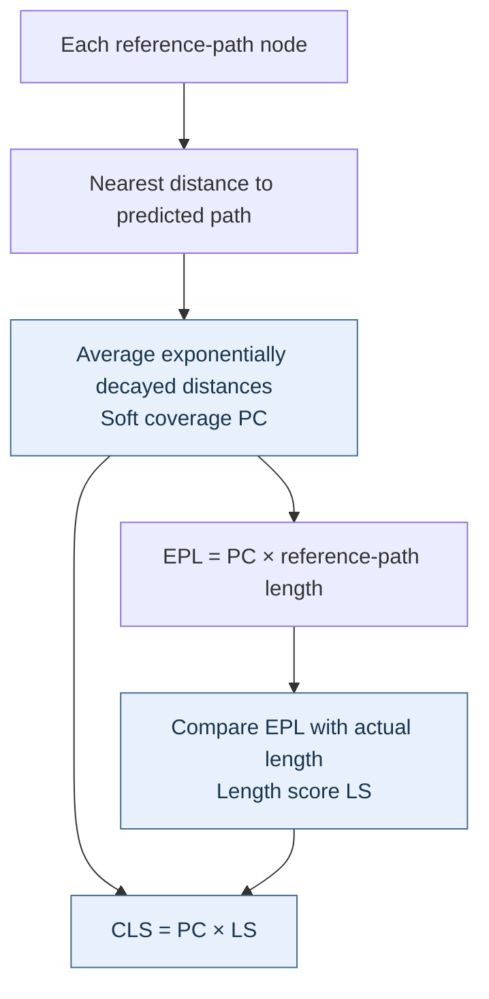

| Teaching example: $L(R)=20$ m | Assumed PC | $L(P)$ | EPL | LS | CLS |
|:---|:---:|:---:|:---:|:---:|:---:|
| Full coverage and matching length | 1 | 20 m | 20 m | 1 | 1 |
| Full coverage with extra detour | 1 | 30 m | 20 m | $2/3$ | $2/3$ |
| Limited soft coverage but length matches EPL | 0.5 | 10 m | 10 m | 1 | 0.5 |

PC values here are chosen for illustration, not measured from a route diagram; 0.5 does not mean exactly half the nodes were visited. Even when every reference point lies within $d_{th}$, PC need not approach 1: a point exactly $d_{th}$ away contributes only $e^{-1}\approx0.368$.

CLS can reveal arrival that skips parts of the reference route, but identical coverage sets can have different visit orders. This motivates DTW alignment below.

### 8.3.3 nDTW and SDTW
{: id="833-ndtw-与-sdtw"}

DTW finds order-constrained path alignments while allowing different sample counts. Common normalized and success-weighted forms are:

$$
\mathrm{nDTW}(R,P)=\exp\!\left(-\frac{\mathrm{DTW}(R,P)}{|R|d_{th}}\right),\qquad
\mathrm{SDTW}=\frac{1}{N}\sum_{i=1}^{N}S_i\,\mathrm{nDTW}(R_i,P_i).
$$

Dataset nDTW is also calculated per episode and then averaged. Order alignment better captures route constraints than coverage alone, but still depends on reference quality. See the [original nDTW paper](https://arxiv.org/abs/1907.05446).

**Implementation limits**: do not assume NE's goal distance and DTW's point-pair distance are identical. Continuous implementations also choose sampling, deduplication, and approximate-DTW procedures. Pin evaluator code rather than copying formulas alone. See the [VLN-CE metric implementation](https://github.com/jacobkrantz/VLN-CE/blob/master/habitat_extensions/measures.py).

**Why not subtract corresponding steps directly?** For reference A→B→C and prediction A→A→B→C, index-wise comparison mismatches B with A at the second step. DTW allows multiple samples to match one reference point while preserving order.

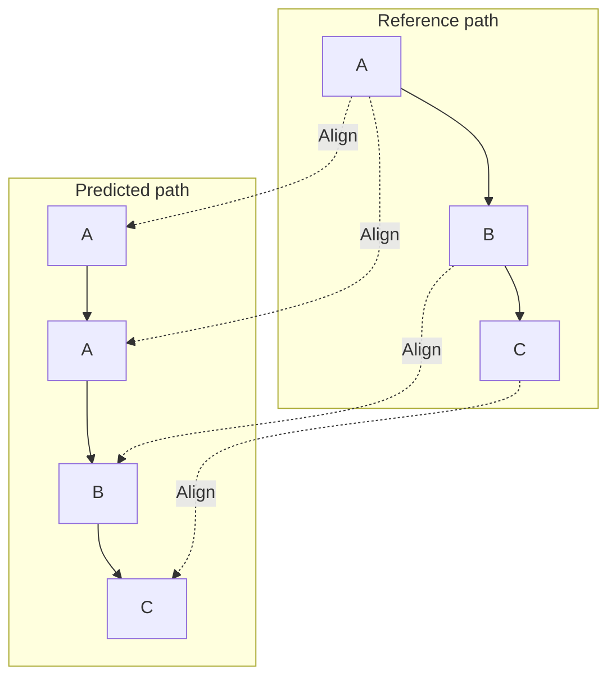

With exactly repeated positions in this example, alignment cost can be zero. Real displacement, sampling, and noise still affect DTW; it is not universally invariant to speed and sampling. A→C→B→C visits the same landmarks but generally cannot achieve the same zero-cost ordered alignment.

DTW's accumulated cost can be expressed by this recurrence, where $D(a,b)$ is the minimum alignment cost for the two path prefixes, with standard DTW boundary initialization:

$$
D(a,b)=d(r_a,p_b)+\min\{D(a-1,b),D(a,b-1),D(a-1,b-1)\}.
$$

For example, if $\lvert R\rvert=4$, $d_{th}=3$ m, and DTW is 6 m, nDTW is $e^{-0.5}\approx0.607$. If that episode fails, its SDTW is 0. With a second successful episode at nDTW 0.8, mean nDTW is about 0.704 and mean SDTW is 0.4. Apply success weighting per episode; overall SR times overall nDTW is not a substitute.

## 8.4 Safety and deployment metrics
{: id="84-安全与部署指标"}

### 8.4.1 Collision and social safety
{: id="841-避障与社交安全"}

Collisions can be counted per action step, contact event, or episode, yielding different denominators. Define Collision Rate / Human Collision Rate explicitly and report completion alongside them, avoiding apparent safety from remaining stationary. Personal-space violations are also broader than physical contact.

### 8.4.2 Dynamic stability
{: id="842-动力学稳定性"}

Record falls, immobilization, emergency stops, and manual resets separately. Specify pose or time thresholds, recovery budgets, and whether resets terminate an episode. Different embodiments have different failure modes; do not combine them into an unconditional embodied-success score.

### 8.4.3 Efficiency and real-time control
{: id="843-系统效率与实时性"}

Report camera-to-action end-to-end latency, including mean and tail latency, hardware, batch size, resolution, history length, and model invocation mode. Also report control frequency, GPU memory, API/token costs, task time, and human interventions. A model's forward-pass FPS is not the robot's effective control frequency.

## 8.5 Evaluation protocols
{: id="85-评测协议规范"}

### 8.5.1 Val-Seen and Val-Unseen
{: id="851-val-seen-与-val-unseen"}

Seen / Unseen usually split benchmark scenes to measure scene generalization within the same task. They do not guarantee that large-scale pretraining excluded related buildings, images, or derived assets, nor establish cross-robot, cross-language, or real-world generalization.

### 8.5.2 Fair comparison checklist
{: id="852-公平对比清单"}

- **Same inputs**: camera count, field of view, depth, pose, and map access.
- **Same task**: data version, language subset, episodes, goals, and stopping criteria.
- **Same execution**: action space, controller, step/time budgets, sliding, and collision configuration.
- **Transparent resources**: extra training data, backbone, tool calls, search/retry counts, and compute budget.
- **Inspectable statistics**: success and total counts; repeated runs or confidence intervals for stochastic tasks, with sampling methods explained.

<a id="853-评测体系的历史演进与代际跃迁"></a>

### 8.5.3 Reproducible evidence
{: id="853-可复现证据"}

Identify the paper version and result table first, then check the official evaluator. The VLN-CE repository has explicitly noted that SPL differences between a paper and leaderboard for the same baseline relate to hardware and Habitat builds. Protocols and implementations are themselves part of the experiment. See the [official reproduction notes](https://github.com/jacobkrantz/VLN-CE#baseline-performance).

The companion  help locate methods and original results. Until the above checks are completed, scores from different articles or versions are reading pointers, not evidence for causal claims of architectural superiority.


# 9. Learning resources and frameworks
{: id="9-学习资源与框架"}

A useful learning order is classic tasks → continuous environments → foundation models → real deployment. Reproduce R2R / VLN-CE baselines and learn Habitat episodes, sensors, and metrics; then study streaming VLA, fast-slow systems, and spatial memory; finally move to agents, world models, and real robots. Starting with the latest large model can obscure differences caused by protocols and action interfaces.

**Companion resources on this site:**

- : detailed readings, performance, and open-source status organized by task setting.
- : foundations of 3D representations, maps, and spatial reasoning.
- : predictive models, world-action models, and data engines.
- : SLAM, global/local planning, and controllers, complementing [hierarchical control in Section 3.2](#survey-policy), [action interfaces in Section 3.4](#survey-grounding), and deployment metrics in Section 8.4.
- : vision-language-action training paradigms and action-interface design.

**[VLN-Survey-with-Foundation-Models](https://github.com/zhangyuejoslin/VLN-Survey-with-Foundation-Models)**
- **Type**: GitHub resource repository.
- **Focus**: VLN in the LLM/VLM era (2023–present), with ongoing paper updates.
- **Audience**: researchers studying how large models are changing VLN.

**[Awesome-Embodied-AI](https://github.com/jonyzhang2023/awesome-embodied-vla-va-vln)**
- **Type**: full-stack resource collection.
- **Focus**: the embodied-intelligence stack, including VLN, VLA, and robot manipulation.
- **Audience**: researchers seeking a systematic overview of embodied AI.

**[Embodied-AI-Guide](https://github.com/TianxingChen/Embodied-AI-Guide)**
- **Type**: introductory tutorials and practical guidance.
- **Focus**: code exercises, paper explanations, and learning paths.
- **Audience**: beginners or readers needing a structured learning path.

**[Vision-and-Language Navigation: A Survey of Tasks, Methods, and Future Directions](https://arxiv.org/abs/2203.12667)**
- **Type**: survey paper (Gu et al., ACL 2022).
- **Focus**: the development of VLN, covering tasks, methods, and evaluation from 2018–2022.
- **Audience**: researchers seeking a broad historical view of VLN.

**[Vision-and-Language Navigation Today and Tomorrow: A Survey in the Era of Foundation Models](https://arxiv.org/abs/2407.07035)**
- **Type**: survey paper (Zhang et al., 2024), accompanying the VLN-Survey-with-Foundation-Models repository above.
- **Focus**: reorganizes VLN around foundation models and discusses convergence with world models, human models, and VLA.
- **Audience**: researchers approaching VLN from the large-model perspective.

---


## 9.1 Conferences and workshops
{: id="91-重要会议与研讨会"}

**Embodied-intelligence venues:**
- **[Embodied AI Workshop](https://embodied-ai.org/)** — a CVPR workshop featuring recent directions and challenges.
- **[CoRL](https://www.corl.org/)** (Conference on Robot Learning) — a major venue for VLN transfer to real robots.
- **[RSS](https://roboticsconference.org/)** (Robotics: Science and Systems) — a leading robotics conference with emphasis on sim-to-real.

**Common conference emphases:**

| Conference | Common emphasis |
|:----:|:-----------|
| **CVPR / ICCV / ECCV** | Vision-language modeling, spatial representations, datasets, benchmarks |
| **NeurIPS / ICLR** | Foundation models, reinforcement learning, generative models, training at scale |
| **CoRL / RSS** | Robot learning, real deployment, cross-embodiment generalization |
| **ICRA / IROS** | Navigation systems, control, simulation platforms, engineering validation |

---

<a id="survey-practice"></a>

## 9.2 A reproducible workflow
{: id="92-可复现的实施路径"}

This survey proposes the following workflow for turning methods from the companion readings into comparable systems.

| Stage | First task | Inspectable artifacts |
|:---|:---|:---|
| Fix the task | Establish instruction type, observations, action interface, embodiment, success conditions | Configuration including data version, split, sensors, stopping rules |
| Reproduce a baseline | Use paper-matched code and weights on the standard validation set | Per-episode results, configuration, code revision, aggregate metrics |
| Diagnose weaknesses | Replay failures; separate understanding, memory, planning, execution, stopping | Failure categories and representative trajectories beyond mean SR |
| Test a change | Control one variable at a time with matched episodes and budgets | Paired results, module ablations, variation across seeds |
| Check generalization | Evaluate unseen scenes and explicitly defined perturbations | Results by scene, route length, and perturbation type |
| Integrate a robot | Verify coordinates, timestamps, action scales, trajectory validity, execution feedback | End-to-end latency, collisions, recovery, interventions, real failure logs |

**Completed inference does not guarantee a still-valid action.** Camera capture, encoding, generation, communication, and actuation jointly determine loop latency. When the slow system returns a subgoal, the robot may already have left the relevant viewpoint. Define when old goals expire, when to replan, and what the fast system does while waiting. Report measurement boundaries, hardware, batch sizes, and control frequency alongside model FPS.

**Choose methods by tracing back from failure evidence.** Repeated visits on long routes suggest checking memory and map updates; reaching the goal vicinity without success suggests stopping and target verification; correct semantic goals with frequent collisions suggest reachability, action interfaces, and controllers. Metric gaps provide clues; trajectory replay and controlled experiments must establish causes.

<a id="survey-open-questions"></a>

## 9.3 Open questions
{: id="93-开放问题与研究判断"}

The reviewed work supports several **conclusions with explicit scope**: R4R and path metrics show the need to measure arrival and instruction fidelity separately; ETPNav and DualVLN demonstrate concrete planning/execution divisions; ScaleVLN establishes training resources as an important performance variable; VLN-PE provides experimental evidence that visual and physical gaps affect navigation. These findings come from [path-following research](https://arxiv.org/abs/1905.12255), [continuous graph planning](https://arxiv.org/abs/2304.03047), [dual-system design](https://arxiv.org/abs/2512.08186), [data scaling](https://arxiv.org/abs/2307.15644), and [physical embodiment evaluation](https://arxiv.org/abs/2507.13019). They do not establish one optimal architecture for every task.

The table proposes open questions and evaluation approaches based on that evidence. **These are research judgments, not a field-wide consensus.**

| Open question | Why current results are insufficient | More discriminating evaluation |
|:---|:---|:---|
| When is explicit mapping worthwhile? | Map-based and implicit models often use different sensors and pose priors | Fix inputs; compare by route length, occlusion, and pose noise |
| Which language information does the model use? | High SR may mainly reflect endpoint cues | Keep the goal fixed; change route order, negation, and turn constraints; inspect trajectory responses |
| Can memory correct its own errors? | Long retention in static scenes does not establish dynamic updating | Move objects, block routes, inject wrong observations; inspect correction and forgetting |
| Does reflection yield reliable recovery? | Longer reasoning and more retries may both raise success | Fix invocation budgets and injected failures; compare recovery, extra travel, and failure escalation |
| When do world models outperform direct policies? | Generation quality differs from execution benefit | Compare no prediction, candidate ranking, and joint generation under matched budgets; report long-rollout distortion |
| How far does general capability transfer? | Multitask scores on one platform do not establish cross-morphology transfer | Hold out languages, assets, robots, and control interfaces; report adaptation required for each |
| Do simulation gains predict deployment gains? | Real tests often use different environments and intervention rules | Fix tasks, starts, and recovery budgets; release failed trajectories and intervention logs |

**This survey recommends** first building replayable, attributable failure analysis, then choosing model changes. If local execution dominates failures, a larger language model may not be the most direct remedy. If stopping and route constraints dominate, mean SR alone may hide useful improvements. Progress should explain under which conditions a failure class was reduced and at what cost.

<a id="survey-scope"></a>

## 9.4 Scope and maintenance
{: id="94-本文覆盖范围与维护方式"}

This is a problem-oriented narrative survey covering route-instruction navigation and related goal-navigation, interaction, and embodied-control work. It is not a systematic review with exhaustive search and exclusion procedures. Boundaries are stated where other tasks inform mechanisms; general VLA and manipulation papers are not treated as direct performance evidence for standard VLN.

Data-counting conventions, platform support, and core metrics were verified together on **2026-09-26**. On **2026-10-07**, Section 3 was reorganized with the companion paper readings, adding checks of the mechanism descriptions for representative methods in action interfaces, progress and active perception, and predictive learning. On **2026-10-09**, Section 3.8 was expanded, checking RL feedback levels, rewards, and same-backbone ablations against the specified versions of the original papers. These method-section revisions do not mean that every dataset, platform, or leaderboard was re-verified. Changeable data are tied to paper versions or data-card sources; entries without a confirmed independent protocol retain uncertainty notes. Other work is available through companion paper readings. This survey does not claim to have independently reproduced every experiment or verified all leaderboard results.


# 10. References
{: id="10-参考资料"}

> **Detailed paper readings**: see  and . This section lists datasets, methods, simulators, and surveys directly discussed above, grouped by topic with continuous numbering. For preprint publication status and leaderboard values, consult paper homepages and the companion readings.

---

## 10.1 Datasets and benchmarks
{: id="101-数据集与基准"}

### 10.1.1 Instruction-following and continuous
{: id="1011-指令导向与连续环境"}

1. **R2R** — Anderson et al., *Vision-and-Language Navigation: Interpreting Visually-Grounded Navigation Instructions in Real Environments*, CVPR 2018. [[Paper]](https://arxiv.org/abs/1711.07280)
2. **R4R** — Jain et al., *Stay on the Path: Instruction Fidelity in Vision-and-Language Navigation*, ACL 2019. [[Paper]](https://arxiv.org/abs/1905.12255)
3. **RxR** — Ku et al., *Room-Across-Room: Multilingual Vision-and-Language Navigation with Dense Spatiotemporal Grounding*, EMNLP 2020. [[Paper]](https://arxiv.org/abs/2010.07954)
4. **VLN-CE** — Krantz et al., *Beyond the Nav-Graph: Vision-and-Language Navigation in Continuous Environments*, ECCV 2020. [[Paper]](https://arxiv.org/abs/2004.02857)
5. **RxR-CE** — RxR adapted to continuous Habitat environments, released with VLN-CE for the RxR-Habitat challenge (CVPR Embodied AI Workshop). [[Code]](https://github.com/jacobkrantz/VLN-CE)
6. **ScaleVLN** — Wang et al., *Scaling Data Generation in Vision-and-Language Navigation*, ICCV 2023. [[Paper]](https://arxiv.org/abs/2307.15644)
7. **VLN-PE** — Wang et al., *Rethinking the Embodied Gap in Vision-and-Language Navigation: A Holistic Study of Physical and Visual Disparities*, ICCV 2025. [[Paper]](https://arxiv.org/abs/2507.13019)
8. **InternData-N1** — InternRobotics (Shanghai AI Laboratory), large-scale synthetic navigation data for InternVLA-N1 in LeRobot format, 2025. [[Dataset]](https://huggingface.co/datasets/InternRobotics/InternData-N1) [[Code]](https://github.com/InternRobotics/InternNav)
9. **VLNVerse** — Lin et al., *VLNVerse: A Benchmark for Vision-Language Navigation with Versatile, Embodied, Realistic Simulation and Evaluation*, arXiv 2025. [[Paper]](https://arxiv.org/abs/2512.19021)

### 10.1.2 Goal-oriented and long-horizon
{: id="1012-目标导向与长程规划"}

10. **REVERIE** — Qi et al., *REVERIE: Remote Embodied Visual Referring Expression in Real Indoor Environments*, CVPR 2020. [[Paper]](https://arxiv.org/abs/1904.10151)
11. **REVERIE-CE** — A family of continuous-environment adaptations without a unified official protocol. Cite the specific paper's conversion implementation; see Section 6.3.2.
12. **SOON** — Zhu et al., *SOON: Scenario Oriented Object Navigation with Graph-based Exploration*, CVPR 2021. [[Paper]](https://arxiv.org/abs/2103.17138)
13. **LHPR-VLN** — Song et al., *Towards Long-Horizon Vision-Language Navigation: Platform, Benchmark and Method*, CVPR 2025. [[Paper]](https://arxiv.org/abs/2412.09082)

### 10.1.3 Dialog and social
{: id="1013-对话式与社交感知"}

14. **CVDN** — Thomason et al., *Vision-and-Dialog Navigation*, CoRL 2019. [[Paper]](https://arxiv.org/abs/1907.04957)
15. **TEACh** — Padmakumar et al., *TEACh: Task-driven Embodied Agents that Chat*, AAAI 2022. [[Paper]](https://arxiv.org/abs/2110.00534)
16. **HA-VLN** — Li et al., *Human-Aware Vision-and-Language Navigation: Bridging Simulation to Reality with Dynamic Human Interactions*, NeurIPS 2024 Datasets and Benchmarks Track. [[Paper]](https://arxiv.org/abs/2406.19236)
17. **HA-VLN 2.0** — Dong et al., *HA-VLN 2.0: An Open Benchmark and Leaderboard for Human-Aware Navigation in Discrete and Continuous Environments*, IROS 2026 (first posted to arXiv in 2025; checked v5). [[Paper]](https://arxiv.org/abs/2503.14229v5)

### 10.1.4 Demand-driven, outdoor and aerial
{: id="1014-需求导向街景与空中"}

18. **DDN** — Wang et al., *Find What You Want: Learning Demand-conditioned Object Attribute Space for Demand-driven Navigation*, NeurIPS 2023. [[Paper]](https://arxiv.org/abs/2309.08138)
19. **Touchdown** — Chen et al., *Touchdown: Natural Language Navigation and Spatial Reasoning in Visual Street Environments*, CVPR 2019. [[Paper]](https://arxiv.org/abs/1811.12354)
20. **StreetLearn** — Mirowski et al., *The StreetLearn Environment and Dataset*, arXiv 2019. [[Paper]](https://arxiv.org/abs/1903.01292)
21. **AerialVLN** — Liu et al., *AerialVLN: Vision-and-Language Navigation for UAVs*, ICCV 2023. [[Paper]](https://arxiv.org/abs/2308.06735)
22. **CityNav** — Lee et al., *CityNav: A Large-Scale Dataset for Real-World Aerial Navigation*, ICCV 2025（arXiv 2024）. [[Paper]](https://arxiv.org/abs/2406.14240)
23. **OpenFly** — Gao et al., *OpenFly: A Comprehensive Platform for Aerial Vision-Language Navigation*, ICLR 2026 (first posted to arXiv in 2025; checked v7). [[Paper]](https://arxiv.org/abs/2502.18041v7)

---

## 10.2 Core models and methods
{: id="102-核心模型与方法"}

### 10.2.1 Cross-modal pre-training
{: id="1021-跨模态对齐与预训练"}

24. **PREVALENT** — Hao et al., *Towards Learning a Generic Agent for Vision-and-Language Navigation via Pre-training*, CVPR 2020. [[Paper]](https://arxiv.org/abs/2002.10638)
25. **VLN-BERT** — Majumdar et al., *Improving Vision-and-Language Navigation with Image-Text Pairs from the Web*, ECCV 2020. [[Paper]](https://arxiv.org/abs/2004.14973)
26. **Recurrent VLN-BERT** — Hong et al., *A Recurrent Vision-and-Language BERT for Navigation*, CVPR 2021. [[Paper]](https://arxiv.org/abs/2011.13922)
27. **HAMT** — Chen et al., *History Aware Multimodal Transformer for Vision-and-Language Navigation*, NeurIPS 2021. [[Paper]](https://arxiv.org/abs/2110.13309)

### 10.2.2 Topological graphs and memory
{: id="1022-拓扑图与空间记忆"}

28. **DUET** — Chen et al., *Think Global, Act Local: Dual-scale Graph Transformer for Vision-and-Language Navigation*, CVPR 2022. [[Paper]](https://arxiv.org/abs/2202.11742)
29. **ETPNav** — An et al., *ETPNav: Evolving Topological Planning for Vision-Language Navigation in Continuous Environments*, IEEE TPAMI 2024. [[Paper]](https://arxiv.org/abs/2304.03047)
30. **LagMemo** — Zhou et al., *LagMemo: Language 3D Gaussian Splatting Memory for Multi-modal Open-vocabulary Multi-goal Visual Navigation*, arXiv 2025. [[Paper]](https://arxiv.org/abs/2510.24118)

### 10.2.3 Fast-slow dual systems
{: id="1023-快慢双系统"}

31. **DualVLN** — Wei et al., *Ground Slow, Move Fast: A Dual-System Foundation Model for Generalizable Vision-and-Language Navigation*, arXiv 2025. [[Paper]](https://arxiv.org/abs/2512.08186)
32. **NaVILA** — Cheng et al., *NaVILA: Legged Robot Vision-Language-Action Model for Navigation*, RSS 2025. [[Paper]](https://arxiv.org/abs/2412.04453)
33. **NavDP** — Cai et al., *NavDP: Learning Sim-to-Real Navigation Diffusion Policy with Privileged Information Guidance*, arXiv 2025. [[Paper]](https://arxiv.org/abs/2505.08712)
34. **InternVLA-N1** — InternRobotics (Shanghai AI Laboratory), *InternVLA-N1: An Open Dual-System Vision-Language Navigation Foundation Model with Learned Latent Plans*, 2025. [[Code]](https://github.com/InternRobotics/InternNav)
35. **OmniNav** — Xue et al., *OmniNav: A Unified Framework for Prospective Exploration and Visual-Language Navigation*, arXiv 2025. [[Paper]](https://arxiv.org/abs/2509.25687)
36. **Qwen-RobotNav** — Zhang et al., *Qwen-RobotNav Technical Report: A Scalable Navigation Model Designed for an Agentic Navigation System*, arXiv 2026. [[Paper]](https://arxiv.org/abs/2606.18112)

### 10.2.4 Video VLMs and continuous policies
{: id="1024-视频-vlm-与连续策略"}

37. **Waypoint Models** — Krantz et al., *Waypoint Models for Instruction-guided Navigation in Continuous Environments*, ICCV 2021. [[Paper]](https://arxiv.org/abs/2110.02207)
38. **NaVid** — Zhang et al., *NaVid: Video-based VLM Plans the Next Step for Vision-and-Language Navigation*, RSS 2024. [[Paper]](https://arxiv.org/abs/2402.15852)
39. **StreamVLN** — Wei et al., *StreamVLN: Streaming Vision-and-Language Navigation via SlowFast Context Modeling*, ICRA 2026 (first posted to arXiv in 2025; checked v2). [[Paper]](https://arxiv.org/abs/2507.05240v2)

### 10.2.5 Low-level visual navigation
{: id="1025-底层视觉导航策略"}

40. **DD-PPO** — Wijmans et al., *DD-PPO: Learning Near-Perfect PointGoal Navigators from 2.5 Billion Frames*, ICLR 2020. [[Paper]](https://arxiv.org/abs/1911.00357)
41. **GNM** — Shah et al., *GNM: A General Navigation Model to Drive Any Robot*, ICRA 2023. [[Paper]](https://arxiv.org/abs/2210.03370)
42. **ViNT** — Shah et al., *ViNT: A Foundation Model for Visual Navigation*, CoRL 2023. [[Paper]](https://arxiv.org/abs/2306.14846)
43. **NoMaD** — Sridhar et al., *NoMaD: Goal Masked Diffusion Policies for Navigation and Exploration*, ICRA 2024. [[Paper]](https://arxiv.org/abs/2310.07896)
44. **ViPlanner** — Roth et al., *ViPlanner: Visual Semantic Imperative Learning for Local Navigation*, ICRA 2024. [[Paper]](https://arxiv.org/abs/2310.00982)

### 10.2.6 World models
{: id="1026-世界模型"}

45. **Navigation World Models (NWM)** — Bar et al., *Navigation World Models*, CVPR 2025. [[Paper]](https://arxiv.org/abs/2412.03572) [[Project]](https://www.amirbar.net/nwm/)
46. **Dynam3D** — Wang et al., *Dynam3D: Dynamic Layered 3D Tokens Empower VLM for Vision-and-Language Navigation*, NeurIPS 2025. [[Paper]](https://arxiv.org/abs/2505.11383)
47. **WMNav** — Nie et al., *WMNav: Integrating Vision-Language Models into World Models for Object Goal Navigation*, IROS 2025. [[Paper]](https://arxiv.org/abs/2503.02247) [[Project]](https://b0b8k1ng.github.io/WMNav/)
48. **AstraNav-World** — Chen et al., *AstraNav-World: World Model for Foresight Control and Consistency*, arXiv 2025. [[Paper]](https://arxiv.org/abs/2512.21714)
49. **NavWAM** — Azuma et al., *NavWAM: A Navigation World Action Model for Goal-Conditioned Visual Navigation*, arXiv 2026. [[Paper]](https://arxiv.org/abs/2606.13494)
50. **DreamVLA** — Zhang et al., *DreamVLA: A Vision-Language-Action Model Dreamed with Comprehensive World Knowledge*, NeurIPS 2025. [[Paper]](https://arxiv.org/abs/2507.04447) [[Project]](https://zhangwenyao1.github.io/DreamVLA/)
51. **NVIDIA Cosmos** — NVIDIA, *Cosmos World Foundation Model Platform for Physical AI*, arXiv 2025. [[Paper]](https://arxiv.org/abs/2501.03575) [[Project]](https://www.nvidia.com/en-us/ai/cosmos/)

### 10.2.7 Agents and general VLA
{: id="1027-agent-与通用-vla"}

52. **AgentVLN** — Xin et al., *AgentVLN: Towards Agentic Vision-and-Language Navigation*, arXiv 2026. [[Paper]](https://arxiv.org/abs/2603.17670) [[Code]](https://github.com/Allenxinn/AgentVLN)
53. **SE-VLN** — Dong et al., *SE-VLN: A Self-Evolving Vision-Language Navigation Framework Based on Multimodal Large Language Models*, arXiv 2025. [[Paper]](https://arxiv.org/abs/2507.13152)
54. **RT-2** — Brohan et al., *RT-2: Vision-Language-Action Models Transfer Web Knowledge to Robotic Control*, CoRL 2023. [[Paper]](https://arxiv.org/abs/2307.15818)
55. **OpenVLA** — Kim et al., *OpenVLA: An Open-Source Vision-Language-Action Model*, CoRL 2024. [[Paper]](https://arxiv.org/abs/2406.09246)

---

## 10.3 Simulators and scene assets
{: id="103-模拟器与场景资产"}

56. **Matterport3D Simulator** — Anderson et al., CVPR 2018 (released with R2R). [[GitHub]](https://github.com/peteanderson80/Matterport3DSimulator)
57. **Habitat** — Savva et al., *Habitat: A Platform for Embodied AI Research*, ICCV 2019 [[Paper]](https://arxiv.org/abs/1904.01201)；Szot et al., *Habitat 2.0: Training Home Assistants to Rearrange their Habitat*, NeurIPS 2021 [[Paper]](https://arxiv.org/abs/2106.14405)；Puig et al., *Habitat 3.0: A Co-Habitat for Humans, Avatars and Robots*, ICLR 2024 [[Paper]](https://arxiv.org/abs/2310.13724). [[GitHub]](https://github.com/facebookresearch/habitat-lab)
58. **AI2-THOR / ProcTHOR** — Kolve et al., *AI2-THOR: An Interactive 3D Environment for Visual AI*, arXiv 2017 [[Paper]](https://arxiv.org/abs/1712.05474)；Deitke et al., *ProcTHOR: Large-Scale Embodied AI Using Procedural Generation*, NeurIPS 2022 [[Paper]](https://arxiv.org/abs/2206.06994). [[Website]](https://ai2thor.allenai.org/)
59. **Gibson / iGibson / OmniGibson** — Xia et al., *Gibson Env: Real-World Perception for Embodied Agents*, CVPR 2018 [[Paper]](https://arxiv.org/abs/1808.10654); Li et al., *iGibson 2.0: Object-Centric Simulation for Robot Learning of Everyday Household Tasks*, CoRL 2021 [[Paper]](https://arxiv.org/abs/2108.03272); Li et al., *BEHAVIOR-1K*, CoRL 2022 (extended arXiv version, 2024) [[Paper]](https://arxiv.org/abs/2403.09227). [[GitHub]](https://github.com/StanfordVL/iGibson)
60. **AirSim** — Shah et al., *AirSim: High-Fidelity Visual and Physical Simulation for Autonomous Vehicles*, FSR 2017. [[GitHub]](https://github.com/microsoft/AirSim) (see repository notes for maintenance and compatibility) / [[Colosseum]](https://github.com/CodexLabsLLC/Colosseum)
61. **Isaac Sim / Isaac Lab** — NVIDIA; Mittal et al., *Orbit: A Unified Simulation Framework for Interactive Robot Learning Environments* (predecessor of Isaac Lab), IEEE RA-L 2023 [[Paper]](https://arxiv.org/abs/2301.04195). [[Docs]](https://isaac-sim.github.io/IsaacLab/main/index.html)
62. **MuJoCo / MJX** — Todorov et al., *MuJoCo: A Physics Engine for Model-based Control*, IROS 2012; maintained by Google DeepMind. [[GitHub]](https://github.com/google-deepmind/mujoco) / [[Docs]](https://mujoco.readthedocs.io/)
63. **InternUtopia (GRUtopia)** — Wang et al., *GRUtopia: Dream General Robots in a City at Scale*, arXiv 2024. [[Paper]](https://arxiv.org/abs/2407.10943) [[GitHub]](https://github.com/InternRobotics/InternUtopia)

---

## 10.4 Survey papers
{: id="104-综述论文"}

64. Gu et al., *Vision-and-Language Navigation: A Survey of Tasks, Methods, and Future Directions*, ACL 2022. [[Paper]](https://arxiv.org/abs/2203.12667)
65. Zhang et al., *Vision-and-Language Navigation Today and Tomorrow: A Survey in the Era of Foundation Models*, arXiv 2024. [[Paper]](https://arxiv.org/abs/2407.07035) [[GitHub]](https://github.com/zhangyuejoslin/VLN-Survey-with-Foundation-Models)

---

## 10.5 RL and post-training
{: id="105-强化学习与后训练"}

66. **DAgger** — Ross et al., *A Reduction of Imitation Learning and Structured Prediction to No-Regret Online Learning*, AISTATS 2011. [[Paper]](https://arxiv.org/abs/1011.0686)
67. **RCM** — Wang et al., *Reinforced Cross-Modal Matching and Self-Supervised Imitation Learning for Vision-Language Navigation*, CVPR 2019. [[Paper]](https://arxiv.org/abs/1811.10092)
68. **EnvDrop** — Tan et al., *Learning to Navigate Unseen Environments: Back Translation with Environmental Dropout*, NAACL 2019. [[Paper]](https://aclanthology.org/N19-1268/)
69. **PPO** — Schulman et al., *Proximal Policy Optimization Algorithms*, arXiv 2017. [[Paper]](https://arxiv.org/abs/1707.06347)
70. **GRPO / DeepSeekMath** — Shao et al., *DeepSeekMath: Pushing the Limits of Mathematical Reasoning in Open Language Models*, arXiv 2024. [[Paper]](https://arxiv.org/abs/2402.03300)
71. **nDTW / SDTW** — Ilharco et al., *General Evaluation for Instruction Conditioned Navigation using Dynamic Time Warping*, NeurIPS ViGIL Workshop 2019. [[Paper]](https://research.google/pubs/general-evaluation-for-instruction-conditioned-navigation-using-dynamic-time-warping/)
72. **VLN-R1** — *Vision-Language Navigation via Reinforcement Fine-Tuning*, arXiv 2025 (checked v1). [[Paper]](https://arxiv.org/html/2506.17221v1)
73. **ActiveVLN** — *Towards Active Exploration via Multi-Turn RL in Vision-and-Language Navigation*, arXiv 2025 (checked v1). [[Paper]](https://arxiv.org/html/2509.12618v1)
74. **ETP-R1** — *Evolving Topological Planning with Reinforcement Fine-tuning for Vision-Language Navigation in Continuous Environments*, arXiv 2025 (checked v1). [[Paper]](https://arxiv.org/html/2512.20940v1)
75. **JOP-VLN** — *Joint On-and-Off Policy Learning for Vision-and-Language Navigation*, arXiv 2026 (checked v1). [[Paper]](https://arxiv.org/html/2607.13461v1)
76. **NavGRPO** — *Trajectory-Diversity-Driven Robust Vision-and-Language Navigation*, arXiv 2026 (checked v1). [[Paper]](https://arxiv.org/html/2603.15370v1)
77. **GroundingVLN / GEAR** — *Reasoning and Acting with Grounding for Vision-Language Navigation*, arXiv 2026 (checked v3). [[Paper]](https://arxiv.org/html/2609.18581v3)
