# 1. Introduction
{: id="1-引言"}

**Embodied AI** aims for generalist agents that perceive, reason, and complete tasks in a continuous, irreversible physical world. **Vision-language-action (VLA)** models have been the main approach of the past two years. By fine-tuning the semantic knowledge and visual reasoning capabilities of multimodal language models (LLMs/VLMs), VLA models map open-ended, high-level language instructions to low-level robot control tokens.

However, VLA agents that rely solely on reactive mappings face **four fundamental bottlenecks** in physical deployment:

1. **Physical hallucination and lack of common sense**: Existing VLA models essentially match patterns. Their actions often lack explicit knowledge of rigid-body constraints, gravity, friction, fluid dynamics, and other physical laws, leading to dangerous behavior such as interpenetration, failed grasps, or damage to the environment.
2. **Lack of foresight and plan verification**: Reactive policies cannot mentally rehearse the physical consequences of actions. They struggle to verify counterfactual outcomes before acting, so an error in a long-horizon or irreversible task can cause the entire task to fail.
3. **Scarce interaction data and long-tail distributions**: Collecting high-quality real-robot teleoperation data is costly and hazardous. Limited offline datasets struggle to cover long-tail scenarios and failure distributions.
4. **Safety and irreversibility**: Blind trial and error can damage expensive hardware or endanger people. Agents need mechanisms for self-protection and risk prediction before physical execution.

**World models** target exactly these problems. They learn how the environment evolves over time and in response to actions, and serve as the agent's **internal simulator**. With one, an agent can predict consequences before acting, supplement real data with generated data, and optimize its policy inside the model. Predictions can be wrong, though, so whether a world model is useful ultimately depends on whether it helps downstream decisions (§4.6).

<figure class="survey-intro-figure">
  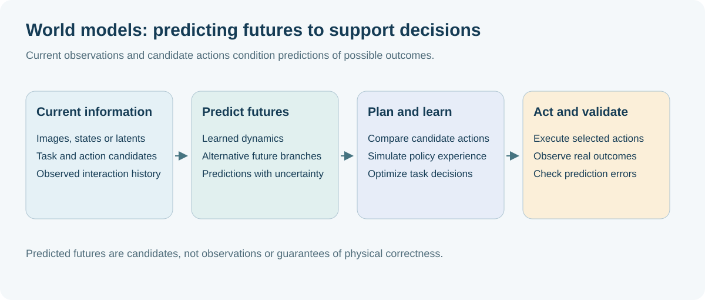
<figcaption>Figure: A world model can predict how images, states, or latent representations evolve, for use in planning, simulation, and learning. Predictions contain errors; the future branches in the figure are candidate outcomes, not real observations or physical guarantees.</figcaption>
</figure>

This article draws on surveys including Tan et al., 2026 [[1]](#ref-1), Li et al., 2025/2026 [[2]](#ref-2), Hou et al., 2026 [[64]](#ref-64), and Lu et al., 2026 [[61]](#ref-61), and is organized as "definition → classic foundations → engineering design → two families of large models → foundation models → evaluation → challenges." §2 gives a formal definition and classification framework; §3 reviews three foundational model-based RL works; §4 breaks down the key design choices of world models from an engineering perspective; §5 and §6 introduce, respectively, world generators conditioned on camera or interaction signals and the four paradigms (with representative work) that serve robot decision-making; §7 covers foundation models and platforms such as Cosmos and Wan; §8 summarizes evaluation benchmarks; §9 discusses open challenges and practical implications.

---

# 2. Definition, classification and evolution
{: id="2-定义分类与演进"}

## 2.1 What is a world model?
{: id="21-什么是世界模型"}

### Origins of cognitive science
{: id="认知科学起源"}

The concept of a "world model" does not originate in deep learning; it is rooted in cognitive science and cybernetics:
- **Mental models hypothesis**: As early as 1943, the psychologist Kenneth Craik proposed in *The Nature of Explanation* that the human brain runs a miniature "mental model" that can simulate the consequences of alternatives before any risky action is actually taken.
- **Free energy principle and predictive coding**: Karl Friston and others argue that the biological brain is essentially a hierarchical prediction machine, which understands the world and guides action by continually minimizing the prediction error between internal predictions and external sensory input.
- **Autonomous machine intelligence (Yann LeCun, 2022)**: In his vision of machine intelligence, LeCun argued that the world model is an indispensable core module of an autonomous agent, responsible for predicting how the world may evolve given the current state and candidate actions.

  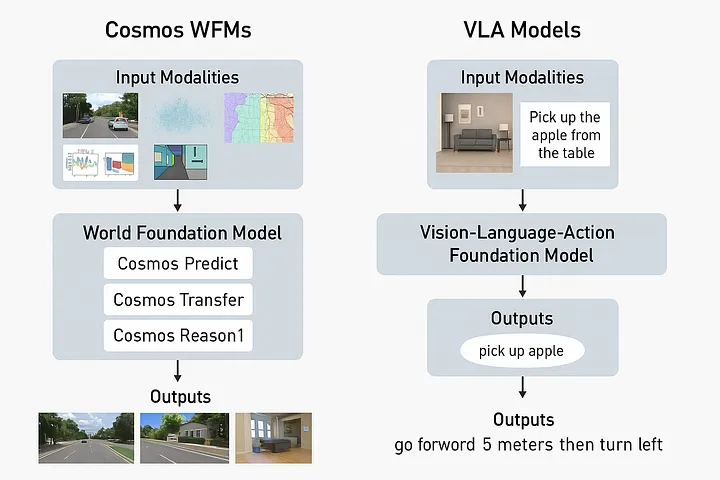
<figcaption>Figure: Functional roles of a physical-AI world model (Cosmos WM) versus an embodied policy model (OpenVLA): the former simulates environment evolution and physics, while the latter makes and executes action decisions.</figcaption>

### Mathematical formalization
{: id="数学形式化"}

In embodied intelligence, the physical world is typically modeled as a partially observable Markov decision process (POMDP), described by the tuple $$(\mathcal{S}, \mathcal{A}, \mathcal{O}, \mathcal{T}, \mathcal{E}, \mathcal{R}, \gamma)$$. Because the true state $$s_t \in \mathcal{S}$$ cannot be observed directly, the agent only receives high-dimensional visual observations $$o_t \in \mathcal{O}$$ (such as RGB-D images or point clouds).

The core task of a **world model** $$\mathcal{W}_\phi$$ is to learn parameters $$\phi$$ that approximate the joint forward transition distribution of the environment, in a compact latent space or in pixel space:

$$
P_\phi(s_{t+1}, o_{t+1}, r_t \mid s_{\le t}, a_t, o_{\le t})
$$

Here:
- **State transition model (dynamics model)**: $$s_{t+1} \sim P_\phi(s_{t+1} \mid s_t, a_t)$$ describes how actions change the environment's internal physical state;
- **Observation predictor**: $$o_{t+1} \sim P_\phi(o_{t+1} \mid s_{t+1})$$, or directly $$o_{t+1} \sim \mathcal{W}_\phi(o_{t+1} \mid o_{\le t}, a_t)$$ at the pixel level;
- **Reward and termination model**: $$r_t \sim P_\phi(r_t \mid s_t, a_t), \; c_t \sim P_\phi(c_t \mid s_t)$$, used to evaluate state value and task progress during imagination.

---

## 2.2 Classification framework
{: id="22-分类框架"}

The term "world model" currently covers two kinds of systems with very different goals. We separate them first so they are not confused in the discussion that follows.

### Two families
{: id="两大家族"}

|Dimension|Family A: World generators (§5)|Family B: World models for robot decision-making (§6)|
|:---|:---|:---|
|**Conditioning signal**|Camera pose, keyboard or latent actions, text, or images|Robot actions (joints/end-effector poses/chassis speed) or task instructions|
|**Output**|Continuously explorable video streams or 3D scenes (3DGS/point clouds)|Future observations, actions, or a joint distribution of both|
|**Core metrics**|Spatiotemporal consistency, controllability, generation speed|Downstream task success rate, reliability of policy evaluation|
|**Relation to the policy**|Indirect: serves as a neural simulation environment or data source|Direct: takes part in planning, jointly generates actions, synthesizes data, or acts as an RL environment|
|**Representative work**| Genie, LingBot-World, SANA-WM, Lyra 2.0, Marble & Atlas, Image2Sim | GENE-26.5, WorldVLA, AIM, Motus, NavWAM, Qwen-RobotWorld, WoVR |

The two families share the same foundation models (Wan, Cosmos, unified multimodal models, etc.; see §7) and meet at the "world synthesizer" and "world simulator": the interactive environments produced by Family A are often used by Family B as a data source or an RL training ground.

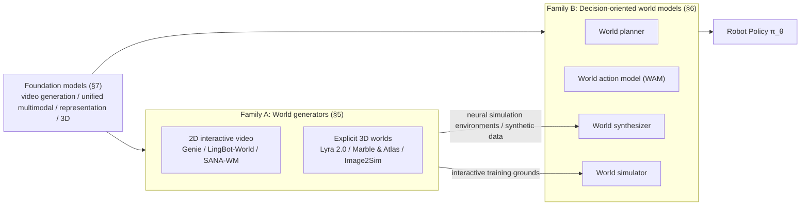

### Four paradigms of Family B
{: id="家族-b-的四大范式"}

Following Tan et al. (2026) [[1]](#ref-1) and Li et al. (arXiv:2510.16732) [[2]](#ref-2), Family B is divided into four paradigms according to how the world model is coupled to the policy:

1. **World planner**: The world model acts as a forward dynamics engine that predicts explicit future frames or implicit latent embeddings, giving downstream policies forward-looking conditioning;
2. **World action model (WAM)**: World-state evolution and robot control actions are incorporated into a single network that jointly models the distribution over observations and controls;
3. **World synthesizer**: The world model acts as a data-generation engine that synthesizes annotated multi-view, long-horizon interaction trajectories to support large-scale imitation learning;
4. **World simulator**: The world model serves as a virtual physical sandbox, and reinforcement learning (RL) algorithms optimize policy parameters inside its imagination space.

### Three modeling dimensions
{: id="三个建模维度"}

Whichever family it belongs to, a world model can be positioned along three axes:

- **Functional coupling**:
  - *Decision-decoupled / general-purpose*: The world model is pretrained independently of any specific action space (e.g., pure video generation) and adapted downstream through inverse dynamics or feature fine-tuning;
  - *Decision-coupled / policy-integrated*: The world model is deeply intertwined with the action head, and actions are jointly optimized as native tokens or conditioning channels.
- **Temporal modeling**:
  - *Sequential simulation and rollout*: Unrolls future states $$s_{t+1}, s_{t+2}, \dots$$ step by step, suited to long-horizon interaction and continuous physical evolution;
  - *Global difference and jump-step prediction*: Directly predicts a key subgoal frame or the final state change $$\Delta s$$, skipping the irrelevant micro-dynamics in between.
- **Spatial and state representation**:
  - *Global latent vectors*: e.g., RSSM and V-JEPA 2; highly abstract and fast to compute, but lacking fine-grained spatial geometry;
  - *Spatial latent grids*: e.g., DiT latent patches and VAE feature maps; a compromise between perceptual fidelity and computational efficiency;
  - *Explicit 3D fields*: e.g., 3DGS, point clouds, and occupancy grids; these offer natural 3D spatial consistency and metric constraints;
  - *Unified latent canvas*: e.g., NavWAM and Cosmos 3, which assemble vision, action, state, and value into one spatiotemporal canvas.

### Representative work at a glance
{: id="代表性工作速查表"}

The table below summarizes the work covered in the main text, in the order of this article's sections. The "Family" column marks the family and paradigm each work belongs to:

|Paper / model|Year|Family|Core mechanism|Key results (as reported)|Details|
|:---|:---:|:---|:---|:---|:---:|
| **Genie** | 2024 |A · Interactive environment generation|Latent action model (LAM) + ST-Transformer + MaskGIT dynamics (11B)|Learns 8 discrete latent actions without action labels and turns any image into a playable environment (160×90)| [§5.1](#paper-genie) |
| **LingBot-World** | 2026 |A · Real-time interactive generation|Hierarchical-semantic data engine + three-stage training + action injection|Real-time rollout at 16 fps (sub-second latency); scene structure stays consistent when revisited after 60 s| [§5.2](#paper-lingbot-world) |
| **SANA-WM** | 2026 |A · Efficient long-video generation|Hybrid linear GDN/softmax attention + dual-branch camera control (UCPE + Plücker) + two-stage refinement|VBench Overall 80.62/81.89; a 60 s 720p video in 34 s on an RTX 5090| [§5.3](#paper-sana-wm) |
| **Lyra 2.0** | 2026 |A · 3D scene generation|Decoupled geometric memory + spatial memory retrieval routing + self-augmented drift correction|Generation beyond 800 frames keeps its geometric consistency and can be reconstructed into 3DGS| [§5.4](#paper-lyra) |
| **Marble & Atlas** | 2025–2026 |A · 3D world / spatial intelligence|Multimodal autoregressive flow-matching Transformer + unified spatial context + 3DGS / point-cloud output|Blind-test preference for camera control 75%–94%; 3D reconstruction AbsRel 25.3| [§5.5](#paper-marble) |
| **Image2Sim** | 2026 |A · Neural simulation environment|Feed-forward 3D feature Gaussian anchoring + single-step pixel-flow (MeanFlow) rendering|Panoramic RGB-D at 45.6 FPS; automatically builds 20000 environments; zero-shot R2R-CE 70.3%| [§5.6](#paper-image2sim) |
| **GENE-26.5** | 2026 |B · World planner|Flow-matching joint distribution + conditional querying|New tasks can be fine-tuned with under 1 hour of real-robot data| [§6.1](#paper-gene) |
| **VLA-World** | 2026 |B · World planner (autonomous driving)|Single-frame future generation + reflective reasoning (thinking with the generated future) + GRPO|nuScenes collision rate 1.09% → 0.94%| [§6.1](#paper-vla-world) |
| **WorldVLA** | 2025 |B · WAM (autoregressive)|Unified autoregressive backbone + action attention mask + video-prediction pretraining| LIBERO Avg 81.8% | [§6.2](#paper-worldvla) |
| **DreamZero** | 2026 | B · WAM (autoregressive + flow matching) | Joint video-action denoising + real-observation KV-cache updates + asynchronous control | AgiBot unseen-task progress 39.5%; approximately 7Hz on two GB200 GPUs | [§6.2](#paper-dreamzero) |
| **AIM** | 2026 |B · WAM (diffusion)|Spatial value map (ASVM) + intention-aware causal attention + value self-distillation RL| RoboTwin 2.0 Avg SR 93.1% | [§6.2](#paper-aim) |
| **Motus** | 2025/2026 | B · WAM (MoT) |Three-expert MoT + optical-flow latent actions + UniDiffuser joint denoising schedule|RoboTwin 2.0 Avg 87.8%, 80 ms per step| [§6.2](#paper-motus) |
| **GigaWorld-Policy / ForeWAM / OpenWAM, etc.** | 2026 | B · WAM (speed-ups and open frameworks) | Skip video generation at inference, reuse future KV states, training-free state reuse, open composable MoT framework | WAMACHINE training-free speed-up of 1.47–3.05×; OpenWAM 97.8% on LIBERO-Long | [§6.2](#wam-2026h2) |
| **NavWAM & WAM-Nav** | 2026 |B · WAM (navigation)|Unified latent spatiotemporal canvas + asymmetric horizon + dual-stream feature fusion|Inference in 205.7 ms (about 5Hz), 1100× faster than NWM; real-robot success rate 79.2% / 85%| [§6.2](#paper-navwam) |
| **Qwen-RobotWorld** | 2026 |B · World synthesizer|Dual-stream MMDiT + unified natural-language action interface + cross-embodiment grounding| EWMBench 4.60 (#1), WorldModelBench 8.99 | [§6.3](#paper-qwen-robotworld) |
| **WoVR** | 2026 |B · World simulator|RL inside the world model + keyframe initialization (KIR) + policy co-evolution (PACE)|LIBERO average SR 39.95% → 69.2%; real robot 61.7% → 91.7%| [§6.4](#paper-wovr) |
| **Cosmos / Cosmos 3** | 2025–2026 |Foundation-model platform|Data curation + Predict/Transfer/Reason product line; Cosmos 3 unifies understanding, generation, and action with a twin-tower MoT|Cosmos3-Nano-Policy ranked 1st in the RoboArena / RoboLab real-robot evaluations| [§7.2](#cosmos) |
| **Wan2.1** | 2025 |Video-generation foundation model|Spatiotemporal VAE (4×8×8) + DiT + flow matching + VACE|Open-source T2V/I2V foundation model; the 1.3B version runs on an RTX 4090| [§7.4](#paper-wan) |
| **Janus-Pro** | 2025 |Unified understanding-and-generation foundation model|Decoupled visual encoding for understanding and generation + autoregressive Transformer| MMBench 79.2, GenEval 0.80(7B) | [§7.5](#paper-janus-pro) |
| **VideoGen in Robotics** | 2026 |Survey|Taxonomy and evaluation of video-generation applications in robotics|Organizes data, architectures, and downstream evaluation| [§7.6](#paper-videogen) |

---

## 2.3 Dual system architecture
{: id="23-双系统架构"}

In embodied systems of the large-model era, the world model is usually placed in a **dual-system architecture**, with responsibilities divided by operating frequency:

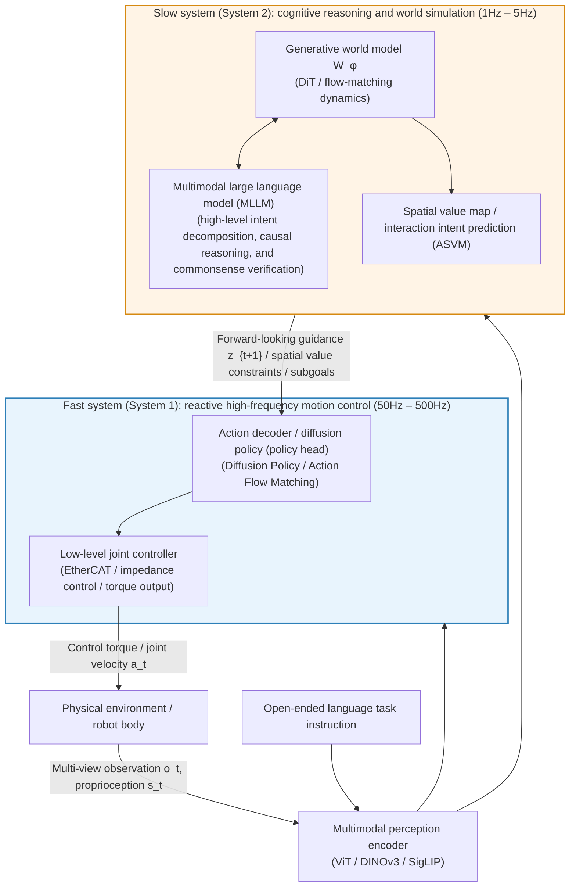

1. **Slow system (System 2: cognitive reasoning and world simulation, 1Hz–5Hz)**:
   - Composed of the world model (WM) and a multimodal large model (VLM), it handles long-horizon task planning, environment dynamics rollout, physical commonsense verification, intent analysis, and risk assessment;
   - It gives the lower layer physically grounded conditioning by generating future latent features $$z_{t+1}$$ or spatial value heatmaps.
2. **Fast system (System 1: reactive high-frequency action execution, 50Hz–500Hz)**:
   - Composed of a lightweight policy network (such as a diffusion policy or action flow matching) and a low-level controller, it generates smooth, accurate motor torques or joint trajectories in real time with very low latency, based on the current state and the physical priors supplied by System 2.

---

## 2.4 Evolution Timeline (2018–2026)
{: id="24-演进时间线20182026"}

  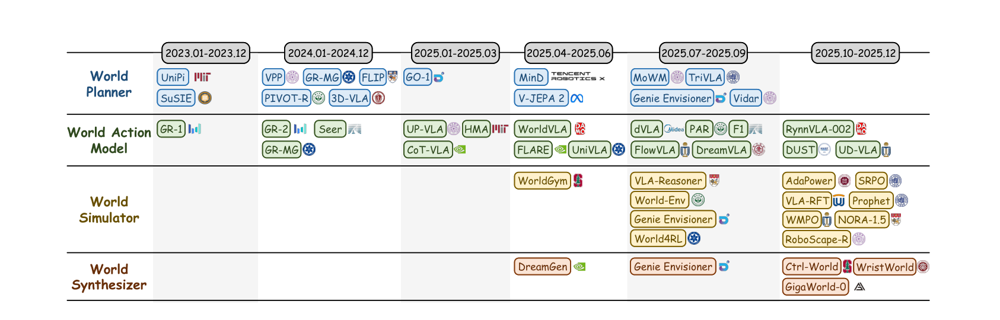
<figcaption>Figure: Evolution timeline of embodied world models, from latent-space dream training in 2018, to video-generation-driven planning in 2023, to the surge of world action models (WAM), the all-modality foundation model (Cosmos 3), and explorable 3D universes (Lyra 2.0 / Marble) in 2025–2026. (Image source: Tan et al., 2026)</figcaption>

**Key milestones**:
- **2018–2022 (MBRL foundations)**: World Models proposes V-M-C dream training; PlaNet introduces the RSSM; DreamerV1/V2 establish latent-space actor-critic;
- **2023–2024 (video priors and early 3D)**: UniPi and SuSIE explore using video diffusion models for text-guided planning; GR-1 pioneers autoregressive video-action pretraining; 3D-VLA introduces 3D geometric priors; DreamerV3 is released and solves Minecraft; TD-MPC2 unifies 104 embodied control tasks;
- **2025 (the four paradigms take off)**: WorldVLA and UniVLA unify autoregressive sequence modeling; DreamGen and GigaWorld-0 build a data-synthesis flywheel; VLA-RFT and WoVR enable reinforcement learning inside the world model; the Cosmos platform establishes an industrial-grade data and model stack;
- **2026 (all-modality convergence and spatial intelligence)**: Cosmos 3 unifies understanding, generation, and action with an MoT architecture; SANA-WM achieves efficient minute-long generation; Lyra 2.0 and Marble lay the groundwork for persistent, explorable universes built on 3DGS; World Labs' Atlas releases an all-modality autoregressive flow-matching foundation model that builds camera geometry and 3D natively into the model and powers real-to-sim embodied simulation; Motus, AIM, NavWAM, and others push world action models into the mainstream;
- **Second half of 2026 (speed, openness, and productization)**: The WAM question shifted from "does it work" to "can it run fast". GigaWorld-Policy, ForeWAM, and WAMACHINE brought inference latency down to the order of 100 ms, and OpenWAM released an open, composable framework. Genie 4 (October) added native audio and conversational real-time editing, and World Labs Atlas (November) moved from early access to a general release with public APIs.

---

# 3. Classic foundation: model-based reinforcement learning
{: id="3-经典奠基有模型强化学习"}

> 💡 **Companion article**: For the mathematical foundations of classical reinforcement learning, the derivation of the Bellman operator, and a systematic analysis of model-free and model-based RL algorithms (DreamerV3 / TD-MPC2), see the dedicated post .

Before modern video diffusion foundation models appeared, world models went through several key generations in model-based reinforcement learning (MBRL), which laid the mathematical and algorithmic foundations of the field.

## 3.1 World Models (2018)
{: id="31-world-models-2018"}

The **World Models** work by David Ha and Jürgen Schmidhuber [[3]](#ref-3) was the first complete deep-learning implementation of the **V-M-C architecture** drawn from cognitive science:

  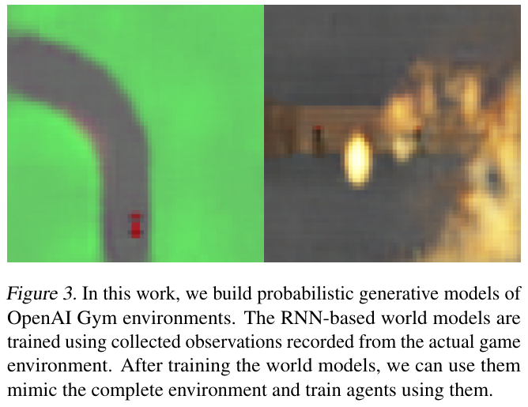
<figcaption> Figure: V-M-C core architecture of World Models (2018): visual perception V (VAE), memory dynamics M (MDN-RNN) and lightweight controller C. (Image source: Ha & Schmidhuber, 2018)</figcaption>

1. **V model (vision model / VAE)**: compresses the high-dimensional input frame $$o_t$$ into a 32-dimensional continuous Gaussian latent vector $$z_t \sim \mathcal{N}(\mu, \sigma^2)$$, filtering out high-frequency visual noise irrelevant to control;
2. **M model (memory model / MDN-RNN)**: an LSTM with a mixture-density (MDN) output layer that autoregressively predicts a multimodal probability distribution over the next latent state:
   
   $$
   P(z_{t+1} \mid a_t, z_t, h_t) = \sum_{k=1}^K \pi_k(h_t) \mathcal{N}\left( z_{t+1};\; \mu_k(h_t), \Sigma_k(h_t) \right)
   $$

3. **C model (controller)**: an ultra-lightweight feedforward network with only about a thousand parameters that maps $$z_t$$ and the recurrent hidden state $$h_t$$ directly to the control action $$a_t = W_c [z_t \; h_t] + b_c$$.

  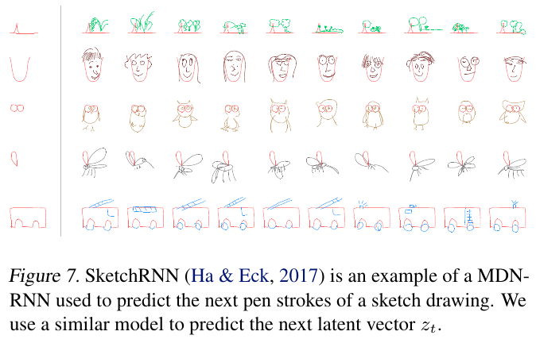
<figcaption> Figure: World Models complete data flow: offline collection of experience training V and M, and then training controller C in an RNN dream that is completely separated from the real environment. (Image source: Ha & Schmidhuber, 2018)</figcaption>

> **Key result**: World Models demonstrated the feasibility of **training a policy inside a learned world model ("training inside the dream")**. In VizDoom, the controller was trained entirely with an evolution strategy (CMA-ES) inside the "dream" produced by autoregressively unrolling the M model, and then transferred directly to the real game, where it could still dodge fireballs. In CarRacing-v0, the controller was trained in the real environment using the features of V and M as input and averaged a score above 900, solving the task for the first time.

---

## 3.2 Dreamer Series (2020–2025)
{: id="32-dreamer-系列-20202025"}

The **Dreamer series** [[4]](#ref-4) (DreamerV1 $\to$ V2 $\to$ V3), pioneered by Danijar Hafner et al., pushed model-based RL toward generality. V3 was released on arXiv in 2023 as *Mastering Diverse Domains through World Models* and published in *Nature* in 2025 as *Mastering diverse control tasks through world models*.

  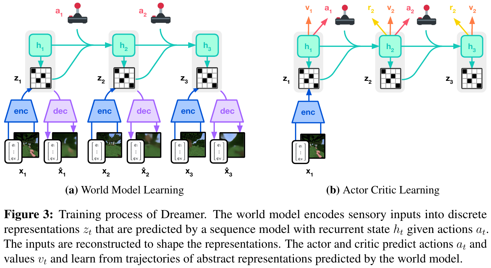
<figcaption> Figure: DreamerV3 training pipeline: (a) self-supervised learning of RSSM world model from real experience; (b) autoregressive expansion of trajectories in latent space; (c) optimization of actor-critic policy in imagination. (Image source: Hafner et al., Nature 2025)</figcaption>

Dreamer addresses the long-standing problems of representation collapse and numerical instability in continuous world models:
1. **Recurrent state-space model (RSSM)**: The latent state is decoupled into a deterministic temporal feature $$h_t = f_\phi(h_{t-1}, z_{t-1}, a_{t-1})$$ and a discrete stochastic variable $$z_t$$ (32 categorical latent variables with 32 classes each). The discrete categorical distribution mitigates the blurring and collapse that continuous Gaussians suffer under abrupt nonlinear changes (such as a door opening or closing, or an object breaking);
2. **Symlog transformation and scale-free design**: The symmetric logarithm $$\mathrm{symlog}(x) = \mathrm{sign}(x)\ln(\lvert x\rvert+1)$$ is proposed to uniformly scale features and regression targets, and, together with adaptive percentile-based value normalization, it resolves the gradient dispersion and numerical divergence caused by reward scales that span 7 orders of magnitude across tasks;
3. **Generality and the Minecraft diamond task**: DreamerV3 uses a single set of hyperparameters and one model architecture to achieve strong performance on Atari, Crafter, DMC, Procgen, and other domains, and it is the first algorithm to collect diamonds from scratch in Minecraft without human data or curricula. The task requires a long chain of dependent steps such as logging, crafting a workbench, mining, and smelting, and its rewards are extremely sparse.

  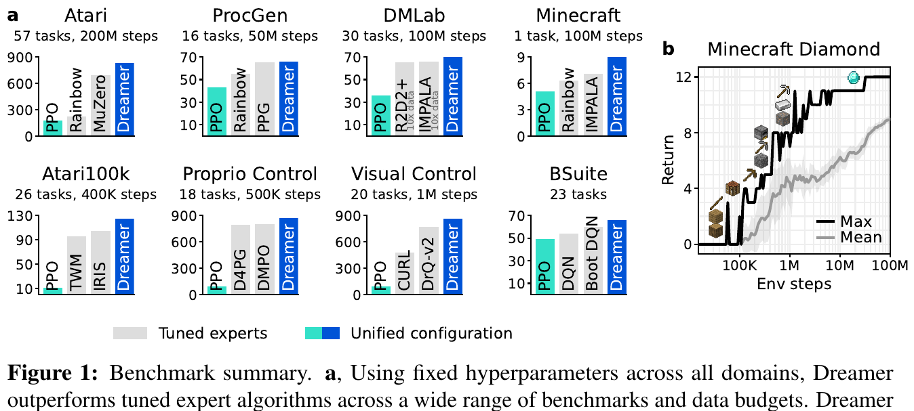
<figcaption>Figure: Normalized performance of DreamerV3 across 7 heterogeneous domains (2D pixels, continuous control, and long-horizon 3D sandboxes). (Image source: Hafner et al., Nature 2025)</figcaption>

---

## 3.3 TD-MPC2 (2024)
{: id="33-td-mpc2-2024"}

Most earlier world models (such as World Models and Dreamer) relied on a pixel-level image reconstruction loss, so much of the network's capacity was spent on background visual details irrelevant to downstream control. The **TD-MPC series** [[5]](#ref-5) by Nicklas Hansen et al. made a key technical shift:

  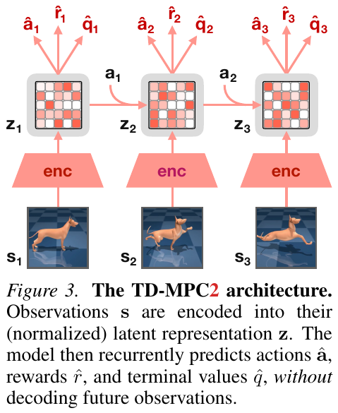
<figcaption>Figure: Overall architecture of TD-MPC2: no pixel-level decoding or reconstruction; MPPI-based online sampling and planning and temporal-difference (TD) long-horizon value learning are tightly integrated in a compact latent space. (Image source: Hansen et al., ICLR 2024)</figcaption>

1. **Purely task-driven latent dynamics**: The pixel decoder is removed, and the latent state is constrained by only three signals: latent self-consistency (the predicted next latent state must match the encoder's encoding of the real next frame), immediate reward prediction, and the TD value target. A policy prior is also trained to provide initial samples for planning;
2. **Online planning with MPPI**: At inference time, MPPI samples and iteratively optimizes short-horizon action sequences in the 512-dimensional latent space. Rewards beyond the horizon are estimated by bootstrapping from the learned Q function, balancing the accuracy of online planning against long-horizon value;
3. **Scalable multi-task single model**: With a single set of hyperparameters, a single agent with 317M parameters is trained across 104 continuous control tasks in 4 domains, and works on 80 tasks spanning different domains, embodiments, and action spaces at once.

---

## 3.4 From classic methods to the large-model era
{: id="34-从经典到大模型时代"}

The table below summarizes how the core technical paradigm of world models has evolved over the past few years:

|Dimension|Classic founding period (2018, World Models)|Discrete RSSM era (2023–2025, DreamerV3)|Implicit MPC era (2024, TD-MPC2)|Generative foundation-model era (2025–2026, Cosmos / WAM / SANA)|
|:---|:---|:---|:---|:---|
|**State representation**|Continuous Gaussian latent variable (32D VAE)|Discrete categorical latent variables (32×32)|Compact task latent vector (512D MLP/Transformer)|Spatiotemporal latent grid / explicit 3DGS field / unified canvas|
|**Dynamics backbone**| LSTM / MDN-RNN | RSSM (GRU + Categorical) |MLP / Dense Transformer| Diffusion Transformer (DiT) / Flow Matching / MoT |
|**Reconstruction mechanism**|Pixel-level 2D decoding (64×64)|Pixel-level 2D decoding (64×64)|**No pixel reconstruction** (purely latent-space task signals)|Highly compressed spatiotemporal VAE (4×8×8) / single-step generation / latent-space alignment|
|**Relation to the policy**|Decoupled: controller C evolved offline inside the dream|Decoupled: latent-space actor-critic|Coupled: online MPPI trajectory optimization|Four paradigms coexist (planner / WAM / synthesizer / simulator)|
|**Action generation frequency**|Deployed on real robots after offline optimization|Deployed on real robots after offline optimization|Online MPPI planning (replanning at every step)|5Hz–15Hz joint denoising (WAM) or 500Hz hybrid control|
|**Multi-task capability and scale**|Small single-task model (<1M)|Single cross-domain model (~200M)|104 embodied tasks (1M $\to$ 317M)|Internet-scale image-text and video pretraining + domain fine-tuning (2B $\to$ 64B)|

---

# 4. Core engineering design space
{: id="4-核心工程设计空间"}

§2 covers what a world model is, and §5–§6 cover what specific works do. This chapter sits between the two and answers from an engineering perspective: **when building a video or latent-space world model, what key decisions must be made, and what does each one cost?** The examples come from the works detailed below and serve as a reference when reading §5–§7.

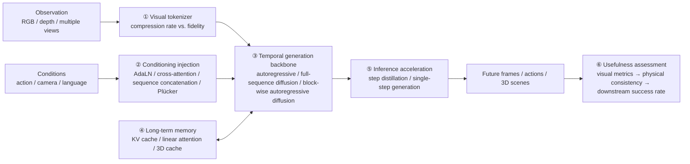

## 4.1 Visual tokenizer
{: id="41-视觉-tokenizer"}

The computational cost of a video world model is almost entirely determined by the number of latent tokens. The higher the tokenizer's compression rate, the longer the horizon that fits in the same compute budget, but the more easily details that matter for manipulation, such as small objects and gripper contact surfaces, are lost.

| Tokenizer |Representation type|Compression method|Used by (covered in this article)|
|:---|:---|:---|:---|
| Cosmos Tokenizer |Continuous + discrete|Wavelet transform + causal 3D convolution|Cosmos-Predict1 (both diffusion and autoregressive routes, §7.2)|
| Wan2.1 VAE |Continuous|Causal 3D VAE, time×height×width 4×8×8| Wan2.1, Cosmos-Predict2.5(§7.2, §7.4) |
| Wan2.2 VAE(TI2V-5B) |Continuous|Higher spatial compression|Cosmos 3 generation tower (§7.3)|
| LTX-2 VAE |Continuous|Compression rate significantly higher than the Wan2.1 VAE| SANA-WM(§5.3) |
| ST-ViViT VQ |Discrete|Spatiotemporal Transformer + vector quantization| Genie(§5.1) |
|Chameleon-style image tokenizer|Discrete|Frame-by-frame VQ|WorldVLA and other autoregressive WAMs (§6.2)|

**Engineering lessons**:
- **Causal structure** lets the first frame be encoded separately, which supports joint image-video training and frame-by-frame streaming generation, a prerequisite for interactive world models;
- **High compression "flattens" motion within a frame**: SANA-WM's VAE compresses 8 original frames into 1 latent frame, so extra Plücker subdivisions are added per original frame to recover camera-motion detail (§5.3);
- **Discrete tokens** make it easy to reuse the LLM training stack, but quantization loses detail; Cosmos-Predict2.5 finally unifies the diffusion and autoregressive routes into continuous-latent flow matching (§7.2).

## 4.2 Conditioning injection
{: id="42-条件注入"}

Action conditioning is what distinguishes a world model from an ordinary video generation model. Common injection methods, ordered from coarse to fine granularity, are:

|Injection method|Granularity|Representative work|Advantages|Cost|
|:---|:---|:---|:---|:---|
|**AdaLN modulation**|Per frame / global|LingBot-World (Plücker embedding injected via AdaLN)|Simple to implement, minimal overhead|Limited ability to express control that depends on spatial position|
|**Cross-attention**|Sequence level|Cosmos-Predict2.5 (Reason1 text embedding)|Suits variable-length conditions such as language|Weak temporal alignment with visual tokens|
|**ControlNet branch**|Pixel level|Cosmos-Transfer (edge / depth / segmentation)|Pluggable; no need to retrain the backbone for new modalities|Extra parameters and inference overhead|
|**Per-pixel camera rays (Plücker / UCPE)**|Pixel-level geometry|SANA-WM dual branch, LingBot-World|Precise 6-DoF camera control|Requires reliable camera-pose annotations (SANA-WM built a dedicated metric annotation pipeline for this)|
|**Action tokens in a unified sequence**|Token level|WorldVLA, Cosmos 3, NavWAM latent canvas|Joint modeling of action and vision; switchable forward / inverse / policy modes|Longer sequences and higher attention cost|
|**Latent actions (unlabeled)**|Discrete codebook|Genie (8 latent actions), Motus (optical-flow latent actions)|Can exploit Internet videos without action labels|Latent-action semantics must be mapped to real control signals|
|**Natural-language actions**|Text| Qwen-RobotWorld |Unified interface across embodiments and tasks|Hard to express precise continuous control signals|

A rule of thumb: the more geometric precision a **control signal** requires (camera trajectory, end-effector pose), the more it should be injected in a spatially aligned way rather than modulating the whole frame as a single global vector.

## 4.3 Generative paradigms
{: id="43-生成范式"}

|Paradigm|Representative work|Advantages|Main issues|
|:---|:---|:---|:---|
|**Discrete autoregressive**| Genie, WorldVLA, Cosmos-Predict1 AR |Naturally streaming and interactive; reuses the KV cache|Errors accumulate gradually; quantization loses detail|
|**Full-sequence diffusion / flow matching**|Wan2.1, Cosmos-Predict2.5 (93 frames generated at a time)|High image quality and good consistency within a clip|Fixed clip length makes it hard to respond incrementally to new actions|
|**Block-wise autoregressive diffusion (hybrid)**| LingBot-World, SANA-WM, Lyra 2.0 |Balances image quality and interactivity: denoising within blocks, autoregression across blocks|Training sees the real history while inference sees the model's own generated history (exposure bias), which causes drift|
|**AR + diffusion twin towers**| Cosmos 3 |Autoregressive understanding and diffusion generation do not interfere with each other|About twice the parameters of a dense model|

Starting from a full-sequence diffusion model and converting it into an interactive simulator is a common route in 2026: LingBot-World first pretrains a bidirectional diffusion model on Wan2.2, then converts it into a causal autoregressive system and distills it in post-training (§5.2). To mitigate exposure bias, a common approach is to **feed noisy or self-generated history during training**, as in Lyra 2.0's self-augmented training (§5.4).

## 4.4 Long-horizon consistency
{: id="44-长程一致性"}

Long-horizon rollouts usually fail for two reasons: **a limited context window makes the model "forget" regions it has already seen** (the scene has changed when it looks back), and **accumulating errors make the picture and physics drift gradually**. The corresponding engineering remedies are:

|Technique|Representative work|Problem addressed|Cost|
|:---|:---|:---|:---|
|Hybrid linear attention (GDN) + a few softmax layers + attention sink| SANA-WM |Memory stays constant over 60 s 720p sequences|Linear layers recall precisely less well, so softmax layers must supplement them|
|3D geometry cache + visibility-based retrieval of historical frames| Lyra 2.0 |Spatial consistency when revisiting regions|Depends on depth-estimation quality|
|Explicit 3D representation (3DGS / point cloud) as state| Marble & Atlas, Image2Sim |Geometry is naturally persistent|Hard to model dynamic objects and deformations|
|Shorten the effective rollout depth|Keyframe initialization (KIR) in WoVR|Accumulating hallucinations during RL|Can only explore states near those covered by demonstrations|
|Asymmetric horizons (long motion + short vision)| WAM-Nav |Visual prediction drift when the viewpoint changes sharply|Less visual lookahead information|

## 4.5 Inference efficiency
{: id="45-推理效率"}

Whether a world model can enter the control loop depends on whether it meets the real-time budget. The latencies and frame rates reported for the works covered in this article are roughly as follows:

|Scenario|Typical requirement|Figures from this article|
|:---|:---|:---|
|Low-level joint control (System 1)| 50Hz–500Hz |Handled by the policy head or a conventional controller; the world model usually does not enter this loop directly|
|WAM action chunk output| 5Hz–15Hz |NavWAM 205.7 ms (~5Hz); Motus single step 80ms; Cosmos3-Nano-Policy 15Hz|
|Interactive world generation|Tens of fps|LingBot-World 16 fps; Image2Sim panorama RGB-D 45.6 FPS|
|Offline data synthesis|Throughput first|SANA-WM: 34 s for 60 s of 720p on an RTX 5090|

Main acceleration methods:
- **Step distillation**: Cosmos-Predict2.5 uses rCM to compress inference to 4 steps (§7.2); LingBot-World uses DMD distillation to reach sub-second latency (§5.2); Image2Sim uses MeanFlow for single-step generation (§5.6);
- **Fewer tokens**: a more highly compressed VAE (§4.1), or planning in latent space instead of pixel space (the latent world planner, §6.1);
- **Generating less**: a WAM uses future visual prediction only as a training-time regularizer and outputs just the action chunk at inference; NavWAM uses a latent canvas in place of CEM-style candidate-by-candidate trajectory rollouts (§6.2).

## 4.6 How to judge whether a world model is useful
{: id="46-如何判断世界模型是否有用"}

Good visual metrics do not necessarily mean a model is useful for robots. In practice, models are checked in the following order; the later the check, the closer it is to ground truth and the higher its cost:

1. **Visual quality**: FVD, VBench, etc. (§8.3). These only tell you whether it "looks right";
2. **Controllability**: after the action or camera input changes, does the generated output change consistently and as expected (CamMC, RotErr, etc.);
3. **Physical consistency**: whether object permanence, gravity, and contact are plausible (WorldModelBench, Physics-IQ, etc.);
4. **Downstream value**: after using the world model to train or evaluate a policy, does the success rate in the real environment improve, and does the policy ranking inside the world model match the ranking on real robots?

The benchmarks in §8 are organized along this chain.

---

# 5. Family A: World generators
{: id="5-家族-a世界生成器"}

What this family has in common is that its conditioning signals are **camera pose, keyboard or fine-grained motion, or text**, its output is a video or 3D scene that can be explored continuously, and its core metrics are **spatiotemporal consistency, controllability, and generation speed** rather than robot task success rate. Its relationship to embodied intelligence is mostly indirect: it serves as a neural simulation environment or data source for the world synthesizers and world simulators of §6.

This chapter is arranged by representation, from 2D to 3D:
- **2D interactive video**: Genie (playable environments with latent actions learned from unlabeled videos) → LingBot-World (real-time long-horizon interaction) → SANA-WM (efficient minute-long generation);
- **Explicit / semi-explicit 3D**: Lyra 2.0 (3D geometry cache as memory) → Marble & Atlas (native 3DGS / point-cloud output) → Image2Sim (3D Gaussian anchoring + single-step rendering neural simulator).

When reading, refer back to §4: the differences among these works mostly lie in the conditioning injection method (§4.2), the generative paradigm (§4.3), and long-term memory (§4.4).

## 5.1 Genie (2024)
{: id="paper-genie"}
——Generative Interactive Environments

📄 **Paper**: [arXiv:2402.15391](https://arxiv.org/abs/2402.15391) · [[6]](#ref-6)

#### Key takeaways
{: id="精华"}

Genie is the first generative interactive environment (foundation world model) learned purely from unlabeled videos. Its core contributions are: 1) **Unsupervised action mining**: a latent action model (LAM) automatically discovers a controllable action space from raw videos, removing the world model's dependence on ground-truth action labels; 2) **An efficient spatiotemporal architecture**: a design based on the ST-Transformer makes GPU memory grow linearly with the number of frames, enabling long-sequence video generation; 3) **A foundation for embodied intelligence**: it can turn any image (a sketch, a photo, etc.) into a playable game world, and shows great potential in robot manipulation and agent training, providing a massive supply of simulated data on the "path to generalist agents."

---

#### 1. Background and problem
{: id="1-研究背景问题"}

Current generative AI (such as ChatGPT and DALL-E) has achieved great success in text and images, but most video generation models (such as video diffusion) lack fine-grained interactive control. Traditional "world models" usually need large amounts of data with ground-truth action labels, which becomes a bottleneck given the vast amount of video on the Internet. Genie aims to learn an interactive environment that responds to user actions in real time, has physical commonsense, and can be generated without limit, learning from over 200,000 hours of unlabeled Internet video (after filtering and cleaning, a training set of about 30,000 hours, or 6.8 million 16-second clips of high-quality 2D platform games).

---

#### 2. Methods and innovations
{: id="2-主要方法创新点"}

Genie is an 11-billion-parameter foundation model whose architecture consists of three tightly integrated components, all based on an improved **ST-Transformer**.

  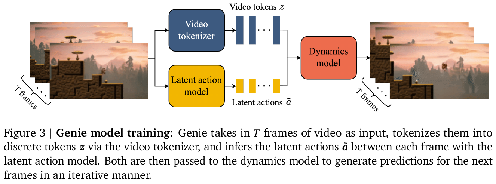
<figcaption>Figure: Overall training framework of Genie, comprising a video tokenizer, a latent action model (LAM), and a dynamics model. (Image source: Genie, 2024)</figcaption>

##### 2.1 Latent Action Model (LAM)
{: id="21-潜动作模型-latent-action-model-lam"}
This is the heart of Genie. To achieve control without action labels, the LAM adopts a VQ-VAE structure:
- **Encoder**: takes the current frame and the next frame and outputs a discrete latent action $$\mathbf{a}_t$$ (usually limited to 8 discrete values, to mimic controller buttons).
- **Bottleneck**: because the decoder can only predict the next frame from the history frames and $$\mathbf{a}_t$$, the model is forced to encode the most semantically consistent changes in the video (such as a character moving left or right, or jumping) into these 8 tokens.
- **Consistency**: experiments show that, even across different games, the same latent-action token often corresponds to the same physical meaning (for example, action 0 always means moving left).

  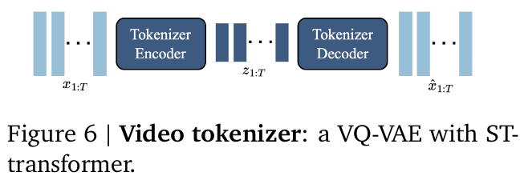
<figcaption>Figure: Latent action model (LAM): unsupervised action discovery through a reconstruction objective. (Source: Genie, 2024)</figcaption>

##### 2.2 Video Tokenizer
{: id="22-视频分词器-video-tokenizer"}
Genie proposes the **ST-ViViT** architecture:
- **Spatiotemporal compression**: unlike conventional tokenizers that compress only along the spatial dimensions, ST-ViViT incorporates the time axis in both encoding and decoding.
- **Efficiency**: by alternating spatial and temporal attention, the model avoids computation growing quadratically with time, which keeps training on large datasets feasible.

##### 2.3 Dynamics Model
{: id="23-动力学模型-dynamics-model"}
A masked autoregressive model based on **MaskGIT**:
- **Input**: the current visual tokens and the latent action selected by the user.
- **Prediction**: the model predicts the next frame's tokens in latent space. Trained on massive data, it learns complex 2D platformer rules such as collisions, gravity, enemy interactions, and screen scrolling.

  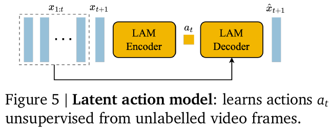
<figcaption>Figure: ST-Transformer: spatial and temporal layers alternate, giving linear complexity. (Source: Genie, 2024)</figcaption>

---

#### 3. Results and findings
{: id="3-核心结果发现"}

* **"Turning the mundane into magic" generation**: users can upload a hand-drawn sketch, a real photo of a natural landscape, or even an image produced by a text-to-image model (such as Imagen), and Genie immediately turns it into a "playable" side-scrolling game environment.
* **Semantically consistent controllability**: on the Platformers dataset, the latent actions generalize strongly. When the user triggers a latent action, the character moves or jumps coherently, and this control still works in environments with different visual styles.
* **Potential in robotics**: the researchers validate Genie on the RT1 robotics dataset. The model not only learns to control a robot arm but also learns to simulate the physical deformation of complex objects (such as squeezing a bag of bread), showing that Genie captures real-world dynamics.
* **A "mother" environment for reinforcement learning**: agents trained inside Genie can transfer to real environments very quickly. Compared with training from scratch, the sample efficiency of agents pretrained with latent actions improves several-fold.

  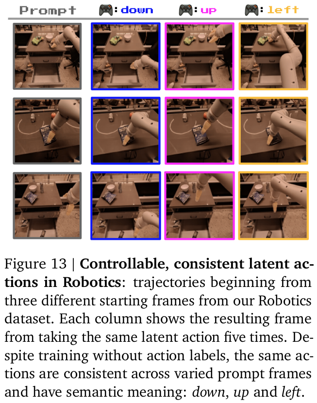
<figcaption>Figure: Semantically meaningful latent actions learned on robot manipulation data. (Source: Genie, 2024)</figcaption>

---

#### 4. Limitations
{: id="4-局限性"}

* **Resolution bottleneck**: limited by current compute, Genie generates low-resolution video (160x90), still far from a high-definition immersive experience.
* **Autoregressive drift**: because generation is autoregressive, the video may gradually deviate from physical reality or develop artifacts as the number of steps grows.
* **Action mapping**: although latent actions have been discovered, further research is needed to map these discrete tokens accurately to the complex, multi-level controls humans find intuitive (such as a controller's analog joystick).

#### Follow-ups: from Genie 2 to Genie 4
{: id="genie-successors"}

After Genie, DeepMind moved from "learning playable environments" toward "real-time, promptable world simulation":

- **Genie 2 (2024.12)**: Generates 3D environments controllable with keyboard and mouse from a single image, with early object interaction and simple physics;
- **Genie 3 (2025.08)**: The first real-time interactive version, at 720p and 24 fps. Scenes stay consistent for several minutes, and text can trigger "promptable events" such as weather changes or new objects. It reached paying users through Project Genie in January 2026;
- **Genie 4 (2026.10.27) [[55]](#ref-55)**: The first version to generate audio and character dialogue natively. Users can change the weather, the camera, or add people mid-simulation with natural language, while Gemini keeps the world progressing and coherent. DeepMind showed it simulating a humanoid robot playing checkers together with Gemini, and explicitly lists "training environments for robots and agents" as a use. It is still a research preview for trusted testers; stated limitations include drifting object permanence in long sessions, complex physical interactions, and spatial accuracy.

For embodied AI, this line is still mainly an "environment source" for §6.3 / §6.4: it can cheaply generate diverse scenes, but without a public action interface or metric geometry it cannot yet replace a physics simulator.

---

## 5.2 LingBot-World (2026)
{: id="paper-lingbot-world"}
——The first open-source long-horizon world model with real-time interaction

📄 **Paper**: [arXiv:2601.20540](https://arxiv.org/abs/2601.20540) · [[7]](#ref-7)

#### Key takeaways
{: id="精华-1"}
1. **LingBot-World** is an open-source, real-time interactive world model that stays consistent over minute-long generations.
2. It proposes a data engine with hierarchical semantics, addressing the scarcity of interactive data through narrative, static-scene, and dense temporal captions.
3. It adopts a three-stage progressive training strategy: pretraining (a general video prior), mid-training (knowledge injection and the MoE architecture), and post-training (causal adaptation and distillation).
4. It achieves sub-second (<1 s) inference latency and supports real-time generation at 16 fps.
5. It shows broad application potential in controllable world-event editing, action agents for embodied intelligence, and 3D reconstruction.

#### 1. Background and problem
{: id="1-研究背景问题-1"}
Although current video generation models can produce high-quality short videos, they are essentially "dreamers" rather than "simulators." They lack an understanding of physical laws (such as causality and object permanence) and struggle to support real-time interaction. The lack of high-quality interactive data, the difficulty of keeping long-horizon consistency, and the high computational cost of diffusion models are also core bottlenecks for world-model development.

#### 2. Methods and innovations
{: id="2-主要方法创新点-1"}

  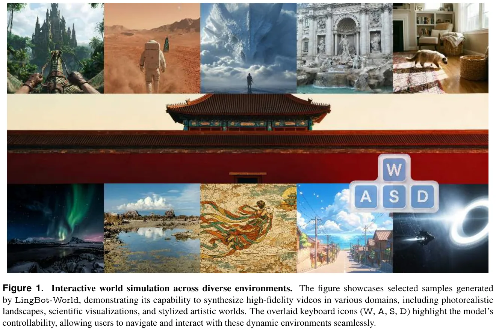
<figcaption>Figure: Overview of LingBot-World's interactive world simulation: real-time keyboard interaction across diverse scenes (realistic, scientific, cartoon, etc.). (Image source: LingBot-World, 2026)</figcaption>

##### ① Data engine and hierarchical captions
{: id="-数据引擎与分层描述"}
To address the scarcity of high-quality interaction data, LingBot-World builds a hybrid data engine that combines real-world video, game footage, and synthetic Unreal Engine (UE) data. The key innovation is the **hierarchical captioning strategy**:
- **Narrative caption**: describes the overall environment and camera trajectory as a global semantic prompt.
- **Scene-static caption**: describes only the environment, which decouples actions from scenes.
- **Dense temporal caption**: gives fine-grained, time-aligned descriptions of events in the video.

##### ② Three-stage progressive training pipeline
{: id="-三阶段进化训练管线"}
The model follows a three-stage strategy that evolves it from a video generator into an interactive simulator:

  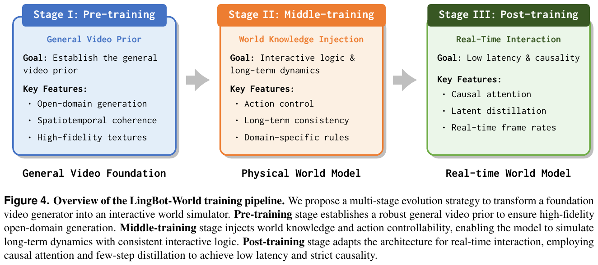
<figcaption>Figure: LingBot-World training pipeline: starting from the pretrained video prior, injecting knowledge through mid-training, and finally gaining real-time interaction through post-training. (Image source: LingBot-World, 2026)</figcaption>

- **Stage I: pretraining**: a 14B-parameter Wan2.2 diffusion model establishes strong spatiotemporal coherence and visual priors.
- **Stage II: mid-training (MoE knowledge injection)**: a mixture-of-experts (MoE) architecture is introduced (28B total parameters, 14B active), the training duration is extended from 5 to 60 seconds with a progressive curriculum, and Plücker-encoded action signals are injected.
- **Stage III: post-training (real-time)**: the bidirectional diffusion model is adapted into a causal autoregressive system, and distribution matching distillation (DMD) with adversarial optimization reduces inference latency to the sub-second level.

##### ③ Model architecture and action injection
{: id="-模型架构与动作注入"}

  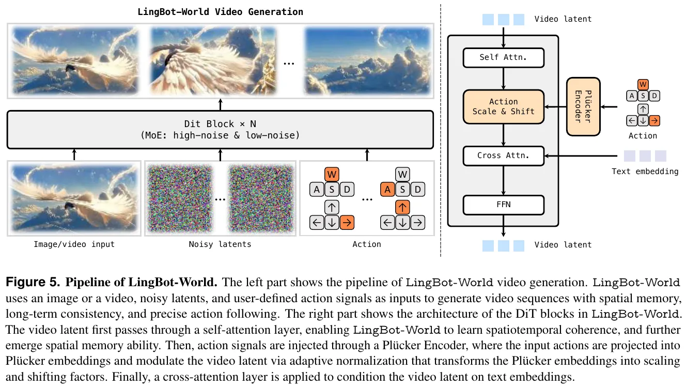
<figcaption>Figure: LingBot-World model architecture: built on DiT blocks, with action signals injected through a Plücker encoder and modulated via AdaLN. (Image source: LingBot-World, 2026)</figcaption>

LingBot-World is based on the DiT (diffusion Transformer) architecture. Action signals (discrete keyboard input and continuous camera rotation) are projected into embedding vectors by a **Plücker encoder** and then injected into the DiT blocks through adaptive layer normalization (AdaLN), enabling precise control over video generation.

#### 3. Results and findings
{: id="3-核心结果发现-1"}

  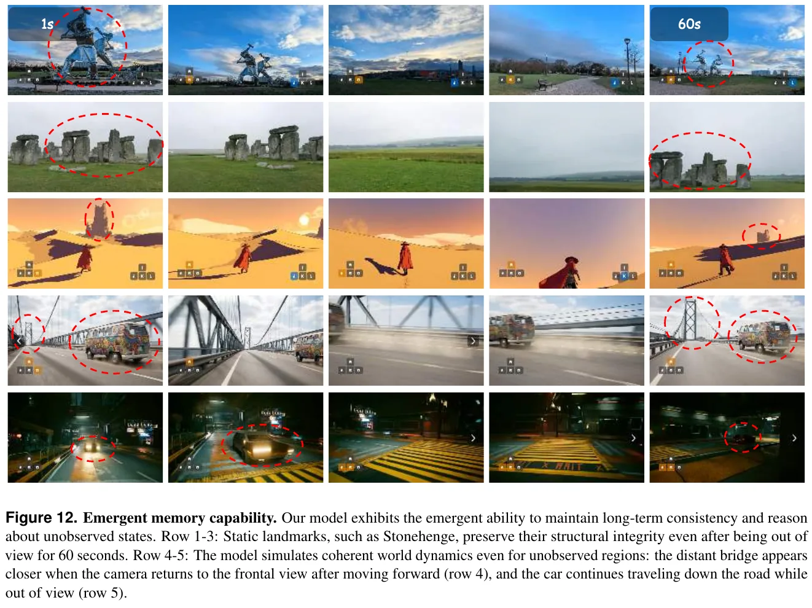
<figcaption>Figure: Emergent memory: the model remembers static landmarks outside the field of view (such as Stonehenge), keeps a consistent structure when the view returns after 60 seconds, and can simulate the dynamic evolution of objects outside the field of view. (Image source: LingBot-World, 2026)</figcaption>

- **Long-horizon consistency**: the model shows clear emergent memory. Even when an object stays out of view for a long time, it keeps its structural integrity when it returns.
- **Balance of real-time speed and quality**: LingBot-World-Fast reaches 16 fps throughput on a single GPU node while keeping visual quality comparable to the teacher model.
- **Controllable editing**: the generated world can be modified in real time through text commands (such as "fireworks" or "fish").

  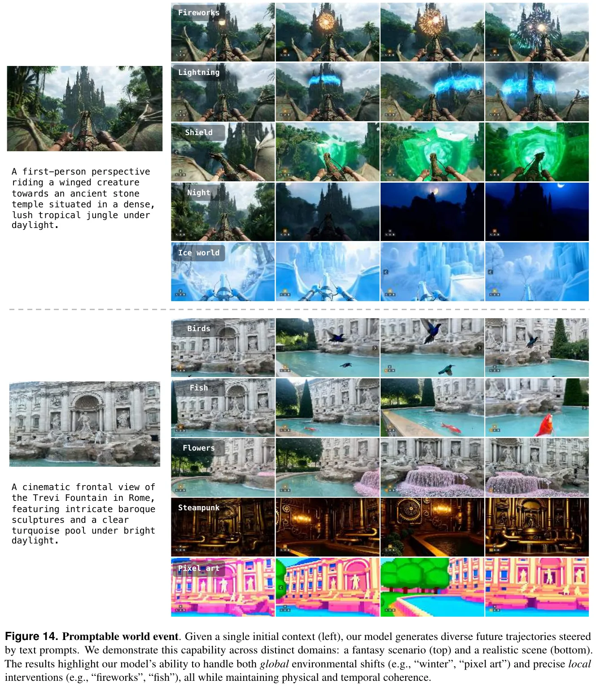
<figcaption>Figure: Examples of controllable world events: text prompts change the weather or style, or inject specific dynamic elements into the scene, in real time. (Image source: LingBot-World, 2026)</figcaption>

#### 4. Limitations
{: id="4-局限性-1"}
- **Memory stability**: long-term consistency still relies on emergent behavior of the context window, with no explicit memory module.
- **Interaction accuracy**: support for fine-grained object manipulation (such as grasping a specific object) is insufficient.
- **Compute cost**: inference still requires enterprise-grade GPUs.

---

## 5.3 SANA-WM (2026)
{: id="paper-sana-wm"}
——Efficient Minute-Scale World Modeling with Hybrid Linear Diffusion Transformer

📄 **Paper**: [arXiv:2605.15178](https://arxiv.org/abs/2605.15178) · [[8]](#ref-8)  
🔗 **Project page**: [nvlabs.github.io/Sana/WM](https://nvlabs.github.io/Sana/WM/)

#### Key takeaways
{: id="精华-2"}

The core idea worth learning from SANA-WM is **a world model with efficiency as its first design goal**. With 2.6B parameters, 64 H100s, and 15 days of training, it generates minute-long 720p videos on a single GPU, with visual quality comparable to the industrial-grade 14B+14B model. The transferable designs include: (1) **Hybrid linear-softmax attention (hybrid GDN/Softmax)**: most softmax layers are replaced by frame-level Gated DeltaNet, so the KV state stays a constant $D \times D$ and memory does not grow with sequence length, while softmax is kept in only 5 of 20 blocks for precise long-range recall, striking a good balance between efficiency and quality; (2) **Dual-branch camera control**: the coarse UCPE branch captures the global 6-DoF trajectory structure at the latent frame rate, while the fine Plücker branch compensates, at the original frame rate, for the intra-frame motion detail lost to VAE compression, and together they follow continuous trajectories with high precision; (3) **Two-stage visual refinement (two-stage refiner)**: the first stage generates a video with correct structure but lower quality, and the second stage repairs details with a 17B LoRA refiner using truncated flow matching, still reaching an overall throughput of 22 60-second videos per hour; (4) **A robust metric annotation pipeline**: VIPE + Pi3X + MoGe-2 recover metric 6-DoF poses from public videos, so training needs no expensive proprietary data and uses only 213K clips.

---

#### 1. Background and problem
{: id="1-研究背景问题-2"}

Existing open-source minute-long world models (LingBot-World 14B+14B, HY-WorldPlay 8B) generally require large parameter counts, massive proprietary data, and multi-GPU inference, which sets a very high bar for academia and small teams. Another alternative, distilling long-horizon models from short-horizon video generators, has limited effect because short-horizon teachers provide insufficient supervision for minute-long scene persistence and trajectory following. The goal of SANA-WM is to **natively train a high-fidelity, camera-controllable minute-long world model** under strict efficiency constraints, so that it can run inference on a single GPU and converge in 15 days on 64 H100s.

---

#### 2. Methods and innovations
{: id="2-主要方法创新点-2"}

  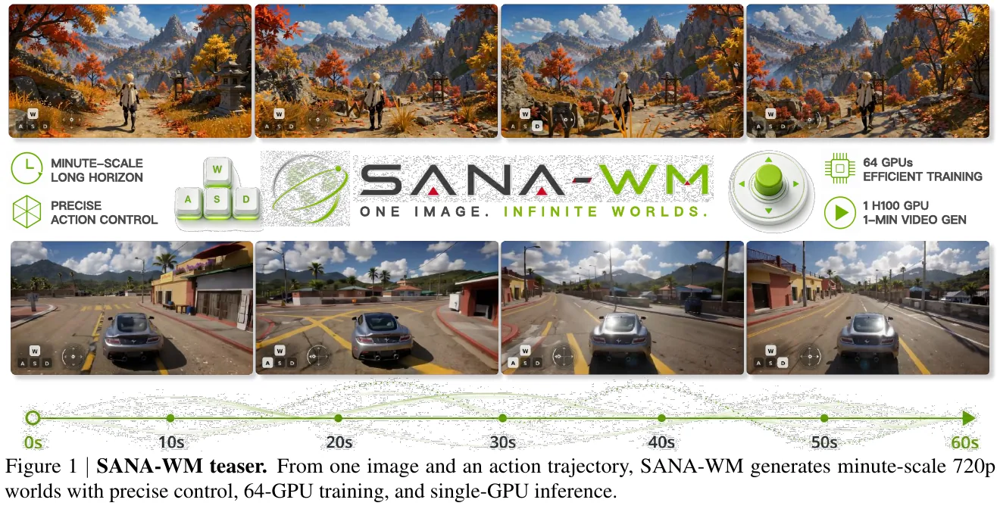
<figcaption>Figure: SANA-WM overview. It generates minute-long 720p worlds from a single image and a motion trajectory, with precise camera control, 64-GPU training, and single-GPU inference. (Image source: SANA-WM, arXiv:2605.15178)</figcaption>

**Overall framework**: SANA-WM has four core components. ① A hybrid linear DiT backbone (hybrid GDN/Softmax) handles efficient long-horizon context modeling. ② Dual-branch camera control (UCPE + Plücker) injects accurate 6-DoF trajectories. ③ A second-stage visual refiner (LTX-2 LoRA) improves final-frame quality. ④ A robust metric annotation pipeline (VIPE + Pi3X + MoGe-2) extracts high-quality training data from public videos.

  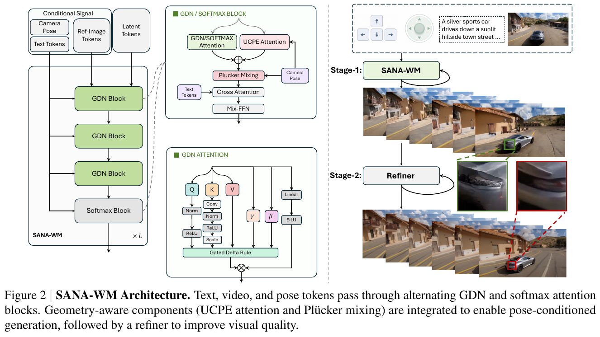
<figcaption>Figure: SANA-WM architecture. Text, video, and action tokens alternately pass through GDN blocks and softmax blocks; UCPE attention and Plücker mixing provide geometry-aware camera conditioning; the second-stage refiner further improves visual quality. (Source: SANA-WM)</figcaption>

##### ① Hybrid linear-softmax attention (hybrid GDN/Softmax)
{: id="-混合线性-softmax-attentionhybrid-gdnsoftmax"}

**Input**: a temporal sequence of latent frames (encoded by the LTX2 VAE, whose time × height × width compression ratio is much higher than that of the Wan 2.1 VAE, reducing the size by 8×).

**Processing**: SANA-WM has 20 Transformer blocks in total, 15 of which are **frame-level Gated DeltaNet (GDN) blocks** and 5 (at layers 3/7/11/15/19) are standard softmax attention blocks. The key to the GDN block is upgrading token-level recurrence (one token per step) to **frame-level recurrence** (each step consumes all $S$ spatial tokens of one latent frame). The state matrix $S_t \in \mathbb R^{D \times D}$ is updated through a decay gate $\gamma_t$ and delta-rule correction, which "forgets old information and precisely updates for the current frame":

$$S_t = S_{t-1} M_t + U_t, \quad M_t = \gamma_t(I - \hat K_t \beta_t \hat K_t^\top), \quad U_t = V_t \beta_t \hat K_t^\top$$

To keep the large number $S$ of spatial tokens from inflating the transition matrix $M_t$, the keys are scaled by $1/\sqrt{DS}$ (instead of the token-level $1/\sqrt{D}$), which guarantees $\lVert M_t \rVert_2 \le \gamma_t \le 1$ and stable, NaN-free training. The softmax blocks handle precise long-range recall; local attention windows and attention sinks are introduced for 60-second sequences to keep softmax memory constant during inference.

**Motivation**: a 60-second 720p video expands to about 961 latent frames. With pure softmax, the KV cache grows quadratically with sequence length and runs out of memory at 60 seconds. Pure linear attention (such as SANA-Video's cumulative linear attention) has no decay mechanism, so old and new features accumulate with equal weight, causing drift in minute-long modeling. The hybrid design meets both needs: efficient updates at most time steps and accurate recall at key moments.

##### ② Dual-branch camera control
{: id="-双分支相机控制dual-branch-camera-control"}

**Coarse branch (UCPE)**: models the global 6-DoF trajectory at the **latent frame rate**. For each latent frame $t$ and spatial grid cell $s$, it computes the world-space ray from the camera extrinsics, constructs the ray-local coordinate transform $D_{t,s} \in \mathbb R^{4 \times 4}$, and rotates the geometric channels of QKV through $D^\top / D^{-1}$ while the remaining channels keep RoPE. In essence, the camera pose is encoded into the attention's positional encoding. This branch has its own QKV projections but shares the GDN gate with the main branch, and is added to the main attention output through a zero-initialized projection.

**Fine branch (Plücker mixing)**: compensates for the intra-frame motion detail that the coarse branch loses because the VAE compresses 8 original frames into 1 latent frame. For each original frame $r$ and pixel $p$, it computes the Plücker ray $\rho_{r,p} = (d_{r,p},\, o_r \times d_{r,p}) \in \mathbb R^6$, stacks the Plücker maps of the 8 frames within one VAE step into a 48-channel tensor, processes it with a zero-initialized 3D patch embedder, and adds it block by block after the self-attention output.

**Ablation**: the UCPE + Plücker combination reaches a CamMC of 0.2047 on the OmniWorld validation set, better than UCPE alone (0.2453) and Plücker alone (0.4742), and its FVD is also lower.

##### ③ Two-stage visual refinement
{: id="-两阶段视觉精化"}

The first stage (the SANA-WM main model) generates a structurally correct 60-second video. The second-stage refiner is built on the LTX-2 17B model and trains only a rank-384 LoRA (attached to Q/K/V/O and the FFN). It refines the first stage's noisy latents with truncated-$\sigma$ flow matching (3-step Euler, fully decoupled from the main model at inference time). After refinement, VBench Overall improves from 79.29 to 80.62 (simple trajectories), and the late-stage quality degradation $\Delta IQ$ falls from 3.79 to 1.17.

##### ④ Robust metric annotation pipeline and data
{: id="-鲁棒度量标注管线与数据"}

  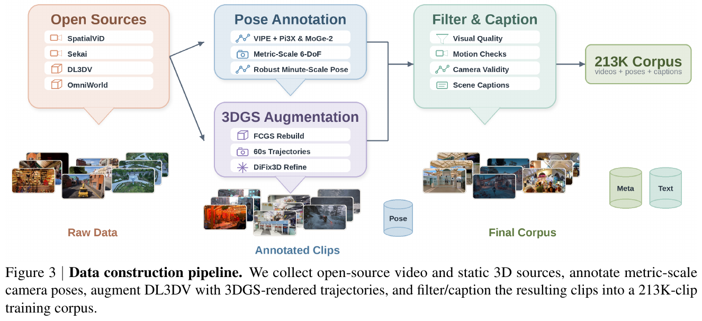
<figcaption>Figure: SANA-WM data construction pipeline. Open-source videos and static 3D assets are collected, metric camera poses are annotated, 3DGS rendering augments DL3DV, and filtering and captioning yield a 213K-clip training corpus. (Source: SANA-WM)</figcaption>

The annotation engine is based on VIPE, with its depth-estimation backend replaced by Pi3X (multi-frame consistent structure) and MoGe-2 (metric scale anchoring), which supports robust metric-scale 6-DoF pose extraction for public videos. For static 3D datasets such as DL3DV, FCGS is used to fit a 3DGS reconstruction and render diverse one-minute camera paths, which are then refined with DiFix3D to reduce stitching artifacts, yielding 14,881 synthetic 60-second clips. The final corpus contains 212,975 clips in total, covering indoor, outdoor, game, and synthetic scenes.

**Progressive training strategy** (4 stages, about 15 days on 64× H100 in total):

|Stage|Objective|Sequence length|Training steps|
|:---|:---|:---|:---|
| Stage 1 |VAE adaptation (LTX2 latent-space alignment)| 5s | 50K(VAE)+ 30K(DiT) |
| Stage 2 |Adapting to the hybrid architecture (GDN/Softmax)| 5s | 30K |
| Stage 3 |Extension to minute-long sequences + camera control| 60s | 31K |
| Stage 4 |Chunk-causal fine-tuning + 4-step distillation| 60s | 10K |

---

#### 3. Results and findings
{: id="3-核心结果发现-2"}

  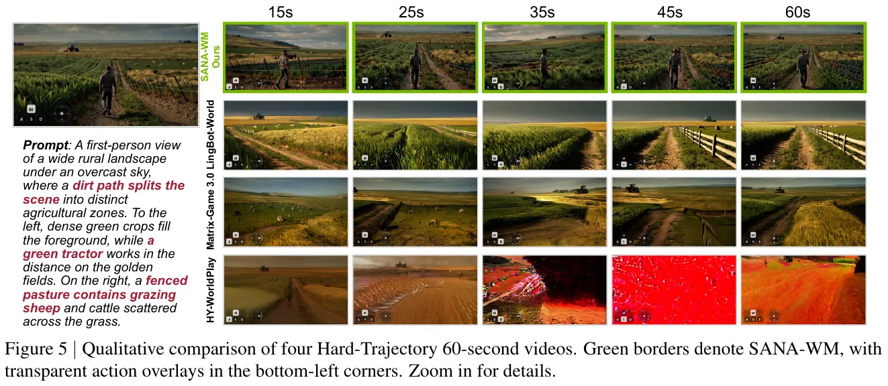
<figcaption>Figure: Qualitative comparison of four methods on 60-second videos with hard trajectories. SANA-WM has the green border, and the action trajectory is overlaid at the lower left. SANA-WM keeps the scene consistent under complex trajectories, whereas the baselines suffer from blurring, layout drift, or structural collapse. (Source: SANA-WM)</figcaption>

**Camera control accuracy** (lower is better): SANA-WM with the refiner achieves the best RotErr (4.50°/8.34° for simple/hard trajectories) and CamMC 1.41/1.44 on the 60-second benchmark, better than LingBot-World (14B+14B, RotErr 10.47°/18.99°), Matrix-Game 3.0 (5B), and HY-WorldPlay (8B).

**Visual quality**: after refinement, VBench Overall is 80.62/81.89 (simple/hard), on par with LingBot-World (81.82/81.89). However, LingBot-World needs 8 H100s (454.1 GB of GPU memory), while SANA-WM needs only 74.7 GB on a single GPU.

  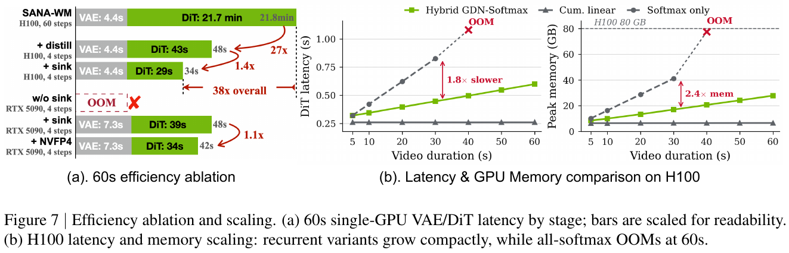
<figcaption>Figure: Efficiency ablation and scalability analysis. (a) Breakdown of single-GPU inference latency for a 60-second video: with distillation, attention sink, and NVFP4 quantization, a 60-second 720p video is generated in 34 s on an RTX 5090. (b) H100 latency and GPU memory versus video duration: hybrid GDN/softmax grows linearly, while pure softmax runs out of memory at 60 s. (Source: SANA-WM)</figcaption>

**Inference efficiency**: SANA-WM's generation throughput is 24.1 videos/hour (8× H100), 4.1× faster than the fastest 480p baseline, Infinite-World. After 4-step distillation and NVFP4 quantization, a single RTX 5090 needs only 34 s to generate a complete 60-second 720p video (**36× the throughput of LingBot-World**).

**Progressive training ablation** (VBench-I2V):

|Configuration| VBench Total ↑ |Peak memory (GB) ↓|Inference speed (steps/s) ↑|
|:---|:---:|:---:|:---:|
|SANA-Video (original)| 0.838 | 8.90 | 0.79 |
| + LTX2 VAE | 0.839 | 5.40 | 2.69 |
| + Hybrid GDN/Softmax | **0.853** | 5.68 | 2.31 |

---

#### 4. Limitations
{: id="4-局限性-2"}

SANA-WM is limited by scale (2.6B parameters, 213K clips). It can still drift on dynamic scenes, rare viewpoints, or very long sequences, and it lacks explicit 3D scene memory (so it cannot "revisit" old areas as precisely as Lyra 2.0). Future work needs to scale up the model and data, introduce robot-motion or point-tracking control, strengthen persistent scene memory, and develop robust real-time or streaming refiners.

---

## 5.4 Lyra 2.0 (2026)
{: id="paper-lyra"}
——Explorable Generative 3D Worlds at Scale

📄 **Paper**: [https://arxiv.org/abs/2604.13036](https://arxiv.org/abs/2604.13036) · [[9]](#ref-9)

#### Key takeaways
{: id="精华-3"}

Lyra 2.0, released by NVIDIA, addresses two core pain points of long-horizon, 3D-consistent scene generation. Points worth learning from include:
1. **Decoupled geometry and appearance (decoupled memory)**: explicit 3D geometry (a point-cloud cache) is used only for information routing and for establishing pixel-level correspondences, while appearance synthesis is left to the strong generative prior of the diffusion model, which avoids propagating rendering artifacts.
2. **Spatial memory routing (anti-forgetting)**: a geometry-aware retrieval mechanism finds the most relevant historical frames through 3D projection, even after long-distance movement or when revisiting an area, overcoming the "spatial forgetting" caused by the Transformer's limited context.
3. **Self-augmented training**: during training, corrupted data carrying the model's own prediction errors is introduced, so the model learns to correct the drift produced by autoregression rather than let errors accumulate without bound.
4. **Generative reconstruction**: it shows how a video generation model can synthesize highly consistent multi-view sequences that drive a feed-forward 3DGS model to quickly reconstruct high-quality 3D scene assets.

---

#### 1. Background and problem
{: id="1-研究背景问题-3"}

Current video generation models are highly prone to **spatial forgetting** and **temporal drifting** when generating long videos. When the camera moves beyond the model's limited context window, the model loses its memory of earlier scenes, and the scene structure collapses when the view returns. Meanwhile, small errors from autoregressive generation accumulate over time, causing color shifts and geometric distortion. This limits extending generative 3D scene reconstruction to large, explorable environments.

---

#### 2. Methods and innovations
{: id="2-主要方法创新点-3"}

  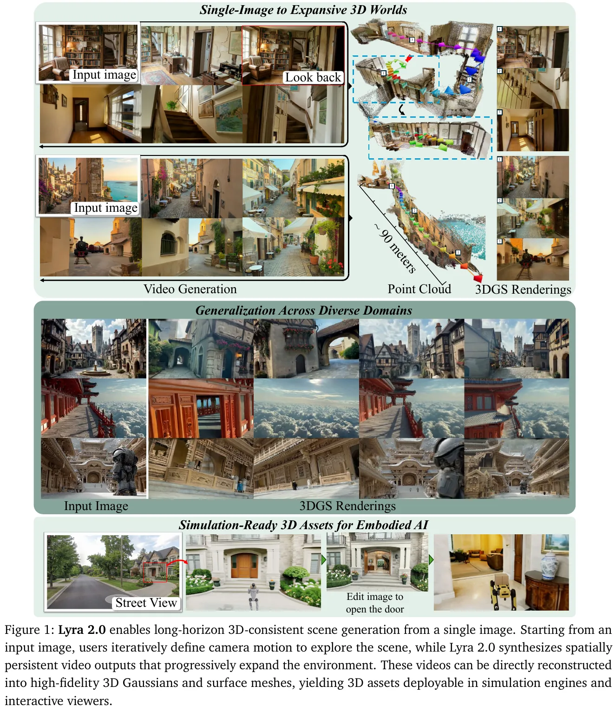
<figcaption>Figure: Starting from a single image, Lyra 2.0 supports long-horizon, 3D-consistent scene generation and exploration, and the result can be exported as high-quality 3D assets. (Source: Lyra 2.0)</figcaption>

The core of Lyra 2.0 is an autoregressive loop of retrieval, generation, and update:

1. **Anti-forgetting mechanism**:

  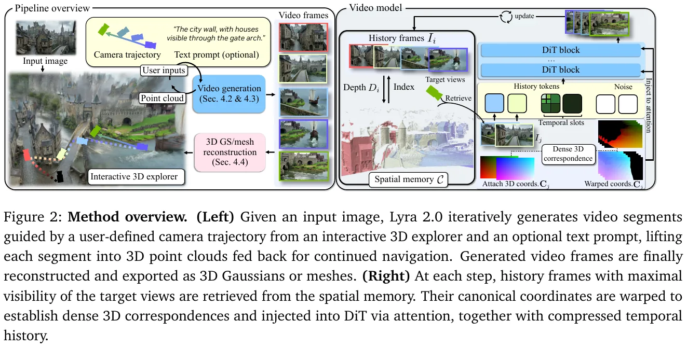
<figcaption>Figure: Method overview. The left side shows the interactive exploration loop, and the right side shows how historical frames are retrieved from spatial memory and injected into the DiT attention. (Image source: Lyra 2.0, 2026)</figcaption>

The system maintains a 3D cache that stores the depth map and point cloud of each frame. When generating the next video segment, it computes a visibility score by projection from the current camera viewpoint and retrieves the most relevant historical frames.

2. **Geometry-guided context injection**:
The retrieved historical frames are not fed in directly as RGB images; instead, pixel-level correspondences are established through **canonical coordinate warping**. This decouples geometric constraints from appearance generation, so the video model keeps spatial consistency without picking up rendering noise.

3. **Anti-drift training**:
A **self-augmented training strategy** is adopted. During training, the model is not only trained on clean, high-quality images but also, at random, denoises "corrupted" latents that it generated itself. This teaches the model to recognize and correct small drift errors at inference time rather than amplify them.

4. **Real-time interaction and 3D export**:

  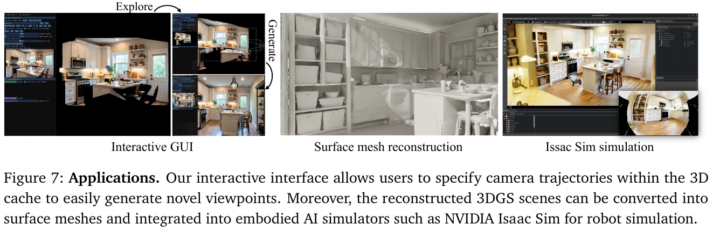
<figcaption>Figure: Lyra 2.0 applications. An interactive GUI lets users customize trajectories, and the generated scenes can be imported directly into NVIDIA Isaac Sim for embodied-intelligence simulation. (Image source: Lyra 2.0, 2026)</figcaption>

---

#### 3. Results and findings
{: id="3-核心结果发现-3"}

- **Long-horizon consistency**: experiments show that Lyra 2.0 keeps geometric structure and style highly stable over generated sequences of more than 800 frames, significantly outperforming baselines such as GEN3C and SPMem.

  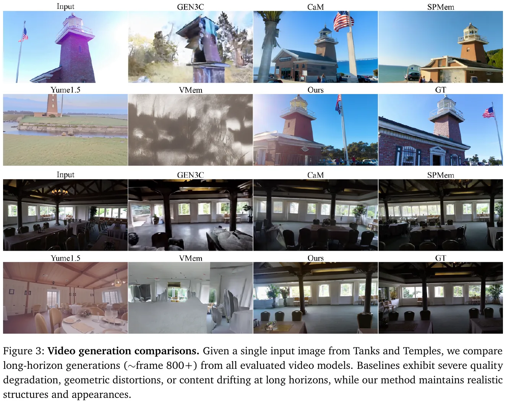
<figcaption>Figure: Video generation comparison. In long-horizon exploration, Lyra 2.0 shows greater realism and less geometric distortion. (Image source: Lyra 2.0, 2026)</figcaption>

- **High-quality 3D reconstruction**: the generated video sequences yield high-quality, nearly artifact-free (floater-free) 3D Gaussian Splatting models through a fine-tuned feed-forward 3DGS pipeline.

  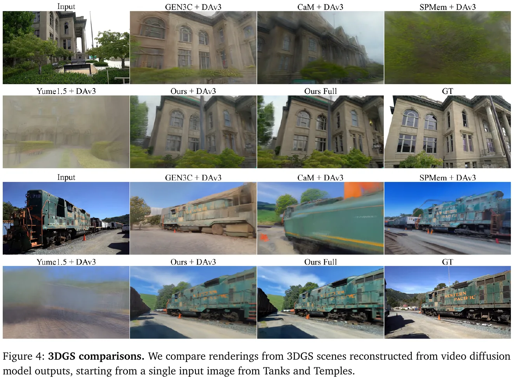
<figcaption>Figure: 3DGS reconstruction comparison. Reconstructions driven by videos generated with Lyra 2.0 are clearly ahead in fidelity and consistency. (Image source: Lyra 2.0, 2026)</figcaption>

- **Enabling embodied intelligence**:

  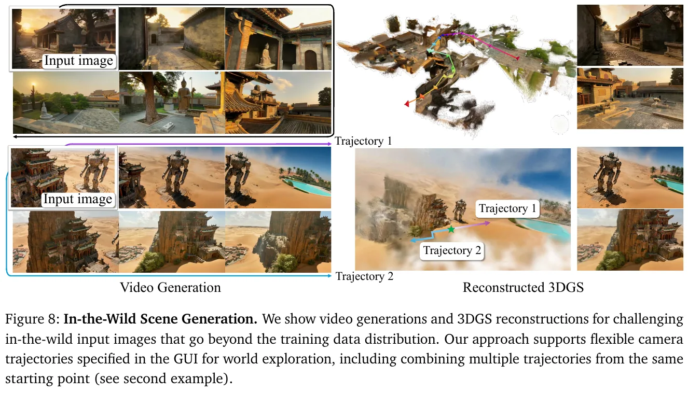
<figcaption>Figure: In-the-wild scene generation. The model generalizes strongly and handles diverse environments, from indoor studies to outdoor streets, deserts, and ancient buildings. (Image source: Lyra 2.0, 2026)</figcaption>

---

#### 4. Limitations
{: id="4-局限性-3"}
Currently, Lyra 2.0 focuses mainly on generating static scenes and does not yet explicitly model dynamic objects (such as pedestrians and vehicles). In addition, the quality of its generations is still limited by lighting changes and exposure differences in the training data (such as DL3DV).

---

## 5.5 Marble & Atlas (World Labs, 2025–2026)
{: id="paper-marble"}

> For more on 3D representations (3DGS, NeRF, point clouds) and embodied perception, see the  on this site.

🔗 **Product**: [marble.worldlabs.ai](https://marble.worldlabs.ai) · **API**: [platform.worldlabs.ai](https://platform.worldlabs.ai)
🔗 **Official blog**: [Marble](https://www.worldlabs.ai/blog/marble-world-model) · [Atlas technical introduction (2026-09)](https://www.worldlabs.ai/blog/atlas) · [Atlas general release (2026-11)](https://www.worldlabs.ai/atlas) · [[10]](#ref-10)

#### Key takeaways
{: id="精华-4"}

World Labs follows a "spatial intelligence" route: a world model should output not just video but measurable, exportable 3D structure.

1. **Two generations with distinct roles**: Marble (2025.11) is a creation platform that turns text, a single image, video, or a coarse 3D layout into a freely explorable 3DGS world. Atlas (technical introduction 2026.09, general release 2026.11.12) is the new underlying model, handling generation, reconstruction, and simulation.
2. **Unified spatial context**: Atlas is a multimodal autoregressive flow-matching Transformer trained from scratch. Text, images, video frames, camera poses, and depth maps are all anchored in one 3D coordinate frame, and the autoregressive part can reuse LLM serving infrastructure such as the KV cache.
3. **Explicit camera control**: 6-DoF camera trajectories are a native input rather than text prompts. World Labs reports 1-minute, 1440p controlled videos with consistent geometry.
4. **Generation and reconstruction in one model**: 1–3 photos are enough to output point clouds or 3DGS, with lower average error across 7 reconstruction benchmarks than dedicated reconstruction models such as MapAnything and VGGT.
5. **Real-to-Sim for robots**: A 24-frame phone video can be reconstructed into a navigable scene, with RGB-D rendered in real time along a robot trajectory; a few manipulation videos can be turned into interaction variants for rigid, articulated, and deformable objects.

---

#### 1. Background and problem
{: id="marble-background"}

Video models such as Sora and Wan2.1 produce realistic frames, but their output stays in 2D pixels: there is no metric geometry, a new viewpoint may contradict an earlier one, and the result is hard to plug into a physics engine. World Labs argues that both embodied AI and content creation need worlds that persist, can be walked through freely, and can be exported as 3D assets. Marble validated this route at the product level with 3DGS, and Atlas brings generation, reconstruction, and simulation into one model.

---

#### 2. Methods and innovations
{: id="marble-methods"}

##### ① Marble: 3DGS as the world representation
{: id="marble-3dgs"}

  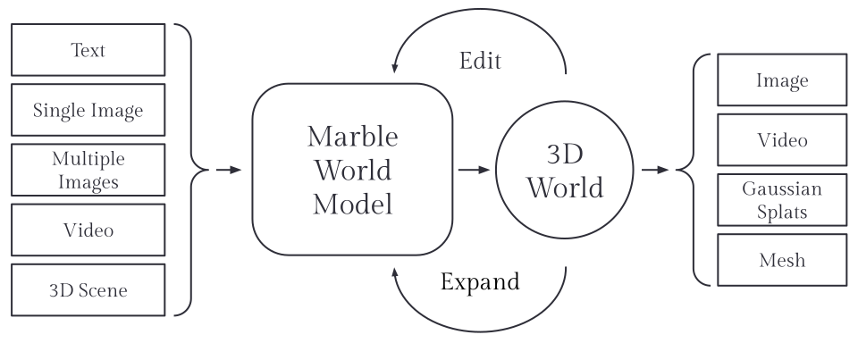
<figcaption> Figure: The overall architecture of Marble large world model (LWM): multimodal input is generated through spatial reasoning and 3D world, and the output is a 3D Gaussian Splatting world that can be rendered in real time and freely explored. (Source: World Labs)</figcaption>

Marble accepts four kinds of input: text, a single image, video (including 360° panoramas), and a coarse 3D layout.

  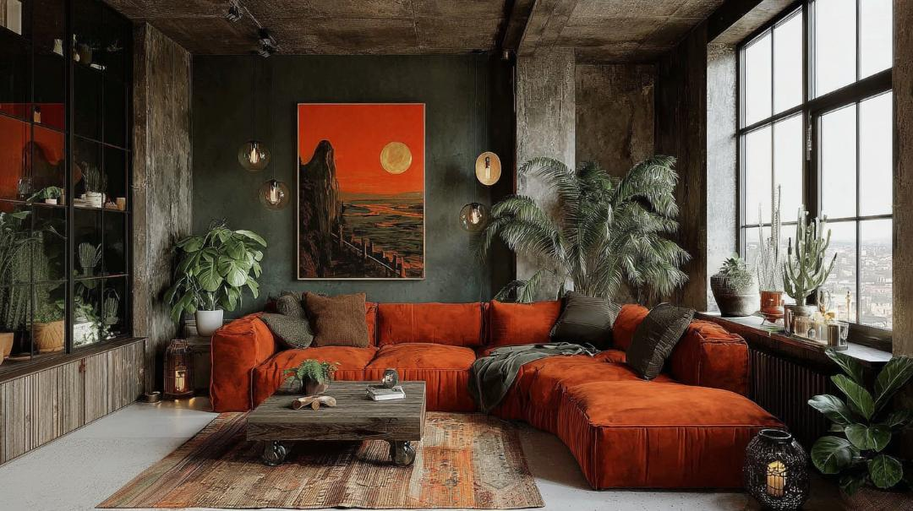
  
<figcaption> Figure: Image-to-World Example: A single interior photo (left) and a mushroom forest illustration (right) are extrapolated by Marble into a complete explorable 3D world. (Source: World Labs)</figcaption>

It uses **3D Gaussian Splatting (3DGS)** as the world representation because 3DGS renders in real time, supports precise camera control and local editing, and streams from phones to VR headsets; together with exported collision meshes, it can go straight into a physics engine.

  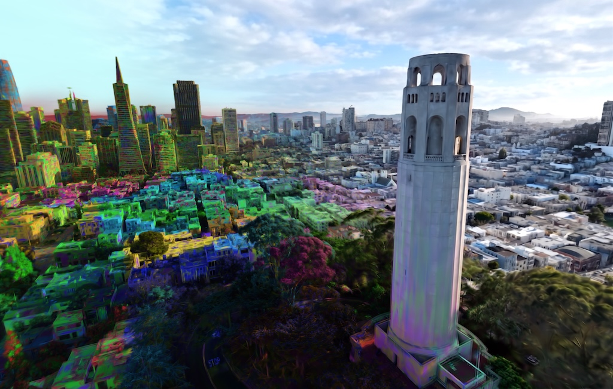
<figcaption> Figure: Marble's streaming 3DGS rendering: The generated 3D world is represented by Gaussian particles, supporting cross-platform (mobile phone to VR headset) real-time rendering and free perspective exploration. (Source: World Labs)</figcaption>

  
<figcaption> Picture: Chisel Tool: Users determine the world structure through basic 3D shapes such as boxes and planes or import existing 3D assets, and text prompts control the overall style to achieve decoupling of structure and style. (Source: World Labs)</figcaption>

Marble offers four creation tools built around 3DGS:

- **Chisel**: Lay out spatial structure with coarse shapes such as boxes and planes or with existing assets, then control style with text, decoupling structure from style;
- **World Expansion**: Extend a selected region of the world outward while keeping the content continuous;
- **Composition Mode**: Combine several independent worlds into one large scene, for example game levels or robot test arenas;
- **Video Enhancement**: Remove artifacts and add dynamic elements to rendered videos while keeping the camera trajectory and geometry unchanged.

Export formats include Gaussian Splats (real-time rendering / VR), Collider Mesh (physics collisions), High-Quality Mesh (CG pipelines), and fixed-trajectory video.

##### ② Atlas: a multimodal autoregressive flow-matching model with a unified spatial context
{: id="atlas-architecture"}

- **Unified spatial context**: Video is treated as a sequence of posed image frames; each image and depth map is bound to an explicit camera pose, and all visual and geometric elements are anchored in 3D coordinates as a spatial working memory. For example, given two unrelated photos placed at different positions in space, the model infers a plausible transition between them (a corridor, a hallway, and so on).
- **Autoregression + flow matching**: The sequence advances autoregressively, reusing the KV cache, disaggregated serving, and cache-aware routing; each visual latent is denoised with Rectified Flow, so the number of denoising steps trades speed against quality, and CFG and distillation speed-ups apply.
- **Camera control**: 6-DoF trajectories are a native condition, so compound camera moves such as dolly, pan, and long fly-throughs keep the geometry consistent.
- **Sparse-view reconstruction**: With 1–3 photos, priors fill in unseen regions; as more views are added, the output shifts toward accurate reconstruction, exported as metric point clouds or 3DGS.
- **Spatio-temporal simulation**: 3–5 phones are enough for "bullet time" video reframing. For robots, Atlas can reconstruct navigation scenes from short videos and render on-board RGB-D in real time, and can programmatically vary objects, initial positions, lighting, and backgrounds in manipulation scenes to produce training data at scale.

##### ③ General release in November 2026
{: id="atlas-release"}

On November 12, 2026, Atlas left early access and was released together with generation and reconstruction tools and developer APIs [[10]](#ref-10). A week earlier, the Frameboy demo showed real-time exploration built on Atlas, at up to about 15 fps according to World Labs (streamed from cloud GPUs). As of this update, World Labs has not released a paper, model card, or weights.

---

#### 3. Results and findings
{: id="marble-results"}

**Camera-controlled generation (blind human preference)**: Third-party raters compared results for "single image + compound camera trajectory" in a double-blind setup. The table shows the share of votes for Atlas. The more complex the camera move, the more text-controlled models drift and the larger the gap.

|Baseline model|Evaluation task|Share of voters choosing Atlas (win rate)|
|:---|:---|:---:|
| **MiniMax H3** |Single image + compound camera-move generation| **75%** |
| **Gemini Omni Flash** |Single image + compound camera-move generation| **81%** |
| **Happy Horse 1.1** |Single image + compound camera-move generation| **86%** |
| **FLUX 3** |Single image + compound camera-move generation| **93%** |
| **Seedance 2.5** |Single image + compound camera-move generation| **94%** |

**Sparse-view 3D reconstruction (AbsRel × 10⁻³, lower is better)**: Given input images and poses, predict the 3D coordinates of pixels.

|Benchmark dataset| **Atlas (Ours)** | MapAnything | VGGT-1B | Depth Anything 3 | Pi3X |Representative model 5|
|:---|:---:|:---:|:---:|:---:|:---:|:---:|
|**Overall average**| **25.3** | 28.7 | 34.7 | 36.4 | 39.3 | 47.7 |
|**DTU** (high-precision objects)| **8.6** | 11.1 | 16.2 | 9.7 | 11.9 | 18.2 |
|**ETH3D** (complex outdoor geometry)| **9.3** | 18.7 | 25.4 | 11.4 | 23.8 | 34.8 |
|**KITTI** (large-scale autonomous driving)| **60.0** | 60.2 | 74.8 | 101.4 | 93.3 | 115.3 |
|**NRGBD** (dense indoor depth)| **6.5** | 13.3 | 17.5 | 10.5 | 11.3 | 20.2 |
|**7-Scenes** (dense handheld indoor)| **37.8** | 39.3 | 44.4 | 45.2 | 50.8 | 47.4 |
| **Tanks & Temples (T&T)** | **42.4** | 42.4 | 47.0 | 40.2 | 55.1 | 60.8 |
|**ScanNet** (large-scale indoor scenes)| **12.4** | 15.7 | 17.4 | 36.6 | 29.0 | 37.0 |

As a general generative model, Atlas has a lower average error (25.3) than each dedicated reconstruction model, but it ties MapAnything and trails Depth Anything 3 slightly on T&T, and leads only marginally on KITTI. All numbers come from the World Labs blog and have not been independently reproduced.

---

#### 4. Limitations
{: id="marble-limitations"}

- **Reproducibility**: With no paper, weights, or full training details, and only self-reported evaluations, the research community can hardly reproduce or fine-tune it.
- **Contact mechanics**: Simulating the appearance and motion of deformable and articulated objects is not the same as the contact forces and friction distributions robots need; it still has to be paired with physics engines such as Isaac Sim or MuJoCo.
- **On-device deployment**: Large 3DGS scenes often contain millions of Gaussians, so real-time rendering on embedded platforms such as Jetson Orin still requires pruning and LoD streaming.

---

## 5.6 Image2Sim (2026)
{: id="paper-image2sim"}
——A real-time neural simulation engine that decouples 3D spatial anchoring from single-step pixel flow

📄 **Paper**: [arXiv:2607.05765](https://arxiv.org/abs/2607.05765) · [Project Page](https://github.com/MrZihan/Image2Sim) · Tsinghua University & Zhiyuan Research Institute · [[11]](#ref-11)

#### Key takeaways
{: id="精华-5"}

Building large-scale, high-fidelity, physically grounded interactive simulation environments is a core mission of world models for embodied intelligence. Image2Sim proposes a new neural simulation paradigm that decouples "3D spatial anchoring" from "hyper-realistic image synthesis":
1. **Decoupled geometry and generation**: a feed-forward 3D feature Gaussian representation provides explicit metric geometric constraints, and a single-step pixel-flow generative model then completes the unobserved field of view under the guidance of the alpha mask from the 3D geometry. This fully overcomes the spatial forgetting and geometric collapse of autoregressive generative world models;
2. **Ultra-fast closed-loop simulation at 45.6 FPS**: continuous-time MeanFlow single-step velocity estimation and momentum self-distillation compress the multi-step iterative sampling of traditional diffusion / flow matching into a single-step forward mapping, reaching **45.6 FPS** in panoramic RGB-D rendering. For the first time this meets the real-time requirements of online closed-loop interaction and large-scale RL/DAgger training for embodied intelligence;
3. **Automated embodied data flywheel**: from unlabeled RGB-D videos and images alone, it builds **20,000** interactive neural environments and automatically synthesizes more than **10 million** cross-view, high-fidelity navigation trajectories with multimodal instructions;
4. **Zero-shot sim-to-real generalization**: the navigation policy Image2Nav, trained purely in Image2Sim neural environments, generalizes zero-shot across simulators to real Habitat (R2R-CE success rate 70.3%) and to a physical Hello Robot Stretch 3.

---

#### 1. Background and problem
{: id="1-研究背景问题-4"}

Traditional embodied-policy training relies heavily on manually modeled physical simulation environments (such as Matterport3D, HM3D, and ProcTHOR):
- Real scanned environments are very expensive and offer limited diversity (only hundreds of scenes);
- Procedurally synthesized environments suffer from a serious sim-to-real gap in visual and physical fidelity;
- Traditional generative video world models produce realistic images but lack an explicit, persistent 3D structure and metric coordinate frame. The scene "collapses when the robot looks back" after it travels far, so such models cannot support long-horizon free navigation in a closed loop.

Image2Sim aims to answer: can we **build, within seconds and directly from unconstrained real-world videos, a neural physical world with millimeter-level 3D spatial consistency, photo-level visual fidelity, and high-frame-rate closed-loop interaction?**

---

#### 2. Methods and innovations
{: id="2-主要方法创新点-4"}

  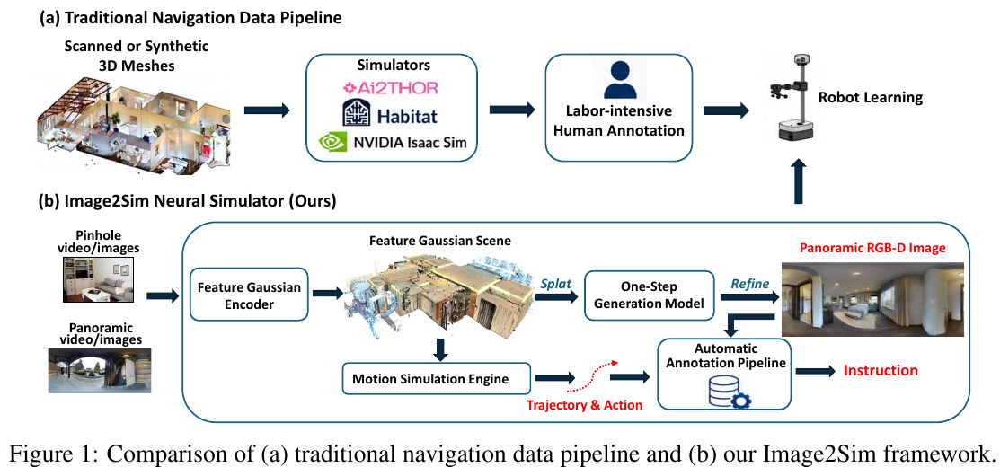
<figcaption>Figure: Comparison of the traditional navigation data pipeline (which requires expensive manual 3D reconstruction) with the Image2Sim neural simulation framework (which automatically builds 20,000 scenes and tens of millions of trajectories from unconstrained data). (Source: Image2Sim, 2026)</figcaption>

Image2Sim decouples neural environment simulation into a two-level cascade:

  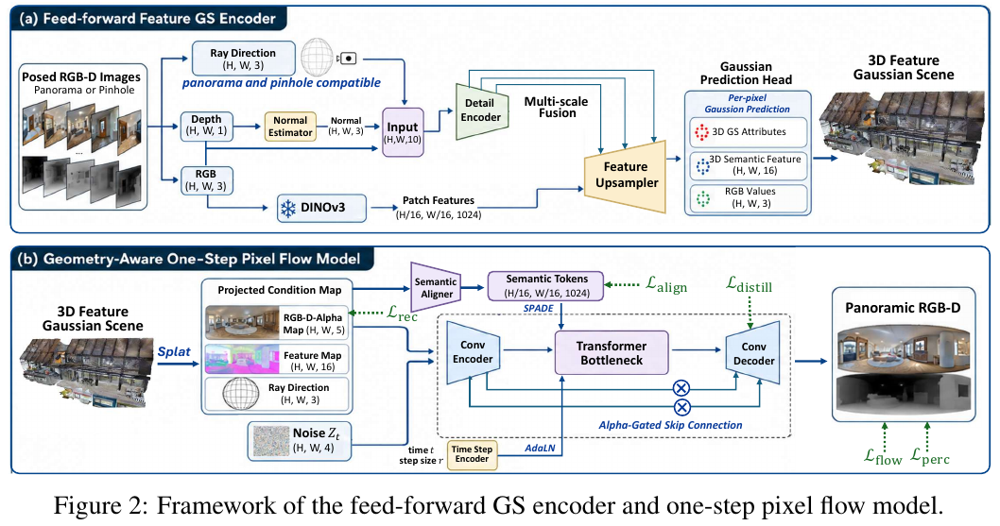
<figcaption>Figure: Image2Sim architecture: a feed-forward 3D feature Gaussian encoder (left) and a geometry-aware single-step pixel-flow renderer (right). (Source: Image2Sim, 2026)</figcaption>

1. **Feed-forward 3D feature Gaussian geometry construction (feed-forward 3D Gaussian encoder)**:
   - It avoids the hours-long per-scene optimization of traditional 3DGS. A dual-stream encoder (a DINOv3 high-level semantic stream plus a geometric-detail stream) directly predicts the scene's set of 3D feature Gaussians $$\mathcal{G} = \{g_j\}_{j=1}^M$$ in a single forward pass;
   - For any query viewpoint $$p$$, differentiable rasterization projects the panoramic geometry, depth map, and opacity map $$\tilde{\mathbf{A}}_p$$ within milliseconds, providing a solid 3D geometric anchor;
2. **Geometry-aware one-step pixel-flow renderer**:
   - When the robot roams into unscanned blind spots, holes and tears appear in the 3DGS projection. Image2Sim uses the opacity map $$\tilde{\mathbf{A}}_p$$ to construct an alpha-gated source state:
     
     $$
     \mathbf{z}_{\mathrm{src}} = \tilde{\mathbf{A}}_p \odot \tilde{\mathbf{X}}_p + \Sigma(\tilde{\mathbf{A}}_p) \odot \boldsymbol{\epsilon}, \quad \boldsymbol{\epsilon} \sim \mathcal{N}(\mathbf{0}, \mathbf{I})
     $$

   - The original projection is kept in high-confidence geometric regions, while a flow-matching generative network fills in physically plausible texture detail in blind regions;
   - Together with momentum self-distillation, the reverse ODE integration is distilled into a single-step forward prediction, which reaches an extremely fast 45.6 FPS.

---

#### 3. Results and findings
{: id="3-核心结果发现-4"}

1. **Speed and fidelity together**: across 20,000 scenes, panoramic RGB-D rendering reaches **45.6 FPS**, significantly faster than comparable diffusion world models (usually < 1 FPS), while PSNR and LPIPS also reach first-class visual quality;
2. **Real-robot policy generalization from purely neural simulation training**: the agent learns interactively at scale entirely inside neural environments generated by Image2Sim, is deployed zero-shot on a real Hello Robot Stretch 3, and successfully completes multi-target object-search navigation in an unseen room with a complex furniture layout. This shows that a neural world simulator can replace a traditional simulation engine.

---

#### 4. Limitations
{: id="4-局限性-4"}
- It currently handles mainly indoor static rigid-body scenes; metric Gaussian modeling of deformable soft objects and large-scale fluid interactions is still at an exploratory stage.

---

# 6. Family B: Decision-oriented world models
{: id="6-家族-b面向决策的世界模型"}

This family of world models directly serves the robot policy: the conditioning signals are robot actions or task instructions, and the value ultimately shows up in downstream task success rates. According to how the world model is coupled to the policy, it divides into four paradigms (§2.2). Under each paradigm, we first give the definition and mechanism, and then introduce representative work.

  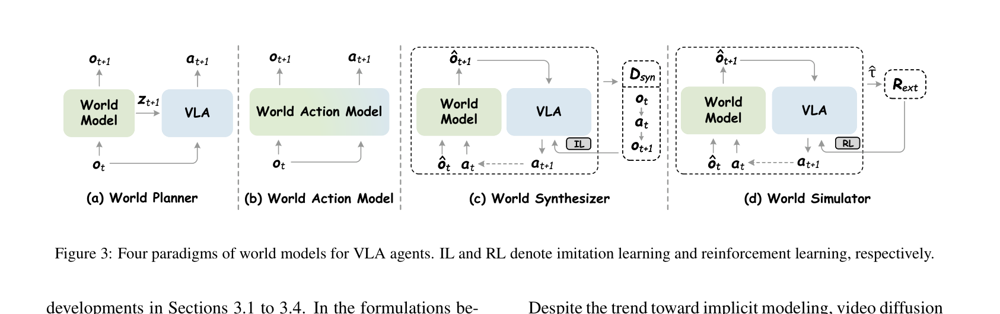
<figcaption>Figure: The four technical paradigms of VLA world models. (a) World planner: the world model generates a latent representation z to guide the VLA; (b) World action model: jointly models observations and actions; (c) World synthesizer: builds synthetic datasets for imitation learning (IL); (d) World simulator: optimizes policies and obtains external rewards through reinforcement learning (RL). (Image source: Tan et al., 2026)</figcaption>

## 6.1 World Planner
{: id="61-世界规划器"}

> 💡 **Companion article**: For action tokenization, cross-embodiment pretraining, and end-to-end control architectures of embodied policy models (OpenVLA, $\pi_0$, Octo, RoboCat, etc.), see the dedicated post .

  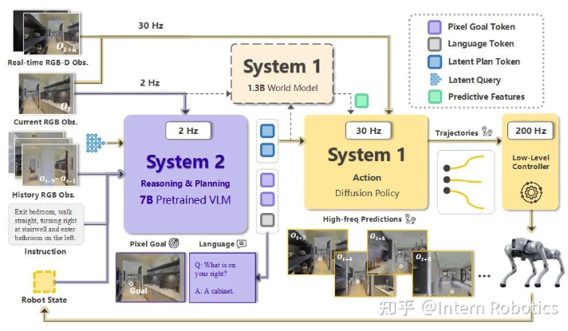
<figcaption>Figure: End-to-end dual-system architecture of InternVLA·N1: the forward dynamics planner provides future latent features to guide policy execution. (Source: Intern Robotics)</figcaption>

**Definition**: This paradigm uses the world model $$\mathcal{W}_\phi$$ as a forward dynamics model that synthesizes forward-looking guidance signals, in the form of explicit future observation frames $$\hat{o}_{t+1}$$ or implicit latent features $$z_{t+1}$$, and supplies strong semantic and physical conditioning to the downstream policy $$\pi_\theta$$:

$$
\max_\theta \mathbb{E}_{z_{t+1} \sim \mathcal{W}_\phi(\cdot|o_t)} \left[ \sum_t \log \pi_\theta(a_{t+1} | o_t, z_{t+1}) \right]
$$

The core philosophy of the world planner is **"predict before acting"**: the world model first foresees the future (as an explicit image or an implicit latent vector), and the forward-looking signal is then fed as input to the policy network, so decisions are made with physically grounded foresight and causal prediction. The information flow of the two mainstream routes is as follows:

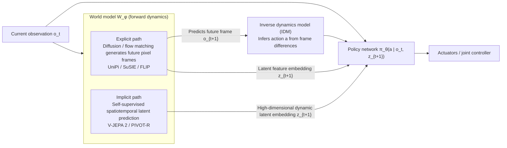

**Explicit vs. implicit planning, compared in depth**:

|Dimension|Explicit pixel planning|Implicit latent planning|
|:---|:---|:---|
|**Guidance signal**|Pixel-level future image / video frames $$\hat{o}_{t+1}$$|Compact spatiotemporal feature embedding $$z_{t+1}$$ (such as V-JEPA 2 features)|
|**Representative methods**| UniPi, SuSIE, GR-MG, Vidar, 3D-VLA, FLIP | V-JEPA 2, PIVOT-R, VPP, MinD, TriVLA, MoWM |
|**Main advantages**|Intuitive and human-interpretable, convenient for visual debugging, and can be connected directly to a general-purpose VLM|Filters out visual noise irrelevant to control (such as lighting and texture), is fast to compute, and is less prone to pixel-level artifacts|
|**Main disadvantages**|Reverse-denoising diffusion sampling is slow and prone to pixel-level distortion on small contact surfaces|Lacks intuitive interpretability; downstream policies must be tightly aligned to a specific latent space|
|**Action derivation**|An inverse dynamics model (IDM) solves for actions from frame-to-frame changes, or the actions are read out under policy-network conditioning|The policy network reads the forward-looking latent features directly in latent space via cross-attention|

**Evolution**: Early work (UniPi [[12]](#ref-12), SuSIE [[13]](#ref-13), GR-MG, Vidar, 3D-VLA [[14]](#ref-14), FLIP) treats planning as a high-fidelity conditional video generation task: a video diffusion model synthesizes pixel-level future states, and an inverse dynamics model then derives the actions. However, pixel-level generation suffers from severe inference latency and blurs subtle physical contacts. More recent work (V-JEPA 2 [[15]](#ref-15), PIVOT-R [[16]](#ref-16), and TriVLA) has turned to implicit planning, directly predicting future features in a self-supervised latent space. This reduces interference from background details unrelated to the dynamics and improves both the signal-to-noise ratio of the guidance signal and the computational throughput. MoWM integrates multimodal dynamics priors into a hybrid solution that further reduces action-derivation error.

### GENE-26.5 (2026)
{: id="paper-gene"}

[GENE-26.5](https://www.genesis.ai/blog/gene-26-5-advancing-robotic-manipulation-to-human-level), released by Genesis AI in 2026 [[17]](#ref-17), is an industrial example of the world planner paradigm in dexterous manipulation. Its core technical breakthrough is that a new **task needs only <1 hour of real-robot data (about 200 episodes, <20 seconds of skills) for fine-tuning**. This extremely high sample efficiency rests on the design philosophy of "using the world model to inject physical-commonsense priors into the low-level action policy."

**Three functional roles in one unified model**

In terms of division of labor, GENE-26.5 has three functional layers:
- **Semantic perception layer (VLM)**: encodes natural-language instructions and scene semantics, and decomposes high-level logical task chains;
- **Physical prediction layer (world model)**: an action-conditioned video generation model that learns, from massive unlabeled videos, how objects will be stressed, deformed, broken, and slid over the next few seconds, supplying a strong physical-commonsense prior;
- **Execution layer (action model)**: high-frequency low-level control that translates semantic and physical conditions directly into continuous joint torques.

In engineering terms, **GENE-26.5 is not three isolated modules** chained in series. It uses **flow matching** to model the **joint multimodal distribution** of language, vision, proprioception, touch, and action. The VLM and the world model are absorbed as pretrained components. Downstream, **conditional queries** sample, from the same joint distribution, different subtasks such as control, generative simulation, state estimation, inverse dynamics, or value estimation.

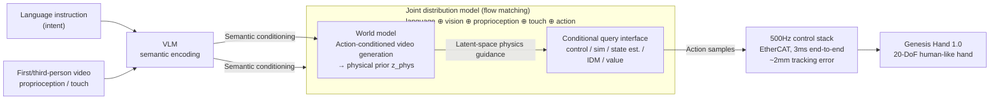

**Training paradigm and hardware co-design**:
- **Heterogeneous multimodal pretraining (> 200,000 hours)**: covers glove-capture data (trajectories + touch), first-person natural interaction video, third-person Internet videos of physical interaction, and image-text corpora. The model learns the coupled prior of "perception, physics, and action" directly from imperfectly aligned heterogeneous data, so downstream tasks need only 20–30 minutes of data for fine-tuning;
- **500Hz / 3ms ultra-low-latency hardware control stack**: when the world planner's physical trajectory is sent to a real robot, errors are often amplified by control-stack delay. GENE-26.5's in-house EtherCAT middleware compresses end-to-end communication latency to 3 ms. Combined with Genesis Hand 1.0, which has 20 actively back-drivable degrees of freedom, it brings tracking error down to ~2 mm, so the physical trajectories predicted by the world model are reproduced with high fidelity on the execution side.

---

### VLA-World (2026)
{: id="paper-vla-world"}
——Learning Vision-Language-Action World Models for Autonomous Driving

📄 **Paper**: [https://vlaworld.github.io](https://vlaworld.github.io) · [[18]](#ref-18)

##### Key takeaways
{: id="精华-6"}

The core idea of VLA-World is to combine the generative ability of a world model with the reasoning ability of a VLA model by performing reflective reasoning on single-frame future predictions. Its most instructive design is a step-by-step process: first generate a future frame from the predicted action, then have the model examine this self-generated frame to identify potential collision risks and correct the action. This "think with generated future" mechanism greatly improves the safety and interpretability of end-to-end driving systems.

---

##### 1. Background and problem
{: id="1-研究背景问题-5"}

Existing end-to-end autonomous driving models (such as VLAs) often lack explicit spatiotemporal modeling, which makes it hard for them to predict how other traffic participants will evolve. Pure world models can generate coherent future scenes, but they often lack reasoning ability and struggle to judge the safety or quality of the generated future. VLA-World improves driving foresight by unifying predictive imagination with reflective reasoning.

---

##### 2. Methods and innovations
{: id="2-主要方法创新点-5"}

VLA-World proposes a complete pipeline that combines perception, action-conditioned prediction, image generation, reflective reasoning, and planning.

  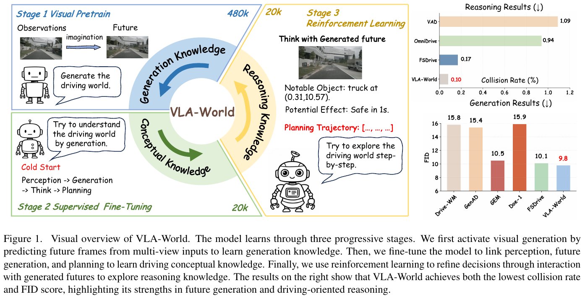
<figcaption>Figure: VLA-World's three-stage training and performance overview. (Source: VLA-World, 2026)</figcaption>

###### Three-stage training strategy
{: id="三阶段训练策略"}
1. **Stage 1: visual pretraining**: activates image-generation knowledge on large-scale image-instruction datasets.
2. **Stage 2: supervised fine-tuning (SFT)**: establishes logical links among perception, future generation, and planning using the mixed-task nuScenes-GR-20K dataset.
3. **Stage 3: reinforcement learning (RL)**: uses the GRPO algorithm to elicit human-like reasoning, so the model reflects more deeply on whether the generated future is safe.

  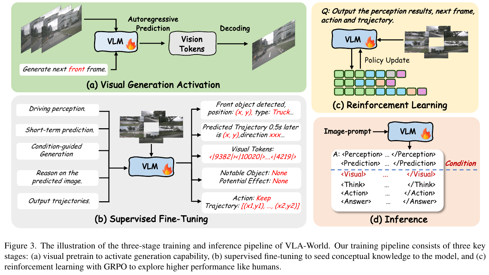
<figcaption>Figure: Comparison of the VLA, world model, and VLA-World paradigms. (Source: VLA-World, 2026)</figcaption>

###### Reflective reasoning mechanism (Think with Generated future)
{: id="反思推理机制-think-with-generated-future"}
The model first outputs a short-horizon trajectory prediction within 0.5 seconds and generates the corresponding future frame from it. It then "reviews" this self-generated frame, identifies important objects and potential risks, corrects its decision, and finally outputs the long-horizon trajectory. This mechanism resembles the second look a human driver takes when facing an unexpected situation.

---

##### 3. Results and findings
{: id="3-核心结果发现-5"}

- **Performance**: on benchmarks such as nuScenes, VLA-World achieves a lower collision rate (down from 1.09% to 0.94%) and better FID video-generation quality than existing VLA and world models.
- **Interpretability**: by having the model write out its reasoning about the "self-generated future" (for example, identifying the collision risk posed by a particular truck), the system's decision process becomes more transparent.

  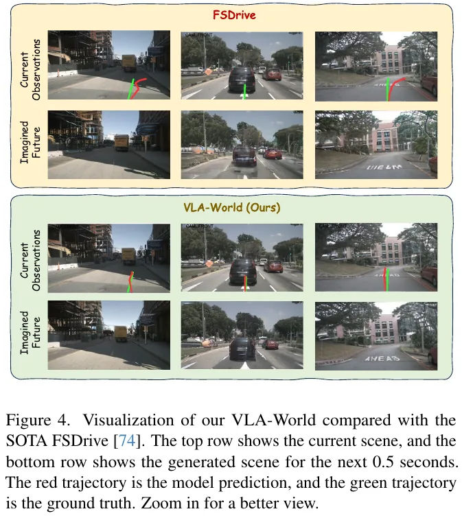
<figcaption>Figure: VLA-World's multi-view image prediction visualized in complex scenes. (Source: VLA-World, 2026)</figcaption>

---

##### 4. Limitations
{: id="4-局限性-5"}

Because the model must generate images before reasoning, the end-to-end latency of the system remains a challenge. Future work will focus on improving real-time inference speed.

---

## 6.2 World Action Model (WAM)
{: id="62-世界动作模型wam"}

**Definition**: This paradigm uses a generative sequence model or a diffusion model to incorporate future observation states and control actions into one unified network, directly modeling the joint spatiotemporal distribution of observations and controls:

$$
\max_\phi \mathbb{E}_{\tau \sim \mathcal{D}} \left[ \sum_t \log \mathcal{W}_\phi(o_{t+1}, a_{t+1} \mid o_{\le t}, a_{< t}) \right]
$$

Unlike the world planner's "forward prediction followed by policy decoding in series," the world action model unifies the two and **optimizes them jointly in the same backbone**: the model must both predict future frames (a self-supervised physical-evolution objective) and directly decode control actions (a policy-execution objective).

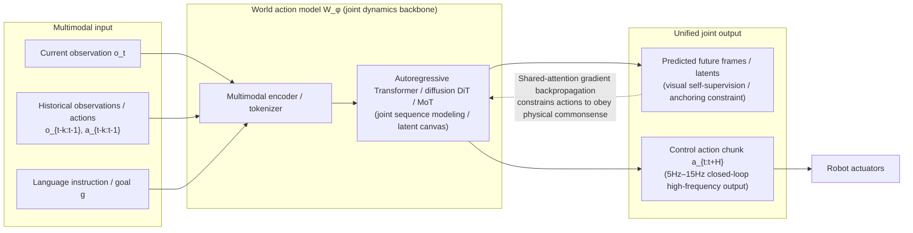

### Why WAMs are drawing attention
{: id="为什么-wam-受到关注"}

Traditional world models often rely on an add-on trajectory search algorithm at inference time (such as the cross-entropy method CEM, Monte Carlo tree search MCTS, or model predictive path integral MPPI), scoring hundreds of random candidate action sequences one by one. A single decision can then take several seconds, which cannot meet the needs of high-frequency dynamic interaction.

The main engineering advantage of a **WAM is that it needs no online search at test time**:
1. **Generate action chunks directly, without online trajectory search**: WAMs output executable action chunks in policy mode. Diffusion / flow-matching models generally still require multiple denoising steps; single-step generation needs specific design or acceleration. Some implementations report **5Hz–15Hz** policy updates (including approximately 7Hz for DreamZero-Flash below), and NavWAM reports approximately 1100× speedup over NWM. These results depend on hardware and inference configuration;
2. **Future visual prediction as a strong regularizer and anchor**: during training, the model is forced to predict future scenes while generating actions. Because visual denoising carries dense pixel-level self-supervised signals, the action head acquires deep physical-dynamics constraints, which effectively alleviates the "policy drift" of reactive policies in long-horizon control;
3. **Architectural unity and flexibility**: through flexible masking or noise scheduling, the same WAM weights can be switched freely among a forward dynamics simulator, an inverse dynamics annotator, a pure policy controller, and a cross-modal editing tool.

**Fine-grained classification** (by modeling paradigm and implementation mechanism):

|Modeling paradigm|Core mechanism|Representative methods|Key technical highlights|
|:---|:---|:---|:---|
|**Autoregressive (AR)**|Video pretraining| GR-1 [[19]](#ref-19), HMA, UniVLA [[20]](#ref-20), GR-2 |Turns large-scale video priors into end-to-end action prediction|
|**Autoregressive (AR)**|Unified sequence modeling| WorldVLA [[21]](#ref-21), RynnVLA-002, UP-VLA |Discretizes images, actions, and text into one unified token stream|
| **Autoregressive + flow matching** | Causal across chunks, joint denoising within chunks | DreamZero [[54]](#ref-54) | Video backbone jointly generates video and actions; real observations refresh the KV cache; Flash enables single-step denoising |
|**Autoregressive (AR)**|Foresight and chain-of-thought reasoning| Seer, FlowVLA [[22]](#ref-22), CoT-VLA [[23]](#ref-23), DreamVLA [[24]](#ref-24) |Introduces multimodal chain of thought and future optical flow to guide structured decision-making|
|**Diffusion / flow matching**|Mixture of Transformers (MoT)| Motus [[25]](#ref-25), Cosmos 3 [[26]](#ref-26) |Shared self-attention + decoupled FFNs; UniDiffuser-style multi-mode switching|
|**Diffusion / flow matching**|Spatial value interface| AIM [[27]](#ref-27) |Spatial value map (ASVM) decouples intent explicitly; self-distillation RL optimization|
|**Diffusion / flow matching**|Latent canvas| NavWAM [[28]](#ref-28) |A 9-frame world-and-action latent canvas that eliminates CEM, enabling 5Hz real-time navigation|
|**Diffusion / flow matching**|Asymmetric horizon| WAM-Nav [[29]](#ref-29) |Long action horizon (24 steps) + short visual horizon (1 step), preventing drift when the viewpoint changes sharply|
|**Diffusion / flow matching**|Skip video at inference| GigaWorld-Policy [[56]](#ref-56), DSWAM [[60]](#ref-60) |Action-centered; the video branch only provides supervision during training|
|**Diffusion / flow matching**|Latent future reuse| ForeWAM [[57]](#ref-57) |Forecast without rendering; Future-KV reuses future states|
|**Open framework**|Composable MoT| OpenWAM [[59]](#ref-59) |Wan2.2-5B video backbone + action expert, with a swappable inverse dynamics head|

### Second half of 2026: WAMs become faster and more open
{: id="wam-2026h2"}

First-half WAMs (DreamZero, Motus, and others) showed that "video backbone + action head" works, but every decision required generating or denoising future video, with latencies from hundreds of milliseconds to several seconds. Most second-half work targets this:

- **No video generation at inference**: GigaWorld-Policy [[56]](#ref-56) keeps video tokens from affecting action tokens, so video generation can be skipped entirely at inference. It reports running 9× faster than Motus with a 7% higher real-robot success rate, and 95% better than π0.5 on RoboTwin 2.0. DSWAM [[60]](#ref-60) likewise does not generate explicit future video; it uses the WAM as a System 1 executor with an optional VLM subtask planner (System 2), plus TensorRT and asynchronous chunked execution.
- **Forecast without rendering**: ForeWAM [[57]](#ref-57) separates forecasting the future from rendering frames and reuses future key-value states through Future-KV. With 50 demonstrations per task on RoboCasa it reaches 59.2%, 9.7 points above Fast-WAM; a single-layer-decoder version scores 77.6% on LIBERO-Plus with 88.7 ms per query on an A800, 6.27× faster than Fast-WAM.
- **Training-free acceleration**: WAMACHINE [[58]](#ref-58) reuses intermediate states across replans, denoising steps, and Transformer layers. Across three architectures on LIBERO and RoboTwin 2.0 it speeds up observation-to-action latency by 1.47–3.05× while keeping 96.69%–99.54% of the original success rate.
- **Open framework**: OpenWAM [[59]](#ref-59) starts from Wan2.2-5B, does causal pretraining on more than 10,000 hours of robot video, and attaches an action expert via MoT, with swappable modules. LIBERO-Long success rises from 68.4% to 97.8%; on held-out LIBERO-90 tasks, a frozen local-context inverse dynamics head reaches 84.0%, versus 47.0% for the full-context version.

**Summary**: In WAMs, "future video" increasingly acts as auxiliary supervision during training rather than a required output at inference. This is diverging from the "imagine first, then decode" approach of the world planners in §6.1. For a systematic overview, see the WAM survey by Lu et al. [[61]](#ref-61).

---

### WorldVLA (2025)
{: id="paper-worldvla"}
——Towards Autoregressive Action World Model

📄 **Paper**: [https://arxiv.org/abs/2506.21539](https://arxiv.org/abs/2506.21539) · [[21]](#ref-21)

##### Key takeaways
{: id="精华-7"}

The core highlight of this paper is that it unifies a vision-language-action (VLA) model and a world model in a single autoregressive framework. Ideas worth learning from include: using the world model's ability to predict future images to learn the underlying physical laws of the environment, which improves the accuracy of action generation; conversely, the action model also aids visual understanding and improves image-generation quality. In addition, to address error accumulation in autoregressive action-sequence generation, the proposed action attention masking strategy significantly improves action-chunk generation.

---

##### 1. Background and problem
{: id="1-研究背景问题-6"}

Current VLA models focus mainly on generating actions from images and text, and they often lack a deep understanding of actions because actions serve only as outputs, never as inputs. World models, in contrast, understand physical dynamics by predicting future visual states, but often cannot generate actions directly. WorldVLA aims to break down this boundary and achieve joint understanding and generation of actions and images in a unified architecture.

---

##### 2. Methods and innovations
{: id="2-主要方法创新点-6"}

WorldVLA adopts an autoregressive architecture and integrates tokenizers for three modalities: image, text, and action.

  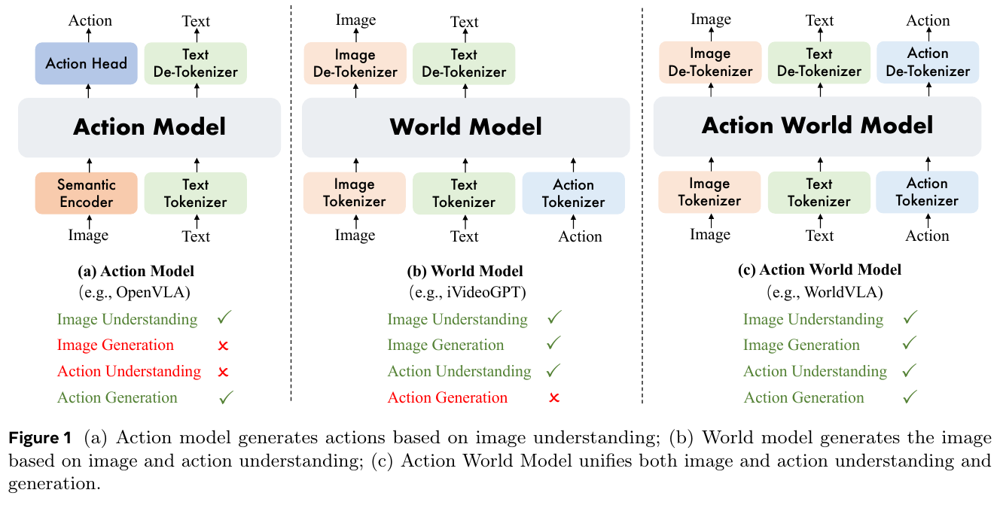
<figcaption>Figure: Comparison of WorldVLA with a conventional action model and a conventional world model. (Image source: WorldVLA, 2025)</figcaption>

###### Unified architecture
{: id="统一架构"}
The model is initialized from Chameleon, a unified image understanding and generation model. It contains:
- **Image tokenizer**: a VQ-GAN model that discretizes images into tokens.
- **Action tokenizer**: discretizes 7-dimensional robot actions (position, angle, gripper state) into 256-bin tokens.
- **Text tokenizer**: a standard BPE tokenizer.

  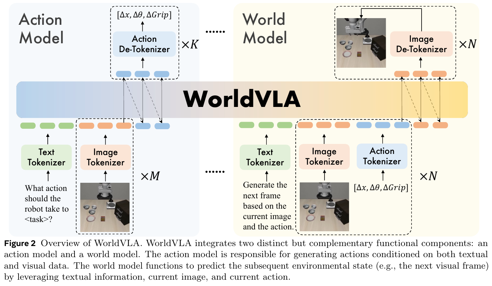
<figcaption>Figure: WorldVLA overall architecture diagram. (Source: WorldVLA, 2025)</figcaption>

###### Training strategy
{: id="训练策略"}
Training mixes action-model data with world-model data:
1. **Action prediction ($L_{action}$)**: given the instruction and multi-frame images, predict the subsequent actions.
2. **Future prediction ($L_{world}$)**: given the current observation and action, predict the next frame.

###### Action Attention Masking
{: id="动作注意力掩码-action-attention-masking"}
The paper finds that, because the pretrained model generalizes poorly in the action domain, a conventional causal mask lets errors in earlier actions propagate rapidly. WorldVLA therefore uses a special mask: when generating the current action chunk, earlier actions are masked out, so action generation depends only on visual and text input. This allows action chunks to be generated in parallel and reduces error accumulation.

  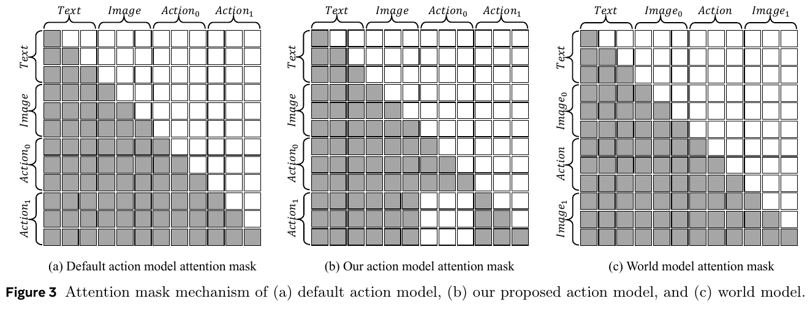
<figcaption>Figure: WorldVLA's attention masking mechanism. (Source: WorldVLA, 2025)</figcaption>

---

##### 3. Results and findings
{: id="3-核心结果发现-6"}

- **LIBERO benchmark**: WorldVLA significantly outperforms OpenVLA at both 256x256 and 512x512 resolutions.
- **Synergy**: adding world-model data significantly improves the action-generation success rate (SR) (for example, from 67.3% to 73.1% on LIBERO-Goal); at the same time, the action model also helps reduce the FVD of the generated video.
- **Action-chunk generation**: with the new masking strategy, the robustness of action-chunk generation improves greatly.

  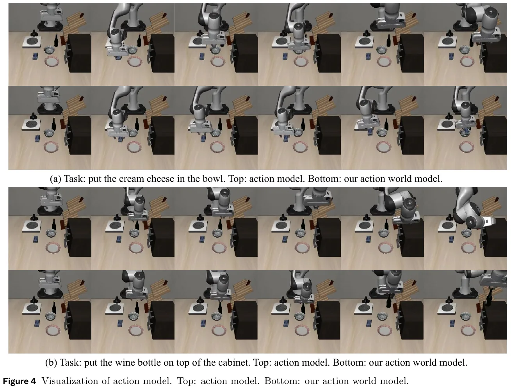
<figcaption>Figure: Action model visualization: WorldVLA can retry grasping after a failure. (Image source: WorldVLA, 2025)</figcaption>

  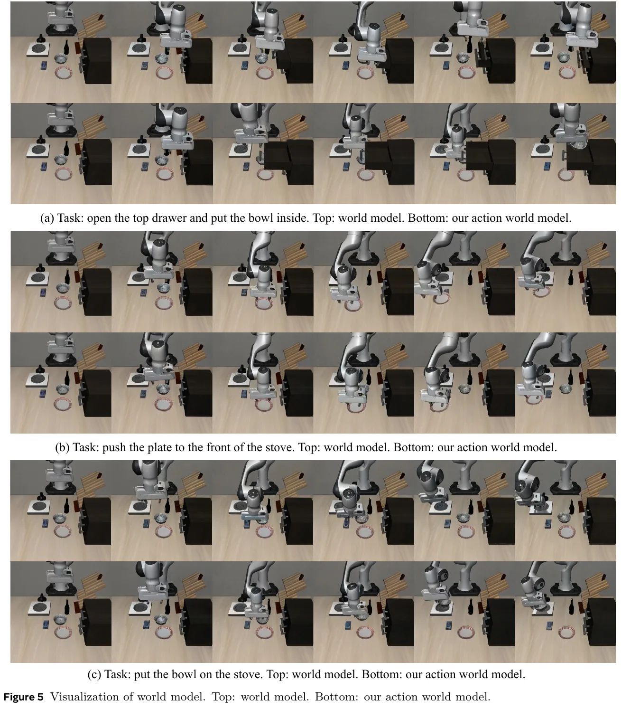
<figcaption>Figure: World model visualization: the future images generated by WorldVLA better follow physical logic. (Source: WorldVLA, 2025)</figcaption>

---

##### 4. Limitations
{: id="4-局限性-6"}

The discrete image tokenizers currently used still have limited perceptual expressiveness. Future work will explore larger-scale data and models, and design a unified tokenizer that better balances understanding and generation.

---

### DreamZero (2026)
{: id="paper-dreamzero"}
——Video dynamics priors for zero-shot generalization to unseen tasks

📄 **Paper**: [arXiv:2602.15922](https://arxiv.org/abs/2602.15922) · [Code](https://github.com/dreamzero0/dreamzero) · [Project Page](https://dreamzero0.github.io/) · [[54]](#ref-54)

##### Key takeaways
{: id="dreamzero-takeaways"}

DreamZero learns **how the world will change and how the robot should move as one generation problem**, bringing temporal priors from video pretraining into action generation. A shared DiT jointly predicts video and actions, with causal video autoregression across temporal chunks and joint video-action flow-matching denoising within each chunk: autoregression and diffusion / flow matching can coexist. After execution, real observations update the visual KV cache to reduce errors from repeatedly conditioning on generated frames. The video objective also makes action-free demonstrations from other robots or humans useful for training, although embodiment adaptation and zero-shot generalization to unseen tasks are distinct experimental settings.

---

##### 1. Background and problem
{: id="dreamzero-background"}

VLAs initialized from image-text models can transfer object and semantic knowledge, but may struggle with new physical motions such as ironing or untying shoelaces. DreamZero starts from a video generator and asks whether diverse, less repetitive robot demonstrations can support dynamics and control learning that generalizes to new environments, objects, and tasks.

**Zero-shot** means that the trained robot policy receives no additional demonstrations or fine-tuning for the unseen evaluation tasks; it still undergoes video pretraining and robot training. The paper trains separate AgiBot G1 and DROID-Franka models, rather than one universal policy across all embodiments in its main experiments.

---

##### 2. Methods and innovations
{: id="dreamzero-methods"}

  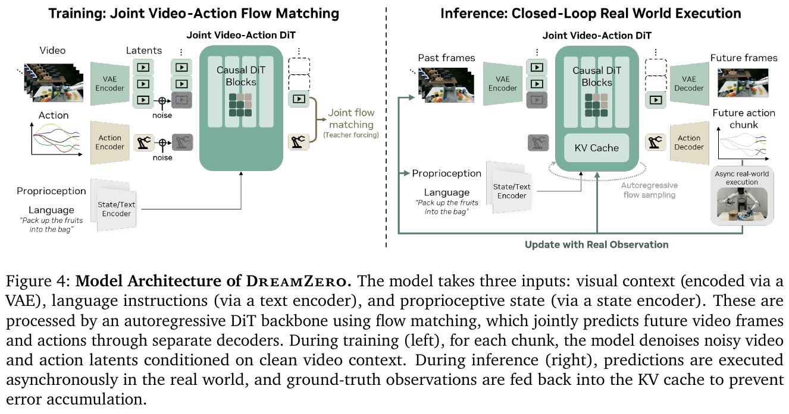
<figcaption>Figure: DreamZero training and inference. Left: joint video-action denoising conditioned on real history. Right: action execution followed by KV-cache updates from real observations. (Source: DreamZero, Figure 4)</figcaption>

###### ① Video backbone and action interfaces
{: id="dreamzero-backbone"}

DreamZero initializes from **Wan2.1-I2V-14B-480P**. A VAE encodes visual observations into latents, with multiple camera views concatenated into one frame; text and state encoders process instructions and proprioception. A new action encoder maps normalized continuous actions to tokens that enter the shared DiT alongside video tokens. The action decoder produces control sequences, while the VAE decoder can reconstruct predicted frames. Training updates the DiT and state/action interfaces, while freezing the text encoder, image encoder, and VAE.

| Dimension | Video planner + separate inverse dynamics model | DreamZero |
|:---|:---|:---|
| Action generation | Generate future video, then translate it into actions with another model | Jointly generate future video and actions in a shared backbone |
| Video-action alignment | Depends on the interface between two models | Learned through joint denoising |
| Context for the next prediction | Depends on the external feedback design | Refresh visual context using real observations after execution |

###### ② Autoregression across chunks, joint flow matching within chunks
{: id="dreamzero-flow-matching"}

Conditioned on past and current observations, language, and proprioception, the model learns a joint distribution over future video and actions. **Autoregression describes using only past information across temporal chunks; flow matching describes recovering video and actions from noise inside the current chunk. These are compatible choices.** Actions within a chunk can be generated in parallel rather than sampled individually like language tokens.

Training uses teacher forcing: a noisy current chunk can attend to clean preceding context. Standard DreamZero shares noise time $t$ between video and actions within a chunk, while sampling $t$ independently across chunks. Concatenating the two modalities into $x$, the following simplified objective omits chunk indices and timestep weighting:

$$
x_t=(1-t)x_0+t x_1,\qquad
\mathcal{L}_{\mathrm{FM}}=\mathbb{E}\left[\lVert u_\theta(x_t;C,c,q,t)-(x_1-x_0)\rVert^2\right].
$$

Here $x_0$ is Gaussian noise, $x_1$ contains real video latents and normalized actions, $C$ is historical context, and $c$ and $q$ denote language and proprioception. The model learns a velocity field toward real samples and uses it to jointly recover both outputs at inference.

###### ③ Correcting the next prediction with real observations
{: id="dreamzero-closed-loop"}

Inference jointly denoises a future video-action chunk. After action execution, real camera frames are encoded to update the visual KV cache before generating the next chunk. **Predicted video constrains action generation; real video supplies the factual context for the next prediction**, reducing drift from repeatedly relying on generated frames.

> **Example**: The instruction is “put the cup into the bag.” The model predicts grasping frames and produces actions. If the cup slips during execution, the next input shows the actual slipped cup. Refreshing the cache does not undo the failed grasp, but avoids treating the predicted successful grasp as reality.

###### ④ Asynchronous execution and DreamZero-Flash
{: id="dreamzero-flash"}

Robot motion and model inference run asynchronously: the controller executes an existing action chunk while the model computes the next one from new observations. In the bimanual setting, a chunk contains **48 actions executed at 30Hz, covering 1.6 seconds**. This control rate differs from the rate of policy updates.

Optimizations combine two-GPU CFG parallelism, DiT caching, compilation and CUDA Graphs, kernel improvements, and NVFP4 quantization on GB200. DreamZero-Flash additionally decouples video and action noise distributions during training: it exposes the model to noisy video paired with nearly clean actions, matching few-step inference and reducing denoising from four steps to one. With the full optimization stack on **two GB200 GPUs**, the paper reports approximately **150ms per chunk, 7Hz**, and **38×** speedup over a naive 5.7-second implementation. These figures depend on the model variant, hardware, and system configuration.

###### ⑤ Cross-embodiment transfer from action-free video
{: id="dreamzero-transfer"}

Target-robot data with action labels retains the joint video-action objective; demonstrations from other robots or humans have video only and use only the video prediction objective. Mixing these sources teaches new motion dynamics that the learned target-robot action interface can execute. This does not directly recover robot joint commands from human video.

---

##### 3. Results and findings
{: id="dreamzero-results"}

  
<figcaption>Figure: Zero-shot evaluation on unseen tasks. AgiBot aggregates average task progress; DROID-Franka reports both task progress and full success rate. These metrics are distinct. (Source: DreamZero, Figure 9)</figcaption>

- **Seen tasks, unseen environments and objects**: AgiBot achieves **62.2%** average task progress versus **27.4%** for the best pretrained VLA baseline. This measures environment and object generalization, not unseen-task generalization.
- **Unseen tasks**: On ten AgiBot tasks absent from training, average task progress is **39.5%**, versus **16.3%** for the best pretrained VLA baseline, with eight rollouts per task and 80 in total. DROID-Franka achieves **49%** task progress and **22.5%** full success, compared with **31% / 12.5%** for GR00T N1.6 and **33% / 7.5%** for π0.5.
- **Transfer from action-free video**: On nine unseen tasks excluding cart pulling, average task progress rises from **38.3%** to **54.3%** with human video (12 minutes) or **55.4%** with YAM video (20 minutes). These results follow additional mixed training and represent approximately **42% / 45% relative improvements**, not gains of 42 / 45 percentage points.
- **Few-shot adaptation to a new embodiment**: The AgiBot model is post-trained on **55 YAM trajectories, approximately 30 minutes of action-labeled data**, demonstrating retained language following and generalization to new object combinations. This is a separate experiment from using video only to improve the original robot.

These are paper-reported real-robot results with different task sets and scoring protocols from LIBERO, CALVIN, and RoboTwin 2.0; they should not be inserted into those benchmark leaderboards.

---

##### 4. Limitations
{: id="dreamzero-limitations"}

Even at 7Hz on two GB200 GPUs, the 14B model is computationally expensive. Video prediction errors can translate into incorrect actions, and visual memory currently spans approximately six seconds, so long-horizon reasoning needs more context or higher-level planning. Human-video transfer has only been tested with small-scale laboratory demonstrations, which does not establish reliable learning of robot skills from arbitrary web video.

---

### AIM (2026)
{: id="paper-aim"}
——Intent-Aware Unified World Action Modeling with Spatial Value Maps

📄 **Paper**: https://arxiv.org/abs/2604.11135 · [[27]](#ref-27)

##### Key takeaways
{: id="精华-8"}

The most noteworthy point of this paper is that it **uses an explicit spatial value map (ASVM) as the interface between the world model and the action head**. This supplies the missing manipulation intent, "where to interact and why," between future visual prediction and action decoding, so the action head no longer has to implicitly back out inverse dynamics from dense RGB pixel futures. The transferable designs include: (1) **Intent-causal attention**: an explicit attention mask forces the action branch to access future information only through the spatial value map and never to read future RGB tokens directly, forming a structured information bottleneck; (2) **Mixture-of-Transformers (MoT)**: shared self-attention plus per-branch FFNs let the video, value-map, and action streams couple tightly while each keeps its own feature space; (3) **Self-distillation RL post-training**: the video-generation and value-map branches are frozen, and the action head is trained only with a dense reward derived from the projected spatial value-map response, which in effect lets the pretrained value head supervise the action head without any extra manual labels. This abstraction of "grounding semantic intent in a spatial heatmap" has strong transfer value for embodied VLA control.

---

##### 1. Background and problem
{: id="1-研究背景问题-7"}

Pretrained video generation models provide powerful visual priors for robot control, but existing unified world action models struggle to decode high-precision actions unless they are fine-tuned on massive amounts of proprietary robot data. The authors point out that this is not a purely statistical problem but a **structural mismatch**: a video generation model captures "how the physical scene evolves," whereas action generation also requires explicit reasoning about "where to interact" and "the underlying manipulation intent." Decoding actions directly from future RGB latent features forces the model to implicitly recover manipulation intent from a visual representation that was not optimized for control.

---

##### 2. Methods and innovations
{: id="2-主要方法创新点-7"}

  
<figcaption>Figure: A typical unified world action model (left) decodes actions directly from a shared future visual representation; AIM (right) introduces a spatial value map interface between the world model and the action head and optimizes it through self-distillation. (Source: AIM, 2026)</figcaption>

**Core idea: an explicit spatial interface.** Rather than decoding actions directly from future visual features, AIM jointly predicts future video frames $X^+$ and an action-aligned spatial value map $M^+ \in [0,1]^{H \times W \times 3}$ that is aligned with the frames' spatial geometry. The spatial value map highlights task-relevant interaction regions (the grasp-affordance region for grasping tasks, the placement-contact region for placement tasks) and serves as a control abstraction of manipulation intent. The conditional joint distribution is decomposed as:

$$p(X^+, M^+, A^+ \mid \mathcal H_t) = p(X^+, M^+ \mid \mathcal H_t)\, p(A^+ \mid \mathcal H_t, M^+).$$

Action generation obtains future information **only through the predicted spatial value map**, without direct access to future RGB tokens.

  
<figcaption>Figure: AIM overall framework. Stage I jointly trains future frames, spatial value maps, and actions, with intent-causal attention passing task intent to the action branch; Stage II freezes the video and value branches and optimizes the action head with GRPO reinforcement learning. (Image source: AIM, 2026)</figcaption>

**Architecture.** It is built on the pretrained video generation model **Wan2.2-TI2V-5B**: the video branch is initialized from it, and an action decoding head of the same depth but a narrower hidden width is added. It uses a **mixture-of-Transformers (MoT)**: the video, value-map, and action streams share the self-attention sublayer in each Transformer block, but each has its own $W_{Q,s}^\ell, W_{K,s}^\ell, W_{V,s}^\ell$ projections and its own feed-forward network (FFN). T5-encoded language instructions are injected only into the video branch through cross-attention, so the action head receives task semantics only through the shared world representation. For tokenization, the three views (overhead / left wrist / right wrist) are stitched into a single T-pose canvas, and the Wan2.2 VAE is reused to encode the RGB observation $z_t^o$ and the spatial value map $z_t^m$ together, so that value tokens and visual tokens stay geometrically aligned.

**Intent-causal self-attention.** This is AIM's key structural innovation, implemented through the visibility mask of the shared self-attention:

$$\mathcal V_x = [z_t^o,\, z_{t-k:t-1}^o,\, z_{t-k:t-1}^a,\, z^\ell,\, z^x],$$

$$\mathcal V_m = [z_t^o,\, z_{t-k:t-1}^o,\, z^x,\, z^m],$$

$$\mathcal V_a = [z_t^o,\, z_{t-k:t-1}^a,\, z^o,\, z^a].$$

In words: future video tokens can see the current observation, the instruction, and the historical observations and actions, and so predict the future physical evolution conditioned on the task; future value tokens can see the current and historical observations and the **future video tokens**, which anchors the spatial value prediction to the rolled-out future state; and **action tokens can see only the current observation, the historical actions, and the future value tokens, but not the future RGB tokens**. The effect of this mask is that task semantics first enter the video stream through T5 cross-attention, are then distilled into the spatial value stream, and are finally read out by the action decoding head, forming a strict causal information bottleneck of "video $\to$ value $\to$ action."

**Training objective.** The overall loss is a weighted sum of the RGB flow-matching loss, the spatial value-map flow-matching loss, and the action inverse-dynamics loss:

$$\mathcal L = \mathcal L_{rgb} + \lambda_m \mathcal L_{map} + \lambda_a \mathcal L_{act}.$$

The future RGB tokens and future value-map tokens are denoised jointly by the video generation backbone along the same flow-matching trajectory, while the action tokens are denoised by the action head into a continuous bimanual control vector $\hat A^+$. At inference time, AIM uses autoregressive chunk-wise rollout and reuses historical tokens through the KV cache, which significantly improves long-horizon inference efficiency.

**Self-distillation RL post-training.** Supervised fine-tuning (SFT) can only imitate the action distribution and cannot directly optimize closed-loop task success. A second stage is therefore introduced: **the video generation backbone and the spatial value-map prediction head are frozen, and only the action head is updated, using the GRPO algorithm**. The single-step reward has a dense part and a sparse part:

$$r_t = \lambda_d r_t^{dense} + \lambda_s r_t^{sparse},\qquad r_t^{dense} = M_t(\Pi(p_t)),$$

where $r_t^{sparse}$ is a sparse reward signal for task completion, $p_t$ is the predicted action landing point or end-effector target position, $\Pi(\cdot)$ is the camera projection matrix, and $M_t$ is the spatial value map predicted by the frozen value head. Intuitively, the action head is rewarded for accurately projecting its actions into high-value interaction regions. This is a **self-distillation mechanism that uses the model's own spatial value prior as a dense reward**, removing the need for heavy manual annotation. The GRPO objective is:

$$\mathcal L_{GRPO}(\phi) = \mathbb E_t\left[\min\!\Big(\rho_t(\phi)\hat A_t,\, \mathrm{clip}(\rho_t(\phi), 1-\epsilon, 1+\epsilon)\hat A_t\Big)\right].$$

**Spatial value map annotation.** For pick tasks, the contact-surface point cloud is recorded when the gripper makes effective physical contact with the target object, mapped to the image plane through the camera projection matrix, and Gaussian-smoothed to build the grasp-affordance region; the Gaussian kernel width is adjusted dynamically according to the camera intrinsics and depth, so the geometric scale stays consistent across viewpoints and distances. For placement tasks, the contact region is detected when the manipulated object reaches a static configuration, and a placement-contact region is generated. The authors built a large dataset of 30K trajectories on the RoboTwin 2.0 simulation platform, including synchronized multi-view videos, precise action sequences, and frame-by-frame spatial value-map annotations.

---

##### 3. Results and findings
{: id="3-核心结果发现-7"}

Evaluation covers the 50 bimanual fine-manipulation tasks of RoboTwin 2.0, with task success rate (SR %) as the main metric under the Easy / Hard settings:

- **Average success rate**: AIM reaches 94.0% / 92.1% (Easy / Hard) and 93.1% on average, clearly ahead of mainstream baselines including $\pi_0$ (62.2%), X-VLA (72.8%), $\pi_{0.5}$ (79.8%), GigaWorld-0 (86.0%), Motus (87.8%), Fast-WAM (91.8%), and LingBot-VA (92.2%).
- **Clear gain from RL post-training**: Stage 1 (SFT) already reaches 93.0% / 92.0% (92.5% on average); the Stage 2 RL phase adds a further +0.6 percentage points on average (94.0% / 92.1%, 93.1% on average), with particularly notable gains on contact-sensitive and stage-dependent tasks such as *Place Mouse Pad* (97%/95%), *Scan Object* (100%/98%), and *Turn Switch* (100%/98%).
- **Clear lead over comparable methods**: relative to the comparable unified world action model Motus, AIM improves by **+4.8 / +5.7 percentage points** on Easy / Hard (+5.3% on average); relative to $\pi_{0.5}$, by **+12.7 / +13.9 percentage points** (+13.3% on average). This shows that explicitly modeling "spatial interaction intent" brings gains well beyond simply enlarging the action or video model.
- **Qualitative verification**: the predicted future frames align closely with the timing of the manipulation phases, the spatial value maps focus accurately on regions with clear physical-interaction semantics (not generic visual saliency), and the projected action landing points of the robot arm fall squarely inside high-value regions, indicating that the performance gain does come from the designed "spatial bridge" mechanism.

  
<figcaption>Figure: Representative task execution in RoboTwin 2.0 (placing a mouse pad / pressing a stapler / scanning an object / turning a switch / opening a notebook). The left column shows the Easy setting and the right column the Hard setting. (Source: AIM, 2026)</figcaption>

---

##### 4. Limitations
{: id="4-局限性-7"}

At present, this work builds its data and evaluates only in the RoboTwin 2.0 simulation environment; closed-loop transfer still needs to be verified on real bimanual robot platforms. In addition, the automatic annotation of spatial value maps relies on the simulator's collision-detection API and contact physics state. How to mine spatial contact labels of comparable accuracy from real, unlabeled video in an unsupervised way remains an open problem.

---

### Motus (2025/2026)
{: id="paper-motus"}
——A unified latent-action world model: mixture-of-Transformers and an optical-flow action pyramid

📄 **Paper**: [arXiv:2512.18876](https://arxiv.org/abs/2512.18876) · [Project Page](https://motubrain.com) · [Code](https://github.com/PKU-YuanGroup/Motus) · Tsinghua University & ShengShu Technology · [[25]](#ref-25)

##### Key takeaways
{: id="精华-9"}

Motus is the first to introduce the **mixture-of-Transformers (MoT)** and the **unified diffusion scheduler (UniDiffuser)** into a unified world action model (WAM) for bimanual robot manipulation. Its core designs worth learning from include:
1. **A three-expert MoT architecture with decoupled FFNs**: a multimodal understanding expert, a video generation expert, and a continuous action expert are integrated in a single DiT backbone. The three kinds of tokens share self-attention at every layer for deep information exchange but are decoupled at the feed-forward network (FFN), which removes cross-modal feature interference and lets the model switch freely among world model, VLA policy, inverse dynamics, and joint simulation modes;
2. **An optical-flow-based latent action model (Latent Action VAE)**: it removes the strong dependence on robot-specific joint-angle labels. Latent action vectors are extracted in a self-supervised way directly from video optical flow, so massive unlabeled human-interaction videos from the Internet can be converted seamlessly into pretraining data that robots can use;
3. **A six-layer data pyramid**: it builds a progressively distilled data pyramid, from general video through camera-pose video and human hand-interaction video to real-robot teleoperation, and uses pixel-level "delta actions" for cross-embodiment knowledge transfer;
4. **State of the art on RoboTwin 2.0 bimanual simulation and on real robots**: on the highly challenging fine-grained bimanual manipulation benchmark RoboTwin 2.0, Motus reaches an average success rate of 87.8%, 15.0 percentage points higher than X-VLA (72.8%) and 8.0 points higher than $$\pi_{0.5}$$ (79.8%); its later evolution, Motubrain, even achieves a 10× inference speedup.

---

##### 1. Background and problem
{: id="1-研究背景问题-8"}

Embodied intelligence systems have long suffered from serious technological fragmentation. VLA policy models (such as OpenVLA and $$\pi_0$$) focus only on the mapping from images to actions and lack forward-looking understanding of how the physical world evolves; video world models (such as Sora and Wan2.1) are good at video generation but cannot output precise, force-controlled actions; and simply chaining the two incurs high latency and accumulating errors.

The core question is: **how can we build a unified generative backbone that both absorbs the general physical priors of unlabeled Internet video and accurately generates continuous robot arm motion, completing closed-loop inference within milliseconds?**

---

##### 2. Methods and innovations
{: id="2-主要方法创新点-8"}

  
<figcaption>Figure: Overall architecture of Motus: three MoT (mixture-of-Transformers) expert networks jointly model multimodal understanding, video generation, and continuous robot action control. (Image source: Motus, 2025)</figcaption>

###### ① Three-expert mixture-of-Transformers (MoT) architecture
{: id="-三专家-mixture-of-transformersmot架构"}

Motus introduces a routing design inside each Transformer block:
- **Token organization**: the input sequence concatenates visual latent tokens $$z_v$$ (from the Wan-VAE), text tokens $$z_t$$ (from T5), and continuous action tokens $$z_a$$ (from the Latent Action VAE);
- **Shared self-attention**: the three heterogeneous token types (vision, text, action) share one set of attention weights, so action tokens can freely query the scene's future physical evolution while future visual generation is constrained by the intended manipulation;
- **Decoupled expert FFNs**: after the attention interaction, visual tokens are routed to the video FFN, text tokens to the text FFN, and action tokens to the action FFN. This decoupling keeps the large gradients produced by video from destroying the numerical sensitivity of fine motions.

  
<figcaption>Figure: Motus's Latent Action VAE: a continuous latent action space is extracted by self-supervised encoding of optical-flow fields. (Image source: Motus, 2025)</figcaption>

###### ② Optical-flow action extraction and UniDiffuser joint denoising schedule
{: id="-光流动作提取与-unidiffuser-联合去噪调度"}

To exploit the massive amount of unlabeled Internet video, Motus designs the **Latent Action VAE**:
- It takes the dense optical-flow field $$F_{t \to t+1}$$ of two adjacent frames, which the encoder compresses into a low-dimensional continuous latent action vector $$a_t \in \mathbb{R}^{d_a}$$;
- During training, a UniDiffuser-style joint denoising scheduler assigns independent noise timesteps to the video latent $$z_v$$ and the action variable $$a_t$$;
- By dynamically masking certain channels during training, the model naturally supports four operating modes:
  1. **World model mode**: given observation $$o_t$$ and action $$a_t$$, denoise to generate the future frame $$o_{t+1}$$;
  2. **Policy mode**: given observation $$o_t$$ and an instruction, denoise in a single forward pass to generate the executed action $$a_t$$;
  3. **Inverse dynamics (IDM) mode**: given the two frames $$o_t, o_{t+1}$$ before and after, infer the executed action $$a_t$$;
  4. **Joint simulation mode**: denoise actions and future images simultaneously, producing a decision together with its expected consequences.

---

##### 3. Results and findings
{: id="3-核心结果发现-8"}

  
<figcaption>Figure: Motus on the bimanual simulation benchmark RoboTwin 2.0, clearly ahead of the baselines on a variety of high-precision contact tasks. (Image source: Motus, 2025)</figcaption>

1. **A new record on RoboTwin 2.0**: on the bimanual coordinated manipulation benchmark, Motus reaches an average task success rate of **87.8%**, significantly surpassing X-VLA (72.8%) and $$\pi_{0.5}$$ (79.8%);
2. **Cross-embodiment generalization on real robots**: on a single-arm Franka and a bimanual mobile robot, it performs more than 20 complex everyday skills (such as unpacking, pouring water, and folding towels) with an average success rate above **85%**;
3. **No online planning latency**: single-step action generation in policy mode takes only **80 ms**, enabling truly deployable high-frequency closed-loop servoing.

  
<figcaption>Figure: Execution trajectories of Motus on real-robot multi-task control. (Image source: Motus, 2025)</figcaption>

---

##### 4. Limitations
{: id="4-局限性-8"}

- The latent action space is extracted from optical flow. Although this removes the dependence on hardware labels, the latent actions may distort briefly when severe hand self-occlusion or very fast motion produces optical-flow artifacts;
- The model has many parameters, and on-device deployment relies on TensorRT quantization and GPU memory optimization.

---

### NavWAM & WAM-Nav (2026)
{: id="paper-navwam"}
——Navigating with world action models: latent canvas and asymmetric spatiotemporal horizons

📄 **NavWAM (2026)**: [arXiv:2606.13494](https://arxiv.org/abs/2606.13494) · [Project Page](https://dachii-azm.github.io/navwam/) · [[28]](#ref-28)  
📄 **WAM-Nav (2026)**: [arXiv:2606.04907](https://arxiv.org/abs/2606.04907) · WAM-Nav: Asymmetric Latent World-Action Modeling for Unified Visual Navigation · [[29]](#ref-29)

##### Key takeaways
{: id="精华-10"}

In long-horizon visual navigation, traditional navigation world models (NWM) have long been burdened with extremely high online planning cost at test time (the CEM algorithm samples thousands of candidate trajectories, and a single step can take minutes). **NavWAM** and **WAM-Nav**, which emerged in 2026, overturn this paradigm. Their core technical breakthroughs include:
1. **A unified latent canvas (9-frame latent canvas, NavWAM)**: the current state, goal image, current visual observation, future action chunk, future state prediction, future visual preview, and goal-progress value are all packed into a fixed 9-frame spatiotemporal latent canvas. Joint denoising completes action generation and physical prediction in one pass and removes the CEM search cost at inference entirely; the control frequency reaches **5Hz**, with thousands of times less computation;
2. **Asymmetric horizon (WAM-Nav)**: it exposes a fundamental difference between navigation and manipulation: the robot's egocentric view changes drastically during navigation, so long visual rollouts easily blow up accumulated error. WAM-Nav adopts an asymmetric design with a **long action horizon ($$H_{act}=24$$ steps, for smooth trajectories) and a short visual horizon ($$H_{vis}=1$$ step, for near-term geometric anchoring)**;
3. **Purely latent lookahead and decoding-free self-supervision**: all visual prediction happens in the pretrained VAE latent space without costly pixel-level rendering, and a latent-space velocity-matching loss penalizes inconsistency between actions and physical geometry;
4. **Verification on real wheeled and legged robots**: closed-loop real-world tests across multiple scenes were completed on a Diablo wheeled robot and a Unitree G1 humanoid, with success rates of **79.2%–85%**.

---

##### 1. Background and problem
{: id="1-研究背景问题-9"}

In visual goal navigation (image-goal / point-goal navigation), environments are usually highly complex and only partially observable. A traditional planning world model (NWM) serves only as a forward predictor: before each action, it must roll out thousands of visual trajectories in a closed CEM loop and score them one by one, which causes **single-step inference latencies of tens to hundreds of seconds** (over 14,000 TFLOPs) and makes it unusable for mobile-robot obstacle avoidance.

The core question is: **can future visual prediction, value estimation, and continuous action decision-making be deeply integrated in a single generative network, giving a unified navigation model that has both physical foresight and real-time, high-frequency closed-loop control?**

---

##### 2. Methods and innovations
{: id="2-主要方法创新点-9"}

  
<figcaption>Figure: Decision flow of a traditional planning-based navigation world model (NWM, left) versus the navigation world action model (NavWAM, right): NavWAM removes the heavy online CEM sampling optimization entirely and achieves high-frequency closed-loop control. (Image source: NavWAM, 2026)</figcaption>

###### ① NavWAM's 9-frame world-action latent canvas
{: id="-navwam-的-9-帧世界-动作潜在画布latent-canvas"}

NavWAM builds a unified 9-frame spatiotemporal latent canvas on top of the pretrained Cosmos-Predict2 (2B) foundation model:

  
<figcaption>Figure: NavWAM's 9-frame latent canvas layout: state, goal, current observation, action chunk, future state, future image, and progress value are laid out in one canvas and denoised jointly. (Image source: NavWAM, 2026)</figcaption>

- **Canvas layout**:
  - Frames 0–3 (observed conditions): spatiotemporal VAE boundary padding, the normalized robot pose $$s_t$$, the goal image $$g$$, and the current first-person observation $$o_t$$;
  - Frames 4–8 (outputs to be predicted): the executable action chunk $$a_{t:t+H-1}$$ ($$H=4$$ local heading increments), the future state $$s_{t+H}$$, the predicted future consecutive observations $$o_{t+H-1}, o_{t+H}$$, and a normalized distance value $$v_{t+H} \in [0, 1]$$ that reflects local progress toward the goal.
- **Spatial broadcasting and averaging**: scalar and vector features (action, state, value) are normalized, then broadcast to fill an entire feature map, and recovered by spatial average pooling at decoding time, so the standard video DiT architecture is reused unchanged;
- **Single-step output in policy mode**: at inference, frames 0–3 are provided, and a single denoising forward pass outputs both a high-precision future action chunk and the expected visual images. Inference latency is only **205.7 ms** (5Hz control), **1100 times** faster than NWM's 233.8 s!

###### ② WAM-Nav's asymmetric horizon and dual-stream context fusion (DSCC)
{: id="-wam-nav-的非对称视界与双流上下文融合dscc"}

To address long-horizon drift under severe rotation, WAM-Nav proposes two core innovations:

  
<figcaption>Figure: WAM-Nav architecture: unified goal alignment is decoupled into a visual query gV and a geometric query gG, DSCC fuses historical observations and motion momentum in two streams, and a shared DiT jointly denoises actions and near-future latent features. (Image source: WAM-Nav, 2026)</figcaption>

1. **Asymmetric horizon design**:
   - The action horizon is set long ($$H_{act}=24$$ steps) so that the robot's kinematic trajectory is smooth and sufficiently forward-looking;
   - The visual horizon is set extremely short ($$H_{vis}=1$$ step): near-future features $$z_{t+1}$$ are predicted in the latent space of the Stable Diffusion VAE, giving action denoising immediate near-field geometric collision constraints while fully avoiding the divergence artifacts of long autoregressive video generation;
2. **Dual-stream context conditioning (DSCC)**:
   - Goal-modulated visual stream: visual-spatial memory extracted by DINOv2 is enhanced through a residual connection with the visual query $$g_V$$;
   - Relative-motion history stream: historical trajectories are converted into coordinate-independent relative displacements $$(\Delta x_i, \Delta y_i, \Delta \theta_i)$$ to keep motion momentum smooth.

---

##### 3. Results and findings
{: id="3-核心结果发现-9"}

1. **Offline benchmark and future visual consistency**: on the GO STANFORD test set, NavWAM achieves a trajectory error (ATE) of only 0.192 without any CEM action search, significantly better than the traditional NWM (0.453), and is also clearly ahead in future visual-prediction consistency (0.668);
2. **Breakthroughs in real-robot deployment**:
   - **NavWAM**: in 24 blind trials of the Diablo wheeled robot across multiple indoor scenes (office, warehouse, meeting room, lobby), it achieved a high success rate of **79.2%**, far above OmniVLA (58.3%) and NWM (16.7%);
   - **WAM-Nav**: in real-robot tests on the Unitree G1 humanoid, it reached an average navigation success rate of **85%**, demonstrating strong zero-shot sim-to-real generalization.

  
<figcaption>Figure: Camera images captured during real operation of the Diablo robot, compared with the predicted future images. (Image source: NavWAM, 2026)</figcaption>

---

##### 4. Limitations
{: id="4-局限性-9"}

- The work currently focuses on static or quasi-static indoor environments; complex physical interactions with dynamic obstacles such as pedestrians will require dynamic flow-field modeling;
- The goal input is mainly image goals (image-goal navigation); deeper integration with full-modality language instructions is left for future work.

---

## 6.3 World Synthesizer
{: id="63-世界合成器"}

**Definition**: This paradigm turns the world model into an infinitely scalable **generative data engine**. Through a joint generator $$\mathcal{G}_{\theta,\phi}$$, it autonomously synthesizes large-scale trajectory datasets $$\mathcal{D}_{syn}$$ containing interleaved observation and control annotations, which support large-scale imitation learning (IL):

$$
\mathcal{D}_{syn} \triangleq \left\{ \tilde{\tau} \sim p(o_0) \prod_t \mathcal{G}_{\theta,\phi}(\hat{o}_{t+1}, a_{t+1} \mid \hat{o}_t, \text{instruction}) \right\}
$$

The world synthesizer is mainly used to alleviate the "long-tailed and expensive data collection" problem in robotics. Depending on whether it relies on real action annotations, two core synthesis paths have emerged:

**Fine-grained classification and core paths**:

1. **Action-conditioned rollouts**:
   - *Representative methods*: Ctrl-World [[30]](#ref-30), Genie Envisioner, WristWorld [[31]](#ref-31), and Qwen-RobotWorld [[32]](#ref-32) (conditioned on actions described in natural language; see below);
   - *Mechanism*: real collected trajectory action sequences are used as input conditions, and the world model generates the future evolution video from the corresponding viewpoint (for example, WristWorld generates 4D wrist-view dynamics), which extends the viewpoints and background generalization of existing data;
2. **Action-free video synthesis plus inverse dynamics labeling**:
   - *Representative methods*: DreamGen [[33]](#ref-33), GigaWorld-0 [[34]](#ref-34), Image2Sim [[11]](#ref-11);
   - *Mechanism*: it does not rely on real robot action labels. A large video generation foundation model (such as Wan2.1, Sora, or Image2Sim) directly synthesizes visually and physically plausible interactive video trajectories for a given task instruction, and a high-precision inverse dynamics model (IDM) then infers the robot joint control actions $$\hat{a}_t$$ from the differences between generated frames. This path can draw on Internet-scale video knowledge and is an important direction for alleviating the long-tail data bottleneck in robotics.

---

### Qwen-RobotWorld (2026)
{: id="paper-qwen-robotworld"}
——Unifying embodied world models with natural language: robot-arm manipulation, autonomous driving, indoor navigation, and human-to-robot transfer

📄 **Paper**: [arXiv:2606.17030](https://arxiv.org/abs/2606.17030) · [[32]](#ref-32)

##### Key takeaways
{: id="精华-11"}

By treating "language instructions" as the only unified action interface, video generation tasks in different embodied domains (manipulation, driving, navigation, human-to-robot transfer) can be rewritten as the same $s_{t+1} = f(s_t, a_t)$ problem, so they can be trained jointly without conflicting with one another. A frozen MLLM (Qwen2.5-VL) as the action encoder makes better use of its internal world knowledge (rigid-body constraints, joint constraints) to implicitly impose physical plausibility than T5/CLIP does. The dual-stream MMDiT fuses language conditions and visual latents bidirectionally through layer-by-layer joint attention, rather than concatenating them once at the input. Scene2Robot uses "segmented concatenation + loss only on the generated segment" to reuse the same TI2V backbone as a cross-embodiment video editing tool without changing the architecture. On the data side, the key is mapping all 20+ robot embodiments and 500+ action categories to unified natural-language descriptions, which matters more than the sheer amount of data.

---

##### 1. Background and problem
{: id="1-研究背景问题-10"}

General video generation models (Sora2, Veo3, etc.) have learned rich visual priors from Internet data but do not understand embodied physical laws such as contact dynamics and rigid-body constraints. Specialized embodied world models such as Cosmos and LVP understand physics, but they rely on robot-specific action representations such as joint angles and waypoints and cannot generalize across embodiments and tasks. Qwen-RobotWorld uses natural language as a unified action interface so that four complementary kinds of physical knowledge (manipulation, driving, navigation, and human-to-robot transfer) can be trained jointly in one backbone, reinforcing one another rather than competing.

---

##### 2. Methods and innovations
{: id="2-主要方法创新点-10"}

Qwen-RobotWorld has three parts: the **architecture** (a dual-stream MMDiT with MLLM action encoding), the **data** (the EWK embodied world knowledge dataset), and the **training** (a progressive curriculum from general priors to expert abilities). The three are tightly coupled: the data provides multi-domain supervision under a unified language interface, the architecture ensures that language semantics and visual state are fused at every layer, and the training strategy determines what is learned first and what later.

  
<figcaption>Figure: Overview of the EWK training corpus. General world data provides priors on appearance, geometry, and dynamics; structured embodied data is organized along four dimensions (multi-embodiment, multi-task, multi-scenario, and multi-view), jointly supporting language-conditioned action understanding and future-state generation.</figcaption>

**① Overall framework**

The core of the model is a 60-layer dual-stream multimodal diffusion Transformer (MMDiT). The understanding stream processes the language semantic features extracted by a frozen Qwen2.5-VL and represents the action $a_t$; the generation stream processes the visual latents encoded by the video VAE and represents the state $s_t$. The two streams interact through joint attention in every block rather than being concatenated once at the input layer, so at every denoising step the visual latents can attend to the semantic action signal.

  
<figcaption>Figure: Dual-stream MMDiT architecture: a frozen Qwen2.5-VL encodes language actions, the VAE encodes the latents of video observation and prediction frames, and the two streams interact through joint attention in every MMDiT block.</figcaption>

**② Module-by-module explanation**

- **MLLM action encoder**: the input is a natural-language instruction (such as "Pick up the pink bottle with your right hand and pour the water on the flower"), and the final hidden state $h = \phi(S)$ extracted by the frozen Qwen2.5-VL serves as the conditioning signal. There are two reasons to use an MLLM rather than a lightweight encoder (T5, CLIP): (1) deep language understanding can accurately parse complex compositional instructions into fine-grained state-transition conditions; (2) the world knowledge accumulated inside the MLLM (for example, that a manipulator is rigid, with fixed link lengths and joint constraints) can implicitly constrain the generation space to physically plausible state transitions, and joint training with T2I keeps video frames from lacking semantic grounding, a common failure mode of such models.
- **VAE state encoder/decoder**: it adopts the Wan-VAE architecture to encode video frames into latents $z = \mathcal{E}(x)$ and decode predicted latents back into visual observations. It supports both image and video modalities.
- **MMDiT transition function**: in the dual-stream design, the understanding stream receives the MLLM encoding after projection by a trainable connector, while the generation stream receives the noisy state latents from the VAE. The backbone has 60 dual-stream blocks, 24 attention heads (128 dimensions per head), a hidden dimension of 3072, and a patch size of 2×2. The total parameters are 7B for the MLLM, 127M for the VAE (54M encoder + 73M decoder), and 20B for the MMDiT, and up to 48,360 video tokens are supported.
- **3D RoPE positional encoding**: time, spatial height, and spatial width are encoded independently with an asymmetric split (pe_axes_dim = [16, 56, 56]). The time axis gets fewer dimensions because adjacent frames are strongly correlated, while the spatial axes get more to capture richer object positions and scene-layout differences. Combined with scalable RoPE, it also generalizes to different resolutions and durations at inference.

**③ Scene2Robot: a cross-embodiment video editor**

Human-to-robot transfer is essentially a video editing problem: the model must reference both the scene context (background, object layout, lighting) and the target robot's motion trajectory. Without changing the architecture, Scene2Robot organizes the input into three consecutive segments: a scene condition segment (the human demonstration video with the hands masked, F frames), a robot reference segment (a real robot execution rendered in MuJoCo, F frames), and a generation segment (the noisy latents to be denoised, F frames). The first two segments are both assigned timestep $t=0$ and excluded from the denoising loss, so only the generation segment participates in gradient updates; 3D RoPE assigns each segment its own range of time indices. Joint attention in every MMDiT layer lets the generation segment attend simultaneously to the scene appearance, the robot motion trajectory, and the language action semantics, thereby synthesizing realistic robot execution videos that preserve the scene context and follow the instructed operation.

  
<figcaption>Figure: Scene2Robot multi-segment conditioning: the scene condition segment and the robot reference segment only provide conditioning (timestep 0, no loss), while the generation segment attends to both the scene appearance and the robot motion trajectory through joint attention, achieving cross-embodiment video synthesis.</figcaption>

**④ Data: the EWK dataset and the action-language mapping**

The core data contribution is the **action-language mapping framework**: 20+ robot embodiment types and 500+ action categories are uniformly projected into natural-language space, so that videos of Franka grippers, autonomous vehicles, and indoor navigation agents all become instances of the same "language-conditioned video generation task." The EWK dataset ultimately comprises about 8.6 million video-text pairs and over 200 million observation frames: manipulation is the core, with about 5.9 million samples (20+ robot embodiments, 1300+ skills); autonomous driving has about 200,000 samples (Waymo, NVIDIA PhysicalAI-AD, Bench2Drive, Sekai); indoor navigation has 6000+ language-guided trajectories (VLNVerse); and human-to-robot transfer data (covering 14 robot embodiments) is generated automatically through MANO reconstruction and inverse-dynamics rendering.

Annotation uses a **five-layer hierarchical framework**: the task-goal layer (what state transition will occur) → the action-detail layer (decomposed into spatiotemporal trajectories, micro-actions, and speed and force, with the viewpoint declared explicitly: first-person main view / wrist view / external view / multi-view stitching) → the physical-feedback layer (visually verified consequences such as object displacement, deformation, and contact state) → a text description at two granularities, comprehensive (50–100 words) and brief (15–30 words), sampled with 50%/50% probability during training so that the model can both execute detailed trajectory instructions and respond to short high-level commands.

**⑤ Training objective**

Training uses the flow-matching objective: the input video is encoded into latent space by the VAE, and noise is sampled from a standard normal distribution; timesteps are sampled from a log-normal distribution with an offset adapted to the video sequence length; and the first-frame timestep in the TI2V task is fixed to 0 so that generation is conditioned on the given observation frame. Training has two stages. In the **pretraining stage**, T2I/T2V/TI2V tasks are trained jointly to build a general visual prior (T2I anchors geometrically correct object shapes, which transfer to video generation and prevent deformation). In the **SFT stage**, embodied data is injected gradually (a 70% embodied / 30% general mix) following a four-stage curriculum: single-view manipulation → multi-view expansion → multi-view stitched generation → complex tasks and cross-domain data. Manipulation tasks make up about 90% of the embodied portion in sampling weight, ensuring depth of physical understanding, while multi-view stitching and navigation/driving each account for about 5%, ensuring breadth.

---

##### 3. Results and findings
{: id="3-核心结果发现-10"}

It is evaluated on four benchmarks. On **EWMBench** it ranks first with an overall score of 4.60 (+0.55 ahead of second-place LVP's 4.05), with a motion-fidelity HSD of 0.566, 33% higher than second place. On **DreamGen Bench** (three GR1 robot subsets) it ranks first with a total of 4.952 and has the strongest object-level compositional generalization (GR1-Object IF 0.878). On **PBench** its total score of 0.804 surpasses all open-source models; domain understanding is 0.857 (3rd), and motion smoothness is 0.990 (2nd among open-source models). On **WorldModelBench** its total score of 8.99 surpasses all open-source models (second only to the closed-source Wan2.6 and Veo3), with perfect scores in all four physical-compliance categories (Newton's laws, conservation of mass, fluid dynamics, gravity).

Qualitative results show that the model supports fine-grained language grounding (changing a single keyword in the instruction produces a different manipulation video), cross-embodiment generalization (the same instruction drives four embodiments, a single-arm gripper, a bimanual system, a humanoid, and a dexterous hand, without special adaptation), multi-view consistency, and cross-domain abilities such as human-to-robot transfer, driving-scene synthesis, and indoor navigation generation. On the RoboTwin-IF zero-shot benchmark, even though only a small amount of open-source RoboTwin data was mixed into training, it still shows strong zero-shot instruction following and multi-view consistency, outperforming the two strong baselines LVP and Cosmos2.5-14B.

---

##### 4. Limitations
{: id="4-局限性-10"}

Because the model is designed for embodied tasks and its output resolution is lower than that of general video generators, its aesthetic quality (0.455) and imaging quality (0.649) on PBench are relatively low, and its commonsense dimension (frame and temporal quality) on WorldModelBench also lags behind general models because of resolution. Its long-horizon behavior generalization on DreamGen Bench (GR1-Behavior IF 0.832) is slightly inferior to LVP and GigaWorld, leaving room for improvement.

---

## 6.4 World Simulator
{: id="64-世界模拟器"}

**Definition**: This paradigm uses an action-conditioned world model $$\mathcal{W}_\phi$$ as a **neural virtual physics simulator**. The agent explores by trial and error in the "imagination space" unrolled by the world model and, together with an external reward evaluator $$\mathcal{R}_{ext}$$, optimizes the policy parameters end to end with reinforcement learning (RL) algorithms:

$$
\max_\theta \mathbb{E}_{\substack{a \sim \pi_\theta(\cdot|o) \\ \hat{o} \sim \mathcal{W}_\phi(\cdot|o,a)}} \left[ \mathcal{R}_{ext}(\hat{o}, a) \right]
$$

The world simulator realizes a closed loop that "breaks free of expensive real robots and traditional physics engines and performs large-scale reinforcement learning directly in a neural simulator":

### Two major challenges and how they are addressed
{: id="两大挑战与应对"}

Using a generative world model as an RL simulator raises two core theoretical difficulties:
1. **Accumulating physical hallucinations**: multi-step errors from autoregressive generation accumulate over time, producing false dynamics such as objects vanishing into thin air or gravity failing. An RL policy can easily exploit these physical loopholes in the model to obtain spuriously high scores (adversarial exploitation);
2. **Distribution shift between policy evolution and environment dynamics**: as the policy $$\pi_\theta$$ keeps being updated, the action sequences it explores gradually drift away from the data distribution used to pretrain the world model, so the world model's prediction accuracy on new actions drops sharply.

**Latest remedies**:
- **Keyframe-initialized rollouts (KIR, as in WoVR)**: short-horizon exploration is initialized from the vicinity of keyframes in expert demonstrations (such as just before a grasp or at the moment of alignment), which shortens the effective prediction depth and limits error accumulation;
- **Policy-aligned co-evolution (PACE, as in WoVR)**: during RL policy evolution, the action trajectories generated by the current policy are collected periodically and used to fine-tune the world model online and incrementally, keeping the simulator and the policy's action distribution synchronized and aligned;
- **MLLM-based verified and dense progress rewards (as in VLA-RFT [[35]](#ref-35), PRBench, SRPO [[36]](#ref-36))**: a VLM trained specifically for physical reasoning (such as Cosmos-Reason1) or a spatial value map (ASVM) provides a dense progress reward at every step, instead of an easily fooled image-similarity score;
- **Test-time adaptation (TTA, as in VLA-Reasoner [[37]](#ref-37), AdaPower [[38]](#ref-38))**: during real deployment, the policy is allowed to fine-tune the world model's parameters dynamically based on environmental feedback, achieving instant online calibration.

---

### WoVR (2026)
{: id="paper-wovr"}
——World Models as Reliable Simulators for Post-Training VLA Policies with RL

📄 **Paper**: [https://arxiv.org/abs/2602.13977](https://arxiv.org/abs/2602.13977) · [[39]](#ref-39)

##### Key takeaways
{: id="精华-12"}

WoVR proposes a robot reinforcement learning (RL) framework based on a world model. Its core contribution is to address how the world model's "hallucination" problem corrupts the RL optimization signal. Three mechanisms are worth learning from: a **stabilized action-conditioned video world model** that improves stability through dual-channel action injection; **keyframe-initialized rollouts (KIR)**, which shorten the effective prediction depth and limit error accumulation by initializing trajectories near task keypoints; and **world-model-policy co-evolution (PACE)**, which corrects the distribution drift caused by policy updates by iteratively fine-tuning the world model, keeping RL training in imagination reliable.

---

##### 1. Background and problem
{: id="1-研究背景问题-11"}

Using a learned world model as a simulator for reinforcement learning is a popular direction in robotics, but hallucinations in closed-loop imagination, where the generated visual sequences violate real physical laws, can mislead RL optimization so that it exploits the model's errors rather than real task progress. As the policy evolves, its action distribution drifts, which aggravates the hallucination problem further.

---

##### 2. Methods and innovations
{: id="2-主要方法创新点-11"}

WoVR does not assume the world model is perfect; instead, it explicitly regulates RL interaction with an imperfect simulator at three levels.

  
<figcaption>Figure: Hallucinations in the world model and how they interfere with RL. (Image source: WoVR, 2026)</figcaption>

###### Stable world model architecture
{: id="稳定的世界模型架构"}
WoVR introduces an enhanced DiT (diffusion Transformer) world model that achieves more stable motion control through a dual-channel action-injection mechanism, reducing long-horizon drift and structural collapse.

###### Keyframe-initialized rollouts (KIR)
{: id="关键帧初始化回放-kir"}
To keep errors from autoregressive generation from accumulating over time, WoVR uses keyframe-initialized rollouts. Keyframes from human demonstrations serve as starting points, and short-horizon imagined exploration is carried out around these states. This greatly limits the effective prediction depth and suppresses the accumulation of hallucinations.

  
<figcaption>Figure: The three core steps of WoVR: a stabilized model, keyframe initialization, and co-evolution. (Image source: WoVR, 2026)</figcaption>

###### Policy-aligned co-evolution (PACE)
{: id="策略对齐协同演化-pace"}
To cope with the action distribution shift caused by policy updates, PACE periodically fine-tunes the world model on the action trajectories generated by the currently evolving policy. This co-evolution lets the simulator adapt dynamically to the new action distribution and keeps the policy aligned with the simulator.

---

##### 3. Results and findings
{: id="3-核心结果发现-11"}

- **LIBERO benchmark**: WoVR raises the average LIBERO success rate from 39.95% to 69.2% (+29.3 percentage points).
- **Real-robot validation**: on real-robot manipulation tasks, the success rate rises from 61.7% to 91.7%.
- **Generation efficiency**: WoVR generates at 23 FPS, making it an efficient training simulator.

  
<figcaption>Figure: WoVR's imagined rollouts and policy execution on LIBERO tasks. (Image source: WoVR, 2026)</figcaption>

---

##### 4. Limitations
{: id="4-局限性-11"}

Although WoVR alleviates hallucinations, its stability on extremely complex, multi-step, long-horizon tasks still needs improvement. In addition, the computational overhead of the co-evolution process is another direction for optimization.

---

# 7. Foundation models and platforms
{: id="7-基础模型与平台"}

World models are rarely trained from scratch: video generation foundation models provide appearance and motion priors, unified multimodal models provide language and reasoning ability, and representation and 3D models provide geometric constraints. This chapter first lists common foundation models by function (§7.1), then covers the NVIDIA Cosmos platform and Cosmos 3 (§7.2–§7.3) and two representative foundation models, Wan2.1 and Janus-Pro (§7.4–§7.5), and finally reviews applications of video generation models in robotics (§7.6).

## 7.1 Overview of foundation models
{: id="71-基础模型总览"}

The rapid development of embodied world models depends heavily on underlying foundation models for multimodal generation, representation learning, and spatial geometry. By functional role, they fall into four pillars:

### Video generation models
{: id="视频生成模型"}

As the "imagination engine" of a world model, these models generate continuous, high-fidelity spatiotemporal future videos under the control of natural language, historical images, or action conditions. Parameter scales range from a lightweight 0.6B to an industrial-grade 17B:

|Model|Parameter scale|Backbone|Typical applications and embodied roles|
|:---|:---:|:---|:---|
| **Wan2.1** | 1.3B / 14B | DiT + Flow Matching |Mainstream open-source foundation model; WristWorld, DreamGen, DreamZero, Motus, AIM|
| **Cosmos-Predict2.5** | 2B / 14B | DiT + Flow Matching |Foundation model dedicated to physical AI; NavWAM, AdaPower, Prophet|
| **SANA-WM** | 2.6B | Hybrid GDN/Softmax |Efficient minute-long 720p generation; interactive simulation on a single GPU with low memory|
| **LingBot-World** | 14B+14B MoE | MoE DiT |Minute-long real-time interactive world simulator with event editing and command intervention|
| **LTX-Video / LTX-2** | 2B / 17B | DiT + Flow Matching |Base of SANA-WM's two-stage refiner; ultra-high-frame-rate video generation|
| **HunyuanVideo** | 13B |Dual-stream DiT|High visual fidelity and fine-grained motion prior modeling|
| **Stable Video Diffusion** | 1.5B |UNet diffusion model|Early exploration by Ctrl-World, MoWM, HMA, VPP, etc.|
| **iVideoGPT / NOVA** | 0.6B |Autoregressive Transformer|Lightweight simulation and evaluation in VLA-RFT, WMPO [[40]](#ref-40), etc.|

### Unified understanding-and-generation models
{: id="统一理解与生成模型"}

Breaking the artificial split between perceptual understanding (VLM) and image/video generation (diffusion), these models support instruction understanding, physical reasoning, and action/image generation simultaneously in a single autoregressive or mixture-of-experts network:

|Model|Parameter scale|Core architecture|Typical applications and embodied roles|
|:---|:---:|:---|:---|
| **Cosmos 3** | 4B / 16B / 64B |Twin-tower MoT (AR + DM)|All-modality unified physical-AI backbone; serves as VLM, WAM, simulator, and annotator at once|
| **Motus** | ~3B | MoT + UniDiffuser |Unified bimanual-manipulation WAM supporting policy generation, forward simulation, and inverse dynamics|
| **Janus-Pro** | 1B / 7B |Autoregressive with decoupled visual encoding|Separate encodings for understanding and generation; multimodal physical-commonsense QA and planning|
| **Chameleon** | 7B |Early-fusion, fully autoregressive|Native multimodal tokenizer base for WorldVLA and RynnVLA-002|
| **Emu3** | 8.5B |Pure autoregressive sequence prediction|End-to-end tokenized policies in FlowVLA, UniVLA, UD-VLA|
| **Show-o / VILA-U** | 1.3B / 7B |Unified Transformer|Visual chain of thought and forward reasoning in UP-VLA and CoT-VLA|

### Representation learning models
{: id="表征学习模型"}

These models encode continuous high-dimensional sensory input into compact, dynamics-invariant, physically causal latent representations, rather than generating pixels that are easily disturbed by high-frequency noise:

|Model|Parameter scale|Pretraining objective|Typical applications and embodied roles|
|:---|:---:|:---|:---|
| **V-JEPA 2** | 1B |Joint-embedding predictive architecture (JEPA)|Implicit latent-space planning and dense reward extraction in NORA-1.5 [[41]](#ref-41), MoWM, SRPO|
| **DINOv2 / DINOv3** | 300M / 1B |Self-supervised visual features|Spatial geometry and object-semantic memory retrieval in WAM-Nav and Image2Sim|
| **SigLIP / SigLIP-2** | 400M / 1B |Sigmoid contrastive learning|Multimodal high-level instruction alignment and scene semantic parsing in Janus-Pro and OpenVLA|

### 3D geometry models
{: id="3d-几何模型"}

Providing a 3D coordinate system, depth geometry, and spatial persistence constraints for the world model is the cornerstone of "explorable spatial intelligence":

|Model / technique|Spatial representation|Core capability|Typical applications and embodied roles|
|:---|:---|:---|:---|
| **3D Gaussian Splatting (3DGS)** [[42]](#ref-42) |Explicit Gaussian particles|Millisecond-level differentiable rendering, cross-device roaming|Persistent scene assets and collision detection in Lyra 2.0, Marble, Image2Sim|
| **Depth Anything 2 / 3** |Monocular depth / point cloud|Highly accurate metric geometry estimation|Geometric condition maps and camera-pose recovery in Cosmos-Transfer1 and SANA-WM|
| **VGGT / MapAnything** |3D geometric structure|Large-area metric maps and 3D scene reconstruction|Map construction and physical-boundary constraints for long-horizon embodied navigation|

---

## 7.2 NVIDIA Cosmos Platform
{: id="cosmos"}
——World Simulation with Video Foundation Models for Physical AI

📄 **Cosmos-Predict1 (2025)**: [arxiv.org/abs/2501.03575](https://arxiv.org/abs/2501.03575) · [[43]](#ref-43)  
📄 **Cosmos-Predict2.5 (2025/2026)**: [arxiv.org/abs/2511.00062](https://arxiv.org/abs/2511.00062)  
🔗 **Code**: [nvidia-cosmos](https://github.com/nvidia-cosmos) · [Cosmos Cookbook](https://github.com/nvidia-cosmos/cosmos-cookbook) [[44]](#ref-44)

Cosmos is the **world foundation model platform for physical AI** released by NVIDIA. Its goal is to partially replace real data collection and physical simulation with generative video models, giving systems such as robots and autonomous vehicles controllable "world simulation." Unlike a single video generation model, it is a **layered platform**: data curation infrastructure → three pretrained model product lines → post-training workflows for specific scenarios.

  
<figcaption>Figure: Core components of the Cosmos WFM platform: the video data curation pipeline, the multimodal tokenizer, pretrained WFMs, and post-training application examples.</figcaption>

### Data curation
{: id="数据策展"}

The first training bottleneck of a physical-AI world model is **data quality**. Cosmos Video Curator converts raw video into training data in seven stages: shot-aware segmentation → GPU transcoding → cropping → **multi-level filtering** (aesthetics, motion, OCR, DOVER perceptual quality, VTSS semantic artifacts, and VLM screening, so that only about **4%** of clips pass) → multi-granularity captions (Qwen2.5-VL-7B generates short, medium, and long descriptions) → semantic deduplication → four-dimensional sharding by content type, resolution, aspect ratio, and duration (supporting curriculum learning and domain-balanced sampling).

  
<figcaption>Figure: The Cosmos Video Curator pipeline. Raw multi-domain video goes through seven stages (segmentation, transcoding, cropping, multi-level filtering, captioning, semantic deduplication, and structured sharding), producing a high-quality dataset directly usable for large-scale pretraining. (Source: Cosmos-Predict2.5)</figcaption>

The Predict2.5-era pipeline processed hundreds of millions of raw clips and retained tens of millions (10 million in the Predict1 era). In addition, dedicated data was built for five domains: robot manipulation (AgiBot, GR00T, DROID, OpenX, etc.), autonomous driving (about 3.1 million 7-camera surround-view videos), smart spaces, human dynamics, and physical phenomena.

### Three model product lines
{: id="三条模型产品线"}

|Model|Core capability|Typical input|Typical output|
| --- | --- | --- | --- |
| **Cosmos-Predict** |Predicts future world states|Text / image / historical video|Future video of several seconds|
| **Cosmos-Transfer** |Structured world translation (sim-to-real)|Edge / depth / segmentation maps|Photorealistic video|
| **Cosmos-Reason** |Physical-reasoning VLM|Video + text questions|Natural-language answers with chain of thought|

#### Cosmos-Predict: the forward prediction engine
{: id="cosmos-predict前向预测引擎"}

**Cosmos-Predict1 (2025)** offers two architectures: a **diffusion model** (DiT + EDM + T5 text encoder, with better image quality and 3D consistency) and an **autoregressive model** (a causal Transformer predicting discrete video tokens, suited to interactive extension of long sequences). Both share the **Cosmos Tokenizer**, which uses a wavelet transform and causal 3D convolution and outputs both continuous tokens (for diffusion) and discrete tokens (for autoregression).

  
<figcaption>Figure: Architecture of the Cosmos-Predict1 diffusion model: DiT backbone + T5 text encoder + 3D RoPE positional encoding.</figcaption>

  
<figcaption>Figure: Cosmos Tokenizer: an encoder-decoder structure based on a wavelet transform that captures temporal correlation through causal 3D convolution and outputs both continuous tokens (for diffusion models) and discrete tokens (for autoregressive models).</figcaption>

**Cosmos-Predict2.5 (2025/2026): main changes**

- The diffusion and autoregressive routes are **unified into a single flow-matching model**, and Text2World / Image2World / Video2World share one set of weights;
- The visual tokenizer is replaced with the **Wan2.1 VAE** (4×8×8 compression; each generation of 93 frames takes about 5.8 seconds);
- The text encoder changes from T5 to **Cosmos-Reason1** (multi-layer activations are concatenated and projected to 1024 dimensions);
- Absolute positional encoding is removed and relative 3D RoPE is kept, improving generalization to resolutions and durations outside the training range;
- Two scales are provided, **2B / 14B**, along with dedicated post-trained versions for robot manipulation, autonomous driving, and other domains.

  
<figcaption>Figure: Overall architecture of Cosmos-Predict2.5. On the right is the DiT backbone: blocks stacked as "self-attention → cross-attention → feed-forward MLP" predict the denoising velocity field in latent space, with the timestep injected through AdaLN-LoRA. On the left is the Cosmos-Reason1 text encoder, which concatenates multi-layer activations and projects them into 1024-dimensional text embeddings that guide video generation through cross-attention layers. (Source: Cosmos-Predict2.5)</figcaption>

#### Cosmos-Transfer: structured world translation
{: id="cosmos-transfer结构化世界翻译"}

📄 **Cosmos-Transfer1 (2025)**: [arXiv:2503.14492](https://arxiv.org/abs/2503.14492) · [[45]](#ref-45)

Cosmos-Transfer translates a **structured world representation** into **photorealistic video**. It is typically used to upgrade the geometric or semantic outputs of simulators such as Isaac Sim and CARLA into realistic images (sim-to-real). Transfer1 is post-trained from Predict1-7B, and its core is an **adaptive multimodal ControlNet**:

- **Multi-branch ControlNet**: each control modality (blur/visual, Canny edges, DepthAnything2 depth, GroundingDino + SAM2 segmentation) has its own branch, which can be trained separately and combined at inference. New modalities need no retraining of the backbone;
- **Spatiotemporal control map**: a weight tensor $\mathbf{w}$ of dimension $N \times X \times Y \times T$ assigns a weight to each modality at every spatiotemporal position. For example, the foreground can use edge maps to preserve detail while the background is left to free generation;
- The autonomous-driving version additionally supports **HDMap** and **LiDAR** conditions, as well as a 4K super-resolution ControlNet.

  
<figcaption>Figure: Adaptive multimodal ControlNet architecture of Cosmos-Transfer1. Each control modality has its own control branch, weighted by the spatiotemporal control map w and then injected into the main DiT generation branch, achieving position-adaptive multimodal fusion. (Source: Cosmos-Transfer1)</figcaption>

**Cosmos-Transfer2.5** inherits all modalities and shrinks the model by **3.5×** (7B → ~2B), raising the overall PAIBench-Transfer quality score from 6.56 to 9.75; it also adds the **RNDS** metric to measure quality degradation in long videos.

#### Cosmos-Reason: a physical-reasoning VLM
{: id="cosmos-reason物理推理-vlm"}

📄 **Cosmos-Reason1 (2025)**: [arXiv:2503.15558](https://arxiv.org/abs/2503.15558) · [[46]](#ref-46)

Cosmos-Reason1 is a vision-language model for physical AI that outputs answers with a `<think>...</think>` reasoning chain. It defines its capability boundaries with two ontologies: a **physical commonsense ontology** (three major categories, space, time, and fundamental physics, with 16 subcategories such as object permanence, cause and effect, and mechanics) and an **embodied reasoning ontology** (focusing on task-completion verification, action affordance, and next-action prediction).

  
<figcaption>Figure: The Cosmos-Reason1 physical commonsense ontology: three major categories (space, time, fundamental physics) divided into 16 fine-grained subcategories, defining the perception and reasoning capabilities a physical-AI model should have. (Image source: Cosmos-Reason1)</figcaption>

|Configuration| Cosmos-Reason1-7B | Cosmos-Reason1-56B |
| --- | --- | --- |
| Vision encoder |ViT-676M (dynamic resolution)|ViT-300M (fixed 448×448)|
|LLM architecture|Dense Transformer (28 layers)|Mamba-MLP-Transformer hybrid (118 layers)|
|LLM base model| Qwen2.5-VL | Nemotron-H |

Training has two steps: **physical-AI SFT** (about 4M video-text pairs, of which about 1.93M are CoT annotations distilled from DeepSeek-R1) and **physical-AI RL** (GRPO with automatically verifiable multiple-choice rewards, including self-supervised questions such as "restore scrambled spatiotemporal blocks" and "judge the playback direction of a video"). Within the platform, Reason1 plays four roles at once: **physical-plausibility judge, Predict2.5 text encoder, high-level task planner, and synthetic-data quality checker**.

### Training pipeline
{: id="训练流程"}

  
<figcaption>Figure: The Cosmos training paradigm: large-scale pretraining of general physical knowledge → domain SFT → model merging → RL post-training, and finally fine-tuning for various downstream physical-AI tasks.</figcaption>

Cosmos-Predict2.5 adopts a four-stage progressive paradigm:

1. **Pretraining**: curriculum learning that gradually moves from 256p Text2Image to 720p (1280×704), 93-frame Text/Image/Video2World;
2. **Domain SFT**: specialized domain models are trained on five kinds of data: object permanence (10.4M), high dynamics (1.0M), complex scenes (1.6M), driving (3.1M), and robot manipulation (730K);
3. **Model merging**: parameter-interpolation methods such as Model Soup, TIES, and DARE-TIES merge the specialized domain models into one. In human preference evaluation, the merged model beats every single SFT model in all domains;
4. **RL post-training**: with **VideoAlign** (text alignment + motion quality + visual quality) as the reward and GRPO as the algorithm, the human-evaluation win rate improves by about 20 percentage points.

On the inference side, rCM distillation compresses sampling to **4 steps**, with a PAI-Bench total-score loss of < 0.005. Training uses 4096 H100s, and the MFU of the 2B/14B models is about 36.5%/33.1%.

### Typical applications
{: id="典型应用"}

- **Visual augmentation for robot policies**: Transfer2.5 replaces backgrounds, changes object colors, and adds distractors to improve policy success under visual perturbation;
- **Multi-view autonomous driving simulation**: generates synchronized 7-camera surround-view video from HD maps and semantics;
- **Camera-controllable multi-view generation**: camera-pose-conditioned post-training of Predict2.5;
- **Synthetic data for VLAs**: a single frame plus an action condition generates a manipulation video, which Reason1 then labels and filters automatically;
- **Action-conditioned world generation**: predicts future videos conditioned on joint angles or end-effector trajectories, for closed-loop policy evaluation.

  
<figcaption>Figure: Samples generated by the post-trained Cosmos-Predict2.5-2B on PAI-Bench, covering several physical-AI scenarios, including autonomous driving (top two rows), industrial robot manipulation (middle three rows), and human dynamics (bottom row), and demonstrating temporal consistency and physical plausibility. (Source: Cosmos-Predict2.5)</figcaption>

The official Cosmos Cookbook [[44]](#ref-44) provides inference scripts for the three product lines, post-training templates for camera control, robot manipulation, and autonomous driving, the data-curation workflow, Guardrail usage examples, and integration examples with NeMo, Isaac Sim, and TensorRT-LLM. For embodied-AI researchers, the practical value of Cosmos is that **there is no need to train from scratch: Predict can be used directly for rollout simulation, Transfer for sim-to-real data augmentation, and Reason for physical-plausibility evaluation.**

---

## 7.3 Cosmos 3 (2026)
{: id="cosmos-3"}
——Omnimodal World Models for Physical AI

📄 **Cosmos 3 (2026)**: [arxiv.org/abs/2606.02800](https://arxiv.org/abs/2606.02800) · [[26]](#ref-26)  
🔗 **Code / weights**: [github.com/nvidia/cosmos](https://github.com/nvidia/cosmos) · [huggingface.co/collections/nvidia/cosmos3](https://huggingface.co/collections/nvidia/cosmos3) (OpenMDW-1.1 License)
💡 **Related deep dive**: For a detailed mathematical breakdown of the mixture-of-Transformers (MoT) architecture, see my dedicated post [Mixture-of-Transformers (MoT) Architecture Explained](/mixture-of-transformers/).

The Cosmos platform of §7.2 **strings together several specialized models** (Predict for prediction, Transfer for translation, and Reason for reasoning, each doing its own job). In June 2026, NVIDIA released **Cosmos 3**, which pushes this route to its end point: **a single network architecture handles understanding and generation together and natively covers five modalities: language, image, video, audio, and action**. It absorbs the vision-language model (VLM), the video generation / forward dynamics model (corresponding to the world synthesizer and simulator in §6), and the world action model (WAM/VLA) **into one model**, which is currently the most complete engineering realization of the "single model, multiple paradigm roles" trend (see GENE-26.5 and §6.1, §9.3).

  
<figcaption>Figure: Cosmos 3 as a general-purpose backbone for physical AI. Simply by changing the input-output configuration, the same set of weights becomes a vision-language model, an image generation model, an audio-video generation model, a policy / world action model, a forward dynamics model, or an inverse dynamics model, with no structural changes. (Source: Cosmos 3)</figcaption>

#### Core motivation: ending "paradigm fragmentation"
{: id="核心动机终结范式割裂"}

The paper starts from a sharp judgment: **the artificial separation between understanding and generation is a fundamental limitation**. Take a home robot that "cleans the table after dinner." The current paradigm requires assembling a fragmented pipeline: a VLM locates the tableware and produces a plan, a VLA/WAM generates the action sequence, and a forward dynamics model (the "world model") simulates and evaluates future states. Such a fragmented architecture is both inelegant and wasteful of compute. Cosmos 3's thesis is that understanding inherently requires reasoning about "how the world evolves and what the consequences of actions are," while generation inherently relies on "compact, structured representations of the world and of behavior," so the two should be unified within **one scalable framework**.

#### Architecture: a twin-tower mixture-of-Transformers (MoT)
{: id="架构双塔-mixture-of-transformersmot"}

At its core, Cosmos 3 has a **twin-tower MoT** structure: a token sequence is cut into two parts, with the first part being the **autoregressive (AR) subsequence**, responsible for understanding and reasoning, and the second the **diffusion (DM) subsequence**, responsible for generation. Each Transformer decoder layer holds **two independent sets of parameters** (a Reasoner tower and a Generator tower), both initialized from pretrained VLM weights and so inheriting strong language and visual reasoning ability.

  
<figcaption>Figure: The MoT architecture of Cosmos 3. One sequence is concatenated from an AR subsequence (language + ViT visual tokens, ending with EOS/BOG) and a DM subsequence (VAE visual, audio, and action tokens, with noise added during training). Within each layer, the AR and DM tokens use independent LayerNorms and MLPs (both initialized from the pretrained VLM) and meet only in the shared self-attention. The right panel shows the attention mask: AR is causal (triangular) and DM is fully bidirectional. (Source: Cosmos 3)</figcaption>

Although the two towers have independent parameters, they are coupled through **dual-stream joint attention**:

- The **AR subsequence** uses **causal self-attention** and can see only its own preceding tokens, fully retaining the autoregressive text-generation ability inherited from the VLM (language uses next-token prediction);
- The **DM subsequence** uses **full bidirectional attention** with the union of AR and DM tokens as keys/values, so every diffusion token can freely "read" the text prompt and all condition frames (generation is iterative denoising, with flow matching predicting the velocity field);
- **Key constraint**: AR tokens are never updated by DM tokens, which preserves the causal integrity of the conditioning path.

The elegance of this design is that **understanding (AR) provides semantic conditioning for generation (DM), while generation does not contaminate understanding**. The two cooperate fully within the same attention map without disrupting each other's inductive biases.

**Encoders**: visual understanding uses a **ViT** aligned with language pretraining (trained jointly with the backbone); visual generation uses the **Wan2.2-TI2V-5B video VAE** (frozen, 4× temporal and 32×32 spatial compression); audio uses a frozen audio VAE (48kHz stereo, 25 tokens/sec); and actions use domain-aware projection layers. Positional encoding uses **3D MRoPE with absolute-time modulation**, aligning video, audio, and action tokens, which have different frame and sampling rates, to one physical timeline.

#### Treating "action" as a first-class modality
{: id="把动作当作一等模态"}

Unlike most works that treat actions as auxiliary output, Cosmos 3 explicitly introduces **action tokens** as a bridge connecting the physical world with language reasoning and video modeling. It uses a **unified action representation** to cover heterogeneous embodiments (autonomous driving, camera motion, first-person human, and single-arm / dual-arm / humanoid robots): the ego pose (9D) and the effector pose (9D) are represented as relative-pose pseudo-actions ("3D translation + 6D rotation"), and the grasp state directly encodes the current manipulation state. Each embodiment uses **domain-aware input/output projections** to adapt to different dimensions while sharing the MoT backbone. The action token $a_t$ represents the transition from video state $v_{t-1}$ to $v_t$.

  
<figcaption>Figure: Unified action representation. Control of heterogeneous embodiments is mapped into compact action vectors built from shared geometric components: ego/effector motion is encoded as relative-pose pseudo-actions (3D translation + 6D rotation), and the grasp state directly encodes fingertip positions or gripper opening and closing. (Source: Cosmos 3)</figcaption>

Because actions and videos live in the same sequence model, Cosmos 3 unifies three action-generation modes simply through different configurations of which tokens are clean and which are noisy:

  
<figcaption>Figure: The three action modes are determined by the token noise configuration: forward dynamics (given clean actions, denoise the video), inverse dynamics (given clean video, denoise the actions), and policy (given clean history, denoise both video and actions). (Source: Cosmos 3)</figcaption>

- **Forward dynamics**: predicts the future visual state from the observation context and clean actions, which is the world simulator of §6.4;
- **Inverse dynamics**: infers actions from observed visual transitions, which is the IDM annotator commonly used in the world synthesizers of §6.3;
- **Policy**: predicts actions and video simultaneously, giving both the "intervention" and its "expected visual consequences," which is the world action model of §6.2.

Together with pure language understanding as a VLM, Text2Image, Text2Video (which can also generate audio), Image/Video2Video, Video Transfer, and other generation modes, **Cosmos 3 is the first to support all four paradigms natively with a single set of weights**.

#### Model variants: Edge / Nano / Super
{: id="模型变体edge--nano--super"}

Three scales cover everything from on-device deployment to data-center inference. Note that the total parameter count is about 2 times that of a dense Transformer, which is the price of the twin towers (the Reasoner and Generator each hold one set of parameters):

|Variant|Total params / dense backbone|Layers|Hidden dimension|Attention heads|KV heads|FFN dimension|Initialization|
|:---|:---|:---:|:---:|:---:|:---:|:---:|:---|
| Cosmos3-Edge | 4B / 2B | 28 | 2048 | 16 | 8 | 9216 |Trained from scratch (Qwen3-1.7B-like)|
| Cosmos3-Nano | 16B / 8B | 36 | 4096 | 32 | 8 | 12288 | Qwen3-VL 8B |
| Cosmos3-Super | 64B / 32B | 64 | 5120 | 64 | 8 | 25600 | Qwen3-VL 32B |

Nano and Super are released this time, with Edge to follow. The Reasoner is trained on about **24.2M** image/video-text pairs (22.0M for pretraining + 2.2M for SFT). The Generator is trained with a reconstruction objective (flow matching) on a large-scale image/video/audio/action corpus, through a multi-stage curriculum of pretraining → mid-training → T2I post-training → I2V post-training → robot-policy post-training.

#### Training paradigm and roles in physical AI
{: id="训练范式与-physical-ai-角色"}

  
<figcaption>Figure: Cosmos 3 is a strong starting point for training physical-AI agents. After pretraining and mid-training yield a general foundation model, it can be post-trained on target data without structural changes, serving three purposes: synthetic data generation, task-domain specialization, and a closed-loop training environment. (Source: Cosmos 3)</figcaption>

Cosmos 3 positions itself as a three-way starting point for breaking the "data and environment scaling bottleneck": (i) **synthetic data generation**: post-trained as a stronger T2I / I2V generator, it synthesizes high-fidelity, diverse visual data at low cost; (ii) **task-domain specialization**: embodiment- or task-specific fine-tuning on a shared foundation model retains a unified world representation; (iii) **training environments**: the long-term goal is to generate high-quality, interactive, complex environments for closed-loop training. The paper also open-sources 5 synthetic datasets (SDG-PhyxSim / RobotSim / DriveSim / SynHuman / Warehouse) and the evaluation benchmark **Cosmos-HUE**.

#### Core results
{: id="核心结果"}

At the time the technical report was written, post-trained variants of Cosmos 3 achieved several state-of-the-art results:

- **Cosmos3-Super-Text2Image**: **No. 1 among open-weight models** on the Artificial Analysis text-to-image leaderboard (No. 4 overall including closed-source models, as of 2026-05-28);
- **Cosmos3-Super-Image2Video**: **No. 1 among open-weight models** on the Artificial Analysis image-to-video leaderboard, and overall better than strong closed-source models such as Veo-3.1;
- **Cosmos3-Nano-Policy-DROID**: ranked **1st** in both the RoboLab and **RoboArena** real-robot policy evaluations (continued training from Nano, post-trained on 76k DROID trajectories, outputting 15Hz joint actions and future video frames);
- It surpasses both open-source and closed-source models on reasoning tasks in robotics, smart spaces, and autonomous driving (on robotics it is only slightly behind Gemini 3.1 Pro), and both of its generation modes are significantly better than the previous-generation Cosmos-Predict2.5.

#### Relationship to the four paradigms
{: id="与四大范式的关系"}

Cosmos 3 is one **convergence point** of the narrative in this article. GENE-26.5 (§6.1) showed how a "joint distribution + conditional query" lets a single model play multiple roles, and Cosmos 3 extends this idea to all modalities and, with its twin-tower MoT, draws a clearer engineering boundary: **the Reasoner tower handles the high-level semantic reasoning of the world planner, the Generator tower handles forward dynamics and video generation for the world synthesizer and world simulator, and the Policy mode is the world action model.** The surge of world synthesizers and simulators in 2025–2026 in the timeline of §2.4 ultimately converged into an all-modality world model that unifies understanding, generation, and action. This agrees with the "from imagination to verification to planning" judgment in §9.3 and also points to a unified carrier for the medium- and long-horizon foresight, 4D perception, and physical consistency directions of §9.1.

---

## 7.4 Wan2.1 (2025)
{: id="paper-wan"}
——Alibaba's open-source family of efficient video generation foundation models

📄 **Paper**: https://arxiv.org/abs/2503.20314 · [[47]](#ref-47)

#### Key takeaways
{: id="精华-13"}

- It proposes the **Wan2.1** family of video generation models, built on the mainstream diffusion Transformer (DiT) architecture, in 1.3B and 14B parameter versions, with all code and weights open-sourced.
- It introduces an innovative **spatiotemporal VAE (Wan-VAE)** that compresses video by 4x8x8 in the spatiotemporal dimensions, with RMSNorm and a feature-caching mechanism that support streaming reconstruction of videos of arbitrary length and low-memory inference.
- For DiT training, the parameter-sharing design of the feature modulation (AdaLN) is optimized, which reduces the model's parameters by about 25% and also markedly speeds up convergence and improves instruction following.
- A hybrid distributed strategy of **2D context parallelism (Ulysses + Ring Attention)** and FSDP addresses the GPU memory and compute bottlenecks of ultra-long sequences (up to the 1M-token level).
- It builds **VACE**, a unified framework for video control and editing. Through "concept decoupling," which encodes masked and unmasked regions separately in space and time, it supports high-quality local video editing, video outpainting, and other downstream tasks.

---

#### 1. Background and problem
{: id="1-研究背景问题-12"}

- Existing video generation models still face major challenges in generating large motions, high-fidelity images, and ultra-long videos, and in understanding complex text prompts.
- At the same time, the high GPU memory consumption and computational complexity of large models make them hard to run on consumer-grade GPUs (such as the RTX 4090), which greatly limits secondary development and application by the open-source community.
- In addition, spatiotemporal autoencoders (VAEs) often lack good guarantees of spatiotemporal causality and suffer from defects such as memory overflow and boundary discontinuities in streaming long-video generation.

---

#### 2. Methods and innovations
{: id="2-主要方法创新点-12"}

##### Wan-T2V (Text-to-Video) overall architecture
{: id="wan-t2v-text-to-video-整体架构"}

  
<figcaption>Figure: Overall architecture of Wan text-to-video (T2V) generation. (Source: Wan2.1, 2025)</figcaption>

**① Overall framework**
The overall architecture of Wan2.1 follows the diffusion Transformer (DiT) paradigm and has three core modules: **Wan-VAE**, which compresses videos/images from pixel space to a low-dimensional latent space; the **diffusion Transformer (DiT)**, which performs the flow-matching denoising process; and the **umT5 text encoder**, which handles text understanding.

**② Module-by-module explanation**

- **Wan-VAE (spatiotemporal VAE)**:
  - **Input**: high-dimensional raw video of size $(1+T) \times H \times W \times 3$.
  - **Processing**: it uses a 3D causal convolution structure in which the first frame undergoes spatial compression only (to preserve the image prior) and the remaining frames undergo joint spatiotemporal compression. The model replaces all GroupNorm layers with RMSNorm to maintain strict temporal causality and supports a feature-cache mechanism. In the spatial upsampling layers, the input feature channels are halved, which reduces inference GPU memory by 33%.
  - **Output**: a low-dimensional latent representation $x \in \mathbb{R}^{(1+T/4) \times H/8 \times W/8 \times 16}$ with $4 \times 8 \times 8$ spatiotemporal compression and 16 channels.
  - **Feature-cache inference**: when processing ultra-long videos, the video is split into chunks by latent frame (at most 4 frames per chunk), and the cached features of the last two frames of the previous chunk are passed on and reused between chunks, which ensures continuous, seamless streaming reconstruction within limited GPU memory.

  
<figcaption>Figure: Architecture of the Wan-VAE spatiotemporal compression autoencoder. (Source: Wan2.1, 2025)</figcaption>

- **umT5 text encoder**:
  - **Input**: natural-language prompts entered by the user (bilingual Chinese and English, including complex layout descriptions).
  - **Processing**: encoding with bidirectional attention, which attends to global semantic representation and spatial layout better than a unidirectional LLM.
  - **Output**: a semantic token sequence $ctxt \in \mathbb{R}^{512 \times D_{text}}$ of length 512.

- **Diffusion Transformer (DiT)**:
  - **Input**: the latent sequence $x_{flat} \in \mathbb{R}^{B \times L \times D}$, patchified and flattened by a 3D convolution (kernel size $(1, 2, 2)$, stride $(1, 2, 2)$), plus the text tokens and the timestep $t$.
  - **Processing**: it consists of $N$ stacked Wan Transformer blocks. Within a block, spatiotemporal relationships are captured by self-attention, and text tokens are injected into the image tokens through cross-attention. The timestep $t$ encoding is mapped to modulation parameters by a globally shared MLP (Linear + SiLU), which adjust the scale and bias of every LayerNorm.
  - **Output**: the predicted denoising velocity vector $v_t$.

  
<figcaption>Figure: Structural details of the Wan Transformer block. (Source: Wan2.1, 2025)</figcaption>

**③ End-to-end data flow**
During training, the original video is encoded into latents by the Wan-VAE and linearly interpolated with Gaussian noise under flow matching to obtain $x_t$, which the patchify module converts into a 1D token sequence; meanwhile, the text is encoded into text embeddings by umT5. In the DiT blocks, text and spatiotemporal tokens interact through cross-attention. Finally, the predicted velocity $v_t$ guides ODE solving for denoising, and the generated latents are restored to a clear video by the Wan-VAE decoder.

**④ Training objective / loss function**
Based on the rectified flow (RF) framework, the intermediate latent $x_t$ is obtained by linearly interpolating between the clean video latent $x_1$ and Gaussian noise $x_0 \sim \mathcal{N}(0, I)$:
$$x_t = tx_1 + (1-t)x_0$$
The ground-truth rate of change is $v_t = x_1 - x_0$. The model learns parameters $\theta$ so that $u(x_t, ctxt, t; \theta)$ fits this rate, with the mean squared error (MSE) as the loss:
$$\mathcal{L} = \mathbb{E}_{x_0, x_1, ctxt, t} \left[ \lVert u(x_t, ctxt, t; \theta) - v_t \rVert^2 \right]$$

##### Wan-I2V (image-to-video) architecture and control framework
{: id="wan-i2v-image-to-video-架构与控制框架"}

  
<figcaption>Figure: Framework of the Wan-I2V image-to-video model. (Source: Wan2.1, 2025)</figcaption>

**① Overall framework**
To be compatible with downstream tasks such as image-to-video (I2V), video continuation, and first-last-frame transition, Wan introduces a mask mechanism and a dual-encoder joint conditioning strategy.

**② Modules and data flow**
- **Dual image encoders**: the first-frame pixels are fed in simultaneously. On one hand, they are encoded into latents by the **Wan-Encoder** as a mask hint with the same dimensions as the noise, and are channel-concatenated, together with the mask matrix $M$, with the noisy latent features $x_t$ to form the main input of the DiT. On the other hand, a **CLIP image encoder** extracts global semantic features, which, together with the umT5 text embeddings, interact with the spatiotemporal features through the DiT's **decoupled cross-attention**, providing high-fidelity visual detail and spatial semantics.
- **Mask channel design**: the first frame (or known reference frames) is assigned a mask value of 0 (marking regions to be reconstructed) and the remaining generated frames a mask value of 1 (marking generated regions). This design lets users freely specify the spatial and temporal arrangement of reference frames.

##### VACE: a unified framework for controllable generation and editing
{: id="vace统一的可控生成与编辑框架"}

  
<figcaption>Figure: The VACE framework for controllable generation and editing, and its concept-decoupling mechanism. (Source: Wan2.1, 2025)</figcaption>

**① Overall framework**
**VACE (Video Condition Unit)** aims to unify various editing and generation conditions, such as local repainting, Canny edges, depth, pose guidance, and scribble guidance, into one input paradigm.

**② Data flow and concept decoupling**
- **Concept-decoupling strategy**: to make the model converge smoothly across control tasks, VACE decouples the input video $F$ and mask $M$ into two equally sized sequences: the **active frames** $F_c = F \times M$ (all pixels to be modified) and the **inactive frames** $F_k = F \times (1-M)$ (all pixels to be kept intact).
- **Encoding and injection**: $F_c$ and $F_k$ are mapped into latent space by the same frozen Wan-VAE encoder, concatenated with the noise along the channel dimension, and fed into the DiT. VACE offers two training modes: **full fine-tuning** and **context-adapter tuning** (integrated into the original DiT blocks as residuals through plug-in Context Blocks, so the base weights can be inserted and removed losslessly).

---

#### 3. Results and findings
{: id="3-核心结果发现-12"}

- **Excellent performance**: the 14B model, trained on large-scale image and video datasets, surpasses mainstream open-source models (such as CogVideoX and HunyuanVideo) and the closed-source commercial models of the time on a variety of internal and external benchmarks.
- **High compression ratio and high quality**: the Wan-VAE's spatiotemporal compression ratio reaches $4 \times 8 \times 8$ with a 16-dimensional latent representation. In video reconstruction tests at 720p resolution and 25 frames, its reconstruction quality (PSNR) is on par with or better than HunyuanVideo, and reconstruction is **2.5 times** faster.
- **Very low hardware threshold**: the 1.3B model is designed specifically for consumer GPUs (such as the RTX 4090). With int8 or even TensorRT quantization, inference needs only **8.19 GB** of GPU memory, yet on T2V tasks it produces smoothness and consistency comparable to larger models.
- **The first model to render bilingual text**: it can generate clear, correctly typeset text in both Chinese and English within videos (for example, videos containing "Wan2.1" and Chinese signboards).

---

#### 4. Limitations
{: id="4-局限性-12"}

- When handling extremely complex, high-speed physical interactions (such as fragmentation and fluid changes, with their subtle collision details), the model still shows some hallucination or spatiotemporal distortion.
- Although the 1.3B model enables deployment on consumer GPUs, the 14B model still has high computational latency for single-GPU inference and still needs multi-GPU context parallelism in large-scale production deployment.

---

## 7.5 Janus-Pro (2025)
{: id="paper-janus-pro"}
——Unified Multimodal Understanding and Generation with Data and Model Scaling

📄 **Paper**: https://arxiv.org/abs/2501.17811 · [[48]](#ref-48)

#### Key takeaways
{: id="精华-14"}

The core idea of Janus-Pro most worth learning from is **decoupled visual encoding**: understanding and generation tasks have fundamentally different requirements for visual representation, and forcing them to share an encoder causes task conflicts. After decoupling, the two paths can be optimized independently. Refining the training strategy is equally important: Stage I trains pixel-dependency modeling more thoroughly, Stage II removes the inefficient ImageNet warm-up, and Stage III adjusts the proportion of multimodal data. Each step targets a known pain point rather than blindly piling on data. Synthetic data (at a 1:1 ratio) is crucial for stabilizing generation quality and is a practical way around noisy real data. Scaling the model from 1.5B to 7B confirms that decoupled encoding scales well and gives empirical support for scaling up unified understanding-and-generation frameworks.

---

#### 1. Background and problem
{: id="1-研究背景问题-13"}

Current models that unify multimodal understanding and generation usually share a single visual encoder for both kinds of tasks. However, understanding and generation have fundamentally conflicting requirements for visual representation, which hurts multimodal understanding performance. The previous-generation model Janus validated this idea through decoupled visual encoding, but it was limited by little training data and a small model, and performed poorly on short-prompt image generation quality and generation stability.

---

#### 2. Methods and innovations
{: id="2-主要方法创新点-13"}

Janus-Pro systematically improves Janus along three dimensions: training strategy optimization, data scaling, and model scaling.

**Architecture** (same as Janus, with decoupled visual encoding):

  
<figcaption>Figure: Overall architecture of Janus-Pro: the understanding side uses the SigLIP understanding encoder and the generation side uses a VQ generation encoder, sharing one autoregressive Transformer. (Image source: Janus-Pro, 2025)</figcaption>

For easier understanding, the figure below is my hand-drawn version of the Janus-Pro architecture (core idea: a unified autoregressive framework in which the image side is decoupled into separate encoding paths for understanding and generation):

The overall framework is built on a unified autoregressive Transformer. For multimodal understanding, a SigLIP-Large-Patch16-384 encoder extracts high-dimensional semantic features, which are mapped into the LLM's input space by the understanding adaptor (a two-layer MLP). For visual generation, the VQ tokenizer from **LlamaGen** discretizes the image into an ID sequence, and the codebook embeddings are mapped into the LLM's input through the generation adaptor; finally an image decoder outputs a $384 \times 384$ image.

**Three-stage training process**:

Both Janus and Janus-Pro adopt a three-stage training paradigm. The figure below (from the original Janus paper) shows which modules are frozen (❄️) and which are trainable (🔥) in each stage:

  
<figcaption>Figure: The three-stage training flow of Janus / JanusFlow: flame marks denote trainable modules and snowflake marks denote frozen modules. Janus-Pro follows this flow but makes key adjustments in Stage 1 and Stage 2. (Image source: Janus, 2024)</figcaption>

- **Stage 1: adaptation**: the goal is to make the newly introduced modules work together with the pretrained components. This stage freezes the **LLM** and the **image understanding encoder (Und. Enc.)** and trains only the **linear mapping layers** that map image encodings into the LLM's input space and the **image generation head (Gen. Dec.)**. The training data is ImageNet (images are generated from category-name prompts). Change in **Janus-Pro: Stage 1 is trained for significantly more steps**, so that the model can model pixel dependencies more fully while the LLM parameters are fixed.

- **Stage 2: unified pretraining**: while continuing to train the new modules, this stage **unfreezes the LLM and its text prediction head (Text De-Token)** so that it can process multimodal embedding sequences. The training samples fall into three categories: multimodal understanding, image generation, and plain text. Change in **Janus-Pro: ImageNet data is removed entirely** and densely captioned real text-to-image data is used directly. The original Janus starts with ImageNet at this stage and gradually raises the share of text-to-image data, whereas Janus-Pro skips this warm-up, which markedly improves training efficiency. In addition, the image encoder's representation is aligned with the latent output of image generation to strengthen the semantic consistency of the generation process.

- **Stage 3: supervised fine-tuning (SFT)**: SFT on supervised fine-tuning data (conversations + high-quality text-to-image samples). At this stage the **image understanding encoder (Und. Enc.) is also trained**; that is, all modules except the VAE encoder are unfrozen. Janus-Pro follows the same procedure as the original Janus at this stage.

**Stage 3 data-ratio adjustment**: the ratio of multimodal understanding data, plain-text data, and text-to-image data is changed from 7:3:10 in the original Janus to 5:1:4, improving multimodal understanding while maintaining generation ability.

**Data scaling**:

- **Multimodal understanding**: following DeepSeek-VL2, about 90 million samples are added (image captioning, tables, charts, document understanding, etc.), and Stage III adds further data such as meme understanding and Chinese dialogue;
- **Visual generation**: about 72 million synthetic image samples are introduced, and the ratio of real to synthetic data is adjusted to 1:1, which effectively solves the noise and instability of the original real data.

**Model scaling**:

The base LLM is scaled from 1.5B to 7B (using DeepSeek-LLM), giving two versions, Janus-Pro-1B and Janus-Pro-7B. Experiments show that the larger LLM markedly speeds up loss convergence on both kinds of tasks.

  
<figcaption>Figure: Janus-Pro's performance on multimodal understanding (left: average score on four benchmarks vs. LLM parameter count) and text-to-image instruction following (right: GenEval and DPG-Bench). Janus-Pro-7B reaches the best level on both kinds of tasks. (Image source: Janus-Pro, 2025)</figcaption>

---

#### 3. Results and findings
{: id="3-核心结果发现-13"}

**Multimodal understanding** (Table 3):
- Janus-Pro-7B reaches 79.2 on MMBench, surpassing comparable unified models such as Janus (69.4), TokenFlow-XL (68.9, 13B), and MetaMorph (75.2, 8B)
- It scores 50.0 on MMMU and 62.0 on GQA, leading unified understanding-and-generation models across the board

**Text-to-image generation** (Tables 4 & 5):
- The overall GenEval score is 0.80, surpassing Janus (0.61), DALL-E 3 (0.67), and SD3-Medium (0.74)
- The DPG-Bench score is 84.19, surpassing all compared methods (including generation-specialized models)

**Qualitative results**:

  
<figcaption>Figure: Qualitative results of Janus-Pro-7B on multimodal understanding (image captioning, landmark recognition, general-knowledge QA, text recognition) and text-to-image generation, at 384×384 resolution. (Image source: Janus-Pro, 2025)</figcaption>

---

#### 4. Limitations
{: id="4-局限性-13"}

The input resolution for multimodal understanding is limited to $384 \times 384$, which hurts fine-grained tasks such as OCR. The reconstruction loss of the VQ tokenizer leaves generated images lacking detail, such as small facial regions. Raising the resolution is the main way to address both problems.

---

## 7.6 Survey of Robot Video Generation (2026)
{: id="paper-videogen"}
——Applications, Research Challenges, and Future Directions

📄 **Paper**: [arXiv:2601.07823](https://arxiv.org/abs/2601.07823) · [[49]](#ref-49)

#### Key takeaways
{: id="精华-15"}

1. **Core value**: video generation models, as **high-fidelity physical-world simulators**, can overcome the simplifying assumptions of physics simulators and give robots fine-grained interactive perception.
2. **Embodied world models**: a video model is not just a visual output tool but an "embodied world model" that predicts how space and time evolve, supporting policy learning and visual planning.
3. **Key applications**: imitation learning (data augmentation), reinforcement learning (dynamics modeling), policy evaluation (without deploying in real environments), and visual planning.
4. **Main challenges**: hallucinations that violate physical laws, weak instruction following, coherence in long video generation, and extremely high inference cost.
5. **Future directions**: integrating physical priors (using a physics engine as a constraint), uncertainty quantification, more efficient inference architectures (such as DiT), and long-sequence generation.

---

#### 1. Background and problem
{: id="1-研究背景问题-14"}

Traditional robotics research relies on physics simulators for policy verification and training, but simulators often need complex parameter tuning and struggle to simulate soft bodies or fine-grained physical interactions. Meanwhile, large language models (LLMs) that rely only on linguistic abstraction lack an understanding of the fine-grained spatiotemporal dynamics of the physical world. Video generation models, drawing on the rich visual and motion knowledge learned from Internet-scale data, show huge potential as **embodied world models**.

  
<figcaption>Figure: Application framework of video generation models in robotics, including policy learning, visual planning, and policy evaluation. (Source: Robot-Video-Gen, 2026)</figcaption>

---

#### 2. Methods and innovations
{: id="2-主要方法创新点-14"}

The paper systematically organizes the architecture taxonomy, application paradigms, and evaluation system of video generation models in robotics.

##### Taxonomy
{: id="核心分类学-taxonomy"}
Video generation models play the following main roles in robotics:
- **Data generator for imitation learning**: synthesizes diverse expert demonstrations to alleviate data scarcity.
- **Dynamics / reward models for reinforcement learning**: predict future states and provide visual feedback.
- **Visual planner**: helps robots decompose and search over tasks by synthesizing future video sequences.

  
<figcaption>Figure: Organization of the survey, showing its taxonomy of background, applications, evaluation, and open challenges. (Source: Robot-Video-Gen, 2026)</figcaption>

##### Evolution of model architectures
{: id="模型架构演进"}
Architectures have evolved from traditional RNN/CNN-based prediction models to today's mainstream **diffusion** and **flow-matching** architectures.
- **Diffusion models**: synthesize high-quality video frames through stepwise denoising and achieve conditional control by combining with a Transformer (DiT) or U-Net.
- **Joint-embedding predictive architecture (JEPA)**: learns dynamics in a latent feature space, enabling more robust non-pixel world modeling.

  
<figcaption>Figure: Schematic of a diffusion-based video model architecture, showing how conditioning inputs (text, image, action) guide synthesis. (Source: Robot-Video-Gen, 2026)</figcaption>

##### Explicit and implicit world models
{: id="显式与隐式世界模型"}
- **Implicit models**: represent the world state with visual pixels or a latent space.
- **Explicit models**: output explicit 3D representations such as point clouds, voxel maps, or 3D Gaussian splatting (3DGS) to improve physical consistency.

  
<figcaption>Figure: Two representations of embodied world models: implicit (such as a video latent space) and explicit (such as point clouds or 3DGS). (Source: Robot-Video-Gen, 2026)</figcaption>

---

#### 3. Results and findings
{: id="3-核心结果发现-14"}

- **Evaluation criteria**: beyond traditional visual metrics (PSNR, SSIM, FVD), robotics cares more about physical consistency (Physics-IQ), instruction compliance (VBench [[50]](#ref-50)), and the success rate after policy deployment.
- **Cross-modal advantage**: a video model can integrate text instructions, reference images, and action sequences, and the generated video trajectories can be used directly to train VLA (vision-language-action) policies.
- **Cost-effectiveness**: large-scale policy evaluation through video generation reduces dependence on real physical sites, cutting hardware wear and labor costs.

---

#### 4. Limitations
{: id="4-局限性-14"}

- **Hallucinations**: generated videos often show objects vanishing into thin air or violating gravity, which limits their use in safety-critical scenarios.
- **Long-sequence drift**: as the number of generation steps grows, the physical realism and coherence of the video degrade rapidly.
- **Real-time bottleneck**: diffusion sampling is extremely slow and can hardly meet the needs of closed-loop robot control.

---

# 8. Evaluation benchmarks and metrics
{: id="8-评测基准与指标体系"}

Evaluation of embodied world models has expanded from simple pixel-level video quality to compliance with physical laws, spatial consistency, and the closed-loop control performance of downstream robot tasks (corresponding to the verification chain in §4.6).

## 8.1 Overview of evaluation benchmarks
{: id="81-评测基准概览"}

Evaluation environments fall into two categories: **simulated interaction benchmarks** and **real-world multi-task datasets**:

### Simulation benchmarks
{: id="仿真基准"}

|Benchmark|Scene type|Task characteristics|Robot embodiment|Trajectories|Tasks|Applicable evaluation paradigm|
|:---|:---|:---:|:---|---:|---:|:---|
| **RoboTwin 2.0** [[51]](#ref-51) |Desktop / countertop|Bimanual coordination, dense contact, spatial value heatmaps|Bimanual Franka / mobile base| 30k+ | 50 |World action model (WAM), spatial-intent evaluation|
| **LIBERO** [[52]](#ref-52) |Desktop|Spatial, object, goal, and long-horizon multi-task knowledge transfer| Franka Panda | 6.5k | 130 |Policy planner, autoregressive WAM|
| **CALVIN** [[53]](#ref-53) |Desktop|Chains of 5 consecutive subtasks, open/closed-loop testing| Franka Panda | 24k | 34 |Long-horizon foresight and chain-of-thought reasoning|
| **WorldArena 2.0** |Multiple scenes|Consistency with physical commonsense and Newton's laws|Multiple embodiments| — | 100+ |Audit of physical consistency and causal logic|
| **RoboCasa** |Kitchen / indoor|Large-scale, complex everyday household tasks and mobile control|Franka (mobile)| 100k+ | 100 |Long-horizon task decomposition and policy generalization|
| **SimplerEnv** |Realistic rendering|Realistic sim-to-real evaluation environment| Google Robot, WidowX | — | 8 |Pre-verification of policies before real-robot deployment|

### Real-world datasets and arenas
{: id="真实世界数据集与竞技场"}

|Dataset / arena|Scene and embodiment|Long-horizon|Scale|Applicable evaluation paradigm|
|:---|:---|:---:|---:|:---|
| **RoboArena / RoboLab** |Real robot-arm multi-task blind-test arena| ✓ |Continuous evaluation|Side-by-side comparison of closed-loop real-robot policies (Cosmos 3, etc.)|
| **DROID** |Diverse real indoor scenes (bimanual / single-arm)| ✓ |76k trajectories|Policy pretraining and real-robot fine-tuning evaluation|
| **Open X-Embodiment (OXE)** |Mixed data across 22 robot embodiments| ✓ |1M+ trajectories|Evaluation of general embodied pretraining representations|
| **RT-1 / BridgeData V2** |Real manipulation trajectories in kitchen and desktop settings| ✓ | 130k / 60k |Basic action imitation and generalization testing|

---

## 8.2 Performance comparison
{: id="82-性能对比"}

> **Note on comparability**: The numbers in Tables 1–3 are taken from each paper's own report. The number of demonstrations, scene randomization, and evaluation protocols are not uniform, so the numbers serve only to convey magnitudes and relative standing, and strict rankings should not be drawn from them.

### 1. RoboTwin 2.0 (bimanual manipulation)
{: id="1-robotwin-20双臂操作"}

RoboTwin 2.0 is currently the authoritative benchmark for evaluating the precision of bimanual coordination and physical contact in world action models (WAMs):

|Model / method|Core architecture|Easy SR|Hard SR|**Average success rate Avg. SR ↑**|
|:---|:---|:---:|:---:|:---:|
| $\pi_0$ |Reactive flow-matching policy| 64.5 | 59.8 | 62.2 |
| X-VLA |Large cross-modal action model| 75.2 | 70.4 | 72.8 |
| $\pi_{0.5}$ |Enhanced VLA policy| 81.3 | 78.2 | 79.8 |
| GigaWorld-0 |World-synthesizer data augmentation| 88.0 | 84.0 | 86.0 |
| Motus |Mixture-of-experts WAM + optical-flow latent actions| 89.2 | 86.4 | 87.8 |
| Fast-WAM |Ultra-fast flow-matching WAM| 93.0 | 90.6 | 91.8 |
| LingBot-VA |Interactive audio-visual action model| 93.5 | 90.9 | 92.2 |
| **AIM (Stage 1 SFT)** |Spatial value map (ASVM) + intent-causal mask| 93.0 | 92.0 | 92.5 |
| **AIM (Stage 2 RL)** |**Value self-distillation RL post-training**| **94.0** | **92.1** | **93.1** |

### 2. LIBERO (tabletop manipulation)
{: id="2-libero桌面操作"}

|Method|Paradigm| Spatial | Object | Goal | Long | **Avg. ↑** |
|:---|:---|:---:|:---:|:---:|:---:|:---:|
| World-Env |World simulator (RL)| 87.6 | 86.6 | 86.4 | 57.8 | 79.6 |
| VLA-Reasoner |Planner (TTA)| 91.2 | 90.6 | 82.4 | 59.8 | 81.0 |
| WorldVLA |Autoregressive WAM (causal mask)| 87.6 | 96.2 | 83.4 | 60.0 | 81.8 |
| CoT-VLA |Autoregressive WAM (chain of thought)| 87.5 | 91.6 | 87.6 | 69.0 | 83.9 |
| TriVLA |Planner (implicit latent guidance)| 91.2 | 93.8 | 89.8 | 73.2 | 87.0 |
| FlowVLA |Autoregressive WAM (flow-aware)| 93.2 | 95.0 | 91.6 | 72.6 | 88.1 |
| VLA-RFT |World simulator (dense-reward RL)| 94.4 | 94.4 | 95.4 | 80.2 | 91.1 |
| DreamVLA |Autoregressive WAM (world dreaming)| 97.5 | 94.0 | 89.5 | 85.2 | 91.6 |
| UD-VLA |Diffusion WAM (discrete diffusion)| 94.1 | 95.7 | 91.2 | 89.6 | 92.7 |
| UniVLA |Autoregressive WAM (latent actions)| 95.4 | 98.8 | 93.6 | 94.0 | 95.5 |
| dVLA |Diffusion WAM| 97.4 | 97.9 | 98.2 | 92.2 | 96.4 |
| RynnVLA-002 |Unified-sequence WAM| **99.0** | 99.8 | 96.4 | 94.4 | 97.4 |
|**SRPO (online)**|**World simulator (scaffolded RL)**| 98.8 | **100.0** | **99.4** | **98.6** | **99.2** |

### 3. CALVIN ABC→D (long-horizon)
{: id="3-calvin-abcd长程序列"}

|Method|Paradigm|Task 1|Task 2|Task 3|Task 4|Task 5| **Avg. Len. ↑** |
|:---|:---|:---:|:---:|:---:|:---:|:---:|:---:|
| GR-1 |Early autoregressive WAM| 85.4 | 71.2 | 59.6 | 49.7 | 40.1 | 3.06 |
| GR-MG |Planner (explicit pixels)| 96.8 | 89.3 | 81.5 | 72.7 | 64.4 | 4.04 |
| MoWM |Hybrid planner| 94.3 | 87.3 | 81.2 | 75.0 | 67.5 | 4.05 |
| UP-VLA |Autoregressive WAM| 92.8 | 86.5 | 81.5 | 76.9 | 69.9 | 4.08 |
| Seer |Predictive inverse dynamics| 96.3 | 91.6 | 86.1 | 80.3 | 74.0 | 4.28 |
| VPP |Planner (implicit latent representation)| 95.7 | 91.2 | 86.3 | 81.0 | 75.0 | 4.29 |
| UniVLA |Unified autoregressive WAM| **98.9** | **94.8** | 89.0 | 82.8 | 75.1 | 4.41 |
| TriVLA |Planner| 96.8 | 92.4 | 86.8 | 83.2 | **81.8** | 4.41 |
| **DreamVLA** |**World-dreaming-enhanced WAM**| 98.2 | 94.6 | **89.5** | **83.4** | 78.1 | **4.44** |

### 4. Generation quality (self-reported by each paper)
{: id="4-生成质量各论文自报"}

Unlike the first three downstream-policy tables, the "generation side" of world models currently **has no unified cross-method leaderboard**: the evaluation sets, resolutions, video durations, and metric scopes differ from work to work. The table below only summarizes the numbers each paper reports, to make them easy to trace to their sources. **It is not a comparable ranking**:

|Model / architecture|Generation quality metrics (as reported)|Camera / geometry control accuracy|Efficiency and deployment|Source|
|:---|:---|:---|:---|:---:|
| **Cosmos-Predict2.5** (2B/14B) |Human-preference win rate after RL post-training is about 20 percentage points higher than before RL| — |rCM-distilled to 4 steps, PAI-Bench total-score loss < 0.005; trained on 4096×H100| §7.2 |
| **Cosmos-Transfer2.5** (~2B) |PAIBench-Transfer overall quality 6.56 → **9.75**|Better control-signal adherence than Transfer1-7B|Model size reduced by 3.5× (7B → ~2B)| §7.2 |
| **Cosmos 3** (Nano/Super) |Artificial Analysis T2I / I2V leaderboards: **1st among open-weight models** (4th overall for T2I, including closed-source models)| — |Nano-Policy outputs actions and future frames at 15Hz; 1st in RoboArena / RoboLab real-robot evaluations| §7.3 |
| **SANA-WM** (2.6B) |VBench Overall **80.62 / 81.89** (Simple / Hard trajectory)|RotErr **4.50° / 8.34°**, CamMC **1.41 / 1.44** (↓ lower is better)|Single GPU, 74.7 GB; 34 s for 60 s of 720p on an RTX 5090| §5.3 |
| **LingBot-World** (14B+14B MoE) | VBench Overall 81.82 / 81.89 | RotErr 10.47° / 18.99° |8×H100 (454.1 GB); 16 fps, sub-second latency| §5.2 / §5.3 |
| **Qwen-RobotWorld** (20B MMDiT) |EWMBench **4.60 (1st)**, WorldModelBench **8.99**, PBench 0.804, DreamGen Bench 4.952|Full marks in all four physical-compliance categories (Newton's laws / conservation of mass / fluids / gravity)|Aesthetic and imaging quality are lower because of the low resolution (0.455 / 0.649)| §6.3 |
| **Wan2.1** (1.3B/14B) |720p, 25-frame reconstruction PSNR on par with HunyuanVideo, with **2.5×** faster reconstruction| — |1.3B with int8 quantization needs **8.19 GB** and runs on an RTX 4090| §7.4 |
| **Image2Sim** |Panoramic RGB-D rendering at **45.6 FPS** (comparable diffusion world models typically < 1 FPS)|Feed-forward 3D feature Gaussians provide explicit metric geometric anchoring|Automatically builds 20000 interactive neural environments; zero-shot R2R-CE 70.3%| §5.6 |
| **Marble & Atlas** (World Labs) |Blind-test preference for camera control wins **75%–94%**; 3D reconstruction error AbsRel **25.3** (lower on average than MapAnything / VGGT / Depth Anything 3)|Native 6-DoF camera-trajectory input with pixel-level camera control; end-to-end RGB-D + 3DGS / point-cloud output|1440p, minute-long (60 s) generation; real-time 3DGS streaming rendering across platforms| §5.5 |

---

## 8.3 Evaluation metrics
{: id="83-评估指标"}

Modern world-model evaluation interweaves three dimensions: **visual fidelity**, **physical and geometric consistency**, and **closed-loop control performance**:

**Dedicated comprehensive benchmarks**:

|Comprehensive benchmark|Main evaluation dimensions and focus|Representative evaluated models|
|:---|:---|:---|
| **WorldModelBench** |Compliance with physical laws (Newton's laws, conservation of mass, fluid dynamics, gravity commonsense)| Qwen-RobotWorld, Wan2.6, Veo3 |
| **EWMBench** |Physical simulation of complex embodied manipulation, multi-view geometric consistency, and motion realism| Genie Envisioner, Qwen-RobotWorld |
| **DreamGen Bench** |Complex instruction following and long-horizon cross-object generalization| DreamGen, GigaWorld-0 |
| **PAI-Bench (PBench)** |Quality and domain coverage of text-to-physical-world generation| Cosmos-Predict2.5, GigaWorld-0 |
|**PRBench (Progress Reward Benchmark)**|Monotonic alignment of stage progress (SC/Mono) and goal-discrimination sensitivity (MMD/JS)| SRPO, NORA-1.5 |
| **TransferBench** |Control adherence, generation diversity, and visual quality of sim-to-real translation| Cosmos-Transfer1 / 2.5 |

---

# 9. Open challenges and practical implications
{: id="9-开放挑战与实践启示"}

## 9.1 Six major open challenges
{: id="91-六大开放挑战"}

World models are progressing rapidly in 2025–2026, but several problems remain to be solved before they can work reliably in industrial-grade robotic systems:

### Physical consistency
{: id="物理一致性"}

Current generative world models are more realistic in microscopic motion, but they still rely on statistical fitting for laws such as momentum conservation in rigid-body collisions, elastic and plastic deformation, fluid splashing, and non-penetration constraints, so they easily produce physical hallucinations.
- **Frontier direction**: embed **differentiable physics simulators** in the denoising process, using the physical residual as a loss regularizer;
- **Causal reasoning and counterfactual rollout**: combined with causal discovery, the world model can answer hypothetical questions such as "if the robot arm applies an extra 2N of lateral force, will the cup tip over?";
- **Post-training with judge signals**: RoboImagine [[62]](#ref-62) generates several candidate futures and post-trains on preferences built from semantic feedback by a frozen multimodal model plus pixel- and perceptual-consistency signals. On RT-1, compared with continued SFT, it improves PSNR by 1.26 dB and reduces LPIPS by 11.93%.

### 3D/4D spatial representation
{: id="3d4d-空间表示"}

2D pixel streams struggle to retain 3D spatial structure permanently, and "spatial forgetting" and geometric distortion easily occur when the agent moves over a large range (§4.4).
- **Direction**: represent **3D Gaussian splatting (3DGS)**, **persistent point tracking**, and **continuous occupancy fields** as the native state;
- **Trend**: World Labs' Marble/Atlas and Image2Sim (§5.5, §5.6) show the route from "2D video prediction" to "persistently explorable, interactive 3D worlds," giving the world model metric geometry.

### Safety and uncertainty
{: id="安全与不确定性"}

Before a world model can be used for real robot control, it must know when it cannot be trusted.
- **Frontier direction**: introduce **conformal prediction** and **epistemic uncertainty quantification** (such as model ensembles), raising an alarm and switching to manual teleoperation proactively when the system meets out-of-distribution scenes or the collision risk is too high;
- **Automated physical-plausibility auditing**: use a physical-reasoning VLM (such as Cosmos-Reason1) as a "physics referee" that checks geometric interference and mechanical plausibility before results are passed to the policy;
- **Information decays during imagination**: In a single-seed CARLA + RSSM case study, Kwon et al. [[63]](#ref-63) found that an obstacle probe scores AUC 0.85 on posterior states but drops to 0.71 after 15 imagined steps, while ensemble disagreement reaches only 0.52, close to chance. A plausible-looking imagined rollout does not mean task-relevant information survives, and the usual ensemble uncertainty may not raise an alarm.

### Long-horizon rollout
{: id="长时程推演"}

The GPU memory and compute of standard softmax self-attention grow quadratically with sequence length, so minute-long look-ahead rollouts are hard to deploy on-device.
- **Frontier direction**: **hybrid linear / gated attention** (such as SANA-WM's Gated DeltaNet) and **attention sinks**, which keep memory constant (§4.4);
- **Hierarchical dynamics**: the high level uses low-frequency, step-skipping prediction of subgoals, while the low level uses high-frequency generation of fine force-control trajectories.

### Failure data and sim-to-real
{: id="失败数据与-sim2real"}

Most robotics datasets contain only successful expert demonstrations, so models have little experience with "failure states."
- **Frontier direction**: **actively generate failure modes**. Use the world model to synthesize failure trajectories such as tipping over, slipping, and getting stuck in a targeted way, and train policies with error-correction and recovery abilities;
- **Bridging the sim-to-real domain gap**: use a structured world translator (such as Cosmos-Transfer, §7.2) to upgrade simulator renderings to realistic images and reduce the perceptual domain gap.

### All-modality unification
{: id="全模态统一"}

The practice of assembling understanding, generation, prediction, and control as separate modules is being replaced by unified models.
- **Frontier direction**: with a **mixture-of-Transformers (MoT)** and **all-modality flow matching** as the backbone (as in Cosmos 3 and Motus), language, first- and third-person vision, proprioception, touch, geometry, and motion are integrated into one token stream, and the same weights serve on demand as the perception, generation, planning, and control modules.

---

## 9.2 Five engineering lessons
{: id="92-五条工程经验"}

For research and engineering teams working on embodied intelligence, VLA, and robotics, the preceding sections yield five lessons:

1. **"Data quality and curation" matters more than "blindly scaling parameters"**: the experience of Cosmos Video Curator and the EWK dataset shows that strict shot segmentation, multi-level physical filtering, and hierarchical multi-view spatiotemporal captions often contribute to a physical world model no less than simply adding DiT parameters;
2. **For real-time closed loops, consider WAMs first and treat video prediction as a training signal**: for control with tight latency requirements, WAM or latent-canvas architectures avoid online search such as CEM. The lesson from the second half of 2026 is to avoid rendering future video at inference (GigaWorld-Policy, ForeWAM) or to reuse intermediate states (WAMACHINE), bringing latency down to the order of 100 ms (§6.2);
3. **Take implicit-space planning and asymmetric spatiotemporal horizons seriously**: in mobile navigation or complex manipulation where the viewpoint changes drastically, avoid unbounded lengthening of autoregressive pixel generation; a "long action horizon + short implicit-space visual lookahead" gives the most reliable geometric constraints at very low cost;
4. **Beware of distribution drift and hallucination loopholes in RL simulators**: when doing RL post-training in a virtual world model, use keyframe-initialized rollouts (KIR), policy co-evolution (PACE), and verifiable dense rewards from a physical-reasoning VLM, to keep the policy from overfitting to the generator's physics bugs;
5. **Invest in explicit 3D representations and spatial-intelligence foundations**: 2D pixels are a dimensionality-reducing projection of the 3D physical world. In the long run, large world models (LWMs) that deeply integrate 3DGS, point clouds, and metric geometry are an important direction for solving spatial generalization.

## 9.3 Assessing the technical routes
{: id="sec-9-3-future-roadmap"}

Work from 2018 to 2026 can be grouped into three intertwined tracks:

### Convergence of the four paradigms
{: id="四大范式的融合趋势"}

The four paradigms in §6 do not replace one another; they are increasingly used in combination:

|Paradigm|Typical representatives|Core advantages|Core bottlenecks|Future integration direction|
|:---|:---|:---|:---|:---|
|**① World planner** (Planner)| UniPi, SuSIE, GENE-26.5 |Goal-driven, highly interpretable, generalizes flexibly|High sampling latency (CEM reaches seconds), unsuitable for high-frequency control|Latent-space gradient planning, distilled diffusion sampling|
|**② World action model** (WAM)| WorldVLA, Motus, AIM, NavWAM, OpenWAM |5–15Hz high-frequency closed loop, seamless integration of foresight and control|Hard multi-view spatiotemporal alignment, long-horizon trajectory drift, video denoising cost|Skipping rendering at inference, state reuse, spatial value map (ASVM) as an intermediary|
|**③ World synthesizer** (Synthesizer)| Genie 3/4, DreamGen, Image2Sim, Atlas |Unlimited expansion of long-tail data for edge cases, strong generalization|Sim-to-real domain gap, physical hallucinations|4D dynamic flow generation, optical-flow-based motion transfer|
|**④ World Simulator** (Simulator)| WoVR, VLA-RFT, SRPO |Low-cost reinforcement-learning arena with no wear on real robots|Policy overfitting to the generator's hallucination loopholes|Keyframe-initialized rollouts (KIR), policy co-evolution (PACE)|

### Three breakthrough directions
{: id="三个突破方向"}

1. **From "pixels directly to actions" to "spatial intent as a bridge"**: the success of AIM and NavWAM shows a natural gap between pixels and actions. Introducing explicit 3D geometry, point-cloud contact surfaces, or 2D spatial value maps as a structured intermediate layer is the key to removing the learning difficulty of inverse dynamics;
2. **From "2D pure-video dreamlands" to "3DGS spatial-intelligence universes (3D spatial grounding)"**: explicit 3D world models represented by Marble and Lyra 2.0 significantly alleviate the viewpoint inconsistency and loss of object permanence seen in 2D video generation, giving the world model both "differentiable generation" and "physics-engine-grade geometric persistence";
3. **From "one-way open-loop generation" to a "slow-thinking, fast-reacting dual system (System 1 & System 2 co-design)"**: high-frequency motor control (50Hz–500Hz, see §2.3) is handled by a lightweight policy or a WAM action head (System 1), while macro-scene rollout, hazard auditing, and long-horizon task decomposition are handled by a large world model running asynchronously in the background (System 2). This is currently a common way to organize such systems in engineering practice.

---

# 10. References
{: id="sec-10-references"}

The [[n]](#sec-10-references) subscript in the text can jump directly to the corresponding entry below.

1. Tan, Z., et al. (2026). *Towards Generalist Embodied AI: A Survey on World Models for VLA Agents*. TechRxiv. [arXiv/TechRxiv link](https://www.techrxiv.org/)
2. Li, X., et al. (2025/2026). *A Comprehensive Survey on World Models for Embodied AI*. [arXiv:2510.16732](https://arxiv.org/abs/2510.16732) · [AwesomeWorldModels](https://github.com/Li-Zn-H/AwesomeWorldModels)
3. Ha, D., & Schmidhuber, J. (2018). *World Models*. NeurIPS 2018. [arXiv:1803.10122](https://arxiv.org/abs/1803.10122) · [Project Page](https://worldmodels.github.io/)
4. Hafner, D., Pasukonis, J., Ba, J., & Lillicrap, T. (2025). *Mastering Diverse Control Tasks through World Models (DreamerV3)*. Nature 640, 647–653. [Nature paper](https://www.nature.com/articles/s41586-025-08744-2) · [arXiv:2301.04104](https://arxiv.org/abs/2301.04104)
5. Hansen, N., et al. (2024). *TD-MPC2: Scalable, Robust World Models for Continuous Control*. ICLR 2024 (Oral). [arXiv:2310.16828](https://arxiv.org/abs/2310.16828) · [Project Page](https://tdmpc2.github.io/)
6. Bruce, J., et al. (2024). *Genie: Generative Interactive Environments*. Google DeepMind. [arXiv:2402.15391](https://arxiv.org/abs/2402.15391)
7. *LingBot-World: Open-Source Minute-Scale Interactive World Model* (2026). [arXiv:2601.20540](https://arxiv.org/abs/2601.20540)
8. Zhu, H., et al. (2026). *SANA-WM: Efficient Minute-Scale World Modeling with Hybrid Linear Diffusion Transformer*. [arXiv:2605.15178](https://arxiv.org/abs/2605.15178) · [Project Page](https://nvlabs.github.io/Sana/WM/)
9. NVIDIA. (2026). *Lyra 2.0: Explorable Generative 3D Worlds at Scale*. [arXiv:2604.13036](https://arxiv.org/abs/2604.13036)
10. World Labs Team. (2025–2026). *Marble: A Multimodal World Model* & *Atlas: A World Model for Spatial Intelligence*. [worldlabs.ai/blog/marble-world-model](https://www.worldlabs.ai/blog/marble-world-model) · [worldlabs.ai/blog/atlas](https://www.worldlabs.ai/blog/atlas) · [Atlas general release (2026-11-12)](https://www.worldlabs.ai/atlas) · [Frameboy (2026-11-05)](https://www.worldlabs.ai/blog/atlas-realtime)
11. *Image2Sim: Decoupled 3D Gaussian Geometry and One-Step Pixel Flow for Real-Time Neural Simulation* (2026). [arXiv:2607.05765](https://arxiv.org/abs/2607.05765)
12. Du, Y., et al. (2023). *Learning Universal Policies via Text-Guided Video Generation (UniPi)*. NeurIPS 2023.
13. Black, K., et al. (2024). *Zero-Shot Robotic Manipulation with Pre-trained Image-Editing Diffusion Models (SuSIE)*. ICLR 2024.
14. Zhen, H., et al. (2024). *3D-VLA: A 3D Vision-Language-Action Generative World Model*. ICML 2024.
15. Assran, M., et al. (2025). *V-JEPA 2: Self-Supervised Video Models Enable Understanding, Prediction and Planning*. Meta AI.
16. Gao, C., et al. (2024). *PIVOT-R: Primitive-Driven Waypoint-Aware World Model for Robotic Manipulation*.
17. Genesis AI. (2026). *GENE-26.5: Advancing Robotic Manipulation to Human-Level*. [genesis.ai](https://www.genesis.ai/blog/gene-26-5-advancing-robotic-manipulation-to-human-level)
18. *VLA-World: Learning Vision-Language-Action World Models for Autonomous Driving* (2026). [Project homepage](https://vlaworld.github.io)
19. Wu, H., et al. (2023). *Unleashing Large-Scale Video Generative Pre-training for Visual Robot Manipulation (GR-1)*. ICLR 2024.
20. Bu, Q., et al. (2025). *UniVLA: Learning to Act Anywhere with Task-centric Latent Actions*.
21. Cen, J., et al. (2025). *WorldVLA: Towards Autoregressive Action World Model*. [arXiv:2506.21539](https://arxiv.org/abs/2506.21539)
22. Zhang, Z., et al. (2025). *FlowVLA: Thinking in Flow for Vision-Language-Action Models*.
23. Liu, J., et al. (2025). *CoT-VLA: Visual Chain-of-Thought Reasoning for Vision-Language-Action Models*.
24. Zhang, W., et al. (2025). *DreamVLA: A Vision-Language-Action Model Dreamed with Comprehensive World Knowledge*.
25. *Motus: A Unified Latent Action World Model for Robotic Manipulation* (2025/2026). Tsinghua University & ShengShu Technology. [arXiv:2512.18876](https://arxiv.org/abs/2512.18876) · [Code](https://github.com/PKU-YuanGroup/Motus)
26. NVIDIA. (2026). *Cosmos 3: Omnimodal World Models for Physical AI*. [arXiv:2606.02800](https://arxiv.org/abs/2606.02800) · [GitHub](https://github.com/nvidia-cosmos)
27. *AIM: Intent-Aware Unified World Action Modeling with Spatial Value Maps* (2026). [arXiv:2604.11135](https://arxiv.org/abs/2604.11135)
28. *NavWAM: Navigation World Action Models for Autonomous Embodied Agents* (2026). [arXiv:2606.13494](https://arxiv.org/abs/2606.13494) · [Project Page](https://dachii-azm.github.io/navwam/)
29. *WAM-Nav: Asymmetric Latent World-Action Modeling for Unified Visual Navigation* (2026). [arXiv:2606.04907](https://arxiv.org/abs/2606.04907)
30. *Ctrl-World: A Controllable Generative Framework for Robotic Manipulation* (2025).
31. *WristWorld: Generating Wrist-Views via 4D World Models for Robotic Manipulation* (2025).
32. Alibaba. (2026). *Qwen-RobotWorld: Unifying Embodied World Models via Natural Language*. [arXiv:2606.17030](https://arxiv.org/abs/2606.17030)
33. Zhao, J., et al. (2025). *DreamGen: Unlocking Generalization in Robot Learning through Neural Trajectories*. NVIDIA.
34. *GigaWorld-0: World Models as Data Engine to Empower VLA Models* (2025).
35. *VLA-RFT: Vision-Language-Action Reinforcement Fine-tuning with Verified Rewards in World Simulators* (2025).
36. *SRPO: Scaffolded Reinforcement Policy Optimization for Robotic Manipulation* (2025).
37. *VLA-Reasoner: Empowering Vision-Language-Action Models for Complex Tasks with Future Imagination* (2025).
38. *AdaPower: Adaptive Test-Time Scaling for Vision-Language-Action Models* (2025).
39. *WoVR: World Models as Reliable Simulators for Post-Training VLA Policies with RL* (2026). [arXiv:2602.13977](https://arxiv.org/abs/2602.13977)
40. *WMPO: World Model-based Policy Optimization for Vision-Language-Action Models* (2025).
41. *NORA-1.5: A Small Open Vision-Language-Action Model for Embodied Tasks with Flow-Matching Action Expert* (2025).
42. Kerbl, B., et al. (2023). *3D Gaussian Splatting for Real-Time Radiance Field Rendering*. SIGGRAPH 2023.
43. NVIDIA. (2025). *Cosmos World Foundation Model Platform for Physical AI*. [arXiv:2501.03575](https://arxiv.org/abs/2501.03575)
44. NVIDIA Cosmos Cookbook — [github.com/nvidia-cosmos/cosmos-cookbook](https://github.com/nvidia-cosmos/cosmos-cookbook).
45. NVIDIA. (2025). *Cosmos-Transfer1: Conditional World Generation with Adaptive Multimodal Control*. [arXiv:2503.14492](https://arxiv.org/abs/2503.14492)
46. NVIDIA. (2025). *Cosmos-Reason1: From Physical Common Sense To Embodied Reasoning*. [arXiv:2503.15558](https://arxiv.org/abs/2503.15558)
47. Alibaba. (2025). *Wan: Open and Advanced Large-Scale Video Generative Models*. [arXiv:2503.20314](https://arxiv.org/abs/2503.20314)
48. Chen, X., et al. (2025). *Janus-Pro: Unified Multimodal Understanding and Generation with Data and Model Scaling*. [arXiv:2501.17811](https://arxiv.org/abs/2501.17811)
49. *Video Generation Models in Robotics: Applications, Research Challenges, Future Directions* (2026). [arXiv:2601.07823](https://arxiv.org/abs/2601.07823)
50. Huang, Z., et al. (2024). *VBench: Comprehensive Benchmark Suite for Video Generative Models*.
51. *RoboTwin 2.0: Dual-Arm Benchmark for Scalable Embodied Manipulation* (2025). Tsinghua University.
52. Liu, B., et al. (2023). *LIBERO: Benchmarking Knowledge Transfer for Lifelong Robot Learning*. [libero-project.github.io](https://libero-project.github.io/)
53. Mees, O., et al. (2022). *CALVIN: A Benchmark for Language-Conditioned Policy Learning for Long-Horizon Robot Manipulation Tasks*. [github.com/mees/calvin](https://github.com/mees/calvin)
54. Ye, S., et al. (2026). *World Action Models are Zero-shot Policies*. NVIDIA. [arXiv:2602.15922](https://arxiv.org/abs/2602.15922) · [Code](https://github.com/dreamzero0/dreamzero) · [Project Page](https://dreamzero0.github.io/)
55. Google DeepMind. (2026). *Genie 4: A New Generation of World Simulation*. [deepmind.google/blog](https://deepmind.google/blog/genie-4-a-new-generation-of-world-simulation/)
56. Ye, A., et al. (2026). *GigaWorld-Policy: An Efficient Action-Centered World–Action Model*. [arXiv:2603.17240](https://arxiv.org/abs/2603.17240)
57. Huang, J., et al. (2026). *Foresight Without Seeing: Latent Futures for World Action Models*. [arXiv:2608.11605](https://arxiv.org/abs/2608.11605)
58. Liu, Z., et al. (2026). *Efficient World Action Model Inference with Adaptive Intermediate States*. [arXiv:2609.34608](https://arxiv.org/abs/2609.34608)
59. Yu, H., et al. (2026). *OpenWAM: An Open Framework for Composable World-Action Models*. [arXiv:2610.07922](https://arxiv.org/abs/2610.07922)
60. Zhu, J., et al. (2026). *DSWAM: A Dual-System World Action Foundation Model for Fine-Grained Robot Manipulation*. [arXiv:2607.04927](https://arxiv.org/abs/2607.04927)
61. Lu, Z., et al. (2026). *World-Action Models for Robot Learning and Control: A Survey*. [arXiv:2609.16074](https://arxiv.org/abs/2609.16074)
62. Wu, H., et al. (2026). *Learning Robotic World Models with Semantic and Visual Feedback*. [arXiv:2611.07850](https://arxiv.org/abs/2611.07850)
63. Kwon, J., et al. (2026). *The Posterior-Prior Epistemic Gap: When World Model Imagination Fails to Carry Task-Relevant Signals*. [arXiv:2611.14955](https://arxiv.org/abs/2611.14955)
64. Hou, B., et al. (2026). *World Model for Robot Learning: A Comprehensive Survey*. [arXiv:2605.00080](https://arxiv.org/abs/2605.00080)

---

All schematic diagrams, architecture diagrams, and experimental comparison diagrams in this article are from the above-mentioned public papers or the corresponding official project homepage. The copyright belongs to the original author and is only used for academic exchange and learning.